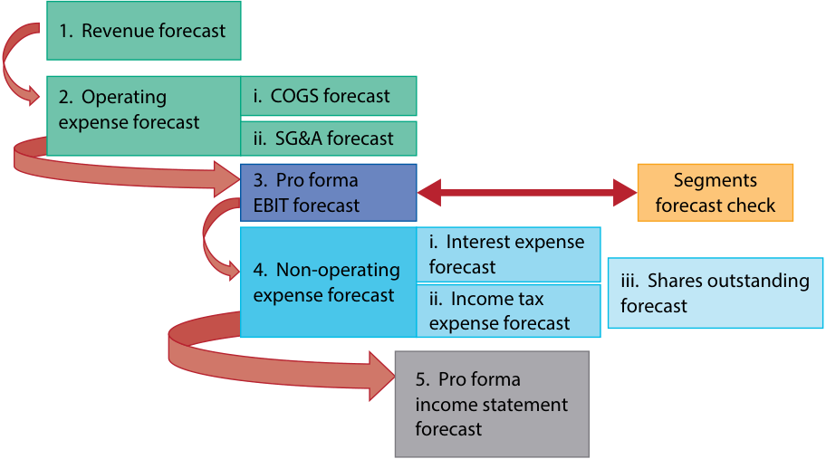
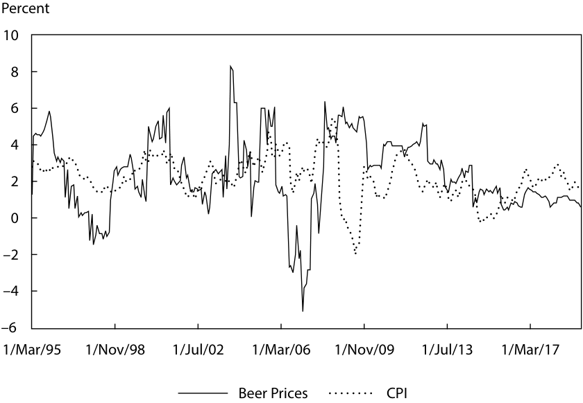
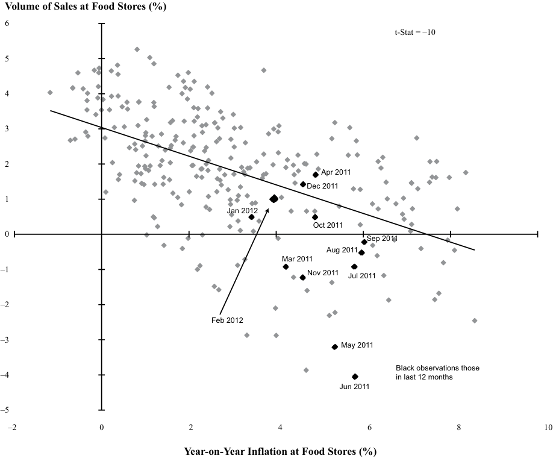

# Tập 4: Phân tích Báo cáo Tài chính (Financial Statement Analysis)
## Learning Module 12 Introduction to Financial Statement Modeling (Trang PDF 459–516)

---

# Tập 4: Phân tích Báo cáo Tài chính (Volume 4: Financial Statement Analysis)
## Học phần 12: Giới thiệu về Lập mô hình Báo cáo Tài chính (Learning Module 12: Introduction to Financial Statement Modeling)
### Phần 1/4: Giới thiệu (Introduction) (Trang PDF 459–473)

---

<!-- PDF Page 459 -->

# H Ọ C P H Ầ N (L E A R N I N G M O D U L E) **<mark>12</mark>** 

### **Giới thiệu về Lập mô hình Báo cáo Tài chính (Introduction to Financial Statement Modeling)** 

##### **<mark>MỤC TIÊU HỌC TẬP (LEARNING OUTCOMES)</mark>** 

|**_Thành thạo (Mastery)_**|**_Ứng viên cần có khả năng: (The candidate should be able to:)_**|
|---|---|
||trình bày việc xây dựng một mô hình công ty phóng chiếu dựa trên doanh thu (*sales-based pro forma company model*)|
||giải thích cách thức các nhân tố hành vi (*behavioral factors*) ảnh hưởng đến dự báo của chuyên gia phân tích và khuyến nghị các biện pháp khắc phục đối với các thiên lệch của chuyên gia phân tích (*analyst biases*)|
||giải thích cách thức vị thế cạnh tranh (*competitive position*) của một công ty dựa trên phân tích năm áp lực cạnh tranh của Porter (*Porter’s five forces analysis*) ảnh hưởng đến giá cả và chi phí|
||giải thích cách thức dự báo doanh thu và chi phí của ngành và công ty khi chúng chịu tác động của lạm phát hoặc giảm phát giá cả (*price inflation or deflation*)|
||giải thích các yếu tố cần cân nhắc khi lựa chọn tầm nhìn dự báo tường minh (*explicit forecast horizon*) và các lựa chọn của chuyên gia phân tích khi xây dựng các phóng chiếu vượt quá tầm nhìn dự báo ngắn hạn|

Hai cơ quan ban hành chuẩn mực kế toán lớn gồm: 1) Hội đồng Chuẩn mực Kế toán Quốc tế (*International Accounting Standards Board* – IASB), đơn vị thiết lập các Chuẩn mực Báo cáo Tài chính Quốc tế (*International Financial Reporting Standards* – IFRS) và 2) Hội đồng Chuẩn mực Kế toán Tài chính (*Financial Accounting Standards Board* – FASB), đơn vị thiết lập các Nguyên tắc Kế toán được Chấp nhận Chung của Hoa Kỳ (*US GAAP*). Xuyên suốt học phần này, cả hai bộ chuẩn mực đều được đề cập và nhiều quy định, dù không phải tất cả, trong hai bộ quy tắc kế toán này được xác định rõ. Lưu ý: những thay đổi trong chuẩn mực kế toán cũng như các phán quyết và/hoặc tuyên bố mới được ban hành sau khi xuất bản học phần này có thể khiến một số thông tin trở nên lỗi thời. 

<!-- PDF Page 460 -->

## **<mark>1</mark>** 

#### **GIỚI THIỆU (INTRODUCTION)** 

Lập mô hình báo cáo tài chính (*Financial statement modeling*) là một bước then chốt trong quy trình định giá các công ty và các chứng khoán mà chúng đã phát hành. Chúng ta bắt đầu phần thảo luận với cái nhìn tổng quan về việc xây dựng dự báo doanh thu. Sau đó, chúng ta mô tả phương pháp tiếp cận chung để dự báo từng báo cáo tài chính và minh họa việc xây dựng một mô hình báo cáo tài chính, bao gồm các báo cáo kết quả hoạt động kinh doanh, bảng cân đối kế toán, và báo cáo lưu chuyển tiền tệ dự báo. Tiếp theo, chúng ta mô tả các thiên lệch hành vi (*behavioral biases*) then chốt có thể ảnh hưởng đến quy trình lập mô hình và các chiến lược nhằm giảm thiểu chúng. Sau đó, chúng ta chuyển sang một số chủ đề quan trọng về tác động của các điều kiện kinh tế vi mô và vĩ mô lên các mô hình báo cáo tài chính: tác động của các nhân tố cạnh tranh lên giá cả và chi phí, tác động của lạm phát và giảm phát, những tiến bộ công nghệ, và các yếu tố cần cân nhắc khi dự báo dài hạn. 

Hầu hết các ví dụ và bảng biểu được sử dụng xuyên suốt bài đọc có thể được tải xuống dưới dạng một tệp sổ tính Microsoft Excel (*workbook*). Mỗi trang tính (*worksheet*) trong tệp sổ tính được dán nhãn bằng số thứ tự ví dụ hoặc bảng biểu tương ứng trong bài đọc. 

###### **TỔNG QUAN HỌC PHẦN (LEARNING MODULE OVERVIEW)** 

- Một mô hình báo cáo tài chính là điểm khởi đầu cho hầu hết các mô hình định giá, và các ước tính định giá có thể được thực hiện dựa trên nhiều chỉ số khác nhau, bao gồm dòng tiền tự do (*free cash flow* – FCF), EPS, EBITDA, và EBIT. 

- Một số khoản mục trên bảng cân đối kế toán, chẳng hạn như lợi nhuận giữ lại (*retained earnings*), chảy trực tiếp từ báo cáo kết quả hoạt động kinh doanh sang, trong khi các khoản phải thu khách hàng, khoản phải trả người bán, và hàng tồn kho lại gắn kết rất chặt chẽ với các phóng chiếu trên báo cáo kết quả hoạt động kinh doanh. 

- Các tài khoản vốn lưu động (*working capital accounts*) được lập mô hình bằng cách phóng chiếu các tỷ số vốn lưu động (ví dụ: số ngày tồn kho bình quân [DOH], số ngày thu tiền bình quân [DSO], số ngày trả tiền bình quân [DPO]) rồi kết hợp chúng với dự báo doanh thu và giá vốn hàng bán để tạo ra các tài khoản vốn lưu động phóng chiếu trên bảng cân đối kế toán. 

- Năm thiên lệch hành vi (*behavioral biases*) then chốt ảnh hưởng đến dự báo của chuyên gia phân tích là sự tự tin thái quá (*overconfidence*), ảo tưởng kiểm soát (*illusion of control*), thiên lệch bảo thủ (*conservatism*), thiên lệch đại diện (*representativeness*), và thiên lệch xác nhận (*confirmation bias*). 

- Ảo tưởng kiểm soát (*Illusion of control*), một thiên lệch gắn liền với sự tự tin thái quá, là xu hướng đánh giá quá cao khả năng kiểm soát những thứ không thể kiểm soát được và thực hiện những hành động rốt cuộc không mang lại kết quả gì để theo đuổi sự kiểm soát đó. 

- Một biểu hiện phổ biến của thiên lệch xác nhận (*confirmation bias*) ở các chuyên gia phân tích đầu tư là việc cấu trúc quy trình nghiên cứu chỉ nhằm theo đuổi những tin tức tích cực hoặc những tiêu chí nhất định, hoặc với một phạm vi hẹp. 

- Các nhân tố cạnh tranh ảnh hưởng đến khả năng của một công ty trong việc đàm phán giá đầu vào thấp hơn với các nhà cung cấp và tăng giá bán cho các sản phẩm và dịch vụ. Khuôn khổ năm áp lực cạnh tranh của Porter (*Porter’s five forces framework*) có thể được sử dụng làm cơ sở để nhận diện các nhân tố như vậy. 

- Năm áp lực cạnh tranh của Porter bao gồm: Mối đe dọa từ sản phẩm thay thế (*Threat of substitutes*), Sự cạnh tranh nội bộ ngành (*Rivalry*), Quyền lực thương lượng của nhà cung cấp (*Bargaining power of suppliers*), Quyền lực thương lượng của người mua (*Bargaining power of buyers*), và Mối đe dọa từ các đối thủ gia nhập mới (*Threat of new entrants*). 

- Tỷ suất sinh lợi trên vốn đầu tư (*Return on invested capital* – ROIC), được định nghĩa là lợi nhuận hoạt động ròng trừ đi thuế đã điều chỉnh (*net operating profit less adjusted taxes* – NOPLAT) chia cho phần chênh lệch giữa tài sản hoạt động và nợ phải trả hoạt động, là một thước đo khả năng sinh lời sau thuế. Mức ROIC cao và duy trì bền vững thường gắn liền với việc sở hữu một lợi thế cạnh tranh (*competitive advantage*). 

- Lạm phát và giảm phát (*Inflation and deflation*) có thể ảnh hưởng đáng kể đến độ chính xác của các dự báo về doanh thu, <u>lợi nhuận và dòng tiền</u> trong tương lai của một công ty. 

<!-- PDF Page 461 -->

- Việc dự báo doanh thu cho một công ty đang đối mặt với lạm phát chi phí đầu vào đòi hỏi phải hiểu rõ độ co giãn của cầu theo giá (*price elasticity*) đối với các sản phẩm, các mức tỷ lệ lạm phát chi phí khác nhau tại những quốc gia nơi công ty hoạt động, và mức lạm phát chi phí có khả năng xảy ra liên quan đến từng danh mục sản phẩm riêng lẻ của công ty. 

- ■ Khi đối mặt với giá đầu vào tăng cao, một công ty có thể quyết định bảo toàn biên lợi nhuận của mình bằng cách chuyển phần chi phí tăng thêm sang cho khách hàng (*passing on the costs to its customers*), hoặc có thể quyết định chấp nhận giảm một phần biên lợi nhuận để gia tăng thị phần. 

- ■ Việc lựa chọn tầm nhìn thời gian dự báo (*forecast time horizon*) có thể chịu ảnh hưởng bởi một số nhân tố nhất định, bao gồm chiến lược đầu tư mà chứng khoán đang được xem xét, tính chu kỳ của ngành (*cyclicality of the industry*), các nhân tố đặc thù của công ty, và sở thích từ tổ chức tuyển dụng của chuyên gia phân tích. 

- ■ Lợi nhuận bình thường hóa (*Normalized earnings*) là mức lợi nhuận giữa chu kỳ (*mid-cycle earnings*) kỳ vọng của một công ty khi không có bất kỳ nhân tố bất thường hoặc tạm thời nào ảnh hưởng đến khả năng sinh lời. 

- ■ Một trong những thách thức lớn nhất mà chuyên gia phân tích phải đối mặt là việc dự đoán các điểm uốn (*inflection points*), chẳng hạn như từ sự đứt gãy kinh tế (*economic disruption*), quy định quản lý, và công nghệ, khi tương lai sẽ có diện mạo khác biệt đáng kể so với quá khứ gần đây. 

#### **XÂY DỰNG MÔ HÌNH BÁO CÁO TÀI CHÍNH (BUILDING A FINANCIAL STATEMENT MODEL)** 

## **<mark>2</mark>** 

- trình bày việc xây dựng một mô hình công ty phóng chiếu dựa trên doanh thu (*sales-based pro forma company model*) 

Trong học phần này, chúng ta áp dụng các nguyên tắc đã được trình bày ở các học phần trước thuộc môn Phân tích Báo cáo Tài chính (*Financial Statement Analysis*) và Tổ chức Phát hành Doanh nghiệp (*Corporate Issuers*) vào việc minh họa cách xây dựng một mô hình báo cáo tài chính. Công ty mục tiêu là Tập đoàn Rémy Cointreau (Rémy), một công ty của Pháp chuyên bán các loại rượu mạnh (*spirits*). Sau khi cung cấp cái nhìn tổng quan ngắn gọn về công ty, chúng ta sẽ tập trung chủ yếu vào cơ chế xây dựng các báo cáo kết quả hoạt động kinh doanh, báo cáo lưu chuyển tiền tệ, và bảng cân đối kế toán phóng chiếu (*pro forma*). Các nguồn dữ liệu cho ví dụ này bao gồm báo cáo thường niên cho năm tài chính kết thúc vào ngày 31 tháng 3 năm 2021 và 2020 của công ty, các báo cáo giữa niên độ của công ty, và các bản thuyết trình dành cho nhà đầu tư tương ứng để lấy thêm thông tin về kết quả cơ sở của từng bộ phận kinh doanh. Mặc dù các dự báo được mô tả ở mức độ chi tiết nhất định tại đây, các học phần sau về phân tích công ty trong mảng chủ đề Chứng khoán Vốn (*Equity*) sẽ thảo luận về việc dự báo một cách chi tiết hơn nhiều. 

##### **Tổng quan về Công ty (Company Overview)** 

Rémy, có năm báo cáo kết thúc vào ngày 31 tháng 3, vận hành và báo cáo ba phân khúc kinh doanh (*business segments*): 

**1.** Rượu Cognac (*Cognac*). Bộ phận này, bao gồm chủ yếu là rượu cognac mang thương hiệu Rémy Martin, chiếm xấp xỉ 73% doanh thu của FY2021 (kết thúc năm vào ngày 31 tháng 3 năm 2021) và 94% tổng lợi nhuận hoạt động hiện hành (*current operating profit*). Lợi nhuận hoạt động hiện hành là một thước đo ngoài IFRS (*non-IFRS measure*) do Rémy báo cáo, bằng với lợi nhuận hoạt động theo chuẩn IFRS nhưng loại trừ các khoản mục liên quan đến các thương hiệu đã ngừng kinh doanh hoặc các khoản mục được coi là không thường xuyên hoặc không trọng yếu, chẳng hạn như các khoản dự phòng suy giảm giá trị tài sản hoặc dự phòng kiện tụng. 

<!-- PDF Page 462 -->

**2.** Rượu mùi & Rượu mạnh (*Liqueurs & Spirits*). Là một danh mục đa dạng các thương hiệu rượu mạnh, các thương hiệu chính trong phân khúc này gồm Cointreau, Metaxa, St-Rémy, Mount Gay, Bruichladdich, và The Botanist. Phân khúc này chiếm xấp xỉ 25% doanh thu FY2021 và 14% lợi nhuận hoạt động hiện hành. 

**3.** Các Thương hiệu Đối tác (*Partner Brands*). Phân khúc này bao gồm thương hiệu của các công ty khác được tiếp thị thông qua mạng lưới phân phối của Rémy. Chúng chiếm xấp xỉ 3% doanh thu FY2021 và ngay dưới mức 0% lợi nhuận hoạt động hiện hành, chịu một khoản lỗ hoạt động nhẹ trong FY2021 ở mức $-0.8$ triệu EUR. Tầm quan trọng của bộ phận này đã sụt giảm đáng kể theo thời gian khi công ty chấm dứt các hợp đồng phân phối (“thương hiệu đối tác”). 

Thông tin tài chính theo phân khúc được tóm tắt trong Bảng 1. Như được hiển thị, phân khúc kinh doanh lớn nhất của công ty cũng là phân khúc sinh lời cao nhất: Phân khúc Cognac đạt biên lợi nhuận hoạt động hiện hành xấp xỉ 30% ($= \text{221 triệu EUR} / \text{735 triệu EUR}$) trong năm tài chính 2021. Các bảng biểu đều có trong tệp sổ tính Microsoft Excel có thể tải xuống tại một trang tính duy nhất có tiêu đề “Rémy”. Chúng tôi đặc biệt khuyến khích bạn theo dõi song song trên tệp sổ tính Excel và khám phá chi tiết quá trình xây dựng mô hình. 

**Bảng 1: Phân tích Doanh thu và Lợi nhuận Hoạt động của Rémy (Exhibit 1: Analysis of Rémy’s Turnover and Operating Profit)** 

|**_Doanh thu (triệu euro) (Revenue [euro millions])_**|**FY2019**|**FY2020**|**FY2021**|
|---|---|---|---|
|Cognac|774|736|735|
|Rượu mùi và rượu mạnh (*Liqueurs and spirits*)|264|262|248|
|Các thương hiệu đối tác (*Partner brands*)|87|28|27|
|Tổng doanh thu (*Total revenues*)|1,126|1,025|1,010|
|_Lợi nhuận Hoạt động Hiện hành (triệu euro) (Current Operating Profit [euro millions])_||||
|Cognac|236|200|221|
|Rượu mùi và rượu mạnh (*Liqueurs and spirits*)|39|38|33|
|Các thương hiệu đối tác (*Partner brands*)|5|–2|–1|
|Chi phí cấp công ty mẹ/tập đoàn (*Holding/Corporate-level costs*)|–15|–20|–17|
|Tổng lợi nhuận hoạt động hiện hành (*Total current operating profit*)|264|215|236|
|_Biên Lợi nhuận Hoạt động Hiện hành (Current Operating Profit Margins)_||||
|Cognac|30.4%|27.1%|30.1%|
|Rượu mùi và rượu mạnh (*Liqueurs and spirits*)|14.7%|14.3%|13.3%|
|Các thương hiệu đối tác (*Partner brands*)|5.6%|–6.2%|–3.0%|
|Chi phí cấp công ty mẹ/tập đoàn (phần trăm trên tổng doanh thu) (*Holding/Corporate-level costs [percent of total revenue]*)|–1.3%|–2.0%|–1.7%|
|Tổng biên lợi nhuận hoạt động hiện hành (*Total current operating margin*)|23.5%|21.0%|23.4%|

Việc xây dựng các báo cáo kết quả hoạt động kinh doanh phóng chiếu (*pro forma income statements*), như Bảng 2 minh họa, bao gồm bốn bước dự báo: doanh thu, giá vốn hàng bán (COGS), các chi phí hoạt động khác, và cuối cùng là các khoản mục phi hoạt động (*non-operating items*). 

<!-- PDF Page 463 -->

**Bảng 2: Quy trình Dự báo Báo cáo Kết quả Hoạt động Kinh doanh (Exhibit 2: Income Statement Forecast Process)** 

> **Chú thích hình ảnh:** Lưu đồ quy trình dự báo Báo cáo Kết quả Hoạt động Kinh doanh gồm 5 bước:
> 1. Dự báo doanh thu (*Revenue forecast*)
> 2. Dự báo chi phí hoạt động (*Operating expense forecast*): (i) Dự báo giá vốn hàng bán (*COGS forecast*), (ii) Dự báo chi phí bán hàng, chung và quản lý (*SG&A forecast*)
> 3. Dự báo EBIT phóng chiếu (*Pro forma EBIT forecast*) $\leftrightarrow$ Kiểm tra chéo với dự báo theo phân khúc (*Segments forecast check*)
> 4. Dự báo chi phí phi hoạt động (*Non-operating expense forecast*): (i) Dự báo chi phí lãi vay (*Interest expense forecast*), (ii) Dự báo chi phí thuế thu nhập (*Income tax expense forecast*), (iii) Dự báo số lượng cổ phiếu đang lưu hành (*Shares outstanding forecast*)
> 5. Dự báo báo cáo kết quả hoạt động kinh doanh phóng chiếu (*Pro forma income statement forecast*)

##### **Dự báo Doanh thu (Revenue Forecast)** 

Đối với mỗi phân khúc, sự thay đổi doanh thu được thúc đẩy bởi các ước tính về sản lượng (*volume*), giá cả (*price*), và ngoại tệ (*foreign currency*) dựa trên các xu hướng lịch sử đã được điều chỉnh cho những sai lệch kỳ vọng so với xu hướng. Những thay đổi về giá không chỉ đề cập đến sự thay đổi giá của một sản phẩm đơn lẻ mà còn bao gồm những thay đổi trong cơ cấu sản phẩm (*mix*), được định nghĩa là những thay đổi bắt nguồn từ việc bán các số lượng khác nhau giữa các sản phẩm có giá cao hơn và giá thấp hơn. Những thay đổi doanh thu bắt nguồn từ sản lượng hoặc giá/cơ cấu (*price/mix*) là tăng trưởng hữu cơ (*organic growth*) và được trình bày tách biệt với tác động của các thương vụ mua lại và thoái vốn (thay đổi phạm vi – *scope change*) cũng như tỷ giá hối đoái (tác động ngoại hối – *forex impact* trong mô hình). 

Trong phân khúc Cognac, tốc độ tăng trưởng sản lượng trong lịch sử thường nằm trong khoảng từ 4% đến $-6\%$. Đối với các năm tương lai, tốc độ tăng trưởng sản lượng được kỳ vọng sẽ duy trì mạnh mẽ nhưng chậm hơn mức 9.1% đạt được vào năm 2021 khi sự phục hồi toàn cầu sau đại dịch COVID-19 và cuộc suy thoái đi kèm dần phai nhạt (sản lượng đã giảm 10.1% trong FY2020). Số lượng ngày càng tăng của tầng lớp người tiêu dùng giàu có tại châu Á nhiều khả năng sẽ giữ cho nhu cầu ở mức cao, trong khi mức tiêu thụ tại các thị trường phát triển nhiều khả năng sẽ khá đi ngang. Trong mô hình, giả định đưa ra là sản lượng tăng trưởng 7% vào năm 2022, giảm xuống còn 6% vào năm 2023 và 2024. 

Yếu tố giá/cơ cấu (*Price/mix*) đã đóng góp xấp xỉ 6.0%, 2.6%, và $-5.4\%$ vào mức tăng trưởng doanh thu phân khúc Cognac lần lượt trong FY2019, FY2020, và FY2021. Mặc dù tác động của giá/cơ cấu lên tăng trưởng doanh thu có sự biến động trong những năm gần đây, giá/cơ cấu nhiều khả năng sẽ vẫn là một nhân tố đóng góp tương đối quan trọng vào mức tăng trưởng doanh thu trong tương lai nhờ cấu trúc thuận lợi của ngành và những nỗ lực của công ty nhằm gia tăng tỷ trọng doanh thu đến từ những dòng sản phẩm mà công ty gọi là “rượu mạnh thượng hạng” (*“exceptional spirits”* — những chai rượu có giá trên 50 USD mỗi chai và đang chứng kiến mức tăng trưởng nhu cầu 10% hàng năm). Mức đóng góp 4% của giá/cơ cấu vào tăng trưởng doanh thu được giả định cho năm 2022, và xu hướng này được duy trì sang năm 2023 và 2024. Các phóng chiếu kết hợp cho năm 2022 gồm 7% tăng trưởng sản lượng và 4% tác động giá/cơ cấu mang lại mức tăng trưởng doanh thu hữu cơ tổng thể là 11.3%, được tính bằng $[(1 + 0.07) \times (1 + 0.04)] - 1$. 

Ngoài tác động của sản lượng và giá/cơ cấu, doanh thu của Rémy còn chịu ảnh hưởng bởi biến động tỷ giá hối đoái. Các công bố thông tin của công ty cho biết hơn 70% doanh thu được thực hiện bên ngoài khu vực đồng euro (*eurozone*), trong khi hầu hết hoạt động sản xuất của Rémy lại diễn ra bên trong khu vực đồng euro. Mô hình dự báo không có tác động của ngoại tệ lên doanh thu trong giai đoạn dự báo 2022–2024. 

<!-- PDF Page 464 -->

Bảng 3 tóm tắt thông tin lịch sử và phóng chiếu đối với doanh thu của phân khúc Cognac. 

**Bảng 3: Thông tin Lịch sử và Phóng chiếu đối với Doanh thu Phân khúc Cognac (Exhibit 3: Historical and Projected Information for Cognac Segment Revenue)** 

||**FY2018**|**FY2019**|**FY2020**|**FY2021**|**FY2022E**|**FY2023E**|**FY2024E**|
|---|---|---|---|---|---|---|---|
|Doanh thu Phân khúc Cognac (triệu euro) (*Cognac Segment Revenues [euro millions]*)|760|774|736|735|818|902|994|
|Thay đổi qua từng năm (YoY%)|7.4%|1.9%|–5.0%|–0.1%|11.3%|10.2%|10.2%|
|Tăng trưởng sản lượng (*Volume growth*) (%)|6.0%|5.9%|–10.1%|9.1%|7.0%|6.0%|6.0%|
|Giá/cơ cấu (*Price/mix*) (%)|7.2%|6.0%|2.6%|–5.4%|4.0%|4.0%|4.0%|
|Tăng trưởng hữu cơ (*Organic growth*) (%)|13.6%|12.3%|–7.8%|3.2%|11.3%|10.2%|10.2%|
|Tác động ngoại hối và thay đổi phạm vi (*Forex impact and scope change*) (%)|−5.8%|−4.0%|2.5%|–3.8%|0.0%|0.0%|0.0%|
|Tác động của việc áp dụng chuẩn mực IFRS 15 (*Effect of IFRS 15 adoption*)|0.0%|–6.0%|0.0%|0.0%|0.0%|0.0%|0.0%|
|Thay đổi qua từng năm (YoY%)|7.8%|2.3%|–5.3%|–0.6%|11.3%|10.2%|10.2%|

Một phân tích tương tự có thể được thực hiện để phóng chiếu doanh thu cho các phân khúc khác. Sau đó, các con số này có thể được cộng lại để suy ra doanh thu hợp nhất phóng chiếu (*projected consolidated revenue*). 

##### **Giá vốn Hàng bán (COGS)** 

Biên lợi nhuận gộp (*gross margin*) của Rémy giữ ở mức gần như đi ngang từ FY2018 (67.5%) đến FY2021 (67.3%) khi tổng doanh thu sụt giảm nhẹ. Trong thời gian tới, chúng tôi phóng chiếu biên lợi nhuận gộp sẽ tăng thêm 100 điểm cơ bản (bps) trong mỗi năm của ba năm tiếp theo dựa trên sự gia tăng tổng doanh thu, đặc biệt là từ yếu tố giá/cơ cấu, vốn đóng góp gia tăng (*accretive*) rất mạnh cho biên lợi nhuận gộp (xem phần trước về “Dự báo Doanh thu”). Ban giám đốc đã đặt mục tiêu cho FY2030 là đạt biên lợi nhuận gộp 72.0%, phần lớn phù hợp với các dự báo của chúng tôi. Nếu tốc độ tăng trưởng doanh thu thực tế mạnh hơn (yếu hơn) so với dự báo của chúng tôi, chúng tôi kỳ vọng mức gia tăng biên lợi nhuận gộp sẽ nhiều hơn (ít hơn). 

##### **Chi phí Bán hàng, Chung và Quản lý (SG&A) cùng Các Chi phí Hoạt động Khác (SG&A Expenses and Other Operating Expenses)** 

Chi phí phân phối (*Distribution costs*) đã tăng lên đáng kể theo thời gian, từ 26.1% doanh thu trong FY2009 (không hiển thị trong các bảng) lên 38% trong FY2018, và sau đó giảm xuống 33.8% trong FY2021. Cụ thể, việc thiết lập mạng lưới phân phối của Rémy tại châu Á đã làm tăng nền tảng chi phí. Rémy rất cam kết với việc xây dựng thương hiệu và cũng đang đa dạng hóa về mặt địa lý. Chúng tôi ước tính mức tăng khiêm tốn trong chi phí phân phối tính theo phần trăm doanh thu, ở mức 20 bps mỗi năm. Chi phí quản lý (*Administrative costs*) tính theo phần trăm doanh thu đã tăng từ 8.1% lên 10.1% khi doanh thu sụt giảm do đại dịch COVID-19. Tuy nhiên, mức tăng trưởng xét theo số tiền euro tuyệt đối là khá khiêm tốn, với chi phí ở mức xấp xỉ 100 triệu EUR trong giai đoạn FY2019–FY2021. Chúng tôi kỳ vọng chi phí quản lý tăng trưởng 1% mỗi năm cho đến hết FY2024E. 

Chi phí (thu nhập) hoạt động khác (*Other operating expenses [income]*), bao gồm chủ yếu là các khoản dự phòng suy giảm giá trị tài sản vô hình, tái cấu trúc, và lãi từ thoái vốn, đã dao động từ $-2$ triệu EUR đến 20 triệu EUR từ FY2018 đến FY2021. Bởi vì chúng tôi không dự kiến có bất kỳ giao dịch nào sẽ dẫn đến chi phí hoặc thu nhập hoạt động khác, chúng tôi dự báo bằng không cho dòng này trong mô hình. 

Bảng 4 cung cấp báo cáo kết quả hoạt động kinh doanh hợp nhất của Rémy cho đến dòng EBIT và biên EBIT. 

<!-- PDF Page 465 -->

**Bảng 4: Báo cáo Kết quả Hoạt động Kinh doanh (Phần Hoạt động) Lịch sử và Phóng chiếu Hợp nhất của Tập đoàn Rémy Cointreau (triệu euro, trừ khi có ghi chú khác) (Exhibit 4: Consolidated Historical and Projected Income Statement [Operating] for Rémy Cointreau Group [euro millions, unless noted])** 

||**FY2018**|**FY2019**|**FY2020**|**FY2021**|**FY2022E**|**FY2023E**|**FY2024E**|
|---|---|---|---|---|---|---|---|
|Doanh thu (*Sales*)|1,127|1,126|1,025|1,010|1,095|1,181|1,275|
|Giá vốn hàng bán (*Cost of sales*)|366|415|348|330|347|362|379|
|Lợi nhuận gộp (*Gross profit*)|761|711|677|680|748|819|897|
|Biên lợi nhuận gộp (*Gross margin*)|67.5%|63.1%|66.1%|67.3%|68.3%|69.3%|70.3%|
|Thay đổi biên lợi nhuận gộp (*Change in gross margin*)|0.8%|–4.4%|2.9%|1.3%|1.0%|1.0%|1.0%|
|Chi phí phân phối (*Distribution costs*)|433|346|355|342|373|404|439|
|Chi phí phân phối tính theo phần trăm doanh thu (*Distribution costs as percent of sales*)|38.4%|30.7%|34.6%|33.8%|34.0%|34.2%|34.4%|
|Chi phí quản lý (*Administrative expenses*)|92|101|107|103|104|105|106|
|Chi phí quản lý tính theo % doanh thu (*Administrative expenses as % of sales*)|8.1%|8.9%|10.4%|10.1%|9.5%|8.9%|8.3%|
|Chi phí (thu nhập) hoạt động khác (*Other operating expenses [income]*)|13|–2|20|0|0|0|0|
|EBIT|223|266|196|236|272|310|352|
|Biên EBIT (*EBIT margin*)|19.8%|23.6%|19.1%|23.3%|24.8%|26.2%|27.6%|

##### **Lợi nhuận Hoạt động theo Phân khúc (Operating Profit by Segment)** 

Trong phần này, chúng ta ước tính theo một cách thay thế đối với lợi nhuận hoạt động và biên lợi nhuận bằng cách sử dụng phương pháp tiếp cận theo phân khúc (*segment approach*). Rémy công bố lợi nhuận hoạt động hiện hành cho từng phân khúc cũng như chi phí hoạt động ở cấp độ công ty mẹ hoặc tập đoàn. Hãy nhớ lại rằng lợi nhuận hoạt động hiện hành là một thước đo ngoài IFRS có loại trừ một số khoản mục nhất định. Những khoản mục nhất định này được công bố trên báo cáo kết quả hoạt động kinh doanh của Rémy dưới dòng “Chi phí (thu nhập) hoạt động khác”. Do đó, tổng lợi nhuận hoạt động hiện hành của các phân khúc bằng với EBIT hợp nhất trước chi phí (thu nhập) hoạt động khác. 

Đối với phân khúc Cognac, dự báo tăng trưởng doanh thu cao hơn, dựa một phần vào mức tăng trưởng giá/cơ cấu mạnh mẽ, giả định cơ cấu sản phẩm ngày càng cải thiện và điều này cũng sẽ mang lại biên lợi nhuận gộp cao hơn. Nhưng lợi ích đối với biên lợi nhuận gộp sẽ bị giảm nhẹ phần nào bởi chi phí phân phối cao hơn. Do đó, kỳ vọng đặt ra là biên lợi nhuận hoạt động của phân khúc Cognac sẽ tăng lên mức 33.4% vào FY2024. Để làm chuẩn đối sánh (*benchmark*), dự báo này có thể được đem so sánh với kết quả tài chính được báo cáo bởi Hennessy (thuộc tập đoàn LVMH), một thương hiệu rượu cognac khác. Biên lợi nhuận hoạt động của công ty đó trong phân khúc Rượu vang & Rượu mạnh (*Wine & Spirits*) trong giai đoạn FY2017–2019 là 30–32%, mặc dù mảng kinh doanh đó có tỷ trọng cao hơn đáng kể của các dòng sản phẩm giá thấp hơn với biên lợi nhuận gộp thấp hơn. 

Đối với các phân khúc khác, không có nhiều dư địa tăng trưởng (*upside*). Trong bộ phận Rượu mùi & Rượu mạnh, chúng tôi giả định biên lợi nhuận hoạt động tăng khiêm tốn lên mức 13.6%. Tổng cộng lại, biên lợi nhuận hoạt động hợp nhất của Tập đoàn Rémy Cointreau được dự báo sẽ cải thiện từ 23.4% trong FY2021 lên 27.6% trong FY2024, phần lớn nhờ vào sự tăng trưởng và cải thiện biên lợi nhuận ở phân khúc Cognac, bộ phận sinh lời cao nhất, cùng tác động đòn bẩy từ mức tăng trưởng doanh thu đó lên các chi phí cố định ở cấp độ tập đoàn. 

Mặc dù phương pháp tiếp cận theo phân khúc như Bảng 5 có thể được sử dụng thay cho phương pháp tiếp cận hợp nhất để dự báo doanh thu và lợi nhuận hoạt động, nó cũng thường được sử dụng như một phép “kiểm tra chéo” (*“check”*) đối với các dự báo hợp nhất. Chẳng hạn, phân tích này đã tiết lộ rằng mô hình phụ thuộc đáng kể vào sự cải thiện biên lợi nhuận ở phân khúc Cognac. 

<!-- PDF Page 466 -->

**Bảng 5: Lợi nhuận Hoạt động Lịch sử và Phóng chiếu theo Phân khúc của Tập đoàn Rémy Cointreau (Exhibit 5: Historical and Projected Operating Profit by Segment for Rémy Cointreau Group)** 

|**Doanh thu (triệu euro) (Revenue [euro millions])**|**FY2018**|**FY2019**|**FY2020**|**FY2021**|**FY2022E**|**FY2023E**|**FY2024E**|
|---|---|---|---|---|---|---|---|
|Cognac|760|774|736|735|818|902|994|
|Rượu mùi và rượu mạnh (*Liqueurs and spirits*)|267|264|262|248|251|253|256|
|Các thương hiệu đối tác (*Partner brands*)|100|87|28|27|26|26|26|
|Tổng doanh thu (*Total revenues*)|1,127|1,126|1,025|1,010|1,095|1,181|1,275|

|**Lợi nhuận Hoạt động Hiện hành (triệu euro) (Current Operating Profit [euro millions])**|**FY2018**|**FY2019**|**FY2020**|**FY2021**|**FY2022E**|**FY2023E**|**FY2024E**|
|---|---|---|---|---|---|---|---|
|Cognac|204|236|200|221|255|291|332|
|Rượu mùi và rượu mạnh (*Liqueurs and spirits*)|43|39|38|33|34|34|35|
|Các thương hiệu đối tác (*Partner brands*)|5|5|–2|–1|–1|–1|–1|
|Chi phí cấp công ty mẹ/tập đoàn (*Holding/Corporate-level costs*)|–16|–15|–20|–17|–16|–15|–14|
|Tổng lợi nhuận hoạt động hiện hành (*Total current operating profit*)|237|264|215|236|271|309|352|
|**Biên Lợi nhuận Hoạt động Hiện hành (Current Operating Profit Margins)**|**FY2018**|**FY2019**|**FY2020**|**FY2021**|**FY2022E**|**FY2023E**|**FY2024E**|
|Cognac|26.9%|30.4%|27.1%|30.1%|31.2%|32.3%|33.4%|
|Rượu mùi và rượu mạnh (*Liqueurs and spirits*)|16.0%|14.7%|14.3%|13.3%|13.4%|13.5%|13.6%|
|Các thương hiệu đối tác (*Partner brands*)|5.3%|5.6%|–6.2%|–3.0%|–3.0%|–3.0%|–3.0%|
|Chi phí cấp công ty mẹ/tập đoàn (*Holding/Corporate-level costs*)|–1.4%|–1.3%|–2.0%|–1.7%|–1.5%|–1.3%|–1.1%|
|Tổng lợi nhuận hoạt động hiện hành (*Total current operating profit*)|21.0%|23.5%|21.0%|23.4%|24.8%|26.2%|27.6%|

##### **Các Khoản mục Phi hoạt động (Non-Operating Items)** 

Ba loại khoản mục phi hoạt động được đưa vào mô hình gồm: chi phí tài chính (tức là chi phí lãi vay), thuế thu nhập doanh nghiệp, và số lượng cổ phiếu đang lưu hành. 

Chi phí tài chính ròng (*Net finance cost*) trên báo cáo kết quả hoạt động kinh doanh của Rémy là chi phí lãi vay trên nợ trừ đi thu nhập lãi kiếm được từ tiền mặt và các khoản đầu tư. Do đó, việc dự báo chi phí tài chính ròng đòi hỏi phải ước tính vị thế nợ và tiền mặt cũng như mức lãi suất phải trả và lãi suất kiếm được. 

Các công ty trả mức lãi suất cố định hoặc thả nổi trên khoản nợ vay. Nếu lãi suất là thả nổi (*variable*), mức lãi suất thường được xác định bằng lãi suất tham chiếu thị trường (*market reference rate*) cộng với chênh lệch tín dụng (*credit spread*). Như được hiển thị trong Bảng 6, chi phí lãi vay của Rémy là cố định và được tính bằng 1.7% phát sinh trên tổng nợ gộp (*gross debt*) vào thời điểm đầu kỳ (720 triệu EUR vào cuối FY2020). Các chi phí tài chính khác được giả định bằng không. Tổng nợ gộp và mức lãi suất trả trên khoản nợ đó được ước tính giữ nguyên đi ngang so với mức của năm kết thúc vào FY2021. 

Mặc dù thu nhập lãi thường được dự báo sau khi đã dự báo vị thế tiền mặt từ báo cáo lưu chuyển tiền tệ dự báo, trong trường hợp này chúng tôi chỉ đơn giản ước tính thu nhập lãi bằng 0 EUR trong suốt giai đoạn lập mô hình; trong từng năm từ FY2018 đến FY2021, thu nhập lãi hàng năm lần lượt là 0 EUR, 0 EUR, 0.1 triệu EUR, và 0.2 triệu EUR, bởi vì Rémy duy trì thanh khoản của mình ở các tài sản có lợi suất bằng không hoặc rất thấp. Đối với các công ty 

<!-- PDF Page 467 -->

sở hữu các tài sản thanh khoản có mức lãi suất cao hơn, hoặc trong những môi trường lãi suất cao hơn, thu nhập lãi cần được dự báo theo cùng cách thức như chi phí lãi vay: lấy lượng tiền mặt và các khoản đầu tư dự báo nhân với mức lãi suất dự báo. 

**Bảng 6: Vị thế Nợ cùng Chi phí và Thu nhập Tài chính của Rémy (triệu EUR, trừ khi có ghi chú khác) (Exhibit 6: Debt Position and Financial Costs and Income for Rémy [EUR millions, unless noted])** 

||**FY2018**|**FY2019**|**FY2020**|**FY2021**|**FY2022E**|**FY2023E**|**FY2024E**|
|---|---|---|---|---|---|---|---|
|Nợ tài chính dài hạn (*Long-term financial debt*)|397|424|452|424|424|424|424|
|Nợ tài chính ngắn hạn và lãi vay phải trả (*Short-term financial debt and accrued interest*)|73|98|268|92|92|92|92|
|Tổng nợ gộp (*Gross debt*)|470|522|720|515|515|515|515|
|Chi phí lãi vay (*Interest expense*)|14.5|13.7|12.9|12.1|8.7|8.7|8.7|
|Lãi suất (trên số dư đầu kỳ) (*Interest rate [on beginning balance]*)||2.9%|2.5%|1.7%|1.7%|1.7%|1.7%|
|Thu nhập lãi (*Interest income*)|0.0|0.0|0.1|0.2|0.0|0.0|0.0|
|Chi phí tài chính ròng (*Net finance cost*)|14.5|13.7|12.8|11.9|8.7|8.7|8.7|

##### **Dự báo Thuế Thu nhập Doanh nghiệp (Corporate Income Tax Forecast)** 

Thuế suất thuế thu nhập doanh nghiệp theo luật định (*statutory corporate income tax rate*) của Pháp tại thời điểm phân tích là 32%. Thuế suất hiệu dụng (*effective tax rate*) của Tập đoàn Rémy Cointreau, xét trong dài hạn, bám khá sát mức thuế suất theo luật định. Do đó, mức thuế suất hiệu dụng ước tính 32% được sử dụng trong giai đoạn dự báo. Rémy không có lợi ích cổ đông không kiểm soát (*minority interests*) trọng yếu nào tại bất kỳ công ty con nào của mình. 

##### **Số lượng Cổ phiếu Đang lưu hành (Shares Outstanding)** 

Số lượng cổ phiếu đang lưu hành dùng để tính thu nhập trên mỗi cổ phiếu (*earnings per share* – EPS) trên báo cáo kết quả hoạt động kinh doanh được công bố theo hai cách, cả hai đều là bình quân gia quyền trong suốt năm tài chính: cơ bản (*basic*) và pha loãng (*diluted*). Số lượng cổ phiếu cơ bản đang lưu hành bao gồm các chứng khoán vốn cổ phần phổ thông đang lưu hành, trong khi số lượng cổ phiếu pha loãng đang lưu hành là một dạng phân tích giả định “điều gì sẽ xảy ra nếu” (*what-if analysis*); nó bằng số lượng cổ phiếu cơ bản đang lưu hành cộng với số lượng cổ phiếu phát sinh từ việc thực hiện quyền hoặc chuyển đổi các công cụ đang có lãi (*in-the-money instruments*), trừ đi số lượng cổ phiếu giả định được mua lại từ số tiền thu được nếu các cổ phiếu đó được phát hành. 

Thông thường, hai nhân tố chính ảnh hưởng đến số lượng cổ phiếu đang lưu hành theo thời gian là việc phát hành cổ phiếu liên quan đến thù lao bằng cổ phiếu cho nhân viên (*equity-based compensation* — làm tăng số lượng cổ phiếu đang lưu hành) và việc mua lại cổ phiếu (*share repurchases* — làm giảm số lượng cổ phiếu đang lưu hành). Các giao dịch ít phổ biến hơn nhưng đôi khi có quy mô đáng kể cũng ảnh hưởng đến số lượng cổ phiếu đang lưu hành bao gồm các thương vụ mua lại được tài trợ bằng cổ phiếu, phát hành thứ cấp (*secondary issuance*), và việc chuyển đổi cổ phiếu ưu đãi hoặc các công cụ khác thành cổ phiếu phổ thông. 

Bảng 7 thể hiện số lượng cổ phiếu cơ bản đang lưu hành đầu kỳ và cuối kỳ trong sáu năm tài chính vừa qua cũng như số lượng cổ phiếu mua lại và phát hành ròng hàng năm, được thu thập từ báo cáo biến động vốn chủ sở hữu và thuyết minh báo cáo tài chính. Ngoài ra, số lượng cổ phiếu cơ bản và pha loãng đang lưu hành trên báo cáo kết quả hoạt động kinh doanh dùng để tính EPS cơ bản và pha loãng (bình quân gia quyền) cũng được hiển thị và chênh lệch nhau xấp xỉ 2.6 triệu cổ phiếu trong mỗi năm của năm năm qua. 

<!-- PDF Page 468 -->

**Bảng 7: Số lượng Cổ phiếu Đang lưu hành của Rémy (triệu đơn vị, trừ khi có ghi chú khác) (Exhibit 7: Shares Outstanding for Rémy [euro millions, unless noted])** 

||**FY2016**|**FY2017**|**FY2018**|**FY2019**|**FY2020**|**FY2021**|
|---|---|---|---|---|---|---|
|Số lượng cổ phiếu cơ bản đang lưu hành đầu kỳ (*Beginning basic shares outstanding*)|48.6|48.6|49.6|50.0|49.8|49.8|
|Mua lại cổ phiếu (*Share repurchases*)|–0.0|0.0|–0.3|–1.0|–0.0|0.0|
|Phát hành cổ phiếu (*Share issuance*)|0.0|1.0|0.7|0.8|0.1|0.4|
|Số lượng cổ phiếu cơ bản đang lưu hành cuối kỳ (*Ending basic shares outstanding*)|48.6|49.6|50.0|49.8|49.8|50.3|
|Số lượng cổ phiếu cơ bản bình quân gia quyền (*Weighted average basic shares*)|48.6|49.1|49.8|50.1|49.8|50.1|
|Các chứng khoán gây pha loãng (*Dilutive securities*)|0.1|2.7|2.6|2.6|2.6|2.6|
|Số lượng cổ phiếu pha loãng bình quân gia quyền (*Weighted average diluted shares*)|48.7|51.8|52.4|52.7|52.4|53.1|

Như thấy rõ trong Bảng 7, số lượng cổ phiếu đang lưu hành của Rémy không thay đổi trọng yếu trong sáu năm qua bởi vì công ty không chi trả thù lao dựa trên cổ phiếu đáng kể nào và cũng không mua lại cổ phiếu. Thêm vào đó, ban giám đốc cũng chưa công bố ý định mua lại cổ phiếu trong tương lai gần. Do đó, mô hình giả định rằng số lượng cổ phiếu cơ bản và pha loãng bình quân gia quyền đang lưu hành trên báo cáo kết quả hoạt động kinh doanh giữ nguyên đi ngang ở mức của FY2021. 

##### **Báo cáo Kết quả Hoạt động Kinh doanh Phóng chiếu (Pro Forma Income Statement)** 

Giờ đây khi các thành phần dự báo đã sẵn sàng, một báo cáo kết quả hoạt động kinh doanh phóng chiếu hợp nhất có thể được xây dựng, như được hiển thị trong Bảng 8. Mặc dù không được trình bày trực tiếp trên bề mặt báo cáo kết quả hoạt động kinh doanh như công ty công bố, phép tính EBITDA được hiển thị ngay sau dòng EBIT bằng cách cộng thêm chi phí khấu hao tài sản hữu hình và vô hình lấy từ báo cáo lưu chuyển tiền tệ. Nó không liên kết với các đại lượng khác trên báo cáo kết quả hoạt động kinh doanh mà chỉ đơn thuần được hiển thị như một thước đo khả năng sinh lời hữu ích. 

**Bảng 8: Báo cáo Kết quả Hoạt động Kinh doanh Lịch sử và Phóng chiếu Hợp nhất của Tập đoàn Rémy Cointreau (triệu euro, trừ khi có ghi chú khác) (Exhibit 8: Consolidated Historical and Projected Income Statement for Rémy Cointreau Group [euro millions, unless noted])** 

||**FY2018**|**FY2019**|**FY2020**|**FY2021**|**FY2022E**|**FY2023E**|**FY2024E**|
|---|---|---|---|---|---|---|---|
|Doanh thu (*Sales*)|1,127|1,126|1,025|1,010|1,095|1,181|1,275|
|Giá vốn hàng bán (*Cost of sales*)|366|415|348|330|347|362|379|
|Lợi nhuận gộp (*Gross profit*)|761|711|677|680|748|819|897|
|Biên lợi nhuận gộp (*Gross margin*)|67.5%|63.1%|66.1%|67.3%|68.3%|69.3%|70.3%|
|Thay đổi biên lợi nhuận gộp (*Change in gross margin*)|0.8%|–4.4%|2.9%|1.3%|1.0%|1.0%|1.0%|
|Chi phí phân phối (*Distribution costs*)|433|346|355|342|373|404|439|
|Chi phí phân phối tính theo phần trăm doanh thu (*Distribution costs as percent of sales*)|38.4%|30.7%|34.6%|33.8%|34.0%|34.2%|34.4%|

<!-- PDF Page 469 -->

||**FY2018**|**FY2019**|**FY2020**|**FY2021**|**FY2022E**|**FY2023E**|**FY2024E**|
|---|---|---|---|---|---|---|---|
|Chi phí quản lý (*Administrative expenses*)|92|101|107|103|104|105|106|
|Chi phí quản lý tính theo phần trăm doanh thu (*Administrative expenses as percent of sales*)|8.1%|8.9%|10.4%|10.1%|9.5%|8.9%|8.3%|
|Chi phí (thu nhập) hoạt động khác (*Other operating expenses [income]*)|13|–2|20|0|0|0|0|
|EBIT|223|266|196|236|272|310|352|
|Biên EBIT (*EBIT margin*)|19.8%|23.6%|19.1%|23.3%|24.8%|26.2%|27.6%|
|Khấu hao tài sản hữu hình và vô hình (cộng ngược lại) (*Depreciation and amortization [add-back]*)|22|30|33|34||||
|Khấu hao tài sản hữu hình và vô hình tính theo phần trăm doanh thu (*Depreciation and amortization as percent of sales*)|1.9%|2.7%|3.3%|3.4%||||
|EBITDA|245|296|229|270||||
|Biên EBITDA (*EBITDA margin*)|21.7%|26.3%|22.3%|26.7%||||
|Chi phí tài chính ròng (*Net finance costs*)|15|14|13|12|9|9|9|
|Chi phí tài chính khác (*Other financial expenses*)|8|19|15|3|0|0|0|
|Tổng chi phí tài chính (*Total financial expenses*)|22|33|28|15|9|9|9|
|Lợi nhuận trước thuế (*Profit before tax*)|201|233|167|221|263|301|344|
|Thuế thu nhập (*Income tax*)|54|68|61|78|84|96|110|
|Thuế suất hiệu dụng (*Effective tax rate*)|26.6%|29.0%|36.4%|35.1%|32.0%|32.0%|32.0%|
|Thu nhập từ công ty liên kết (*Income from associates*)|1|–7|0|1|0|0|0|
|Lợi nhuận từ hoạt động kinh doanh liên tục (*Profit from continuing operations*)|148|159|107|144|179|205|234|
|Lợi nhuận từ hoạt động kinh doanh bị chấm dứt (*Profit from discontinued operations*)|0|0|6|0|0|0|0|
|Lợi nhuận ròng trong năm (*Net profit for the year*)|148|159|113|144|179|205|234|
|Thay đổi qua từng năm (YoY%)||8%|–29%|27%|24%|14%|14%|
|EPS cơ bản từ hoạt động kinh doanh liên tục (*EPS basic continuing operations*)|2.97|3.18|2.14|2.88|3.58|4.09|4.67|
|EPS pha loãng từ hoạt động kinh doanh liên tục (*EPS diluted continuing operations*)|2.82|3.02|2.04|2.74|3.40|3.89|4.44|
|Tổng EPS cơ bản (*EPS basic total*)|2.97|3.18|2.27|2.88|3.58|4.09|4.67|
|Tổng EPS pha loãng (*EPS diluted total*)|2.82|3.02|2.16|2.74|3.40|3.89|4.44|
|Số lượng cổ phiếu bình quân, cơ bản (triệu) (*Average number of shares, basic [millions]*)|49.8|50.1|49.8|50.1|50.1|50.1|50.1|
|Số lượng cổ phiếu bình quân, pha loãng (triệu) (*Average number of shares, diluted [millions]*)|52.4|52.7|52.4|52.6|52.6|52.6|52.6|

<!-- PDF Page 470 -->

##### **Báo cáo Lưu chuyển Tiền tệ Phóng chiếu (Pro Forma Statement of Cash Flows)** 

Các báo cáo lưu chuyển tiền tệ dự báo bắt đầu với thu nhập ròng dự báo và các con số khác từ báo cáo kết quả hoạt động kinh doanh dự báo, và sau đó thông thường đòi hỏi các ước tính cho chi tiêu vốn (*capital expenditures* – capex), khấu hao tài sản hữu hình và vô hình (*depreciation and amortization* – D&A), vốn lưu động (*working capital*), thù lao dựa trên cổ phiếu (*share-based compensation*), cổ tức (*dividends*), và mua lại cổ phiếu (*share repurchases*). Một khi báo cáo kết quả hoạt động kinh doanh dự báo và báo cáo lưu chuyển tiền tệ dự báo đã hoàn tất, việc dự báo bảng cân đối kế toán phần lớn chỉ là vấn đề liên kết chính xác các ô trên bảng tính (*spreadsheet*), như được minh họa trong Bảng 9. 

**Bảng 9: Quy trình Phóng chiếu Báo cáo Lưu chuyển Tiền tệ (Exhibit 9: Statement of Cash Flows Projection Process)** 

> **Chú thích hình ảnh:** Quy trình phóng chiếu Báo cáo Lưu chuyển Tiền tệ gồm 3 phần:
> - **A. Dòng tiền từ hoạt động kinh doanh (*Cash flows from operating activities*)**: Thu nhập ròng (từ báo cáo kết quả hoạt động kinh doanh) (*Net income [income statement]*), Thù lao dựa trên cổ phiếu (*Share-based compensation*), Vốn lưu động (*Working capital*), Khấu hao tài sản hữu hình và vô hình (*Depreciation & amortization*).
> - **B. Dòng tiền từ hoạt động đầu tư (*Cash flows from investing activities*)**: Chi tiêu vốn (*Capex*).
> - **C. Dòng tiền từ hoạt động tài chính (*Cash flows from financing activities*)**: Mua lại và phát hành cổ phiếu (*Share repurchase and issuance*), Cổ tức (*Dividends*), Phát hành và hoàn trả nợ vay (*Debt issuance and repayment*).

##### **Dự báo Đầu tư Vốn và Khấu hao (Capital Investments and Depreciation Forecasts)** 

Đầu tư vốn, hay chi tiêu vốn (*capex*), tính theo phần trăm doanh thu là 5.3% trong FY2021. Với triển vọng tăng trưởng sản lượng khả quan, chúng tôi kỳ vọng capex sẽ duy trì ở mức cao hơn một chút so với mức bình quân lịch sử là 5.0% doanh thu cho đến hết FY2024. Với nền tảng tài sản cố định đang tăng lên của Rémy, việc khấu hao tăng lên là hoàn toàn hợp lý. Mô hình giả định rằng khấu hao tài sản hữu hình và vô hình (D&A) bằng 4.2% tài sản cố định của năm trước, tức bằng mức bình quân của ba năm qua. Chi tiết bóc tách của capex và D&A được hiển thị trong Bảng 10. 

**Bảng 10: Bóc tách Chi tiết Capex và D&A (Exhibit 10: Capex, D&A Breakdowns)** 

||**2018**|**2019**|**2020**|**2021**|**2022E**|**2023E**|**2024E**|
|---|---|---|---|---|---|---|---|
|D&A (triệu euro)|22|30|33|34|36|36|37|
|Tính theo phần trăm tài sản cố định năm trước (*As percent of prior year fixed assets*)||4.0%|4.3%|4.2%|4.2%|4.2%|4.2%|
|Capex, PP&E và tài sản vô hình (triệu euro) (*Capex, PP&E, and intangibles [euro millions]*)|34|45|65|54|55|59|64|

<!-- PDF Page 471 -->

||**2018**|**2019**|**2020**|**2021**|**2022E**|**2023E**|**2024E**|
|---|---|---|---|---|---|---|---|
|Capex tính theo % doanh thu (*Capex as % of sales*)|3.0%|4.0%|6.3%|5.3%|5.0%|5.0%|5.0%|
|Tỷ số Capex/D&A (*Capex/D&A ratio*)|1.6|1.5|1.9|1.6|1.5|1.6|1.7|

##### **Dự báo Vốn Lưu động (Working Capital Forecasts)** 

Chúng tôi giả định rằng các tỷ số vốn lưu động sẽ duy trì tương tự như những gì công ty đã trải qua trong giai đoạn FY2018–21. Trong Bảng 11, chúng tôi chỉ đưa vào các khoản mục trên bảng cân đối kế toán có liên quan đến doanh thu và chi phí (tức là hàng tồn kho, khoản phải thu khách hàng, và khoản phải trả người bán) và giữ nguyên không đổi các khoản mục khác. Tập đoàn Rémy Cointreau có vốn lưu động ròng (*net working capital*) dương ở mức 105% doanh thu trong năm tài chính 2021. Thành phần vốn lưu động lớn nhất là hàng tồn kho bởi vì phần lớn rượu cognac của Rémy đòi hỏi phải ủ nhiều năm (*years of aging*). Số ngày tồn kho bình quân trong FY2021 là 1,493 ngày (theo giá trị hàng tồn kho triệu euro là 1,493 triệu EUR và số ngày DOH là 1,650 ngày trong bảng), phản ánh mức tăng xấp xỉ hơn 200–300 ngày do sự chững lại về sản lượng trong đại dịch COVID-19. Số ngày tồn kho được giảm nhẹ một phần nhờ các điều khoản thanh toán kéo dài với các nhà cung cấp; số ngày trả tiền bình quân (*days payable outstanding*) đạt mức trung bình khoảng 500 ngày kể từ FY2018. 

Chúng tôi lập mô hình các tài khoản vốn lưu động bằng cách phóng chiếu các tỷ số vốn lưu động (số ngày tồn kho bình quân, số ngày thu tiền bình quân, số ngày trả tiền bình quân) rồi kết hợp với dự báo doanh thu và giá vốn hàng bán để tạo ra các tài khoản vốn lưu động phóng chiếu trên bảng cân đối kế toán. Chúng tôi kỳ vọng số ngày tồn kho sẽ giảm dần cho đến hết FY2024 khi lượng hàng tồn kho tăng thêm trong đại dịch COVID-19 được giải phóng dần, số ngày thu tiền bình quân giữ nguyên ở mức của FY2021, và số ngày trả tiền bình quân trong mô hình giảm trở lại về mức trung bình, một lần nữa phản ánh sự bình thường hóa sau đại dịch COVID-19. Nhờ sự sụt giảm số ngày tồn kho, mô hình phóng chiếu một mức đóng góp dương ròng từ vốn lưu động vào phép đối chiếu từ thu nhập ròng sang dòng tiền từ hoạt động kinh doanh trên báo cáo lưu chuyển tiền tệ, trái ngược hoàn toàn với mức đóng góp âm của các năm trước đó. 

**Bảng 11: Diễn biến Vốn Lưu động của Rémy (Exhibit 11: Working Capital Development for Rémy)** 

||**FY2018**|**FY2019**|**FY2020**|**FY2021**|**FY2022E**|**FY2023E**|**FY2024E**|
|---|---|---|---|---|---|---|---|
|Hàng tồn kho (triệu euro) (*Inventories [euro millions]*)|1,170|1,246|1,364|1,493|1,426|1,340|1,245|
|Khoản phải thu khách hàng (*Accounts receivable*)|210|271|199|158|171|185|200|
|Khoản phải trả người bán (*Accounts payable*)|517|544|534|586|597|604|610|
|Vốn lưu động, ròng (*Working capital, net*)|863|973|1,029|1,065|1,000|922|835|
|Phần trăm trên doanh thu (*Percent of sales*)|77%|86%|100%|105%|91%|78%|65%|
|Thay đổi vốn lưu động (*Change in working capital*)||–110|–56|–36|64|79|87|
|Số ngày tồn kho bình quân (*Days inventories on hand*)|1,166|1,095|1,431|1,650|1,500|1,350|1,200|
|Số ngày thu tiền bình quân (*Days sales outstanding*)|68|88|71|57|57|57|57|
|Số ngày trả tiền bình quân (*Days payable outstanding*)|515|478|561|648|628|608|588|

<!-- PDF Page 472 -->

##### **Báo cáo Lưu chuyển Tiền tệ Dự báo (Forecasted Cash Flow Statement)** 

Khi thu nhập ròng, D&A, thay đổi vốn lưu động, capex, và các ước tính nợ vay đã có sẵn, báo cáo lưu chuyển tiền tệ hiển thị trong Bảng 12 gần như được tạo ra một cách tự động bằng cách liên kết các dòng có liên quan trên bảng tính. Ba khoản mục quan trọng còn lại cần dự báo là thù lao dựa trên cổ phiếu (*share-based compensation*), mua lại hoặc phát hành cổ phiếu, và cổ tức. Trong thời gian tới, mô hình giả định thù lao dựa trên cổ phiếu giữ nguyên đi ngang, không có hoạt động mua lại hay phát hành cổ phiếu nào, và cổ tức đã trả bằng với mức của FY2021 cho đến hết FY2024. Các dòng có nhãn “khác” (*“other”*) được gộp lại và cho bằng không trong các năm dự báo bởi vì chúng không trọng yếu, khó dự báo, hoặc cả hai. 

**Bảng 12: Báo cáo Lưu chuyển Tiền tệ Phóng chiếu của Rémy (triệu euro) (Exhibit 12: Projected Statement of Cash Flows for Rémy [euro millions])** 

||**FY2018**|**FY2019**|**FY2020**|**FY2021**|**FY2022E**|**FY2023E**|**FY2024E**|
|---|---|---|---|---|---|---|---|
|Thu nhập ròng (lỗ) (*Net income [loss]*)|148|159|113|144|179|205|234|
|D&A|22|30|33|34|36|36|37|
|Thù lao dựa trên cổ phiếu (*Share-based compensation*)|3|3|4|2|2|2|2|
|Đầu tư vào vốn lưu động (*Investment in working capital*)|–7|–162|–72|–13|64|79|87|
|Các khoản phi tiền mặt khác (*Other non-cash amounts*)|20|22|3|10|0|0|0|
|Dòng tiền từ hoạt động kinh doanh (*Cash flows from operations*)|185|53|81|177|281|322|360|
|Capex (PP&E và tài sản vô hình) (*Capex [PP&E and intangibles]*)|–34|–45|–65|–54|–55|–59|–64|
|Các hoạt động đầu tư khác (*Other investing activities*)|2|92|12|62|0|0|0|
|Dòng tiền từ hoạt động đầu tư (*Cash flows from investments*)|–32|47|–53|8|–55|–59|–64|
|Phát hành (hoàn trả) nợ vay (*Debt issuance [repayment]*)|0|11|196|–246|0|0|0|
|Phát hành (mua lại) cổ phiếu (*Share issuance [repurchases]*)|–27|–104|–2|2|0|0|0|
|Cổ tức đã trả (*Dividends paid*)|–25|–9|–132|–10|–10|–10|–10|
|Dòng tiền từ hoạt động tài chính (*Cash flows from financing*)|–52|–102|62|–253|–10|–10|–10|
|Tác động chuyển đổi ngoại hối (*FX translation effects*)|8|–6|1|–1|0|0|0|
|Thay đổi thuần về tiền mặt (*Net change in cash*)|109|–8|91|–68|217|254|287|

<!-- PDF Page 473 -->

||**FY2018**|**FY2019**|**FY2020**|**FY2021**|**FY2022E**|**FY2023E**|**FY2024E**|
|---|---|---|---|---|---|---|---|
|Tiền và các khoản tương đương tiền, đầu kỳ (*Cash and equivalents, beginning*)|78|187|179|269|201|418|671|
|Tiền và các khoản tương đương tiền, cuối kỳ (*Cash and equivalents, end*)|187|179|269|201|418|671|958|

##### **Bảng Cân đối Kế toán Dự báo (Forecasted Balance Sheet)** 

Bảng cân đối kế toán dự báo được trình bày trong Bảng 13 và dựa trên sự kết hợp của báo cáo kết quả hoạt động kinh doanh phóng chiếu (Bảng 8), báo cáo lưu chuyển tiền tệ phóng chiếu (Bảng 12), và bảng cân đối kế toán lịch sử khởi đầu. Các khoản mục trên bảng cân đối kế toán không được thảo luận cụ thể sẽ được giữ nguyên không đổi, qua đó bảo toàn đồng nhất thức kế toán (*accounting identity*). Để thuận tiện cho việc trình bày, các dòng vốn chủ sở hữu (ví dụ: cổ phiếu phổ thông, thặng dư vốn cổ phần, lợi nhuận giữ lại, cổ phiếu quỹ, thu nhập toàn diện khác lũy kế) được gộp chung lại. Đối với mỗi kỳ dự báo, vốn chủ sở hữu phổ thông bằng giá trị năm trước cộng với thu nhập ròng và thù lao dựa trên cổ phiếu trừ đi cổ tức. 

Nếu từng dòng đã thảo luận được liên kết chính xác—và các dòng khác được giữ nguyên không đổi từ FY2021—thì bảng cân đối kế toán dự báo sẽ cân bằng trong mỗi năm. Hãy tham khảo trang tính Rémy trong tệp sổ tính Microsoft Excel có thể tải xuống để xem chi tiết hơn. 

**Bảng 13: Bảng Cân đối Kế toán Phóng chiếu của Rémy (triệu euro) (Exhibit 13: Projected Balance Sheet for Rémy [euro millions])** 

||**FY2018**|**FY2019**|**FY2020**|**FY2021**|**FY2022E**|**FY2023E**|**FY2024E**|
|---|---|---|---|---|---|---|---|
|Tiền và các khoản tương đương tiền (*Cash and equivalents*)|186.8|178.6|269.4|201.0|418|671|958|
|Khoản phải thu khách hàng (*Accounts receivable*)|210|271|199|158|171|185|200|
|Hàng tồn kho (*Inventories*)|1,170|1,246|1,364|1,493|1,426|1,340|1,245|
|Tài sản ngắn hạn khác (*Other current assets*)|16|5|16|10|10|10|10|
|Tổng tài sản ngắn hạn (*Total current assets*)|1,583|1,700|1,848|1,861|2,025|2,206|2,412|
|PP&E, tài sản vô hình, lợi thế thương mại, thuần (*PP&E, intangibles, goodwill, net*)|752|785|808|845|864|887|913|
|Đầu tư vào công ty liên kết (*Investment in associates*)|20|1|1|2|2|2|2|
|Tài sản dài hạn khác (*Other non-current assets*)|186|139|131|73|73|73|73|
|Tổng tài sản (*Total assets*)|2,542|2,625|2,789|2,781|2,964|3,168|3,400|
|Nợ ngắn hạn/hiện hành (*Short-term/current debt*)|73|98|268|92|92|92|92|
|Khoản phải trả người bán (*Accounts payable*)|517|544|534|586|597|604|610|
|Nợ ngắn hạn khác và chi phí phải trả (*Other current liabilities and accrued expenses*)|26|31|39|42|42|42|42|
|Tổng nợ ngắn hạn (*Total current liabilities*)|616|673|842|720|731|737|744|
|Nợ dài hạn (*Long-term/non-current debt*)|397|424|452|424|424|424|424|
|Nợ dài hạn khác (*Other non-current liabilities*)|121|102|92|88|88|88|88|
|Tổng vốn cổ phần phổ thông (*Total common equity*)|1,407|1,425|1,403|1,548|1,720|1,918|2,144|
|Lợi ích cổ đông không kiểm soát (*NCI [Non-Controlling Interest]*)|1|1|1|1|1|1|1|
|Tổng vốn chủ sở hữu và nợ phải trả (*Total equity and liabilities*)|2,542|2,625|2,789|2,781|2,964|3,168|3,400|

---

# Tập 4: Phân tích Báo cáo Tài chính (Volume 4: Financial Statement Analysis)
## Học phần 12: Giới thiệu về Lập mô hình Báo cáo Tài chính (Learning Module 12: Introduction to Financial Statement Modeling)
### Phần 2/4: Tài chính Hành vi và Dự báo của Chuyên gia Phân tích (Behavioral Finance and Analyst Forecasts) (Trang PDF 474–489)

---

<!-- PDF Page 474 -->

### **Các Đầu vào của Mô hình Định giá (Valuation Model Inputs)** 

Một mô hình báo cáo tài chính là điểm khởi đầu cho hầu hết các mô hình định giá. Các ước tính định giá có thể được thực hiện dựa trên nhiều chỉ số khác nhau, bao gồm dòng tiền tự do (*free cash flow* – FCF), EPS, EBITDA, và EBIT. Các yếu tố đầu vào đặc thù của công ty cần thiết để xây dựng mô hình chiết khấu dòng tiền (*discounted cash flow* – DCF) toàn doanh nghiệp (nhằm ước tính giá trị doanh nghiệp – *enterprise value*) được hiển thị trong Bảng 14. Tất cả các biến số đều được lấy nguồn từ báo cáo kết quả hoạt động kinh doanh dự báo và báo cáo lưu chuyển tiền tệ dự báo. 

**Bảng 14: Tính Dòng tiền Tự do Toàn doanh nghiệp (FCFF) làm Cơ sở cho Mô hình Định giá DCF (triệu euro) (Exhibit 14: Calculating Free Cash Flow to the Firm as Basis for a DCF Valuation Model [euro millions])** 

||**FY2021**|**FY2022E**|**FY2023E**|**FY2024E**|
|---|---|---|---|---|
|EBIT|236|272|310|352|
|Thuế (thuế suất 32%) (*Taxes [32% tax rate]*)|–75|–87|–99|–113|
|EBIT sau thuế (*After-tax EBIT*)|160|185|211|240|
|D&A|34|36|36|37|
|Thay đổi vốn lưu động (*Change in working capital*)|–13|64|79|87|
|Chi tiêu vốn (*Capital expenditures*)|–54|–55|–59|–64|
|Dòng tiền tự do toàn doanh nghiệp (*Free cash flow to the firm* – FCFF)|127|230|267|300|

# **<mark>3</mark>** 

## **TÀI CHÍNH HÀNH VI VÀ DỰ BÁO CỦA CHUYÊN GIA PHÂN TÍCH (BEHAVIORAL FINANCE AND ANALYST FORECASTS)** 

giải thích cách thức các nhân tố hành vi ảnh hưởng đến dự báo của chuyên gia phân tích và khuyến nghị các biện pháp khắc phục đối với các thiên lệch của chuyên gia phân tích 

Các nghiên cứu đã chỉ ra rằng các chuyên gia trong nhiều lĩnh vực liên tục mắc phải những sai số dự báo bắt nguồn từ các thiên lệch hành vi (*behavioral biases*), và các mô hình báo cáo tài chính của chuyên gia phân tích đầu tư hoàn toàn không phải là ngoại lệ. Để cải thiện các dự báo và các quyết định đầu tư dựa trên chúng, các chuyên gia phân tích phải nhận thức được tác động của các thiên lệch và những biện pháp khắc phục tiềm năng đối với chúng. Năm thiên lệch hành vi then chốt ảnh hưởng đến dự báo của chuyên gia phân tích là sự tự tin thái quá (*overconfidence*), ảo tưởng kiểm soát (*illusion of control*), thiên lệch bảo thủ (*conservatism*), thiên lệch đại diện (*representativeness*), và thiên lệch xác nhận (*confirmation bias*). 

### **Sự Tự tin Thái quá trong Dự báo (Overconfidence in Forecasting)** 

Thiên lệch tự tin thái quá (*Overconfidence bias*) xảy ra khi con người thể hiện niềm tin thiếu cơ sở vào năng lực của chính bản thân mình. Các nghiên cứu đã xác định rằng các _khoảng tin cậy_ (*confidence intervals*) 90% cho các dự báo, vốn lẽ ra chỉ được phép có tỷ lệ sai số 10%, hóa ra lại sai tới 40% số lần (Russo và Schoemaker 1992). Các nghiên cứu cũng chỉ ra rằng các cá nhân thường tự tin hơn khi đưa ra những dự đoán ngược chiều đám đông (*contrarian predictions*) đi ngược lại sự đồng thuận chung (*consensus*). Nghĩa là, sự tự tin thái quá phát sinh thường xuyên hơn khi dự báo những điều mà người khác không kỳ vọng (Dunning, Griffin, Milojkovic, và Ross 1990). 

Để giảm thiểu thiên lệch tự tin thái quá, các chuyên gia phân tích nên ghi chép lại và chia sẻ các dự báo của mình đồng thời rà soát lại chúng thường xuyên, xác định _cả_ những dự báo đúng lẫn những dự báo sai mà họ đã thực hiện. Với dải kết quả đầu ra rất rộng của hầu hết các biến số tài chính, một chuyên gia phân tích nhiều khả năng sẽ nhận thấy rằng số lần họ dự báo sai cũng nhiều ngang ngửa hoặc nhiều hơn số lần họ dự báo đúng. Mục tiêu là nhận ra rằng tỷ lệ sai số dự báo là rất cao, vì vậy cần phải thực hiện các hành động giảm thiểu 

<!-- PDF Page 475 -->

nhằm mở rộng khoảng tin cậy của các dự báo. Một hành động như vậy là **phân tích kịch bản (*scenario analysis*)**. Bằng cách tự hỏi, “Tôi có thể sai ở đâu và sai ở mức độ nào?”, một chuyên gia phân tích có thể tạo ra các kịch bản dự báo khác nhau. 

#### **VÍ DỤ 1 (EXAMPLE 1)** 

### **Giảm thiểu Sự Tự tin Thái quá: Phân tích Kịch bản cho Rémy (Mitigating Overconfidence: Scenario Analysis for Rémy)** 

Trong bài học trước, một mô hình báo cáo tài chính đã được xây dựng cho Tập đoàn Rémy Cointreau chỉ bao gồm một bộ số liệu dự báo duy nhất, hay một kịch bản duy nhất. Việc tạo thêm một vài kịch bản nữa là một bước lập mô hình quan trọng bởi vì phạm vi kết quả đầu ra của biến số quan trọng nhất luôn rộng hơn một điểm duy nhất. 

Ba biến số quan trọng trong việc dự báo dòng tiền tự do là tốc độ tăng trưởng doanh thu hữu cơ ở phân khúc Cognac, biên EBIT, và vốn lưu động ròng tính theo phần trăm doanh thu. Một lợi ích của mô hình chạy trên bảng tính là các dự báo có thể dễ dàng được chỉnh sửa để tính toán các ước tính dòng tiền tự do khác nhau. Các thông số đầu vào của kịch bản cơ sở (*base case*) và dự báo dòng tiền tự do toàn doanh nghiệp cho năm 2024E, cũng như số liệu cho hai kịch bản khác nhau, được hiển thị trong Bảng 15. 

Kịch bản Thay thế 1 (*Alternative Scenario 1*) giả định rằng tốc độ tăng trưởng hữu cơ của phân khúc Cognac giữ nguyên bằng tốc độ của FY2021, biên EBIT ở mức 23.6% (bằng mức trước đại dịch COVID-19), và vốn lưu động ở mức 86% doanh thu (cũng là mức trước đại dịch từ FY2019). Kịch bản Thay thế 2 (*Alternative Scenario 2*) giả định cùng tốc độ tăng trưởng hữu cơ của phân khúc Cognac như kịch bản cơ sở nhưng biên EBIT ở mức 25.0% và vốn lưu động ở mức 90% doanh thu. Kịch bản này phản ánh mức tăng trưởng mạnh mẽ nhưng đòi hỏi mức tái đầu tư cao vào chi phí bán hàng và tiếp thị cũng như hàng tồn kho rượu cognac ủ lâu năm để hỗ trợ cho mức tăng trưởng đó. 

Như Bảng 15 minh họa, có một dải rất rộng các ước tính dòng tiền tự do cho giai đoạn 2022E–2024E do có một dải rộng các thông số đầu vào hợp lý cho những biến số then chốt. 

**Bảng 15: Tính Dòng tiền Tự do Toàn doanh nghiệp làm Cơ sở cho Mô hình Định giá DCF (triệu euro) (Exhibit 15: Calculating Free Cash Flow to the Firm as Basis for a DCF Valuation Model [euro millions])** 

|**Kịch bản Cơ sở (Base Case)**|**2022E**|**2023E**|**2024E**|
|---|---|---|---|
|Tăng trưởng hữu cơ phân khúc Cognac (*Cognac segment organic growth*)|11.3%|10.2%|10.2%|
|Biên EBIT (*EBIT margin*)|24.8%|26.2%|27.6%|
|Vốn lưu động tính theo phần trăm doanh thu (*Working capital as percent of sales*)|91%|78%|65%|
|Ước tính dòng tiền tự do toàn doanh nghiệp (*Free cash flow to the firm est.*)|230|267|300|
|**Kịch bản Thay thế 1 (Alternative Scenario 1)**|**2022E**|**2023E**|**2024E**|
|Tăng trưởng hữu cơ phân khúc Cognac (*Cognac segment organic growth*)|4.0%|4.0%|4.0%|
|Biên EBIT (*EBIT margin*)|23.6%|23.6%|23.6%|
|Vốn lưu động tính theo phần trăm doanh thu (*Working capital as percent of sales*)|86%|86%|86%|
|Ước tính dòng tiền tự do toàn doanh nghiệp (*Free cash flow to the firm est.*)|318|133|129|
|**Kịch bản Thay thế 2 (Alternative Scenario 2)**|**2022E**|**2023E**|**2024E**|
|Tăng trưởng hữu cơ phân khúc Cognac (*Cognac segment organic growth*)|11.3%|10.2%|10.2%|
|Biên EBIT (*EBIT margin*)|25.0%|25.0%|25.0%|
|Vốn lưu động tính theo phần trăm doanh thu (*Working capital as percent of sales*)|90%|90%|90%|
|Ước tính dòng tiền tự do toàn doanh nghiệp (*Free cash flow to the firm est.*)|240|109|105|

<!-- PDF Page 476 -->

### **Ảo tưởng Kiểm soát (Illusion of Control)** 

Là một thiên lệch thường gắn liền với sự tự tin thái quá, ảo tưởng kiểm soát (*illusion of control*) là xu hướng đánh giá quá cao khả năng kiểm soát những thứ không thể kiểm soát được và thực hiện những hành động rốt cuộc không mang lại kết quả gì để theo đuổi sự kiểm soát đó. Thiên lệch này thường biểu hiện ở niềm tin của các chuyên gia phân tích rằng các dự báo có thể trở nên chính xác hơn bằng hai cách: bằng cách thu thập thêm nhiều thông tin và ý kiến từ các chuyên gia, và bằng cách tạo ra những mô hình chi tiết, phức tạp hơn. Mặc dù thông tin bổ sung và sự phức tạp trong việc xác lập mô hình có thể cải thiện độ chính xác của dự báo, nhưng quy luật lợi suất cận biên giảm dần (*diminishing marginal returns*) sẽ xuất hiện. Lượng thông tin trọng yếu sẵn có cho một khoản đầu tư là hữu hạn và việc đưa thêm các thông tin không trọng yếu vào sẽ gây hiểu lầm. Các mô hình phức tạp có xu hướng bị khớp quá mức (*overfitted*) với các bộ dữ liệu lịch sử, vốn không chứng minh được tính bền vững trong một loạt các môi trường bao gồm những điểm ngoại lai (*outliers*) chưa từng xuất hiện trước đây. Độ rộng quá mức của dữ liệu và sự phức tạp của mô hình cũng có thể che khuất các giả định và làm cho việc cập nhật dự báo khi nhận được thông tin mới trở nên khó khăn. Cuối cùng, các chuyên gia phân tích phải đối mặt với chi phí cơ hội đáng kể; việc dành thêm hàng giờ để lập mô hình cho một công ty có thể đồng nghĩa với việc chuyên gia phân tích sẽ xem xét được ít cơ hội đầu tư hơn xét trên tổng thể. 

Ngoài việc nhận thức được thiên lệch này và thừa nhận rằng sự bất định là một đặc tính cố hữu trong đầu tư, ảo tưởng kiểm soát có thể được giảm thiểu bằng cách giới hạn các biến số lập mô hình ở những biến số được công ty công bố thường xuyên, tập trung vào những biến số quan trọng nhất hoặc có sức ảnh hưởng lớn nhất, và chỉ trao đổi với những người có khả năng mang lại những góc nhìn độc đáo hoặc có ý nghĩa quan trọng. 

#### **VÍ DỤ 2 (EXAMPLE 2)** 

### **Ảo tưởng Kiểm soát: Mô hình Phức tạp đến Mức nào là Đủ? (Illusion of Control: How Much Model Complexity?)** 

Tập đoàn Rémy Cointreau thường xuyên báo cáo doanh thu theo phân khúc và theo khu vực địa lý (Châu Âu/Trung Đông/Châu Phi, Châu Mỹ, và Châu Á – Thái Bình Dương). Công ty không công bố doanh thu phân khúc theo từng khu vực địa lý (ví dụ: doanh thu phân khúc Cognac tại khu vực Châu Á – Thái Bình Dương), và cũng không công bố doanh thu theo kênh bán hàng, chẳng hạn như các nhà bán lẻ so với các quán bar và nhà hàng, bán lẻ du lịch (*travel retail*), v.v. Tuy nhiên, trong các cuộc họp công bố kết quả kinh doanh hàng quý (*quarterly earnings calls*), công ty thường đưa ra rất nhiều dẫn chiếu về tốc độ tăng trưởng của phân khúc tại các khu vực cụ thể và tốc độ tăng trưởng của các kênh cụ thể, mặc dù các con số thực tế không được công bố. Thông lệ như vậy là rất phổ biến, đặc biệt là trong đại dịch COVID-19 bởi vì đã xảy ra sự dịch chuyển lớn giữa các kênh bán hàng: kênh bán lẻ du lịch ở hầu hết các khu vực sụt giảm trên 90%, doanh thu dịch chuyển từ các quán bar và nhà hàng sang các nhà bán lẻ phục vụ tiêu dùng tại nhà, và các khu vực địa lý khác nhau bị ảnh hưởng bởi đại dịch vào những thời điểm khác nhau. 

Một chuyên gia phân tích có thể bị cám dỗ vào việc thu thập tất cả các tốc độ tăng trưởng này cùng các con số rời rạc khác mà ban giám đốc tiết lộ trong các cuộc họp công bố lợi nhuận và, có lẽ bằng cách kết hợp chúng với các ước tính doanh thu từ bên thứ ba, xây dựng một mô hình doanh thu đồ sộ cho Rémy trong đó mỗi phân khúc được tách nhỏ theo từng khu vực địa lý và từng kênh bán hàng. 

Mặc dù một nỗ lực như vậy có thể hữu ích để thiết lập kỳ vọng và theo dõi theo thời gian, nhưng việc xây dựng dự báo doanh thu theo cách này sẽ làm nảy sinh một số vấn đề và có lẽ không cải thiện đáng kể độ chính xác. Thứ nhất, bởi vì dữ liệu được sử dụng trong mô hình không được công bố định kỳ thường xuyên, không có cách nào để kiểm tra số liệu thực tế so với số liệu ước tính. Thứ hai, việc xây dựng mô hình sẽ tiêu tốn hàng chục giờ đồng hồ. Cuối cùng, và có lẽ là quan trọng nhất, việc liệu các bộ phận nhỏ cấu thành nên một mô hình như vậy có chính xác hay không là điều không rõ ràng, khiến cho dự báo doanh thu hợp nhất không hề chính xác hơn so với một mô hình đơn giản hơn. 

<!-- PDF Page 477 -->

### **Thiên lệch Bảo thủ (Conservatism Bias)** 

Thiên lệch bảo thủ (*Conservatism bias*) là một thiên lệch trong đó con người duy trì các quan điểm hoặc dự báo trước đó của mình bằng cách tiếp nhận và phản ánh không đầy đủ thông tin mới. Điều này thường xảy ra trong công tác dự báo khi một chuyên gia phân tích không cập nhật dự báo của mình sau khi nhận được thông tin trái chiều, chẳng hạn như kết quả lợi nhuận đáng thất vọng hoặc một động thái từ đối thủ cạnh tranh. Mặc dù hình thức phổ biến nhất của thiên lệch bảo thủ là sự miễn cưỡng đưa thông tin tiêu cực mới vào dự báo, các chuyên gia phân tích cũng có thể thất bại trong việc phản ánh đầy đủ thông tin tích cực và do đó đưa ra những ước tính quá thấp. Một tên gọi khác của thiên lệch bảo thủ trong bối cảnh này là thiên lệch neo bám và điều chỉnh (*anchoring and adjustment*), đề cập đến việc một chuyên gia phân tích sử dụng các ước tính trước đó của mình làm một “mỏ neo” (*“anchor”*) rồi sau đó mới điều chỉnh từ mỏ neo đó. Mặc dù không có gì sai khi sửa đổi một dự báo trước đó, nhưng dự báo trước đó hay mỏ neo có xu hướng gây ảnh hưởng rất lớn; nói cách khác, mức độ điều chỉnh là quá nhỏ, và dự báo đã cập nhật vẫn nằm quá gần với dự báo trước đó. 

Thiên lệch bảo thủ có thể được giảm thiểu thông qua việc nhóm đầu tư rà soát lại các dự báo và mô hình theo định kỳ đều đặn, chẳng hạn như mỗi quý một lần, và bằng cách tạo ra các mô hình linh hoạt với ít biến số hơn để giúp việc thay đổi các giả định trở nên dễ dàng hơn. Bởi vì thiên lệch bảo thủ có liên hệ với sự tự tin thái quá và ảo tưởng kiểm soát, việc giảm thiểu những thiên lệch kia cũng có thể giúp giảm thiểu thiên lệch bảo thủ. 

#### **VÍ DỤ 3 (EXAMPLE 3)** 

### **Thiên lệch Bảo thủ: Định hướng Dự báo của Ban Giám đốc Rémy cho FY2022 (Conservatism Bias: Rémy Management Guidance for FY2022)** 

Các dự báo theo kịch bản cơ sở trong mô hình Tập đoàn Rémy Cointreau dự kiến tốc độ tăng trưởng doanh thu hữu cơ là 11.3% và tốc độ tăng trưởng thu nhập ròng là 24% trong FY2022E so với FY2021. Tuy nhiên, trong cuộc họp công bố kết quả kinh doanh quý bốn của FY2021, ban giám đốc Rémy đã đưa ra định hướng dự báo (*guidance*) sau đây cho FY2022: 

- “Năm tài chính 2022 sẽ là một năm tăng trưởng và đầu tư mạnh mẽ, và chúng tôi đang đi đúng hướng để đạt được [các mục tiêu] năm 2030 [là biên lợi nhuận gộp 72% và biên lợi nhuận hoạt động 33%].” 

- “Do đang vượt tiến độ so với kế hoạch chiến lược năm 2030 [của chúng tôi] và xét đến môi trường thuận lợi, [chúng tôi] đã quyết định điều chỉnh tăng các khoản đầu tư chiến lược [vào bán hàng và tiếp thị] nhằm hỗ trợ các thương hiệu xuyên suốt giai đoạn phục hồi và thúc đẩy tiềm năng tăng trưởng trung hạn của chúng thông qua việc phát triển độ nhận diện và sức hấp dẫn của thương hiệu.” 

- Năm tài chính 2022 sẽ có “tốc độ tăng trưởng doanh thu (*top-line*) và lợi nhuận ròng (*bottom-line*) ở mức khoảng giữa mười mấy phần trăm (*mid-teens* — khoảng 14%–16%) xét theo tăng trưởng hữu cơ.” 

Dựa trên những bình luận này, đồng nghiệp của bạn đề xuất điều chỉnh nhẹ mô hình Rémy bằng cách giảm dự báo biên lợi nhuận hoạt động để hạ tốc độ tăng trưởng thu nhập ròng từ 24% xuống 20%. 

1. Đề xuất của đồng nghiệp bạn bộc lộ thiên lệch hành vi nào, và cần thực hiện những nghiên cứu hoặc các bước nào, nếu có, liên quan đến việc điều chỉnh mô hình Rémy? Hãy giải thích câu trả lời của bạn. 

#### **Lời giải:** 

Đồng nghiệp của bạn đang bộc lộ thiên lệch bảo thủ (*conservatism bias*) hay thiên lệch neo bám và điều chỉnh (*anchoring and adjustment*); họ đang bị neo vào dự báo trước đó là tăng trưởng thu nhập ròng 24% và không xem xét đầy đủ định hướng của ban giám đốc về khả năng sinh lời. Việc thay đổi mô hình để đi theo định hướng của ban giám đốc mà không cân nhắc thêm chưa chắc đã phù hợp bởi vì kết quả thực tế có thể và thường xuyên thấp hơn hoặc 

<!-- PDF Page 478 -->

vượt qua định hướng dự báo. Tuy nhiên, trong trường hợp này, định hướng của ban giám đốc khác biệt khá đáng kể so với dự báo FY2022E về cả tốc độ tăng trưởng doanh thu lẫn tốc độ tăng trưởng thu nhập ròng. Bước đầu tiên, cần đánh giá mức độ uy tín của ban giám đốc bằng cách kiểm tra kết quả hoạt động thực tế của công ty so với định hướng của ban giám đốc trong quá khứ. Thứ hai, định hướng này cần được xem xét như một kịch bản trong phân tích kịch bản, và các hàm ý đầu tư của kịch bản đó cần được kiểm tra; ví dụ, nếu trên thực tế công ty sẽ tăng doanh thu và lợi nhuận ở mức *mid-teens* (khoảng 15%) trong FY2022, thì điều đó có dẫn đến một quyết định đầu tư hay không? Cuối cùng, hiệu quả hoạt động và định hướng dự báo được cung cấp bởi các công ty rượu bia và rượu mạnh khác cần được đem so sánh với những con số này như một bước kiểm tra tính hợp lý. 

### **Thiên lệch Đại diện (Representativeness Bias)** 

Thiên lệch đại diện (*Representativeness bias*) đề cập đến xu hướng phân loại thông tin dựa trên những trải nghiệm trong quá khứ và các cách phân loại đã biết. Thông tin mới có thể trông giống hoặc có vẻ đại diện cho những yếu tố quen thuộc đã được phân loại nhưng trên thực tế lại có thể rất khác biệt và nên được nhìn nhận từ một góc độ khác. Trong những trường hợp này, phản xạ phân loại có thể đánh lừa chúng ta, tạo ra một cách hiểu sai lệch làm thiên lệch toàn bộ suy nghĩ trong tương lai về thông tin đó. Sự bỏ qua tỷ lệ cơ sở (*Base-rate neglect*) là một dạng phổ biến của thiên lệch đại diện trong dự báo. Trong sự bỏ qua tỷ lệ cơ sở, tỷ lệ xuất hiện của một hiện tượng trong một tổng thể lớn hơn, hoặc các đặc điểm của một nhóm lớn hơn mà một thành viên cụ thể thuộc về—tức tỷ lệ cơ sở (*base rate*) của nó—bị bỏ qua để thiên vị cho những thông tin đặc thù của tình huống hoặc thành viên cụ thể đó. Việc xem xét tỷ lệ cơ sở đôi khi được gọi là “góc nhìn bên ngoài” (*“outside view”*), trong khi thông tin đặc thù của tình huống được gọi là “góc nhìn bên trong” (*“inside view”*). 

Ví dụ, một chuyên gia phân tích đang lập mô hình chi phí hoạt động và biên lợi nhuận cho một công ty dược sinh học (*biopharmaceutical company*). Phương pháp tiếp cận theo “góc nhìn bên trong” sẽ xem xét các nhân tố đặc thù của công ty như các loại thuốc mà công ty bán, số lượng nhân viên bán hàng cần thiết tại mỗi khu vực địa lý cho từng loại thuốc, v.v. Phương pháp tiếp cận theo “góc nhìn bên ngoài” sẽ nhìn nhận công ty như một thành viên của ngành “dược sinh học”, vốn có rất nhiều công ty khác, và sử dụng các mức trung bình của ngành hoặc lĩnh vực cho biên lợi nhuận gộp, chi phí R&D tính theo phần trăm doanh thu, v.v. trong mô hình. 

Không có góc nhìn nào giữa góc nhìn bên ngoài và góc nhìn bên trong là vượt trội tuyệt đối; điều tạo nên một dự báo vượt trội là việc xem xét cả hai. Một cách để làm điều đó là bắt đầu bằng tỷ lệ cơ sở nhưng xác định xem những nhân tố nào làm cho công ty mục tiêu khác biệt với tỷ lệ cơ sở hay mức trung bình của nhóm và những hàm ý của sự khác biệt đó là gì, nếu có. Ví dụ, chuyên gia phân tích lập mô hình cho công ty dược sinh học có thể bắt đầu với các mức trung bình ngành trong mô hình nhưng thay đổi một số biến số để tính đến các nhân tố như doanh thu tiền bản quyền (*royalties*) so với doanh thu bán sản phẩm, cơ cấu địa lý của doanh thu, và liệu công ty có khả năng phải đối mặt với việc hết hạn bằng sáng chế (*patent expirations*) đối với các sản phẩm của mình trong giai đoạn dự báo hay không. 

#### **VÍ DỤ 4 (EXAMPLE 4)** 

### **Xem xét Tỷ lệ Cơ sở cho Rémy (Considering Base Rates for Rémy)** 

Khi xây dựng mô hình Rémy trong bài học trước, rất ít sự chú ý được dành cho các công ty tương đương hoặc cho ngành rộng hơn mà Rémy thuộc về. Nói cách khác, mô hình đã được xây dựng chủ yếu bằng “góc nhìn bên trong”. Trong ví dụ này, Rémy được đặt vào bối cảnh của sáu công ty đồ uống có cồn tập trung vào rượu mạnh khác: Brown-Forman Corporation, Pernod Ricard SA, Davide Campari-Milano N.V., Diageo plc, Becle S.A.B de C.V. (Cuervo), và phân khúc Rượu vang & Rượu mạnh của LVMH (LVMH W&S) trong năm năm tài chính được báo cáo gần nhất tại thời điểm phân tích. Biến số được sử dụng để so sánh ngành là mức trung bình năm năm 

<!-- PDF Page 479 -->

của biên EBIT bởi vì đây là một đầu vào then chốt của mô hình, và khả năng sinh lời của một công ty riêng lẻ chịu ảnh hưởng mạnh mẽ bởi khả năng sinh lời của toàn ngành. Nhiều công ty cùng ngành này có quy mô doanh thu lớn hơn đáng kể so với Rémy, điều này rất hữu ích bởi vì chúng ta đã lập mô hình cho Rémy ngày càng lớn mạnh hơn theo thời gian. Phân tích cho Bảng 16 được đưa vào trang tính Exhibit 16 trong tệp sổ tính Microsoft Excel có thể tải xuống. 

#### **Bảng 16: So sánh Biên EBIT của các Công ty Rượu mạnh, Năm Năm Tài chính Báo cáo Gần nhất (triệu euro) (Exhibit 16: EBIT Margin Comparison of Spirits Companies, Last Five Reported Fiscal Years [euro millions])** 

|**Biên EBIT (EBIT margin)**|**MRY-4**|**MRY-3**|**MRY-2**|**MRY-1**|**Năm Gần nhất (Most Recent Year – MRY)**|
|---|---|---|---|---|---|
|Rémy|20%|20%|24%|19%|23%|
|Brown Forman|34%|32%|34%|32%|34%|
|Pernod|24%|25%|26%|26%|12%|
|Campari|22%|26%|25%|25%|17%|
|Diageo|27%|30%|30%|31%|18%|
|Cuervo|23%|26%|20%|18%|20%|
|LVMH W&S|31%|31%|32%|31%|29%|
|Trung bình nhóm cùng ngành (không tính Rémy) (*Peer average [ex Rémy]*)|27%|28%|28%|27%|22%|
|Trung bình năm năm của nhóm cùng ngành (không tính Rémy) (*Peer five-year average [ex Rémy]*)|26%|||||

1. Hãy đánh giá các dự báo theo kịch bản cơ sở trong mô hình Rémy cũng như mục tiêu FY2030 của ban giám đốc Rémy là đạt biên lợi nhuận hoạt động 33% khi cân nhắc phân tích trong Bảng 16. 

#### **Lời giải:** 

Các dự báo theo kịch bản cơ sở trong mô hình Rémy cho thấy biên EBIT lần lượt là 24.8%, 26.2%, và 27.6% trong FY2022E, FY2023E, và FY2024E. (Các) năm tài chính được báo cáo gần nhất của hầu hết các công ty cùng ngành đều bao gồm tác động đòn bẩy ngược (*deleveraging*) từ sự sụt giảm doanh thu gắn liền với đại dịch COVID-19. Ngoài yếu tố đó ra, các dự báo theo kịch bản cơ sở nằm khá sát với mức trung bình của nhóm cùng ngành và xét theo thước đo đó thì có vẻ hợp lý, mặc dù chúng cao hơn đáng kể so với mức khả năng sinh lời trong năm năm qua của chính bản thân Rémy. 

Mục tiêu biên lợi nhuận hoạt động 33% vào năm 2030 của ban giám đốc Rémy có vẻ cao so với các công ty cùng ngành; chỉ có duy nhất một công ty là Brown Forman đạt được mức khả năng sinh lời đó, trên quy mô doanh thu hàng năm gấp khoảng 3.0 lần của Rémy. Để đạt được mục tiêu này, phân khúc Cognac của Rémy sẽ cần phải có tốc độ tăng trưởng và khả năng sinh lời dẫn đầu toàn ngành. 

### **Thiên lệch Xác nhận (Confirmation Bias)** 

Thiên lệch xác nhận (*Confirmation bias*) là xu hướng tìm kiếm và chú ý đến những gì củng cố cho niềm tin có sẵn từ trước và phớt lờ hoặc đánh giá thấp bất cứ điều gì mâu thuẫn với chúng. Một biểu hiện phổ biến của thiên lệch này ở các chuyên gia phân tích đầu tư là việc cấu trúc quy trình nghiên cứu chỉ nhằm theo đuổi những tin tức tích cực hoặc những tiêu chí nhất định, hoặc với một phạm vi hẹp. Ví dụ, một chuyên gia phân tích có thể nghiên cứu kỹ một công ty cụ thể nhưng lại chỉ thực hiện nghiên cứu qua loa đối với 

<!-- PDF Page 480 -->

các đối thủ cạnh tranh và những công ty cung cấp sản phẩm thay thế. Một chuyên gia phân tích có quan điểm tích cực về một công ty có thể chỉ trò chuyện với những chuyên gia phân tích khác có cùng quan điểm đó và với ban giám đốc của công ty, tức tất cả những người nhiều khả năng sẽ nói cho chuyên gia phân tích nghe đúng những gì họ muốn nghe và đã biết sẵn rồi. Thiên lệch xác nhận có mối liên hệ mật thiết với thiên lệch tự tin thái quá và thiên lệch đại diện. 

Mức độ mà ban giám đốc công ty có thể lạc quan thái quá được thể hiện trong Bảng 17, bảng này phân tích báo cáo thường niên năm 2007 của một ngân hàng lớn ở châu Âu, được công bố chỉ vài tháng trước khi ngân hàng này rơi vào cảnh phá sản và bị quốc hữu hóa. 

Việc trao đổi với ban giám đốc là có giá trị xét đến vai trò của họ và không nên bị loại bỏ khỏi quy trình nghiên cứu, nhưng các chuyên gia phân tích phải nhận thức được sự thiên lệch cố hữu của ban giám đốc và tìm kiếm những góc nhìn khác biệt, đặc biệt là khi xem xét một công ty đang có nhiều tranh cãi lớn. Hai phương pháp tiếp cận nhằm giảm thiểu thiên lệch xác nhận trong quy trình dự báo là trao đổi hoặc đọc các báo cáo nghiên cứu từ những chuyên gia phân tích có quan điểm tiêu cực về chứng khoán đang được xem xét, và tham khảo góc nhìn từ những đồng nghiệp không có lợi ích kinh tế hay sự gắn kết tâm lý nào với chứng khoán mục tiêu đó. 

#### **VÍ DỤ 5 (EXAMPLE 5)** 

### **Sự Lạc quan của Ban Giám đốc (Management Optimism)** 

Hãy xem xét phân tích văn bản này đối với thông điệp của chủ tịch hội đồng quản trị và phần đánh giá hoạt động kinh doanh trong báo cáo thường niên năm 2007 của một ngân hàng lớn ở châu Âu được công bố vào năm 2008, chỉ vài tháng trước khi ngân hàng này phải được chính phủ giải cứu. 

#### **Bảng 17: Phân tích Văn bản (Exhibit 17: Text Analysis)** 

> **Chú thích hình ảnh:** Số lần xuất hiện của các từ ngữ (*Occurrences of ...*):
> - **Từ ngữ tiêu cực (*Negative words*)**: *Disappoint/disappointed* (Thất vọng): 0; *Bad/badly* (Tồi tệ): 0; *Poor* (Kém): 0; *Weaker/weakening* (Yếu hơn/suy yếu): 7; *Slowdown* (Chững lại): 6.
> - **Từ ngữ tích cực (*Positive words*)**: *Good* (Tốt): 55; *Excellent* (Xuất sắc): 12; *Success/successful* (Thành công): 35; *Improvement* (Cải thiện): 23; *Strong/stronger/strongly* (Mạnh mẽ/vững mạnh): 78.

# **<mark>4</mark>** 

## **TÁC ĐỘNG CỦA CÁC NHÂN TỐ CẠNH TRANH ĐẾN GIÁ CẢ VÀ CHI PHÍ (THE IMPACT OF COMPETITIVE FACTORS IN PRICES AND COSTS)** 

giải thích cách thức vị thế cạnh tranh của một công ty dựa trên phân tích năm áp lực cạnh tranh của Porter ảnh hưởng đến giá cả và chi phí 

Một trong những công cụ mà các chuyên gia phân tích có thể sử dụng để suy nghĩ về việc sự cạnh tranh sẽ ảnh hưởng như thế nào đến kết quả tài chính là khuôn khổ “năm áp lực cạnh tranh” (*“five forces” framework*) được sử dụng rộng rãi của Michael Porter (xem Porter 1980) đã được giới thiệu ở các học phần trước. 

<!-- PDF Page 481 -->

### **Tổng quan về Ngành Rượu Cognac (Cognac Industry Overview)** 

Phân khúc rượu cognac là phân khúc kinh doanh quan trọng nhất của Tập đoàn Rémy Cointreau, chiếm hơn 90% tổng lợi nhuận hoạt động. Một đặc điểm quan trọng của thị trường cognac là nguồn cung bị giới hạn và nhu cầu đang tăng trưởng. Nguồn cung bị giới hạn bởi vì việc sản xuất rượu cognac, giống như rượu sâm panh (*champagne*), chịu sự quản lý rất nghiêm ngặt, trong trường hợp này là thông qua Ủy ban Quốc gia Liên ngành Rượu Cognac (*The Bureau National Interprofessionnel du Cognac*). Theo quy định, rượu cognac chỉ được phép sản xuất trong một khu vực địa lý giới hạn, bên trong và xung quanh thị trấn Cognac ở vùng tây nam nước Pháp. Hơn nữa, ngay trong khu vực đó, sản lượng sản xuất cũng bị áp trần mỗi năm. Xấp xỉ 98% sản lượng được xuất khẩu. Thị trường cognac có mức độ tập trung rất cao, với bốn công ty dẫn đầu kiểm soát 78% sản lượng thế giới và 84% giá trị toàn cầu. Thị phần của Rémy chiếm xấp xỉ 16% sản lượng và 18% giá trị toàn cầu (*The Spirits Business*, tháng 6 năm 2018). Nhu cầu đối với rượu cognac đang tăng trưởng nhờ nhu cầu ngày càng tăng từ châu Á, đặc biệt là Trung Quốc và Singapore, dư sức bù đắp cho một thị trường châu Âu đang suy yếu. Thị trường rượu mạnh toàn cầu đã tăng trưởng hơn 5% mỗi năm trong giai đoạn 2000–2017 (_Nguồn:_ Phân tích thị trường đồ uống IWSR). Đồng thời, Rémy cũng chứng kiến sự cải thiện về cơ cấu sản phẩm bởi vì người tiêu dùng ngày càng ưa chuộng các loại rượu cognac có chất lượng vượt trội và đắt tiền hơn. Bảng 18 tóm tắt phân tích năm áp lực cạnh tranh của Porter đối với ngành rượu cognac. 

**Bảng 18: Phân tích Năm Áp lực Cạnh tranh của Porter đối với Ngành Rượu Cognac (Exhibit 18: Porter’s Five Forces Analysis of the Cognac Industry)** 

|**Áp lực (Force)**|**Mức độ (Degree)**|**Các Nhân tố Cần Xem xét (Factors to Consider)**|
|---|---|---|
|Mối đe dọa từ sản phẩm thay thế (*Threat of substitutes*)|Thấp (*Low*)|■ Người tiêu dùng rượu cognac thể hiện lòng trung thành với thương hiệu và không dễ dàng chuyển sang các loại đồ uống khác hoặc các loại rượu mạnh cao cấp khác.|
|Sự cạnh tranh nội bộ ngành (*Rivalry*)|Thấp (*Low*)|■ Thị trường có tính hợp nhất cao, với bốn doanh nghiệp kiểm soát 78% thị trường thế giới về sản lượng và 84% giá trị toàn cầu. ■ Chỉ có thị trường châu Âu là phân mảnh, với chưa đến một nửa thị trường được kiểm soát bởi nhóm bốn công ty dẫn đầu.|
|Quyền lực thương lượng của nhà cung cấp (*Bargaining power of suppliers*)|Thấp/trung bình (*Low/medium*)|■ Một số lượng lớn các vườn nho độc lập quy mô nhỏ cung cấp nguyên liệu đầu vào. ■ Hầu hết quá trình chưng cất được thực hiện bởi một đội ngũ đông đảo các nhà chưng cất độc lập chuyên bán cho các hãng rượu lớn.|
|Quyền lực thương lượng của người mua (*Bargaining power of buyers*)|Thấp (*Low*)|■ Đồ uống cao cấp được bán chủ yếu cho các điểm bán lẻ rượu vang và rượu mạnh vốn không có sự phối hợp mua hàng với nhau. ■ Đồ uống cao cấp được tiêu thụ chủ yếu tại các cơ sở dịch vụ tại chỗ quy mô nhỏ và phân mảnh (nhà hàng, v.v.).|
|Mối đe dọa từ các đối thủ gia nhập mới (*Threat of new entrants*)|Thấp (*Low*)|■ Các nhà sản xuất có hợp đồng dài hạn với các nhà cung cấp tại khu vực Cognac. ■ Rào cản gia nhập ngành rất cao. ● Việc xây dựng thương hiệu rất khó khăn bởi vì chúng phải có di sản/nguồn gốc lâu đời (*heritage/pedigree*). ● Đòi hỏi khoản đầu tư vốn lớn để xây dựng lượng hàng tồn kho rượu cognac “ủ lâu năm” (*“aged” cognac*) và thiết lập mạng lưới phân phối.|

<!-- PDF Page 482 -->

Tóm lại, thị trường rượu cognac, phân khúc hoạt động lớn nhất và sinh lời cao nhất của Rémy, bộc lộ một hồ sơ khả năng sinh lời rất thuận lợi. Bên cạnh nguồn cung hữu hạn và nhu cầu đang tăng trưởng, ngành này còn đứng trước một cục diện nhìn chung là thuận lợi xét về các sản phẩm thay thế, sự cạnh tranh nội bộ ngành, nhà cung cấp, người mua, và các đối thủ tiềm năng mới gia nhập. 

#### **VÍ DỤ 6 (EXAMPLE 6)** 

### **Phân tích Anheuser-Busch InBev bằng Năm Áp lực Cạnh tranh của Porter (Analysis of Anheuser-Busch InBev Using Porter’s Five Forces)** 

Cấu trúc cạnh tranh mà một công ty phải đối mặt có thể khác nhau giữa các quốc gia, mang lại những hàm ý đối với việc lập mô hình tăng trưởng doanh thu, biên lợi nhuận, chi tiêu vốn, và tỷ suất sinh lợi trên vốn đầu tư. Ví dụ, Anheuser-Busch (AB) InBev, hãng sản xuất bia lớn nhất toàn cầu, hoạt động tại nhiều quốc gia, hai trong số đó là Vương quốc Anh và Brazil (thị trường bia lớn thứ ba thế giới). Vị thế cạnh tranh và triển vọng của AB InBev tại thị trường Brazil có tính hợp nhất cao và đang tăng trưởng thuận lợi hơn rất nhiều so với tại thị trường Vương quốc Anh bị phân mảnh và đang suy giảm. 

Thị trường bia Brazil được chia cho bốn doanh nghiệp. AmBev (công ty con của AB InBev tại Brazil, nơi tập đoàn nắm giữ 61.9% cổ phần) là hãng bia thống lĩnh với thị phần ước tính 65% vào năm 2018 so với 20% của Heineken và 12% của Petropolis, tập đoàn sản xuất bia tư nhân lớn nhất Brazil. Nhờ vị thế thống lĩnh thị trường và mạng lưới phân phối vững mạnh, AmBev đã có thể báo cáo biên EBITDA lên tới gần 50.4% vào năm 2018 (ri.ambev.com.br), mức cao nhất trong ngành công nghiệp bia toàn cầu. Các doanh nghiệp tham gia trong ngành ít tập trung vào cạnh tranh về giá mà tập trung nhiều hơn vào việc mở rộng mạng lưới phân phối và “cao cấp hóa” (*“premiumization”* — tức là bán các loại bia đắt tiền hơn). Mặc dù giai đoạn 2015–2018 chứng kiến điều kiện kinh doanh đầy thách thức do nhu cầu tiêu dùng trầm lắng, gây ra nhiều năm sụt giảm sản lượng trên toàn thị trường, Brazil vẫn được coi là một thị trường đầy hứa hẹn. Trong môi trường này, một chuyên gia phân tích nhiều khả năng sẽ dự báo mức tăng trưởng doanh thu vững chắc cho AmBev. Bảng 19 trình bày phân tích về thị trường bia Brazil bằng khuôn khổ năm áp lực cạnh tranh của Porter. Hầu hết các áp lực cạnh tranh đều thể hiện mối đe dọa thấp đối với khả năng sinh lời (nhất quán với khả năng sinh lời lịch sử của AmBev), hàm ý rằng các chuyên gia phân tích nhiều khả năng nhất sẽ dự báo khả năng sinh lời tiếp tục duy trì trên mức trung bình. 

**Bảng 19: Phân tích Thị trường Bia Brazil bằng Năm Áp lực Cạnh tranh của Porter (Exhibit 19: Analysis of the Brazilian Beer Market Using Porter’s Five Forces)** 

|**Áp lực (Force)**|**Mức độ (Degree)**|**Các Nhân tố Cần Xem xét (Factors to Consider)**|
|---|---|---|
|Mối đe dọa từ sản phẩm thay thế (*Threat of substitutes*)|Trung bình (*Medium*)|■ Người tiêu dùng bia không dễ dàng chuyển sang các đồ uống khác, nhưng các lựa chọn thay thế như rượu vang và rượu mạnh vẫn có sẵn. ■ Không giống như ở nhiều quốc gia khác, chủng loại bia ở đây tương đối hạn chế.|
|Sự cạnh tranh nội bộ ngành (*Rivalry*)|Thấp (*Low*)|■ AmBev thống lĩnh thị trường với 65% thị phần. Tính kinh tế theo quy mô (*economies of scale*) trong sản xuất và phân phối mang lại cho công ty lợi thế chi phí đáng kể so với đối thủ cạnh tranh. ■ Cạnh tranh về giá bị hạn chế nhờ lợi thế chi phí của AmBev và nhờ sản lượng bia thông thường ngày càng tăng.|
|Quyền lực thương lượng của nhà cung cấp (*Bargaining power of suppliers*)|Thấp (*Low*)|■ Các nguyên liệu đầu vào chính (nước, hoa bia, lúa mạch, và bao bì) về cơ bản là các hàng hóa thông thường (*commodities*).|

<!-- PDF Page 483 -->

|**Áp lực (Force)**|**Mức độ (Degree)**|**Các Nhân tố Cần Xem xét (Factors to Consider)**|
|---|---|---|
|Quyền lực thương lượng của người mua (*Bargaining power of buyers*)|Thấp (*Low*)|■ Bia chủ yếu được tiêu thụ tại các quán bar và nhà hàng. Chủ sở hữu của các điểm bán này đại diện cho một nhóm người mua bia đông đảo và rất phân mảnh. ■ Ngành siêu thị tại Brazil tương đối phân mảnh, và các siêu thị ít có khả năng cung cấp các sản phẩm thay thế như nhãn hàng riêng (*private labels*).|
|Mối đe dọa từ các đối thủ gia nhập mới (*Threat of new entrants*)|Thấp (*Low*)|■ Các đối thủ gia nhập mới phải đối mặt với rào cản gia nhập tương đối cao do chi phí cao trong việc xây dựng nhà máy bia, thiết lập mạng lưới phân phối toàn quốc, và xây dựng tên tuổi thương hiệu được biết đến trên toàn quốc.|

Thị trường bia Vương quốc Anh cũng được chia cho bốn doanh nghiệp lớn, nhưng cấu trúc cạnh tranh hoàn toàn khác biệt so với tại Brazil. Thị trường phân mảnh hơn, với thị phần nhỏ hơn được nắm giữ bởi những doanh nghiệp lớn nhất. Heineken, MolsonCoors, AB InBev, và Carlsberg có thị phần lần lượt là 24% (adbrands.net), 18%, 18% (www.ab-inbev.com), và 11% (carlsberggroup.com) vào năm 2018. Do đó, thị trường Anh không có hãng bia nào thống lĩnh. Xét đến chi phí cố định cao của một nhà máy bia, sản lượng tiêu thụ bia tại Anh đang sụt giảm, và tập khách hàng có tính hợp nhất rất cao mang lại cho khách hàng sức mua đáng kể (đặc biệt là ở các kênh bán lẻ), sự cạnh tranh về giá thường rất khốc liệt. Sự chuyển dịch dần dần từ việc uống bia tại các quán rượu (*pubs*) và nhà hàng (kênh tiêu thụ tại chỗ – *“on-trade”*) sang tiêu dùng tại nhà (kênh tiêu thụ mua về – *“off-trade”*) đang khiến các hãng bia ngày càng chịu nhiều sức ép hơn trước quyền lực thương lượng của các chuỗi siêu thị bán lẻ thống lĩnh. Việc tăng thuế đối với bia và tiền thuê mặt bằng mà chủ các quán rượu phải gánh chịu càng làm tăng thêm gánh nặng cho ngành, dẫn đến sự suy thoái đều đặn của ngành kinh doanh quán rượu tại Anh. Khả năng sinh lời thấp hơn mức trung bình toàn cầu của ngành bia; biên lợi nhuận hoạt động được cho là dưới 10%. Trong kiểu môi trường này, các chuyên gia phân tích nhiều khả năng nhất sẽ chỉ dự báo mức tăng trưởng doanh thu hết sức thận trọng, nếu có. Bảng 20 trình bày phân tích về thị trường bia Vương quốc Anh bằng khuôn khổ năm áp lực cạnh tranh của Porter. 

**Bảng 20: Phân tích Thị trường Bia Vương quốc Anh bằng Năm Áp lực Cạnh tranh của Porter (Exhibit 20: Analysis of the UK Beer Market Using Porter’s Five Forces)** 

|**Áp lực (Force)**|**Mức độ (Degree)**|**Các Nhân tố Cần Xem xét (Factors to Consider)**|
|---|---|---|
|Mối đe dọa từ sản phẩm thay thế (*Threat of substitutes*)|Trung bình (*Medium*)|Người tiêu dùng bia không dễ dàng chuyển sang các đồ uống khác, nhưng các lựa chọn thay thế như rượu vang, rượu mạnh, và rượu táo (*cider*) luôn có sẵn.|
|Sự cạnh tranh nội bộ ngành (*Rivalry*)|Cao (*High*)|Thị trường tương đối phân mảnh, không có doanh nghiệp dẫn đầu thống lĩnh thị trường và có số lượng lớn các nhà máy bia nhỏ. Sản lượng bia sụt giảm làm cho các cuộc chiến về giá (*price wars*) dễ xảy ra hơn. Lòng trung thành với thương hiệu kém phát triển hơn do có vô số chủng loại bia thay thế.|
|Quyền lực thương lượng của nhà cung cấp (*Bargaining power of suppliers*)|Thấp (*Low*)|Các nguyên liệu đầu vào chính (nước, hoa bia, lúa mạch, và bao bì) về cơ bản là các hàng hóa thông thường (*commodities*).|

<!-- PDF Page 484 -->

|**Áp lực (Force)**|**Mức độ (Degree)**|**Các Nhân tố Cần Xem xét (Factors to Consider)**|
|---|---|---|
|Quyền lực thương lượng của người mua (*Bargaining power of buyers*)|Cao (*High*)|Các chuỗi siêu thị lớn thống lĩnh lĩnh vực tạp hóa có quyền lực thương lượng rất lớn. Các chuỗi quán rượu (*pub*) lớn trong mảng kinh doanh tiêu thụ tại chỗ (*“on-trade”* — nơi bia được bán trong các quán rượu và nhà hàng) cũng có quyền lực thương lượng mạnh mẽ.|
|Mối đe dọa từ các đối thủ gia nhập mới (*Threat of new entrants*)|Thấp (*Low*)|Rào cản gia nhập tương đối cao do chi phí cao trong việc xây dựng nhà máy bia, thiết lập mạng lưới phân phối toàn quốc (đặc biệt xét đến lịch sử các hãng bia sở hữu luôn các quán rượu và quán bar), và xây dựng thương hiệu được biết đến trên toàn quốc. Bởi vì Vương quốc Anh bao gồm các hòn đảo, những công ty có nhà máy bia đặt tại các quốc gia khác phải đối mặt với chi phí vận chuyển cao hơn so với các doanh nghiệp hiện hữu trong nước.|

Có sự phân biệt giữa năm áp lực cạnh tranh của Porter và các nhân tố khác có thể ảnh hưởng đến khả năng sinh lời, chẳng hạn như quy định của chính phủ và thuế: 

Cấu trúc ngành, như được biểu hiện qua sức mạnh của năm áp lực cạnh tranh, quyết định tiềm năng lợi nhuận dài hạn của ngành bởi vì nó quyết định cách thức phân chia giá trị kinh tế do ngành tạo ra. Chính phủ không nên được hiểu như là một áp lực thứ sáu bởi vì sự can thiệp của chính phủ về bản chất không hoàn toàn tốt mà cũng chẳng hoàn toàn xấu đối với khả năng sinh lời của ngành. Cách tốt nhất để hiểu được ảnh hưởng của chính phủ đối với sự cạnh tranh là phân tích xem các chính sách cụ thể của chính phủ tác động như thế nào đến năm áp lực cạnh tranh đó. (Porter 2008, trang 10) 

#### **VÍ DỤ 7 (EXAMPLE 7)** 

### **Tình huống EuroAlco (EuroAlco Case)** 

Vào năm 20X2, EuroAlco là doanh nghiệp dẫn đầu thị trường bia tại Eurolandia (một quốc gia giả định) với 35% thị phần. Bốn hãng bia lớn khác nắm giữ thị phần lần lượt là 15%, 15%, 10%, và 7%. Thị trường Eurolandia được coi là một thị trường tăng trưởng. Trong lịch sử, quốc gia này có tổng mức tiêu thụ đồ uống có cồn cao nhưng mức tiêu thụ bia bình quân đầu người lại tương đối thấp, một sản phẩm đang thu hút sự quan tâm từ tầng lớp dân số trẻ ngày càng đông và được hỗ trợ thêm bởi thu nhập khả dụng (*disposable incomes*) ngày càng tăng. 

Vào đầu năm 20X1, chính phủ Eurolandia, trong cuộc chiến nhằm kiềm chế tiêu thụ đồ uống có cồn, đã tăng gấp ba lần thuế tiêu thụ đặc biệt (*excise duty* — một loại thuế đặc biệt) đối với bia từ 0.3 EUR mỗi lít lên 0.9 EUR và thông báo rằng thuế tiêu thụ đặc biệt sẽ còn tăng thêm 0.1 EUR mỗi lít nữa. 

Trong năm tiếp theo, 20X2, EuroAlco đã nỗ lực củng cố vị thế của các thương hiệu đắt tiền hơn trong danh mục sản phẩm của mình. Những nỗ lực này đã dẫn đến mức tăng 20% trong chi phí bán hàng. Tương tự như hầu hết các công ty hàng tiêu dùng thiết yếu (*consumer staple companies*), EuroAlco đã phải trải qua chi phí sản xuất cao hơn. Các vụ mùa ngũ cốc thất bát đã gây áp lực giá lên người mua của hầu hết các loại nguyên liệu đầu vào, và giá dầu tăng cao đã dẫn đến chi phí bao bì cao hơn. Vào năm 20X2, các công ty đối thủ cạnh tranh thận trọng hơn nhiều trong việc chi tiêu cho quảng cáo và khuyến mãi (A&P) so với EuroAlco. 

<!-- PDF Page 485 -->

Hai chuyên gia phân tích nghiên cứu về EuroAlco vào đầu năm 20X3. Khi lập dự báo cho EuroAlco, cả hai chuyên gia phân tích đều sử dụng dữ liệu thị trường và báo cáo thường niên đã công bố của EuroAlco (xem Bảng 21 và/hoặc trang tính Example 7 trong tệp sổ tính Microsoft Excel có thể tải xuống). Dựa trên dữ liệu đã công bố, họ xem xét một số kịch bản và đi đến những kết luận khác nhau. 

**Bảng 21: Dữ liệu Tài chính và Hoạt động Then chốt của EuroAlco (Exhibit 21: EuroAlco Key Financial and Operational Data)** 

|**Triệu € (€ millions)**|**20X2**|**20X1**|**20X0**|**% thay đổi 20X2/20X1**|**% thay đổi 20X1/20X0**|
|---|---|---|---|---|---|
|Doanh thu gộp của nhà bán lẻ (*Retailer gross sales*)|11,504|10,248|9,180|12%|12%|
|Thuế tiêu thụ đặc biệt (*Excise duty*)|2,900|2,520|900|15%|180%|
|Tính theo % doanh thu bán lẻ (*As % of retail revenues*)|25%|25%|10%|||
|Thuế giá trị gia tăng, VAT (20%) (*Value-Added-Tax, VAT [20%]*)|1,434|1,288|1,380|11%|–7%|
|Doanh thu thuần của nhà bán lẻ (*Retailer net sales*)|7,170|6,440|6,900|11%|–7%|
|Lợi nhuận điển hình của nhà bán lẻ (*Typical retailer profit*)|935|840|900|11%|–7%|
|Tính theo % doanh thu thuần của nhà bán lẻ (*As % of retailer net sales*)|13%|13%|13%|||
|Doanh thu thuần của hãng bia (*Brewer net sales*)|6,235|5,600|6,000|11%|–7%|

|**Các Chỉ báo Tài chính Then chốt (Key Financial Indicators)**|**20X2**|**20X1**|**20X0**|**% thay đổi 20X2/20X1**|**% thay đổi 20X1/20X0**|
|---|---|---|---|---|---|
|Sản lượng (triệu hectolit) (*Volume [mln hectoliters]*)|29|28|30|4%|–7%|
|Doanh thu thuần (*Net sales*)|6,235|5,600|6,000|11%|–7%|
|Giá vốn hàng bán (*Cost of sales*)|3,190|2,800|3,150|14%|–11%|
|Lợi nhuận gộp (*Gross profit*)|3,045|2,800|2,850|9%|–2%|
|Chi phí bán hàng (*Selling expenses*)|2,088|1,680|1,650|24%|2%|
|Chi phí quản lý (*Administrative expenses*)|145|140|150|4%|–7%|
|Lợi nhuận hoạt động (*Operating profit*)|812|980|1,050|–17%|–7%|
|Vốn đầu tư bình quân (*Average invested capital*)|3,000|3,000|3,100|0%|–3%|
|Biên lợi nhuận gộp (*Gross margin*)|48.8%|50.0%|47.5%|||
|% Chi phí bán hàng (*Selling expense %*)|33.5%|30.0%|27.5%|||
|Biên lợi nhuận hoạt động (*Operating margin*)|13.0%|17.5%|17.5%|||
|Tỷ suất sinh lợi trên vốn đầu tư (trước thuế) (*Return on invested capital [pre-tax]*)|27%|33%|34%|||

|**€ trên mỗi hectolit (€ per hectoliter [hl])**|**20X2**|**20X1**|**20X0**|**% thay đổi 20X2/20X1**|**% thay đổi 20X1/20X0**|
|---|---|---|---|---|---|
|Giá bán lẻ (*Retail price*)|397|366|306|8%|20%|
|Thuế tiêu thụ đặc biệt (*Excise duty*)|100|90|30|11%|200%|
|VAT|49|46|46|7%|0%|
|Lợi nhuận điển hình của nhà phân phối (*Typical distributor profit*)|32|30|30|7%|0%|

<!-- PDF Page 486 -->

|**€ trên mỗi hectolit (€ per hectoliter [hl])**|**20X2**|**20X1**|**20X0**|**% thay đổi 20X2/20X1**|**% thay đổi 20X1/20X0**|
|---|---|---|---|---|---|
|Doanh thu thuần của hãng bia (*Brewer net sales*)|215|200|200|8%|0%|
|Giá vốn hàng bán (*Cost of sales*)|110|100|105|10%|–5%|
|Lợi nhuận gộp (*Gross profit*)|105|100|95|5%|5%|
|Chi phí bán hàng (*Selling expenses*)|72|60|55|20%|9%|
|Chi phí quản lý (*Administrative expenses*)|5|5|5|0%|0%|
|Lợi nhuận hoạt động (*Operating profit*)|28|35|35|–20%|0%|

Cả hai chuyên gia phân tích đều giả định rằng chính phủ sẽ áp đặt thêm một đợt tăng thuế tiêu thụ đặc biệt (thuế đặc biệt đánh vào bia). Họ cũng giả định rằng mức tăng thuế tiêu thụ đặc biệt này sẽ do người tiêu dùng gánh chịu, những người sẽ phải đối mặt với mức tăng giá 10% cho phép các hãng bia duy trì doanh thu thuần (sau thuế) trên mỗi hectolit (hl) của mình. Họ giả định rằng một nửa giá vốn hàng bán là cố định và một nửa là biến đổi dựa trên sản lượng, chi phí bán hàng sẽ giữ nguyên không đổi tính theo tỷ lệ phần trăm doanh thu, và chi phí quản lý là cố định. 

1. Chuyên gia phân tích A kỳ vọng độ co giãn của cầu theo giá (*price elasticity*) là 0.8, cho biết sản lượng sẽ giảm 8% khi giá bán lẻ tăng 10%. Hãy tính tác động lên lợi nhuận hoạt động và biên lợi nhuận hoạt động trong năm 20X3 bằng cách sử dụng Bảng 22, bảng này cũng có trong trang tính Example 7 thuộc tệp sổ tính Microsoft Excel có thể tải xuống. 

**Bảng 22: Cấu trúc Chi phí của EuroAlco cho Giai đoạn 20X2–20X3E (triệu euro, trừ khi có ghi chú khác) (Exhibit 22: EuroAlco’s Costs Structure for 20X2–20X3E [euro millions, unless noted])** 

||**20X2**|**Chuyên gia Phân tích A (20X3E)**|**Chuyên gia Phân tích A (YoY%)**|**Chuyên gia Phân tích B (20X3E)**|**Chuyên gia Phân tích B (YoY%)**|
|---|---|---|---|---|---|
|Sản lượng (triệu hl) (*Volume [millions of hl]*)|29|26.7|−8.0%|27.6|−5.0%|
|Doanh thu thuần của hãng bia (€ trên mỗi hl) (*Brewer net sales [€ per hl]*)|215|||||
|Doanh thu thuần (*Net sales*)|6,235|||||
|Giá vốn hàng bán (*Cost of sales*)|3,190|||||
|Lợi nhuận gộp (*Gross profit*)|3,045|||||
|Biên lợi nhuận gộp (*Gross margin*)|48.8%|||||
|Chi phí bán hàng (*Selling expenses*)|2,088|||||
|Chi phí quản lý (*Administrative expenses*)|145|145||145||
|Lợi nhuận hoạt động (*Operating profit*)|812|||||
|Biên lợi nhuận hoạt động (*Operating profit margin*)|13.0%|||||
|Giá vốn hàng bán (cố định) (*Cost of sales [fixed]*)|1,595|1,595||1,595||
|Giá vốn hàng bán (biến đổi) (*Cost of sales [variable]*)|1,595|||||
|Giá vốn hàng bán (biến đổi) trên mỗi hl (*Cost of sales [variable] per hl*)|55|55||55||
|Chi phí bán hàng tính theo % doanh thu (*Selling expenses as % of sales*)|33.5%|33.5%||33.5%||

#### **Lời giải:** 

Bảng 23 (xem trang tính Example 7 trong tệp sổ tính Microsoft Excel có thể tải xuống) hiển thị kết quả phóng chiếu của cả hai chuyên gia phân tích. Chuyên gia phân tích A dự đoán rằng lợi nhuận hoạt động sẽ giảm 25% xuống còn 608 triệu EUR vào năm 

<!-- PDF Page 487 -->

20X3, dẫn đến biên lợi nhuận hoạt động giảm từ 13.0% trong năm 20X2 xuống 10.6% trong năm 20X3. Chuyên gia phân tích A tính ra mức sụt giảm doanh thu 8% xuống còn 5,736 triệu EUR dựa trên việc sản lượng giảm 8% và mức giá không đổi trên mỗi hectolit là 215 EUR. Sự sụt giảm sản lượng phản ánh độ co giãn theo giá là 0.8 và mức tăng giá 10% do tăng thuế tiêu thụ đặc biệt. Giá vốn hàng bán (COGS) chỉ giảm 4% bởi vì một phần chi phí là cố định. COGS bằng tổng của chi phí cố định và chi phí biến đổi là $1,595\text{ EUR} + [26.68\text{ (sản lượng hl)} \times 55\text{ (chi phí mỗi hl)}] = 1,595\text{ EUR} + 1,467$ (bỏ qua sai số làm tròn) hay 3,062 triệu EUR. Chuyên gia phân tích A dự đoán chi phí bán hàng sẽ giảm tương ứng với doanh thu ở mức 8% và chi phí quản lý sẽ giữ nguyên không đổi do tính chất cố định của chúng trong ngắn hạn. 

2. Chuyên gia phân tích B kỳ vọng độ co giãn của cầu theo giá là 0.5, cho biết sản lượng sẽ giảm 5% khi giá bán lẻ tăng 10%. Hãy tính tác động lên lợi nhuận hoạt động và biên lợi nhuận hoạt động trong năm 20X3 bằng cách sử dụng Bảng 22, bảng này cũng có trong trang tính Example 7 thuộc tệp sổ tính Microsoft Excel có thể tải xuống. 

#### **Lời giải:** 

Chuyên gia phân tích B dự báo rằng lợi nhuận hoạt động sẽ giảm 16% xuống còn 684 triệu EUR. Các phép tính của Chuyên gia phân tích B đi theo cùng khuôn mẫu như của Chuyên gia phân tích A, nhưng Chuyên gia phân tích B dự đoán mức sụt giảm sản lượng nhỏ hơn, ở mức 5%. Các ước tính của Chuyên gia phân tích A bi quan hơn so với của Chuyên gia phân tích B. Lưu ý rằng mức giá thuần trên mỗi hectolit đối với hãng bia được giữ không đổi trong khi mức giá đối với người tiêu dùng tăng 10% do việc tăng thuế tiêu thụ đặc biệt. Nhờ dự báo sản lượng lạc quan hơn của Chuyên gia phân tích B, các chi phí cố định được phân bổ trên một mức doanh thu cao hơn so với trường hợp của Chuyên gia phân tích A. Do đó, Chuyên gia phân tích B sẽ có ước tính biên lợi nhuận hoạt động cao hơn so với Chuyên gia phân tích A. Tuy nhiên, cả hai chuyên gia phân tích đều đang dự đoán sự sụt giảm biên lợi nhuận hoạt động trong năm 20X3. 

**Bảng 23: Kết quả của các Chuyên gia Phân tích đối với Cấu trúc Chi phí và Phóng chiếu của EuroAlco (triệu euro, trừ khi có ghi chú khác) (Exhibit 23: Analysts’ Results for EuroAlco’s Cost Structure and Projection [euro millions, unless noted])** 

||**20X2**|**Chuyên gia Phân tích A (20X3E)**|**Chuyên gia Phân tích A (YoY%)**|**Chuyên gia Phân tích B (20X3E)**|**Chuyên gia Phân tích B (YoY%)**|
|---|---|---|---|---|---|
|Sản lượng (triệu hl) (*Volume [millions of hl]*)|29|26.7|–8%|27.6|–5%|
|Doanh thu thuần của hãng bia trên mỗi hl (*Brewer net sales per hl*)|215|215|0%|215|0%|
|Doanh thu thuần (*Net sales*)|6,235|5,736|–8%|5,923|–5%|
|Giá vốn hàng bán (*Cost of sales*)|3,190|3,062|–4%|3,110|–3%|
|Lợi nhuận gộp (*Gross profit*)|3,045|2,674|–12%|2,813|–8%|
|Biên lợi nhuận gộp (*Gross margin*)|48.8%|46.6%|–5%|47.5%|–3%|
|Chi phí bán hàng (*Selling expenses*)|2,088|1,921|–8%|1,984|–5%|
|Chi phí quản lý (*Administrative expenses*)|145|145|0%|145|0%|
|Lợi nhuận hoạt động (*Operating profit*)|812|608|–25%|684|–16%|
|Biên lợi nhuận hoạt động (*Operating profit margin*)|13.0%|10.6%|–19%|11.6%|–11%|
|Giá vốn hàng bán (cố định) (*Cost of sales [fixed]*)|1,595|1,595|0%|1,595|0%|
|Giá vốn hàng bán (biến đổi) (*Cost of sales [variable]*)|1,595|1,467|–8%|1,515|–5%|

<!-- PDF Page 488 -->

||**20X2**|**Chuyên gia Phân tích A (20X3E)**|**Chuyên gia Phân tích A (YoY%)**|**Chuyên gia Phân tích B (20X3E)**|**Chuyên gia Phân tích B (YoY%)**|
|---|---|---|---|---|---|
|Giá vốn hàng bán (biến đổi) trên mỗi hl (*Cost of sales [variable] per hl*)|55|55|0%|55|0%|
|Chi phí bán hàng tính theo % doanh thu thuần (*Selling expenses as % of net sales*)|33.5%|33.5%|0%|33.5%|0%|

3. Biên lợi nhuận gộp đã cải thiện vào năm 20X1 (50.0%) nhưng lại giảm vào năm 20X2 (48.8%). Giá vốn hàng bán ở mức tương đối cao vào năm 20X2 do chi phí lúa mạch (*barley*) cao, vốn là một nguyên liệu quan trọng để nấu bia. Giả sử rằng vào năm 20X2, một nửa giá vốn hàng bán là cố định và một nửa dựa trên sản lượng. Trong phần biến đổi của giá vốn hàng bán, giả sử rằng một nửa số tiền có liên quan đến giá lúa mạch vào năm 20X2. Giá lúa mạch đã tăng 25% vào năm 20X2. Hãy xem xét một kịch bản trong đó không có khoản thuế bổ sung nào được áp đặt vào năm 20X3, doanh thu và sản lượng duy trì ổn định, và giá lúa mạch quay trở về mức của năm 20X1. Hãy tính biên lợi nhuận gộp ước tính của EuroAlco cho năm 20X3. 

#### **Lời giải:** 

Nếu giá lúa mạch quay trở về mức của năm 20X1, chúng sẽ giảm 20% vào năm 20X3 (vì $1 / 1.25 - 1 = -20\%$). Bởi vì sản lượng được giả định giữ nguyên không đổi, các chi phí biến đổi khác sẽ không thay đổi. Lợi nhuận gộp trong năm 20X2 bằng 48.8% doanh thu, điều này cho biết giá vốn hàng bán bằng 51.2% ($100\% - 48.8\%$). Lúa mạch chiếm 25% giá vốn hàng bán (bởi vì lúa mạch chiếm một nửa chi phí biến đổi, và giá vốn hàng bán biến đổi lại chiếm một nửa tổng giá vốn hàng bán). Giá vốn hàng bán được dự đoán sẽ giảm $25\% \times 20\% = 5\%$. Giá vốn hàng bán mới sẽ bằng $51.2\% - (5\% \times 51.2\%)$ hay 48.6%. Do đó, biên lợi nhuận gộp được dự đoán sẽ là $100\% - 48.6\% = 51.4\%$ vào năm 20X3. So với biên lợi nhuận gộp 48.8% vào năm 20X2, biên lợi nhuận gộp được dự đoán sẽ tăng thêm 260 bps. 

**Bảng 24: Phân tích Biên Lợi nhuận Gộp (Exhibit 24: Gross Margin Analysis)** 

||**20X3**|**20X2**|**YoY%**|
|---|---|---|---|
|Sản lượng (*Volume*)|29|29|0%|
|Doanh thu (*Revenue*)|6,235|6,235|0%|
|Giá vốn hàng bán (*Cost of sales*)|3,031|3,190|–5%|
|Biến đổi (*Variable*)|1,436|1,595|–10%|
|Liên quan đến lúa mạch (*Barley related*)|638|798|–20%|
|Không liên quan đến lúa mạch (*Not barley related*)|798|798|0%|
|Cố định (*Fixed*)|1,595|1,595|0%|
|Lợi nhuận gộp (*Gross profit*)|3,205|3,045|5%|
|Biên lợi nhuận gộp (*Gross margin*)|51.4%|48.8%|5%|

4. Chi phí bán hàng của EuroAlco đã tăng từ 30% doanh thu trong năm 20X1 lên 33.5% doanh thu trong năm 20X2. Những áp lực cạnh tranh nào nhiều khả năng nhất đã ảnh hưởng đến việc EuroAlco gia tăng đáng kể chi phí bán hàng? 

#### **Lời giải:** 

Sự cạnh tranh nội bộ ngành (*intra-industry rivalry*) và mối đe dọa từ các sản phẩm thay thế (*threat of substitutes*) nhiều khả năng nhất đã ảnh hưởng đến việc EuroAlco gia tăng đáng kể chi phí bán hàng. Bằng cách chi tiêu nhiều hơn cho quảng 

<!-- PDF Page 489 -->

cáo, EuroAlco muốn nâng cao lòng trung thành với thương hiệu đối với các sản phẩm của mình, qua đó cải thiện vị thế cạnh tranh so với các đối thủ sản xuất bia và các nhà sản xuất đồ uống có cồn khác. Hơn nữa, quyền lực thương lượng của người mua có lẽ cũng đã ảnh hưởng đến việc tăng chi tiêu của EuroAlco ở góc độ việc quảng cáo tạo ra nhu cầu từ phía người tiêu dùng cuối cùng. Nhu cầu mạnh mẽ ở cấp độ người tiêu dùng cuối cùng đối với các thương hiệu cụ thể của EuroAlco có thể nâng cao vị thế thương lượng của công ty trước những khách hàng trực tiếp của mình là các nhà phân phối đóng vai trò trung gian. 

5. Các nhà bán lẻ là khách hàng trực tiếp của các hãng bia. Họ mua trực tiếp từ hãng bia và bán cho người tiêu dùng cuối cùng. Chuyên gia phân tích A kỳ vọng rằng sự gia tăng của các nhà bán lẻ đại chúng quy mô lớn (*mass retailers*) tại Eurolandia sẽ khiến biên lợi nhuận của các hãng bia sụt giảm. Ông kỳ vọng biên lợi nhuận hoạt động của EuroAlco sẽ giảm từ 13% vào năm 20X2 xuống 8% vào năm 20X6, với doanh thu ổn định (6,235 triệu EUR) và quy mô vốn đầu tư bình quân không đổi (3,000 triệu EUR). Chuyên gia phân tích B cũng nhận thấy tầm quan trọng ngày càng tăng của các nhà bán lẻ thực phẩm lớn hơn nhưng kỳ vọng rằng EuroAlco có thể bù đắp áp lực định giá tiềm tàng bằng cách cung cấp tín dụng thương mại hấp dẫn hơn (ví dụ: cho phép các nhà bán lẻ hưởng thời hạn thanh toán dài hơn). Ông cho rằng biên lợi nhuận hoạt động có thể duy trì ổn định ở mức 13% mà không có tăng trưởng doanh thu. Tuy nhiên, vốn đầu tư bình quân (3,000 triệu EUR) sẽ tăng gấp đôi do phải đầu tư thêm vào hàng tồn kho và các khoản phải thu. Hãy mô tả kỳ vọng của các chuyên gia phân tích về tác động của các nhà bán lẻ lớn lên các hãng bia xét theo năm áp lực cạnh tranh của Porter và tỷ suất sinh lợi trên vốn đầu tư (ROIC; trước thuế). Kịch bản nào trong hai kịch bản sẽ tốt hơn cho EuroAlco? 

#### **Lời giải:** 

Sự gia tăng của các nhà bán lẻ đại chúng đối với EuroAlco được kỳ vọng sẽ củng cố quyền lực thương lượng của người mua tương quan với các hãng bia. Theo Chuyên gia phân tích A, điều này sẽ dẫn đến biên lợi nhuận hoạt động thấp hơn ở mức 8%, trong khi Chuyên gia phân tích B tin rằng biên lợi nhuận có thể được duy trì nếu công ty cung cấp các điều khoản tín dụng ưu đãi hơn nhiều, được phản ánh qua việc vốn đầu tư tăng gấp đôi. Chuyên gia phân tích A kỳ vọng lợi nhuận hoạt động trên vốn đầu tư sẽ giảm từ 27.0% ($13\% \times \text{6,235 triệu EUR}/\text{3,000 triệu EUR} \approx 27.02\%$) xuống 16.6% ($8\% \times \text{6,235 triệu EUR}/\text{3,000 triệu EUR}$). Các giả định của Chuyên gia phân tích B cho biết chỉ số ROIC (lợi nhuận hoạt động chia cho vốn đầu tư) trong năm 20X2 ở mức 27% sẽ giảm đi một nửa xuống còn 13.5% khi cùng mức lợi nhuận hoạt động đó được tạo ra trên quy mô vốn đầu tư tăng gấp đôi (tức là $13\% \times \text{6,235 triệu EUR}/\text{6,000 triệu EUR}$). Kịch bản do Chuyên gia phân tích A hình dung sẽ tốt hơn cho EuroAlco. Toàn bộ các phép tính hỗ trợ đều có trong trang tính Example 7 thuộc tệp sổ tính Microsoft Excel có thể tải xuống. 

Khuôn khổ năm áp lực cạnh tranh của Porter và các công cụ phân tích tương tự có thể giúp các chuyên gia phân tích đánh giá tiềm năng lợi nhuận tương đối của một công ty bằng cách giúp họ thấu hiểu ngành hoạt động của công ty cũng như vị thế của công ty trong ngành đó. Việc hiểu rõ bối cảnh ngành và bối cảnh cạnh tranh của một công ty giúp các chuyên gia phân tích ước tính xem, chẳng hạn như, tốc độ tăng trưởng doanh thu nhiều khả năng sẽ ở mức tương đối cao hay thấp (so với lịch sử, so với mức tăng trưởng chung của nền kinh tế hoặc một lĩnh vực, và/hoặc so với các công ty đối thủ cạnh tranh) và liệu biên lợi nhuận có khả năng ở mức tương đối cao hay thấp (so với biên lợi nhuận lịch sử và so với các công ty đối thủ cạnh tranh). Quy trình tích hợp phân tích ngành và phân tích cạnh tranh vào các kỳ vọng về hiệu quả tài chính trong tương lai đòi hỏi sự xét đoán chuyên môn (*judgment*). Giả sử các chuyên gia phân tích quan sát thấy một công ty nhất định là doanh nghiệp dẫn đầu thị trường trong một ngành có mức độ cạnh tranh vừa phải với quyền lực của người mua và nhà cung cấp hạn chế cùng rào cản gia nhập tương đối cao. Xét trên nét lớn, các chuyên gia phân tích có thể phóng chiếu rằng tốc độ tăng trưởng doanh thu trong tương lai của công ty sẽ bám sát tốc độ chung của toàn ngành và biên lợi nhuận cũng như ROIC của công ty có thể cao hơn đôi chút so với các công ty khác

---

# Tập 4: Phân tích Báo cáo Tài chính (Volume 4: Financial Statement Analysis)
## Học phần 12: Giới thiệu về Lập mô hình Báo cáo Tài chính (Learning Module 12: Introduction to Financial Statement Modeling)
### Phần 3/4: Lập mô hình Lạm phát và Giảm phát (Modeling Inflation and Deflation) (Trang PDF 490–504)

---

<!-- PDF Page 490 -->

trong ngành. Nhưng không có một mối liên kết cơ học cứng nhắc nào giữa những quan sát của chuyên gia phân tích và việc phóng chiếu tốc độ tăng trưởng doanh thu cũng như biên lợi nhuận trong tương lai của công ty. Thay vào đó, mối liên kết này mang tính chủ quan và xác suất nhiều hơn. 

# **<mark>5</mark>** 

### **LẬP MÔ HÌNH LẠM PHÁT VÀ GIẢM PHÁT (MODELING INFLATION AND DEFLATION)** 

giải thích cách thức dự báo doanh thu và chi phí của ngành và công ty khi chúng chịu tác động của lạm phát hoặc giảm phát giá cả 

Lạm phát và giảm phát (*Inflation and deflation* — tức sự gia tăng và sụt giảm chung của mức giá hàng hóa và dịch vụ) có thể ảnh hưởng đáng kể đến độ chính xác của các dự báo về doanh thu, lợi nhuận, và dòng tiền trong tương lai của một công ty. Tác động của lạm phát hoặc giảm phát lên doanh thu và chi phí khác nhau tùy theo từng công ty. Ngay cả trong nội bộ một công ty duy nhất, tác động của lạm phát hoặc giảm phát nhìn chung cũng khác nhau đối với từng nhóm doanh thu và chi phí. 

Một số công ty có khả năng tốt hơn trong việc chuyển phần chi phí đầu vào cao hơn sang cho khách hàng bằng cách tăng mức giá bán sản phẩm đầu ra của mình. Khả năng chuyển tiếp mức tăng giá (*pass on price increases*) có thể là kết quả của, chẳng hạn như, thương hiệu mạnh (Coca-Cola) hoặc công nghệ độc quyền (Apple). Những công ty có vị thế tốt để chuyển tiếp mức tăng giá đến lượt mình lại có nhiều khả năng đạt được lợi nhuận và dòng tiền cao hơn cũng như ổn định hơn so với các đối thủ cạnh tranh. Trước tiên chúng ta xem xét tác động của lạm phát lên doanh thu và sau đó là lên chi phí. 

#### **Phóng chiếu Doanh thu khi Có Lạm phát và Giảm phát (Sales Projections with Inflation and Deflation)** 

Phân tích dưới đây giải quyết việc phóng chiếu doanh thu của ngành và doanh thu của công ty khi có sự hiện diện của lạm phát. 

##### **_Doanh thu Ngành và Lạm phát hoặc Giảm phát (Industry Sales and Inflation or Deflation)_** 

Hầu hết sự gia tăng chi phí đầu vào, chẳng hạn như hàng hóa nguyên liệu hoặc nhân công, rốt cuộc sẽ dẫn đến mức giá cao hơn đối với các sản phẩm cuối cùng. Cấu trúc ngành có thể là một nhân tố quan trọng trong việc quyết định mối quan hệ giữa sự gia tăng chi phí đầu vào và sự gia tăng giá bán của các sản phẩm cuối cùng. Ví dụ, tại Hoa Kỳ, thị trường bia là một thị trường độc quyền nhóm (*oligopoly*), với một doanh nghiệp là AB InBev kiểm soát gần một nửa thị trường. Hơn nữa, cấu trúc ba tầng (*three-tier structure*) của thị trường bia Hoa Kỳ, trong đó các nhà sản xuất (các hãng bia) bắt buộc phải sử dụng một bên thứ ba (các nhà bán buôn – *wholesalers*) để đưa sản phẩm (bia) của mình đến tay khách hàng tiêu thụ (các quán bar, nhà hàng, và nhà bán lẻ), dẫn đến một tập khách hàng phân mảnh bởi vì các hãng bia không được phép giao hàng trực tiếp cho người tiêu dùng cuối cùng mà phải thông qua các nhà phân phối bán buôn. Các nhà bán buôn này thường khác nhau tùy theo từng tiểu bang. Các nhà bán lẻ lớn trên toàn quốc, chẳng hạn như Walmart, vẫn phải đàm phán với nhiều nhà bán buôn khác nhau thay vì sử dụng vị thế thống lĩnh thị trường toàn quốc của mình để đàm phán trực tiếp với các hãng bia. Cấu trúc ngành tại Hoa Kỳ nhiều khả năng đã góp phần giúp giá bia tăng lên gần như tương ứng với Chỉ số Giá Tiêu dùng (*Consumer Price Index* – CPI) của Hoa Kỳ. Nói cách khác, giá bia nhìn chung đã tăng lên trong những năm có lạm phát chi phí đầu vào và giảm xuống khi chi phí dịu bớt (mặc dù có những giai đoạn ngoại lệ ngắn ngủi xảy ra điều ngược lại). Khi cần thiết, các hãng bia Hoa Kỳ đã có thể tăng giá bán để bù đắp cho chi phí lạm phát. Ngược lại, các công ty bia châu Âu phân phối thông qua một tập khách hàng tập trung hơn nhiều—cụ thể là các hệ thống bán lẻ thống lĩnh như Carrefour, Tesco, và Ahold—dẫn đến vị thế định giá yếu hơn cho các hãng bia. Ngoài ra, thị trường châu Âu cũng thiếu vắng một hãng bia thống lĩnh toàn diện. Do cấu trúc ngành và sự thiếu hụt tăng trưởng sản lượng cơ bản, mức thay đổi giá bia tại châu Âu trung bình thấp hơn 100 bps so với mức lạm phát tiêu dùng. 

<!-- PDF Page 491 -->

##### **Bảng 25: Lạm phát Chung tại Hoa Kỳ và Lạm phát Giá Bia (Exhibit 25: US General Inflation and Inflation in Beer Prices)** 

> **Chú thích hình ảnh:** Biểu đồ đường so sánh Lạm phát Giá Bia (*Beer Prices*) và Chỉ số Giá Tiêu dùng (*CPI*) tại Hoa Kỳ tính theo phần trăm (*Percent*, từ $-6\%$ đến $10\%$) giai đoạn từ tháng 3/1995 đến tháng 3/2017.

_Nguồn:_ Cục Thống kê Lao động Hoa Kỳ (*US Bureau of Labor Statistics*). 

Những nỗ lực của một công ty nhằm chuyển tiếp lạm phát thông qua việc tăng giá bán có thể gây ra tác động tiêu cực đến sản lượng nếu cầu co giãn theo giá (*price elastic*), điều thường xảy ra nếu có sẵn các sản phẩm thay thế rẻ hơn. Nếu giá bán có thể tăng thêm 10% trong khi vẫn duy trì được sản lượng bán hàng tính theo đơn vị để bù đắp cho mức tăng 10% của chi phí đầu vào, thì tỷ lệ phần trăm biên lợi nhuận gộp sẽ giữ nguyên không đổi nhưng quy mô tuyệt đối của lợi nhuận gộp sẽ tăng lên. Tuy nhiên, trong ngắn hạn, sản lượng thường sẽ sụt giảm do việc tăng giá. Mức độ sụt giảm sẽ phụ thuộc không chỉ vào độ co giãn của cầu theo giá mà còn vào phản ứng của các đối thủ cạnh tranh và sự sẵn có của các sản phẩm thay thế. Chi phí đầu vào thấp hơn cũng giúp việc hạ giá bán cho người tiêu dùng trở nên khả thi. Đối thủ cạnh tranh đầu tiên hạ giá bán thường sẽ được hưởng lợi nhờ sự nhích lên về sản lượng. Tuy nhiên, các đối thủ cạnh tranh sẽ phản ứng rất nhanh chóng, khiến lợi ích này chỉ mang tính ngắn hạn. Sự đánh đổi giữa giá và sản lượng (*price–volume trade-off*) có thể làm cho việc phóng chiếu doanh thu chính xác trở nên khó khăn. Trong một môi trường lạm phát, việc tăng giá quá muộn sẽ dẫn đến tình trạng biên lợi nhuận bị thu hẹp (*profit margin squeeze*) nhưng hành động quá sớm lại có thể dẫn đến sụt giảm sản lượng. Trong một môi trường giảm phát, việc hạ giá quá sớm sẽ dẫn đến biên lợi nhuận gộp thấp hơn, nhưng chờ đợi quá lâu lại dẫn đến mất sản lượng. 

Trong thị trường hàng tiêu dùng có tính cạnh tranh cao, việc định giá chịu ảnh hưởng mạnh mẽ bởi biến động giá đầu vào, vốn có thể chiếm tới một nửa giá vốn hàng bán (COGS). Trong một số giai đoạn thời gian, mức độ nhạy cảm về giá của khách hàng đã tạo ra mối quan hệ nghịch biến mạnh mẽ giữa sản lượng và giá bán. Ví dụ, Bảng 26 minh họa tốc độ tăng trưởng sản lượng và giá cơ sở hàng năm của Unilever từ năm 2001 đến năm 2020. Giá đầu vào tăng cao đối với bao bì, lúa mì, và sữa đã buộc công ty hàng tiêu dùng thiết yếu Anh–Hà Lan Unilever phải tăng mạnh giá bán các sản phẩm của mình vào năm 2008. Hậu quả là sản lượng đã xấu đi. Nhưng khi giá nguyên vật liệu thô giảm xuống vào giai đoạn 2009–2010, giá bán của công ty đã được hạ xuống và sản lượng phục hồi mạnh mẽ. Khi công ty bắt đầu tăng giá vào năm 2011, tốc độ tăng trưởng sản lượng một lần nữa lại chậm lại. Vào năm 2016, công ty phải đối mặt với những điều kiện đầy thách thức tại một số thị trường mới nổi khi chi phí tăng cao do phá giá tiền tệ đã dẫn đến sản lượng yếu hơn. Cả tốc độ tăng trưởng sản lượng và giá đều đã dịu xuống về mức tăng trưởng một chữ số thấp (*low-single digit*), đồng thời cũng thể hiện mức độ biến động thấp hơn. 

<!-- PDF Page 492 -->

##### **Bảng 26: Tăng trưởng Doanh thu Tổng thể của Unilever theo Thay đổi Phần trăm về Sản lượng và Giá (Exhibit 26: Unilever Overall Revenue Growth by Percentage Change in Volume and Price)** 

> **Chú thích hình ảnh:** Biểu đồ biến động phần trăm (*Percent*, từ $-4\%$ đến $10\%$) của Giá (*Price*) và Sản lượng (*Volume*) của Unilever từ Quý 4/2007 (Q4/07) đến Quý 4/2017 (Q4/17).

_Nguồn_: Các hồ sơ công bố thông tin của Unilever PLC. 

##### **_Doanh thu Công ty và Lạm phát hoặc Giảm phát (Company Sales and Inflation or Deflation)_** 

Các phóng chiếu doanh thu trong một mô hình được dựa trên diễn biến sản lượng và giá cả kỳ vọng. Việc dự báo doanh thu cho một công ty đang phải đối mặt với lạm phát chi phí đầu vào đòi hỏi phải có sự hiểu biết nhất định về độ co giãn của cầu theo giá đối với các sản phẩm, các mức tỷ lệ lạm phát chi phí khác nhau tại những quốc gia nơi công ty đang hoạt động, và nếu có thể, mức lạm phát chi phí có khả năng xảy ra liên quan đến từng danh mục sản phẩm riêng lẻ của công ty. Chiến lược định giá và vị thế thị trường cũng rất quan trọng. 

Tác động của mức giá cao hơn lên sản lượng phụ thuộc vào độ co giãn của cầu theo giá (*price elasticity of demand* — tức là lượng cầu biến đổi như thế nào theo giá). Nếu cầu tương đối không co giãn theo giá (*price inelastic*), doanh thu sẽ được hưởng lợi từ lạm phát. Nếu cầu tương đối co giãn theo giá (*price elastic* — tức độ co giãn lớn hơn độ co giãn đơn vị theo giá), doanh thu có thể sụt giảm ngay cả khi đơn giá bán được nâng lên. Ví dụ, một phép hồi quy sản lượng theo lạm phát thực phẩm tại các cửa hàng thực phẩm ở Vương quốc Anh từ năm 1989 đến năm 2012 (hiển thị trong Bảng 27) cho ra hệ số góc hồi quy (*regression slope coefficient*) là $-0.398$. (Với mỗi mức tăng 1 điểm phần trăm của giá thực phẩm so với cùng kỳ năm trước, doanh số bán hàng so với cùng kỳ năm trước giảm xấp xỉ 0.4%.) 

Một chuyên gia phân tích theo dõi các nhà bán lẻ thực phẩm tại Vương quốc Anh có thể sử dụng thông tin này khi xây dựng các mô hình dự báo lợi nhuận. Bằng cách giả định một mức lạm phát thực phẩm kỳ vọng, tốc độ tăng trưởng sản lượng có thể được ước tính và từ đó tính ra được doanh thu. 

<!-- PDF Page 493 -->

##### **Bảng 27: Mối quan hệ tại Vương quốc Anh giữa Lạm phát Thực phẩm và Sản lượng, Tháng 1/1989–Tháng 2/2012 (Exhibit 27: UK Relationship between Food Inflation and Volume, January 1989–February 2012)** 

> **Chú thích hình ảnh:** Biểu đồ phân tán và đường hồi quy tuyến tính:
> - Trục tung: Sản lượng Bán hàng tại các Cửa hàng Thực phẩm (%) (*Volume of Sales at Food Stores [%]*, từ $-5\%$ đến $6\%$).
> - Trục hoành: Lạm phát Hàng năm tại các Cửa hàng Thực phẩm (%) (*Year-on-Year Inflation at Food Stores [%]*, từ $-2\%$ đến $10\%$).
> - Thống kê $t$ (*t-Stat*) $= -10$. Các điểm quan sát màu đen là các tháng trong 12 tháng gần nhất (từ tháng 3/2011 đến tháng 2/2012).

_Nguồn:_ Dựa trên dữ liệu từ Datastream. Phân tích của các tác giả. 

Thành phần định giá kỳ vọng đối với một công ty quốc tế cần xem xét cơ cấu địa lý của doanh thu nhằm phản ánh các mức tỷ lệ lạm phát khác nhau giữa các quốc gia. Tất nhiên, chiến lược và các nhân tố cạnh tranh, bên cạnh lạm phát chi phí đầu vào, cũng đóng vai trò trong việc thiết lập giá bán. 

Chẳng hạn, tốc độ tăng trưởng sản lượng và khả năng định giá của AB InBev tỏ ra mạnh mẽ hơn tại các thị trường mới nổi nhờ nhu cầu cao đối với các sản phẩm bia mới của hãng. Tác động của lạm phát cũng là một nhân tố quan trọng. Tại bộ phận Nam Mỹ Latinh của hãng, mà thời điểm đó chủ yếu bao gồm Argentina, hãng bia này đã báo cáo mức tăng trưởng doanh thu hữu cơ mạnh mẽ 24.7% vào năm 2011, trong đó chỉ có 2.1% được thúc đẩy bởi sản lượng và phần còn lại là do giá bán. Khi chi phí tăng lên tương ứng với doanh thu, biên lợi nhuận hoạt động duy trì ít nhiều ổn định, và tốc độ tăng trưởng lợi nhuận hoạt động hữu cơ đạt mức cao là 27%. Với tác động tiêu cực từ tiền tệ chỉ ở mức hạn chế, lợi nhuận hoạt động được báo cáo đã tăng 24% tính theo đô la Mỹ. 

Lạm phát cao tại thị trường xuất khẩu của một công ty so với tỷ lệ lạm phát trong nước của công ty đó nhìn chung hàm ý rằng đồng tiền của quốc gia xuất khẩu sẽ chịu áp lực mất giá và bất kỳ khoản lợi ích tăng giá bán nào cũng có thể bị xóa sạch bởi các khoản lỗ tỷ giá. Những đợt tăng giá mạnh mẽ mà AB InBev báo cáo tại bộ phận Nam Mỹ Latinh rõ ràng được thúc đẩy bởi lạm phát giá đầu vào. Việc không xảy ra tác động tiền tệ tiêu cực nên được nhìn nhận như một bất ngờ tích cực chứ không phải là một kết quả điển hình. Đồng tiền của một quốc gia thông thường sẽ chịu áp lực và mất giá (*depreciate*) nếu tỷ lệ lạm phát cao kéo dài dai dẳng trong một thời gian dài. 

Hầu hết các chuyên gia phân tích điều chỉnh cho tình trạng lạm phát cao gần đây ở các quốc gia nước ngoài bằng cách giả định một tốc độ tăng trưởng bình thường hóa (*normalized growth rate*) cho cả doanh thu lẫn chi phí sau một hoặc hai năm. Tốc độ tăng trưởng theo đồng tiền không đổi (*constant currency growth rate*) này dựa trên giả định về tốc độ tăng trưởng cơ bản của doanh nghiệp. Phương pháp tiếp cận này có thể làm phản ánh thấp hơn thực tế (*understate*) doanh thu trong ngắn hạn. Các chuyên gia phân tích khác 

<!-- PDF Page 494 -->

lại phản ánh vào dự báo của họ tác động mạnh của lạm phát lên doanh thu và chi phí, đồng thời điều chỉnh tốc độ tăng trưởng theo tác động tiền tệ kỳ vọng (ngang giá lãi suất – *interest rate parity*). Phương pháp tiếp cận này cũng không hoàn hảo xét đến độ khó trong việc phóng chiếu tỷ giá tiền tệ. 

Việc nhận diện các chi phí đầu vào chính của một công ty cung cấp một chỉ báo về động thái định giá có khả năng xảy ra. Ví dụ, đối với một chuỗi cửa hàng bánh mì bán lẻ chuyên biệt, tác động của việc tăng giá ngũ cốc sẽ lớn hơn nhiều so với một chuỗi siêu thị tiêu chuẩn đa dạng hóa. Do đó, hoàn toàn hợp lý khi chuỗi cửa hàng bánh mì nhiều khả năng sẽ tăng giá bán ở mức tỷ lệ phần trăm cao hơn so với chuỗi siêu thị tạp hóa để phản ứng lại việc giá ngũ cốc tăng. 

Chiến lược của công ty cũng là một nhân tố quan trọng. Khi đối mặt với giá đầu vào tăng cao, một công ty có thể quyết định bảo toàn biên lợi nhuận của mình bằng cách chuyển phần chi phí tăng thêm sang cho khách hàng, hoặc có thể quyết định chấp nhận giảm một phần biên lợi nhuận để gia tăng thị phần. Nói cách khác, công ty có thể cố gắng giành thêm thị phần bằng cách không tăng giá bán toàn bộ tương ứng với mức chi phí tăng lên. Một mặt, Công ty Sysco (nhà phân phối thực phẩm lớn nhất cho các nhà hàng và tổ chức tại Bắc Mỹ) đôi khi đã không chuyển tiếp các đợt tăng giá thực phẩm trong điều kiện kinh tế suy thoái vì lo ngại không muốn làm suy yếu thêm về mặt tài chính những khách hàng vốn đã bị ảnh hưởng bởi suy thoái (ví dụ: các nhà hàng, câu lạc bộ tư nhân, trường học, viện dưỡng lão). Mặt khác, vào năm 2011 và 2012, các hãng rượu cognac lớn của Pháp đã tăng mạnh giá bán sản phẩm của họ tại Trung Quốc nhằm làm giảm bớt nhu cầu quá nóng. Bởi vì rượu cognac ủ lâu năm hơn sẽ mang lại mức giá bán cao hơn, việc tích lũy hàng tồn kho rượu cognac lâu năm (*vintage cognac*) có thể mang lại lợi nhuận cao hơn so với việc tối đa hóa sản lượng trong ngắn hạn. 

##### **VÍ DỤ 8 (EXAMPLE 8)** 

#### **Chuyển tiếp hay Không Chuyển tiếp Mức Tăng Chi phí Đầu vào (Passing on Input Cost Increases or Not)** 

Bốn chuyên gia phân tích ngành bán lẻ thực phẩm đang đánh giá tác động của khả năng tăng chi phí đầu vào lên chuỗi siêu thị toàn cầu Carrefour. Trong kịch bản giả định này, họ tin rằng giá dầu và giá bao bì tăng cao sẽ ảnh hưởng đến nhiều nhà cung cấp của công ty. Họ tin rằng Carrefour nhiều khả năng sẽ phải đối mặt với mức lạm phát 4% trong giá vốn hàng bán (COGS) của mình (với sản lượng ổn định). Các chuyên gia phân tích có những kỳ vọng riêng về cách thức công ty sẽ phản ứng. Bảng 28 hiển thị kết quả năm 2020 của Carrefour, và Bảng 29 hiển thị ước tính của bốn chuyên gia phân tích về giá đầu vào, tăng trưởng sản lượng, và định giá cho năm tiếp theo. Cả hai bảng đều có trong trang tính Example 8 thuộc tệp sổ tính Microsoft Excel có thể tải xuống. 

**Bảng 28: Dữ liệu của Carrefour (triệu euro, trừ khi có ghi chú khác) (Exhibit 28: Carrefour Data [euro millions, unless noted])** 

||**2020**|
|---|---|
|Tổng doanh thu (*Total revenue*)|72,150|
|Giá vốn hàng bán (*COGS*)|56,705|
|Lợi nhuận gộp (*Gross profit*)|15,445|
|Biên lợi nhuận gộp (*Gross margin*)|21.4%|

##### **Bảng 29: Ước tính của Bốn Chuyên gia Phân tích về Phản ứng của Carrefour trước Lạm phát (Exhibit 29: Four Analysts’ Estimates of Carrefour’s Reaction to Inflation)** 

||**A**|**B**|**C**|**D**|
|---|---|---|---|---|
|Mức tăng giá bán cho doanh thu (*Price increase for revenues*)|0.00%|2.00%|3.00%|4.00%|
|Tăng trưởng sản lượng (*Volume growth*)|5.00%|2.00%|1.00%|−4.00%|

<!-- PDF Page 495 -->

||**A**|**B**|**C**|**D**|
|---|---|---|---|---|
|Tăng trưởng tổng doanh thu (*Total revenue growth*)|5.00%|4.04%|4.03%|−0.16%|
|Mức tăng chi phí đầu vào (*Input costs increase*)|4.00%|4.00%|4.00%|4.00%|

1. Dự đoán của từng chuyên gia phân tích đối với lợi nhuận gộp và biên lợi nhuận gộp là bao nhiêu? 

##### **Lời giải:** 

Kết quả của từng chuyên gia phân tích được hiển thị trong Bảng 30 và trang tính Example 8 trong tệp sổ tính Microsoft Excel có thể tải xuống. Đối với Chuyên gia phân tích B, doanh thu tăng 4.04% (làm tròn 4%) $[= (1.02 \times 1.02) - 1]$ và COGS tăng 6.08% (làm tròn 6.1%) $[= (1.02 \times 1.04) - 1]$. Phần chênh lệch giữa doanh thu tính được và COGS là lợi nhuận gộp mới, và biên lợi nhuận gộp là lợi nhuận gộp tính theo phần trăm doanh thu. 

**Bảng 30: Kết quả Dự đoán của các Chuyên gia Phân tích (triệu EUR, trừ khi có ghi chú khác) (Exhibit 30: Results for Analysts’ Predictions [EUR millions, unless noted])** 

||**2020**|**Chuyên gia A (2021E)**|**Chuyên gia A (YoY%)**|**Chuyên gia B (2021E)**|**Chuyên gia B (YoY%)**|**Chuyên gia C (2021E)**|**Chuyên gia C (YoY%)**|**Chuyên gia D (2021E)**|**Chuyên gia D (YoY%)**|
|---|---|---|---|---|---|---|---|---|---|
|Tổng doanh thu (*Total revenue*)|72,150|75,758|5.0%|75,065|4%|75,058|4.0%|72,035|–0.2%|
|COGS|56,705|61,922|9.2%|60,153|6%|59,563|5.0%|56,614|–0.2%|
|Lợi nhuận gộp (*Gross profit*)|15,445|13,836|–10%|14,912|–3%|15,495|0%|15,420|–0.2%|
|Biên lợi nhuận gộp (*Gross margin*)|21.4%|18.3%||19.9%||20.6%||21.4%||

2. Chuyên gia phân tích nào có dự báo biên lợi nhuận gộp cao nhất? 

##### **Lời giải:** 

Biên lợi nhuận gộp cao nhất được phóng chiếu bởi Chuyên gia phân tích D, người giả định rằng giá bán sẽ tăng thêm 4% để bù đắp cho chi phí đầu vào tăng cao và giữ cho biên lợi nhuận gộp ổn định so với mức của năm 2020. 

3. Chuyên gia phân tích nào có dự báo lợi nhuận gộp cao nhất? 

##### **Lời giải:** 

Lợi nhuận gộp cao nhất được phóng chiếu bởi Chuyên gia phân tích C. 

#### **Phóng chiếu Chi phí khi Có Lạm phát và Giảm phát (Cost Projections with Inflation and Deflation)** 

Phân tích dưới đây giải quyết việc dự báo chi phí của ngành và công ty khi có sự hiện diện của lạm phát và giảm phát. 

##### **_Chi phí Ngành và Lạm phát hoặc Giảm phát (Industry Costs and Inflation or Deflation)_** 

Sự am hiểu về các đặc điểm thu mua cụ thể của một ngành cũng có thể rất hữu ích trong việc dự báo chi phí. Ví dụ, các hợp đồng kỳ hạn cố định giá (*price-fixed forward contracts*) dài hạn và các công cụ phòng vệ giá (*hedges*) có thể làm trì hoãn tác động của việc tăng giá. Do đó, một chuyên gia phân tích khi dự báo chi phí cho một ngành mà các công ty thường xuyên sử dụng những thông lệ thu mua như vậy sẽ đưa các biến động giá đầu vào kỳ vọng vào mô hình chậm hơn so với một ngành mà các doanh nghiệp tham gia không sử dụng hợp đồng dài hạn hay công cụ phòng vệ. 

<!-- PDF Page 496 -->

Việc theo dõi các động lực cơ sở của giá đầu vào cũng có thể rất hữu ích trong việc dự báo chi phí. Ví dụ, điều kiện thời tiết có thể gây ra tác động cực lớn đến giá các mặt hàng nông sản và kéo theo đó là tác động lên nền tảng chi phí của các ngành phụ thuộc vào chúng. Một chuyên gia phân tích quan sát thấy một hình thái thời tiết cụ thể nhờ đó có thể đưa thông tin này vào các dự báo chi phí. 

Việc lạm phát hay giảm phát ảnh hưởng như thế nào đến cấu trúc chi phí của một ngành phụ thuộc vào môi trường cạnh tranh của ngành đó. Ví dụ, nếu các doanh nghiệp tham gia trong ngành có khả năng tiếp cận các nguyên liệu đầu vào thay thế hoặc có sự liên kết dọc (*vertically integrated*), tác động từ sự biến động chi phí đầu vào có thể được giảm thiểu. Jacobs Douwe Egberts (JDE) là một công ty cà phê đã và đang phải đối mặt với giá cà phê cao và biến động mạnh. Tuy nhiên, sản phẩm cà phê của hãng là sự pha trộn (*blend*) của nhiều loại hạt cà phê khác nhau. Bằng cách dịch chuyển nhẹ công thức pha trộn, JDE có thể giữ cho cả hương vị lẫn chi phí không đổi thông qua việc giảm bớt lượng hạt cà phê thuộc các chủng loại đắt tiền hơn trong hỗn hợp pha trộn. Nhưng nếu tất cả các quốc gia cung ứng đồng loạt tăng mạnh giá cà phê cùng một lúc, JDE không thể sử dụng việc pha trộn làm biện pháp bù đắp và sẽ phải đối mặt với chi phí đầu vào tổng thể cao hơn. Để duy trì khả năng sinh lời của mình, JDE sẽ buộc phải tăng giá bán cho khách hàng. Nhưng nếu sự cạnh tranh từ các công ty khác, chẳng hạn như Nestlé (Nespresso, Dolce Gusto, Nescafe) khiến cho việc tăng giá trở nên khó khăn, JDE sẽ phải tìm kiếm các giải pháp thay thế nếu muốn giữ ổn định biên lợi nhuận. Một giải pháp dễ dàng trong ngắn hạn có thể là cắt giảm chi tiêu quảng cáo và khuyến mãi (A&P), việc này thông thường giúp cải thiện lợi nhuận. Tuy nhiên, xét về dài hạn, điều đó có thể gây tổn hại cho doanh thu bởi vì vị thế thương hiệu của công ty có thể bị suy yếu. 

Ví dụ, vào năm 2010, Nga đã trải qua một đợt nắng nóng thiêu rụi phần lớn vụ mùa ngũ cốc của nước này, khiến giá lúa mạch dùng để ủ mạch nha (*malting barley*), một nguyên liệu đầu vào chính để sản xuất bia, tăng vọt đáng kể. Carlsberg, với tư cách là hãng bia lớn nhất tại Nga vào thời điểm đó, đã chịu ảnh hưởng đặc biệt nặng nề bởi vì hãng vừa phải trả nhiều tiền hơn cho nguồn lúa mạch tại Nga vừa phải nhập khẩu thêm ngũ cốc vào nước này, làm phát sinh thêm chi phí vận chuyển. Bằng việc tăng cường nhập khẩu từ Tây Âu, Carlsberg cũng đã đẩy giá lúa mạch tại khu vực này tăng lên, làm ảnh hưởng đến nền tảng chi phí của các hãng bia Tây Âu khác. 

##### **_Chi phí Công ty và Lạm phát hoặc Giảm phát (Company Costs and Inflation or Deflation)_** 

Khi dự báo chi phí của một công ty, việc phân tách cấu trúc chi phí theo danh mục và theo khu vực địa lý thường rất hữu ích. Đối với từng khoản mục chi phí, cần thực hiện đánh giá về tác động của lạm phát và giảm phát tiềm tàng lên giá đầu vào. Đánh giá này cần tính đến khả năng của công ty trong việc thay thế các nguyên liệu đầu vào đắt đỏ bằng những lựa chọn thay thế rẻ hơn hoặc gia tăng hiệu quả hoạt động để bù đắp tác động của việc tăng giá đầu vào. Ví dụ, mặc dù sự tăng vọt của giá nguyên vật liệu thô vào năm 2011 đã khiến biên lợi nhuận gộp của Unilever và Nestlé sụt giảm mạnh (giảm từ $110 - 170$ bps), việc gia tăng hiệu quả hoạt động, chẳng hạn như cắt giảm chi tiêu quảng cáo, đã cho phép cả hai công ty đạt được biên lợi nhuận hoạt động tổng thể cao hơn đôi chút trong năm đó. Ví dụ 9 cho thấy việc sử dụng phân tích theo quy mô chung (tỷ lệ phần trăm trên doanh thu) đối với lạm phát chi phí đầu vào. 

##### **VÍ DỤ 9 (EXAMPLE 9)** 

#### **Lạm phát Chi phí Đầu vào (Inflation in Input Costs)** 

Hai công ty hàng tiêu dùng thiết yếu giả định—chuyên gia về sô-cô-la và bánh kẹo “Choco A” và nhà sản xuất thực phẩm “Sweet B”—có các khoản chi phí liên tục chịu ảnh hưởng bởi lạm phát và giảm phát. Bảng 31 (xem trang tính Example 9 trong tệp sổ tính Microsoft Excel có thể tải xuống) trình bày phân tích theo quy mô chung. 

<!-- PDF Page 497 -->

**Bảng 31: Phân tích theo Quy mô Chung cho Sweet B và Choco A (Exhibit 31: Common Size Analysis for Sweet B and Choco A)** 

||**Sweet B**|**Choco A**|
|---|---|---|
|Doanh thu thuần (*Net sales*)|100%|100%|
|COGS|50%|36%|
|Biên lợi nhuận gộp (*Gross margin*)|50%|64%|
|SG&A|31%|47%|
|Khấu hao (*Depreciation*)|3%|4%|
|EBIT|16%|13%|
|Nguyên vật liệu thô (*Raw materials*)|22%|22%|
|Bao bì (*Packaging*)|12%|10%|
|COGS khác (*Other COGS*)|16%|4%|
|Tổng COGS (*Total COGS*)|50%|36%|

Giả sử mức lạm phát là 10% đối với tất cả các chi phí (ngoại trừ khấu hao) và các công ty không có khả năng chuyển tiếp mức tăng này sang khách hàng thông qua việc tăng giá bán (tổng doanh thu sẽ giữ nguyên không đổi). 

1. Hãy tính biên lợi nhuận gộp cho từng công ty. Công ty nào sẽ phải chịu mức sụt giảm biên lợi nhuận gộp lớn hơn? 

##### **Lời giải:** 

Công ty nào có COGS tính theo phần trăm doanh thu thuần cao hơn—hay tương đương là có biên lợi nhuận gộp thấp hơn—sẽ phải chịu tác động tiêu cực lớn hơn. Sweet B có biên lợi nhuận gộp thấp hơn Choco A: 50% so với 64%, như được hiển thị trong Bảng 31. Sau khi COGS tăng thêm 10% lên mức $1.10 \times 50\% = 55\%$, biên lợi nhuận gộp của Sweet B sẽ giảm xuống còn 45%, như hiển thị trong Bảng 32. Biên lợi nhuận gộp sau cùng của Sweet B ở mức 45% thể hiện mức sụt giảm theo tỷ lệ là 10% so với giá trị ban đầu 50%. Ngược lại, mức sụt giảm theo tỷ lệ trong biên lợi nhuận gộp của Choco A là xấp xỉ $3.6\%/64\% \approx 4\%/64\% = 6\%$. 

**Bảng 32: Tác động của Lạm phát Chi phí (Exhibit 32: Effect of Cost Inflation)** 

||**Tất cả Chi phí (Trừ Khấu hao) + 10% (Sweet B)**|**Tất cả Chi phí (Trừ Khấu hao) + 10% (Choco A)**|**Nguyên vật liệu Thô + 10% (Sweet B)**|**Nguyên vật liệu Thô + 10% (Choco A)**|
|---|---|---|---|---|
|Doanh thu thuần (*Net sales*)|100%|100%|100%|100%|
|COGS|55%|40%|52%|38%|
|Biên lợi nhuận gộp (*Gross margin*)|45%|60%|48%|62%|
|SG&A|34%|52%|31%|47%|
|Khấu hao (*Depreciation*)|3%|4%|3%|4%|
|EBIT|8%|5%|14%|11%|

<!-- PDF Page 498 -->

2. Hãy tính biên lợi nhuận hoạt động cho từng công ty. Công ty nào sẽ phải chịu mức sụt giảm biên lợi nhuận hoạt động (EBIT) lớn hơn?

**Lời giải:** 

Choco A có tổng chi phí cao hơn Sweet B, chủ yếu là hệ quả của chi phí SG&A cao. Biên lợi nhuận hoạt động của Choco A sẽ sụt giảm xuống mức xấp xỉ 5%, như hiển thị trong Bảng 32, thể hiện mức sụt giảm theo tỷ lệ xấp xỉ 62% so với mức sụt giảm theo tỷ lệ xấp xỉ $8\%/16\% = 50\%$ của Sweet B. 

3. Giả sử mức lạm phát 10% chỉ xảy ra đối với chi phí nguyên vật liệu thô (được phản ánh trong COGS) và các công ty không có khả năng chuyển tiếp mức tăng này sang khách hàng thông qua việc tăng giá bán. Công ty nào sẽ chịu ảnh hưởng tiêu cực nhiều hơn xét về biên lợi nhuận gộp và biên lợi nhuận hoạt động? 

   - **Lời giải:** 

Công ty nào có thành phần chi phí nguyên vật liệu thô cao hơn sẽ phải chịu tác động tiêu cực nhiều hơn. Trong trường hợp này, nguyên vật liệu thô chiếm 22% doanh thu thuần đối với cả Sweet B lẫn Choco A. Biên lợi nhuận gộp và biên lợi nhuận hoạt động sẽ giảm 220 bps đối với cả hai công ty. Tác động này lên biên lợi nhuận gộp xét trên cơ sở tương đối sẽ nặng nề hơn đối với Sweet B (giảm $2.2\%/50\% = 4.4\%$) so với Choco A (giảm $2.2\%/64\% = 3.4\%$). Nhưng tác động tương đối lên biên lợi nhuận hoạt động sẽ nặng nề hơn đối với Choco A (giảm $2.2\%/13\% = 16.9\%$) so với Sweet B (giảm $2.2\%/16\% = 13.8\%$). 

# **<mark>6</mark>** 

### **TẦM NHÌN DỰ BÁO VÀ DỰ BÁO DÀI HẠN (THE FORECAST HORIZON AND LONG-TERM FORECASTING)** 

giải thích các yếu tố cần cân nhắc khi lựa chọn tầm nhìn dự báo tường minh và các lựa chọn của chuyên gia phân tích khi xây dựng các phóng chiếu vượt quá tầm nhìn dự báo ngắn hạn 

Việc lựa chọn tầm nhìn thời gian dự báo (*forecast time horizon*) có thể chịu ảnh hưởng bởi một số nhân tố nhất định, bao gồm chiến lược đầu tư mà chứng khoán đang được xem xét, tính chu kỳ của ngành (*cyclicality of the industry*), các nhân tố đặc thù của công ty, và sở thích từ tổ chức tuyển dụng của chuyên gia phân tích. Hầu hết các chiến lược đầu tư được quản lý chuyên nghiệp đều mô tả khung thời gian đầu tư, hay thời kỳ nắm giữ bình quân (*average holding period*), trong các mục tiêu đầu tư đã tuyên bố của chiến lược; về mặt lý tưởng, khung thời gian này nên tương ứng với vòng quay danh mục (*portfolio turnover*) bình quân hàng năm. Ví dụ, một tầm nhìn thời gian đầu tư được tuyên bố từ ba đến năm năm sẽ hàm ý vòng quay danh mục bình quân hàng năm nằm trong khoảng từ 20% đến 33% (thời kỳ nắm giữ bình quân được tính bằng $1 / \text{vòng quay danh mục}$). Tính chu kỳ của ngành cũng có thể ảnh hưởng đến lựa chọn khung thời gian của chuyên gia phân tích bởi vì kỳ dự báo cần phải đủ dài để cho phép doanh nghiệp đạt tới mức doanh thu và khả năng sinh lời giữa chu kỳ (*mid-cycle level*) kỳ vọng. Tương tự như tính chu kỳ, nhiều nhân tố đặc thù của công ty, bao gồm hoạt động mua lại hoặc tái cấu trúc gần đây, có thể ảnh hưởng đến việc lựa chọn kỳ dự báo nhằm cho phép có đủ thời gian để những lợi ích kỳ vọng từ hoạt động đó được hiện thực hóa và phản ánh vào trong các báo cáo tài chính. Trong các trường hợp khác, cá nhân chuyên gia phân tích có thể không có quyền tự lựa chọn theo nghĩa là tổ chức tuyển dụng của chuyên gia phân tích đã quy định sẵn các tham số ít nhiều cố định. Phần lớn nội dung thảo luận cho đến nay đã tập trung vào các phương pháp khác nhau để dự báo báo cáo kết quả hoạt động kinh doanh, bảng cân đối kế toán, và dòng tiền của một công ty cho một kỳ dự báo 

<!-- PDF Page 499 -->

ngắn hạn tường minh (*explicit short-term forecast period*). Mặc dù các nguyên tắc cơ sở vẫn giữ nguyên không đổi nếu người ta kéo dài tầm nhìn thời gian, chuyên gia phân tích vẫn có những yếu tố cần cân nhắc và các lựa chọn nhất định khi xây dựng các phóng chiếu dài hạn hơn. 

Các phóng chiếu dài hạn hơn thường mang lại sự đại diện tốt hơn cho tiềm năng lợi nhuận bình thường hóa (*normalized earnings potential*) của một công ty so với một dự báo ngắn hạn, đặc biệt là khi có sự hiện diện của một số nhân tố tạm thời nhất định. **Lợi nhuận bình thường hóa (*Normalized earnings*)** là mức lợi nhuận giữa chu kỳ (*mid-cycle earnings*) kỳ vọng của một công ty khi không có bất kỳ nhân tố bất thường hoặc tạm thời nào ảnh hưởng đến khả năng sinh lời (dù theo hướng tích cực hay tiêu cực). Ví dụ, tại bất kỳ thời điểm nhất định nào, khả năng sinh lời của một công ty có thể chịu ảnh hưởng bởi một số nhân tố tạm thời, bao gồm giai đoạn trong chu kỳ kinh doanh (*business cycle*), hoạt động mua bán và sáp nhập (M&A) gần đây, và hoạt động tái cấu trúc. Tương tự, dòng tiền tự do bình thường hóa (*normalized free cash flow*) có thể được định nghĩa là mức dòng tiền giữa chu kỳ kỳ vọng từ hoạt động kinh doanh đã được điều chỉnh loại bỏ các khoản mục bất thường vừa mô tả trừ đi các khoản chi tiêu vốn định kỳ thường xuyên (*recurring capital expenditures*). Bằng cách kéo dài kỳ dự báo, chuyên gia phân tích có thể điều chỉnh cho những nhân tố bất thường hoặc tạm thời này và suy ra được một ước tính về mức lợi nhuận mà công ty nhiều khả năng sẽ kiếm được trong một năm bình thường. Chúng ta sẽ xem xét các phương án thay thế khác nhau cho hai khía cạnh của dự báo dài hạn: dự báo doanh thu và giá trị kết thúc (*terminal value*). 

Cũng giống như hầu hết các phóng chiếu báo cáo kết quả hoạt động kinh doanh, một dự báo dài hạn bắt đầu bằng một phóng chiếu doanh thu, với hầu hết các khoản mục còn lại trên báo cáo kết quả hoạt động kinh doanh sau đó được suy ra từ mức độ hoặc sự thay đổi của doanh thu. Các phương pháp phóng chiếu doanh thu đã được trình bày ở phần trước. 

#### **Nghiên cứu Tình huống: Ước tính Doanh thu Bình thường hóa (Case Study: Estimating Normalized Revenue)** 

Bảng 33 chứa dữ liệu doanh thu lịch sử trong 10 năm và dữ liệu bình thường hóa ước tính trong bốn năm của Continental AG, một nhà cung cấp phụ tùng ô tô toàn cầu. Biểu đồ cột đi kèm trong Bảng 34 mô tả bằng đồ họa dữ liệu này và bao gồm một đường xu hướng (*trend line*) dựa trên phép hồi quy tuyến tính của dữ liệu. Các giá trị bằng số cho từng điểm dọc theo đường xu hướng có thể được tìm thấy bằng cách sử dụng hàm `TREND` trong Microsoft Excel. Hàm `TREND` sử dụng các quan sát của biến phụ thuộc (trong trường hợp này là doanh thu) và các quan sát của biến giải thích (thời gian) để thực hiện một phép hồi quy tuyến tính bằng cách sử dụng tiêu chuẩn bình phương tối thiểu (*least squares criterion*) nhằm tìm ra đường khớp tốt nhất (*best fit*). Sau khi tính toán mô hình hồi quy khớp tốt nhất, hàm `TREND` trả về các giá trị dự đoán gắn với những điểm thời gian mới. Trang tính cho Bảng 33 và Bảng 34 trong tệp sổ tính Microsoft Excel có thể tải xuống minh họa các phép tính được sử dụng trong các bảng này. 

**Bảng 33: Dữ liệu Doanh thu Lịch sử và Ước tính của Continental AG, 2011–2024E (tỷ euro) (Exhibit 33: Historical and Estimated Revenue Data for Continental AG, 2011–2024E [euro billions])** 

||**2011**|**2012**|**2013**|**2014**|**2015**|**2016**|**2017**|**2018**|**2019**|**2020**|**2021**|**2022**|**2023**|**2024**|
|---|---|---|---|---|---|---|---|---|---|---|---|---|---|---|
|Doanh thu (*Revenue*)|30.5|32.7|33.3|34.5|39.2|40.6|44.0|44.4|44.5|37.7|||||
|Doanh thu bình thường hóa (*Normalized revenue*)|31.8|33.2|34.6|36.0|37.4|38.9|40.3|41.7|43.1|44.5|45.9|47.3|48.7|50.1|
|Phần trăm cao hơn/thấp hơn xu hướng (*Percent above/below trend*)|–4.1%|–1.4%|–3.7%|–4.2%|4.8%|4.4%|9.3%|–6.6%|3.3%|–15.2%|||||

<!-- PDF Page 500 -->

##### **Bảng 34: Doanh thu Lịch sử và Ước tính của Continental AG, 2011–2024E (Exhibit 34: Historical and Estimated Revenue for Continental AG, 2011–2024E)** 

> **Chú thích hình ảnh:** Biểu đồ cột và đường xu hướng tuyến tính thể hiện Doanh thu tính bằng tỷ euro (*Revenues [€bn]*, từ 0 đến 60) của Continental AG qua các năm.

Các phương pháp “tăng trưởng tương quan với tăng trưởng GDP” (*“growth relative to GDP growth”*) và “tăng trưởng thị trường và thị phần” (*“market growth and market share”*) đã thảo luận trước đó cũng có thể được áp dụng để xây dựng các phóng chiếu dài hạn hơn. Một khi phóng chiếu doanh thu đã được thiết lập, các phương pháp dự báo chi phí đã mô tả trước đó có thể được sử dụng để hoàn thiện báo cáo kết quả hoạt động kinh doanh, bảng cân đối kế toán, và báo cáo lưu chuyển tiền tệ. 

Nếu một chuyên gia phân tích đang tạo lập một mô hình định giá chẳng hạn như mô hình DCF, việc ước tính giá trị kết thúc (*terminal value*) là bắt buộc để nắm bắt giá trị hoạt động liên tục (*going-concern value*) của công ty sau kỳ dự báo tường minh. Cần ghi nhớ một số yếu tố cân nhắc nhất định khi suy ra giá trị kết thúc dựa trên các phóng chiếu dài hạn. 

Thứ nhất, chuyên gia phân tích cần xem xét liệu phóng chiếu dòng tiền tự do của năm kết thúc (*terminal year free cash flow*) có nên được bình thường hóa trước khi đưa dòng tiền đó vào một phóng chiếu dài hạn hay không. Ví dụ, nếu dòng tiền tự do năm kết thúc được dự báo tường minh ở mức “thấp” (ví dụ: vì lý do chu kỳ kinh doanh hoặc các dự án đầu tư vốn), việc điều chỉnh để bình thường hóa con số này có thể là hợp lý. Thứ hai, chuyên gia phân tích cần xem xét liệu tốc độ tăng trưởng dài hạn trong tương lai có khác biệt so với tốc độ tăng trưởng lịch sử hay không và khác biệt như thế nào. Ví dụ, ngay cả một số công ty đã trưởng thành vẫn có thể tăng tốc độ tăng trưởng dài hạn thông qua đổi mới sản phẩm và/hoặc mở rộng thị trường (ví dụ: Apple), trong khi những công ty “tăng trưởng” có vẻ như được bảo vệ rất tốt khác lại có thể trải qua một đợt suy giảm không lường trước trong hoạt động kinh doanh do sự thay đổi công nghệ (ví dụ: Công ty Eastman Kodak, một công ty in ấn thương mại và hình ảnh toàn cầu). 

Một trong những thách thức lớn nhất mà chuyên gia phân tích phải đối mặt là việc dự đoán các điểm uốn (*inflection points*), khi tương lai sẽ có diện mạo khác biệt đáng kể so với quá khứ gần đây. Hầu hết các mô hình DCF đều dựa vào phép tính dòng tiền vĩnh viễn (*perpetuity calculation*), vốn giả định rằng các dòng tiền từ năm cuối cùng của một dự báo tường minh sẽ tăng trưởng với tốc độ không đổi mãi mãi. Bởi vì giá trị dòng tiền vĩnh viễn có thể chiếm một tỷ trọng tương đối lớn trong tổng giá trị định giá của công ty, điều tối quan trọng là dòng tiền được sử dụng phải đại diện cho một kết quả “bình thường hóa” hoặc “giữa chu kỳ”. Nếu chuyên gia phân tích đang xem xét một công ty có tính chu kỳ, việc sử dụng một năm bùng nổ (*boom year*) làm điểm khởi đầu cho dòng tiền vĩnh viễn có thể dẫn đến một mức định giá bị phóng đại quá mức. Tương tự, việc sử dụng một năm chạm đáy chu kỳ (*trough year*) có thể dẫn đến một mức định giá quá thấp. 

Một yếu tố cân nhắc quan trọng khác là sự đứt gãy kinh tế (*economic disruption*). Nền kinh tế đôi khi có thể trải qua những thay đổi đột ngột, chưa từng có tiền lệ làm ảnh hưởng đến hàng loạt công ty, chẳng hạn như cuộc khủng hoảng tài chính toàn cầu năm 2008 hoặc đại dịch COVID-19. Ngay cả một công ty có chiến lược đúng đắn và hoạt động vững chắc cũng có thể bị đẩy chệch hướng rất xa bởi một sự đứt gãy kinh tế đột ngột, đặc biệt là nếu công ty đó có mức độ đòn bẩy tài chính cao. 

<!-- PDF Page 501 -->

Quy định quản lý (*Regulation*) và công nghệ (*technology*) cũng là những động lực tiềm tàng tạo ra các điểm uốn, và điều quan trọng là chuyên gia phân tích phải theo dõi sát sao cả hai yếu tố này. Các hành động của chính phủ có thể gây ra những tác động cực đoan, đột ngột, và không thể đoán trước lên một số doanh nghiệp. Những tiến bộ công nghệ có thể biến các công ty đổi mới sáng tạo đang tăng trưởng nhanh chóng trở nên lỗi thời chỉ trong vòng vài tháng. Cả quy định quản lý lẫn công nghệ đều ảnh hưởng đến một số ngành nhiều hơn những ngành khác. Các công ty tiện ích công cộng (*Utilities*) chịu sự quản lý giám sát rất gắt gao nhưng có thể không chứng kiến một sự thay đổi công nghệ đáng kể nào trong hàng thập kỷ. Các nhà sản xuất chất bán dẫn (*Semiconductor manufacturers*) phải liên tục bắt kịp công nghệ mới nhưng lại chịu sự quản lý tương đối nhẹ nhàng. Các nhà sản xuất dược phẩm (*Pharmaceutical manufacturers*) chịu sự phơi nhiễm nặng nề trước cả quy định quản lý lẫn những tiến bộ công nghệ. 

Cuối cùng, tăng trưởng dài hạn (*long-term growth*) là một đầu vào then chốt trong phép tính dòng tiền vĩnh viễn. Một số công ty và ngành có thể tăng trưởng nhanh hơn toàn bộ nền kinh tế trong những khoảng thời gian dài, khiến chúng chiếm tỷ trọng ngày càng tăng trong tổng sản lượng chung. Các ví dụ bao gồm một số công ty công nghệ như Tencent, Amazon, và Google. Những công ty khác, chẳng hạn như các công ty trong lĩnh vực truyền thông in ấn (*print media*), nhiều khả năng sẽ tăng trưởng chậm hơn toàn bộ nền kinh tế hoặc thậm chí thu hẹp dần theo thời gian. Việc sử dụng một tốc độ tăng trưởng dài hạn thiếu thực tế có thể khiến kết quả định giá của chuyên gia phân tích lệch rất xa so với thực tế. 

##### **VÍ DỤ 10 (EXAMPLE 10)** 

#### **Những Cân nhắc Quan trọng Khi Đưa ra Giả định (Important Considerations When Making Assumptions)** 

1. Turkish Airlines (THYAO.IS) hoạt động trong ngành hàng không toàn cầu có tính chu kỳ rất cao. Biên lợi nhuận hoạt động trong giai đoạn 2011–2019 được hiển thị trong bảng sau đây và trong trang tính Example 10 thuộc tệp sổ tính Microsoft Excel có thể tải xuống. 

||**2011**|**2012**|**2013**|**2014**|**2015**|**2016**|**2017**|**2018**|**2019**|
|---|---|---|---|---|---|---|---|---|---|
|Biên lợi nhuận hoạt động (*Operating margin*)|1.0%|10.8%|6.5%|5.6%|8.6%|−2.9%|9.0%|9.9%|7.9%|

Chỉ dựa trên thông tin trong bảng, biên lợi nhuận hoạt động nào sau đây _nhiều khả năng nhất_ sẽ phù hợp để sử dụng trong phép tính dòng tiền vĩnh viễn cho Turkish Airlines nhằm đi đến một ước tính giá trị nội tại (*intrinsic value*) hợp lý? 

- **A.** 6.0% 

- **B.** 9.0% 

- **C.** 9.9% 

##### **Lời giải:** 

A là đáp án đúng. Bởi vì ngành hàng không có tính chu kỳ, một ước tính về biên lợi nhuận hoạt động “giữa chu kỳ” hay “bình thường hóa” là cần thiết để ước tính giá trị dòng tiền vĩnh viễn. Biên lợi nhuận hoạt động bình quân chín năm là 6.3% (gần nhất với 6.0%). 

Đối với từng công ty trong các bài toán dưới đây, hãy chỉ ra lựa chọn nào _ít khả năng nhất_ sẽ gây ra sự thay đổi trong triển vọng của công ty. 

2. ABC Diesel (công ty giả định), một nhà sản xuất xe tải chạy bằng động cơ diesel 

   - **A.** Người tiêu dùng đã bắt đầu chuyển sang các dòng xe tải chạy bằng động cơ điện, đe dọa thế mạnh lịch sử của ABC về xe tải động cơ diesel. 

   - **B.** ABC Diesel đã thiết lập quan hệ đối tác với Electrico (giả định), một công ty tham gia nghiên cứu và đổi mới sáng tạo về động cơ điện. 

<!-- PDF Page 502 -->

   - **C.** Các quy định về môi trường đang ngày càng trở nên thắt chặt hơn ở hầu hết các khu vực, và nhất quán với kinh nghiệm trước đây, nhu cầu phải làm cho động cơ ít gây ô nhiễm hơn này được kỳ vọng sẽ tiếp diễn trong vài năm tới. 

##### **Lời giải:** 

C là đáp án đúng. Mặc dù việc các quy định môi trường ngày càng trở nên nghiêm ngặt hơn là điều quan trọng, nhưng điều này nhất quán với kinh nghiệm trong quá khứ và do đó không đại diện cho một bước ngoặt (*turning point*). 

3. Abbott Laboratories, một nhà sản xuất đa ngành các sản phẩm chăm sóc sức khỏe, bao gồm cả thiết bị y tế 

   - **A.** Ban giám đốc tái khẳng định phương pháp tiếp cận lâu nay của mình đối với việc phân bổ vốn (*capital deployment*). 

   - **B.** Một đối thủ cạnh tranh đã chứng minh được dữ liệu hiệu quả thuận lợi đối với một thiết bị y tế tiềm năng sẽ cạnh tranh trực tiếp với một sản phẩm quan trọng của Abbott. 

   - **C.** Các nhà sản xuất thiết bị y tế ngày càng gặp nhiều khó khăn hơn trong việc nhận được sự phê duyệt của cơ quan quản lý đối với các sản phẩm mới do những lo ngại ngày càng tăng về độ an toàn. 

##### **Lời giải:** 

A là đáp án đúng. Ban giám đốc vẫn đang kiên định với phương pháp tiếp cận lịch sử của mình đối với việc phân bổ vốn, vì vậy điều này không đại diện cho một bước ngoặt. 

4. Grupo Aeroportuario del Sureste, đơn vị vận hành chín sân bay tại Mexico, đặc biệt là ở khu vực đông nam tập trung đông khách du lịch 

   - **A.** Sự đứt gãy kinh tế toàn cầu đã gây ra sự sụt giảm mạnh trong hoạt động du lịch quốc tế. 

   - **B.** Các cơ quan quản lý sẽ cho phép một đối thủ cạnh tranh xây dựng một sân bay mới ngay trong địa bàn phục vụ của Grupo Aeroportuario del Sureste. 

   - **C.** Một tiến bộ công nghệ sẽ cho phép các hãng hàng không tiết kiệm 5% chi phí nhiên liệu, nhưng không được kỳ vọng sẽ làm thay đổi đáng kể lưu lượng hành khách. Những tiến bộ tương tự trong quá khứ đã mang lại lợi ích cho các hãng hàng không chứ không phải cho các sân bay, vốn có mức giá thu trên mỗi hành khách chịu sự quản lý của nhà nước. 

##### **Lời giải:** 

C là đáp án đúng. Mặc dù tiến bộ công nghệ này là tốt cho các hãng hàng không, nó sẽ không tạo ra tác động có ý nghĩa nào lên lưu lượng hành khách, điều này nhiều khả năng sẽ ngăn cản các sân bay được chia sẻ phần lợi ích đó. Ngược lại, cả A và B đều có thể gây ra tác động đáng kể đến năng lực tạo lợi nhuận dài hạn của các sân bay Mexico. 

5. LinkedIn, đơn vị vận hành mạng xã hội trực tuyến dành cho giới chuyên gia và là một phần của Tập đoàn Microsoft, với nhu cầu đầu tư hạn chế và không có nợ vay 

   - **A.** Facebook, một mạng xã hội trực tuyến khác, công bố kế hoạch nâng cấp các dịch vụ của mình trong phân khúc dành cho giới chuyên gia. 

   - **B.** Các cơ quan quản lý công bố một cuộc điều tra về các thông lệ quyền riêng tư của LinkedIn, điều có thể dẫn đến những thay đổi đáng kể đối với dịch vụ này. 

<!-- PDF Page 503 -->

   - **C.** Cục Dự trữ Liên bang Hoa Kỳ (Fed) vừa tăng lãi suất. Mặc dù việc này sẽ làm tăng chi phí đi vay, đợt tăng lãi suất này không được kỳ vọng sẽ gây ra tác động tiêu cực đến nền kinh tế. 

   - **Lời giải:** 

C là đáp án đúng. Bởi vì LinkedIn không sử dụng nợ vay, việc lãi suất cao hơn ít có khả năng gây ra sự thay đổi trong triển vọng của công ty. 

<!-- PDF Page 504 -->

## **TÀI LIỆU THAM KHẢO (REFERENCES)** 

- Dunning, D., D. W. Griffin, J. D. Milojkovic, and L. Ross. 1990. “The Overconfidence Effect in Social Prediction.” _Journal of Personality and Social Psychology_ 58 (4): 568–81. https://psycnet.apa.org/record/1990-22524-001 10.1037/0022-3514.58.4.568 

- Porter, Michael E. 1980. _Competitive Strategy: Techniques for Analyzing Industries and Competitors_. New York: Free Press. 

- Porter, Michael E. 2008. “_The Five Competitive Forces That Shape Strategy._” (January). https://hbr.org/2008/01/the-five-competitive-forces-that-shape-strategy 

- Russo, J. Edward and Paul J. H. Schoemaker. 1992. “Managing Overconfidence.” _MIT Sloan Management Review_ 15 (January). https://sloanreview.mit.edu/article/managing-overconfidence/ 

---

# Tập 4: Phân tích Báo cáo Tài chính (Volume 4: Financial Statement Analysis)
## Học phần 12: Giới thiệu về Lập mô hình Báo cáo Tài chính (Learning Module 12: Introduction to Financial Statement Modeling)
### Phần 4/4: Bài tập Thực hành (Practice Problems) (Trang PDF 505–516)

---

<!-- PDF Page 505 -->

# **BÀI TẬP THỰC HÀNH (PRACTICE PROBLEMS)** 

## **Thông tin sau đây liên quan đến các câu hỏi 1-7** 

Nigel French, một chuyên gia phân tích tại Taurus Investment Management, đang phân tích Archway Technologies, một nhà sản xuất thiết bị điện tử ô tô hạng sang, theo yêu cầu từ cấp trên của mình là Lukas Wright. French được yêu cầu đánh giá khả năng sinh lời của Archway trong năm năm qua tương quan với hai đối thủ cạnh tranh chính của công ty, vốn đặt trụ sở tại các quốc gia khác nhau có cấu trúc thuế khác biệt đáng kể. French bắt đầu bằng việc đánh giá vị thế cạnh tranh của Archway trong ngành thiết bị điện tử ô tô hạng sang bằng cách sử dụng khuôn khổ năm áp lực cạnh tranh của Porter (*Porter’s five forces framework*). Bản tóm tắt phân tích ngành của French được trình bày trong Bảng 1. 

**Bảng 1: Phân tích Ngành Thiết bị Điện tử Ô tô Hạng sang bằng Khuôn khổ Năm Áp lực Cạnh tranh của Porter (Exhibit 1: Analysis of Luxury Electronic Auto Equipment Industry Using Porter’s Five Forces Framework)** 

|**Áp lực (Force)**|**Các Nhân tố Cần Xem xét (Factors to Consider)**|
|---|---|
|Mối đe dọa từ sản phẩm thay thế (*Threat of substitutes*)|Chi phí chuyển đổi (*switching costs*) của khách hàng rất cao|
|Sự cạnh tranh nội bộ ngành (*Rivalry*)|Archway nắm giữ 60% thị phần thế giới; mỗi đối thủ trong hai đối thủ cạnh tranh chính nắm giữ 15%|
|Quyền lực thương lượng của nhà cung cấp (*Bargaining power of suppliers*)|Các nguyên liệu đầu vào chính được coi là hàng hóa cơ bản (*basic commodities*), và có một số lượng lớn các nhà cung cấp|
|Quyền lực thương lượng của người mua (*Bargaining power of buyers*)|Thiết bị điện tử ô tô hạng sang có tính chuyên biệt rất cao (không chuẩn hóa)|
|Mối đe dọa từ các đối thủ gia nhập mới (*Threat of new entrants*)|Chi phí cố định để gia nhập ngành rất cao|

French lưu ý rằng trong năm vừa kết thúc (2019), giá vốn hàng bán (COGS) của Archway bằng 30% doanh thu. Để dự báo báo cáo kết quả hoạt động kinh doanh của Archway cho năm 2020, French giả định rằng tất cả các công ty trong ngành sẽ trải qua mức tỷ lệ lạm phát 8% đối với COGS. Bảng 2 hiển thị các dự báo của French liên quan đến những thay đổi về giá và sản lượng của Archway. 

### **Bảng 2: Dự báo Thay đổi Giá và Sản lượng Năm 2020 của Archway (Exhibit 2: Archway’s 2020 Forecasted Price and Volume Changes)** 

|**Khoản mục**|**Mức dự báo**|
|---|---|
|Mức tăng giá bán bình quân trên mỗi đơn vị (*Average price increase per unit*)|5.00%|
|Tăng trưởng sản lượng (*Volume growth*)|–3.00%|

Sau khi tập hợp các phóng chiếu báo cáo kết quả hoạt động kinh doanh cho Archway, French dự báo các khoản mục trên bảng cân đối kế toán của Archway. Ông sử dụng các tỷ số hiệu quả hoạt động lịch sử (*historical efficiency ratios*) của Archway để dự báo các tài khoản vốn lưu động của công ty. 

Dựa trên dự báo tài chính cho Archway, French ước tính giá trị kết thúc (*terminal value*) bằng cách sử dụng một bội số định giá (*valuation multiple*) dựa trên bội số giá trên thu nhập (P/E) bình quân của công ty trong năm năm qua. Wright thảo luận với French về việc ước tính giá trị kết thúc nhạy cảm như thế nào với các giả định then chốt về triển vọng tương lai của công ty. 

<!-- PDF Page 506 -->

### Wright hỏi French: 

“Anh sẽ thực hiện thay đổi gì trong phép tính giá trị kết thúc nếu có một tiến bộ công nghệ gây ảnh hưởng bất lợi đến Archway được dự báo sẽ xảy ra vào một thời điểm nào đó vượt ra ngoài tầm nhìn dự báo tài chính của anh?” 

**1.** Chỉ số khả năng sinh lời nào French nên sử dụng để đánh giá hiệu quả hoạt động lịch sử năm năm của Archway tương quan với các đối thủ cạnh tranh? 
   - **A.** Tỷ số thanh toán hiện hành (*Current ratio*) 
   - **B.** Biên lợi nhuận hoạt động (*Operating margin*) 
   - **C.** Tỷ suất sinh lợi trên vốn đầu tư (*Return on invested capital* – ROIC) 

**2.** Dựa trên bối cảnh cạnh tranh hiện tại được trình bày trong Bảng 1, French nên kết luận rằng khả năng của Archway trong việc: 
   - **A.** chuyển tiếp mức tăng giá sang khách hàng là cao. 
   - **B.** yêu cầu giá đầu vào thấp hơn từ các nhà cung cấp là thấp. 
   - **C.** tạo ra tỷ suất sinh lợi trên vốn đầu tư cao hơn mức trung bình là thấp. 

**3.** Dựa trên bối cảnh cạnh tranh hiện tại được trình bày trong Bảng 1, biên lợi nhuận hoạt động của Archway trong suốt tầm nhìn dự báo _ít khả năng nhất_ sẽ: 
   - **A.** giảm xuống. 
   - **B.** giữ nguyên không đổi. 
   - **C.** tăng lên. 

**4.** Dựa trên Bảng 2, biên lợi nhuận gộp dự báo của Archway cho năm 2020 _gần nhất_ với: 
   - **A.** 62.7%. 
   - **B.** 67.0%. 
   - **C.** 69.1%. 

**5.** Phương pháp tiếp cận của French để dự báo các tài khoản vốn lưu động của Archway _nhiều khả năng nhất_ sẽ được phân loại là: 
   - **A.** phương pháp tiếp cận kết hợp (*hybrid approach*). 
   - **B.** phương pháp tiếp cận từ trên xuống (*top-down approach*). 
   - **C.** phương pháp tiếp cận từ dưới lên (*bottom-up approach*). 

**6.** Câu trả lời _phù hợp nhất_ cho câu hỏi của Wright về tiến bộ công nghệ là: 
   - **A.** tăng tỷ suất sinh lợi yêu cầu (*required return*). 
   - **B.** giảm tốc độ tăng trưởng vĩnh viễn (*perpetual growth rate*). 
   - **C.** giảm bội số giá trên thu nhập (*price-to-earnings multiple*). 

**7.** Nếu ngành thiết bị điện tử ô tô hạng sang phải chịu những thay đổi công nghệ nhanh chóng và sự dịch chuyển thị phần liên tục, French nên điều chỉnh phương pháp 

<!-- PDF Page 507 -->

lập mô hình của mình như thế nào là _tốt nhất_? 

- **A.** Xem xét các tỷ lệ cơ sở (*Examine base rates*) 

- **B.** Dự báo nhiều kịch bản (*Forecast multiple scenarios*) 

- **C.** Trao đổi với các chuyên gia phân tích có quan điểm đa dạng về cổ phiếu này (*Speak to analysts who hold diverse opinions on the stock*) 

## **Thông tin sau đây liên quan đến các câu hỏi 8-14** 

Gertrude Fromm là một chuyên gia phân tích lĩnh vực giao thông vận tải tại Tucana Investments. Bà đang thực hiện phân tích về Omikroon, N.V., một công ty kỹ thuật châu Âu giả định chuyên sản xuất và bán xe tay ga (*scooters*) và xe tải thương mại. 

Bộ phận xe tay ga chạy xăng của Omikroon là đơn vị dẫn đầu thị trường trong lĩnh vực của mình và có hai đối thủ cạnh tranh. Xe tay ga chạy xăng của Omikroon có tên tuổi thương hiệu mạnh và mạng lưới phân phối đã được thiết lập vững chắc. Với thương hiệu mạnh đã được tạo dựng bởi các đơn vị dẫn đầu thị trường, chi phí để gia nhập ngành là rất cao. Nhưng Fromm dự đoán rằng các dòng xe máy chạy xăng nhập khẩu nhỏ gọn, giá rẻ có thể trở thành sản phẩm thay thế cho xe tay ga chạy xăng của Omikroon. 

Fromm sử dụng ROIC làm chỉ số để đánh giá hiệu quả hoạt động của Omikroon. 

Omikroon vừa mới giới thiệu mẫu xe tay ga điện đầu tiên ra thị trường vào cuối năm 2019. Kỳ vọng của công ty như sau: 

- Các dòng xe tay ga điện cạnh tranh sẽ có mặt trên thị trường vào năm 2021. 

- Xe tay ga điện sẽ không phải là sản phẩm thay thế cho xe tay ga chạy xăng. 

- Các khoản chi phí nghiên cứu quan trọng trong năm 2020 và 2021 sẽ mang lại những mẫu xe tay ga điện hiệu quả hơn. 

Fromm quyết định sử dụng tầm nhìn dự báo năm năm cho Omikroon sau khi xem xét ba nhân tố sau: 

- **Nhân tố 1**: Vòng quay danh mục đầu tư hàng năm tại Tucana Investments là 30%. 

- **Nhân tố 2**: Ngành công nghiệp xe tay ga điện được kỳ vọng sẽ tăng trưởng nhanh chóng trong 10 năm tới. 

- **Nhân tố 3**: Omikroon đã thông báo sẽ mua lại một nhà sản xuất xe tải nhẹ, đơn vị này sẽ được tích hợp hoàn toàn vào bộ phận xe tải của công ty vào năm 2021 và sẽ đóng góp thêm 2% vào tổng doanh thu của công ty. 

Fromm sử dụng dự báo kịch bản cơ sở cho năm 2020 hiển thị trong Bảng 1 để thực hiện phân tích độ nhạy sau đây: 

- Giá của một loại kim loại chuyên dụng nhập khẩu dùng cho các bộ phận động cơ tăng thêm 20%. 

- Loại kim loại này chiếm 4% giá vốn hàng bán của Omikroon. 

- Omikroon sẽ không thể chuyển tiếp khoản chi phí kim loại cao hơn này sang cho khách hàng của mình. 

<!-- PDF Page 508 -->

**Bảng 1: Các Dự báo Tài chính Chọn lọc của Omikroon cho Kịch bản Cơ sở Năm 2020 (triệu euro) (Exhibit 1: Omikroon’s Selected Financial Forecasts for 2020 Base Case [euro millions])** 

||**Bộ phận Xe tay ga Chạy xăng (Petrol Scooter Division)**|**Bộ phận Xe tải Thương mại (Commercial Truck Division)**|**Bộ phận Xe tay ga Điện (Electric Scooter Division)**|**Tổng cộng (Total)**|
|---|---|---|---|---|
|Doanh thu (*Sales*)|99.05|45.71|7.62|152.38|
|Giá vốn hàng bán (*Cost of sales*)||||105.38|
|Lợi nhuận gộp (*Gross profit*)||||47.00|
|Lợi nhuận hoạt động (*Operating profit*)||||9.20|

Ban đầu Omikroon sẽ thuê ngoài sản xuất các bộ phận xe tay ga điện. Nhưng việc tự sản xuất nội bộ (*in-house*) các bộ phận này bắt đầu từ năm 2021 sẽ kéo theo những thay đổi đối với một nhà máy hiện có. Nhà máy này có nguyên giá 7 triệu EUR cách đây ba năm và có thời gian sử dụng hữu ích ước tính là 10 năm. Fromm đang đánh giá hai kịch bản: 

- **Kịch bản 1**: Cải tạo lại nhà máy hiện có với chi phí 27 triệu EUR. 

- **Kịch bản 2**: Bán nhà máy hiện có với giá 5 triệu EUR. Xây dựng một nhà máy mới có chi phí 30 triệu EUR với thời gian sử dụng hữu ích là 10 năm. 

**8.** Sử dụng phân tích năm áp lực cạnh tranh của Porter, nhân tố cạnh tranh nào sau đây _nhiều khả năng nhất_ sẽ có tác động lớn nhất đến quyền lực định giá (*pricing power*) đối với xe tay ga chạy xăng của Omikroon? 

   - **A.** Sự cạnh tranh nội bộ ngành (*Rivalry*) 

   - **B.** Mối đe dọa từ sản phẩm thay thế (*Threat of substitutes*) 

   - **C.** Mối đe dọa từ các đối thủ gia nhập mới (*Threat of new entrants*) 

**9.** Chỉ số được Fromm sử dụng để đánh giá hiệu quả hoạt động của Omikroon có kết hợp: 

   - **A.** mức độ đòn bẩy tài chính (*the degree of financial leverage*). 

   - **B.** nợ phải trả hoạt động tương quan với tài sản hoạt động (*operating liabilities relative to operating assets*). 

   - **C.** khả năng cạnh tranh của doanh nghiệp so với các công ty ở các chế độ thuế khác (*the firm’s competitiveness relative to companies in other tax regimes*). 

**10.** Dựa trên các kỳ vọng của Omikroon, biên lợi nhuận gộp của bộ phận xe tay ga điện của Omikroon trong năm 2021 _nhiều khả năng nhất_ sẽ bị ảnh hưởng bởi: 

   - **A.** sự cạnh tranh (*competition*). 

   - **B.** chi phí nghiên cứu (*research costs*). 

   - **C.** sự ăn mòn thị phần (*cannibalization*) từ xe tay ga chạy xăng. 

**11.** Nhân tố nào biện minh _tốt nhất_ cho tầm nhìn dự báo năm năm đối với Omikroon mà Fromm đã lựa chọn? 

   - **A.** Nhân tố 1 

   - **B.** Nhân tố 2 

   - **C.** Nhân tố 3 

**12.** Phân tích độ nhạy của Fromm sẽ dẫn đến mức sụt giảm trong biên lợi nhuận gộp kịch bản cơ sở năm 2020 

<!-- PDF Page 509 -->

_gần nhất với_: 

   - **A.** 0.55%. 

   - **B.** 0.80%. 

   - **C.** 3.32%. 

**13.** Ước tính của Fromm về chi tiêu vốn phục vụ tăng trưởng (*growth capital expenditures*) được đưa vào PP&E của Omikroon theo Kịch bản 1 sẽ: 

   - **A.** thấp hơn so với theo Kịch bản 2. 

   - **B.** bằng với theo Kịch bản 2. 

   - **C.** cao hơn so với theo Kịch bản 2. 

**14.** Để xác thực dự báo về sự tăng trưởng nhanh chóng trên thị trường xe tay ga điện trong 10 năm tới, Fromm trò chuyện với ban giám đốc của Omikroon và bộ phận quan hệ nhà đầu tư (*investor relations*) của ZeroWheel, một đối thủ cạnh tranh. Fromm _nhiều khả năng nhất_ đang mắc phải thiên lệch hành vi nào? 

   - **A.** Thiên lệch xác nhận (*Confirmation*) 

   - **B.** Thiên lệch bảo thủ (*Conservatism*) 

   - **C.** Tự tin thái quá (*Overconfidence*) 

## **Thông tin sau đây liên quan đến các câu hỏi 15-21** 

Angela Green, một nhà quản lý đầu tư tại Horizon Investments, dự định tuyển dụng một chuyên gia phân tích đầu tư mới. Sau khi thực hiện các buổi phỏng vấn vòng đầu, Green đã thu hẹp danh sách xuống còn ba ứng viên. Bà có kế hoạch thực hiện phỏng vấn vòng hai để đánh giá sâu hơn kiến thức của các ứng viên về phân tích ngành và công ty. 

Trước buổi phỏng vấn vòng hai, Green yêu cầu các ứng viên phân tích Chrome Network Systems, một công ty chuyên sản xuất các sản phẩm thiết bị mạng internet. Mỗi ứng viên được cung cấp thông tin tài chính của Chrome trình bày trong Bảng 1. 

**Bảng 1: Thông tin Tài chính Chọn lọc của Chrome Network Systems (triệu đô la Mỹ) (Exhibit 1: Chrome Network Systems Selected Financial Information [US dollar millions])** 

||**Cuối năm 2017**|**Cuối năm 2018**|**Cuối năm 2019**|
|---|---|---|---|
|Doanh thu thuần (*Net sales*)|46.8|50.5|53.9|
|Giá vốn hàng bán (*Cost of sales*)|18.2|18.4|18.8|
|Lợi nhuận gộp (*Gross profit*)|28.6|32.1|35.1|
|Chi phí SG&A (*SG&A expenses*)|19.3|22.5|25.1|
|Thu nhập hoạt động (*Operating income*)|9.3|9.6|10.0|
|Chi phí lãi vay (*Interest expense*)|0.5|0.7|0.6|

<!-- PDF Page 510 -->

||**Cuối năm 2017**|**Cuối năm 2018**|**Cuối năm 2019**|
|---|---|---|---|
|Thu nhập trước dự phòng thuế thu nhập (*Income before provision for income tax*)|8.8|8.9|9.4|
|Dự phòng thuế thu nhập (*Provision for income taxes*)|2.8|2.8|3.1|
|Thu nhập ròng (*Net income*)|6.0|6.1|6.3|

Green yêu cầu mỗi ứng viên dự báo báo cáo kết quả hoạt động kinh doanh năm 2020 cho Chrome và phác thảo các giả định then chốt được sử dụng trong phân tích của họ. Các ứng viên được yêu cầu đưa triển vọng kinh tế năm 2020 của Horizon vào trong phân tích của mình, theo đó giả định tốc độ tăng trưởng GDP danh nghĩa là 3.6%, dựa trên kỳ vọng tăng trưởng GDP thực là 1.6% và lạm phát là 2.0%. 

Green nhận được các mô hình từ từng ứng viên và lên lịch phỏng vấn vòng hai. Để chuẩn bị cho các buổi phỏng vấn, Green tổng hợp bảng tóm tắt các giả định then chốt của các ứng viên trong Bảng 2. 

**Bảng 2: Tóm tắt các Giả định Then chốt Được Sử dụng trong Mô hình của các Ứng viên (Exhibit 2: Summary of Key Assumptions Used in Candidates’ Models)** 

|**Chỉ số (Metric)**|**Ứng viên A (Candidate A)**|**Ứng viên B (Candidate B)**|**Ứng viên C (Candidate C)**|
|---|---|---|---|
|Doanh thu thuần (*Net sales*)|Doanh thu thuần sẽ tăng trưởng ở mức tốc độ tăng trưởng hàng năm bình quân của doanh thu thuần trong giai đoạn 2017–19.|Doanh thu toàn ngành sẽ tăng trưởng cùng tốc độ với GDP danh nghĩa, nhưng Chrome sẽ bị sụt giảm hai điểm phần trăm thị phần.|Doanh thu thuần sẽ tăng trưởng chậm hơn 50 bps so với GDP danh nghĩa.|
|Giá vốn hàng bán (*Cost of sales*)|Biên lợi nhuận gộp năm 2020 sẽ bằng với biên lợi nhuận gộp hàng năm bình quân trong giai đoạn 2017–19.|Biên lợi nhuận gộp năm 2020 sẽ sụt giảm khi chi phí tăng lên theo mức lạm phát kỳ vọng.|Biên lợi nhuận gộp năm 2020 sẽ tăng thêm 20 bps so với năm 2019.|
|Chi phí SG&A (*SG&A expenses*)|Tỷ số SG&A/doanh thu thuần năm 2020 sẽ bằng với tỷ số bình quân trong giai đoạn 2017–19.|SG&A năm 2020 sẽ tăng trưởng theo tốc độ lạm phát.|Tỷ số SG&A/doanh thu thuần năm 2020 sẽ bằng với tỷ số của năm 2019.|
|Chi phí lãi vay (*Interest expense*)|Chi phí lãi vay năm 2020 giả định mức lãi suất hiệu dụng sẽ bằng với mức lãi suất năm 2019.|Chi phí lãi vay năm 2020 sẽ bằng với chi phí lãi vay năm 2019.|Chi phí lãi vay năm 2020 sẽ bằng với chi phí bình quân trong giai đoạn 2017–19.|
|Thuế thu nhập (*Income taxes*)|Thuế suất hiệu dụng năm 2020 sẽ bằng với mức thuế suất năm 2019.|Thuế suất hiệu dụng năm 2020 sẽ bằng với mức thuế suất luật định pha trộn (*blended statutory rate*) là 30%.|Thuế suất hiệu dụng năm 2020 sẽ bằng với thuế suất hiệu dụng bình quân trong giai đoạn 2017–19.|

**15.** Dựa trên Bảng 1, điều nào sau đây cung cấp bằng chứng mạnh mẽ nhất cho thấy Chrome thể hiện tính kinh tế theo quy mô (*economies of scale*)? 

   - **A.** Doanh thu thuần ngày càng tăng 

   - **B.** Biên lợi nhuận ròng ngày càng tăng cùng với doanh thu thuần 

<!-- PDF Page 511 -->

   - **C.** Biên lợi nhuận gộp ngày càng tăng cùng với doanh thu thuần 

**16.** Dựa trên Bảng 2, ứng viên _nhiều khả năng nhất_ sử dụng phương pháp tiếp cận từ dưới lên (*bottom-up approach*) để lập mô hình doanh thu thuần là: 

   - **A.** Ứng viên A. 

   - **B.** Ứng viên B. 

   - **C.** Ứng viên C. 

**17.** Dựa trên Bảng 2, phương pháp lập mô hình được Ứng viên B sử dụng để phóng chiếu doanh thu thuần trong tương lai được phân loại _chính xác nhất_ là: 

   - **A.** phương pháp tiếp cận kết hợp (*hybrid approach*). 

   - **B.** phương pháp tiếp cận từ trên xuống (*top-down approach*). 

   - **C.** phương pháp tiếp cận từ dưới lên (*bottom-up approach*). 

**18.** Dựa trên Bảng 1 và Bảng 2, dự báo của Ứng viên C cho giá vốn hàng bán vào năm 2020 _gần nhất_ với: 

   - **A.** 18.3 triệu USD. 

   - **B.** 18.9 triệu USD. 

   - **C.** 19.3 triệu USD. 

**19.** Dựa trên Bảng 1 và Bảng 2, dự báo của Ứng viên A cho chi phí SG&A vào năm 2020 _gần nhất_ với: 

   - **A.** 23.8 triệu USD. 

   - **B.** 25.5 triệu USD. 

   - **C.** 27.4 triệu USD. 

**20.** Dựa trên Bảng 2, chi phí lãi vay dự báo sẽ phản ánh những thay đổi trong mức nợ vay của Chrome theo các giả định dự báo được sử dụng bởi: 

   - **A.** Ứng viên A. 

   - **B.** Ứng viên B. 

   - **C.** Ứng viên C. 

**21.** Ứng viên B hỏi Green liệu bà có thêm thông tin về các công ty cùng ngành và đối thủ cạnh tranh của Chrome (theo đề bài của Horizon) hay không, nhằm đặt các ước tính khả năng sinh lời vào một bối cảnh phong phú hơn. Bằng việc hỏi xin thông tin bổ sung này cho phân tích của mình, Ứng viên B _nhiều khả năng nhất_ đang tìm cách giảm thiểu thiên lệch hành vi nào? 

   - **A.** Thiên lệch bảo thủ (*Conservatism*) 

   - **B.** Sự bỏ qua tỷ lệ cơ sở (*Base rate neglect*) 

   - **C.** Ảo tưởng kiểm soát (*Illusion of control*) 

<!-- PDF Page 512 -->

# **LỜI GIẢI (SOLUTIONS)** 

1. B là đáp án đúng. Biên lợi nhuận hoạt động (EBIT) là một thước đo khả năng sinh lời trước thuế có thể rất hữu ích trong việc so sánh cùng ngành đối với các công ty ở những quốc gia có cấu trúc thuế khác nhau. Hai đối thủ cạnh tranh chính của Archway đặt trụ sở tại các quốc gia khác nhau có cấu trúc thuế khác biệt đáng kể; do đó, một thước đo trước thuế sẽ tốt hơn một thước đo sau thuế như ROIC. Tỷ số thanh toán hiện hành là một thước đo thanh khoản, không phải là thước đo khả năng sinh lời. 

2. A là đáp án đúng. Khuôn khổ năm áp lực cạnh tranh của Porter trong Bảng 1 mô tả một ngành có rào cản gia nhập cao, chi phí chuyển đổi của khách hàng cao (gợi ý mối đe dọa từ sản phẩm thay thế thấp), và một sản phẩm chuyên biệt (gợi ý quyền lực thương lượng của người mua thấp). Hơn nữa, các nguyên liệu sản xuất đầu vào chính từ một nhóm lớn các nhà cung cấp được coi là hàng hóa cơ bản (gợi ý quyền lực thương lượng của nhà cung cấp thấp). Những đặc điểm ngành thuận lợi này nhiều khả năng sẽ cho phép Archway chuyển tiếp các đợt tăng giá sang cho khách hàng và tạo ra tỷ suất sinh lợi trên vốn đầu tư cao hơn mức trung bình. 

3. A là đáp án đúng. Các đặc điểm thuận lợi hiện tại của ngành (rào cản gia nhập cao, quyền lực thương lượng của nhà cung cấp và người mua thấp, mối đe dọa từ sản phẩm thay thế thấp), kết hợp với vị thế thị phần thống lĩnh của Archway, nhiều khả năng sẽ dẫn đến việc biên lợi nhuận của Archway ít nhất sẽ bằng hoặc lớn hơn mức hiện tại trong suốt tầm nhìn dự báo (do đó ít khả năng giảm xuống nhất). 

4. C là đáp án đúng. Phép tính biên lợi nhuận gộp của Archway cho năm 2020, phản ánh mức lạm phát 8% trên toàn ngành đối với COGS, được tính như sau: 

|**Khoản mục**|**Giá trị**|
|---|---|
|Tăng trưởng doanh thu (*Revenue growth*)|1.85%|
|Mức tăng COGS (*COGS increase*)|4.76%|
|Doanh thu dự báo (Doanh thu cơ sở = 100) (*Forecasted revenue [Base revenue = 100]*)|101.85|
|COGS dự báo (COGS cơ sở = 30) (*Forecasted COGS [Base COGS = 30]*)|31.43|
|Lợi nhuận gộp dự báo (*Forecasted gross profit*)|70.42|
|Biên lợi nhuận gộp dự báo (*Forecasted gross profit margin*)|69.14%|

$$\text{Tăng trưởng doanh thu} = (1 + \text{Mức tăng giá cho doanh thu}) \times (1 + \text{Tăng trưởng sản lượng}) - 1$$
$$= (1.05) \times (0.97) - 1 = 1.85\%$$

$$\text{Mức tăng COGS} = (1 + \text{Mức tăng giá cho COGS}) \times (1 + \text{Tăng trưởng sản lượng}) - 1$$
$$= (1.08) \times (0.97) - 1 = 4.76\%$$

$$\text{Doanh thu dự báo} = \text{Doanh thu cơ sở} \times (1 + \text{Tăng trưởng doanh thu})$$
$$= 100 \times 1.0185 = 101.85$$

$$\text{COGS dự báo} = \text{COGS cơ sở} \times (1 + \text{Mức tăng COGS})$$

<!-- PDF Page 513 -->

$$= 30 \times 1.0476 = 31.43$$

$$\text{Lợi nhuận gộp dự báo} = \text{Doanh thu dự báo} - \text{COGS dự báo} = 101.85 - 31.43 = 70.42$$

$$\text{Biên lợi nhuận gộp dự báo} = \frac{\text{Lợi nhuận gộp dự báo}}{\text{Doanh thu dự báo}} = \frac{70.42}{101.85} = 69.14\%$$

5. C là đáp án đúng. French đang sử dụng phương pháp tiếp cận từ dưới lên (*bottom-up approach*) để dự báo các tài khoản vốn lưu động của Archway bằng cách sử dụng các tỷ số hiệu quả hoạt động lịch sử của chính công ty để phóng chiếu hiệu quả hoạt động trong tương lai. 

6. C là đáp án đúng. Nếu tốc độ tăng trưởng hoặc khả năng sinh lời trong tương lai của một công ty nhiều khả năng sẽ thấp hơn mức bình quân lịch sử (trong trường hợp này là do một tiến bộ công nghệ tiềm tàng gây bất lợi), thì bội số mục tiêu (*target multiple*) cần phản ánh một mức chiết khấu (giảm) so với bội số lịch sử nhằm phản ánh sự khác biệt về tăng trưởng và/hoặc khả năng sinh lời này. Nếu một bội số được sử dụng để suy ra giá trị kết thúc (*terminal value*) của một công ty, việc lựa chọn bội số đó phải nhất quán với các kỳ vọng dài hạn về tăng trưởng và tỷ suất sinh lợi yêu cầu. French nói với Wright rằng ông tin một tiến bộ công nghệ như vậy có thể gây ra tác động bất lợi lên Archway sau kỳ tầm nhìn dự báo. 

7. B là đáp án đúng. Việc chỉ dự báo một kịch bản duy nhất sẽ không phù hợp xét đến mức độ bất định cao và phạm vi rộng của các kết quả tiềm năng đối với các công ty trong ngành này. 

8. B là đáp án đúng. Các dòng xe máy chạy xăng nhập khẩu nhỏ gọn, giá rẻ là các sản phẩm thay thế cho xe tay ga chạy xăng và có thể ngày càng gây tác động lên quyền lực định giá xe tay ga chạy xăng của Omikroon. 

9. B là đáp án đúng. Tỷ suất sinh lợi trên vốn đầu tư (ROIC) bằng lợi nhuận hoạt động ròng trừ đi thuế đã điều chỉnh chia cho vốn đầu tư (*invested capital*), trong đó vốn đầu tư được định nghĩa là tài sản hoạt động trừ đi nợ phải trả hoạt động (*operating assets minus operating liabilities*). 

10. A là đáp án đúng. Sự cạnh tranh từ các nhà sản xuất xe tay ga điện khác được kỳ vọng sẽ bắt đầu sau một năm nữa (vào năm 2021). Sau thời điểm này, các dòng xe tay ga điện cạnh tranh có thể dẫn đến nhu cầu thấp hơn đối với xe tay ga điện của Omikroon và làm ảnh hưởng đến biên lợi nhuận gộp của Omikroon. (Lưu ý rằng chi phí nghiên cứu nằm trong chi phí hoạt động SG&A/R&D nên ảnh hưởng đến biên lợi nhuận hoạt động chứ không trực tiếp nằm trong giá vốn hàng bán để ảnh hưởng biên lợi nhuận gộp). 

11. B là đáp án đúng. Thị trường xe tay ga điện được kỳ vọng sẽ tăng trưởng nhanh chóng, vì vậy sự đóng góp từ bộ phận xe tay ga điện mới của Omikroon được dự báo sẽ mở rộng đáng kể trong 10 năm tới. A không đúng bởi vì vòng quay danh mục của công ty quản lý đầu tư không phải là cơ sở trực tiếp quyết định bản chất kinh tế khi dự báo kết quả tương lai của bộ phận mới tại Omikroon (hoặc vòng quay 30% ứng với $1/0.3 = 3.33$ năm chứ không phải 5 năm). C không đúng bởi vì bộ phận xe tải nhẹ dự kiến chỉ đóng góp thêm 2% vào tổng doanh thu trong tương lai và hoàn tất tích hợp ngay vào năm 2021. 

12. A là đáp án đúng. Phân tích độ nhạy bao gồm mức tăng 20% giá của một nguyên liệu đầu vào chiếm 4% giá vốn hàng bán. Thay đổi trong biên lợi nhuận gộp do mức tăng đó được tính bằng mức thay đổi trong giá vốn hàng bán do tăng giá chia cho doanh thu: 

<!-- PDF Page 514 -->

   - $= (\text{Giá vốn hàng bán} \times 0.04 \times 0.2) / \text{Doanh thu}$ 

   - $= (105.38 \times 0.04 \times 0.2) / 152.38$ 

   - $= 0.0055\text{ hay }0.55\%$ 

13. C là đáp án đúng. Trong Kịch bản 1, chi tiêu vốn phục vụ tăng trưởng (*growth capital expenditures*) ở mức 27 triệu EUR để cải tạo lại nhà máy nhàn rỗi hiện có cao hơn so với chi tiêu vốn phục vụ tăng trưởng ròng trong Kịch bản 2 là 25 triệu EUR. Con số 25 triệu EUR là chi phí xây dựng một nhà máy mới 30 triệu EUR trừ đi số tiền thu được từ việc bán nhà máy nhàn rỗi hiện có là 5 triệu EUR. 

14. A là đáp án đúng. Ban giám đốc của Omikroon và bộ phận quan hệ nhà đầu tư của ZeroWheel gần như chắc chắn có sự thiên lệch nghiêng về việc kỳ vọng mức tăng trưởng mạnh mẽ cho chính thị trường mà họ đang tham gia. Để đánh giá dự báo này một cách khách quan, Fromm nên tìm kiếm các nguồn thông tin độc lập hơn và cân bằng các nguồn thông tin có thiên lệch đó với những nguồn có quan điểm ngược lại hoặc một chuyên gia phân tích có thái độ hoài nghi hơn. 

15. C là đáp án đúng. Tính kinh tế theo quy mô (*Economies of scale*) là tình huống trong đó chi phí bình quân giảm xuống khi sản lượng bán hàng tăng lên. Biên lợi nhuận gộp của Chrome đã và đang tăng lên cùng với doanh thu thuần. Biên lợi nhuận gộp tăng lên cùng với mức doanh thu cung cấp bằng chứng về tính kinh tế theo quy mô, giả định rằng mức doanh thu cao hơn phản ánh số lượng đơn vị sản phẩm bán ra tăng lên. Biên lợi nhuận gộp phản ánh trực tiếp giá vốn hàng bán hơn so với biên lợi nhuận ròng. 

|**Chỉ số (Metric)**|**2017**|**2018**|**2019**|
|---|---|---|---|
|Doanh thu thuần (*Net sales*)|$46.8|$50.5|$53.9|
|Lợi nhuận gộp (*Gross profit*)|28.6|32.1|35.1|
|Biên lợi nhuận gộp (lợi nhuận gộp / doanh thu thuần) (*Gross margin [gross profit/net sales]*)|61.11%|63.56%|65.12%|

16. A là đáp án đúng. Phương pháp tiếp cận từ dưới lên (*bottom-up approach*) để xây dựng các thông số đầu vào cho mô hình định giá cổ phiếu bắt đầu ở cấp độ của từng công ty riêng lẻ hoặc một đơn vị kinh doanh bên trong công ty. Bằng cách lập mô hình doanh thu thuần sử dụng tốc độ tăng trưởng hàng năm bình quân lịch sử của chính công ty, Ứng viên A đang sử dụng phương pháp tiếp cận từ dưới lên. B và C không đúng bởi vì cả Ứng viên B lẫn Ứng viên C đều đang sử dụng phương pháp tiếp cận từ trên xuống (*top-down approach*), vốn bắt đầu ở cấp độ của toàn bộ nền kinh tế (GDP danh nghĩa). 

17. B là đáp án đúng. Phương pháp tiếp cận từ trên xuống thường bắt đầu ở cấp độ của toàn bộ nền kinh tế. Ứng viên B giả định doanh thu toàn ngành sẽ tăng trưởng cùng tốc độ với GDP danh nghĩa nhưng Chrome sẽ bị giảm 2 điểm phần trăm thị phần. A và C không đúng bởi vì Ứng viên B không sử dụng bất kỳ yếu tố nào của phương pháp tiếp cận từ dưới lên; do đó, phương pháp tiếp cận kết hợp (*hybrid approach*) không được sử dụng ở đây. 

18. C là đáp án đúng. Ứng viên C giả định rằng biên lợi nhuận gộp năm 2020 sẽ tăng thêm 20 bps so với năm 2019 và doanh thu thuần sẽ tăng trưởng chậm hơn 50 bps so với GDP danh nghĩa ($\text{GDP danh nghĩa} = \text{GDP thực} + \text{Lạm phát} = 1.6\% + 2.0\% = 3.6\%$). Theo đó, giá vốn hàng bán dự báo năm 2020 là 19.27 triệu USD, làm tròn thành 19.3 triệu USD. 

|**Chỉ số (Metric)**|**Phép tính (Calculation)**|**Kết quả (Result)**|
|---|---|---|
|Biên lợi nhuận gộp 2020 = Biên lợi nhuận gộp 2019 + 20 bps|$\text{35.1 USD}/\text{53.9 USD} = 65.12\% + 0.20\% =$|65.32%|
|Giá vốn hàng bán / doanh thu thuần 2020 = 100% – biên lợi nhuận gộp|$100\% - 65.32\% =$|34.68%|

<!-- PDF Page 515 -->

|**Chỉ số (Metric)**|**Phép tính (Calculation)**|**Kết quả (Result)**|
|---|---|---|
|Doanh thu thuần 2020 = Doanh thu thuần 2019 × (1 + GDP danh nghĩa – 0.50%)|$\text{53.9 triệu USD} \times (1 + 0.036 - 0.005) = \text{53.9 triệu USD} \times 1.031 =$|55.57 triệu USD|
|Giá vốn hàng bán 2020 = Doanh thu thuần 2020 × (Giá vốn hàng bán / doanh thu thuần)|$\text{55.57 triệu USD} \times 34.68\% =$|19.27 triệu USD|

19. B là đáp án đúng. Ứng viên A giả định rằng tỷ số SG&A/doanh thu thuần năm 2020 sẽ bằng với tỷ số SG&A/doanh thu thuần bình quân trong giai đoạn 2017–19 và doanh thu thuần sẽ tăng trưởng ở mức tốc độ tăng trưởng bình quân hàng năm của doanh thu thuần trong giai đoạn 2017–19. Theo đó, chi phí SG&A dự báo năm 2020 là 25.5 triệu USD. 

|**Chỉ số (Metric)**|**Phép tính (Calculation)**|**Kết quả (Result)**|
|---|---|---|
|Tỷ số SG&A/doanh thu thuần bình quân, 2017–2019\*|$(41.24\% + 44.55\% + 46.57\%)/3 =$|44.12%|
|Tốc độ tăng trưởng doanh thu thuần bình quân hàng năm, 2017–2019\*\*|$(7.91\% + 6.73\%)/2 =$|7.32%|
|Doanh thu thuần 2020 = Doanh thu thuần 2019 × (1 + Tốc độ tăng trưởng doanh thu thuần bình quân hàng năm)|$\text{53.9 triệu USD} \times 1.0732 =$|57.85 triệu USD|
|SG&A 2020 = Doanh thu thuần 2020 × Tỷ số SG&A/doanh thu thuần bình quân|$\text{57.85 triệu USD} \times 44.12\% =$|25.52 triệu USD|

\*Bảng tính tỷ số SG&A trên doanh thu:

||**2017**|**2018**|**2019**|
|---|---|---|---|
|Doanh thu thuần (*Net Sales*)|46.8 USD|50.5 USD|53.9 USD|
|Chi phí SG&A (*SG&A expenses*)|19.3 USD|22.5 USD|25.1 USD|
|Tỷ số SG&A trên doanh thu (*SG&A-to-sales ratio*)|41.24%|44.55%|46.57%|

\*\*Bảng tính tốc độ tăng trưởng doanh thu hàng năm:

|**Năm (Year)**|**Phép tính (Calculation)**|
|---|---|
|2018|$(\text{50.5 USD}/\text{46.8 USD}) - 1 = 7.91\%$|
|2019|$(\text{53.9 USD}/\text{50.5 USD}) - 1 = 6.73\%$|

20. A là đáp án đúng. Khi dự báo chi phí tài trợ, chẳng hạn như chi phí lãi vay, cấu trúc nợ/vốn chủ sở hữu của một công ty là một nhân tố quyết định then chốt. Theo đó, một phương pháp ghi nhận mối quan hệ giữa tài khoản trên báo cáo kết quả hoạt động kinh doanh (chi phí lãi vay) và tài khoản trên bảng cân đối kế toán (nợ vay) sẽ là phương pháp được ưu tiên hơn để dự báo chi phí lãi vay khi so sánh với các phương pháp chỉ dự báo đơn thuần dựa vào tài khoản trên báo cáo kết quả hoạt động kinh doanh. Bằng cách sử dụng lãi suất hiệu dụng (chi phí lãi vay chia cho tổng nợ gộp bình quân), Ứng viên A đã tính đến cấu trúc nợ/vốn chủ sở hữu. B và C không đúng bởi vì Ứng viên B (người dự báo chi phí lãi vay năm 2020 bằng với chi phí lãi vay năm 2019) và Ứng viên C (người dự báo chi phí lãi vay năm 2020 bằng với chi phí lãi vay bình quân giai đoạn 2017–19) đều không xem xét đến bảng cân đối kế toán. 

21. B là đáp án đúng. Tỷ lệ cơ sở (*Base rates*) đề cập đến các thuộc tính của một nhóm tham chiếu và sự bỏ qua tỷ lệ cơ sở (*base rate neglect*) là việc phớt lờ thông tin của nhóm tham chiếu đó để thiên vị cho thông tin đặc thù riêng lẻ. Bằng cách tích hợp thêm dữ liệu ngành, Ứng viên B đang tìm cách giảm thiểu thiên lệch hành vi này. 

<!-- PDF Page 516 -->
