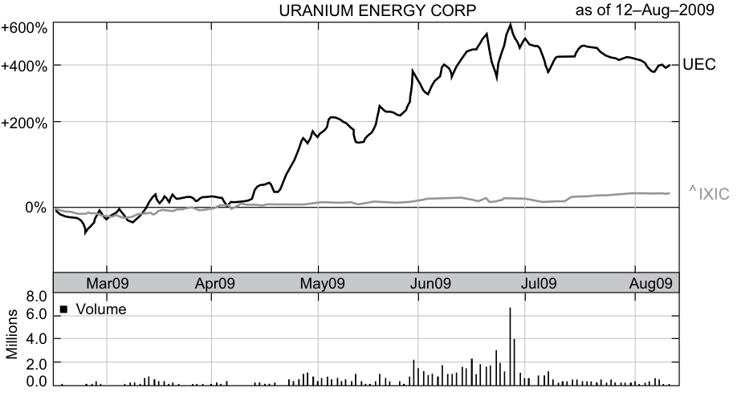

# Tập 5: Đầu tư Cổ phiếu (Equity Investments)
## Learning Module 2 Security Market Indexes (Trang PDF 91–132)

---

# Tập 5: Đầu tư Cổ phiếu (Volume 5: Equity Investments)
## Học phần 2: Chỉ số Thị trường Chứng khoán (Learning Module 2: Security Market Indexes)
### Phần 1/3: Giới thiệu (Introduction) (Trang PDF 91–106)

---

<!-- PDF Page 91 -->

# H Ọ C P H Ầ N **<mark>2</mark> Chỉ số Thị trường Chứng khoán (Security Market Indexes)**

**bởi Paul D. Kaplan, PhD, CFA, và Dorothy C. Kelly, CFA.**

_Paul D. Kaplan, PhD, CFA, làm việc tại Morningstar (Canada). Dorothy C. Kelly, CFA, làm việc tại Trường Thương mại McIntire, Đại học Virginia (Hoa Kỳ)._

|**KẾT QUẢ HỌC TẬP (LEARNING OUTCOMES)**||
|---|---|
|**_Mức độ thành thạo (Mastery)_**|**_Ứng viên cần có khả năng:_**|
||mô tả một chỉ số thị trường chứng khoán (*security market index*)|
||tính toán và diễn giải giá trị, tỷ suất sinh lợi giá (*price return*), và tổng tỷ suất sinh lợi (*total return*) của một chỉ số|
||mô tả các lựa chọn và vấn đề trong việc xây dựng và quản lý chỉ số|
||so sánh các phương pháp tính tỷ trọng (*weighting methods*) khác nhau được sử dụng trong xây dựng chỉ số|
||tính toán và phân tích giá trị cũng như tỷ suất sinh lợi của một chỉ số dựa trên phương pháp tính tỷ trọng của nó|
||mô tả việc tái cân bằng (*rebalancing*) và tái cấu trúc (*reconstitution*) của một chỉ số|
||mô tả các công dụng của chỉ số thị trường chứng khoán|
||mô tả các loại chỉ số cổ phiếu (*equity indexes*)|
||so sánh các loại chỉ số thị trường chứng khoán|
||mô tả các loại chỉ số thu nhập cố định (*fixed-income indexes*)|
||mô tả các chỉ số đại diện cho các khoản đầu tư thay thế (*alternative investments*)|

### **GIỚI THIỆU (INTRODUCTION)**

Các nhà đầu tư liên tục thu thập và phân tích một lượng lớn thông tin về thị trường chứng khoán. Vì công việc này có thể vừa tốn thời gian vừa đòi hỏi nhiều dữ liệu, các nhà đầu tư thường sử dụng một thước đo duy nhất để hợp nhất thông tin này và phản ánh thành quả hoạt động của toàn bộ một thị trường chứng khoán.

<!-- PDF Page 92 -->

Các chỉ số thị trường chứng khoán lần đầu tiên được giới thiệu như một thước đo đơn giản nhằm phản ánh thành quả của thị trường chứng khoán Hoa Kỳ. Kể từ đó, các chỉ số thị trường chứng khoán đã phát triển thành những công cụ đa năng quan trọng giúp các nhà đầu tư theo dõi thành quả của các thị trường chứng khoán khác nhau, ước tính rủi ro, và đánh giá thành quả hoạt động của các nhà quản lý đầu tư. Chúng cũng tạo thành nền tảng cho các sản phẩm đầu tư mới.

**in·dex (chỉ số)**, _danh từ_ (_số nhiều_ **in·dex·es** _hoặc_ **in·di·ces**) tiếng Latinh _indic-, index,_ bắt nguồn từ _indicare_ nghĩa là chỉ ra: một chỉ báo, dấu hiệu, hoặc thước đo của một thứ gì đó.

##### **NGUỒN GỐC CỦA CÁC CHỈ SỐ THỊ TRƯỜNG (ORIGIN OF MARKET INDEXES)**

Các nhà đầu tư đã có quyền tiếp cận dữ liệu được công bố định kỳ về giá của từng chứng khoán riêng lẻ tại London từ năm 1698, nhưng gần 200 năm đã trôi qua trước khi họ có được một chỉ báo đơn giản để phản ánh thông tin thị trường chứng khoán. Để mang lại cho độc giả cảm nhận về cách thị trường chứng khoán Hoa Kỳ nói chung vận hành trong một ngày nhất định, hai nhà xuất bản Charles H. Dow và Edward D. Jones đã giới thiệu Chỉ số Bình quân Dow Jones (*Dow Jones Average*), chỉ số thị trường chứng khoán đầu tiên trên thế giới, vào năm 1884. Chỉ số này, xuất hiện trên tờ _The Customers’ Afternoon Letter_, bao gồm cổ phiếu của chín công ty đường sắt và hai công ty công nghiệp. Về sau, nó trở thành Chỉ số Bình quân Vận tải Dow Jones (*Dow Jones Transportation Average*). Tin chắc rằng các công ty công nghiệp, chứ không phải đường sắt, sẽ là “thị trường đầu cơ vĩ đại” của tương lai, Dow và Jones đã giới thiệu chỉ số thứ hai vào tháng 5 năm 1896—Chỉ số Bình quân Công nghiệp Dow Jones (*Dow Jones Industrial Average* – DJIA). Chỉ số này có giá trị ban đầu là 40,94 và bao gồm 12 cổ phiếu từ các ngành công nghiệp chính của Hoa Kỳ. Ngày nay, các nhà đầu tư có thể lựa chọn trong số hàng ngàn chỉ số để đo lường và giám sát các thị trường chứng khoán cũng như các loại tài sản (*asset classes*) khác nhau.

Bài đọc này được tổ chức như sau. Phần 2 định nghĩa chỉ số thị trường chứng khoán và giải thích cách tính tỷ suất sinh lợi giá và tổng tỷ suất sinh lợi của một chỉ số cho một kỳ đơn lẻ và qua nhiều kỳ. Phần 3 mô tả cách các chỉ số được xây dựng và quản lý. Phần 4 thảo luận về việc sử dụng các chỉ số thị trường. Các phần 5, 6 và 7 thảo luận về các loại chỉ số khác nhau, và phần cuối cùng tóm tắt bài đọc. Các bài tập thực hành nằm ở phần tiếp theo sau phần kết luận và tóm tắt.

## **<mark>2</mark> ĐỊNH NGHĨA CHỈ SỐ VÀ CÁCH TÍNH GIÁ TRỊ CŨNG NHƯ TỶ SUẤT SINH LỢI (INDEX DEFINITION AND CALCULATIONS OF VALUE AND RETURNS)**

mô tả một chỉ số thị trường chứng khoán (*security market index*)

tính toán và diễn giải giá trị, tỷ suất sinh lợi giá (*price return*), và tổng tỷ suất sinh lợi (*total return*) của một chỉ số

Một **chỉ số thị trường chứng khoán (*security market index*)** đại diện cho một thị trường chứng khoán, một phân khúc thị trường, hoặc một loại tài sản nhất định. Hầu hết các chỉ số được xây dựng dưới dạng các danh mục đầu tư gồm các chứng khoán có thể giao dịch trên thị trường (*marketable securities*).

Giá trị của một chỉ số được tính toán định kỳ bằng cách sử dụng giá thị trường thực tế hoặc ước tính của các chứng khoán riêng lẻ, được gọi là **chứng khoán thành phần (*constituent securities*)**, bên trong chỉ số. Đối với mỗi chỉ số thị trường chứng khoán, các nhà đầu tư có thể bắt gặp hai phiên bản

<!-- PDF Page 93 -->

của cùng một chỉ số (tức là một chỉ số có các chứng khoán thành phần và tỷ trọng giống hệt nhau): một phiên bản dựa trên tỷ suất sinh lợi giá (*price return*) và một phiên bản dựa trên tổng tỷ suất sinh lợi (*total return*). Đúng như tên gọi, **chỉ số tỷ suất sinh lợi giá (*price return index*)**, còn được gọi là **chỉ số giá (*price index*)**, _chỉ_ phản ánh giá của các chứng khoán thành phần trong chỉ số. Ngược lại, **chỉ số tổng tỷ suất sinh lợi (*total return index*)** phản ánh không chỉ giá của các chứng khoán thành phần mà còn cả việc tái đầu tư tất cả thu nhập nhận được kể từ khi thành lập chỉ số.

Tại thời điểm thành lập (*inception*), giá trị của phiên bản tỷ suất sinh lợi giá và phiên bản tổng tỷ suất sinh lợi của một chỉ số là bằng nhau. Tuy nhiên, khi thời gian trôi qua, giá trị của chỉ số tổng tỷ suất sinh lợi, vốn bao gồm việc tái đầu tư tất cả cổ tức và/hoặc tiền lãi nhận được, sẽ vượt quá giá trị của chỉ số tỷ suất sinh lợi giá với mức chênh lệch ngày càng tăng. Việc xem xét cách tính giá trị của từng phiên bản qua nhiều kỳ sẽ minh họa lý do tại sao.

Giá trị của một chỉ số tỷ suất sinh lợi giá được tính như sau:

$$V_{PRI} = \frac{\sum_{i=1}^{N} n_i P_i}{D} \tag{1}$$

trong đó

$V_{PRI}$ = giá trị của chỉ số tỷ suất sinh lợi giá (*value of the price return index*)

- $n_i$ = số lượng đơn vị của chứng khoán thành phần $i$ được nắm giữ trong danh mục chỉ số

- $N$ = số lượng chứng khoán thành phần trong chỉ số

- $P_i$ = đơn giá của chứng khoán thành phần $i$

- $D$ = giá trị của ước số (*divisor*)

**Ước số (*divisor*)** là một con số được chọn ban đầu tại thời điểm thành lập. Nó thường được chọn sao cho chỉ số giá có một giá trị ban đầu thuận tiện, chẳng hạn như 1.000. Sau đó, nhà cung cấp chỉ số (*index provider*) sẽ điều chỉnh giá trị của ước số khi cần thiết để tránh những thay đổi trong giá trị chỉ số không liên quan đến những thay đổi trong giá của các chứng khoán thành phần. Ví dụ, khi thay đổi các chứng khoán thành phần của chỉ số, nhà cung cấp chỉ số có thể điều chỉnh ước số sao cho giá trị của chỉ số với các chứng khoán thành phần mới bằng với giá trị của chỉ số trước khi có sự thay đổi.

Việc tính toán tỷ suất sinh lợi của chỉ số, giống như tính toán tỷ suất sinh lợi của danh mục đầu tư, có thể đo lường tỷ suất sinh lợi giá hoặc tổng tỷ suất sinh lợi. **Tỷ suất sinh lợi giá (*Price return*)** chỉ đo lường sự tăng giá (*price appreciation*) hoặc phần trăm thay đổi của giá. **Tổng tỷ suất sinh lợi (*Total return*)** đo lường sự tăng giá cộng với tiền lãi, cổ tức và các khoản phân phối khác.

#### **Tính toán Tỷ suất sinh lợi Đơn kỳ (Calculation of Single-Period Returns)**

Đối với một chỉ số thị trường chứng khoán, tỷ suất sinh lợi giá có thể được tính theo hai cách: phần trăm thay đổi giá trị của chỉ số tỷ suất sinh lợi giá, hoặc trung bình có trọng số của tỷ suất sinh lợi giá của các chứng khoán thành phần. Tỷ suất sinh lợi giá của một chỉ số có thể được biểu diễn như sau:

$$PR_I = \frac{V_{PRI1} - V_{PRI0}}{V_{PRI0}} \tag{2}$$

trong đó

- $PR_I$ = tỷ suất sinh lợi giá của danh mục chỉ số (dưới dạng số thập phân, tức là 12 phần trăm là 0,12)

$V_{PRI1}$ = giá trị của chỉ số tỷ suất sinh lợi giá vào cuối kỳ

$V_{PRI0}$ = giá trị của chỉ số tỷ suất sinh lợi giá vào đầu kỳ

Tương tự, tỷ suất sinh lợi giá của từng chứng khoán thành phần có thể được biểu diễn như sau:

<!-- PDF Page 94 -->

$$PR_i = \frac{P_{i1} - P_{i0}}{P_{i0}} \tag{3}$$

##### trong đó

$$PR_i = \text{tỷ suất sinh lợi giá của chứng khoán thành phần } i \text{ (dưới dạng số thập phân)}$$

$$P_{i1} = \text{giá của chứng khoán thành phần } i \text{ vào cuối kỳ}$$

$$P_{i0} = \text{giá của chứng khoán thành phần } i \text{ vào đầu kỳ}$$

Bởi vì tỷ suất sinh lợi giá của chỉ số bằng trung bình có trọng số của tỷ suất sinh lợi giá của các chứng khoán riêng lẻ, chúng ta có thể viết:

$$PR_I = \sum_{i=1}^{N} w_i PR_i = \sum_{i=1}^{N} w_i \left(\frac{P_{i1} - P_{i0}}{P_{i0}}\right) \tag{4}$$

##### trong đó:

$$PR_I = \text{tỷ suất sinh lợi giá của danh mục chỉ số (dưới dạng số thập phân)}$$

$$PR_i = \text{tỷ suất sinh lợi giá của chứng khoán thành phần } i \text{ (dưới dạng số thập phân)}$$

- $N$ = số lượng chứng khoán riêng lẻ trong chỉ số

- $w_i$ = tỷ trọng của chứng khoán $i$ (tỷ phần của danh mục chỉ số được phân bổ cho chứng khoán $i$)

- $P_{i1}$ = giá của chứng khoán thành phần $i$ vào cuối kỳ

- $P_{i0}$ = giá của chứng khoán thành phần $i$ vào đầu kỳ

Phương trình 4 có thể được viết lại một cách đơn giản như sau:

$$PR_I = w_1 PR_1 + w_2 PR_2 + \dots + w_N PR_N \tag{5}$$

trong đó

- $PR_I$ = tỷ suất sinh lợi giá của danh mục chỉ số (dưới dạng số thập phân)

- $PR_i$ = tỷ suất sinh lợi giá của chứng khoán thành phần $i$ (dưới dạng số thập phân)

- $w_i$ = tỷ trọng của chứng khoán $i$ (tỷ phần của danh mục chỉ số được phân bổ cho chứng khoán $i$)

- $N$ = số lượng chứng khoán trong chỉ số

Tổng tỷ suất sinh lợi đo lường sự tăng giá cộng với tiền lãi, cổ tức và các khoản phân phối khác. Do đó, **tổng tỷ suất sinh lợi (*total return*)** của một chỉ số là mức tăng giá, hay sự thay đổi trong giá trị của chỉ số tỷ suất sinh lợi giá, cộng với thu nhập (cổ tức và/hoặc tiền lãi) trong kỳ, được biểu thị bằng tỷ lệ phần trăm so với giá trị đầu kỳ của chỉ số tỷ suất sinh lợi giá. Tổng tỷ suất sinh lợi của một chỉ số có thể được biểu diễn như sau:

$$TR_I = \frac{V_{PRI1} - V_{PRI0} + Inc_I}{V_{PRI0}} \tag{6}$$

##### trong đó

$$TR_I = \text{tổng tỷ suất sinh lợi của danh mục chỉ số (dưới dạng số thập phân)}$$

- $V_{PRI1}$ = giá trị của chỉ số tỷ suất sinh lợi giá vào cuối kỳ

- $V_{PRI0}$ = giá trị của chỉ số tỷ suất sinh lợi giá vào đầu kỳ

- $Inc_I$ = tổng thu nhập (cổ tức và/hoặc tiền lãi) từ tất cả các chứng khoán trong chỉ số được nắm giữ trong kỳ

<!-- PDF Page 95 -->

Tổng tỷ suất sinh lợi của một chỉ số cũng có thể được tính bằng trung bình có trọng số của tổng tỷ suất sinh lợi của các chứng khoán thành phần. Tổng tỷ suất sinh lợi của mỗi chứng khoán thành phần trong chỉ số được tính như sau:

$$TR_i = \frac{P_{1i} - P_{0i} + Inc_i}{P_{0i}} \tag{7}$$

trong đó

$TR_i$ = tổng tỷ suất sinh lợi của chứng khoán thành phần $i$ (dưới dạng số thập phân)

$$P_{1i} = \text{giá của chứng khoán thành phần } i \text{ vào cuối kỳ}$$

$P_{0i}$ = giá của chứng khoán thành phần $i$ vào đầu kỳ

$Inc_i$ = tổng thu nhập (cổ tức và/hoặc tiền lãi) từ chứng khoán $i$ trong kỳ

Bởi vì tổng tỷ suất sinh lợi của một chỉ số có thể được tính bằng trung bình có trọng số của tổng tỷ suất sinh lợi của các chứng khoán thành phần, chúng ta có thể biểu diễn tổng tỷ suất sinh lợi như sau:

$$TR_I = \sum_{i=1}^{N} w_i TR_i = \sum_{i=1}^{N} w_i \left(\frac{P_{1i} - P_{0i} + Inc_i}{P_{0i}}\right) \tag{8}$$

Phương trình 8 có thể được viết lại một cách đơn giản như sau:

$$TR_I = w_1 TR_1 + w_2 TR_2 + \dots + w_N TR_N \tag{9}$$

trong đó

$TR_I$ = tổng tỷ suất sinh lợi của danh mục chỉ số (dưới dạng số thập phân)

- $TR_i$ = tổng tỷ suất sinh lợi của chứng khoán thành phần $i$ (dưới dạng số thập phân)

- $w_i$ = tỷ trọng của chứng khoán $i$ (tỷ phần của danh mục chỉ số được phân bổ cho chứng khoán $i$)

- $N$ = số lượng chứng khoán trong chỉ số

#### **Tính toán Giá trị Chỉ số qua Nhiều Kỳ (Calculation of Index Values over Multiple Time Periods)**

Việc tính toán giá trị chỉ số qua nhiều kỳ đòi hỏi phải liên kết hình học (*geometrically linking*) chuỗi tỷ suất sinh lợi của chỉ số. Với một chuỗi tỷ suất sinh lợi giá của một chỉ số, chúng ta có thể tính giá trị của chỉ số tỷ suất sinh lợi giá bằng phương trình sau:

$$V_{PRIT} = V_{PRI0}(1 + PR_{I1})(1 + PR_{I2})\dots(1 + PR_{IT}) \tag{10}$$

trong đó

- $V_{PRI0}$ = giá trị của chỉ số tỷ suất sinh lợi giá tại thời điểm thành lập

- $V_{PRIT}$ = giá trị của chỉ số tỷ suất sinh lợi giá tại thời điểm $T$

- $PR_{It}$ = tỷ suất sinh lợi giá (dưới dạng số thập phân) của chỉ số trong kỳ $t$, $t = 1, 2, \dots, T$

Đối với một chỉ số có giá trị khi thành lập được đặt bằng 1.000 và tỷ suất sinh lợi giá lần lượt là 5 phần trăm và 3 phần trăm cho Kỳ 1 và Kỳ 2, giá trị của chỉ số tỷ suất sinh lợi giá sẽ được tính như sau:

|**Kỳ (Period)**|**Tỷ suất sinh lợi (Return) (%)**|**Phép tính (Calculation)**|**Giá trị cuối kỳ (Ending Value)**|
|---|---|---|---|
|0||1.000(1,00)|1.000,00|
|1|5,00|1.000(1,05)|1.050,00|
|2|3,00|1.000(1,05)(1,03)|1.081,50|

<!-- PDF Page 96 -->

Tương tự, chuỗi tổng tỷ suất sinh lợi của một chỉ số được sử dụng để tính giá trị của chỉ số tổng tỷ suất sinh lợi bằng phương trình sau:

$$V_{TRIT} = V_{TRI0}(1 + TR_{I1})(1 + TR_{I2})\dots(1 + TR_{IT}) \tag{11}$$

trong đó

- $V_{TRI0}$ = giá trị của chỉ số tại thời điểm thành lập

- $V_{TRIT}$ = giá trị của chỉ số tổng tỷ suất sinh lợi tại thời điểm $T$

- $TR_{It}$ = tổng tỷ suất sinh lợi (dưới dạng số thập phân) của chỉ số trong kỳ $t$, $t = 1, 2, \dots, T$

Giả sử rằng cùng chỉ số đó mang lại thêm 1,5 phần trăm tỷ suất sinh lợi từ thu nhập trong Kỳ 1 và thêm 2,0 phần trăm tỷ suất sinh lợi từ thu nhập trong Kỳ 2, nâng tổng tỷ suất sinh lợi cho Kỳ 1 và Kỳ 2 lần lượt lên 6,5 phần trăm và 5 phần trăm. Giá trị của chỉ số tổng tỷ suất sinh lợi sẽ được tính như sau:

|**Kỳ (Period)**|**Tỷ suất sinh lợi (Return) (%)**|**Phép tính (Calculation)**|**Giá trị cuối kỳ (Ending Value)**|
|---|---|---|---|
|0||1.000(1,00)|1.000,00|
|1|6,50|1.000(1,065)|1.065,00|
|2|5,00|1.000(1,065)(1,05)|1.118,25|

Như được minh họa ở trên, khi thời gian trôi qua, giá trị của chỉ số tổng tỷ suất sinh lợi, vốn bao gồm việc tái đầu tư tất cả cổ tức và/hoặc tiền lãi nhận được, vượt quá giá trị của chỉ số tỷ suất sinh lợi giá với mức chênh lệch ngày càng tăng.

## **<mark>3</mark>**

### **XÂY DỰNG CHỈ SỐ (INDEX CONSTRUCTION)**

mô tả các lựa chọn và vấn đề trong việc xây dựng và quản lý chỉ số

so sánh các phương pháp tính tỷ trọng (*weighting methods*) khác nhau được sử dụng trong xây dựng chỉ số

tính toán và phân tích giá trị cũng như tỷ suất sinh lợi của một chỉ số dựa trên phương pháp tính tỷ trọng của nó

Việc xây dựng và quản lý một chỉ số thị trường chứng khoán tương tự như việc xây dựng và quản lý một danh mục đầu tư chứng khoán. Các nhà cung cấp chỉ số phải quyết định những vấn đề sau:

**1.** Chỉ số nên đại diện cho thị trường mục tiêu (*target market*) nào?

**2.** Những chứng khoán nào nên được lựa chọn từ thị trường mục tiêu đó?

**3.** Nên phân bổ bao nhiêu tỷ trọng cho mỗi chứng khoán trong chỉ số?

**4.** Khi nào chỉ số nên được tái cân bằng (*rebalanced*)?

**5.** Khi nào quyết định lựa chọn chứng khoán và phân bổ tỷ trọng nên được xem xét lại?

#### **Thị trường Mục tiêu và Lựa chọn Chứng khoán (Target Market and Security Selection)**

Quyết định đầu tiên trong việc xây dựng chỉ số là xác định thị trường mục tiêu, phân khúc thị trường, hoặc loại tài sản mà chỉ số đó dự định đại diện. Thị trường mục tiêu có thể được định nghĩa rất rộng hoặc rất hẹp. Nó có thể dựa trên loại tài sản (ví dụ: cổ phiếu, thu nhập cố định, bất động sản, hàng hóa, quỹ phòng hộ); khu vực địa lý (ví dụ: Nhật Bản,

<!-- PDF Page 97 -->

Nam Phi, Mỹ Latinh, Châu Âu); sàn giao dịch nơi các chứng khoán được giao dịch (ví dụ: Thượng Hải, Toronto, Tokyo), và/hoặc các đặc điểm khác (ví dụ: ngành kinh tế, quy mô công ty, phong cách đầu tư, thời lượng [*duration*], hoặc chất lượng tín dụng).

Thị trường mục tiêu quyết định vũ trụ đầu tư (*investment universe*) và các chứng khoán hiện có để đưa vào chỉ số. Một khi vũ trụ đầu tư được xác định, số lượng chứng khoán và các chứng khoán cụ thể được đưa vào chỉ số phải được xác định. Các chứng khoán thành phần có thể là gần như tất cả các chứng khoán trong thị trường mục tiêu hoặc một mẫu đại diện của thị trường mục tiêu. Một số chỉ số cổ phiếu, chẳng hạn như Chỉ số S&P 500 và FTSE 100, cố định số lượng chứng khoán được đưa vào chỉ số và thể hiện con số này ngay trong tên của chỉ số. Các chỉ số khác cho phép số lượng chứng khoán thay đổi để phản ánh những thay đổi trên thị trường mục tiêu hoặc để duy trì một tỷ lệ phần trăm nhất định của thị trường mục tiêu. Ví dụ, Chỉ số Giá Cổ phiếu Tokyo (*Tokyo Stock Price Index* – TOPIX) đại diện và bao gồm tất cả các cổ phiếu lớn nhất, được gọi là Khu vực Một (*First Section*), được niêm yết trên Sàn Giao dịch Chứng khoán Tokyo. Để được đưa vào Khu vực Một—và do đó là vào TOPIX—các cổ phiếu phải đáp ứng các tiêu chí nhất định, chẳng hạn như số lượng cổ phiếu đang lưu hành, số lượng cổ đông, và vốn hóa thị trường. Các cổ phiếu không còn đáp ứng các tiêu chí này sẽ bị loại khỏi Khu vực Một và đồng thời bị loại khỏi TOPIX. Các quy tắc khách quan hoặc cơ học xác định các chứng khoán thành phần của hầu hết, nhưng không phải tất cả, các chỉ số. Ví dụ, Chỉ số Nhạy cảm của Sàn Giao dịch Chứng khoán Bombay S&P, còn được gọi là S&P BSE SENSEX, và S&P 500 sử dụng một ủy ban tuyển chọn và các quy tắc ra quyết định mang tính chủ quan hơn để xác định các chứng khoán thành phần.

#### **Tính Tỷ trọng Chỉ số (Index Weighting)**

Quyết định phân bổ tỷ trọng xác định số lượng của mỗi chứng khoán được đưa vào chỉ số và có tác động đáng kể đến giá trị của chỉ số. Các nhà cung cấp chỉ số sử dụng một số phương pháp để tính tỷ trọng cho các chứng khoán thành phần trong một chỉ số. Các chỉ số có thể được tính tỷ trọng theo giá (*price weighted*), tính tỷ trọng đều (*equal weighted*), tính tỷ trọng theo vốn hóa thị trường (*market-capitalization weighted*), hoặc tính tỷ trọng theo yếu tố cơ bản (*fundamentally weighted*). Mỗi phương pháp tính tỷ trọng đều có những ưu điểm và nhược điểm riêng.

##### **_Tính Tỷ trọng theo Giá (Price Weighting)_**

Phương pháp đơn giản nhất để tính tỷ trọng cho một chỉ số và là phương pháp được Charles Dow sử dụng để xây dựng Chỉ số Bình quân Công nghiệp Dow Jones là **tính tỷ trọng theo giá (*price weighting*)**. Trong phương pháp tính tỷ trọng theo giá, tỷ trọng của mỗi chứng khoán thành phần được xác định bằng cách chia giá của nó cho tổng giá của tất cả các chứng khoán thành phần. Tỷ trọng được tính bằng công thức sau:

$$w_i^P = \frac{P_i}{\sum_{i=1}^{N} P_i} \tag{12}$$

Bảng minh họa 1 (*Exhibit 1*) minh họa các giá trị, tỷ trọng, và tỷ suất sinh lợi đơn kỳ ngay sau khi thành lập của một chỉ số cổ phiếu tính tỷ trọng theo giá gồm năm chứng khoán thành phần. Giá trị của chỉ số tính tỷ trọng theo giá được xác định bằng cách chia tổng giá trị các chứng khoán (101,50) cho ước số (*divisor*), vốn thường được đặt tại thời điểm thành lập bằng với số lượng chứng khoán ban đầu trong chỉ số. Do đó, trong ví dụ của chúng ta, ước số là 5 và giá trị ban đầu của chỉ số được tính bằng $101,50 \div 5 = 20,30$.

Như được minh họa trong bảng này, Chứng khoán A, có mức giá cao nhất, cũng có tỷ trọng cao nhất và do đó sẽ có tác động lớn nhất đến tỷ suất sinh lợi của chỉ số. Lưu ý cách cả tỷ suất sinh lợi giá và tổng tỷ suất sinh lợi của chỉ số đều được tính dựa trên tỷ suất sinh lợi tương ứng của các chứng khoán thành phần.

<!-- PDF Page 98 -->

**Bảng minh họa 1: Chỉ số cổ phiếu tính tỷ trọng theo giá (Exhibit 1: A Price-Weighted Equity Index)**

|**Tỷ trọng cuối kỳ (EOP Weight) (%)**|52,38|20,95|7,62|13,33|5,72|**100,00**|||||
|---|---|---|---|---|---|---|---|---|---|---|
|**Tỷ trọng đầu kỳ (BOP Weight) × Tổng tỷ suất sinh lợi (Total Return) (%)**|5,66|−2,86|−4,43|3,99|1,97|**4,33**|||||
|**Tỷ trọng đầu kỳ (BOP Weight) × Tỷ suất sinh lợi giá (Price Return) (%)**|4,93|−2,96|−4,43|3,94|1,97|**3,45**|||||
|**Tổng tỷ suất sinh lợi (Total Return) (%)**|11,50|−11,60|−36,00|40,50|50,00||**4,33**||||
|**Tỷ suất sinh lợi giá (Price Return) (%)**|10,00|−12,00|−36,00|40,00|50,00||**3,45**||||
|**Tổng cổ tức (Total Dividends)**|0,75|0,10|0,00|0,05|0,00|**0,90**|**0,18**||||
|**Giá trị (Số cổ phiếu × Giá EOP)**|55,00|22,00|8,00|14,00|6,00|**105,00**|**21,00**||||
|**Cổ tức mỗi cổ phiếu (Dividends Per Share)**|0,75|0,10|0,00|0,05|0,00||||||
|**Giá cuối kỳ (EOP Price)**|55,00|22,00|8,00|14,00|6,00||||||
|**Tỷ trọng đầu kỳ (BOP Weight) (%)**|49,26|24,63|12,32|9,85|3,94|**100,00**|||||
|**Giá trị (Số cổ phiếu × Giá BOP)**|50,00|25,00|12,50|10,00|4,00|**101,50**|**20,30**||**Giá trị cuối kỳ (EOP Value)**|21,00 21,18|
|**Giá đầu kỳ (BOP Price)**|50,00|25,00|12,50|10,00|4,00||||**Tỷ suất sinh lợi (Return) (%)**|3,45 4,33|
|**Số cổ phiếu trong chỉ số (Shares in Index)**|1|1|1|1|1|||Ước số (Divisor) = 5 BOP = Đầu kỳ (Beginning of period) EOP = Cuối kỳ (End of period)|**Giá trị đầu kỳ (BOP Value)**|20,30 20,30|
|**Chứng khoán (Security)**|A|B|C|D|E|**Tổng (Total)**|**Giá trị chỉ số (Index Value)**|Ước số / Chú thích|**Loại chỉ số (Type of Index)**|**Tỷ suất sinh lợi giá (Price Return)** **Tổng tỷ suất sinh lợi (Total Return)**|

<!-- PDF Page 99 -->

Một đặc tính duy nhất chỉ có ở các chỉ số tính tỷ trọng theo giá là việc chia tách cổ phiếu (*stock split*) đối với một chứng khoán thành phần sẽ làm thay đổi tỷ trọng của tất cả các chứng khoán trong chỉ số.1 Để ngăn việc chia tách cổ phiếu và các tỷ trọng mới phát sinh làm thay đổi giá trị của chỉ số, nhà cung cấp chỉ số phải điều chỉnh giá trị của ước số như được minh họa trong Bảng minh họa 2. Với việc chia tách cổ phiếu tỷ lệ 2 đổi 1 (*2-for-1 split*) ở Chứng khoán A, ước số được điều chỉnh bằng cách lấy tổng giá của các chứng khoán thành phần _sau_ khi chia tách (77,50) chia cho giá trị của chỉ số _trước_ khi chia tách (21,00). Sự điều chỉnh này dẫn đến việc thay đổi ước số từ 5 xuống 3,69 sao cho giá trị chỉ số được duy trì ở mức 21,00.

Ưu điểm chính của phương pháp tính tỷ trọng theo giá là tính đơn giản của nó. Nhược điểm chính của phương pháp tính tỷ trọng theo giá là nó dẫn đến các tỷ trọng tùy ý (*arbitrary weights*) cho mỗi chứng khoán. Đặc biệt, việc chia tách cổ phiếu ở bất kỳ một chứng khoán nào cũng gây ra những thay đổi tùy ý trong tỷ trọng của tất cả các chứng khoán thành phần.

**Bảng minh họa 2: Tác động của việc Chia tách Cổ phiếu tỷ lệ 2 đổi 1 đối với Chứng khoán A (Exhibit 2: Impact of 2-for-1 Split in Security A)**

|**Chứng khoán (Security)**|**Giá trước khi chia tách (Price before Split)**|**Tỷ trọng trước khi chia tách (Weight before Split) (%)**|**Giá sau khi chia tách (Price after Split)**|**Tỷ trọng sau khi chia tách (Weight after Split) (%)**|
|---|---|---|---|---|
|A|55,00|52,38|27,50|35,48|
|B|22,00|20,95|22,00|28,39|
|C|8,00|7,62|8,00|10,32|
|D|14,00|13,33|14,00|18,07|
|E|6,00|5,72|6,00|7,74|
|Tổng (Total)|105,00|100,00|77,50|100,00|
|Ước số (Divisor)|5,00||3,69||
|Giá trị Chỉ số (Index Value)|21,00||21,00||

##### **_Tính Tỷ trọng Đều (Equal Weighting)_**

Một phương pháp tính tỷ trọng chỉ số đơn giản khác là **tính tỷ trọng đều (*equal weighting*)**. Phương pháp này gán một tỷ trọng bằng nhau cho mỗi chứng khoán thành phần tại thời điểm thành lập. Các tỷ trọng được tính như sau:

$$w_i^E = \frac{1}{N} \tag{13}$$

trong đó

$w_i$ = tỷ phần của danh mục được phân bổ cho chứng khoán $i$ hay tỷ trọng của chứng khoán $i$

$N$ = số lượng chứng khoán trong chỉ số

Để xây dựng một chỉ số tính tỷ trọng đều từ năm chứng khoán trong Bảng minh họa 1, nhà cung cấp chỉ số phân bổ một phần năm (20 phần trăm) giá trị của chỉ số (vào đầu kỳ) cho mỗi chứng khoán. Chia giá trị được phân bổ cho mỗi chứng khoán cho giá cổ phiếu riêng lẻ của từng chứng khoán sẽ xác định được số lượng cổ phiếu của mỗi chứng khoán cần đưa vào chỉ số. Không giống như chỉ số tính tỷ trọng theo giá, nơi các tỷ trọng được xác định một cách tùy ý bởi giá thị trường, các tỷ trọng trong chỉ số tính tỷ trọng đều được gán một cách tùy ý bởi nhà cung cấp chỉ số.

> 1 Chia tách cổ phiếu (*stock split*) là sự gia tăng số lượng cổ phiếu đang lưu hành và sự sụt giảm tương ứng trong giá mỗi cổ phiếu sao cho tổng giá trị thị trường của vốn chủ sở hữu, cũng như tỷ lệ sở hữu tương ứng của các nhà đầu tư trong công ty, không thay đổi.

<!-- PDF Page 100 -->

Bảng minh họa 3 minh họa các giá trị, tỷ trọng, và tỷ suất sinh lợi đơn kỳ ngay sau khi thành lập của một chỉ số tính tỷ trọng đều với cùng các chứng khoán thành phần như trong Bảng minh họa 1. Ví dụ này giả định giá trị danh mục chỉ số đầu kỳ là 10.000 (tức là khoản đầu tư 2.000 vào mỗi chứng khoán). Để đặt giá trị ban đầu của chỉ số bằng 1.000, ước số được đặt bằng 10 ($10.000 \div 10 = 1.000$).

Bảng minh họa 1 và Bảng minh họa 3 chứng minh cách các phương pháp tính tỷ trọng khác nhau dẫn đến các tỷ suất sinh lợi khác nhau. Tỷ suất sinh lợi giá 10,4 phần trăm của chỉ số tính tỷ trọng đều được hiển thị trong Bảng minh họa 3 khác biệt đáng kể so với tỷ suất sinh lợi giá 3,45 phần trăm của chỉ số tính tỷ trọng theo giá trong Bảng minh họa 1.

Giống như tính tỷ trọng theo giá, ưu điểm chính của tính tỷ trọng đều là tính đơn giản của nó. Tuy nhiên, tính tỷ trọng đều có một số nhược điểm. Thứ nhất, các chứng khoán chiếm tỷ phần lớn nhất trong giá trị thị trường mục tiêu bị đại diện dưới mức (*underrepresented*), và các chứng khoán chiếm tỷ phần nhỏ trong giá trị thị trường mục tiêu lại bị đại diện vượt mức (*overrepresented*). Thứ hai, sau khi chỉ số được xây dựng và giá của các chứng khoán thành phần thay đổi, chỉ số đó không còn có tỷ trọng bằng nhau nữa. Do đó, việc duy trì tỷ trọng bằng nhau đòi hỏi phải điều chỉnh (tái cân bằng – *rebalancing*) chỉ số thường xuyên.

##### **_Tính Tỷ trọng theo Vốn hóa Thị trường (Market-Capitalization Weighting)_**

Trong phương pháp **tính tỷ trọng theo vốn hóa thị trường (*market-capitalization weighting*)**, hay tính tỷ trọng theo giá trị (*value weighting*), tỷ trọng của mỗi chứng khoán thành phần được xác định bằng cách chia vốn hóa thị trường của nó cho tổng vốn hóa thị trường (tổng cộng vốn hóa thị trường) của tất cả các chứng khoán trong chỉ số. Vốn hóa thị trường hay giá trị thị trường được tính bằng cách nhân số lượng cổ phiếu đang lưu hành với giá thị trường của mỗi cổ phiếu.

Tỷ trọng vốn hóa thị trường của chứng khoán $i$ là:

$$w_i^M = \frac{Q_i P_i}{\sum_{j=1}^{N} Q_j P_j} \tag{14}$$

trong đó

- $w_i$ = tỷ phần của danh mục được phân bổ cho chứng khoán $i$ hay tỷ trọng của chứng khoán $i$

- $Q_i$ = số lượng cổ phiếu đang lưu hành của chứng khoán $i$

- $P_i$ = giá cổ phiếu của chứng khoán $i$

- $N$ = số lượng chứng khoán trong chỉ số

Bảng minh họa 4 minh họa các giá trị, tỷ trọng, và tỷ suất sinh lợi đơn kỳ ngay sau khi thành lập của một chỉ số tính tỷ trọng theo vốn hóa thị trường cho cùng thị trường gồm năm chứng khoán đó. Chứng khoán A, với 3.000 cổ phiếu đang lưu hành và mức giá 50 mỗi cổ phiếu, có vốn hóa thị trường là 150.000 hay 26,29 phần trăm ($150.000 / 570.500$) của toàn bộ danh mục chỉ số. Các tỷ trọng chỉ số thu được trong bảng minh họa phản ánh giá trị tương đối của mỗi chứng khoán được đo lường bằng vốn hóa thị trường của nó.

Như được thể hiện trong Bảng minh họa 1, Bảng minh họa 3 và Bảng minh họa 4, phương pháp tính tỷ trọng ảnh hưởng đến tỷ suất sinh lợi của chỉ số. Tỷ suất sinh lợi giá và tổng tỷ suất sinh lợi của chỉ số vốn hóa thị trường trong Bảng minh họa 4 (lần lượt là 1,49 phần trăm và 2,13 phần trăm) khác biệt đáng kể so với chỉ số tính tỷ trọng theo giá (lần lượt là 3,45 phần trăm và 4,33 phần trăm) và chỉ số tính tỷ trọng đều (lần lượt là 10,40 phần trăm và 10,88 phần trăm). Để hiểu nguyên nhân và mức độ của sự khác biệt này, hãy so sánh tỷ trọng và tỷ suất sinh lợi của từng chứng khoán dưới mỗi phương pháp tính tỷ trọng. Ví dụ, tỷ trọng của Chứng khoán A dao động từ 49,26 phần trăm trong chỉ số tính tỷ trọng theo giá đến 20 phần trăm trong chỉ số tính tỷ trọng đều. Với tỷ suất sinh lợi giá là 10 phần trăm, Chứng khoán A đóng góp 4,93 phần trăm vào tỷ suất sinh lợi giá của chỉ số tính tỷ trọng theo giá, 2,00 phần trăm vào tỷ suất sinh lợi giá của chỉ số tính tỷ trọng đều, và 2,63 phần trăm vào tỷ suất sinh lợi giá của chỉ số tính tỷ trọng theo vốn hóa thị trường. Với

<!-- PDF Page 101 -->

**Bảng minh họa 3: Chỉ số cổ phiếu tính tỷ trọng đều (Exhibit 3: An Equal-Weighted Equity Index)**

|**Tỷ trọng cuối kỳ (EOP Weight) (%)**|19,93|15,94|11,60|25,36|27,17|**100,00**|||||
|---|---|---|---|---|---|---|---|---|---|---|
|**Tỷ trọng × Tổng tỷ suất sinh lợi (Weight × Total Return) (%)**|2,30|−2,32|−7,20|8,10|10,00|**10,88**|||||
|**Tỷ trọng × Tỷ suất sinh lợi giá (Weight × Price Return) (%)**|2,00|−2,40|−7,20|8,00|10,00|**10,40**|||||
|**Tổng tỷ suất sinh lợi (Total Return) (%)**|11,50|−11,60|−36,00|40,50|50,00||**10,88**||||
|**Tỷ suất sinh lợi giá (Price Return) (%)**|10,00|−12,00|−36,00|40,00|50,00||**10,40**||||
|**Tổng cổ tức (Total Dividends)**|30|8|0|10|0|**48**|**4,80**||||
|**Giá trị (Số cổ phiếu × Giá EOP)**|2.200|1.760|1.280|2.800|3.000|**11.040**|**1.104**||||
|**Cổ tức mỗi cổ phiếu (Dividends Per Share)**|0,75|0,10|0,00|0,05|0,00||||||
|**Giá cuối kỳ (EOP Price)**|55,00|22,00|8,00|14,00|6,00||||||
|**Tỷ trọng (Weight) (%)**|20,00|20,00|20,00|20,00|20,00|**100,00**|||||
|**Giá trị (Số cổ phiếu × Giá BOP)**|2.000|2.000|2.000|2.000|2.000|**10.000**|**1.000**||**Giá trị cuối kỳ (EOP Value)**|1.104,00 1.108,80|
|**Giá đầu kỳ (BOP Price)**|50,00|25,00|12,50|10,00|4,00||||**Tỷ suất sinh lợi (Return) (%)**|10,40 10,88|
|**Số cổ phiếu trong chỉ số (Shares in Index)**|40|80|160|200|500|||Ước số (Divisor) = 10 BOP = Đầu kỳ (Beginning of period) EOP = Cuối kỳ (End of period)|**Giá trị đầu kỳ (BOP Value)**|1.000,00 1.000,00|
|**Chứng khoán (Security)**|A|B|C|D|E|**Tổng (Total)**|**Giá trị chỉ số (Index Value)**|Ước số / Chú thích|**Loại chỉ số (Type of Index)**|**Tỷ suất sinh lợi giá (Price Return)** **Tổng tỷ suất sinh lợi (Total Return)**|

<!-- PDF Page 102 -->

**Bảng minh họa 4: Chỉ số cổ phiếu tính tỷ trọng theo vốn hóa thị trường (Exhibit 4: A Market-Capitalization-Weighted Equity Index)**

|**Tỷ trọng cuối kỳ (EOP Weight) (%)**|28,50|38,00|6,91|19,34|7,25|**100,00**|||||
|---|---|---|---|---|---|---|---|---|---|---|
|**Tỷ trọng đầu kỳ (BOP Weight) × Tổng tỷ suất sinh lợi (Total Return) (%)**|3,02|−5,08|−3,95|5,68|2,46|**2,13**|||||
|**Tỷ trọng đầu kỳ (BOP Weight) × Tỷ suất sinh lợi giá (Price Return) (%)**|2,63|−5,26|−3,95|5,61|2,46|**1,49**|||||
|**Tổng tỷ suất sinh lợi (Total Return) (%)**|11,50|−11,60|−36,00|40,50|50,00||**2,13**||||
|**Tỷ suất sinh lợi giá (Price Return) (%)**|10,00|−12,00|−36,00|40,00|50,00||**1,49**||||
|**Tổng cổ tức (Total Dividends)**|2.250|1.000|0|400|0|**3.650**|**6,40**||||
|**Vốn hóa thị trường cuối kỳ (EOP Market Cap)**|165.000|220.000|40.000|112.000|42.000|**579.000**|**1.014,90**||||
|**Cổ tức mỗi cổ phiếu (Dividends Per Share)**|0,75|0,10|0,00|0,05|0,00||||||
|**Giá cuối kỳ (EOP Price)**|55,00|22,00|8,00|14,00|6,00||||||
|**Tỷ trọng đầu kỳ (BOP Weight) (%)**|26,29|43,82|10,96|14,02|4,91|**100,00**|||||
|**Vốn hóa thị trường đầu kỳ (BOP Market Cap)**|150.000|250.000|62.500|80.000|28.000|**570.500**|**1.000**||**Giá trị cuối kỳ (EOP Value)**|1.014,90 1.021,30|
|**Giá đầu kỳ (BOP Price)**|50,00|25,00|12,50|10,00|4,00||||**Tỷ suất sinh lợi (Return) (%)**|1,49 2,13|
|**Số cổ phiếu đang lưu hành (Shares Outstanding)**|3.000|10.000|5.000|8.000|7.000|||Ước số (Divisor) = 570,50 BOP = Đầu kỳ (Beginning of period) EOP = Cuối kỳ (End of period)|**Giá trị đầu kỳ (BOP Value)**|1.000,00 1.000,00|
|**Cổ phiếu (Stock)**|A|B|C|D|E|**Tổng (Total)**|**Giá trị chỉ số (Index Value)**|Ước số / Chú thích|**Loại chỉ số (Type of Index)**|**Tỷ suất sinh lợi giá (Price Return)** **Tổng tỷ suất sinh lợi (Total Return)**|

<!-- PDF Page 103 -->

tổng tỷ suất sinh lợi là 11,50 phần trăm, Chứng khoán A đóng góp 5,66 phần trăm vào tổng tỷ suất sinh lợi của chỉ số tính tỷ trọng theo giá, 2,30 phần trăm vào tổng tỷ suất sinh lợi của chỉ số tính tỷ trọng đều, và 3,02 phần trăm vào tổng tỷ suất sinh lợi của chỉ số tính tỷ trọng theo vốn hóa thị trường.

##### **Tính Tỷ trọng theo Vốn hóa Thị trường Điều chỉnh theo Tỷ lệ Tự do Chuyển nhượng (Float-Adjusted Market-Capitalization Weighting)**

Trong phương pháp **tính tỷ trọng theo vốn hóa thị trường điều chỉnh theo tỷ lệ tự do chuyển nhượng (*float-adjusted market-capitalization weighting*)**, tỷ trọng của mỗi chứng khoán thành phần được xác định bằng cách điều chỉnh vốn hóa thị trường của nó theo **lượng cổ phiếu tự do chuyển nhượng trên thị trường (*market float*)** của nó. Thông thường, lượng cổ phiếu tự do chuyển nhượng trên thị trường (*market float*) là số lượng cổ phiếu của chứng khoán thành phần hiện có sẵn cho công chúng đầu tư. Đối với các công ty có cơ cấu sở hữu cô đặc (*closely held*), chỉ một phần số cổ phiếu đang lưu hành là có sẵn cho công chúng đầu tư (phần còn lại do một nhóm nhỏ các nhà đầu tư kiểm soát nắm giữ). Ngoài việc loại trừ các cổ phiếu do cổ đông kiểm soát nắm giữ, hầu hết các chỉ số tính tỷ trọng theo vốn hóa thị trường điều chỉnh theo tỷ lệ tự do chuyển nhượng còn loại trừ các cổ phiếu do các tập đoàn khác và chính phủ nắm giữ. Một số nhà cung cấp các chỉ số được thiết kế để đại diện cho cơ hội đầu tư của các nhà đầu tư toàn cầu còn giảm thêm số lượng cổ phiếu được đưa vào chỉ số bằng cách loại trừ các cổ phiếu không có sẵn cho các nhà đầu tư nước ngoài. Các nhà cung cấp chỉ số có thể gọi các chỉ số này là “chỉ số tính tỷ trọng theo vốn hóa thị trường điều chỉnh theo tỷ lệ tự do chuyển nhượng hoàn toàn (*free-float-adjusted market-capitalization-weighted indexes*)”.

Các chỉ số tính tỷ trọng theo vốn hóa thị trường điều chỉnh theo tỷ lệ tự do chuyển nhượng phản ánh số cổ phiếu có sẵn để giao dịch công khai bằng cách nhân giá thị trường mỗi cổ phiếu với số lượng cổ phiếu có sẵn cho công chúng đầu tư (tức là vốn hóa thị trường điều chỉnh theo tỷ lệ tự do chuyển nhượng) thay vì tổng số cổ phiếu đang lưu hành (tổng vốn hóa thị trường). Hiện nay, hầu hết các chỉ số tính tỷ trọng theo vốn hóa thị trường đều được điều chỉnh theo tỷ lệ tự do chuyển nhượng. Do đó, trừ khi có chỉ dẫn khác, trong phần còn lại của bài đọc này, tính tỷ trọng “theo vốn hóa thị trường” đề cập đến tính tỷ trọng theo vốn hóa thị trường điều chỉnh theo tỷ lệ tự do chuyển nhượng.

Tỷ trọng vốn hóa thị trường điều chỉnh theo tỷ lệ tự do chuyển nhượng của chứng khoán $i$ được tính như sau:

$$w_i^M = \frac{f_i Q_i P_i}{\sum_{j=1}^{N} f_j Q_j P_j} \tag{15}$$

trong đó

$f_i$ = tỷ phần số cổ phiếu đang lưu hành nằm trong lượng cổ phiếu tự do chuyển nhượng trên thị trường (*market float*)

- $w_i$ = tỷ phần của danh mục được phân bổ cho chứng khoán $i$ hay tỷ trọng của chứng khoán $i$

- $Q_i$ = số lượng cổ phiếu đang lưu hành của chứng khoán $i$

- $P_i$ = giá cổ phiếu của chứng khoán $i$

- $N$ = số lượng chứng khoán trong chỉ số

Bảng minh họa 5 minh họa các giá trị, tỷ trọng, và tỷ suất sinh lợi đơn kỳ ngay sau khi thành lập của một chỉ số cổ phiếu tính tỷ trọng theo vốn hóa thị trường điều chỉnh theo tỷ lệ tự do chuyển nhượng sử dụng cùng năm chứng khoán như trước. Tỷ lệ phần trăm cổ phiếu thấp của Chứng khoán D trong lượng cổ phiếu tự do chuyển nhượng trên thị trường so với tổng số cổ phiếu đang lưu hành cho thấy chứng khoán này có cơ cấu sở hữu cô đặc.

Ưu điểm chính của phương pháp tính tỷ trọng theo vốn hóa thị trường (bao gồm cả điều chỉnh theo tỷ lệ tự do chuyển nhượng) là các chứng khoán thành phần được nắm giữ theo tỷ lệ tương ứng với giá trị của chúng trên thị trường mục tiêu. Nhược điểm chính là các chứng khoán thành phần có giá tăng nhiều nhất (hoặc giảm nhiều nhất) sẽ có tỷ trọng lớn hơn (hoặc thấp hơn) trong chỉ số (tức là khi giá của một chứng khoán tăng tương đối so với các chứng khoán khác trong chỉ số, tỷ trọng của nó tăng lên; và khi giá của nó giảm giá trị tương đối so với các chứng khoán khác trong chỉ số, tỷ trọng của nó giảm xuống). Phương pháp tính tỷ trọng này dẫn đến việc phân bổ tỷ trọng vượt mức (*overweighting*) cho các cổ phiếu đã tăng giá (và có thể bị định giá quá cao) và phân bổ tỷ trọng dưới mức (*underweighting*) cho các cổ phiếu đã giảm giá (và có thể bị định giá quá thấp). Tác động của phương pháp tính tỷ trọng này tương tự như một chiến lược đầu tư theo đà tăng trưởng (*momentum investment strategy*) ở chỗ theo thời gian, các chứng khoán đã tăng giá nhiều nhất sẽ có tỷ trọng lớn nhất trong chỉ số.

<!-- PDF Page 104 -->

**Bảng minh họa 5: Chỉ số cổ phiếu tính tỷ trọng theo vốn hóa thị trường điều chỉnh theo tỷ lệ tự do chuyển nhượng (Exhibit 5: A Float-Adjusted Market-Capitalization-Weighted Equity Index)**

|**Tỷ trọng cuối kỳ (EOP Weight) (%)**|39,61|36,97|8,64|6,72|8,06|**100,00**|||||
|---|---|---|---|---|---|---|---|---|---|---|
|**Tỷ trọng đầu kỳ (BOP Weight) × Tổng tỷ suất sinh lợi (Total Return) (%)**|4,07|−4,79|−4,78|1,91|2,65|**−0,94**|||||
|**Tỷ trọng đầu kỳ (BOP Weight) × Tỷ suất sinh lợi giá (Price Return) (%)**|3,54|−4,96|−4,78|1,89|2,65|**−1,66**|||||
|**Tổng tỷ suất sinh lợi (Total Return) (%)**|11,50|−11,60|−36,00|40,50|50,00||**−0,94**||||
|**Tỷ suất sinh lợi giá (Price Return) (%)**|10,00|−12,00|−36,00|40,00|50,00||**−1,66**||||
|**Tổng cổ tức (Total Dividends)**|2.250|700|0|100|0|**3.050**|**7,20**||||
|**Vốn hóa thị trường điều chỉnh theo float cuối kỳ (Ending Float-Adjusted Market Cap)**|165.000|154.000|36.000|28.000|33.600|**416.600**|**983,36**||||
|**Cổ tức mỗi cổ phiếu (Dividends Per Share)**|0,75|0,10|0,00|0,05|0,00||||||
|**Giá cuối kỳ (EOP Price)**|55,00|22,00|8,00|14,00|6,00||||||
|**Tỷ trọng đầu kỳ (BOP Weight) (%)**|35,40|41,31|13,28|4,72|5,29|**100,00**|||||
|**Vốn hóa thị trường điều chỉnh theo float đầu kỳ (BOP Float-Adjusted Market Cap)**|150.000|175.000|56.250|20.000|22.400|**423.650**|**1.000**||||
|**Giá đầu kỳ (BOP Price)**|50,00|25,00|12,50|10,00|4,00||||||
|**Số cổ phiếu trong chỉ số (Shares in Index)**|3.000|7.000|4.500|2.000|5.600||||**Giá trị cuối kỳ (Ending Value)**|983,36 990,56|
|**% Cổ phiếu tự do chuyển nhượng (% Shares in Market Float)**|100|70|90|25|80||||**Tỷ suất sinh lợi (Return) (%)**|−1,66 −0,94|
|**Số cổ phiếu đang lưu hành (Shares Outstanding)**|3.000|10.000|5.000|8.000|7.000|||Ước số (Divisor) = 423,65 BOP = Đầu kỳ (Beginning of period) EOP = Cuối kỳ (End of period)|**Giá trị ban đầu (Initial Value)**|1.000,00 1.000,00|
|**Cổ phiếu (Stock)**|A|B|C|D|E|**Tổng (Total)**|**Giá trị chỉ số (Index Value)**|Ước số / Chú thích|**Loại chỉ số (Type of Index)**|**Tỷ suất sinh lợi giá (Price Return)** **Tổng tỷ suất sinh lợi (Total Return)**|

<!-- PDF Page 105 -->

##### **_Tính Tỷ trọng theo Yếu tố Cơ bản (Fundamental Weighting)_**

**Tính tỷ trọng theo yếu tố cơ bản (*Fundamental weighting*)** cố gắng khắc phục những nhược điểm của việc tính tỷ trọng theo vốn hóa thị trường bằng cách sử dụng các thước đo quy mô của một công ty vốn độc lập với giá chứng khoán của nó để xác định tỷ trọng cho mỗi chứng khoán thành phần. Các thước đo này bao gồm giá trị sổ sách (*book value*), dòng tiền (*cash flow*), doanh thu (*revenues*), lợi nhuận (*earnings*), cổ tức (*dividends*), và số lượng nhân viên.

Một số chỉ số cơ bản sử dụng một thước đo duy nhất, chẳng hạn như tổng cổ tức, để tính tỷ trọng cho các chứng khoán thành phần, trong khi các chỉ số khác kết hợp tỷ trọng từ một số thước đo để tạo thành một giá trị tổng hợp (*composite value*) được dùng để tính tỷ trọng.

Gọi $F_i$ là một thước đo quy mô cơ bản nhất định của công ty $i$, tỷ trọng cơ bản của chứng khoán $i$ là:

$$w_i^F = \frac{F_i}{\sum_{j=1}^{N} F_j} \tag{16}$$

So với một chỉ số tính tỷ trọng theo vốn hóa thị trường, một chỉ số cơ bản với các tỷ trọng dựa trên một khoản mục như lợi nhuận sẽ dẫn đến tỷ trọng lớn hơn ở các chứng khoán thành phần có lợi suất thu nhập (*earnings yields* – lợi nhuận chia cho giá) cao hơn lợi suất thu nhập của toàn bộ danh mục tính tỷ trọng theo thị trường. Tương tự, các cổ phiếu có lợi suất thu nhập thấp hơn lợi suất của toàn bộ danh mục tính tỷ trọng theo thị trường sẽ có tỷ trọng thấp hơn. Ví dụ, giả sử có hai cổ phiếu trong một chỉ số. Cổ phiếu A có vốn hóa thị trường là €200 triệu, Cổ phiếu B có vốn hóa thị trường là €800 triệu, và tổng vốn hóa thị trường của chúng là €1 tỷ (€1.000 triệu). Cả hai công ty đều có lợi nhuận là €20 triệu và tổng lợi nhuận gộp là €40 triệu. Do đó, Cổ phiếu A có lợi suất thu nhập là 10 phần trăm ($20/200$) và Cổ phiếu B có lợi suất thu nhập là 2,5 phần trăm ($20/800$). Tỷ trọng tính theo lợi nhuận của Cổ phiếu A là 50 phần trăm ($20/40$), cao hơn tỷ trọng vốn hóa thị trường của nó là 20 phần trăm ($200/1.000$). Tỷ trọng tính theo lợi nhuận của Cổ phiếu B là 50 phần trăm ($20/40$), thấp hơn tỷ trọng vốn hóa thị trường của nó là 80 phần trăm ($800/1.000$). So với chỉ số tính tỷ trọng theo vốn hóa thị trường, chỉ số tính tỷ trọng theo lợi nhuận phân bổ tỷ trọng vượt mức cho Cổ phiếu A có lợi suất cao và phân bổ tỷ trọng dưới mức cho Cổ phiếu B có lợi suất thấp.

Đặc tính quan trọng nhất của việc tính tỷ trọng theo yếu tố cơ bản là nó dẫn đến các chỉ số có sự thiên lệch về “giá trị” (*“value” tilt*). Nghĩa là, một chỉ số được tính tỷ trọng theo yếu tố cơ bản có các tỷ số giữa giá trị sổ sách, lợi nhuận, cổ tức, v.v. trên giá trị thị trường cao hơn so với chỉ số tính tỷ trọng theo vốn hóa thị trường tương ứng của nó. Ngoài ra, trái ngược với “hiệu ứng” đà tăng trưởng (*momentum “effect”*) của các chỉ số tính tỷ trọng theo vốn hóa thị trường, các chỉ số tính tỷ trọng theo yếu tố cơ bản nhìn chung sẽ có “hiệu ứng” đi ngược xu hướng (*contrarian “effect”*) ở chỗ tỷ trọng danh mục sẽ dịch chuyển rời khỏi các chứng khoán đã tăng giá trị tương đối và hướng về các chứng khoán đã giảm giá trị tương đối mỗi khi danh mục được tái cân bằng.

### **QUẢN LÝ CHỈ SỐ: TÁI CÂN BẰNG VÀ TÁI CẤU TRÚC (INDEX MANAGEMENT: REBALANCING AND RECONSTITUTION)**

> **Chú thích hình ảnh:** Mục 4

mô tả việc tái cân bằng (*rebalancing*) và tái cấu trúc (*reconstitution*) của một chỉ số

Cho đến nay, chúng ta đã thảo luận về việc xây dựng chỉ số. Quản lý chỉ số bao gồm hai câu hỏi còn lại:

- Khi nào chỉ số nên được tái cân bằng?

- Khi nào các quyết định lựa chọn chứng khoán và phân bổ tỷ trọng nên được xem xét lại?

<!-- PDF Page 106 -->

#### **Tái cân bằng (Rebalancing)**

**Tái cân bằng (*Rebalancing*)** đề cập đến việc điều chỉnh tỷ trọng của các chứng khoán thành phần trong chỉ số. Để duy trì tỷ trọng của mỗi chứng khoán nhất quán với phương pháp tính tỷ trọng của chỉ số, nhà cung cấp chỉ số tái cân bằng chỉ số bằng cách điều chỉnh tỷ trọng của các chứng khoán thành phần theo lịch trình định kỳ đều đặn (các ngày tái cân bằng)—thường là hàng quý. Việc tái cân bằng là cần thiết vì tỷ trọng của các chứng khoán thành phần thay đổi khi giá thị trường của chúng thay đổi. Chẳng hạn, hãy lưu ý rằng tỷ trọng của các chứng khoán trong chỉ số tính tỷ trọng đều (Bảng minh họa 3) vào cuối kỳ không còn bằng nhau nữa (tức là không còn ở mức 20 phần trăm):

|**Chứng khoán**|**Tỷ trọng cuối kỳ**|
|---|---|
|Chứng khoán A|19,93%|
|Chứng khoán B|15,94%|
|Chứng khoán C|11,60%|
|Chứng khoán D|25,36%|
|Chứng khoán E|27,17%|

Khi tái cân bằng chỉ số, tỷ trọng của Chứng khoán D và E (những chứng khoán có tỷ suất sinh lợi cao nhất) sẽ được giảm xuống và tỷ trọng của Chứng khoán A, B và C (những chứng khoán có tỷ suất sinh lợi thấp nhất) sẽ được tăng lên. Do đó, việc tái cân bằng tạo ra doanh thu giao dịch / vòng quay danh mục (*turnover*) bên trong một chỉ số.

Các chỉ số tính tỷ trọng theo giá không được tái cân bằng bởi vì tỷ trọng của mỗi chứng khoán thành phần được quyết định bởi chính mức giá của nó. Đối với các chỉ số tính tỷ trọng theo vốn hóa thị trường, việc tái cân bằng ít được quan tâm hơn vì các chỉ số này phần lớn tự tái cân bằng. Ví dụ, trong chỉ số vốn hóa thị trường của chúng ta, tỷ trọng của Chứng khoán C tự động giảm từ 10,96 phần trăm xuống 6,91 phần trăm, phản ánh mức giảm 36 phần trăm trong giá thị trường của nó. Các tỷ trọng vốn hóa thị trường chỉ được điều chỉnh để phản ánh các vụ sáp nhập, mua lại, thanh lý, và các hoạt động doanh nghiệp (*corporate actions*) khác giữa các ngày tái cân bằng.

#### **Tái cấu trúc (Reconstitution)**

Tái cấu trúc (*Reconstitution*) là quá trình thay đổi các chứng khoán thành phần trong một chỉ số. Nó tương tự như việc một nhà quản lý danh mục đầu tư quyết định thay đổi các chứng khoán trong danh mục của mình. Tái cấu trúc là một phần của chu kỳ tái cân bằng. Ngày tái cấu trúc (*reconstitution date*) là ngày mà các nhà cung cấp chỉ số rà soát lại các chứng khoán thành phần, áp dụng lại các tiêu chí ban đầu để được đưa vào chỉ số, và lựa chọn những chứng khoán nào sẽ giữ lại, loại bỏ, hoặc thêm mới. Các chứng khoán thành phần không còn đáp ứng các tiêu chí sẽ được thay thế bằng các chứng khoán đáp ứng được tiêu chí. Một khi danh sách sửa đổi của các chứng khoán thành phần được xác định, phương pháp tính tỷ trọng sẽ được áp dụng lại. Các chỉ số được tái cấu trúc để phản ánh những thay đổi trong thị trường mục tiêu (phá sản, hủy niêm yết, sáp nhập, mua lại, v.v.) và/hoặc để phản ánh phán đoán của ủy ban tuyển chọn.

Tái cấu trúc tạo ra vòng quay danh mục (*turnover*) theo một số cách khác nhau, đặc biệt là đối với các chỉ số tính tỷ trọng theo vốn hóa thị trường. Khi một chứng khoán bị loại bỏ và một chứng khoán khác được thêm vào, nhà cung cấp chỉ số phải thay đổi tỷ trọng của các chứng khoán khác nhằm duy trì tỷ trọng vốn hóa thị trường của chỉ số.

Tần suất tái cấu trúc là một vấn đề lớn đối với các chỉ số được sử dụng rộng rãi và các chứng khoán thành phần của chúng. Ví dụ, Chỉ số Russell 2000 tái cấu trúc hàng năm. Nó được sử dụng làm chuẩn đối sánh (*benchmark*) bởi rất nhiều quỹ đầu tư, và mỗi năm, trước khi chỉ số được tái cấu trúc, các nhà quản lý của những quỹ này mua vào các cổ phiếu mà họ nghĩ sẽ được thêm vào chỉ số—đẩy giá các cổ phiếu đó lên—và bán ra các cổ phiếu mà họ nghĩ sẽ bị loại khỏi chỉ số—đẩy giá các cổ phiếu đó xuống. Bảng minh họa 6 minh họa một ví dụ lịch sử về tác động tiềm tàng của những quyết định này. Bắt đầu từ cuối tháng 4 năm 2009, một số nhà quản lý đã bắt đầu thu gom và đẩy giá cổ phiếu của Uranium Energy Corporation (UEC) lên cao vì họ tin rằng cổ phiếu này sẽ được đưa vào Chỉ số Russell 2000 sau khi tái cấu trúc. Vào ngày 12 tháng 6, Russell đã liệt kê UEC vào danh sách bổ sung sơ bộ cho

---

# Tập 5: Đầu tư Cổ phiếu (Volume 5: Equity Investments)
## Học phần 2: Chỉ số Thị trường Chứng khoán (Learning Module 2: Security Market Indexes)
### Phần 2/3: Các Công dụng của Chỉ số Thị trường (Uses of Market Indexes) (Trang PDF 107–120)

---

<!-- PDF Page 107 -->

Chỉ số Russell 2000 và Chỉ số Russell 3000.2 Vào thời điểm đó, giá trị cổ phiếu này đã tăng hơn 300 phần trăm. Các nhà đầu tư tiếp tục đẩy giá cổ phiếu lên cao trong những tuần sau thông báo, và cổ phiếu đóng cửa vào ngày tái cấu trúc 30 tháng 6 ở mức 2,90 USD, tăng gần 400 phần trăm trong quý đó.

**Bảng minh họa 6: Thành quả Hoạt động trong Ba tháng của Uranium Energy Corporation và NASDAQ từ Tháng 4 đến Tháng 6 năm 2009 (Exhibit 6: Three-Month Performance of Uranium Energy Corporation and NASDAQ April through June 2009)**

> **Chú thích hình ảnh:**
> - **Tiêu đề biểu đồ:** URANIUM ENERGY CORP tính đến ngày 12/08/2009
> - **Trục tung trên (Mức thay đổi giá %):** +600%, +400% (đường UEC), +200%, 0% (đường ^IXIC – NASDAQ)
> - **Trục hoành (Thời gian):** Tháng 3/2009 (Mar09), Tháng 4/2009 (Apr09), Tháng 5/2009 (May09), Tháng 6/2009 (Jun09), Tháng 7/2009 (Jul09), Tháng 8/2009 (Aug09)
> - **Biểu đồ dưới:** Khối lượng giao dịch (*Volume*) tính bằng triệu cổ phiếu (*Millions*): 0,0; 2,0; 4,0; 6,0; 8,0

_Nguồn_: Yahoo! Finance và Capital IQ.

### **CÁC CÔNG DỤNG CỦA CHỈ SỐ THỊ TRƯỜNG (USES OF MARKET INDEXES)**

# **<mark>5</mark>**

mô tả các công dụng của chỉ số thị trường chứng khoán

Các chỉ số ban đầu được tạo ra để mang lại cảm nhận về cách một thị trường chứng khoán cụ thể vận hành trong một ngày nhất định. Với sự phát triển của lý thuyết tài chính hiện đại, các công dụng của chúng trong quản lý đầu tư đã mở rộng đáng kể. Một số công dụng chính của các chỉ số bao gồm:

- thước đo tâm lý thị trường (*gauges of market sentiment*);

- đại diện (*proxies*) để đo lường và mô hình hóa tỷ suất sinh lợi, rủi ro hệ thống (*systematic risk*), và thành quả điều chỉnh theo rủi ro (*risk-adjusted performance*);

- đại diện cho các loại tài sản trong các mô hình phân bổ tài sản (*asset allocation models*);

- chuẩn đối sánh (*benchmarks*) cho các danh mục đầu tư được quản lý chủ động (*actively managed portfolios*); và

- danh mục mẫu (*model portfolios*) cho các sản phẩm đầu tư như quỹ chỉ số (*index funds*) và quỹ hoán đổi danh mục (*exchange-traded funds* – ETFs).

<!-- PDF Page 108 -->

Các nhà đầu tư sử dụng chỉ số thị trường chứng khoán phải nắm vững cách thức xây dựng các chỉ số khác nhau để lựa chọn một hoặc nhiều chỉ số phù hợp nhất với nhu cầu của mình.

#### **Thước đo Tâm lý Thị trường (Gauges of Market Sentiment)**

Mục đích ban đầu của các chỉ số thị trường chứng khoán là cung cấp một thước đo về niềm tin của nhà đầu tư hay tâm lý thị trường (*market sentiment*). Là những chỉ báo về quan điểm tập thể của những người tham gia thị trường, các chỉ số phản ánh thái độ và hành vi của nhà đầu tư. Chỉ số Bình quân Công nghiệp Dow Jones (*Dow Jones Industrial Average*) có lịch sử lâu đời, thường xuyên được trích dẫn trên các phương tiện truyền thông, và vẫn là một thước đo phổ biến về tâm lý thị trường. Tuy nhiên, nó có thể không phản ánh chính xác thái độ tổng thể của các nhà đầu tư hoặc của toàn “thị trường”, bởi vì chỉ số này chỉ bao gồm 30 trong số hàng ngàn cổ phiếu Hoa Kỳ được giao dịch mỗi ngày.

#### **Đại diện để Đo lường và Mô hình hóa Tỷ suất sinh lợi, Rủi ro Hệ thống, và Thành quả Điều chỉnh theo Rủi ro (Proxies for Measuring and Modeling Returns, Systematic Risk, and Risk-Adjusted Performance)**

Mô hình định giá tài sản vốn (*capital asset pricing model* – CAPM) định nghĩa beta là rủi ro hệ thống của một chứng khoán so với toàn bộ thị trường. Danh mục thị trường (*market portfolio*) trong mô hình CAPM bao gồm tất cả các chứng khoán rủi ro. Để đại diện cho thành quả của danh mục thị trường, các nhà đầu tư sử dụng một chỉ số thị trường rộng (*broad index*). Ví dụ, Chỉ số Giá Tokyo (*Tokyo Price Index* – TOPIX) và S&P 500 thường đóng vai trò là đại diện (*proxies*) cho danh mục thị trường tại Nhật Bản và Hoa Kỳ tương ứng, và được sử dụng để đo lường cũng như mô hình hóa rủi ro hệ thống và tỷ suất sinh lợi thị trường.

Các chỉ số thị trường chứng khoán cũng đóng vai trò là đại diện thị trường khi đo lường thành quả điều chỉnh theo rủi ro. Hệ số beta của một danh mục đầu tư được quản lý chủ động cho phép các nhà đầu tư thiết lập một phương án đầu tư thụ động thay thế có cùng mức rủi ro hệ thống. Ví dụ, nếu beta của một danh mục cổ phiếu toàn cầu được quản lý chủ động là 0,95 so với Chỉ số MSCI Thế giới (*MSCI World Index*), các nhà đầu tư có thể tạo ra một danh mục thụ động có cùng rủi ro hệ thống bằng cách đầu tư 95 phần trăm danh mục của họ vào một quỹ chỉ số MSCI World và nắm giữ 5 phần trăm còn lại bằng tiền mặt. Alpha, phần chênh lệch giữa tỷ suất sinh lợi của danh mục được quản lý chủ động và tỷ suất sinh lợi của danh mục thụ động, là một thước đo tỷ suất sinh lợi điều chỉnh theo rủi ro hay thành quả đầu tư. Alpha có thể là kết quả từ kỹ năng của nhà quản lý (hoặc sự thiếu hụt kỹ năng đó), chi phí giao dịch, và các khoản phí quản lý.

#### **Đại diện cho các Loại Tài sản trong các Mô hình Phân bổ Tài sản (Proxies for Asset Classes in Asset Allocation Models)**

Bởi vì các chỉ số thể hiện hồ sơ rủi ro và tỷ suất sinh lợi của các nhóm chứng khoán được chọn lọc, chúng đóng một vai trò thiết yếu làm đại diện (*proxies*) cho các loại tài sản trong các mô hình phân bổ tài sản. Chúng cung cấp dữ liệu lịch sử được sử dụng để mô hình hóa rủi ro và tỷ suất sinh lợi của các loại tài sản khác nhau.

#### **Chuẩn đối sánh cho các Danh mục Đầu tư Quản lý Chủ động (Benchmarks for Actively Managed Portfolios)**

Các nhà đầu tư thường sử dụng các chỉ số làm chuẩn đối sánh (*benchmarks*) để đánh giá thành quả hoạt động của các nhà quản lý danh mục đầu tư chủ động. Chỉ số được chọn làm chuẩn đối sánh phải phản ánh chiến lược đầu tư mà nhà quản lý đó sử dụng. Ví dụ, một nhà quản lý chủ động đầu tư vào các cổ phiếu vốn hóa nhỏ (*small-capitalization stocks*) toàn cầu nên được đánh giá bằng cách sử dụng một chỉ số chuẩn đối sánh như Chỉ số Vốn hóa Nhỏ Toàn cầu FTSE (*FTSE Global Small Cap Index*), vốn bao gồm khoảng 4.400 cổ phiếu vốn hóa nhỏ có tính thanh khoản tại 47 quốc gia tính đến tháng 8 năm 2018.

Việc lựa chọn một chỉ số để sử dụng làm chuẩn đối sánh là rất quan trọng vì một chỉ số không phù hợp có thể dẫn đến những kết luận sai lầm về thành quả đầu tư của một nhà quản lý chủ động. Giả sử rằng nhà quản lý cổ phiếu vốn hóa nhỏ có thành quả kém hơn (*underperformed*) chỉ số vốn hóa nhỏ nhưng lại vượt trội hơn (*outperformed*) một chỉ số thị trường cổ phiếu rộng. Nếu các nhà đầu tư sử dụng chỉ số thị trường rộng

<!-- PDF Page 109 -->

làm chuẩn đối sánh, họ có thể kết luận rằng nhà quản lý vốn hóa nhỏ đang xứng đáng với mức phí được trả và nên được giữ lại hoặc được giao thêm tài sản để đầu tư. Việc sử dụng chỉ số vốn hóa nhỏ làm chuẩn đối sánh có thể dẫn đến một kết luận rất khác.

#### **Danh mục Mẫu cho các Sản phẩm Đầu tư (Model Portfolios for Investment Products)**

Các chỉ số cũng đóng vai trò làm nền tảng cho sự phát triển của các sản phẩm đầu tư mới. Việc sử dụng các chỉ số làm chuẩn đối sánh cho các danh mục quản lý chủ động đã khiến một số nhà đầu tư đi đến kết luận rằng thay vào đó họ nên đầu tư trực tiếp vào các chuẩn đối sánh này. Dựa trên kết luận của mô hình CAPM rằng các nhà đầu tư nên nắm giữ danh mục thị trường, các quỹ chỉ số thị trường rộng (*broad market index funds*) đã được phát triển để vận hành như các đại diện cho danh mục thị trường.

Các công ty quản lý đầu tư ban đầu phát triển và quản lý các danh mục chỉ số dành cho các nhà đầu tư tổ chức. Cuối cùng, các công ty quỹ tương hỗ (*mutual fund companies*) đã giới thiệu các quỹ chỉ số dành cho các nhà đầu tư cá nhân. Tiếp theo đó, các công ty quản lý đầu tư đã giới thiệu các quỹ hoán đổi danh mục (*exchange-traded funds* – ETFs), vốn được quản lý theo cùng một cách như các quỹ tương hỗ chỉ số nhưng được giao dịch giống như cổ phiếu.

Các quỹ ETF đầu tiên được dựa trên các chỉ số hiện có. Khi mức độ phổ biến của các quỹ ETF tăng lên, các nhà cung cấp chỉ số đã tạo ra các chỉ số mới với mục đích cụ thể là thành lập các quỹ ETF, dẫn đến sự ra đời của vô số chỉ số được định nghĩa hẹp đi kèm với các quỹ ETF tương ứng. Ví dụ, quỹ VanEck Vectors Vietnam ETF cho phép các nhà đầu tư đầu tư vào thị trường cổ phiếu của Việt Nam.

Sự lựa chọn các chỉ số để đáp ứng nhu cầu của các nhà đầu tư là vô cùng phong phú. Các nhà cung cấp chỉ số luôn tìm kiếm cơ hội để phát triển các chỉ số nhằm đáp ứng nhu cầu của các nhà đầu tư.

### **CÁC CHỈ SỐ CỔ PHIẾU (EQUITY INDEXES)**

**<mark>6</mark>**

mô tả các loại chỉ số cổ phiếu (*equity indexes*)

so sánh các loại chỉ số thị trường chứng khoán

Có rất nhiều loại chỉ số cổ phiếu khác nhau, bao gồm chỉ số thị trường rộng (*broad market*), chỉ số đa thị trường (*multi-market*), chỉ số ngành (*sector*), và chỉ số phong cách (*style indexes*).

#### **Chỉ số Thị trường Rộng (Broad Market Indexes)**

Một chỉ số thị trường cổ phiếu rộng (*broad equity market index*), đúng như tên gọi của nó, đại diện cho toàn bộ một thị trường cổ phiếu nhất định và thường bao gồm các chứng khoán đại diện cho hơn 90 phần trăm thị trường được chọn. Ví dụ, Chỉ số Tổng hợp Sàn Giao dịch Chứng khoán Thượng Hải (*Shanghai Stock Exchange Composite Index* – SSE) là một chỉ số tính tỷ trọng theo vốn hóa thị trường của tất cả các cổ phiếu giao dịch trên Sàn Giao dịch Chứng khoán Thượng Hải. Tại Hoa Kỳ, Chỉ số Toàn Thị trường Wilshire 5000 (*Wilshire 5000 Total Market Index*) là một chỉ số tính tỷ trọng theo vốn hóa thị trường bao gồm tất cả các cổ phiếu Hoa Kỳ có giá sẵn có dễ dàng và được thiết kế để đại diện cho toàn bộ thị trường cổ phiếu Hoa Kỳ.3 Chỉ số Russell 3000, bao gồm 3.000 cổ phiếu lớn nhất tính theo vốn hóa thị trường, đại diện cho khoảng 98 phần trăm thị trường cổ phiếu Hoa Kỳ.

> 3 Bất chấp tên gọi của mình, Wilshire 5000 không có giới hạn nào về số lượng chứng khoán có thể được đưa vào. Chỉ số này bao gồm khoảng 5.000 chứng khoán vào thời điểm thành lập.

<!-- PDF Page 110 -->

#### **Chỉ số Đa Thị trường (Multi-Market Indexes)**

**Chỉ số đa thị trường (*Multi-market indexes*)** thường bao gồm các chỉ số từ các quốc gia và khu vực khác nhau và được thiết kế để đại diện cho nhiều thị trường chứng khoán. Các chỉ số đa thị trường có thể đại diện cho nhiều thị trường quốc gia, các khu vực địa lý, các nhóm phát triển kinh tế, và trong một số trường hợp là toàn thế giới. Các chỉ số thế giới có tầm quan trọng đối với các nhà đầu tư áp dụng cách tiếp cận toàn cầu trong đầu tư cổ phiếu mà không có bất kỳ sự thiên lệch cụ thể nào đối với một quốc gia hay khu vực nhất định. Một số nhà cung cấp chỉ số công bố các họ chỉ số cổ phiếu đa thị trường (*families of multi-market equity indexes*).

MSCI cung cấp một số chỉ số đa thị trường. Như được thể hiện trong Bảng minh họa 7, MSCI phân loại các quốc gia và khu vực theo hai chiều: mức độ phát triển kinh tế và khu vực địa lý. Các nhóm phát triển, mà MSCI gọi là phân loại thị trường (*market classifications*), bao gồm thị trường phát triển (*developed markets*), thị trường mới nổi (*emerging markets*), và thị trường cận biên (*frontier markets*). Các khu vực địa lý phần lớn được phân chia theo các đường kinh tuyến của địa cầu: Châu Mỹ, Châu Âu cùng với Châu Phi, và Châu Á cùng với Thái Bình Dương. MSCI cung cấp các chỉ số riêng cho từng quốc gia và khu vực đối với mỗi thị trường phát triển và mới nổi bên trong các chỉ số đa thị trường của mình. MSCI định kỳ rà soát lại việc phân loại của các thị trường trong các chỉ số của mình đối với sự dịch chuyển từ thị trường cận biên lên thị trường mới nổi và từ thị trường mới nổi lên thị trường phát triển, đồng thời tái cấu trúc các chỉ số cho phù hợp.

**Bảng minh họa 7: Các Chỉ số Thị trường Có thể Đầu tư Toàn cầu của MSCI (tính đến Tháng 10 năm 2018) (Exhibit 7: MSCI Global Investable Market Indexes (as of October 2018))**

|**Các Thị trường Phát triển (Developed Markets)**|||
|---|---|---|
|**Châu Mỹ (Americas)**|**Châu Âu và Trung Đông (Europe and Middle East)**|**Thái Bình Dương (Pacific)**|
|Canada, Hoa Kỳ|Áo, Bỉ, Đan Mạch, Phần Lan, Pháp, Đức, Ireland, Israel, Ý, Hà Lan, Na Uy, Bồ Đào Nha, Tây Ban Nha, Thụy Điển, Thụy Sĩ, Vương quốc Anh|Úc, Đặc khu Hành chính Hồng Kông, Nhật Bản, New Zealand, Singapore|
|**Các Thị trường Mới nổi (Emerging Markets)**|||
|**Châu Mỹ (Americas)**|**Châu Âu, Trung Đông, Châu Phi (Europe, Middle East, Africa)**|**Châu Á (Asia)**|
|Brazil, Chile, Colombia, Mexico, Peru|Cộng hòa Séc, Ai Cập, Hy Lạp, Hungary, Ba Lan, Qatar, Nga, Nam Phi, Thổ Nhĩ Kỳ, Các Tiểu vương quốc Ả Rập Thống nhất|Trung Quốc đại lục, Ấn Độ, Indonesia, Hàn Quốc, Malaysia, Pakistan, Philippines, Khu vực Đài Loan, Thái Lan|

|**Các Thị trường Cận biên (Frontier Markets)**|||||
|---|---|---|---|---|
|**Châu Mỹ (Americas)**|**Châu Âu & SNG (Europe & CIS)**|**Châu Phi (Africa)**|**Trung Đông (Middle East)**|**Châu Á (Asia)**|
|Argentina|Croatia, Estonia, Lithuania, Kazakhstan, Romania, Serbia, Slovenia|Kenya, Mauritius, Morocco, Nigeria, Tunisia, WAEMU1|Bahrain, Jordan, Kuwait, Lebanon, Oman|Bangladesh, Sri Lanka, Việt Nam|
|**Các Chỉ số Thị trường Độc lập của MSCI (MSCI Standalone Market Indexes)****2**|||||
|**Châu Âu, Trung Đông, và Châu Phi**|**Châu Mỹ (Americas)**|**Châu Âu và SNG (Europe and CIS)**|**Châu Phi (Africa)**|**Trung Đông (Middle East)**|
|Ả Rập Xê Út|Jamaica, Panama,3 Trinidad & Tobago|Bosnia Herzegovina, Bulgaria, Ukraine|Botswana, Ghana, Zimbabwe|Palestine|

1 _Liên minh Kinh tế và Tiền tệ Tây Phi (WAEMU) bao gồm các quốc gia sau:_ Benin, Burkina Faso, Bờ Biển Ngà, Guinea-Bissau, Mali, Niger, Senegal, và Togo. Hiện tại, các Chỉ số MSCI WAEMU bao gồm các chứng khoán được phân loại tại Senegal, Bờ Biển Ngà, và Burkina Faso.

2 _Các Chỉ số Thị trường Độc lập của MSCI không được đưa vào Chỉ số Thị trường Mới nổi MSCI (MSCI Emerging Markets Index) hoặc Chỉ số Thị trường Cận biên MSCI (MSCI Frontier Markets Index). Tuy nhiên, các chỉ số này sử dụng các tiêu chí phương pháp luận của Thị trường Mới nổi hoặc Thị trường Cận biên_

<!-- PDF Page 111 -->

_liên quan đến quy mô và tính thanh khoản._ 3 _Chỉ số MSCI Panama đã được ra mắt dưới dạng Chỉ số Thị trường Độc lập. Nguồn:_ phỏng theo MSCI (https://www.msci.com/en/market-cap-weighted-indexes), Tháng 10 năm 2018.

##### **_Tính Tỷ trọng theo Yếu tố Cơ bản trong các Chỉ số Đa Thị trường (Fundamental Weighting in Multi-Market Indexes)_**

Một số nhà cung cấp chỉ số tính tỷ trọng cho các chứng khoán trong từng quốc gia/khu vực theo vốn hóa thị trường và sau đó tính tỷ trọng cho từng quốc gia/khu vực trong chỉ số tổng thể theo tỷ lệ tương ứng với GDP tương đối của quốc gia/khu vực đó, qua đó thực chất tạo ra phương pháp tính tỷ trọng theo yếu tố cơ bản trong các chỉ số đa thị trường. Các chỉ số tính tỷ trọng theo GDP là một trong những chỉ số tính tỷ trọng theo yếu tố cơ bản đầu tiên được tạo ra. Được MSCI giới thiệu vào năm 1987 nhằm giải quyết mức tỷ trọng lên tới 60 phần trăm của cổ phiếu Nhật Bản trong Chỉ số MSCI EAFE tính tỷ trọng theo vốn hóa thị trường vào thời điểm đó, các chỉ số tính tỷ trọng theo GDP đã cắt giảm phân bổ cho cổ phiếu Nhật Bản xuống còn một nửa.4

#### **Chỉ số Ngành (Sector Indexes)**

**Chỉ số ngành (*Sector indexes*)** đại diện và theo dõi các ngành kinh tế khác nhau—chẳng hạn như hàng tiêu dùng, năng lượng, tài chính, chăm sóc sức khỏe, và công nghệ—trên phạm vi quốc gia, khu vực, hoặc toàn cầu. Bởi vì các ngành khác nhau của nền kinh tế vận hành khác nhau trong suốt chu kỳ kinh doanh (*business cycle*), một số nhà đầu tư có thể tìm cách phân bổ tỷ trọng vượt mức (*overweight*) hoặc phân bổ tỷ trọng dưới mức (*underweight*) mức độ tiếp xúc của họ đối với các ngành cụ thể.

Các chỉ số ngành được tổ chức thành các họ chỉ số (*families*); mỗi chỉ số trong họ đại diện cho một ngành kinh tế. Thông thường, sự tổng hợp của một họ chỉ số ngành sẽ tương đương với một chỉ số thị trường rộng. Việc phân loại ngành kinh tế có thể được áp dụng trên cơ sở toàn cầu, khu vực, hoặc từng quốc gia cụ thể, nhưng không tồn tại một phương pháp phân loại ngành nào được thống nhất chung trên toàn thế giới.

Các chỉ số ngành đóng một vai trò quan trọng trong phân tích thành quả hoạt động vì chúng cung cấp một phương tiện để xác định xem một nhà quản lý danh mục đầu tư thành công hơn ở khâu lựa chọn cổ phiếu (*stock selection*) hay phân bổ ngành (*sector allocation*). Các chỉ số ngành cũng đóng vai trò là danh mục mẫu cho các quỹ ETF chuyên biệt theo ngành và các sản phẩm đầu tư khác.

#### **Chỉ số Phong cách (Style Indexes)**

Chỉ số phong cách (*Style indexes*) đại diện cho các nhóm chứng khoán được phân loại theo vốn hóa thị trường, giá trị (*value*), tăng trưởng (*growth*), hoặc sự kết hợp của các đặc điểm này. Chúng được thiết kế để phản ánh phong cách đầu tư của những nhà đầu tư nhất định, chẳng hạn như nhà đầu tư tăng trưởng, nhà đầu tư giá trị, và nhà đầu tư vốn hóa nhỏ.

##### **_Vốn hóa Thị trường (Market Capitalization)_**

Các chỉ số vốn hóa thị trường đại diện cho các chứng khoán được phân loại theo các nhóm vốn hóa chính: vốn hóa lớn (*large cap*), vốn hóa vừa (*midcap*), và vốn hóa nhỏ (*small cap*). Do không có định nghĩa chung toàn cầu cho các nhóm này, các chỉ số khác nhau ở ranh giới phân biệt giữa vốn hóa lớn và vốn hóa vừa cũng như giữa vốn hóa vừa và vốn hóa nhỏ, cùng với quy mô vốn hóa thị trường tối thiểu cần thiết để được đưa vào một chỉ số vốn hóa nhỏ. Việc phân loại vào các nhóm có thể dựa trên vốn hóa thị trường tuyệt đối (ví dụ: dưới €100 triệu) hoặc vốn hóa thị trường tương đối (ví dụ: 2.500 cổ phiếu nhỏ nhất).

##### **_Phân loại Giá trị/Tăng trưởng (Value/Growth Classification)_**

Một số chỉ số đại diện cho các nhóm cổ phiếu dựa trên việc phân loại chúng là cổ phiếu giá trị hay cổ phiếu tăng trưởng. Các nhà cung cấp chỉ số khác nhau sử dụng các nhân tố và tỷ số định giá khác nhau (tỷ số giá trên giá trị sổ sách [*P/B*] thấp, tỷ số giá trên thu nhập [*P/E*] thấp, tỷ suất cổ tức [*dividend yield*] cao, v.v.) để phân biệt giữa cổ phiếu giá trị và cổ phiếu tăng trưởng.

<!-- PDF Page 112 -->

##### **_Kết hợp Vốn hóa Thị trường và Phân loại Giá trị/Tăng trưởng (Market Capitalization and Value/Growth Classification)_**

Việc kết hợp ba nhóm vốn hóa thị trường với các phân loại giá trị và tăng trưởng tạo ra sáu nhóm chỉ số phong cách cơ bản:

- Vốn hóa Lớn Giá trị (*Large-Cap Value*) ■ Vốn hóa Lớn Tăng trưởng (*Large-Cap Growth*)

- ■ Vốn hóa Vừa Giá trị (*Mid-Cap Value*) ■ Vốn hóa Vừa Tăng trưởng (*Mid-Cap Growth*) ■ Vốn hóa Nhỏ Giá trị (*Small-Cap Value*) ■ Vốn hóa Nhỏ Tăng trưởng (*Small-Cap Growth*)

Bởi vì các chỉ số sử dụng các cách phân loại quy mô và định giá khác nhau, các chứng khoán thành phần của các chỉ số được thiết kế để đại diện cho một phong cách nhất định, chẳng hạn như vốn hóa nhỏ giá trị (*small-cap value*), có thể khác nhau—đôi khi là khác nhau đáng kể.

Bởi vì các tỷ số định giá và vốn hóa thị trường thay đổi theo thời gian, các cổ phiếu thường xuyên dịch chuyển từ nhóm chỉ số phong cách này sang nhóm chỉ số phong cách khác vào các ngày tái cấu trúc. Kết quả là, các chỉ số phong cách nhìn chung có vòng quay danh mục (*turnover*) cao hơn nhiều so với các chỉ số thị trường rộng.

# **<mark>7</mark>**

### **CÁC CHỈ SỐ THU NHẬP CỐ ĐỊNH (FIXED-INCOME INDEXES)**

- mô tả các loại chỉ số thu nhập cố định (*fixed-income indexes*)
- so sánh các loại chỉ số thị trường chứng khoán

Có rất nhiều loại chỉ số thu nhập cố định khác nhau, nhưng bản chất của thị trường thu nhập cố định và chứng khoán thu nhập cố định dẫn đến một số thách thức rất quan trọng đối với việc xây dựng và mô phỏng (*replication*) chỉ số thu nhập cố định. Những thách thức này là số lượng chứng khoán trong vũ trụ thu nhập cố định, tính sẵn có của dữ liệu định giá, và tính thanh khoản của các chứng khoán.

#### **Xây dựng Chỉ số (Construction)**

Vũ trụ thu nhập cố định bao gồm các chứng khoán được phát hành bởi các chính phủ, các cơ quan chính phủ (*government agencies*), và các tập đoàn. Mỗi thực thể này có thể phát hành nhiều loại chứng khoán thu nhập cố định với các đặc điểm khác nhau. Kết quả là, số lượng chứng khoán thu nhập cố định lớn gấp nhiều lần so với số lượng chứng khoán vốn cổ phần. Để đại diện cho một thị trường hoặc phân khúc thu nhập cố định cụ thể, các chỉ số có thể bao gồm hàng ngàn chứng khoán khác nhau. Theo thời gian, các chứng khoán thu nhập cố định này đáo hạn, và các tổ chức phát hành chào bán các chứng khoán mới để đáp ứng nhu cầu tài trợ của họ, dẫn đến vòng quay danh mục (*turnover*) trong các chỉ số thu nhập cố định.

Một thách thức khác trong việc xây dựng chỉ số là các thị trường thu nhập cố định chủ yếu là thị trường các nhà tạo lập giá / đại lý (*dealer markets*). Điều này có nghĩa là các công ty (*dealers*) được phân công phụ trách các chứng khoán cụ thể và chịu trách nhiệm tạo ra thị trường thanh khoản cho các chứng khoán đó bằng cách mua và bán chúng từ hàng tồn kho của chính họ. Ngoài ra, nhiều chứng khoán không giao dịch thường xuyên và do đó tương đối kém thanh khoản. Hệ quả là, các nhà cung cấp chỉ số phải liên hệ với các nhà tạo lập giá (*dealers*) để lấy mức giá hiện hành của các chứng khoán thành phần nhằm cập nhật chỉ số hoặc họ phải ước tính giá của các chứng khoán thành phần bằng cách sử dụng giá của các chứng khoán thu nhập cố định được giao dịch có đặc điểm tương tự.

Những thách thức này có thể dẫn đến các chỉ số có số lượng trái phiếu không giống nhau dù cùng đại diện cho một thị trường. Số lượng lớn các chứng khoán thu nhập cố định—kết hợp với sự thiếu thanh khoản của một số chứng khoán—đã làm cho việc mô phỏng (*replicate*) các chỉ số thu nhập cố định và sao chép thành quả của chúng trở nên tốn kém và khó khăn hơn đối với các nhà đầu tư khi so sánh với các chỉ số cổ phiếu.

<!-- PDF Page 113 -->

#### **Các Loại Chỉ số Thu nhập Cố định (Types of Fixed-Income Indexes)**

Sự đa dạng phong phú của các chứng khoán thu nhập cố định, trải dài từ trái phiếu không trả lãi định kỳ (*zero-coupon bonds*) đến trái phiếu có quyền chọn đi kèm (*bonds with embedded options*, tức là trái phiếu có thể mua lại [*callable*] hoặc có thể bán lại [*putable*]), tạo ra một số loại chỉ số thu nhập cố định khác nhau. Tương tự như cổ phiếu, các chứng khoán thu nhập cố định có thể được phân loại theo ngành kinh tế của tổ chức phát hành, khu vực địa lý của tổ chức phát hành, hoặc mức độ phát triển kinh tế của khu vực địa lý của tổ chức phát hành. Chứng khoán thu nhập cố định cũng có thể được phân loại theo các chiều kích (*dimensions*) sau:

- loại tổ chức phát hành (chính phủ, cơ quan chính phủ, tập đoàn);

- hình thức tài trợ (nghĩa vụ chung [*general obligation*], có tài sản thế chấp đảm bảo [*collateralized*]);

- đồng tiền thanh toán;

- kỳ hạn (*maturity*);

- chất lượng tín dụng (hạng đầu tư [*investment grade*], lợi suất cao [*high yield*], xếp hạng của các tổ chức xếp hạng tín nhiệm); và

- sự vắng mặt hay hiện diện của cơ chế bảo vệ chống lạm phát (*inflation protection*).

Các chỉ số thu nhập cố định được dựa trên các chiều kích khác nhau này và có thể được phân loại như sau:

- chỉ số tổng hợp (*aggregate*) hay chỉ số thị trường rộng;

- chỉ số khu vực thị trường (*market sector indexes*);

- chỉ số phong cách (*style indexes*);

- chỉ số ngành kinh tế (*economic sector indexes*); và

- các chỉ số chuyên biệt như chỉ số lợi suất cao (*high-yield*), chỉ số liên kết lạm phát (*inflation-linked*), và chỉ số thị trường mới nổi (*emerging market indexes*).

Chỉ số thu nhập cố định đầu tiên được tạo ra, Chỉ số Trái phiếu Tổng hợp Hoa Kỳ Bloomberg Barclays (*Bloomberg Barclays US Aggregate Bond Index*, trước đây là Chỉ số Trái phiếu Tổng hợp Barclays Capital), là một ví dụ về chỉ số tổng hợp đơn quốc gia. Được thiết kế để đại diện cho thị trường rộng của các chứng khoán thu nhập cố định Hoa Kỳ, chỉ số này bao gồm khoảng 8.000 chứng khoán, bao gồm trái phiếu Kho bạc Hoa Kỳ, chứng khoán liên quan đến chính phủ, trái phiếu doanh nghiệp, chứng khoán đảm bảo bằng thế chấp (*mortgage-backed securities* – MBS), chứng khoán đảm bảo bằng tài sản (*asset-backed securities* – ABS), và chứng khoán đảm bảo bằng thế chấp thương mại (*commercial mortgage-backed securities* – CMBS).

Các chỉ số tổng hợp có thể được chia nhỏ theo khu vực thị trường (chính phủ, cơ quan chính phủ, có tài sản thế chấp, doanh nghiệp); phong cách (kỳ hạn, chất lượng tín dụng); ngành kinh tế, hoặc một số đặc điểm khác để tạo ra các chỉ số được định nghĩa hẹp hơn. Một sự phân biệt phổ biến được phản ánh trong các chỉ số là giữa chứng khoán hạng đầu tư (*investment grade*, ví dụ: những chứng khoán có xếp hạng tín nhiệm của Standard & Poor’s từ BBB– trở lên) và chứng khoán lợi suất cao (*high-yield securities*). Các chỉ số hạng đầu tư thường được chia nhỏ hơn nữa theo kỳ hạn (tức là ngắn hạn, trung hạn, hoặc dài hạn) và theo xếp hạng tín nhiệm (ví dụ: AAA, BBB, v.v.).5 Sự đa dạng phong phú của các chỉ số thu nhập cố định phản ánh sự phân chia của các chứng khoán thu nhập cố định dựa trên nhiều chiều kích khác nhau.

Bảng minh họa 8 minh họa cách các loại chỉ số thu nhập cố định chính có thể được tổ chức dựa trên các chiều kích khác nhau.

**Bảng minh họa 8: Các Chiều kích của Chỉ số Thu nhập Cố định (Exhibit 8: Dimensions of Fixed-Income Indexes)**

|**Chiều kích**|**Các Phân nhóm**|
|---|---|
|**Thị trường (Market)**|Toàn cầu (*Global*) Khu vực (*Regional*) Quốc gia hoặc khu vực tiền tệ (*Country or currency zone*)|

<!-- PDF Page 114 -->

|**Chiều kích**|**Các Phân nhóm**||||
|---|---|---|---|---|
|**Loại (Type)**|Doanh nghiệp (*Corporate*)|Có tài sản thế chấp (*Collateralized*) _Chứng khoán hóa (Securitized)_ _Đảm bảo bằng thế chấp (Mortgage-backed)_|Cơ quan chính phủ (*Government agency*)|Chính phủ (*Government*)|
|**Kỳ hạn (Maturity)**|Ví dụ: 1–3, 3–5, 5–7, 7–10, 10+ năm; ngắn hạn (*short-term*), trung hạn (*medium-term*), hoặc dài hạn (*long-term*)||||
|**Chất lượng tín dụng (Credit quality)**|Ví dụ: AAA, AA, A, BBB, v.v.; Aaa, Aa, A, Baa, v.v.; hạng đầu tư (*investment grade*), lợi suất cao (*high yield*)||||

Tất cả các chỉ số tổng hợp đều bao gồm nhiều khu vực thị trường và các mức xếp hạng tín nhiệm khác nhau. Cơ cấu phân bổ của Chỉ số Trái phiếu Tổng hợp Toàn cầu Bloomberg Barclays (*Bloomberg Barclays Global Aggregate Bond Index*) theo khu vực thị trường và theo xếp hạng tín nhiệm được thể hiện lần lượt trong Bảng minh họa 9 và Bảng minh họa 10.

##### **Bảng minh họa 9: Cơ cấu Khu vực Thị trường của Chỉ số Trái phiếu Tổng hợp Toàn cầu Bloomberg Barclays (Exhibit 9: Market Sector Breakdown of the Bloomberg Barclays Global Aggregate Bond Index)**

> **Chú thích hình ảnh:** Cơ cấu Khu vực tính đến ngày 30 tháng 6 năm 2016 (*Sector Breakdown as of June 30, 2016*)

> **Chú thích hình ảnh:**
> - Trái phiếu Kho bạc (*Treasury*): 55%
> - Trái phiếu Doanh nghiệp (*Corporate*): 18%
> - Chứng khoán hóa (*Securitized*): 15%
> - Liên quan đến Chính phủ (*Government-Related*): 12%

_Nguồn_: Bloomberg Barclays Indices, Global Aggregate Index Factsheet, ngày 24 tháng 8 năm 2016. https://data.bloomberglp.com/indices/sites/2/2016/08/Factsheet-Global-Aggregate.pdf.

<!-- PDF Page 115 -->

##### **Bảng minh họa 10: Cơ cấu Chất lượng Tín dụng của Chỉ số Trái phiếu Tổng hợp Toàn cầu Bloomberg Barclays (Exhibit 10: Credit Breakdown of the Bloomberg Barclays Global Aggregate Bond Index)**

> **Chú thích hình ảnh:** Cơ cấu Chất lượng tính đến ngày 30 tháng 6 năm 2016 (*Quality Breakdown as of June 30, 2016*)

> **Chú thích hình ảnh:**
> - Aaa: 39,1%
> - A: 28,6%
> - Aa: 16,6%
> - Baa: 15,8%

_Nguồn_: Bloomberg Barclays Indices, Global Aggregate Index Factsheet, ngày 24 tháng 8 năm 2016. https://data.bloomberglp.com/indices/sites/2/2016/08/Factsheet-Global-Aggregate.pdf.

### **CÁC CHỈ SỐ CHO CÁC KHOẢN ĐẦU TƯ THAY THẾ (INDEXES FOR ALTERNATIVE INVESTMENTS)**

# **<mark>8</mark>**

mô tả các chỉ số đại diện cho các khoản đầu tư thay thế (*alternative investments*)

so sánh các loại chỉ số thị trường chứng khoán

Nhiều nhà đầu tư tìm cách giảm thiểu rủi ro hoặc nâng cao thành quả hoạt động của danh mục đầu tư bằng cách đầu tư vào các loại tài sản ngoài cổ phiếu và thu nhập cố định. Sự quan tâm đến các tài sản thay thế và các chiến lược đầu tư thay thế đã dẫn đến sự ra đời của các chỉ số được thiết kế để đại diện cho các nhóm đầu tư thay thế rộng lớn. Ba trong số các loại tài sản đầu tư thay thế được theo dõi rộng rãi nhất là hàng hóa (*commodities*), bất động sản (*real estate*), và quỹ phòng hộ (*hedge funds*).

#### **Chỉ số Hàng hóa (Commodity Indexes)**

Các chỉ số hàng hóa bao gồm các hợp đồng tương lai (*futures contracts*) trên một hoặc nhiều loại hàng hóa, chẳng hạn như nông sản (gạo, lúa mì, đường), gia súc (bò, lợn), kim loại quý và kim loại thông thường (vàng, bạc, đồng), và hàng hóa năng lượng (dầu thô, khí đốt tự nhiên).

Mặc dù một số chỉ số hàng hóa có thể bao gồm cùng các loại hàng hóa, tỷ suất sinh lợi của các chỉ số này có thể khác nhau vì mỗi chỉ số có thể sử dụng một phương pháp tính tỷ trọng khác nhau. Bởi vì các chỉ số hàng hóa không có một cơ chế tính tỷ trọng hiển nhiên nào, chẳng hạn như vốn hóa thị trường, các nhà cung cấp chỉ số hàng hóa tự tạo ra phương pháp tính tỷ trọng của riêng họ. Một số chỉ số, chẳng hạn như Chỉ số Thomson Reuters/Core Commodity CRB (*TR/CC CRB Index*), trước đây được gọi là Chỉ số Cục Nghiên cứu Hàng hóa (*Commodity Research Bureau – CRB Index*), chứa một số lượng hàng hóa cố định được tính tỷ trọng đều nhau. Chỉ số S&P

<!-- PDF Page 116 -->

GSCI sử dụng sự kết hợp giữa các thước đo thanh khoản và giá trị sản lượng toàn cầu trong cơ chế tính tỷ trọng của mình, đồng thời phân bổ nhiều tỷ trọng hơn cho các mặt hàng đã tăng giá. Các chỉ số khác có tỷ trọng cố định được xác định bởi một ủy ban.

Các phương pháp tính tỷ trọng khác nhau cũng có thể dẫn đến sự khác biệt lớn về mức độ tiếp xúc (*exposure*) đối với các loại hàng hóa cụ thể. Ví dụ, Chỉ số S&P GSCI vào năm 2018 phân bổ tỷ trọng cho khu vực năng lượng cao hơn khoảng 50% và khu vực nông nghiệp thấp hơn 40% so với Chỉ số CRB. Những khác biệt này dẫn đến các chỉ số có hồ sơ rủi ro và tỷ suất sinh lợi rất khác nhau. Không giống như các chỉ số hàng hóa, các chỉ số cổ phiếu rộng và chỉ số thu nhập cố định rộng nhắm đến cùng các thị trường mục tiêu thường có chung hồ sơ rủi ro và tỷ suất sinh lợi tương tự nhau.

Thành quả hoạt động của các chỉ số hàng hóa cũng có thể rất khác so với các hàng hóa cơ sở của chúng bởi vì các chỉ số này bao gồm các hợp đồng tương lai trên các hàng hóa đó chứ không phải bản thân các hàng hóa thực tế. Tỷ suất sinh lợi của chỉ số bị ảnh hưởng bởi các yếu tố ngoài sự thay đổi giá của hàng hóa cơ sở vì các hợp đồng tương lai phải liên tục được “đảo kỳ hạn” (*“rolled over”*, tức là thay thế một hợp đồng sắp đáo hạn bằng một hợp đồng mới). Tỷ suất sinh lợi của chỉ số hàng hóa phản ánh lãi suất phi rủi ro, những thay đổi trong giá hợp đồng tương lai, và lợi suất đảo kỳ hạn (*roll yield*). Do đó, tỷ suất sinh lợi của một chỉ số hàng hóa có thể rất khác so với tỷ suất sinh lợi dựa trên sự thay đổi giá của các hàng hóa cơ sở.

#### **Chỉ số Quỹ Tín thác Đầu tư Bất động sản (Real Estate Investment Trust Indexes)**

Các chỉ số bất động sản đại diện không chỉ cho thị trường chứng khoán bất động sản mà còn cho cả thị trường bất động sản—một thị trường và loại tài sản cực kỳ kém thanh khoản với các giao dịch và thông tin định giá không thường xuyên. Các chỉ số bất động sản có thể được phân loại thành chỉ số thẩm định giá (*appraisal indexes*), chỉ số giao dịch lặp lại (*repeat sales indexes*), và chỉ số quỹ tín thác đầu tư bất động sản (*real estate investment trust – REIT indexes*).

Các chỉ số REIT bao gồm cổ phiếu của các quỹ REIT được giao dịch công khai. REIT là các công ty đại chúng hoặc tư nhân được tổ chức chuyên biệt để đầu tư vào bất động sản, thông qua việc sở hữu các bất động sản hoặc đầu tư vào các khoản vay thế chấp (*mortgages*). Cổ phiếu của các quỹ REIT đại chúng được giao dịch trên các sàn giao dịch chứng khoán khác nhau trên thế giới và là một lựa chọn phổ biến để đầu tư vào các bất động sản thương mại. Bởi vì các chỉ số REIT dựa trên các quỹ REIT giao dịch công khai có định giá thị trường liên tục, giá trị của các chỉ số REIT được tính toán liên tục.

Họ chỉ số REIT toàn cầu FTSE EPRA/NAREIT được thể hiện trong Bảng minh họa 11 tìm cách đại diện cho các xu hướng của cổ phiếu bất động sản trên toàn thế giới và bao gồm sự đại diện từ Hiệp hội Bất động sản Đại chúng Châu Âu (*European Public Real Estate Association* – EPRA) và Hiệp hội Quốc gia các Quỹ Tín thác Đầu tư Bất động sản (*National Association of Real Estate Investment Trusts* – NAREIT).

<!-- PDF Page 117 -->

##### **Bảng minh họa 11: Họ Chỉ số REIT Toàn cầu FTSE EPRA/NAREIT (Exhibit 11: The FTSE EPRA/NAREIT Global REIT Index Family)**

> **Chú thích hình ảnh:**
> - **Chuỗi Chỉ số Bất động sản Toàn cầu FTSE EPRA/NAREIT (*FTSE EPRA/NAREIT Global Real Estate Index Series*):**
>   - **Nhánh 1 – Theo Khu vực (*FTSE EPRA/NAREIT Global Series*):** Châu Mỹ (*Americas*); Châu Âu, Trung Đông và Châu Phi (*Europe, Middle East, and Africa*); Châu Á Thái Bình Dương (*Asia Pacific*)
>   - **Nhánh 2 – Theo Mức độ Phát triển (*FTSE EPRA/NAREIT Global Series*):** Thị trường Phát triển (*Developed*); Thị trường Mới nổi (*Emerging*)
>   - **Nhánh 3 – Theo Chuyên ngành (*FTSE EPRA/NAREIT Global Series*):** Các Chỉ số Chuyên biệt (*Specialty Indexes*)

_Nguồn_: FTSE International, “FTSE EPRA/NAREIT Global & Global Ex US Indices” Factsheet 2009). “FTSE®” là nhãn hiệu thương mại của London Stock Exchange Plc, “NAREIT®” là nhãn hiệu thương mại của National Association of Real Estate Investment Trusts (“NAREIT”) và “EPRA®” là nhãn hiệu thương mại của European Public Real Estate Association (“EPRA”) và tất cả đều được FTSE International Limited (“FTSE”) sử dụng theo giấy phép.

#### **Chỉ số Quỹ Phòng hộ (Hedge Fund Indexes)**

Các chỉ số quỹ phòng hộ phản ánh tỷ suất sinh lợi của các quỹ phòng hộ. **Quỹ phòng hộ (*Hedge funds*)** là các phương tiện đầu tư tư nhân thường sử dụng đòn bẩy (*leverage*) cùng các chiến lược đầu tư mua (*long*) và bán khống (*short*).

Một số tổ chức nghiên cứu duy trì cơ sở dữ liệu về tỷ suất sinh lợi của các quỹ phòng hộ và tổng hợp các tỷ suất sinh lợi này thành các chỉ số. Các chỉ số cơ sở dữ liệu này được thiết kế để đại diện cho thành quả hoạt động của các quỹ phòng hộ ở cấp độ toàn cầu rất rộng (các quỹ phòng hộ nói chung) hoặc ở cấp độ từng chiến lược. Hầu hết các chỉ số này đều được tính tỷ trọng đều (*equal weighted*) và đại diện cho thành quả của các quỹ phòng hộ bên trong một cơ sở dữ liệu cụ thể.

Hầu hết các tổ chức nghiên cứu đều dựa vào sự hợp tác tự nguyện của các quỹ phòng hộ để thu thập dữ liệu thành quả hoạt động. Tuy nhiên, là những thực thể không chịu sự quản lý chặt chẽ (*unregulated entities*), các quỹ phòng hộ không bắt buộc phải báo cáo thành quả hoạt động của mình cho bất kỳ bên nào ngoài các nhà đầu tư của chính họ. Do đó, mỗi quỹ phòng hộ tự quyết định sẽ báo cáo thành quả của mình cho (các) cơ sở dữ liệu nào. Hệ quả là, thay vì các nhà cung cấp chỉ số xác định các thành phần của chỉ số, chính các thành phần lại quyết định chỉ số.

Thường thì một quỹ phòng hộ chỉ báo cáo thành quả của mình cho một cơ sở dữ liệu duy nhất. Kết quả là có rất ít sự trùng lặp giữa các quỹ được bao phủ bởi các chỉ số khác nhau. Với rất ít sự trùng lặp giữa các thành phần của chúng, các chỉ số quỹ phòng hộ toàn cầu khác nhau có thể phản ánh thành quả hoạt động rất khác nhau cho ngành công nghiệp quỹ phòng hộ trong cùng một khoảng thời gian.

Một hệ quả khác của việc báo cáo thành quả tự nguyện là khả năng xảy ra thiên lệch sống sót (*survivorship bias*) và do đó dẫn đến việc đại diện không chính xác cho thành quả hoạt động. Điều này có nghĩa là các quỹ phòng hộ có thành quả kém có thể ít có khả năng báo cáo thành quả của họ cho cơ sở dữ liệu hơn hoặc có thể ngừng báo cáo cho cơ sở dữ liệu, vì vậy tỷ suất sinh lợi của chúng có thể bị loại trừ khi đo lường tỷ suất sinh lợi của chỉ số. Kết quả là, chỉ số có thể không phản ánh chính xác thành quả thực tế của các quỹ phòng hộ nói chung mà chỉ phản ánh thành quả của các quỹ phòng hộ đang hoạt động tốt.

<!-- PDF Page 118 -->

##### **CÁC CHỈ SỐ TIÊU BIỂU TRÊN TOÀN THẾ GIỚI (REPRESENTATIVE INDEXES WORLDWIDE)**

Như đã chỉ ra trong bài đọc này, sự lựa chọn các chỉ số để đáp ứng nhu cầu của các nhà đầu tư là vô cùng phong phú. Các nhà đầu tư sử dụng chỉ số thị trường chứng khoán phải cẩn trọng trong việc lựa chọn một hoặc nhiều chỉ số phù hợp nhất với nhu cầu của mình. Bảng dưới đây minh họa sự đa dạng của các chỉ số phản ánh các loại tài sản, thị trường, và phương pháp tính tỷ trọng khác nhau.

|**Chỉ số (Index)**|**Đại diện cho (Representing)**|**Số lượng Chứng khoán (Number of Securities)**|**Phương pháp Tính tỷ trọng (Weighting Method)**|**Nhận xét (Comments)**|
|---|---|---|---|---|
|Dow Jones Industrial Average|Các công ty blue-chip của Hoa Kỳ|30|Theo giá (*Price*)|Chỉ số cổ phiếu Hoa Kỳ lâu đời nhất và được biết đến rộng rãi nhất. Các biên tập viên của tờ _Wall Street Journal_ chọn 30 cổ phiếu trong số các công ty blue-chip lớn, trưởng thành.|
|Nikkei Stock Average|Các công ty blue-chip của Nhật Bản|225|Theo giá có điều chỉnh (*Modified price*)|Được biết đến với tên gọi Nikkei 225 và ban đầu được xây dựng bởi Dow Jones & Company. Do sự biến thiên cực lớn về mức giá của các chứng khoán thành phần, một số cổ phiếu có thị giá cao được tính tỷ trọng bằng một phần nhỏ của giá cổ phiếu.|
|TOPIX|Tất cả các công ty niêm yết trên Khu vực Một của Sàn Giao dịch Chứng khoán Tokyo|Thay đổi (*Varies*)|Vốn hóa thị trường điều chỉnh theo tỷ lệ tự do chuyển nhượng (*Float-adjusted market cap*)|Đại diện cho khoảng 93 phần trăm giá trị thị trường của tất cả cổ phiếu Nhật Bản. Chứa một số lượng lớn các cổ phiếu rất nhỏ, kém thanh khoản, khiến việc mô phỏng chính xác trở nên khó khăn.|
|MSCI All Country World Index|Cổ phiếu của 23 thị trường phát triển và 24 thị trường mới nổi|Thay đổi (*Varies*)|Vốn hóa thị trường điều chỉnh theo tỷ lệ tự do chuyển nhượng hoàn toàn (*Free-float-adjusted market cap*)|Bao gồm các công ty đại diện cho cấu trúc thị trường của các quốc gia thị trường phát triển và mới nổi tại các khu vực Châu Mỹ, Châu Âu/Trung Đông, và Châu Á/Thái Bình Dương. Có sẵn các phiên bản tỷ suất sinh lợi giá và tổng tỷ suất sinh lợi bằng cả đồng USD và nội tệ.|
|S&P Developed Ex-US BMI Energy Sector Index|Ngành năng lượng của các thị trường toàn cầu phát triển bên ngoài Hoa Kỳ|Thay đổi (*Varies*)|Vốn hóa thị trường điều chỉnh theo tỷ lệ tự do chuyển nhượng (*Float-adjusted market cap*)|Đóng vai trò là danh mục mẫu cho Quỹ Hoán đổi Danh mục (ETF) SPDR® S&P Energy Sector.|
|Bloomberg Barclays Global Aggregate Bond Index|Trái phiếu hạng đầu tư tại các thị trường Bắc Mỹ, Châu Âu, và Châu Á|Thay đổi (*Varies*)|Vốn hóa thị trường (*Market cap*)|Trước đây được gọi là Chỉ số Trái phiếu Tổng hợp Toàn cầu Lehman Brothers (*Lehman Brothers Global Aggregate Bond Index*).|
|Markit iBoxx Euro High-Yield Bond Indexes|Trái phiếu doanh nghiệp định danh bằng đồng euro dưới hạng đầu tư (*sub-investment-grade*)|Thay đổi (*Varies*)|Vốn hóa thị trường và các biến thể (*Market cap and variations*)|Được tái cân bằng hàng tháng. Đại diện cho phần có thể giao dịch của thị trường. Có sẵn các phiên bản tỷ suất sinh lợi giá và tổng tỷ suất sinh lợi cùng với các giá trị phân tích như lợi suất (*yield*), thời lượng (*duration*), thời lượng điều chỉnh (*modified duration*), và độ lồi (*convexity*). Cung cấp nền tảng cho nghiên cứu và các sản phẩm cấu trúc.|
|FTSE EPRA/NAREIT Global Real Estate Index|Chứng khoán bất động sản tại các thị trường Bắc Mỹ, Châu Âu, và Châu Á|Thay đổi (*Varies*)|Vốn hóa thị trường điều chỉnh theo tỷ lệ tự do chuyển nhượng (*Float-adjusted market cap*)|Cổ phiếu của các quỹ REIT cấu thành chỉ số được giao dịch trên các sàn giao dịch chứng khoán đại chúng và có thể là thành phần của các chỉ số thị trường cổ phiếu.|

<!-- PDF Page 119 -->

|**Chỉ số (Index)**|**Đại diện cho (Representing)**|**Số lượng Chứng khoán (Number of Securities)**|**Phương pháp Tính tỷ trọng (Weighting Method)**|**Nhận xét (Comments)**|
|---|---|---|---|---|
|HFRX Global Hedge Fund Index|Thành phần tổng thể của cơ sở dữ liệu HFR|Thay đổi (*Varies*)|Tính tỷ trọng theo tài sản (*Asset weighted*)|Bao gồm tất cả các chiến lược quỹ phòng hộ đủ điều kiện. Các ví dụ bao gồm kinh doanh chênh lệch giá trái phiếu chuyển đổi (*convertible arbitrage*), chứng khoán kiệt quệ tài chính (*distressed securities*), trung lập thị trường (*market neutral*), theo sự kiện (*event driven*), vĩ mô (*macro*), và kinh doanh chênh lệch giá trị tương đối (*relative value arbitrage*). Các chiến lược thành phần được tính tỷ trọng theo tài sản dựa trên sự phân bổ tài sản trong ngành quỹ phòng hộ.|
|HFRX Equal Weighted Strategies EUR Index|Thành phần tổng thể của cơ sở dữ liệu HFR|Thay đổi (*Varies*)|Tính tỷ trọng đều (*Equal weighted*)|Được định danh bằng đồng euro và được xây dựng từ cùng các chiến lược như Chỉ số Quỹ Phòng hộ Toàn cầu HFRX.|
|Morningstar Style Indexes|Cổ phiếu Hoa Kỳ được phân loại theo vốn hóa thị trường và định hướng giá trị/tăng trưởng|Thay đổi (*Varies*)|Vốn hóa thị trường điều chỉnh theo tỷ lệ tự do chuyển nhượng (*Float-adjusted market cap*)|Chín chỉ số được định nghĩa bởi sự kết hợp giữa vốn hóa thị trường (lớn, vừa, và nhỏ) và định hướng giá trị/tăng trưởng (giá trị, cốt lõi [*core*], tăng trưởng) có các chứng khoán thành phần loại trừ lẫn nhau và bao quát toàn bộ Chỉ số Thị trường Hoa Kỳ Morningstar (*Morningstar US Market Index*). Mỗi chỉ số là một danh mục mẫu cho một trong các quỹ ETF iShares Morningstar.|

## **TÓM TẮT (SUMMARY)**

Bài đọc này giải thích và minh họa việc xây dựng, quản lý, và các công dụng của chỉ số thị trường chứng khoán. Nó cũng thảo luận về các loại chỉ số khác nhau. Các chỉ số thị trường chứng khoán là những công cụ vô giá đối với các nhà đầu tư, những người có thể lựa chọn trong số hàng ngàn chỉ số đại diện cho nhiều thị trường chứng khoán, phân khúc thị trường, và các loại tài sản khác nhau. Các chỉ số này trải rộng từ những chỉ số đại diện cho thị trường toàn cầu của các loại tài sản chính cho đến những chỉ số đại diện cho các khoản đầu tư thay thế tại các thị trường địa lý cụ thể. Để hưởng lợi từ việc sử dụng các chỉ số thị trường chứng khoán, các nhà đầu tư phải hiểu rõ cách xây dựng chúng và xác định xem chỉ số được chọn có phù hợp với mục đích của mình hay không. Thường thì một chỉ số rất phù hợp cho mục đích này lại có thể không phù hợp cho các mục đích khác. Người sử dụng chỉ số phải nắm vững cách thức xây dựng các chỉ số khác nhau để lựa chọn một hoặc nhiều chỉ số phù hợp nhất với nhu cầu của mình.

Trong số những điểm chính được nêu ra trong bài đọc này có các nội dung sau:

- Các chỉ số thị trường chứng khoán được thiết kế để đo lường giá trị của các thị trường mục tiêu khác nhau (các thị trường chứng khoán, các phân khúc thị trường, hoặc các loại tài sản).

- Các chứng khoán thành phần được chọn để đưa vào chỉ số thị trường chứng khoán nhằm mục đích đại diện cho thị trường mục tiêu.

- Chỉ số tỷ suất sinh lợi giá (*price return index*) chỉ phản ánh giá của các chứng khoán thành phần.

- Chỉ số tổng tỷ suất sinh lợi (*total return index*) phản ánh không chỉ giá của các chứng khoán thành phần mà còn cả việc tái đầu tư tất cả thu nhập nhận được kể từ khi thành lập chỉ số.

<!-- PDF Page 120 -->

- Các phương pháp được sử dụng để tính tỷ trọng cho các thành phần của một chỉ số trải dài từ rất đơn giản, chẳng hạn như tính tỷ trọng theo giá và tính tỷ trọng đều, cho đến phức tạp hơn, chẳng hạn như tính tỷ trọng theo vốn hóa thị trường và tính tỷ trọng theo yếu tố cơ bản.

- Các lựa chọn trong việc xây dựng chỉ số—đặc biệt là việc lựa chọn phương pháp tính tỷ trọng—ảnh hưởng đến việc định giá và tỷ suất sinh lợi của chỉ số.

- Quản lý chỉ số bao gồm 1) tái cân bằng (*rebalancing*) định kỳ để đảm bảo rằng chỉ số duy trì các tỷ trọng phù hợp và 2) tái cấu trúc (*reconstitution*) để đảm bảo chỉ số đại diện cho thị trường mục tiêu mong muốn.

- Việc tái cân bằng và tái cấu trúc tạo ra vòng quay danh mục (*turnover*) trong một chỉ số. Việc tái cấu trúc có thể ảnh hưởng mạnh mẽ đến giá của các chứng khoán thành phần hiện tại và tiềm năng.

- Các chỉ số phục vụ nhiều mục đích khác nhau. Chúng đo lường tâm lý thị trường và đóng vai trò là chuẩn đối sánh cho các danh mục đầu tư được quản lý chủ động. Chúng đóng vai trò là đại diện (*proxies*) để đo lường rủi ro hệ thống và thành quả điều chỉnh theo rủi ro. Chúng cũng đóng vai trò là đại diện cho các loại tài sản trong các mô hình phân bổ tài sản và làm danh mục mẫu cho các sản phẩm đầu tư.

- Các nhà đầu tư có thể lựa chọn từ các chỉ số thị trường chứng khoán đại diện cho nhiều loại tài sản khác nhau, bao gồm các chỉ số cổ phiếu, thu nhập cố định, hàng hóa, bất động sản, và quỹ phòng hộ.

- Trong hầu hết các loại tài sản, các nhà cung cấp chỉ số cung cấp rất nhiều chỉ số đa dạng, từ các chỉ số thị trường rộng cho đến các chỉ số chuyên biệt cao dựa trên khu vực địa lý, nhóm phát triển kinh tế, hoặc ngành kinh tế của tổ chức phát hành hay các yếu tố khác.

- Việc sử dụng đúng đắn các chỉ số thị trường chứng khoán phụ thuộc vào sự hiểu biết về cách thức xây dựng và quản lý chúng.

---

# Tập 5: Đầu tư Cổ phiếu (Volume 5: Equity Investments)
## Học phần 2: Chỉ số Thị trường Chứng khoán (Learning Module 2: Security Market Indexes)
### Phần 3/3: Bài tập Thực hành (Practice Problems) (Trang PDF 121–132)

---

<!-- PDF Page 121 -->

# **BÀI TẬP THỰC HÀNH (PRACTICE PROBLEMS)**

**1.** Một chỉ số thị trường chứng khoán (*security market index*) đại diện cho:

   - **A.** rủi ro của một thị trường chứng khoán.

   - **B.** toàn bộ thị trường chứng khoán nói chung.

   - **C.** thị trường chứng khoán, phân khúc thị trường, hoặc loại tài sản.

**2.** Một tháng sau khi thành lập, phiên bản tỷ suất sinh lợi giá (*price return version*) và phiên bản tổng tỷ suất sinh lợi (*total return version*) của cùng một chỉ số (bao gồm các chứng khoán và tỷ trọng giống hệt nhau) sẽ bằng nhau nếu:

   - **A.** giá thị trường không thay đổi.

   - **B.** lãi vốn (*capital gains*) được bù trừ bởi lỗ vốn (*capital losses*).

   - **C.** các chứng khoán không trả cổ tức hoặc tiền lãi.

**3.** Giá trị của một chỉ số tỷ suất sinh lợi giá và một chỉ số tổng tỷ suất sinh lợi bao gồm các cổ phiếu có trả cổ tức giống hệt nhau được tính tỷ trọng đều sẽ bằng nhau:

   - **A.** chỉ tại thời điểm thành lập (*at inception*).

   - **B.** tại thời điểm thành lập và vào các ngày tái cân bằng (*rebalancing dates*).

   - **C.** tại thời điểm thành lập và vào các ngày tái cấu trúc (*reconstitution dates*).

**4.** Các chỉ số thị trường chứng khoán được:

   - **A.** xây dựng và quản lý giống như một danh mục đầu tư chứng khoán.

   - **B.** sử dụng như những công cụ đơn giản có thể thay thế lẫn nhau để đo lường tỷ suất sinh lợi của các loại tài sản khác nhau.

   - **C.** định giá định kỳ bằng cách chỉ sử dụng giá thị trường thực tế của các chứng khoán thành phần.

**5.** Khi tạo ra một chỉ số thị trường chứng khoán, trước tiên nhà cung cấp chỉ số phải xác định:

   - **A.** thị trường mục tiêu (*target market*).

   - **B.** phương pháp tính tỷ trọng phù hợp.

   - **C.** số lượng chứng khoán thành phần.

**6.** Một nhà phân tích thu thập thông tin sau đây cho một chỉ số tính tỷ trọng đều (*equal-weighted index*) bao gồm các tài sản Able, Baker, và Charlie:

|**Chứng khoán (Security)**|**Giá đầu kỳ (Beginning of Period Price) (€)**|**Giá cuối kỳ (End of Period Price) (€)**|**Tổng cổ tức (Total Dividends) (€)**|
|---|---|---|---|
|Able|10,00|12,00|0,75|
|Baker|20,00|19,00|1,00|
|Charlie|30,00|30,00|2,00|

Tỷ suất sinh lợi giá (*price return*) của chỉ số là:

<!-- PDF Page 122 -->

   - **A.** 1,7%.

   - **B.** 5,0%.

   - **C.** 11,4%.

**7.** Một nhà phân tích thu thập thông tin sau đây cho một chỉ số tính tỷ trọng đều bao gồm các tài sản Able, Baker, và Charlie:

|**Chứng khoán (Security)**|**Giá đầu kỳ (Beginning of Period Price) (€)**|**Giá cuối kỳ (End of Period Price) (€)**|**Tổng cổ tức (Total Dividends) (€)**|
|---|---|---|---|
|Able|10,00|12,00|0,75|
|Baker|20,00|19,00|1,00|
|Charlie|30,00|30,00|2,00|

Tổng tỷ suất sinh lợi (*total return*) của chỉ số là:

   - **A.** 5,0%.

   - **B.** 7,9%.

   - **C.** 11,4%.

**8.** Một nhà phân tích thu thập thông tin sau đây cho một chỉ số tính tỷ trọng theo giá (*price-weighted index*) bao gồm các chứng khoán ABC, DEF, và GHI:

|**Chứng khoán (Security)**|**Giá đầu kỳ (Beginning of Period Price) (£)**|**Giá cuối kỳ (End of Period Price) (£)**|**Tổng cổ tức (Total Dividends) (£)**|
|---|---|---|---|
|ABC|25,00|27,00|1,00|
|DEF|35,00|25,00|1,50|
|GHI|15,00|16,00|1,00|

Tỷ suất sinh lợi giá của chỉ số là:

   - **A.** –4,6%.

   - **B.** –9,3%.

   - **C.** –13,9%.

**9.** Một nhà phân tích thu thập thông tin sau đây cho một chỉ số tính tỷ trọng theo vốn hóa thị trường (*market-capitalization-weighted index*) bao gồm các chứng khoán MNO, QRS, và XYZ:

|**Chứng khoán (Security)**|**Giá đầu kỳ (Beginning of Period Price) (¥)**|**Giá cuối kỳ (End of Period Price) (¥)**|**Cổ tức mỗi cổ phiếu (Dividends per Share) (¥)**|**Số cổ phiếu đang lưu hành (Shares Outstanding)**|
|---|---|---|---|---|
|MNO|2.500|2.700|100|5.000|
|QRS|3.500|2.500|150|7.500|
|XYZ|1.500|1.600|100|10.000|

Tỷ suất sinh lợi giá của chỉ số là:

   - **A.** –9,33%.

   - **B.** –10,23%.

<!-- PDF Page 123 -->

   - **C.** –13,90%.

**10.** Một nhà phân tích thu thập thông tin sau đây cho một chỉ số tính tỷ trọng theo vốn hóa thị trường bao gồm các chứng khoán MNO, QRS, và XYZ:

|**Chứng khoán (Security)**|**Giá đầu kỳ (Beginning of Period Price) (¥)**|**Giá cuối kỳ (End of Period Price) (¥)**|**Cổ tức mỗi cổ phiếu (Dividends Per Share) (¥)**|**Số cổ phiếu đang lưu hành (Shares Outstanding)**|
|---|---|---|---|---|
|MNO|2.500|2.700|100|5.000|
|QRS|3.500|2.500|150|7.500|
|XYZ|1.500|1.600|100|10.000|

Tổng tỷ suất sinh lợi của chỉ số là:

   - **A.** 1,04%.

   - **B.** –5,35%.

   - **C.** –10,23%.

**11.** Khi tạo ra một chỉ số thị trường chứng khoán, thị trường mục tiêu (*target market*):

   - **A.** quyết định vũ trụ đầu tư (*investment universe*).

   - **B.** thường là một loại tài sản được định nghĩa rộng.

   - **C.** quyết định số lượng chứng khoán được đưa vào chỉ số.

**12.** Một nhà phân tích thu thập dữ liệu sau đây cho một chỉ số tính tỷ trọng theo giá (*price-weighted index*):

||**Đầu kỳ (Beginning of Period)**||**Cuối kỳ (End of Period)**||
|---|---|---|---|---|
|**Chứng khoán (Security)**|**Giá (Price) (€)**|**Số cổ phiếu đang lưu hành (Shares Outstanding)**|**Giá (Price) (€)**|**Số cổ phiếu đang lưu hành (Shares Outstanding)**|
|A|20,00|300|22,00|300|
|B|50,00|300|48,00|300|
|C|26,00|2.000|30,00|2.000|

Tỷ suất sinh lợi giá của chỉ số trong kỳ là:

   - **A.** 4,2%.

   - **B.** 7,1%.

   - **C.** 21,4%.

**13.** Một nhà phân tích thu thập dữ liệu sau đây cho một chỉ số tính tỷ trọng theo giá trị (*value-weighted index*):

||**Đầu kỳ (Beginning of Period)**||**Cuối kỳ (End of Period)**||
|---|---|---|---|---|
|**Chứng khoán (Security)**|**Giá (Price) (£)**|**Số cổ phiếu đang lưu hành (Shares Outstanding)**|**Giá (Price) (£)**|**Số cổ phiếu đang lưu hành (Shares Outstanding)**|
|A|20,00|300|22,00|300|
|B|50,00|300|48,00|300|
|C|26,00|2.000|30,00|2.000|

Tỷ suất sinh lợi của chỉ số tính tỷ trọng theo giá trị trong kỳ là:

<!-- PDF Page 124 -->

   - **A.** 7,1%.

   - **B.** 11,0%.

   - **C.** 21,4%.

**14.** Một nhà phân tích thu thập dữ liệu sau đây cho một chỉ số tính tỷ trọng đều (*equally-weighted index*):

||**Đầu kỳ (Beginning of Period)**||**Cuối kỳ (End of Period)**||
|---|---|---|---|---|
|**Chứng khoán (Security)**|**Giá (Price) (¥)**|**Số cổ phiếu đang lưu hành (Shares Outstanding)**|**Giá (Price) (¥)**|**Số cổ phiếu đang lưu hành (Shares Outstanding)**|
|A|20,00|300|22,00|300|
|B|50,00|300|48,00|300|
|C|26,00|2.000|30,00|2.000|

Tỷ suất sinh lợi của chỉ số trong kỳ là:

   - **A.** 4,2%.

   - **B.** 6,8%.

   - **C.** 7,1%.

**15.** Phương pháp tính tỷ trọng chỉ số nào sau đây đòi hỏi phải điều chỉnh ước số (*divisor*) sau một đợt chia tách cổ phiếu (*stock split*)?

   - **A.** Tính tỷ trọng theo giá (*Price weighting*).

   - **B.** Tính tỷ trọng theo yếu tố cơ bản (*Fundamental weighting*).

   - **C.** Tính tỷ trọng theo vốn hóa thị trường (*Market-capitalization weighting*).

**16.** Nếu tỷ suất sinh lợi giá của một chỉ số tính tỷ trọng đều vượt quá tỷ suất sinh lợi giá của một chỉ số tính tỷ trọng theo vốn hóa thị trường bao gồm cùng các chứng khoán đó, lời giải thích _hợp lý nhất_ là:

   - **A.** chia tách cổ phiếu (*stock splits*).

   - **B.** phân phối cổ tức (*dividend distributions*).

   - **C.** thành quả vượt trội của các cổ phiếu có vốn hóa thị trường nhỏ.

**17.** Một chỉ số tính tỷ trọng theo vốn hóa thị trường điều chỉnh theo tỷ lệ tự do chuyển nhượng (*float-adjusted market-capitalization-weighted index*) tính tỷ trọng cho mỗi chứng khoán thành phần bằng giá của nó và:

   - **A.** khối lượng giao dịch của nó.

   - **B.** số lượng cổ phiếu đang lưu hành của nó.

   - **C.** số lượng cổ phiếu của nó hiện có sẵn cho công chúng đầu tư.

**18.** Phương pháp tính tỷ trọng chỉ số nào sau đây có nhiều khả năng chịu sự thiên lệch về giá trị (*value tilt*) nhất?

   - **A.** Tính tỷ trọng đều (*Equal weighting*).

   - **B.** Tính tỷ trọng theo yếu tố cơ bản (*Fundamental weighting*).

   - **C.** Tính tỷ trọng theo vốn hóa thị trường (*Market-capitalization weighting*).

<!-- PDF Page 125 -->

**19.** Tái cân bằng (*Rebalancing*) một chỉ số là quá trình định kỳ điều chỉnh:

   - **A.** tỷ trọng của các chứng khoán thành phần để tối ưu hóa thành quả đầu tư.

   - **B.** các chứng khoán thành phần để duy trì sự nhất quán với thị trường mục tiêu.

   - **C.** tỷ trọng của các chứng khoán thành phần để duy trì sự nhất quán với phương pháp tính tỷ trọng của chỉ số.

**20.** Phương pháp tính tỷ trọng chỉ số nào sau đây đòi hỏi phải tái cân bằng thường xuyên nhất?

   - **A.** Tính tỷ trọng theo giá (*Price weighting*).

   - **B.** Tính tỷ trọng đều (*Equal weighting*).

   - **C.** Tính tỷ trọng theo vốn hóa thị trường (*Market-capitalization weighting*).

**21.** Việc tái cấu trúc (*Reconstitution*) một chỉ số thị trường chứng khoán làm giảm:

   - **A.** vòng quay danh mục (*portfolio turnover*).

   - **B.** nhu cầu tái cân bằng.

   - **C.** khả năng chỉ số bao gồm các chứng khoán không đại diện cho thị trường mục tiêu.

**22.** Các chỉ số thị trường chứng khoán được sử dụng làm:

   - **A.** thước đo tỷ suất sinh lợi đầu tư.

   - **B.** đại diện (*proxies*) để đo lường rủi ro phi hệ thống (*unsystematic risk*).

   - **C.** đại diện cho các loại tài sản cụ thể trong các mô hình phân bổ tài sản.

**23.** Các công dụng của chỉ số thị trường không bao gồm việc đóng vai trò là:

   - **A.** thước đo rủi ro toàn hệ thống tài chính (*systemic risk*).

   - **B.** nền tảng cho các sản phẩm đầu tư mới.

   - **C.** chuẩn đối sánh (*benchmark*) để đánh giá thành quả danh mục đầu tư.

**24.** Phát biểu nào sau đây liên quan đến các chỉ số ngành (*sector indexes*) là _chính xác nhất_? Các chỉ số ngành:

   - **A.** theo dõi các ngành kinh tế khác nhau và không thể được tổng hợp lại để đại diện tương đương cho một chỉ số thị trường rộng.

   - **B.** cung cấp một phương tiện để xác định xem một nhà quản lý đầu tư chủ động thành công hơn ở khâu lựa chọn cổ phiếu (*stock selection*) hay phân bổ ngành (*sector allocation*).

   - **C.** áp dụng một hệ thống phân loại ngành được thống nhất chung trên toàn cầu để xác định các chứng khoán thành phần của các ngành kinh tế cụ thể, chẳng hạn như hàng tiêu dùng, năng lượng, tài chính, chăm sóc sức khỏe.

**25.** Ví dụ nào sau đây là một chỉ số phong cách (*style index*)? Một chỉ số dựa trên:

   - **A.** địa lý.

   - **B.** ngành kinh tế.

<!-- PDF Page 126 -->

   - **C.** vốn hóa thị trường.

**26.** Phát biểu nào sau đây liên quan đến các chỉ số thu nhập cố định (*fixed-income indexes*) là _chính xác nhất_?

   - **A.** Các vấn đề về thanh khoản khiến các nhà đầu tư gặp khó khăn trong việc dễ dàng mô phỏng (*replicate*) các chỉ số thu nhập cố định.

   - **B.** Tái cân bằng và tái cấu trúc là những nguồn duy nhất tạo ra vòng quay danh mục (*turnover*) trong các chỉ số thu nhập cố định.

   - **C.** Các chỉ số thu nhập cố định đại diện cho cùng một thị trường mục tiêu nắm giữ số lượng trái phiếu tương tự nhau.

**27.** Một chỉ số thu nhập cố định tổng hợp (*aggregate fixed-income index*):

   - **A.** chỉ bao gồm chứng khoán doanh nghiệp và chứng khoán đảm bảo bằng tài sản.

   - **B.** chỉ đại diện cho thị trường của các chứng khoán do chính phủ phát hành.

   - **C.** có thể được chia nhỏ theo khu vực thị trường hoặc ngành kinh tế để tạo ra các chỉ số được định nghĩa hẹp hơn.

**28.** Các chỉ số thu nhập cố định _ít có khả năng nhất_ được xây dựng dựa trên cơ sở:

   - **A.** kỳ hạn (*maturity*).

   - **B.** loại tổ chức phát hành (*type of issuer*).

   - **C.** tần suất trả lãi coupon (*coupon frequency*).

**29.** So với các chỉ số cổ phiếu, các chứng khoán thành phần của các chỉ số thu nhập cố định:

   - **A.** có tính thanh khoản cao hơn.

   - **B.** dễ định giá hơn.

   - **C.** được rút ra từ một vũ trụ đầu tư (*investment universe*) lớn hơn.

**30.** Giá trị của chỉ số hàng hóa (*commodity index*) được dựa trên:

   - **A.** giá hợp đồng tương lai (*futures contract prices*).

   - **B.** giá thị trường giao ngay của loại hàng hóa cụ thể đó.

   - **C.** giá thị trường trung bình của một rổ các hàng hóa tương tự.

**31.** Phát biểu nào sau đây là _chính xác nhất_?

   - **A.** Tất cả các chỉ số hàng hóa đều có chung các phương pháp tính tỷ trọng tương tự nhau.

   - **B.** Các chỉ số hàng hóa chứa cùng các hàng hóa cơ sở mang lại tỷ suất sinh lợi tương tự nhau.

   - **C.** Thành quả hoạt động của các chỉ số hàng hóa có thể rất khác so với thành quả của các hàng hóa cơ sở.

**32.** Loại nào sau đây _không phải_ là một phân nhóm chỉ số bất động sản?

   - **A.** Chỉ số thẩm định giá (*Appraisal index*).

<!-- PDF Page 127 -->

   - **B.** Chỉ số bán lần đầu (*Initial sales index*).

   - **C.** Chỉ số giao dịch lặp lại (*Repeat sales index*).

**33.** Một đặc điểm độc đáo của các chỉ số quỹ phòng hộ (*hedge fund indexes*) là chúng:

   - **A.** thường được tính tỷ trọng đều.

   - **B.** được quyết định bởi chính các thành phần của chỉ số.

   - **C.** phản ánh giá trị của các khoản đầu tư tư nhân thay vì đại chúng.

**34.** Tỷ suất sinh lợi của các chỉ số quỹ phòng hộ _có nhiều khả năng nhất_ là:

   - **A.** bị thiên lệch tăng (*biased upward*).

   - **B.** bị thiên lệch giảm (*biased downward*).

   - **C.** tương tự nhau giữa các nhà cung cấp chỉ số khác nhau.

<!-- PDF Page 128 -->

# **ĐÁP ÁN VÀ LỜI GIẢI (SOLUTIONS)**

1. **C đúng.** Một chỉ số thị trường chứng khoán đại diện cho giá trị của một thị trường chứng khoán, một phân khúc thị trường, hoặc một loại tài sản nhất định.

2. **C đúng.** Sự khác biệt giữa một chỉ số tỷ suất sinh lợi giá (*price return index*) và một chỉ số tổng tỷ suất sinh lợi (*total return index*) bao gồm các chứng khoán và tỷ trọng giống hệt nhau là khoản thu nhập được tạo ra theo thời gian bởi các chứng khoán cơ sở. Nếu các chứng khoán trong chỉ số không tạo ra thu nhập, cả hai chỉ số sẽ có giá trị giống hệt nhau.

3. **A đúng.** Tại thời điểm thành lập (*at inception*), giá trị của phiên bản tỷ suất sinh lợi giá và phiên bản tổng tỷ suất sinh lợi của một chỉ số là bằng nhau.

4. **A đúng.** Các chỉ số thị trường chứng khoán được xây dựng và quản lý giống như một danh mục đầu tư chứng khoán.

5. **A đúng.** Quyết định đầu tiên là xác định thị trường mục tiêu (*target market*) mà chỉ số đó dự định đại diện bởi vì thị trường mục tiêu quyết định vũ trụ đầu tư (*investment universe*) và các chứng khoán hiện có để đưa vào chỉ số.

6. **B đúng.** Tỷ suất sinh lợi giá là tổng tỷ suất sinh lợi có trọng số của từng chứng khoán. Tỷ suất sinh lợi của Able là 20 phần trăm $[(12 - 10)/10]$; của Baker là –5 phần trăm $[(19 - 20)/20]$; và của Charlie là 0 phần trăm $[(30 - 30)/30]$. Chỉ số tỷ suất sinh lợi giá gán tỷ trọng $1/3$ cho mỗi tài sản; do đó, tỷ suất sinh lợi giá là $1/3 \times [20\% + (-5\%) + 0\%] = 5\%$.

7. **C đúng.** Tổng tỷ suất sinh lợi của một chỉ số được tính dựa trên sự thay đổi giá của các chứng khoán cơ sở cộng với tổng thu nhập nhận được hoặc bằng tổng các tổng tỷ suất sinh lợi có trọng số của từng chứng khoán. Tổng tỷ suất sinh lợi của Able là 27,5 phần trăm; của Baker là 0 phần trăm; và của Charlie là 6,7 phần trăm:

   Able: $(12 - 10 + 0,75)/10 = 27,5\%$

   Baker: $(19 - 20 + 1)/20 = 0\%$

   Charlie: $(30 - 30 + 2)/30 = 6,7\%$

   Một chỉ số tính tỷ trọng đều áp dụng cùng một tỷ trọng ($1/3$) cho tỷ suất sinh lợi của mỗi chứng khoán; do đó, tổng tỷ suất sinh lợi $= 1/3 \times (27,5\% + 0\% + 6,7\%) = 11,4\%$.

8. **B đúng.** Tỷ suất sinh lợi giá của chỉ số tính tỷ trọng theo giá là phần trăm thay đổi trong giá của chỉ số: $(68 - 75)/75 = -9,33\%$.

|**Chứng khoán (Security)**|**Giá đầu kỳ (Beginning of Period Price) (£)**|**Giá cuối kỳ (End of Period Price) (£)**|
|---|---|---|
|ABC|25,00|27,00|
|DEF|35,00|25,00|
|GHI|15,00|16,00|
|TỔNG (TOTAL)|75,00|68,00|

9. **B đúng.** Tỷ suất sinh lợi giá của chỉ số là $(48.250.000 - 53.750.000)/53.750.000 = -10,23\%$.

<!-- PDF Page 129 -->

|**Chứng khoán (Security)**|**Giá đầu kỳ (Beginning of Period Price) (¥)**|**Số cổ phiếu đang lưu hành (Shares Outstanding)**|**Giá trị đầu kỳ (Beginning of Period Value) (¥)**|**Giá cuối kỳ (End of Period Price) (¥)**|**Giá trị cuối kỳ (End of Period Value) (¥)**|
|---|---|---|---|---|---|
|MNO|2.500|5.000|12.500.000|2.700|13.500.000|
|QRS|3.500|7.500|26.250.000|2.500|18.750.000|
|XYZ|1.500|10.000|15.000.000|1.600|16.000.000|
|Tổng (Total)|||53.750.000||48.250.000|

10. **B đúng.** Tổng tỷ suất sinh lợi của chỉ số tính tỷ trọng theo vốn hóa thị trường được tính dưới đây:

|**Chứng khoán (Security)**|**Giá trị đầu kỳ (Beginning of Period Value) (¥)**|**Giá trị cuối kỳ (End of Period Value) (¥)**|**Tổng cổ tức (Total Dividends) (¥)**|**Tổng tỷ suất sinh lợi (Total Return) (%)**|
|---|---|---|---|---|
|MNO|12.500.000|13.500.000|500.000|12,00|
|QRS|26.250.000|18.750.000|1.125.000|–24,29|
|XYZ|15.000.000|16.000.000|1.000.000|13,33|
|Tổng (Total)|53.750.000|48.250.000|2.625.000|–5,35|

11. **A đúng.** Thị trường mục tiêu quyết định vũ trụ đầu tư (*investment universe*) và các chứng khoán hiện có để đưa vào chỉ số.

12. **A đúng.** Tổng giá vào đầu kỳ là 96; tổng giá vào cuối kỳ là 100. Bất kể ước số (*divisor*) bằng bao nhiêu, tỷ suất sinh lợi giá là $100/96 - 1 = 0,042$ hay 4,2 phần trăm.

13. **B đúng.** Đó là phần trăm thay đổi trong giá trị thị trường trong kỳ:

    Giá trị thị trường vào đầu kỳ: $(20 \times 300) + (50 \times 300) + (26 \times 2.000) = 73.000$

    Giá trị thị trường vào cuối kỳ: $(22 \times 300) + (48 \times 300) + (30 \times 2.000) = 81.000$

    Phần trăm thay đổi là $81.000/73.000 - 1 = 0,1096$ hay 11,0 phần trăm khi làm tròn.

14. **C đúng.** Với một chỉ số tính tỷ trọng đều, cùng một số tiền được đầu tư vào mỗi chứng khoán. Giả sử $\$1.000$ được đầu tư vào mỗi cổ phiếu trong ba cổ phiếu, giá trị chỉ số là $\$3.000$ vào đầu kỳ và số lượng cổ phiếu sau đây được mua cho mỗi cổ phiếu:

    Chứng khoán A: 50 cổ phiếu; Chứng khoán B: 20 cổ phiếu; Chứng khoán C: 38,46 cổ phiếu.

    Sử dụng mức giá vào đầu kỳ để xác định số cổ phiếu của mỗi chứng khoán, giá trị chỉ số vào cuối kỳ là $\$3.213,8$: $(\$22 \times 50) + (\$48 \times 20) + (\$30 \times 38,46)$. Tỷ suất sinh lợi giá là $\$3.213,8/\$3.000 - 1 = 7,1\%$.

15. **A đúng.** Trong phương pháp tính tỷ trọng theo giá, ước số (*divisor*) phải được điều chỉnh sao cho giá trị chỉ số ngay sau khi chia tách cổ phiếu bằng với giá trị chỉ số ngay trước khi chia tách.

16. **C đúng.** Nguồn chính tạo ra sự khác biệt về tỷ suất sinh lợi phát sinh từ thành quả vượt trội (*outperformance*)

<!-- PDF Page 130 -->

    của các chứng khoán vốn hóa nhỏ hoặc thành quả kém (*underperformance*) của các chứng khoán vốn hóa lớn. Trong một chỉ số tính tỷ trọng đều, các chứng khoán chiếm tỷ phần lớn nhất của thị trường bị đại diện dưới mức (*underrepresented*) và các chứng khoán chỉ chiếm một tỷ phần nhỏ của thị trường lại bị đại diện vượt mức (*overrepresented*). Do đó, tỷ suất sinh lợi của chỉ số tính tỷ trọng đều sẽ cao hơn nếu các cổ phiếu vốn hóa nhỏ hơn có thành quả vượt trội hơn so với các cổ phiếu vốn hóa lớn hơn.

17. **C đúng.** Lượng cổ phiếu tự do chuyển nhượng (*“Float”*) là số lượng cổ phiếu hiện có sẵn để giao dịch công khai.

18. **B đúng.** Phương pháp tính tỷ trọng theo yếu tố cơ bản (*Fundamental weighting*) dẫn đến các chỉ số có sự thiên lệch về giá trị (*value tilt*).

19. **C đúng.** Tái cân bằng (*Rebalancing*) đề cập đến việc điều chỉnh tỷ trọng của các chứng khoán thành phần trong một chỉ số để duy trì sự nhất quán với phương pháp tính tỷ trọng của chỉ số đó.

20. **B đúng.** Giá thị trường thay đổi sẽ làm cho các tỷ trọng vốn bằng nhau lúc ban đầu trở nên không còn bằng nhau nữa, do đó đòi hỏi phải tái cân bằng.

21. **C đúng.** Tái cấu trúc (*Reconstitution*) là quá trình mà qua đó các nhà cung cấp chỉ số rà soát lại các chứng khoán thành phần, áp dụng lại các tiêu chí ban đầu để được đưa vào chỉ số, và lựa chọn những chứng khoán nào sẽ giữ lại, loại bỏ, hoặc thêm mới. Các chứng khoán thành phần không còn đáp ứng các tiêu chí sẽ được thay thế bằng các chứng khoán đáp ứng tiêu chí. Do đó, việc tái cấu trúc làm giảm khả năng chỉ số bao gồm các chứng khoán không đại diện cho thị trường mục tiêu.

22. **C đúng.** Các chỉ số thị trường chứng khoán đóng một vai trò thiết yếu làm đại diện (*proxies*) cho các loại tài sản trong các mô hình phân bổ tài sản.

23. **A đúng.** Các chỉ số thị trường chứng khoán được sử dụng làm đại diện để đo lường rủi ro thị trường hay rủi ro hệ thống (*systematic risk*), chứ không phải làm thước đo rủi ro toàn hệ thống tài chính (*systemic risk*).

24. **B đúng.** Các chỉ số ngành cung cấp một phương tiện để xác định xem một nhà quản lý danh mục đầu tư thành công hơn ở khâu lựa chọn cổ phiếu (*stock selection*) hay phân bổ ngành (*sector allocation*).

25. **C đúng.** Các chỉ số phong cách (*Style indexes*) đại diện cho các nhóm chứng khoán được phân loại theo vốn hóa thị trường, giá trị, tăng trưởng, hoặc sự kết hợp của các đặc điểm này.

26. **A đúng.** Số lượng lớn các chứng khoán thu nhập cố định—kết hợp với sự thiếu thanh khoản của một số chứng khoán—làm cho việc mô phỏng (*replicate*) các chỉ số thu nhập cố định trở nên tốn kém và khó khăn đối với các nhà đầu tư.

27. **C đúng.** Một chỉ số thu nhập cố định tổng hợp có thể được chia nhỏ theo khu vực thị trường (chính phủ, cơ quan chính phủ, có tài sản thế chấp, doanh nghiệp), phong cách (kỳ hạn, chất lượng tín dụng), ngành kinh tế, hoặc một số đặc điểm khác để tạo ra các chỉ số được định nghĩa hẹp hơn.

28. **C đúng.** Tần suất trả lãi coupon (*Coupon frequency*) không phải là một chiều kích mà các chỉ số thu nhập cố định dựa vào để xây dựng.

29. **C đúng.** Thị trường thu nhập cố định có nhiều tổ chức phát hành và nhiều chứng khoán hơn so với thị trường cổ phiếu.

30. **A đúng.** Các chỉ số hàng hóa bao gồm các hợp đồng tương lai (*futures contracts*) trên một hoặc nhiều loại hàng hóa.

31. **C đúng.** Thành quả hoạt động của các chỉ số hàng hóa có thể rất khác so với thành quả của các hàng hóa cơ sở bởi vì các chỉ số này bao gồm các hợp đồng tương lai trên các hàng hóa đó chứ không phải bản thân các hàng hóa thực tế.

32. **B đúng.** Đó không phải là một phân nhóm chỉ số bất động sản.

<!-- PDF Page 131 -->

33. **B đúng.** Các quỹ phòng hộ không bắt buộc phải báo cáo thành quả hoạt động của mình cho bất kỳ bên nào ngoài các nhà đầu tư của chính họ. Do đó, mỗi quỹ phòng hộ tự quyết định sẽ báo cáo thành quả của mình cho (các) cơ sở dữ liệu nào. Vì vậy, đối với một chỉ số quỹ phòng hộ, chính các thành phần quyết định chỉ số thay vì các nhà cung cấp chỉ số xác định các thành phần.

34. **A đúng.** Việc báo cáo thành quả tự nguyện có thể dẫn đến thiên lệch sống sót (*survivorship bias*), và các quỹ phòng hộ có thành quả kém hơn sẽ ít có khả năng báo cáo thành quả của mình hơn.

<!-- PDF Page 132 -->
