# Tập 5: Đầu tư Cổ phiếu (Volume 5: Equity Investments)
## Học phần 2: Chỉ số Thị trường Chứng khoán (Learning Module 2: Security Market Indexes)
### Phần 1/3: Giới thiệu (Introduction) (Trang PDF 91–106)

---

<!-- PDF Page 91 -->

# H Ọ C P H Ầ N **<mark>2</mark> Chỉ số Thị trường Chứng khoán (Security Market Indexes)**

**bởi Paul D. Kaplan, PhD, CFA, và Dorothy C. Kelly, CFA.**

_Paul D. Kaplan, PhD, CFA, làm việc tại Morningstar (Canada). Dorothy C. Kelly, CFA, làm việc tại Trường Thương mại McIntire, Đại học Virginia (Hoa Kỳ)._

|**KẾT QUẢ HỌC TẬP (LEARNING OUTCOMES)**||
|---|---|
|**_Mức độ thành thạo (Mastery)_**|**_Ứng viên cần có khả năng:_**|
||mô tả một chỉ số thị trường chứng khoán (*security market index*)|
||tính toán và diễn giải giá trị, tỷ suất sinh lợi giá (*price return*), và tổng tỷ suất sinh lợi (*total return*) của một chỉ số|
||mô tả các lựa chọn và vấn đề trong việc xây dựng và quản lý chỉ số|
||so sánh các phương pháp tính tỷ trọng (*weighting methods*) khác nhau được sử dụng trong xây dựng chỉ số|
||tính toán và phân tích giá trị cũng như tỷ suất sinh lợi của một chỉ số dựa trên phương pháp tính tỷ trọng của nó|
||mô tả việc tái cân bằng (*rebalancing*) và tái cấu trúc (*reconstitution*) của một chỉ số|
||mô tả các công dụng của chỉ số thị trường chứng khoán|
||mô tả các loại chỉ số cổ phiếu (*equity indexes*)|
||so sánh các loại chỉ số thị trường chứng khoán|
||mô tả các loại chỉ số thu nhập cố định (*fixed-income indexes*)|
||mô tả các chỉ số đại diện cho các khoản đầu tư thay thế (*alternative investments*)|

### **GIỚI THIỆU (INTRODUCTION)**

Các nhà đầu tư liên tục thu thập và phân tích một lượng lớn thông tin về thị trường chứng khoán. Vì công việc này có thể vừa tốn thời gian vừa đòi hỏi nhiều dữ liệu, các nhà đầu tư thường sử dụng một thước đo duy nhất để hợp nhất thông tin này và phản ánh thành quả hoạt động của toàn bộ một thị trường chứng khoán.

<!-- PDF Page 92 -->

Các chỉ số thị trường chứng khoán lần đầu tiên được giới thiệu như một thước đo đơn giản nhằm phản ánh thành quả của thị trường chứng khoán Hoa Kỳ. Kể từ đó, các chỉ số thị trường chứng khoán đã phát triển thành những công cụ đa năng quan trọng giúp các nhà đầu tư theo dõi thành quả của các thị trường chứng khoán khác nhau, ước tính rủi ro, và đánh giá thành quả hoạt động của các nhà quản lý đầu tư. Chúng cũng tạo thành nền tảng cho các sản phẩm đầu tư mới.

**in·dex (chỉ số)**, _danh từ_ (_số nhiều_ **in·dex·es** _hoặc_ **in·di·ces**) tiếng Latinh _indic-, index,_ bắt nguồn từ _indicare_ nghĩa là chỉ ra: một chỉ báo, dấu hiệu, hoặc thước đo của một thứ gì đó.

##### **NGUỒN GỐC CỦA CÁC CHỈ SỐ THỊ TRƯỜNG (ORIGIN OF MARKET INDEXES)**

Các nhà đầu tư đã có quyền tiếp cận dữ liệu được công bố định kỳ về giá của từng chứng khoán riêng lẻ tại London từ năm 1698, nhưng gần 200 năm đã trôi qua trước khi họ có được một chỉ báo đơn giản để phản ánh thông tin thị trường chứng khoán. Để mang lại cho độc giả cảm nhận về cách thị trường chứng khoán Hoa Kỳ nói chung vận hành trong một ngày nhất định, hai nhà xuất bản Charles H. Dow và Edward D. Jones đã giới thiệu Chỉ số Bình quân Dow Jones (*Dow Jones Average*), chỉ số thị trường chứng khoán đầu tiên trên thế giới, vào năm 1884. Chỉ số này, xuất hiện trên tờ _The Customers’ Afternoon Letter_, bao gồm cổ phiếu của chín công ty đường sắt và hai công ty công nghiệp. Về sau, nó trở thành Chỉ số Bình quân Vận tải Dow Jones (*Dow Jones Transportation Average*). Tin chắc rằng các công ty công nghiệp, chứ không phải đường sắt, sẽ là “thị trường đầu cơ vĩ đại” của tương lai, Dow và Jones đã giới thiệu chỉ số thứ hai vào tháng 5 năm 1896—Chỉ số Bình quân Công nghiệp Dow Jones (*Dow Jones Industrial Average* – DJIA). Chỉ số này có giá trị ban đầu là 40,94 và bao gồm 12 cổ phiếu từ các ngành công nghiệp chính của Hoa Kỳ. Ngày nay, các nhà đầu tư có thể lựa chọn trong số hàng ngàn chỉ số để đo lường và giám sát các thị trường chứng khoán cũng như các loại tài sản (*asset classes*) khác nhau.

Bài đọc này được tổ chức như sau. Phần 2 định nghĩa chỉ số thị trường chứng khoán và giải thích cách tính tỷ suất sinh lợi giá và tổng tỷ suất sinh lợi của một chỉ số cho một kỳ đơn lẻ và qua nhiều kỳ. Phần 3 mô tả cách các chỉ số được xây dựng và quản lý. Phần 4 thảo luận về việc sử dụng các chỉ số thị trường. Các phần 5, 6 và 7 thảo luận về các loại chỉ số khác nhau, và phần cuối cùng tóm tắt bài đọc. Các bài tập thực hành nằm ở phần tiếp theo sau phần kết luận và tóm tắt.

## **<mark>2</mark> ĐỊNH NGHĨA CHỈ SỐ VÀ CÁCH TÍNH GIÁ TRỊ CŨNG NHƯ TỶ SUẤT SINH LỢI (INDEX DEFINITION AND CALCULATIONS OF VALUE AND RETURNS)**

mô tả một chỉ số thị trường chứng khoán (*security market index*)

tính toán và diễn giải giá trị, tỷ suất sinh lợi giá (*price return*), và tổng tỷ suất sinh lợi (*total return*) của một chỉ số

Một **chỉ số thị trường chứng khoán (*security market index*)** đại diện cho một thị trường chứng khoán, một phân khúc thị trường, hoặc một loại tài sản nhất định. Hầu hết các chỉ số được xây dựng dưới dạng các danh mục đầu tư gồm các chứng khoán có thể giao dịch trên thị trường (*marketable securities*).

Giá trị của một chỉ số được tính toán định kỳ bằng cách sử dụng giá thị trường thực tế hoặc ước tính của các chứng khoán riêng lẻ, được gọi là **chứng khoán thành phần (*constituent securities*)**, bên trong chỉ số. Đối với mỗi chỉ số thị trường chứng khoán, các nhà đầu tư có thể bắt gặp hai phiên bản

<!-- PDF Page 93 -->

của cùng một chỉ số (tức là một chỉ số có các chứng khoán thành phần và tỷ trọng giống hệt nhau): một phiên bản dựa trên tỷ suất sinh lợi giá (*price return*) và một phiên bản dựa trên tổng tỷ suất sinh lợi (*total return*). Đúng như tên gọi, **chỉ số tỷ suất sinh lợi giá (*price return index*)**, còn được gọi là **chỉ số giá (*price index*)**, _chỉ_ phản ánh giá của các chứng khoán thành phần trong chỉ số. Ngược lại, **chỉ số tổng tỷ suất sinh lợi (*total return index*)** phản ánh không chỉ giá của các chứng khoán thành phần mà còn cả việc tái đầu tư tất cả thu nhập nhận được kể từ khi thành lập chỉ số.

Tại thời điểm thành lập (*inception*), giá trị của phiên bản tỷ suất sinh lợi giá và phiên bản tổng tỷ suất sinh lợi của một chỉ số là bằng nhau. Tuy nhiên, khi thời gian trôi qua, giá trị của chỉ số tổng tỷ suất sinh lợi, vốn bao gồm việc tái đầu tư tất cả cổ tức và/hoặc tiền lãi nhận được, sẽ vượt quá giá trị của chỉ số tỷ suất sinh lợi giá với mức chênh lệch ngày càng tăng. Việc xem xét cách tính giá trị của từng phiên bản qua nhiều kỳ sẽ minh họa lý do tại sao.

Giá trị của một chỉ số tỷ suất sinh lợi giá được tính như sau:

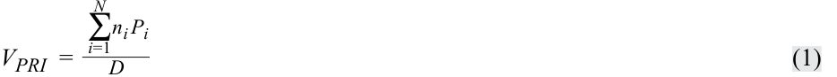

$$V_{PRI} = \frac{\sum_{i=1}^{N} n_i P_i}{D} \tag{1}$$

trong đó

$V_{PRI}$ = giá trị của chỉ số tỷ suất sinh lợi giá (*value of the price return index*)

- $n_i$ = số lượng đơn vị của chứng khoán thành phần $i$ được nắm giữ trong danh mục chỉ số

- $N$ = số lượng chứng khoán thành phần trong chỉ số

- $P_i$ = đơn giá của chứng khoán thành phần $i$

- $D$ = giá trị của ước số (*divisor*)

**Ước số (*divisor*)** là một con số được chọn ban đầu tại thời điểm thành lập. Nó thường được chọn sao cho chỉ số giá có một giá trị ban đầu thuận tiện, chẳng hạn như 1.000. Sau đó, nhà cung cấp chỉ số (*index provider*) sẽ điều chỉnh giá trị của ước số khi cần thiết để tránh những thay đổi trong giá trị chỉ số không liên quan đến những thay đổi trong giá của các chứng khoán thành phần. Ví dụ, khi thay đổi các chứng khoán thành phần của chỉ số, nhà cung cấp chỉ số có thể điều chỉnh ước số sao cho giá trị của chỉ số với các chứng khoán thành phần mới bằng với giá trị của chỉ số trước khi có sự thay đổi.

Việc tính toán tỷ suất sinh lợi của chỉ số, giống như tính toán tỷ suất sinh lợi của danh mục đầu tư, có thể đo lường tỷ suất sinh lợi giá hoặc tổng tỷ suất sinh lợi. **Tỷ suất sinh lợi giá (*Price return*)** chỉ đo lường sự tăng giá (*price appreciation*) hoặc phần trăm thay đổi của giá. **Tổng tỷ suất sinh lợi (*Total return*)** đo lường sự tăng giá cộng với tiền lãi, cổ tức và các khoản phân phối khác.

#### **Tính toán Tỷ suất sinh lợi Đơn kỳ (Calculation of Single-Period Returns)**

Đối với một chỉ số thị trường chứng khoán, tỷ suất sinh lợi giá có thể được tính theo hai cách: phần trăm thay đổi giá trị của chỉ số tỷ suất sinh lợi giá, hoặc trung bình có trọng số của tỷ suất sinh lợi giá của các chứng khoán thành phần. Tỷ suất sinh lợi giá của một chỉ số có thể được biểu diễn như sau:

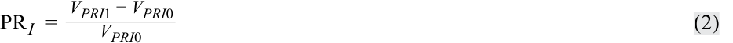

$$PR_I = \frac{V_{PRI1} - V_{PRI0}}{V_{PRI0}} \tag{2}$$

trong đó

- $PR_I$ = tỷ suất sinh lợi giá của danh mục chỉ số (dưới dạng số thập phân, tức là 12 phần trăm là 0,12)

$V_{PRI1}$ = giá trị của chỉ số tỷ suất sinh lợi giá vào cuối kỳ

$V_{PRI0}$ = giá trị của chỉ số tỷ suất sinh lợi giá vào đầu kỳ

Tương tự, tỷ suất sinh lợi giá của từng chứng khoán thành phần có thể được biểu diễn như sau:

<!-- PDF Page 94 -->

$$PR_i = \frac{P_{i1} - P_{i0}}{P_{i0}} \tag{3}$$

##### trong đó

$$PR_i = \text{tỷ suất sinh lợi giá của chứng khoán thành phần } i \text{ (dưới dạng số thập phân)}$$

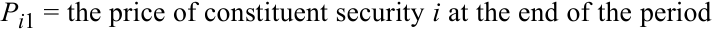

$$P_{i1} = \text{giá của chứng khoán thành phần } i \text{ vào cuối kỳ}$$

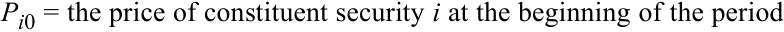

$$P_{i0} = \text{giá của chứng khoán thành phần } i \text{ vào đầu kỳ}$$

Bởi vì tỷ suất sinh lợi giá của chỉ số bằng trung bình có trọng số của tỷ suất sinh lợi giá của các chứng khoán riêng lẻ, chúng ta có thể viết:

$$PR_I = \sum_{i=1}^{N} w_i PR_i = \sum_{i=1}^{N} w_i \left(\frac{P_{i1} - P_{i0}}{P_{i0}}\right) \tag{4}$$

##### trong đó:

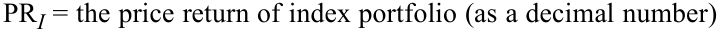

$$PR_I = \text{tỷ suất sinh lợi giá của danh mục chỉ số (dưới dạng số thập phân)}$$

$$PR_i = \text{tỷ suất sinh lợi giá của chứng khoán thành phần } i \text{ (dưới dạng số thập phân)}$$

- $N$ = số lượng chứng khoán riêng lẻ trong chỉ số

- $w_i$ = tỷ trọng của chứng khoán $i$ (tỷ phần của danh mục chỉ số được phân bổ cho chứng khoán $i$)

- $P_{i1}$ = giá của chứng khoán thành phần $i$ vào cuối kỳ

- $P_{i0}$ = giá của chứng khoán thành phần $i$ vào đầu kỳ

Phương trình 4 có thể được viết lại một cách đơn giản như sau:

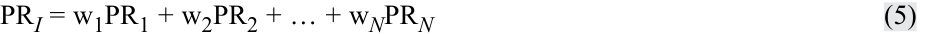

$$PR_I = w_1 PR_1 + w_2 PR_2 + \dots + w_N PR_N \tag{5}$$

trong đó

- $PR_I$ = tỷ suất sinh lợi giá của danh mục chỉ số (dưới dạng số thập phân)

- $PR_i$ = tỷ suất sinh lợi giá của chứng khoán thành phần $i$ (dưới dạng số thập phân)

- $w_i$ = tỷ trọng của chứng khoán $i$ (tỷ phần của danh mục chỉ số được phân bổ cho chứng khoán $i$)

- $N$ = số lượng chứng khoán trong chỉ số

Tổng tỷ suất sinh lợi đo lường sự tăng giá cộng với tiền lãi, cổ tức và các khoản phân phối khác. Do đó, **tổng tỷ suất sinh lợi (*total return*)** của một chỉ số là mức tăng giá, hay sự thay đổi trong giá trị của chỉ số tỷ suất sinh lợi giá, cộng với thu nhập (cổ tức và/hoặc tiền lãi) trong kỳ, được biểu thị bằng tỷ lệ phần trăm so với giá trị đầu kỳ của chỉ số tỷ suất sinh lợi giá. Tổng tỷ suất sinh lợi của một chỉ số có thể được biểu diễn như sau:

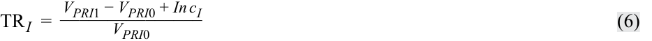

$$TR_I = \frac{V_{PRI1} - V_{PRI0} + Inc_I}{V_{PRI0}} \tag{6}$$

##### trong đó

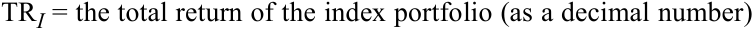

$$TR_I = \text{tổng tỷ suất sinh lợi của danh mục chỉ số (dưới dạng số thập phân)}$$

- $V_{PRI1}$ = giá trị của chỉ số tỷ suất sinh lợi giá vào cuối kỳ

- $V_{PRI0}$ = giá trị của chỉ số tỷ suất sinh lợi giá vào đầu kỳ

- $Inc_I$ = tổng thu nhập (cổ tức và/hoặc tiền lãi) từ tất cả các chứng khoán trong chỉ số được nắm giữ trong kỳ

<!-- PDF Page 95 -->

Tổng tỷ suất sinh lợi của một chỉ số cũng có thể được tính bằng trung bình có trọng số của tổng tỷ suất sinh lợi của các chứng khoán thành phần. Tổng tỷ suất sinh lợi của mỗi chứng khoán thành phần trong chỉ số được tính như sau:

$$TR_i = \frac{P_{1i} - P_{0i} + Inc_i}{P_{0i}} \tag{7}$$

trong đó

$TR_i$ = tổng tỷ suất sinh lợi của chứng khoán thành phần $i$ (dưới dạng số thập phân)

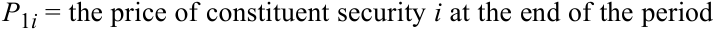

$$P_{1i} = \text{giá của chứng khoán thành phần } i \text{ vào cuối kỳ}$$

$P_{0i}$ = giá của chứng khoán thành phần $i$ vào đầu kỳ

$Inc_i$ = tổng thu nhập (cổ tức và/hoặc tiền lãi) từ chứng khoán $i$ trong kỳ

Bởi vì tổng tỷ suất sinh lợi của một chỉ số có thể được tính bằng trung bình có trọng số của tổng tỷ suất sinh lợi của các chứng khoán thành phần, chúng ta có thể biểu diễn tổng tỷ suất sinh lợi như sau:

$$TR_I = \sum_{i=1}^{N} w_i TR_i = \sum_{i=1}^{N} w_i \left(\frac{P_{1i} - P_{0i} + Inc_i}{P_{0i}}\right) \tag{8}$$

Phương trình 8 có thể được viết lại một cách đơn giản như sau:

$$TR_I = w_1 TR_1 + w_2 TR_2 + \dots + w_N TR_N \tag{9}$$

trong đó

$TR_I$ = tổng tỷ suất sinh lợi của danh mục chỉ số (dưới dạng số thập phân)

- $TR_i$ = tổng tỷ suất sinh lợi của chứng khoán thành phần $i$ (dưới dạng số thập phân)

- $w_i$ = tỷ trọng của chứng khoán $i$ (tỷ phần của danh mục chỉ số được phân bổ cho chứng khoán $i$)

- $N$ = số lượng chứng khoán trong chỉ số

#### **Tính toán Giá trị Chỉ số qua Nhiều Kỳ (Calculation of Index Values over Multiple Time Periods)**

Việc tính toán giá trị chỉ số qua nhiều kỳ đòi hỏi phải liên kết hình học (*geometrically linking*) chuỗi tỷ suất sinh lợi của chỉ số. Với một chuỗi tỷ suất sinh lợi giá của một chỉ số, chúng ta có thể tính giá trị của chỉ số tỷ suất sinh lợi giá bằng phương trình sau:

$$V_{PRIT} = V_{PRI0}(1 + PR_{I1})(1 + PR_{I2})\dots(1 + PR_{IT}) \tag{10}$$

trong đó

- $V_{PRI0}$ = giá trị của chỉ số tỷ suất sinh lợi giá tại thời điểm thành lập

- $V_{PRIT}$ = giá trị của chỉ số tỷ suất sinh lợi giá tại thời điểm $T$

- $PR_{It}$ = tỷ suất sinh lợi giá (dưới dạng số thập phân) của chỉ số trong kỳ $t$, $t = 1, 2, \dots, T$

Đối với một chỉ số có giá trị khi thành lập được đặt bằng 1.000 và tỷ suất sinh lợi giá lần lượt là 5 phần trăm và 3 phần trăm cho Kỳ 1 và Kỳ 2, giá trị của chỉ số tỷ suất sinh lợi giá sẽ được tính như sau:

|**Kỳ (Period)**|**Tỷ suất sinh lợi (Return) (%)**|**Phép tính (Calculation)**|**Giá trị cuối kỳ (Ending Value)**|
|---|---|---|---|
|0||1.000(1,00)|1.000,00|
|1|5,00|1.000(1,05)|1.050,00|
|2|3,00|1.000(1,05)(1,03)|1.081,50|

<!-- PDF Page 96 -->

Tương tự, chuỗi tổng tỷ suất sinh lợi của một chỉ số được sử dụng để tính giá trị của chỉ số tổng tỷ suất sinh lợi bằng phương trình sau:

$$V_{TRIT} = V_{TRI0}(1 + TR_{I1})(1 + TR_{I2})\dots(1 + TR_{IT}) \tag{11}$$

trong đó

- $V_{TRI0}$ = giá trị của chỉ số tại thời điểm thành lập

- $V_{TRIT}$ = giá trị của chỉ số tổng tỷ suất sinh lợi tại thời điểm $T$

- $TR_{It}$ = tổng tỷ suất sinh lợi (dưới dạng số thập phân) của chỉ số trong kỳ $t$, $t = 1, 2, \dots, T$

Giả sử rằng cùng chỉ số đó mang lại thêm 1,5 phần trăm tỷ suất sinh lợi từ thu nhập trong Kỳ 1 và thêm 2,0 phần trăm tỷ suất sinh lợi từ thu nhập trong Kỳ 2, nâng tổng tỷ suất sinh lợi cho Kỳ 1 và Kỳ 2 lần lượt lên 6,5 phần trăm và 5 phần trăm. Giá trị của chỉ số tổng tỷ suất sinh lợi sẽ được tính như sau:

|**Kỳ (Period)**|**Tỷ suất sinh lợi (Return) (%)**|**Phép tính (Calculation)**|**Giá trị cuối kỳ (Ending Value)**|
|---|---|---|---|
|0||1.000(1,00)|1.000,00|
|1|6,50|1.000(1,065)|1.065,00|
|2|5,00|1.000(1,065)(1,05)|1.118,25|

Như được minh họa ở trên, khi thời gian trôi qua, giá trị của chỉ số tổng tỷ suất sinh lợi, vốn bao gồm việc tái đầu tư tất cả cổ tức và/hoặc tiền lãi nhận được, vượt quá giá trị của chỉ số tỷ suất sinh lợi giá với mức chênh lệch ngày càng tăng.

## **<mark>3</mark>**

### **XÂY DỰNG CHỈ SỐ (INDEX CONSTRUCTION)**

mô tả các lựa chọn và vấn đề trong việc xây dựng và quản lý chỉ số

so sánh các phương pháp tính tỷ trọng (*weighting methods*) khác nhau được sử dụng trong xây dựng chỉ số

tính toán và phân tích giá trị cũng như tỷ suất sinh lợi của một chỉ số dựa trên phương pháp tính tỷ trọng của nó

Việc xây dựng và quản lý một chỉ số thị trường chứng khoán tương tự như việc xây dựng và quản lý một danh mục đầu tư chứng khoán. Các nhà cung cấp chỉ số phải quyết định những vấn đề sau:

**1.** Chỉ số nên đại diện cho thị trường mục tiêu (*target market*) nào?

**2.** Những chứng khoán nào nên được lựa chọn từ thị trường mục tiêu đó?

**3.** Nên phân bổ bao nhiêu tỷ trọng cho mỗi chứng khoán trong chỉ số?

**4.** Khi nào chỉ số nên được tái cân bằng (*rebalanced*)?

**5.** Khi nào quyết định lựa chọn chứng khoán và phân bổ tỷ trọng nên được xem xét lại?

#### **Thị trường Mục tiêu và Lựa chọn Chứng khoán (Target Market and Security Selection)**

Quyết định đầu tiên trong việc xây dựng chỉ số là xác định thị trường mục tiêu, phân khúc thị trường, hoặc loại tài sản mà chỉ số đó dự định đại diện. Thị trường mục tiêu có thể được định nghĩa rất rộng hoặc rất hẹp. Nó có thể dựa trên loại tài sản (ví dụ: cổ phiếu, thu nhập cố định, bất động sản, hàng hóa, quỹ phòng hộ); khu vực địa lý (ví dụ: Nhật Bản,

<!-- PDF Page 97 -->

Nam Phi, Mỹ Latinh, Châu Âu); sàn giao dịch nơi các chứng khoán được giao dịch (ví dụ: Thượng Hải, Toronto, Tokyo), và/hoặc các đặc điểm khác (ví dụ: ngành kinh tế, quy mô công ty, phong cách đầu tư, thời lượng [*duration*], hoặc chất lượng tín dụng).

Thị trường mục tiêu quyết định vũ trụ đầu tư (*investment universe*) và các chứng khoán hiện có để đưa vào chỉ số. Một khi vũ trụ đầu tư được xác định, số lượng chứng khoán và các chứng khoán cụ thể được đưa vào chỉ số phải được xác định. Các chứng khoán thành phần có thể là gần như tất cả các chứng khoán trong thị trường mục tiêu hoặc một mẫu đại diện của thị trường mục tiêu. Một số chỉ số cổ phiếu, chẳng hạn như Chỉ số S&P 500 và FTSE 100, cố định số lượng chứng khoán được đưa vào chỉ số và thể hiện con số này ngay trong tên của chỉ số. Các chỉ số khác cho phép số lượng chứng khoán thay đổi để phản ánh những thay đổi trên thị trường mục tiêu hoặc để duy trì một tỷ lệ phần trăm nhất định của thị trường mục tiêu. Ví dụ, Chỉ số Giá Cổ phiếu Tokyo (*Tokyo Stock Price Index* – TOPIX) đại diện và bao gồm tất cả các cổ phiếu lớn nhất, được gọi là Khu vực Một (*First Section*), được niêm yết trên Sàn Giao dịch Chứng khoán Tokyo. Để được đưa vào Khu vực Một—và do đó là vào TOPIX—các cổ phiếu phải đáp ứng các tiêu chí nhất định, chẳng hạn như số lượng cổ phiếu đang lưu hành, số lượng cổ đông, và vốn hóa thị trường. Các cổ phiếu không còn đáp ứng các tiêu chí này sẽ bị loại khỏi Khu vực Một và đồng thời bị loại khỏi TOPIX. Các quy tắc khách quan hoặc cơ học xác định các chứng khoán thành phần của hầu hết, nhưng không phải tất cả, các chỉ số. Ví dụ, Chỉ số Nhạy cảm của Sàn Giao dịch Chứng khoán Bombay S&P, còn được gọi là S&P BSE SENSEX, và S&P 500 sử dụng một ủy ban tuyển chọn và các quy tắc ra quyết định mang tính chủ quan hơn để xác định các chứng khoán thành phần.

#### **Tính Tỷ trọng Chỉ số (Index Weighting)**

Quyết định phân bổ tỷ trọng xác định số lượng của mỗi chứng khoán được đưa vào chỉ số và có tác động đáng kể đến giá trị của chỉ số. Các nhà cung cấp chỉ số sử dụng một số phương pháp để tính tỷ trọng cho các chứng khoán thành phần trong một chỉ số. Các chỉ số có thể được tính tỷ trọng theo giá (*price weighted*), tính tỷ trọng đều (*equal weighted*), tính tỷ trọng theo vốn hóa thị trường (*market-capitalization weighted*), hoặc tính tỷ trọng theo yếu tố cơ bản (*fundamentally weighted*). Mỗi phương pháp tính tỷ trọng đều có những ưu điểm và nhược điểm riêng.

##### **_Tính Tỷ trọng theo Giá (Price Weighting)_**

Phương pháp đơn giản nhất để tính tỷ trọng cho một chỉ số và là phương pháp được Charles Dow sử dụng để xây dựng Chỉ số Bình quân Công nghiệp Dow Jones là **tính tỷ trọng theo giá (*price weighting*)**. Trong phương pháp tính tỷ trọng theo giá, tỷ trọng của mỗi chứng khoán thành phần được xác định bằng cách chia giá của nó cho tổng giá của tất cả các chứng khoán thành phần. Tỷ trọng được tính bằng công thức sau:

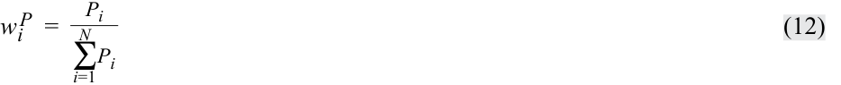

$$w_i^P = \frac{P_i}{\sum_{i=1}^{N} P_i} \tag{12}$$

Bảng minh họa 1 (*Exhibit 1*) minh họa các giá trị, tỷ trọng, và tỷ suất sinh lợi đơn kỳ ngay sau khi thành lập của một chỉ số cổ phiếu tính tỷ trọng theo giá gồm năm chứng khoán thành phần. Giá trị của chỉ số tính tỷ trọng theo giá được xác định bằng cách chia tổng giá trị các chứng khoán (101,50) cho ước số (*divisor*), vốn thường được đặt tại thời điểm thành lập bằng với số lượng chứng khoán ban đầu trong chỉ số. Do đó, trong ví dụ của chúng ta, ước số là 5 và giá trị ban đầu của chỉ số được tính bằng $101,50 \div 5 = 20,30$.

Như được minh họa trong bảng này, Chứng khoán A, có mức giá cao nhất, cũng có tỷ trọng cao nhất và do đó sẽ có tác động lớn nhất đến tỷ suất sinh lợi của chỉ số. Lưu ý cách cả tỷ suất sinh lợi giá và tổng tỷ suất sinh lợi của chỉ số đều được tính dựa trên tỷ suất sinh lợi tương ứng của các chứng khoán thành phần.

<!-- PDF Page 98 -->

**Bảng minh họa 1: Chỉ số cổ phiếu tính tỷ trọng theo giá (Exhibit 1: A Price-Weighted Equity Index)**

|**Tỷ trọng cuối kỳ (EOP Weight) (%)**|52,38|20,95|7,62|13,33|5,72|**100,00**|||||
|---|---|---|---|---|---|---|---|---|---|---|
|**Tỷ trọng đầu kỳ (BOP Weight) × Tổng tỷ suất sinh lợi (Total Return) (%)**|5,66|−2,86|−4,43|3,99|1,97|**4,33**|||||
|**Tỷ trọng đầu kỳ (BOP Weight) × Tỷ suất sinh lợi giá (Price Return) (%)**|4,93|−2,96|−4,43|3,94|1,97|**3,45**|||||
|**Tổng tỷ suất sinh lợi (Total Return) (%)**|11,50|−11,60|−36,00|40,50|50,00||**4,33**||||
|**Tỷ suất sinh lợi giá (Price Return) (%)**|10,00|−12,00|−36,00|40,00|50,00||**3,45**||||
|**Tổng cổ tức (Total Dividends)**|0,75|0,10|0,00|0,05|0,00|**0,90**|**0,18**||||
|**Giá trị (Số cổ phiếu × Giá EOP)**|55,00|22,00|8,00|14,00|6,00|**105,00**|**21,00**||||
|**Cổ tức mỗi cổ phiếu (Dividends Per Share)**|0,75|0,10|0,00|0,05|0,00||||||
|**Giá cuối kỳ (EOP Price)**|55,00|22,00|8,00|14,00|6,00||||||
|**Tỷ trọng đầu kỳ (BOP Weight) (%)**|49,26|24,63|12,32|9,85|3,94|**100,00**|||||
|**Giá trị (Số cổ phiếu × Giá BOP)**|50,00|25,00|12,50|10,00|4,00|**101,50**|**20,30**||**Giá trị cuối kỳ (EOP Value)**|21,00 21,18|
|**Giá đầu kỳ (BOP Price)**|50,00|25,00|12,50|10,00|4,00||||**Tỷ suất sinh lợi (Return) (%)**|3,45 4,33|
|**Số cổ phiếu trong chỉ số (Shares in Index)**|1|1|1|1|1|||Ước số (Divisor) = 5 BOP = Đầu kỳ (Beginning of period) EOP = Cuối kỳ (End of period)|**Giá trị đầu kỳ (BOP Value)**|20,30 20,30|
|**Chứng khoán (Security)**|A|B|C|D|E|**Tổng (Total)**|**Giá trị chỉ số (Index Value)**|Ước số / Chú thích|**Loại chỉ số (Type of Index)**|**Tỷ suất sinh lợi giá (Price Return)** **Tổng tỷ suất sinh lợi (Total Return)**|

<!-- PDF Page 99 -->

Một đặc tính duy nhất chỉ có ở các chỉ số tính tỷ trọng theo giá là việc chia tách cổ phiếu (*stock split*) đối với một chứng khoán thành phần sẽ làm thay đổi tỷ trọng của tất cả các chứng khoán trong chỉ số.1 Để ngăn việc chia tách cổ phiếu và các tỷ trọng mới phát sinh làm thay đổi giá trị của chỉ số, nhà cung cấp chỉ số phải điều chỉnh giá trị của ước số như được minh họa trong Bảng minh họa 2. Với việc chia tách cổ phiếu tỷ lệ 2 đổi 1 (*2-for-1 split*) ở Chứng khoán A, ước số được điều chỉnh bằng cách lấy tổng giá của các chứng khoán thành phần _sau_ khi chia tách (77,50) chia cho giá trị của chỉ số _trước_ khi chia tách (21,00). Sự điều chỉnh này dẫn đến việc thay đổi ước số từ 5 xuống 3,69 sao cho giá trị chỉ số được duy trì ở mức 21,00.

Ưu điểm chính của phương pháp tính tỷ trọng theo giá là tính đơn giản của nó. Nhược điểm chính của phương pháp tính tỷ trọng theo giá là nó dẫn đến các tỷ trọng tùy ý (*arbitrary weights*) cho mỗi chứng khoán. Đặc biệt, việc chia tách cổ phiếu ở bất kỳ một chứng khoán nào cũng gây ra những thay đổi tùy ý trong tỷ trọng của tất cả các chứng khoán thành phần.

**Bảng minh họa 2: Tác động của việc Chia tách Cổ phiếu tỷ lệ 2 đổi 1 đối với Chứng khoán A (Exhibit 2: Impact of 2-for-1 Split in Security A)**

|**Chứng khoán (Security)**|**Giá trước khi chia tách (Price before Split)**|**Tỷ trọng trước khi chia tách (Weight before Split) (%)**|**Giá sau khi chia tách (Price after Split)**|**Tỷ trọng sau khi chia tách (Weight after Split) (%)**|
|---|---|---|---|---|
|A|55,00|52,38|27,50|35,48|
|B|22,00|20,95|22,00|28,39|
|C|8,00|7,62|8,00|10,32|
|D|14,00|13,33|14,00|18,07|
|E|6,00|5,72|6,00|7,74|
|Tổng (Total)|105,00|100,00|77,50|100,00|
|Ước số (Divisor)|5,00||3,69||
|Giá trị Chỉ số (Index Value)|21,00||21,00||

##### **_Tính Tỷ trọng Đều (Equal Weighting)_**

Một phương pháp tính tỷ trọng chỉ số đơn giản khác là **tính tỷ trọng đều (*equal weighting*)**. Phương pháp này gán một tỷ trọng bằng nhau cho mỗi chứng khoán thành phần tại thời điểm thành lập. Các tỷ trọng được tính như sau:

$$w_i^E = \frac{1}{N} \tag{13}$$

trong đó

$w_i$ = tỷ phần của danh mục được phân bổ cho chứng khoán $i$ hay tỷ trọng của chứng khoán $i$

$N$ = số lượng chứng khoán trong chỉ số

Để xây dựng một chỉ số tính tỷ trọng đều từ năm chứng khoán trong Bảng minh họa 1, nhà cung cấp chỉ số phân bổ một phần năm (20 phần trăm) giá trị của chỉ số (vào đầu kỳ) cho mỗi chứng khoán. Chia giá trị được phân bổ cho mỗi chứng khoán cho giá cổ phiếu riêng lẻ của từng chứng khoán sẽ xác định được số lượng cổ phiếu của mỗi chứng khoán cần đưa vào chỉ số. Không giống như chỉ số tính tỷ trọng theo giá, nơi các tỷ trọng được xác định một cách tùy ý bởi giá thị trường, các tỷ trọng trong chỉ số tính tỷ trọng đều được gán một cách tùy ý bởi nhà cung cấp chỉ số.

> 1 Chia tách cổ phiếu (*stock split*) là sự gia tăng số lượng cổ phiếu đang lưu hành và sự sụt giảm tương ứng trong giá mỗi cổ phiếu sao cho tổng giá trị thị trường của vốn chủ sở hữu, cũng như tỷ lệ sở hữu tương ứng của các nhà đầu tư trong công ty, không thay đổi.

<!-- PDF Page 100 -->

Bảng minh họa 3 minh họa các giá trị, tỷ trọng, và tỷ suất sinh lợi đơn kỳ ngay sau khi thành lập của một chỉ số tính tỷ trọng đều với cùng các chứng khoán thành phần như trong Bảng minh họa 1. Ví dụ này giả định giá trị danh mục chỉ số đầu kỳ là 10.000 (tức là khoản đầu tư 2.000 vào mỗi chứng khoán). Để đặt giá trị ban đầu của chỉ số bằng 1.000, ước số được đặt bằng 10 ($10.000 \div 10 = 1.000$).

Bảng minh họa 1 và Bảng minh họa 3 chứng minh cách các phương pháp tính tỷ trọng khác nhau dẫn đến các tỷ suất sinh lợi khác nhau. Tỷ suất sinh lợi giá 10,4 phần trăm của chỉ số tính tỷ trọng đều được hiển thị trong Bảng minh họa 3 khác biệt đáng kể so với tỷ suất sinh lợi giá 3,45 phần trăm của chỉ số tính tỷ trọng theo giá trong Bảng minh họa 1.

Giống như tính tỷ trọng theo giá, ưu điểm chính của tính tỷ trọng đều là tính đơn giản của nó. Tuy nhiên, tính tỷ trọng đều có một số nhược điểm. Thứ nhất, các chứng khoán chiếm tỷ phần lớn nhất trong giá trị thị trường mục tiêu bị đại diện dưới mức (*underrepresented*), và các chứng khoán chiếm tỷ phần nhỏ trong giá trị thị trường mục tiêu lại bị đại diện vượt mức (*overrepresented*). Thứ hai, sau khi chỉ số được xây dựng và giá của các chứng khoán thành phần thay đổi, chỉ số đó không còn có tỷ trọng bằng nhau nữa. Do đó, việc duy trì tỷ trọng bằng nhau đòi hỏi phải điều chỉnh (tái cân bằng – *rebalancing*) chỉ số thường xuyên.

##### **_Tính Tỷ trọng theo Vốn hóa Thị trường (Market-Capitalization Weighting)_**

Trong phương pháp **tính tỷ trọng theo vốn hóa thị trường (*market-capitalization weighting*)**, hay tính tỷ trọng theo giá trị (*value weighting*), tỷ trọng của mỗi chứng khoán thành phần được xác định bằng cách chia vốn hóa thị trường của nó cho tổng vốn hóa thị trường (tổng cộng vốn hóa thị trường) của tất cả các chứng khoán trong chỉ số. Vốn hóa thị trường hay giá trị thị trường được tính bằng cách nhân số lượng cổ phiếu đang lưu hành với giá thị trường của mỗi cổ phiếu.

Tỷ trọng vốn hóa thị trường của chứng khoán $i$ là:

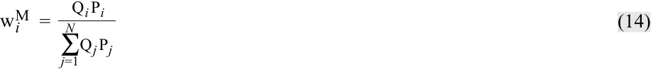

$$w_i^M = \frac{Q_i P_i}{\sum_{j=1}^{N} Q_j P_j} \tag{14}$$

trong đó

- $w_i$ = tỷ phần của danh mục được phân bổ cho chứng khoán $i$ hay tỷ trọng của chứng khoán $i$

- $Q_i$ = số lượng cổ phiếu đang lưu hành của chứng khoán $i$

- $P_i$ = giá cổ phiếu của chứng khoán $i$

- $N$ = số lượng chứng khoán trong chỉ số

Bảng minh họa 4 minh họa các giá trị, tỷ trọng, và tỷ suất sinh lợi đơn kỳ ngay sau khi thành lập của một chỉ số tính tỷ trọng theo vốn hóa thị trường cho cùng thị trường gồm năm chứng khoán đó. Chứng khoán A, với 3.000 cổ phiếu đang lưu hành và mức giá 50 mỗi cổ phiếu, có vốn hóa thị trường là 150.000 hay 26,29 phần trăm ($150.000 / 570.500$) của toàn bộ danh mục chỉ số. Các tỷ trọng chỉ số thu được trong bảng minh họa phản ánh giá trị tương đối của mỗi chứng khoán được đo lường bằng vốn hóa thị trường của nó.

Như được thể hiện trong Bảng minh họa 1, Bảng minh họa 3 và Bảng minh họa 4, phương pháp tính tỷ trọng ảnh hưởng đến tỷ suất sinh lợi của chỉ số. Tỷ suất sinh lợi giá và tổng tỷ suất sinh lợi của chỉ số vốn hóa thị trường trong Bảng minh họa 4 (lần lượt là 1,49 phần trăm và 2,13 phần trăm) khác biệt đáng kể so với chỉ số tính tỷ trọng theo giá (lần lượt là 3,45 phần trăm và 4,33 phần trăm) và chỉ số tính tỷ trọng đều (lần lượt là 10,40 phần trăm và 10,88 phần trăm). Để hiểu nguyên nhân và mức độ của sự khác biệt này, hãy so sánh tỷ trọng và tỷ suất sinh lợi của từng chứng khoán dưới mỗi phương pháp tính tỷ trọng. Ví dụ, tỷ trọng của Chứng khoán A dao động từ 49,26 phần trăm trong chỉ số tính tỷ trọng theo giá đến 20 phần trăm trong chỉ số tính tỷ trọng đều. Với tỷ suất sinh lợi giá là 10 phần trăm, Chứng khoán A đóng góp 4,93 phần trăm vào tỷ suất sinh lợi giá của chỉ số tính tỷ trọng theo giá, 2,00 phần trăm vào tỷ suất sinh lợi giá của chỉ số tính tỷ trọng đều, và 2,63 phần trăm vào tỷ suất sinh lợi giá của chỉ số tính tỷ trọng theo vốn hóa thị trường. Với

<!-- PDF Page 101 -->

**Bảng minh họa 3: Chỉ số cổ phiếu tính tỷ trọng đều (Exhibit 3: An Equal-Weighted Equity Index)**

|**Tỷ trọng cuối kỳ (EOP Weight) (%)**|19,93|15,94|11,60|25,36|27,17|**100,00**|||||
|---|---|---|---|---|---|---|---|---|---|---|
|**Tỷ trọng × Tổng tỷ suất sinh lợi (Weight × Total Return) (%)**|2,30|−2,32|−7,20|8,10|10,00|**10,88**|||||
|**Tỷ trọng × Tỷ suất sinh lợi giá (Weight × Price Return) (%)**|2,00|−2,40|−7,20|8,00|10,00|**10,40**|||||
|**Tổng tỷ suất sinh lợi (Total Return) (%)**|11,50|−11,60|−36,00|40,50|50,00||**10,88**||||
|**Tỷ suất sinh lợi giá (Price Return) (%)**|10,00|−12,00|−36,00|40,00|50,00||**10,40**||||
|**Tổng cổ tức (Total Dividends)**|30|8|0|10|0|**48**|**4,80**||||
|**Giá trị (Số cổ phiếu × Giá EOP)**|2.200|1.760|1.280|2.800|3.000|**11.040**|**1.104**||||
|**Cổ tức mỗi cổ phiếu (Dividends Per Share)**|0,75|0,10|0,00|0,05|0,00||||||
|**Giá cuối kỳ (EOP Price)**|55,00|22,00|8,00|14,00|6,00||||||
|**Tỷ trọng (Weight) (%)**|20,00|20,00|20,00|20,00|20,00|**100,00**|||||
|**Giá trị (Số cổ phiếu × Giá BOP)**|2.000|2.000|2.000|2.000|2.000|**10.000**|**1.000**||**Giá trị cuối kỳ (EOP Value)**|1.104,00 1.108,80|
|**Giá đầu kỳ (BOP Price)**|50,00|25,00|12,50|10,00|4,00||||**Tỷ suất sinh lợi (Return) (%)**|10,40 10,88|
|**Số cổ phiếu trong chỉ số (Shares in Index)**|40|80|160|200|500|||Ước số (Divisor) = 10 BOP = Đầu kỳ (Beginning of period) EOP = Cuối kỳ (End of period)|**Giá trị đầu kỳ (BOP Value)**|1.000,00 1.000,00|
|**Chứng khoán (Security)**|A|B|C|D|E|**Tổng (Total)**|**Giá trị chỉ số (Index Value)**|Ước số / Chú thích|**Loại chỉ số (Type of Index)**|**Tỷ suất sinh lợi giá (Price Return)** **Tổng tỷ suất sinh lợi (Total Return)**|

<!-- PDF Page 102 -->

**Bảng minh họa 4: Chỉ số cổ phiếu tính tỷ trọng theo vốn hóa thị trường (Exhibit 4: A Market-Capitalization-Weighted Equity Index)**

|**Tỷ trọng cuối kỳ (EOP Weight) (%)**|28,50|38,00|6,91|19,34|7,25|**100,00**|||||
|---|---|---|---|---|---|---|---|---|---|---|
|**Tỷ trọng đầu kỳ (BOP Weight) × Tổng tỷ suất sinh lợi (Total Return) (%)**|3,02|−5,08|−3,95|5,68|2,46|**2,13**|||||
|**Tỷ trọng đầu kỳ (BOP Weight) × Tỷ suất sinh lợi giá (Price Return) (%)**|2,63|−5,26|−3,95|5,61|2,46|**1,49**|||||
|**Tổng tỷ suất sinh lợi (Total Return) (%)**|11,50|−11,60|−36,00|40,50|50,00||**2,13**||||
|**Tỷ suất sinh lợi giá (Price Return) (%)**|10,00|−12,00|−36,00|40,00|50,00||**1,49**||||
|**Tổng cổ tức (Total Dividends)**|2.250|1.000|0|400|0|**3.650**|**6,40**||||
|**Vốn hóa thị trường cuối kỳ (EOP Market Cap)**|165.000|220.000|40.000|112.000|42.000|**579.000**|**1.014,90**||||
|**Cổ tức mỗi cổ phiếu (Dividends Per Share)**|0,75|0,10|0,00|0,05|0,00||||||
|**Giá cuối kỳ (EOP Price)**|55,00|22,00|8,00|14,00|6,00||||||
|**Tỷ trọng đầu kỳ (BOP Weight) (%)**|26,29|43,82|10,96|14,02|4,91|**100,00**|||||
|**Vốn hóa thị trường đầu kỳ (BOP Market Cap)**|150.000|250.000|62.500|80.000|28.000|**570.500**|**1.000**||**Giá trị cuối kỳ (EOP Value)**|1.014,90 1.021,30|
|**Giá đầu kỳ (BOP Price)**|50,00|25,00|12,50|10,00|4,00||||**Tỷ suất sinh lợi (Return) (%)**|1,49 2,13|
|**Số cổ phiếu đang lưu hành (Shares Outstanding)**|3.000|10.000|5.000|8.000|7.000|||Ước số (Divisor) = 570,50 BOP = Đầu kỳ (Beginning of period) EOP = Cuối kỳ (End of period)|**Giá trị đầu kỳ (BOP Value)**|1.000,00 1.000,00|
|**Cổ phiếu (Stock)**|A|B|C|D|E|**Tổng (Total)**|**Giá trị chỉ số (Index Value)**|Ước số / Chú thích|**Loại chỉ số (Type of Index)**|**Tỷ suất sinh lợi giá (Price Return)** **Tổng tỷ suất sinh lợi (Total Return)**|

<!-- PDF Page 103 -->

tổng tỷ suất sinh lợi là 11,50 phần trăm, Chứng khoán A đóng góp 5,66 phần trăm vào tổng tỷ suất sinh lợi của chỉ số tính tỷ trọng theo giá, 2,30 phần trăm vào tổng tỷ suất sinh lợi của chỉ số tính tỷ trọng đều, và 3,02 phần trăm vào tổng tỷ suất sinh lợi của chỉ số tính tỷ trọng theo vốn hóa thị trường.

##### **Tính Tỷ trọng theo Vốn hóa Thị trường Điều chỉnh theo Tỷ lệ Tự do Chuyển nhượng (Float-Adjusted Market-Capitalization Weighting)**

Trong phương pháp **tính tỷ trọng theo vốn hóa thị trường điều chỉnh theo tỷ lệ tự do chuyển nhượng (*float-adjusted market-capitalization weighting*)**, tỷ trọng của mỗi chứng khoán thành phần được xác định bằng cách điều chỉnh vốn hóa thị trường của nó theo **lượng cổ phiếu tự do chuyển nhượng trên thị trường (*market float*)** của nó. Thông thường, lượng cổ phiếu tự do chuyển nhượng trên thị trường (*market float*) là số lượng cổ phiếu của chứng khoán thành phần hiện có sẵn cho công chúng đầu tư. Đối với các công ty có cơ cấu sở hữu cô đặc (*closely held*), chỉ một phần số cổ phiếu đang lưu hành là có sẵn cho công chúng đầu tư (phần còn lại do một nhóm nhỏ các nhà đầu tư kiểm soát nắm giữ). Ngoài việc loại trừ các cổ phiếu do cổ đông kiểm soát nắm giữ, hầu hết các chỉ số tính tỷ trọng theo vốn hóa thị trường điều chỉnh theo tỷ lệ tự do chuyển nhượng còn loại trừ các cổ phiếu do các tập đoàn khác và chính phủ nắm giữ. Một số nhà cung cấp các chỉ số được thiết kế để đại diện cho cơ hội đầu tư của các nhà đầu tư toàn cầu còn giảm thêm số lượng cổ phiếu được đưa vào chỉ số bằng cách loại trừ các cổ phiếu không có sẵn cho các nhà đầu tư nước ngoài. Các nhà cung cấp chỉ số có thể gọi các chỉ số này là “chỉ số tính tỷ trọng theo vốn hóa thị trường điều chỉnh theo tỷ lệ tự do chuyển nhượng hoàn toàn (*free-float-adjusted market-capitalization-weighted indexes*)”.

Các chỉ số tính tỷ trọng theo vốn hóa thị trường điều chỉnh theo tỷ lệ tự do chuyển nhượng phản ánh số cổ phiếu có sẵn để giao dịch công khai bằng cách nhân giá thị trường mỗi cổ phiếu với số lượng cổ phiếu có sẵn cho công chúng đầu tư (tức là vốn hóa thị trường điều chỉnh theo tỷ lệ tự do chuyển nhượng) thay vì tổng số cổ phiếu đang lưu hành (tổng vốn hóa thị trường). Hiện nay, hầu hết các chỉ số tính tỷ trọng theo vốn hóa thị trường đều được điều chỉnh theo tỷ lệ tự do chuyển nhượng. Do đó, trừ khi có chỉ dẫn khác, trong phần còn lại của bài đọc này, tính tỷ trọng “theo vốn hóa thị trường” đề cập đến tính tỷ trọng theo vốn hóa thị trường điều chỉnh theo tỷ lệ tự do chuyển nhượng.

Tỷ trọng vốn hóa thị trường điều chỉnh theo tỷ lệ tự do chuyển nhượng của chứng khoán $i$ được tính như sau:

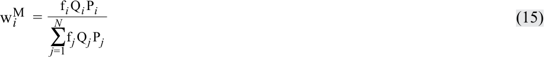

$$w_i^M = \frac{f_i Q_i P_i}{\sum_{j=1}^{N} f_j Q_j P_j} \tag{15}$$

trong đó

$f_i$ = tỷ phần số cổ phiếu đang lưu hành nằm trong lượng cổ phiếu tự do chuyển nhượng trên thị trường (*market float*)

- $w_i$ = tỷ phần của danh mục được phân bổ cho chứng khoán $i$ hay tỷ trọng của chứng khoán $i$

- $Q_i$ = số lượng cổ phiếu đang lưu hành của chứng khoán $i$

- $P_i$ = giá cổ phiếu của chứng khoán $i$

- $N$ = số lượng chứng khoán trong chỉ số

Bảng minh họa 5 minh họa các giá trị, tỷ trọng, và tỷ suất sinh lợi đơn kỳ ngay sau khi thành lập của một chỉ số cổ phiếu tính tỷ trọng theo vốn hóa thị trường điều chỉnh theo tỷ lệ tự do chuyển nhượng sử dụng cùng năm chứng khoán như trước. Tỷ lệ phần trăm cổ phiếu thấp của Chứng khoán D trong lượng cổ phiếu tự do chuyển nhượng trên thị trường so với tổng số cổ phiếu đang lưu hành cho thấy chứng khoán này có cơ cấu sở hữu cô đặc.

Ưu điểm chính của phương pháp tính tỷ trọng theo vốn hóa thị trường (bao gồm cả điều chỉnh theo tỷ lệ tự do chuyển nhượng) là các chứng khoán thành phần được nắm giữ theo tỷ lệ tương ứng với giá trị của chúng trên thị trường mục tiêu. Nhược điểm chính là các chứng khoán thành phần có giá tăng nhiều nhất (hoặc giảm nhiều nhất) sẽ có tỷ trọng lớn hơn (hoặc thấp hơn) trong chỉ số (tức là khi giá của một chứng khoán tăng tương đối so với các chứng khoán khác trong chỉ số, tỷ trọng của nó tăng lên; và khi giá của nó giảm giá trị tương đối so với các chứng khoán khác trong chỉ số, tỷ trọng của nó giảm xuống). Phương pháp tính tỷ trọng này dẫn đến việc phân bổ tỷ trọng vượt mức (*overweighting*) cho các cổ phiếu đã tăng giá (và có thể bị định giá quá cao) và phân bổ tỷ trọng dưới mức (*underweighting*) cho các cổ phiếu đã giảm giá (và có thể bị định giá quá thấp). Tác động của phương pháp tính tỷ trọng này tương tự như một chiến lược đầu tư theo đà tăng trưởng (*momentum investment strategy*) ở chỗ theo thời gian, các chứng khoán đã tăng giá nhiều nhất sẽ có tỷ trọng lớn nhất trong chỉ số.

<!-- PDF Page 104 -->

**Bảng minh họa 5: Chỉ số cổ phiếu tính tỷ trọng theo vốn hóa thị trường điều chỉnh theo tỷ lệ tự do chuyển nhượng (Exhibit 5: A Float-Adjusted Market-Capitalization-Weighted Equity Index)**

|**Tỷ trọng cuối kỳ (EOP Weight) (%)**|39,61|36,97|8,64|6,72|8,06|**100,00**|||||
|---|---|---|---|---|---|---|---|---|---|---|
|**Tỷ trọng đầu kỳ (BOP Weight) × Tổng tỷ suất sinh lợi (Total Return) (%)**|4,07|−4,79|−4,78|1,91|2,65|**−0,94**|||||
|**Tỷ trọng đầu kỳ (BOP Weight) × Tỷ suất sinh lợi giá (Price Return) (%)**|3,54|−4,96|−4,78|1,89|2,65|**−1,66**|||||
|**Tổng tỷ suất sinh lợi (Total Return) (%)**|11,50|−11,60|−36,00|40,50|50,00||**−0,94**||||
|**Tỷ suất sinh lợi giá (Price Return) (%)**|10,00|−12,00|−36,00|40,00|50,00||**−1,66**||||
|**Tổng cổ tức (Total Dividends)**|2.250|700|0|100|0|**3.050**|**7,20**||||
|**Vốn hóa thị trường điều chỉnh theo float cuối kỳ (Ending Float-Adjusted Market Cap)**|165.000|154.000|36.000|28.000|33.600|**416.600**|**983,36**||||
|**Cổ tức mỗi cổ phiếu (Dividends Per Share)**|0,75|0,10|0,00|0,05|0,00||||||
|**Giá cuối kỳ (EOP Price)**|55,00|22,00|8,00|14,00|6,00||||||
|**Tỷ trọng đầu kỳ (BOP Weight) (%)**|35,40|41,31|13,28|4,72|5,29|**100,00**|||||
|**Vốn hóa thị trường điều chỉnh theo float đầu kỳ (BOP Float-Adjusted Market Cap)**|150.000|175.000|56.250|20.000|22.400|**423.650**|**1.000**||||
|**Giá đầu kỳ (BOP Price)**|50,00|25,00|12,50|10,00|4,00||||||
|**Số cổ phiếu trong chỉ số (Shares in Index)**|3.000|7.000|4.500|2.000|5.600||||**Giá trị cuối kỳ (Ending Value)**|983,36 990,56|
|**% Cổ phiếu tự do chuyển nhượng (% Shares in Market Float)**|100|70|90|25|80||||**Tỷ suất sinh lợi (Return) (%)**|−1,66 −0,94|
|**Số cổ phiếu đang lưu hành (Shares Outstanding)**|3.000|10.000|5.000|8.000|7.000|||Ước số (Divisor) = 423,65 BOP = Đầu kỳ (Beginning of period) EOP = Cuối kỳ (End of period)|**Giá trị ban đầu (Initial Value)**|1.000,00 1.000,00|
|**Cổ phiếu (Stock)**|A|B|C|D|E|**Tổng (Total)**|**Giá trị chỉ số (Index Value)**|Ước số / Chú thích|**Loại chỉ số (Type of Index)**|**Tỷ suất sinh lợi giá (Price Return)** **Tổng tỷ suất sinh lợi (Total Return)**|

<!-- PDF Page 105 -->

##### **_Tính Tỷ trọng theo Yếu tố Cơ bản (Fundamental Weighting)_**

**Tính tỷ trọng theo yếu tố cơ bản (*Fundamental weighting*)** cố gắng khắc phục những nhược điểm của việc tính tỷ trọng theo vốn hóa thị trường bằng cách sử dụng các thước đo quy mô của một công ty vốn độc lập với giá chứng khoán của nó để xác định tỷ trọng cho mỗi chứng khoán thành phần. Các thước đo này bao gồm giá trị sổ sách (*book value*), dòng tiền (*cash flow*), doanh thu (*revenues*), lợi nhuận (*earnings*), cổ tức (*dividends*), và số lượng nhân viên.

Một số chỉ số cơ bản sử dụng một thước đo duy nhất, chẳng hạn như tổng cổ tức, để tính tỷ trọng cho các chứng khoán thành phần, trong khi các chỉ số khác kết hợp tỷ trọng từ một số thước đo để tạo thành một giá trị tổng hợp (*composite value*) được dùng để tính tỷ trọng.

Gọi $F_i$ là một thước đo quy mô cơ bản nhất định của công ty $i$, tỷ trọng cơ bản của chứng khoán $i$ là:

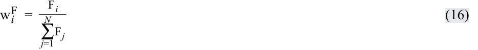

$$w_i^F = \frac{F_i}{\sum_{j=1}^{N} F_j} \tag{16}$$

So với một chỉ số tính tỷ trọng theo vốn hóa thị trường, một chỉ số cơ bản với các tỷ trọng dựa trên một khoản mục như lợi nhuận sẽ dẫn đến tỷ trọng lớn hơn ở các chứng khoán thành phần có lợi suất thu nhập (*earnings yields* – lợi nhuận chia cho giá) cao hơn lợi suất thu nhập của toàn bộ danh mục tính tỷ trọng theo thị trường. Tương tự, các cổ phiếu có lợi suất thu nhập thấp hơn lợi suất của toàn bộ danh mục tính tỷ trọng theo thị trường sẽ có tỷ trọng thấp hơn. Ví dụ, giả sử có hai cổ phiếu trong một chỉ số. Cổ phiếu A có vốn hóa thị trường là €200 triệu, Cổ phiếu B có vốn hóa thị trường là €800 triệu, và tổng vốn hóa thị trường của chúng là €1 tỷ (€1.000 triệu). Cả hai công ty đều có lợi nhuận là €20 triệu và tổng lợi nhuận gộp là €40 triệu. Do đó, Cổ phiếu A có lợi suất thu nhập là 10 phần trăm ($20/200$) và Cổ phiếu B có lợi suất thu nhập là 2,5 phần trăm ($20/800$). Tỷ trọng tính theo lợi nhuận của Cổ phiếu A là 50 phần trăm ($20/40$), cao hơn tỷ trọng vốn hóa thị trường của nó là 20 phần trăm ($200/1.000$). Tỷ trọng tính theo lợi nhuận của Cổ phiếu B là 50 phần trăm ($20/40$), thấp hơn tỷ trọng vốn hóa thị trường của nó là 80 phần trăm ($800/1.000$). So với chỉ số tính tỷ trọng theo vốn hóa thị trường, chỉ số tính tỷ trọng theo lợi nhuận phân bổ tỷ trọng vượt mức cho Cổ phiếu A có lợi suất cao và phân bổ tỷ trọng dưới mức cho Cổ phiếu B có lợi suất thấp.

Đặc tính quan trọng nhất của việc tính tỷ trọng theo yếu tố cơ bản là nó dẫn đến các chỉ số có sự thiên lệch về “giá trị” (*“value” tilt*). Nghĩa là, một chỉ số được tính tỷ trọng theo yếu tố cơ bản có các tỷ số giữa giá trị sổ sách, lợi nhuận, cổ tức, v.v. trên giá trị thị trường cao hơn so với chỉ số tính tỷ trọng theo vốn hóa thị trường tương ứng của nó. Ngoài ra, trái ngược với “hiệu ứng” đà tăng trưởng (*momentum “effect”*) của các chỉ số tính tỷ trọng theo vốn hóa thị trường, các chỉ số tính tỷ trọng theo yếu tố cơ bản nhìn chung sẽ có “hiệu ứng” đi ngược xu hướng (*contrarian “effect”*) ở chỗ tỷ trọng danh mục sẽ dịch chuyển rời khỏi các chứng khoán đã tăng giá trị tương đối và hướng về các chứng khoán đã giảm giá trị tương đối mỗi khi danh mục được tái cân bằng.

### **QUẢN LÝ CHỈ SỐ: TÁI CÂN BẰNG VÀ TÁI CẤU TRÚC (INDEX MANAGEMENT: REBALANCING AND RECONSTITUTION)**

> **Chú thích hình ảnh:** Mục 4

mô tả việc tái cân bằng (*rebalancing*) và tái cấu trúc (*reconstitution*) của một chỉ số

Cho đến nay, chúng ta đã thảo luận về việc xây dựng chỉ số. Quản lý chỉ số bao gồm hai câu hỏi còn lại:

- Khi nào chỉ số nên được tái cân bằng?

- Khi nào các quyết định lựa chọn chứng khoán và phân bổ tỷ trọng nên được xem xét lại?

<!-- PDF Page 106 -->

#### **Tái cân bằng (Rebalancing)**

**Tái cân bằng (*Rebalancing*)** đề cập đến việc điều chỉnh tỷ trọng của các chứng khoán thành phần trong chỉ số. Để duy trì tỷ trọng của mỗi chứng khoán nhất quán với phương pháp tính tỷ trọng của chỉ số, nhà cung cấp chỉ số tái cân bằng chỉ số bằng cách điều chỉnh tỷ trọng của các chứng khoán thành phần theo lịch trình định kỳ đều đặn (các ngày tái cân bằng)—thường là hàng quý. Việc tái cân bằng là cần thiết vì tỷ trọng của các chứng khoán thành phần thay đổi khi giá thị trường của chúng thay đổi. Chẳng hạn, hãy lưu ý rằng tỷ trọng của các chứng khoán trong chỉ số tính tỷ trọng đều (Bảng minh họa 3) vào cuối kỳ không còn bằng nhau nữa (tức là không còn ở mức 20 phần trăm):

|**Chứng khoán**|**Tỷ trọng cuối kỳ**|
|---|---|
|Chứng khoán A|19,93%|
|Chứng khoán B|15,94%|
|Chứng khoán C|11,60%|
|Chứng khoán D|25,36%|
|Chứng khoán E|27,17%|

Khi tái cân bằng chỉ số, tỷ trọng của Chứng khoán D và E (những chứng khoán có tỷ suất sinh lợi cao nhất) sẽ được giảm xuống và tỷ trọng của Chứng khoán A, B và C (những chứng khoán có tỷ suất sinh lợi thấp nhất) sẽ được tăng lên. Do đó, việc tái cân bằng tạo ra doanh thu giao dịch / vòng quay danh mục (*turnover*) bên trong một chỉ số.

Các chỉ số tính tỷ trọng theo giá không được tái cân bằng bởi vì tỷ trọng của mỗi chứng khoán thành phần được quyết định bởi chính mức giá của nó. Đối với các chỉ số tính tỷ trọng theo vốn hóa thị trường, việc tái cân bằng ít được quan tâm hơn vì các chỉ số này phần lớn tự tái cân bằng. Ví dụ, trong chỉ số vốn hóa thị trường của chúng ta, tỷ trọng của Chứng khoán C tự động giảm từ 10,96 phần trăm xuống 6,91 phần trăm, phản ánh mức giảm 36 phần trăm trong giá thị trường của nó. Các tỷ trọng vốn hóa thị trường chỉ được điều chỉnh để phản ánh các vụ sáp nhập, mua lại, thanh lý, và các hoạt động doanh nghiệp (*corporate actions*) khác giữa các ngày tái cân bằng.

#### **Tái cấu trúc (Reconstitution)**

Tái cấu trúc (*Reconstitution*) là quá trình thay đổi các chứng khoán thành phần trong một chỉ số. Nó tương tự như việc một nhà quản lý danh mục đầu tư quyết định thay đổi các chứng khoán trong danh mục của mình. Tái cấu trúc là một phần của chu kỳ tái cân bằng. Ngày tái cấu trúc (*reconstitution date*) là ngày mà các nhà cung cấp chỉ số rà soát lại các chứng khoán thành phần, áp dụng lại các tiêu chí ban đầu để được đưa vào chỉ số, và lựa chọn những chứng khoán nào sẽ giữ lại, loại bỏ, hoặc thêm mới. Các chứng khoán thành phần không còn đáp ứng các tiêu chí sẽ được thay thế bằng các chứng khoán đáp ứng được tiêu chí. Một khi danh sách sửa đổi của các chứng khoán thành phần được xác định, phương pháp tính tỷ trọng sẽ được áp dụng lại. Các chỉ số được tái cấu trúc để phản ánh những thay đổi trong thị trường mục tiêu (phá sản, hủy niêm yết, sáp nhập, mua lại, v.v.) và/hoặc để phản ánh phán đoán của ủy ban tuyển chọn.

Tái cấu trúc tạo ra vòng quay danh mục (*turnover*) theo một số cách khác nhau, đặc biệt là đối với các chỉ số tính tỷ trọng theo vốn hóa thị trường. Khi một chứng khoán bị loại bỏ và một chứng khoán khác được thêm vào, nhà cung cấp chỉ số phải thay đổi tỷ trọng của các chứng khoán khác nhằm duy trì tỷ trọng vốn hóa thị trường của chỉ số.

Tần suất tái cấu trúc là một vấn đề lớn đối với các chỉ số được sử dụng rộng rãi và các chứng khoán thành phần của chúng. Ví dụ, Chỉ số Russell 2000 tái cấu trúc hàng năm. Nó được sử dụng làm chuẩn đối sánh (*benchmark*) bởi rất nhiều quỹ đầu tư, và mỗi năm, trước khi chỉ số được tái cấu trúc, các nhà quản lý của những quỹ này mua vào các cổ phiếu mà họ nghĩ sẽ được thêm vào chỉ số—đẩy giá các cổ phiếu đó lên—và bán ra các cổ phiếu mà họ nghĩ sẽ bị loại khỏi chỉ số—đẩy giá các cổ phiếu đó xuống. Bảng minh họa 6 minh họa một ví dụ lịch sử về tác động tiềm tàng của những quyết định này. Bắt đầu từ cuối tháng 4 năm 2009, một số nhà quản lý đã bắt đầu thu gom và đẩy giá cổ phiếu của Uranium Energy Corporation (UEC) lên cao vì họ tin rằng cổ phiếu này sẽ được đưa vào Chỉ số Russell 2000 sau khi tái cấu trúc. Vào ngày 12 tháng 6, Russell đã liệt kê UEC vào danh sách bổ sung sơ bộ cho
