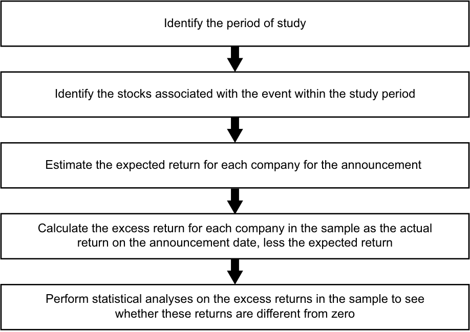

# Tập 5: Đầu tư Cổ phiếu (Equity Investments)
## Learning Module 3 Market Efficiency (Trang PDF 133–168)

---

# Tập 5: Đầu tư Cổ phiếu (Volume 5: Equity Investments)
## Học phần 3: Hiệu quả Thị trường (Learning Module 3: Market Efficiency)
### Phần 1/3: Giới thiệu (Introduction) (Trang PDF 133–148)

---

<!-- PDF Page 133 -->

#### H Ọ C P H Ầ N

# **<mark>3</mark>**

### **Hiệu quả Thị trường (Market Efficiency)**

**bởi Sean Cleary, PhD, CFA, Howard J. Atkinson, CIMA, ICD.D, CFA, và Pamela Peterson Drake, PhD, CFA.**

_Sean Cleary, PhD, CFA, làm việc tại Đại học Queen’s (Canada). Howard J. Atkinson, CIMA, ICD.D, CFA, làm việc tại Horizons ETF Management (Canada) Inc. (Canada). Pamela Peterson Drake, PhD, CFA, làm việc tại Đại học James Madison (Hoa Kỳ)._

###### **<mark>KẾT QUẢ HỌC TẬP (LEARNING OUTCOMES)</mark>**

**_Mức độ thành thạo (Mastery) — Ứng viên cần có khả năng:_**
- mô tả hiệu quả thị trường (*market efficiency*) và các khái niệm liên quan, bao gồm tầm quan trọng của chúng đối với những người hành nghề đầu tư
- đối chiếu giữa giá trị thị trường (*market value*) và giá trị nội tại (*intrinsic value*)
- giải thích các yếu tố ảnh hưởng đến tính hiệu quả của một thị trường
- đối chiếu hiệu quả thị trường dạng yếu (*weak-form*), dạng bán mạnh (*semi-strong-form*), và dạng mạnh (*strong-form*)
- giải thích hàm ý của từng dạng hiệu quả thị trường đối với phân tích cơ bản (*fundamental analysis*), phân tích kỹ thuật (*technical analysis*), và sự lựa chọn giữa quản lý danh mục đầu tư chủ động và thụ động
- mô tả các bất thường thị trường (*market anomalies*)
- mô tả tài chính hành vi (*behavioral finance*) và sự liên quan tiềm tàng của nó đối với việc thấu hiểu các bất thường thị trường

> **Chú thích hình ảnh:** Mục 1

##### **GIỚI THIỆU (INTRODUCTION)**

Hiệu quả thị trường (*Market efficiency*) liên quan đến mức độ mà giá thị trường phản ánh các thông tin hiện có. Nếu giá thị trường không phản ánh đầy đủ thông tin, thì có thể tồn tại những cơ hội kiếm lời từ việc thu thập và xử lý thông tin. Do đó, chủ đề về hiệu quả thị trường được các nhà quản lý đầu tư vô cùng quan tâm, như được minh họa trong Ví dụ 1.

<!-- PDF Page 134 -->

###### **VÍ DỤ 1 (EXAMPLE 1)**

###### **Hiệu quả Thị trường và Lựa chọn Nhà quản lý Chủ động (Market Efficiency and Active Manager Selection)**

1. Giám đốc đầu tư (*chief investment officer* – CIO) của một quỹ hiến tặng đại học lớn đã liệt kê tám bước trong quy trình lựa chọn nhà quản lý chủ động có thể được áp dụng cho cả các khoản đầu tư truyền thống (ví dụ: cổ phiếu phổ thông và chứng khoán thu nhập cố định) lẫn các khoản đầu tư thay thế (ví dụ: vốn cổ phần tư nhân, quỹ phòng hộ, và tài sản thực). Bước đầu tiên được chỉ định là đánh giá cơ hội thị trường:

> Cơ hội là gì và tại sao nó lại ở đó? Để trả lời câu hỏi này, chúng tôi bắt đầu bằng việc nghiên cứu các thị trường vốn và các kiểu nhà quản lý đang hoạt động trong những thị trường đó. Chúng tôi xác định những sự kém hiệu quả của thị trường (*market inefficiencies*) và cố gắng hiểu nguyên nhân của chúng, chẳng hạn như các cấu trúc pháp lý hoặc các thiên lệch hành vi (*behavioral biases*). Chúng tôi có thể loại bỏ nhiều nhóm nhà quản lý và chiến lược rộng lớn chỉ đơn giản bằng cách xác định rằng mức độ kém hiệu quả của thị trường cần thiết để hỗ trợ cho một chiến lược là không hợp lý. Quan trọng là, chúng tôi coi lịch sử tỷ suất sinh lợi chủ động (*active returns*) trong quá khứ là vô nghĩa trừ khi chúng tôi hiểu tại sao thị trường sẽ cho phép những tỷ suất sinh lợi chủ động đó tiếp diễn trong tương lai.1

Mô tả của vị CIO nhấn mạnh tầm quan trọng của việc không mặc định rằng các tỷ suất sinh lợi chủ động trong quá khứ có thể tìm thấy trong một bộ dữ liệu lịch sử sẽ tự lặp lại trong tương lai. **Tỷ suất sinh lợi chủ động (*Active returns*)** đề cập đến tỷ suất sinh lợi kiếm được bởi các chiến lược _không_ giả định rằng tất cả thông tin đều đã được phản ánh đầy đủ vào giá thị trường.

Các chính phủ và các cơ quan quản lý thị trường cũng quan tâm đến mức độ mà giá thị trường phản ánh thông tin. Thị trường hiệu quả hàm ý mức giá mang tính thông tin (*informative prices*)—mức giá phản ánh chính xác thông tin hiện có về các giá trị cơ bản (*fundamental values*). Trong các nền kinh tế dựa trên thị trường, giá thị trường giúp xác định những công ty nào (và những dự án nào) huy động được vốn. Nếu những mức giá này không phản ánh một cách hiệu quả thông tin về triển vọng của một công ty, thì có khả năng nguồn vốn sẽ bị phân bổ sai hướng. Ngược lại, mức giá mang tính thông tin giúp định hướng các nguồn lực khan hiếm và các nguồn vốn sẵn có cho đầu tư đến những nơi sử dụng có giá trị cao nhất.2 Do đó, mức giá mang tính thông tin thúc đẩy tăng trưởng kinh tế. Tính hiệu quả của thị trường vốn của một quốc gia (nơi các doanh nghiệp huy động nguồn tài trợ) là một đặc điểm quan trọng của một hệ thống tài chính vận hành tốt.

Phần còn lại của bài đọc này được tổ chức như sau. Phần 2 cung cấp chi tiết về cách mô tả tính hiệu quả của một thị trường tài sản, và Phần 3 thảo luận về các yếu tố ảnh hưởng (tức là đóng góp vào và cản trở) hiệu quả thị trường. Phần 4 và Phần 5 trình bày cách phân loại ba dạng có tầm ảnh hưởng sâu rộng về tính hiệu quả của thị trường chứng khoán và thảo luận về các hàm ý của nó đối với phân tích cơ bản, phân tích kỹ thuật, và quản lý danh mục đầu tư. Phần 6 và Phần 7 trình bày một số bất thường thị trường (*market anomalies* — những sự kém hiệu quả bề ngoài của thị trường đã nhận được đủ sự chú ý để được nhận diện và đặt tên riêng) và mô tả cách các bất thường này liên hệ với các chiến lược đầu tư. Phần 8 giới thiệu về tài chính hành vi và cách lĩnh vực nghiên cứu đó liên hệ với hiệu quả thị trường. Một bản tóm tắt sẽ khép lại bài đọc.

> 1 Vị CIO này là Christopher J. Brightman, CFA, thuộc Công ty Quản lý Đầu tư Đại học Virginia, như được báo cáo trong Yau, Schneeweis, Robinson, và Weiss (2007, tr. 481–482).
> 2 Khái niệm này được gọi là hiệu quả phân bổ (*allocative efficiency*).

<!-- PDF Page 135 -->

##### **KHÁI NIỆM VỀ HIỆU QUẢ THỊ TRƯỜNG (THE CONCEPT OF MARKET EFFICIENCY)**

## **<mark>2</mark>**

mô tả hiệu quả thị trường (*market efficiency*) và các khái niệm liên quan, bao gồm tầm quan trọng của chúng đối với những người hành nghề đầu tư

đối chiếu giữa giá trị thị trường (*market value*) và giá trị nội tại (*intrinsic value*)

###### **Mô tả về các Thị trường Hiệu quả (The Description of Efficient Markets)**

Một **thị trường hiệu quả về mặt thông tin (*informationally efficient market*)** (gọi tắt là **thị trường hiệu quả [*efficient market*]**) là một thị trường trong đó giá tài sản phản ánh thông tin mới một cách nhanh chóng và hợp lý. Do đó, một thị trường hiệu quả là một thị trường trong đó giá tài sản phản ánh tất cả các thông tin trong quá khứ và hiện tại.3

Trong phần này, chúng ta mở rộng định nghĩa này bằng cách làm rõ khung thời gian cần thiết để giá của một tài sản phản ánh thông tin cũng như mô tả các yếu tố của việc công bố thông tin được giả định dưới hiệu quả thị trường. Chúng ta thảo luận về sự khác biệt giữa giá trị thị trường và giá trị nội tại, đồng thời minh họa cách những sự kém hiệu quả hoặc sự chênh lệch giữa các giá trị này có thể mang lại cơ hội sinh lời cho đầu tư chủ động. Bởi vì các thị trường tài chính nhìn chung không được coi là hoàn toàn hiệu quả hay hoàn toàn kém hiệu quả, mà thay vào đó nằm trong một dải giữa hai thái cực này, chúng ta mô tả một số yếu tố đóng góp vào và cản trở mức độ hiệu quả của một thị trường tài chính. Cuối cùng, chúng ta kết thúc phần tổng quan về hiệu quả thị trường bằng cách minh họa cách các chi phí mà các nhà giao dịch phải gánh chịu trong việc xác định và khai thác những sự kém hiệu quả có thể có của thị trường ảnh hưởng đến cách chúng ta diễn giải hiệu quả thị trường.

Các nhà quản lý đầu tư và các nhà phân tích, như đã lưu ý, quan tâm đến hiệu quả thị trường bởi vì mức độ hiệu quả của một thị trường ảnh hưởng đến số lượng cơ hội giao dịch có lời (sự kém hiệu quả của thị trường) đang tồn tại. Tỷ suất sinh lợi vượt trội, nhất quán, đã điều chỉnh theo rủi ro (sau khi trừ mọi chi phí) là không thể đạt được trong một thị trường hiệu quả.4 Trong một thị trường hiệu quả, một chiến lược **đầu tư thụ động (*passive investment*)** (tức là mua và nắm giữ một danh mục thị trường rộng) vốn không tìm kiếm tỷ suất sinh lợi vượt trội điều chỉnh theo rủi ro có thể được ưa thích hơn so với một chiến lược **đầu tư chủ động (*active investment*)** do có chi phí thấp hơn (ví dụ: chi phí giao dịch và chi phí tìm kiếm thông tin). Ngược lại, trong một thị trường rất kém hiệu quả, các cơ hội có thể tồn tại để một chiến lược đầu tư chủ động đạt được tỷ suất sinh lợi vượt trội điều chỉnh theo rủi ro (sau khi trừ mọi chi phí thực hiện chiến lược) so với chiến lược đầu tư thụ động. Trong các thị trường kém hiệu quả, một chiến lược đầu tư chủ động có thể có thành quả vượt trội hơn một chiến lược đầu tư thụ động trên cơ sở điều chỉnh theo rủi ro. Việc hiểu rõ các đặc điểm của một thị trường hiệu quả và có khả năng đánh giá tính hiệu quả của một thị trường cụ thể là những chủ đề quan trọng đối với các nhà phân tích đầu tư và các nhà quản lý danh mục đầu tư.

Một thị trường hiệu quả là một thị trường trong đó giá tài sản phản ánh thông tin một cách nhanh chóng. Nhưng khung thời gian của từ “nhanh chóng” là bao lâu? Các giao dịch (*trades*) là cơ chế mà qua đó thông tin có thể được đưa vào giá giao dịch của tài sản. Thời gian cần thiết để thực hiện các giao dịch nhằm khai thác một sự kém hiệu quả có thể cung cấp một mốc cơ sở để đánh giá tốc độ điều chỉnh.5

> 3 Định nghĩa này thuận tiện cho việc trình bày một số điểm mang tính giảng dạy. Định nghĩa giải thích đơn giản nhất ý nghĩa của từ _hiệu quả (efficient)_ trong bối cảnh này có thể được tìm thấy trong Fama (1976): “Một thị trường vốn hiệu quả là một thị trường có hiệu quả trong việc xử lý thông tin” (tr. 134).

> 4 Thuật ngữ kỹ thuật cho từ _vượt trội (superior)_ trong bối cảnh này là _bất thường dương (positive abnormal)_ theo nghĩa cao hơn mức kỳ vọng dựa trên rủi ro của tài sản (được đo lường, theo lý thuyết thị trường vốn, bằng sự đóng góp của tài sản đó vào rủi ro của một danh mục đầu tư được đa dạng hóa tốt).

> 5 Mặc dù lý thuyết ban đầu về hiệu quả thị trường không định lượng tốc độ này, ý tưởng cơ bản là nó đủ nhanh để khiến việc kiếm được lợi nhuận bất thường một cách nhất quán trở nên bất khả thi. Chordia, Roll, và Subrahmanyam (2005) cho rằng sự điều chỉnh theo thông tin trên Sàn Giao dịch Chứng khoán New York (NYSE) là từ 5 đến 60 phút.

<!-- PDF Page 136 -->

Khung thời gian để giá của một tài sản phản ánh thông tin ít nhất phải dài bằng khoảng thời gian ngắn nhất mà một nhà giao dịch cần để thực hiện một giao dịch đối với tài sản đó. Ở một số thị trường nhất định, chẳng hạn như thị trường ngoại hối và các thị trường cổ phiếu phát triển, hiệu quả thị trường liên quan đến một số loại thông tin nhất định đã được nghiên cứu bằng cách sử dụng các khung thời gian ngắn chỉ một phút hoặc ít hơn. Nếu khung thời gian điều chỉnh giá cho phép nhiều nhà giao dịch kiếm được lợi nhuận với rất ít rủi ro, thì thị trường đó là tương đối kém hiệu quả. Những cân nhắc này dẫn đến nhận xét rằng hiệu quả thị trường có thể được xem như nằm trên một dải liên tục (*continuum*).

Cuối cùng, một điểm quan trọng là trong một thị trường hiệu quả, giá chỉ được kỳ vọng sẽ phản ứng với những yếu tố của các đợt công bố thông tin chưa được các nhà đầu tư dự đoán trước một cách đầy đủ—nghĩa là chỉ phản ứng với yếu tố “ngoài kỳ vọng” (*“unexpected”*) hoặc “bất ngờ” (*“surprise”*) của các thông báo đó. Các nhà đầu tư xử lý thông tin ngoài kỳ vọng và điều chỉnh lại các kỳ vọng (ví dụ: về dòng tiền tương lai, rủi ro, hoặc tỷ suất sinh lợi yêu cầu của một tài sản) cho phù hợp. Các kỳ vọng đã điều chỉnh sẽ đi vào hoặc được phản ánh vào giá tài sản thông qua các giao dịch đối với tài sản đó. Những người tham gia thị trường xử lý tin tức và tin rằng ở mức giá thị trường hiện tại, một tài sản không mang lại sự đền bù thỏa đáng cho rủi ro cảm nhận được của nó sẽ có xu hướng bán nó ra hoặc thậm chí bán khống nó. Những người tham gia thị trường có quan điểm ngược lại sẽ là người mua. Bằng cách này, thị trường thiết lập nên mức giá cân bằng các quan điểm khác nhau sau khi các kỳ vọng được điều chỉnh.

###### **VÍ DỤ 2 (EXAMPLE 2)**

###### **Phản ứng của Giá đối với việc Vỡ nợ một Đợt Phát hành Trái phiếu (Price Reaction to the Default on a Bond Issue)**

Giả sử rằng một tổ chức phát hành trái phiếu hạng đầu cơ (*speculative-grade bond*) thông báo, ngay trước khi thị trường trái phiếu mở cửa, rằng họ sẽ vỡ nợ đối với khoản thanh toán tiền lãi sắp tới. Trong thông báo, tổ chức phát hành xác nhận các báo cáo khác nhau đã được đưa tin trên các phương tiện truyền thông tài chính trong giai đoạn trước khi có thông báo. Trước thông báo của tổ chức phát hành, truyền thông tin tức tài chính đã đưa tin như sau: 1) các nhà cung cấp của công ty chỉ giao hàng khi được thanh toán bằng tiền mặt, làm giảm tính thanh khoản của công ty; 2) tình trạng tài chính của tổ chức phát hành có lẽ đã xấu đi đến mức không có đủ tiền mặt để đáp ứng khoản thanh toán tiền lãi sắp tới; và 3) mặc dù các thị trường vốn đại chúng đã đóng cửa đối với công ty, công ty đang đàm phán với một ngân hàng về một khoản vay tư nhân cho phép công ty đáp ứng khoản thanh toán tiền lãi và tiếp tục hoạt động trong ít nhất chín tháng. Nếu tổ chức phát hành vỡ nợ đối với trái phiếu, ý kiến đồng thuận của các nhà phân tích là các trái chủ sẽ thu hồi được xấp xỉ $\$0,36$ đến $\$0,38$ trên mỗi đô la mệnh giá.

1. Nếu thị trường của trái phiếu này là hiệu quả, giá thị trường của trái phiếu _có nhiều khả năng nhất_ sẽ phản ánh đầy đủ giá trị của trái phiếu sau khi vỡ nợ:

   - **A.** trong giai đoạn trước khi có thông báo.

   - **B.** ngay trong các mức giá giao dịch đầu tiên sau khi thị trường mở cửa vào ngày ra thông báo.

   - **C.** khi tổ chức phát hành thực sự bỏ lỡ khoản thanh toán vào ngày thanh toán tiền lãi.

###### **Lời giải:**

**B đúng.** Thông báo này đã loại bỏ mọi sự không chắc chắn về việc vỡ nợ. Trong giai đoạn trước khi có thông báo, giá thị trường của trái phiếu đã phản ánh một xác suất vỡ nợ, nhưng mức giá đó sẽ chưa phản ánh đầy đủ giá trị của trái phiếu sau khi vỡ nợ. Khả năng một khoản vay ngân hàng có thể cho phép công ty tránh được vỡ nợ vẫn chưa bị loại bỏ cho đến khi có thông báo chính thức.

<!-- PDF Page 137 -->

2. Nếu thị trường của trái phiếu này là hiệu quả, mẩu thông tin mà các nhà đầu tư trái phiếu _có nhiều khả năng nhất_ tập trung vào trong thông báo của tổ chức phát hành là việc tổ chức phát hành đã:

   - **A.** thất bại trong các cuộc đàm phán vay vốn ngân hàng.

   - **B.** thiếu tiền mặt để đáp ứng khoản thanh toán tiền lãi sắp tới.

   - **C.** bị yêu cầu phải thanh toán bằng tiền mặt khi nhà cung cấp giao hàng.

###### **Lời giải:**

**A đúng.** Sự thất bại của các cuộc đàm phán vay vốn lần đầu tiên được biết đến trong thông báo này. Sự thất bại này đồng nghĩa với việc vỡ nợ chắc chắn xảy ra.

###### **Giá trị Thị trường so với Giá trị Nội tại (Market Value versus Intrinsic Value)**

**Giá trị thị trường (*Market value*)** là mức giá mà tại đó một tài sản hiện có thể được mua hoặc bán. **Giá trị nội tại (*Intrinsic value*)** (đôi khi được gọi là **giá trị cơ bản [*fundamental value*]**), hiểu theo nghĩa rộng, là giá trị sẽ được các nhà đầu tư đặt cho tài sản đó nếu họ có sự hiểu biết hoàn chỉnh về các đặc điểm đầu tư của tài sản.6 Ví dụ, đối với một trái phiếu, thông tin đó sẽ bao gồm lãi suất (coupon), giá trị mệnh giá gốc, thời điểm thanh toán tiền lãi và nợ gốc, các điều khoản khác của hợp đồng trái phiếu (*indenture*), sự hiểu biết chính xác về rủi ro vỡ nợ của nó, tính thanh khoản của thị trường giao dịch nó, và các khoản mục cụ thể khác của đợt phát hành. Ngoài ra, các biến số thị trường như cấu trúc kỳ hạn của lãi suất (*term structure of interest rates*) và quy mô của các phần bù thị trường khác nhau áp dụng cho đợt phát hành (đối với rủi ro vỡ nợ, v.v.) sẽ được đưa vào phép ước tính dòng tiền chiết khấu (*discounted cash flow*) cho giá trị nội tại của trái phiếu (các mô hình dòng tiền chiết khấu thường được sử dụng cho các ước tính như vậy). Từ _ước tính (estimate)_ được sử dụng bởi vì trên thực tế, giá trị nội tại có thể được ước tính nhưng không thể biết được một cách chắc chắn tuyệt đối.

Nếu các nhà đầu tư tin rằng một thị trường có tính _hiệu quả_ cao, họ thường sẽ chấp nhận giá thị trường như là sự phản ánh chính xác các giá trị nội tại. Sự chênh lệch giữa giá thị trường và giá trị nội tại là cơ sở cho hoạt động đầu tư chủ động sinh lời. Các nhà đầu tư chủ động tìm cách sở hữu các tài sản đang được bán dưới mức giá trị nội tại cảm nhận được trên thị trường và bán hoặc bán khống các tài sản đang được bán trên mức giá trị nội tại cảm nhận được.

Nếu các nhà đầu tư tin rằng một thị trường tài sản là tương đối _kém hiệu quả_, họ có thể cố gắng xây dựng một ước tính độc lập về giá trị nội tại. Thách thức đối với các nhà đầu tư và các nhà phân tích là ước tính giá trị nội tại của một tài sản. Rất nhiều lý thuyết và mô hình, bao gồm mô hình chiết khấu cổ tức (*dividend discount model*), có thể được sử dụng để ước tính giá trị nội tại của một tài sản, nhưng tất cả chúng đều đòi hỏi một số hình thức phán đoán liên quan đến quy mô, thời điểm, và mức độ rủi ro của các dòng tiền tương lai gắn liền với tài sản đó. Các dòng tiền tương lai của một tài sản càng phức tạp thì việc ước tính giá trị nội tại của nó càng khó khăn. Những sự phức tạp này và các ước tính về giá trị của một tài sản được phản ánh trên thị trường thông qua hoạt động mua và bán tài sản. Giá trị thị trường của một tài sản đại diện cho giao điểm của cung và cầu—điểm đủ thấp để thuyết phục ít nhất một nhà đầu tư mua vào đồng thời đủ cao để thuyết phục ít nhất một nhà đầu tư bán ra. Bởi vì thông tin liên quan đến việc định giá liên tục chảy đến các nhà đầu tư, các ước tính về giá trị nội tại thay đổi, và do đó, giá trị thị trường cũng thay đổi.

<!-- PDF Page 138 -->

###### **VÍ DỤ 3 (EXAMPLE 3)**

###### **Giá trị Nội tại (Intrinsic Value)**

1. Một nhà phân tích ước tính rằng giá trị nội tại của một chứng khoán thấp hơn giá trị thị trường của nó. Chứng khoán này có vẻ đang:

   - **A.** bị định giá thấp (*undervalued*).

   - **B.** được định giá hợp lý (*fairly valued*).

   - **C.** bị định giá cao (*overvalued*).

###### **Lời giải:**

**C đúng.** Thị trường đang định giá tài sản này cao hơn giá trị thực của nó.

2. Một thị trường trong đó giá trị thị trường của các tài sản, tính trung bình, bằng hoặc gần bằng với giá trị nội tại được _mô tả đúng nhất_ là một thị trường hấp dẫn đối với:

   - **A.** đầu tư chủ động (*active investment*).

   - **B.** đầu tư thụ động (*passive investment*).

   - **C.** cả đầu tư chủ động và đầu tư thụ động.

###### **Lời giải:**

**B đúng** bởi vì một khoản đầu tư chủ động không được kỳ vọng sẽ kiếm được tỷ suất sinh lợi vượt trội điều chỉnh theo rủi ro nếu thị trường là hiệu quả. Các chi phí tăng thêm của việc đầu tư chủ động là không đáng để bỏ ra trong một thị trường như vậy.

3. Giả sử rằng các dòng tiền tương lai của một tài sản được ước tính một cách chính xác. Tài sản này giao dịch trên một thị trường mà bạn tin là hiệu quả dựa trên hầu hết các bằng chứng, nhưng ước tính của bạn về giá trị nội tại của tài sản lại vượt quá giá trị thị trường của tài sản một mức vừa phải. Kết luận _có nhiều khả năng nhất_ là bạn đã:

   - **A.** đánh giá quá cao rủi ro của tài sản.

   - **B.** đánh giá quá thấp rủi ro của tài sản.

   - **C.** xác định được một sự kém hiệu quả của thị trường.

###### **Lời giải:**

**B đúng.** Nếu rủi ro bị đánh giá quá thấp (*underestimated*), lãi suất chiết khấu được áp dụng để tìm giá trị hiện tại của các dòng tiền kỳ vọng (giá trị nội tại ước tính) sẽ quá thấp và ước tính giá trị nội tại sẽ quá cao.

## **<mark>3</mark>**

##### **CÁC YẾU TỐ ẢNH HƯỞNG ĐẾN HIỆU QUẢ THỊ TRƯỜNG BAO GỒM CHI PHÍ GIAO DỊCH (FACTORS AFFECTING MARKET EFFICIENCY INCLUDING TRADING COSTS)**

mô tả hiệu quả thị trường (*market efficiency*) và các khái niệm liên quan, bao gồm tầm quan trọng của chúng đối với những người hành nghề đầu tư

giải thích các yếu tố ảnh hưởng đến tính hiệu quả của một thị trường

<!-- PDF Page 139 -->

Để các thị trường có hiệu quả, giá cả phải điều chỉnh nhanh chóng và hợp lý trước việc công bố thông tin mới. Nói cách khác, giá của các tài sản trong một thị trường hiệu quả phải “phản ánh đầy đủ” (*“fully reflect”*) mọi thông tin. Tuy nhiên, các thị trường tài chính nhìn chung không được phân loại ở hai thái cực là hoàn toàn kém hiệu quả hoặc hoàn toàn hiệu quả mà thay vào đó thể hiện các mức độ hiệu quả khác nhau. Nói cách khác, hiệu quả thị trường nên được xem như nằm trên một dải liên tục (*continuum*) giữa hai thái cực: hoàn toàn hiệu quả ở một đầu, và hoàn toàn kém hiệu quả ở đầu kia. Giá tài sản trong một thị trường có tính hiệu quả cao, theo định nghĩa, phản ánh thông tin nhanh hơn và chính xác hơn so với trong một thị trường kém hiệu quả hơn. Các mức độ hiệu quả này cũng thay đổi theo thời gian, giữa các thị trường địa lý khác nhau, và theo loại thị trường. Một số yếu tố đóng góp vào và cản trở mức độ hiệu quả trong một thị trường tài chính.

###### **Những Người Tham gia Thị trường (Market Participants)**

Một trong những yếu tố quan trọng nhất đóng góp vào mức độ hiệu quả trong một thị trường là số lượng người tham gia thị trường. Hãy xem xét ví dụ sau đây minh họa mối quan hệ giữa số lượng người tham gia thị trường và hiệu quả thị trường.

###### **VÍ DỤ 4 (EXAMPLE 4)**

###### **Minh họa về Hiệu quả Thị trường (Illustration of Market Efficiency)**

Giả sử rằng cổ phiếu của một công ty có vốn hóa thị trường nhỏ (*small-cap*) giao dịch trên một sàn giao dịch chứng khoán đại chúng. Do quy mô của mình, công ty này không được coi là “blue-chip” và không có nhiều nhà đầu tư chuyên nghiệp theo dõi các hoạt động của công ty.7 Một nhà phân tích quỹ vốn hóa nhỏ báo cáo rằng thành quả hoạt động thường niên gần đây nhất của công ty là tốt một cách đáng ngạc nhiên, xét đến sự sụt giảm gần đây trong ngành của nó. Tuy nhiên, giá cổ phiếu của công ty lại phản ứng chậm chạp trước các kết quả tài chính tích cực này bởi vì công ty không được đa số các nhà phân tích nghiên cứu khuyến nghị. Sự định giá sai (*mispricing*) này hàm ý rằng thị trường giao dịch cổ phiếu của công ty này là chưa hoàn toàn hiệu quả. Nhà phân tích quỹ vốn hóa nhỏ nhận ra cơ hội và ngay lập tức khuyến nghị mua cổ phiếu của công ty. Giá cổ phiếu tăng dần lên khi ngày càng có nhiều nhà đầu tư mua cổ phiếu một khi tin tức về sự định giá sai lan truyền khắp thị trường. Kết quả là, phải mất vài ngày để giá cổ phiếu phản ánh đầy đủ thông tin.

Sáu tháng sau, công ty báo cáo một bộ kết quả tài chính giữa niên độ vững chắc khác. Nhưng bởi vì sự định giá sai trước đó và các cơ hội kiếm lời tiếp theo đã được biết đến trên thị trường, số lượng các nhà phân tích theo dõi cổ phiếu của công ty đã tăng lên đáng kể. Kết quả là, ngay khi thông tin ngoài kỳ vọng về kết quả giữa niên độ tích cực được công bố ra công chúng, một số lượng lớn các lệnh mua nhanh chóng đẩy giá cổ phiếu lên cao, qua đó làm cho thị trường của những cổ phiếu này trở nên hiệu quả hơn trước.

Một số lượng lớn các nhà đầu tư (cá nhân và tổ chức) theo dõi sát sao các thị trường tài chính lớn hàng ngày, và nếu có sự định giá sai tồn tại trên các thị trường này, như được minh họa qua ví dụ trên, các nhà đầu tư sẽ hành động khiến cho những sự định giá sai này biến mất nhanh chóng. Bên cạnh số lượng nhà đầu tư, số lượng các nhà phân tích tài chính theo dõi hoặc phân tích một chứng khoán hay tài sản sẽ có mối quan hệ cùng chiều với hiệu quả thị trường. Số lượng người tham gia thị trường và hoạt động giao dịch phát sinh có thể thay đổi đáng kể theo thời gian. Sự thiếu hụt hoạt động giao dịch có thể gây ra hoặc làm trầm trọng thêm những sự bất hoàn hảo khác của thị trường vốn cản trở hiệu quả thị trường. Trên thực tế, tại nhiều thị trường như vậy, việc giao dịch nhiều

<!-- PDF Page 140 -->

cổ phiếu niêm yết bị hạn chế đối với người nước ngoài. Về bản chất, sự hạn chế này làm giảm số lượng người tham gia thị trường, hạn chế tiềm năng hoạt động giao dịch, và do đó làm giảm hiệu quả thị trường.

###### **VÍ DỤ 5 (EXAMPLE 5)**

###### **Các Yếu tố Ảnh hưởng đến Hiệu quả Thị trường (Factors Affecting Market Efficiency)**

1. Tác động kỳ vọng lên hiệu quả thị trường của việc mở cửa một thị trường chứng khoán cho người nước ngoài tham gia giao dịch _có nhiều khả năng nhất_ sẽ là:

   - **A.** làm giảm hiệu quả thị trường.

   - **B.** giữ nguyên hiệu quả thị trường không đổi.

   - **C.** làm tăng hiệu quả thị trường.

###### **Lời giải:**

**C đúng.** Việc mở cửa thị trường như được mô tả sẽ làm tăng hiệu quả thị trường bằng cách gia tăng số lượng người tham gia thị trường.

###### **Tính Sẵn có của Thông tin và Công bố Thông tin Tài chính (Information Availability and Financial Disclosure)**

Tính sẵn có của thông tin (ví dụ: hệ thống truyền thông tin tức tài chính năng động) và việc công bố thông tin tài chính sẽ thúc đẩy hiệu quả thị trường. Thông tin liên quan đến hoạt động giao dịch và các công ty được giao dịch tại những thị trường như Sàn Giao dịch Chứng khoán New York, Sàn Giao dịch Chứng khoán London, và Sàn Giao dịch Chứng khoán Tokyo là luôn sẵn có dễ dàng. Nhiều nhà đầu tư và nhà phân tích tham gia vào các thị trường này, và mức độ bao phủ của các nhà phân tích (*analyst coverage*) đối với các công ty niêm yết thường rất lớn. Kết quả là, các thị trường này khá hiệu quả. Ngược lại, hoạt động giao dịch và tính sẵn có của thông tin trọng yếu có thể bị thiếu hụt ở các thị trường chứng khoán nhỏ hơn, chẳng hạn như những thị trường đang hoạt động tại một số quốc gia mới nổi.

Tương tự, những sự khác biệt đáng kể có thể tồn tại trong tính hiệu quả của các loại thị trường khác nhau. Ví dụ, nhiều chứng khoán giao dịch chủ yếu hoặc duy nhất trên các thị trường đại lý tạo lập giá (*dealer markets*) hoặc thị trường phi tập trung (*over-the-counter* – OTC), bao gồm trái phiếu, công cụ thị trường tiền tệ, tiền tệ, chứng khoán đảm bảo bằng thế chấp, hợp đồng hoán đổi (*swaps*), và hợp đồng kỳ hạn (*forward contracts*). Thông tin được cung cấp bởi các đại lý đóng vai trò là nhà tạo lập thị trường (*market makers*) cho các thị trường này có thể khác nhau đáng kể về chất lượng và số lượng, cả theo thời gian lẫn giữa các thị trường sản phẩm khác nhau.

Việc đối xử công bằng với tất cả những người tham gia thị trường là tối quan trọng đối với sự liêm chính của thị trường và giải thích tại sao các cơ quan quản lý lại đặt nặng tầm quan trọng vào “các thị trường công bằng, trật tự, và hiệu quả”.8 Một yếu tố then chốt của sự công bằng này là tất cả các nhà đầu tư đều có quyền tiếp cận thông tin cần thiết để định giá các chứng khoán giao dịch trên thị trường. Các quy tắc và quy định thúc đẩy sự công bằng và tính hiệu quả trên một thị trường bao gồm những quy định liên quan đến việc công bố thông tin và giao dịch nội gián bất hợp pháp (*illegal insider trading*).

Ví dụ, Quy định FD (*Regulation FD – Fair Disclosure*, Công bố Thông tin Công bằng) của Ủy ban Chứng khoán và Sàn Giao dịch Hoa Kỳ (SEC) yêu cầu rằng nếu các tổ chức phát hành chứng khoán cung cấp thông tin chưa công bố (*nonpublic information*) cho một số chuyên gia thị trường hoặc nhà đầu tư, thì họ cũng phải công bố thông tin này ra công chúng.9 Yêu cầu này giúp mang lại cơ hội bình đẳng và công bằng, điều rất quan trọng trong việc khuyến khích sự tham gia vào thị trường. Một vấn đề liên quan đề cập đến giao dịch nội gián bất hợp pháp. Các quy tắc của SEC, cùng với các án lệ tòa án, định nghĩa giao dịch nội gián bất hợp pháp là việc giao dịch chứng khoán bởi những người tham gia thị trường được coi là người nội bộ (*insiders*) “trong khi đang

> 8 “Người Bảo vệ Nhà đầu tư: Cách SEC Bảo vệ Nhà đầu tư, Duy trì Sự Liêm chính của Thị trường, và Tạo Thuận lợi cho Hình thành Vốn,” Ủy ban Chứng khoán và Sàn Giao dịch Hoa Kỳ (www.sec.gov/about/whatwedo.shtml).

> 9 Quy định FD, “Công bố Thông tin Có Chọn lọc và Giao dịch Nội gián,” 17 CFR Phần 240, 243, và 249, có hiệu lực từ ngày 23 tháng 10 năm 2000.

<!-- PDF Page 141 -->

nắm giữ thông tin trọng yếu, chưa được công bố rộng rãi về chứng khoán đó.”10 Mặc dù các quy tắc này không thể đảm bảo rằng một số người tham gia sẽ không có lợi thế hơn những người khác và rằng những người nội bộ sẽ không giao dịch dựa trên thông tin nội gián, các hình phạt dân sự và hình sự gắn liền với việc vi phạm các quy tắc này nhằm mục đích ngăn chặn giao dịch nội gián bất hợp pháp và thúc đẩy sự công bằng. Tại Liên minh Châu Âu, luật giao dịch nội gián nhìn chung được ghi nhận trong hệ thống pháp luật và được thực thi bởi các cơ quan quản lý và tư pháp.11

###### **Các Giới hạn đối với Giao dịch (Limits to Trading)**

**Kinh doanh chênh lệch giá (*Arbitrage*)** là một tập hợp các giao dịch tạo ra lợi nhuận phi rủi ro (*riskless profits*). Những người kinh doanh chênh lệch giá (*Arbitrageurs*) là các nhà giao dịch tham gia vào các giao dịch như vậy để hưởng lợi từ những sự chênh lệch định giá (sự kém hiệu quả) trên thị trường. Hoạt động giao dịch như vậy đóng góp vào hiệu quả thị trường. Ví dụ, nếu một tài sản được giao dịch trên hai thị trường nhưng ở các mức giá khác nhau, hành động mua tài sản ở thị trường nơi nó bị định giá thấp và bán tài sản ở thị trường nơi nó bị định giá cao cuối cùng sẽ đưa hai mức giá này hội tụ lại với nhau. Sự hiện diện của những người kinh doanh chênh lệch giá này giúp các chênh lệch định giá biến mất nhanh chóng. Rõ ràng, hiệu quả thị trường sẽ bị cản trở bởi bất kỳ giới hạn nào đối với hoạt động kinh doanh chênh lệch giá xuất phát từ những sự kém hiệu quả trong vận hành, chẳng hạn như những khó khăn trong việc thực hiện giao dịch kịp thời, chi phí giao dịch cao đến mức không thể thực hiện được, và sự thiếu minh bạch trong giá thị trường.

Một số chuyên gia thị trường lập luận rằng các hạn chế đối với việc bán khống (*short selling*) làm giới hạn giao dịch kinh doanh chênh lệch giá, từ đó cản trở hiệu quả thị trường. **Bán khống (*Short selling*)** là giao dịch mà theo đó một nhà đầu tư bán các cổ phiếu mà mình không sở hữu bằng cách vay chúng từ một nhà môi giới và đồng ý hoàn trả lại chúng vào một ngày trong tương lai. Bán khống cho phép các nhà đầu tư bán các chứng khoán mà họ tin là đang bị định giá quá cao, rất giống với cách họ có thể mua những chứng khoán mà họ tin là đang bị định giá quá thấp. Về mặt lý thuyết, các hoạt động như vậy thúc đẩy việc định giá hiệu quả hơn. Tuy nhiên, các cơ quan quản lý và những người khác đã lập luận rằng việc bán khống có thể phóng đại các biến động giảm giá của thị trường, dẫn đến sự sụp đổ của các chứng khoán bị ảnh hưởng. Ngược lại, một số nhà nghiên cứu báo cáo bằng chứng chỉ ra rằng khi các nhà đầu tư không thể vay chứng khoán, tức là không thể bán khống chứng khoán đó, hoặc khi chi phí vay cổ phiếu ở mức cao, giá thị trường có thể lệch khỏi giá trị nội tại.12 Hơn nữa, nghiên cứu cho thấy rằng việc bán khống rất hữu ích trong quá trình khám phá giá (*price discovery*, nghĩa là nó tạo thuận lợi cho cung và cầu trong việc xác định giá cả).13

###### **Chi phí Giao dịch và Chi phí Thu thập Thông tin (Transaction Costs and Information-Acquisition Costs)**

Các chi phí mà các nhà giao dịch phải gánh chịu trong việc xác định và khai thác những sự kém hiệu quả có thể có của thị trường ảnh hưởng đến việc diễn giải hiệu quả thị trường. Hai loại chi phí cần xem xét là chi phí giao dịch (*transaction costs*) và chi phí thu thập thông tin (*information-acquisition costs*).

- _Chi phí giao dịch (Transaction costs)_: Trên thực tế, chi phí giao dịch luôn phát sinh khi giao dịch nhằm khai thác bất kỳ sự kém hiệu quả cảm nhận được nào của thị trường. Do đó, “hiệu quả” nên được xem là hiệu quả trong phạm vi giới hạn của chi phí giao dịch. Ví dụ, hãy xem xét một sự vi phạm nguyên tắc rằng hai tài sản giống hệt nhau phải được bán với cùng một mức giá ở các thị trường khác nhau. Một sự vi phạm như vậy có thể được coi là một ngoại lệ có thể có khá đơn giản đối với hiệu quả thị trường bởi vì giá cả dường như

> 10 Mặc dù không phải là trọng tâm của bài đọc cụ thể này, điều quan trọng cần lưu ý là một bên được coi là người nội bộ (*insider*) không chỉ khi cá nhân đó là người nội bộ trong công ty, chẳng hạn như cán bộ quản lý hoặc thành viên hội đồng quản trị, mà còn khi cá nhân đó nhận thức được rằng thông tin đó là thông tin chưa được công bố rộng rãi [Ủy ban Chứng khoán và Sàn Giao dịch Hoa Kỳ, Quy tắc 10b5-1 (“Giao dịch Dựa trên Thông tin Trọng yếu Chưa Công bố trong các Vụ án Giao dịch Nội gián”) và Quy tắc 10b5-2 (“Nghĩa vụ Tín thác hoặc Bảo mật trong các Vụ án Giao dịch Nội gián Chiếm đoạt Thông tin”)].

> 11 Xem Quy định về Lạm dụng Thị trường của Liên minh Châu Âu (Quy định (EU) số 596/2014 của Nghị viện Châu Âu và Hội đồng ngày 16 tháng 4 năm 2014 về lạm dụng thị trường) và Chỉ thị về Chế tài Hình sự đối với Hành vi Lạm dụng Thị trường (Chỉ thị 2014/57/EU của Nghị viện Châu Âu và Hội đồng ngày 16 tháng 4 năm 2014 về các chế tài hình sự đối với hành vi lạm dụng thị trường).

> 12 Xem Deng, Mortal, và Gupta (2017) và các tài liệu tham khảo trong đó.

> 13 Xem Bris, Goetzmann, và Zhu (2009).

<!-- PDF Page 142 -->

  đang xử lý thông tin một cách thiếu nhất quán. Để khai thác sự vi phạm này, một nhà giao dịch có thể kinh doanh chênh lệch giá bằng cách đồng thời bán khống tài sản ở thị trường có giá cao hơn và mua tài sản ở thị trường có giá thấp hơn. Nếu mức chênh lệch giá giữa hai thị trường nhỏ hơn chi phí giao dịch liên quan đến nghiệp vụ kinh doanh chênh lệch giá đối với những nhà giao dịch có chi phí thấp nhất, hoạt động kinh doanh chênh lệch giá sẽ không diễn ra, và cả hai mức giá trên thực tế đều là hiệu quả trong giới hạn của kinh doanh chênh lệch giá (*bounds of arbitrage*). Các giới hạn của kinh doanh chênh lệch giá này là tương đối hẹp ở những thị trường có tính thanh khoản cao, chẳng hạn như thị trường tín phiếu Kho bạc Hoa Kỳ, nhưng có thể rất rộng ở những thị trường kém thanh khoản.

- _Chi phí thu thập thông tin (Information-acquisition costs)_: Trên thực tế, các chi phí luôn gắn liền với việc thu thập và phân tích thông tin. Thông tin mới được đưa vào giá giao dịch bởi các nhà giao dịch đặt lệnh dựa trên phân tích thông tin của họ. Các nhà đầu tư chủ động đặt lệnh giao dịch dựa trên thông tin mà họ đã thu thập và phân tích đóng một vai trò then chốt trong việc điều chỉnh giá thị trường để phản ánh thông tin mới. Quan điểm cổ điển về hiệu quả thị trường cho rằng các nhà đầu tư chủ động phải gánh chịu chi phí thu thập thông tin nhưng số tiền đó bị lãng phí bởi vì giá cả đã phản ánh tất cả các thông tin liên quan rồi. Quan điểm này về tính hiệu quả là rất khắt khe theo nghĩa coi một thị trường là kém hiệu quả nếu hoạt động đầu tư chủ động có thể thu hồi lại bất kỳ phần nào của các chi phí đó, chẳng hạn như chi phí nghiên cứu và lựa chọn tài sản chủ động. Grossman và Stiglitz (1980) lập luận rằng giá cả phải mang lại một tỷ suất sinh lợi cho việc thu thập thông tin; ở trạng thái cân bằng, nếu các thị trường là hiệu quả, tỷ suất sinh lợi ròng sau khi trừ đi các chi phí như vậy chỉ vừa đúng bằng tỷ suất sinh lợi hợp lý cho rủi ro đã gánh chịu. Quan điểm hiện đại coi một thị trường là kém hiệu quả nếu, sau khi khấu trừ các chi phí như vậy, hoạt động đầu tư chủ động vẫn có thể kiếm được tỷ suất sinh lợi vượt trội. Trước khi trừ chi phí (*gross of expenses*), một khoản tỷ suất sinh lợi cần phải được tích lũy cho việc thu thập thông tin trong một thị trường hiệu quả.

Tóm lại, quan điểm hiện đại kêu gọi nhà đầu tư phải xem xét chi phí giao dịch và chi phí thu thập thông tin khi đánh giá tính hiệu quả của một thị trường. Một sự chênh lệch giá phải đủ lớn để mang lại cho nhà đầu tư một khoản lợi nhuận (đã điều chỉnh theo rủi ro) sau khi tính đến chi phí giao dịch và chi phí thu thập thông tin thì mới có thể đi đến kết luận rằng sự chênh lệch đó có thể đại diện cho một sự kém hiệu quả của thị trường. Giá cả có thể phản ánh ít hơn một chút so với toàn bộ thông tin hiện có mà vẫn không thực sự tồn tại một cơ hội thị trường thực thụ nào cho các nhà đầu tư chủ động.

## **<mark>4</mark> CÁC DẠNG HIỆU QUẢ THỊ TRƯỜNG (FORMS OF MARKET EFFICIENCY)**

đối chiếu hiệu quả thị trường dạng yếu (*weak-form*), dạng bán mạnh (*semi-strong-form*), và dạng mạnh (*strong-form*)

Eugene Fama đã phát triển một khuôn khổ để mô tả mức độ hiệu quả của các thị trường.14 Trong giả thuyết thị trường hiệu quả (*efficient market hypothesis*) của ông, các thị trường là hiệu quả khi giá cả phản ánh _tất cả_ các thông tin liên quan tại bất kỳ thời điểm nào. Điều này có nghĩa là giá thị trường quan sát được của các chứng khoán, chẳng hạn, phản ánh thông tin hiện có tại thời điểm đó. Trong khuôn khổ của mình, Fama định nghĩa ba dạng hiệu quả: dạng yếu (*weak*), dạng bán mạnh (*semi-strong*), và dạng mạnh (*strong*). Mỗi dạng được định nghĩa dựa trên tập hợp thông tin hiện có được phản ánh vào giá cả.

<!-- PDF Page 143 -->

||**Giá thị trường phản ánh (Market Prices Reflect):**|||
|---|---|---|---|
|**Các dạng Hiệu quả Thị trường (Forms of Market Efficiency)**|**Dữ liệu Thị trường Quá khứ (Past Market Data)**|**Thông tin Đại chúng (Public Information)**|**Thông tin Nội bộ / Tư nhân (Private Information)**|
|Hiệu quả thị trường dạng yếu (*Weak form of market efficiency*)|✓|||
|Hiệu quả thị trường dạng bán mạnh (*Semi-strong form of market efficiency*)|✓|✓||
|Hiệu quả thị trường dạng mạnh (*Strong form of market efficiency*)|✓|✓|✓|

Một phát hiện cho thấy các nhà đầu tư có thể kiếm được **tỷ suất sinh lợi bất thường (*abnormal returns*)** một cách nhất quán bằng cách giao dịch dựa trên thông tin là bằng chứng đi ngược lại hiệu quả thị trường. Nhìn chung, tỷ suất sinh lợi bất thường là tỷ suất sinh lợi vượt quá mức kỳ vọng dựa trên rủi ro của một chứng khoán và tỷ suất sinh lợi của thị trường. Nói cách khác, tỷ suất sinh lợi bất thường bằng tỷ suất sinh lợi thực tế trừ đi tỷ suất sinh lợi kỳ vọng.

###### **Dạng Yếu (Weak Form)**

Trong **giả thuyết thị trường hiệu quả dạng yếu (*weak-form efficient market hypothesis*)**, giá chứng khoán phản ánh đầy đủ _tất cả dữ liệu thị trường trong quá khứ_, tức là đề cập đến tất cả các thông tin lịch sử về giá và khối lượng giao dịch. Nếu các thị trường có hiệu quả dạng yếu, dữ liệu giao dịch trong quá khứ đã được phản ánh vào giá hiện tại và các nhà đầu tư không thể dự đoán những thay đổi giá trong tương lai bằng cách ngoại suy (*extrapolating*) giá cả hoặc các mô hình giá từ quá khứ.15

Các kiểm định xem thị trường chứng khoán có hiệu quả dạng yếu hay không đòi hỏi phải xem xét các mô hình của giá cả. Một cách tiếp cận là xem liệu có bất kỳ sự tự tương quan (*serial correlation*) nào trong tỷ suất sinh lợi của chứng khoán hay không, điều vốn sẽ hàm ý một quy luật có thể dự đoán được.16 Mặc dù có một số tương quan yếu trong tỷ suất sinh lợi chứng khoán hàng ngày, nhưng không có đủ tương quan để biến điều này thành một quy tắc giao dịch sinh lời sau khi tính đến chi phí giao dịch.

Một cách tiếp cận thay thế để kiểm định hiệu quả dạng yếu là kiểm tra các quy tắc giao dịch cụ thể cố gắng khai thác dữ liệu giao dịch lịch sử. Nếu bất kỳ quy tắc giao dịch nào như vậy tạo ra tỷ suất sinh lợi bất thường đã điều chỉnh theo rủi ro một cách nhất quán sau khi trừ chi phí giao dịch, bằng chứng này sẽ bác bỏ hiệu quả dạng yếu. Cách tiếp cận này thường gắn liền với **phân tích kỹ thuật (*technical analysis*)**, vốn bao gồm việc phân tích thông tin giao dịch lịch sử (chủ yếu là dữ liệu định giá và khối lượng giao dịch) nhằm cố gắng xác định các mô hình lặp đi lặp lại trong dữ liệu giao dịch có thể được sử dụng để định hướng các quyết định đầu tư. Nhiều nhà phân tích kỹ thuật, còn được gọi là “kỹ thuật viên” (*“technicians”*), lập luận rằng nhiều biến động trong giá cổ phiếu được dựa trên tâm lý ở một mức độ lớn. Nhiều nhà phân tích kỹ thuật cố gắng dự đoán cách những người tham gia thị trường sẽ hành xử, dựa trên các phân tích về hành vi trong quá khứ, và sau đó giao dịch dựa trên những dự đoán đó. Các nhà phân tích kỹ thuật thường lập luận rằng các kiểm định thống kê đơn giản đối với các quy tắc giao dịch là chưa mang tính kết luận bởi vì chúng không được áp dụng cho các chiến lược giao dịch tinh vi hơn có thể được sử dụng và bởi vì nghiên cứu đó đã loại trừ sự phán đoán chủ quan của nhà phân tích kỹ thuật. Do đó, rất khó để bác bỏ dứt điểm khẳng định này bởi vì có vô số quy tắc giao dịch kỹ thuật có thể được tạo ra.

Liệu các nhà phân tích kỹ thuật có thể kiếm lời từ việc giao dịch dựa trên các xu hướng trong quá khứ hay không? Nhìn chung, bằng chứng chỉ ra rằng các nhà đầu tư không thể kiếm được lợi nhuận bất thường một cách nhất quán bằng cách sử dụng giá trong quá khứ hoặc các chiến lược phân tích kỹ thuật khác tại các thị trường phát triển.17 Tuy nhiên, một số bằng chứng cho thấy rằng có những cơ hội kiếm lời nhờ phân tích kỹ thuật tại các quốc gia có thị trường đang phát triển, bao gồm Hungary, Bangladesh, và Thổ Nhĩ Kỳ, cùng một số quốc gia khác.18

> 15 Hiệu quả thị trường không nên bị nhầm lẫn với giả thuyết bước đi ngẫu nhiên (*random walk hypothesis*), trong đó những thay đổi giá theo thời gian là độc lập với nhau. Mô hình bước đi ngẫu nhiên là một trong nhiều mô hình tạo sinh tỷ suất sinh lợi kỳ vọng thay thế. Hiệu quả thị trường không đòi hỏi tỷ suất sinh lợi phải tuân theo một bước đi ngẫu nhiên.

> 16 Tự tương quan (*Serial correlation*) là một thước đo thống kê về mức độ mà tỷ suất sinh lợi trong một kỳ có liên hệ với tỷ suất sinh lợi trong một kỳ khác.

> 17 Bessembinder và Chan (1998) cùng Fifield, Power, và Sinclair (2005).

> 18 Fifield, Power, và Sinclair (2005), Chen và Li (2006), cùng Mobarek, Mollah, và Bhuyan (2008).

<!-- PDF Page 144 -->

###### **Dạng Bán Mạnh (Semi-Strong Form)**

Trong một **thị trường hiệu quả dạng bán mạnh (*semi-strong-form efficient market*)**, giá cả phản ánh tất cả các thông tin đã được công chúng biết đến và hiện có sẵn. Thông tin công khai hiện có bao gồm dữ liệu báo cáo tài chính (chẳng hạn như lợi nhuận, cổ tức, các khoản đầu tư của doanh nghiệp, những thay đổi trong ban quản lý, v.v.) và dữ liệu thị trường tài chính (chẳng hạn như giá đóng cửa, số lượng cổ phiếu được giao dịch, v.v.). Do đó, hiệu quả thị trường dạng bán mạnh bao hàm cả dạng yếu. Nói cách khác, nếu một thị trường có hiệu quả dạng bán mạnh, thì nó cũng phải có hiệu quả dạng yếu. Một thị trường nhanh chóng đưa tất cả các thông tin công khai hiện có vào giá cả của nó là một thị trường hiệu quả dạng bán mạnh.

Trong một thị trường bán mạnh, những nỗ lực phân tích thông tin công khai hiện có đều là vô ích. Nghĩa là, việc phân tích các thông báo lợi nhuận của các công ty để xác định các chứng khoán bị định giá thấp hay định giá cao là vô nghĩa bởi vì giá của các chứng khoán này đã phản ánh tất cả các thông tin công khai hiện có rồi. Nếu các thị trường có hiệu quả dạng bán mạnh, không một nhà đầu tư đơn lẻ nào có quyền tiếp cận thông tin mà những người tham gia thị trường khác chưa có, và hệ quả là, không một nhà đầu tư đơn lẻ nào có thể giành được lợi thế trong việc dự đoán giá chứng khoán trong tương lai. Trong một thị trường hiệu quả dạng bán mạnh, giá cả điều chỉnh nhanh chóng và chính xác trước thông tin mới. Giả sử một công ty công bố lợi nhuận cao hơn kỳ vọng. Trong một thị trường hiệu quả dạng bán mạnh, các nhà đầu tư sẽ không thể hành động dựa trên thông báo này và kiếm được tỷ suất sinh lợi bất thường.

Một kiểm định thực nghiệm phổ biến về phản ứng của các nhà đầu tư trước các đợt công bố thông tin là nghiên cứu sự kiện (*event study*). Giả sử một nhà nghiên cứu muốn kiểm định xem liệu các nhà đầu tư có phản ứng với thông báo rằng công ty sẽ trả một khoản cổ tức đặc biệt hay không. Nhà nghiên cứu xác định một giai đoạn mẫu và sau đó xác định những công ty đã trả cổ tức đặc biệt trong giai đoạn đó cùng với ngày ra thông báo. Sau đó, đối với cổ phiếu của mỗi công ty, nhà nghiên cứu tính toán tỷ suất sinh lợi kỳ vọng của cổ phiếu cho ngày diễn ra sự kiện. Tỷ suất sinh lợi kỳ vọng này có thể dựa trên nhiều mô hình khác nhau, bao gồm mô hình định giá tài sản vốn (CAPM), một mô hình thị trường đơn giản, hoặc tỷ suất sinh lợi của một chỉ số thị trường. Nhà nghiên cứu tính toán tỷ suất sinh lợi vượt trội (*excess return*) bằng chênh lệch giữa tỷ suất sinh lợi thực tế và tỷ suất sinh lợi kỳ vọng. Một khi nhà nghiên cứu đã tính toán tỷ suất sinh lợi vượt trội của sự kiện cho mỗi cổ phiếu, các kiểm định thống kê sẽ được tiến hành để xem liệu các tỷ suất sinh lợi bất thường đó có khác biệt có ý nghĩa thống kê so với mức không hay không. Quy trình của một nghiên cứu sự kiện được phác thảo trong Bảng minh họa 1.

<!-- PDF Page 145 -->

###### **Bảng minh họa 1: Quy trình Nghiên cứu Sự kiện (Exhibit 1: The Event Study Process)**

> **Chú thích hình ảnh:**
> 1. Xác định giai đoạn nghiên cứu (*Identify the period of study*)
> 2. Xác định các cổ phiếu gắn liền với sự kiện trong giai đoạn nghiên cứu (*Identify the stocks associated with the event within the study period*)
> 3. Ước tính tỷ suất sinh lợi kỳ vọng cho mỗi công ty vào lúc ra thông báo (*Estimate the expected return for each company for the announcement*)
> 4. Tính toán tỷ suất sinh lợi vượt trội cho mỗi công ty trong mẫu bằng tỷ suất sinh lợi thực tế vào ngày thông báo trừ đi tỷ suất sinh lợi kỳ vọng (*Calculate the excess return for each company in the sample as the actual return on the announcement date, less the expected return*)
> 5. Thực hiện các phân tích thống kê đối với các tỷ suất sinh lợi vượt trội trong mẫu để xem liệu các tỷ suất sinh lợi này có khác 0 hay không (*Perform statistical analyses on the excess returns in the sample to see whether these returns are different from zero*)

Các nghiên cứu sự kiện liên hệ như thế nào với các thị trường hiệu quả? Trong một thị trường hiệu quả dạng bán mạnh, giá cổ phiếu phản ứng nhanh chóng và chính xác trước thông tin đại chúng. Do đó, nếu thông tin là tin tốt, chẳng hạn như lợi nhuận tốt hơn kỳ vọng, người ta sẽ kỳ vọng cổ phiếu của công ty tăng giá ngay lập tức tại thời điểm ra thông báo; nếu đó là tin xấu, người ta sẽ kỳ vọng một phản ứng tiêu cực, nhanh chóng. Nếu tỷ suất sinh lợi thực tế vượt quá mức kỳ vọng trong trường hợp không có thông báo và các tỷ suất sinh lợi này chỉ giới hạn trong giai đoạn ra thông báo, thì chúng nhất quán với ý tưởng rằng giá thị trường phản ứng nhanh chóng trước thông tin mới. Nói cách khác, việc tìm thấy tỷ suất sinh lợi vượt trội tại thời điểm ra thông báo không nhất thiết chỉ ra sự kém hiệu quả của thị trường. Ngược lại, việc tìm thấy tỷ suất sinh lợi vượt trội nhất quán kéo dài sau khi ra thông báo sẽ gợi ý về một cơ hội giao dịch. Việc giao dịch dựa trên thông báo—tức là một khi thông báo đã được đưa ra—tính trung bình sẽ không mang lại tỷ suất sinh lợi bất thường.

###### **VÍ DỤ 6 (EXAMPLE 6)**

###### **Sự Xuất hiện của Thông tin và Phản ứng của Thị trường (Information Arrival and Market Reaction)**

Hãy xem xét một ví dụ về một bản tin và tác động của nó lên giá một cổ phiếu. Các sự kiện sau đây liên quan đến Tesla, Inc. vào tháng 8 năm 2018:

|**Ngày**|**Sự kiện**|
|---|---|
|1 tháng 8 năm 2018|Sau khi thị trường đóng cửa, Tesla, Inc., công bố rộng rãi rằng mức độ đốt tiền mặt (*cash burn*) trong quý gần nhất thấp hơn so với dự kiến.|
|2 tháng 8 năm 2018|Elon Musk, Chủ tịch kiêm CEO của Tesla, Inc., thông báo cho hội đồng quản trị của Tesla rằng ông muốn chuyển công ty thành công ty tư nhân (*take the company private* — hủy niêm yết). Đây chưa phải là thông tin đại chúng tại thời điểm này.|
|7 tháng 8 năm 2018|Trước khi thị trường mở cửa, tờ _Financial Times_ đưa tin rằng một quỹ đầu tư của Ả Rập Xê Út có khoản đầu tư trị giá 2 tỷ đô la vào Tesla.|

<!-- PDF Page 146 -->

|**Ngày**|**Sự kiện**|
|---|---|
|7 tháng 8 năm 2018 (tiếp)|Trong phiên giao dịch của thị trường, Musk thông báo trên Twitter “Đang cân nhắc đưa Tesla thành công ty tư nhân ở mức giá $420. Nguồn vốn đã được đảm bảo.” [Twitter, Elon Musk @elonmusk, 9:48 sáng, ngày 7 tháng 8 năm 2018]|
|24 tháng 8 năm 2018|Sau khi thị trường đóng cửa, Musk thông báo rằng ông không còn ý định đưa Tesla thành công ty tư nhân nữa.|

###### **Bảng minh họa 2: Giá Cổ phiếu Tesla, Inc.: 31 tháng 7 năm 2018–31 tháng 8 năm 2018 (Exhibit 2: Price of Tesla, Inc. Stock: 31 July 2018–31 August 2018)**

> **Chú thích hình ảnh:**
> - **Trục tung (Giá cổ phiếu – *Stock Price*):** từ $\$250$ đến $\$410$ ($\$250, \$270, \$290, \$310, \$330, \$350, \$370, \$390, \$410$)
> - **Trục hoành (Ngày giao dịch – *Trading Day*):** từ 31 tháng 7 (31-Jul) đến 31 tháng 8 (31-Aug)

_Lưu ý_: Biểu đồ Mở cửa-Cao nhất-Thấp nhất-Đóng cửa (*Open-High-Low-Close graph*) của giá cổ phiếu Tesla, với các hình chữ nhật màu trắng chỉ biến động tăng trong ngày và các hình chữ nhật màu đen chỉ biến động giảm trong ngày.

_Nguồn dữ liệu:_ Yahoo! Finance.

1. Việc giá cổ phiếu của Tesla tăng lên ngay lập tức vào ngày hôm sau khi công bố lợi nhuận quý 2 (ngày giao dịch đầu tiên có thông tin này) có phải là dấu hiệu cho thấy tính hiệu quả liên quan đến thông tin hay không?
   - **Rất có khả năng là có (*Most likely*).**

2. Việc giá cổ phiếu của Tesla tăng lên nhưng không chạm tới mức $\$420$ vào ngày đưa ra thông báo chuyển thành công ty tư nhân trên Twitter có đồng nghĩa với việc các nhà đầu tư đã phản ứng dưới mức (*underreacted*) hay không?
   - **Không nhất thiết.** Đã có sự bối rối và không chắc chắn về giao dịch chuyển thành công ty tư nhân vào thời điểm đó, vì vậy mức giá đã không tiến sát tới mức giá đề xuất $\$420$ mỗi cổ phiếu để chuyển thành công ty tư nhân.

3. Việc giá thị trường của cổ phiếu sụt giảm rất lâu trước khi vấn đề chuyển thành công ty tư nhân được Musk chính thức khép lại có đồng nghĩa với việc thị trường kém hiệu quả hay không?
   - **Không nhất thiết.** Đã có rất nhiều phân tích, thảo luận, và các tin tức khác liên quan đến khả năng thực hiện thành công giao dịch này, tất cả những thông tin đó đều đã được phản ánh vào giá cổ phiếu trước khi giao dịch chuyển thành công ty tư nhân bị Musk hủy bỏ.

Các nhà nghiên cứu đã kiểm tra nhiều sự kiện thông tin cụ thể của từng công ty khác nhau, bao gồm chia tách cổ phiếu, thay đổi cổ tức, và thông báo sáp nhập, cũng như các sự kiện trên toàn nền kinh tế, chẳng hạn như thay đổi quy định pháp lý và thay đổi thuế suất. Kết quả

<!-- PDF Page 147 -->

của hầu hết các nghiên cứu đều nhất quán với quan điểm cho rằng các thị trường chứng khoán phát triển có thể có hiệu quả dạng bán mạnh. Nhưng một số bằng chứng cho thấy rằng các thị trường tại các quốc gia đang phát triển có thể không đạt hiệu quả dạng bán mạnh.19

###### **Dạng Mạnh (Strong Form)**

Trong một **thị trường hiệu quả dạng mạnh (*strong-form efficient market*)**, giá chứng khoán phản ánh đầy đủ cả thông tin đại chúng lẫn thông tin nội bộ/tư nhân (*private information*). Một thị trường có hiệu quả dạng mạnh, theo định nghĩa, cũng có hiệu quả dạng bán mạnh và dạng yếu. Trong trường hợp của một thị trường hiệu quả dạng mạnh, những người nội bộ (*insiders*) sẽ không thể kiếm được tỷ suất sinh lợi bất thường từ việc giao dịch dựa trên thông tin nội bộ. Một thị trường hiệu quả dạng mạnh cũng có nghĩa là giá cả phản ánh mọi thông tin tư nhân, nghĩa là giá cả phản ánh mọi thứ mà ban quản lý của một công ty biết về tình trạng tài chính của công ty nhưng chưa được công bố ra công chúng. Tuy nhiên, điều này ít có khả năng xảy ra trên thực tế do những quy định nghiêm cấm mạnh mẽ đối với hành vi giao dịch nội gián vốn có ở hầu hết các quốc gia. Nếu một thị trường có hiệu quả dạng mạnh, những người nắm giữ thông tin nội gián không thể kiếm được tỷ suất sinh lợi bất thường.

Các nhà nghiên cứu kiểm định xem liệu một thị trường có hiệu quả dạng mạnh hay không bằng cách kiểm định xem liệu các nhà đầu tư có thể kiếm được lợi nhuận bất thường bằng cách giao dịch dựa trên thông tin chưa công bố hay không. Kết quả của các kiểm định này nhất quán với quan điểm cho rằng các thị trường chứng khoán không đạt hiệu quả dạng mạnh; nhiều nghiên cứu đã phát hiện ra rằng có thể kiếm được lợi nhuận bất thường khi thông tin chưa công bố được sử dụng.20

##### **CÁC HÀM Ý CỦA GIẢ THUYẾT THỊ TRƯỜNG HIỆU QUẢ (IMPLICATIONS OF THE EFFICIENT MARKET HYPOTHESIS)**

## **<mark>5</mark>**

giải thích hàm ý của từng dạng hiệu quả thị trường đối với phân tích cơ bản (*fundamental analysis*), phân tích kỹ thuật (*technical analysis*), và sự lựa chọn giữa quản lý danh mục đầu tư chủ động và thụ động

Các hàm ý của thị trường hiệu quả đối với các nhà quản lý đầu tư và các nhà phân tích là rất quan trọng bởi vì chúng ảnh hưởng đến giá trị của các chứng khoán và cách thức các chứng khoán này được quản lý. Một số hàm ý có thể được rút ra từ các bằng chứng về thị trường hiệu quả đối với các thị trường phát triển:

- Các thị trường chứng khoán có hiệu quả dạng yếu, và do đó, các nhà đầu tư không thể kiếm được tỷ suất sinh lợi bất thường bằng cách giao dịch dựa trên các xu hướng giá trong quá khứ.

- Các thị trường chứng khoán có hiệu quả dạng bán mạnh, và do đó, các nhà phân tích thu thập và phân tích thông tin phải cân nhắc xem liệu thông tin đó đã được phản ánh vào giá chứng khoán hay chưa và bất kỳ thông tin mới nào sẽ ảnh hưởng như thế nào đến giá trị của một chứng khoán.

- Các thị trường chứng khoán không có hiệu quả dạng mạnh bởi vì luật chứng khoán được thiết kế nhằm ngăn chặn việc khai thác thông tin nội bộ/tư nhân.

> 19 Xem Gan, Lee, Hwa, và Zhang (2005) cùng Raja, Sudhahar, và Selvam (2009).
> 20 Xem Jaffe (1974) và Rozeff và Zaman (1988).

<!-- PDF Page 148 -->

###### **Phân tích Cơ bản (Fundamental Analysis)**

**Phân tích cơ bản (*Fundamental analysis*)** là việc kiểm tra các thông tin công khai hiện có và xây dựng các dự báo nhằm ước tính giá trị nội tại của các tài sản. Phân tích cơ bản bao gồm việc ước tính giá trị của một tài sản bằng cách sử dụng dữ liệu công ty, chẳng hạn như các dự báo lợi nhuận và doanh thu, và các ước tính rủi ro cũng như dữ liệu ngành và dữ liệu kinh tế, chẳng hạn như tăng trưởng kinh tế, lạm phát, và lãi suất. Các quyết định mua và bán phụ thuộc vào việc liệu giá thị trường hiện tại thấp hơn hay cao hơn so với giá trị nội tại ước tính.

Dạng bán mạnh của hiệu quả thị trường nói rằng tất cả các thông tin công khai hiện có đều được phản ánh vào giá hiện tại. Vậy phân tích cơ bản có ích lợi gì? Phân tích cơ bản là cần thiết trong một thị trường vận hành tốt bởi vì sự phân tích này giúp những người tham gia thị trường hiểu được các hàm ý về giá trị của thông tin. Nói cách khác, phân tích cơ bản tạo thuận lợi cho một thị trường hiệu quả dạng bán mạnh bằng cách phổ biến các thông tin liên quan đến giá trị. Và, mặc dù phân tích cơ bản đòi hỏi thông tin tốn kém chi phí, sự phân tích này vẫn có thể sinh lời xét về mặt tạo ra tỷ suất sinh lợi bất thường nếu nhà phân tích tạo ra được một lợi thế so sánh (*comparative advantage*) đối với thông tin này.21

###### **Phân tích Kỹ thuật (Technical Analysis)**

Các nhà đầu tư sử dụng **phân tích kỹ thuật (*technical analysis*)** cố gắng kiếm lời bằng cách xem xét các mô hình của giá cả và khối lượng giao dịch. Mặc dù một số mô hình giá vẫn tồn tại dai dẳng, việc khai thác các mô hình này có thể quá tốn kém và do đó sẽ không tạo ra tỷ suất sinh lợi bất thường.

Hãy xem xét một tình huống trong đó có tồn tại một mô hình giá. Với quá nhiều nhà đầu tư đang kiểm tra giá cả, mô hình này sẽ bị phát hiện. Nếu có lời, việc khai thác mô hình này cuối cùng sẽ ảnh hưởng đến giá cả sao cho mô hình này sẽ không còn tồn tại nữa; nó sẽ bị kinh doanh chênh lệch giá triệt tiêu (*arbitraged away*). Nói cách khác, bằng cách phát hiện và khai thác các mô hình trong giá cả, các nhà phân tích kỹ thuật hỗ trợ thị trường trong việc duy trì hiệu quả dạng yếu. Điều này có nghĩa là các nhà phân tích kỹ thuật không thể kiếm được lợi nhuận bất thường phải không? Không nhất thiết, bởi vì có thể có khả năng kiếm được lợi nhuận bất thường từ một sự kém hiệu quả trong định giá. Nhưng liệu có thể kiếm được tỷ suất sinh lợi bất thường một cách nhất quán từ việc khai thác một mô hình như vậy hay không? Không, bởi vì hành động của những người tham gia thị trường sẽ nhanh chóng kinh doanh chênh lệch giá trên cơ hội này, và sự kém hiệu quả sẽ không còn tồn tại nữa.

###### **Quản lý Danh mục Đầu tư (Portfolio Management)**

Nếu các thị trường chứng khoán có hiệu quả dạng yếu và dạng bán mạnh, hàm ý là việc giao dịch chủ động, dù là cố gắng khai thác các mô hình giá hay thông tin đại chúng, đều ít có khả năng tạo ra tỷ suất sinh lợi bất thường. Nói cách khác, các nhà quản lý danh mục đầu tư không thể đánh bại thị trường một cách nhất quán, do đó, quản lý danh mục đầu tư thụ động sẽ có thành quả vượt trội hơn so với quản lý danh mục đầu tư chủ động. Các nhà nghiên cứu đã quan sát thấy rằng các quỹ tương hỗ (*mutual funds*), tính trung bình, không có thành quả vượt trội hơn thị trường trên cơ sở điều chỉnh theo rủi ro.22 Các quỹ tương hỗ, tính trung bình, có thành quả tương tự như thị trường trước khi tính đến các khoản phí và chi phí hoạt động, và có thành quả kém hơn thị trường, tính trung bình, một khi các khoản phí và chi phí hoạt động được tính đến. Ngay cả khi một quỹ tương hỗ không được quản lý chủ động, vẫn có những chi phí để quản lý các quỹ này, làm giảm tỷ suất sinh lợi ròng.

Vậy các nhà quản lý danh mục đầu tư có ích lợi gì? Vai trò của một nhà quản lý danh mục đầu tư không nhất thiết là để đánh bại thị trường mà đúng hơn là để thiết lập và quản lý một danh mục đầu tư nhất quán với các mục tiêu của danh mục, với sự đa dạng hóa và phân bổ tài sản phù hợp, đồng thời có tính đến mức độ ưa thích rủi ro và tình hình thuế của nhà đầu tư.

> 22 Xem Malkiel (1995). Một trong những thách thức đối với việc đánh giá thành quả của quỹ tương hỗ là nhà nghiên cứu phải kiểm soát được thiên lệch sống sót (*survivorship bias*).

---

# Tập 5: Đầu tư Cổ phiếu (Volume 5: Equity Investments)
## Học phần 3: Hiệu quả Thị trường (Learning Module 3: Market Efficiency)
### Phần 2/3: Các Bất thường Định giá trên Thị trường - Theo Chuỗi thời gian và Chéo (Market Pricing Anomalies - Time Series and Cross-Sectional) (Trang PDF 149–161)

---

<!-- PDF Page 149 -->

### **CÁC BẤT THƯỜNG ĐỊNH GIÁ TRÊN THỊ TRƯỜNG - THEO CHUỖI THỜI GIAN VÀ CHÉO (MARKET PRICING ANOMALIES - TIME SERIES AND CROSS-SECTIONAL)**

# **<mark>6</mark>**

mô tả các bất thường thị trường (*market anomalies*)

Mặc dù có rất nhiều bằng chứng cho thấy các thị trường là hiệu quả, các nhà nghiên cứu đã xác định được một số sự kém hiệu quả hoặc bất thường bề ngoài của thị trường. Những bất thường thị trường này, nếu tồn tại dai dẳng (*persistent*), sẽ là những ngoại lệ đối với khái niệm hiệu quả thị trường. Các nhà nghiên cứu kết luận rằng một **bất thường thị trường (*market anomaly*)** có thể hiện diện nếu sự thay đổi trong giá của một tài sản hoặc chứng khoán không thể được liên kết trực tiếp với thông tin liên quan hiện tại đã được biết đến trên thị trường hoặc với việc công bố thông tin mới vào thị trường.

Giá trị hiệu lực của bất kỳ bằng chứng nào ủng hộ sự tồn tại tiềm tàng của một sự kém hiệu quả hoặc bất thường thị trường phải _nhất quán_ qua các khoảng thời gian đủ dài. Nếu không, một bất thường thị trường được phát hiện có thể phần lớn chỉ là một sản phẩm ngẫu nhiên (*artifact*) của giai đoạn mẫu được chọn. Trong cuộc tìm kiếm rộng khắp nhằm khám phá các bất thường có khả năng sinh lời, nhiều phát hiện có thể chỉ đơn giản là sản phẩm của một quá trình được gọi là **khai phá dữ liệu (*data mining*)**, còn được gọi là **sục sạo dữ liệu (*data snooping*)**. Trong thông lệ nghiên cứu được chấp nhận chung, một giả thuyết ban đầu được xây dựng dựa trên cơ sở lý luận kinh tế (*economic rationale*). Sau đó, các kiểm định được tiến hành trên dữ liệu được lựa chọn một cách khách quan để xác nhận hoặc bác bỏ giả thuyết ban đầu. Tuy nhiên, với việc khai phá dữ liệu, quy trình này thường bị đảo ngược: dữ liệu được kiểm tra với mục đích xây dựng một giả thuyết, thay vì xây dựng giả thuyết trước. Điều này được thực hiện bằng cách phân tích dữ liệu theo nhiều cách khác nhau, và thậm chí sử dụng các phương pháp thực nghiệm khác nhau cho đến khi bạn tìm thấy sự ủng hộ cho một kết quả mong muốn, trong trường hợp này là một bất thường có khả năng sinh lời.

Liệu các nhà nghiên cứu có thể nhìn lại dữ liệu trong quá khứ và tìm ra một chiến lược giao dịch lẽ ra đã mang lại tỷ suất sinh lợi bất thường hay không? Chắc chắn là có. Việc sục sạo dữ liệu đủ nhiều thường có thể phát hiện ra một chiến lược giao dịch lẽ ra đã hoạt động hiệu quả trong quá khứ chỉ đơn thuần nhờ sự tình cờ ngẫu nhiên. Nhưng trong một thị trường hiệu quả, một chiến lược như vậy ít có khả năng tạo ra tỷ suất sinh lợi bất thường một cách nhất quán trong tương lai. Ngoài ra, mặc dù các bất thường được xác định có vẻ tạo ra tỷ suất sinh lợi vượt trội, nhưng nhìn chung rất khó để khai thác các bất thường đó một cách có lời sau khi đã tính đến rủi ro, chi phí giao dịch, v.v.

Một số bất thường nổi tiếng được liệt kê trong Bảng minh họa 3. Danh sách này hoàn toàn không phải là toàn diện, nhưng nó cung cấp thông tin về độ rộng của các bất thường. Một vài trong số các bất thường này được thảo luận chi tiết hơn trong các phần tiếp theo. Các bất thường được xếp vào các nhóm dựa trên phương pháp nghiên cứu đã xác định ra bất thường đó. Các bất thường theo chuỗi thời gian (*time-series anomalies*) được xác định bằng cách sử dụng dữ liệu chuỗi thời gian. Các bất thường chéo (*cross-sectional anomalies*) được xác định dựa trên việc phân tích một lát cắt ngang các công ty khác nhau ở một số đặc điểm then chốt. Các bất thường khác được xác định bằng nhiều phương pháp khác nhau, bao gồm cả các nghiên cứu sự kiện (*event studies*).

**Bảng minh họa 3: Mẫu các Bất thường Định giá Quan sát được (Exhibit 3: Sampling of Observed Pricing Anomalies)**

|**Chuỗi thời gian (Time Series)**|**Chéo (Cross-Sectional)**|**Khác (Other)**|
|---|---|---|
|Hiệu ứng tháng Giêng (*January effect*)|Hiệu ứng quy mô (*Size effect*)|Chiết khấu quỹ đóng (*Closed-end fund discount*)|
|Hiệu ứng ngày trong tuần (*Day-of-the-week effect*)|Hiệu ứng giá trị (*Value effect*)|Bất ngờ lợi nhuận (*Earnings surprise*)|
|Hiệu ứng cuối tuần (*Weekend effect*)|Tỷ số giá trị sổ sách trên giá trị thị trường (*Book-to-market ratios*)|Phát hành lần đầu ra công chúng (*Initial public offerings*)|
|Hiệu ứng chuyển giao tháng (*Turn-of-the-month effect*)|Hiệu ứng tỷ số P/E (*P/E ratio effect*)|Hiệu ứng chứng khoán kiệt quệ tài chính (*Distressed securities effect*)|
|Hiệu ứng ngày lễ (*Holiday effect*)|Bí ẩn Value Line (*Value Line enigma*)|Chia tách cổ phiếu (*Stock splits*)|
|Hiệu ứng thời điểm trong ngày (*Time-of-day effect*)| |Siêu cúp Bóng bầu dục Mỹ (*Super Bowl*)|

<!-- PDF Page 150 -->

|**Chuỗi thời gian (Time Series)**|**Chéo (Cross-Sectional)**|**Khác (Other)**|
|---|---|---|
|Đà tăng trưởng (*Momentum*)|||
|Phản ứng thái quá (*Overreaction*)|||

#### **Các Bất thường theo Chuỗi thời gian (Time-Series Anomalies)**

Hai trong số các nhóm bất thường theo chuỗi thời gian chính đã được ghi nhận là 1) các bất thường theo lịch (*calendar anomalies*) và 2) các bất thường về đà tăng trưởng và phản ứng thái quá (*momentum and overreaction anomalies*).

##### **_Các Bất thường theo Lịch (Calendar Anomalies)_**

Vào những năm 1980, một số nhà nghiên cứu đã báo cáo rằng tỷ suất sinh lợi của thị trường chứng khoán trong tháng Giêng cao hơn đáng kể so với các tháng còn lại trong năm, với phần lớn tỷ suất sinh lợi bất thường được ghi nhận trong năm ngày giao dịch đầu tiên của tháng Giêng. Kể từ lần đầu tiên được ghi nhận vào những năm 1980, quy luật này, được gọi là **hiệu ứng tháng Giêng (*January effect*)**, đã được quan sát thấy ở hầu hết các thị trường cổ phiếu trên thế giới. Bất thường này còn được gọi là **hiệu ứng chuyển giao năm (*turn-of-the-year effect*)**, hoặc thậm chí thường được gọi là “hiệu ứng công ty nhỏ vào tháng Giêng” (*“small firm in January effect”*) bởi vì nó thường được quan sát thấy nhất đối với tỷ suất sinh lợi của các cổ phiếu có vốn hóa thị trường nhỏ.23

Hiệu ứng tháng Giêng mâu thuẫn với giả thuyết thị trường hiệu quả bởi vì tỷ suất sinh lợi vượt trội trong tháng Giêng không bắt nguồn từ bất kỳ thông tin hay tin tức mới và liên quan nào. Một số lý do đã được đề xuất cho bất thường này, bao gồm việc bán cắt lỗ để giảm thuế (*tax-loss selling*). Các nhà nghiên cứu đã suy đoán rằng, để giảm nghĩa vụ thuế của mình, các nhà đầu tư bán các chứng khoán “thua lỗ” (*“loser” securities*) của họ vào tháng Mười Hai với mục đích tạo ra các khoản lỗ vốn (*capital losses*), sau đó có thể được dùng để khấu trừ vào bất kỳ khoản lãi vốn (*capital gains*) nào. Một lời giải thích có liên quan là những cổ phiếu thua lỗ này có xu hướng là các cổ phiếu vốn hóa nhỏ có độ biến động cao.24 Nguồn cung cổ phiếu tăng lên trong tháng Mười Hai này làm giảm giá của chúng, và sau đó những cổ phiếu này được mua lại vào đầu tháng Giêng ở mức giá tương đối hấp dẫn. Nhu cầu mua này sau đó lại đẩy giá của chúng tăng trở lại. Nhìn chung, bằng chứng chỉ ra rằng việc bán cắt lỗ để giảm thuế có thể giải thích một phần tỷ suất sinh lợi bất thường trong tháng Giêng, nhưng không giải thích được toàn bộ hiện tượng này.

Một lời giải thích khả dĩ khác cho bất thường này là cái gọi là “làm đẹp báo cáo danh mục” (*“window dressing”*), một thông lệ trong đó các nhà quản lý danh mục đầu tư bán đi các chứng khoán rủi ro hơn của họ trước ngày 31 tháng Mười Hai. Lời giải thích như sau: nhiều nhà quản lý danh mục đầu tư lập báo cáo thường niên về các khoản nắm giữ trong danh mục của họ tính đến ngày 31 tháng Mười Hai. Việc bán các chứng khoán rủi ro hơn là một nỗ lực nhằm làm cho danh mục của họ trông có vẻ ít rủi ro hơn. Sau ngày 31 tháng Mười Hai, nhà quản lý danh mục đầu tư sau đó sẽ chỉ đơn giản là mua lại các chứng khoán rủi ro hơn nhằm cố gắng kiếm được tỷ suất sinh lợi cao hơn. Tuy nhiên, tương tự như giả thuyết bán cắt lỗ để giảm thuế, bằng chứng nghiên cứu ủng hộ giả thuyết làm đẹp báo cáo giải thích được một phần, nhưng không phải toàn bộ, bất thường này.

Bằng chứng gần đây đối với cả tỷ suất sinh lợi cổ phiếu và trái phiếu cho thấy rằng hiệu ứng tháng Giêng không tồn tại dai dẳng và do đó không phải là một bất thường định giá. Một khi thực hiện điều chỉnh phù hợp cho rủi ro, “hiệu ứng” tháng Giêng không tạo ra tỷ suất sinh lợi bất thường.25

Một số hiệu ứng theo lịch khác, bao gồm hiệu ứng ngày trong tuần (*day-of-the-week*) và hiệu ứng cuối tuần (*weekend effects*),26 đã được tìm thấy. Các bất thường này được tóm tắt trong Bảng minh họa 4.27 Nhưng giống như hiệu ứng quy mô sẽ được mô tả sau, hầu hết các bất thường này đã bị loại bỏ

> 23 Cũng có bằng chứng về hiệu ứng tháng Giêng trong tỷ suất sinh lợi trái phiếu vốn phổ biến hơn ở các trái phiếu doanh nghiệp lợi suất cao (*high-yield corporate bonds*), tương tự như hiệu ứng công ty nhỏ đối với cổ phiếu.

> 24 Xem Roll (1983).

> 25 Xem, ví dụ, Kim (2006).

> 26 Để xem thảo luận về một số quy luật bất thường này, xem Jacobs và Levy (1988).

> 27 Hiệu ứng cuối tuần bao gồm một quy luật của tỷ suất sinh lợi xoay quanh dịp cuối tuần: tỷ suất sinh lợi dương bất thường vào các ngày thứ Sáu tiếp nối bởi tỷ suất sinh lợi âm bất thường vào các ngày thứ Hai. Đây là một hiệu ứng ngày trong tuần liên kết cụ thể tỷ suất sinh lợi của ngày thứ Sáu và ngày thứ Hai. Điều thú vị cần lưu ý là vào năm 2009, hiệu ứng cuối tuần tại Hoa Kỳ đã bị đảo ngược, với 80 phần trăm mức tăng từ tháng 3 năm 2009 trở đi đến từ

<!-- PDF Page 151 -->

theo thời gian. Một quan điểm cho rằng các bất thường đã bị khai thác đến mức hiệu ứng đó đã bị kinh doanh chênh lệch giá triệt tiêu (*arbitraged away*). Tuy nhiên, một quan điểm khác cho rằng các phương pháp luận thống kê ngày càng tinh vi hơn đã không còn phát hiện ra những sự kém hiệu quả trong định giá nữa.

**Bảng minh họa 4: Các Bất thường Dựa trên Lịch (Exhibit 4: Calendar-Based Anomalies)**

|**Bất thường (Anomaly)**|**Quan sát (Observation)**|
|---|---|
|Hiệu ứng chuyển giao tháng (*Turn-of-the-month effect*)|Tỷ suất sinh lợi có xu hướng cao hơn vào ngày giao dịch cuối cùng của tháng và ba ngày giao dịch đầu tiên của tháng tiếp theo.|
|Hiệu ứng ngày trong tuần (*Day-of-the-week effect*)|Tỷ suất sinh lợi trung bình vào ngày thứ Hai là số âm và thấp hơn tỷ suất sinh lợi trung bình của bốn ngày còn lại trong tuần, vốn đều là số dương.|
|Hiệu ứng cuối tuần (*Weekend effect*)|Tỷ suất sinh lợi vào dịp cuối tuần có xu hướng thấp hơn tỷ suất sinh lợi vào các ngày làm việc trong tuần.|
|Hiệu ứng ngày lễ (*Holiday effect*)|Tỷ suất sinh lợi của cổ phiếu vào ngày trước các kỳ nghỉ lễ của thị trường có xu hướng cao hơn các ngày khác.|

##### **_Các Bất thường về Đà tăng trưởng và Phản ứng thái quá (Momentum and Overreaction Anomalies)_**

Các bất thường về đà tăng trưởng (*Momentum anomalies*) liên quan đến các mô hình giá cổ phiếu trong ngắn hạn. Một trong những nghiên cứu đầu tiên xác định loại bất thường này được thực hiện bởi Werner DeBondt và Richard Thaler, những người lập luận rằng các nhà đầu tư phản ứng thái quá (*overreact*) trước việc công bố thông tin đại chúng ngoài kỳ vọng.28 Do đó, giá cổ phiếu sẽ bị thổi phồng quá mức (hoặc bị dìm giá quá mức) đối với những công ty công bố thông tin tốt (hoặc xấu). Bất thường này đã được biết đến với tên gọi là hiệu ứng phản ứng thái quá (*overreaction effect*). Sử dụng hiệu ứng phản ứng thái quá, họ đã đề xuất một chiến lược bao gồm việc mua các danh mục “thua cuộc” (*“loser” portfolios*) và bán các danh mục “chiến thắng” (*“winner” portfolios*). Họ định nghĩa các cổ phiếu là người chiến thắng hay kẻ thua cuộc dựa trên tổng tỷ suất sinh lợi của chúng trong giai đoạn từ ba đến năm năm trước đó. Họ phát hiện ra rằng trong giai đoạn tiếp theo, các danh mục thua cuộc có thành quả vượt trội hơn thị trường, trong khi các danh mục chiến thắng có thành quả kém hơn thị trường. Các quy luật tương tự đã được ghi nhận ở nhiều, dù không phải tất cả, các thị trường cổ phiếu toàn cầu cũng như trên các thị trường trái phiếu. Một lời chỉ trích là bất thường quan sát được có thể là kết quả của các vấn đề thống kê trong quá trình phân tích.

Một sự mâu thuẫn với hiệu quả dạng yếu xảy ra khi các chứng khoán đã trải qua mức tỷ suất sinh lợi cao trong ngắn hạn có xu hướng tiếp tục tạo ra tỷ suất sinh lợi cao hơn trong các kỳ tiếp theo.29 Bằng chứng thực nghiệm ủng hộ sự tồn tại của đà tăng trưởng (*momentum*) trong tỷ suất sinh lợi cổ phiếu ở hầu hết các thị trường chứng khoán trên thế giới đã được ghi nhận rất đầy đủ. Nếu các nhà đầu tư có thể giao dịch dựa trên đà tăng trưởng và kiếm được lợi nhuận bất thường, thì bất thường này mâu thuẫn với dạng yếu của giả thuyết thị trường hiệu quả bởi vì nó đại diện cho một mô hình trong giá cả có thể được khai thác chỉ đơn giản bằng cách sử dụng thông tin giá lịch sử.30

Các nhà nghiên cứu đã lập luận rằng sự tồn tại của đà tăng trưởng là hợp lý (*rational*) và không đi ngược lại hiệu quả thị trường bởi vì hoàn toàn hợp lý khi có những cú sốc đối với tốc độ tăng trưởng kỳ vọng của dòng tiền dành cho cổ đông và những cú sốc này tạo ra một

> ngày giao dịch đầu tiên của tuần.

> 28 DeBondt và Thaler (1985).

> 29 Lưu ý rằng quy luật này hoàn toàn trái ngược với quy luật đảo chiều của DeBondt và Thaler vốn xuất hiện trong các khoảng thời gian dài hơn. Về mặt lý thuyết, hai quy luật này có thể có liên hệ với nhau. Nói cách khác, hoàn toàn có khả năng giá cả bị đẩy lên cực kỳ cao, có lẽ là quá cao, trong ngắn hạn đối với các công ty đang ăn nên làm ra. Trong dài hạn hơn (từ ba đến năm năm), giá của những cổ phiếu chiến thắng trong ngắn hạn này tự điều chỉnh lại và chúng có thành quả kém đi.

> 30 Jegadeesh và Titman (2001).

<!-- PDF Page 152 -->

sự tự tương quan hợp lý và tồn tại trong thời gian ngắn.31 Nói cách khác, việc các cổ phiếu có một mức độ đà tăng trưởng nhất định trong tỷ suất sinh lợi chứng khoán của chúng có thể không hàm ý sự phi lý trí mà thay vào đó có thể phản ánh việc giá cả đang điều chỉnh trước một cú sốc về tốc độ tăng trưởng.

#### **Các Bất thường Chéo (Cross-Sectional Anomalies)**

Hai trong số các bất thường chéo được nghiên cứu nhiều nhất trên các thị trường tài chính là hiệu ứng quy mô (*size effect*) và hiệu ứng giá trị (*value effect*).

##### **_Hiệu ứng Quy mô (Size Effect)_**

Hiệu ứng quy mô xuất phát từ quan sát cho thấy cổ phiếu của các công ty vốn hóa nhỏ (*small-cap companies*) có xu hướng có thành quả vượt trội hơn cổ phiếu của các công ty vốn hóa lớn (*large-cap companies*) trên cơ sở điều chỉnh theo rủi ro. Nhiều nhà nghiên cứu đã ghi nhận hiệu ứng công ty nhỏ ngay sau khi nghiên cứu ban đầu được công bố vào năm 1981. Tuy nhiên, hiệu ứng này không còn rõ ràng trong các nghiên cứu tiếp theo.32 Một phần lý do khiến hiệu ứng quy mô không được xác nhận bởi các nghiên cứu tiếp theo có thể là do thực tế rằng nếu nó thực sự là một bất thường, các nhà đầu tư hành động dựa trên hiệu ứng này sẽ làm giảm bất kỳ tỷ suất sinh lợi tiềm năng nào. Nhưng một phần lời giải thích có thể chỉ đơn giản là hiệu ứng được quan sát thấy ban đầu là một kết quả ngẫu nhiên tình cờ và do đó thực chất không phải là một sự kém hiệu quả.

##### **_Hiệu ứng Giá trị (Value Effect)_**

Một số nghiên cứu thực nghiệm toàn cầu đã chỉ ra rằng các cổ phiếu giá trị (*value stocks*), vốn thường được hiểu là các cổ phiếu có tỷ số giá trên thu nhập (P/E) và tỷ số giá trị thị trường trên giá trị sổ sách (M/B) thấp hơn mức trung bình, cùng tỷ suất cổ tức (*dividend yields*) cao hơn mức trung bình, đã có thành quả vượt trội một cách nhất quán so với các cổ phiếu tăng trưởng (*growth stocks*) trong những khoảng thời gian dài.33 Nếu hiệu ứng này tồn tại dai dẳng, bất thường cổ phiếu giá trị mâu thuẫn với hiệu quả thị trường dạng bán mạnh bởi vì tất cả các thông tin được sử dụng để phân loại cổ phiếu theo cách này đều là thông tin công khai hiện có.

Fama và French đã phát triển một mô hình ba nhân tố (*three-factor model*) để dự đoán tỷ suất sinh lợi cổ phiếu.34 Ngoài việc sử dụng tỷ suất sinh lợi thị trường như được chỉ định bởi mô hình định giá tài sản vốn (CAPM), mô hình Fama và French còn đưa thêm quy mô của công ty được đo lường bằng giá trị thị trường của vốn chủ sở hữu và giá trị sổ sách của vốn chủ sở hữu chia cho giá trị thị trường của vốn chủ sở hữu của công ty, vốn là một thước đo giá trị. Mô hình Fama và French nắm bắt các chiều kích rủi ro liên quan đến tỷ suất sinh lợi cổ phiếu mà mô hình CAPM không xem xét. Fama và French nhận thấy rằng khi họ áp dụng mô hình ba nhân tố thay vì CAPM, bất thường cổ phiếu giá trị biến mất.

# **<mark>7</mark>**

### **CÁC BẤT THƯỜNG KHÁC, HÀM Ý CỦA CÁC BẤT THƯỜNG ĐỊNH GIÁ TRÊN THỊ TRƯỜNG (OTHER ANOMALIES, IMPLICATIONS OF MARKET PRICING ANOMALIES)**

mô tả các bất thường thị trường (*market anomalies*)

> 31 Johnson (2002).

> 32 Mặc dù một số lượng lớn các nghiên cứu ghi nhận hiệu ứng công ty nhỏ, các nghiên cứu này tập trung vào một giai đoạn tương tự như giai đoạn của nghiên cứu ban đầu và do đó sử dụng một bộ dữ liệu tương tự. Chìa khóa để xác định xem một hiện tượng có phải là bất thường thực sự hay không là sự tồn tại dai dẳng trong các kiểm định ngoài mẫu (*out-of-sample tests*). Fama và French (2008) ghi nhận rằng hiệu ứng quy mô chỉ thể hiện rõ ở các cổ phiếu vốn hóa siêu nhỏ (*microcap stocks*) chứ không phải ở các cổ phiếu vốn hóa nhỏ và lớn, và những cổ phiếu vốn hóa siêu nhỏ này có thể có ảnh hưởng đáng kể trong các nghiên cứu ghi nhận hiệu ứng quy mô.

> 33 Ví dụ, xem Capaul, Rowley, và Sharpe (1993) cùng Fama và French (1998).

> 34 Fama và French (1995).

<!-- PDF Page 153 -->

Một số bất thường bổ sung đã được ghi nhận trên các thị trường tài chính, bao gồm sự tồn tại của các khoản chiết khấu quỹ đầu tư đóng (*closed-end investment fund discounts*), các phản ứng giá trước việc công bố thông tin lợi nhuận, tỷ suất sinh lợi của các đợt phát hành lần đầu ra công chúng (IPO), và khả năng dự đoán tỷ suất sinh lợi dựa trên thông tin trước đó.

#### **Chiết khấu Quỹ Đầu tư Đóng (Closed-End Investment Fund Discounts)**

Một quỹ đầu tư đóng (*closed-end investment fund*) phát hành một số lượng cổ phiếu cố định tại thời điểm thành lập và không bán thêm bất kỳ cổ phiếu nào sau đợt chào bán ban đầu. Do đó, vốn hóa của quỹ là cố định trừ khi có một đợt chào bán ra công chúng thứ cấp được thực hiện. Cổ phiếu của các quỹ đóng được giao dịch trên thị trường chứng khoán giống như bất kỳ cổ phiếu nào khác trên thị trường vốn cổ phần (tức là giá của chúng được xác định bởi cung và cầu).

Về mặt lý thuyết, những cổ phiếu này lẽ ra phải được giao dịch ở mức giá xấp xỉ bằng với giá trị tài sản ròng (*net asset value* – NAV) trên mỗi cổ phiếu của chúng, vốn chỉ đơn giản là tổng giá trị thị trường của các chứng khoán mà quỹ đang nắm giữ trừ đi mọi khoản nợ phải trả rồi chia cho số lượng cổ phiếu đang lưu hành. Tuy nhiên, có vô số nghiên cứu đã ghi nhận rằng, tính trung bình, các quỹ đóng được giao dịch ở mức chiết khấu (*discount*) so với NAV. Hầu hết các nghiên cứu đã ghi nhận mức chiết khấu trung bình nằm trong khoảng 4–10 phần trăm, mặc dù có những quỹ riêng lẻ đã giao dịch ở mức chiết khấu vượt quá 50 phần trăm và những quỹ khác lại giao dịch ở mức phần bù (*premiums*) lớn.35

Khoản chiết khấu quỹ đóng đặt ra một câu đố hóc búa bởi vì về mặt khái niệm, một nhà đầu tư có thể mua tất cả cổ phiếu trong quỹ, thanh lý quỹ, và cuối cùng thu được một khoản lợi nhuận. Một số nhà nghiên cứu đã cho rằng các khoản chiết khấu này bắt nguồn từ phí quản lý hoặc kỳ vọng về thành quả hoạt động của các nhà quản lý, nhưng những lời giải thích này không được ủng hộ bởi bằng chứng thực tế.36 Một lời giải thích thay thế cho khoản chiết khấu là các nghĩa vụ thuế gắn liền với các khoản lãi và lỗ vốn chưa thực hiện (*unrealized capital gains and losses*) vốn đã tồn tại trước thời điểm nhà đầu tư mua cổ phiếu, và do đó, nhà đầu tư không có quyền kiểm soát hoàn toàn đối với thời điểm hiện thực hóa các khoản lãi và lỗ đó.37 Mặc dù bằng chứng ủng hộ giả thuyết này ở một mức độ nhất định, hiệu ứng thuế không đủ lớn để giải thích toàn bộ khoản chiết khấu. Cuối cùng, người ta thường lập luận rằng các khoản chiết khấu tồn tại do các vấn đề về thanh khoản và những sai sót trong việc tính toán NAV. Lời giải thích về sự kém thanh khoản là hợp lý nếu các cổ phiếu trong danh mục được ghi nhận ở cùng mức giá như các cổ phiếu giao dịch công khai có tính thanh khoản cao hơn; một số bằng chứng ủng hộ khẳng định này. Nhưng cũng giống như các lý do về thuế, các vấn đề thanh khoản chỉ giải thích được một phần của hiệu ứng chiết khấu.

Liệu các khoản chiết khấu này có thể được khai thác để kiếm tỷ suất sinh lợi bất thường nếu tính đến chi phí giao dịch hay không? Không. Thứ nhất, chi phí giao dịch liên quan đến việc khai thác khoản chiết khấu—mua tất cả cổ phiếu và thanh lý quỹ—sẽ xóa sạch mọi khoản lợi nhuận.38 Thứ hai, các khoản chiết khấu này có xu hướng quay trở về mức không theo thời gian. Do đó, một chiến lược giao dịch dựa trên các khoản chiết khấu này sẽ ít có khả năng sinh lời.39

#### **Bất ngờ Lợi nhuận (Earnings Surprise)**

Mặc dù hầu hết các nghiên cứu sự kiện đều ủng hộ hiệu quả thị trường dạng bán mạnh, một số nhà nghiên cứu đã cung cấp bằng chứng đặt dấu hỏi về hiệu quả thị trường dạng bán mạnh. Một trong những nghiên cứu này liên quan đến sự điều chỉnh đã được kiểm tra sâu rộng của giá cổ phiếu

> 35 Xem Dimson và Minio-Kozerski (1999) để xem tổng thuật về các tài liệu nghiên cứu này.

> 36 Xem Lee, Shleifer, và Thaler (1990).

> 37 Tỷ suất sinh lợi cho những người sở hữu cổ phiếu quỹ đóng có ba phần: 1) sự tăng giá hoặc giảm giá của bản thân các cổ phiếu quỹ đó, 2) cổ tức kiếm được và được quỹ phân phối cho những người sở hữu, và 3) các khoản lãi và lỗ vốn kiếm được bởi quỹ và được quỹ phân phối. Lời giải thích cho việc định giá bất thường này có liên quan đến thời điểm phân phối các khoản lãi vốn.

> 38 Xem, ví dụ, nghiên cứu của Pontiff (1996), chỉ ra cách chi phí kinh doanh chênh lệch giá trên các khoản chiết khấu này triệt tiêu lợi nhuận.
> 39 Xem Pontiff (1995).

<!-- PDF Page 154 -->

trước các thông báo lợi nhuận.40 Phần ngoài kỳ vọng của thông báo lợi nhuận, hay **bất ngờ lợi nhuận (*earnings surprise*)**, là phần lợi nhuận không được các nhà đầu tư dự đoán trước và, theo giả thuyết thị trường hiệu quả, đáng có một sự điều chỉnh giá. Các bất ngờ tích cực (tiêu cực) lẽ ra phải gây ra những đợt tăng (giảm) giá phù hợp và nhanh chóng. Một số nghiên cứu đã được tiến hành bằng cách sử dụng dữ liệu từ nhiều thị trường trên khắp thế giới. Hầu hết các kết quả chỉ ra rằng các bất ngờ lợi nhuận được phản ánh nhanh chóng vào giá cổ phiếu, nhưng quá trình điều chỉnh không phải lúc nào cũng hiệu quả. Cụ thể, mặc dù một sự điều chỉnh đáng kể xảy ra trước và ngay vào ngày ra thông báo, một sự điều chỉnh vẫn tiếp tục diễn ra sau khi có thông báo.41

Hệ quả của những sự điều chỉnh giá chậm chạp này là các công ty thể hiện mức bất ngờ lợi nhuận tích cực lớn nhất sau đó lại thể hiện thành quả tỷ suất sinh lợi cổ phiếu vượt trội, trong khi thành quả kém cỏi sau đó lại được thể hiện bởi các công ty có mức bất ngờ lợi nhuận thấp hoặc âm.42 Phát hiện này hàm ý rằng các nhà đầu tư có thể kiếm được tỷ suất sinh lợi bất thường bằng cách sử dụng thông tin công khai hiện có thông qua việc mua cổ phiếu của các công ty có bất ngờ lợi nhuận tích cực và bán cổ phiếu của những công ty có bất ngờ lợi nhuận âm.

Mặc dù có sự ủng hộ đối với tỷ suất sinh lợi bất thường gắn liền với các bất ngờ lợi nhuận, và một số sự ủng hộ đối với các tỷ suất sinh lợi như vậy kéo dài sau giai đoạn ra thông báo, nhưng cũng có bằng chứng chỉ ra rằng các tỷ suất sinh lợi bất thường quan sát được này là sản phẩm ngẫu nhiên của những nghiên cứu không kiểm soát đầy đủ chi phí giao dịch và rủi ro.43

#### **Phát hành Lần đầu ra Công chúng (Initial Public Offerings – IPOs)**

Khi một công ty chào bán cổ phiếu của mình ra công chúng lần đầu tiên, công ty thực hiện điều đó thông qua một đợt phát hành lần đầu ra công chúng (hay IPO). Đợt chào bán này bao gồm việc làm việc với một ngân hàng đầu tư giúp định giá và tiếp thị các cổ phiếu mới phát hành. Sau khi đợt chào bán hoàn tất, các cổ phiếu mới được giao dịch trên thị trường chứng khoán lần đầu tiên. Xét đến rủi ro mà các ngân hàng đầu tư phải đối mặt trong việc cố gắng bán một đợt phát hành mới mà mức giá thực của nó chưa được biết đến, có lẽ không có gì đáng ngạc nhiên khi thấy rằng, tính trung bình, giá bán ban đầu được đặt quá thấp và mức giá tăng vọt đáng kể ngay trong ngày giao dịch đầu tiên. Chênh lệch phần trăm giữa giá phát hành và giá đóng cửa vào cuối ngày giao dịch đầu tiên thường được gọi là mức độ định giá thấp (*degree of underpricing*).

Bằng chứng cho thấy rằng, tính trung bình, các nhà đầu tư có khả năng mua được cổ phiếu của một đợt IPO ở mức giá chào bán có thể kiếm được lợi nhuận bất thường. Ví dụ, trong thời kỳ bong bóng internet giai đoạn 1995–2000, nhiều đợt IPO đã kết thúc ngày giao dịch đầu tiên với mức tăng hơn 100 phần trăm. Tuy nhiên, thành quả như vậy không phải lúc nào cũng xảy ra. Đôi khi các đợt phát hành được định giá quá cao, đồng nghĩa với việc giá cổ phiếu sụt giảm ngay trong ngày giao dịch đầu tiên. Ngoài ra, bằng chứng cũng cho thấy rằng các nhà đầu tư mua vào sau đợt chào bán ban đầu không thể kiếm được lợi nhuận bất thường bởi vì giá cả điều chỉnh nhanh chóng về các giá trị “thực”, điều này ủng hộ hiệu quả thị trường dạng bán mạnh. Trên thực tế, thành quả dài hạn tiếp theo của các đợt IPO nhìn chung được phát hiện là thấp hơn mức trung bình. Xét tổng thể, việc định giá thấp IPO và thành quả kém cỏi sau đó gợi ý rằng thị trường đã quá lạc quan lúc ban đầu (tức là các nhà đầu tư phản ứng thái quá).

> 40 Xem Jones, Rendleman, và Latané (1984).

> 41 Không có gì đáng ngạc nhiên khi người ta thường lập luận rằng phản ứng chậm chạp này đóng góp vào quy luật đà tăng trưởng (*momentum pattern*).

> 42 Một quy luật tương tự đã được ghi nhận trên thị trường trái phiếu doanh nghiệp, nơi giá trái phiếu phản ứng quá chậm trước các thông báo lợi nhuận mới của công ty cũng như trước những thay đổi trong xếp hạng tín nhiệm nợ của công ty.

> 43 Xem Brown (1997) để có bản tóm tắt các bằng chứng ủng hộ sự tồn tại của bất thường này. Xem Zarowin (1989) để biết bằng chứng liên quan đến vai trò của quy mô trong việc giải thích tỷ suất sinh lợi bất thường trước các bất ngờ; Alexander, Goff, và Peterson (1989) về bằng chứng liên quan đến chi phí giao dịch và các chiến lược lợi nhuận ngoài kỳ vọng; và Kim và Kim (2003) về bằng chứng chỉ ra rằng các tỷ suất sinh lợi bất thường có thể được giải thích bởi các nhân tố rủi ro.

<!-- PDF Page 155 -->

Một số nhà nghiên cứu đã kiểm tra kỹ lưỡng lý do tại sao các đợt IPO có vẻ mang lại tỷ suất sinh lợi bất thường. Do quy mô nhỏ của các công ty IPO và phương pháp tính tỷ trọng đều cho các mẫu nghiên cứu, những gì có vẻ là một bất thường có thể chỉ đơn giản là một sản phẩm ngẫu nhiên (*artifact*) của phương pháp luận nghiên cứu.44

#### **Khả năng Dự đoán Tỷ suất sinh lợi Dựa trên Thông tin Trước đó (Predictability of Returns Based on Prior Information)**

Một số nhà nghiên cứu đã ghi nhận rằng tỷ suất sinh lợi vốn cổ phần có liên hệ với thông tin trước đó về các yếu tố như lãi suất, tỷ lệ lạm phát, độ biến động của cổ phiếu, và tỷ suất cổ tức.45 Nhưng việc phát hiện ra rằng tỷ suất sinh lợi vốn cổ phần bị ảnh hưởng bởi những thay đổi trong các yếu tố kinh tế cơ bản không phải là bằng chứng về sự kém hiệu quả của thị trường và sẽ không mang lại tỷ suất sinh lợi giao dịch bất thường.46

Hơn nữa, mối quan hệ giữa tỷ suất sinh lợi cổ phiếu và thông tin trước đó không nhất quán theo thời gian. Ví dụ, trong một nghiên cứu, mối quan hệ giữa giá cổ phiếu và tỷ suất cổ tức đã chuyển từ dương sang âm trong các giai đoạn khác nhau.47 Do đó, một chiến lược giao dịch dựa trên tỷ suất cổ tức sẽ không mang lại tỷ suất sinh lợi bất thường một cách nhất quán.

#### **Hàm ý đối với các Chiến lược Đầu tư (Implications for Investment Strategies)**

Mặc dù việc xem xét các bất thường vừa được mô tả là rất thú vị, nhưng việc cố gắng hưởng lợi từ chúng trên thực tế lại không hề dễ dàng. Trên thực tế, hầu hết các nhà nghiên cứu đều kết luận rằng các bất thường quan sát được không phải là sự vi phạm hiệu quả thị trường mà đúng hơn là kết quả của các phương pháp luận thống kê được sử dụng để phát hiện ra các bất thường đó. Hệ quả là, nếu các phương pháp luận được hiệu chỉnh lại cho đúng, hầu hết các bất thường này đều biến mất.48 Một điểm khác cần xem xét là trong một thị trường hiệu quả, các phản ứng thái quá (*overreactions*) có thể xảy ra, nhưng các phản ứng dưới mức (*under-reactions*) cũng xảy ra tương tự.49 Do đó, tính trung bình, các thị trường vẫn là hiệu quả. Nói cách khác, các nhà đầu tư phải đối mặt với nhiều thách thức khi họ cố gắng chuyển hóa các bất thường thống kê thành lợi nhuận kinh tế. Hãy xem xét trích dẫn sau đây liên quan đến các bất thường từ tạp chí _The Economist_ (“Frontiers of Finance Survey,” ngày 9 tháng 10 năm 1993):

> Nhiều bất thường có thể được lý giải thỏa đáng. Khi chi phí giao dịch được tính đến, thực tế là giá cổ phiếu có xu hướng phản ứng thái quá với tin tức, giảm trở lại vào ngày hôm sau khi có tin tốt và bật tăng trở lại vào ngày hôm sau khi có tin xấu, hóa ra lại không thể khai thác được: những sự đảo chiều giá luôn nằm gọn trong chênh lệch giá chào mua - chào bán (*bid-ask spread*). Những hiệu ứng khác như hiệu ứng công ty nhỏ, hoạt động hiệu quả trong vài năm rồi lại thất bại trong vài năm. Những hiệu ứng khác nữa hóa ra chỉ đơn thuần là các đại diện (*proxies*) cho phần thưởng của việc chấp nhận rủi ro. Nhiều bất thường đã biến mất kể từ khi (và bởi vì) sự chú ý được hướng vào chúng.

Thật khó để hình dung việc ủy thác khoản tiền tiết kiệm hưu trí của bạn cho một nhà quản lý có chiến lược dựa trên việc mua chứng khoán vào các ngày thứ Hai, vốn có xu hướng có tỷ suất sinh lợi trung bình âm, và bán chúng vào các ngày thứ Sáu. Thứ nhất, tỷ suất sinh lợi âm vào ngày thứ Hai chỉ đơn thuần là một mức trung bình, vì vậy trong bất kỳ tuần cụ thể nào, chúng hoàn toàn có thể là số dương. Ngoài ra, một chiến lược như vậy sẽ phát sinh chi phí giao dịch rất lớn. Thậm chí quan trọng hơn, các nhà đầu tư có lẽ sẽ cảm thấy không thoải mái khi đầu tư tiền vốn của mình vào một chiến lược không có cơ sở lý luận kinh tế nền tảng thuyết phục nào.

> 44 Xem Brav, Geczy, và Gompers (1995).

> 45 Xem, ví dụ, Fama và Schwert (1977) cùng Fama và French (1988).

> 46 Xem Fama và French (2008).

> 47 Schwert (2003, Chương 15).

> 48 Fama (1998).

> 49 Điểm này được nêu ra bởi Fama (1998).

<!-- PDF Page 156 -->

# **<mark>8</mark>**

### **TÀI CHÍNH HÀNH VI (BEHAVIORAL FINANCE)**

mô tả tài chính hành vi (*behavioral finance*) và sự liên quan tiềm tàng của nó đối với việc thấu hiểu các bất thường thị trường

**Tài chính hành vi (*Behavioral finance*)** nghiên cứu hành vi của nhà đầu tư để hiểu cách con người đưa ra quyết định, ở cấp độ cá nhân và tập thể. Tài chính hành vi không giả định rằng con người xem xét tất cả các thông tin hiện có khi ra quyết định và hành động một cách duy lý bằng cách tối đa hóa hữu dụng (*utility*) trong phạm vi ràng buộc ngân sách cũng như cập nhật các kỳ vọng nhất quán với công thức Bayes. Các hành vi phát sinh có thể ảnh hưởng đến những gì được quan sát thấy trên các thị trường tài chính. Theo nghĩa rộng hơn, tài chính hành vi cố gắng giải thích tại sao các cá nhân lại đưa ra những quyết định mà họ thực hiện, cho dù những quyết định này là hợp lý (*rational*) hay phi lý trí (*irrational*). Trọng tâm của phần lớn các công trình nghiên cứu trong lĩnh vực này là về các thiên lệch hành vi (*behavioral biases*) ảnh hưởng đến các quyết định đầu tư. Hành vi của các cá nhân, đặc biệt là các thiên lệch hành vi của họ, đã được đưa ra như một lời giải thích khả dĩ cho một số bất thường định giá.

Hầu hết các mô hình định giá tài sản đều giả định rằng các thị trường là hợp lý và giá trị nội tại của một chứng khoán phản ánh sự hợp lý này. Nhưng hiệu quả thị trường và các mô hình định giá tài sản không đòi hỏi mỗi cá nhân đều phải hợp lý—mà đúng hơn, chỉ đòi hỏi rằng bản thân thị trường là hợp lý. Nếu các cá nhân chệch hướng khỏi sự hợp lý, những cá nhân khác được giả định là sẽ quan sát thấy sự chệch hướng này và phản ứng tương ứng. Những phản ứng này đưa thị trường tiến về trạng thái hiệu quả. Nếu điều này không xảy ra trên thực tế, có thể giải thích một số bất thường thị trường bằng cách tham chiếu đến các hành vi quan sát được và các thiên lệch hành vi.

#### **Ác cảm Thua lỗ (Loss Aversion)**

Trong hầu hết các mô hình tài chính, giả định được đặt ra là các nhà đầu tư có tâm lý ngại rủi ro (*risk averse*). **Ngại rủi ro (*Risk aversion*)** đề cập đến xu hướng con người không thích rủi ro và đòi hỏi tỷ suất sinh lợi kỳ vọng cao hơn để đền bù cho việc tiếp xúc với rủi ro tăng thêm. Tài chính hành vi cho phép khả năng rằng sự bất mãn xuất phát từ một khoản thua lỗ vượt quá sự hài lòng xuất phát từ một khoản lợi nhuận có cùng quy mô. **Ác cảm thua lỗ (*Loss aversion*)** đề cập đến xu hướng con người ghét các khoản thua lỗ nhiều hơn mức họ thích các khoản lợi nhuận tương đương. Điều này dẫn đến một sự ưu tiên mạnh mẽ cho việc né tránh thua lỗ thay vì đạt được lợi nhuận.50 Một số người lập luận rằng các lý thuyết hành vi về ác cảm thua lỗ có thể giải thích hiện tượng phản ứng thái quá quan sát được trên các thị trường. Nếu ác cảm thua lỗ quan trọng hơn sự ngại rủi ro, các nhà nghiên cứu sẽ quan sát thấy rằng các nhà đầu tư phản ứng thái quá.51 Mặc dù ác cảm thua lỗ có thể giải thích bất thường phản ứng thái quá, bằng chứng cũng cho thấy rằng việc phản ứng dưới mức (*under-reaction*) cũng phổ biến không kém gì phản ứng thái quá, điều này phản bác lại các lập luận đó.

#### **Hiệu ứng Bầy đàn (Herding)**

Hành vi bầy đàn đã được đưa ra như một lời giải thích khả dĩ cho hiện tượng phản ứng dưới mức và phản ứng thái quá trên các thị trường tài chính. **Hiệu ứng bầy đàn (*Herding*)** xảy ra khi các nhà đầu tư giao dịch ở cùng một phía của thị trường đối với cùng các chứng khoán, hoặc khi các nhà đầu tư phớt lờ thông tin và/hoặc phân tích riêng của chính họ và hành động giống như các nhà đầu tư khác. Hiệu ứng bầy đàn là hoạt động giao dịch co cụm (*clustered trading*) có thể dựa trên hoặc không dựa trên thông tin.52 Hiệu ứng bầy đàn có thể dẫn đến phản ứng dưới mức hoặc phản ứng thái quá trước thông tin tùy thuộc vào hướng đi của đám đông.

> 50 Xem DeBondt và Thaler (1985) cùng Tversky và Kahneman (1981).

> 51 Xem Fama (1998).

> 52 Thuật ngữ được sử dụng khi có hiệu ứng bầy đàn không dựa trên thông tin là “hiệu ứng bầy đàn giả tạo” (*“spurious herding”*).

<!-- PDF Page 157 -->

#### **Sự Quá Tự tin (Overconfidence)**

Một thiên lệch hành vi được đưa ra để giải thích các bất thường định giá là sự quá tự tin (*overconfidence*). Nếu các nhà đầu tư quá tự tin, họ đánh giá quá cao khả năng của bản thân trong việc xử lý và diễn giải thông tin về một chứng khoán. Các nhà đầu tư quá tự tin có thể không xử lý thông tin một cách thích hợp, và nếu có một số lượng đủ lớn những nhà đầu tư này, các cổ phiếu sẽ bị định giá sai.53 Nhưng hầu hết các nhà nghiên cứu đều lập luận rằng sự định giá sai này chỉ mang tính tạm thời, và giá cả cuối cùng sẽ tự điều chỉnh lại. Nếu phải mất một khoảng thời gian đủ dài để giá cả được định giá đúng trở lại và sự định giá sai này là có thể dự đoán được, các nhà đầu tư có thể kiếm được lợi nhuận bất thường.

Bằng chứng đã gợi ý rằng sự quá tự tin dẫn đến việc định giá sai tại các thị trường Hoa Kỳ, Vương quốc Anh, Đức, Pháp, và Nhật Bản.54 Tuy nhiên, sự quá tự tin này chủ yếu diễn ra ở các công ty có tốc độ tăng trưởng cao hơn, vốn có mức giá phản ứng chậm trước thông tin mới.55

#### **Hiệu ứng Thác Thông tin (Information Cascades)**

Một ứng dụng của các lý thuyết hành vi vào thị trường và việc định giá tập trung vào vai trò của sự học hỏi cá nhân (*personal learning*) trên thị trường. Sự học hỏi cá nhân là những gì các nhà đầu tư học được bằng cách quan sát kết quả của các giao dịch và những gì họ học được từ “các cuộc trò chuyện”—những ý tưởng được chia sẻ giữa các nhà đầu tư về các tài sản cụ thể và về thị trường.56 Sự tương tác xã hội và hiệu ứng lây lan (*contagion*) phát sinh là rất quan trọng trong việc định giá và có thể giải thích những hiện tượng như sự thay đổi giá mà không có tin tức đi kèm và những sai lầm trong định giá.

Các thiên lệch mà các nhà đầu tư mắc phải có thể dẫn đến hành vi bầy đàn hoặc thác thông tin (*information cascades*). Hiệu ứng bầy đàn và thác thông tin là những khái niệm có liên quan nhưng không đồng nhất với nhau. Một **thác thông tin (*information cascade*)** là sự truyền tải thông tin từ những người tham gia hành động trước tiên và các quyết định của họ ảnh hưởng đến quyết định của những người khác. Những người đang hành động dựa trên lựa chọn của người khác có thể đang phớt lờ những ưu tiên của chính mình để bắt chước lựa chọn của người khác. Cụ thể, thác thông tin có thể xảy ra liên quan đến việc công bố thông tin kế toán bởi vì thông tin kế toán có thể khó diễn giải và có thể chứa nhiều nhiễu (*noisy*). Ví dụ, việc công bố lợi nhuận rất khó diễn giải bởi vì cần phải hiểu con số đó đã được tính ra như thế nào, và chứa nhiều nhiễu bởi vì không chắc chắn lợi nhuận hiện tại hàm ý điều gì về lợi nhuận tương lai.

Thác thông tin có thể dẫn đến sự tự tương quan (*serial correlation*) của tỷ suất sinh lợi cổ phiếu, điều này nhất quán với các bất thường phản ứng thái quá. Liệu thác thông tin có dẫn đến việc định giá đúng hay không? Một số người lập luận rằng nếu một thác thông tin đang dẫn về phía một giá trị không chính xác, thác thông tin này là “mong manh” (*“fragile”*) và sẽ được điều chỉnh lại bởi vì các nhà đầu tư cuối cùng sẽ đặt nhiều trọng số hơn vào thông tin đại chúng hoặc hoạt động giao dịch của một nhà giao dịch có thông tin đã được công nhận.57 Thác thông tin, mặc dù được ghi nhận trên các thị trường, không nhất thiết đồng nghĩa với việc các nhà đầu tư có thể khai thác sự hiểu biết về chúng như những cơ hội giao dịch sinh lời.

Liệu thác thông tin có hợp lý (*rational*) hay không? Nếu các nhà giao dịch có thông tin (*informed traders*) hành động trước và các nhà giao dịch không có thông tin (*uninformed traders*) bắt chước các nhà giao dịch có thông tin, hành vi này là nhất quán với sự hợp lý. Hoạt động giao dịch bắt chước của các nhà giao dịch không có thông tin có thể giúp thị trường phản ánh thông tin liên quan và cải thiện hiệu quả thị trường.58 Tuy nhiên, hoạt động giao dịch bắt chước có thể dẫn

> 53 Một khía cạnh khác của sự quá tự tin là các nhà đầu tư quá tự tin vào khả năng lựa chọn các khoản đầu tư và quản lý danh mục của mình có xu hướng ít sử dụng sự đa dạng hóa hơn, mà chỉ đầu tư vào những gì quen thuộc nhất. Do đó, hành vi của nhà đầu tư có thể ảnh hưởng đến kết quả đầu tư—tỷ suất sinh lợi và rủi ro—mà không có hàm ý gì đối với tính hiệu quả của các thị trường.

> 54 Scott, Stumpp, và Xu (2003) cùng Boujelbene Abbes, Boujelbene, và Bouri (2009).

> 55 Scott, Stumpp, và Xu (2003).

> 56 Hirshleifer và Teoh (2009).

> 57 Avery và Zemsky (1999).

> 58 Một khả năng thay thế khác là các nhà giao dịch không có thông tin chiếm đa số trong những người tham gia thị trường và những người bắt chước thực hiện việc bắt chước không phải vì họ đồng ý với hành động của số đông mà vì họ đang tìm cách hành động dựa trên hành động của các nhà giao dịch không có thông tin.

<!-- PDF Page 158 -->

đến sự phản ứng thái quá trước thông tin. Bằng chứng thực nghiệm chỉ ra rằng thác thông tin diễn ra mạnh hơn đối với một cổ phiếu khi chất lượng thông tin liên quan đến công ty đó là thấp.59 Thác thông tin có thể làm tăng cường lượng thông tin hiện có cho các nhà đầu tư.

#### **Các Thiên lệch Hành vi Khác (Other Behavioral Biases)**

Các thiên lệch hành vi khác đã được đưa ra để giải thích hành vi quan sát được của nhà đầu tư bao gồm:

- **thiên lệch đại diện (*representativeness*)** — các nhà đầu tư đánh giá thông tin mới và xác suất của các kết quả dựa trên sự tương đồng với trạng thái hiện tại hoặc với một phân loại quen thuộc;

- **kế toán tâm lý (*mental accounting*)** — các nhà đầu tư theo dõi các khoản lãi và lỗ cho các khoản đầu tư khác nhau trong các tài khoản tâm lý riêng biệt và đối xử với các tài khoản đó một cách khác nhau;

- **thiên lệch bảo thủ (*conservatism*)** — các nhà đầu tư có xu hướng phản ứng chậm trước thông tin mới và tiếp tục duy trì các quan điểm hoặc dự báo trước đó của họ; và

- **đóng khung hẹp (*narrow framing*)** — các nhà đầu tư tập trung vào các vấn đề một cách cô lập và phản ứng với các vấn đề dựa trên cách thức các vấn đề đó được đặt ra.60

Ý tưởng cơ bản đằng sau tài chính hành vi là các nhà đầu tư là con người và do đó không hoàn hảo. Những hành vi chưa hoàn toàn hợp lý quan sát được này có thể giúp giải thích các bất thường định giá quan sát được. Niềm tin mà các nhà đầu tư có về giá trị của một tài sản nhất định có thể không đồng nhất (*homogeneous*). Nhưng một vấn đề vẫn còn gây tranh cãi là liệu những hiểu biết sâu sắc này có thể giúp một người nào đó xác định và khai thác bất kỳ sự định giá sai nào hay không. Nói cách khác, liệu các nhà đầu tư có thể sử dụng kiến thức về các thiên lệch hành vi để dự đoán giá tài sản sẽ bị ảnh hưởng như thế nào và hành động dựa trên những dự đoán đó để kiếm được lợi nhuận bất thường hay không?

#### **Tài chính Hành vi và Nhà đầu tư (Behavioral Finance and Investors)**

Các thiên lệch hành vi có thể ảnh hưởng đến tất cả những người tham gia thị trường, từ nhà đầu tư mới vào nghề cho đến nhà quản lý đầu tư giàu kinh nghiệm nhất. Sự hiểu biết về tài chính hành vi có thể giúp những người tham gia thị trường nhận ra các thiên lệch hành vi của chính họ và của những người khác. Nhờ sự nhận thức này, họ có thể phản ứng và đưa ra các quyết định được cải thiện tốt hơn, ở cả cấp độ cá nhân và tập thể.

#### **Tài chính Hành vi và Thị trường Hiệu quả (Behavioral Finance and Efficient Markets)**

Việc sử dụng tài chính hành vi để giải thích việc định giá quan sát được là một phần quan trọng của việc thấu hiểu cách thức các thị trường vận hành và cách thức giá cả được xác định. Liệu có một lời giải thích mang tính hành vi cho các bất thường thị trường hay không vẫn là một cuộc tranh luận. Các bất thường định giá liên tục được phát hiện, và sau đó các lời giải thích mang tính thống kê và hành vi được đưa ra để giải thích các bất thường này.

Một mặt, nếu các nhà đầu tư buộc phải duy lý để các thị trường hiệu quả tồn tại, thì tất cả những sự bất hoàn hảo của các nhà đầu tư con người gợi ý rằng các thị trường không thể hiệu quả được. Mặt khác, nếu tất cả những gì cần thiết để các thị trường trở nên hiệu quả là việc các nhà đầu tư không thể đánh bại thị trường một cách nhất quán trên cơ sở điều chỉnh theo rủi ro, thì bằng chứng thực tế quả thực ủng hộ hiệu quả thị trường.

> 59 Avery và Zemsky (1999) cùng Bikhchandani, Hirshleifer, và Welch (1992).

> 60 Để xem tổng thuật về các vấn đề hành vi này, xem Hirshleifer (2001).

<!-- PDF Page 159 -->

## **TÓM TẮT (SUMMARY)**

Bài đọc này đã cung cấp một cái nhìn tổng quan về lý thuyết và bằng chứng liên quan đến hiệu quả thị trường, đồng thời đã thảo luận về các dạng hiệu quả thị trường khác nhau cũng như các hàm ý đối với phân tích cơ bản, phân tích kỹ thuật, và quản lý danh mục đầu tư. Kết luận chung được rút ra từ giả thuyết thị trường hiệu quả là không thể đánh bại thị trường một cách nhất quán bằng cách tạo ra tỷ suất sinh lợi vượt quá mức kỳ vọng tương ứng với mức độ rủi ro của khoản đầu tư.

Các điểm chính bổ sung bao gồm:

- Tính hiệu quả của một thị trường bị ảnh hưởng bởi số lượng người tham gia thị trường và độ sâu bao phủ của các nhà phân tích (*depth of analyst coverage*), tính sẵn có của thông tin, và các giới hạn đối với giao dịch.

- Có ba dạng thị trường hiệu quả, mỗi dạng dựa trên những gì được coi là thông tin được sử dụng trong việc xác định giá tài sản.Ở dạng yếu (*weak form*), giá tài sản phản ánh đầy đủ tất cả dữ liệu thị trường, tức là đề cập đến tất cả các thông tin về giá và khối lượng giao dịch trong quá khứ. Ở dạng bán mạnh (*semi-strong form*), giá tài sản phản ánh tất cả các thông tin đã được công chúng biết đến và hiện có sẵn. Ở dạng mạnh (*strong form*), giá tài sản phản ánh đầy đủ mọi thông tin, bao gồm cả thông tin đại chúng và thông tin nội bộ/tư nhân.

- Giá trị nội tại (*Intrinsic value*) đề cập đến giá trị thực của một tài sản, trong khi giá trị thị trường (*market value*) đề cập đến mức giá mà tại đó một tài sản có thể được mua hoặc bán. Khi các thị trường là hiệu quả, hai giá trị này phải bằng nhau hoặc rất gần nhau. Nhưng khi các thị trường không hiệu quả, hai giá trị này có thể phân kỳ đáng kể.

- Hầu hết các bằng chứng thực nghiệm đều ủng hộ ý tưởng rằng các thị trường chứng khoán tại các quốc gia phát triển có hiệu quả dạng bán mạnh; tuy nhiên, bằng chứng thực nghiệm không ủng hộ dạng mạnh của giả thuyết thị trường hiệu quả.

- Một số bất thường đã được ghi nhận đi ngược lại khái niệm hiệu quả thị trường, bao gồm bất thường quy mô (*size anomaly*), bất thường tháng Giêng (*January anomaly*), và các bất thường người chiến thắng–kẻ thua cuộc (*winners–losers anomalies*). Tuy nhiên, trong hầu hết các trường hợp, các bằng chứng trái chiều vừa ủng hộ vừa bác bỏ bất thường đó.

- Tài chính hành vi sử dụng tâm lý học con người, chẳng hạn như các thiên lệch hành vi, nhằm cố gắng giải thích các quyết định đầu tư. Trong khi tài chính hành vi rất hữu ích trong việc thấu hiểu các quyết định quan sát được, một thị trường vẫn có thể được coi là hiệu quả ngay cả khi những người tham gia thị trường thể hiện các hành vi có vẻ phi lý trí, chẳng hạn như hiệu ứng bầy đàn (*herding*).

<!-- PDF Page 160 -->

## **TÀI LIỆU THAM KHẢO (REFERENCES)**

- Alexander, John C., Delbert Goff, and Pamela P. Peterson. 1989. “Profitability of a Trading Strategy Based on Unexpected Earnings.” _Financial Analysts Journal_ 45, vol. , no. 4:65–71. 10.2469/faj.v45.n4.65

- Bessembinder, Hendrik and Kalok Chan. 1998. “Market Efficiency and the Returns to Technical Analysis.” _Financial Management_ 27, vol. , no. 2:5–17. 10.2307/3666289

- Bikhchandani, Sushil, David Hirshleifer, and Ivo Welch. 1992. “A Theory of Fads, Fashion, Custom, and Cultural Change as Informational Cascades.” _Journal of Political Economy_ 100, vol. , no. 5:992–1026. 10.1086/261849

- Brav, Alon, Christopher Geczy, and Paul A. Gompers. 1995. “The Long-Run Underperformance of Seasoned Equity Offerings Revisited.” Working paper, Harvard University.

- Brealey, Richard. 1983. “Can Professional Investors Beat the Market?” _An Introduction to Risk and Return from Common Stocks_ , 2nd edition. Cambridge, MA: MIT Press.

- Bris, Arturo, William N. Goetzmann, and Ning Zhu. 2009. “Efficiency and the Bear: Short Sales and Markets around the World.” _Journal of Finance_ 62, vol. , no. 3:1029–1079. 10.1111/j.154 0-6261.2007.01230.x

- Brown, Laurence D. 1997. “Earning Surprise Research: Synthesis and Perspectives.” _Financial Analysts Journal_ 53, vol. , no. 2:13–19. 10.2469/faj.v53.n2.2067

- Capaul, Carlo, Ian Rowley, and William Sharpe. 1993. “International Value and Growth Stock Returns.” _Financial Analysts Journal_ 49, vol. :27–36. 10.2469/faj.v49.n1.27

- Chen, Kong-Jun and Xiao-Ming Li. 2006. “Is Technical Analysis Useful for Stock Traders in China? Evidence from the Szse Component A-Share Index.” _Pacific Economic Review_ 11, vol. , no. 4:477–488. 10.1111/j.1468-0106.2006.00329.x

- Chordia, Tarun, Richard Roll, and Avanidhar Subrahmanyam. 2005. “Evidence on the Speed of Convergence to Market Efficiency.” _Journal of Financial Economics_ 76, vol. , no. 2:271–292. 10.1016/j.jfineco.2004.06.004

- DeBondt, Werner and Richard Thaler. 1985. “Does the Stock Market Overreact?” _Journal of Finance_ 40, vol. , no. 3:793–808. 10.2307/2327804

- Deng, Xiaohu, Sandra Mortal, and Vishal Gupta. 2017. “The Real Effects of Short Selling Constraints: Cross-Country Evidence.” Working paper.

- Dimson, Elroy and Carolina Minio-Kozerski. 1999. “Closed-End Funds: A Survey.” _Financial Markets, Institutions & Instruments_ 8, vol. , no. 2:1–41. 10.1111/1468-0416.00027

- Fama, Eugene F. 1970. “Efficient Capital Markets: A Review of Theory and Empirical Work.” _Journal of Finance_ 25, vol. , no. 2:383–417. 10.2307/2325486

- Fama, Eugene F. 1976. _Foundations of Finance_ . New York: Basic Books.

- Fama, Eugene F. 1998. “Market Efficiency, Long-Term Returns, and Behavioral Finance.” _Journal of Financial Economics_ 50, vol. , no. 3:283–306. 10.1016/S0304-405X(98)00026-9

- Fama, Eugene F. and Kenneth R. French. 1988. “Dividend Yields and Expected Stock Returns.” _Journal of Financial Economics_ 22, vol. , no. 1:3–25. 10.1016/0304-405X(88)90020-7

- Fama, Eugene F. and Kenneth R. French. 1995. “Size and Book-to-Market Factors in Earnings and Returns.” _Journal of Finance_ 50, vol. , no. 1:131–155. 10.2307/2329241

- Fama, Eugene F. and Kenneth R. French. 1998. “Value versus Growth: The International Evidence.” _Journal of Finance_ 53, vol. :1975–1999. 10.1111/0022-1082.00080

- Fama, Eugene F. and Kenneth R. French. 2008. “Dissecting Anomalies.” _Journal of Finance_ 63, vol. , no. 4:1653–1678. 10.1111/j.1540-6261.2008.01371.x

- Grossman, Sanford J. and Joseph E. Stiglitz. 1980. “On the Impossibility of Informationally Efficient Markets.” _American Economic Review_ 70, vol. , no. 3:393–408.

- Hirshleifer, David. 2001. “Investor Psychology and Asset Pricing.” _Journal of Finance_ 56, vol. , no. 4:1533–1597. 10.1111/0022-1082.00379

- Hirshleifer, David and Siew Hong Teoh. 2009. “Thought and Behavior Contagion in Capital Markets.” In _Handbook of Financial Markets: Dynamics and Evolution_ . Edited by Klaus Reiner Schenk-Hoppe and Thorstein Hens. Amsterdam: North Holland.

<!-- PDF Page 161 -->

- Jacobs, Bruce I. and Kenneth N. Levy. 1988. “Calendar Anomalies: Abnormal Returns at Calendar Turning Points.” _Financial Analysts Journal_ 44, vol. , no. 6:28–39. 10.2469/faj.v44. n6.28

- Jaffe, Jeffrey. 1974. “Special Information and Insider Trading.” _Journal of Business_ 47, vol. , no. 3:410–428. 10.1086/295655

- Jegadeesh, Narayan and Sheridan Titman. 2001. “Profitability of Momentum Strategies: An Evaluation of Alternative Explanations.” _Journal of Finance_ 56, vol. :699–720. 10.1111/0022-1082.00342

- Johnson, Timothy C. 2002. “Rational Momentum Effects.” _Journal of Finance_ 57, vol. , no. 2:585–608. 10.1111/1540-6261.00435

- Kim, Donchoi and Myungsun Kim. 2003. “A Multifactor Explanation of Post-Earnings Announcement Drift.” _Journal of Financial and Quantitative Analysis_ 38, vol. , no. 2:383–398. 10.2307/4126756

- Kim, Dongcheol. 2006. “On the Information Uncertainty Risk and the January Effect.” _Journal of Business_ 79, vol. , no. 4:2127–2162. 10.1086/503659

- Lee, Charles M.C., Andrei Sheifer, and Richard H. Thaler. 1990. “Anomalies: Closed-End Mutual Funds.” _Journal of Economic Perspectives_ 4, vol. , no. 4:153–164.

- Malkiel, Burton G. 1995. “Returns from Investing in Equity Mutual Funds 1971 to 1991.” _Journal of Finance_ 50, vol. :549–572. 10.2307/2329419

- Mobarek, Asma, A. Sabur Mollah, and Rafiqul Bhuyan. 2008. “Market Efficiency in Emerging Stock Market.” _Journal of Emerging Market Finance_ 7, no. 1:17–41. 10.1177/097265270700700102

- Pontiff, Jeffrey. 1995. “Closed-End Fund Premia and Returns: Implications for Financial Market Equilibrium.” _Journal of Financial Economics_ 37, 341–370. 10.1016/0304-405X(94)00800-G

- Pontiff, Jeffrey. 1996. “Costly Arbitrage: Evidence from Closed-End Funds.” _Quarterly Journal of Economics_ 111, vol. , no. 4:1135–1151. 10.2307/2946710

- Roll, Richard. 1983. “On Computing Mean Returns and the Small Firm Premium.” _Journal of Financial Economics_ 12, vol. :371–386. 10.1016/0304-405X(83)90055-7

- Rozeff, Michael S. and Mir A. Zaman. 1988. “Market Efficiency and Insider Trading: New Evidence.” _Journal of Business_ 61, vol. :25–44. 10.1086/296418

- Schwert, G. William. 2003. “Anomalies and Market Efficiency.” _Handbook of the Economics of Finance_ . Edited by George M. Constantinides, M. Harris, and Rene Stulz. Amsterdam: Elsevier Science, B. V.

- Scott, James, Margaret Stumpp, and Peter Xu. 2003. “Overconfidence Bias in International Stock Prices.” _Journal of Portfolio Management_ 29, vol. , no. 2:80–89. 10.3905/jpm.2003.319875

- Tversky, Amos and Daniel Kahneman. 1981. “The Framing of Decisions and the Psychology of Choice.” _Science_ 211, vol. , no. 30:453–458. 10.1126/science.7455683

- Yau, Jot, Thomas Schneeweis, Thomas Robinson, and Lisa Weiss. 2007. “Alternative Investments Portfolio Management.” _Managing Investment Portfolios: A Dynamic Process_ . Hoboken, NJ: John Wiley & Sons.

- Zarowin, P. 1989. “Does the Stock Market Overreact to Corporate Earnings Information?” _Journal of Finance_ 44, vol. :1385–1399. 10.2307/2328649

---

# Tập 5: Đầu tư Cổ phiếu (Volume 5: Equity Investments)
## Học phần 3: Hiệu quả Thị trường (Learning Module 3: Market Efficiency)
### Phần 3/3: Bài tập Thực hành (Practice Problems) (Trang PDF 162–168)

---

<!-- PDF Page 162 -->

# **BÀI TẬP THỰC HÀNH (PRACTICE PROBLEMS)**

**1.** Nếu các thị trường là hiệu quả, phần chênh lệch giữa giá trị nội tại (*intrinsic value*) và giá trị thị trường (*market value*) của chứng khoán một công ty là:

   - **A.** số âm.

   - **B.** bằng không.

   - **C.** số dương.

**2.** Giá trị nội tại của một tài sản bị định giá thấp (*undervalued asset*) thì:

   - **A.** thấp hơn giá trị thị trường của tài sản đó.

   - **B.** cao hơn giá trị thị trường của tài sản đó.

   - **C.** bằng giá trị mà tại đó tài sản hiện có thể được mua hoặc bán.

**3.** Giá trị thị trường của một tài sản bị định giá thấp là:

   - **A.** cao hơn giá trị nội tại của tài sản đó.

   - **B.** giá trị mà tại đó tài sản hiện có thể được mua hoặc bán.

   - **C.** bằng với giá trị hiện tại của tất cả các dòng tiền kỳ vọng của tài sản đó.

**4.** Trong một thị trường hiệu quả, sự thay đổi trong giá cổ phiếu của một công ty _có nhiều khả năng nhất_ là kết quả của:

   - **A.** thông tin riêng tư của những người nội bộ (*insiders*).

   - **B.** sự thay đổi giá cổ phiếu của ngày hôm trước.

   - **C.** thông tin mới đi vào thị trường.

**5.** Quy định pháp lý hạn chế một số nhà đầu tư tham gia vào một thị trường _có nhiều khả năng nhất_ sẽ:

   - **A.** cản trở hiệu quả thị trường.

   - **B.** không ảnh hưởng đến hiệu quả thị trường.

   - **C.** đóng góp vào hiệu quả thị trường.

**6.** Liên quan đến lý thuyết thị trường hiệu quả, khi một thị trường cho phép bán khống (*short selling*), tính hiệu quả của thị trường đó _có nhiều khả năng nhất_ sẽ:

   - **A.** tăng lên.

   - **B.** giảm xuống.

   - **C.** giữ nguyên không đổi.

**7.** Quy định nào sau đây _có nhiều khả năng nhất_ sẽ đóng góp vào hiệu quả thị trường? Các hạn chế pháp lý đối với:

   - **A.** bán khống (*short selling*).

<!-- PDF Page 163 -->

   - **B.** các nhà giao dịch nước ngoài.

   - **C.** những người nội bộ giao dịch bằng thông tin chưa được công bố rộng rãi (*nonpublic information*).

**8.** Quy định thị trường nào sau đây _có nhiều khả năng nhất_ sẽ cản trở hiệu quả thị trường?

   - **A.** Hạn chế khả năng bán khống của các nhà giao dịch.

   - **B.** Cho phép nhà đầu tư nước ngoài giao dịch không hạn chế.

   - **C.** Xử phạt các nhà đầu tư giao dịch bằng thông tin chưa được công bố rộng rãi.

**9.** Sự gia tăng khoảng thời gian kể từ khi một lệnh giao dịch chứng khoán được đặt cho đến khi lệnh đó được khớp _có nhiều khả năng nhất_ chỉ ra rằng hiệu quả thị trường đã:

   - **A.** giảm xuống.

   - **B.** giữ nguyên không đổi.

   - **C.** tăng lên.

**10.** Liên quan đến giả thuyết thị trường hiệu quả, nếu giá chứng khoán _chỉ_ phản ánh thông tin về giá và khối lượng giao dịch trong quá khứ, thì thị trường đó là:

   - **A.** hiệu quả dạng yếu (*weak-form efficient*).

   - **B.** hiệu quả dạng mạnh (*strong-form efficient*).

   - **C.** hiệu quả dạng bán mạnh (*semi-strong-form efficient*).

**11.** Phát biểu nào sau đây mô tả _đúng nhất_ về hiệu quả thị trường dạng bán mạnh (*semi-strong form of market efficiency*)?

   - **A.** Các kiểm định thực nghiệm kiểm tra các quy luật lịch sử trong giá chứng khoán.

   - **B.** Giá chứng khoán phản ánh tất cả các thông tin đã được công chúng biết đến và hiện có sẵn.

   - **C.** Các thị trường hiệu quả dạng bán mạnh không nhất thiết phải là hiệu quả dạng yếu.

**12.** Nếu giá cả phản ánh tất cả thông tin đại chúng và thông tin nội bộ/tư nhân (*public and private information*), thị trường đó được mô tả _đúng nhất_ là:

   - **A.** hiệu quả dạng yếu (*weak-form efficient*).

   - **B.** hiệu quả dạng mạnh (*strong-form efficient*).

   - **C.** hiệu quả dạng bán mạnh (*semi-strong-form efficient*).

**13.** Nếu các thị trường có hiệu quả dạng bán mạnh, phân tích cơ bản (*fundamental analysis*) tiêu chuẩn sẽ mang lại lợi nhuận giao dịch bất thường (*abnormal trading profits*):

   - **A.** âm.

   - **B.** bằng không.

   - **C.** dương.

**14.** Nếu các thị trường có hiệu quả dạng bán mạnh, thì các chiến lược quản lý danh mục đầu tư thụ động _có nhiều khả năng nhất_ sẽ:

   - **A.** kiếm được tỷ suất sinh lợi bất thường.

<!-- PDF Page 164 -->

   - **B.** có thành quả vượt trội hơn các chiến lược giao dịch chủ động.

   - **C.** có thành quả kém hơn các chiến lược giao dịch chủ động.

**15.** Nếu một thị trường có hiệu quả dạng bán mạnh, tỷ suất sinh lợi điều chỉnh theo rủi ro của một danh mục đầu tư được quản lý thụ động so với một danh mục đầu tư được quản lý chủ động _có nhiều khả năng nhất_ là:

   - **A.** thấp hơn.

   - **B.** cao hơn.

   - **C.** bằng nhau.

**16.** Các nhà phân tích kỹ thuật (*Technical analysts*) giả định rằng các thị trường là:

   - **A.** hiệu quả dạng yếu (*weak-form efficient*).

   - **B.** kém hiệu quả dạng yếu (*weak-form inefficient*).

   - **C.** hiệu quả dạng bán mạnh (*semi-strong-form efficient*).

**17.** Các nhà phân tích cơ bản (*Fundamental analysts*) giả định rằng các thị trường là:

   - **A.** kém hiệu quả dạng yếu (*weak-form inefficient*).

   - **B.** hiệu quả dạng bán mạnh (*semi-strong-form efficient*).

   - **C.** kém hiệu quả dạng bán mạnh (*semi-strong-form inefficient*).

**18.** Nếu một thị trường có hiệu quả dạng yếu nhưng kém hiệu quả dạng bán mạnh, thì loại hình quản lý danh mục đầu tư nào sau đây _có nhiều khả năng nhất_ sẽ tạo ra tỷ suất sinh lợi bất thường?

   - **A.** Quản lý danh mục đầu tư thụ động.

   - **B.** Quản lý danh mục đầu tư chủ động dựa trên phân tích kỹ thuật.

   - **C.** Quản lý danh mục đầu tư chủ động dựa trên phân tích cơ bản.

**19.** Yếu tố nào sau đây _ít có khả năng nhất_ giải thích cho bất thường hiệu ứng tháng Giêng (*January effect anomaly*)?

   - **A.** Bán cắt lỗ để giảm thuế (*Tax-loss selling*).

   - **B.** Việc công bố thông tin mới vào tháng Giêng.

   - **C.** Làm đẹp báo cáo danh mục nắm giữ (*Window dressing of portfolio holdings*).

**20.** Nếu một nhà nghiên cứu tiến hành các kiểm định thực nghiệm đối với một chiến lược giao dịch sử dụng chuỗi thời gian của tỷ suất sinh lợi và tìm thấy tỷ suất sinh lợi bất thường có ý nghĩa thống kê, thì nhà nghiên cứu đó _có nhiều khả năng nhất_ đã tìm thấy:

   - **A.** một bất thường thị trường (*market anomaly*).

   - **B.** bằng chứng về sự kém hiệu quả của thị trường.

   - **C.** một chiến lược để tạo ra tỷ suất sinh lợi bất thường trong tương lai.

**21.** Các nhà nghiên cứu đã phát hiện ra rằng các cổ phiếu giá trị (*value stocks*) luôn có thành quả vượt trội hơn các cổ phiếu tăng trưởng (*growth stocks*) một cách nhất quán. Một nhà đầu tư muốn khai thác hiệu ứng giá trị nên mua cổ phiếu

<!-- PDF Page 165 -->

của các công ty có chỉ số nào sau đây cao hơn mức trung bình?

   - **A.** Tỷ suất cổ tức (*dividend yields*).

   - **B.** Tỷ số giá trị thị trường trên giá trị sổ sách (*market-to-book ratios*).

   - **C.** Tỷ số giá trên thu nhập (*price-to-earnings ratios*).

**22.** Bất thường thị trường nào sau đây là không nhất quán với hiệu quả thị trường dạng yếu?

   - **A.** Bất ngờ lợi nhuận (*Earnings surprise*).

   - **B.** Mô hình đà tăng trưởng (*Momentum pattern*).

   - **C.** Chiết khấu quỹ đóng (*Closed-end fund discount*).

**23.** Liên quan đến các thị trường hiệu quả, một công ty có giá cổ phiếu thay đổi từ từ sau khi báo cáo thường niên của công ty được công bố ra công chúng _có nhiều khả năng nhất_ chỉ ra rằng thị trường nơi công ty đó giao dịch đang:

   - **A.** hiệu quả dạng bán mạnh.

   - **B.** chịu ảnh hưởng bởi các thiên lệch hành vi.

   - **C.** tiếp nhận thêm thông tin bổ sung về công ty đó.

**24.** Liên quan đến các quyết định đầu tư hợp lý (*rational*) và phi lý trí (*irrational*), giả thuyết thị trường hiệu quả đòi hỏi:

   - **A.** chỉ cần bản thân thị trường là hợp lý.

   - **B.** tất cả các nhà đầu tư đều phải đưa ra quyết định hợp lý.

   - **C.** một số nhà đầu tư phải đưa ra quyết định phi lý trí.

**25.** Hiện tượng phản ứng thái quá (*overreactions*) quan sát được trên thị trường có thể được giải thích bởi mức độ nào sau đây của một nhà đầu tư?

   - **A.** Ngại rủi ro (*risk aversion*).

   - **B.** Ác cảm thua lỗ (*loss aversion*).

   - **C.** Niềm tin vào thị trường.

**26.** Giống như các mô hình tài chính truyền thống, lý thuyết hành vi về ác cảm thua lỗ giả định rằng các nhà đầu tư không thích rủi ro; tuy nhiên, sự không thích rủi ro trong lý thuyết hành vi được giả định là:

   - **A.** có đỉnh nhọn đuôi béo (*leptokurtic*).

   - **B.** đối xứng (*symmetrical*).

   - **C.** bất đối xứng (*asymmetrical*).

<!-- PDF Page 166 -->

# **ĐÁP ÁN VÀ LỜI GIẢI (SOLUTIONS)**

1. **B đúng.** Giá trị nội tại và giá trị thị trường của một chứng khoán phải bằng nhau khi các thị trường là hiệu quả.

2. **B đúng.** Giá trị nội tại của một tài sản bị định giá thấp (*undervalued asset*) thì lớn hơn giá trị thị trường của tài sản đó, trong đó giá trị thị trường là mức giá giao dịch mà tại đó một tài sản hiện có thể được mua hoặc bán.

3. **B đúng.** Giá trị thị trường là mức giá giao dịch mà tại đó một tài sản hiện có thể được mua hoặc bán.

4. **C đúng.** Sự thay đổi giá ngày hôm nay độc lập với sự thay đổi giá của ngày hôm qua, và trong một thị trường hiệu quả, các nhà đầu tư sẽ phản ứng với thông tin mới, độc lập ngay khi thông tin đó được công bố ra công chúng.

5. **A đúng.** Việc làm giảm số lượng người tham gia thị trường có thể làm trầm trọng thêm những sự bất hoàn hảo của thị trường và cản trở hiệu quả thị trường (ví dụ: các hạn chế đối với hoạt động giao dịch của nhà đầu tư nước ngoài).

6. **A đúng.** Theo lý thuyết, việc giảm bớt các hạn chế đối với giao dịch sẽ cho phép thực hiện nhiều giao dịch kinh doanh chênh lệch giá (*arbitrage trading*) hơn, qua đó thúc đẩy việc định giá hiệu quả hơn. Mặc dù các cơ quan quản lý lập luận rằng việc bán khống làm phóng đại các biến động giảm giá, nghiên cứu thực nghiệm chỉ ra rằng việc bán khống rất hữu ích trong quá trình khám phá giá (*price discovery*).

7. **C đúng.** Quy định pháp lý nhằm hạn chế việc sử dụng không công bằng các thông tin chưa được công bố rộng rãi khuyến khích sự tham gia nhiều hơn vào thị trường, từ đó làm tăng hiệu quả thị trường. Các cơ quan quản lý (ví dụ: SEC Hoa Kỳ) ngăn chặn hành vi giao dịch nội gián bất hợp pháp bằng cách đưa ra các hình phạt đối với những người vi phạm quy tắc giao dịch nội gián của họ.

8. **A đúng.** Việc hạn chế bán khống sẽ làm giảm hoạt động giao dịch kinh doanh chênh lệch giá, vốn là hoạt động thúc đẩy hiệu quả thị trường. Việc cho phép nhà đầu tư nước ngoài giao dịch làm tăng sự tham gia vào thị trường, giúp thị trường hiệu quả hơn. Việc xử phạt giao dịch nội gián khuyến khích sự tham gia nhiều hơn vào thị trường, từ đó làm tăng hiệu quả thị trường.

9. **A đúng.** Những sự kém hiệu quả trong vận hành (*operating inefficiencies*) làm giảm hiệu quả thị trường.

10. **A đúng.** Giả thuyết thị trường hiệu quả dạng yếu được định nghĩa là một thị trường nơi giá chứng khoán phản ánh đầy đủ tất cả dữ liệu thị trường, tức là đề cập đến tất cả các thông tin về giá và khối lượng giao dịch trong quá khứ.

11. **B đúng.** Trong các thị trường hiệu quả dạng bán mạnh, giá chứng khoán phản ánh tất cả các thông tin công khai hiện có.

12. **B đúng.** Giả thuyết thị trường hiệu quả dạng mạnh giả định rằng mọi thông tin, dù là đại chúng hay nội bộ/tư nhân, đều đã được phản ánh vào giá cả.

13. **B đúng.** Nếu tất cả thông tin đại chúng đều đã được phản ánh vào giá thị trường, thì lợi nhuận giao dịch bất thường sẽ bằng không khi sử dụng phân tích cơ bản.

14. **B đúng.** Các chi phí gắn liền với các chiến lược giao dịch chủ động sẽ rất khó để thu hồi lại được; do đó, các chiến lược giao dịch chủ động như vậy sẽ gặp khó khăn trong việc đạt thành quả vượt trội hơn các chiến lược thụ động một cách nhất quán trên cơ sở sau khi trừ chi phí.

15. **B đúng.** Trong một thị trường hiệu quả dạng bán mạnh, các chiến lược danh mục đầu tư thụ động

<!-- PDF Page 167 -->

    sẽ có thành quả vượt trội hơn các chiến lược danh mục đầu tư chủ động trên cơ sở điều chỉnh theo rủi ro.

16. **B đúng.** Các nhà phân tích kỹ thuật sử dụng giá và khối lượng giao dịch trong quá khứ để dự đoán giá tương lai, điều này không nhất quán với dạng yếu nhất của hiệu quả thị trường (tức là hiệu quả thị trường dạng yếu). Hiệu quả thị trường dạng yếu phát biểu rằng các nhà đầu tư không thể kiếm được tỷ suất sinh lợi bất thường bằng cách giao dịch dựa trên các xu hướng về giá và khối lượng trong quá khứ.

17. **C đúng.** Các nhà phân tích cơ bản sử dụng thông tin công khai hiện có để ước tính giá trị nội tại của một chứng khoán nhằm xác định xem chứng khoán đó có bị định giá sai hay không, điều này không nhất quán với hiệu quả thị trường dạng bán mạnh. Hiệu quả thị trường dạng bán mạnh phát biểu rằng các nhà đầu tư không thể kiếm được tỷ suất sinh lợi bất thường bằng cách giao dịch dựa trên thông tin công khai hiện có.

18. **C đúng.** Nếu các thị trường không đạt hiệu quả dạng bán mạnh, thì các nhà phân tích cơ bản có thể sử dụng thông tin công khai hiện có để ước tính giá trị nội tại của một chứng khoán và xác định các chứng khoán bị định giá sai. Phân tích kỹ thuật không thể kiếm được tỷ suất sinh lợi bất thường nếu các thị trường có hiệu quả dạng yếu. Các nhà quản lý danh mục đầu tư thụ động có thành quả vượt trội hơn phân tích cơ bản nếu các thị trường có hiệu quả dạng bán mạnh.

19. **B đúng.** Tỷ suất sinh lợi vượt trội trong tháng Giêng không bắt nguồn từ bất kỳ thông tin hay tin tức mới nào; tuy nhiên, nghiên cứu đã phát hiện ra rằng một phần của quy luật theo mùa này có thể được giải thích bởi việc bán cắt lỗ để giảm thuế (*tax-loss selling*) và làm đẹp báo cáo danh mục (*portfolio window dressing*).

20. **A đúng.** Việc tìm thấy tỷ suất sinh lợi bất thường có ý nghĩa thống kê không nhất thiết chỉ ra rằng các thị trường kém hiệu quả hoặc tỷ suất sinh lợi bất thường có thể được hiện thực hóa bằng cách áp dụng chiến lược đó cho các giai đoạn thời gian trong tương lai. Tỷ suất sinh lợi bất thường được coi là các bất thường thị trường (*market anomalies*) bởi vì chúng có thể là kết quả của mô hình được sử dụng để ước tính tỷ suất sinh lợi kỳ vọng hoặc có thể là kết quả của việc đánh giá thấp chi phí giao dịch hay các chi phí khác gắn liền với việc thực thi chiến lược, chứ không phải do sự kém hiệu quả của thị trường.

21. **A đúng.** Tỷ suất cổ tức (*dividend yield*) cao hơn mức trung bình là một đặc điểm của cổ phiếu giá trị (*value stock*), cùng với tỷ số giá trên thu nhập (P/E) thấp và tỷ số giá trị thị trường trên giá trị sổ sách (M/B) thấp. Cổ phiếu tăng trưởng (*growth stocks*) có đặc điểm là tỷ suất cổ tức thấp, tỷ số giá trên thu nhập cao và tỷ số giá trị thị trường trên giá trị sổ sách cao.

22. **B đúng.** Việc giao dịch dựa trên đà tăng trưởng lịch sử (*historical momentum*) chỉ ra rằng các mô hình giá có tồn tại và có thể được khai thác bằng cách sử dụng thông tin giá lịch sử. Một chiến lược giao dịch theo đà tăng trưởng tạo ra tỷ suất sinh lợi bất thường sẽ mâu thuẫn với dạng yếu của giả thuyết thị trường hiệu quả, vốn phát biểu rằng các nhà đầu tư không thể kiếm được tỷ suất sinh lợi bất thường dựa trên các xu hướng giá trong quá khứ.

23. **C đúng.** Nếu các thị trường là hiệu quả, thông tin từ báo cáo thường niên đã được phản ánh ngay vào giá cổ phiếu; do đó, những thay đổi từ từ sau đó phải đến từ việc công bố thêm các thông tin bổ sung.

24. **A đúng.** Giả thuyết thị trường hiệu quả và các mô hình định giá tài sản chỉ đòi hỏi bản thân thị trường là hợp lý (*rational*). Tài chính hành vi được sử dụng để giải thích _một số_ bất thường thị trường như là các quyết định phi lý trí.

25. **B đúng.** Các lý thuyết hành vi về ác cảm thua lỗ (*loss aversion*) có thể giải thích hiện tượng phản ứng thái quá quan sát được trên thị trường, theo đó các nhà đầu tư ghét các khoản thua lỗ nhiều hơn mức họ thích các khoản lợi nhuận tương đương (tức là rủi ro không mang tính đối xứng).

26. **C đúng.** Các lý thuyết hành vi về ác cảm thua lỗ cho phép khả năng rằng sự không thích rủi ro là không đối xứng (*asymmetrical*), điều này cho phép ác cảm thua lỗ giải thích hiện tượng phản ứng thái quá quan sát được trên thị trường theo nghĩa các nhà đầu tư ghét các khoản thua lỗ nhiều hơn mức họ

<!-- PDF Page 168 -->

    thích các khoản lợi nhuận tương đương.
