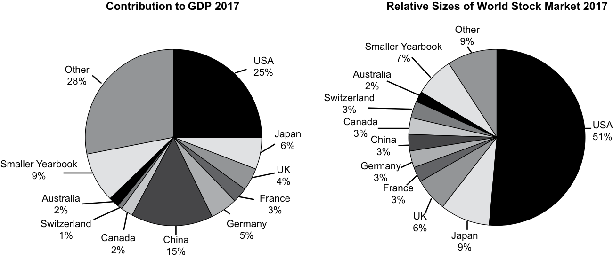
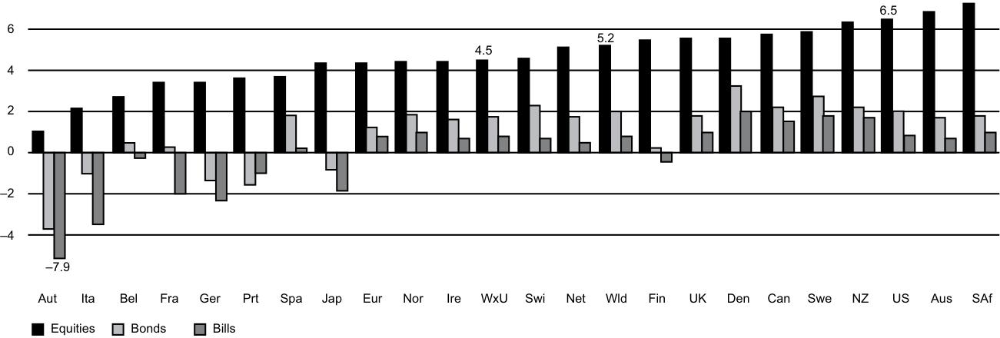
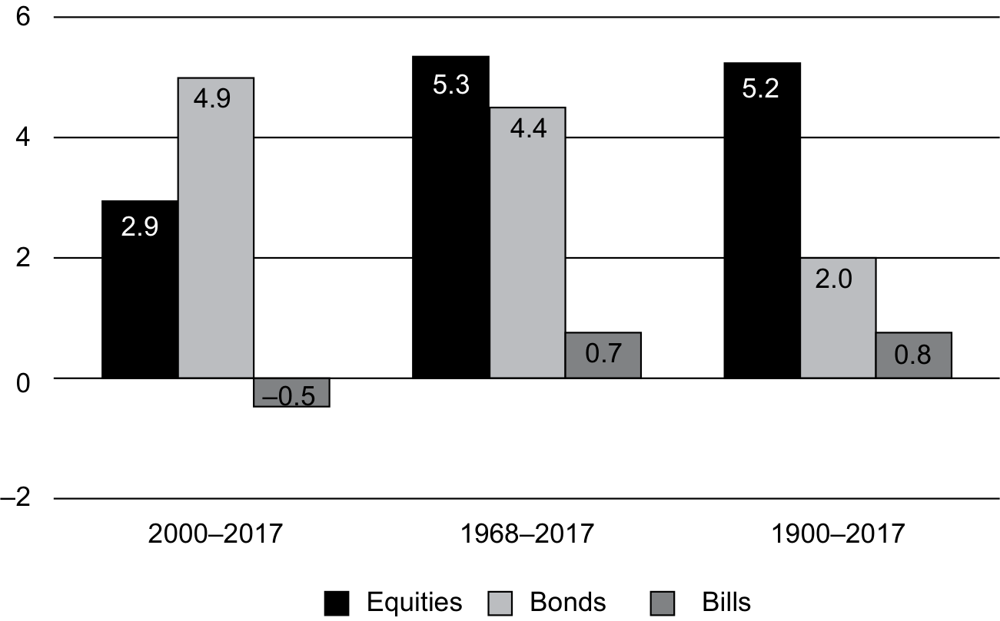
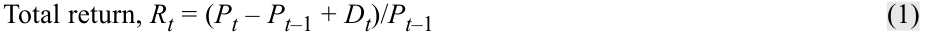
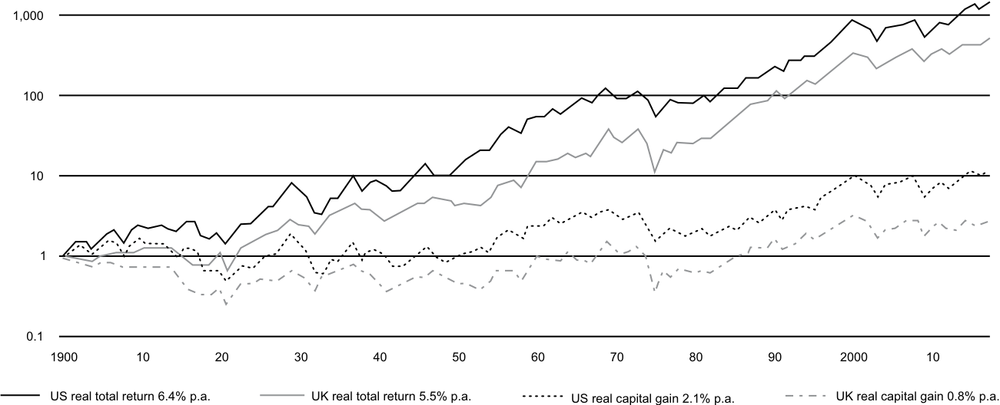
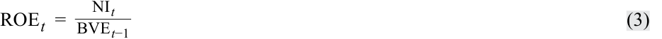
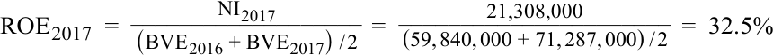

# Tập 5: Đầu tư Cổ phiếu (Equity Investments)
## Learning Module 4 Overview of Equity Securities (Trang PDF 169–206)

---

# Tập 5: Đầu tư Vốn cổ phần (Equity Investments)
## Học phần 4: Tổng quan về Chứng khoán Vốn cổ phần (Overview of Equity Securities)
### Phần 1/3: Tầm quan trọng của Chứng khoán Vốn cổ phần (Trang PDF 169–181)

---

<!-- PDF Page 169 -->

#### H Ọ C P H Ầ N

# **<mark>4</mark>** 

### **Tổng quan về Chứng khoán Vốn cổ phần (*Overview of Equity Securities*)** 

###### **bởi Ryan C. Fuhrmann, CFA, và Asjeet S. Lamba, PhD, CFA.** 

_Ryan C. Fuhrmann, CFA, làm việc tại Fuhrmann Capital LLC (Hoa Kỳ). Asjeet S. Lamba, PhD, CFA, làm việc tại Đại học Melbourne (Úc)._ 

###### **<mark>MỤC TIÊU HỌC TẬP (*LEARNING OUTCOMES*)</mark>** 

|**_Mức độ thành thạo_**|**_Ứng viên cần có khả năng:_**|
|---|---|
||mô tả các đặc điểm của các loại chứng khoán vốn cổ phần (*types of equity securities*)|
||mô tả sự khác biệt về quyền biểu quyết (*voting rights*) và các đặc điểm sở hữu khác giữa các hạng cổ phần (*equity classes*) khác nhau|
||so sánh và đối chiếu chứng khoán vốn cổ phần đại chúng (*public equity securities*) và chứng khoán vốn cổ phần tư nhân (*private equity securities*)|
||mô tả các phương thức đầu tư vào chứng khoán vốn cổ phần nước ngoài (*non-domestic equity securities*)|
||so sánh các đặc điểm rủi ro và tỷ suất sinh lợi (*risk and return characteristics*) của các loại chứng khoán vốn cổ phần khác nhau|
||giải thích vai trò của chứng khoán vốn cổ phần trong việc tài trợ cho tài sản của một công ty|
||đối chiếu giá trị thị trường (*market value*) và giá trị sổ sách (*book value*) của chứng khoán vốn cổ phần|
||so sánh chi phí vốn cổ phần (*cost of equity*) của một công ty, tỷ suất sinh lợi trên vốn chủ sở hữu theo kế toán (*accounting return on equity* – ROE) của công ty đó, và tỷ suất sinh lợi yêu cầu của nhà đầu tư (*investors' required rates of return*)|

##### **TẦM QUAN TRỌNG CỦA CHỨNG KHOÁN VỐN CỔ PHẦN (*IMPORTANCE OF EQUITY SECURITIES*)** 

**<mark>1</mark>** 

Chứng khoán vốn cổ phần (*equity securities*) đại diện cho quyền đòi hỏi sở hữu (*ownership claims*) đối với tài sản thuần (*net assets*) của một công ty. Với tư cách là một loại tài sản (*asset class*), vốn cổ phần đóng vai trò nền tảng trong phân tích đầu tư và quản lý danh mục đầu tư vì nó chiếm một tỷ trọng đáng kể trong nhiều danh mục đầu tư của cá nhân và tổ chức. 

Việc nghiên cứu chứng khoán vốn cổ phần rất quan trọng vì nhiều lý do. Thứ nhất, quyết định phân bổ bao nhiêu phần trăm danh mục đầu tư của khách hàng vào cổ phiếu sẽ ảnh hưởng đến đặc điểm rủi ro và tỷ suất sinh lợi của toàn bộ danh mục đầu tư. Thứ hai, các loại chứng khoán vốn cổ phần khác nhau có quyền đòi hỏi sở hữu khác nhau đối với tài sản thuần của công ty, điều này ảnh hưởng đến đặc điểm rủi ro và tỷ suất sinh lợi của chúng theo những cách khác nhau. Cuối cùng, sự khác biệt trong các tính năng của chứng khoán vốn cổ phần được phản ánh vào giá thị trường của chúng, vì vậy điều quan trọng là phải hiểu được các hàm ý định giá của những tính năng này. 

<!-- PDF Page 170 -->

Bài đọc này cung cấp cái nhìn tổng quan về chứng khoán vốn cổ phần cùng các tính năng khác nhau của chúng, đồng thời thiết lập nền tảng kiến thức cần thiết để phân tích và định giá chứng khoán vốn cổ phần trong bối cảnh toàn cầu. Bài đọc giải quyết các câu hỏi sau: 

- Điều gì phân biệt cổ phần phổ thông (*common shares*) với cổ phần ưu đãi (*preference shares*), và các chứng khoán này phục vụ những mục đích gì trong việc tài trợ cho hoạt động của công ty? 

- Cổ phần ưu đãi có thể chuyển đổi (*convertible preference shares*) là gì, và tại sao chúng thường được sử dụng để huy động vốn cổ phần cho các công ty chưa có bề dày hoạt động (*unseasoned*) hoặc có rủi ro cao? 

- Chứng khoán vốn cổ phần tư nhân (*private equity securities*) là gì, và chúng khác với chứng khoán vốn cổ phần đại chúng (*public equity securities*) như thế nào? 

- Chứng chỉ lưu ký (*depository receipts*) và các loại hình khác nhau của chúng là gì, và cơ sở hợp lý của việc đầu tư vào chúng là gì? 

- Các yếu tố rủi ro liên quan đến việc đầu tư vào chứng khoán vốn cổ phần là gì? 

- Chứng khoán vốn cổ phần tạo ra giá trị công ty như thế nào? 

- Mối quan hệ giữa chi phí vốn cổ phần của một công ty, tỷ suất sinh lợi trên vốn chủ sở hữu (ROE) của công ty đó, và tỷ suất sinh lợi yêu cầu của nhà đầu tư là gì? 

Phần còn lại của bài đọc này được tổ chức như sau. Phần 2 cung cấp tổng quan về các thị trường vốn cổ phần toàn cầu và hiệu quả hoạt động trong lịch sử của chúng. Phần 3 xem xét các loại hình và đặc điểm khác nhau của chứng khoán vốn cổ phần, và Phần 4 phác thảo những điểm khác biệt giữa chứng khoán vốn cổ phần đại chúng và tư nhân. Phần 5 cung cấp tổng quan về các loại chứng khoán vốn cổ phần khác nhau được niêm yết và giao dịch trên các thị trường toàn cầu. Phần 6 thảo luận về các đặc điểm rủi ro và tỷ suất sinh lợi của chứng khoán vốn cổ phần. Phần 7 xem xét vai trò của chứng khoán vốn cổ phần trong việc tạo ra giá trị công ty cũng như mối quan hệ giữa chi phí vốn cổ phần của công ty, tỷ suất sinh lợi trên vốn chủ sở hữu của công ty, và tỷ suất sinh lợi yêu cầu của nhà đầu tư. Phần cuối cùng tóm tắt bài đọc. 

###### **Chứng khoán Vốn cổ phần trên Thị trường Tài chính Toàn cầu (*Equity Securities in Global Financial Markets*)** 

Phần này làm nổi bật tầm quan trọng tương đối và hiệu quả hoạt động của chứng khoán vốn cổ phần với tư cách là một loại tài sản. Chúng ta xem xét tổng giá trị vốn hóa thị trường (*total market capitalization*) và khối lượng giao dịch (*trading volume*) của các thị trường vốn cổ phần toàn cầu cùng mức độ phổ biến của quyền sở hữu cổ phần tại các khu vực địa lý khác nhau. Chúng ta cũng xem xét tỷ suất sinh lợi lịch sử của cổ phiếu và so sánh chúng với tỷ suất sinh lợi của trái phiếu chính phủ (*government bonds*) và tín phiếu kho bạc (*bills*). 

Bảng minh họa 1 (*Exhibit 1*) tóm tắt mức đóng góp của các quốc gia và khu vực địa lý được chọn vào tổng sản phẩm quốc nội (*gross domestic product* – GDP) toàn cầu và vốn hóa thị trường vốn cổ phần toàn cầu. Các nhà phân tích có thể xem xét mối quan hệ giữa vốn hóa thị trường vốn cổ phần và GDP như một chỉ báo sơ bộ để đánh giá liệu thị trường vốn cổ phần toàn cầu (hoặc thị trường vốn cổ phần của một quốc gia hay khu vực cụ thể) đang bị định giá thấp (*undervalued*), định giá cao (*overvalued*), hay định giá hợp lý (*fairly valued*), đặc biệt là khi so sánh với mức trung bình dài hạn của nó. 

Bảng minh họa 1 minh họa giá trị đáng kể mà các nhà đầu tư gắn cho các cổ phiếu được giao dịch công khai so với tổng lượng hàng hóa và dịch vụ được sản xuất trên toàn cầu mỗi năm. Nó cho thấy tầm quan trọng liên tục, và khả năng đại diện vượt mức (*over-representation*) tiềm tàng, của các thị trường vốn cổ phần Hoa Kỳ so với mức đóng góp của chúng vào GDP toàn cầu. Cụ thể, trong khi các thị trường vốn cổ phần Hoa Kỳ đóng góp khoảng 51% vào tổng vốn hóa của các thị trường vốn cổ phần toàn cầu, mức đóng góp của chúng vào GDP toàn cầu chỉ khoảng 25%. Tuy nhiên, sau biến động hỗn loạn của thị trường chứng khoán vào năm 2008, tỷ lệ vốn hóa thị trường trên GDP (*market capitalization to GDP ratio*) của Hoa Kỳ đã giảm xuống còn 59%, thấp hơn đáng kể so với mức trung bình dài hạn là 79%. 

Khi các thị trường vốn cổ phần bên ngoài Hoa Kỳ phát triển và ngày càng mang tính toàn cầu hóa, mức tổng vốn hóa của chúng được kỳ vọng sẽ tăng lên sát hơn với mức đóng góp tương ứng của chúng vào GDP thế giới. Do đó, điều quan trọng là phải hiểu và phân tích chứng khoán vốn cổ phần từ góc độ toàn cầu. 

<!-- PDF Page 171 -->

**Bảng minh họa 1: Đóng góp của Quốc gia và Khu vực vào GDP Toàn cầu và Vốn hóa Thị trường Vốn cổ phần (2017)** 

> **Chú thích hình ảnh:**
> - **Đóng góp vào GDP năm 2017 (*Contribution to GDP 2017*):** Hoa Kỳ (USA) 25%, Trung Quốc (China) 15%, Nhật Bản (Japan) 6%, Đức (Germany) 5%, Vương quốc Anh (UK) 4%, Pháp (France) 3%, Canada 2%, Úc (Australia) 2%, Thụy Sĩ (Switzerland) 1%, Các nước nhỏ hơn trong Niên giám (*Smaller Yearbook*) 9%, Khác (*Other*) 28%.
> - **Quy mô tương đối của Thị trường Chứng khoán Thế giới năm 2017 (*Relative Sizes of World Stock Market 2017*):** Hoa Kỳ (USA) 51%, Nhật Bản (Japan) 9%, Vương quốc Anh (UK) 6%, Pháp (France) 3%, Đức (Germany) 3%, Trung Quốc (China) 3%, Canada 3%, Thụy Sĩ (Switzerland) 3%, Úc (Australia) 2%, Các nước nhỏ hơn trong Niên giám (*Smaller Yearbook*) 9%, Khác (*Other*) 7%.

_Nguồn_: Cơ sở dữ liệu Ngân hàng Thế giới (_The WorldBank Databank_) _2017_, và Dimson, Marsh, và Staunton (2018). 

Bảng minh họa 2 liệt kê 10 thị trường vốn cổ phần hàng đầu vào cuối năm 2017 dựa trên tổng vốn hóa thị trường (tính bằng tỷ đô la Mỹ), khối lượng giao dịch, và số lượng công ty niêm yết.1 Lưu ý rằng thứ hạng có sự khác nhau tùy thuộc vào tiêu chí được sử dụng. Ví dụ, ba thị trường hàng đầu dựa trên tổng vốn hóa thị trường là NYSE Euronext (Hoa Kỳ), NASDAQ OMX, và Japan Exchange Group; tuy nhiên, ba thị trường hàng đầu dựa trên tổng khối lượng giao dịch tính bằng đô la Mỹ lần lượt là Nasdaq OMX, NYSE Euronext (Hoa Kỳ), và Sở Giao dịch Chứng khoán Thâm Quyến (*Shenzhen Stock Exchange*).2 

**Bảng minh họa 2: Các Thị trường Vốn cổ phần Xếp hạng theo Tổng Vốn hóa Thị trường vào Cuối năm 2017 (Tỷ Đô la Mỹ)** 

|**Hạng (*Rank*)**|**Tên Thị trường (*Name of Market*)**|**Tổng Vốn hóa Thị trường bằng Đô la Mỹ (*Total US Dollar Market Capitalization*)**|**Tổng Khối lượng Giao dịch bằng Đô la Mỹ (*Total US Dollar Trading Volume*)**|**Số lượng Công ty Niêm yết (*Number of Listed Companies*)**|
|---|---|---|---|---|
|1|NYSE Euronext (US)|$22.081,4|$16.140,1|2.286|
|2|NASDAQ OMX|$10.039,4|$33.407,1|2.949|
|3|Japan Exchange Groupa|$6.220,0|$6.612,1|3.604|
|4|Shanghai Stock Exchange|$5.084,4|$7.589,3|1.396|
|5|Euronextb|$4.393,0|$1.981,6|1.255|
|6|Hong Kong Exchanges|$4.350,5|$1.958,8|2.118|
|7|Shenzhen Stock Exchanges|$3.617,9|$9.219,7|2.089|
|8|National Stock Exchange of India|$2.351,5|$1.013,3|1.897|

> 1 Vốn hóa thị trường (*market capitalization*) của một cổ phiếu riêng lẻ được tính bằng giá cổ phiếu nhân với số lượng cổ phiếu đang lưu hành (*number of shares outstanding*). Tổng vốn hóa thị trường của một thị trường vốn cổ phần là tổng vốn hóa thị trường của từng cổ phiếu riêng lẻ được niêm yết trên thị trường đó. Tương tự, tổng khối lượng giao dịch của một thị trường vốn cổ phần được tính bằng cách lấy trọng số giá trị (*value weighting*) đối với tổng khối lượng giao dịch của từng cổ phiếu riêng lẻ được niêm yết trên thị trường đó. Tổng khối lượng giao dịch tính bằng đô la được tính bằng giá cổ phiếu trung bình nhân với số lượng cổ phiếu được giao dịch.
> 2 NASDAQ là từ viết tắt của Hiệp hội Quốc gia các Nhà kinh doanh Chứng khoán Báo giá Tự động (*National Association of Securities Dealers Automated Quotations*). 

<!-- PDF Page 172 -->

|**Hạng (*Rank*)**|**Tên Thị trường (*Name of Market*)**|**Tổng Vốn hóa Thị trường bằng Đô la Mỹ (*Total US Dollar Market Capitalization*)**|**Tổng Khối lượng Giao dịch bằng Đô la Mỹ (*Total US Dollar Trading Volume*)**|**Số lượng Công ty Niêm yết (*Number of Listed Companies*)**|
|---|---|---|---|---|
|9|BSE Limitedc|$2.331,6|$183,0|5.616|
|10|Deutsche Börse|$2.262,2|$1.497,9|499|

_Ghi chú:_ 

a Japan Exchange Group là pháp nhân hợp nhất bao gồm Sở Giao dịch Chứng khoán Tokyo (*Tokyo Stock Exchange*) và Sở Giao dịch Chứng khoán Osaka (*Osaka Securities Exchange*). 

b Từ năm 2001, bao gồm Hà Lan, Pháp, Anh, Bỉ, và Bồ Đào Nha. 

c Sở Giao dịch Chứng khoán Bombay (*Bombay Stock Exchange*). 

_Nguồn:_ Hiệu chỉnh từ _Báo cáo năm 2017 của Liên đoàn các Sở Giao dịch Chứng khoán Thế giới_ (_World Federation of Exchanges 2017 Report_, xem http://www.world-exchanges.org). Lưu ý rằng vốn hóa thị trường theo công ty được tính bằng cách nhân giá cổ phiếu của công ty đó với số lượng cổ phiếu đang lưu hành. Tổng vốn hóa của toàn thị trường là tổng gộp vốn hóa thị trường của tất cả các công ty được giao dịch trên thị trường đó. Số lượng công ty niêm yết bao gồm cả các công ty trong nước và nước ngoài có cổ phần giao dịch trên các thị trường này. 

Bảng minh họa 3 so sánh tỷ suất sinh lợi ghép lãi _thực_ (*real compounded returns* – hay đã điều chỉnh theo lạm phát) của trái phiếu chính phủ, tín phiếu chính phủ, và chứng khoán vốn cổ phần tại 21 quốc gia cùng với chỉ số thế giới (“Wld”), thế giới ngoại trừ Hoa Kỳ (“WxU”), và Châu Âu (“Eur”) trong suốt 118 năm từ 1900–2017.3 Xét theo giá trị thực, trái phiếu và tín phiếu chính phủ về cơ bản đã theo kịp tỷ lệ lạm phát, mang lại tỷ suất sinh lợi thực hàng năm dưới 2% ở hầu hết các quốc gia.4 Để so sánh, tỷ suất sinh lợi thực trên các thị trường vốn cổ phần nhìn chung đạt khoảng 3,5% mỗi năm ở hầu hết các thị trường—với tỷ suất sinh lợi trung bình toàn cầu vào khoảng 5,2% và tỷ suất sinh lợi trung bình toàn cầu ngoại trừ Hoa Kỳ ở mức xấp xỉ dưới 5%. Trong giai đoạn này, Nam Phi và Úc là những thị trường có hiệu quả hoạt động tốt nhất, tiếp theo là Hoa Kỳ, New Zealand, và Thụy Điển. 

**Bảng minh họa 3: Tỷ suất Sinh lợi Thực của Chứng khoán Vốn cổ phần, Trái phiếu và Tín phiếu Toàn cầu trong Giai đoạn 1900–2017** 

> **Chú thích hình ảnh:** Biểu đồ so sánh tỷ suất sinh lợi thực hàng năm (%) của Cổ phiếu (*Equities*), Trái phiếu (*Bonds*) và Tín phiếu (*Bills*) tại các quốc gia và khu vực (Aut, Ita, Bel, Fra, Ger, Prt, Spa, Jap, Eur, Nor, Ire, WxU, Swi, Net, Wld, Fin, UK, Den, Can, Swe, NZ, US, Aus, SAf) trong giai đoạn 1900–2017, với trục tung từ -7,9% đến 6,5%.

_Nguồn_: Dimson, Marsh, và Staunton (2018). 

> 3 Tỷ suất sinh lợi thực (*real return*) của một chứng khoán được tính xấp xỉ bằng cách lấy tỷ suất sinh lợi danh nghĩa (*nominal return*) trừ đi tỷ lệ lạm phát quan sát được tại quốc gia đó. 
> 4 Các trường hợp ngoại lệ là Áo, Bỉ, Phần Lan, Pháp, Đức, Bồ Đào Nha, và Ý—nơi tỷ suất sinh lợi thực trung bình của trái phiếu và/hoặc tín phiếu chính phủ mang giá trị âm. Nhìn chung, kết quả hoạt động đó phản ánh tỷ lệ lạm phát rất cao tại các quốc gia này trong những năm Chiến tranh Thế giới. 

<!-- PDF Page 173 -->

Bảng minh họa 4 cho thấy tỷ suất sinh lợi thực hàng năm của các loại tài sản chính đối với chỉ số thế giới trong giai đoạn 1900–2017. 

**Bảng minh họa 4: Tỷ suất Sinh lợi Thực Hàng năm của các Loại Tài sản đối với Chỉ số Thế giới, 1900–2017** 

> **Chú thích hình ảnh:** Biểu đồ cột thể hiện tỷ suất sinh lợi thực hàng năm (%) của Cổ phiếu (*Equities*), Trái phiếu (*Bonds*) và Tín phiếu (*Bills*) trong 3 giai đoạn:
> - **2000–2017:** Cổ phiếu 2,9%, Trái phiếu 4,9%, Tín phiếu -0,5%.
> - **1968–2017:** Cổ phiếu 5,3%, Trái phiếu 4,4%, Tín phiếu 0,7%.
> - **1900–2017:** Cổ phiếu 5,2%, Trái phiếu 2,0%, Tín phiếu 0,8%.

_Nguồn_: Dimson, Marsh, và Staunton (2018). 

Mức độ biến động (*volatility*) trong tỷ suất sinh lợi của thị trường tài sản được làm rõ hơn nữa trong Bảng minh họa 5, thể hiện phần bù rủi ro (*risk premia*) hàng năm của vốn cổ phần so với trái phiếu (EP Bonds), và vốn cổ phần so với tín phiếu kho bạc (EP Bills). Phần bù kỳ hạn (*maturity premium*) của tỷ suất sinh lợi trái phiếu chính phủ so với tỷ suất sinh lợi tín phiếu kho bạc (Mat Prem) cũng được hiển thị. 

Những quan sát và dữ liệu lịch sử này nhất quán với khái niệm rằng tỷ suất sinh lợi của chứng khoán có liên quan trực tiếp đến mức độ rủi ro. Nghĩa là, chứng khoán vốn cổ phần có mức độ rủi ro cao hơn khi so sánh với trái phiếu và tín phiếu chính phủ, chúng mang lại tỷ suất sinh lợi cao hơn để đền bù cho các nhà đầu tư vì những mức độ rủi ro cao hơn này, và chúng cũng có xu hướng biến động nhiều hơn theo thời gian. 

<!-- PDF Page 174 -->

###### **Bảng minh họa 5: Tỷ suất Sinh lợi Thực Hàng năm của các Loại Tài sản và Phần bù Rủi ro đối với Chỉ số Thế giới từ 1900–2017** 

> **Chú thích hình ảnh:**
> - **Biểu đồ bên trái – Tỷ suất sinh lợi thực hàng năm của các loại tài sản (*Annualized Real Returns on Asset Classes*):**
>   - 2000–2017: Cổ phiếu (*Equities*) 2,9%, Trái phiếu (*Bonds*) 4,9%, Tín phiếu (*Bills*) -0,5%.
>   - 1968–2017: Cổ phiếu 5,3%, Trái phiếu 4,4%, Tín phiếu 0,7%.
>   - 1900–2017: Cổ phiếu 5,2%, Trái phiếu 2,0%, Tín phiếu 0,8%.
> - **Biểu đồ bên phải – Tỷ suất sinh lợi thực hàng năm của phần bù rủi ro (*Annualized Real Returns on Risk Premiums*):**
>   - 1968–2017: EP Bonds 0,8%, EP Bills 4,5%, MatPrem 3,7%, RealXRate 0,0%.
>   - 1900–2017: EP Bonds 3,2%, EP Bills 4,3%, MatPrem 1,1%, RealXRate 0,0%.

_Ghi chú_: Cổ phiếu (*Equities*) là tổng tỷ suất sinh lợi, bao gồm thu nhập cổ tức được tái đầu tư. Trái phiếu (*Bonds*) là tổng tỷ suất sinh lợi, bao gồm tiền lãi coupon được tái đầu tư, của trái phiếu chính phủ dài hạn. Tín phiếu (*Bills*) biểu thị tổng tỷ suất sinh lợi, bao gồm bất kỳ khoản thu nhập nào, từ tín phiếu Kho bạc. Tất cả tỷ suất sinh lợi đều được điều chỉnh theo lạm phát và được biểu thị dưới dạng tỷ suất sinh lợi trung bình nhân (*geometric mean returns*). EP Bonds biểu thị phần bù rủi ro vốn cổ phần (*equity risk premium*) so với trái phiếu chính phủ dài hạn. EP Bills biểu thị phần bù vốn cổ phần so với tín phiếu Kho bạc. MatPrem biểu thị phần bù kỳ hạn (*maturity premium*) của tỷ suất sinh lợi trái phiếu chính phủ so với tỷ suất sinh lợi tín phiếu. RealXRate biểu thị mức thay đổi thực (đã điều chỉnh theo lạm phát) của tỷ giá hối đoái so với đồng đô la Mỹ. 

_Nguồn_: Dimson, Marsh, và Staunton (2018). 

Với mức độ rủi ro cao gắn liền với chứng khoán vốn cổ phần, thật hợp lý khi kỳ vọng rằng mức độ chấp nhận rủi ro (*risk tolerance*) của các nhà đầu tư sẽ có xu hướng khác nhau giữa các thị trường vốn cổ phần. Điều này được minh họa trong Bảng minh họa 6, trình bày kết quả của một loạt các nghiên cứu do Sở Giao dịch Chứng khoán Úc (*Australian Securities Exchange*) thực hiện về sự khác biệt quốc tế trong quyền sở hữu vốn cổ phần. Trong giai đoạn 2004–2014, tỷ lệ sở hữu vốn cổ phần tính theo phần trăm dân số thấp nhất ở Hàn Quốc (trung bình 9,0%), tiếp theo là Đức (14,5%) và Thụy Điển (17,7%). Ngược lại, Úc và New Zealand có tỷ lệ sở hữu vốn cổ phần tính theo phần trăm dân số cao nhất (trung bình hơn 20%). Ngoài ra, đã có sự sụt giảm tương đối về quyền sở hữu cổ phần ở một số quốc gia trong những năm gần đây, điều này không có gì đáng ngạc nhiên trước sự bất định chung gần đây của các nền kinh tế toàn cầu và sự biến động trên các thị trường vốn cổ phần do sự bất định này tạo ra. 

**Bảng minh họa 6: So sánh Quốc tế về Quyền Sở hữu Cổ phiếu: 2004–2014****5** 

||**2004**|**2006**|**2008**|**2010**|**2012**|**2014**|
|---|---|---|---|---|---|---|
|Úc – Trực tiếp/Gián tiếp (*Australia – Direct/Indirect*)|55%|46%|41%|43%|38%|36%|
|Hàn Quốc – Cổ phần (*South Korea – Shares*)|8|7|10|10|10|N/A|
|Đức – Cổ phần/Quỹ (*Germany – Shares/Funds*)|16|16|14|13|15|13|
|Thụy Điển – Cổ phần (*Sweden – Shares*)|22|20|18|17|15|14|
|Vương quốc Anh – Cổ phần/Quỹ (*United Kingdom – Shares/Funds*)|22|20|18|N/A|17|N/A|
|New Zealand – Trực tiếp (*New Zealand – Direct*)|23|26|N/A|22|23|26|

> 5 Các tỷ lệ phần trăm được báo cáo trong bảng minh họa dựa trên mẫu khảo sát dân số trưởng thành ở mỗi quốc gia sở hữu chứng khoán vốn cổ phần trực tiếp hoặc gián tiếp thông qua các quỹ đầu tư hoặc quỹ hưu trí. Ví dụ, 36% dân số trưởng thành của Úc vào năm 2014 (xấp xỉ 6,5 triệu người) sở hữu chứng khoán vốn cổ phần trực tiếp hoặc gián tiếp. Như đã lưu ý trong nghiên cứu, việc đưa ra các so sánh tuyệt đối giữa các quốc gia là không phù hợp do sự khác biệt về phương pháp luận, cách lấy mẫu, thời điểm và các định nghĩa được sử dụng ở các quốc gia khác nhau. Tuy nhiên, có thể xác định được xu hướng qua các quốc gia khác nhau. 

<!-- PDF Page 175 -->

_Nguồn:_ Hiệu chỉnh từ _Nghiên cứu Quyền sở hữu Cổ phần tại Úc năm 2014_ (_2014 Australian Share Ownership Study_) do Sở Giao dịch Chứng khoán Úc thực hiện (xem http://www.asx.com.au). Đối với Úc và Hoa Kỳ, dữ liệu liên quan đến quyền sở hữu trực tiếp và gián tiếp trên các thị trường vốn cổ phần; đối với các quốc gia khác, dữ liệu liên quan đến quyền sở hữu trực tiếp đối với cổ phần và các quỹ cổ phần. Dữ liệu không có sẵn trong các năm cụ thể được hiển thị là “N/A.” 

Một hàm ý quan trọng từ cuộc thảo luận trên là chứng khoán vốn cổ phần đại diện cho một loại tài sản chủ chốt đối với các nhà đầu tư toàn cầu vì các đặc điểm tỷ suất sinh lợi và rủi ro độc đáo của chúng. Tiếp theo, chúng ta sẽ xem xét các loại chứng khoán vốn cổ phần khác nhau được giao dịch trên các thị trường toàn cầu và những đặc điểm nổi bật của chúng. 

##### **ĐẶC ĐIỂM CỦA CHỨNG KHOÁN VỐN CỔ PHẦN (*CHARACTERISTICS OF EQUITY SECURITIES*)** 

## **<mark>2</mark>** 

- mô tả các đặc điểm của các loại chứng khoán vốn cổ phần (*types of equity securities*)
- mô tả sự khác biệt về quyền biểu quyết (*voting rights*) và các đặc điểm sở hữu khác giữa các hạng cổ phần (*equity classes*) khác nhau

Các công ty tài trợ cho hoạt động của mình bằng cách phát hành chứng khoán nợ (*debt securities*) hoặc chứng khoán vốn cổ phần (*equity securities*). Một điểm khác biệt cốt lõi giữa các chứng khoán này là nợ là một khoản nợ phải trả (*liability*) của công ty phát hành, trong khi vốn cổ phần thì không. Điều này có nghĩa là khi một công ty phát hành nợ, công ty có nghĩa vụ theo hợp đồng phải hoàn trả số tiền đã vay (tức là nợ gốc hay mệnh giá của khoản nợ) vào một ngày xác định trong tương lai. Chi phí sử dụng nguồn vốn này được gọi là tiền lãi (*interest*), khoản tiền mà công ty có nghĩa vụ theo hợp đồng phải thanh toán cho đến khi khoản nợ đáo hạn hoặc được tất toán. 

Khi công ty phát hành chứng khoán vốn cổ phần, công ty không có nghĩa vụ theo hợp đồng phải hoàn trả số tiền nhận được từ các cổ đông, cũng như không có nghĩa vụ theo hợp đồng phải thực hiện các khoản thanh toán định kỳ cho cổ đông để đổi lấy việc sử dụng vốn của họ. Thay vào đó, các cổ đông có quyền đòi hỏi đối với tài sản của công ty sau khi tất cả các khoản nợ phải trả đã được thanh toán. Do quyền đòi hỏi phần còn lại (*residual claim*) này, các cổ đông nắm giữ vốn cổ phần được coi là những người chủ sở hữu của công ty. Các nhà đầu tư mua chứng khoán vốn cổ phần tìm kiếm tổng tỷ suất sinh lợi (*total return* – tức là sự tăng giá vốn hay tăng giá cổ phiếu cùng với thu nhập cổ tức), trong khi các nhà đầu tư mua chứng khoán nợ (và nắm giữ đến khi đáo hạn) tìm kiếm thu nhập lãi vay. Do đó, các nhà đầu tư vốn cổ phần kỳ vọng ban giám đốc công ty hành động vì lợi ích tốt nhất của họ thông qua việc đưa ra các quyết định điều hành nhằm tối đa hóa giá thị trường của cổ phần (tức là tài sản của cổ đông – *shareholder wealth*). 

Ngoài cổ phần phổ thông (*common shares*, còn được gọi là cổ phần thường – *ordinary shares* hoặc cổ phiếu phổ thông – *common stock*), các công ty cũng có thể phát hành cổ phần ưu đãi (*preference shares*, còn được gọi là cổ phiếu ưu đãi – *preferred stock*), loại chứng khoán vốn cổ phần còn lại. Các phần tiếp theo sẽ thảo luận về các loại hình và đặc điểm khác nhau của chứng khoán vốn cổ phần phổ thông và ưu đãi. 

###### **Cổ phần Phổ thông (*Common Shares*)** 

**Cổ phần phổ thông (*Common shares*)** đại diện cho lợi ích sở hữu trong một công ty và là loại chứng khoán vốn cổ phần chiếm ưu thế nhất. Theo đó, các nhà đầu tư cùng chia sẻ kết quả hoạt động kinh doanh của công ty, tham gia vào quá trình quản trị thông qua quyền biểu quyết (*voting rights*), và có quyền đòi hỏi đối với tài sản thuần của công ty trong trường hợp thanh lý (*liquidation*). Các công ty có thể chọn chi trả một phần hoặc toàn bộ lợi nhuận ròng (*net income*) của mình dưới dạng cổ tức tiền mặt (*cash dividends*) cho các cổ đông phổ thông, nhưng họ không có nghĩa vụ theo hợp đồng phải làm như vậy.6 

> 6 Các công ty cũng có thể chi trả cổ tức nhiều hơn mức lợi nhuận ròng của kỳ hiện tại. Tuy nhiên, những chính sách chi trả như vậy nhìn chung không bền vững trong dài hạn. 

<!-- PDF Page 176 -->

Quyền biểu quyết mang lại cho các cổ đông cơ hội tham gia vào các quyết định quản trị doanh nghiệp lớn, bao gồm việc bầu hội đồng quản trị (*board of directors*), quyết định sáp nhập hoặc thâu tóm một công ty khác, và lựa chọn kiểm toán viên độc lập bên ngoài. Việc biểu quyết của cổ đông thường diễn ra trong cuộc họp đại hội đồng cổ đông thường niên (*annual meeting*) của công ty. Do những hạn chế về mặt địa lý và số lượng cổ đông lớn, việc các cổ đông trực tiếp tham dự cuộc họp thường niên thường không khả thi. Vì lý do này, các cổ đông có thể **biểu quyết thông qua ủy quyền (*vote by proxy*)**, cho phép một bên được chỉ định—chẳng hạn như một cổ đông khác, một đại diện cổ đông, hoặc ban giám đốc—thay mặt cổ đông thực hiện biểu quyết. 

Hình thức biểu quyết thông thường của cổ đông, trong đó mỗi cổ phần đại diện cho một phiếu bầu, được gọi là **biểu quyết theo luật định (*statutory voting*)**. Mặc dù đây là phương thức biểu quyết phổ biến, nhưng nó không phải lúc nào cũng là phương thức phù hợp nhất để bầu hội đồng quản trị. Để phục vụ tốt hơn cho những cổ đông sở hữu số lượng cổ phần nhỏ, **biểu quyết dồn phiếu (*cumulative voting*)** thường được sử dụng. Biểu quyết dồn phiếu cho phép cổ đông dồn tổng số quyền biểu quyết của mình cho các ứng viên cụ thể, thay vì phải phân bổ đều quyền biểu quyết cho tất cả các ứng viên. Tổng quyền biểu quyết dựa trên số lượng cổ phần sở hữu nhân với số lượng thành viên hội đồng quản trị được bầu. Ví dụ, theo phương thức biểu quyết dồn phiếu, nếu có 4 thành viên hội đồng quản trị được bầu, một cổ đông sở hữu 100 cổ phần sẽ có 400 phiếu bầu và có thể dồn cả 400 phiếu bầu cho một ứng viên duy nhất hoặc phân bổ chúng cho các ứng viên theo bất kỳ tỷ lệ nào. Ngược lại, theo phương thức biểu quyết theo luật định, cổ đông đó sẽ chỉ có thể bỏ tối đa 100 phiếu bầu cho mỗi ứng viên. 

Lợi ích cốt lõi của biểu quyết dồn phiếu là cho phép các cổ đông nắm giữ số lượng cổ phần nhỏ áp dụng toàn bộ số phiếu bầu của mình cho một ứng viên, qua đó mang lại cơ hội có được mức độ đại diện cao hơn trong hội đồng quản trị so với những gì được phép theo phương thức biểu quyết theo luật định. 

Bảng minh họa 7 mô tả các quyền của cổ đông Tập đoàn Viacom (*Viacom Corporation*). Trong trường hợp này, cấu trúc cổ phần kép (*dual-share arrangement*) cho phép vị chủ tịch sáng lập và gia đình ông kiểm soát hơn 70% quyền biểu quyết thông qua việc sở hữu cổ phần Hạng A (*Class A shares*). Cấu trúc này trao cho họ khả năng thực thi quyền kiểm soát đối với quá trình bầu cử hội đồng quản trị, việc ra quyết định của công ty, và các khía cạnh quan trọng khác trong việc điều hành công ty. Một thỏa thuận biểu quyết dồn phiếu dành cho bất kỳ cổ đông thiểu số nào nắm giữ cổ phần Hạng A sẽ giúp cải thiện mức độ đại diện của họ trong hội đồng quản trị. 

###### **Bảng minh họa 7: Thỏa thuận Hạng Cổ phần tại Tập đoàn Viacom****7** 

Viacom có hai hạng cổ phiếu phổ thông: Hạng A (*Class A*), là cổ phiếu có quyền biểu quyết (*voting stock*), và Hạng B (*Class B*), là cổ phiếu không có quyền biểu quyết (*non-voting stock*). Không có sự khác biệt nào giữa hai hạng cổ phiếu này ngoại trừ quyền biểu quyết; chúng thường giao dịch trong một biên độ giá sát nhau. Tuy nhiên, có nhiều cổ phần Hạng B đang lưu hành hơn hẳn, nên hầu hết các giao dịch diễn ra ở hạng cổ phần này. 

- **Quyền biểu quyết (*Voting Rights*)** — Người nắm giữ cổ phiếu phổ thông Hạng A được hưởng một phiếu bầu trên mỗi cổ phần. Người nắm giữ cổ phiếu phổ thông Hạng B không có bất kỳ quyền biểu quyết nào, ngoại trừ trường hợp luật pháp bang Delaware yêu cầu. Nhìn chung, tất cả các vấn đề cần được cổ đông Viacom biểu quyết phải được thông qua bởi đa số tổng quyền biểu quyết của các cổ phần phổ thông Hạng A có mặt trực tiếp hoặc được đại diện theo ủy quyền, ngoại trừ trường hợp luật pháp bang Delaware yêu cầu. 

- **Cổ tức (*Dividends*)** — Các cổ đông nắm giữ cổ phiếu phổ thông Hạng A và cổ phiếu phổ thông Hạng B sẽ được chia sẻ theo tỷ lệ tương ứng (*share ratably*) đối với bất kỳ khoản cổ tức tiền mặt nào do Hội đồng Quản trị công bố, tùy thuộc vào bất kỳ quyền ưu đãi nào của bất kỳ 

> 7 Thông tin này được hiệu chỉnh từ trang web quan hệ nhà đầu tư của Viacom và hồ sơ 10-K nộp cho Ủy ban Chứng khoán và Giao dịch Hoa Kỳ (SEC); xem www.viacom.com. 

<!-- PDF Page 177 -->

cổ phiếu ưu đãi đang lưu hành nào. Viacom hiện không trả cổ tức tiền mặt, và bất kỳ quyết định trả cổ tức tiền mặt nào trong tương lai sẽ tùy thuộc vào quyết định của Hội đồng Quản trị và phụ thuộc vào nhiều yếu tố. 

- **Chuyển đổi (*Conversion*)** — Chừng nào còn 5.000 cổ phần phổ thông Hạng A đang lưu hành, mỗi cổ phần phổ thông Hạng A sẽ có thể được chuyển đổi theo quyền chọn của người nắm giữ cổ phần đó thành một cổ phần phổ thông Hạng B. 

- **Quyền khi thanh lý (*Liquidation Rights*)** — Trong trường hợp thanh lý, giải thể, hoặc chấm dứt hoạt động của Viacom, tất cả các cổ đông nắm giữ cổ phiếu phổ thông, bất kể thuộc hạng nào, sẽ có quyền chia sẻ theo tỷ lệ tương ứng đối với bất kỳ tài sản nào sẵn có để phân phối cho các cổ đông nắm giữ cổ phần phổ thông của Viacom, tùy thuộc vào các quyền ưu đãi của bất kỳ cổ phiếu ưu đãi đang lưu hành nào. 

- **Chia tách, Phân nhỏ, hoặc Gộp cổ phần (*Split, Subdivision, or Combination*)** — Trong trường hợp chia tách, phân nhỏ, hoặc gộp các cổ phần đang lưu hành của cổ phiếu phổ thông Hạng A hoặc cổ phiếu phổ thông Hạng B, các cổ phần đang lưu hành của hạng cổ phiếu phổ thông còn lại sẽ được phân chia theo tỷ lệ tương ứng. 

- **Quyền mua trước (*Preemptive Rights*)** — Cổ phần phổ thông Hạng A và cổ phần phổ thông Hạng B không trao cho cổ đông bất kỳ quyền mua trước nào cho phép cổ đông đăng ký mua hoặc nhận cổ phần thuộc bất kỳ hạng cổ phiếu nào hoặc bất kỳ chứng khoán nào khác có thể chuyển đổi thành cổ phần thuộc bất kỳ hạng cổ phiếu nào của Viacom. 

Như đã thấy trong Bảng minh họa 7, các công ty có thể phát hành các hạng cổ phần phổ thông khác nhau (cổ phần Hạng A và Hạng B), với mỗi hạng cổ phần mang lại các quyền sở hữu khác nhau.8 Ví dụ, như được thể hiện trong Bảng minh họa 8, Công ty Ford Motor (*Ford Motor Company*) có cổ phần Hạng A (“Cổ phiếu Phổ thông” – *Common Stock*), thuộc sở hữu của công chúng đầu tư. Công ty cũng có cổ phần Hạng B, chỉ thuộc sở hữu của gia đình Ford. Bảng minh họa chứa một đoạn trích từ _Báo cáo Thường niên năm 2017_ của Ford (trang 144). Cổ đông Hạng A có 60% quyền biểu quyết, trong khi cổ đông Hạng B có 40%. Tuy nhiên, trong trường hợp thanh lý, các cổ đông Hạng B sẽ không chỉ nhận được 0,50 đô la Mỹ đầu tiên trên mỗi cổ phần sẵn có để phân phối (giống như các cổ đông Hạng A), mà họ còn nhận được 1,00 đô la Mỹ tiếp theo trên mỗi cổ phần sẵn có để phân phối trước khi các cổ đông Hạng A nhận được thêm bất kỳ khoản nào khác. Như vậy, cổ đông Hạng B có cơ hội nhận được tỷ trọng phân phối tài sản khi thanh lý lớn hơn so với cổ đông Hạng A.9 

###### **Bảng minh họa 8: Thỏa thuận Hạng Cổ phần tại Công ty Ford Motor****10** 

###### **THUYẾT MINH 21. VỐN CỔ PHẦN VÀ CÁC KHOẢN TÍNH TRÊN MỖI CỔ PHẦN (*NOTE 21. CAPITAL STOCK AND AMOUNTS PER SHARE*)** 

Toàn bộ quyền biểu quyết chung được trao cho những người nắm giữ Cổ phiếu Phổ thông (*Common Stock*) và Cổ phiếu Hạng B (*Class B Stock*). Những người nắm giữ Cổ phiếu Phổ thông của chúng tôi có 60% quyền biểu quyết chung và những người nắm giữ Cổ phiếu Hạng B của chúng tôi được hưởng số phiếu bầu trên mỗi cổ phần sao cho 

> 8 Tại một số quốc gia, bao gồm cả Hoa Kỳ, các công ty có thể phát hành các hạng cổ phần khác nhau, trong đó cổ phần Hạng A là phổ biến nhất. Vai trò và chức năng của các hạng cổ phần khác nhau được mô tả chi tiết hơn trong Bảng minh họa 8. 
> 9 Ví dụ, nếu có 2,00 đô la Mỹ trên mỗi cổ phần sẵn có để phân phối, các cổ đông Cổ phiếu Phổ thông (Hạng A) sẽ nhận được 0,50 đô la Mỹ trên mỗi cổ phần, trong khi các cổ đông Hạng B sẽ nhận được 1,50 đô la Mỹ trên mỗi cổ phần. Tuy nhiên, nếu có 3,50 đô la Mỹ trên mỗi cổ phần sẵn có để phân phối, các cổ đông Cổ phiếu Phổ thông sẽ nhận được tổng cộng 1,50 đô la Mỹ trên mỗi cổ phần và các cổ đông Hạng B sẽ nhận được tổng cộng 2,00 đô la Mỹ trên mỗi cổ phần. 
> 10 Trích xuất từ _Báo cáo Thường niên năm 2017_ của Công ty Ford Motor (http://s22.q4cdn.com/857684434/files/doc_financials/2017/annual/Final-Annual-Report-2017.pdf). 

<!-- PDF Page 178 -->

mang lại cho họ 40% còn lại. Các cổ phần của Cổ phiếu Phổ thông và Cổ phiếu Hạng B được chia sẻ ngang nhau đối với cổ tức khi và vào lúc được chi trả, với cổ tức bằng cổ phiếu (*stock dividends*) được trả bằng các cổ phần thuộc chính hạng cổ phiếu đang nắm giữ. 

Nếu bị thanh lý, mỗi cổ phần Cổ phiếu Phổ thông được hưởng 0,50 đô la đầu tiên sẵn có để phân phối cho những người nắm giữ Cổ phiếu Phổ thông và Cổ phiếu Hạng B, mỗi cổ phần Cổ phiếu Hạng B được hưởng 1,00 đô la tiếp theo sẵn có, mỗi cổ phần Cổ phiếu Phổ thông được hưởng 0,50 đô la tiếp theo sẵn có, và mỗi cổ phần Cổ phiếu Phổ thông và Cổ phiếu Hạng B được hưởng một khoản ngang nhau sau đó. 

###### **Cổ phần Ưu đãi (*Preference Shares*)** 

**Cổ phần ưu đãi (*Preference shares*)** (hay cổ phiếu ưu đãi – *preferred stock*) được xếp hạng cao hơn cổ phần phổ thông xét về mặt chi trả cổ tức và phân phối tài sản thuần của công ty khi thanh lý.11 Tuy nhiên, các cổ đông ưu đãi nhìn chung không được chia sẻ kết quả hoạt động kinh doanh của công ty và không có bất kỳ quyền biểu quyết nào, trừ khi được cho phép một cách rõ ràng khi phát hành. Cổ phần ưu đãi mang đặc điểm của cả chứng khoán nợ và cổ phần phổ thông. Tương tự như các khoản thanh toán lãi vay của chứng khoán nợ, cổ tức của cổ phần ưu đãi là cố định và nhìn chung cao hơn cổ tức của cổ phần phổ thông. Tuy nhiên, không giống như các khoản thanh toán lãi vay, cổ tức ưu đãi không phải là nghĩa vụ theo hợp đồng của công ty. Tương tự như cổ phần phổ thông, cổ phần ưu đãi có thể là vĩnh viễn (*perpetual* – tức là không có ngày đáo hạn cố định), có thể trả cổ tức vô thời hạn, và có thể kèm quyền mua lại (*callable*) hoặc kèm quyền bán lại (*putable*). 

Bảng minh họa 9 cung cấp một ví dụ về cổ phần ưu đãi kèm quyền mua lại (*callable preference shares*) do Quỹ GDL (*GDL Fund*) phát hành nhằm huy động vốn để mua lại các Cổ phần Ưu đãi Loạt B (*Series B Preferred shares*) đang lưu hành còn lại. Trong trường hợp này, người mua cổ phần sẽ nhận được khoản cổ tức định kỳ từ Quỹ GDL. Nếu Quỹ GDL chọn mua lại số cổ phần này, quỹ phải thực hiện ở mức giá ưu đãi thanh lý (*liquidation preference price*) là 50 đô la một cổ phần. Người mua cổ phần cũng có quyền bán lại (*put back*) số cổ phần đó cho GDL ở mức giá 50 đô la một cổ phần. 

###### **Bảng minh họa 9: Đợt chào bán Cổ phiếu Kèm quyền mua lại của Quỹ GDL****12** 

RYE, NY—Ngày 26 tháng 3 năm 2018—Quỹ GDL (NYSE:GDL) (“Quỹ”) vui mừng thông báo về việc hoàn tất đợt chào bán quyền mua cổ phần (“Đợt chào bán” – *the “Offering”*), trong đó Quỹ đã phát hành 2.624.025 Cổ phần Ưu đãi Tích lũy Kèm quyền bán lại và Kèm quyền mua lại Loạt C (*Series C Cumulative Puttable and Callable Preferred Shares* – “Cổ phần Ưu đãi Loạt C”), với tổng giá trị là 131.201.250 đô la. Theo Đợt chào bán này, Quỹ đã phát hành một quyền mua không thể chuyển nhượng (“Quyền mua” – *a “Right”*) cho mỗi Cổ phần Ưu đãi Tích lũy Kèm quyền bán lại và Kèm quyền mua lại Loạt B đang lưu hành (“Cổ phần Ưu đãi Loạt B”) của Quỹ cho các cổ đông nắm giữ Cổ phần Ưu đãi Loạt B có tên trong danh sách chốt quyền tính đến ngày 14 tháng 2 năm 2018. Những người nắm giữ Quyền mua có quyền mua Cổ phần Ưu đãi Loạt C bằng bất kỳ sự kết hợp nào giữa tiền mặt hoặc nộp lại Cổ phần Ưu đãi Loạt B theo mức giá ưu đãi thanh lý. Do đó, cần có một Quyền mua cộng với 50,00 đô la, hoặc một Quyền mua cộng với một cổ phần thuộc Cổ phần Ưu đãi Loạt B có giá trị thanh lý là 50,00 đô la mỗi cổ phần, để mua mỗi cổ phần thuộc Cổ phần Ưu đãi Loạt C. Đợt chào bán đã hết hạn vào lúc 5:00 chiều theo Giờ Miền Đông vào ngày 20 tháng 3 năm 2018. 

> 11 Cổ phần ưu đãi có mức độ ưu tiên thấp hơn nợ trong trường hợp thanh lý. Nghĩa là, các chủ nợ có quyền đòi hỏi cao hơn đối với tài sản của công ty trong trường hợp thanh lý và sẽ nhận được những gì công ty nợ họ trước tiên, tiếp theo là các cổ đông ưu đãi và sau đó mới đến các cổ đông phổ thông. 
> 12 https://www.businesswire.com/news/home/20180326005609/en/GDL-Fund-Successfully-Completes-Offering-Issues-131 

<!-- PDF Page 179 -->

Cổ tức của cổ phần ưu đãi có thể là tích lũy (*cumulative*), không tích lũy (*non-cumulative*), tham dự chia phần (*participating*), không tham dự chia phần (*non-participating*), hoặc một sự kết hợp nào đó giữa các tính chất này (tức là tích lũy có tham dự, tích lũy không tham dự, không tích lũy có tham dự, không tích lũy không tham dự). 

Cổ tức của **cổ phần ưu đãi tích lũy (*cumulative preference shares*)** được cộng dồn sao cho nếu công ty quyết định không trả cổ tức trong một hoặc nhiều kỳ, số cổ tức chưa thanh toán đó sẽ được tích lũy lại và phải được thanh toán đầy đủ trước khi có thể trả cổ tức cho cổ phần phổ thông. Ngược lại, **cổ phần ưu đãi không tích lũy (*non-cumulative preference shares*)** không có điều khoản như vậy. Điều này có nghĩa là bất kỳ khoản cổ tức nào không được chi trả trong kỳ hiện tại hoặc các kỳ tiếp theo sẽ bị mất vĩnh viễn và không được tích lũy theo thời gian để thanh toán vào một ngày sau đó. Tuy nhiên, công ty vẫn không được phép chi trả bất kỳ khoản cổ tức nào cho các cổ đông phổ thông trong kỳ hiện tại trừ khi cổ tức ưu đãi đã được thanh toán trước. 

**Cổ phần ưu đãi tham dự (*Participating preference shares*)** trao cho cổ đông quyền nhận mức cổ tức ưu đãi tiêu chuẩn cộng với cơ hội nhận thêm một khoản cổ tức bổ sung nếu lợi nhuận của công ty vượt quá một mức được quy định trước. Ngoài ra, cổ phần ưu đãi tham dự cũng có thể bao gồm các điều khoản trao cho cổ đông quyền nhận thêm một khoản phân phối tài sản của công ty khi thanh lý, vượt trên mệnh giá (*par/face value*) của cổ phần ưu đãi. **Cổ phần ưu đãi không tham dự (*Non-participating preference shares*)** không cho phép cổ đông chia sẻ lợi nhuận của công ty. Thay vào đó, cổ đông chỉ có quyền nhận một khoản thanh toán cổ tức cố định và mệnh giá của cổ phần trong trường hợp thanh lý. Việc sử dụng cổ phần ưu đãi tham dự phổ biến hơn nhiều đối với các công ty nhỏ hơn, rủi ro hơn, nơi khả năng thanh lý trong tương lai là mối quan tâm lớn hơn đối với các nhà đầu tư. 

Cổ phần ưu đãi cũng có thể có tính năng chuyển đổi. **Cổ phần ưu đãi có thể chuyển đổi (*Convertible preference shares*)** trao cho cổ đông quyền chuyển đổi cổ phần của họ thành một số lượng cổ phần phổ thông xác định. Tỷ lệ chuyển đổi (*conversion ratio*) này được xác định vào lúc phát hành. Cổ phần ưu đãi có thể chuyển đổi có những ưu điểm sau: 

- Chúng cho phép nhà đầu tư hưởng mức cổ tức cao hơn so với khi họ đầu tư vào cổ phần phổ thông của công ty. 

- Chúng mang lại cho nhà đầu tư cơ hội chia sẻ lợi nhuận của công ty. 

- Chúng cho phép nhà đầu tư hưởng lợi từ sự tăng giá của cổ phần phổ thông thông qua quyền chọn chuyển đổi (*conversion option*). 

- Giá của chúng ít biến động hơn so với cổ phần phổ thông cơ sở vì các khoản thanh toán cổ tức đã được biết trước và ổn định hơn. 

Do đó, việc sử dụng cổ phần ưu đãi có thể chuyển đổi là một phương án tài trợ phổ biến trong các giao dịch vốn đầu tư mạo hiểm (*venture capital*) và vốn cổ phần tư nhân (*private equity*), trong đó các công ty phát hành được coi là có rủi ro cao hơn và có thể phải mất nhiều năm trước khi công ty phát hành “ra công chúng” (*goes public* – tức là phát hành cổ phần phổ thông ra công chúng). 

Bảng minh họa 10 cung cấp các ví dụ về các loại hình và đặc điểm của cổ phần ưu đãi do Tsakos Energy Navigation Ltd (TNP.PRE) phát hành. 

###### **Bảng minh họa 10: Ví dụ về Cổ phần Ưu đãi được Phát hành bởi TEN Ltd****13** 

Athens, Hy Lạp, ngày 21 tháng 6 năm 2018—TEN Ltd. (“TEN”) (NYSE: TNP), một nhà khai thác tàu chở dầu thô, sản phẩm dầu mỏ và khí thiên nhiên hóa lỏng (LNG) đa dạng hóa hàng đầu, hôm nay đã công bố mức định giá cho đợt chào bán ra công chúng đối với Cổ phần Ưu đãi Vĩnh viễn Có thể mua lại Tích lũy Lãi suất Cố định chuyển sang Thả nổi Loạt F (*Series F Fixed-to-Floating Rate Cumulative Redeemable Perpetual Preferred Shares*), mệnh giá 1,00 đô la mỗi cổ phần, mức ưu đãi thanh lý 25,00 đô la mỗi cổ phần (“Cổ phần Ưu đãi Loạt F”). TEN sẽ phát hành 5.400.000 Cổ phần Ưu đãi Loạt F với mức giá chào bán ra công chúng là 25,00 đô la mỗi cổ phần. Cổ tức sẽ được thanh toán cho Cổ phần Ưu đãi Loạt F đến ngày 30 tháng 7 năm 2028 theo mức lãi suất cố định bằng 9,50% mỗi năm và kể từ ngày 30 tháng 7 năm 2028, nếu chưa được mua lại, theo mức lãi suất thả nổi. 

<!-- PDF Page 180 -->

Liên quan đến đợt chào bán này, TEN đã cấp cho các tổ chức bảo lãnh phát hành (*underwriters*) quyền chọn trong 30 ngày để mua thêm 810.000 Cổ phần Ưu đãi Loạt F; nếu được thực hiện toàn bộ, quyền chọn này sẽ mang lại tổng số tiền thu được gộp (*total gross proceeds*) là 155.250.000 đô la. TEN dự định sử dụng số tiền thu được ròng (*net proceeds*) từ đợt chào bán cho các mục đích doanh nghiệp chung, có thể bao gồm việc mua lại tàu và/hoặc thực hiện các khoản đầu tư chiến lược cũng như mua lại cổ phần ưu đãi. Sau đợt chào bán, TEN dự định nộp đơn đăng ký niêm yết Cổ phần Ưu đãi Loạt F trên Sở Giao dịch Chứng khoán New York (NYSE). Đợt chào bán dự kiến sẽ hoàn tất vào hoặc khoảng ngày 28 tháng 6 năm 2018. 

## **<mark>3</mark>** 

##### **CHỨNG KHOÁN VỐN CỔ PHẦN TƯ NHÂN SO VỚI ĐẠI CHÚNG (*PRIVATE VERSUS PUBLIC EQUITY SECURITIES*)** 

- so sánh và đối chiếu chứng khoán vốn cổ phần đại chúng (*public equity securities*) và chứng khoán vốn cổ phần tư nhân (*private equity securities*)

Cuộc thảo luận của chúng ta cho đến nay tập trung vào các chứng khoán vốn cổ phần được phát hành và giao dịch trên các thị trường đại chúng và trên các sở giao dịch. Chứng khoán vốn cổ phần cũng có thể được phát hành và giao dịch trên các thị trường vốn cổ phần tư nhân (*private equity markets*). **Chứng khoán vốn cổ phần tư nhân (*Private equity securities*)** được phát hành chủ yếu cho các nhà đầu tư tổ chức thông qua các đợt chào bán không ra công chúng (*non-public offerings*), chẳng hạn như phát hành riêng lẻ (*private placements*). Vì chúng không được niêm yết trên các sở giao dịch đại chúng, nên không có thị trường thứ cấp (*secondary market*) sôi động cho các chứng khoán này. Do đó, chứng khoán vốn cổ phần tư nhân không có giá niêm yết “do thị trường quyết định”, có tính thanh khoản rất thấp (*highly illiquid*), và đòi hỏi sự đàm phán giữa các nhà đầu tư để có thể giao dịch. Ngoài ra, báo cáo tài chính và các thông tin quan trọng khác cần thiết để xác định giá trị hợp lý (*fair value*) của chứng khoán vốn cổ phần tư nhân có thể khó thu thập được vì các công ty phát hành thường không bị các cơ quan quản lý yêu cầu phải công bố thông tin này. 

Có ba loại hình đầu tư vốn cổ phần tư nhân chính: vốn đầu tư mạo hiểm (*venture capital*), mua lại bằng đòn bẩy nợ (*leveraged buyouts*), và đầu tư tư nhân vào vốn cổ phần đại chúng (*private investment in public equity* – hay PIPE). Các khoản đầu tư **vốn đầu tư mạo hiểm (*venture capital*)** cung cấp vốn “hạt giống” (*“seed” capital*) hoặc vốn khởi nghiệp (*start-up capital*), tài trợ giai đoạn đầu (*early-stage financing*), hoặc tài trợ trung gian (*mezzanine financing*) cho các công ty đang trong giai đoạn đầu phát triển và cần thêm vốn để mở rộng. Nguồn vốn này sau đó được sử dụng để tài trợ cho việc phát triển sản phẩm và tăng trưởng của công ty. Các nhà đầu tư mạo hiểm (*venture capitalists*) trải rộng từ gia đình và bạn bè cho đến các cá nhân giàu có và các quỹ vốn cổ phần tư nhân (*private equity funds*). Vì chứng khoán vốn cổ phần phát hành cho các nhà đầu tư mạo hiểm không được giao dịch công khai, chúng thường đòi hỏi sự cam kết vốn trong một khoảng thời gian tương đối dài; cơ hội “thoái vốn” (*“exit”*) khoản đầu tư thường nằm trong khoảng từ 3 đến 10 năm kể từ khi bắt đầu khởi nghiệp. Tỷ suất sinh lợi khi thoái vốn mà các nhà đầu tư vốn cổ phần tư nhân này kiếm được dựa trên mức giá mà các chứng khoán đó có thể bán được nếu và khi công ty khởi nghiệp lần đầu tiên phát hành ra công chúng, thông qua **đợt chào bán cổ phiếu lần đầu ra công chúng (*initial public offering* – IPO)** trên thị trường chứng khoán hoặc thông qua việc bán lại cho các nhà đầu tư khác. 

Một thương vụ **mua lại bằng đòn bẩy nợ (*leveraged buyout* – LBO)** xảy ra khi một nhóm các nhà đầu tư (chẳng hạn như ban giám đốc của công ty hoặc một công ty hợp danh vốn cổ phần tư nhân) sử dụng một lượng nợ lớn để mua lại toàn bộ số cổ phần phổ thông đang lưu hành của một công ty đại chúng. Trong trường hợp nhóm các nhà đầu tư mua lại công ty chủ yếu bao gồm ban giám đốc hiện tại của công ty, giao dịch đó được gọi là **mua lại bởi ban giám đốc (*management buyout* – MBO)**. Sau khi các cổ phần được mua lại, chúng ngừng giao dịch trên sở giao dịch và nhóm nhà đầu tư nắm toàn quyền kiểm soát công ty. Nói cách khác, công ty được chuyển thành “tư nhân” (*taken “private”*) hay đã được tư nhân hóa (*privatized*). Các công ty là ứng viên cho những loại giao dịch này thường có khối lượng lớn tài sản đang bị định giá thấp (có thể bán đi để giảm nợ) và tạo ra dòng tiền ở mức cao (được sử dụng để thực hiện 

<!-- PDF Page 181 -->

các khoản thanh toán lãi vay và nợ gốc). Mục tiêu cuối cùng của một thương vụ mua lại (LBO hoặc MBO) là tái cấu trúc công ty được mua lại và sau đó đưa công ty “ra công chúng” trở lại bằng cách phát hành cổ phần mới ra công chúng trên thị trường sơ cấp. 

Loại hình đầu tư tư nhân thứ ba là **đầu tư tư nhân vào vốn cổ phần đại chúng (*private investment in public equity* – PIPE)**.14 Loại hình đầu tư này thường được tìm kiếm bởi một công ty đại chúng đang cần thêm vốn một cách nhanh chóng và sẵn sàng bán một vị thế sở hữu đáng kể cho một nhà đầu tư tư nhân hoặc một nhóm nhà đầu tư. Ví dụ, một công ty có thể cần một khoản đầu tư lớn bằng nguồn vốn cổ phần mới trong một khoảng thời gian ngắn vì công ty có các cơ hội mở rộng đáng kể, đang phải đối mặt với mức nợ cao, hoặc đang trải qua sự suy giảm nhanh chóng trong hoạt động kinh doanh. Tùy thuộc vào mức độ cấp bách của nhu cầu và quy mô của yêu cầu về vốn, nhà đầu tư tư nhân có thể mua cổ phần trong công ty với mức chiết khấu đáng kể so với giá thị trường được niêm yết công khai. Bảng minh họa 11 chứa đựng một giao dịch PIPE gần đây của công ty chăm sóc sức khỏe TapImmune, trong đó cũng bao gồm thương vụ sáp nhập dự kiến với Marker Therapeutics. 

###### **Bảng minh họa 11: Ví dụ về một Giao dịch PIPE****15** 

JACKSONVILLE, Florida, ngày 8 tháng 6 năm 2018—TapImmune Inc. (NASDAQ: TPIV), một công ty ung thư học miễn dịch giai đoạn lâm sàng, hôm nay thông báo rằng công ty đã ký kết các thỏa thuận mua bán chứng khoán với một số nhà đầu tư tổ chức và nhà đầu tư đủ điều kiện (*accredited investors*) liên quan đến đợt phát hành riêng lẻ (*private placement*) chứng khoán vốn cổ phần của mình. Đợt phát hành riêng lẻ sẽ được dẫn dắt bởi New Enterprise Associates (NEA) với sự tham gia của Aisling Capital và Perceptive Advisors, cùng các nhà đầu tư mới và hiện hữu khác. Đợt phát hành riêng lẻ dự kiến sẽ được hoàn tất đồng thời với việc đóng thương vụ sáp nhập dự kiến giữa TapImmune Inc. và Marker Therapeutics, Inc., vốn đã được công bố trước đó vào ngày 15 tháng 5 năm 2018. 

Khi hoàn tất đợt phát hành riêng lẻ, TapImmune sẽ phát hành 17.500.000 cổ phần phổ thông của mình với mức giá 4,00 đô la mỗi cổ phần. Tổng quy mô đợt chào bán, trước khi khấu trừ phí đại lý phát hành và các chi phí chào bán khác, dự kiến là 70 triệu đô la. Ngoài ra, TapImmune sẽ phát hành chứng quyền (*warrants*) để mua 13.125.000 cổ phần phổ thông của TapImmune với giá thực hiện (*exercise price*) là 5,00 đô la mỗi cổ phần, có thể thực hiện trong thời hạn năm năm kể từ ngày phát hành. Việc hoàn tất giao dịch—vốn phụ thuộc vào việc hoàn tất thương vụ sáp nhập với Marker, sự chấp thuận của các cổ đông TapImmune theo yêu cầu của Quy tắc Thị trường Chứng khoán NASDAQ, và các điều kiện hoàn tất thông thường khác—dự kiến sẽ diễn ra vào cuối quý 3 năm 2018. 

Mặc dù thị trường vốn cổ phần tư nhân toàn cầu có quy mô tương đối nhỏ so với thị trường vốn cổ phần đại chúng toàn cầu, nhưng nó đã trải qua sự tăng trưởng đáng kể trong ba thập kỷ qua. Theo một nghiên cứu về thị trường vốn cổ phần tư nhân do _Diễn đàn Kinh tế Thế giới_ (_World Economic Forum_) tài trợ và trải dài trong giai đoạn 1970–2007, khoảng 3,6 nghìn tỷ đô la Mỹ nợ và vốn cổ phần đã được mua lại trong các thương vụ mua lại bằng đòn bẩy nợ (LBO). Trong số này, khoảng 75% tương đương 2,7 nghìn tỷ đô la Mỹ giá trị giao dịch đã diễn ra trong giai đoạn 2001–2007.16 Tốc độ này tiếp tục duy trì với thêm 2,9 nghìn tỷ đô la Mỹ giá trị giao dịch diễn ra trong giai đoạn 2008–2017.17 Mặc dù thị trường Hoa Kỳ và Vương quốc Anh là trọng tâm của hầu hết các khoản đầu tư vốn cổ phần tư nhân trong những năm 1980 và 1990, nhưng các khoản đầu tư vốn cổ phần tư nhân bên ngoài các thị trường này đã tăng trưởng mạnh mẽ trong những năm gần đây. Ngoài ra, số lượng các công ty hoạt động dưới quyền sở hữu vốn cổ phần tư nhân cũng đã gia tăng. Ví dụ, vào giữa những năm 1990, có chưa đến 2.000 công ty thuộc quyền sở hữu LBO so với 

> 14 Thuật ngữ PIPE được sử dụng rộng rãi tại Hoa Kỳ và cũng được sử dụng trên phạm vi quốc tế, bao gồm cả ở các thị trường mới nổi. 
> 15 https://tapimmune.com/2018/06/tapimmune-announces-pricing-of-70-million-private-placement/ 
> 16 Strömberg (2008). 
> 17 https://www.statista.com/statistics/270195/global-private-equity-deal-value/ 

---

# Tập 5: Đầu tư Vốn cổ phần (Equity Investments)
## Học phần 4: Tổng quan về Chứng khoán Vốn cổ phần (Overview of Equity Securities)
### Phần 2/3: Chứng khoán Vốn cổ phần Nước ngoài (Trang PDF 182–195)

---

<!-- PDF Page 182 -->

hơn 20.000 công ty thuộc quyền sở hữu LBO trên toàn cầu vào đầu năm 2017. Thời gian nắm giữ (*holding period*) đối với các khoản đầu tư vốn cổ phần tư nhân cũng đã tăng lên trong giai đoạn này từ 3 đến 5 năm (những năm 1980 và 1990) lên xấp xỉ 10 năm.18 

Sự dịch chuyển sang thời gian nắm giữ dài hơn đã mang lại cho các nhà đầu tư vốn cổ phần tư nhân cơ hội giải quyết hiệu quả và kiên nhẫn hơn bất kỳ vấn đề hoạt động cơ bản nào mà công ty đang phải đối mặt, cũng như quản lý công ty tốt hơn nhằm tạo ra giá trị dài hạn. Do thời gian nắm giữ dài hơn, ngày càng có nhiều công ty vốn cổ phần tư nhân phát hành cổ phần ưu đãi có thể chuyển đổi (*convertible preference shares*) vì chúng mang lại cho nhà đầu tư tiềm năng tổng tỷ suất sinh lợi lớn hơn thông qua các khoản thanh toán cổ tức và khả năng chuyển đổi cổ phần của họ thành cổ phần phổ thông trong một đợt IPO. 

Khi điều hành một công ty đại chúng, ban giám đốc thường cảm thấy áp lực phải tập trung vào các kết quả ngắn hạn19 (ví dụ: đạt được các mục tiêu doanh thu và thu nhập hàng quý từ các nhà phân tích vốn có thiên hướng chú trọng vào diễn biến giá trong ngắn hạn) thay vì điều hành công ty để đạt được mức tăng trưởng doanh thu và thu nhập bền vững trong dài hạn. Bằng cách “chuyển thành tư nhân” (*“going private”*), ban giám đốc có thể áp dụng định hướng dài hạn hơn và có thể loại bỏ một số chi phí cần thiết để vận hành một công ty đại chúng—chẳng hạn như chi phí đáp ứng các yêu cầu nộp hồ sơ của cơ quan quản lý và sở giao dịch chứng khoán, chi phí duy trì bộ phận quan hệ nhà đầu tư (*investor relations*) để giao tiếp với cổ đông và giới truyền thông, cũng như chi phí tổ chức các cuộc họp trực tuyến hàng quý với các nhà phân tích. 

Như đã mô tả ở trên, các thị trường vốn cổ phần đại chúng lớn hơn nhiều so với mạng lưới vốn cổ phần tư nhân và mang lại cho các công ty nhiều cơ hội hơn để huy động nguồn vốn mà sau đó được giao dịch sôi động trên các thị trường thứ cấp. Khi hoạt động dưới sự giám sát của công chúng, các công ty có động lực để cởi mở hơn về mặt quản trị doanh nghiệp (*corporate governance*) và thù lao điều hành (*executive compensation*) nhằm đảm bảo rằng họ đang hành động vì lợi ích của các cổ đông. Trên thực tế, một số nghiên cứu đã chỉ ra rằng các công ty vốn cổ phần tư nhân có điểm số thấp hơn về tính hiệu quả trong quản trị doanh nghiệp, điều này có thể được lý giải bởi thực tế là các cổ đông, nhà phân tích, và các bên liên quan (*stakeholders*) khác có khả năng gây ảnh hưởng lên ban giám đốc khi các chính sách quản trị doanh nghiệp và chính sách khác được công khai. 

# **<mark>4</mark>** 

## **CHỨNG KHOÁN VỐN CỔ PHẦN NƯỚC NGOÀI (*NON-DOMESTIC EQUITY SECURITIES*)** 

- mô tả các phương thức đầu tư vào chứng khoán vốn cổ phần nước ngoài (*non-domestic equity securities*)

Những đổi mới công nghệ và sự phát triển của các phương thức trao đổi thông tin điện tử (mạng lưới giao dịch điện tử, internet, v.v.) đã thúc đẩy quá trình hội nhập và tăng trưởng của các thị trường tài chính toàn cầu. Như đã trình bày chi tiết trước đó, các thị trường vốn toàn cầu đã mở rộng với tốc độ nhanh hơn nhiều so với GDP toàn cầu trong những năm gần đây; cả thị trường quốc tế sơ cấp và thứ cấp đều được hưởng lợi từ khả năng trao đổi thông tin nhanh chóng và cởi mở được nâng cao. Sự hội nhập ngày càng tăng của các thị trường vốn cổ phần đã giúp các công ty huy động vốn và mở rộng cơ sở cổ đông ra ngoài thị trường nội địa một cách dễ dàng hơn và ít tốn kém hơn. Sự hội nhập cũng giúp các nhà đầu tư dễ dàng đầu tư vào các công ty đặt trụ sở bên ngoài thị trường trong nước của họ. Điều này cho phép các nhà đầu tư đa dạng hóa hơn nữa và cải thiện các đặc điểm rủi ro và tỷ suất sinh lợi của danh mục đầu tư bằng cách bổ sung một loại tài sản có mức tương quan (*correlations*) thấp hơn với các tài sản trong nước. 

> 18 Xem, ví dụ, Bailey, Wirth, và Zapol (2005). 
> 19 Xem, ví dụ, Graham, Harvey, và Rajgopal (2005). 

<!-- PDF Page 183 -->

Một rào cản đối với việc đầu tư toàn cầu là nhiều quốc gia vẫn áp đặt các “hạn chế nước ngoài” (*“foreign restrictions”*) đối với các cá nhân và công ty từ các quốc gia khác muốn đầu tư vào các công ty nội địa của họ. Có ba lý do chính cho những hạn chế này. Lý do thứ nhất là nhằm giới hạn mức độ kiểm soát mà các nhà đầu tư nước ngoài có thể thực thi đối với các công ty nội địa. Ví dụ, một số quốc gia ngăn chặn các nhà đầu tư nước ngoài thâu tóm lợi ích đa số (*majority interest*) trong các công ty nội địa. Lý do thứ hai là nhằm trao cho các nhà đầu tư trong nước cơ hội sở hữu cổ phần tại các công ty nước ngoài đang tiến hành hoạt động kinh doanh tại quốc gia của họ. Ví dụ, nhà bán lẻ đồ nội thất gia đình Thụy Điển IKEA đã từ bỏ nỗ lực đầu tư vào một số khu vực thuộc vùng Châu Á/Thái Bình Dương vì chính quyền địa phương không muốn IKEA duy trì quyền sở hữu hoàn toàn đối với các cửa hàng của mình. Lý do thứ ba là nhằm giảm thiểu sự biến động của các dòng vốn (*capital flows*) chảy vào và chảy ra khỏi các thị trường vốn cổ phần nội địa. Ví dụ, một trong những hệ quả chính của Cuộc khủng hoảng Tài chính Châu Á năm 1997–98 là dòng vốn tháo chạy quy mô lớn khỏi các quốc gia thị trường mới nổi như Thái Lan, Indonesia, và Hàn Quốc. Những dòng vốn chảy ra này đã dẫn đến sự sụt giảm nghiêm trọng trên thị trường vốn cổ phần của các quốc gia này cùng sự mất giá tiền tệ (*currency devaluations*) đáng kể, khiến nhiều chính phủ phải áp đặt các hạn chế đối với dòng vốn. Ngày nay, nhiều thị trường trong số này đã tích lũy dự trữ ngoại hối (*currency reserves*) để chống chịu tốt hơn trước các dòng vốn chảy ra vốn dĩ thường xảy ra trong các giai đoạn suy thoái kinh tế và hỗn loạn thị trường tài chính. 

Các nghiên cứu đã chỉ ra rằng việc giảm bớt các hạn chế đối với quyền sở hữu nước ngoài đã dẫn đến sự cải thiện hiệu quả hoạt động của thị trường vốn cổ phần trong dài hạn.20 Mặc dù các hạn chế rất khác nhau, ngày càng có nhiều quốc gia cho phép mức độ sở hữu nước ngoài ngày càng tăng. Ví dụ, Úc đã tìm kiếm các cải cách thuế như một phương tiện để khuyến khích nhu cầu quốc tế đối với các quỹ quản lý (*managed funds*) của mình nhằm nâng cao vai trò là một trung tâm tài chính quốc tế. 

Trong hai thập kỷ qua, ba xu hướng đã nổi lên: a) ngày càng có nhiều công ty phát hành cổ phần tại các thị trường bên ngoài quốc gia bản địa của họ; b) số lượng các công ty có cổ phần được giao dịch tại các thị trường bên ngoài quốc gia bản địa đã tăng lên; và c) ngày càng có nhiều công ty được niêm yết kép (*dual listed*), có nghĩa là cổ phần của họ được phát hành và giao dịch đồng thời trên hai hoặc nhiều thị trường. Các công ty đặt tại các thị trường mới nổi đã đặc biệt được hưởng lợi từ những xu hướng này vì họ không còn phải lo lắng về những hạn chế về vốn hay sự thiếu hụt thanh khoản tại thị trường nội địa của mình. Các công ty này nhận thấy việc huy động vốn tại thị trường của các nước phát triển dễ dàng hơn vì các thị trường này nhìn chung có mức thanh khoản cao hơn cùng các yêu cầu báo cáo tài chính và chuẩn mực kế toán nghiêm ngặt hơn. Việc được niêm yết trên một sở giao dịch quốc tế mang lại một số lợi ích. Nó có thể làm tăng mức độ nhận diện của nhà đầu tư về các sản phẩm và dịch vụ của công ty, nâng cao tính thanh khoản cho cổ phần của công ty, và làm tăng tính minh bạch của doanh nghiệp nhờ sự tiếp xúc thị trường nhiều hơn và nhu cầu phải đáp ứng số lượng lớn hơn các yêu cầu nộp hồ sơ. 

Những tiến bộ công nghệ đã giúp các nhà đầu tư giao dịch cổ phần trên các thị trường nước ngoài dễ dàng hơn. Công ty bảo hiểm Đức Allianz SE gần đây đã hủy niêm yết (*delisted*) cổ phần của mình khỏi sở giao dịch NYSE và một số thị trường Châu Âu vì các nhà đầu tư quốc tế ngày càng giao dịch cổ phần của công ty nhiều hơn trên Sở Giao dịch Chứng khoán Frankfurt (*Frankfurt Stock Exchange*). Bảng minh họa 12 minh họa mức độ mà cơ sở cổ đông tổ chức tại BASF, một tập đoàn hóa chất lớn của Đức, đã trở nên ngày càng mang tính toàn cầu về bản chất. 

#### **Bảng minh họa 12: Ví dụ về Sự Toàn cầu hóa Ngày càng tăng của Quyền Sở hữu Cổ phần****21** 

BASF là một trong những công ty đại chúng lớn nhất với hơn 500.000 cổ đông và tỷ lệ cổ phiếu tự do chuyển nhượng (*free float*) cao. Một phân tích về cơ cấu cổ đông được thực hiện vào tháng 3 năm 2018 cho thấy rằng, ở mức 21% vốn cổ phần, Hoa Kỳ và Canada tạo thành nhóm các nhà đầu tư tổ chức theo khu vực lớn nhất. Các nhà đầu tư tổ chức 

<!-- PDF Page 184 -->

từ Đức chiếm 12%. Các cổ đông từ Vương quốc Anh và Ireland nắm giữ 12% cổ phần của BASF, trong khi 17% nữa được nắm giữ bởi các nhà đầu tư tổ chức từ phần còn lại của Châu Âu. Khoảng 28% vốn cổ phần của công ty được nắm giữ bởi các nhà đầu tư tư nhân, hầu hết trong số họ cư trú tại Đức. 

> **Chú thích hình ảnh:** Biểu đồ cơ cấu cổ đông năm 2018 của BASF: Đức (*Germany*) 40%, Hoa Kỳ/Canada (*United States/Canada*) 21%, Phần còn lại của Châu Âu (*Rest of Europe*) 17%, Vương quốc Anh/Ireland (*United Kingdom/Ireland*) 12%, Phần còn lại của Thế giới (*Rest of World*) 6%, Chưa xác định (*Not Identified*) 4%.

### **Đầu tư Trực tiếp (*Direct Investing*)** 

Các nhà đầu tư có thể sử dụng nhiều phương thức khác nhau để đầu tư vào vốn cổ phần của các công ty bên ngoài thị trường địa phương của mình. Phương thức hiển nhiên nhất là mua và bán chứng khoán trực tiếp trên các thị trường nước ngoài. Tuy nhiên, điều này có nghĩa là tất cả các giao dịch—bao gồm việc mua và bán cổ phần, thanh toán cổ tức, và lãi vốn (*capital gains*)—đều được thực hiện bằng đồng nội tệ của công ty, chứ không phải của nhà đầu tư. Ngoài ra, các nhà đầu tư phải am hiểu các quy định và thủ tục giao dịch, bù trừ (*clearing*), và thanh toán (*settlement*) của thị trường đó. Việc đầu tư trực tiếp thường dẫn đến tính minh bạch thấp hơn và mức độ biến động cao hơn vì thông tin tài chính đã được kiểm toán có thể không được cung cấp thường xuyên và thị trường có thể kém thanh khoản hơn. Thay vào đó, các nhà đầu tư có thể sử dụng các chứng khoán như chứng chỉ lưu ký (*depository receipts*) và cổ phần đăng ký toàn cầu (*global registered shares*), vốn đại diện cho vốn cổ phần của các công ty quốc tế và được giao dịch trên các sở giao dịch địa phương bằng đồng tiền địa phương. Với những chứng khoán này, các nhà đầu tư ít phải lo lắng hơn về việc chuyển đổi tiền tệ (báo giá và thanh toán cổ tức được thực hiện bằng đồng tiền địa phương của nhà đầu tư), các thông lệ thị trường xa lạ, và sự khác biệt trong chuẩn mực kế toán. Các phần tiếp theo thảo luận về các chứng khoán khác nhau mà nhà đầu tư có thể đầu tư bên ngoài thị trường bản địa của mình. 

### **Chứng chỉ Lưu ký (*Depository Receipts*)** 

**Chứng chỉ lưu ký (*Depository receipt* – DR)**22 là một chứng khoán giao dịch giống như một cổ phần thường trên một sở giao dịch địa phương và đại diện cho lợi ích kinh tế trong một công ty nước ngoài. Nó cho phép các cổ phần niêm yết công khai của một công ty nước ngoài được giao dịch trên một sở giao dịch bên ngoài thị trường nội địa của công ty đó. Một chứng chỉ lưu ký được tạo ra khi các cổ phần vốn cổ phần của một công ty nước ngoài được ký gửi vào một ngân hàng (tức là tổ chức nhận lưu ký – *the depository*) tại quốc gia có sở giao dịch mà các cổ phần đó sẽ giao dịch. Tổ chức nhận lưu ký sau đó phát hành các chứng chỉ đại diện cho các cổ phần đã được ký gửi. Số lượng chứng chỉ được phát hành và giá của mỗi DR dựa trên một tỷ lệ quy định số lượng chứng chỉ lưu ký trên số cổ phần cơ sở. 

> 22 Lưu ý rằng cách viết _depositary_ và _depository_ được sử dụng thay thế cho nhau trên các thị trường tài chính. Trong bài đọc này, chúng tôi sử dụng cách viết _depository_ xuyên suốt. 

<!-- PDF Page 185 -->

Do đó, một DR có thể đại diện cho một cổ phần của cổ phiếu cơ sở, nhiều cổ phần của cổ phiếu cơ sở, hoặc một phần lẻ (*fractional share*) của cổ phiếu cơ sở. Giá của mỗi DR sẽ bị ảnh hưởng bởi các yếu tố tác động đến giá của các cổ phần cơ sở, chẳng hạn như các yếu tố cơ bản của công ty, điều kiện thị trường, khuyến nghị của các nhà phân tích, và biến động tỷ giá hối đoái. Ngoài ra, bất kỳ sự chênh lệch định giá ngắn hạn nào giữa các cổ phần được giao dịch trên nhiều sở giao dịch đều thể hiện một cơ hội kiếm lời kinh doanh chênh lệch giá (*arbitrage profit*) nhanh chóng để các nhà giao dịch nhạy bén khai thác. Trách nhiệm của **ngân hàng lưu ký (*depository bank*)** phát hành chứng chỉ bao gồm việc đóng vai trò là tổ chức lưu ký giám hộ (*custodian*) và đại lý đăng ký (*registrar*). Việc này bao gồm xử lý các khoản thanh toán cổ tức, các sự kiện chịu thuế khác, chia tách cổ phiếu, và đóng vai trò là đại lý chuyển nhượng (*transfer agent*) cho công ty nước ngoài mà DR đại diện chứng khoán. Bank of New York Mellon là ngân hàng lưu ký lớn nhất; tuy nhiên, Deutsche Bank, JPMorgan, và Citibank cũng cung cấp dịch vụ lưu ký.23 

Một DR có thể được **tài trợ (*sponsored*)** hoặc **không được tài trợ (*unsponsored*)**. Một DR được tài trợ (*sponsored DR*) là khi công ty nước ngoài có cổ phần được nắm giữ bởi tổ chức lưu ký tham gia trực tiếp vào việc phát hành các chứng chỉ đó. Các nhà đầu tư nắm giữ DR được tài trợ có các quyền giống như những người sở hữu trực tiếp cổ phần phổ thông (ví dụ: quyền biểu quyết và quyền nhận cổ tức). Ngược lại, với một DR không được tài trợ (*unsponsored DR*), công ty nước ngoài cơ sở không có bất kỳ sự tham gia nào vào việc phát hành các chứng chỉ. Thay vào đó, tổ chức lưu ký mua cổ phần của công ty nước ngoài trên thị trường nội địa của công ty đó và sau đó phát hành các chứng chỉ thông qua các công ty môi giới trên thị trường địa phương của tổ chức lưu ký. Trong trường hợp này, ngân hàng lưu ký, chứ không phải các nhà đầu tư nắm giữ DR, giữ lại quyền biểu quyết. Các DR được tài trợ nhìn chung phải tuân theo các yêu cầu báo cáo lớn hơn so với các DR không được tài trợ. Ví dụ, tại Hoa Kỳ, các DR được tài trợ phải được đăng ký (đáp ứng các yêu cầu báo cáo) với Ủy ban Chứng khoán và Giao dịch Hoa Kỳ (SEC). Bảng minh họa 13 chứa đựng một ví dụ về DR được tài trợ do Alibaba phát hành vào tháng 9 năm 2014. 

#### **Bảng minh họa 13: Chứng chỉ Lưu ký Được tài trợ (*Sponsored Depository Receipts*)****24** 

NEW YORK—(BUSINESS WIRE)—Citi hôm nay thông báo rằng Alibaba Group Holding Limited (“Alibaba Group”) đã chỉ định mảng kinh doanh Dịch vụ Tổ chức Phát hành (*Issuer Services*) của Citi, hoạt động thông qua Citibank, N.A., làm ngân hàng lưu ký cho chương trình Chứng chỉ Lưu ký tại Mỹ (*American Depositary Receipt* – “ADR”) của mình. Các chứng chỉ ADR của Alibaba Group, bắt đầu giao dịch vào ngày 19 tháng 9 năm 2014, đại diện cho chương trình Chứng chỉ Lưu ký lớn nhất trong lịch sử thị trường chào bán cổ phiếu lần đầu ra công chúng (IPO). 

Chương trình ADR của Alibaba Group được thiết lập thông qua đợt chào bán cổ phiếu lần đầu ra công chúng trị giá 25,03 tỷ đô la với 368.122.000 Cổ phần Lưu ký tại Mỹ (*American Depositary Shares* – “ADSs”), đại diện cho cổ phần thường của Alibaba Group, được định giá ở mức 68 đô la mỗi ADS vào ngày 18 tháng 9 năm 2014. Đợt IPO này được xếp hạng là lớn nhất trong lịch sử. Các chứng chỉ ADR được niêm yết trên Sở Giao dịch Chứng khoán New York (“NYSE”) dưới mã giao dịch BABA. Mỗi ADS đại diện cho một cổ phần thường của Công ty. Trong vai trò là ngân hàng lưu ký, Citibank sẽ nắm giữ các cổ phần thường cơ sở thông qua tổ chức lưu ký giám hộ địa phương của mình và phát hành các ADS đại diện cho những cổ phần đó. Các ADS của Alibaba Group giao dịch trên NYSE dưới hình thức ADR. 

Có hai loại chứng chỉ lưu ký: Chứng chỉ lưu ký toàn cầu (*Global depository receipts* – GDRs) và Chứng chỉ lưu ký tại Mỹ (*American depository receipts* – ADRs), được mô tả dưới đây. 

> 23 Boubakri, Cosset, và Samet (2010). 

<!-- PDF Page 186 -->

#### **_Chứng chỉ Lưu ký Toàn cầu (*Global Depository Receipts*)_** 

**Chứng chỉ lưu ký toàn cầu (*Global depository receipt* – GDR)** được phát hành bên ngoài quốc gia bản địa của công ty và bên ngoài Hoa Kỳ. Ngân hàng lưu ký phát hành GDR thường đặt trụ sở (hoặc có chi nhánh) tại các quốc gia có sở giao dịch mà các cổ phần đó được giao dịch. Một lợi thế quan trọng của GDR là chúng không phải chịu các hạn chế về sở hữu nước ngoài và dòng vốn có thể được áp đặt bởi quốc gia bản địa của công ty phát hành vì chúng được bán bên ngoài quốc gia đó. Công ty phát hành lựa chọn sở giao dịch nơi GDR sẽ được giao dịch dựa trên các yếu tố như mức độ quen thuộc của nhà đầu tư đối với công ty hoặc sự tồn tại của một cơ sở nhà đầu tư quốc tế lớn. Sở giao dịch London và Luxembourg là những nơi đầu tiên giao dịch GDR. Một số sở giao dịch chứng khoán khác có giao dịch GDR là Sở Giao dịch Tài chính Quốc tế Dubai (*Dubai International Financial Exchange*) và Sở Giao dịch Chứng khoán Singapore (*Singapore Stock Exchange*). Hiện tại, sở giao dịch London và Luxembourg là nơi hầu hết các GDR được giao dịch vì chúng có thể được phát hành kịp thời hơn và với chi phí thấp hơn. Bất kể được giao dịch trên sở giao dịch nào, phần lớn các GDR đều được định giá bằng đô la Mỹ, mặc dù số lượng GDR định giá bằng bảng Anh và euro đang ngày càng tăng. Lưu ý rằng mặc dù GDR không thể được niêm yết trên các sở giao dịch của Hoa Kỳ, nhưng chúng có thể được phát hành riêng lẻ (*privately placed*) cho các nhà đầu tư tổ chức đặt trụ sở tại Hoa Kỳ. 

#### **_Chứng chỉ Lưu ký tại Mỹ (*American Depository Receipts*)_** 

**Chứng chỉ lưu ký tại Mỹ (*American depository receipt* – ADR)** là một chứng khoán định giá bằng đô la Mỹ được giao dịch giống như một cổ phần phổ thông trên các sở giao dịch của Hoa Kỳ. Được tạo ra lần đầu tiên vào năm 1927, ADR là loại chứng chỉ lưu ký lâu đời nhất và hiện là loại chứng chỉ lưu ký được giao dịch phổ biến nhất. Chúng cho phép các công ty nước ngoài huy động vốn từ các nhà đầu tư Hoa Kỳ. Lưu ý rằng ADR là một hình thức của GDR; tuy nhiên, không phải tất cả các GDR đều là ADR vì GDR không thể được giao dịch công khai tại Hoa Kỳ. Thuật ngữ **Cổ phần lưu ký tại Mỹ (*American depository share* – ADS)** thường được sử dụng song hành với thuật ngữ ADR. Cổ phần lưu ký là chứng khoán thực sự được giao dịch trên thị trường nội địa của công ty phát hành. Nghĩa là, trong khi chứng chỉ lưu ký tại Mỹ (ADR) là các chứng chỉ được giao dịch trên các thị trường Hoa Kỳ, thì cổ phần lưu ký tại Mỹ (ADS) là các cổ phần cơ sở mà các chứng chỉ này dựa vào. 

Có bốn loại ADR chính, với mỗi loại có các mức độ yêu cầu về quản trị doanh nghiệp và nộp hồ sơ khác nhau. ADR Được tài trợ Cấp độ I (*Level I Sponsored ADRs*) giao dịch trên thị trường phi tập trung (*over-the-counter* – OTC) và không yêu cầu đăng ký đầy đủ với Ủy ban Chứng khoán và Giao dịch (SEC). ADR Được tài trợ Cấp độ II và Cấp độ III (*Level II and Level III Sponsored ADRs*) có thể giao dịch trên Sở Giao dịch Chứng khoán New York (NYSE), NASDAQ, và Sở Giao dịch Chứng khoán Mỹ (AMEX). ADR Cấp độ II và III cho phép các công ty huy động vốn và thực hiện các thương vụ mua lại bằng cách sử dụng các chứng khoán này. Tuy nhiên, các công ty phát hành phải đáp ứng tất cả các yêu cầu của SEC. 

Loại ADR thứ tư, chứng chỉ lưu ký theo Quy tắc 144A (*SEC Rule 144A*) hoặc Quy định S (*Regulation S*) của SEC, không yêu cầu đăng ký với SEC. Thay vào đó, các công ty nước ngoài có thể huy động vốn bằng cách phát hành riêng lẻ các chứng chỉ lưu ký này cho các nhà đầu tư tổ chức đủ điều kiện (*qualified institutional investors*) hoặc cho các nhà đầu tư ngoài nước Mỹ ở nước ngoài (*offshore non-US investors*). Bảng minh họa 14 tóm tắt các đặc điểm chính của ADR. 

**Bảng minh họa 14: Tóm tắt các Đặc điểm Chính của Chứng chỉ Lưu ký tại Mỹ (ADR)** 

||**Cấp độ I (Chưa niêm yết) (*Level I - Unlisted*)**|**Cấp độ II (Đã niêm yết) (*Level II - Listed*)**|**Cấp độ III (Đã niêm yết) (*Level III - Listed*)**|**Quy tắc 144A (Chưa niêm yết) (*Rule 144A - Unlisted*)**|
|---|---|---|---|---|
|Mục tiêu (*Objectives*)|Phát triển và mở rộng cơ sở nhà đầu tư Hoa Kỳ bằng các cổ phần hiện hữu|Phát triển và mở rộng cơ sở nhà đầu tư Hoa Kỳ bằng các cổ phần hiện hữu|Phát triển và mở rộng cơ sở nhà đầu tư Hoa Kỳ bằng các cổ phần hiện hữu/mới|Tiếp cận những người mua tổ chức đủ điều kiện (*qualified institutional buyers* – QIBs)|
|Huy động vốn trên thị trường Hoa Kỳ? (*Raising capital on US markets?*)|Không|Không|Có, thông qua các đợt chào bán ra công chúng|Có, thông qua phát hành riêng lẻ cho các QIB|
|Đăng ký SEC (*SEC registration*)|Mẫu F-6 (*Form F-6*)|Mẫu F-6 (*Form F-6*)|Mẫu F-1 và F-6 (*Forms F-1 and F-6*)|Không có|

<!-- PDF Page 187 -->

||**Cấp độ I (Chưa niêm yết) (*Level I - Unlisted*)**|**Cấp độ II (Đã niêm yết) (*Level II - Listed*)**|**Cấp độ III (Đã niêm yết) (*Level III - Listed*)**|**Quy tắc 144A (Chưa niêm yết) (*Rule 144A - Unlisted*)**|
|---|---|---|---|---|
|Giao dịch (*Trading*)|Thị trường phi tập trung (OTC)|NYSE, NASDAQ, hoặc AMEX|NYSE, NASDAQ, hoặc AMEX|Chào bán riêng lẻ, bán lại, và giao dịch thông qua các liên kết tự động như PORTAL|
|Phí niêm yết (*Listing fees*)|Thấp|Cao|Cao|Thấp|
|Yêu cầu về quy mô và thu nhập (*Size and earnings requirements*)|Không có|Có|Có|Không có|

_Nguồn:_ Hiệu chỉnh từ Boubakri, Cosset, và Samet (2010): Bảng 1. 

Hiện có hơn 2.000 DR, từ hơn 80 quốc gia, đang giao dịch trên các sở giao dịch của Hoa Kỳ. Dựa trên số liệu thống kê hiện tại, tổng giá trị thị trường của các DR được phát hành và giao dịch ước tính vào khoảng 2 nghìn tỷ đô la Mỹ, tương đương 15% tổng giá trị tính bằng đô la của các cổ phiếu được giao dịch trên các thị trường Hoa Kỳ.25 

#### **_Cổ phần Đăng ký Toàn cầu (*Global Registered Share*)_** 

**Cổ phần đăng ký toàn cầu (*Global registered share* – GRS)** là một cổ phần phổ thông được giao dịch trên các sở giao dịch chứng khoán khác nhau trên khắp thế giới bằng các đồng tiền khác nhau. Không cần phải chuyển đổi tiền tệ để mua hoặc bán chúng, bởi vì các cổ phần hoàn toàn giống nhau được báo giá và giao dịch bằng các đồng tiền khác nhau. Do đó, cùng một cổ phần được mua trên sở giao dịch Thụy Sĩ bằng đồng franc Thụy Sĩ có thể được bán trên sở giao dịch Tokyo lấy đồng yên Nhật. Vì vậy, GRS mang lại sự linh hoạt cao hơn so với chứng chỉ lưu ký vì các cổ phần này đại diện cho lợi ích sở hữu thực sự trong công ty, có thể được giao dịch ở bất kỳ đâu và không cần chuyển đổi tiền tệ để mua hoặc bán chúng. GRS đã được tạo ra và phát hành bởi Daimler Chrysler vào năm 1998 và bởi UBS AG vào năm 2011. 

#### **_Rổ Chứng chỉ Lưu ký Niêm yết (*Basket of Listed Depository Receipts*)_** 

Một loại chứng khoán toàn cầu khác là **rổ chứng chỉ lưu ký niêm yết (*basket of listed depository receipts* – BLDR)**, là một quỹ hoán đổi danh mục (*exchange-traded fund* – ETF) đại diện cho một danh mục các chứng chỉ lưu ký. ETF là một chứng khoán bám sát một chỉ số nhưng giao dịch giống như một cổ phần riêng lẻ trên một sở giao dịch. Một quỹ ETF cổ phiếu (*equity-ETF*) là một chứng khoán chứa đựng một danh mục các cổ phiếu bám sát một chỉ số. Nó giao dịch suốt cả ngày và có thể được mua, bán, hoặc bán khống (*sold short*), giống hệt như một cổ phần riêng lẻ. Giống như các cổ phần thường, ETF cũng có thể được mua ký quỹ (*purchased on margin*) và được sử dụng trong các chiến lược phòng vệ (*hedging*) hoặc kinh doanh chênh lệch giá (*arbitrage*). BLDR là một hạng chứng khoán ETF cụ thể bao gồm một danh mục cơ sở là các DR và được thiết kế để bám sát diễn biến giá của một chỉ số DR cơ sở. Ví dụ, Quỹ Chỉ số Invesco BLDRS Asia 50 ADR (*Invesco BLDRS Asia 50 ADR Index Fund*) là một quỹ ETF tính trọng số theo vốn hóa được thiết kế để bám sát hiệu quả hoạt động của 50 chứng chỉ ADR dựa trên thị trường Châu Á. 

## **ĐẶC ĐIỂM RỦI RO VÀ TỶ SUẤT SINH LỢI (*RISK AND RETURN CHARACTERISTICS*)** 

- so sánh các đặc điểm rủi ro và tỷ suất sinh lợi (*risk and return characteristics*) của các loại chứng khoán vốn cổ phần khác nhau

<!-- PDF Page 188 -->

Các loại chứng khoán vốn cổ phần khác nhau có quyền đòi hỏi sở hữu khác nhau đối với tài sản thuần của một công ty. Loại chứng khoán vốn cổ phần và các tính năng của nó ảnh hưởng đến đặc điểm rủi ro và tỷ suất sinh lợi của chứng khoán đó. Các phần tiếp theo thảo luận về các đặc điểm tỷ suất sinh lợi và rủi ro khác nhau của chứng khoán vốn cổ phần. 

### **Đặc điểm Tỷ suất Sinh lợi của Chứng khoán Vốn cổ phần (*Return Characteristics of Equity Securities*)** 

Có hai nguồn chính tạo nên tổng tỷ suất sinh lợi của chứng khoán vốn cổ phần: thay đổi giá (hay lãi vốn – *capital gain*) và thu nhập cổ tức (*dividend income*). Thay đổi giá thể hiện chênh lệch giữa giá mua ($P_{t-1}$) và giá bán ($P_t$) của một cổ phần vào cuối thời điểm $t - 1$ và $t$, tương ứng. Cổ tức bằng tiền mặt hoặc bằng cổ phiếu ($D_t$) thể hiện các khoản phân phối mà công ty thực hiện cho các cổ đông của mình trong kỳ $t$. Do đó, tổng tỷ suất sinh lợi của một chứng khoán vốn cổ phần được tính như sau: 

$$\text{Tổng tỷ suất sinh lợi}, R_t = \frac{P_t - P_{t-1} + D_t}{P_{t-1}} \tag{1}$$

<!-- Formula Text: Total return, Rt = (Pt – Pt–1 + Dt)/Pt–1 (1) -->

Đối với các cổ phiếu không trả cổ tức, tổng tỷ suất sinh lợi chỉ bao gồm phần tăng giá (*price appreciation*). Các công ty đang trong giai đoạn đầu của vòng đời (*life cycle*) nhìn chung không trả cổ tức vì lợi nhuận và dòng tiền được tái đầu tư để tài trợ cho sự tăng trưởng của công ty. Ngược lại, các công ty đang trong giai đoạn trưởng thành (*mature phase*) của vòng đời có thể không có nhiều cơ hội tăng trưởng sinh lời; do đó, dòng tiền dư thừa thường được hoàn trả cho các nhà đầu tư thông qua việc chi trả cổ tức đều đặn hoặc thông qua việc mua lại cổ phần (*share repurchases*). 

Đối với các nhà đầu tư mua chứng chỉ lưu ký hoặc mua cổ phần nước ngoài trực tiếp, có một nguồn tỷ suất sinh lợi thứ ba: **lãi (hoặc lỗ) tỷ giá hối đoái (*foreign exchange gains or losses*)**. Lãi tỷ giá hối đoái phát sinh do sự thay đổi tỷ giá hối đoái giữa đồng tiền của nhà đầu tư và đồng tiền định giá của các cổ phần nước ngoài. Ví dụ, các nhà đầu tư Hoa Kỳ mua ADR của một công ty Nhật Bản sẽ kiếm thêm được một khoản tỷ suất sinh lợi nếu đồng yên tăng giá (*appreciates*) so với đồng đô la Mỹ. Ngược lại, các nhà đầu tư này sẽ nhận được tổng tỷ suất sinh lợi thấp hơn nếu đồng yên giảm giá (*depreciates*) so với đồng đô la Mỹ. Ví dụ, nếu tổng tỷ suất sinh lợi của một công ty Nhật Bản là 10% tại Nhật Bản và đồng yên giảm giá 10% so với đồng đô la Mỹ, thì tổng tỷ suất sinh lợi của ADR đó sẽ (xấp xỉ) bằng 0%. Ngược lại, nếu đồng yên tăng giá 10% so với đồng đô la Mỹ, thì tổng tỷ suất sinh lợi của ADR đó sẽ (xấp xỉ) bằng 20%. 

Các nhà đầu tư chỉ xem xét sự tăng giá cổ phiếu sẽ bỏ qua một nguồn tỷ suất sinh lợi quan trọng: hiệu ứng ghép lãi (*compounding*) có được từ cổ tức được tái đầu tư (*reinvested dividends*). Cổ tức được tái đầu tư là cổ tức tiền mặt mà nhà đầu tư nhận được và sử dụng để mua thêm cổ phần. Như Bảng minh họa 15 cho thấy, trong dài hạn, tổng tỷ suất sinh lợi của chứng khoán vốn cổ phần chịu ảnh hưởng vô cùng lớn bởi hiệu ứng ghép lãi của cổ tức được tái đầu tư. Giữa năm 1900 và năm 2016, 1 đô la Mỹ đầu tư vào cổ phiếu Hoa Kỳ vào năm 1900 sẽ tăng trưởng theo giá trị _thực_ lên thành 1.402 đô la Mỹ nếu tái đầu tư cổ tức, nhưng chỉ đạt vỏn vẹn 11,9 đô la Mỹ khi chỉ tính đến sự tăng giá hay lãi vốn. Con số này tương ứng với tỷ suất sinh lợi ghép lãi thực đạt 6,4% mỗi năm khi có tái đầu tư cổ tức, so với mức chỉ 2,1% mỗi năm khi không tái đầu tư cổ tức. Giá trị tài sản thực cuối kỳ tương đương đối với trái phiếu và tín phiếu lần lượt là 9,8 đô la Mỹ và 2,60 đô la Mỹ. Những con số tài sản thực cuối kỳ này tương ứng với tỷ suất sinh lợi ghép lãi thực hàng năm là 2,0% đối với trái phiếu và 0,8% đối với tín phiếu. 

<!-- PDF Page 189 -->

#### **Bảng minh họa 15: Tác động của Cổ tức Tái đầu tư đối với Tỷ suất Sinh lợi Thực Tích lũy trên Thị trường Vốn cổ phần Hoa Kỳ và Vương quốc Anh: 1900–2016** 

> **Chú thích hình ảnh:** Biểu đồ tăng trưởng tích lũy (thang đo logarit từ 0,1 đến 1.000) từ năm 1900 đến 2016:
> - Tổng tỷ suất sinh lợi thực của Hoa Kỳ (*US real total return*): 6,4%/năm
> - Tổng tỷ suất sinh lợi thực của Vương quốc Anh (*UK real total return*): 5,5%/năm
> - Lãi vốn thực của Hoa Kỳ (*US real capital gain*): 2,1%/năm
> - Lãi vốn thực của Vương quốc Anh (*UK real capital gain*): 0,8%/năm

_Nguồn_: Dimson, Marsh, và Staunton (2017). Biểu đồ này được cập nhật hàng năm và có thể được tìm thấy tại http://publications.credit-suisse.com/index.cfm/publikationen-shop/research-institute/. 

### **Rủi ro của Chứng khoán Vốn cổ phần (*Risk of Equity Securities*)** 

Rủi ro của bất kỳ chứng khoán nào đều dựa trên sự bất định (*uncertainty*) của các dòng tiền trong tương lai của nó. Sự bất định của các dòng tiền trong tương lai càng lớn thì rủi ro càng cao và giá của chứng khoán đó càng biến thiên hay biến động mạnh. Như đã thảo luận ở trên, tổng tỷ suất sinh lợi của một chứng khoán vốn cổ phần được quyết định bởi sự thay đổi giá và cổ tức của nó. Do đó, rủi ro của một chứng khoán vốn cổ phần có thể được định nghĩa là sự bất định của tổng tỷ suất sinh lợi kỳ vọng (hoặc tương lai) của nó. Rủi ro thường được đo lường nhất bằng cách tính độ lệch chuẩn (*standard deviation*) của tổng tỷ suất sinh lợi kỳ vọng của vốn cổ phần. 

Có thể sử dụng nhiều phương pháp khác nhau để ước tính tổng tỷ suất sinh lợi kỳ vọng và rủi ro của một cổ phiếu. Một phương pháp sử dụng tỷ suất sinh lợi lịch sử trung bình của cổ phiếu và độ lệch chuẩn của tỷ suất sinh lợi này làm đại diện (*proxies*) cho tỷ suất sinh lợi và rủi ro kỳ vọng trong tương lai của nó. Một phương pháp khác bao gồm việc ước tính một dải các tỷ suất sinh lợi tương lai trong một khoảng thời gian xác định, gán xác suất cho các tỷ suất sinh lợi đó, và sau đó tính toán tỷ suất sinh lợi kỳ vọng cùng độ lệch chuẩn của tỷ suất sinh lợi dựa trên thông tin này. 

Loại chứng khoán vốn cổ phần, cũng như các đặc điểm của nó, ảnh hưởng đến sự bất định của các dòng tiền tương lai và do đó ảnh hưởng đến rủi ro của nó. Nhìn chung, cổ phần ưu đãi ít rủi ro hơn cổ phần phổ thông vì ba lý do chính: 

**1.** Cổ tức của cổ phần ưu đãi đã được biết trước và cố định, đồng thời chiếm một phần lớn trong tổng tỷ suất sinh lợi của cổ phần ưu đãi. Do đó, có ít sự bất định hơn về các dòng tiền trong tương lai. 

**2.** Cổ đông ưu đãi nhận cổ tức và các khoản phân phối khác trước cổ đông phổ thông. 

**3.** Số tiền mà cổ đông ưu đãi sẽ nhận được nếu công ty bị thanh lý đã được biết trước và cố định bằng mệnh giá (*par/face value*) của cổ phần mà họ nắm giữ. Tuy nhiên, không có sự đảm bảo nào rằng các nhà đầu tư sẽ nhận được số tiền đó nếu công ty gặp khó khăn về tài chính. 

<!-- PDF Page 190 -->

Tuy nhiên, đối với cổ phần phổ thông, một phần lớn hơn trong tổng tỷ suất sinh lợi của cổ đông (hoặc toàn bộ tổng tỷ suất sinh lợi đối với cổ phần không trả cổ tức) dựa trên sự tăng giá trong tương lai và cổ tức tương lai là chưa biết trước. Nếu công ty bị thanh lý, các cổ đông phổ thông sẽ nhận được bất kỳ khoản nào (nếu có) còn sót lại sau khi các chủ nợ và cổ đông ưu đãi của công ty đã được thanh toán. Tóm lại, vì sự bất định xoay quanh tổng tỷ suất sinh lợi của cổ phần ưu đãi thấp hơn so với cổ phần phổ thông, nên cổ phần ưu đãi có rủi ro thấp hơn và tỷ suất sinh lợi kỳ vọng thấp hơn so với cổ phần phổ thông. 

Điều quan trọng cần lưu ý là một số cổ phần ưu đãi và cổ phần phổ thông có thể rủi ro hơn những cổ phần khác do các đặc điểm đi kèm của chúng. Ví dụ, dưới góc độ của nhà đầu tư, cổ phần phổ thông hoặc cổ phần ưu đãi kèm quyền bán lại (*putable shares*) ít rủi ro hơn so với các cổ phần kèm quyền mua lại (*callable*) hoặc không kèm quyền mua lại (*non-callable*) tương ứng vì chúng trao cho nhà đầu tư quyền chọn bán lại cổ phần cho tổ chức phát hành ở một mức giá được xác định trước. Mức giá xác định trước này thiết lập một mức giá tối thiểu mà các nhà đầu tư sẽ nhận được và làm giảm sự bất định gắn liền với dòng tiền tương lai của chứng khoán. Do đó, cổ phần kèm quyền bán lại nhìn chung trả mức cổ tức thấp hơn so với cổ phần không kèm quyền bán lại. 

Vì nguồn tạo nên tổng tỷ suất sinh lợi chủ yếu cho cổ phần ưu đãi là thu nhập cổ tức, nên rủi ro chính ảnh hưởng đến tất cả các cổ phần ưu đãi là sự bất định của các khoản thanh toán cổ tức trong tương lai. Bất kể các tính năng của cổ phần ưu đãi là gì (kèm quyền mua lại, kèm quyền bán lại, tích lũy, v.v.), sự bất định xoay quanh khả năng chi trả cổ tức của tổ chức phát hành càng lớn thì rủi ro càng cao. Vì khả năng chi trả cổ tức của một công ty dựa trên dòng tiền và lợi nhuận ròng trong tương lai của công ty đó, nên các nhà đầu tư cố gắng ước tính những con số này bằng cách xem xét các xu hướng trong quá khứ hoặc dự báo các con số tương lai. Công ty đã có, hoặc dự kiến sẽ có, lợi nhuận càng nhiều và quy mô dòng tiền càng lớn thì sự bất định và rủi ro gắn liền với khả năng chi trả cổ tức trong tương lai của công ty càng thấp. 

Cổ phần phổ thông hoặc cổ phần ưu đãi kèm quyền mua lại (*callable*) rủi ro hơn so với các cổ phần không kèm quyền mua lại (*non-callable*) tương ứng vì tổ chức phát hành có quyền chọn mua lại (*redeem*) cổ phần ở một mức giá được xác định trước. Vì giá mua lại (*call price*) giới hạn tổng tỷ suất sinh lợi tiềm năng trong tương lai của nhà đầu tư, nên cổ phần kèm quyền mua lại nhìn chung trả mức cổ tức cao hơn để đền bù cho nhà đầu tư vì rủi ro cổ phần có thể bị mua lại trong tương lai. Tương tự, cổ phần ưu đãi kèm quyền bán lại có rủi ro thấp hơn cổ phần ưu đãi không kèm quyền bán lại. Cổ phần ưu đãi tích lũy có rủi ro thấp hơn cổ phần ưu đãi không tích lũy vì tính năng tích lũy trao cho nhà đầu tư quyền nhận bất kỳ khoản cổ tức chưa thanh toán nào trước khi bất kỳ khoản cổ tức nào có thể được chi trả cho các cổ đông phổ thông. 

# **<mark>6</mark> VỐN CỔ PHẦN VÀ GIÁ TRỊ CÔNG TY (*EQUITY AND COMPANY VALUE*)** 

- giải thích vai trò của chứng khoán vốn cổ phần trong việc tài trợ cho tài sản của một công ty
- đối chiếu giá trị thị trường (*market value*) và giá trị sổ sách (*book value*) của chứng khoán vốn cổ phần
- so sánh chi phí vốn cổ phần (*cost of equity*) của một công ty, tỷ suất sinh lợi trên vốn chủ sở hữu theo kế toán (*accounting return on equity* – ROE) của công ty đó, và tỷ suất sinh lợi yêu cầu của nhà đầu tư (*investors' required rates of return*)

Các công ty phát hành chứng khoán vốn cổ phần trên thị trường sơ cấp (*primary markets*) để huy động vốn và tăng tính thanh khoản. Nguồn thanh khoản bổ sung này cũng cung cấp cho công ty một “đồng tiền” bổ sung (chính là vốn cổ phần của công ty), thứ mà công ty có thể sử dụng để thực hiện các thương vụ mua lại (*acquisitions*) và cung cấp các chương trình khuyến khích dựa trên quyền chọn cổ phiếu (*stock option-based incentives*) cho người lao động. Mục tiêu chính của việc huy động vốn là tài trợ cho các hoạt động tạo ra doanh thu của công ty nhằm gia tăng lợi nhuận ròng (*net income*) và tối đa hóa tài sản của các cổ đông (*shareholder wealth*). Trong hầu hết các trường hợp, nguồn vốn huy động được sẽ được sử dụng để tài trợ cho việc mua sắm tài sản dài hạn (*long-lived assets*), các dự án mở rộng vốn, hoạt động nghiên cứu và 

<!-- PDF Page 191 -->

phát triển (R&D), việc thâm nhập vào các sản phẩm hoặc khu vực địa lý mới, và việc mua lại các công ty khác. Mặt khác, một công ty có thể buộc phải huy động vốn để đảm bảo tiếp tục hoạt động liên tục (*going concern*). Trong những trường hợp này, vốn được huy động để đáp ứng các yêu cầu của cơ quan quản lý, cải thiện các tỷ lệ an toàn vốn (*capital adequacy ratios*), hoặc để đảm bảo tuân thủ các khế ước nợ (*debt covenants*). 

Mục tiêu cuối cùng của ban giám đốc là gia tăng giá trị sổ sách (*book value* – vốn chủ sở hữu trên bảng cân đối kế toán của công ty) của công ty và tối đa hóa giá trị thị trường (*market value*) của vốn cổ phần. Mặc dù các hành động của ban giám đốc có thể ảnh hưởng trực tiếp đến giá trị sổ sách của công ty (bằng cách tăng lợi nhuận ròng hoặc bằng cách bán hay mua lại cổ phần của chính công ty), chúng chỉ có thể ảnh hưởng gián tiếp đến giá trị thị trường của vốn cổ phần. Giá trị sổ sách của vốn cổ phần công ty—phần chênh lệch giữa tổng tài sản và tổng nợ phải trả của công ty—tăng lên khi công ty giữ lại lợi nhuận ròng (*retains its net income*). Lợi nhuận ròng kiếm được và giữ lại càng nhiều thì giá trị sổ sách của vốn cổ phần công ty càng lớn. Vì các quyết định của ban giám đốc ảnh hưởng trực tiếp đến lợi nhuận ròng của công ty, nên chúng cũng ảnh hưởng trực tiếp đến giá trị sổ sách của vốn cổ phần công ty. 

Tuy nhiên, giá trị thị trường của vốn cổ phần công ty phản ánh những kỳ vọng tập thể và khác nhau của các nhà đầu tư liên quan đến quy mô, thời điểm, và sự bất định của các dòng tiền trong tương lai của công ty. Hiếm khi giá trị sổ sách và giá trị thị trường bằng nhau. Mặc dù ban giám đốc có thể đang hoàn thành mục tiêu làm tăng giá trị sổ sách của công ty, nhưng sự gia tăng này có thể không được phản ánh vào giá trị thị trường của vốn cổ phần công ty bởi vì nó không làm thay đổi kỳ vọng của các nhà đầu tư về các dòng tiền trong tương lai của công ty. Một thước đo chủ chốt mà các nhà đầu tư sử dụng để đánh giá tính hiệu quả của ban giám đốc trong việc làm tăng giá trị sổ sách của công ty là tỷ suất sinh lợi trên vốn chủ sở hữu theo kế toán (*accounting return on equity*). 

### **Tỷ suất Sinh lợi trên Vốn chủ sở hữu theo Kế toán (*Accounting Return on Equity*)** 

**Tỷ suất sinh lợi trên vốn chủ sở hữu (*Return on equity* – ROE)** là thước đo chính mà các nhà đầu tư vốn cổ phần sử dụng để xác định xem ban giám đốc của một công ty có đang sử dụng hiệu quả và tối ưu nguồn vốn mà họ đã cung cấp để tạo ra lợi nhuận hay không. Nó đo lường tổng mức lợi nhuận ròng dành cho các cổ đông phổ thông được tạo ra bởi tổng vốn cổ phần đã đầu tư vào công ty. Nó được tính bằng lợi nhuận ròng dành cho các cổ đông thường (tức là sau khi đã khấu trừ cổ tức ưu đãi) chia cho tổng giá trị sổ sách trung bình của vốn chủ sở hữu (*average total book value of equity* – BVE). Nghĩa là: 

$$\text{ROE}_t = \frac{\text{NI}_t}{\text{Average BVE}_t} = \frac{\text{NI}_t}{(\text{BVE}_t + \text{BVE}_{t-1}) / 2} \tag{2}$$

<!-- Formula Text: ROE t  = NI t ___________ Average BVE t   = NI t ________________ (BVE t + BVE t−1)  / 2 (2) -->

trong đó $\text{NI}_t$ là lợi nhuận ròng trong năm $t$ và giá trị sổ sách trung bình của vốn chủ sở hữu được tính bằng tổng giá trị sổ sách vào đầu năm và cuối năm $t$ chia cho 2. Tỷ suất sinh lợi trên vốn chủ sở hữu giả định rằng lợi nhuận ròng tạo ra trong năm hiện tại được sinh ra từ lượng vốn chủ sở hữu hiện có vào đầu năm cùng bất kỳ lượng vốn chủ sở hữu mới nào được đầu tư thêm trong năm. Lưu ý rằng một số công thức chỉ sử dụng vốn chủ sở hữu vào đầu năm $t$ (tức là vào cuối năm $t - 1$) ở mẫu số. Cách tính này giả định rằng chỉ có lượng vốn chủ sở hữu hiện có vào đầu năm mới được sử dụng để tạo ra lợi nhuận ròng của công ty trong suốt năm đó. Nghĩa là: 

$$\text{ROE}_t = \frac{\text{NI}_t}{\text{BVE}_{t-1}} \tag{3}$$

<!-- Formula Text: ROE t  = NI t _ BVE t−1 (3) -->

Cả hai công thức đều phù hợp để sử dụng miễn là chúng được áp dụng một cách nhất quán. Ví dụ, việc sử dụng giá trị sổ sách đầu năm là phù hợp khi giá trị sổ sách tương đối ổn định theo thời gian hoặc khi tính toán ROE cho một công ty hàng năm trong một khoảng thời gian. Giá trị sổ sách trung bình phù hợp hơn nếu một công ty có giá trị sổ sách cuối năm biến động mạnh hơn hoặc nếu thông lệ của ngành là sử dụng giá trị sổ sách trung bình khi tính toán ROE. 

Một điểm cần lưu ý khi tính toán và phân tích ROE là lợi nhuận ròng và giá trị sổ sách của vốn chủ sở hữu chịu ảnh hưởng trực tiếp bởi sự lựa chọn các phương pháp kế toán của ban giám đốc, chẳng hạn như các phương pháp liên quan đến khấu hao (khấu hao đường thẳng so với các phương pháp khấu hao nhanh) 

<!-- PDF Page 192 -->

hoặc hàng tồn kho (nhập trước, xuất trước – FIFO so với bình quân gia quyền – *weighted average cost*). Các phương pháp kế toán khác nhau có thể gây khó khăn cho việc so sánh tỷ suất sinh lợi trên vốn chủ sở hữu của các công ty ngay cả khi chúng hoạt động trong cùng một ngành. Cũng có thể khó so sánh ROE của cùng một công ty theo thời gian nếu các phương pháp kế toán của công ty đó đã thay đổi trong khoảng thời gian đó. 

Bảng minh họa 16 chứa đựng thông tin về lợi nhuận ròng và tổng giá trị sổ sách của vốn chủ sở hữu đối với ba công ty dược phẩm **blue chip** (các công ty có vốn hóa thị trường lớn được nắm giữ rộng rãi, được coi là vững mạnh về mặt tài chính và là những công ty dẫn đầu trong ngành tương ứng hoặc trên thị trường chứng khoán địa phương của họ): Pfizer, Novartis AG, và GlaxoSmithKline. Dữ liệu thuộc các năm tài chính kết thúc từ tháng 12 năm 2015 đến tháng 12 năm 2017 của họ.26 

**Bảng minh họa 16: Lợi nhuận Ròng và Giá trị Sổ sách của Vốn chủ sở hữu đối với Pfizer, Novartis AG, và GlaxoSmithKline (Đơn vị: Nghìn Đô la Mỹ)** 

||**Năm Tài chính Kết thúc vào (*Financial Year Ending*)**|||
|---|---|---|---|
||**31/12/2015**|**31/12/2016**|**31/12/2017**|
|**Pfizer**||||
|Lợi nhuận ròng (*Net income*)|$6.960.000|$7.215.000|$21.308.000|
|Tổng vốn chủ sở hữu (*Total stockholders’ equity*)|$64.998.000|$59.840.000|$71.287.000|
|**Novartis AG**||||
|Lợi nhuận ròng (*Net income*)|$17.783.000|$6.712.000|$7.703.000|
|Tổng vốn chủ sở hữu (*Total stockholders’ equity*)|$77.122.000|$74.891.000|$74.227.000|
|**GlaxoSmithKline**||||
|Lợi nhuận ròng (*Net income*)|$12.420.000|$1.126.000|$2.070.700|
|Tổng vốn chủ sở hữu (*Total stockholders’ equity*)|$11.309.250|$6.127.800|$4.715.800|

Sử dụng giá trị sổ sách trung bình của vốn chủ sở hữu, tỷ suất sinh lợi trên vốn chủ sở hữu (ROE) của Pfizer cho các năm kết thúc vào tháng 12 năm 2016 và năm 2017 có thể được tính như sau: 

Tỷ suất sinh lợi trên vốn chủ sở hữu cho năm kết thúc vào tháng 12 năm 2016: 

$$\text{ROE}_{2016} = \frac{\text{NI}_{2016}}{(\text{BVE}_{2015} + \text{BVE}_{2016}) / 2} = \frac{7.215.000}{(64.998.000 + 59.840.000) / 2} = 11,6\%$$

<!-- Formula Text: ROE 2016  = NI 2016 ___________________ (BVE 2015 + BVE 2016)  / 2   = 7,215,000 ______________________ (64, 998, 000 + 59, 840, 000)  / 2   =  11.6% -->

Tỷ suất sinh lợi trên vốn chủ sở hữu cho năm kết thúc vào tháng 12 năm 2017: 

$$\text{ROE}_{2017} = \frac{\text{NI}_{2017}}{(\text{BVE}_{2016} + \text{BVE}_{2017}) / 2} = \frac{21.308.000}{(59.840.000 + 71.287.000) / 2} = 32,5\%$$

<!-- Formula Text: ROE 2017  = NI 2017 ___________________ (BVE 2016 + BVE 2017)  / 2   = 21,308,000 ______________________ (59, 840, 000 + 71, 287, 000)  / 2   =  32.5% -->

Bảng minh họa 17 tóm tắt tỷ suất sinh lợi trên vốn chủ sở hữu của Novartis và GlaxoSmithKline bên cạnh Pfizer cho năm 2016 và 2017. 

> 26 Pfizer sử dụng chuẩn mực US GAAP để lập báo cáo tài chính; Novartis và GlaxoSmithKline sử dụng Chuẩn mực Báo cáo Tài chính Quốc tế (IFRS). Do đó, sẽ không phù hợp nếu so sánh trực tiếp ROE của Pfizer với ROE của Novartis hoặc GlaxoSmithKline. 

<!-- PDF Page 193 -->

#### **Bảng minh họa 17: Tỷ suất Sinh lợi trên Vốn chủ sở hữu (ROE) của Pfizer, Novartis AG, và GlaxoSmithKline** 

||**31/12/2016 (%)**|**31/12/2017 (%)**|
|---|---|---|
|Pfizer|11,6|32,5|
|Novartis AG|8,8|10,3|
|GlaxoSmithKline|12,9|38,2|

Trong trường hợp của Pfizer, mức ROE 32,5% vào năm 2017 cho thấy công ty có khả năng tạo ra mức sinh lợi (lợi nhuận) là 0,325 đô la Mỹ trên mỗi 1,00 đô la Mỹ vốn do các cổ đông đầu tư. GlaxoSmithKline đã tăng gần gấp ba lần tỷ suất sinh lợi trên vốn chủ sở hữu trong giai đoạn này, từ 12,9% lên 38,2%. ROE của Novartis hầu như không thay đổi. 

ROE có thể tăng lên nếu lợi nhuận ròng tăng với tốc độ nhanh hơn vốn chủ sở hữu hoặc nếu lợi nhuận ròng giảm với tốc độ chậm hơn vốn chủ sở hữu. Trong trường hợp của GlaxoSmithKline, ROE đã tăng gần gấp ba lần giữa năm 2016 và 2017 do lợi nhuận ròng của công ty tăng gần gấp đôi trong giai đoạn này và do nguồn vốn chủ sở hữu trung bình của công ty giảm gần 45% trong kỳ. Nói cách khác, vào năm 2017 so với năm 2016, GlaxoSmithKline đã sử dụng nguồn vốn cổ phần của mình hiệu quả hơn đáng kể để tạo ra lợi nhuận. Trong trường hợp của Pfizer, ROE của công ty đã tăng vọt từ 11,6% lên 32,5% vào năm 2017 so với năm 2016 mặc dù vốn chủ sở hữu trung bình của công ty đã tăng khoảng 5%, nhờ vào việc lợi nhuận ròng tăng gần gấp ba lần trong kỳ. 

Một câu hỏi quan trọng cần đặt ra là liệu mức ROE ngày càng tăng có phải lúc nào cũng tốt hay không. Câu trả lời ngắn gọn là “còn tùy”. Một lý do khiến ROE có thể tăng lên là khi lợi nhuận ròng giảm với tốc độ chậm hơn vốn chủ sở hữu, và đây không phải là một dấu hiệu tích cực. Ngoài ra, ROE có thể tăng lên nếu công ty phát hành nợ rồi sử dụng số tiền thu được để mua lại một số cổ phần đang lưu hành của chính mình. Hành động này sẽ làm tăng đòn bẩy tài chính (*leverage*) của công ty và khiến vốn cổ phần của công ty trở nên rủi ro hơn. Do đó, điều quan trọng là phải xem xét nguồn gốc của những thay đổi trong lợi nhuận ròng _và_ vốn chủ sở hữu của công ty theo thời gian. Công thức DuPont (*DuPont formula*), được thảo luận trong một bài đọc riêng, có thể được sử dụng để phân tích nguồn gốc của những thay đổi trong ROE của một công ty. 

Giá trị sổ sách của vốn cổ phần công ty phản ánh các quyết định điều hành và tài trợ trong lịch sử của ban giám đốc. Giá trị thị trường của vốn cổ phần công ty phản ánh những quyết định này cũng như sự đánh giá và kỳ vọng tập thể của các nhà đầu tư về các dòng tiền trong tương lai của công ty được tạo ra bởi các cơ hội đầu tư có giá trị hiện tại ròng (*net present value* – NPV) dương. Nếu các nhà đầu tư tin rằng công ty có một số lượng lớn các cơ hội đầu tư tạo ra dòng tiền trong tương lai này, thì giá trị thị trường của vốn cổ phần công ty sẽ vượt quá giá trị sổ sách của nó. Bảng minh họa 18 cho thấy giá thị trường trên mỗi cổ phần, tổng số cổ phần đang lưu hành, và tổng giá trị sổ sách của vốn chủ sở hữu đối với Pfizer, Novartis AG, và GlaxoSmithKline vào cuối tháng 12 năm 2017. Bảng minh họa này cũng cho thấy tổng giá trị thị trường của vốn cổ phần (hay vốn hóa thị trường) được tính bằng số lượng cổ phần đang lưu hành nhân với giá thị trường trên mỗi cổ phần. 

**Bảng minh họa 18: Thông tin Thị trường của Pfizer, Novartis AG, và GlaxoSmithKline (Đơn vị: Nghìn Đô la Mỹ ngoại trừ giá thị trường)** 

||**Pfizer**|**Novartis AG**|**GlaxoSmithKline**|
|---|---|---|---|
|Giá thị trường (*Market price*)|$35,74|$90,99|$18,39|
|Tổng số cổ phần đang lưu hành (*Total shares outstanding*)|5.952.900|2.317.500|4.892.200|
|Tổng vốn chủ sở hữu (*Total shareholders’ equity*)|$71.287.000|$74.227.000|$4.715.800|
|Tổng giá trị thị trường của vốn cổ phần (*Total market value of equity*)|$212.756.646|$210.869.325|$89.967.558|

<!-- PDF Page 194 -->

- Lưu ý rằng trong Bảng minh họa 18, tổng giá trị thị trường của vốn cổ phần đối với Pfizer được tính như sau:
  $$\text{Giá trị thị trường của vốn cổ phần} = \text{Giá thị trường mỗi cổ phần} \times \text{Số cổ phần đang lưu hành}$$
  $$\text{Giá trị thị trường của vốn cổ phần} = \text{US\$}35,74 \times 5.952.900 = \text{US\$}212.756.646$$

Giá trị sổ sách của vốn cổ phần trên mỗi cổ phần (*book value of equity per share*) đối với Pfizer có thể được tính như sau: 

- $$\text{Giá trị sổ sách của vốn cổ phần mỗi cổ phần} = \frac{\text{Tổng vốn chủ sở hữu}}{\text{Số cổ phần đang lưu hành}}$$
  $$\text{Giá trị sổ sách của vốn cổ phần mỗi cổ phần} = \frac{\text{US\$}71.287.000}{5.952.900} = \text{US\$}11,98$$

Một tỷ số hữu ích cần tính toán là tỷ số giá trên giá trị sổ sách (*price-to-book ratio* – P/B) của công ty, còn được gọi là tỷ số giá trị thị trường trên giá trị sổ sách (*market-to-book ratio*). Tỷ số này cung cấp một chỉ báo về kỳ vọng của các nhà đầu tư đối với các cơ hội đầu tư và tạo ra dòng tiền trong tương lai của công ty. Tỷ số giá trên giá trị sổ sách càng lớn (tức là sự phân kỳ giữa giá trị thị trường mỗi cổ phần và giá trị sổ sách mỗi cổ phần càng lớn), thì các nhà đầu tư càng đánh giá tích cực hơn về các cơ hội đầu tư trong tương lai của công ty. Đối với Pfizer, tỷ số giá trên giá trị sổ sách là: 

$$\text{Tỷ số giá trên giá trị sổ sách (P/B)} = \frac{\text{Giá thị trường mỗi cổ phần}}{\text{Giá trị sổ sách của vốn cổ phần mỗi cổ phần}}$$

$$\text{Tỷ số giá trên giá trị sổ sách (P/B)} = \frac{\text{US\$}35,74}{\text{US\$}11,98} = 2,98$$

Bảng minh họa 19 chứa đựng giá thị trường mỗi cổ phần, giá trị sổ sách của vốn cổ phần mỗi cổ phần, và tỷ số giá trên giá trị sổ sách của Novartis và GlaxoSmithKline bên cạnh Pfizer. 

**Bảng minh họa 19: Pfizer, Novartis AG, và GlaxoSmithKline** 

||**Pfizer**|**Novartis AG**|**GlaxoSmithKline**|
|---|---|---|---|
|Giá thị trường mỗi cổ phần (*Market price per share*)|$35,74|$90,99|$18,39|
|Giá trị sổ sách của vốn cổ phần mỗi cổ phần (*Book value of equity per share*)|$11,98|$32,03|$0,96|
|Tỷ số giá trên giá trị sổ sách (*Price-to-book ratio*)|2,98|2,84|19,16|

Giá thị trường mỗi cổ phần của cả ba công ty đều vượt quá giá trị sổ sách tương ứng của chúng, vì vậy tỷ số giá trên giá trị sổ sách của chúng đều lớn hơn 1,00. Tuy nhiên, có sự khác biệt đáng kể về quy mô tỷ số giá trên giá trị sổ sách của các công ty này. GlaxoSmithKline có tỷ số giá trên giá trị sổ sách lớn nhất, trong khi tỷ số giá trên giá trị sổ sách của Pfizer và Novartis tương đồng với nhau. Điều này cho thấy các nhà đầu tư tin rằng GlaxoSmithKline có các cơ hội tăng trưởng tương lai cao hơn đáng kể so với cả Pfizer lẫn Novartis. 

Việc so sánh tỷ số giá trên giá trị sổ sách của các công ty thuộc các ngành khác nhau là không phù hợp bởi vì tỷ số giá trên giá trị sổ sách của chúng còn phản ánh triển vọng của nhà đầu tư đối với ngành đó. Các công ty trong những ngành tăng trưởng cao, chẳng hạn như công nghệ, nhìn chung sẽ có tỷ số giá trên giá trị sổ sách cao hơn so với các công ty trong những ngành tăng trưởng chậm hơn (tức là đã bão hòa), chẳng hạn như thiết bị hạng nặng. Do đó, việc so sánh tỷ số giá trên giá trị sổ sách của các công ty trong cùng một ngành sẽ phù hợp hơn. Một công ty có cơ hội tăng trưởng tương đối cao so với các công ty cùng ngành nhiều khả năng sẽ có tỷ số giá trên giá trị sổ sách cao hơn mức tỷ số giá trên giá trị sổ sách trung bình của ngành đó. 

Giá trị sổ sách và tỷ suất sinh lợi trên vốn chủ sở hữu (ROE) rất hữu ích trong việc giúp các nhà phân tích xác định giá trị nhưng có thể bị hạn chế khi dùng làm phương tiện chính để ước tính giá trị thực hay giá trị nội tại (*intrinsic value*) của một công ty—vốn là giá trị hiện tại của các dòng tiền dự phóng trong tương lai của công ty đó. Trong Bảng minh họa 20, Warren Buffett, một trong những nhà đầu tư thành công nhất thế giới và là CEO của Berkshire Hathaway, đưa ra lời giải thích về sự khác biệt giữa giá trị sổ sách của một công ty và giá trị nội tại của nó trong một bức thư gửi cổ đông. Như đã thảo luận ở trên, giá trị thị trường phản ánh những kỳ vọng tập thể và khác nhau của các nhà đầu tư liên quan đến quy mô, thời điểm, và sự bất định của các dòng tiền tương lai của một công ty. Giá trị nội tại của một công ty chỉ có thể được ước tính vì không thể dự đoán chính xác quy mô và thời điểm của 

<!-- PDF Page 195 -->

các dòng tiền trong tương lai của nó. Tuy nhiên, những nhà đầu tư sắc sảo—chẳng hạn như Buffett—đã có thể kiếm lời từ những sự chênh lệch giữa ước tính của họ về giá trị nội tại của một công ty và giá trị thị trường của vốn cổ phần công ty đó. 

#### **Bảng minh họa 20: Giá trị Sổ sách so với Giá trị Nội tại (*Book Value versus Intrinsic Value*)****27** 

Chúng tôi thường xuyên báo cáo giá trị sổ sách trên mỗi cổ phần của mình, một con số dễ dàng tính toán được, dù có công dụng hạn chế. Cũng thường xuyên như vậy, chúng tôi nói với các bạn rằng điều quan trọng là giá trị nội tại (*intrinsic value*), một con số không thể xác định chính xác tuyệt đối nhưng lại vô cùng thiết yếu phải ước tính. 

Ví dụ, vào năm 1964, chúng tôi có thể khẳng định chắc chắn rằng giá trị sổ sách trên mỗi cổ phần của Berkshire là 19,46 đô la. Tuy nhiên, con số đó đã phóng đại đáng kể giá trị nội tại của cổ phiếu vì toàn bộ nguồn lực của công ty đều bị chôn chặt vào một mảng kinh doanh dệt may kém sinh lời. Tài sản dệt may của chúng tôi không có giá trị hoạt động liên tục (*going-concern value*) cũng chẳng có giá trị thanh lý (*liquidation value*) ngang bằng với giá trị ghi sổ (*carrying values*) của chúng. Do đó, vào năm 1964, bất kỳ ai tìm hiểu về sự lành mạnh của bảng cân đối kế toán của Berkshire có lẽ hoàn toàn xứng đáng nhận được câu trả lời từng được đưa ra bởi một ông trùm Hollywood có tiếng tăm đáng ngờ: “Đừng lo, các khoản nợ phải trả rất vững chắc.” 

Ngày nay, tình thế của Berkshire đã đảo ngược: Nhiều doanh nghiệp mà chúng tôi kiểm soát có giá trị cao hơn rất nhiều so với giá trị ghi sổ của chúng. (Những doanh nghiệp mà chúng tôi không kiểm soát, chẳng hạn như Coca-Cola hay Gillette, được ghi nhận theo giá trị thị trường hiện hành.) Tuy nhiên, chúng tôi vẫn tiếp tục cung cấp cho các bạn các con số giá trị sổ sách, bởi vì chúng đóng vai trò là một thước đo theo dõi sơ bộ và thận trọng (*understated*) đối với giá trị nội tại của Berkshire. 

Chúng tôi định nghĩa giá trị nội tại là giá trị chiết khấu của lượng tiền mặt có thể rút ra khỏi một doanh nghiệp trong suốt quãng đời còn lại của nó. Bất kỳ ai tính toán giá trị nội tại tất yếu sẽ đưa ra một con số mang tính chủ quan cao, con số này sẽ thay đổi cả khi các ước tính về dòng tiền tương lai được điều chỉnh lẫn khi lãi suất biến động. Tuy nhiên, bất chấp sự mờ nhạt (*fuzziness*) của nó, giá trị nội tại vẫn là yếu tố quan trọng bậc nhất và là cách hợp lý duy nhất để đánh giá mức độ hấp dẫn tương đối của các khoản đầu tư và các doanh nghiệp. 

Để thấy đầu vào lịch sử (giá trị sổ sách) và đầu ra tương lai (giá trị nội tại) có thể phân kỳ như thế nào, hãy nhìn vào một hình thức đầu tư khác, một nền giáo dục đại học. Hãy nghĩ về chi phí của việc học đại học như là “giá trị sổ sách” của nó. Để chính xác, chi phí này phải bao gồm cả khoản thu nhập mà sinh viên đã bỏ qua (*foregone earnings*) vì người đó đã chọn học đại học thay vì đi làm. 

Trong bài tập này, chúng ta sẽ bỏ qua những lợi ích phi kinh tế quan trọng của giáo dục và chỉ tập trung thuần túy vào giá trị kinh tế của nó. Trước tiên, chúng ta phải ước tính khoản thu nhập mà người tốt nghiệp sẽ nhận được trong suốt cuộc đời mình và trừ đi khỏi con số đó phần ước tính về những gì người đó sẽ kiếm được nếu không có nền giáo dục đó. Điều đó cho chúng ta một con số thu nhập tăng thêm (*excess earnings figure*), sau đó con số này phải được chiết khấu, theo một mức lãi suất phù hợp, về lại ngày tốt nghiệp. Kết quả tính bằng đô la chính là giá trị kinh tế nội tại của nền giáo dục đó. 

### **Chi phí Vốn cổ phần và Tỷ suất Sinh lợi Yêu cầu của Nhà đầu tư (*The Cost of Equity and Investors’ Required Rates of Return*)** 

Khi các công ty phát hành nợ (hoặc vay từ ngân hàng) hay phát hành chứng khoán vốn cổ phần, luôn có một chi phí gắn liền với nguồn vốn được huy động. Để tối đa hóa khả năng sinh lời và tài sản của cổ đông, các công ty cố gắng huy động vốn một cách hiệu quả nhằm giảm thiểu những chi phí này. 

Khi một công ty phát hành nợ, chi phí mà công ty phải gánh chịu cho việc sử dụng các nguồn vốn này được gọi là chi phí nợ (*cost of debt*). Chi phí nợ tương đối dễ ước tính bởi vì nó phản ánh mức lãi suất (hoặc lãi suất coupon) định kỳ mà công ty có nghĩa vụ theo hợp đồng phải thanh toán 

---

# Tập 5: Đầu tư Vốn cổ phần (Equity Investments)
## Học phần 4: Tổng quan về Chứng khoán Vốn cổ phần (Overview of Equity Securities)
### Phần 3/3: Tóm tắt và Bài tập Thực hành (Trang PDF 196–206)

---

<!-- PDF Page 196 -->

cho các trái chủ (người cho vay) của mình. Khi một công ty huy động vốn bằng cách phát hành vốn cổ phần, chi phí mà công ty phải gánh chịu được gọi là chi phí vốn cổ phần (*cost of equity*). Tuy nhiên, không giống như nợ, công ty không có nghĩa vụ theo hợp đồng phải thực hiện bất kỳ khoản thanh toán nào cho các cổ đông để đổi lấy việc sử dụng nguồn vốn của họ. Do đó, chi phí vốn cổ phần khó ước tính hơn. 

Các nhà đầu tư yêu cầu một mức tỷ suất sinh lợi trên nguồn vốn mà họ cung cấp cho công ty. Mức tỷ suất sinh lợi này được gọi là tỷ suất sinh lợi yêu cầu tối thiểu của nhà đầu tư (*investor’s minimum required rate of return*). Khi các nhà đầu tư mua chứng khoán nợ của công ty, tỷ suất sinh lợi yêu cầu tối thiểu của họ chính là mức lãi suất định kỳ mà họ tính cho công ty khi sử dụng vốn của họ. Vì tất cả các trái chủ đều nhận được cùng một mức lãi suất định kỳ, nên tỷ suất sinh lợi yêu cầu của họ là như nhau. Do đó, chi phí nợ của công ty và tỷ suất sinh lợi yêu cầu tối thiểu của các nhà đầu tư đối với khoản nợ là như nhau. 

Khi các nhà đầu tư mua chứng khoán vốn cổ phần của công ty, tỷ suất sinh lợi yêu cầu tối thiểu của họ dựa trên các dòng tiền trong tương lai mà họ kỳ vọng sẽ nhận được. Vì các dòng tiền trong tương lai này vừa bất định vừa chưa được biết trước, nên tỷ suất sinh lợi yêu cầu tối thiểu của các nhà đầu tư phải được ước tính. Ngoài ra, tỷ suất sinh lợi yêu cầu tối thiểu có thể khác nhau giữa các nhà đầu tư dựa trên kỳ vọng của họ về các dòng tiền tương lai của công ty. Do đó, chi phí vốn cổ phần của công ty có thể khác với tỷ suất sinh lợi yêu cầu tối thiểu của các nhà đầu tư đối với vốn cổ phần.28 Vì các công ty cố gắng huy động vốn với chi phí thấp nhất có thể, nên chi phí vốn cổ phần của công ty thường được sử dụng làm thước đo đại diện (*proxy*) cho tỷ suất sinh lợi yêu cầu _tối thiểu_ của các nhà đầu tư. 

Nói cách khác, chi phí vốn cổ phần có thể được hiểu là tỷ suất sinh lợi kỳ vọng tối thiểu mà một công ty phải mang lại cho các nhà đầu tư của mình để họ mua cổ phần của công ty trên thị trường sơ cấp và để duy trì giá cổ phần của công ty trên thị trường thứ cấp. Nếu tỷ suất sinh lợi kỳ vọng này không được duy trì trên thị trường thứ cấp, thì giá cổ phần sẽ điều chỉnh sao cho đáp ứng được tỷ suất sinh lợi yêu cầu tối thiểu mà các nhà đầu tư đòi hỏi. Ví dụ, nếu các nhà đầu tư yêu cầu một mức tỷ suất sinh lợi trên vốn cổ phần cao hơn chi phí vốn cổ phần của công ty, họ sẽ bán cổ phần của mình và đầu tư vốn vào nơi khác, dẫn đến sự sụt giảm giá cổ phần của công ty. Khi giá cổ phần giảm xuống, chi phí vốn cổ phần sẽ tăng lên để đạt tới mức tỷ suất sinh lợi cao hơn mà các nhà đầu tư yêu cầu. 

Hai mô hình thường được sử dụng để ước tính chi phí vốn cổ phần của một công ty (hay tỷ suất sinh lợi yêu cầu tối thiểu của nhà đầu tư) là mô hình chiết khấu cổ tức (*dividend discount model* – DDM) và mô hình định giá tài sản vốn (*capital asset pricing model* – CAPM). Các mô hình này được thảo luận chi tiết trong các bài đọc khác của chương trình học. 

Chi phí nợ (sau thuế) và chi phí vốn cổ phần (tức là tỷ suất sinh lợi yêu cầu tối thiểu đối với nợ và vốn cổ phần) là những cấu phần không thể thiếu của quy trình hoạch định ngân sách vốn (*capital budgeting process*) bởi vì chúng được sử dụng để ước tính chi phí sử dụng vốn bình quân gia quyền (*weighted average cost of capital* – WACC) của một công ty. Hoạch định ngân sách vốn là quy trình ra quyết định mà các công ty sử dụng để đánh giá các khoản đầu tư dài hạn tiềm năng. WACC thể hiện tỷ suất sinh lợi yêu cầu tối thiểu mà công ty phải kiếm được trên các khoản đầu tư dài hạn của mình để làm hài lòng tất cả những người cung cấp vốn. Công ty sau đó sẽ lựa chọn trong số những khoản đầu tư dài hạn có tỷ suất sinh lợi kỳ vọng lớn hơn mức WACC của mình. 

# **TÓM TẮT (*SUMMARY*)** 

Chứng khoán vốn cổ phần đóng một vai trò nền tảng trong phân tích đầu tư và quản lý danh mục đầu tư. Tầm quan trọng của loại tài sản này tiếp tục gia tăng trên quy mô toàn cầu do nhu cầu về vốn cổ phần tại các thị trường phát triển và mới nổi, sự đổi mới công nghệ, và sự tinh vi ngày càng tăng của việc trao đổi thông tin điện tử. Với 

> 28 Một yếu tố quan trọng khác có thể khiến chi phí vốn cổ phần của một doanh nghiệp khác với tỷ suất sinh lợi yêu cầu của nhà đầu tư đối với vốn cổ phần là chi phí phát hành (*flotation cost*) gắn liền với vốn cổ phần. 

<!-- PDF Page 197 -->

tiềm năng tỷ suất sinh lợi tuyệt đối và khả năng tác động đến các đặc điểm rủi ro và tỷ suất sinh lợi của danh mục đầu tư, chứng khoán vốn cổ phần có tầm quan trọng đối với cả các nhà đầu tư cá nhân lẫn tổ chức. 

Bài đọc này giới thiệu về chứng khoán vốn cổ phần và cung cấp cái nhìn tổng quan về các thị trường vốn cổ phần toàn cầu. Một phân tích chi tiết về hiệu quả hoạt động trong lịch sử của chúng cho thấy chứng khoán vốn cổ phần đã mang lại tỷ suất sinh lợi thực trung bình hàng năm vượt trội so với tín phiếu và trái phiếu chính phủ—những tài sản vốn chỉ mang lại tỷ suất sinh lợi thực trung bình hàng năm vừa đủ theo kịp lạm phát. Các loại hình và đặc điểm khác nhau của chứng khoán vốn cổ phần phổ thông và ưu đãi đã được xem xét, và những điểm khác biệt chính giữa chứng khoán vốn cổ phần đại chúng và tư nhân đã được phác thảo. Một cái nhìn tổng quan về các loại chứng khoán vốn cổ phần khác nhau được niêm yết và giao dịch trên các thị trường toàn cầu đã được cung cấp, bao gồm cả phần thảo luận về các đặc điểm rủi ro và tỷ suất sinh lợi của chúng. Cuối cùng, vai trò của chứng khoán vốn cổ phần trong việc tạo ra giá trị công ty đã được xem xét cũng như mối quan hệ giữa chi phí vốn cổ phần của một công ty, tỷ suất sinh lợi trên vốn chủ sở hữu theo kế toán (ROE) của công ty đó, tỷ suất sinh lợi yêu cầu của nhà đầu tư, và giá trị nội tại của công ty. 

Chúng tôi kết thúc bằng bản tóm tắt các nội dung chính của bài đọc này: 

- Cổ phần phổ thông (*Common shares*) đại diện cho lợi ích sở hữu trong một công ty và trao cho các nhà đầu tư quyền đòi hỏi đối với kết quả hoạt động kinh doanh của công ty, cơ hội tham gia vào quá trình ra quyết định của doanh nghiệp, và quyền đòi hỏi đối với tài sản thuần của công ty trong trường hợp thanh lý. 

- Cổ phần phổ thông kèm quyền mua lại (*Callable common shares*) trao cho tổ chức phát hành quyền mua lại cổ phần từ các cổ đông ở một mức giá được xác định khi cổ phần được phát hành lần đầu. 

- Cổ phần phổ thông kèm quyền bán lại (*Putable common shares*) trao cho các cổ đông quyền bán lại cổ phần cho tổ chức phát hành ở một mức giá được quy định khi cổ phần được phát hành lần đầu. 

- Cổ phần ưu đãi (*Preference shares*) là một hình thức vốn cổ phần trong đó các khoản thanh toán được thực hiện cho cổ đông ưu đãi được ưu tiên xếp trước bất kỳ khoản thanh toán nào được thực hiện cho cổ đông phổ thông. 

- Cổ phần ưu đãi tích lũy (*Cumulative preference shares*) là cổ phần ưu đãi mà trên đó các khoản thanh toán cổ tức được cộng dồn sao cho bất kỳ khoản thanh toán nào bị công ty bỏ qua đều phải được chi trả trước khi có thể trả một khoản cổ tức khác cho các cổ đông phổ thông. Cổ phần ưu đãi không tích lũy (*Non-cumulative preference shares*) không có những điều khoản như vậy, hàm ý rằng các khoản thanh toán cổ tức tùy thuộc vào quyết định của công ty và do đó tương tự như các khoản thanh toán được thực hiện cho các cổ đông phổ thông. 

- Cổ phần ưu đãi tham dự (*Participating preference shares*) cho phép các nhà đầu tư nhận mức cổ tức ưu đãi tiêu chuẩn cộng với cơ hội nhận một phần lợi nhuận của doanh nghiệp vượt trên một mức quy định trước. Cổ phần ưu đãi không tham dự (*Non-participating preference shares*) cho phép các nhà đầu tư chỉ đơn thuần nhận lại khoản đầu tư ban đầu cộng với bất kỳ khoản cổ tức tích lũy nào trong trường hợp thanh lý. 

- Cổ phần ưu đãi kèm quyền mua lại và kèm quyền bán lại (*Callable and putable preference shares*) cung cấp cho tổ chức phát hành và nhà đầu tư các quyền và nghĩa vụ giống như các cổ phần phổ thông tương ứng. 

- Chứng khoán vốn cổ phần tư nhân (*Private equity securities*) được phát hành chủ yếu cho các nhà đầu tư tổ chức thông qua các đợt phát hành riêng lẻ và không giao dịch trên các thị trường vốn cổ phần thứ cấp. Có ba loại hình đầu tư vốn cổ phần tư nhân: vốn đầu tư mạo hiểm (*venture capital*), mua lại bằng đòn bẩy nợ (*leveraged buyouts* – LBO), và đầu tư tư nhân vào vốn cổ phần đại chúng (*private investments in public equity* – PIPE). 

- Mục tiêu của đầu tư vốn cổ phần tư nhân là làm tăng khả năng của ban giám đốc công ty trong việc tập trung vào các hoạt động kinh doanh nhằm tạo ra giá trị dài hạn. Chiến lược là đưa công ty “tư nhân” ra “đại chúng” sau khi đã đạt được một số mốc chuẩn nhất định về lợi nhuận và các tiêu chí khác. 

<!-- PDF Page 198 -->

- Chứng chỉ lưu ký (*Depository receipts* – DR) là các chứng khoán giao dịch giống như cổ phần thường trên một sở giao dịch địa phương nhưng đại diện cho lợi ích kinh tế trong một công ty nước ngoài. Chúng cho phép các cổ phần niêm yết công khai của các công ty nước ngoài được giao dịch trên một sở giao dịch bên ngoài thị trường nội địa của họ. 

- Chứng chỉ lưu ký tại Mỹ (*American depository receipts* – ADR) là các chứng khoán định giá bằng đô la Mỹ giao dịch rất giống với các chứng khoán tiêu chuẩn của Hoa Kỳ trên các thị trường Hoa Kỳ. Chứng chỉ lưu ký toàn cầu (*Global depository receipts* – GDR) tương tự như ADR nhưng chứa đựng một số hạn chế nhất định xét về khả năng được bán lại giữa các nhà đầu tư. 

- Các đặc điểm cơ sở của chứng khoán vốn cổ phần có thể ảnh hưởng rất lớn đến rủi ro và tỷ suất sinh lợi của chúng. 

- Tỷ suất sinh lợi trên vốn chủ sở hữu theo kế toán (*accounting return on equity* – ROE) của một công ty là tổng tỷ suất sinh lợi mà công ty kiếm được trên vốn chủ sở hữu theo giá trị sổ sách của các cổ đông. 

- Chi phí vốn cổ phần (*cost of equity*) của một công ty là mức tỷ suất sinh lợi tối thiểu mà các cổ đông yêu cầu công ty phải trả cho họ khi đầu tư vào vốn cổ phần của công ty đó. 

<!-- PDF Page 199 -->

# **TÀI LIỆU THAM KHẢO (*REFERENCES*)** 

Bailey, Elizabeth, Meg Wirth, and David Zapol. 2005. “Venture Capital and Global Health.” _Financing Global Health Ventures_, Discussion Paper (September 2005): http://www.commonscapital.com/downloads/Venture_Capital_and_Global_Health.pdf 

Boubakri, Narjess, Jean-Claude Cosset, and Anis Samet. 2010. “The Choice of ADRs.” _Journal of Banking and Finance_ 34, vol. , no. 9:2077–2095. 

- Dimson, Elroy, Paul Marsh, and Mike Staunton. 2018. _Credit Suisse Global Investment Returns Sourcebook 2017_. Credit Suisse Research Institute. 

Graham, John R., Campbell R. Harvey, and Shiva Rajgopal. 2005. “The Economic Implications of Corporate Financial Reporting.” _Journal of Accounting and Economics_ 40, vol. , no. 1–3:3–73. 

Henry, Peter Blair and Anusha Chari. 2004. “Risk Sharing and Asset Prices: Evidence from a Natural Experiment.” _Journal of Finance_ 59, vol. , no. 3:1295–1324. 

- Strömberg, Per. 2008. “The New Demography of Private Equity.” _The Global Economic Impact of Private Equity Report 2008_, World Economic Forum. 

<!-- PDF Page 200 -->

# **BÀI TẬP THỰC HÀNH (*PRACTICE PROBLEMS*)** 

**1.** Điều nào sau đây _không phải_ là một đặc điểm của vốn cổ phần phổ thông (*common equity*)?
- **A.** Nó đại diện cho một lợi ích sở hữu trong công ty.
- **B.** Các cổ đông tham gia vào quá trình ra quyết định.
- **C.** Công ty có nghĩa vụ phải thực hiện các khoản thanh toán cổ tức định kỳ.

**2.** Loại quyền biểu quyết của vốn cổ phần trao một phiếu bầu cho mỗi cổ phần sở hữu được gọi là:
- **A.** biểu quyết thông qua ủy quyền (*proxy voting*).
- **B.** biểu quyết theo luật định (*statutory voting*).
- **C.** biểu quyết dồn phiếu (*cumulative voting*).

**3.** Tất cả những điều sau đây đều là đặc điểm của cổ phần ưu đãi (*preference shares*) _ngoại trừ_:
- **A.** Chúng hoặc là kèm quyền mua lại (*callable*) hoặc là kèm quyền bán lại (*putable*).
- **B.** Chúng nhìn chung không có quyền biểu quyết.
- **C.** Chúng không chia sẻ kết quả hoạt động kinh doanh của công ty.

**4.** Cổ phần ưu đãi tham dự (*Participating preference shares*) trao cho các cổ đông quyền:
- **A.** tham gia vào quá trình ra quyết định của công ty.
- **B.** chuyển đổi cổ phần của họ thành một số lượng cổ phần phổ thông xác định.
- **C.** nhận thêm một khoản cổ tức bổ sung nếu lợi nhuận của công ty vượt quá một mức được xác định trước.

**5.** Phát biểu nào sau đây về chứng khoán vốn cổ phần tư nhân (*private equity securities*) là _không chính xác_?
- **A.** Chúng không thể được bán trên các thị trường thứ cấp.
- **B.** Chúng có giá niêm yết do thị trường quyết định (*market-determined quoted prices*).
- **C.** Chúng được phát hành chủ yếu cho các nhà đầu tư tổ chức.

**6.** Các khoản đầu tư vốn đầu tư mạo hiểm (*Venture capital investments*):
- **A.** có thể được giao dịch công khai.
- **B.** không đòi hỏi sự cam kết vốn dài hạn.
- **C.** cung cấp tài trợ trung gian (*mezzanine financing*) cho các công ty ở giai đoạn đầu.

**7.** Phát biểu nào sau đây mô tả _chính xác nhất_ một điểm khác biệt giữa các công ty vốn cổ phần tư nhân và đại chúng?
- **A.** Các công ty vốn cổ phần tư nhân tập trung nhiều hơn vào các kết quả ngắn hạn so với các công ty đại chúng.

<!-- PDF Page 201 -->

- **B.** Hoạt động tuân thủ quy định và quan hệ nhà đầu tư của các công ty vốn cổ phần tư nhân ít tốn kém hơn so với các công ty đại chúng. 
- **C.** Các công ty vốn cổ phần tư nhân có động lực để cởi mở hơn với các nhà đầu tư về quản trị và thù lao so với các công ty đại chúng. 

**8.** Các thị trường mới nổi đã được hưởng lợi từ những xu hướng gần đây trên các thị trường quốc tế. Điều nào sau đây _không phải_ là một lợi ích của những xu hướng này? 
- **A.** Các công ty thị trường mới nổi không phải lo lắng về tình trạng thiếu thanh khoản trên thị trường vốn cổ phần nội địa của mình. 
- **B.** Các công ty thị trường mới nổi nhận thấy việc huy động vốn trên thị trường của các quốc gia phát triển dễ dàng hơn. 
- **C.** Các công ty thị trường mới nổi đã được hưởng lợi từ sự ổn định của các thị trường ngoại hối. 

**9.** Khi đầu tư vào các chứng chỉ lưu ký không được tài trợ (*unsponsored depository receipts*), quyền biểu quyết đối với các cổ phần trong quỹ tín thác thuộc về: 
- **A.** ngân hàng lưu ký (*the depository bank*). 
- **B.** các nhà đầu tư nắm giữ chứng chỉ lưu ký. 
- **C.** tổ chức phát hành các cổ phần được nắm giữ trong quỹ tín thác. 

**10.** Liên quan đến các chứng chỉ ADR được tài trợ Cấp độ III (*Level III sponsored ADRs*), điều nào sau đây _ít có khả năng_ chính xác nhất? Chúng: 
- **A.** có phí niêm yết thấp. 
- **B.** được giao dịch trên NYSE, NASDAQ, và AMEX. 
- **C.** được sử dụng để huy động vốn cổ phần trên các thị trường Hoa Kỳ. 

**11.** Một rổ chứng chỉ lưu ký niêm yết (BLDR), hay một quỹ hoán đổi danh mục (ETF), sẽ _nhiều khả năng nhất_ được sử dụng để: 
- **A.** tiếp cận (*gaining exposure*) với một cổ phiếu duy nhất. 
- **B.** phòng vệ rủi ro (*hedging exposure*) đối với một cổ phiếu duy nhất. 
- **C.** tiếp cận với nhiều cổ phiếu. 

**12.** Hãy tính tổng tỷ suất sinh lợi (*total return*) của một cổ phần vốn cổ phần bằng cách sử dụng dữ liệu sau:
Giá mua: $50
Giá bán: $42
Cổ tức được chi trả trong thời gian nắm giữ: $2 
- **A.** –12,0% 
- **B.** –14,3% 
- **C.** –16,0% 

**13.** Nếu một nhà đầu tư đặt tại Hoa Kỳ mua một quỹ ETF định giá bằng đồng euro và sau đó đồng euro giảm giá trị so với đồng đô la, nhà đầu tư đó sẽ có tổng 

<!-- PDF Page 202 -->

tỷ suất sinh lợi:
- **A.** thấp hơn tổng tỷ suất sinh lợi của quỹ ETF.
- **B.** cao hơn tổng tỷ suất sinh lợi của quỹ ETF.
- **C.** bằng với tổng tỷ suất sinh lợi của quỹ ETF. 

**14.** Điều nào sau đây là _không chính xác_ về rủi ro của một chứng khoán vốn cổ phần? Rủi ro của một chứng khoán vốn cổ phần:
- **A.** dựa trên sự bất định của các dòng tiền của nó.
- **B.** dựa trên sự bất định của giá tương lai của nó.
- **C.** được đo lường bằng cách sử dụng độ lệch chuẩn của cổ tức của nó. 

**15.** Dưới góc độ của một nhà đầu tư, chứng khoán vốn cổ phần nào sau đây là _ít_ rủi ro nhất?
- **A.** Cổ phần ưu đãi kèm quyền bán lại (*Putable preference shares*).
- **B.** Cổ phần ưu đãi kèm quyền mua lại (*Callable preference shares*).
- **C.** Cổ phần ưu đãi không kèm quyền mua lại (*Non-callable preference shares*). 

**16.** Điều nào sau đây _ít có khả năng nhất_ là lý do để một công ty phát hành chứng khoán vốn cổ phần trên thị trường sơ cấp?
- **A.** Để huy động vốn.
- **B.** Để tăng tính thanh khoản.
- **C.** Để làm tăng tỷ suất sinh lợi trên vốn chủ sở hữu (ROE). 

**17.** Điều nào sau đây _không phải_ là một mục tiêu chính của việc huy động vốn cổ phần?
- **A.** Để tài trợ cho việc mua sắm tài sản dài hạn.
- **B.** Để tài trợ cho các hoạt động tạo ra doanh thu của công ty.
- **C.** Để đảm bảo rằng công ty tiếp tục hoạt động liên tục (*going concern*). 

**18.** Phát biểu nào sau đây là _chính xác nhất_ khi mô tả giá trị sổ sách (*book value*) của một công ty?
- **A.** Giá trị sổ sách tăng lên khi một công ty giữ lại lợi nhuận ròng của mình.
- **B.** Giá trị sổ sách thường bằng với giá trị thị trường của công ty.
- **C.** Mục tiêu cuối cùng của ban giám đốc là tối đa hóa giá trị sổ sách. 

**19.** Hãy tính giá trị sổ sách của một công ty bằng cách sử dụng các thông tin sau:
- Số lượng cổ phần đang lưu hành: 100.000
- Giá mỗi cổ phần: €52
- Tổng tài sản: €12.000.000
- Tổng nợ phải trả: €7.500.000
- Lợi nhuận ròng: €2.000.000 

<!-- PDF Page 203 -->

- **A.** €4.500.000. 
- **B.** €5.200.000. 
- **C.** €6.500.000. 

**20.** Phát biểu nào sau đây là _kém chính xác nhất_ khi mô tả giá trị thị trường (*market value*) của một công ty? 
- **A.** Các quyết định của ban giám đốc không ảnh hưởng đến giá trị thị trường của công ty. 
- **B.** Sự gia tăng trong giá trị sổ sách có thể không được phản ánh vào giá trị thị trường của công ty. 
- **C.** Giá trị thị trường phản ánh những kỳ vọng tập thể và khác nhau của các nhà đầu tư. 

**21.** Hãy tính tỷ suất sinh lợi trên vốn chủ sở hữu (ROE) của một công ty ổn định bằng cách sử dụng dữ liệu sau: 

|Chỉ tiêu|Giá trị|
|---|---|
|Tổng doanh thu (*Total sales*)|£2.500.000|
|Lợi nhuận ròng (*Net income*)|£2.000.000|
|Tổng tài sản đầu năm (*Beginning of year total assets*)|£50.000.000|
|Tổng nợ phải trả đầu năm (*Beginning of year total liabilities*)|£35.000.000|
|Số lượng cổ phần đang lưu hành vào cuối năm (*Number of shares outstanding at the end of the year*)|1.000.000|
|Giá mỗi cổ phần vào cuối năm (*Price per share at the end of the year*)|£20|

- **A.** 10,0%. 
- **B.** 13,3%. 
- **C.** 16,7%. 

**22.** Giữ nguyên tất cả các yếu tố khác không đổi, tình huống nào sau đây sẽ _nhiều khả năng nhất_ dẫn đến sự gia tăng trong tỷ suất sinh lợi trên vốn chủ sở hữu (ROE) của một công ty? 
- **A.** Giá thị trường của cổ phần công ty tăng lên. 
- **B.** Lợi nhuận ròng tăng với tốc độ chậm hơn vốn chủ sở hữu. 
- **C.** Công ty phát hành nợ để mua lại các cổ phần đang lưu hành của vốn cổ phần. 

**23.** Thước đo nào sau đây là _khó_ ước tính nhất? 
- **A.** Chi phí nợ (*The cost of debt*). 
- **B.** Chi phí vốn cổ phần (*The cost of equity*). 
- **C.** Tỷ suất sinh lợi yêu cầu của nhà đầu tư đối với nợ (*Investors’ required rate of return on debt*). 

**24.** Chi phí vốn cổ phần của một công ty thường được sử dụng làm đại diện (*proxy*) cho mức nào của các nhà đầu tư: 
- **A.** tỷ suất sinh lợi yêu cầu trung bình (*average required rate of return*). 
- **B.** tỷ suất sinh lợi yêu cầu tối thiểu (*minimum required rate of return*). 
- **C.** tỷ suất sinh lợi yêu cầu tối đa (*maximum required rate of return*). 

<!-- PDF Page 204 -->

# **LỜI GIẢI (*SOLUTIONS*)** 

1. C là đáp án đúng. Công ty không có nghĩa vụ phải thực hiện các khoản thanh toán cổ tức. Việc có chọn chi trả cổ tức hay không hoàn toàn tùy thuộc vào quyết định của công ty. 

2. B là đáp án đúng. Biểu quyết theo luật định (*statutory voting*) là loại quyền biểu quyết của vốn cổ phần trao một phiếu bầu trên mỗi cổ phần sở hữu. 

3. A là đáp án đúng. Cổ phần ưu đãi không bắt buộc phải là kèm quyền mua lại (*callable*) hoặc kèm quyền bán lại (*putable*). 

4. C là đáp án đúng. Cổ phần ưu đãi tham dự (*participating preference shares*) trao cho các cổ đông quyền nhận thêm một khoản cổ tức bổ sung nếu lợi nhuận của công ty vượt quá một mức được xác định trước. 

5. B là đáp án đúng. Chứng khoán vốn cổ phần tư nhân không có giá niêm yết do thị trường quyết định (*market-determined quoted prices*). 

6. C là đáp án đúng. Các khoản đầu tư vốn đầu tư mạo hiểm (*venture capital investments*) có thể được sử dụng để cung cấp tài trợ trung gian (*mezzanine financing*) cho các công ty trong giai đoạn đầu phát triển của họ. 

7. B là đáp án đúng. Chi phí tuân thủ quy định và quan hệ nhà đầu tư thấp hơn đối với các công ty vốn cổ phần tư nhân so với các công ty đại chúng. Không có sự tham gia của sở giao dịch chứng khoán, cơ quan quản lý, hay cổ đông đại chúng đối với vốn cổ phần tư nhân, trong khi đối với các công ty đại chúng, những chi phí này có thể rất cao. 

8. C là đáp án đúng. Những xu hướng tại các thị trường mới nổi đã không dẫn đến sự ổn định của các thị trường ngoại hối. 

9. A là đáp án đúng. Trong một chứng chỉ lưu ký không được tài trợ (*unsponsored DR*), ngân hàng lưu ký sở hữu quyền biểu quyết đối với các cổ phần. Ngân hàng mua các cổ phần, đưa chúng vào một quỹ tín thác, và sau đó bán các cổ phần trong quỹ tín thác đó—chứ không phải các cổ phần cơ sở—trên các thị trường khác. 

10. A là đáp án đúng. Phí niêm yết đối với các chứng chỉ ADR được tài trợ Cấp độ III là cao. 

11. C là đáp án đúng. Một quỹ ETF được sử dụng để tiếp cận (*gain exposure*) với một rổ các chứng khoán (vốn cổ phần, thu nhập cố định, hợp đồng tương lai hàng hóa, v.v.). 

12. A là đáp án đúng. Công thức quy định $R_t = (P_t - P_{t-1} + D_t) / P_{t-1}$. Do đó, tổng tỷ suất sinh lợi $= (42 - 50 + 2)/50 = -12,0\%$. 

13. A là đáp án đúng. Giá trị bị sụt giảm của đồng euro sẽ tạo ra một khoản lỗ bổ sung dưới dạng tỷ suất sinh lợi tiền tệ, khiến tổng tỷ suất sinh lợi của nhà đầu tư thấp hơn tỷ suất sinh lợi của bản thân quỹ ETF. 

14. C là đáp án đúng. Một số chứng khoán vốn cổ phần không trả cổ tức, và do đó độ lệch chuẩn của cổ tức không thể được sử dụng để đo lường rủi ro của tất cả các chứng khoán vốn cổ phần. 

15. A là đáp án đúng. Cổ phần kèm quyền bán lại (*putable shares*), dù là phổ thông hay ưu đãi, trao cho nhà đầu tư quyền chọn bán lại cổ phần cho tổ chức phát hành ở một mức giá được xác định trước. Mức giá xác định trước này tạo ra một mức giá sàn (*floor*) cho giá cổ phần, giúp làm giảm sự bất định của các dòng tiền trong tương lai đối với nhà đầu tư (tức là làm giảm rủi ro so với hai loại cổ phần còn lại được liệt kê). 

16. C là đáp án đúng. Việc phát hành cổ phần trên thị trường sơ cấp (và thứ cấp) _làm giảm_ tỷ suất sinh lợi trên vốn chủ sở hữu (ROE) của một công ty bởi vì nó làm tăng tổng lượng vốn cổ phần được đầu tư vào công ty (tức là làm tăng mẫu số trong công thức ROE). 

17. C là đáp án đúng. Vốn chỉ được huy động để đảm bảo sự tồn tại của công ty khi 

<!-- PDF Page 205 -->

bị bắt buộc. Đó không phải là một mục tiêu điển hình của việc huy động vốn. 

18. A là đáp án đúng. Giá trị sổ sách của một công ty tăng lên khi công ty giữ lại lợi nhuận ròng của mình. 

19. A là đáp án đúng. Giá trị sổ sách của công ty bằng tổng tài sản trừ đi tổng nợ phải trả, tức là $€12.000.000 - €7.500.000 = €4.500.000$. 

20. A là đáp án đúng. Giá trị thị trường của một công ty chịu ảnh hưởng bởi các quyết định của ban giám đốc. Các quyết định của ban giám đốc có thể ảnh hưởng trực tiếp đến giá trị _sổ sách_ của công ty, điều này sau đó có thể ảnh hưởng đến giá trị thị trường của công ty. 

21. B là đáp án đúng. ROE của một công ty ổn định được tính bằng $(\text{NI}_t / \text{BVE}_{t-1})$. $\text{BVE}_{t-1}$ bằng tổng tài sản đầu năm trừ đi tổng nợ phải trả đầu năm, tức là bằng $£50.000.000 - £35.000.000 = £15.000.000$. Do đó, $\text{ROE} = £2.000.000 / £15.000.000 = 13,3\%$. 

22. C là đáp án đúng. ROE của một công ty sẽ tăng lên nếu công ty phát hành nợ để mua lại các cổ phần đang lưu hành của vốn cổ phần. 

23. B là đáp án đúng. Chi phí vốn cổ phần (*cost of equity*) không dễ xác định. Nó phụ thuộc vào tỷ suất sinh lợi yêu cầu của các nhà đầu tư đối với vốn cổ phần, vốn phản ánh các mức độ rủi ro khác nhau của các nhà đầu tư cũng như kỳ vọng của họ về các dòng tiền tương lai của công ty. 

24. B là đáp án đúng. Các công ty cố gắng huy động vốn với chi phí thấp nhất có thể. Do đó, chi phí vốn cổ phần được sử dụng làm đại diện (*proxy*) cho tỷ suất sinh lợi yêu cầu tối thiểu. 

<!-- PDF Page 206 -->
