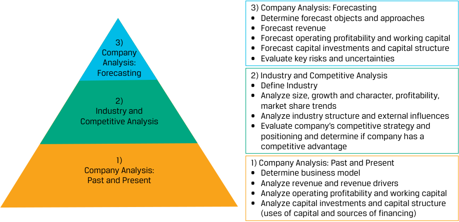

# Tập 5: Đầu tư Cổ phiếu (Equity Investments)
## Learning Module 5 Company Analysis: Past and Present (Trang PDF 207–254)

---

# Tập 5: Đầu tư Vốn cổ phần (Equity Investments)
## Học phần 5: Phân tích Công ty: Quá khứ và Hiện tại (Company Analysis: Past and Present)
### Phần 1/5: Giới thiệu (Trang PDF 207–214)

---

<!-- PDF Page 207 -->

### H Ọ C P H Ầ N

# **<mark>5</mark>** 

## **Phân tích Công ty: Quá khứ và Hiện tại (*Company Analysis: Past and Present*)** 

##### **<mark>MỤC TIÊU HỌC TẬP (*LEARNING OUTCOMES*)</mark>** 

|**_Mức độ thành thạo_**|**_Ứng viên cần có khả năng:_**|
|---|---|
||mô tả các thành phần cần được trình bày trong một báo cáo nghiên cứu công ty (*company research report*) toàn diện|
||xác định mô hình kinh doanh (*business model*) của một công ty|
||đánh giá doanh thu (*revenue*) và các yếu tố dẫn dắt doanh thu (*revenue drivers*) của một công ty, bao gồm cả sức mạnh định giá (*pricing power*)|
||đánh giá khả năng sinh lời hoạt động (*operating profitability*) và vốn lưu động (*working capital*) của một công ty bằng cách sử dụng các thước đo chủ chốt|
||đánh giá các khoản đầu tư vốn (*capital investments*) và cơ cấu vốn (*capital structure*) của một công ty|

> **Chú thích hình ảnh:** Biểu tượng mục 1.

#### **GIỚI THIỆU (*INTRODUCTION*)** 

Một báo cáo nghiên cứu công ty (*company research report*) sâu sắc và được viết tốt sẽ giúp các nhà đầu tư hiểu rõ về một công ty và đưa ra các quyết định đầu tư tốt hơn đối với chứng khoán của công ty đó. Học phần này là học phần đầu tiên trong số ba học phần cung cấp một khuôn khổ để chuẩn bị báo cáo nghiên cứu công ty thông qua việc áp dụng các phương pháp đã được đề cập trong các học phần trước nhằm đánh giá mô hình kinh doanh, kết quả hoạt động tài chính (*financial performance*), và tình hình tài chính (*financial position*) của một công ty. 

###### **TỔNG QUAN HỌC PHẦN (*LEARNING MODULE OVERVIEW*)** 

- Các báo cáo nghiên cứu công ty phân tích số liệu tài chính trong quá khứ và hiện tại của một công ty, ngành hoạt động và các đối thủ cạnh tranh của công ty đó, đồng thời dự báo các báo cáo tài chính tương lai của công ty. Các báo cáo kết thúc bằng phần định giá (*valuation*), khuyến nghị đầu tư (*investment recommendation*), và các rủi ro đầu tư (*investment risks*). 

- ■ Bước đầu tiên của việc phân tích công ty đòi hỏi sự hiểu biết về mô hình kinh doanh của tổ chức phát hành (*issuer*), mà để có được điều đó, các nhà phân tích dựa vào cả nguồn thông tin từ tổ chức phát hành lẫn nguồn thông tin từ bên thứ ba. 

- ■ Sự hiểu biết về mô hình kinh doanh của tổ chức phát hành cùng với việc phân tích các báo cáo tài chính lịch sử sẽ cho phép nhà phân tích xác định được các yếu tố dẫn dắt chủ chốt (*key drivers*) của doanh thu, <u>khả năng sinh lời, dòng tiền, và tình hình tài chính.</u> 

<!-- PDF Page 208 -->

- Phân tích doanh thu (*revenue analysis*) có thể được thực hiện bằng cách sử dụng phương pháp tiếp cận từ dưới lên (*bottom-up approach*) hoặc từ trên xuống (*top-down approach*). Phương pháp tiếp cận từ dưới lên bóc tách doanh thu thành các yếu tố dẫn dắt như sản lượng bán hàng (*sales volumes*) và giá bán (*prices*), theo từng dòng sản phẩm hoặc phân khúc. Phương pháp tiếp cận từ trên xuống biểu thị doanh thu như một hàm số của các yếu tố dẫn dắt như thị phần (*market share*), quy mô thị trường (*market size*), và tốc độ tăng trưởng GDP. 

- Mặc dù một công ty có thể tùy ý thay đổi mức giá của mình, nhưng khả năng thực hiện việc đó một cách thành công (tức là không gây ra sự sụt giảm sản lượng) và tương quan hợp lý với chi phí lại được quyết định bởi sức mạnh định giá (*pricing power*) của công ty. Sức mạnh định giá chủ yếu là một hàm số của cấu trúc ngành (*industry structure*) và chiến lược cạnh tranh (*competitive strategy*). 

- Phân tích chi phí (*cost analysis*) đánh giá khả năng sinh lời và công tác quản trị vốn lưu động của một công ty. Các nhà phân tích tính toán và diễn giải một số thước đo về chi phí và khả năng sinh lời, bao gồm biên lợi nhuận gộp (*gross margin*), biên lợi nhuận hoạt động (*operating margin*), và biên lợi nhuận ròng (*net margin*). 

- Mặc dù việc phân tích chi phí cố định (*fixed cost*) so với chi phí biến đổi (*variable cost*) rất hữu ích, nhưng việc phân tích này thường bị giới hạn bởi các thuyết minh công bố thông tin của tổ chức phát hành và các chuẩn mực kế toán vốn nhấn mạnh vào việc báo cáo chi phí theo chức năng (*by function*) hoặc theo bản chất (*by nature*). 

- Độ bẩy hoạt động (*degree of operating leverage* – DOL) đo lường độ nhạy của lợi nhuận hoạt động (*operating profit*) trước những thay đổi trong doanh thu. Đòn bẩy hoạt động chủ yếu được quyết định bởi cơ cấu chi phí cố định và chi phí biến đổi trong chi phí hoạt động của tổ chức phát hành. 

- Độ bẩy tài chính (*degree of financial leverage* – DFL) đo lường độ nhạy của lợi nhuận ròng (*net income*) trước những thay đổi trong lợi nhuận hoạt động (*operating income*). Đòn bẩy tài chính chủ yếu được quyết định bởi cơ cấu vốn (*capital structure*) của tổ chức phát hành. 

###### **TỰ ĐÁNH GIÁ HỌC PHẦN (*LEARNING MODULE SELF-ASSESSMENT*)** 

Những câu hỏi ban đầu này nhằm mục đích giúp bạn tự đánh giá mức độ hiểu biết hiện tại của mình về học phần này. 

1. Hãy xác định hai thành phần phổ biến trong _tất cả_ các báo cáo nghiên cứu công ty và hai thành phần phổ biến trong các báo cáo nghiên cứu _lần đầu_ (*initial research reports*). 

   - **Lời giải (*Solution*)**: 

Phổ biến trong tất cả các báo cáo nghiên cứu: 

- Khuyến nghị đầu tư của nhà phân tích và mức giá mục tiêu (*target prices*) để mua hoặc bán 

- Các rủi ro, chẳng hạn như việc đánh giá các rủi ro giảm giá (*downside risks*) và tiềm năng tăng giá (*upside risks*) trọng yếu 

Phổ biến trong các báo cáo nghiên cứu lần đầu: 

- Thảo luận về mô hình kinh doanh và chiến lược của tổ chức phát hành, cùng các biểu đồ và số liệu giải thích giúp bóc tách doanh thu và lợi nhuận theo sản phẩm hoặc khu vực địa lý 

- Phân tích tài chính và các mô hình tài chính chi tiết 

- Tổng quan ngành và vị thế cạnh tranh (*competitive positioning*) chẳng hạn như quy mô ngành, tốc độ tăng trưởng, xu hướng thị phần, và khả năng sinh lời của ngành. Việc đánh giá vị thế cạnh tranh và chiến lược của công ty trong từng dòng sản phẩm hoặc phân khúc cũng rất phổ biến. 

<!-- PDF Page 209 -->

2. Hãy xác định ba nguồn thông tin mà các nhà phân tích thường sử dụng để xác định và phân tích mô hình kinh doanh của một công ty.
   **Lời giải (*Solution*):** 

   - Hồ sơ nộp cho cơ quan quản lý (*regulatory filings*) nếu tổ chức phát hành là công ty đại chúng, đặc biệt là báo cáo thường niên và báo cáo hàng quý 

   - Các sự kiện dành cho nhà đầu tư và các bài thuyết trình của tổ chức phát hành 

   - Khảo sát thực tế tài sản/cơ sở của công ty và/hoặc truy cập các trang web của công ty 

3. Năm ngoái, một nhà phân phối các sản phẩm chăm sóc nha khoa đã đạt được 800 triệu EUR doanh thu. Ban giám đốc ước tính rằng thị phần của công ty là 10%. Dựa trên ước tính của ban giám đốc, quy mô thị trường (*market size*) phân phối các sản phẩm chăm sóc nha khoa tại khu vực địa lý này vào năm ngoái _gần nhất_ với mức nào (tính bằng triệu EUR): 

   - **A.** 80 

   - **B.** 7.200 

   - **C.** 8.000 

   - **Lời giải (*Solution*):** 

C là đáp án đúng. 

$$\text{Thị phần (Market share)} = \frac{\text{Doanh thu (Revenue)}}{\text{Quy mô thị trường (Market Size)}}$$

Công thức này có thể được sắp xếp lại thành: 

$$\text{Quy mô thị trường (Market size)} = \frac{\text{Doanh thu (Revenue)}}{\text{Thị phần (Market Share)}}$$

$$\text{Quy mô thị trường} = \frac{\text{EUR } 800\text{ triệu}}{10\%}$$

$$\text{Quy mô thị trường} = \text{EUR } 8.000\text{ triệu (8 tỷ)}$$

4. Một nhà sản xuất đồ uống gần đây đã giới thiệu một dòng sản phẩm đồ uống có lợi cho sức khỏe làm từ trà. Giá bán trung bình (*average selling price*) là 20 USD một thùng vào năm ngoái và công ty đã bán được 2 triệu thùng. Năm nay, một nhà phân tích dự báo sản lượng bán đạt 3 triệu thùng và mức giá bán trung bình tăng thêm 5%—nhờ giảm bớt các khoản chiết khấu và khuyến mãi. Dự báo của nhà phân tích về tốc độ tăng trưởng doanh thu thuần (*net sales growth*) trong năm nay so với năm trước _gần nhất_ với mức nào: 

   - **A.** 50% 

   - **B.** 55% 

   - **C.** 58%

   **Lời giải (*Solution*):**
   C là đáp án đúng.
   Doanh thu thuần (*Net sales*) = Giá bán trung bình $\times$ Số thùng bán được
   Doanh thu thuần năm ngoái = $\text{USD } 20 \times 2\text{ triệu} = \text{USD } 40\text{ triệu}$
   Dự báo doanh thu thuần năm nay = $(\text{USD } 20 \times 1,05) \times 3\text{ triệu} = \text{USD } 63\text{ triệu}$
   Tốc độ tăng trưởng doanh thu thuần dự báo = $63 / 40 - 1 = 0,575$ hay $58\%$ 

5. Impression Ltd. là một công ty giả định chuyên thiết kế, sản xuất, và bán các <u>sản phẩm chăm sóc da và làm đẹp. Hãy xác định xem mỗi khoản mục chi phí dưới đây</u> 

<!-- PDF Page 210 -->

trong báo cáo kết quả hoạt động kinh doanh thường niên gần nhất của Impression Ltd. _nhiều khả năng nhất_ là chi phí cố định (*fixed cost*) hay chi phí biến đổi (*variable cost*). 

|Khoản mục chi phí|Cố định (*Fixed*)|Biến đổi (*Variable*)|
|---|---|---|
|I. Khấu hao tài sản vô hình mua lại (*Amortization of acquired intangible assets*)|Cố định|Biến đổi|
|II. Chi phí lãi vay (*Interest expense*)|Cố định|Biến đổi|
|III. Giá vốn hàng bán (*Costs of goods sold*)|Cố định|Biến đổi|
|IV. Chi phí quản lý doanh nghiệp (*General and administrative expenses*)|Cố định|Biến đổi|
|V. Hoa hồng bán hàng (*Sales commissions*)|Cố định|Biến đổi|

###### **Lời giải (*Solution*):** 

I. Cố định (*Fixed*). Chi phí khấu hao tài sản vô hình (*amortization expense*) nhìn chung không thay đổi theo mức sản lượng bán hàng, vì các tài sản vô hình có thời gian sử dụng hữu hạn được khấu hao theo phương pháp đường thẳng trong suốt thời gian sử dụng hữu ích của tài sản. 

II. Cố định (*Fixed*). Chi phí lãi vay là một hàm số của quy mô nợ vay và lãi suất của khoản nợ đó, chứ không phụ thuộc vào sản lượng bán hàng. 

III. Biến đổi (*Variable*). Giá vốn hàng bán phát sinh khi hoạt động bán hàng được thực hiện. 

IV. Cố định (*Fixed*). Chi phí quản lý doanh nghiệp thường không liên quan trực tiếp đến sản lượng bán hàng mỗi năm. 

V. Biến đổi (*Variable*). Hoa hồng bán hàng, một hình thức thù lao dựa trên kết quả công việc dành cho nhân viên bán hàng, là một hàm số của doanh thu bán hàng và do đó là chi phí biến đổi. 

6. Dựa trên dữ liệu dưới đây, độ bẩy hoạt động (*degree of operating leverage* – DOL) của Công ty XYZ cho năm kết thúc vào ngày 31 tháng 12 năm 20X1 _gần nhất_ với mức nào: 

###### **Công ty XYZ: Báo cáo Kết quả Hoạt động Kinh doanh cho Năm Kết thúc ngày (tính bằng triệu EUR)** 

||**31 tháng 12 năm 20X1**|**31 tháng 12 năm 20X0**|
|---|---|---|
|Doanh thu (*Revenue*)|9.707|9.256|
|Giá vốn hàng bán (*Costs of goods sold*)|4.850|4.637|
|Chi phí bán hàng, tổng hợp và quản lý (*Selling, general, and administrative expenses*)|993|1.090|
|Chi phí nghiên cứu và phát triển (*Research and development expenses*)|1.700|1.554|
|Chi phí hoạt động khác (*Other operating expenses*)|491|448|
|Chi phí lãi vay (*Interest expense*)|309|325|
|Chi phí (thu nhập) khác (*Other (income) expense*)|24|(71)|
|Lợi nhuận trước thuế thu nhập (*Income before income taxes*)|1.340|1.273|
|Dự phòng thuế thu nhập (*Provision for income taxes*)|295|255|
|Lợi nhuận ròng (*Net income*)|1.045|1.018|

**A.** 0,51 

**B.** 1,08 

**C.** 1,96 

**Lời giải (*Solution*):**

C là đáp án đúng. 

Lợi nhuận hoạt động (*Operating Income*) năm 20X1 = $9.707 - 4.850 - 993 - 1.700 - 491 = 1.673$
Lợi nhuận hoạt động (*Operating Income*) năm 20X0 = $9.256 - 4.637 - 1.090 - 1.554 - 448 = 1.527$
$$\text{DOL} = \frac{\%\Delta\text{ Lợi nhuận hoạt động (\%}\Delta\text{ Operating Income)}}{\%\Delta\text{ Doanh thu (\%}\Delta\text{ Sales)}}$$

$$\text{DOL} = \frac{1.673 / 1.527 - 1}{9.707 / 9.256 - 1}$$

<!-- PDF Page 211 -->

$$\text{DOL} = 1,96$$

A không chính xác, vì phương án này đảo ngược phương trình; đó là tỷ số giữa phần trăm thay đổi doanh thu trên phần trăm thay đổi lợi nhuận hoạt động.
B không chính xác; đó là tỷ số giữa phần trăm thay đổi lợi nhuận trước thuế, thay vì lợi nhuận hoạt động, trên phần trăm thay đổi doanh thu.

7. Nếu một công ty báo cáo dòng tiền từ hoạt động kinh doanh (*operating cash flow*) trong 12 tháng gần nhất là 150 triệu USD, tài sản ngắn hạn không bao gồm tiền mặt là 40 triệu USD, và nợ ngắn hạn là 60 triệu USD, thì công ty đó _nhiều khả năng nhất_:
- **A.** đã thiếu hiệu quả trong việc quản lý nguồn tài trợ của mình.
- **B.** đã sử dụng tín dụng thương mại (*trade credit*) để quản lý vốn lưu động.
- **C.** đã mở rộng quá mức và đang có nguy cơ phá sản.

**Lời giải (*Solution*):**
B là đáp án đúng. Vốn lưu động ròng âm (*negative net working capital*) thường cho thấy công ty sử dụng tín dụng thương mại của các nhà cung cấp để kéo dài số ngày phải trả người bán (*days payable*), đồng thời quản lý hiệu quả số ngày tồn kho (*inventory days*) và số ngày thu tiền bán hàng (*days sales outstanding* – DSO).
A không chính xác. Vốn lưu động âm là một nguồn tài trợ (*source of financing*) thay vì là một khoản sử dụng vốn (*use of financing*) và mang lại cho tổ chức phát hành sự linh hoạt tài chính lớn hơn, vì vốn không bị chôn chặt vào vốn lưu động.
C không chính xác. Không có đủ thông tin ở đây để xác định rủi ro phá sản, nhưng dòng tiền hoạt động kinh doanh dương và vốn lưu động ròng âm không phải là các chỉ báo rủi ro phá sản.

8. Ban giám đốc của một công ty có thể chọn _không_ sử dụng đòn bẩy tài chính (*financial leverage*) bởi vì công ty có:
- **A.** xếp hạng tín nhiệm cấp độ đầu tư (*investment-grade credit rating*).
- **B.** độ bẩy hoạt động (*degree of operating leverage*) cao.
- **C.** tỷ số nợ ròng trên EBITDA (*net debt to EBITDA ratio*) thấp hơn so với các công ty cùng ngành.

**Lời giải (*Solution*):**
B là đáp án đúng. Độ bẩy tài chính và độ bẩy hoạt động kết hợp với nhau tạo thành độ bẩy tổng hợp (*degree of total leverage* – DTL) trong doanh nghiệp. Nếu công ty vốn đã có độ bẩy hoạt động cao, việc sử dụng thêm đòn bẩy tài chính có thể làm tăng tổng đòn bẩy và đẩy rủi ro lên mức quá cao.
A không chính xác. Xếp hạng tín nhiệm cấp độ đầu tư nhìn chung cho thấy công ty có thể vay vốn với chi phí tiết kiệm, điều này sẽ là một lý do để sử dụng đòn bẩy tài chính.
C không chính xác. Tỷ số nợ ròng trên EBITDA thấp hơn so với các công ty cùng ngành là một chỉ báo về dư địa vay nợ (*borrowing capacity*), điều này sẽ là một lý do để sử dụng đòn bẩy tài chính.

---

- mô tả các thành phần cần được trình bày trong một báo cáo nghiên cứu công ty (*company research report*) toàn diện

<!-- PDF Page 212 -->

Các nhà phân tích định giá và đưa ra khuyến nghị đầu tư đối với chứng khoán vốn cổ phần của các tổ chức phát hành bằng cách sử dụng các kịch bản về thu nhập, dòng tiền, và tình hình tài chính trong tương lai. Những kịch bản tương lai này được cấu trúc dưới dạng các báo cáo tài chính và được gọi là các mô hình báo cáo tài chính (*financial statement models*). Mặc dù mô hình báo cáo tài chính mang tính định lượng, nhưng nó không phải là một bài toán để giải tìm đáp án đúng duy nhất, mà đúng hơn là một biểu đạt định lượng cho các quan điểm hướng tới tương lai (*forward-looking views*) của nhà phân tích. Những quan điểm này phải dựa trên các bằng chứng hỗ trợ và được bảo vệ bằng các phân tích xác đáng. 

Quy trình hình thành và bảo vệ quan điểm về kết quả cũng như tình hình tài chính tương lai của một tổ chức phát hành bao gồm việc phân tích công ty và phân tích ngành, và đó chính là chủ đề của học phần này cùng hai học phần tiếp theo. Bảng minh họa 1 giới thiệu một khuôn khổ cho việc phân tích công ty và ngành. Học phần này tập trung vào khối nền tảng đầu tiên: Phân tích Công ty: Quá khứ và Hiện tại (*Company Analysis: Past and Present*). 

**Bảng minh họa 1: Khuôn khổ Phân tích Công ty và Ngành (*Company and Industry Analysis Framework*)** 

> **Chú thích hình ảnh:**
> - **1) Phân tích Công ty: Quá khứ và Hiện tại (*Company Analysis: Past and Present*):**
>   - Xác định mô hình kinh doanh (*Determine business model*)
>   - Phân tích doanh thu và các yếu tố dẫn dắt doanh thu (*Analyze revenue and revenue drivers*)
>   - Phân tích khả năng sinh lời hoạt động và vốn lưu động (*Analyze operating profitability and working capital*)
>   - Phân tích đầu tư vốn và cơ cấu vốn — sử dụng vốn và nguồn tài trợ (*Analyze capital investments and capital structure - uses of capital and sources of financing*)
> - **2) Phân tích Ngành và Cạnh tranh (*Industry and Competitive Analysis*):**
>   - Xác định ngành (*Define Industry*)
>   - Phân tích quy mô, tốc độ tăng trưởng và đặc điểm, khả năng sinh lời, xu hướng thị phần (*Analyze size, growth and character, profitability, market share trends*)
>   - Phân tích cấu trúc ngành và các ảnh hưởng bên ngoài (*Analyze industry structure and external influences*)
>   - Đánh giá chiến lược và vị thế cạnh tranh của công ty và xác định xem công ty có lợi thế cạnh tranh hay không (*Evaluate company’s competitive strategy and positioning and determine if company has a competitive advantage*)
> - **3) Phân tích Công ty: Dự báo (*Company Analysis: Forecasting*):**
>   - Xác định đối tượng và phương pháp tiếp cận dự báo (*Determine forecast objects and approaches*)
>   - Dự báo doanh thu (*Forecast revenue*)
>   - Dự báo khả năng sinh lời hoạt động và vốn lưu động (*Forecast operating profitability and working capital*)
>   - Dự báo đầu tư vốn và cơ cấu vốn (*Forecast capital investments and capital structure*)
>   - Đánh giá các rủi ro và sự bất định chủ chốt (*Evaluate key risks and uncertainties*)

Các nhà phân tích trình bày phần phân tích công ty và ngành của mình, cũng như phần định giá và khuyến nghị đầu tư, trong một **báo cáo nghiên cứu công ty (*company research report*)**. Cấu trúc, nội dung, và văn phong của báo cáo phụ thuộc vào bối cảnh làm việc của nhà phân tích. Ví dụ, các báo cáo về chứng khoán vốn cổ phần của một tổ chức phát hành đại chúng nhằm phân phối cho các khách hàng bên ngoài (một “báo cáo bên bán” – *“sell-side report”*) thường bao gồm một báo cáo lần đầu chuyên sâu (báo cáo “bắt đầu theo dõi” – *“initiating coverage” report*, hay “báo cáo khởi tạo” – *“initiation”*) khi nhà phân tích bắt đầu theo dõi chứng khoán đó, theo sau là các báo cáo ngắn hơn về các chủ đề cụ thể hoặc nhằm cập nhật khuyến nghị sau khi nhà phân tích nhận được thông tin mới hoặc thực hiện các phân tích bổ sung, đặc biệt là sau khi tổ chức phát hành công bố kết quả tài chính. Các báo cáo của nhà phân tích chỉ dành riêng cho việc lưu hành nội bộ tới những người đọc đã quen thuộc với tổ chức phát hành có thể ngắn gọn hơn rất nhiều và được trình bày bằng lời nói hoặc chỉ trong một vài trang trình chiếu (*presentation slides*). 

Một ví dụ về cấu trúc của một báo cáo nghiên cứu công ty _lần đầu_ (*initial company research report*) để phân phối ra bên ngoài được thể hiện trong Bảng minh họa 2. Đối tượng người đọc chính là những người chưa có hiểu biết sẵn về tổ chức phát hành hoặc chứng khoán đó. 

<!-- PDF Page 213 -->

###### **Bảng minh họa 2: Các Thành phần của Báo cáo Nghiên cứu Công ty Lần đầu (*Initial Company Research Report Elements*)** 

|Thành phần|Nội dung chi tiết|
|---|---|
|Phần mở đầu (*Front Matter*)|■ Tên tổ chức phát hành và các mã định danh chứng khoán (ví dụ: mã giao dịch – symbol, CUSIP) ■ Khuyến nghị của nhà phân tích (mua, nắm giữ, bán) và mức giá mục tiêu để mua hoặc bán ■ Các thuyết minh công bố thông tin, tuyên bố miễn trừ trách nhiệm, và các thông tin khác được pháp luật yêu cầu|
|Khuyến nghị (*Recommendation*)|■ Khuyến nghị của nhà phân tích ■ Tóm tắt các lý do chính củng cố cho khuyến nghị đó|
|Mô tả Công ty (*Company Description*)|■ Thảo luận về mô hình kinh doanh và chiến lược của tổ chức phát hành ■ Các biểu đồ và số liệu giải thích—ví dụ: bóc tách doanh thu và lợi nhuận theo sản phẩm, khu vực địa lý, v.v.|
|Tổng quan Ngành & Vị thế Cạnh tranh (*Industry Overview & Competitive Positioning*)|■ Quy mô ngành, tốc độ tăng trưởng và các yếu tố dẫn dắt chính, xu hướng thị phần, khả năng sinh lời—trong lịch sử và triển vọng ■ Phân tích cạnh tranh chẳng hạn như Mô hình Năm áp lực cạnh tranh của Porter (*Porter’s Five Forces*) ■ Phân tích các ảnh hưởng bên ngoài lên ngành chẳng hạn như chính trị, kinh tế, xã hội, công nghệ, pháp lý, và môi trường (phân tích “PESTLE”) ■ Đánh giá vị thế và chiến lược của công ty trong ngành|
|Phân tích Tài chính và Mô hình (*Financial Analysis and Model*)|■ Đánh giá các yếu tố dẫn dắt chính của doanh thu, chi phí, khả năng sinh lời, dòng tiền, cùng việc sử dụng vốn và nguồn vốn của tổ chức phát hành ■ Dự báo các yếu tố dẫn dắt chính và phần thảo luận củng cố ■ Các báo cáo tài chính lịch sử và dự báo|
|Định giá (*Valuation*)|■ Ước tính giá trị công ty và giá trị chứng khoán kèm theo mức giá mục tiêu ■ Thường bao gồm các phương pháp định giá tương đối (*relative approaches*) và giá trị hiện tại (*present value approaches*) ■ Thảo luận về các biến đầu vào chính cùng các phân tích kịch bản (*scenario analysis*) và phân tích độ nhạy (*sensitivity analysis*)|
|Các Cân nhắc về Môi trường, Xã hội, và Quản trị (*Environmental, Social, and Governance - ESG Considerations*)|■ Đánh giá các chỉ báo và rủi ro ESG ■ Cơ cấu sở hữu và thành phần ban giám đốc ■ Thù lao điều hành (*Executive compensation*)|
|Rủi ro (*Risks*)|■ Đánh giá các rủi ro giảm giá và tiềm năng tăng giá trọng yếu cùng phần thảo luận về cách thức chúng được xem xét trong phân tích tài chính và định giá|

###### **CUỘC THI NGHIÊN CỨU CỦA VIỆN CFA (*THE CFA INSTITUTE RESEARCH CHALLENGE*)** 

Để xem các ví dụ về báo cáo nghiên cứu công ty lần đầu, chúng tôi khuyến khích bạn truy cập mục *Past Research Challenge Champions* trên trang web cfainstitute.org, nơi lưu trữ các báo cáo và bài thuyết trình chiến thắng từ cuộc thi phân tích đầu tư mà Viện CFA (*CFA Institute*) và các Hiệp hội CFA (*CFA Societies*) trên toàn thế giới tổ chức hàng năm. Các đội thi gồm sinh viên đại học được một Hiệp hội CFA địa phương giao cho một công ty đại chúng để nghiên cứu và tranh tài về chất lượng nghiên cứu, lập mô hình tài chính, định giá, và kỹ năng giao tiếp truyền đạt của họ. 

Các báo cáo nghiên cứu công ty _tiếp theo_ (*subsequent company research reports*) thường ngắn hơn so với các báo cáo lần đầu. Đối tượng người đọc chính của chúng là những người đã quen thuộc với tổ chức phát hành hoặc chứng khoán đó và cần một bản cập nhật dựa trên thông tin và phân tích mới hoặc một sự thay đổi trong khuyến nghị của nhà phân tích. Một báo cáo như vậy đối với một công ty vừa mới công bố kết quả tài chính hàng quý có thể được cấu trúc theo hình thức trình bày trong Bảng minh họa 3. Cấu trúc của một báo cáo tiếp theo phụ thuộc vào bối cảnh làm việc của nhà phân tích và bản chất của báo cáo đó. 

<!-- PDF Page 214 -->

###### **Bảng minh họa 3: Các Thành phần của Báo cáo Nghiên cứu Công ty Tiếp theo (*Subsequent Company Research Report Elements*)** 

Phần mở đầu (*Front Matter*) 

- Tên của các nhà phân tích 
- Tên tổ chức phát hành 
- Mã định danh chứng khoán và sở giao dịch (ví dụ: mã giao dịch, CUSIP) 
- Khuyến nghị của nhà phân tích: mua, nắm giữ, bán (*buy, hold, sell*) 
- Giá chứng khoán hiện tại và giá mục tiêu của nhà phân tích 
- Các thuyết minh công bố thông tin, tuyên bố miễn trừ trách nhiệm, và các thông tin khác được pháp luật yêu cầu 

> **Chú thích hình ảnh:**
> - **Khuyến nghị (*Recommendation*):**
>   - ■ Khuyến nghị của nhà phân tích (*Analysts’ recommendation*)
>   - ■ Tóm tắt những thay đổi đối với khuyến nghị và các giải thích củng cố (*Summary of changes to the recommendation and support explanations*)
> - **Phân tích Thông tin Mới (*Analysis of New Information*):**
>   - ■ So sánh kết quả thực tế hàng quý với kết quả kỳ vọng (*Comparison of quarterly actual results with expected results*)
>   - ■ Diễn giải của nhà phân tích về thông tin mới và những thay đổi đối với các dự báo (*Analysts’ interpretation of new information and changes to forecasts*)
>   - ■ Báo cáo tài chính lịch sử và báo cáo tài chính dự báo đã được cập nhật (*Historical and updated forecasted financial statements*)
> - **Định giá (*Valuation*):**
>   - ■ Ước tính giá trị công ty và giá trị chứng khoán (*Estimates of company and security values*)
>   - ■ Thảo luận về những thay đổi so với phần định giá trong báo cáo trước (*Discussion of changes from valuation in prior report*)
> - **Rủi ro (*Risks*):**
>   - ■ Cập nhật các yếu tố rủi ro từ báo cáo trước kèm thảo luận về những thay đổi (*Update of risk factors from prior report with discussion of changes*)

###### **BỘ CÂU HỎI (*QUESTION SET*)** 

1. Phát biểu nào sau đây về các báo cáo bắt đầu theo dõi (*initiation reports*) là đúng? 

   - **A.** Cấu trúc, nội dung, và văn phong của báo cáo không phụ thuộc vào bối cảnh làm việc của nhà phân tích. 

   - **B.** Báo cáo này thực hiện các cập nhật đối với khuyến nghị sau khi tổ chức phát hành công bố kết quả tài chính. 

   - **C.** Đối tượng người đọc chính là những người chưa có hiểu biết sẵn về tổ chức phát hành hoặc chứng khoán đó. 

###### **Lời giải (*Solution*):** 

C là đáp án đúng. Đối tượng người đọc chính là những người chưa có hiểu biết sẵn về tổ chức phát hành hoặc chứng khoán đó. 

A không chính xác, bởi vì cấu trúc, nội dung, và văn phong của báo cáo phụ thuộc vào bối cảnh làm việc của nhà phân tích. Các ví dụ bao gồm việc báo cáo đó được dùng để lưu hành nội bộ hay phân phối ra bên ngoài, và liệu đó là một báo cáo bắt đầu theo dõi chuyên sâu hay một báo cáo tiếp theo nhằm cập nhật cho người đọc sau khi có thay đổi về khuyến nghị hoặc sau khi công bố kết quả hàng quý của tổ chức phát hành. 

B không chính xác, bởi vì báo cáo lần đầu nhằm giúp những người chưa có hiểu biết sẵn hiểu được về tổ chức phát hành hoặc chứng khoán đó. Báo cáo nghiên cứu tiếp theo mới được sử dụng để cập nhật cho người đọc sau khi công bố kết quả tài chính. 

2. Nếu bạn đọc một báo cáo nghiên cứu có bao gồm cả phân tích Năm áp lực cạnh tranh của Porter (*Porter’s Five Forces analysis*) lẫn phân tích PESTLE, thì _nhiều khả năng nhất_: 

   - **A.** nhà phân tích chấp bút đang bắt đầu theo dõi (*initiating coverage*) cổ phiếu đó. 

   - **B.** báo cáo đó đang cập nhật một khuyến nghị sau đợt công bố kết quả lợi nhuận (*earnings release*). 

---

# Tập 5: Đầu tư Vốn cổ phần (Equity Investments)
## Học phần 5: Phân tích Công ty: Quá khứ và Hiện tại (Company Analysis: Past and Present)
### Phần 2/5: Xác định Mô hình Kinh doanh (Trang PDF 215–226)

---

<!-- PDF Page 215 -->

- **C.** báo cáo đó được viết bởi một nhà phân tích của một công ty đã theo dõi doanh nghiệp này trong nhiều năm.

**Lời giải (*Solution*):**
A là đáp án đúng. Phân tích Năm áp lực cạnh tranh của Porter (*Porter’s Five Forces analysis*) và phân tích PESTLE là những thành phần phổ biến trong các báo cáo bắt đầu theo dõi (*initiations*) và ít phổ biến hơn trong các báo cáo nghiên cứu tiếp theo, vì chúng có xu hướng biến chuyển chậm hơn so với các thành phần báo cáo khác như phân tích tài chính và mô hình tài chính.
B và C không chính xác; những tình huống này gắn với các báo cáo nghiên cứu tiếp theo hơn là các báo cáo nghiên cứu lần đầu.

3. Việc đánh giá chiến lược cạnh tranh (*competitive strategy*) của một công ty diễn ra trước khi:
- **A.** phân tích doanh thu và các yếu tố dẫn dắt doanh thu (*revenue drivers*).
- **B.** phân tích khả năng sinh lời hoạt động (*operating profitability*) và vốn lưu động (*working capital*).
- **C.** dự báo doanh thu, khả năng sinh lời hoạt động, và vốn lưu động.

**Lời giải (*Solution*):**
C là đáp án đúng. Việc dự báo chỉ diễn ra sau khi quá trình phân tích công ty cùng phân tích ngành và cạnh tranh đã hoàn tất. Việc đánh giá chiến lược cạnh tranh của một công ty là một phần của phân tích ngành và cạnh tranh.
A không chính xác, bởi vì việc phân tích doanh thu và các yếu tố dẫn dắt doanh thu là một phần của giai đoạn phân tích đầu tiên, nơi nhà phân tích nghiên cứu các báo cáo tài chính trong quá khứ và hiện tại của công ty. Như chúng ta sẽ thấy trong Bài học 3, các nhà phân tích bắt đầu bằng việc phân tích các khoản mục doanh thu trước tiên.
B không chính xác, bởi vì việc phân tích khả năng sinh lời hoạt động và vốn lưu động thường diễn ra trước khi phân tích ngành và cạnh tranh. Việc đánh giá chiến lược cạnh tranh của công ty thường là một phần của phân tích ngành và công ty, diễn ra sau khi hoàn tất việc phân tích khả năng sinh lời hoạt động và vốn lưu động. 

# **XÁC ĐỊNH MÔ HÌNH KINH DOANH (*DETERMINING THE BUSINESS MODEL*)** **<mark>3</mark>** 

- xác định mô hình kinh doanh (*business model*) của một công ty

Xác định mô hình kinh doanh là bước đầu tiên trong khuôn khổ phân tích ngành và công ty của chúng ta bởi vì nó tóm tắt các yếu tố dẫn dắt quan trọng đối với kết quả và tình hình tài chính của một tổ chức phát hành, giúp nhà phân tích tập trung vào những gì cần tìm hiểu sâu hơn, và bắt đầu định hình những kỳ vọng của nhà phân tích đối với tổ chức phát hành đó. Phần thảo luận về mô hình kinh doanh thường nằm ở phần đầu của một báo cáo nghiên cứu công ty (xem mục “Mô tả Công ty” – *“Company Description”* trong Bảng minh họa 2). 

Hãy nhớ lại rằng một mô hình kinh doanh mô tả các hoạt động của một công ty và bao gồm các yếu tố sau đây, mà các nhà phân tích tìm hiểu bằng cách trả lời một số câu hỏi chủ chốt đã được thảo luận trong các học phần trước. 

|**Thành phần của Mô hình Kinh doanh (*Business Model Element*)**|**Các Câu hỏi Chủ chốt cho Nhà phân tích (*Key Questions for Analysts*)**|
|---|---|
|Sản phẩm hoặc dịch vụ mà công ty bán (*The product(s) or service(s) the company sells*)|Doanh nghiệp đang bán thứ gì? (*What is the firm selling?*)|
|Khách hàng và các nhóm khách hàng chính (*Customers and key customer groups*)|Công ty bán cho ai? (*To whom does the company sell?*)|

<!-- PDF Page 216 -->

|**Thành phần của Mô hình Kinh doanh (*Business Model Element*)**|**Các Câu hỏi Chủ chốt cho Nhà phân tích (*Key Questions for Analysts*)**|
|---|---|
|Các kênh bán hàng, bao gồm cơ chế thu hút khách hàng và phân phối sản phẩm/dịch vụ (*Sales channels, including customer acquisition and product/service delivery mechanisms*)|Công ty tiếp cận các khách hàng tiềm năng và hiện hữu bằng cách nào và phân phối sản phẩm ra sao? (*How does the company reach potential and current customers and how does it deliver products?*)|
|Cách thức định giá và thanh toán cho sản phẩm hoặc dịch vụ (*How the product(s) or service(s) are priced and paid for*)|Công ty thu phí bao nhiêu và mức giá cùng các điều khoản thanh toán được cấu trúc như thế nào? (*How much does the company charge and how are prices and payment terms structured?*)|
|Các mối quan hệ về nguồn lực, nhà cung cấp, và đối tác cần thiết để vận hành hiệu quả (*Resource, supplier, and partner relationships need to operate effectively*)|Công ty mua và phụ thuộc vào những gì? (*What does the company buy and rely on?*)|

Có nhiều câu hỏi hệ quả đi kèm cho mỗi câu hỏi chủ chốt trên, chẳng hạn như xác định xem số lượng khách hàng có ít và tập trung hay không, liệu các nhà cung cấp và nguồn lực có mang tính chuyên biệt hoặc khó thay thế hay không, v.v. Câu trả lời cho những câu hỏi này mang tính đặc thù theo từng công ty, nhưng các câu hỏi chủ chốt cần đặt ra lại là điểm chung xuyên suốt các ngành và các công ty. Ngoài ra, hãy nhớ lại rằng nhiều công ty có một mô hình kinh doanh truyền thống (*conventional business model*), chẳng hạn như nhà bán lẻ hoặc nhà sản xuất tài nguyên thiên nhiên, điều này giúp đơn giản hóa việc nhận diện mô hình kinh doanh trên thực tế. Các nhà phân tích thường sẽ tập trung phân tích những điểm khác biệt trong mô hình kinh doanh của một công ty, nếu có, so với mô hình truyền thống hoặc so với mô hình của các đối thủ cạnh tranh. 

Các nguồn thông tin mà nhà phân tích sử dụng để trả lời những câu hỏi này bao gồm các nguồn sau đây, được phân nhóm theo xuất xứ: từ tổ chức phát hành (*the issuer*), từ bên thứ ba công khai (*public third party*), từ bên thứ ba độc quyền (*proprietary third party*), và nghiên cứu sơ cấp tự thực hiện (*proprietary primary research*). 

- Các nguồn từ tổ chức phát hành (có sẵn miễn phí nếu công ty là đại chúng) 

   - Hồ sơ nộp cho cơ quan quản lý (*regulatory filings*), đặc biệt là các báo cáo thường niên và hàng quý 

   - Các cuộc họp trực tuyến công bố kết quả lợi nhuận (*earnings conference calls*) hàng quý hoặc bán niên 

   - Các bài thuyết trình và sự kiện dành cho nhà đầu tư 

   - Thông cáo báo chí (*press releases*) 

   - Ban giám đốc, bộ phận quan hệ nhà đầu tư, hoặc nhân sự khác của tổ chức phát hành 

   - Trang web hoặc các cơ sở/tài sản của công ty mà nhà phân tích có thể ghé thăm với tư cách là khách hàng hoặc nhà đầu tư. Việc trực tiếp trải nghiệm sản phẩm của tổ chức phát hành và của các đối thủ cạnh tranh thường rất hữu ích, mặc dù không phải lúc nào cũng khả thi (ví dụ: dược phẩm). 

- Các nguồn từ bên thứ ba công khai 

   - Các báo cáo chuyên đề ngành (*industry white papers*) miễn phí hoặc báo cáo phân tích từ một công ty tư vấn 

   - Các chỉ báo kinh tế hoặc ngành từ chính phủ và các tổ chức khác 

   - Các kênh tin tức tổng hợp 

   - Các kênh tin tức chuyên ngành 

   - Mạng xã hội 

   - Các nguồn đa dạng khác có sẵn thông qua các công cụ tìm kiếm 

- Các nguồn từ bên thứ ba độc quyền (có thu phí) 

   - Các báo cáo và thông tin trao đổi của nhà phân tích, bao gồm từ các nhà phân tích “bên bán” (*“sell-side”*) hay “Phố Wall” (*“Wall Street”*) và các tổ chức xếp hạng tín nhiệm (*credit rating agencies*) 

   - Các báo cáo và dữ liệu từ các nền tảng như Bloomberg và FactSet 

   - Các báo cáo và dữ liệu từ các công ty tư vấn, thường mang tính chuyên ngành, chẳng hạn như Rystad trong ngành năng lượng, IQVIA và Evaluate trong ngành dược sinh học, Gartner và IDC trong ngành công nghệ thông tin 

- Nghiên cứu sơ cấp tự thực hiện (*Proprietary primary research*) 

<!-- PDF Page 217 -->

   - Các cuộc khảo sát, trò chuyện trao đổi, so sánh sản phẩm, và các nghiên cứu khác do nhà phân tích ủy quyền thực hiện hoặc trực tiếp tiến hành 

Các nhà phân tích trong môi trường đầu tư tổ chức (ví dụ: một công ty quản lý tài sản) thường có thể thực hiện nghiên cứu ban đầu này một cách nhanh chóng, vì họ có quyền tiếp cận rộng rãi với nhiều nguồn thông tin bên thứ ba độc quyền, bản thân họ có thể đã có kiến thức và kinh nghiệm trong ngành, có thể tiếp cận các phân tích trước đó về công ty hoặc ngành, và thường có khả năng tiếp cận nhân sự quan hệ nhà đầu tư cũng như ban giám đốc của tổ chức phát hành. 

Chúng ta sẽ minh họa việc xác định mô hình kinh doanh của một tổ chức phát hành bằng một ví dụ giả định được phóng tác từ một công ty có thật. Chúng ta sẽ sử dụng tình huống nghiên cứu (*case study*) này xuyên suốt học phần này và hai học phần tiếp theo để minh họa việc sử dụng khuôn khổ phân tích công ty và ngành. Một tình huống nghiên cứu khác về một công ty khác trong cùng ngành được đưa vào phần tự đánh giá ở cuối mỗi bài học, để bạn có thể tự mình thực hành việc áp dụng khuôn khổ này. 

### **TÌNH HUỐNG NGHIÊN CỨU (*CASE STUDY*)** 

## **Warehouse Club Inc.** 

Elaine Nguyen là một nhà phân tích tại Fyleton Investments. Để tìm kiếm các ứng viên đầu tư cho một trong những quỹ của Fyleton, Nguyen đã chạy một bộ lọc (*screen*) tìm các công ty tại các thị trường phát triển có tốc độ tăng trưởng doanh thu và tỷ suất sinh lợi trên vốn đầu tư (*return on invested capital* – ROIC) vượt qua một ngưỡng nhất định trong vòng 5 năm qua, đồng thời cũng có kết quả hoạt động tốt trong đợt suy thoái gần nhất. Một công ty vượt qua được bộ lọc này là Warehouse Club Inc. (“Warehouse”). Cả Nguyen lẫn các đồng nghiệp của cô đều chưa từng phân tích Warehouse trước đây. Một nhà quản lý danh mục đầu tư đã đề nghị Nguyen nghiên cứu công ty này cùng ngành hoạt động của nó trong vài ngày, sau đó thảo luận những phát hiện ban đầu với các đồng nghiệp trước khi viết một báo cáo nghiên cứu chính thức. 

Warehouse là một công ty đại chúng, vì vậy Nguyen thu thập một số nguồn thông tin từ tổ chức phát hành, bao gồm báo cáo thường niên mới nhất của công ty và bản ghi lời thoại (*transcript*) bài thuyết trình của ban giám đốc tại một sự kiện dành cho nhà đầu tư gần đây. Các đoạn văn và số liệu sau đây là những đoạn trích từ các nguồn này. 

Warehouse Club Inc. (“chúng tôi”, “của chúng tôi”, “công ty”) là một nhà bán lẻ chiết khấu (*discount retailer*) hàng đầu, liên tục mang lại cho khách hàng mức tiết kiệm hơn 20% đối với một danh mục đa dạng các mặt hàng thực phẩm và hàng hóa khác so với các đối thủ cạnh tranh là siêu thị, cửa hàng bách hóa, cửa hàng tiện lợi, và thương mại điện tử. Warehouse đã vận hành lần lượt 149, 145, và 141 cửa hàng tính đến ngày 31 tháng 12 năm 2X19, 2X18, và 2X17. 

Chúng tôi bán một danh mục cốt lõi gồm thực phẩm đóng gói và đồ uống, thực phẩm tươi sống, và các hàng hóa phi thực phẩm như quần áo may mặc, thiết bị gia dụng, đồ điện tử và giải trí, đồ dùng gia đình, và dụng cụ thể thao. Ngoài danh mục cốt lõi, các cửa hàng của chúng tôi còn có một danh mục thay đổi liên tục gồm các mặt hàng theo mùa hoặc giảm giá dựa trên các xu hướng tiêu dùng mới nhất và nguồn hàng sẵn có từ các nhà cung cấp, vốn khác nhau tùy theo từng cửa hàng. Chúng tôi cũng cung cấp các sản phẩm và dịch vụ phụ trợ (*ancillary products and services*) chẳng hạn như các trạm xăng đặt cùng khuôn viên với cửa hàng, thực phẩm chế biến sẵn mang đi ngay trong cửa hàng, trung tâm dược phẩm và kính mắt, cùng máy trợ thính. Ngoài việc kinh doanh các mặt hàng có thương hiệu hàng đầu, chúng tôi còn bán thực phẩm đóng gói và đồ gia dụng dưới thương hiệu nhãn hàng riêng (*private-label brand*) độc quyền mà chúng tôi đặt hàng từ các nhà sản xuất theo hợp đồng (*contract manufacturers*); mảng này chiếm hơn 15% doanh thu thuần của chúng tôi và mang lại khả năng sinh lời cao hơn mức trung bình. 

Chúng tôi vận hành mô hình dựa trên thành viên (*member-based model*), yêu cầu khách hàng phải xuất trình thẻ thành viên để vào và mua sắm tại các cửa hàng của chúng tôi. Phí thành viên hàng năm là $60 mỗi hộ gia đình. Chúng tôi ước tính rằng số tiền tiết kiệm hàng năm của các thành viên so với việc mua sắm cùng một giỏ hàng hóa đó tại các đối thủ cạnh tranh lên tới hơn năm lần mức phí thành viên hàng năm của họ. Doanh thu phí thành viên của chúng tôi 

<!-- PDF Page 218 -->

lần lượt đạt $601, $576, và $553 triệu trong các năm tài chính 2X19, 2X18, và 2X17. Bên cạnh việc cung cấp cho chúng tôi một nguồn doanh thu định kỳ (*recurring revenue*), tư cách thành viên còn tạo dựng lòng trung thành của người mua sắm và giúp chúng tôi đạt mức thất thoát hàng tồn kho do trộm cắp (*inventory theft*) thấp nhất trong ngành—ở mức dưới 20 điểm cơ bản (bps) tính theo phần trăm doanh thu thuần, mức mà chúng tôi tin rằng chỉ bằng tối đa một phần năm so với các đối thủ cạnh tranh. Tổng số lượng thành viên lần lượt là 10,2, 9,8, và 9,4 triệu tính đến ngày 31 tháng 12 năm 2X19, 2X18, và 2X17. 

Chiến lược của chúng tôi dựa trên sự dẫn đầu về giá và chi phí (*price and cost leadership*). Chúng tôi lưu kho một số lượng giới hạn có chọn lọc các sản phẩm mang thương hiệu và nhãn hàng riêng chất lượng cao thuộc nhiều danh mục đa dạng, giúp tạo ra sản lượng bán hàng lớn và vòng quay hàng tồn kho (*inventory turnover*) nhanh chóng. Chúng tôi giới hạn các mặt hàng ở những mẫu mã, kích cỡ, và màu sắc bán chạy và chỉ bày bán trung bình khoảng 4.000 mã sản phẩm độc nhất (*unique products*) tại mỗi cửa hàng, chưa bằng một phần tư số lượng mặt hàng của các đối thủ siêu thị và đại siêu thị. Hầu hết các mặt hàng chỉ được bán theo kích cỡ đóng gói lớn (*bulk sizes*). Ở bất cứ nơi nào có thể, chúng tôi đều sử dụng phương thức phân phối trực tiếp từ nhà sản xuất và chuyển hàng hóa ngay lập tức ra sàn bán hàng, trưng bày trên các tấm kê hàng (*pallets*) trong một không gian nhà kho tối giản không cầu kỳ (*no-frills warehouse atmosphere*). Việc mua hàng với khối lượng lớn đối với một số lượng sản phẩm giới hạn, phân phối trực tiếp từ nhà sản xuất, và giảm thiểu khâu bốc dỡ xử lý hàng hóa cho phép chúng tôi giữ vững vị thế chi phí thấp trong ngành bán lẻ xét về chi phí hàng hóa và chi phí nhân công. Chi phí thấp cùng doanh thu phí thành viên cho phép chúng tôi hoạt động có lãi trong khi vẫn áp dụng mức giá bán thấp hơn đáng kể so với các nhà bán lẻ khác. Mức giá thấp cho các sản phẩm chất lượng sẽ thúc đẩy số lượng thành viên và doanh thu thuần tăng lên theo thời gian, tạo đòn bẩy tận dụng hiệu quả chi phí bán hàng, tổng hợp và quản lý (SG&A), giúp làm giảm tỷ lệ các chi phí này tính theo phần trăm doanh thu thuần. 

Các cửa hàng của chúng tôi hoạt động bảy ngày một tuần, 70 giờ mỗi tuần với các ca làm việc có thể dự đoán trước cho nhân viên. Vì số giờ hoạt động ngắn hơn so với các nhà bán lẻ khác, và nhờ các hiệu quả khác vốn có trong mô hình vận hành kiểu nhà kho, chi phí nhân công thấp hơn tương đối so với khối lượng bán hàng. Chúng tôi hướng tới việc duy trì một đội ngũ lớn các nhân viên toàn thời gian với mức lương và phúc lợi cao hơn mức trung bình nhằm thiết lập thời gian gắn bó lâu dài, vì chúng tôi tin rằng điều này giúp tối đa hóa năng suất và dịch vụ khách hàng tại các cửa hàng của mình. Tỷ lệ giữ chân nhân viên (*employee retention rate*) đối với những nhân viên đã làm việc với chúng tôi ít nhất một năm là 90%, mức mà chúng tôi tin là cao hơn đáng kể so với mức trung bình của ngành bán lẻ. 

Hoạt động bán lẻ của chúng tôi, vốn chiếm gần như toàn bộ doanh thu thuần hợp nhất, là phân khúc báo cáo (*reportable segment*) duy nhất của chúng tôi. Chúng tôi không có doanh thu đáng kể nào bên ngoài khu vực địa lý nội địa của mình: Hoa Kỳ. Không có bất kỳ khách hàng hay nhà cung cấp đơn lẻ nào chiếm một tỷ trọng trọng yếu trong doanh thu hay chi phí hàng hóa, tương ứng. 

<!-- PDF Page 219 -->

> **Chú thích hình ảnh:** Biểu đồ Số lượng Cửa hàng vào Cuối năm của Warehouse Club Inc., giai đoạn 2X10–2X19 (*Number of Stores at Year-End, 2X10–2X19*):
> 2X10: 108 | 2X11: 112 | 2X12: 116 | 2X13: 120 | 2X14: 126 | 2X15: 130 | 2X16: 136 | 2X17: 141 | 2X18: 145 | 2X19: 149.

> **Chú thích hình ảnh:**
> - **Biểu đồ trên – Số lượng Thành viên (nghìn) vào Cuối năm của Warehouse Club Inc., giai đoạn 2X10–2X19 (*Number of Members (thousands) at Year-End, 2X10–2X19*):**
>   2X10: 6.004 | 2X11: 6.707 | 2X12: 7.011 | 2X13: 7.410 | 2X14: 7.980 | 2X15: 8.474 | 2X16: 9.044 | 2X17: 9.386 | 2X18: 9.804 | 2X19: 10.241.
> - **Biểu đồ dưới – Doanh thu Thuần Hàng năm (triệu USD) của Warehouse Club Inc., giai đoạn 2X10–2X19 (*Annual Net Sales (USD millions), 2X10–2X19*):**
>   2X10: 14.488 | 2X11: 16.539 | 2X12: 18.442 | 2X13: 19.545 | 2X14: 20.940 | 2X15: 21.597 | 2X16: 22.054 | 2X17: 23.973 | 2X18: 26.302 | 2X19: 28.377.

### **Báo cáo Kết quả Hoạt động Kinh doanh của Warehouse Club Inc. cho các Năm Kết thúc vào . . . (đơn vị: triệu USD ngoại trừ các khoản tính trên mỗi cổ phần)** 

||**31 tháng 12 năm 2X17**|**31 tháng 12 năm 2X18**|**31 tháng 12 năm 2X19**|
|---|---|---|---|
|Doanh thu thuần (*Net sales*)|23.973|26.302|28.377|
|Phí thành viên (*Membership fees*)|553|576|601|
|Tổng doanh thu (*Total revenues*)|24.526|26.878|28.978|
|Chi phí hàng hóa (*Merchandise costs*)|(21.258)|(23.399)|(25.248)|
|Chi phí bán hàng, tổng hợp và quản lý (*Selling, general, and administrative expenses*)|(2.201)|(2.363)|(2.566)|
|Khấu hao tài sản cố định và tài sản vô hình (*Depreciation and amortization*)|(260)|(273)|(283)|
|Chi phí mở cửa hàng mới (*New-store opening expenses*)|(16)|(13)|(16)|

<!-- PDF Page 220 -->

||**31 tháng 12 năm 2X17**|**31 tháng 12 năm 2X18**|**31 tháng 12 năm 2X19**|
|---|---|---|---|
|Lợi nhuận hoạt động (*Operating income*)|791|830|865|
|Chi phí lãi vay (*Interest expense*)|(25)|(30)|(29)|
|Thu nhập lãi (*Interest income*)|10|14|24|
|Lợi nhuận trước thuế (*Income before taxes*)|776|814|860|
|Chi phí thuế thu nhập (*Income tax expense*)|(178)|(187)|(198)|
|Lợi nhuận ròng (*Net income*)|598|627|662|
|Số cổ phần đang lưu hành (*Shares outstanding*)|83|83|84|
|Thu nhập trên mỗi cổ phần (*Earnings per share* – EPS)|7,20|7,55|7,88|

Trong bài thuyết trình tại một sự kiện dành cho nhà đầu tư gần đây, ban giám đốc của Warehouse đã đưa ra các phát biểu sau đây vốn không có trong báo cáo thường niên: 

- Ba năm trước, công ty đã ra mắt dịch vụ “Mua Trực tuyến, Nhận tại Cửa hàng” (*“Buy Online, Pick-Up in Store”*), cho phép các thành viên mua sắm trên trang web hoặc ứng dụng di động của Warehouse và nhận đơn hàng của mình—được nhân viên Warehouse tập hợp sẵn—tại một cửa hàng. Công ty không có kế hoạch tự cung cấp dịch vụ thương mại điện tử hay giao hàng tận nơi hoặc thông qua các dịch vụ bên thứ ba. 

- Phí thành viên là $60 mỗi năm, thanh toán trả trước, và được hoàn lại theo tỷ lệ thời gian (*prorated basis*) cho số ngày còn lại trong năm. Ban giám đốc đã tăng giá phí thành viên định kỳ 5 năm một lần với mức tăng $5 và dự kiến sẽ tiếp tục làm như vậy. Lần tăng giá gần nhất là cách đây ba năm. 

- Ban giám đốc dự định mở bốn cửa hàng mới mỗi năm trong năm năm tới. 

- Công ty vận hành các cửa hàng tại các khu vực đô thị và ngoại ô ở một quốc gia duy nhất. Hơn 90% thành viên hiện tại sống trong bán kính 10 km quanh một cửa hàng, và mặc dù số lượng thành viên đã tăng lên xung quanh các cửa hàng hiện hữu theo thời gian, ban giám đốc tin rằng yếu tố dẫn dắt chính cho sự tăng trưởng thành viên là việc mở thêm cửa hàng tại các khu vực mới. 

- Ban giám đốc không có kế hoạch mở cửa hàng tại một quốc gia khác trong tương lai gần. Một lượng hàng hóa không đáng kể được nhập khẩu. 

### **VÍ DỤ 1 (*EXAMPLE 1*)** 

## **Xác định Mô hình Kinh doanh của Warehouse Club Inc.** 

Nguyen trả lời các câu hỏi sau đây để xác định mô hình kinh doanh của Warehouse Club Inc. và để nhận diện các lĩnh vực cần tiến hành nghiên cứu sâu hơn. 

- Doanh nghiệp đang bán thứ gì? (*What is the firm selling?*) 

Warehouse bán một loạt các mặt hàng tiêu dùng, chủ yếu là hàng tiêu hao (*consumables*) và hàng dễ hỏng (*perishables*), với khoảng 4.000 mặt hàng độc nhất. Để khách hàng có thể mua sắm tại các cửa hàng, họ phải có thẻ thành viên mà Warehouse bán với giá $60 mỗi năm cho mỗi hộ gia đình. Nguyen vẽ biểu đồ dữ liệu doanh thu thuần theo danh mục sau đây kèm theo các mô tả do Warehouse cung cấp, và lưu ý rằng cơ cấu doanh thu thuần theo danh mục đã không thay đổi trọng yếu trong 10 năm qua. 

<!-- PDF Page 221 -->

> **Chú thích hình ảnh:** Biểu đồ tròn Doanh thu Thuần theo Danh mục năm 2X19 của Warehouse Club Inc. (*Net Sales by Category, 2X19*):
> - Thực phẩm đóng gói và đồ uống (*Packaged food and beverages*): 40%
> - Hàng hóa phi thực phẩm (*Non-food merchandise*): 28%
> - Phụ trợ và khác (*Ancillary and other*): 19%
> - Thực phẩm tươi sống (*Fresh foods*): 13%

“Hàng hóa phi thực phẩm” (*“Non-food merchandise”*) bao gồm một danh mục rộng các mặt hàng như thiết bị gia dụng, đồ điện tử, sản phẩm chăm sóc sức khỏe và cá nhân, dụng cụ kim khí, đồ dùng ngoài trời và thể thao, trang sức, đồ nội thất, và đồ gia dụng. 

“Phụ trợ và khác” (*“Ancillary and other”*) là các mảng kinh doanh dịch vụ hoạt động bên trong hoặc ngay cạnh các cửa hàng của Warehouse và bao gồm thực phẩm chế biến sẵn mang đi, hiệu thuốc kê đơn, trạm xăng, trung tâm kính mắt, và máy trợ thính. 

### ■ Bán cho ai? (*To whom?*) 

Các thành viên của Warehouse chủ yếu là các hộ gia đình tiêu dùng sống trong bán kính 10 km quanh một cửa hàng, có ý thức về giá trị (*value-conscious*), sẵn sàng đánh đổi một danh mục lựa chọn phong phú hơn để lấy mức đơn giá thấp hơn trên các mặt hàng đóng gói cỡ lớn, và có khả năng chi trả khoản phí thành viên hàng năm. 

### ■ Bằng cách nào? (*How?*) 

Warehouse bán các sản phẩm và dịch vụ cả ở bên trong lẫn xung quanh các cửa hàng của mình. Các thành viên có thể mua sắm trực tiếp tại cửa hàng hoặc mua sắm trực tuyến rồi nhận hàng tại cửa hàng (Nguyen lưu ý rằng ban giám đốc đã không công bố quy mô của hình thức này xét theo doanh thu thuần). Ban giám đốc cho biết công ty thực hiện rất ít hoạt động quảng cáo (ngoài thư khuyến mãi) tại một khu vực trước khi mở cửa hàng và cũng gửi thông báo nhắc gia hạn thành viên; công ty chủ yếu dựa vào truyền miệng (*word of mouth*) và sự hiện diện vật lý của các cửa hàng để thu hút sự quan tâm và lượng khách ghé thăm (*foot traffic*). 

Thẻ thành viên có thể được mua trực tuyến, qua điện thoại, hoặc tại bất kỳ cửa hàng Warehouse nào. Ban giám đốc cho biết hơn ba phần tư số thành viên mua và gia hạn thẻ thành viên trực tuyến. 

### ■ Với giá bao nhiêu? (*For how much?*) 

Warehouse có hai dòng doanh thu: hàng hóa và dịch vụ (mang lại doanh thu thuần) và thẻ thành viên (mang lại phí thành viên). 

Ban giám đốc ấn định giá hàng hóa theo từng mặt hàng. Lợi nhuận gộp (*gross margin*) và tỷ lệ cộng thêm vào giá vốn (*markup*) trên tổng doanh thu thuần trong ba năm tài chính gần nhất như sau: 

||**31 tháng 12 năm 2X17**|**31 tháng 12 năm 2X18**|**31 tháng 12 năm 2X19**|
|---|---|---|---|
|Doanh thu thuần (*Net sales*)|23.973|26.302|28.377|
|Chi phí hàng hóa (*Merchandise costs*)|(21.258)|(23.399)|(25.248)|
|Lợi nhuận gộp (*Gross margin*)|2.715|2.903|3.129|
|% Lợi nhuận gộp trên doanh thu thuần (*Gross margin % of net sales*)|11,33%|11,04%|11,03%|
|Tỷ lệ cộng thêm vào giá vốn (*Markup*)|12,77%|12,41%|12,39%|

<!-- PDF Page 222 -->

Do đó, trung bình một mặt hàng hoặc dịch vụ được bán ở mức giá cao hơn một chút so với 12% chi phí mà Warehouse bỏ ra để mua và chuẩn bị mặt hàng đó sẵn sàng để bán. Mặc dù ban giám đốc tuyên bố rằng công ty là người dẫn đầu về chi phí và giá bán, Nguyen sẽ phải kiểm chứng lại điều đó. 

Phí thành viên là $60 mỗi năm cho mỗi hộ gia đình. Thẻ thành viên là điều kiện bắt buộc để mua sắm tại các cửa hàng của Warehouse, do đó trên thực tế đã làm tăng mức giá của tất cả các hàng hóa và dịch vụ của công ty. 

- Công ty mua và phụ thuộc vào những gì để vận hành hiệu quả? (*What does the company buy and rely on to operate effectively?*) 

   - Hàng hóa từ một loạt các nhà sản xuất và hàng hóa mang nhãn hiệu riêng từ các nhà sản xuất theo hợp đồng 

   - Nguồn vốn nhân lực (*human capital*) tại các cửa hàng và trong ban quản lý 

   - Tài sản cố định bao gồm đất đai ở các vị trí đắc địa, nhà cửa vật kiến trúc, trang thiết bị cố định, tủ lạnh và tủ đông, cùng một loạt các hệ thống công nghệ thông tin như hệ thống thanh toán tại điểm bán hàng (POS) 

   - Mạng lưới thanh toán thẻ tín dụng và thẻ ghi nợ cùng các định chế tài chính để nhận và thực hiện các khoản thanh toán điện tử 

Mặc dù tất cả những yếu tố này đều có sẵn rộng rãi và công ty chưa từng gặp phải sự gián đoạn nguồn cung hay dịch vụ nào trong quá khứ, một đối tác chủ chốt dường như là các nhà sản xuất hàng hóa, đặc biệt là những đơn vị sản xuất các sản phẩm mang nhãn hiệu riêng của Warehouse. Vì Warehouse rất khắt khe về chi phí và chất lượng đồng thời chỉ kinh doanh một danh mục giới hạn, công ty thực sự phụ thuộc đáng kể vào các nhà sản xuất theo hợp đồng này. 

Tóm lại, mô hình kinh doanh của Warehouse hướng tới việc tạo ra một vòng lặp tích cực (*virtuous cycle*), theo đó mức giá thấp thúc đẩy số lượng thành viên, từ đó thúc đẩy doanh thu tăng thêm, rồi tạo ra đòn bẩy thương lượng (*negotiating leverage*) với các nhà cung cấp để cho phép duy trì mức giá bán thấp với chi phí thấp. 

### **CÂU HỎI THẢO LUẬN (*DISCUSSION BOARD QUESTION*)** 

Dựa trên các thông tin được cung cấp, bạn sẽ thay đổi hoặc bổ sung điều gì vào phần phân tích của Elaine Nguyen về mô hình kinh doanh của Warehouse Club Inc.? Tại sao? 

Chúng tôi khuyến khích bạn đăng câu trả lời của mình, cũng như đọc và phản hồi câu trả lời của những người khác, trên diễn đàn thảo luận của Hệ sinh thái Học tập (*Learning Ecosystem*). 

### **BỘ CÂU HỎI (*QUESTION SET*)** 

Iliso Marketplace Ltd. (“chúng tôi”, “của chúng tôi”, “Công ty”, “Iliso”) đang tái định nghĩa thương mại điện tử bằng cách mang lại những trải nghiệm khách hàng vượt trội với mức giá cạnh tranh thông qua ứng dụng di động và trang web Iliso Marketplace của chúng tôi. Trong khi khách hàng thương mại điện tử trước đây thường buộc phải thỏa hiệp về thời gian giao hàng, chất lượng sản phẩm, và những rắc rối khi trả hàng, chúng tôi đã xây dựng một hệ thống tích hợp theo chiều dọc (*vertically integrated system*) cung cấp một danh mục sản phẩm khổng lồ với dịch vụ giao hàng trong một ngày đối với hầu hết các đơn hàng. Chúng tôi tiếp tục thực hiện các khoản đầu tư đáng kể vào cả công nghệ lẫn cơ sở hạ tầng hoàn tất đơn hàng (*fulfillment infrastructure*) để cải thiện trải nghiệm khách hàng và mở rộng sang các danh mục sản phẩm cũng như khu vực địa lý mới. 

**Trải nghiệm Khách hàng (*Customer Experience*)** 

<!-- PDF Page 223 -->

Chúng tôi cam kết làm hài lòng khách hàng mỗi ngày. Những dấu ấn đặc trưng trong trải nghiệm khách hàng của chúng tôi bao gồm:

- ■ **Giao hàng Ngày hôm sau hoặc Nhanh hơn (*Next-Day or Faster Delivery*).** Khách hàng đủ điều kiện được giao hàng trong một ngày xuyên suốt 365 ngày một năm. Vào năm 2X19, hơn 93% đơn hàng đã được giao trong vòng 24 giờ kể từ khi nhận được đơn hàng.
- ■ **Miễn phí Vận chuyển (*Free Shipping*).** Khách hàng đủ điều kiện được miễn phí vận chuyển đối với các đơn hàng lớn hơn $25, mức mà chúng tôi tin là ngưỡng đơn hàng tối thiểu dẫn đầu ngành, và không yêu cầu phí thành viên.
- ■ **Danh mục Mặt hàng Khổng lồ, Bao gồm cả Hàng Tạp hóa Tươi sống (*Vast Selection of Items, Including Fresh Groceries*).** Khách hàng có thể đặt hàng từ một danh mục các mặt hàng thuộc hầu hết mọi nhóm hàng hóa—từ nông sản tươi sống đến điện tử tiêu dùng cho tới đồ trang trí nhà cửa và nội thất. Để tiếp tục cung cấp những mặt hàng chất lượng cao nhất, chúng tôi liên tục điều chỉnh danh mục của mình dựa trên đánh giá của khách hàng. Chúng tôi thực thi các tiêu chuẩn nghiêm ngặt đối với những người bán bên thứ ba (*third-party merchants*) nhằm bảo vệ khách hàng khỏi hàng giả.
- ■ **Trả hàng Không Rào cản (*Frictionless Returns*).** Khách hàng của chúng tôi chỉ cần chạm vào một nút trên ứng dụng và để món hàng bên ngoài cửa nhà để nhân viên đến lấy. Việc hoàn tiền được khởi tạo ngay tại thời điểm món hàng được nhận lại tại cửa.

Số lượng tài khoản khách hàng đang hoạt động (*active customer accounts*) tính đến quý 4 của các năm kết thúc vào ngày 31 tháng 12 năm 2X17, 2X18, và 2X19 lần lượt là 29, 31, và 36 triệu. Tài khoản khách hàng đang hoạt động đề cập đến một địa chỉ email duy nhất và có ít nhất một giao dịch mua hàng trong kỳ được chỉ định; chúng tôi không thu phí thành viên hay yêu cầu mức mua hàng tối thiểu để duy trì tài khoản.

**Mạng lưới Hoàn tất Đơn hàng của Chúng tôi (*Our Fulfillment Network*)**

Để đạt được trải nghiệm khách hàng khác biệt hóa, chúng tôi tập trung vào các thị trường đô thị và đã xây dựng một hệ thống tích hợp theo chiều dọc, trong đó chúng tôi kiểm soát mọi bước, từ giao dịch mua hàng của khách trên ứng dụng cho đến bức ảnh xác nhận đã giao hàng tại cửa trước của khách. Chúng tôi nhận hầu hết sản phẩm trực tiếp từ các nhà sản xuất tại các trung tâm hoàn tất đơn hàng (*fulfillment centers*) của mình và giảm thiểu việc sử dụng các hãng vận chuyển cũng như nhà thầu bên thứ ba bằng cách trực tiếp tuyển dụng hơn 65.000 nhân sự trong khâu hoàn tất đơn hàng và giao nhận. Chúng tôi tin rằng việc tuyển dụng trực tiếp và kiểm soát các tài sản hoàn tất đơn hàng như xe tải giao hàng cho phép đạt được tốc độ, tính hiệu quả, và giảm thiểu lãng phí—điều đặc biệt quan trọng đối với các danh mục sản phẩm như thực phẩm tươi sống. 

Chúng tôi đã đưa ra quyết định chiến lược là tập trung vào các thị trường đô thị tại Hoa Kỳ trong tương lai gần nhằm đạt được mật độ tuyến đường có tính kinh tế (*economical route density*) cho việc giao hàng và nhận hàng trả lại của khách cũng như dịch vụ vận chuyển trong một ngày. 

### **Dịch vụ Người bán (*Merchant Services*)** 

Vào năm 2X13, chúng tôi đã ra mắt Dịch vụ Người bán (*Merchant Services*), cho phép những người bán bên thứ ba bán sản phẩm trên Iliso Marketplace và sử dụng mạng lưới hoàn tất đơn hàng của chúng tôi. Khi có nhiều người bán (bao gồm cả chúng tôi) cùng bán một sản phẩm, thuật toán của chúng tôi sẽ hiển thị cho khách hàng mức giá thấp nhất, đã bao gồm chi phí vận chuyển, mặc dù khách hàng có thể tự tay chọn một người bán khác. Những người bán bên thứ ba phải đáp ứng các tiêu chuẩn chất lượng nghiêm ngặt của chúng tôi nhưng ngoài điều đó ra, họ có toàn quyền quyết định về danh mục và mô tả sản phẩm, định giá, và các điều khoản vận chuyển. 

Chúng tôi nhận hoa hồng bán hàng (*sales commissions*) trên doanh số của người bán bên thứ ba, cũng như doanh thu dịch vụ nếu người bán sử dụng mạng lưới hoàn tất đơn hàng của chúng tôi để lưu kho và giao hàng. Chúng tôi ghi nhận doanh thu trên cơ sở “thuần” (*“net” basis*) đối với các giao dịch liên quan đến người bán bên thứ ba bởi vì chúng tôi đóng vai trò là đại lý (*agent*); Công ty không phải là người bán đứng tên trên hồ sơ (*seller of record*), cũng không nắm quyền kiểm soát hàng tồn kho đó. Số lượng người bán bên thứ ba đang hoạt động tính đến quý 4 của các năm kết thúc vào ngày 31 tháng 12 năm 2X17, 2X18, và 2X19 lần lượt là 25.500, 31.500, và 40.500. Người bán bên thứ ba đang hoạt động đề cập đến một địa chỉ email duy nhất và có ít nhất một giao dịch bán hàng trong kỳ được chỉ định; chúng tôi không thu phí thành viên đối với người bán, cũng không yêu cầu mức doanh số tối thiểu. 

<!-- PDF Page 224 -->

Tổng giá trị hàng hóa (*gross merchandise value* – GMV) hàng năm của chúng tôi—bao gồm giá trị của tất cả các sản phẩm được bán trên sàn giao dịch bởi chúng tôi và bởi những người bán bên thứ ba, sau khi đã trừ thuế bán hàng và các khoản giảm trừ hàng bán bị trả lại nhưng bao gồm bất kỳ khoản phí vận chuyển áp dụng nào—lần lượt là $5.721, $6.950, và $8.605 triệu cho các năm kết thúc vào ngày 31 tháng 12 năm 2X17, 2X18, và 2X19. GMV theo danh mục sản phẩm cho năm kết thúc vào ngày 31 tháng 12 năm 2X19 như sau: 

> **Chú thích hình ảnh:** Biểu đồ tròn GMV theo Danh mục Sản phẩm năm 2X19 của Iliso Marketplace Ltd. (*GMV by Product Category, 2X19*):
> - Thực phẩm tươi sống và tạp hóa (*Fresh food and grocery*): 55%
> - Truyền thông và điện tử (*Media and electronics*): 20%
> - Quần áo may mặc và sản phẩm làm đẹp (*Apparel and beauty products*): 17%
> - Đồ gia dụng và trang trí (*Home goods and décor*): 8%

Iliso gần đây đã phát hành cổ phiếu ra công chúng (IPO), vì vậy thông tin tài chính chỉ có sẵn cho năm năm kết thúc vào ngày 31 tháng 12 năm 2X19. Các con số được tính bằng triệu USD (ngoại trừ các khoản tính trên mỗi cổ phần). 

### **Iliso Marketplace Ltd. – GMV, Số lượng Khách hàng, và Số lượng Người bán cho các Năm Kết thúc vào ngày 31 tháng 12** 

||**2X15**|**2X16**|**2X17**|**2X18**|**2X19**|
|---|---|---|---|---|---|
|Doanh số bán lẻ của Iliso (*Iliso retail sales*)|2.589|3.424|5.100|6.052|7.336|
|Doanh số của người bán bên thứ ba (*Third-party merchant sales*)|279|432|621|898|1.269|
|Tổng GMV (*Total GMV*)|2.868|3.856|5.721|6.950|8.605|
|Tài khoản khách hàng đang hoạt động (triệu) (*Active customer accounts - millions*)|16|23|29|31|36|
|Người bán bên thứ ba (số lượng) (*Third-party merchants - #*)|14.850|18.000|25.500|31.500|40.500|

### **Iliso Marketplace Ltd. – Báo cáo Kết quả Hoạt động Kinh doanh cho các Năm Kết thúc vào ngày 31 tháng 12** 

||**2X15**|**2X16**|**2X17**|**2X18**|**2X19**|
|---|---|---|---|---|---|
|Doanh thu bán lẻ thuần (*Net retail sales*)|2.589|3.424|5.100|6.052|7.336|
|Phí người bán bên thứ ba (*Third-party merchant fees*)|42|65|94|134|190|
|Tổng doanh thu (*Total revenues*)|2.631|3.489|5.194|6.186|7.526|
|Giá vốn doanh thu (*Costs of revenues*)|(1.894)|(2.506)|(3.729)|(4.446)|(5.414)|
|Chi phí vận hành, tổng hợp và quản lý (*Operating, general, and administrative expenses*)|(685)|(895)|(1.300)|(1.544)|(1.831)|
|Chi phí quảng cáo và tiếp thị (*Advertising and marketing*)|(53)|(70)|(104)|(124)|(151)|
|Lợi nhuận hoạt động (*Operating income*)|(1)|18|61|72|130|

<!-- PDF Page 225 -->

||**2X15**|**2X16**|**2X17**|**2X18**|**2X19**|
|---|---|---|---|---|---|
|Thu nhập lãi (*Interest income*)|6|7|9|9|10|
|Chi phí lãi vay (*Interest expense*)|(5)|(13)|(15)|(12)|(8)|
|Lợi nhuận trước thuế (*Pre-tax income*)|0|12|55|69|132|
|Dự phòng thuế thu nhập (*Provision for income taxes*)|0|(3)|(13)|(16)|(32)|
|Lợi nhuận ròng (*Net income*)|0|9|42|52|100|
|EPS cơ bản (*Basic EPS*)|0,00|0,03|0,15|0,18|0,34|
|EPS pha loãng (*Diluted EPS*)|0,00|0,03|0,14|0,18|0,34|
|Số lượng cổ phần cơ bản (*Basic share count*)|274|280|284|288|291|
|Số lượng cổ phần pha loãng (*Diluted share count*)|274|280|291|288|297|

Thuyết minh báo cáo tài chính của Iliso cung cấp các mô tả sau đây về các tài khoản. 

### **Doanh thu bán lẻ thuần (*Net retail sales*)** 

Doanh thu bán lẻ thu được từ hoạt động bán sản phẩm trực tuyến của Công ty cho người tiêu dùng. Doanh thu bán lẻ được ghi nhận khi quyền kiểm soát hàng hóa được chuyển giao cho khách hàng, diễn ra vào thời điểm giao hàng cho khách. 

### **Phí người bán bên thứ ba (*Third-party merchant fees*)** 

Doanh thu phí người bán bên thứ ba bao gồm tiền hoa hồng và phí dịch vụ thu được từ những người bán bán sản phẩm của họ thông qua mảng kinh doanh trực tuyến của Công ty. Doanh thu được ghi nhận khi đơn hàng được hoàn tất và chuyển tới người bán bên thứ ba. 

### **Giá vốn doanh thu (*Costs of revenues*)** 

Giá vốn doanh thu chủ yếu bao gồm giá mua của các sản phẩm bán cho khách hàng nơi Công ty ghi nhận doanh thu theo số gộp (*gross*), và bao gồm chi phí trung tâm hậu cần (*logistics center costs*). Chi phí vận chuyển hàng nhập vào (*inbound shipping*) và chi phí bốc dỡ xử lý để nhận sản phẩm từ nhà cung cấp được tính vào hàng tồn kho và được ghi nhận vào giá vốn doanh thu khi sản phẩm được bán ra. Ngoài ra, giá vốn doanh thu còn bao gồm chi phí vận chuyển hàng đi (*outbound shipping*) và các chi phí liên quan đến hậu cần, chi phí dịch vụ giao hàng từ mảng kinh doanh Dịch vụ Người bán của chúng tôi (nơi Công ty là nhà cung cấp dịch vụ giao hàng), và chi phí khấu hao. 

### **Chi phí vận hành, tổng hợp và quản lý (*Operating, general, and administrative expenses*)** 

Chi phí vận hành, tổng hợp và quản lý bao gồm các chi phí phát sinh trong việc vận hành và bố trí nhân sự tại các trung tâm hoàn tất đơn hàng của Công ty (bao gồm các chi phí liên quan đến việc tiếp nhận, kiểm tra, lấy hàng, đóng gói, và chuẩn bị đơn hàng của khách), chi phí dịch vụ khách hàng, phí xử lý thanh toán, các chi phí liên quan đến việc thiết kế, thực thi, và bảo trì cơ sở hạ tầng công nghệ cùng các dịch vụ trực tuyến của Công ty, và các chi phí chức năng doanh nghiệp chung. 

### **Chi phí quảng cáo và tiếp thị (*Advertising and marketing expenses*)** 

Chi phí quảng cáo và tiếp thị được hạch toán vào chi phí khi phát sinh và bao gồm quảng cáo thương hiệu và quảng cáo hiệu suất (*performance advertising*) chẳng hạn như quảng cáo truyền hình và kỹ thuật số, tìm kiếm được tài trợ (*sponsored search*), các chiến dịch tiếp thị qua email, và các sáng kiến tương tự khác. 

1. Đối tượng nào tạo thành cơ sở khách hàng (yếu tố “ai” – *the “who”*) cho phân khúc dịch vụ người bán (*merchant services segment*) của Iliso? 

   - **A.** Những người bán bên thứ ba (*Third-party merchants*) 

   - **B.** Khách hàng thương mại điện tử (*E-commerce customers*) 

<!-- PDF Page 226 -->

   - **C.** Người tiêu dùng thực phẩm tươi sống và tạp hóa (*Fresh food and grocery consumers*) 

   - **Lời giải (*Solution*):** 

A là đáp án đúng. Trong mảng dịch vụ người bán, Iliso đóng vai trò là đại lý cho những người bán bên thứ ba. Iliso được những người bán bán sản phẩm của họ thông qua mảng kinh doanh trực tuyến của công ty trả hoa hồng và phí dịch vụ. Do đó, những người bán bên thứ ba chính là cơ sở khách hàng của phân khúc kinh doanh này. 

B không chính xác, bởi vì khách hàng thương mại điện tử là khách hàng của phân khúc bán lẻ (*retail sales segment*) của Iliso. Iliso được các khách hàng thương mại điện tử thanh toán tiền cho các hàng hóa được mua thông qua nền tảng trực tuyến của mình. Các giao dịch mua sản phẩm của người bán bên thứ ba do những khách hàng thương mại điện tử này thực hiện thuộc về người bán bên thứ ba và không được ghi nhận vào doanh thu bán lẻ của Iliso. 

C không chính xác, bởi vì người tiêu dùng thực phẩm tươi sống và tạp hóa là một sự phân khúc theo dòng sản phẩm của cả doanh thu bán lẻ lẫn GMV của người bán bên thứ ba. Ngoài ra, thực phẩm tươi sống và tạp hóa chỉ chiếm 55% tổng GMV và không bao hàm toàn bộ doanh số GMV của Iliso. 

2. (Các) mô hình kinh doanh của Iliso nhiều khả năng sẽ được hưởng lợi từ hiệu ứng __________. 

   - **A.** mạng lưới (*network*) 

   - **B.** chuỗi giá trị (*value chain*) 

   - **C.** chuỗi cung ứng (*supply chain*) 

   - **Lời giải (*Solution*):** 

A là đáp án đúng. Mô hình kinh doanh của Iliso—đặc biệt là mảng dịch vụ người bán—là một ví dụ về hiệu ứng mạng lưới hai chiều (*two-sided network effect*). Hiệu ứng mạng lưới đề cập đến một mạng lưới trong đó giá trị gia tăng khi có thêm nhiều người tham gia vào mạng lưới đó. Bằng cách cung cấp dịch vụ xuất sắc cho cả người bán lẫn người tiêu dùng, Iliso có thể thu hút cả người mua và người bán đến với sàn giao dịch trực tuyến của mình. Sự gia tăng người dùng trên nền tảng của Iliso thu hút thêm nhiều người bán, và điều này đến lượt nó lại thu hút thêm nhiều người dùng hơn nữa. 

B không chính xác, bởi vì chuỗi giá trị (*value chain*) đề cập đến các hệ thống và quy trình bên trong một doanh nghiệp nhằm tạo ra giá trị cho khách hàng của mình—vốn trả lời cho khía cạnh “bằng cách nào” (*“how”*) của một mô hình kinh doanh. 

C không chính xác, bởi vì chuỗi cung ứng (*supply chain*) là mạng lưới bên trong và bên ngoài công ty tham gia vào việc sản xuất sản phẩm/dịch vụ và phân phối nó đến người dùng cuối. 

3. Đặc điểm kinh doanh nào sau đây _ít có khả năng nhất_ làm tăng tỷ lệ giữ chân người tiêu dùng (độ “gắn kết” – *“stickiness”*) trên nền tảng của Iliso? 

   - **A.** Sự tập trung vào các thị trường đô thị (*A focus on urban markets*) 

   - **B.** Giao hàng ngày hôm sau hoặc nhanh hơn (*Next-day or faster delivery*) 

   - **C.** Không yêu cầu phí thành viên (*No membership fee is required*). 

   - **Lời giải (*Solution*):** 

A là đáp án đúng. Việc tập trung vào các thị trường đô thị không làm thay đổi độ gắn kết của khách hàng. Trải nghiệm khách hàng đối với những người ở thị trường đô thị không nhất thiết sẽ thay đổi nếu công ty bắt đầu giao hàng tới cả các thị trường nông thôn. 

B không chính xác. Công ty nêu rõ rằng dịch vụ giao hàng ngày hôm sau hoặc nhanh hơn là một dấu ấn đặc trưng trong trải nghiệm khách hàng của mình và có thể mang lại một lợi thế cạnh tranh. 

C không chính xác, bởi vì việc không thu phí thành viên nhiều khả năng sẽ làm giảm chi phí để khách hàng tiếp tục ở lại trên nền tảng, qua đó làm tăng khả năng giữ chân đối với một số khách hàng. 

---

# Tập 5: Đầu tư Vốn cổ phần (Equity Investments)
## Học phần 5: Phân tích Công ty: Quá khứ và Hiện tại (Company Analysis: Past and Present)
### Phần 3/5: Phân tích Doanh thu (Trang PDF 227–233)

---

<!-- PDF Page 227 -->

4. Biên lợi nhuận gộp (*gross margin*) của phân khúc dịch vụ người bán (*merchant services segment*) của Iliso _nhiều khả năng nhất_ _____________ biên lợi nhuận gộp của phân khúc bán lẻ (*retail sales segment*) của Iliso.
- **A.** cao hơn
- **B.** bằng với
- **C.** thấp hơn

**Lời giải (*Solution*):**
A là đáp án đúng. Giá vốn doanh thu (*cost of revenues*) đối với mảng bán lẻ của Iliso bao gồm giá mua của các sản phẩm bán cho khách hàng, kể cả chi phí vận chuyển và bốc dỡ xử lý hàng, trong khi giá vốn doanh thu đối với mảng dịch vụ người bán chỉ bao gồm chi phí vận chuyển hàng đi (*outbound shipping*) và chi phí hậu cần (*logistics*). Giá mua của sản phẩm chiếm một tỷ trọng lớn hơn rất nhiều trong tổng giá trị hàng hóa (GMV) bán cho khách hàng khi so với chi phí vận chuyển và hậu cần. Theo đó, việc loại trừ giá mua của sản phẩm ở cả tử số và mẫu số sẽ làm tăng biên lợi nhuận gộp được báo cáo của phân khúc dịch vụ người bán.
B không chính xác, bởi vì biên lợi nhuận gộp của dịch vụ người bán không thể bằng với biên lợi nhuận gộp của mảng bán lẻ. Phân khúc bán lẻ bao gồm giá mua của sản phẩm được bán và các chi phí hậu cần nhập hàng liên quan, có nghĩa là cả tử số (chi phí) và mẫu số (doanh thu gộp) đều cao hơn đáng kể so với phân khúc dịch vụ người bán.
C không chính xác, bởi vì biên lợi nhuận gộp của dịch vụ người bán không thể thấp hơn biên lợi nhuận gộp của mảng bán lẻ. Giả sử cả hai phân khúc đều có biên lợi nhuận gộp dương, biên lợi nhuận gộp của dịch vụ người bán bắt buộc phải cao hơn vì mẫu số nhỏ hơn (chỉ bao gồm hoa hồng dịch vụ và phí dịch vụ thu từ người bán). 

## **PHÂN TÍCH DOANH THU (*REVENUE ANALYSIS*)** 

# **<mark>4</mark>** 

- đánh giá doanh thu (*revenue*) và các yếu tố dẫn dắt doanh thu (*revenue drivers*) của một công ty, bao gồm cả sức mạnh định giá (*pricing power*)

### **Các Yếu tố Dẫn dắt Doanh thu (*Revenue Drivers*)** 

Sau khi xác định được mô hình kinh doanh, chúng ta chuyển sang phân tích kết quả và tình hình tài chính lịch sử của công ty. Phân tích này sẽ được sử dụng làm cơ sở để dự báo một mô hình báo cáo tài chính nhằm hỗ trợ cho việc định giá chứng khoán. Đối với hầu hết các công ty—có lẽ ngoại trừ các ngân hàng, nơi bảng cân đối kế toán được xem xét trước tiên—các nhà phân tích bắt đầu bằng việc phân tích doanh thu. Cũng giống như các khoản mục khác trên báo cáo tài chính, việc phân tích bao gồm quá trình xác định **các yếu tố dẫn dắt (*drivers*)**, vốn là những nhân tố nguyên nhân giải thích mức độ và những thay đổi của một biến số đầu ra (ở đây là doanh thu), đồng thời tìm hiểu sự biến chuyển của các yếu tố dẫn dắt đó theo thời gian. 

Các nhà phân tích có thể áp dụng phương pháp tiếp cận từ dưới lên (*bottom-up approach*) hoặc từ trên xuống (*top-down approach*) để xác định các yếu tố dẫn dắt doanh thu. Phương pháp tiếp cận từ dưới lên bóc tách doanh thu thành các yếu tố dẫn dắt như sản lượng bán hàng và giá bán, hoặc doanh thu theo dòng sản phẩm, phân khúc, hay khu vực địa lý, rồi từ đó có thể tiếp tục được chia nhỏ hơn nữa thành các yếu tố dẫn dắt khác. Phương pháp tiếp cận từ trên xuống biểu thị doanh thu như một hàm số của các yếu tố dẫn dắt như thị phần (*market share*), thị trường có thể tiếp cận (*addressable market*) hay quy mô thị trường (*market size*), và tốc độ tăng trưởng GDP. Hai phương pháp tiếp cận này thường được sử dụng kết hợp với nhau. 

<!-- PDF Page 228 -->

#### **TÌNH HUỐNG NGHIÊN CỨU (*CASE STUDY*)** 

### **Phương pháp Tiếp cận Từ dưới lên trong Phân tích Doanh thu: Warehouse Club Inc.** 

Doanh thu của Warehouse bao gồm doanh thu thuần (*net sales*) và phí thành viên (*membership fees*). 

Dựa trên phần nghiên cứu mô hình kinh doanh của mình, Nguyen biết rằng doanh thu thuần là doanh thu bán hàng hóa và dịch vụ tại các cửa hàng của Warehouse (công ty không vận hành mảng kinh doanh thương mại điện tử). Do đó, một yếu tố dẫn dắt hợp lý đối với doanh thu thuần mỗi năm là số lượng cửa hàng mở cửa trong năm đó. Nguyen bóc tách doanh thu thuần của Warehouse thành hai yếu tố dẫn dắt: số lượng cửa hàng mở cửa _trung bình_ và doanh thu thuần trên mỗi cửa hàng trung bình (*net sales per average store*). Nguyen cũng tính toán mức thay đổi của các yếu tố dẫn dắt này: mức thay đổi tuyệt đối về số cửa hàng mỗi năm (số cửa hàng mở mới; cho đến nay, Warehouse chưa từng đóng cửa một cửa hàng nào) và phần trăm thay đổi hàng năm của doanh thu thuần trên mỗi cửa hàng. 

||**2X10**|**2X11**|**2X12**|**2X13**|**2X14**|**2X15**|**2X16**|**2X17**|**2X18**|**2X19**|
|---|---|---|---|---|---|---|---|---|---|---|
|Số cửa hàng, cuối năm (*Stores, year-end*)|108|112|116|120|126|130|136|141|145|149|
|Số cửa hàng mở mới (*New-store openings*)|5|4|4|4|6|4|6|5|4|4|
|Số cửa hàng trung bình (*Average stores (#)*)|106|110|114|118|123|128|133|139|143|147|
|Doanh thu thuần trên mỗi cửa hàng trung bình (*Net sales per average store*)|138|150|162|166|170|169|166|173|184|193|
|Tốc độ tăng trưởng (*Growth rate*)||9%|8%|2%|3%|−1%|−2%|4%|6%|5%|
|Doanh thu thuần (*Net sales*)|14.488|16.539|18.442|19.545|20.940|21.597|22.054|23.973|26.302|28.377|

Doanh thu thuần năm 2X19 cao hơn 96% so với năm 2X10, được thúc đẩy bởi mức đóng góp tăng trưởng tương đương nhau từ hai yếu tố dẫn dắt: số lượng cửa hàng trung bình tăng 39% và doanh thu trên mỗi cửa hàng trung bình tăng 40%. 

Một dấu hiệu đáng khích lệ cho việc dự báo kết quả của công ty này là mỗi yếu tố dẫn dắt dường như tương đối ổn định, cho thấy chúng có thể phần nào dự đoán được. Tuy nhiên, đôi khi các yếu tố dẫn dắt doanh thu chính lại biến động mạnh, chẳng hạn như lãi suất và giá dầu đối với các ngân hàng và các nhà sản xuất dầu mỏ, tương ứng. Sự biến động không có nghĩa là nhà phân tích đã chọn sai yếu tố dẫn dắt; các yếu tố dẫn dắt được xác định dựa trên mô hình kinh doanh. 

Sau đó, Nguyen bóc tách doanh thu phí thành viên của Warehouse thành mức giá phí thành viên hàng năm và số lượng thành viên trung bình. 

##### **Thành viên (*Members*)** 

||**2X10**|**2X11**|**2X12**|**2X13**|**2X14**|**2X15**|**2X16**|**2X17**|**2X18**|**2X19**|
|---|---|---|---|---|---|---|---|---|---|---|
|Số thành viên, cuối năm (*Members, end of year*)|6.004|6.707|7.011|7.410|7.980|8.474|9.044|9.386|9.804|10.241|
|Số thành viên, trung bình năm (*Members, annual average*)|5.900|6.360|6.855|7.218|7.691|8.218|8.764|9.217|9.600|10.017|
|Phí trung bình mỗi thành viên (*Avg. per member fee*)|50,00|50,00|55,00|55,00|55,00|55,00|55,00|60,00|60,00|60,00|
|Doanh thu phí thành viên (*Membership fee revenues*)|295|318|377|397|423|452|482|553|576|601|

Tăng trưởng số lượng thành viên là yếu tố dẫn dắt lớn hơn đối với sự tăng trưởng doanh thu phí thành viên so với việc tăng giá, vì số lượng thành viên đã tăng 70% từ năm 2X10 đến 2X19 trong khi mức giá chỉ tăng 20% trong cùng giai đoạn đó. 

<!-- PDF Page 229 -->

Ban giám đốc cho biết hơn 90% thành viên sống trong bán kính 10 km quanh một cửa hàng và từ năm 2X10 đến 2X19, công ty đã mở 46 cửa hàng mới. Nguyen bổ sung vào phần phân tích thành viên của mình bằng cách tính số lượng thành viên trung bình trên mỗi cửa hàng; nếu con số này giảm dần theo thời gian, điều đó có thể có nghĩa là các cửa hàng hiện hữu đang bị mất thành viên và doanh thu vào tay các cửa hàng mới mà công ty mở ra—một ví dụ về hiện tượng **tự ăn mòn thị phần (*cannibalization*)**. 

||**2X10**|**2X11**|**2X12**|**2X13**|**2X14**|**2X15**|**2X16**|**2X17**|**2X18**|**2X19**|
|---|---|---|---|---|---|---|---|---|---|---|
|Số thành viên trung bình mỗi cửa hàng (*Avg. members per store*)|57.282|57.818|60.128|61.171|62.528|64.205|65.892|66.546|67.133|68.141|
|Tốc độ tăng trưởng (*Growth rate*)||0,9%|4,0%|1,7%|2,2%|2,7%|2,6%|1,0%|0,9%|1,5%|

Số lượng thành viên trung bình trên mỗi cửa hàng không những không giảm mà còn tăng 19%, cho thấy không có hiện tượng tự ăn mòn thị phần và việc mở cửa hàng mới không phải là yếu tố dẫn dắt duy nhất của tăng trưởng thành viên. Đây là một dấu hiệu tích cực, mặc dù Nguyen lưu ý rằng cần phải phân tích thêm để ước tính mức trần (*ceiling*) về số lượng thành viên mà một cửa hàng có thể phục vụ một cách hợp lý, và để xác định xem liệu các cửa hàng đã mở từ nhiều năm trước đã chạm tới mức trần này hay chưa. 

### **Sức mạnh Định giá (*Pricing Power*)** 

Giá bán là một yếu tố dẫn dắt doanh thu đối với mọi doanh nghiệp, và có vẻ như việc định giá là một quyết định đơn phương của ban giám đốc (ví dụ: ban giám đốc Warehouse tự chọn tỷ lệ cộng thêm vào giá vốn trên doanh thu thuần bán hàng hóa và đã chọn tăng phí thành viên hàng năm thêm $5 sau mỗi 5 năm). Trên thực tế, giá bán bị giới hạn bởi **sức mạnh định giá (*pricing power*)** của một công ty. Sức mạnh định giá đề cập đến khả năng của một công ty trong việc ấn định mức giá và các điều khoản kinh tế khác với khách hàng mà không làm ảnh hưởng đến sản lượng bán hàng của mình. Mặc dù ban giám đốc của Warehouse có thể chọn tăng giá phí thành viên từ $60 lên $600, một quyết định như vậy nhiều khả năng sẽ dẫn đến việc mất đi toàn bộ các thành viên của công ty. Giá phí thành viên bị giới hạn bởi khoản tiết kiệm mà Warehouse có thể mang lại cho các thành viên khi mua sắm, mà bản thân khoản tiết kiệm này lại là đối tượng chịu sự cạnh tranh từ các nhà bán lẻ khác vốn cũng sử dụng mức giá thấp để thu hút khách hàng và chịu sự chi phối của các cuộc đàm phán với những nhà cung cấp mong muốn mức giá cao hơn. Sức mạnh định giá chủ yếu là một hàm số của cả cấu trúc thị trường (*market structure* – đã được đề cập trước đó trong môn Kinh tế học) lẫn vị thế cạnh tranh của một công ty trên thị trường của nó. 

Trên những thị trường cạnh tranh khốc liệt nhất, nơi các doanh nghiệp bán những sản phẩm gần như giống hệt nhau, các doanh nghiệp là những người _chấp nhận giá_ (*price takers*)—nghĩa là giá cả được quyết định bởi các quy luật cung và cầu—và tất cả các doanh nghiệp nhìn chung đều bán ở cùng một mức giá. Nếu một doanh nghiệp định giá cao hơn mức giá thị trường hiện hành, họ sẽ chỉ bán được một phần nhỏ hoặc không bán được chút sản lượng nào, vì khách hàng sẽ mua ở nơi khác. Nhìn chung, việc một doanh nghiệp định giá thấp hơn giá thị trường cũng không hợp lý, vì làm như vậy sẽ không chỉ làm giảm lợi nhuận của chính họ mà còn khiến các đối thủ cạnh tranh làm điều tương tự, dẫn đến một cuộc chiến về giá (*price war*). Tỷ suất sinh lợi trên vốn (*returns on capital*) tại các thị trường có tính cạnh tranh cao vận động theo chu kỳ dựa trên cung và cầu, nhưng xét về dài hạn sẽ xấp xỉ bằng chi phí sử dụng vốn (*cost of capital*) của các doanh nghiệp khi sự cạnh tranh buộc giá bán phải giảm xuống ngang bằng với chi phí biên (*marginal cost*). Tuy nhiên, một **nhà sản xuất chi phí thấp (*low-cost producer*)** (với chi phí thấp hơn—trong một số trường hợp là thấp hơn _rất nhiều_—so với chi phí của một nhà sản xuất cận biên) có thể kiếm được tỷ suất sinh lợi dài hạn cao hơn chi phí sử dụng vốn của mình trong một ngành có tính cạnh tranh cao, nhưng điều đó đòi hỏi vị thế chi phí thấp phải được duy trì bền vững trước sự cạnh tranh theo thời gian. Một ví dụ nổi bật là các nhà sản xuất dầu mỏ thuộc sở hữu nhà nước vốn được hưởng lợi từ quyền sở hữu độc quyền đối với các trữ lượng dầu mỏ chi phí thấp tại một số quốc gia nhất định. 

Các đặc tính khác của những thị trường có tính cạnh tranh cao bao gồm việc có rất ít hoặc không có sự khác biệt hóa sản phẩm (*product differentiation*), rào cản gia nhập ngành (*barriers to firm entry*) thấp, có sẵn các sản phẩm thay thế (*available substitutes*), thiếu vắng lòng trung thành của khách hàng, và chi phí chuyển đổi (*switching costs*) thấp đối với khách hàng. Nhiều thị trường phù hợp với mô tả này, bao gồm bán lẻ, dầu khí và các tài nguyên thiên nhiên khác, các khoản cho vay và tiền gửi ngân hàng, bảo hiểm, thực phẩm tươi sống, dược phẩm hết hạn bằng sáng chế (*off-patent pharmaceuticals*), vận tải, và một số loại phần cứng công nghệ. 

<!-- PDF Page 230 -->

Các thị trường có tính cạnh tranh cao thường không bắt đầu ngay ở trạng thái cạnh tranh gay gắt mà thay vào đó trở nên cạnh tranh hơn khi các doanh nghiệp mới gia nhập, tốc độ đổi mới sáng tạo chậm lại, và sự bắt chước trở nên phổ biến rộng rãi—một quá trình được gọi là **hàng hóa hóa (*commoditization*)** (biến sản phẩm thành hàng hóa đại trà). 

Các doanh nghiệp hoạt động trong những thị trường ít cạnh tranh hơn, chẳng hạn như các cấu trúc cạnh tranh độc quyền (*monopolistic competition*), độc quyền nhóm (*oligopoly*), hoặc độc quyền hoàn toàn (*monopoly*), có xu hướng sở hữu một mức độ sức mạnh định giá nhất định. Họ có thể tăng giá hoặc thay đổi các điều khoản kinh tế khác (thời hạn hợp đồng, phí trả chậm, v.v.) mà không làm ảnh hưởng trọng yếu đến sản lượng bán hàng. Các đặc tính của những thị trường này bao gồm sự khác biệt hóa sản phẩm, rào cản gia nhập ngành, sự thiếu vắng các sản phẩm thay thế có tính kinh tế, chi phí chuyển đổi đối với khách hàng, và mức độ trung thành hoặc tỷ lệ giữ chân khách hàng cao. Các thị trường và công ty phù hợp với mô tả này bao gồm hàng tiêu dùng có thương hiệu, tiện ích công cộng (*utilities*), dược phẩm được bảo hộ bằng sáng chế (*patented pharmaceuticals*), phần mềm, nhà hàng, mạng lưới thanh toán, thiết bị y tế, và một số loại hình bất động sản. Các doanh nghiệp có sức mạnh định giá thường áp dụng phương pháp định giá dựa trên giá trị (*value-based pricing*) hoặc dựa trên chi phí (*cost-based pricing*) cũng như các chiến lược phân biệt giá (*price discrimination strategies* – đã được phác thảo trong học phần trước). Mặc dù sự khác biệt hóa sản phẩm là dễ nhận thấy nhất, sự khác biệt hóa cũng có thể bao gồm sự tiện lợi, các dịch vụ bao quanh đi kèm (*wrap-around services*), và một thị trường bán lại thứ cấp. 

Các nhà phân tích đánh giá sức mạnh định giá không chỉ bằng cách xem xét mức giá của một doanh nghiệp theo thời gian hoặc tương quan với các đối thủ cạnh tranh, mà còn bằng cách so sánh giá bán của doanh nghiệp với chi phí của nó—nói cách khác, chính là biên lợi nhuận (*profit margins*) của doanh nghiệp. Mặc dù một công ty có thể tăng giá 3% mỗi năm, nhưng nếu chi phí của nó tăng tới 5%, công ty đó đang cho thấy cả sự bất lực trong việc chuyển phần tăng giá sang cho khách hàng lẫn khả năng sinh lời đang suy giảm đối với các nhà đầu tư. Một công ty không có sức mạnh định giá có thể không có khả năng tăng giá ngay cả khi chi phí leo thang, bởi vì công ty bị kiềm tỏa bởi sự sẵn có của các sản phẩm thay thế và khách hàng có thể dễ dàng chuyển đổi. Ví dụ, một rạp chiếu phim có thể không tăng được giá vé tương xứng với mức tăng chi phí, bởi vì các gói đăng ký xem video trực tuyến (*streaming video subscriptions*) rẻ hơn và công ty nhiều khả năng sẽ mất khách hàng nếu tăng giá vé đáng kể. Do đó, một dấu hiệu quan trọng của sức mạnh định giá là khả năng sinh lời tăng lên theo thời gian, điều này chứng minh cả khả năng giữ lại lợi ích kinh tế cho các nhà đầu tư lẫn việc các đối thủ cạnh tranh, các doanh nghiệp mới gia nhập, hoặc các sản phẩm thay thế không ép giá bán giảm xuống nhanh hơn chi phí. 

#### **VÍ DỤ 2 (*EXAMPLE 2*)** 

Nestlé SA là một công ty thực phẩm đóng gói và đồ uống toàn cầu có trụ sở chính tại Thụy Sĩ. Công ty bán các sản phẩm mang nhãn hiệu thương mại độc quyền (chẳng hạn như Nespresso, Purina, Perrier, Maggi, và Stouffer’s) mà công ty mua lại và phát triển thông qua các khoản đầu tư tiếp thị và R&D, với tổng giá trị lên tới 19 tỷ CHF vào năm 2021, tương đương 20% doanh thu của công ty. Sự khác biệt đặc trưng của các sản phẩm thông qua việc xây dựng thương hiệu có thể mang lại sức mạnh định giá. Từ năm 2011 đến năm 2021, công ty đã chứng minh sức mạnh định giá của mình thông qua thành tích tăng giá bán đồng thời với việc gia tăng sản lượng và khả năng sinh lời hoạt động. 

#### **_Sức mạnh Định giá của Nestlé SA (Nestle SA Pricing Power)_** 

> **Chú thích hình ảnh:** Biểu đồ Sức mạnh định giá của Nestlé SA giai đoạn 2011–2021:
> - Trục trái (0% đến 6%): Tăng trưởng sản lượng (*Volume Growth* – cột) và Tăng trưởng giá bán (*Price Growth* – cột).
> - Trục phải (13% đến 18%): Biên lợi nhuận hoạt động cơ bản (*Underlying Operating Margin* – đường kẻ, tăng từ khoảng 15% năm 2011 lên trên 17% giai đoạn 2019–2021).

<!-- PDF Page 231 -->

### **Phân tích Doanh thu Từ trên xuống (*Top-Down Revenue Analysis*)** 

Các nhà phân tích cũng có thể áp dụng phương pháp tiếp cận từ trên xuống để phân tích doanh thu bằng cách biểu thị doanh thu như một hàm số của các yếu tố dẫn dắt chẳng hạn như quy mô thị trường (*market size*) và thị phần của một công ty trong thị trường đó. Phương pháp tiếp cận này sẽ được thảo luận chi tiết hơn trong học phần tiếp theo (về phân tích ngành và cạnh tranh), nhưng chúng ta sẽ minh họa phương pháp này đối với Warehouse Club Inc. 

#### **TÌNH HUỐNG NGHIÊN CỨU (*CASE STUDY*)** 

### **Phương pháp Tiếp cận Từ trên xuống trong Phân tích Doanh thu: Warehouse Club Inc.** 

Một cơ quan chính phủ báo cáo tổng doanh thu bán lẻ và dịch vụ ăn uống quốc gia hàng tháng đối với quốc gia mà Warehouse đang hoạt động (Hoa Kỳ). Dữ liệu này nắm bắt chi tiêu tiêu dùng tại hàng trăm nghìn nhà bán lẻ và nhà hàng. Doanh thu được phân loại theo loại hình nhà bán lẻ hoặc nhà hàng, phản ánh loại sản phẩm hoặc dịch vụ chính mà đơn vị đó bán. Một đoạn trích của bản công bố hàng tháng được hiển thị dưới đây. 

|**Doanh thu Bán lẻ Quốc gia, Tháng 1 năm 2X19 (*National Retail Sales, January 2X19*)**|**(tỷ USD)**|
|---|---|
|Tổng doanh thu bán lẻ và dịch vụ ăn uống (*Total retail and food services sales*)|456,012|
|Tổng doanh thu bán lẻ (*Total retail sales*)|399,359|
|Đại lý ô tô và phụ tùng (*Automobile and parts dealers*)|88,152|
|Trạm xăng (*Petrol stations*)|36,539|
|Hiệu thuốc và cửa hàng dược phẩm (*Pharmacies and drug stores*)|24,273|
|Cửa hàng tạp hóa (*Grocery stores*)|57,392|
|Tổng doanh thu dịch vụ ăn uống (*Total food services sales*)|56,653|
|Nhà hàng phục vụ đầy đủ (*Full-service restaurants*)|24,730|
|Nhà hàng phục vụ giới hạn (*Limited-service restaurants*)|25,273|
|Quán rượu, quán bar, và khác (*Pubs, bars, and other*)|6,650|

Warehouse bán một danh mục rộng các mặt hàng bán lẻ ở hầu hết các thành phố, vì vậy chi tiêu bán lẻ quốc gia của Hoa Kỳ nhìn chung đại diện cho **quy mô thị trường (*market size*)** của Warehouse—tức nhu cầu hiện hữu đối với các hàng hóa hoặc dịch vụ do một công ty cung cấp. Bằng cách biểu thị doanh thu của Warehouse dưới dạng tỷ lệ phần trăm của thị trường, hay **thị phần (*market share*)** của công ty, theo thời gian, chúng ta có thể đánh giá xem liệu công ty đang ngày càng thu hút hơn hay đang đánh mất vị thế trong mắt khách hàng so với các đối thủ cạnh tranh và các sản phẩm thay thế. 

Một thách thức đối với các nhà phân tích là việc xác định quy mô thị trường. Dữ liệu có thể khó thu thập (không phải trường hợp ở đây), và cần có sự phán đoán chuyên môn để quyết định nên đưa vào và loại trừ những gì: chỉ tính doanh thu của các sản phẩm giống hệt với sản phẩm của công ty, doanh thu của các sản phẩm tương tự, toàn bộ doanh thu của các đối thủ cạnh tranh, v.v. Thông lệ phổ biến là tính gộp toàn bộ doanh thu của các sản phẩm _tương tự_ và xem xét _các sản phẩm thay thế_ một cách riêng biệt (được thảo luận trong học phần tiếp theo về phân tích ngành). Một sản phẩm thay thế phục vụ cùng một chức năng như sản phẩm chính nhưng khác biệt về mặt hình thức (ví dụ: rạp chiếu phim và video trực tuyến, cửa hàng tạp hóa và nhà hàng, quảng cáo báo in và quảng cáo kỹ thuật số). Tuy nhiên, thông lệ này có nhiều ý kiến đa chiều khác nhau, và một số nhà phân tích tính gộp cả doanh thu của các sản phẩm thay thế vào ước tính quy mô thị trường. Phần thị trường mà một doanh nghiệp chưa nắm giữ (tức là $100\% - x\%$ thị phần) thể hiện tiềm năng doanh thu (*sales potential*). 

Elaine Nguyen quyết định sử dụng tổng doanh thu bán lẻ của Hoa Kỳ làm quy mô thị trường cho Warehouse, với một khoản loại trừ duy nhất: ô tô và phụ tùng. Warehouse không bán ô tô hay phụ tùng ô tô, cũng không bán các phương tiện giao thông hay dịch vụ sửa chữa thay thế. Nguyen coi các dịch vụ ăn uống (nhà hàng và <u>quán rượu) là sản phẩm thay thế đối với Warehouse.</u> 

<!-- PDF Page 232 -->

**_Thị phần của Warehouse Club Inc. (%, trục trái) trong Doanh thu Bán lẻ không gồm Ô tô và Phụ tùng (triệu USD, trục phải)_** 

> **Chú thích hình ảnh:** Biểu đồ Thị phần của Warehouse Club Inc. (trục trái: từ 0% đến 0,8%) và Quy mô Doanh thu Bán lẻ không gồm Ô tô & Phụ tùng (trục phải: từ 0 đến 4.500.000 triệu USD) giai đoạn 2X10–2X19. Thị phần tăng đều từ khoảng 0,48% năm 2X10 lên 0,70% năm 2X19.

Nguyen đưa ra ba nhận xét: 

- Thị trường có quy mô lớn và tốc độ tăng trưởng mang giá trị dương, mặc dù ở mức chậm (3,4%). Phát hiện này phù hợp với kỳ vọng của Nguyen, bởi vì đây là một thị trường phát triển đại diện cho một phạm vi chi tiêu tiêu dùng rộng lớn (một phần lớn trong đó dành cho các nhu cầu thiết yếu) và quốc gia này đang trong giai đoạn mở rộng kinh tế. 

- Warehouse Club Inc. có một thị phần nhỏ (70 điểm cơ bản vào năm 2X19) nhưng đang tăng trưởng trên thị trường (tăng từ mức 48 điểm cơ bản vào năm 2X10), cho thấy tuyên bố giá trị (*value proposition*) của công ty so với các nhà bán lẻ khác đang tạo được tiếng vang với người tiêu dùng. 

- Thị phần của Warehouse đã tăng lên trong hầu hết các năm, ngoại trừ năm 2X16, khi thị phần của công ty đi ngang so với năm trước. Nguyen sẽ phải tìm hiểu sâu hơn về điểm này. 

#### **CÂU HỎI THẢO LUẬN (*DISCUSSION BOARD QUESTION*)** 

Phân tích nào của Nguyen hữu ích hơn đối với bạn trong việc tìm hiểu mức tăng trưởng doanh thu lịch sử của Warehouse: phương pháp tiếp cận từ dưới lên hay từ trên xuống? Tại sao? 

Chúng tôi khuyến khích bạn đăng câu trả lời của mình, cũng như đọc và phản hồi câu trả lời của những người khác, trên diễn đàn thảo luận của Hệ sinh thái Học tập (*Learning Ecosystem*). 

#### **BỘ CÂU HỎI (*QUESTION SET*)** 

Các câu hỏi 1–4 tham chiếu đến đoạn thông tin tình huống trước đó về Iliso Marketplace Ltd. 

1. Vào năm 2X19, tỷ lệ phần trăm GMV mà Iliso thu được từ những người bán bên thứ ba (tỷ lệ thu phí của công ty – *“take rate”*) _gần nhất_ với mức nào: 

   - **A.** 2,2%. 

   - **B.** 14,7%. 

<!-- PDF Page 233 -->

   - **C.** 15,0%.

**Lời giải (*Solution*):**
C là đáp án đúng. Đối với các doanh nghiệp thương mại điện tử, tỷ lệ thu phí (*take rate*) đề cập đến tỷ lệ phần trăm giữ lại trên tổng giá trị giao dịch được thực hiện qua nền tảng. Vào năm 2X19, phí thu từ người bán bên thứ ba của Iliso là $190 triệu trên tổng giá trị hàng hóa (GMV) của bên thứ ba là $1.269 triệu trên nền tảng của công ty. Do đó, tỷ lệ thu phí là:
$$190 / 1.269 = 0,1497 \approx 15,0\%$$
A không chính xác, bởi vì kết quả này có được do lấy phí người bán bên thứ ba chia cho tổng GMV (bao gồm cả doanh thu bán lẻ của chính Iliso).
B không chính xác, bởi vì 14,7% là tỷ lệ phần trăm tổng GMV của Iliso đến từ doanh số của người bán bên thứ ba ($1.269 / 8.605 = 14,75\%$).

2. Thước đo nào sau đây sẽ được sử dụng để đánh giá tốt nhất sức mạnh định giá (*pricing power*) của Iliso?
- **A.** Tỷ lệ thu phí (*Take rate*)
- **B.** Tốc độ tăng trưởng GMV so với cùng kỳ năm trước (*GMV year-on-year growth rate*)
- **C.** GMV trên mỗi tài khoản khách hàng đang hoạt động (*GMV per active customer account*)

**Lời giải (*Solution*):**
A là đáp án đúng. Tỷ lệ phần trăm giá trị giao dịch được giữ lại bởi nền tảng phản ánh mức giá mà Iliso tính cho những người bán bên thứ ba khi sử dụng nền tảng của mình. Cả sự ổn định lẫn mức độ của tỷ lệ thu phí này đều phản ánh trạng thái cạnh tranh mà Iliso phải đối mặt từ các nền tảng thương mại điện tử khác.
B không chính xác, bởi vì tốc độ tăng trưởng GMV so với cùng kỳ năm trước có thể bị ảnh hưởng bởi vô số yếu tố, bao gồm số lượng khách hàng, cơ cấu sản phẩm (*product mix*), và quy mô giỏ hàng (*basket size*). Nó không mang lại thông tin để các nhà phân tích ước tính sức mạnh định giá.
C không chính xác, bởi vì GMV trên mỗi tài khoản khách hàng đang hoạt động có thể bị ảnh hưởng bởi cơ cấu sản phẩm và quy mô giỏ hàng trung bình, vốn được thúc đẩy bởi ngưỡng tối thiểu $25 để được miễn phí vận chuyển của công ty. Thước đo này không mang lại thông tin để các nhà phân tích ước tính sức mạnh định giá của nền tảng.

3. Tham chiếu bảng dữ liệu trước đó trong bài học này có tiêu đề “Doanh thu Bán lẻ Quốc gia, Tháng 1 năm 2X19” (*“National Retail Sales, January 2X19”*) và giả sử doanh thu bán lẻ và ăn uống hàng tháng của Hoa Kỳ năm 2X19 là $456 tỷ, đồng thời giả sử khu vực địa lý có thể tiếp cận của Iliso là Hoa Kỳ, thị phần của Iliso trong doanh thu bán lẻ và ăn uống _gần nhất_ với mức nào:
- **A.** 0,134%.
- **B.** 0,138%.
- **C.** 0,157%.

**Lời giải (*Solution*):**
C là đáp án đúng. Vào năm 2X19, doanh thu bán lẻ và ăn uống hàng năm của Hoa Kỳ là:
$$456 \times 12 = \$5.472\text{ tỷ}$$
Vì GMV phản ánh giá trị doanh số bán lẻ trên nền tảng của Iliso, nên ước tính phù hợp về thị phần của Iliso là:
$$\frac{\text{GMV năm 2X19}}{\text{Doanh thu bán lẻ và ăn uống Hoa Kỳ năm 2X19}} = \frac{8.605}{5.472.000} = 0,157\%$$
A không chính xác, bởi vì thước đo này chỉ sử dụng doanh thu bán lẻ của riêng Iliso ($7.336 / 5.472.000 = 0,134\%$) và bỏ qua GMV của bên thứ ba, mặc dù tình huống đã nêu rõ rằng những người bán bên thứ ba có thể bán cùng các sản phẩm đó.
B không chính xác, bởi vì thước đo này sử dụng tổng doanh thu thuần của Iliso tính theo tỷ lệ phần trăm của thị trường ($7.526 / 5.472.000 = 0,138\%$). Thước đo này không phù hợp vì doanh thu thuần của Iliso không phản ánh tổng giá trị gộp của doanh số bán hàng từ những người bán bên thứ ba trên nền tảng của mình. 

---

# Tập 5: Đầu tư Vốn cổ phần (Equity Investments)
## Học phần 5: Phân tích Công ty: Quá khứ và Hiện tại (Company Analysis: Past and Present)
### Phần 4/5: Phân tích Khả năng Sinh lời Hoạt động và Vốn Lưu động (Trang PDF 234–245)

---

<!-- PDF Page 234 -->

4. Yếu tố nào sau đây là một yếu tố dẫn dắt từ dưới lên (*bottom-up driver*) phù hợp đối với doanh thu của Iliso? 

   - **A.** Thị phần của Iliso trong doanh thu bán lẻ và ăn uống tại Hoa Kỳ 

   - **B.** GMV trên mỗi tài khoản khách hàng đang hoạt động trung bình (*GMV per average active customer account*) 

   - **C.** Doanh thu của Iliso như một hàm số của tốc độ tăng trưởng GDP 

   - **Lời giải (*Solution*):** 

B là đáp án đúng. Trong phương pháp tiếp cận từ dưới lên, các nhà phân tích bóc tách doanh thu thành các yếu tố dẫn dắt doanh thu hợp lý chẳng hạn như theo dòng sản phẩm hoặc phân khúc. Một yếu tố dẫn dắt doanh thu thuần của Iliso phải là số lượng tài khoản khách hàng đang hoạt động trung bình trong kỳ và doanh thu bán lẻ thuần trên mỗi tài khoản. Chúng ta sử dụng GMV vì thước đo này phản ánh chính xác tổng quy mô doanh số bán lẻ (cả doanh số bán hàng trực tiếp của bên thứ nhất là Iliso lẫn doanh số của người bán bên thứ ba). 

A và C không chính xác, bởi vì chúng là các yếu tố dẫn dắt từ trên xuống (*top-down drivers*), chứ không phải từ dưới lên. 

# **<mark>5</mark>** 

## **PHÂN TÍCH KHẢ NĂNG SINH LỜI HOẠT ĐỘNG VÀ VỐN LƯU ĐỘNG (*OPERATING PROFITABILITY AND WORKING CAPITAL ANALYSIS*)** 

- đánh giá khả năng sinh lời hoạt động (*operating profitability*) và vốn lưu động (*working capital*) của một công ty bằng cách sử dụng các thước đo chủ chốt

### **Chi phí Hoạt động và Phân loại Chi phí Hoạt động (*Operating Costs and Their Classification*)** 

Nhìn chung, chi phí hoạt động (*operating costs*) phát sinh trong quá trình tạo ra—hoặc có liên quan theo cách khác đến—doanh thu _kỳ hiện tại_: tất cả các chi phí liên quan đến việc mua sắm, sản xuất, bán hàng, cải tiến, và phân phối hàng hóa và dịch vụ; việc quản lý các hoạt động kinh doanh; và việc tuân thủ pháp luật và các quy định. Chi phí đầu tư (*investing costs*) có liên quan đến việc mua sắm và sản xuất các tài sản dài hạn, bao gồm tài sản hữu hình như bất động sản và thiết bị cùng tài sản vô hình như phần mềm, nhãn hiệu thương mại, và bằng sáng chế. Chi phí tài trợ (*financing costs*) bao gồm các khoản thanh toán cho các nhà đầu tư nợ và vốn cổ phần như một khoản sinh lợi trên vốn đầu tư của họ. 

#### **LƯU Ý VỀ CHUẨN MỰC KẾ TOÁN: PHÂN LOẠI CHI PHÍ (*MINDING THE GAAP: CLASSIFICATION OF COSTS*)** 

IFRS và US GAAP không phân loại chi phí hoạt động, chi phí đầu tư, hay chi phí tài trợ theo một cách trực quan hoàn toàn, và có những sự khác biệt trong cách phân loại trên báo cáo kết quả hoạt động kinh doanh và báo cáo lưu chuyển tiền tệ. Một số ví dụ nổi bật bao gồm: 

|**Chi phí (*Cost*)**|**Trực quan Kinh tế (*Intuition*)**|**Phân loại theo IFRS và US GAAP: Báo cáo Kết quả Hoạt động Kinh doanh (*Income Statement*)**|**Phân loại theo IFRS và US GAAP: Báo cáo Lưu chuyển Tiền tệ (*Statement of Cash Flows*)**|
|---|---|---|---|
|Nghiên cứu và phát triển (*Research and development*)|Đầu tư (*Investing*)|Hoạt động kinh doanh (*Operating*)|Hoạt động kinh doanh (*Operating*)|
|Khấu hao tài sản cố định và tài sản vô hình* (*Depreciation and amortization*)|Đầu tư (*Investing*)|Hoạt động kinh doanh (*Operating*)|Khoản cộng ngược phi tiền mặt vào dòng tiền Hoạt động kinh doanh (*Non-cash add-back to Operating*) _Chi tiêu vốn (Capital expenditures)_ nằm trong dòng tiền Đầu tư (*Investing*)|

<!-- PDF Page 235 -->

|**Chi phí (*Cost*)**|**Trực quan Kinh tế (*Intuition*)**|**Phân loại theo IFRS và US GAAP: Báo cáo Kết quả Hoạt động Kinh doanh (*Income Statement*)**|**Phân loại theo IFRS và US GAAP: Báo cáo Lưu chuyển Tiền tệ (*Statement of Cash Flows*)**|
|---|---|---|---|
|Chi phí lãi vay (*Interest expense*)|Tài trợ (*Financing*)|Khác (không phải hoạt động kinh doanh)|US GAAP: Hoạt động kinh doanh (*Operating*) IFRS: Hoạt động kinh doanh hoặc Tài trợ (*Operating or Financing*)|
|Thuế thu nhập (*Income taxes*)|Riêng biệt (*Separate*)|Khác (không phải hoạt động kinh doanh)|Hoạt động kinh doanh (*Operating*)|

*Hãy nhớ lại rằng IFRS và US GAAP yêu cầu các chi phí mua sắm và xây dựng tài sản dài hạn hữu hình và vô hình phải được vốn hóa (*capitalized*) và sau đó, đối với những tài sản có thời gian sử dụng hữu ích xác định, được phân bổ một cách có hệ thống vào chi phí theo thời gian trên báo cáo kết quả hoạt động kinh doanh dưới dạng chi phí khấu hao phi tiền mặt. Phương pháp phân bổ phổ biến nhất là phương pháp đường thẳng (*straight line*), trong đó chi phí được tính đều vào các kỳ trong suốt thời gian sử dụng hữu ích của tài sản. 

Trừ khi được quy định khác đi, chúng tôi sử dụng cách phân loại chi phí theo chuẩn mực IFRS trên báo cáo kết quả hoạt động kinh doanh trong phần thảo luận của mình. 

Đối với hầu hết các công ty, chi phí hoạt động chiếm phần lớn trong tổng chi phí và chủ yếu được quyết định bởi mô hình kinh doanh cũng như quy mô của công ty. Như được thể hiện trong Bảng minh họa 4, chi phí hoạt động của một công ty có thể được phân loại và phân tích theo ba cách: theo hành vi của chúng đối với sản lượng (*behavior with output*), theo bản chất (*nature*), hoặc theo chức năng (*function*). 

**Bảng minh họa 4: Phân loại Chi phí Hoạt động (*Categorization of Operating Costs*)** 

> **Chú thích hình ảnh:**
> - **Hành vi theo Sản lượng (*Behavior with Output*) – Liệu chi phí có biến thiên theo sản lượng trong ngắn hạn hay không:**
>   - Chi phí biến đổi (*Variable costs*) biến thiên theo sản lượng
>   - Chi phí cố định (*Fixed costs*) không biến thiên theo sản lượng
> - **Bản chất (*Nature*) – Bản thân chi phí đó là gì:**
>   - Thù lao cho người lao động (*Compensation of employees*)
>   - Nguyên vật liệu thô (*Raw materials*)
>   - Hàng hóa (*Merchandise*)
>   - Văn phòng phẩm (*Office supplies*)
> - **Chức năng (*Function*) – Mục đích của chi phí đó:**
>   - Giá vốn hàng bán (*Cost of goods sold*)
>   - Bán hàng và Tiếp thị (*Sales and Marketing*)
>   - Tổng hợp và quản lý (*General and administrative*)
>   - Nghiên cứu và phát triển (*Research and development*)

### **Hành vi theo Sản lượng: Chi phí Cố định và Chi phí Biến đổi (*Behavior with Output: Fixed and Variable Costs*)** 

Một cách phân loại chi phí hoạt động hữu ích đối với các nhà phân tích là chi phí cố định so với chi phí biến đổi, vốn đã được giới thiệu trong một học phần trước. Sự phân biệt này rất hữu ích bởi vì tỷ trọng chi phí cố định so với chi phí biến đổi trong chi phí hoạt động ảnh hưởng đến tính ổn định và khả năng dự đoán của lợi nhuận hoạt động (*operating profit*). Sử dụng cách phân loại chi phí hoạt động cố định/biến đổi, lợi nhuận hoạt động được định nghĩa trong Phương trình 1. 

<!-- PDF Page 236 -->

$$\text{Lợi nhuận hoạt động (Operating profit)} = [Q \times (P - VC)] - FC \tag{1}$$

- $Q =$ số đơn vị sản lượng đầu ra bán được trong một kỳ. 
- $P =$ giá bán trên mỗi đơn vị sản lượng đầu ra. 
- $VC =$ chi phí hoạt động biến đổi tính trên mỗi đơn vị sản lượng đầu ra. Các ví dụ bao gồm chi phí hàng hóa đối với một nhà bán lẻ như Warehouse Club Inc. cùng chi phí nguyên vật liệu và nhân công trực tiếp đối với một nhà sản xuất. 
- $FC =$ chi phí hoạt động cố định, không thay đổi trong một phạm vi sản lượng nhất định trong ngắn hạn. Các ví dụ bao gồm tiền lương cho nhân viên hưởng lương cố định, khấu hao tài sản cố định và tài sản vô hình, chi phí phần mềm và CNTT, bảo hiểm, và một số chi phí tiện ích nhất định. $FC$ được biểu thị trên cơ sở tổng số tiền bằng đô la, chứ không phải trên mỗi đơn vị sản phẩm. 

Để một doanh nghiệp có lãi, từ Phương trình 1 có thể thấy rõ rằng $(P - VC)$, hay **số dư đảm phí đơn vị (*contribution margin*)**, phải mang giá trị dương và $Q$ phải đủ cao sao cho vượt qua được $FC$. Hãy nhớ lại rằng quy mô chi phí cố định trong cơ cấu chi phí hoạt động của một tổ chức phát hành được gọi là đòn bẩy hoạt động (*operating leverage*) và nó mang lại cả lợi ích lẫn rủi ro. Nếu chi phí hoạt động phần lớn là cố định và số dư đảm phí dương, lợi nhuận hoạt động có thể tăng lên nhanh chóng khi $Q$ tăng lên. Tuy nhiên, điều ngược lại cũng đúng nếu $Q$ sụt giảm, bởi vì chi phí cố định không thay đổi nên lợi nhuận hoạt động sẽ giảm mạnh. Như được thể hiện trong Phương trình 2, đòn bẩy hoạt động có thể được đo lường và so sánh giữa các doanh nghiệp bằng cách sử dụng **độ bẩy hoạt động (*degree of operating leverage* – DOL)**: 

$$\text{DOL} = \frac{\%\Delta\text{ Lợi nhuận hoạt động (\%}\Delta\text{ Operating Profit)}}{\%\Delta\text{ Doanh thu (\%}\Delta\text{ Sales)}} \tag{2}$$

Một doanh nghiệp có thể làm tăng độ bẩy hoạt động của mình bằng cách tăng chi phí cố định và giảm chi phí biến đổi trong cơ sở chi phí của mình. 

#### **VÍ DỤ 3 (*EXAMPLE 3*)** 

### **Phân tích Chi phí Biến đổi và Chi phí Cố định (*Variable and Fixed Cost Analysis*)** 

Mặc dù việc phân tích chi phí hoạt động bằng khuôn khổ biến đổi và cố định mang lại góc nhìn sâu sắc, việc áp dụng nó bởi các nhà phân tích đầu tư độc lập lại bị hạn chế vì cả IFRS lẫn US GAAP đều không yêu cầu công bố chi phí cố định và chi phí biến đổi, cũng như không yêu cầu công bố sản lượng đầu ra. Ngoài ra, nhiều công ty có một số ngành nghề kinh doanh với cấu trúc sản lượng, giá bán, và chi phí khác nhau, mà chi tiết của chúng bị mất đi khi trình bày trên các báo cáo tài chính có tính tổng hợp cao mà nhà đầu tư nhận được. Tuy nhiên, trong một số ngành, việc các tổ chức phát hành công bố những con số này là khá phổ biến, hoặc nhà phân tích có thể đưa ra các giả định một cách tương đối dễ dàng. Một ví dụ nổi bật là các nhà sản xuất dầu khí, mà chúng tôi cung cấp một ví dụ ngay tại đây. 

Ribbon Energy Ltd. (“Ribbon”) là một công ty dầu mỏ và khí tự nhiên giả định tập trung vào việc thăm dò và khai thác trữ lượng dầu mỏ và khí tự nhiên. Dữ liệu hoạt động và tài chính chọn lọc cho 12 tháng gần nhất như sau: 

||**12 Tháng Gần nhất (*Last 12 Months*)**|
|---|---|
|Sản lượng bán (*Sales volume* – nghìn thùng dầu quy đổi)|154.812|
|Giá bán trung bình, trên mỗi thùng dầu quy đổi (*Average price, per barrel of oil equivalent*)|$49,66|
|Tổng doanh thu (*Total revenues* – triệu)|$7.688|
|_Chi phí sản xuất, trên mỗi thùng dầu quy đổi (Production costs, per barrel of oil equivalent):_||
|Chi phí vận hành mỏ thuê (*Lease operating expense*)|11,21|
|Thuế khai thác và thuế theo giá trị (*Production and ad valorem taxes*)|3,40|

<!-- PDF Page 237 -->

||**12 Tháng Gần nhất (*Last 12 Months*)**|
|---|---|
|Chi phí thu gom và vận chuyển (*Gathering and transportation expense*)|2,63|
|Chi phí sản xuất (*Production costs*)|$17,24|
|_Chi phí hoạt động khác (triệu USD) (Other operating expenses - millions of USD):_||
|Khấu hao, hao cạn trữ lượng và trích lập dự phòng hoàn nguyên (*Depreciation, depletion, and accretion* – DD&A)|1.275|
|Chi phí tổng hợp và quản lý (*General and administrative expenses* – G&A)|150|

Chi phí sản xuất là các chi phí biến đổi được trình bày trên cơ sở mỗi thùng dầu quy đổi, trong khi các chi phí hoạt động khác (DD&A và G&A) là cố định và được trình bày trên cơ sở tổng số tiền tính bằng đô la. 

Ban giám đốc của Ribbon cung cấp dự phóng định hướng (*guidance*) sau đây cho 12 tháng tới. Ban giám đốc không đưa ra định hướng về giá bán (và do đó là doanh thu), vì công ty bán hàng trên một thị trường hàng hóa có mức giá biến động mạnh rất khó dự đoán. Ribbon không thực hiện phòng vệ giá (*hedge*). Tại thời điểm cung cấp định hướng, giá dầu trung bình mỗi thùng là $62,50. 

||**12 Tháng Tới (*Next 12 Months*)**|
|---|---|
|Sản lượng bán (*Sales volume* – nghìn thùng dầu quy đổi)|156.360–167.197|
|Chi phí sản xuất, trên mỗi thùng dầu quy đổi (*Production costs, per barrel of oil equivalent*)|$17,34|
|_Chi phí hoạt động khác (triệu USD) (Other operating expenses - millions of USD):_||
|Khấu hao, hao cạn trữ lượng và trích lập dự phòng hoàn nguyên (DD&A)|1.415|
|Chi phí tổng hợp và quản lý (G&A)|150|

1. Số dư đảm phí (*contribution margin*) trên mỗi thùng dầu của Ribbon cho 12 tháng gần nhất _gần nhất_ với mức nào: 

   - **A.** $23,2. 

   - **B.** $32,4. 

   - **C.** $45,3. 

#### **Lời giải (*Solution*):** 

B là đáp án đúng. Hãy nhớ lại rằng số dư đảm phí trên mỗi thùng dầu là $P - VC$. Giá bán trung bình mỗi thùng dầu, $P$, trong 12 tháng qua là $49,66, và chi phí biến đổi mỗi thùng dầu, $VC$, là $17,24. Do đó, số dư đảm phí là $\$49,66 - \$17,24 = \$32,42$. 

A không chính xác, bởi vì con số này là EBIT, hay lợi nhuận hoạt động, trên mỗi thùng dầu của công ty. 

C không chính xác, bởi vì kết quả này có được do sử dụng giá dầu trung bình mỗi thùng hiện hành ($62,50) thay vì của 12 tháng gần nhất để tính số dư đảm phí. 

2. Ở mức cận trên trong định hướng (*high end of guidance*) của ban giám đốc, lợi nhuận hoạt động của Ribbon cho 12 tháng tới _gần nhất_ với mức nào: 

   - **A.** $5.496 triệu. 

   - **B.** $5.986 triệu. 

   - **C.** $6.002 triệu. 

**Lời giải (*Solution*):** 

B là đáp án đúng. 

$$\text{Lợi nhuận hoạt động} = [Q \times (P - VC)] - FC$$

<!-- PDF Page 238 -->

$$\text{Lợi nhuận hoạt động} = [167,197\text{ triệu} \times (\$62,50 - \$17,34)] - (\$1.415 + \$150)$$
$$\text{Lợi nhuận hoạt động} = \$5.986\text{ triệu}$$

A không chính xác, bởi vì con số này là lợi nhuận hoạt động sử dụng mức cận dưới của sản lượng bán định hướng là 156,360 triệu thùng. 

C không chính xác, bởi vì nó dựa trên chi phí sản xuất của năm ngoái là $17,24 mỗi thùng. 

3. Một số nhà phân tích theo dõi Ribbon tin rằng sản lượng sẽ thấp hơn mức kỳ vọng của ban giám đốc. Giả sử sản lượng giảm 5% so với sản lượng năm ngoái, lợi nhuận hoạt động của Ribbon cho 12 tháng tới _gần nhất_ với mức nào: 

   - **A.** $5.077 triệu.
   - **B.** $5.091 triệu.
   - **C.** $5.776 triệu.

**Lời giải (*Solution*):** 

A là đáp án đúng. Sản lượng của 12 tháng gần nhất là 154,812 triệu thùng. Mức giảm 5% tương ứng với $154,812 \times 0,95 = 147,071$ triệu thùng. 

$$\text{Lợi nhuận hoạt động} = [Q \times (P - VC)] - FC$$
$$\text{Lợi nhuận hoạt động} = [147,071\text{ triệu} \times (\$62,50 - \$17,34)] - (\$1.415 + \$150)$$
$$\text{Lợi nhuận hoạt động} = \$5.076,7\text{ triệu}$$

B không chính xác, bởi vì phương án này sử dụng chi phí sản xuất của năm ngoái.
C không chính xác, bởi vì phương án này giả định sản lượng tăng 5% thay vì giảm 5% so với năm trước. 

4. Độ bẩy hoạt động (DOL) của Ribbon cho 12 tháng tới ở mức cận dưới trong định hướng của ban giám đốc thì _____________ ở mức cận trên trong định hướng của ban giám đốc. 

   - **A.** thấp hơn 
   - **B.** bằng với 
   - **C.** cao hơn

**Lời giải (*Solution*):** 

C là đáp án đúng.
Doanh thu 12 tháng gần nhất: $7.688
Lợi nhuận hoạt động 12 tháng gần nhất: $3.594

**Ở mức cận dưới của định hướng (*Low end of guidance*):**
Doanh thu 12 tháng tới: $156,360 \times \$62,50 = \$9.773$
Lợi nhuận hoạt động 12 tháng tới: $\$9.773 - (156,360 \times 17,34) - 1.565 = 5.496$
Độ bẩy hoạt động (DOL): $(5.496 / 3.594 - 1) / (9.773 / 7.688 - 1) = 1,95$

**Ở mức cận trên của định hướng (*High end of guidance*):**
Doanh thu 12 tháng tới: $167,197 \times \$62,50 = \$10.450$
Lợi nhuận hoạt động 12 tháng tới: $\$10.450 - (167,197 \times 17,34) - 1.565 = 5.986$
Độ bẩy hoạt động (DOL): $(5.986 / 3.594 - 1) / (10.450 / 7.688 - 1) = 1,85$

<!-- PDF Page 239 -->

### **Phân loại Chi phí Hoạt động theo Bản chất và theo Chức năng cùng các Thước đo Khả năng Sinh lời Hoạt động (*Natural and Functional Operating Cost Classifications and Measures of Operating Profitability*)** 

Thay vì cố định và biến đổi, IFRS và US GAAP yêu cầu các tổ chức phát hành công bố chi phí hoạt động bằng cách sử dụng phân loại chi phí theo bản chất (*natural cost classification*) hoặc theo chức năng (*functional cost classification*) dựa trên “các yếu tố lịch sử và ngành nghề cùng bản chất của đơn vị”. Hầu hết các tổ chức phát hành, bao gồm cả Warehouse Club Inc., chọn cách phân loại theo chức năng. Phương pháp tiếp cận này dẫn đến việc báo cáo kết quả hoạt động kinh doanh của tất cả các tổ chức phát hành trông có vẻ tương đồng về mặt cấu trúc, với các khoản mục liên quan đến các bộ phận chức năng như “giá vốn hàng bán” (*“cost of sales”*), “chi phí bán hàng, tổng hợp và quản lý” (*“selling, general, and administrative expenses”*), và “nghiên cứu và phát triển” (*“research and development”*), mặc dù mô hình kinh doanh (cùng cơ cấu chi phí cố định so với chi phí biến đổi) của họ có thể khác nhau đáng kể. Phân loại chi phí hoạt động theo chức năng được sử dụng để tính toán và phân biệt các thước đo khả năng sinh lời chủ chốt dùng trong phân tích và dự báo, như được thể hiện trong Bảng minh họa 5. 

**Bảng minh họa 5: Các Thước đo Khả năng Sinh lời Hoạt động (*Measures of Operating Profitability*)** 

> **Chú thích hình ảnh:**
> - **Lợi nhuận gộp (*Gross Profit*):** Doanh thu (*Revenue*) trừ Giá vốn hàng bán (*Cost of Sales*) = Lợi nhuận gộp (*Gross Profit*).
>   - **Biên lợi nhuận gộp (*Gross Margin*):** $\frac{\text{Lợi nhuận gộp (Gross Profit)}}{\text{Doanh thu (Revenue)}}$
> - **EBITDA:** Doanh thu (*Revenue*) trừ Giá vốn hàng bán (*Cost of Sales*) trừ Chi phí hoạt động (ví dụ: SG&A, R&D, v.v.) = EBITDA.
>   - **Biên EBITDA (*EBITDA Margin*):** $\frac{\text{EBITDA}}{\text{Doanh thu (Revenue)}}$
> - **Lợi nhuận hoạt động (*Operating Profit*):** Doanh thu (*Revenue*) trừ Giá vốn hàng bán (*Cost of Sales*) trừ Chi phí hoạt động (SG&A, R&D, v.v.) trừ Khấu hao tài sản cố định và tài sản vô hình (*Depreciation and Amortization*) = Lợi nhuận hoạt động (*Operating Profit / EBIT*).
>   - **Biên lợi nhuận hoạt động / Biên EBIT (*Operating/EBIT Margin*):** $\frac{\text{Lợi nhuận hoạt động (EBIT)}}{\text{Doanh thu (Revenue)}}$

Lợi nhuận gộp (*gross profit*), EBITDA, và EBIT là các thước đo khả năng sinh lời hoạt động nắm bắt các chi phí chức năng khác nhau trong định nghĩa của chúng. Nhìn chung, một phần đáng kể của giá vốn hàng bán là chi phí biến đổi, vì vậy biên lợi nhuận gộp là một thước đo xấp xỉ của tỷ lệ số dư đảm phí (*contribution margin*). Các chi phí hoạt động khác như chi phí bán hàng và tiếp thị, chi phí tổng hợp và quản lý, và chi phí nghiên cứu và phát triển có xu hướng phần lớn là chi phí cố định, mặc dù chúng có thể có một cấu phần biến đổi chẳng hạn như hoa hồng bán hàng. Chi phí khấu hao tài sản cố định và tài sản vô hình là cố định trừ khi tổ chức phát hành sử dụng phương pháp khấu hao theo số lượng sản phẩm (*units of output*). Thuyết minh báo cáo tài chính của một tổ chức phát hành chứa đựng thông tin hữu ích về cơ cấu và bản chất của các chi phí hoạt động. 

Đối với hầu hết các công ty, yếu tố dẫn dắt chính của chi phí hoạt động trong dài hạn là sản lượng đầu ra (*output*), ngay cả đối với chi phí cố định, bởi vì tăng trưởng sản lượng thường đòi hỏi sự gia tăng về tài sản, nguồn vốn nhân lực, cùng hàng hóa và dịch vụ mua ngoài. Ví dụ, Warehouse Club Inc. có thể tăng doanh thu phí thành viên ở một mức độ nhất định mà không làm phát sinh thêm chi phí, nhưng việc tăng doanh thu thuần đòi hỏi phải có thêm nhiều cửa hàng và nhân viên hơn. Điều này đúng ngay cả đối với những công ty được gọi là nhẹ về tài sản (*asset-light companies*) trong ngành internet và phần mềm, những đơn vị vốn đã 

<!-- PDF Page 240 -->

cho thấy sự gia tăng lớn về chi phí hoạt động đi kèm với sự gia tăng lớn về doanh thu theo thời gian. Vì sản lượng hay doanh thu là một yếu tố dẫn dắt chi phí chính, các nhà phân tích thường biểu thị chi phí hoạt động dưới dạng tỷ lệ phần trăm trên doanh thu. Các cân nhắc bổ sung bao gồm khả năng sinh lời của ngành (*industry profitability*), **lợi thế kinh tế theo quy mô (*economies of scale*)**, và **lợi thế kinh tế theo phạm vi (*economies of scope*)**. 

Khả năng sinh lời của ngành sẽ được thảo luận chi tiết trong học phần tiếp theo, nhưng hãy nhớ lại từ cuộc thảo luận trước đó về sức mạnh định giá rằng mức giá bán tương quan với chi phí (tức là khả năng sinh lời) phần lớn được quyết định bởi cấu trúc thị trường và vị thế cạnh tranh của một công ty. Vì các doanh nghiệp tham gia trong ngành đang cạnh tranh trên cùng các thị trường sản phẩm và thị trường yếu tố sản xuất (*factor markets*), các áp lực cạnh tranh bên trong chúng sẽ quyết định khả năng sinh lời của ngành trong dài hạn; các nhà phân tích không nên chỉ phân tích khả năng sinh lời tách biệt theo từng công ty riêng lẻ. 

Lợi thế kinh tế theo quy mô (*economies of scale*) đề cập đến sự sụt giảm chi phí trên mỗi đơn vị sản phẩm khi sản lượng đầu ra tăng lên và nhìn chung bắt nguồn từ việc có các chi phí cố định trong cơ cấu chi phí được dàn trải trên nhiều đơn vị sản lượng đầu ra hơn. Một công ty có toàn bộ chi phí là biến đổi cũng có thể thể hiện một mức độ lợi thế kinh tế theo quy mô nhất định theo thời gian nếu công ty gia tăng được quyền lực thương lượng (*bargaining power*) đối với các nhà cung cấp khi quy mô lớn lên, giúp kéo giảm chi phí biến đổi trên mỗi đơn vị sản phẩm. Lợi thế kinh tế theo quy mô thường thể hiện rõ qua mô hình kinh doanh và có thể được kiểm chứng thực nghiệm bằng cách so sánh quy mô doanh thu của một công ty với chi phí hoạt động tính theo phần trăm doanh thu hoặc với biên lợi nhuận của nó. 

Lợi thế kinh tế theo phạm vi (*economies of scope*) đề cập đến sự sụt giảm chi phí trên mỗi đơn vị sản phẩm khi số lượng dòng sản phẩm hoặc ngành nghề kinh doanh tăng lên và nhìn chung bắt nguồn từ việc chia sẻ chi phí chung giữa các dòng sản phẩm. Lợi thế kinh tế theo phạm vi thường thể hiện rõ qua mô hình kinh doanh và có thể được kiểm chứng thực nghiệm bằng cách so sánh khả năng sinh lời của một công ty tích hợp đa ngành với khả năng sinh lời của một công ty đơn ngành độc lập (*standalone company*). Các ví dụ về lợi thế kinh tế theo phạm vi có thể được tìm thấy trong lĩnh vực dịch vụ tài chính, nơi có những điểm tương đồng về khách hàng, dịch vụ khách hàng, tuân thủ, công nghệ, và bộ phận hỗ trợ hậu cần (*back-office*) (và do đó mang lại hiệu quả chi phí) xuyên suốt các mảng ngân hàng thương mại, ngân hàng bán lẻ, môi giới, quản lý tài sản, xử lý thanh toán, và ngân hàng đầu tư. Lợi thế kinh tế theo phạm vi đã tạo ra những tập đoàn toàn cầu khổng lồ cạnh tranh trên nhiều ngành nghề kinh doanh khác nhau. 

Hãy nhớ lại rằng ban giám đốc của Warehouse Club Inc. đã tuyên bố rằng công ty có lợi thế kinh tế theo quy mô khi nói rằng “mức giá thấp cho các sản phẩm chất lượng sẽ thúc đẩy số lượng thành viên và doanh thu thuần tăng lên theo thời gian, tạo đòn bẩy tận dụng hiệu quả chi phí bán hàng, tổng hợp và quản lý (SG&A), giúp làm giảm tỷ lệ các chi phí này tính theo phần trăm doanh thu thuần.” Mặc dù điều này nghe có vẻ hợp lý về mặt trực quan vì có lẽ luôn có một khoản chi phí SG&A cố định mỗi năm để vận hành một cửa hàng, Elaine Nguyen vẫn phải kiểm chứng điều đó bằng dữ liệu thực nghiệm. 

#### **TÌNH HUỐNG NGHIÊN CỨU (*CASE STUDY*)** 

### **Phân tích Khả năng Sinh lời Hoạt động của Warehouse Club Inc.** 

Chi phí hoạt động của Warehouse Club Inc. bao gồm chi phí hàng hóa (giá vốn hàng bán), chi phí SG&A, khấu hao tài sản cố định và tài sản vô hình, cùng các chi phí gắn liền với việc mở cửa hàng mới. 

Dựa trên phần nghiên cứu mô hình kinh doanh của mình, Elaine Nguyen nhận định như sau về các yếu tố dẫn dắt cho từng khoản chi phí hoạt động này. 

|**Chi phí Hoạt động (*Operating Cost*)**|**(Các) Yếu tố Dẫn dắt (*Driver(s)*)**|
|---|---|
|Chi phí hàng hóa (giá vốn hàng bán) (*Merchandise costs - costs of sales*)|Doanh thu bán hàng (*Sales*)|
|Chi phí SG&A (*SG&A expenses*)|Doanh thu bán hàng (*Sales*) Số lượng nhân viên và mức thù lao trên mỗi nhân viên (*Number of employees and per-employee compensation*)|
|Khấu hao tài sản cố định và tài sản vô hình (*Depreciation and amortization*)|Tài sản dài hạn (*Long-term assets*) Thời gian sử dụng hữu ích (*Useful lives*)|
|Chi phí mở cửa hàng (*Store opening expenses*)|Số lượng cửa hàng mở mới (*Store openings*)|

<!-- PDF Page 241 -->

Dựa trên các yếu tố dẫn dắt này, Nguyen tính toán biên lợi nhuận gộp của Warehouse ($1 - \text{giá vốn hàng bán tính theo \% doanh thu thuần}$), chi phí SG&A tính theo phần trăm doanh thu thuần, nguyên giá tài sản cố định chia cho chi phí khấu hao (thời gian sử dụng hữu ích ngầm định – *implied useful life*), chi phí mở cửa hàng trên mỗi cửa hàng mở mới, và cuối cùng là các biên lợi nhuận. Các biên lợi nhuận có bao gồm cả doanh thu phí thành viên. 

> **Chú thích hình ảnh:**
> - **Biểu đồ bên trái:** Biên lợi nhuận gộp của Warehouse Club Inc. (đường kẻ, trục trái: quanh mức 11%) và Giá vốn hàng bán (cột, trục phải: tăng từ khoảng 12.800 lên 25.248 triệu USD) giai đoạn 2X10–2X19.
> - **Biểu đồ bên phải:** Tỷ lệ SG&A % trên Doanh thu thuần của Warehouse Club Inc. (đường kẻ, trục trái: ổn định quanh mức 9%) và Chi phí SG&A (cột, trục phải: tăng từ khoảng 1.300 lên 2.566 triệu USD) giai đoạn 2X10–2X19.

> **Chú thích hình ảnh:**
> - **Biểu đồ bên trái:** Thời gian sử dụng hữu ích ngầm định của Warehouse Club Inc. (đường kẻ, trục trái: ổn định quanh 25 năm) và Chi phí Khấu hao D&A (cột, trục phải: tăng từ khoảng 150 lên 283 triệu USD) giai đoạn 2X10–2X19.
> - **Biểu đồ bên phải:** Chi phí mở cửa hàng trên mỗi cửa hàng mở mới của Warehouse Club Inc. (đường kẻ, trục trái: tăng từ 1,0 lên 4,0 triệu USD) và Tổng chi phí mở cửa hàng (cột, trục phải: từ 5 đến 16 triệu USD) giai đoạn 2X10–2X19.

**_Khả năng Sinh lời Hoạt động của Warehouse Club Inc. (Warehouse Club Inc. Operating Profitability)_** 

> **Chú thích hình ảnh:** Biểu đồ Khả năng Sinh lời Hoạt động của Warehouse Club Inc. giai đoạn 2X10–2X19:
> - Biên lợi nhuận gộp (*Gross Margin*): ổn định quanh mức 11–13%
> - Biên EBITDA (*EBITDA Margin*): ổn định quanh mức 4%
> - Biên lợi nhuận hoạt động (*Operating Margin*): ổn định quanh mức 3%

Nguyen đưa ra các nhận xét sau: 

- Chi phí hoạt động đã tăng lên đáng kể xét theo giá trị tuyệt đối từ năm 2X10 đến 2X19, nhưng xét trên cơ sở tương đối so với doanh thu thì vẫn duy trì ổn định trong cùng giai đoạn đó, cho thấy yếu tố dẫn dắt sự gia tăng này chính là tăng trưởng doanh thu thuần. 

- Một ngoại lệ là chi phí mở cửa hàng tính trên mỗi cửa hàng mở mới đã tăng gấp bốn lần từ năm 2X10 đến 2X19, mặc dù xét về tổng thể đây vẫn là một khoản chi phí nhỏ (chưa bằng 1/100 chi phí SG&A). Lưu ý rằng đây là các chi phí hoạt động liên quan đến việc mở cửa hàng, chẳng hạn như đào tạo nhân viên trước khi khai trương, chứ không phải chi phí đầu tư mua đất đai và tài sản cố định. 

- Chi phí SG&A dường như không phải là cố định tương đối so với doanh thu thuần, vì chúng vẫn giữ nguyên xấp xỉ cùng một tỷ lệ phần trăm trên doanh thu thuần theo thời gian. 

<!-- PDF Page 242 -->

- Các biên lợi nhuận nhìn chung duy trì ổn định, mặc dù chúng đã tăng nhẹ từ năm 2X15 đến 2X17 trước khi giảm trở lại vào năm 2X18 và 2X19. Biên lợi nhuận của Warehouse ở mức thấp, với biên EBITDA và biên lợi nhuận hoạt động lần lượt là 4% và 3% vào năm 2X19. 

- Quy mô lợi nhuận hoạt động tương đương với quy mô doanh thu phí thành viên mỗi năm. Nguyen tạo biểu đồ sau: 

#### **_Doanh thu Phí Thành viên của Warehouse Club Inc. tính theo % Lợi nhuận Hoạt động_** 

> **Chú thích hình ảnh:** Biểu đồ Doanh thu Phí thành viên tính theo % Lợi nhuận hoạt động của Warehouse Club Inc. giai đoạn 2X10–2X19, dao động quanh mức 65%–70%.

Biểu đồ này hàm ý rằng doanh thu thuần từ các cửa hàng của công ty—sau khi đã khấu trừ giá vốn hàng bán, chi phí SG&A, chi phí khấu hao D&A, và chi phí mở cửa hàng—chỉ chiếm 30% lợi nhuận hoạt động còn lại. Tỷ lệ phần trăm này nhiều khả năng đã bị ước tính thấp hơn thực tế (*understatement*), bởi vì một phần chi phí SG&A có liên quan đến doanh thu phí thành viên (tiếp thị, dịch vụ khách hàng, xử lý thanh toán, quản lý), nhưng nó hoàn toàn nhất quán với khẳng định của ban giám đốc Warehouse trong báo cáo thường niên rằng mức giá bán mang lại cho các thành viên lợi ích đáng kể so với phí thành viên: công ty chỉ kiếm được một biên lợi nhuận rất mỏng trên doanh thu thuần bán hàng, và chính doanh thu phí thành viên mới là yếu tố cho phép công ty hoạt động có lãi. 

### **Vốn Lưu động (*Working Capital*)** 

Hãy nhớ lại từ các học phần trước về vốn lưu động rằng các thước đo chính đối với công tác quản trị vốn lưu động của một công ty là các tỷ số hoạt động (*activity ratios*) giúp xác định chu kỳ chuyển đổi tiền mặt (*cash conversion cycle* – CCC) và tỷ số vốn lưu động ròng trên doanh thu (*net working capital to sales*). Một chu kỳ chuyển đổi tiền mặt ngắn có nghĩa là công ty cần ít nguồn tài trợ bên ngoài hơn để tài trợ cho các hoạt động kinh doanh, trong khi nhu cầu vốn lưu động ròng xác định một mức đầu tư tối thiểu—bên cạnh các khoản đầu tư vốn dài hạn—không thể phân phối cho các nhà đầu tư. Vốn lưu động ròng âm có nghĩa là các nhà cung cấp đang đóng vai trò là một nguồn tài trợ. 

### **TÌNH HUỐNG NGHIÊN CỨU: Quản trị Vốn Lưu động của Warehouse Club Inc.** 

Elaine Nguyen tính toán các thước đo vốn lưu động cho Warehouse. 

<!-- PDF Page 243 -->

> **Chú thích hình ảnh:**
> - **Biểu đồ trên – Các Tỷ số Hoạt động và Chu kỳ Chuyển đổi Tiền mặt (Ngày) của Warehouse Club Inc. giai đoạn 2X10–2X19:**
>   - DSO (Số ngày thu tiền bán hàng): ổn định ở mức ~4 ngày
>   - DOH (Số ngày tồn kho): ổn định ở mức ~30 ngày
>   - DPO (Số ngày phải trả người bán): ổn định ở mức ~30 ngày (riêng năm 2X16 giảm xuống ~25 ngày)
>   - Chu kỳ chuyển đổi tiền mặt (*Cash Conversion Cycle*): dưới 5 ngày (riêng năm 2X16 tăng lên ~9 ngày).
> - **Biểu đồ dưới – Vốn Lưu động Ròng trên Doanh thu Thuần (đường kẻ, trục trái: từ -2% đến -5%) và Vốn Lưu động Ròng (cột, trục phải: âm từ -400 đến -1.400 triệu USD) giai đoạn 2X10–2X19.**

Nguyen đưa ra các nhận xét sau: 

- Chu kỳ chuyển đổi tiền mặt ngắn, chưa đến một tuần, chủ yếu là nhờ số ngày thu tiền bán hàng (DSO) ở mức 4 ngày, bởi vì khách hàng của Warehouse thanh toán bằng tiền mặt hoặc bằng thẻ tín dụng hay thẻ ghi nợ vốn được thanh toán bù trừ trong vòng chưa đầy năm ngày làm việc, và số ngày tồn kho (DOH) gần như bằng với số ngày phải trả người bán (DPO), cho thấy hàng tồn kho được tài trợ bởi các nhà cung cấp. 

- Vốn lưu động ròng mang giá trị âm, hiện đã giảm xuống mức $-5,0\%$ doanh thu thuần, cho thấy đây là một nguồn tài trợ cho công ty. 

- Nhìn chung, tất cả các tỷ số hoạt động đều ổn định kể từ năm 2X10, ngoại trừ sự gia tăng đột biến trong một năm vào năm 2X16 do sự sụt giảm số ngày phải trả người bán (DPO). Nguyen đã tìm hiểu sự gia tăng này trong phần thuyết minh báo cáo tài chính của một báo cáo thường niên lịch sử. Công ty cho biết họ đã thay đổi hệ thống thông tin kế toán vào đầu năm 2X17 và đã thực hiện thanh toán sớm hơn cho các nhà cung cấp vào cuối năm 2X16, trước khi diễn ra việc chuyển đổi hệ thống để phòng trường hợp phát sinh sự cố. 

<!-- PDF Page 244 -->

#### **BỘ CÂU HỎI (*QUESTION SET*)** 

Các câu hỏi 1–4 liên quan đến dữ liệu vốn lưu động dưới đây của Iliso Marketplace, cũng như báo cáo tài chính của Iliso trong bài học “Xác định Mô hình Kinh doanh”. 

|**Vốn Lưu động (*Working Capital*)**|**2X15**|**2X16**|**2X17**|**2X18**|**2X19**|
|---|---|---|---|---|---|
|Khoản phải thu, thuần (*Accounts receivable, net*)|29|50|50|52|58|
|_DSO (Số ngày thu tiền)_|_4_|_5_|_4_|_3_|_3_|
|Hàng tồn kho, thuần (*Inventories, net*)|190|250|325|384|439|
|_DOH (Số ngày tồn kho)_|_37_|_36_|_32_|_32_|_30_|
|Chi phí trả trước và tài sản ngắn hạn khác (*Prepayments and other*)|23|32|35|56|59|
|_% tổng doanh thu (% of total revenue)_|_1%_|_1%_|_1%_|_1%_|_1%_|
|Khoản phải trả người bán (*Accounts payable*)|138|190|272|321|410|
|_DPO (Số ngày phải trả)_|_27_|_28_|_27_|_26_|_28_|
|Thuế phải nộp (*Taxes payable*)|2|8|10|12|29|
|_% tổng doanh thu (% of total revenue)_|_0%_|_0%_|_0%_|_0%_|_0%_|
|Chi phí phải trả và nợ ngắn hạn khác (*Accrued expenses and other current*)|111|193|232|295|354|
|_% tổng doanh thu (% of total revenue)_|_4%_|_6%_|_4%_|_5%_|_5%_|
|Vốn lưu động ròng (*Net working capital*)|(8)|(59)|(104)|(136)|(237)|
|_Vốn lưu động ròng trên doanh thu (NWC to sales)_|_0%_|_−2%_|_−2%_|_−2%_|_−3%_|
|Chu kỳ chuyển đổi tiền mặt (*Cash conversion cycle*)|14|14|9|8|5|

1. So với năm 2X18, mức thay đổi biên lợi nhuận hoạt động (*operating margin*) của Iliso vào năm 2X19 _gần nhất_ với mức nào: 

   - **A.** 0,07%. 

   - **B.** 0,57%. 

   - **C.** 80,56%. 

   - **Lời giải (*Solution*):** 

B là đáp án đúng. Biên lợi nhuận hoạt động (EBIT margin) là Lợi nhuận hoạt động / Doanh thu: 

2X18: $72 / 6.186 = 1,163\%$ 

2X19: $130 / 7.526 = 1,727\%$ 

Lấy biên EBIT năm 2X19 trừ đi biên EBIT năm 2X18 ta được: 

$$1,727\% - 1,163\% = 0,564\% \approx 0,57\%$$

A không chính xác, bởi vì đó là mức thay đổi của biên lợi nhuận gộp (*gross profit margin*). 

C không chính xác, bởi vì đó là tốc độ thay đổi so với năm trước của lợi nhuận hoạt động ($130 / 72 - 1 = 80,56\%$). 

2. Giải thích nào sau đây là _hợp lý nhất_ cho sự cải thiện về số ngày tồn kho (DOH) của Iliso từ năm 2X15 đến 2X19? 

   - **A.** Nhiều khách hàng thanh toán bằng tiền mặt hơn 

   - **B.** Sự <u>tăng trưởng mạnh mẽ trong doanh thu bán lẻ thuần</u> 

<!-- PDF Page 245 -->

   - **C.** Tỷ trọng GMV đến từ doanh số của người bán bên thứ ba ngày càng tăng

**Lời giải (*Solution*):**
C là đáp án đúng. Đối với doanh số của người bán bên thứ ba, Iliso đóng vai trò là đại lý cho người bán bên thứ ba và không nắm quyền kiểm soát hàng tồn kho. Theo đó, khi tỷ trọng doanh số của người bán bên thứ ba tăng lên trong tổng GMV và trong doanh thu của Iliso, phần doanh thu gắn liền với hàng tồn kho sẽ giảm xuống (giúp cải thiện số ngày tồn kho DOH tính trên tổng giá vốn doanh thu).
A không chính xác, bởi vì không có dấu hiệu nào cho thấy Iliso chấp nhận thanh toán tiền mặt khi nhận hàng (COD – như thường thấy ở Trung Quốc và các khu vực địa lý khác). Có vẻ như giống các nền tảng thương mại điện tử khác, Iliso chỉ chấp nhận thanh toán trực tuyến.
B không chính xác, bởi vì tăng trưởng doanh thu bán lẻ nhiều khả năng cũng kéo theo sự gia tăng hàng tồn kho và khoản phải thu tương ứng; số ngày tồn kho và số ngày thu tiền bán hàng nhìn chung không bị ảnh hưởng chỉ bởi quy mô tăng trưởng.

3. Khoản chi phí nào sau đây _nhiều khả năng nhất_ sẽ biến thiên theo sản lượng đầu ra (*output*)?
- **A.** khấu hao (*depreciation*)
- **B.** giá vốn hàng bán (*costs of sales*)
- **C.** chi phí lãi vay (*interest expense*)

**Lời giải (*Solution*):**
B là đáp án đúng. Giá vốn hàng bán là các chi phí hàng tồn kho được ghi nhận khi giao dịch bán hàng được thực hiện.
A không chính xác, bởi vì chi phí khấu hao biến thiên theo quy mô tài sản cố định. Khoản chi phí này là một chi phí cố định trong ngắn hạn. Hãy nhớ lại rằng chi phí hoạt động cố định không thay đổi trong một phạm vi sản lượng nhất định trong ngắn hạn.
C không chính xác, bởi vì chi phí lãi vay là một cấu phần chi phí cố định phát sinh từ cơ cấu vốn của công ty, chứ không phải từ doanh thu hay sản lượng của công ty.

4. Iliso không công bố lợi nhuận gộp từ doanh số của người bán bên thứ ba. Tuy nhiên, một nhà phân tích quan sát thấy một nền tảng sàn giao dịch đối thủ đạt biên lợi nhuận gộp 85% trên doanh thu phí từ người bán bên thứ ba. Giả sử biên lợi nhuận gộp của Iliso ở mảng này cũng tương tự, thì tỷ trọng lợi nhuận gộp của Iliso _nhiều khả năng nhất_ đến từ doanh số của người bán bên thứ ba vào năm 2X19 là bao nhiêu?
- **A.** 7,6%
- **B.** 15,0%
- **C.** 28,1%

**Lời giải (*Solution*):**
A là đáp án đúng.
$$\text{Lợi nhuận gộp từ doanh số người bán bên thứ ba} = 85\% \times \$190 = \$162$$
$$\text{Tổng lợi nhuận gộp của Iliso} = \text{Tổng doanh thu} - \text{Giá vốn doanh thu} = \$7.526 - \$5.414 = \$2.112$$
$$\text{Tỷ trọng lợi nhuận gộp phát sinh từ doanh số người bán bên thứ ba} = \frac{\$162}{\$2.112} = 7,6\%$$
B không chính xác; 15,0% là tỷ lệ giá vốn doanh thu trên doanh thu phí người bán bên thứ ba ($100\% - 85\%$) hoặc tỷ lệ thu phí (*take rate*).
C không chính xác; 28,1% là tổng biên lợi nhuận gộp của Iliso vào năm 2X19 ($\$2.112 / \$7.526 = 28,06\%$).

---

# Tập 5: Đầu tư Vốn cổ phần (Equity Investments)
## Học phần 5: Phân tích Công ty: Quá khứ và Hiện tại (Company Analysis: Past and Present)
### Phần 5/5: Đầu tư Vốn và Cơ cấu Vốn (Trang PDF 246–254)

---

<!-- PDF Page 246 -->

# **<mark>6</mark>** 

#### **ĐẦU TƯ VỐN VÀ CƠ CẤU VỐN (*CAPITAL INVESTMENTS AND CAPITAL STRUCTURE*)** 

- đánh giá các khoản đầu tư vốn (*capital investments*) và cơ cấu vốn (*capital structure*) của một công ty

##### **Nguồn Vốn và Sử dụng Vốn (*Sources and Uses of Capital*)** 

Các doanh nghiệp đầu tư nguồn vốn huy động từ các nhà đầu tư nợ và vốn cổ phần để kiếm được tỷ suất sinh lợi cao hơn tỷ suất sinh lợi yêu cầu của các nhà đầu tư. Một cân nhắc quan trọng trong phân tích công ty là đánh giá xem liệu các tỷ suất sinh lợi yêu cầu đã được đáp ứng hay vượt qua hay chưa (tức là liệu giá trị kinh tế có được tạo ra cho các nhà đầu tư hay không) trong dài hạn, đồng thời đánh giá các rủi ro và cơ hội gắn liền với cơ cấu vốn, chẳng hạn như việc sử dụng đòn bẩy tài chính (*financial leverage*). Trước khi đánh giá, bước đầu tiên là xác định các nguồn vốn và việc sử dụng vốn (*sources and uses of capital*) của một công ty trên cơ sở dữ liệu lịch sử, như được trình bày tổng quát trong Bảng minh họa 6. 

**Bảng minh họa 6: Nguồn Vốn và Sử dụng Vốn (*Sources and Uses of Capital*)** 

|**Nguồn Vốn (*Sources of Capital*)**|**Sử dụng Vốn (*Uses of Capital*)**|
|---|---|
|Dòng tiền từ hoạt động kinh doanh, bao gồm vốn lưu động ròng (nếu âm) (*Cash flows from operations, including net working capital - if negative*)|Tiền mặt và các khoản đầu tư hiện có (*Cash and investments on hand*)|
|Phát hành nợ (*Debt issuance*)|Vốn lưu động ròng (nếu dương) (*Net working capital - if positive*)|
|Phát hành vốn cổ phần (*Equity issuance*)|Chi tiêu vốn và mua sắm bổ sung tài sản vô hình (*Capital expenditures and additions to intangibles*)|
|Thanh lý tài sản (*Asset disposals*)|Mua lại doanh nghiệp (*Acquisitions*)|
||Trả nợ gốc (*Debt paydown*) Chi trả cổ tức và mua lại cổ phần (*Dividends and share repurchases*)|

###### **TÌNH HUỐNG NGHIÊN CỨU (*CASE STUDY*)** 

##### **Nguồn Vốn và Sử dụng Vốn của Warehouse Club Inc.** 

Elaine Nguyen tính toán các thông tin sau đây về Warehouse trong giai đoạn 2X10–2X19. Dòng tiền từ hoạt động kinh doanh bao gồm tác động của nguồn tài trợ bổ sung từ vốn lưu động ròng (tức là vốn lưu động ròng của Warehouse ngày càng âm nhiều hơn theo thời gian). 

<!-- PDF Page 247 -->

###### **_Nguồn Vốn và Sử dụng Vốn của Warehouse Club Inc., 2X10–2X19_** 

> **Chú thích hình ảnh:** Biểu đồ cột chồng 100% Nguồn vốn (*Sources*) và Sử dụng vốn (*Uses*) của Warehouse Club Inc. giai đoạn 2X10–2X19:
> - **Nguồn vốn (*Sources*):** Dòng tiền từ hoạt động kinh doanh (*Cash flows from operations*) chiếm ~93%, Phát hành nợ (*Debt Issuance*) chiếm ~7%.
> - **Sử dụng vốn (*Uses*):** Chi tiêu vốn (*Capital Expenditures*) ~45%, Cổ tức (*Dividends*) ~27%, Mua lại cổ phần (*Share repurchases*) ~18%, Tăng tiền mặt và các khoản đầu tư trên bảng cân đối kế toán (*Increase in cash and investments on balance sheet*) ~10%.

Nguyen đưa ra các nhận xét sau: 

- Chi tiêu vốn (*capital expenditures*) và các khoản hoàn trả vốn cho cổ đông (cổ tức và mua lại cổ phần) gần như bằng nhau, điều này khá bất ngờ khi xét đến việc các cửa hàng mở mới đều hoạt động tốt; Nguyen đã kỳ vọng công ty sẽ dành một lượng vốn lớn hơn cho chi tiêu vốn để mở các cửa hàng mới. 

- Công ty không thực hiện bất kỳ thương vụ mua lại doanh nghiệp (*acquisitions*) nào. 

- Ngay cả sau khi hoàn trả vốn cho cổ đông, công ty dường như vẫn ưa thích tài trợ bằng vốn cổ phần hơn là tài trợ bằng nợ vay. Sự ưu tiên này là hợp lý khi xét đến biên lợi nhuận hoạt động mỏng của công ty, mặc dù thực tế việc công ty chủ yếu bán một danh mục rộng các mặt hàng thiết yếu giúp làm giảm rủi ro doanh thu (tức là rủi ro từ những thay đổi trong chu kỳ kinh doanh cũng như trong công nghệ hoặc thời trang) và phí thành viên là một nguồn thu nhập có thể dự đoán trước. 

- Thực tế việc quy mô phát hành nợ nhỏ hơn mức tăng tiền mặt và các khoản đầu tư trên bảng cân đối kế toán cho thấy nợ ròng (*net debt*) của công ty đã giảm xuống theo thời gian, hàm ý sự sụt giảm trong đòn bẩy tài chính. 

##### **Đánh giá các Khoản Đầu tư Vốn và Cơ cấu Vốn (*Evaluating Capital Investments and Capital Structure*)** 

Tỷ suất sinh lợi trên vốn đầu tư (*returns on invested capital* – ROIC) trong dài hạn, khi so sánh với tỷ suất sinh lợi yêu cầu của các nhà đầu tư, có thể được sử dụng để đánh giá xem liệu ban giám đốc có sử dụng nguồn vốn của nhà đầu tư một cách khôn ngoan hay không. Hãy nhớ lại rằng các nhà phân tích đầu tư độc lập không có quyền tiếp cận cùng nguồn thông tin mà ban giám đốc sử dụng để đánh giá từng dự án riêng lẻ bằng IRR và NPV, vì vậy các nhà phân tích phải sử dụng các thước đo có tính tổng hợp cao hơn để nhận biết xem xu hướng tạo ra giá trị đang xấu đi hay đang cải thiện. 

Các rủi ro liên quan đến cơ cấu vốn có thể được đo lường bằng cách sử dụng các tỷ số đòn bẩy (*leverage ratios*) và tỷ số khả năng thanh toán (*coverage ratios*), xếp hạng tín nhiệm của các tổ chức xếp hạng bên thứ ba, và độ nhạy của lợi nhuận ròng trước những thay đổi trong lợi nhuận hoạt động—được gọi là **độ bẩy tài chính (*degree of financial leverage* – DFL)**, như được thể hiện trong Phương trình 3. Độ bẩy tài chính tăng lên khi chi phí lãi vay—vốn cố định so với lợi nhuận hoạt động—cao hơn. Độ bẩy tài chính tương tự như độ bẩy hoạt động nhưng được quyết định bởi chi phí tài trợ thay vì chi phí hoạt động cố định. 

$$\text{DFL} = \frac{\%\Delta\text{ Lợi nhuận ròng (\%}\Delta\text{ Net Income)}}{\%\Delta\text{ Lợi nhuận hoạt động (\%}\Delta\text{ Operating Income)}} \tag{3}$$

<!-- PDF Page 248 -->

###### **TÌNH HUỐNG NGHIÊN CỨU (*CASE STUDY*)** 

##### **Đánh giá các Khoản Đầu tư Vốn và Cơ cấu Vốn của Warehouse Club Inc.** 

Elaine Nguyen tính toán các thông tin sau đây về Warehouse trong giai đoạn 2X10–2X19. Ngoài ra, tỷ số khả năng thanh toán lãi vay (*interest coverage ratio* – EBIT trên chi phí lãi vay) của công ty luôn ở mức trên 20 lần và gần đây đã đạt tới 30 lần vào năm 2X19, đồng thời tín dụng của công ty được các tổ chức xếp hạng tín nhiệm lớn xếp hạng ở cấp độ đầu tư (*investment grade*). 

> **Chú thích hình ảnh:**
> - **Biểu đồ trên – Tỷ suất Sinh lợi trên Vốn Đầu tư (ROIC) và Chi phí Sử dụng Vốn Bình quân Gia quyền (WACC) của Warehouse Club Inc. giai đoạn 2X10–2X19:**
>   - ROIC: tăng từ ~10% lên ~15%
>   - ROIC không tính tiền mặt (*ROIC ex cash*): tăng từ ~18% lên ~28%
>   - WACC: giảm nhẹ từ ~9% xuống ~8%.
> - **Biểu đồ dưới – Các Tỷ số Đòn bẩy Tài chính của Warehouse Club Inc. giai đoạn 2X10–2X19:**
>   - Độ bẩy tài chính (*Degree of financial leverage*): xấp xỉ 1,0
>   - Nợ ròng trên EBITDA (*Net debt to EBITDA*): âm (từ khoảng -1,2 xuống -1,6).

Nguyen đưa ra các nhận xét sau: 

- Công ty đã tạo ra giá trị cho các nhà đầu tư, với mức chênh lệch (*spread*) của ROIC vượt trên WACC từ 200–700 điểm cơ bản (bps) kể từ năm 2X10. WACC đã giảm nhẹ theo thời gian khi lãi suất giảm xuống; phép tính này giả định tỷ suất sinh lợi yêu cầu trên vốn cổ phần không đổi ở mức 9%. 

- Tỷ suất sinh lợi trên vốn của công ty cao hơn rất nhiều so với những gì mà biên lợi nhuận hoạt động và biên lợi nhuận ròng thấp của công ty gợi ý, nhờ vào vòng quay tổng tài sản (*asset turnover*) cao và vốn lưu động ròng âm đóng vai trò là một phương thức tài trợ chi phí thấp từ các nhà cung cấp, giúp công ty cần ít vốn hơn từ các nhà đầu tư. 

<!-- PDF Page 249 -->

- Công ty có một cơ cấu vốn thận trọng (*conservative capital structure*), với nợ ròng âm và độ bẩy tài chính xấp xỉ 1,0 bởi vì chi phí lãi vay phần lớn đã được bù đắp bởi thu nhập lãi từ lượng tiền mặt nắm giữ (tức là lợi nhuận ròng và lợi nhuận hoạt động biến động cùng chiều với tốc độ tương đương nhau). 

- Sự thận trọng trong cơ cấu vốn được chứng minh qua chỉ số ROIC giả định (*counterfactual ROIC*) khi loại trừ tiền mặt và các khoản đầu tư trên bảng cân đối kế toán. Mặc dù đây là một sự phóng đại (vì công ty vẫn sẽ cần _một lượng_ tiền mặt nhất định tại quỹ), ROIC có thể cao hơn gần 15 điểm phần trăm nếu công ty giảm lượng tiền mặt ròng bằng cách đầu tư vào các dự án tạo ra giá trị hoặc bằng cách hoàn trả vốn cho cổ đông. 

Tỷ suất sinh lợi không dùng đòn bẩy nợ (*unlevered returns*), được đo lường bằng ROIC hoặc tỷ suất sinh lợi trên tổng tài sản (ROA), được khuếch đại nhờ đòn bẩy tài chính để tạo ra tỷ suất sinh lợi có đòn bẩy (*levered returns*), hay tỷ suất sinh lợi trên vốn chủ sở hữu (ROE), vốn đã được giới thiệu trong một học phần trước. Chúng ta có thể sử dụng ROE và phép phân rã ROE (*ROE decomposition* – phân tích DuPont) như một thước đo toàn diện về khả năng sinh lời đối với một tổ chức phát hành. Phép phân rã ROE của Warehouse Club Inc. minh họa các yếu tố dẫn dắt tỷ suất sinh lợi có đòn bẩy của công ty, vốn cao hơn rất nhiều so với biên lợi nhuận ròng của nó. 

> **Chú thích hình ảnh:** Sơ đồ phân rã ROE năm 2X19 của Warehouse Club Inc.:
> $$\text{ROE năm 2X19 (18\%)} = \text{Biên lợi nhuận ròng (Net Margin: 2\%)} \times \text{Vòng quay tài sản (Asset Turnover: 3)} \times \text{Số nhân vốn chủ sở hữu (Equity Multiplier: 3)}$$
> Trong đó:
> $$\text{Biên lợi nhuận ròng (2\%)} \approx \text{Biên lợi nhuận hoạt động (Operating Margin: 3\%)} \times \text{Gánh nặng lãi vay (Interest Burden: 1)} \times \text{Gánh nặng thuế (Tax Burden: 0,8)}$$

###### **BỘ CÂU HỎI (*QUESTION SET*)** 

Các câu hỏi 1–4 liên quan đến báo cáo tài chính của Iliso trong bài học “Xác định Mô hình Kinh doanh”. 

1. Vào năm 2X19, giá trị thị trường của vốn cổ phần Iliso là $1.178 triệu, và giá trị sổ sách của nợ vay—vốn xấp xỉ bằng giá trị thị trường—là $144 triệu. Giả sử chi phí nợ là 5,5%, chi phí vốn cổ phần là 12%, thuế suất là 24%, và tỷ số giá trên giá trị sổ sách (P/B) là 1,0, WACC của Iliso _gần nhất_ với mức nào: 

   - **A.** 11,15%. 
   - **B.** 11,30%.
   - **C.** 12,00%.

**Lời giải (*Solution*):** 

A là đáp án đúng. Hãy nhớ lại rằng: 

<!-- PDF Page 250 -->

$$\text{WACC} = [\text{Trọng số nợ} \times \text{Chi phí nợ trước thuế} \times (1 - \text{Thuế suất})] + (\text{Trọng số vốn cổ phần} \times \text{Chi phí vốn cổ phần})$$

Tổng nguồn vốn là $\$1.178 + \$144 = \$1.322$ triệu. Do đó, trọng số nợ là $\$144 / \$1.322 = 10,89\%$, và trọng số vốn cổ phần là $1 - \text{Trọng số nợ} = 89,11\%$. 

Vì vậy, $\text{WACC} = [10,89\% \times 5,5\% \times (1 - 24\%)] + (89,11\% \times 12\%) = 11,15\%$.
B không chính xác, bởi vì phương án này tính sai WACC khi sử dụng chi phí nợ trước thuế thay vì sau thuế. 

C không chính xác; đó là chi phí vốn cổ phần. 

2. Tại sao WACC của Iliso có thể cao hơn đáng kể so với WACC của Warehouse Club, như đã được tính toán trước đó trong học phần này? 

   - **A.** Mô hình kinh doanh của Warehouse Club ít rủi ro hơn so với thương mại điện tử. 

   - **B.** Cơ cấu vốn của Warehouse Club, với độ bẩy tài chính xấp xỉ 1,0, kém thận trọng hơn so với của Iliso. 

   - **C.** Iliso là một nhà bán lẻ lâu đời có xếp hạng tín nhiệm cấp độ đầu tư (*investment-grade rating*). 

   - **Lời giải (*Solution*):** 

A là đáp án đúng. Chi phí vốn cổ phần là phần đền bù mà các nhà đầu tư vốn cổ phần đòi hỏi cho những rủi ro kinh doanh và rủi ro tài chính khi đầu tư vào chứng khoán vốn cổ phần của một tổ chức phát hành. Chi phí vốn cổ phần của Iliso là 12%, trong khi của Warehouse Club là 9%, phản ánh lịch sử hoạt động lâu đời hơn, mô hình kinh doanh đã được kiểm chứng vững chắc hơn, và vị thế cạnh tranh của Warehouse Club. 

B không chính xác, bởi vì cơ cấu vốn của Warehouse Club, với độ bẩy tài chính bằng 1,0, hàm ý trọng số vốn cổ phần gần như bằng 100% (nợ ròng âm), trong khi Iliso có trọng số nợ là 11% và do đó cơ cấu vốn của Warehouse _thận trọng hơn_. 

C không chính xác, bởi vì xếp hạng tín nhiệm cấp độ đầu tư sẽ làm giảm chi phí nợ và WACC của Iliso (hơn nữa Iliso mới vừa IPO gần đây chứ không phải nhà bán lẻ lâu đời). 

3. Độ bẩy tài chính (DFL) của Iliso vào năm 2X19 _gần nhất_ với mức nào: 

   - **A.** 0,77. 

   - **B.** 1,13. 

   - **C.** 1,84. 

###### **Lời giải (*Solution*):** 

B là đáp án đúng, được tính bằng Phần trăm thay đổi lợi nhuận ròng / Phần trăm thay đổi lợi nhuận hoạt động $= (100 / 52 - 1)$ chia cho $(130 / 72 - 1) = 1,146$ (gần nhất với 1,13). 

A không chính xác, bởi vì nó được tính sai thành Lợi nhuận ròng năm 2X19 / Lợi nhuận hoạt động năm 2X19 $= 100 / 130 = 0,77$. 

C không chính xác, bởi vì đó là số nhân vốn chủ sở hữu (*equity multiplier*) của Iliso: Tổng tài sản / Vốn chủ sở hữu $= 2.168 / (592 + 586) = 1,84$. 

4. Hãy giải thích tại sao ROE của Iliso lại khác với ROE của Warehouse Club.

**Lời giải (*Solution*):** 

ROE của Iliso thấp hơn so với ROE của Warehouse Club. 

$$\text{ROE} = \text{Biên lợi nhuận ròng (Net margin)} \times \text{Vòng quay tài sản (Asset turnover)} \times \text{Số nhân vốn chủ sở hữu (Equity multiplier)}$$

<!-- PDF Page 251 -->

$$\text{ROE} = 1,3\% \times 3,5 \times 1,84 = 8,37\%$$
Con số này chưa bằng một nửa mức ROE 18% của Warehouse Club. Kết quả này chủ yếu bắt nguồn từ việc biên lợi nhuận ròng của Iliso thấp hơn (1,3% so với 2%) và số nhân vốn chủ sở hữu thấp hơn khoảng 40% (1,84 so với 3), dù được bù đắp phần nào bởi vòng quay tài sản cao hơn của Iliso (3,5 so với 3). 

<!-- PDF Page 252 -->

## **BÀI TẬP THỰC HÀNH (*PRACTICE PROBLEMS*)** 

### **Thông tin sau đây liên quan đến các câu hỏi 1–6** 

Joshua Hu, một nhà phân tích nghiên cứu, đang bắt đầu theo dõi (*initiating coverage*) một số công ty trong ngành vận tải hàng hóa đường biển (*ocean freight shipping industry*). OldShips là một công ty trưởng thành có chi phí cố định cao và tỷ số chi tiêu vốn trên doanh thu cao bởi vì công ty sở hữu và tự vận hành đội tàu của riêng mình. CleanYards là một xưởng đóng tàu bền vững, có công nghệ tiên tiến với trọng tâm là sửa chữa chuyên dụng và đóng tàu. Hu đã thu thập dữ liệu sau đây cho hai công ty: 

||**OldShips**|**CleanYards**|
|---|---|---|
|Độ bẩy Tài chính (*Degree of Financial Leverage* – DFL)|2,0|2,0|
|Độ bẩy Hoạt động (*Degree of Operating Leverage* – DOL)|1,0|2,0|
|Tỷ số vòng quay tài sản (*Asset turnover ratio*)|0,84×|0,42×|
|DSO (Số ngày thu tiền bán hàng)|27|98|
|DOH (Số ngày tồn kho)|12|46|
|DPO (Số ngày phải trả người bán)|55|40|

NewShips, công ty thứ ba, là một nền tảng công nghệ vận tải biển dựa trên nền tảng web giúp kết nối các nhà khai thác tàu biển như OldShips với các khách hàng thuộc nhiều ngành nghề khác nhau đang có nhu cầu vận chuyển hàng hóa đường biển. Khách hàng của NewShips đặt đơn hàng trực tuyến và thanh toán cước phí để đưa hàng vào một container chuyển tới bất kỳ điểm đến nào trên thế giới. Các đối tác của NewShips, chẳng hạn như OldShips, cung cấp tàu theo cả hợp đồng thuê tàu dài hạn và ngắn hạn. 

Vào năm 2X19, nền tảng của NewShips đã môi giới các đơn hàng cho tổng cộng 900.000 container tiêu chuẩn 20 feet (*twenty-foot equivalent unit* – TEU), với mức giá cước vận chuyển gộp trung bình là 3.848 USD mỗi TEU. Trung bình, tiền hoa hồng của NewShips—khoản mà công ty nhận được với tư cách là nhà môi giới từ khách hàng—là 5% giá cước vận chuyển. 

**1.** Thành phần nào sau đây _nhiều khả năng nhất_ sẽ xuất hiện trong các báo cáo tiếp theo (*subsequent reports*) của Hu? 

   - **A.** Quy mô ngành, tốc độ tăng trưởng, và các yếu tố dẫn dắt chính 

   - **B.** Tóm tắt những thay đổi đối với khuyến nghị (*Summary of changes to the recommendation*) 

   - **C.** Cơ cấu sở hữu và thành phần ban giám đốc 

**2.** Vận tải biển là một ngành có tính chu kỳ rất cao. Công ty nào sau đây _nhiều khả năng nhất_ có khả năng cao nhất trong việc nhanh chóng mở rộng công suất để đáp ứng nhu cầu gia tăng đối với dịch vụ vận tải biển? 

   - **A.** OldShips 

   - **B.** NewShips 

   - **C.** CleanYards 

<!-- PDF Page 253 -->

**3.** Vào năm 2X19, doanh thu của NewShips _gần nhất_ với mức nào: 

   - **A.** $173 triệu. 

   - **B.** $1,46 tỷ. 

   - **C.** $3,63 tỷ. 

**4.** Khi thực hiện phân tích công ty, thông tin nào sau đây _ít_ liên quan nhất đến việc xác định mô hình kinh doanh của một công ty? 

   - **A.** Báo cáo thường niên của công ty mô tả các dòng sản phẩm của doanh nghiệp 

   - **B.** Các nhận xét của ban giám đốc về các sản phẩm cạnh tranh và sản phẩm thay thế 

   - **C.** Các báo cáo chuyên đề ngành (*industry white papers*) liên quan đến chiến lược định giá sản phẩm của công ty 

**5.** Chu kỳ chuyển đổi tiền mặt (CCC) của OldShips thì: 

   - **A.** thấp hơn so với của CleanYards. 

   - **B.** tương tự như của CleanYards. 

   - **C.** cao hơn so với của CleanYards. 

**6.** Bước đầu tiên trong việc rà soát các khoản đầu tư vốn của một công ty là: 

   - **A.** đánh giá các khoản đầu tư của ban giám đốc. 

   - **B.** xác định các yếu tố dẫn dắt dòng tiền hoạt động. 

   - **C.** xác định các nguồn tiền và việc sử dụng tiền chính (*determine the major sources and uses of cash*). 

<!-- PDF Page 254 -->

## **LỜI GIẢI (*SOLUTIONS*)** 

1. B là đáp án đúng. Một báo cáo nghiên cứu công ty tiếp theo (*subsequent company research report*) tập trung vào việc cập nhật cho các nhà đầu tư về thông tin mới hoặc những thay đổi trong mức giá mục tiêu và khuyến nghị của nhà phân tích. 

A và C không chính xác, bởi vì thông tin chuyên sâu liên quan đến quy mô ngành, tốc độ tăng trưởng, và các yếu tố dẫn dắt chính hoặc cơ cấu sở hữu và thành phần ban giám đốc phù hợp hơn với một báo cáo bắt đầu theo dõi (*initiation report*). 

2. B là đáp án đúng. Chỉ có NewShips mới có mô hình kinh doanh nhẹ về vốn (*capital-light business model*). Cả OldShips và CleanYards đều đòi hỏi khoản đầu tư vốn lớn để có thể gia tăng công suất cung ứng. Việc đóng tàu mới (đối với OldShips) và mua lại các xưởng đóng tàu mới (đối với CleanYards) đều mất nhiều thời gian và không thể đáp ứng ngay lập tức. 

3. A là đáp án đúng. NewShips đóng vai trò là nhà môi giới và hưởng hoa hồng bằng 5% giá cước vận chuyển. Vào năm 2X19, NewShips đã môi giới 900.000 TEU với mức giá cước trung bình là $3.848 mỗi TEU, thu về mức hoa hồng 5%:
$$900.000 \times 3.848 \times 0,05 = \$173,16\text{ triệu} \approx \$173\text{ triệu}$$

4. B là đáp án đúng. Các sản phẩm cạnh tranh và sản phẩm thay thế được phân tích trong Mô hình Năm áp lực cạnh tranh của Porter (*Porter’s Five Forces*). Phân tích này thường được thực hiện để hiểu rõ hơn về ngành hoạt động của một công ty và vị thế cạnh tranh của nó. Các nhận xét của ban giám đốc về đối thủ và sản phẩm thay thế ít có khả năng hướng dẫn nhà phân tích hiểu rõ hơn về bản thân mô hình kinh doanh của công ty.
A và C không chính xác, bởi vì cả hai đều là những nguồn thông tin có liên quan đối với một nhà phân tích trong việc xác định mô hình kinh doanh của công ty. 

5. A là đáp án đúng. 

$$\text{CCC} = \text{DOH} + \text{DSO} - \text{DPO}$$
Vì vậy: 

$$\text{CCC của OldShips} = 12 + 27 - 55 = -16\text{ ngày}$$

$$\text{CCC của CleanYards} = 46 + 98 - 40 = 104\text{ ngày}$$

Trên thực tế, OldShips có chu kỳ chuyển đổi tiền mặt âm. OldShips tận dụng được các điều khoản tín dụng thương mại thuận lợi do các nhà cung cấp của mình cấp cho. 

B và C không chính xác, bởi vì CCC của OldShips thấp hơn so với của CleanYards. 

6. C là đáp án đúng. Trước khi rà soát đánh giá các khoản đầu tư vốn của một công ty, bước đầu tiên là xác định các nguồn vốn và việc sử dụng vốn (nguồn tiền và việc sử dụng tiền) của công ty trên cơ sở dữ liệu lịch sử.
A và B không chính xác, bởi vì cả hai bước này đều diễn ra sau khi nhà phân tích đã xác định được các nguồn tiền và việc sử dụng tiền của công ty đồng thời quyết định được những trọng tâm cần tập trung vào. 
