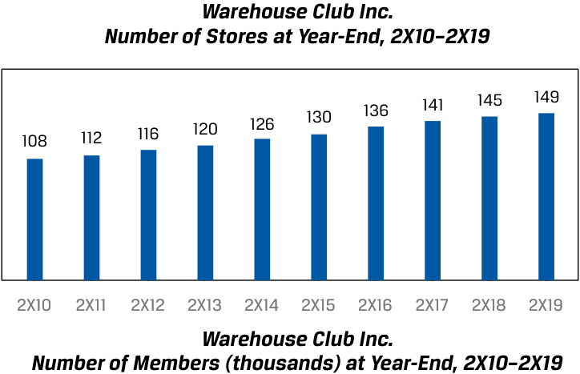
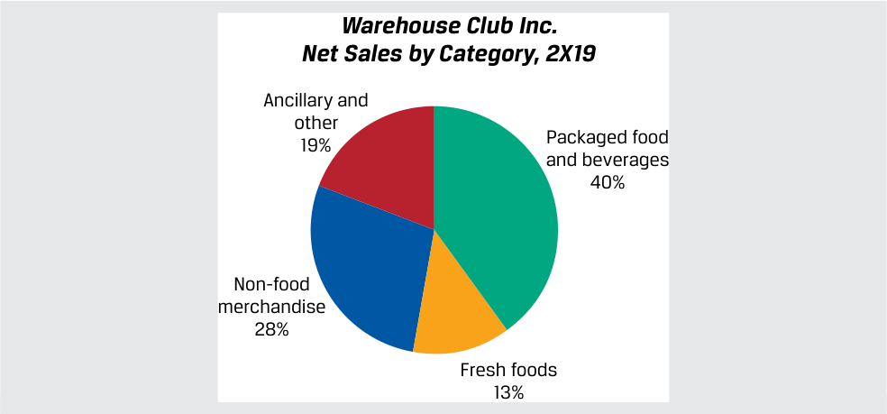

# Tập 5: Đầu tư Vốn cổ phần (Equity Investments)
## Học phần 5: Phân tích Công ty: Quá khứ và Hiện tại (Company Analysis: Past and Present)
### Phần 2/5: Xác định Mô hình Kinh doanh (Trang PDF 215–226)

---

<!-- PDF Page 215 -->

- **C.** báo cáo đó được viết bởi một nhà phân tích của một công ty đã theo dõi doanh nghiệp này trong nhiều năm.

**Lời giải (*Solution*):**
A là đáp án đúng. Phân tích Năm áp lực cạnh tranh của Porter (*Porter’s Five Forces analysis*) và phân tích PESTLE là những thành phần phổ biến trong các báo cáo bắt đầu theo dõi (*initiations*) và ít phổ biến hơn trong các báo cáo nghiên cứu tiếp theo, vì chúng có xu hướng biến chuyển chậm hơn so với các thành phần báo cáo khác như phân tích tài chính và mô hình tài chính.
B và C không chính xác; những tình huống này gắn với các báo cáo nghiên cứu tiếp theo hơn là các báo cáo nghiên cứu lần đầu.

3. Việc đánh giá chiến lược cạnh tranh (*competitive strategy*) của một công ty diễn ra trước khi:
- **A.** phân tích doanh thu và các yếu tố dẫn dắt doanh thu (*revenue drivers*).
- **B.** phân tích khả năng sinh lời hoạt động (*operating profitability*) và vốn lưu động (*working capital*).
- **C.** dự báo doanh thu, khả năng sinh lời hoạt động, và vốn lưu động.

**Lời giải (*Solution*):**
C là đáp án đúng. Việc dự báo chỉ diễn ra sau khi quá trình phân tích công ty cùng phân tích ngành và cạnh tranh đã hoàn tất. Việc đánh giá chiến lược cạnh tranh của một công ty là một phần của phân tích ngành và cạnh tranh.
A không chính xác, bởi vì việc phân tích doanh thu và các yếu tố dẫn dắt doanh thu là một phần của giai đoạn phân tích đầu tiên, nơi nhà phân tích nghiên cứu các báo cáo tài chính trong quá khứ và hiện tại của công ty. Như chúng ta sẽ thấy trong Bài học 3, các nhà phân tích bắt đầu bằng việc phân tích các khoản mục doanh thu trước tiên.
B không chính xác, bởi vì việc phân tích khả năng sinh lời hoạt động và vốn lưu động thường diễn ra trước khi phân tích ngành và cạnh tranh. Việc đánh giá chiến lược cạnh tranh của công ty thường là một phần của phân tích ngành và công ty, diễn ra sau khi hoàn tất việc phân tích khả năng sinh lời hoạt động và vốn lưu động. 

# **XÁC ĐỊNH MÔ HÌNH KINH DOANH (*DETERMINING THE BUSINESS MODEL*)** **<mark>3</mark>** 

- xác định mô hình kinh doanh (*business model*) của một công ty

Xác định mô hình kinh doanh là bước đầu tiên trong khuôn khổ phân tích ngành và công ty của chúng ta bởi vì nó tóm tắt các yếu tố dẫn dắt quan trọng đối với kết quả và tình hình tài chính của một tổ chức phát hành, giúp nhà phân tích tập trung vào những gì cần tìm hiểu sâu hơn, và bắt đầu định hình những kỳ vọng của nhà phân tích đối với tổ chức phát hành đó. Phần thảo luận về mô hình kinh doanh thường nằm ở phần đầu của một báo cáo nghiên cứu công ty (xem mục “Mô tả Công ty” – *“Company Description”* trong Bảng minh họa 2). 

Hãy nhớ lại rằng một mô hình kinh doanh mô tả các hoạt động của một công ty và bao gồm các yếu tố sau đây, mà các nhà phân tích tìm hiểu bằng cách trả lời một số câu hỏi chủ chốt đã được thảo luận trong các học phần trước. 

|**Thành phần của Mô hình Kinh doanh (*Business Model Element*)**|**Các Câu hỏi Chủ chốt cho Nhà phân tích (*Key Questions for Analysts*)**|
|---|---|
|Sản phẩm hoặc dịch vụ mà công ty bán (*The product(s) or service(s) the company sells*)|Doanh nghiệp đang bán thứ gì? (*What is the firm selling?*)|
|Khách hàng và các nhóm khách hàng chính (*Customers and key customer groups*)|Công ty bán cho ai? (*To whom does the company sell?*)|

<!-- PDF Page 216 -->

|**Thành phần của Mô hình Kinh doanh (*Business Model Element*)**|**Các Câu hỏi Chủ chốt cho Nhà phân tích (*Key Questions for Analysts*)**|
|---|---|
|Các kênh bán hàng, bao gồm cơ chế thu hút khách hàng và phân phối sản phẩm/dịch vụ (*Sales channels, including customer acquisition and product/service delivery mechanisms*)|Công ty tiếp cận các khách hàng tiềm năng và hiện hữu bằng cách nào và phân phối sản phẩm ra sao? (*How does the company reach potential and current customers and how does it deliver products?*)|
|Cách thức định giá và thanh toán cho sản phẩm hoặc dịch vụ (*How the product(s) or service(s) are priced and paid for*)|Công ty thu phí bao nhiêu và mức giá cùng các điều khoản thanh toán được cấu trúc như thế nào? (*How much does the company charge and how are prices and payment terms structured?*)|
|Các mối quan hệ về nguồn lực, nhà cung cấp, và đối tác cần thiết để vận hành hiệu quả (*Resource, supplier, and partner relationships need to operate effectively*)|Công ty mua và phụ thuộc vào những gì? (*What does the company buy and rely on?*)|

Có nhiều câu hỏi hệ quả đi kèm cho mỗi câu hỏi chủ chốt trên, chẳng hạn như xác định xem số lượng khách hàng có ít và tập trung hay không, liệu các nhà cung cấp và nguồn lực có mang tính chuyên biệt hoặc khó thay thế hay không, v.v. Câu trả lời cho những câu hỏi này mang tính đặc thù theo từng công ty, nhưng các câu hỏi chủ chốt cần đặt ra lại là điểm chung xuyên suốt các ngành và các công ty. Ngoài ra, hãy nhớ lại rằng nhiều công ty có một mô hình kinh doanh truyền thống (*conventional business model*), chẳng hạn như nhà bán lẻ hoặc nhà sản xuất tài nguyên thiên nhiên, điều này giúp đơn giản hóa việc nhận diện mô hình kinh doanh trên thực tế. Các nhà phân tích thường sẽ tập trung phân tích những điểm khác biệt trong mô hình kinh doanh của một công ty, nếu có, so với mô hình truyền thống hoặc so với mô hình của các đối thủ cạnh tranh. 

Các nguồn thông tin mà nhà phân tích sử dụng để trả lời những câu hỏi này bao gồm các nguồn sau đây, được phân nhóm theo xuất xứ: từ tổ chức phát hành (*the issuer*), từ bên thứ ba công khai (*public third party*), từ bên thứ ba độc quyền (*proprietary third party*), và nghiên cứu sơ cấp tự thực hiện (*proprietary primary research*). 

- Các nguồn từ tổ chức phát hành (có sẵn miễn phí nếu công ty là đại chúng) 

   - Hồ sơ nộp cho cơ quan quản lý (*regulatory filings*), đặc biệt là các báo cáo thường niên và hàng quý 

   - Các cuộc họp trực tuyến công bố kết quả lợi nhuận (*earnings conference calls*) hàng quý hoặc bán niên 

   - Các bài thuyết trình và sự kiện dành cho nhà đầu tư 

   - Thông cáo báo chí (*press releases*) 

   - Ban giám đốc, bộ phận quan hệ nhà đầu tư, hoặc nhân sự khác của tổ chức phát hành 

   - Trang web hoặc các cơ sở/tài sản của công ty mà nhà phân tích có thể ghé thăm với tư cách là khách hàng hoặc nhà đầu tư. Việc trực tiếp trải nghiệm sản phẩm của tổ chức phát hành và của các đối thủ cạnh tranh thường rất hữu ích, mặc dù không phải lúc nào cũng khả thi (ví dụ: dược phẩm). 

- Các nguồn từ bên thứ ba công khai 

   - Các báo cáo chuyên đề ngành (*industry white papers*) miễn phí hoặc báo cáo phân tích từ một công ty tư vấn 

   - Các chỉ báo kinh tế hoặc ngành từ chính phủ và các tổ chức khác 

   - Các kênh tin tức tổng hợp 

   - Các kênh tin tức chuyên ngành 

   - Mạng xã hội 

   - Các nguồn đa dạng khác có sẵn thông qua các công cụ tìm kiếm 

- Các nguồn từ bên thứ ba độc quyền (có thu phí) 

   - Các báo cáo và thông tin trao đổi của nhà phân tích, bao gồm từ các nhà phân tích “bên bán” (*“sell-side”*) hay “Phố Wall” (*“Wall Street”*) và các tổ chức xếp hạng tín nhiệm (*credit rating agencies*) 

   - Các báo cáo và dữ liệu từ các nền tảng như Bloomberg và FactSet 

   - Các báo cáo và dữ liệu từ các công ty tư vấn, thường mang tính chuyên ngành, chẳng hạn như Rystad trong ngành năng lượng, IQVIA và Evaluate trong ngành dược sinh học, Gartner và IDC trong ngành công nghệ thông tin 

- Nghiên cứu sơ cấp tự thực hiện (*Proprietary primary research*) 

<!-- PDF Page 217 -->

   - Các cuộc khảo sát, trò chuyện trao đổi, so sánh sản phẩm, và các nghiên cứu khác do nhà phân tích ủy quyền thực hiện hoặc trực tiếp tiến hành 

Các nhà phân tích trong môi trường đầu tư tổ chức (ví dụ: một công ty quản lý tài sản) thường có thể thực hiện nghiên cứu ban đầu này một cách nhanh chóng, vì họ có quyền tiếp cận rộng rãi với nhiều nguồn thông tin bên thứ ba độc quyền, bản thân họ có thể đã có kiến thức và kinh nghiệm trong ngành, có thể tiếp cận các phân tích trước đó về công ty hoặc ngành, và thường có khả năng tiếp cận nhân sự quan hệ nhà đầu tư cũng như ban giám đốc của tổ chức phát hành. 

Chúng ta sẽ minh họa việc xác định mô hình kinh doanh của một tổ chức phát hành bằng một ví dụ giả định được phóng tác từ một công ty có thật. Chúng ta sẽ sử dụng tình huống nghiên cứu (*case study*) này xuyên suốt học phần này và hai học phần tiếp theo để minh họa việc sử dụng khuôn khổ phân tích công ty và ngành. Một tình huống nghiên cứu khác về một công ty khác trong cùng ngành được đưa vào phần tự đánh giá ở cuối mỗi bài học, để bạn có thể tự mình thực hành việc áp dụng khuôn khổ này. 

### **TÌNH HUỐNG NGHIÊN CỨU (*CASE STUDY*)** 

## **Warehouse Club Inc.** 

Elaine Nguyen là một nhà phân tích tại Fyleton Investments. Để tìm kiếm các ứng viên đầu tư cho một trong những quỹ của Fyleton, Nguyen đã chạy một bộ lọc (*screen*) tìm các công ty tại các thị trường phát triển có tốc độ tăng trưởng doanh thu và tỷ suất sinh lợi trên vốn đầu tư (*return on invested capital* – ROIC) vượt qua một ngưỡng nhất định trong vòng 5 năm qua, đồng thời cũng có kết quả hoạt động tốt trong đợt suy thoái gần nhất. Một công ty vượt qua được bộ lọc này là Warehouse Club Inc. (“Warehouse”). Cả Nguyen lẫn các đồng nghiệp của cô đều chưa từng phân tích Warehouse trước đây. Một nhà quản lý danh mục đầu tư đã đề nghị Nguyen nghiên cứu công ty này cùng ngành hoạt động của nó trong vài ngày, sau đó thảo luận những phát hiện ban đầu với các đồng nghiệp trước khi viết một báo cáo nghiên cứu chính thức. 

Warehouse là một công ty đại chúng, vì vậy Nguyen thu thập một số nguồn thông tin từ tổ chức phát hành, bao gồm báo cáo thường niên mới nhất của công ty và bản ghi lời thoại (*transcript*) bài thuyết trình của ban giám đốc tại một sự kiện dành cho nhà đầu tư gần đây. Các đoạn văn và số liệu sau đây là những đoạn trích từ các nguồn này. 

Warehouse Club Inc. (“chúng tôi”, “của chúng tôi”, “công ty”) là một nhà bán lẻ chiết khấu (*discount retailer*) hàng đầu, liên tục mang lại cho khách hàng mức tiết kiệm hơn 20% đối với một danh mục đa dạng các mặt hàng thực phẩm và hàng hóa khác so với các đối thủ cạnh tranh là siêu thị, cửa hàng bách hóa, cửa hàng tiện lợi, và thương mại điện tử. Warehouse đã vận hành lần lượt 149, 145, và 141 cửa hàng tính đến ngày 31 tháng 12 năm 2X19, 2X18, và 2X17. 

Chúng tôi bán một danh mục cốt lõi gồm thực phẩm đóng gói và đồ uống, thực phẩm tươi sống, và các hàng hóa phi thực phẩm như quần áo may mặc, thiết bị gia dụng, đồ điện tử và giải trí, đồ dùng gia đình, và dụng cụ thể thao. Ngoài danh mục cốt lõi, các cửa hàng của chúng tôi còn có một danh mục thay đổi liên tục gồm các mặt hàng theo mùa hoặc giảm giá dựa trên các xu hướng tiêu dùng mới nhất và nguồn hàng sẵn có từ các nhà cung cấp, vốn khác nhau tùy theo từng cửa hàng. Chúng tôi cũng cung cấp các sản phẩm và dịch vụ phụ trợ (*ancillary products and services*) chẳng hạn như các trạm xăng đặt cùng khuôn viên với cửa hàng, thực phẩm chế biến sẵn mang đi ngay trong cửa hàng, trung tâm dược phẩm và kính mắt, cùng máy trợ thính. Ngoài việc kinh doanh các mặt hàng có thương hiệu hàng đầu, chúng tôi còn bán thực phẩm đóng gói và đồ gia dụng dưới thương hiệu nhãn hàng riêng (*private-label brand*) độc quyền mà chúng tôi đặt hàng từ các nhà sản xuất theo hợp đồng (*contract manufacturers*); mảng này chiếm hơn 15% doanh thu thuần của chúng tôi và mang lại khả năng sinh lời cao hơn mức trung bình. 

Chúng tôi vận hành mô hình dựa trên thành viên (*member-based model*), yêu cầu khách hàng phải xuất trình thẻ thành viên để vào và mua sắm tại các cửa hàng của chúng tôi. Phí thành viên hàng năm là $60 mỗi hộ gia đình. Chúng tôi ước tính rằng số tiền tiết kiệm hàng năm của các thành viên so với việc mua sắm cùng một giỏ hàng hóa đó tại các đối thủ cạnh tranh lên tới hơn năm lần mức phí thành viên hàng năm của họ. Doanh thu phí thành viên của chúng tôi 

<!-- PDF Page 218 -->

lần lượt đạt $601, $576, và $553 triệu trong các năm tài chính 2X19, 2X18, và 2X17. Bên cạnh việc cung cấp cho chúng tôi một nguồn doanh thu định kỳ (*recurring revenue*), tư cách thành viên còn tạo dựng lòng trung thành của người mua sắm và giúp chúng tôi đạt mức thất thoát hàng tồn kho do trộm cắp (*inventory theft*) thấp nhất trong ngành—ở mức dưới 20 điểm cơ bản (bps) tính theo phần trăm doanh thu thuần, mức mà chúng tôi tin rằng chỉ bằng tối đa một phần năm so với các đối thủ cạnh tranh. Tổng số lượng thành viên lần lượt là 10,2, 9,8, và 9,4 triệu tính đến ngày 31 tháng 12 năm 2X19, 2X18, và 2X17. 

Chiến lược của chúng tôi dựa trên sự dẫn đầu về giá và chi phí (*price and cost leadership*). Chúng tôi lưu kho một số lượng giới hạn có chọn lọc các sản phẩm mang thương hiệu và nhãn hàng riêng chất lượng cao thuộc nhiều danh mục đa dạng, giúp tạo ra sản lượng bán hàng lớn và vòng quay hàng tồn kho (*inventory turnover*) nhanh chóng. Chúng tôi giới hạn các mặt hàng ở những mẫu mã, kích cỡ, và màu sắc bán chạy và chỉ bày bán trung bình khoảng 4.000 mã sản phẩm độc nhất (*unique products*) tại mỗi cửa hàng, chưa bằng một phần tư số lượng mặt hàng của các đối thủ siêu thị và đại siêu thị. Hầu hết các mặt hàng chỉ được bán theo kích cỡ đóng gói lớn (*bulk sizes*). Ở bất cứ nơi nào có thể, chúng tôi đều sử dụng phương thức phân phối trực tiếp từ nhà sản xuất và chuyển hàng hóa ngay lập tức ra sàn bán hàng, trưng bày trên các tấm kê hàng (*pallets*) trong một không gian nhà kho tối giản không cầu kỳ (*no-frills warehouse atmosphere*). Việc mua hàng với khối lượng lớn đối với một số lượng sản phẩm giới hạn, phân phối trực tiếp từ nhà sản xuất, và giảm thiểu khâu bốc dỡ xử lý hàng hóa cho phép chúng tôi giữ vững vị thế chi phí thấp trong ngành bán lẻ xét về chi phí hàng hóa và chi phí nhân công. Chi phí thấp cùng doanh thu phí thành viên cho phép chúng tôi hoạt động có lãi trong khi vẫn áp dụng mức giá bán thấp hơn đáng kể so với các nhà bán lẻ khác. Mức giá thấp cho các sản phẩm chất lượng sẽ thúc đẩy số lượng thành viên và doanh thu thuần tăng lên theo thời gian, tạo đòn bẩy tận dụng hiệu quả chi phí bán hàng, tổng hợp và quản lý (SG&A), giúp làm giảm tỷ lệ các chi phí này tính theo phần trăm doanh thu thuần. 

Các cửa hàng của chúng tôi hoạt động bảy ngày một tuần, 70 giờ mỗi tuần với các ca làm việc có thể dự đoán trước cho nhân viên. Vì số giờ hoạt động ngắn hơn so với các nhà bán lẻ khác, và nhờ các hiệu quả khác vốn có trong mô hình vận hành kiểu nhà kho, chi phí nhân công thấp hơn tương đối so với khối lượng bán hàng. Chúng tôi hướng tới việc duy trì một đội ngũ lớn các nhân viên toàn thời gian với mức lương và phúc lợi cao hơn mức trung bình nhằm thiết lập thời gian gắn bó lâu dài, vì chúng tôi tin rằng điều này giúp tối đa hóa năng suất và dịch vụ khách hàng tại các cửa hàng của mình. Tỷ lệ giữ chân nhân viên (*employee retention rate*) đối với những nhân viên đã làm việc với chúng tôi ít nhất một năm là 90%, mức mà chúng tôi tin là cao hơn đáng kể so với mức trung bình của ngành bán lẻ. 

Hoạt động bán lẻ của chúng tôi, vốn chiếm gần như toàn bộ doanh thu thuần hợp nhất, là phân khúc báo cáo (*reportable segment*) duy nhất của chúng tôi. Chúng tôi không có doanh thu đáng kể nào bên ngoài khu vực địa lý nội địa của mình: Hoa Kỳ. Không có bất kỳ khách hàng hay nhà cung cấp đơn lẻ nào chiếm một tỷ trọng trọng yếu trong doanh thu hay chi phí hàng hóa, tương ứng. 

<!-- PDF Page 219 -->

> **Chú thích hình ảnh:** Biểu đồ Số lượng Cửa hàng vào Cuối năm của Warehouse Club Inc., giai đoạn 2X10–2X19 (*Number of Stores at Year-End, 2X10–2X19*):
> 2X10: 108 | 2X11: 112 | 2X12: 116 | 2X13: 120 | 2X14: 126 | 2X15: 130 | 2X16: 136 | 2X17: 141 | 2X18: 145 | 2X19: 149.

> **Chú thích hình ảnh:**
> - **Biểu đồ trên – Số lượng Thành viên (nghìn) vào Cuối năm của Warehouse Club Inc., giai đoạn 2X10–2X19 (*Number of Members (thousands) at Year-End, 2X10–2X19*):**
>   2X10: 6.004 | 2X11: 6.707 | 2X12: 7.011 | 2X13: 7.410 | 2X14: 7.980 | 2X15: 8.474 | 2X16: 9.044 | 2X17: 9.386 | 2X18: 9.804 | 2X19: 10.241.
> - **Biểu đồ dưới – Doanh thu Thuần Hàng năm (triệu USD) của Warehouse Club Inc., giai đoạn 2X10–2X19 (*Annual Net Sales (USD millions), 2X10–2X19*):**
>   2X10: 14.488 | 2X11: 16.539 | 2X12: 18.442 | 2X13: 19.545 | 2X14: 20.940 | 2X15: 21.597 | 2X16: 22.054 | 2X17: 23.973 | 2X18: 26.302 | 2X19: 28.377.

### **Báo cáo Kết quả Hoạt động Kinh doanh của Warehouse Club Inc. cho các Năm Kết thúc vào . . . (đơn vị: triệu USD ngoại trừ các khoản tính trên mỗi cổ phần)** 

||**31 tháng 12 năm 2X17**|**31 tháng 12 năm 2X18**|**31 tháng 12 năm 2X19**|
|---|---|---|---|
|Doanh thu thuần (*Net sales*)|23.973|26.302|28.377|
|Phí thành viên (*Membership fees*)|553|576|601|
|Tổng doanh thu (*Total revenues*)|24.526|26.878|28.978|
|Chi phí hàng hóa (*Merchandise costs*)|(21.258)|(23.399)|(25.248)|
|Chi phí bán hàng, tổng hợp và quản lý (*Selling, general, and administrative expenses*)|(2.201)|(2.363)|(2.566)|
|Khấu hao tài sản cố định và tài sản vô hình (*Depreciation and amortization*)|(260)|(273)|(283)|
|Chi phí mở cửa hàng mới (*New-store opening expenses*)|(16)|(13)|(16)|

<!-- PDF Page 220 -->

||**31 tháng 12 năm 2X17**|**31 tháng 12 năm 2X18**|**31 tháng 12 năm 2X19**|
|---|---|---|---|
|Lợi nhuận hoạt động (*Operating income*)|791|830|865|
|Chi phí lãi vay (*Interest expense*)|(25)|(30)|(29)|
|Thu nhập lãi (*Interest income*)|10|14|24|
|Lợi nhuận trước thuế (*Income before taxes*)|776|814|860|
|Chi phí thuế thu nhập (*Income tax expense*)|(178)|(187)|(198)|
|Lợi nhuận ròng (*Net income*)|598|627|662|
|Số cổ phần đang lưu hành (*Shares outstanding*)|83|83|84|
|Thu nhập trên mỗi cổ phần (*Earnings per share* – EPS)|7,20|7,55|7,88|

Trong bài thuyết trình tại một sự kiện dành cho nhà đầu tư gần đây, ban giám đốc của Warehouse đã đưa ra các phát biểu sau đây vốn không có trong báo cáo thường niên: 

- Ba năm trước, công ty đã ra mắt dịch vụ “Mua Trực tuyến, Nhận tại Cửa hàng” (*“Buy Online, Pick-Up in Store”*), cho phép các thành viên mua sắm trên trang web hoặc ứng dụng di động của Warehouse và nhận đơn hàng của mình—được nhân viên Warehouse tập hợp sẵn—tại một cửa hàng. Công ty không có kế hoạch tự cung cấp dịch vụ thương mại điện tử hay giao hàng tận nơi hoặc thông qua các dịch vụ bên thứ ba. 

- Phí thành viên là $60 mỗi năm, thanh toán trả trước, và được hoàn lại theo tỷ lệ thời gian (*prorated basis*) cho số ngày còn lại trong năm. Ban giám đốc đã tăng giá phí thành viên định kỳ 5 năm một lần với mức tăng $5 và dự kiến sẽ tiếp tục làm như vậy. Lần tăng giá gần nhất là cách đây ba năm. 

- Ban giám đốc dự định mở bốn cửa hàng mới mỗi năm trong năm năm tới. 

- Công ty vận hành các cửa hàng tại các khu vực đô thị và ngoại ô ở một quốc gia duy nhất. Hơn 90% thành viên hiện tại sống trong bán kính 10 km quanh một cửa hàng, và mặc dù số lượng thành viên đã tăng lên xung quanh các cửa hàng hiện hữu theo thời gian, ban giám đốc tin rằng yếu tố dẫn dắt chính cho sự tăng trưởng thành viên là việc mở thêm cửa hàng tại các khu vực mới. 

- Ban giám đốc không có kế hoạch mở cửa hàng tại một quốc gia khác trong tương lai gần. Một lượng hàng hóa không đáng kể được nhập khẩu. 

### **VÍ DỤ 1 (*EXAMPLE 1*)** 

## **Xác định Mô hình Kinh doanh của Warehouse Club Inc.** 

Nguyen trả lời các câu hỏi sau đây để xác định mô hình kinh doanh của Warehouse Club Inc. và để nhận diện các lĩnh vực cần tiến hành nghiên cứu sâu hơn. 

- Doanh nghiệp đang bán thứ gì? (*What is the firm selling?*) 

Warehouse bán một loạt các mặt hàng tiêu dùng, chủ yếu là hàng tiêu hao (*consumables*) và hàng dễ hỏng (*perishables*), với khoảng 4.000 mặt hàng độc nhất. Để khách hàng có thể mua sắm tại các cửa hàng, họ phải có thẻ thành viên mà Warehouse bán với giá $60 mỗi năm cho mỗi hộ gia đình. Nguyen vẽ biểu đồ dữ liệu doanh thu thuần theo danh mục sau đây kèm theo các mô tả do Warehouse cung cấp, và lưu ý rằng cơ cấu doanh thu thuần theo danh mục đã không thay đổi trọng yếu trong 10 năm qua. 

<!-- PDF Page 221 -->

> **Chú thích hình ảnh:** Biểu đồ tròn Doanh thu Thuần theo Danh mục năm 2X19 của Warehouse Club Inc. (*Net Sales by Category, 2X19*):
> - Thực phẩm đóng gói và đồ uống (*Packaged food and beverages*): 40%
> - Hàng hóa phi thực phẩm (*Non-food merchandise*): 28%
> - Phụ trợ và khác (*Ancillary and other*): 19%
> - Thực phẩm tươi sống (*Fresh foods*): 13%

“Hàng hóa phi thực phẩm” (*“Non-food merchandise”*) bao gồm một danh mục rộng các mặt hàng như thiết bị gia dụng, đồ điện tử, sản phẩm chăm sóc sức khỏe và cá nhân, dụng cụ kim khí, đồ dùng ngoài trời và thể thao, trang sức, đồ nội thất, và đồ gia dụng. 

“Phụ trợ và khác” (*“Ancillary and other”*) là các mảng kinh doanh dịch vụ hoạt động bên trong hoặc ngay cạnh các cửa hàng của Warehouse và bao gồm thực phẩm chế biến sẵn mang đi, hiệu thuốc kê đơn, trạm xăng, trung tâm kính mắt, và máy trợ thính. 

### ■ Bán cho ai? (*To whom?*) 

Các thành viên của Warehouse chủ yếu là các hộ gia đình tiêu dùng sống trong bán kính 10 km quanh một cửa hàng, có ý thức về giá trị (*value-conscious*), sẵn sàng đánh đổi một danh mục lựa chọn phong phú hơn để lấy mức đơn giá thấp hơn trên các mặt hàng đóng gói cỡ lớn, và có khả năng chi trả khoản phí thành viên hàng năm. 

### ■ Bằng cách nào? (*How?*) 

Warehouse bán các sản phẩm và dịch vụ cả ở bên trong lẫn xung quanh các cửa hàng của mình. Các thành viên có thể mua sắm trực tiếp tại cửa hàng hoặc mua sắm trực tuyến rồi nhận hàng tại cửa hàng (Nguyen lưu ý rằng ban giám đốc đã không công bố quy mô của hình thức này xét theo doanh thu thuần). Ban giám đốc cho biết công ty thực hiện rất ít hoạt động quảng cáo (ngoài thư khuyến mãi) tại một khu vực trước khi mở cửa hàng và cũng gửi thông báo nhắc gia hạn thành viên; công ty chủ yếu dựa vào truyền miệng (*word of mouth*) và sự hiện diện vật lý của các cửa hàng để thu hút sự quan tâm và lượng khách ghé thăm (*foot traffic*). 

Thẻ thành viên có thể được mua trực tuyến, qua điện thoại, hoặc tại bất kỳ cửa hàng Warehouse nào. Ban giám đốc cho biết hơn ba phần tư số thành viên mua và gia hạn thẻ thành viên trực tuyến. 

### ■ Với giá bao nhiêu? (*For how much?*) 

Warehouse có hai dòng doanh thu: hàng hóa và dịch vụ (mang lại doanh thu thuần) và thẻ thành viên (mang lại phí thành viên). 

Ban giám đốc ấn định giá hàng hóa theo từng mặt hàng. Lợi nhuận gộp (*gross margin*) và tỷ lệ cộng thêm vào giá vốn (*markup*) trên tổng doanh thu thuần trong ba năm tài chính gần nhất như sau: 

||**31 tháng 12 năm 2X17**|**31 tháng 12 năm 2X18**|**31 tháng 12 năm 2X19**|
|---|---|---|---|
|Doanh thu thuần (*Net sales*)|23.973|26.302|28.377|
|Chi phí hàng hóa (*Merchandise costs*)|(21.258)|(23.399)|(25.248)|
|Lợi nhuận gộp (*Gross margin*)|2.715|2.903|3.129|
|% Lợi nhuận gộp trên doanh thu thuần (*Gross margin % of net sales*)|11,33%|11,04%|11,03%|
|Tỷ lệ cộng thêm vào giá vốn (*Markup*)|12,77%|12,41%|12,39%|

<!-- PDF Page 222 -->

Do đó, trung bình một mặt hàng hoặc dịch vụ được bán ở mức giá cao hơn một chút so với 12% chi phí mà Warehouse bỏ ra để mua và chuẩn bị mặt hàng đó sẵn sàng để bán. Mặc dù ban giám đốc tuyên bố rằng công ty là người dẫn đầu về chi phí và giá bán, Nguyen sẽ phải kiểm chứng lại điều đó. 

Phí thành viên là $60 mỗi năm cho mỗi hộ gia đình. Thẻ thành viên là điều kiện bắt buộc để mua sắm tại các cửa hàng của Warehouse, do đó trên thực tế đã làm tăng mức giá của tất cả các hàng hóa và dịch vụ của công ty. 

- Công ty mua và phụ thuộc vào những gì để vận hành hiệu quả? (*What does the company buy and rely on to operate effectively?*) 

   - Hàng hóa từ một loạt các nhà sản xuất và hàng hóa mang nhãn hiệu riêng từ các nhà sản xuất theo hợp đồng 

   - Nguồn vốn nhân lực (*human capital*) tại các cửa hàng và trong ban quản lý 

   - Tài sản cố định bao gồm đất đai ở các vị trí đắc địa, nhà cửa vật kiến trúc, trang thiết bị cố định, tủ lạnh và tủ đông, cùng một loạt các hệ thống công nghệ thông tin như hệ thống thanh toán tại điểm bán hàng (POS) 

   - Mạng lưới thanh toán thẻ tín dụng và thẻ ghi nợ cùng các định chế tài chính để nhận và thực hiện các khoản thanh toán điện tử 

Mặc dù tất cả những yếu tố này đều có sẵn rộng rãi và công ty chưa từng gặp phải sự gián đoạn nguồn cung hay dịch vụ nào trong quá khứ, một đối tác chủ chốt dường như là các nhà sản xuất hàng hóa, đặc biệt là những đơn vị sản xuất các sản phẩm mang nhãn hiệu riêng của Warehouse. Vì Warehouse rất khắt khe về chi phí và chất lượng đồng thời chỉ kinh doanh một danh mục giới hạn, công ty thực sự phụ thuộc đáng kể vào các nhà sản xuất theo hợp đồng này. 

Tóm lại, mô hình kinh doanh của Warehouse hướng tới việc tạo ra một vòng lặp tích cực (*virtuous cycle*), theo đó mức giá thấp thúc đẩy số lượng thành viên, từ đó thúc đẩy doanh thu tăng thêm, rồi tạo ra đòn bẩy thương lượng (*negotiating leverage*) với các nhà cung cấp để cho phép duy trì mức giá bán thấp với chi phí thấp. 

### **CÂU HỎI THẢO LUẬN (*DISCUSSION BOARD QUESTION*)** 

Dựa trên các thông tin được cung cấp, bạn sẽ thay đổi hoặc bổ sung điều gì vào phần phân tích của Elaine Nguyen về mô hình kinh doanh của Warehouse Club Inc.? Tại sao? 

Chúng tôi khuyến khích bạn đăng câu trả lời của mình, cũng như đọc và phản hồi câu trả lời của những người khác, trên diễn đàn thảo luận của Hệ sinh thái Học tập (*Learning Ecosystem*). 

### **BỘ CÂU HỎI (*QUESTION SET*)** 

Iliso Marketplace Ltd. (“chúng tôi”, “của chúng tôi”, “Công ty”, “Iliso”) đang tái định nghĩa thương mại điện tử bằng cách mang lại những trải nghiệm khách hàng vượt trội với mức giá cạnh tranh thông qua ứng dụng di động và trang web Iliso Marketplace của chúng tôi. Trong khi khách hàng thương mại điện tử trước đây thường buộc phải thỏa hiệp về thời gian giao hàng, chất lượng sản phẩm, và những rắc rối khi trả hàng, chúng tôi đã xây dựng một hệ thống tích hợp theo chiều dọc (*vertically integrated system*) cung cấp một danh mục sản phẩm khổng lồ với dịch vụ giao hàng trong một ngày đối với hầu hết các đơn hàng. Chúng tôi tiếp tục thực hiện các khoản đầu tư đáng kể vào cả công nghệ lẫn cơ sở hạ tầng hoàn tất đơn hàng (*fulfillment infrastructure*) để cải thiện trải nghiệm khách hàng và mở rộng sang các danh mục sản phẩm cũng như khu vực địa lý mới. 

**Trải nghiệm Khách hàng (*Customer Experience*)** 

<!-- PDF Page 223 -->

Chúng tôi cam kết làm hài lòng khách hàng mỗi ngày. Những dấu ấn đặc trưng trong trải nghiệm khách hàng của chúng tôi bao gồm:

- ■ **Giao hàng Ngày hôm sau hoặc Nhanh hơn (*Next-Day or Faster Delivery*).** Khách hàng đủ điều kiện được giao hàng trong một ngày xuyên suốt 365 ngày một năm. Vào năm 2X19, hơn 93% đơn hàng đã được giao trong vòng 24 giờ kể từ khi nhận được đơn hàng.
- ■ **Miễn phí Vận chuyển (*Free Shipping*).** Khách hàng đủ điều kiện được miễn phí vận chuyển đối với các đơn hàng lớn hơn $25, mức mà chúng tôi tin là ngưỡng đơn hàng tối thiểu dẫn đầu ngành, và không yêu cầu phí thành viên.
- ■ **Danh mục Mặt hàng Khổng lồ, Bao gồm cả Hàng Tạp hóa Tươi sống (*Vast Selection of Items, Including Fresh Groceries*).** Khách hàng có thể đặt hàng từ một danh mục các mặt hàng thuộc hầu hết mọi nhóm hàng hóa—từ nông sản tươi sống đến điện tử tiêu dùng cho tới đồ trang trí nhà cửa và nội thất. Để tiếp tục cung cấp những mặt hàng chất lượng cao nhất, chúng tôi liên tục điều chỉnh danh mục của mình dựa trên đánh giá của khách hàng. Chúng tôi thực thi các tiêu chuẩn nghiêm ngặt đối với những người bán bên thứ ba (*third-party merchants*) nhằm bảo vệ khách hàng khỏi hàng giả.
- ■ **Trả hàng Không Rào cản (*Frictionless Returns*).** Khách hàng của chúng tôi chỉ cần chạm vào một nút trên ứng dụng và để món hàng bên ngoài cửa nhà để nhân viên đến lấy. Việc hoàn tiền được khởi tạo ngay tại thời điểm món hàng được nhận lại tại cửa.

Số lượng tài khoản khách hàng đang hoạt động (*active customer accounts*) tính đến quý 4 của các năm kết thúc vào ngày 31 tháng 12 năm 2X17, 2X18, và 2X19 lần lượt là 29, 31, và 36 triệu. Tài khoản khách hàng đang hoạt động đề cập đến một địa chỉ email duy nhất và có ít nhất một giao dịch mua hàng trong kỳ được chỉ định; chúng tôi không thu phí thành viên hay yêu cầu mức mua hàng tối thiểu để duy trì tài khoản.

**Mạng lưới Hoàn tất Đơn hàng của Chúng tôi (*Our Fulfillment Network*)**

Để đạt được trải nghiệm khách hàng khác biệt hóa, chúng tôi tập trung vào các thị trường đô thị và đã xây dựng một hệ thống tích hợp theo chiều dọc, trong đó chúng tôi kiểm soát mọi bước, từ giao dịch mua hàng của khách trên ứng dụng cho đến bức ảnh xác nhận đã giao hàng tại cửa trước của khách. Chúng tôi nhận hầu hết sản phẩm trực tiếp từ các nhà sản xuất tại các trung tâm hoàn tất đơn hàng (*fulfillment centers*) của mình và giảm thiểu việc sử dụng các hãng vận chuyển cũng như nhà thầu bên thứ ba bằng cách trực tiếp tuyển dụng hơn 65.000 nhân sự trong khâu hoàn tất đơn hàng và giao nhận. Chúng tôi tin rằng việc tuyển dụng trực tiếp và kiểm soát các tài sản hoàn tất đơn hàng như xe tải giao hàng cho phép đạt được tốc độ, tính hiệu quả, và giảm thiểu lãng phí—điều đặc biệt quan trọng đối với các danh mục sản phẩm như thực phẩm tươi sống. 

Chúng tôi đã đưa ra quyết định chiến lược là tập trung vào các thị trường đô thị tại Hoa Kỳ trong tương lai gần nhằm đạt được mật độ tuyến đường có tính kinh tế (*economical route density*) cho việc giao hàng và nhận hàng trả lại của khách cũng như dịch vụ vận chuyển trong một ngày. 

### **Dịch vụ Người bán (*Merchant Services*)** 

Vào năm 2X13, chúng tôi đã ra mắt Dịch vụ Người bán (*Merchant Services*), cho phép những người bán bên thứ ba bán sản phẩm trên Iliso Marketplace và sử dụng mạng lưới hoàn tất đơn hàng của chúng tôi. Khi có nhiều người bán (bao gồm cả chúng tôi) cùng bán một sản phẩm, thuật toán của chúng tôi sẽ hiển thị cho khách hàng mức giá thấp nhất, đã bao gồm chi phí vận chuyển, mặc dù khách hàng có thể tự tay chọn một người bán khác. Những người bán bên thứ ba phải đáp ứng các tiêu chuẩn chất lượng nghiêm ngặt của chúng tôi nhưng ngoài điều đó ra, họ có toàn quyền quyết định về danh mục và mô tả sản phẩm, định giá, và các điều khoản vận chuyển. 

Chúng tôi nhận hoa hồng bán hàng (*sales commissions*) trên doanh số của người bán bên thứ ba, cũng như doanh thu dịch vụ nếu người bán sử dụng mạng lưới hoàn tất đơn hàng của chúng tôi để lưu kho và giao hàng. Chúng tôi ghi nhận doanh thu trên cơ sở “thuần” (*“net” basis*) đối với các giao dịch liên quan đến người bán bên thứ ba bởi vì chúng tôi đóng vai trò là đại lý (*agent*); Công ty không phải là người bán đứng tên trên hồ sơ (*seller of record*), cũng không nắm quyền kiểm soát hàng tồn kho đó. Số lượng người bán bên thứ ba đang hoạt động tính đến quý 4 của các năm kết thúc vào ngày 31 tháng 12 năm 2X17, 2X18, và 2X19 lần lượt là 25.500, 31.500, và 40.500. Người bán bên thứ ba đang hoạt động đề cập đến một địa chỉ email duy nhất và có ít nhất một giao dịch bán hàng trong kỳ được chỉ định; chúng tôi không thu phí thành viên đối với người bán, cũng không yêu cầu mức doanh số tối thiểu. 

<!-- PDF Page 224 -->

Tổng giá trị hàng hóa (*gross merchandise value* – GMV) hàng năm của chúng tôi—bao gồm giá trị của tất cả các sản phẩm được bán trên sàn giao dịch bởi chúng tôi và bởi những người bán bên thứ ba, sau khi đã trừ thuế bán hàng và các khoản giảm trừ hàng bán bị trả lại nhưng bao gồm bất kỳ khoản phí vận chuyển áp dụng nào—lần lượt là $5.721, $6.950, và $8.605 triệu cho các năm kết thúc vào ngày 31 tháng 12 năm 2X17, 2X18, và 2X19. GMV theo danh mục sản phẩm cho năm kết thúc vào ngày 31 tháng 12 năm 2X19 như sau: 

> **Chú thích hình ảnh:** Biểu đồ tròn GMV theo Danh mục Sản phẩm năm 2X19 của Iliso Marketplace Ltd. (*GMV by Product Category, 2X19*):
> - Thực phẩm tươi sống và tạp hóa (*Fresh food and grocery*): 55%
> - Truyền thông và điện tử (*Media and electronics*): 20%
> - Quần áo may mặc và sản phẩm làm đẹp (*Apparel and beauty products*): 17%
> - Đồ gia dụng và trang trí (*Home goods and décor*): 8%

Iliso gần đây đã phát hành cổ phiếu ra công chúng (IPO), vì vậy thông tin tài chính chỉ có sẵn cho năm năm kết thúc vào ngày 31 tháng 12 năm 2X19. Các con số được tính bằng triệu USD (ngoại trừ các khoản tính trên mỗi cổ phần). 

### **Iliso Marketplace Ltd. – GMV, Số lượng Khách hàng, và Số lượng Người bán cho các Năm Kết thúc vào ngày 31 tháng 12** 

||**2X15**|**2X16**|**2X17**|**2X18**|**2X19**|
|---|---|---|---|---|---|
|Doanh số bán lẻ của Iliso (*Iliso retail sales*)|2.589|3.424|5.100|6.052|7.336|
|Doanh số của người bán bên thứ ba (*Third-party merchant sales*)|279|432|621|898|1.269|
|Tổng GMV (*Total GMV*)|2.868|3.856|5.721|6.950|8.605|
|Tài khoản khách hàng đang hoạt động (triệu) (*Active customer accounts - millions*)|16|23|29|31|36|
|Người bán bên thứ ba (số lượng) (*Third-party merchants - #*)|14.850|18.000|25.500|31.500|40.500|

### **Iliso Marketplace Ltd. – Báo cáo Kết quả Hoạt động Kinh doanh cho các Năm Kết thúc vào ngày 31 tháng 12** 

||**2X15**|**2X16**|**2X17**|**2X18**|**2X19**|
|---|---|---|---|---|---|
|Doanh thu bán lẻ thuần (*Net retail sales*)|2.589|3.424|5.100|6.052|7.336|
|Phí người bán bên thứ ba (*Third-party merchant fees*)|42|65|94|134|190|
|Tổng doanh thu (*Total revenues*)|2.631|3.489|5.194|6.186|7.526|
|Giá vốn doanh thu (*Costs of revenues*)|(1.894)|(2.506)|(3.729)|(4.446)|(5.414)|
|Chi phí vận hành, tổng hợp và quản lý (*Operating, general, and administrative expenses*)|(685)|(895)|(1.300)|(1.544)|(1.831)|
|Chi phí quảng cáo và tiếp thị (*Advertising and marketing*)|(53)|(70)|(104)|(124)|(151)|
|Lợi nhuận hoạt động (*Operating income*)|(1)|18|61|72|130|

<!-- PDF Page 225 -->

||**2X15**|**2X16**|**2X17**|**2X18**|**2X19**|
|---|---|---|---|---|---|
|Thu nhập lãi (*Interest income*)|6|7|9|9|10|
|Chi phí lãi vay (*Interest expense*)|(5)|(13)|(15)|(12)|(8)|
|Lợi nhuận trước thuế (*Pre-tax income*)|0|12|55|69|132|
|Dự phòng thuế thu nhập (*Provision for income taxes*)|0|(3)|(13)|(16)|(32)|
|Lợi nhuận ròng (*Net income*)|0|9|42|52|100|
|EPS cơ bản (*Basic EPS*)|0,00|0,03|0,15|0,18|0,34|
|EPS pha loãng (*Diluted EPS*)|0,00|0,03|0,14|0,18|0,34|
|Số lượng cổ phần cơ bản (*Basic share count*)|274|280|284|288|291|
|Số lượng cổ phần pha loãng (*Diluted share count*)|274|280|291|288|297|

Thuyết minh báo cáo tài chính của Iliso cung cấp các mô tả sau đây về các tài khoản. 

### **Doanh thu bán lẻ thuần (*Net retail sales*)** 

Doanh thu bán lẻ thu được từ hoạt động bán sản phẩm trực tuyến của Công ty cho người tiêu dùng. Doanh thu bán lẻ được ghi nhận khi quyền kiểm soát hàng hóa được chuyển giao cho khách hàng, diễn ra vào thời điểm giao hàng cho khách. 

### **Phí người bán bên thứ ba (*Third-party merchant fees*)** 

Doanh thu phí người bán bên thứ ba bao gồm tiền hoa hồng và phí dịch vụ thu được từ những người bán bán sản phẩm của họ thông qua mảng kinh doanh trực tuyến của Công ty. Doanh thu được ghi nhận khi đơn hàng được hoàn tất và chuyển tới người bán bên thứ ba. 

### **Giá vốn doanh thu (*Costs of revenues*)** 

Giá vốn doanh thu chủ yếu bao gồm giá mua của các sản phẩm bán cho khách hàng nơi Công ty ghi nhận doanh thu theo số gộp (*gross*), và bao gồm chi phí trung tâm hậu cần (*logistics center costs*). Chi phí vận chuyển hàng nhập vào (*inbound shipping*) và chi phí bốc dỡ xử lý để nhận sản phẩm từ nhà cung cấp được tính vào hàng tồn kho và được ghi nhận vào giá vốn doanh thu khi sản phẩm được bán ra. Ngoài ra, giá vốn doanh thu còn bao gồm chi phí vận chuyển hàng đi (*outbound shipping*) và các chi phí liên quan đến hậu cần, chi phí dịch vụ giao hàng từ mảng kinh doanh Dịch vụ Người bán của chúng tôi (nơi Công ty là nhà cung cấp dịch vụ giao hàng), và chi phí khấu hao. 

### **Chi phí vận hành, tổng hợp và quản lý (*Operating, general, and administrative expenses*)** 

Chi phí vận hành, tổng hợp và quản lý bao gồm các chi phí phát sinh trong việc vận hành và bố trí nhân sự tại các trung tâm hoàn tất đơn hàng của Công ty (bao gồm các chi phí liên quan đến việc tiếp nhận, kiểm tra, lấy hàng, đóng gói, và chuẩn bị đơn hàng của khách), chi phí dịch vụ khách hàng, phí xử lý thanh toán, các chi phí liên quan đến việc thiết kế, thực thi, và bảo trì cơ sở hạ tầng công nghệ cùng các dịch vụ trực tuyến của Công ty, và các chi phí chức năng doanh nghiệp chung. 

### **Chi phí quảng cáo và tiếp thị (*Advertising and marketing expenses*)** 

Chi phí quảng cáo và tiếp thị được hạch toán vào chi phí khi phát sinh và bao gồm quảng cáo thương hiệu và quảng cáo hiệu suất (*performance advertising*) chẳng hạn như quảng cáo truyền hình và kỹ thuật số, tìm kiếm được tài trợ (*sponsored search*), các chiến dịch tiếp thị qua email, và các sáng kiến tương tự khác. 

1. Đối tượng nào tạo thành cơ sở khách hàng (yếu tố “ai” – *the “who”*) cho phân khúc dịch vụ người bán (*merchant services segment*) của Iliso? 

   - **A.** Những người bán bên thứ ba (*Third-party merchants*) 

   - **B.** Khách hàng thương mại điện tử (*E-commerce customers*) 

<!-- PDF Page 226 -->

   - **C.** Người tiêu dùng thực phẩm tươi sống và tạp hóa (*Fresh food and grocery consumers*) 

   - **Lời giải (*Solution*):** 

A là đáp án đúng. Trong mảng dịch vụ người bán, Iliso đóng vai trò là đại lý cho những người bán bên thứ ba. Iliso được những người bán bán sản phẩm của họ thông qua mảng kinh doanh trực tuyến của công ty trả hoa hồng và phí dịch vụ. Do đó, những người bán bên thứ ba chính là cơ sở khách hàng của phân khúc kinh doanh này. 

B không chính xác, bởi vì khách hàng thương mại điện tử là khách hàng của phân khúc bán lẻ (*retail sales segment*) của Iliso. Iliso được các khách hàng thương mại điện tử thanh toán tiền cho các hàng hóa được mua thông qua nền tảng trực tuyến của mình. Các giao dịch mua sản phẩm của người bán bên thứ ba do những khách hàng thương mại điện tử này thực hiện thuộc về người bán bên thứ ba và không được ghi nhận vào doanh thu bán lẻ của Iliso. 

C không chính xác, bởi vì người tiêu dùng thực phẩm tươi sống và tạp hóa là một sự phân khúc theo dòng sản phẩm của cả doanh thu bán lẻ lẫn GMV của người bán bên thứ ba. Ngoài ra, thực phẩm tươi sống và tạp hóa chỉ chiếm 55% tổng GMV và không bao hàm toàn bộ doanh số GMV của Iliso. 

2. (Các) mô hình kinh doanh của Iliso nhiều khả năng sẽ được hưởng lợi từ hiệu ứng __________. 

   - **A.** mạng lưới (*network*) 

   - **B.** chuỗi giá trị (*value chain*) 

   - **C.** chuỗi cung ứng (*supply chain*) 

   - **Lời giải (*Solution*):** 

A là đáp án đúng. Mô hình kinh doanh của Iliso—đặc biệt là mảng dịch vụ người bán—là một ví dụ về hiệu ứng mạng lưới hai chiều (*two-sided network effect*). Hiệu ứng mạng lưới đề cập đến một mạng lưới trong đó giá trị gia tăng khi có thêm nhiều người tham gia vào mạng lưới đó. Bằng cách cung cấp dịch vụ xuất sắc cho cả người bán lẫn người tiêu dùng, Iliso có thể thu hút cả người mua và người bán đến với sàn giao dịch trực tuyến của mình. Sự gia tăng người dùng trên nền tảng của Iliso thu hút thêm nhiều người bán, và điều này đến lượt nó lại thu hút thêm nhiều người dùng hơn nữa. 

B không chính xác, bởi vì chuỗi giá trị (*value chain*) đề cập đến các hệ thống và quy trình bên trong một doanh nghiệp nhằm tạo ra giá trị cho khách hàng của mình—vốn trả lời cho khía cạnh “bằng cách nào” (*“how”*) của một mô hình kinh doanh. 

C không chính xác, bởi vì chuỗi cung ứng (*supply chain*) là mạng lưới bên trong và bên ngoài công ty tham gia vào việc sản xuất sản phẩm/dịch vụ và phân phối nó đến người dùng cuối. 

3. Đặc điểm kinh doanh nào sau đây _ít có khả năng nhất_ làm tăng tỷ lệ giữ chân người tiêu dùng (độ “gắn kết” – *“stickiness”*) trên nền tảng của Iliso? 

   - **A.** Sự tập trung vào các thị trường đô thị (*A focus on urban markets*) 

   - **B.** Giao hàng ngày hôm sau hoặc nhanh hơn (*Next-day or faster delivery*) 

   - **C.** Không yêu cầu phí thành viên (*No membership fee is required*). 

   - **Lời giải (*Solution*):** 

A là đáp án đúng. Việc tập trung vào các thị trường đô thị không làm thay đổi độ gắn kết của khách hàng. Trải nghiệm khách hàng đối với những người ở thị trường đô thị không nhất thiết sẽ thay đổi nếu công ty bắt đầu giao hàng tới cả các thị trường nông thôn. 

B không chính xác. Công ty nêu rõ rằng dịch vụ giao hàng ngày hôm sau hoặc nhanh hơn là một dấu ấn đặc trưng trong trải nghiệm khách hàng của mình và có thể mang lại một lợi thế cạnh tranh. 

C không chính xác, bởi vì việc không thu phí thành viên nhiều khả năng sẽ làm giảm chi phí để khách hàng tiếp tục ở lại trên nền tảng, qua đó làm tăng khả năng giữ chân đối với một số khách hàng. 
