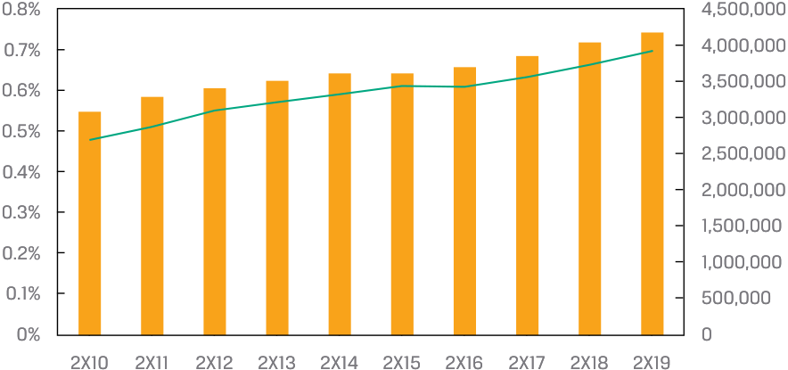

# Tập 5: Đầu tư Vốn cổ phần (Equity Investments)
## Học phần 5: Phân tích Công ty: Quá khứ và Hiện tại (Company Analysis: Past and Present)
### Phần 3/5: Phân tích Doanh thu (Trang PDF 227–233)

---

<!-- PDF Page 227 -->

4. Biên lợi nhuận gộp (*gross margin*) của phân khúc dịch vụ người bán (*merchant services segment*) của Iliso _nhiều khả năng nhất_ _____________ biên lợi nhuận gộp của phân khúc bán lẻ (*retail sales segment*) của Iliso.
- **A.** cao hơn
- **B.** bằng với
- **C.** thấp hơn

**Lời giải (*Solution*):**
A là đáp án đúng. Giá vốn doanh thu (*cost of revenues*) đối với mảng bán lẻ của Iliso bao gồm giá mua của các sản phẩm bán cho khách hàng, kể cả chi phí vận chuyển và bốc dỡ xử lý hàng, trong khi giá vốn doanh thu đối với mảng dịch vụ người bán chỉ bao gồm chi phí vận chuyển hàng đi (*outbound shipping*) và chi phí hậu cần (*logistics*). Giá mua của sản phẩm chiếm một tỷ trọng lớn hơn rất nhiều trong tổng giá trị hàng hóa (GMV) bán cho khách hàng khi so với chi phí vận chuyển và hậu cần. Theo đó, việc loại trừ giá mua của sản phẩm ở cả tử số và mẫu số sẽ làm tăng biên lợi nhuận gộp được báo cáo của phân khúc dịch vụ người bán.
B không chính xác, bởi vì biên lợi nhuận gộp của dịch vụ người bán không thể bằng với biên lợi nhuận gộp của mảng bán lẻ. Phân khúc bán lẻ bao gồm giá mua của sản phẩm được bán và các chi phí hậu cần nhập hàng liên quan, có nghĩa là cả tử số (chi phí) và mẫu số (doanh thu gộp) đều cao hơn đáng kể so với phân khúc dịch vụ người bán.
C không chính xác, bởi vì biên lợi nhuận gộp của dịch vụ người bán không thể thấp hơn biên lợi nhuận gộp của mảng bán lẻ. Giả sử cả hai phân khúc đều có biên lợi nhuận gộp dương, biên lợi nhuận gộp của dịch vụ người bán bắt buộc phải cao hơn vì mẫu số nhỏ hơn (chỉ bao gồm hoa hồng dịch vụ và phí dịch vụ thu từ người bán). 

## **PHÂN TÍCH DOANH THU (*REVENUE ANALYSIS*)** 

# **<mark>4</mark>** 

- đánh giá doanh thu (*revenue*) và các yếu tố dẫn dắt doanh thu (*revenue drivers*) của một công ty, bao gồm cả sức mạnh định giá (*pricing power*)

### **Các Yếu tố Dẫn dắt Doanh thu (*Revenue Drivers*)** 

Sau khi xác định được mô hình kinh doanh, chúng ta chuyển sang phân tích kết quả và tình hình tài chính lịch sử của công ty. Phân tích này sẽ được sử dụng làm cơ sở để dự báo một mô hình báo cáo tài chính nhằm hỗ trợ cho việc định giá chứng khoán. Đối với hầu hết các công ty—có lẽ ngoại trừ các ngân hàng, nơi bảng cân đối kế toán được xem xét trước tiên—các nhà phân tích bắt đầu bằng việc phân tích doanh thu. Cũng giống như các khoản mục khác trên báo cáo tài chính, việc phân tích bao gồm quá trình xác định **các yếu tố dẫn dắt (*drivers*)**, vốn là những nhân tố nguyên nhân giải thích mức độ và những thay đổi của một biến số đầu ra (ở đây là doanh thu), đồng thời tìm hiểu sự biến chuyển của các yếu tố dẫn dắt đó theo thời gian. 

Các nhà phân tích có thể áp dụng phương pháp tiếp cận từ dưới lên (*bottom-up approach*) hoặc từ trên xuống (*top-down approach*) để xác định các yếu tố dẫn dắt doanh thu. Phương pháp tiếp cận từ dưới lên bóc tách doanh thu thành các yếu tố dẫn dắt như sản lượng bán hàng và giá bán, hoặc doanh thu theo dòng sản phẩm, phân khúc, hay khu vực địa lý, rồi từ đó có thể tiếp tục được chia nhỏ hơn nữa thành các yếu tố dẫn dắt khác. Phương pháp tiếp cận từ trên xuống biểu thị doanh thu như một hàm số của các yếu tố dẫn dắt như thị phần (*market share*), thị trường có thể tiếp cận (*addressable market*) hay quy mô thị trường (*market size*), và tốc độ tăng trưởng GDP. Hai phương pháp tiếp cận này thường được sử dụng kết hợp với nhau. 

<!-- PDF Page 228 -->

#### **TÌNH HUỐNG NGHIÊN CỨU (*CASE STUDY*)** 

### **Phương pháp Tiếp cận Từ dưới lên trong Phân tích Doanh thu: Warehouse Club Inc.** 

Doanh thu của Warehouse bao gồm doanh thu thuần (*net sales*) và phí thành viên (*membership fees*). 

Dựa trên phần nghiên cứu mô hình kinh doanh của mình, Nguyen biết rằng doanh thu thuần là doanh thu bán hàng hóa và dịch vụ tại các cửa hàng của Warehouse (công ty không vận hành mảng kinh doanh thương mại điện tử). Do đó, một yếu tố dẫn dắt hợp lý đối với doanh thu thuần mỗi năm là số lượng cửa hàng mở cửa trong năm đó. Nguyen bóc tách doanh thu thuần của Warehouse thành hai yếu tố dẫn dắt: số lượng cửa hàng mở cửa _trung bình_ và doanh thu thuần trên mỗi cửa hàng trung bình (*net sales per average store*). Nguyen cũng tính toán mức thay đổi của các yếu tố dẫn dắt này: mức thay đổi tuyệt đối về số cửa hàng mỗi năm (số cửa hàng mở mới; cho đến nay, Warehouse chưa từng đóng cửa một cửa hàng nào) và phần trăm thay đổi hàng năm của doanh thu thuần trên mỗi cửa hàng. 

||**2X10**|**2X11**|**2X12**|**2X13**|**2X14**|**2X15**|**2X16**|**2X17**|**2X18**|**2X19**|
|---|---|---|---|---|---|---|---|---|---|---|
|Số cửa hàng, cuối năm (*Stores, year-end*)|108|112|116|120|126|130|136|141|145|149|
|Số cửa hàng mở mới (*New-store openings*)|5|4|4|4|6|4|6|5|4|4|
|Số cửa hàng trung bình (*Average stores (#)*)|106|110|114|118|123|128|133|139|143|147|
|Doanh thu thuần trên mỗi cửa hàng trung bình (*Net sales per average store*)|138|150|162|166|170|169|166|173|184|193|
|Tốc độ tăng trưởng (*Growth rate*)||9%|8%|2%|3%|−1%|−2%|4%|6%|5%|
|Doanh thu thuần (*Net sales*)|14.488|16.539|18.442|19.545|20.940|21.597|22.054|23.973|26.302|28.377|

Doanh thu thuần năm 2X19 cao hơn 96% so với năm 2X10, được thúc đẩy bởi mức đóng góp tăng trưởng tương đương nhau từ hai yếu tố dẫn dắt: số lượng cửa hàng trung bình tăng 39% và doanh thu trên mỗi cửa hàng trung bình tăng 40%. 

Một dấu hiệu đáng khích lệ cho việc dự báo kết quả của công ty này là mỗi yếu tố dẫn dắt dường như tương đối ổn định, cho thấy chúng có thể phần nào dự đoán được. Tuy nhiên, đôi khi các yếu tố dẫn dắt doanh thu chính lại biến động mạnh, chẳng hạn như lãi suất và giá dầu đối với các ngân hàng và các nhà sản xuất dầu mỏ, tương ứng. Sự biến động không có nghĩa là nhà phân tích đã chọn sai yếu tố dẫn dắt; các yếu tố dẫn dắt được xác định dựa trên mô hình kinh doanh. 

Sau đó, Nguyen bóc tách doanh thu phí thành viên của Warehouse thành mức giá phí thành viên hàng năm và số lượng thành viên trung bình. 

##### **Thành viên (*Members*)** 

||**2X10**|**2X11**|**2X12**|**2X13**|**2X14**|**2X15**|**2X16**|**2X17**|**2X18**|**2X19**|
|---|---|---|---|---|---|---|---|---|---|---|
|Số thành viên, cuối năm (*Members, end of year*)|6.004|6.707|7.011|7.410|7.980|8.474|9.044|9.386|9.804|10.241|
|Số thành viên, trung bình năm (*Members, annual average*)|5.900|6.360|6.855|7.218|7.691|8.218|8.764|9.217|9.600|10.017|
|Phí trung bình mỗi thành viên (*Avg. per member fee*)|50,00|50,00|55,00|55,00|55,00|55,00|55,00|60,00|60,00|60,00|
|Doanh thu phí thành viên (*Membership fee revenues*)|295|318|377|397|423|452|482|553|576|601|

Tăng trưởng số lượng thành viên là yếu tố dẫn dắt lớn hơn đối với sự tăng trưởng doanh thu phí thành viên so với việc tăng giá, vì số lượng thành viên đã tăng 70% từ năm 2X10 đến 2X19 trong khi mức giá chỉ tăng 20% trong cùng giai đoạn đó. 

<!-- PDF Page 229 -->

Ban giám đốc cho biết hơn 90% thành viên sống trong bán kính 10 km quanh một cửa hàng và từ năm 2X10 đến 2X19, công ty đã mở 46 cửa hàng mới. Nguyen bổ sung vào phần phân tích thành viên của mình bằng cách tính số lượng thành viên trung bình trên mỗi cửa hàng; nếu con số này giảm dần theo thời gian, điều đó có thể có nghĩa là các cửa hàng hiện hữu đang bị mất thành viên và doanh thu vào tay các cửa hàng mới mà công ty mở ra—một ví dụ về hiện tượng **tự ăn mòn thị phần (*cannibalization*)**. 

||**2X10**|**2X11**|**2X12**|**2X13**|**2X14**|**2X15**|**2X16**|**2X17**|**2X18**|**2X19**|
|---|---|---|---|---|---|---|---|---|---|---|
|Số thành viên trung bình mỗi cửa hàng (*Avg. members per store*)|57.282|57.818|60.128|61.171|62.528|64.205|65.892|66.546|67.133|68.141|
|Tốc độ tăng trưởng (*Growth rate*)||0,9%|4,0%|1,7%|2,2%|2,7%|2,6%|1,0%|0,9%|1,5%|

Số lượng thành viên trung bình trên mỗi cửa hàng không những không giảm mà còn tăng 19%, cho thấy không có hiện tượng tự ăn mòn thị phần và việc mở cửa hàng mới không phải là yếu tố dẫn dắt duy nhất của tăng trưởng thành viên. Đây là một dấu hiệu tích cực, mặc dù Nguyen lưu ý rằng cần phải phân tích thêm để ước tính mức trần (*ceiling*) về số lượng thành viên mà một cửa hàng có thể phục vụ một cách hợp lý, và để xác định xem liệu các cửa hàng đã mở từ nhiều năm trước đã chạm tới mức trần này hay chưa. 

### **Sức mạnh Định giá (*Pricing Power*)** 

Giá bán là một yếu tố dẫn dắt doanh thu đối với mọi doanh nghiệp, và có vẻ như việc định giá là một quyết định đơn phương của ban giám đốc (ví dụ: ban giám đốc Warehouse tự chọn tỷ lệ cộng thêm vào giá vốn trên doanh thu thuần bán hàng hóa và đã chọn tăng phí thành viên hàng năm thêm $5 sau mỗi 5 năm). Trên thực tế, giá bán bị giới hạn bởi **sức mạnh định giá (*pricing power*)** của một công ty. Sức mạnh định giá đề cập đến khả năng của một công ty trong việc ấn định mức giá và các điều khoản kinh tế khác với khách hàng mà không làm ảnh hưởng đến sản lượng bán hàng của mình. Mặc dù ban giám đốc của Warehouse có thể chọn tăng giá phí thành viên từ $60 lên $600, một quyết định như vậy nhiều khả năng sẽ dẫn đến việc mất đi toàn bộ các thành viên của công ty. Giá phí thành viên bị giới hạn bởi khoản tiết kiệm mà Warehouse có thể mang lại cho các thành viên khi mua sắm, mà bản thân khoản tiết kiệm này lại là đối tượng chịu sự cạnh tranh từ các nhà bán lẻ khác vốn cũng sử dụng mức giá thấp để thu hút khách hàng và chịu sự chi phối của các cuộc đàm phán với những nhà cung cấp mong muốn mức giá cao hơn. Sức mạnh định giá chủ yếu là một hàm số của cả cấu trúc thị trường (*market structure* – đã được đề cập trước đó trong môn Kinh tế học) lẫn vị thế cạnh tranh của một công ty trên thị trường của nó. 

Trên những thị trường cạnh tranh khốc liệt nhất, nơi các doanh nghiệp bán những sản phẩm gần như giống hệt nhau, các doanh nghiệp là những người _chấp nhận giá_ (*price takers*)—nghĩa là giá cả được quyết định bởi các quy luật cung và cầu—và tất cả các doanh nghiệp nhìn chung đều bán ở cùng một mức giá. Nếu một doanh nghiệp định giá cao hơn mức giá thị trường hiện hành, họ sẽ chỉ bán được một phần nhỏ hoặc không bán được chút sản lượng nào, vì khách hàng sẽ mua ở nơi khác. Nhìn chung, việc một doanh nghiệp định giá thấp hơn giá thị trường cũng không hợp lý, vì làm như vậy sẽ không chỉ làm giảm lợi nhuận của chính họ mà còn khiến các đối thủ cạnh tranh làm điều tương tự, dẫn đến một cuộc chiến về giá (*price war*). Tỷ suất sinh lợi trên vốn (*returns on capital*) tại các thị trường có tính cạnh tranh cao vận động theo chu kỳ dựa trên cung và cầu, nhưng xét về dài hạn sẽ xấp xỉ bằng chi phí sử dụng vốn (*cost of capital*) của các doanh nghiệp khi sự cạnh tranh buộc giá bán phải giảm xuống ngang bằng với chi phí biên (*marginal cost*). Tuy nhiên, một **nhà sản xuất chi phí thấp (*low-cost producer*)** (với chi phí thấp hơn—trong một số trường hợp là thấp hơn _rất nhiều_—so với chi phí của một nhà sản xuất cận biên) có thể kiếm được tỷ suất sinh lợi dài hạn cao hơn chi phí sử dụng vốn của mình trong một ngành có tính cạnh tranh cao, nhưng điều đó đòi hỏi vị thế chi phí thấp phải được duy trì bền vững trước sự cạnh tranh theo thời gian. Một ví dụ nổi bật là các nhà sản xuất dầu mỏ thuộc sở hữu nhà nước vốn được hưởng lợi từ quyền sở hữu độc quyền đối với các trữ lượng dầu mỏ chi phí thấp tại một số quốc gia nhất định. 

Các đặc tính khác của những thị trường có tính cạnh tranh cao bao gồm việc có rất ít hoặc không có sự khác biệt hóa sản phẩm (*product differentiation*), rào cản gia nhập ngành (*barriers to firm entry*) thấp, có sẵn các sản phẩm thay thế (*available substitutes*), thiếu vắng lòng trung thành của khách hàng, và chi phí chuyển đổi (*switching costs*) thấp đối với khách hàng. Nhiều thị trường phù hợp với mô tả này, bao gồm bán lẻ, dầu khí và các tài nguyên thiên nhiên khác, các khoản cho vay và tiền gửi ngân hàng, bảo hiểm, thực phẩm tươi sống, dược phẩm hết hạn bằng sáng chế (*off-patent pharmaceuticals*), vận tải, và một số loại phần cứng công nghệ. 

<!-- PDF Page 230 -->

Các thị trường có tính cạnh tranh cao thường không bắt đầu ngay ở trạng thái cạnh tranh gay gắt mà thay vào đó trở nên cạnh tranh hơn khi các doanh nghiệp mới gia nhập, tốc độ đổi mới sáng tạo chậm lại, và sự bắt chước trở nên phổ biến rộng rãi—một quá trình được gọi là **hàng hóa hóa (*commoditization*)** (biến sản phẩm thành hàng hóa đại trà). 

Các doanh nghiệp hoạt động trong những thị trường ít cạnh tranh hơn, chẳng hạn như các cấu trúc cạnh tranh độc quyền (*monopolistic competition*), độc quyền nhóm (*oligopoly*), hoặc độc quyền hoàn toàn (*monopoly*), có xu hướng sở hữu một mức độ sức mạnh định giá nhất định. Họ có thể tăng giá hoặc thay đổi các điều khoản kinh tế khác (thời hạn hợp đồng, phí trả chậm, v.v.) mà không làm ảnh hưởng trọng yếu đến sản lượng bán hàng. Các đặc tính của những thị trường này bao gồm sự khác biệt hóa sản phẩm, rào cản gia nhập ngành, sự thiếu vắng các sản phẩm thay thế có tính kinh tế, chi phí chuyển đổi đối với khách hàng, và mức độ trung thành hoặc tỷ lệ giữ chân khách hàng cao. Các thị trường và công ty phù hợp với mô tả này bao gồm hàng tiêu dùng có thương hiệu, tiện ích công cộng (*utilities*), dược phẩm được bảo hộ bằng sáng chế (*patented pharmaceuticals*), phần mềm, nhà hàng, mạng lưới thanh toán, thiết bị y tế, và một số loại hình bất động sản. Các doanh nghiệp có sức mạnh định giá thường áp dụng phương pháp định giá dựa trên giá trị (*value-based pricing*) hoặc dựa trên chi phí (*cost-based pricing*) cũng như các chiến lược phân biệt giá (*price discrimination strategies* – đã được phác thảo trong học phần trước). Mặc dù sự khác biệt hóa sản phẩm là dễ nhận thấy nhất, sự khác biệt hóa cũng có thể bao gồm sự tiện lợi, các dịch vụ bao quanh đi kèm (*wrap-around services*), và một thị trường bán lại thứ cấp. 

Các nhà phân tích đánh giá sức mạnh định giá không chỉ bằng cách xem xét mức giá của một doanh nghiệp theo thời gian hoặc tương quan với các đối thủ cạnh tranh, mà còn bằng cách so sánh giá bán của doanh nghiệp với chi phí của nó—nói cách khác, chính là biên lợi nhuận (*profit margins*) của doanh nghiệp. Mặc dù một công ty có thể tăng giá 3% mỗi năm, nhưng nếu chi phí của nó tăng tới 5%, công ty đó đang cho thấy cả sự bất lực trong việc chuyển phần tăng giá sang cho khách hàng lẫn khả năng sinh lời đang suy giảm đối với các nhà đầu tư. Một công ty không có sức mạnh định giá có thể không có khả năng tăng giá ngay cả khi chi phí leo thang, bởi vì công ty bị kiềm tỏa bởi sự sẵn có của các sản phẩm thay thế và khách hàng có thể dễ dàng chuyển đổi. Ví dụ, một rạp chiếu phim có thể không tăng được giá vé tương xứng với mức tăng chi phí, bởi vì các gói đăng ký xem video trực tuyến (*streaming video subscriptions*) rẻ hơn và công ty nhiều khả năng sẽ mất khách hàng nếu tăng giá vé đáng kể. Do đó, một dấu hiệu quan trọng của sức mạnh định giá là khả năng sinh lời tăng lên theo thời gian, điều này chứng minh cả khả năng giữ lại lợi ích kinh tế cho các nhà đầu tư lẫn việc các đối thủ cạnh tranh, các doanh nghiệp mới gia nhập, hoặc các sản phẩm thay thế không ép giá bán giảm xuống nhanh hơn chi phí. 

#### **VÍ DỤ 2 (*EXAMPLE 2*)** 

Nestlé SA là một công ty thực phẩm đóng gói và đồ uống toàn cầu có trụ sở chính tại Thụy Sĩ. Công ty bán các sản phẩm mang nhãn hiệu thương mại độc quyền (chẳng hạn như Nespresso, Purina, Perrier, Maggi, và Stouffer’s) mà công ty mua lại và phát triển thông qua các khoản đầu tư tiếp thị và R&D, với tổng giá trị lên tới 19 tỷ CHF vào năm 2021, tương đương 20% doanh thu của công ty. Sự khác biệt đặc trưng của các sản phẩm thông qua việc xây dựng thương hiệu có thể mang lại sức mạnh định giá. Từ năm 2011 đến năm 2021, công ty đã chứng minh sức mạnh định giá của mình thông qua thành tích tăng giá bán đồng thời với việc gia tăng sản lượng và khả năng sinh lời hoạt động. 

#### **_Sức mạnh Định giá của Nestlé SA (Nestle SA Pricing Power)_** 

> **Chú thích hình ảnh:** Biểu đồ Sức mạnh định giá của Nestlé SA giai đoạn 2011–2021:
> - Trục trái (0% đến 6%): Tăng trưởng sản lượng (*Volume Growth* – cột) và Tăng trưởng giá bán (*Price Growth* – cột).
> - Trục phải (13% đến 18%): Biên lợi nhuận hoạt động cơ bản (*Underlying Operating Margin* – đường kẻ, tăng từ khoảng 15% năm 2011 lên trên 17% giai đoạn 2019–2021).

<!-- PDF Page 231 -->

### **Phân tích Doanh thu Từ trên xuống (*Top-Down Revenue Analysis*)** 

Các nhà phân tích cũng có thể áp dụng phương pháp tiếp cận từ trên xuống để phân tích doanh thu bằng cách biểu thị doanh thu như một hàm số của các yếu tố dẫn dắt chẳng hạn như quy mô thị trường (*market size*) và thị phần của một công ty trong thị trường đó. Phương pháp tiếp cận này sẽ được thảo luận chi tiết hơn trong học phần tiếp theo (về phân tích ngành và cạnh tranh), nhưng chúng ta sẽ minh họa phương pháp này đối với Warehouse Club Inc. 

#### **TÌNH HUỐNG NGHIÊN CỨU (*CASE STUDY*)** 

### **Phương pháp Tiếp cận Từ trên xuống trong Phân tích Doanh thu: Warehouse Club Inc.** 

Một cơ quan chính phủ báo cáo tổng doanh thu bán lẻ và dịch vụ ăn uống quốc gia hàng tháng đối với quốc gia mà Warehouse đang hoạt động (Hoa Kỳ). Dữ liệu này nắm bắt chi tiêu tiêu dùng tại hàng trăm nghìn nhà bán lẻ và nhà hàng. Doanh thu được phân loại theo loại hình nhà bán lẻ hoặc nhà hàng, phản ánh loại sản phẩm hoặc dịch vụ chính mà đơn vị đó bán. Một đoạn trích của bản công bố hàng tháng được hiển thị dưới đây. 

|**Doanh thu Bán lẻ Quốc gia, Tháng 1 năm 2X19 (*National Retail Sales, January 2X19*)**|**(tỷ USD)**|
|---|---|
|Tổng doanh thu bán lẻ và dịch vụ ăn uống (*Total retail and food services sales*)|456,012|
|Tổng doanh thu bán lẻ (*Total retail sales*)|399,359|
|Đại lý ô tô và phụ tùng (*Automobile and parts dealers*)|88,152|
|Trạm xăng (*Petrol stations*)|36,539|
|Hiệu thuốc và cửa hàng dược phẩm (*Pharmacies and drug stores*)|24,273|
|Cửa hàng tạp hóa (*Grocery stores*)|57,392|
|Tổng doanh thu dịch vụ ăn uống (*Total food services sales*)|56,653|
|Nhà hàng phục vụ đầy đủ (*Full-service restaurants*)|24,730|
|Nhà hàng phục vụ giới hạn (*Limited-service restaurants*)|25,273|
|Quán rượu, quán bar, và khác (*Pubs, bars, and other*)|6,650|

Warehouse bán một danh mục rộng các mặt hàng bán lẻ ở hầu hết các thành phố, vì vậy chi tiêu bán lẻ quốc gia của Hoa Kỳ nhìn chung đại diện cho **quy mô thị trường (*market size*)** của Warehouse—tức nhu cầu hiện hữu đối với các hàng hóa hoặc dịch vụ do một công ty cung cấp. Bằng cách biểu thị doanh thu của Warehouse dưới dạng tỷ lệ phần trăm của thị trường, hay **thị phần (*market share*)** của công ty, theo thời gian, chúng ta có thể đánh giá xem liệu công ty đang ngày càng thu hút hơn hay đang đánh mất vị thế trong mắt khách hàng so với các đối thủ cạnh tranh và các sản phẩm thay thế. 

Một thách thức đối với các nhà phân tích là việc xác định quy mô thị trường. Dữ liệu có thể khó thu thập (không phải trường hợp ở đây), và cần có sự phán đoán chuyên môn để quyết định nên đưa vào và loại trừ những gì: chỉ tính doanh thu của các sản phẩm giống hệt với sản phẩm của công ty, doanh thu của các sản phẩm tương tự, toàn bộ doanh thu của các đối thủ cạnh tranh, v.v. Thông lệ phổ biến là tính gộp toàn bộ doanh thu của các sản phẩm _tương tự_ và xem xét _các sản phẩm thay thế_ một cách riêng biệt (được thảo luận trong học phần tiếp theo về phân tích ngành). Một sản phẩm thay thế phục vụ cùng một chức năng như sản phẩm chính nhưng khác biệt về mặt hình thức (ví dụ: rạp chiếu phim và video trực tuyến, cửa hàng tạp hóa và nhà hàng, quảng cáo báo in và quảng cáo kỹ thuật số). Tuy nhiên, thông lệ này có nhiều ý kiến đa chiều khác nhau, và một số nhà phân tích tính gộp cả doanh thu của các sản phẩm thay thế vào ước tính quy mô thị trường. Phần thị trường mà một doanh nghiệp chưa nắm giữ (tức là $100\% - x\%$ thị phần) thể hiện tiềm năng doanh thu (*sales potential*). 

Elaine Nguyen quyết định sử dụng tổng doanh thu bán lẻ của Hoa Kỳ làm quy mô thị trường cho Warehouse, với một khoản loại trừ duy nhất: ô tô và phụ tùng. Warehouse không bán ô tô hay phụ tùng ô tô, cũng không bán các phương tiện giao thông hay dịch vụ sửa chữa thay thế. Nguyen coi các dịch vụ ăn uống (nhà hàng và <u>quán rượu) là sản phẩm thay thế đối với Warehouse.</u> 

<!-- PDF Page 232 -->

**_Thị phần của Warehouse Club Inc. (%, trục trái) trong Doanh thu Bán lẻ không gồm Ô tô và Phụ tùng (triệu USD, trục phải)_** 

> **Chú thích hình ảnh:** Biểu đồ Thị phần của Warehouse Club Inc. (trục trái: từ 0% đến 0,8%) và Quy mô Doanh thu Bán lẻ không gồm Ô tô & Phụ tùng (trục phải: từ 0 đến 4.500.000 triệu USD) giai đoạn 2X10–2X19. Thị phần tăng đều từ khoảng 0,48% năm 2X10 lên 0,70% năm 2X19.

Nguyen đưa ra ba nhận xét: 

- Thị trường có quy mô lớn và tốc độ tăng trưởng mang giá trị dương, mặc dù ở mức chậm (3,4%). Phát hiện này phù hợp với kỳ vọng của Nguyen, bởi vì đây là một thị trường phát triển đại diện cho một phạm vi chi tiêu tiêu dùng rộng lớn (một phần lớn trong đó dành cho các nhu cầu thiết yếu) và quốc gia này đang trong giai đoạn mở rộng kinh tế. 

- Warehouse Club Inc. có một thị phần nhỏ (70 điểm cơ bản vào năm 2X19) nhưng đang tăng trưởng trên thị trường (tăng từ mức 48 điểm cơ bản vào năm 2X10), cho thấy tuyên bố giá trị (*value proposition*) của công ty so với các nhà bán lẻ khác đang tạo được tiếng vang với người tiêu dùng. 

- Thị phần của Warehouse đã tăng lên trong hầu hết các năm, ngoại trừ năm 2X16, khi thị phần của công ty đi ngang so với năm trước. Nguyen sẽ phải tìm hiểu sâu hơn về điểm này. 

#### **CÂU HỎI THẢO LUẬN (*DISCUSSION BOARD QUESTION*)** 

Phân tích nào của Nguyen hữu ích hơn đối với bạn trong việc tìm hiểu mức tăng trưởng doanh thu lịch sử của Warehouse: phương pháp tiếp cận từ dưới lên hay từ trên xuống? Tại sao? 

Chúng tôi khuyến khích bạn đăng câu trả lời của mình, cũng như đọc và phản hồi câu trả lời của những người khác, trên diễn đàn thảo luận của Hệ sinh thái Học tập (*Learning Ecosystem*). 

#### **BỘ CÂU HỎI (*QUESTION SET*)** 

Các câu hỏi 1–4 tham chiếu đến đoạn thông tin tình huống trước đó về Iliso Marketplace Ltd. 

1. Vào năm 2X19, tỷ lệ phần trăm GMV mà Iliso thu được từ những người bán bên thứ ba (tỷ lệ thu phí của công ty – *“take rate”*) _gần nhất_ với mức nào: 

   - **A.** 2,2%. 

   - **B.** 14,7%. 

<!-- PDF Page 233 -->

   - **C.** 15,0%.

**Lời giải (*Solution*):**
C là đáp án đúng. Đối với các doanh nghiệp thương mại điện tử, tỷ lệ thu phí (*take rate*) đề cập đến tỷ lệ phần trăm giữ lại trên tổng giá trị giao dịch được thực hiện qua nền tảng. Vào năm 2X19, phí thu từ người bán bên thứ ba của Iliso là $190 triệu trên tổng giá trị hàng hóa (GMV) của bên thứ ba là $1.269 triệu trên nền tảng của công ty. Do đó, tỷ lệ thu phí là:
$$190 / 1.269 = 0,1497 \approx 15,0\%$$
A không chính xác, bởi vì kết quả này có được do lấy phí người bán bên thứ ba chia cho tổng GMV (bao gồm cả doanh thu bán lẻ của chính Iliso).
B không chính xác, bởi vì 14,7% là tỷ lệ phần trăm tổng GMV của Iliso đến từ doanh số của người bán bên thứ ba ($1.269 / 8.605 = 14,75\%$).

2. Thước đo nào sau đây sẽ được sử dụng để đánh giá tốt nhất sức mạnh định giá (*pricing power*) của Iliso?
- **A.** Tỷ lệ thu phí (*Take rate*)
- **B.** Tốc độ tăng trưởng GMV so với cùng kỳ năm trước (*GMV year-on-year growth rate*)
- **C.** GMV trên mỗi tài khoản khách hàng đang hoạt động (*GMV per active customer account*)

**Lời giải (*Solution*):**
A là đáp án đúng. Tỷ lệ phần trăm giá trị giao dịch được giữ lại bởi nền tảng phản ánh mức giá mà Iliso tính cho những người bán bên thứ ba khi sử dụng nền tảng của mình. Cả sự ổn định lẫn mức độ của tỷ lệ thu phí này đều phản ánh trạng thái cạnh tranh mà Iliso phải đối mặt từ các nền tảng thương mại điện tử khác.
B không chính xác, bởi vì tốc độ tăng trưởng GMV so với cùng kỳ năm trước có thể bị ảnh hưởng bởi vô số yếu tố, bao gồm số lượng khách hàng, cơ cấu sản phẩm (*product mix*), và quy mô giỏ hàng (*basket size*). Nó không mang lại thông tin để các nhà phân tích ước tính sức mạnh định giá.
C không chính xác, bởi vì GMV trên mỗi tài khoản khách hàng đang hoạt động có thể bị ảnh hưởng bởi cơ cấu sản phẩm và quy mô giỏ hàng trung bình, vốn được thúc đẩy bởi ngưỡng tối thiểu $25 để được miễn phí vận chuyển của công ty. Thước đo này không mang lại thông tin để các nhà phân tích ước tính sức mạnh định giá của nền tảng.

3. Tham chiếu bảng dữ liệu trước đó trong bài học này có tiêu đề “Doanh thu Bán lẻ Quốc gia, Tháng 1 năm 2X19” (*“National Retail Sales, January 2X19”*) và giả sử doanh thu bán lẻ và ăn uống hàng tháng của Hoa Kỳ năm 2X19 là $456 tỷ, đồng thời giả sử khu vực địa lý có thể tiếp cận của Iliso là Hoa Kỳ, thị phần của Iliso trong doanh thu bán lẻ và ăn uống _gần nhất_ với mức nào:
- **A.** 0,134%.
- **B.** 0,138%.
- **C.** 0,157%.

**Lời giải (*Solution*):**
C là đáp án đúng. Vào năm 2X19, doanh thu bán lẻ và ăn uống hàng năm của Hoa Kỳ là:
$$456 \times 12 = \$5.472\text{ tỷ}$$
Vì GMV phản ánh giá trị doanh số bán lẻ trên nền tảng của Iliso, nên ước tính phù hợp về thị phần của Iliso là:
$$\frac{\text{GMV năm 2X19}}{\text{Doanh thu bán lẻ và ăn uống Hoa Kỳ năm 2X19}} = \frac{8.605}{5.472.000} = 0,157\%$$
A không chính xác, bởi vì thước đo này chỉ sử dụng doanh thu bán lẻ của riêng Iliso ($7.336 / 5.472.000 = 0,134\%$) và bỏ qua GMV của bên thứ ba, mặc dù tình huống đã nêu rõ rằng những người bán bên thứ ba có thể bán cùng các sản phẩm đó.
B không chính xác, bởi vì thước đo này sử dụng tổng doanh thu thuần của Iliso tính theo tỷ lệ phần trăm của thị trường ($7.526 / 5.472.000 = 0,138\%$). Thước đo này không phù hợp vì doanh thu thuần của Iliso không phản ánh tổng giá trị gộp của doanh số bán hàng từ những người bán bên thứ ba trên nền tảng của mình. 
