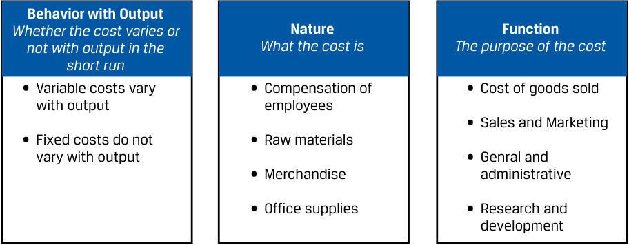
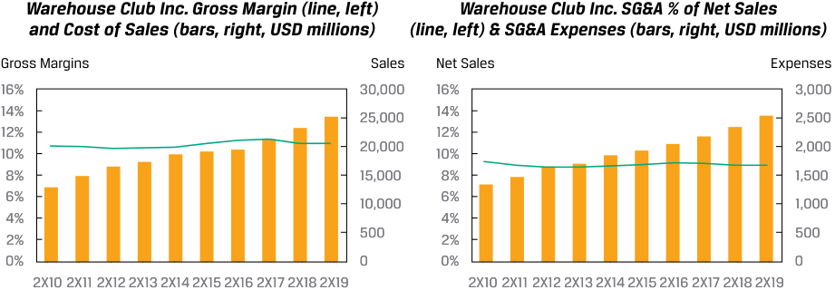
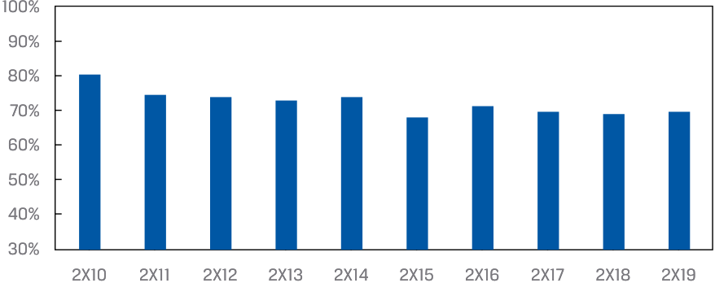
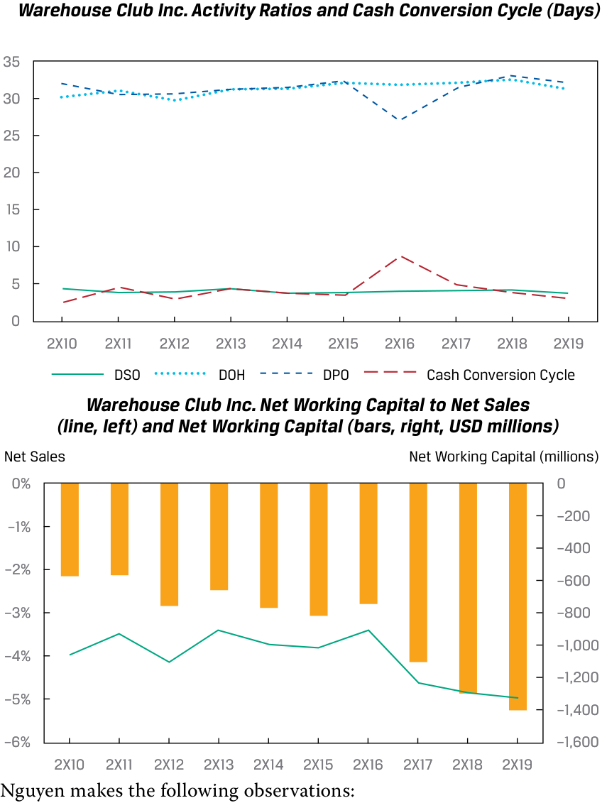

# Tập 5: Đầu tư Vốn cổ phần (Equity Investments)
## Học phần 5: Phân tích Công ty: Quá khứ và Hiện tại (Company Analysis: Past and Present)
### Phần 4/5: Phân tích Khả năng Sinh lời Hoạt động và Vốn Lưu động (Trang PDF 234–245)

---

<!-- PDF Page 234 -->

4. Yếu tố nào sau đây là một yếu tố dẫn dắt từ dưới lên (*bottom-up driver*) phù hợp đối với doanh thu của Iliso? 

   - **A.** Thị phần của Iliso trong doanh thu bán lẻ và ăn uống tại Hoa Kỳ 

   - **B.** GMV trên mỗi tài khoản khách hàng đang hoạt động trung bình (*GMV per average active customer account*) 

   - **C.** Doanh thu của Iliso như một hàm số của tốc độ tăng trưởng GDP 

   - **Lời giải (*Solution*):** 

B là đáp án đúng. Trong phương pháp tiếp cận từ dưới lên, các nhà phân tích bóc tách doanh thu thành các yếu tố dẫn dắt doanh thu hợp lý chẳng hạn như theo dòng sản phẩm hoặc phân khúc. Một yếu tố dẫn dắt doanh thu thuần của Iliso phải là số lượng tài khoản khách hàng đang hoạt động trung bình trong kỳ và doanh thu bán lẻ thuần trên mỗi tài khoản. Chúng ta sử dụng GMV vì thước đo này phản ánh chính xác tổng quy mô doanh số bán lẻ (cả doanh số bán hàng trực tiếp của bên thứ nhất là Iliso lẫn doanh số của người bán bên thứ ba). 

A và C không chính xác, bởi vì chúng là các yếu tố dẫn dắt từ trên xuống (*top-down drivers*), chứ không phải từ dưới lên. 

# **<mark>5</mark>** 

## **PHÂN TÍCH KHẢ NĂNG SINH LỜI HOẠT ĐỘNG VÀ VỐN LƯU ĐỘNG (*OPERATING PROFITABILITY AND WORKING CAPITAL ANALYSIS*)** 

- đánh giá khả năng sinh lời hoạt động (*operating profitability*) và vốn lưu động (*working capital*) của một công ty bằng cách sử dụng các thước đo chủ chốt

### **Chi phí Hoạt động và Phân loại Chi phí Hoạt động (*Operating Costs and Their Classification*)** 

Nhìn chung, chi phí hoạt động (*operating costs*) phát sinh trong quá trình tạo ra—hoặc có liên quan theo cách khác đến—doanh thu _kỳ hiện tại_: tất cả các chi phí liên quan đến việc mua sắm, sản xuất, bán hàng, cải tiến, và phân phối hàng hóa và dịch vụ; việc quản lý các hoạt động kinh doanh; và việc tuân thủ pháp luật và các quy định. Chi phí đầu tư (*investing costs*) có liên quan đến việc mua sắm và sản xuất các tài sản dài hạn, bao gồm tài sản hữu hình như bất động sản và thiết bị cùng tài sản vô hình như phần mềm, nhãn hiệu thương mại, và bằng sáng chế. Chi phí tài trợ (*financing costs*) bao gồm các khoản thanh toán cho các nhà đầu tư nợ và vốn cổ phần như một khoản sinh lợi trên vốn đầu tư của họ. 

#### **LƯU Ý VỀ CHUẨN MỰC KẾ TOÁN: PHÂN LOẠI CHI PHÍ (*MINDING THE GAAP: CLASSIFICATION OF COSTS*)** 

IFRS và US GAAP không phân loại chi phí hoạt động, chi phí đầu tư, hay chi phí tài trợ theo một cách trực quan hoàn toàn, và có những sự khác biệt trong cách phân loại trên báo cáo kết quả hoạt động kinh doanh và báo cáo lưu chuyển tiền tệ. Một số ví dụ nổi bật bao gồm: 

|**Chi phí (*Cost*)**|**Trực quan Kinh tế (*Intuition*)**|**Phân loại theo IFRS và US GAAP: Báo cáo Kết quả Hoạt động Kinh doanh (*Income Statement*)**|**Phân loại theo IFRS và US GAAP: Báo cáo Lưu chuyển Tiền tệ (*Statement of Cash Flows*)**|
|---|---|---|---|
|Nghiên cứu và phát triển (*Research and development*)|Đầu tư (*Investing*)|Hoạt động kinh doanh (*Operating*)|Hoạt động kinh doanh (*Operating*)|
|Khấu hao tài sản cố định và tài sản vô hình* (*Depreciation and amortization*)|Đầu tư (*Investing*)|Hoạt động kinh doanh (*Operating*)|Khoản cộng ngược phi tiền mặt vào dòng tiền Hoạt động kinh doanh (*Non-cash add-back to Operating*) _Chi tiêu vốn (Capital expenditures)_ nằm trong dòng tiền Đầu tư (*Investing*)|

<!-- PDF Page 235 -->

|**Chi phí (*Cost*)**|**Trực quan Kinh tế (*Intuition*)**|**Phân loại theo IFRS và US GAAP: Báo cáo Kết quả Hoạt động Kinh doanh (*Income Statement*)**|**Phân loại theo IFRS và US GAAP: Báo cáo Lưu chuyển Tiền tệ (*Statement of Cash Flows*)**|
|---|---|---|---|
|Chi phí lãi vay (*Interest expense*)|Tài trợ (*Financing*)|Khác (không phải hoạt động kinh doanh)|US GAAP: Hoạt động kinh doanh (*Operating*) IFRS: Hoạt động kinh doanh hoặc Tài trợ (*Operating or Financing*)|
|Thuế thu nhập (*Income taxes*)|Riêng biệt (*Separate*)|Khác (không phải hoạt động kinh doanh)|Hoạt động kinh doanh (*Operating*)|

*Hãy nhớ lại rằng IFRS và US GAAP yêu cầu các chi phí mua sắm và xây dựng tài sản dài hạn hữu hình và vô hình phải được vốn hóa (*capitalized*) và sau đó, đối với những tài sản có thời gian sử dụng hữu ích xác định, được phân bổ một cách có hệ thống vào chi phí theo thời gian trên báo cáo kết quả hoạt động kinh doanh dưới dạng chi phí khấu hao phi tiền mặt. Phương pháp phân bổ phổ biến nhất là phương pháp đường thẳng (*straight line*), trong đó chi phí được tính đều vào các kỳ trong suốt thời gian sử dụng hữu ích của tài sản. 

Trừ khi được quy định khác đi, chúng tôi sử dụng cách phân loại chi phí theo chuẩn mực IFRS trên báo cáo kết quả hoạt động kinh doanh trong phần thảo luận của mình. 

Đối với hầu hết các công ty, chi phí hoạt động chiếm phần lớn trong tổng chi phí và chủ yếu được quyết định bởi mô hình kinh doanh cũng như quy mô của công ty. Như được thể hiện trong Bảng minh họa 4, chi phí hoạt động của một công ty có thể được phân loại và phân tích theo ba cách: theo hành vi của chúng đối với sản lượng (*behavior with output*), theo bản chất (*nature*), hoặc theo chức năng (*function*). 

**Bảng minh họa 4: Phân loại Chi phí Hoạt động (*Categorization of Operating Costs*)** 

> **Chú thích hình ảnh:**
> - **Hành vi theo Sản lượng (*Behavior with Output*) – Liệu chi phí có biến thiên theo sản lượng trong ngắn hạn hay không:**
>   - Chi phí biến đổi (*Variable costs*) biến thiên theo sản lượng
>   - Chi phí cố định (*Fixed costs*) không biến thiên theo sản lượng
> - **Bản chất (*Nature*) – Bản thân chi phí đó là gì:**
>   - Thù lao cho người lao động (*Compensation of employees*)
>   - Nguyên vật liệu thô (*Raw materials*)
>   - Hàng hóa (*Merchandise*)
>   - Văn phòng phẩm (*Office supplies*)
> - **Chức năng (*Function*) – Mục đích của chi phí đó:**
>   - Giá vốn hàng bán (*Cost of goods sold*)
>   - Bán hàng và Tiếp thị (*Sales and Marketing*)
>   - Tổng hợp và quản lý (*General and administrative*)
>   - Nghiên cứu và phát triển (*Research and development*)

### **Hành vi theo Sản lượng: Chi phí Cố định và Chi phí Biến đổi (*Behavior with Output: Fixed and Variable Costs*)** 

Một cách phân loại chi phí hoạt động hữu ích đối với các nhà phân tích là chi phí cố định so với chi phí biến đổi, vốn đã được giới thiệu trong một học phần trước. Sự phân biệt này rất hữu ích bởi vì tỷ trọng chi phí cố định so với chi phí biến đổi trong chi phí hoạt động ảnh hưởng đến tính ổn định và khả năng dự đoán của lợi nhuận hoạt động (*operating profit*). Sử dụng cách phân loại chi phí hoạt động cố định/biến đổi, lợi nhuận hoạt động được định nghĩa trong Phương trình 1. 

<!-- PDF Page 236 -->

$$\text{Lợi nhuận hoạt động (Operating profit)} = [Q \times (P - VC)] - FC \tag{1}$$

- $Q =$ số đơn vị sản lượng đầu ra bán được trong một kỳ. 
- $P =$ giá bán trên mỗi đơn vị sản lượng đầu ra. 
- $VC =$ chi phí hoạt động biến đổi tính trên mỗi đơn vị sản lượng đầu ra. Các ví dụ bao gồm chi phí hàng hóa đối với một nhà bán lẻ như Warehouse Club Inc. cùng chi phí nguyên vật liệu và nhân công trực tiếp đối với một nhà sản xuất. 
- $FC =$ chi phí hoạt động cố định, không thay đổi trong một phạm vi sản lượng nhất định trong ngắn hạn. Các ví dụ bao gồm tiền lương cho nhân viên hưởng lương cố định, khấu hao tài sản cố định và tài sản vô hình, chi phí phần mềm và CNTT, bảo hiểm, và một số chi phí tiện ích nhất định. $FC$ được biểu thị trên cơ sở tổng số tiền bằng đô la, chứ không phải trên mỗi đơn vị sản phẩm. 

Để một doanh nghiệp có lãi, từ Phương trình 1 có thể thấy rõ rằng $(P - VC)$, hay **số dư đảm phí đơn vị (*contribution margin*)**, phải mang giá trị dương và $Q$ phải đủ cao sao cho vượt qua được $FC$. Hãy nhớ lại rằng quy mô chi phí cố định trong cơ cấu chi phí hoạt động của một tổ chức phát hành được gọi là đòn bẩy hoạt động (*operating leverage*) và nó mang lại cả lợi ích lẫn rủi ro. Nếu chi phí hoạt động phần lớn là cố định và số dư đảm phí dương, lợi nhuận hoạt động có thể tăng lên nhanh chóng khi $Q$ tăng lên. Tuy nhiên, điều ngược lại cũng đúng nếu $Q$ sụt giảm, bởi vì chi phí cố định không thay đổi nên lợi nhuận hoạt động sẽ giảm mạnh. Như được thể hiện trong Phương trình 2, đòn bẩy hoạt động có thể được đo lường và so sánh giữa các doanh nghiệp bằng cách sử dụng **độ bẩy hoạt động (*degree of operating leverage* – DOL)**: 

$$\text{DOL} = \frac{\%\Delta\text{ Lợi nhuận hoạt động (\%}\Delta\text{ Operating Profit)}}{\%\Delta\text{ Doanh thu (\%}\Delta\text{ Sales)}} \tag{2}$$

Một doanh nghiệp có thể làm tăng độ bẩy hoạt động của mình bằng cách tăng chi phí cố định và giảm chi phí biến đổi trong cơ sở chi phí của mình. 

#### **VÍ DỤ 3 (*EXAMPLE 3*)** 

### **Phân tích Chi phí Biến đổi và Chi phí Cố định (*Variable and Fixed Cost Analysis*)** 

Mặc dù việc phân tích chi phí hoạt động bằng khuôn khổ biến đổi và cố định mang lại góc nhìn sâu sắc, việc áp dụng nó bởi các nhà phân tích đầu tư độc lập lại bị hạn chế vì cả IFRS lẫn US GAAP đều không yêu cầu công bố chi phí cố định và chi phí biến đổi, cũng như không yêu cầu công bố sản lượng đầu ra. Ngoài ra, nhiều công ty có một số ngành nghề kinh doanh với cấu trúc sản lượng, giá bán, và chi phí khác nhau, mà chi tiết của chúng bị mất đi khi trình bày trên các báo cáo tài chính có tính tổng hợp cao mà nhà đầu tư nhận được. Tuy nhiên, trong một số ngành, việc các tổ chức phát hành công bố những con số này là khá phổ biến, hoặc nhà phân tích có thể đưa ra các giả định một cách tương đối dễ dàng. Một ví dụ nổi bật là các nhà sản xuất dầu khí, mà chúng tôi cung cấp một ví dụ ngay tại đây. 

Ribbon Energy Ltd. (“Ribbon”) là một công ty dầu mỏ và khí tự nhiên giả định tập trung vào việc thăm dò và khai thác trữ lượng dầu mỏ và khí tự nhiên. Dữ liệu hoạt động và tài chính chọn lọc cho 12 tháng gần nhất như sau: 

||**12 Tháng Gần nhất (*Last 12 Months*)**|
|---|---|
|Sản lượng bán (*Sales volume* – nghìn thùng dầu quy đổi)|154.812|
|Giá bán trung bình, trên mỗi thùng dầu quy đổi (*Average price, per barrel of oil equivalent*)|$49,66|
|Tổng doanh thu (*Total revenues* – triệu)|$7.688|
|_Chi phí sản xuất, trên mỗi thùng dầu quy đổi (Production costs, per barrel of oil equivalent):_||
|Chi phí vận hành mỏ thuê (*Lease operating expense*)|11,21|
|Thuế khai thác và thuế theo giá trị (*Production and ad valorem taxes*)|3,40|

<!-- PDF Page 237 -->

||**12 Tháng Gần nhất (*Last 12 Months*)**|
|---|---|
|Chi phí thu gom và vận chuyển (*Gathering and transportation expense*)|2,63|
|Chi phí sản xuất (*Production costs*)|$17,24|
|_Chi phí hoạt động khác (triệu USD) (Other operating expenses - millions of USD):_||
|Khấu hao, hao cạn trữ lượng và trích lập dự phòng hoàn nguyên (*Depreciation, depletion, and accretion* – DD&A)|1.275|
|Chi phí tổng hợp và quản lý (*General and administrative expenses* – G&A)|150|

Chi phí sản xuất là các chi phí biến đổi được trình bày trên cơ sở mỗi thùng dầu quy đổi, trong khi các chi phí hoạt động khác (DD&A và G&A) là cố định và được trình bày trên cơ sở tổng số tiền tính bằng đô la. 

Ban giám đốc của Ribbon cung cấp dự phóng định hướng (*guidance*) sau đây cho 12 tháng tới. Ban giám đốc không đưa ra định hướng về giá bán (và do đó là doanh thu), vì công ty bán hàng trên một thị trường hàng hóa có mức giá biến động mạnh rất khó dự đoán. Ribbon không thực hiện phòng vệ giá (*hedge*). Tại thời điểm cung cấp định hướng, giá dầu trung bình mỗi thùng là $62,50. 

||**12 Tháng Tới (*Next 12 Months*)**|
|---|---|
|Sản lượng bán (*Sales volume* – nghìn thùng dầu quy đổi)|156.360–167.197|
|Chi phí sản xuất, trên mỗi thùng dầu quy đổi (*Production costs, per barrel of oil equivalent*)|$17,34|
|_Chi phí hoạt động khác (triệu USD) (Other operating expenses - millions of USD):_||
|Khấu hao, hao cạn trữ lượng và trích lập dự phòng hoàn nguyên (DD&A)|1.415|
|Chi phí tổng hợp và quản lý (G&A)|150|

1. Số dư đảm phí (*contribution margin*) trên mỗi thùng dầu của Ribbon cho 12 tháng gần nhất _gần nhất_ với mức nào: 

   - **A.** $23,2. 

   - **B.** $32,4. 

   - **C.** $45,3. 

#### **Lời giải (*Solution*):** 

B là đáp án đúng. Hãy nhớ lại rằng số dư đảm phí trên mỗi thùng dầu là $P - VC$. Giá bán trung bình mỗi thùng dầu, $P$, trong 12 tháng qua là $49,66, và chi phí biến đổi mỗi thùng dầu, $VC$, là $17,24. Do đó, số dư đảm phí là $\$49,66 - \$17,24 = \$32,42$. 

A không chính xác, bởi vì con số này là EBIT, hay lợi nhuận hoạt động, trên mỗi thùng dầu của công ty. 

C không chính xác, bởi vì kết quả này có được do sử dụng giá dầu trung bình mỗi thùng hiện hành ($62,50) thay vì của 12 tháng gần nhất để tính số dư đảm phí. 

2. Ở mức cận trên trong định hướng (*high end of guidance*) của ban giám đốc, lợi nhuận hoạt động của Ribbon cho 12 tháng tới _gần nhất_ với mức nào: 

   - **A.** $5.496 triệu. 

   - **B.** $5.986 triệu. 

   - **C.** $6.002 triệu. 

**Lời giải (*Solution*):** 

B là đáp án đúng. 

$$\text{Lợi nhuận hoạt động} = [Q \times (P - VC)] - FC$$

<!-- PDF Page 238 -->

$$\text{Lợi nhuận hoạt động} = [167,197\text{ triệu} \times (\$62,50 - \$17,34)] - (\$1.415 + \$150)$$
$$\text{Lợi nhuận hoạt động} = \$5.986\text{ triệu}$$

A không chính xác, bởi vì con số này là lợi nhuận hoạt động sử dụng mức cận dưới của sản lượng bán định hướng là 156,360 triệu thùng. 

C không chính xác, bởi vì nó dựa trên chi phí sản xuất của năm ngoái là $17,24 mỗi thùng. 

3. Một số nhà phân tích theo dõi Ribbon tin rằng sản lượng sẽ thấp hơn mức kỳ vọng của ban giám đốc. Giả sử sản lượng giảm 5% so với sản lượng năm ngoái, lợi nhuận hoạt động của Ribbon cho 12 tháng tới _gần nhất_ với mức nào: 

   - **A.** $5.077 triệu.
   - **B.** $5.091 triệu.
   - **C.** $5.776 triệu.

**Lời giải (*Solution*):** 

A là đáp án đúng. Sản lượng của 12 tháng gần nhất là 154,812 triệu thùng. Mức giảm 5% tương ứng với $154,812 \times 0,95 = 147,071$ triệu thùng. 

$$\text{Lợi nhuận hoạt động} = [Q \times (P - VC)] - FC$$
$$\text{Lợi nhuận hoạt động} = [147,071\text{ triệu} \times (\$62,50 - \$17,34)] - (\$1.415 + \$150)$$
$$\text{Lợi nhuận hoạt động} = \$5.076,7\text{ triệu}$$

B không chính xác, bởi vì phương án này sử dụng chi phí sản xuất của năm ngoái.
C không chính xác, bởi vì phương án này giả định sản lượng tăng 5% thay vì giảm 5% so với năm trước. 

4. Độ bẩy hoạt động (DOL) của Ribbon cho 12 tháng tới ở mức cận dưới trong định hướng của ban giám đốc thì _____________ ở mức cận trên trong định hướng của ban giám đốc. 

   - **A.** thấp hơn 
   - **B.** bằng với 
   - **C.** cao hơn

**Lời giải (*Solution*):** 

C là đáp án đúng.
Doanh thu 12 tháng gần nhất: $7.688
Lợi nhuận hoạt động 12 tháng gần nhất: $3.594

**Ở mức cận dưới của định hướng (*Low end of guidance*):**
Doanh thu 12 tháng tới: $156,360 \times \$62,50 = \$9.773$
Lợi nhuận hoạt động 12 tháng tới: $\$9.773 - (156,360 \times 17,34) - 1.565 = 5.496$
Độ bẩy hoạt động (DOL): $(5.496 / 3.594 - 1) / (9.773 / 7.688 - 1) = 1,95$

**Ở mức cận trên của định hướng (*High end of guidance*):**
Doanh thu 12 tháng tới: $167,197 \times \$62,50 = \$10.450$
Lợi nhuận hoạt động 12 tháng tới: $\$10.450 - (167,197 \times 17,34) - 1.565 = 5.986$
Độ bẩy hoạt động (DOL): $(5.986 / 3.594 - 1) / (10.450 / 7.688 - 1) = 1,85$

<!-- PDF Page 239 -->

### **Phân loại Chi phí Hoạt động theo Bản chất và theo Chức năng cùng các Thước đo Khả năng Sinh lời Hoạt động (*Natural and Functional Operating Cost Classifications and Measures of Operating Profitability*)** 

Thay vì cố định và biến đổi, IFRS và US GAAP yêu cầu các tổ chức phát hành công bố chi phí hoạt động bằng cách sử dụng phân loại chi phí theo bản chất (*natural cost classification*) hoặc theo chức năng (*functional cost classification*) dựa trên “các yếu tố lịch sử và ngành nghề cùng bản chất của đơn vị”. Hầu hết các tổ chức phát hành, bao gồm cả Warehouse Club Inc., chọn cách phân loại theo chức năng. Phương pháp tiếp cận này dẫn đến việc báo cáo kết quả hoạt động kinh doanh của tất cả các tổ chức phát hành trông có vẻ tương đồng về mặt cấu trúc, với các khoản mục liên quan đến các bộ phận chức năng như “giá vốn hàng bán” (*“cost of sales”*), “chi phí bán hàng, tổng hợp và quản lý” (*“selling, general, and administrative expenses”*), và “nghiên cứu và phát triển” (*“research and development”*), mặc dù mô hình kinh doanh (cùng cơ cấu chi phí cố định so với chi phí biến đổi) của họ có thể khác nhau đáng kể. Phân loại chi phí hoạt động theo chức năng được sử dụng để tính toán và phân biệt các thước đo khả năng sinh lời chủ chốt dùng trong phân tích và dự báo, như được thể hiện trong Bảng minh họa 5. 

**Bảng minh họa 5: Các Thước đo Khả năng Sinh lời Hoạt động (*Measures of Operating Profitability*)** 

> **Chú thích hình ảnh:**
> - **Lợi nhuận gộp (*Gross Profit*):** Doanh thu (*Revenue*) trừ Giá vốn hàng bán (*Cost of Sales*) = Lợi nhuận gộp (*Gross Profit*).
>   - **Biên lợi nhuận gộp (*Gross Margin*):** $\frac{\text{Lợi nhuận gộp (Gross Profit)}}{\text{Doanh thu (Revenue)}}$
> - **EBITDA:** Doanh thu (*Revenue*) trừ Giá vốn hàng bán (*Cost of Sales*) trừ Chi phí hoạt động (ví dụ: SG&A, R&D, v.v.) = EBITDA.
>   - **Biên EBITDA (*EBITDA Margin*):** $\frac{\text{EBITDA}}{\text{Doanh thu (Revenue)}}$
> - **Lợi nhuận hoạt động (*Operating Profit*):** Doanh thu (*Revenue*) trừ Giá vốn hàng bán (*Cost of Sales*) trừ Chi phí hoạt động (SG&A, R&D, v.v.) trừ Khấu hao tài sản cố định và tài sản vô hình (*Depreciation and Amortization*) = Lợi nhuận hoạt động (*Operating Profit / EBIT*).
>   - **Biên lợi nhuận hoạt động / Biên EBIT (*Operating/EBIT Margin*):** $\frac{\text{Lợi nhuận hoạt động (EBIT)}}{\text{Doanh thu (Revenue)}}$

Lợi nhuận gộp (*gross profit*), EBITDA, và EBIT là các thước đo khả năng sinh lời hoạt động nắm bắt các chi phí chức năng khác nhau trong định nghĩa của chúng. Nhìn chung, một phần đáng kể của giá vốn hàng bán là chi phí biến đổi, vì vậy biên lợi nhuận gộp là một thước đo xấp xỉ của tỷ lệ số dư đảm phí (*contribution margin*). Các chi phí hoạt động khác như chi phí bán hàng và tiếp thị, chi phí tổng hợp và quản lý, và chi phí nghiên cứu và phát triển có xu hướng phần lớn là chi phí cố định, mặc dù chúng có thể có một cấu phần biến đổi chẳng hạn như hoa hồng bán hàng. Chi phí khấu hao tài sản cố định và tài sản vô hình là cố định trừ khi tổ chức phát hành sử dụng phương pháp khấu hao theo số lượng sản phẩm (*units of output*). Thuyết minh báo cáo tài chính của một tổ chức phát hành chứa đựng thông tin hữu ích về cơ cấu và bản chất của các chi phí hoạt động. 

Đối với hầu hết các công ty, yếu tố dẫn dắt chính của chi phí hoạt động trong dài hạn là sản lượng đầu ra (*output*), ngay cả đối với chi phí cố định, bởi vì tăng trưởng sản lượng thường đòi hỏi sự gia tăng về tài sản, nguồn vốn nhân lực, cùng hàng hóa và dịch vụ mua ngoài. Ví dụ, Warehouse Club Inc. có thể tăng doanh thu phí thành viên ở một mức độ nhất định mà không làm phát sinh thêm chi phí, nhưng việc tăng doanh thu thuần đòi hỏi phải có thêm nhiều cửa hàng và nhân viên hơn. Điều này đúng ngay cả đối với những công ty được gọi là nhẹ về tài sản (*asset-light companies*) trong ngành internet và phần mềm, những đơn vị vốn đã 

<!-- PDF Page 240 -->

cho thấy sự gia tăng lớn về chi phí hoạt động đi kèm với sự gia tăng lớn về doanh thu theo thời gian. Vì sản lượng hay doanh thu là một yếu tố dẫn dắt chi phí chính, các nhà phân tích thường biểu thị chi phí hoạt động dưới dạng tỷ lệ phần trăm trên doanh thu. Các cân nhắc bổ sung bao gồm khả năng sinh lời của ngành (*industry profitability*), **lợi thế kinh tế theo quy mô (*economies of scale*)**, và **lợi thế kinh tế theo phạm vi (*economies of scope*)**. 

Khả năng sinh lời của ngành sẽ được thảo luận chi tiết trong học phần tiếp theo, nhưng hãy nhớ lại từ cuộc thảo luận trước đó về sức mạnh định giá rằng mức giá bán tương quan với chi phí (tức là khả năng sinh lời) phần lớn được quyết định bởi cấu trúc thị trường và vị thế cạnh tranh của một công ty. Vì các doanh nghiệp tham gia trong ngành đang cạnh tranh trên cùng các thị trường sản phẩm và thị trường yếu tố sản xuất (*factor markets*), các áp lực cạnh tranh bên trong chúng sẽ quyết định khả năng sinh lời của ngành trong dài hạn; các nhà phân tích không nên chỉ phân tích khả năng sinh lời tách biệt theo từng công ty riêng lẻ. 

Lợi thế kinh tế theo quy mô (*economies of scale*) đề cập đến sự sụt giảm chi phí trên mỗi đơn vị sản phẩm khi sản lượng đầu ra tăng lên và nhìn chung bắt nguồn từ việc có các chi phí cố định trong cơ cấu chi phí được dàn trải trên nhiều đơn vị sản lượng đầu ra hơn. Một công ty có toàn bộ chi phí là biến đổi cũng có thể thể hiện một mức độ lợi thế kinh tế theo quy mô nhất định theo thời gian nếu công ty gia tăng được quyền lực thương lượng (*bargaining power*) đối với các nhà cung cấp khi quy mô lớn lên, giúp kéo giảm chi phí biến đổi trên mỗi đơn vị sản phẩm. Lợi thế kinh tế theo quy mô thường thể hiện rõ qua mô hình kinh doanh và có thể được kiểm chứng thực nghiệm bằng cách so sánh quy mô doanh thu của một công ty với chi phí hoạt động tính theo phần trăm doanh thu hoặc với biên lợi nhuận của nó. 

Lợi thế kinh tế theo phạm vi (*economies of scope*) đề cập đến sự sụt giảm chi phí trên mỗi đơn vị sản phẩm khi số lượng dòng sản phẩm hoặc ngành nghề kinh doanh tăng lên và nhìn chung bắt nguồn từ việc chia sẻ chi phí chung giữa các dòng sản phẩm. Lợi thế kinh tế theo phạm vi thường thể hiện rõ qua mô hình kinh doanh và có thể được kiểm chứng thực nghiệm bằng cách so sánh khả năng sinh lời của một công ty tích hợp đa ngành với khả năng sinh lời của một công ty đơn ngành độc lập (*standalone company*). Các ví dụ về lợi thế kinh tế theo phạm vi có thể được tìm thấy trong lĩnh vực dịch vụ tài chính, nơi có những điểm tương đồng về khách hàng, dịch vụ khách hàng, tuân thủ, công nghệ, và bộ phận hỗ trợ hậu cần (*back-office*) (và do đó mang lại hiệu quả chi phí) xuyên suốt các mảng ngân hàng thương mại, ngân hàng bán lẻ, môi giới, quản lý tài sản, xử lý thanh toán, và ngân hàng đầu tư. Lợi thế kinh tế theo phạm vi đã tạo ra những tập đoàn toàn cầu khổng lồ cạnh tranh trên nhiều ngành nghề kinh doanh khác nhau. 

Hãy nhớ lại rằng ban giám đốc của Warehouse Club Inc. đã tuyên bố rằng công ty có lợi thế kinh tế theo quy mô khi nói rằng “mức giá thấp cho các sản phẩm chất lượng sẽ thúc đẩy số lượng thành viên và doanh thu thuần tăng lên theo thời gian, tạo đòn bẩy tận dụng hiệu quả chi phí bán hàng, tổng hợp và quản lý (SG&A), giúp làm giảm tỷ lệ các chi phí này tính theo phần trăm doanh thu thuần.” Mặc dù điều này nghe có vẻ hợp lý về mặt trực quan vì có lẽ luôn có một khoản chi phí SG&A cố định mỗi năm để vận hành một cửa hàng, Elaine Nguyen vẫn phải kiểm chứng điều đó bằng dữ liệu thực nghiệm. 

#### **TÌNH HUỐNG NGHIÊN CỨU (*CASE STUDY*)** 

### **Phân tích Khả năng Sinh lời Hoạt động của Warehouse Club Inc.** 

Chi phí hoạt động của Warehouse Club Inc. bao gồm chi phí hàng hóa (giá vốn hàng bán), chi phí SG&A, khấu hao tài sản cố định và tài sản vô hình, cùng các chi phí gắn liền với việc mở cửa hàng mới. 

Dựa trên phần nghiên cứu mô hình kinh doanh của mình, Elaine Nguyen nhận định như sau về các yếu tố dẫn dắt cho từng khoản chi phí hoạt động này. 

|**Chi phí Hoạt động (*Operating Cost*)**|**(Các) Yếu tố Dẫn dắt (*Driver(s)*)**|
|---|---|
|Chi phí hàng hóa (giá vốn hàng bán) (*Merchandise costs - costs of sales*)|Doanh thu bán hàng (*Sales*)|
|Chi phí SG&A (*SG&A expenses*)|Doanh thu bán hàng (*Sales*) Số lượng nhân viên và mức thù lao trên mỗi nhân viên (*Number of employees and per-employee compensation*)|
|Khấu hao tài sản cố định và tài sản vô hình (*Depreciation and amortization*)|Tài sản dài hạn (*Long-term assets*) Thời gian sử dụng hữu ích (*Useful lives*)|
|Chi phí mở cửa hàng (*Store opening expenses*)|Số lượng cửa hàng mở mới (*Store openings*)|

<!-- PDF Page 241 -->

Dựa trên các yếu tố dẫn dắt này, Nguyen tính toán biên lợi nhuận gộp của Warehouse ($1 - \text{giá vốn hàng bán tính theo \% doanh thu thuần}$), chi phí SG&A tính theo phần trăm doanh thu thuần, nguyên giá tài sản cố định chia cho chi phí khấu hao (thời gian sử dụng hữu ích ngầm định – *implied useful life*), chi phí mở cửa hàng trên mỗi cửa hàng mở mới, và cuối cùng là các biên lợi nhuận. Các biên lợi nhuận có bao gồm cả doanh thu phí thành viên. 

> **Chú thích hình ảnh:**
> - **Biểu đồ bên trái:** Biên lợi nhuận gộp của Warehouse Club Inc. (đường kẻ, trục trái: quanh mức 11%) và Giá vốn hàng bán (cột, trục phải: tăng từ khoảng 12.800 lên 25.248 triệu USD) giai đoạn 2X10–2X19.
> - **Biểu đồ bên phải:** Tỷ lệ SG&A % trên Doanh thu thuần của Warehouse Club Inc. (đường kẻ, trục trái: ổn định quanh mức 9%) và Chi phí SG&A (cột, trục phải: tăng từ khoảng 1.300 lên 2.566 triệu USD) giai đoạn 2X10–2X19.

> **Chú thích hình ảnh:**
> - **Biểu đồ bên trái:** Thời gian sử dụng hữu ích ngầm định của Warehouse Club Inc. (đường kẻ, trục trái: ổn định quanh 25 năm) và Chi phí Khấu hao D&A (cột, trục phải: tăng từ khoảng 150 lên 283 triệu USD) giai đoạn 2X10–2X19.
> - **Biểu đồ bên phải:** Chi phí mở cửa hàng trên mỗi cửa hàng mở mới của Warehouse Club Inc. (đường kẻ, trục trái: tăng từ 1,0 lên 4,0 triệu USD) và Tổng chi phí mở cửa hàng (cột, trục phải: từ 5 đến 16 triệu USD) giai đoạn 2X10–2X19.

**_Khả năng Sinh lời Hoạt động của Warehouse Club Inc. (Warehouse Club Inc. Operating Profitability)_** 

> **Chú thích hình ảnh:** Biểu đồ Khả năng Sinh lời Hoạt động của Warehouse Club Inc. giai đoạn 2X10–2X19:
> - Biên lợi nhuận gộp (*Gross Margin*): ổn định quanh mức 11–13%
> - Biên EBITDA (*EBITDA Margin*): ổn định quanh mức 4%
> - Biên lợi nhuận hoạt động (*Operating Margin*): ổn định quanh mức 3%

Nguyen đưa ra các nhận xét sau: 

- Chi phí hoạt động đã tăng lên đáng kể xét theo giá trị tuyệt đối từ năm 2X10 đến 2X19, nhưng xét trên cơ sở tương đối so với doanh thu thì vẫn duy trì ổn định trong cùng giai đoạn đó, cho thấy yếu tố dẫn dắt sự gia tăng này chính là tăng trưởng doanh thu thuần. 

- Một ngoại lệ là chi phí mở cửa hàng tính trên mỗi cửa hàng mở mới đã tăng gấp bốn lần từ năm 2X10 đến 2X19, mặc dù xét về tổng thể đây vẫn là một khoản chi phí nhỏ (chưa bằng 1/100 chi phí SG&A). Lưu ý rằng đây là các chi phí hoạt động liên quan đến việc mở cửa hàng, chẳng hạn như đào tạo nhân viên trước khi khai trương, chứ không phải chi phí đầu tư mua đất đai và tài sản cố định. 

- Chi phí SG&A dường như không phải là cố định tương đối so với doanh thu thuần, vì chúng vẫn giữ nguyên xấp xỉ cùng một tỷ lệ phần trăm trên doanh thu thuần theo thời gian. 

<!-- PDF Page 242 -->

- Các biên lợi nhuận nhìn chung duy trì ổn định, mặc dù chúng đã tăng nhẹ từ năm 2X15 đến 2X17 trước khi giảm trở lại vào năm 2X18 và 2X19. Biên lợi nhuận của Warehouse ở mức thấp, với biên EBITDA và biên lợi nhuận hoạt động lần lượt là 4% và 3% vào năm 2X19. 

- Quy mô lợi nhuận hoạt động tương đương với quy mô doanh thu phí thành viên mỗi năm. Nguyen tạo biểu đồ sau: 

#### **_Doanh thu Phí Thành viên của Warehouse Club Inc. tính theo % Lợi nhuận Hoạt động_** 

> **Chú thích hình ảnh:** Biểu đồ Doanh thu Phí thành viên tính theo % Lợi nhuận hoạt động của Warehouse Club Inc. giai đoạn 2X10–2X19, dao động quanh mức 65%–70%.

Biểu đồ này hàm ý rằng doanh thu thuần từ các cửa hàng của công ty—sau khi đã khấu trừ giá vốn hàng bán, chi phí SG&A, chi phí khấu hao D&A, và chi phí mở cửa hàng—chỉ chiếm 30% lợi nhuận hoạt động còn lại. Tỷ lệ phần trăm này nhiều khả năng đã bị ước tính thấp hơn thực tế (*understatement*), bởi vì một phần chi phí SG&A có liên quan đến doanh thu phí thành viên (tiếp thị, dịch vụ khách hàng, xử lý thanh toán, quản lý), nhưng nó hoàn toàn nhất quán với khẳng định của ban giám đốc Warehouse trong báo cáo thường niên rằng mức giá bán mang lại cho các thành viên lợi ích đáng kể so với phí thành viên: công ty chỉ kiếm được một biên lợi nhuận rất mỏng trên doanh thu thuần bán hàng, và chính doanh thu phí thành viên mới là yếu tố cho phép công ty hoạt động có lãi. 

### **Vốn Lưu động (*Working Capital*)** 

Hãy nhớ lại từ các học phần trước về vốn lưu động rằng các thước đo chính đối với công tác quản trị vốn lưu động của một công ty là các tỷ số hoạt động (*activity ratios*) giúp xác định chu kỳ chuyển đổi tiền mặt (*cash conversion cycle* – CCC) và tỷ số vốn lưu động ròng trên doanh thu (*net working capital to sales*). Một chu kỳ chuyển đổi tiền mặt ngắn có nghĩa là công ty cần ít nguồn tài trợ bên ngoài hơn để tài trợ cho các hoạt động kinh doanh, trong khi nhu cầu vốn lưu động ròng xác định một mức đầu tư tối thiểu—bên cạnh các khoản đầu tư vốn dài hạn—không thể phân phối cho các nhà đầu tư. Vốn lưu động ròng âm có nghĩa là các nhà cung cấp đang đóng vai trò là một nguồn tài trợ. 

### **TÌNH HUỐNG NGHIÊN CỨU: Quản trị Vốn Lưu động của Warehouse Club Inc.** 

Elaine Nguyen tính toán các thước đo vốn lưu động cho Warehouse. 

<!-- PDF Page 243 -->

> **Chú thích hình ảnh:**
> - **Biểu đồ trên – Các Tỷ số Hoạt động và Chu kỳ Chuyển đổi Tiền mặt (Ngày) của Warehouse Club Inc. giai đoạn 2X10–2X19:**
>   - DSO (Số ngày thu tiền bán hàng): ổn định ở mức ~4 ngày
>   - DOH (Số ngày tồn kho): ổn định ở mức ~30 ngày
>   - DPO (Số ngày phải trả người bán): ổn định ở mức ~30 ngày (riêng năm 2X16 giảm xuống ~25 ngày)
>   - Chu kỳ chuyển đổi tiền mặt (*Cash Conversion Cycle*): dưới 5 ngày (riêng năm 2X16 tăng lên ~9 ngày).
> - **Biểu đồ dưới – Vốn Lưu động Ròng trên Doanh thu Thuần (đường kẻ, trục trái: từ -2% đến -5%) và Vốn Lưu động Ròng (cột, trục phải: âm từ -400 đến -1.400 triệu USD) giai đoạn 2X10–2X19.**

Nguyen đưa ra các nhận xét sau: 

- Chu kỳ chuyển đổi tiền mặt ngắn, chưa đến một tuần, chủ yếu là nhờ số ngày thu tiền bán hàng (DSO) ở mức 4 ngày, bởi vì khách hàng của Warehouse thanh toán bằng tiền mặt hoặc bằng thẻ tín dụng hay thẻ ghi nợ vốn được thanh toán bù trừ trong vòng chưa đầy năm ngày làm việc, và số ngày tồn kho (DOH) gần như bằng với số ngày phải trả người bán (DPO), cho thấy hàng tồn kho được tài trợ bởi các nhà cung cấp. 

- Vốn lưu động ròng mang giá trị âm, hiện đã giảm xuống mức $-5,0\%$ doanh thu thuần, cho thấy đây là một nguồn tài trợ cho công ty. 

- Nhìn chung, tất cả các tỷ số hoạt động đều ổn định kể từ năm 2X10, ngoại trừ sự gia tăng đột biến trong một năm vào năm 2X16 do sự sụt giảm số ngày phải trả người bán (DPO). Nguyen đã tìm hiểu sự gia tăng này trong phần thuyết minh báo cáo tài chính của một báo cáo thường niên lịch sử. Công ty cho biết họ đã thay đổi hệ thống thông tin kế toán vào đầu năm 2X17 và đã thực hiện thanh toán sớm hơn cho các nhà cung cấp vào cuối năm 2X16, trước khi diễn ra việc chuyển đổi hệ thống để phòng trường hợp phát sinh sự cố. 

<!-- PDF Page 244 -->

#### **BỘ CÂU HỎI (*QUESTION SET*)** 

Các câu hỏi 1–4 liên quan đến dữ liệu vốn lưu động dưới đây của Iliso Marketplace, cũng như báo cáo tài chính của Iliso trong bài học “Xác định Mô hình Kinh doanh”. 

|**Vốn Lưu động (*Working Capital*)**|**2X15**|**2X16**|**2X17**|**2X18**|**2X19**|
|---|---|---|---|---|---|
|Khoản phải thu, thuần (*Accounts receivable, net*)|29|50|50|52|58|
|_DSO (Số ngày thu tiền)_|_4_|_5_|_4_|_3_|_3_|
|Hàng tồn kho, thuần (*Inventories, net*)|190|250|325|384|439|
|_DOH (Số ngày tồn kho)_|_37_|_36_|_32_|_32_|_30_|
|Chi phí trả trước và tài sản ngắn hạn khác (*Prepayments and other*)|23|32|35|56|59|
|_% tổng doanh thu (% of total revenue)_|_1%_|_1%_|_1%_|_1%_|_1%_|
|Khoản phải trả người bán (*Accounts payable*)|138|190|272|321|410|
|_DPO (Số ngày phải trả)_|_27_|_28_|_27_|_26_|_28_|
|Thuế phải nộp (*Taxes payable*)|2|8|10|12|29|
|_% tổng doanh thu (% of total revenue)_|_0%_|_0%_|_0%_|_0%_|_0%_|
|Chi phí phải trả và nợ ngắn hạn khác (*Accrued expenses and other current*)|111|193|232|295|354|
|_% tổng doanh thu (% of total revenue)_|_4%_|_6%_|_4%_|_5%_|_5%_|
|Vốn lưu động ròng (*Net working capital*)|(8)|(59)|(104)|(136)|(237)|
|_Vốn lưu động ròng trên doanh thu (NWC to sales)_|_0%_|_−2%_|_−2%_|_−2%_|_−3%_|
|Chu kỳ chuyển đổi tiền mặt (*Cash conversion cycle*)|14|14|9|8|5|

1. So với năm 2X18, mức thay đổi biên lợi nhuận hoạt động (*operating margin*) của Iliso vào năm 2X19 _gần nhất_ với mức nào: 

   - **A.** 0,07%. 

   - **B.** 0,57%. 

   - **C.** 80,56%. 

   - **Lời giải (*Solution*):** 

B là đáp án đúng. Biên lợi nhuận hoạt động (EBIT margin) là Lợi nhuận hoạt động / Doanh thu: 

2X18: $72 / 6.186 = 1,163\%$ 

2X19: $130 / 7.526 = 1,727\%$ 

Lấy biên EBIT năm 2X19 trừ đi biên EBIT năm 2X18 ta được: 

$$1,727\% - 1,163\% = 0,564\% \approx 0,57\%$$

A không chính xác, bởi vì đó là mức thay đổi của biên lợi nhuận gộp (*gross profit margin*). 

C không chính xác, bởi vì đó là tốc độ thay đổi so với năm trước của lợi nhuận hoạt động ($130 / 72 - 1 = 80,56\%$). 

2. Giải thích nào sau đây là _hợp lý nhất_ cho sự cải thiện về số ngày tồn kho (DOH) của Iliso từ năm 2X15 đến 2X19? 

   - **A.** Nhiều khách hàng thanh toán bằng tiền mặt hơn 

   - **B.** Sự <u>tăng trưởng mạnh mẽ trong doanh thu bán lẻ thuần</u> 

<!-- PDF Page 245 -->

   - **C.** Tỷ trọng GMV đến từ doanh số của người bán bên thứ ba ngày càng tăng

**Lời giải (*Solution*):**
C là đáp án đúng. Đối với doanh số của người bán bên thứ ba, Iliso đóng vai trò là đại lý cho người bán bên thứ ba và không nắm quyền kiểm soát hàng tồn kho. Theo đó, khi tỷ trọng doanh số của người bán bên thứ ba tăng lên trong tổng GMV và trong doanh thu của Iliso, phần doanh thu gắn liền với hàng tồn kho sẽ giảm xuống (giúp cải thiện số ngày tồn kho DOH tính trên tổng giá vốn doanh thu).
A không chính xác, bởi vì không có dấu hiệu nào cho thấy Iliso chấp nhận thanh toán tiền mặt khi nhận hàng (COD – như thường thấy ở Trung Quốc và các khu vực địa lý khác). Có vẻ như giống các nền tảng thương mại điện tử khác, Iliso chỉ chấp nhận thanh toán trực tuyến.
B không chính xác, bởi vì tăng trưởng doanh thu bán lẻ nhiều khả năng cũng kéo theo sự gia tăng hàng tồn kho và khoản phải thu tương ứng; số ngày tồn kho và số ngày thu tiền bán hàng nhìn chung không bị ảnh hưởng chỉ bởi quy mô tăng trưởng.

3. Khoản chi phí nào sau đây _nhiều khả năng nhất_ sẽ biến thiên theo sản lượng đầu ra (*output*)?
- **A.** khấu hao (*depreciation*)
- **B.** giá vốn hàng bán (*costs of sales*)
- **C.** chi phí lãi vay (*interest expense*)

**Lời giải (*Solution*):**
B là đáp án đúng. Giá vốn hàng bán là các chi phí hàng tồn kho được ghi nhận khi giao dịch bán hàng được thực hiện.
A không chính xác, bởi vì chi phí khấu hao biến thiên theo quy mô tài sản cố định. Khoản chi phí này là một chi phí cố định trong ngắn hạn. Hãy nhớ lại rằng chi phí hoạt động cố định không thay đổi trong một phạm vi sản lượng nhất định trong ngắn hạn.
C không chính xác, bởi vì chi phí lãi vay là một cấu phần chi phí cố định phát sinh từ cơ cấu vốn của công ty, chứ không phải từ doanh thu hay sản lượng của công ty.

4. Iliso không công bố lợi nhuận gộp từ doanh số của người bán bên thứ ba. Tuy nhiên, một nhà phân tích quan sát thấy một nền tảng sàn giao dịch đối thủ đạt biên lợi nhuận gộp 85% trên doanh thu phí từ người bán bên thứ ba. Giả sử biên lợi nhuận gộp của Iliso ở mảng này cũng tương tự, thì tỷ trọng lợi nhuận gộp của Iliso _nhiều khả năng nhất_ đến từ doanh số của người bán bên thứ ba vào năm 2X19 là bao nhiêu?
- **A.** 7,6%
- **B.** 15,0%
- **C.** 28,1%

**Lời giải (*Solution*):**
A là đáp án đúng.
$$\text{Lợi nhuận gộp từ doanh số người bán bên thứ ba} = 85\% \times \$190 = \$162$$
$$\text{Tổng lợi nhuận gộp của Iliso} = \text{Tổng doanh thu} - \text{Giá vốn doanh thu} = \$7.526 - \$5.414 = \$2.112$$
$$\text{Tỷ trọng lợi nhuận gộp phát sinh từ doanh số người bán bên thứ ba} = \frac{\$162}{\$2.112} = 7,6\%$$
B không chính xác; 15,0% là tỷ lệ giá vốn doanh thu trên doanh thu phí người bán bên thứ ba ($100\% - 85\%$) hoặc tỷ lệ thu phí (*take rate*).
C không chính xác; 28,1% là tổng biên lợi nhuận gộp của Iliso vào năm 2X19 ($\$2.112 / \$7.526 = 28,06\%$).
