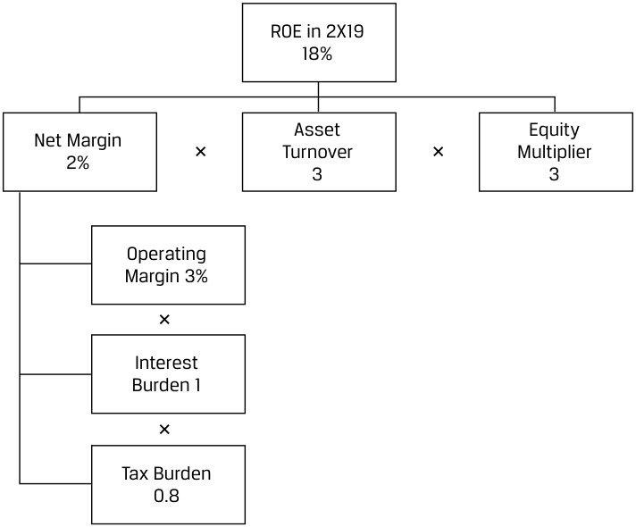

# Tập 5: Đầu tư Vốn cổ phần (Equity Investments)
## Học phần 5: Phân tích Công ty: Quá khứ và Hiện tại (Company Analysis: Past and Present)
### Phần 5/5: Đầu tư Vốn và Cơ cấu Vốn (Trang PDF 246–254)

---

<!-- PDF Page 246 -->

# **<mark>6</mark>** 

#### **ĐẦU TƯ VỐN VÀ CƠ CẤU VỐN (*CAPITAL INVESTMENTS AND CAPITAL STRUCTURE*)** 

- đánh giá các khoản đầu tư vốn (*capital investments*) và cơ cấu vốn (*capital structure*) của một công ty

##### **Nguồn Vốn và Sử dụng Vốn (*Sources and Uses of Capital*)** 

Các doanh nghiệp đầu tư nguồn vốn huy động từ các nhà đầu tư nợ và vốn cổ phần để kiếm được tỷ suất sinh lợi cao hơn tỷ suất sinh lợi yêu cầu của các nhà đầu tư. Một cân nhắc quan trọng trong phân tích công ty là đánh giá xem liệu các tỷ suất sinh lợi yêu cầu đã được đáp ứng hay vượt qua hay chưa (tức là liệu giá trị kinh tế có được tạo ra cho các nhà đầu tư hay không) trong dài hạn, đồng thời đánh giá các rủi ro và cơ hội gắn liền với cơ cấu vốn, chẳng hạn như việc sử dụng đòn bẩy tài chính (*financial leverage*). Trước khi đánh giá, bước đầu tiên là xác định các nguồn vốn và việc sử dụng vốn (*sources and uses of capital*) của một công ty trên cơ sở dữ liệu lịch sử, như được trình bày tổng quát trong Bảng minh họa 6. 

**Bảng minh họa 6: Nguồn Vốn và Sử dụng Vốn (*Sources and Uses of Capital*)** 

|**Nguồn Vốn (*Sources of Capital*)**|**Sử dụng Vốn (*Uses of Capital*)**|
|---|---|
|Dòng tiền từ hoạt động kinh doanh, bao gồm vốn lưu động ròng (nếu âm) (*Cash flows from operations, including net working capital - if negative*)|Tiền mặt và các khoản đầu tư hiện có (*Cash and investments on hand*)|
|Phát hành nợ (*Debt issuance*)|Vốn lưu động ròng (nếu dương) (*Net working capital - if positive*)|
|Phát hành vốn cổ phần (*Equity issuance*)|Chi tiêu vốn và mua sắm bổ sung tài sản vô hình (*Capital expenditures and additions to intangibles*)|
|Thanh lý tài sản (*Asset disposals*)|Mua lại doanh nghiệp (*Acquisitions*)|
||Trả nợ gốc (*Debt paydown*) Chi trả cổ tức và mua lại cổ phần (*Dividends and share repurchases*)|

###### **TÌNH HUỐNG NGHIÊN CỨU (*CASE STUDY*)** 

##### **Nguồn Vốn và Sử dụng Vốn của Warehouse Club Inc.** 

Elaine Nguyen tính toán các thông tin sau đây về Warehouse trong giai đoạn 2X10–2X19. Dòng tiền từ hoạt động kinh doanh bao gồm tác động của nguồn tài trợ bổ sung từ vốn lưu động ròng (tức là vốn lưu động ròng của Warehouse ngày càng âm nhiều hơn theo thời gian). 

<!-- PDF Page 247 -->

###### **_Nguồn Vốn và Sử dụng Vốn của Warehouse Club Inc., 2X10–2X19_** 

> **Chú thích hình ảnh:** Biểu đồ cột chồng 100% Nguồn vốn (*Sources*) và Sử dụng vốn (*Uses*) của Warehouse Club Inc. giai đoạn 2X10–2X19:
> - **Nguồn vốn (*Sources*):** Dòng tiền từ hoạt động kinh doanh (*Cash flows from operations*) chiếm ~93%, Phát hành nợ (*Debt Issuance*) chiếm ~7%.
> - **Sử dụng vốn (*Uses*):** Chi tiêu vốn (*Capital Expenditures*) ~45%, Cổ tức (*Dividends*) ~27%, Mua lại cổ phần (*Share repurchases*) ~18%, Tăng tiền mặt và các khoản đầu tư trên bảng cân đối kế toán (*Increase in cash and investments on balance sheet*) ~10%.

Nguyen đưa ra các nhận xét sau: 

- Chi tiêu vốn (*capital expenditures*) và các khoản hoàn trả vốn cho cổ đông (cổ tức và mua lại cổ phần) gần như bằng nhau, điều này khá bất ngờ khi xét đến việc các cửa hàng mở mới đều hoạt động tốt; Nguyen đã kỳ vọng công ty sẽ dành một lượng vốn lớn hơn cho chi tiêu vốn để mở các cửa hàng mới. 

- Công ty không thực hiện bất kỳ thương vụ mua lại doanh nghiệp (*acquisitions*) nào. 

- Ngay cả sau khi hoàn trả vốn cho cổ đông, công ty dường như vẫn ưa thích tài trợ bằng vốn cổ phần hơn là tài trợ bằng nợ vay. Sự ưu tiên này là hợp lý khi xét đến biên lợi nhuận hoạt động mỏng của công ty, mặc dù thực tế việc công ty chủ yếu bán một danh mục rộng các mặt hàng thiết yếu giúp làm giảm rủi ro doanh thu (tức là rủi ro từ những thay đổi trong chu kỳ kinh doanh cũng như trong công nghệ hoặc thời trang) và phí thành viên là một nguồn thu nhập có thể dự đoán trước. 

- Thực tế việc quy mô phát hành nợ nhỏ hơn mức tăng tiền mặt và các khoản đầu tư trên bảng cân đối kế toán cho thấy nợ ròng (*net debt*) của công ty đã giảm xuống theo thời gian, hàm ý sự sụt giảm trong đòn bẩy tài chính. 

##### **Đánh giá các Khoản Đầu tư Vốn và Cơ cấu Vốn (*Evaluating Capital Investments and Capital Structure*)** 

Tỷ suất sinh lợi trên vốn đầu tư (*returns on invested capital* – ROIC) trong dài hạn, khi so sánh với tỷ suất sinh lợi yêu cầu của các nhà đầu tư, có thể được sử dụng để đánh giá xem liệu ban giám đốc có sử dụng nguồn vốn của nhà đầu tư một cách khôn ngoan hay không. Hãy nhớ lại rằng các nhà phân tích đầu tư độc lập không có quyền tiếp cận cùng nguồn thông tin mà ban giám đốc sử dụng để đánh giá từng dự án riêng lẻ bằng IRR và NPV, vì vậy các nhà phân tích phải sử dụng các thước đo có tính tổng hợp cao hơn để nhận biết xem xu hướng tạo ra giá trị đang xấu đi hay đang cải thiện. 

Các rủi ro liên quan đến cơ cấu vốn có thể được đo lường bằng cách sử dụng các tỷ số đòn bẩy (*leverage ratios*) và tỷ số khả năng thanh toán (*coverage ratios*), xếp hạng tín nhiệm của các tổ chức xếp hạng bên thứ ba, và độ nhạy của lợi nhuận ròng trước những thay đổi trong lợi nhuận hoạt động—được gọi là **độ bẩy tài chính (*degree of financial leverage* – DFL)**, như được thể hiện trong Phương trình 3. Độ bẩy tài chính tăng lên khi chi phí lãi vay—vốn cố định so với lợi nhuận hoạt động—cao hơn. Độ bẩy tài chính tương tự như độ bẩy hoạt động nhưng được quyết định bởi chi phí tài trợ thay vì chi phí hoạt động cố định. 

$$\text{DFL} = \frac{\%\Delta\text{ Lợi nhuận ròng (\%}\Delta\text{ Net Income)}}{\%\Delta\text{ Lợi nhuận hoạt động (\%}\Delta\text{ Operating Income)}} \tag{3}$$

<!-- PDF Page 248 -->

###### **TÌNH HUỐNG NGHIÊN CỨU (*CASE STUDY*)** 

##### **Đánh giá các Khoản Đầu tư Vốn và Cơ cấu Vốn của Warehouse Club Inc.** 

Elaine Nguyen tính toán các thông tin sau đây về Warehouse trong giai đoạn 2X10–2X19. Ngoài ra, tỷ số khả năng thanh toán lãi vay (*interest coverage ratio* – EBIT trên chi phí lãi vay) của công ty luôn ở mức trên 20 lần và gần đây đã đạt tới 30 lần vào năm 2X19, đồng thời tín dụng của công ty được các tổ chức xếp hạng tín nhiệm lớn xếp hạng ở cấp độ đầu tư (*investment grade*). 

> **Chú thích hình ảnh:**
> - **Biểu đồ trên – Tỷ suất Sinh lợi trên Vốn Đầu tư (ROIC) và Chi phí Sử dụng Vốn Bình quân Gia quyền (WACC) của Warehouse Club Inc. giai đoạn 2X10–2X19:**
>   - ROIC: tăng từ ~10% lên ~15%
>   - ROIC không tính tiền mặt (*ROIC ex cash*): tăng từ ~18% lên ~28%
>   - WACC: giảm nhẹ từ ~9% xuống ~8%.
> - **Biểu đồ dưới – Các Tỷ số Đòn bẩy Tài chính của Warehouse Club Inc. giai đoạn 2X10–2X19:**
>   - Độ bẩy tài chính (*Degree of financial leverage*): xấp xỉ 1,0
>   - Nợ ròng trên EBITDA (*Net debt to EBITDA*): âm (từ khoảng -1,2 xuống -1,6).

Nguyen đưa ra các nhận xét sau: 

- Công ty đã tạo ra giá trị cho các nhà đầu tư, với mức chênh lệch (*spread*) của ROIC vượt trên WACC từ 200–700 điểm cơ bản (bps) kể từ năm 2X10. WACC đã giảm nhẹ theo thời gian khi lãi suất giảm xuống; phép tính này giả định tỷ suất sinh lợi yêu cầu trên vốn cổ phần không đổi ở mức 9%. 

- Tỷ suất sinh lợi trên vốn của công ty cao hơn rất nhiều so với những gì mà biên lợi nhuận hoạt động và biên lợi nhuận ròng thấp của công ty gợi ý, nhờ vào vòng quay tổng tài sản (*asset turnover*) cao và vốn lưu động ròng âm đóng vai trò là một phương thức tài trợ chi phí thấp từ các nhà cung cấp, giúp công ty cần ít vốn hơn từ các nhà đầu tư. 

<!-- PDF Page 249 -->

- Công ty có một cơ cấu vốn thận trọng (*conservative capital structure*), với nợ ròng âm và độ bẩy tài chính xấp xỉ 1,0 bởi vì chi phí lãi vay phần lớn đã được bù đắp bởi thu nhập lãi từ lượng tiền mặt nắm giữ (tức là lợi nhuận ròng và lợi nhuận hoạt động biến động cùng chiều với tốc độ tương đương nhau). 

- Sự thận trọng trong cơ cấu vốn được chứng minh qua chỉ số ROIC giả định (*counterfactual ROIC*) khi loại trừ tiền mặt và các khoản đầu tư trên bảng cân đối kế toán. Mặc dù đây là một sự phóng đại (vì công ty vẫn sẽ cần _một lượng_ tiền mặt nhất định tại quỹ), ROIC có thể cao hơn gần 15 điểm phần trăm nếu công ty giảm lượng tiền mặt ròng bằng cách đầu tư vào các dự án tạo ra giá trị hoặc bằng cách hoàn trả vốn cho cổ đông. 

Tỷ suất sinh lợi không dùng đòn bẩy nợ (*unlevered returns*), được đo lường bằng ROIC hoặc tỷ suất sinh lợi trên tổng tài sản (ROA), được khuếch đại nhờ đòn bẩy tài chính để tạo ra tỷ suất sinh lợi có đòn bẩy (*levered returns*), hay tỷ suất sinh lợi trên vốn chủ sở hữu (ROE), vốn đã được giới thiệu trong một học phần trước. Chúng ta có thể sử dụng ROE và phép phân rã ROE (*ROE decomposition* – phân tích DuPont) như một thước đo toàn diện về khả năng sinh lời đối với một tổ chức phát hành. Phép phân rã ROE của Warehouse Club Inc. minh họa các yếu tố dẫn dắt tỷ suất sinh lợi có đòn bẩy của công ty, vốn cao hơn rất nhiều so với biên lợi nhuận ròng của nó. 

> **Chú thích hình ảnh:** Sơ đồ phân rã ROE năm 2X19 của Warehouse Club Inc.:
> $$\text{ROE năm 2X19 (18\%)} = \text{Biên lợi nhuận ròng (Net Margin: 2\%)} \times \text{Vòng quay tài sản (Asset Turnover: 3)} \times \text{Số nhân vốn chủ sở hữu (Equity Multiplier: 3)}$$
> Trong đó:
> $$\text{Biên lợi nhuận ròng (2\%)} \approx \text{Biên lợi nhuận hoạt động (Operating Margin: 3\%)} \times \text{Gánh nặng lãi vay (Interest Burden: 1)} \times \text{Gánh nặng thuế (Tax Burden: 0,8)}$$

###### **BỘ CÂU HỎI (*QUESTION SET*)** 

Các câu hỏi 1–4 liên quan đến báo cáo tài chính của Iliso trong bài học “Xác định Mô hình Kinh doanh”. 

1. Vào năm 2X19, giá trị thị trường của vốn cổ phần Iliso là $1.178 triệu, và giá trị sổ sách của nợ vay—vốn xấp xỉ bằng giá trị thị trường—là $144 triệu. Giả sử chi phí nợ là 5,5%, chi phí vốn cổ phần là 12%, thuế suất là 24%, và tỷ số giá trên giá trị sổ sách (P/B) là 1,0, WACC của Iliso _gần nhất_ với mức nào: 

   - **A.** 11,15%. 
   - **B.** 11,30%.
   - **C.** 12,00%.

**Lời giải (*Solution*):** 

A là đáp án đúng. Hãy nhớ lại rằng: 

<!-- PDF Page 250 -->

$$\text{WACC} = [\text{Trọng số nợ} \times \text{Chi phí nợ trước thuế} \times (1 - \text{Thuế suất})] + (\text{Trọng số vốn cổ phần} \times \text{Chi phí vốn cổ phần})$$

Tổng nguồn vốn là $\$1.178 + \$144 = \$1.322$ triệu. Do đó, trọng số nợ là $\$144 / \$1.322 = 10,89\%$, và trọng số vốn cổ phần là $1 - \text{Trọng số nợ} = 89,11\%$. 

Vì vậy, $\text{WACC} = [10,89\% \times 5,5\% \times (1 - 24\%)] + (89,11\% \times 12\%) = 11,15\%$.
B không chính xác, bởi vì phương án này tính sai WACC khi sử dụng chi phí nợ trước thuế thay vì sau thuế. 

C không chính xác; đó là chi phí vốn cổ phần. 

2. Tại sao WACC của Iliso có thể cao hơn đáng kể so với WACC của Warehouse Club, như đã được tính toán trước đó trong học phần này? 

   - **A.** Mô hình kinh doanh của Warehouse Club ít rủi ro hơn so với thương mại điện tử. 

   - **B.** Cơ cấu vốn của Warehouse Club, với độ bẩy tài chính xấp xỉ 1,0, kém thận trọng hơn so với của Iliso. 

   - **C.** Iliso là một nhà bán lẻ lâu đời có xếp hạng tín nhiệm cấp độ đầu tư (*investment-grade rating*). 

   - **Lời giải (*Solution*):** 

A là đáp án đúng. Chi phí vốn cổ phần là phần đền bù mà các nhà đầu tư vốn cổ phần đòi hỏi cho những rủi ro kinh doanh và rủi ro tài chính khi đầu tư vào chứng khoán vốn cổ phần của một tổ chức phát hành. Chi phí vốn cổ phần của Iliso là 12%, trong khi của Warehouse Club là 9%, phản ánh lịch sử hoạt động lâu đời hơn, mô hình kinh doanh đã được kiểm chứng vững chắc hơn, và vị thế cạnh tranh của Warehouse Club. 

B không chính xác, bởi vì cơ cấu vốn của Warehouse Club, với độ bẩy tài chính bằng 1,0, hàm ý trọng số vốn cổ phần gần như bằng 100% (nợ ròng âm), trong khi Iliso có trọng số nợ là 11% và do đó cơ cấu vốn của Warehouse _thận trọng hơn_. 

C không chính xác, bởi vì xếp hạng tín nhiệm cấp độ đầu tư sẽ làm giảm chi phí nợ và WACC của Iliso (hơn nữa Iliso mới vừa IPO gần đây chứ không phải nhà bán lẻ lâu đời). 

3. Độ bẩy tài chính (DFL) của Iliso vào năm 2X19 _gần nhất_ với mức nào: 

   - **A.** 0,77. 

   - **B.** 1,13. 

   - **C.** 1,84. 

###### **Lời giải (*Solution*):** 

B là đáp án đúng, được tính bằng Phần trăm thay đổi lợi nhuận ròng / Phần trăm thay đổi lợi nhuận hoạt động $= (100 / 52 - 1)$ chia cho $(130 / 72 - 1) = 1,146$ (gần nhất với 1,13). 

A không chính xác, bởi vì nó được tính sai thành Lợi nhuận ròng năm 2X19 / Lợi nhuận hoạt động năm 2X19 $= 100 / 130 = 0,77$. 

C không chính xác, bởi vì đó là số nhân vốn chủ sở hữu (*equity multiplier*) của Iliso: Tổng tài sản / Vốn chủ sở hữu $= 2.168 / (592 + 586) = 1,84$. 

4. Hãy giải thích tại sao ROE của Iliso lại khác với ROE của Warehouse Club.

**Lời giải (*Solution*):** 

ROE của Iliso thấp hơn so với ROE của Warehouse Club. 

$$\text{ROE} = \text{Biên lợi nhuận ròng (Net margin)} \times \text{Vòng quay tài sản (Asset turnover)} \times \text{Số nhân vốn chủ sở hữu (Equity multiplier)}$$

<!-- PDF Page 251 -->

$$\text{ROE} = 1,3\% \times 3,5 \times 1,84 = 8,37\%$$
Con số này chưa bằng một nửa mức ROE 18% của Warehouse Club. Kết quả này chủ yếu bắt nguồn từ việc biên lợi nhuận ròng của Iliso thấp hơn (1,3% so với 2%) và số nhân vốn chủ sở hữu thấp hơn khoảng 40% (1,84 so với 3), dù được bù đắp phần nào bởi vòng quay tài sản cao hơn của Iliso (3,5 so với 3). 

<!-- PDF Page 252 -->

## **BÀI TẬP THỰC HÀNH (*PRACTICE PROBLEMS*)** 

### **Thông tin sau đây liên quan đến các câu hỏi 1–6** 

Joshua Hu, một nhà phân tích nghiên cứu, đang bắt đầu theo dõi (*initiating coverage*) một số công ty trong ngành vận tải hàng hóa đường biển (*ocean freight shipping industry*). OldShips là một công ty trưởng thành có chi phí cố định cao và tỷ số chi tiêu vốn trên doanh thu cao bởi vì công ty sở hữu và tự vận hành đội tàu của riêng mình. CleanYards là một xưởng đóng tàu bền vững, có công nghệ tiên tiến với trọng tâm là sửa chữa chuyên dụng và đóng tàu. Hu đã thu thập dữ liệu sau đây cho hai công ty: 

||**OldShips**|**CleanYards**|
|---|---|---|
|Độ bẩy Tài chính (*Degree of Financial Leverage* – DFL)|2,0|2,0|
|Độ bẩy Hoạt động (*Degree of Operating Leverage* – DOL)|1,0|2,0|
|Tỷ số vòng quay tài sản (*Asset turnover ratio*)|0,84×|0,42×|
|DSO (Số ngày thu tiền bán hàng)|27|98|
|DOH (Số ngày tồn kho)|12|46|
|DPO (Số ngày phải trả người bán)|55|40|

NewShips, công ty thứ ba, là một nền tảng công nghệ vận tải biển dựa trên nền tảng web giúp kết nối các nhà khai thác tàu biển như OldShips với các khách hàng thuộc nhiều ngành nghề khác nhau đang có nhu cầu vận chuyển hàng hóa đường biển. Khách hàng của NewShips đặt đơn hàng trực tuyến và thanh toán cước phí để đưa hàng vào một container chuyển tới bất kỳ điểm đến nào trên thế giới. Các đối tác của NewShips, chẳng hạn như OldShips, cung cấp tàu theo cả hợp đồng thuê tàu dài hạn và ngắn hạn. 

Vào năm 2X19, nền tảng của NewShips đã môi giới các đơn hàng cho tổng cộng 900.000 container tiêu chuẩn 20 feet (*twenty-foot equivalent unit* – TEU), với mức giá cước vận chuyển gộp trung bình là 3.848 USD mỗi TEU. Trung bình, tiền hoa hồng của NewShips—khoản mà công ty nhận được với tư cách là nhà môi giới từ khách hàng—là 5% giá cước vận chuyển. 

**1.** Thành phần nào sau đây _nhiều khả năng nhất_ sẽ xuất hiện trong các báo cáo tiếp theo (*subsequent reports*) của Hu? 

   - **A.** Quy mô ngành, tốc độ tăng trưởng, và các yếu tố dẫn dắt chính 

   - **B.** Tóm tắt những thay đổi đối với khuyến nghị (*Summary of changes to the recommendation*) 

   - **C.** Cơ cấu sở hữu và thành phần ban giám đốc 

**2.** Vận tải biển là một ngành có tính chu kỳ rất cao. Công ty nào sau đây _nhiều khả năng nhất_ có khả năng cao nhất trong việc nhanh chóng mở rộng công suất để đáp ứng nhu cầu gia tăng đối với dịch vụ vận tải biển? 

   - **A.** OldShips 

   - **B.** NewShips 

   - **C.** CleanYards 

<!-- PDF Page 253 -->

**3.** Vào năm 2X19, doanh thu của NewShips _gần nhất_ với mức nào: 

   - **A.** $173 triệu. 

   - **B.** $1,46 tỷ. 

   - **C.** $3,63 tỷ. 

**4.** Khi thực hiện phân tích công ty, thông tin nào sau đây _ít_ liên quan nhất đến việc xác định mô hình kinh doanh của một công ty? 

   - **A.** Báo cáo thường niên của công ty mô tả các dòng sản phẩm của doanh nghiệp 

   - **B.** Các nhận xét của ban giám đốc về các sản phẩm cạnh tranh và sản phẩm thay thế 

   - **C.** Các báo cáo chuyên đề ngành (*industry white papers*) liên quan đến chiến lược định giá sản phẩm của công ty 

**5.** Chu kỳ chuyển đổi tiền mặt (CCC) của OldShips thì: 

   - **A.** thấp hơn so với của CleanYards. 

   - **B.** tương tự như của CleanYards. 

   - **C.** cao hơn so với của CleanYards. 

**6.** Bước đầu tiên trong việc rà soát các khoản đầu tư vốn của một công ty là: 

   - **A.** đánh giá các khoản đầu tư của ban giám đốc. 

   - **B.** xác định các yếu tố dẫn dắt dòng tiền hoạt động. 

   - **C.** xác định các nguồn tiền và việc sử dụng tiền chính (*determine the major sources and uses of cash*). 

<!-- PDF Page 254 -->

## **LỜI GIẢI (*SOLUTIONS*)** 

1. B là đáp án đúng. Một báo cáo nghiên cứu công ty tiếp theo (*subsequent company research report*) tập trung vào việc cập nhật cho các nhà đầu tư về thông tin mới hoặc những thay đổi trong mức giá mục tiêu và khuyến nghị của nhà phân tích. 

A và C không chính xác, bởi vì thông tin chuyên sâu liên quan đến quy mô ngành, tốc độ tăng trưởng, và các yếu tố dẫn dắt chính hoặc cơ cấu sở hữu và thành phần ban giám đốc phù hợp hơn với một báo cáo bắt đầu theo dõi (*initiation report*). 

2. B là đáp án đúng. Chỉ có NewShips mới có mô hình kinh doanh nhẹ về vốn (*capital-light business model*). Cả OldShips và CleanYards đều đòi hỏi khoản đầu tư vốn lớn để có thể gia tăng công suất cung ứng. Việc đóng tàu mới (đối với OldShips) và mua lại các xưởng đóng tàu mới (đối với CleanYards) đều mất nhiều thời gian và không thể đáp ứng ngay lập tức. 

3. A là đáp án đúng. NewShips đóng vai trò là nhà môi giới và hưởng hoa hồng bằng 5% giá cước vận chuyển. Vào năm 2X19, NewShips đã môi giới 900.000 TEU với mức giá cước trung bình là $3.848 mỗi TEU, thu về mức hoa hồng 5%:
$$900.000 \times 3.848 \times 0,05 = \$173,16\text{ triệu} \approx \$173\text{ triệu}$$

4. B là đáp án đúng. Các sản phẩm cạnh tranh và sản phẩm thay thế được phân tích trong Mô hình Năm áp lực cạnh tranh của Porter (*Porter’s Five Forces*). Phân tích này thường được thực hiện để hiểu rõ hơn về ngành hoạt động của một công ty và vị thế cạnh tranh của nó. Các nhận xét của ban giám đốc về đối thủ và sản phẩm thay thế ít có khả năng hướng dẫn nhà phân tích hiểu rõ hơn về bản thân mô hình kinh doanh của công ty.
A và C không chính xác, bởi vì cả hai đều là những nguồn thông tin có liên quan đối với một nhà phân tích trong việc xác định mô hình kinh doanh của công ty. 

5. A là đáp án đúng. 

$$\text{CCC} = \text{DOH} + \text{DSO} - \text{DPO}$$
Vì vậy: 

$$\text{CCC của OldShips} = 12 + 27 - 55 = -16\text{ ngày}$$

$$\text{CCC của CleanYards} = 46 + 98 - 40 = 104\text{ ngày}$$

Trên thực tế, OldShips có chu kỳ chuyển đổi tiền mặt âm. OldShips tận dụng được các điều khoản tín dụng thương mại thuận lợi do các nhà cung cấp của mình cấp cho. 

B và C không chính xác, bởi vì CCC của OldShips thấp hơn so với của CleanYards. 

6. C là đáp án đúng. Trước khi rà soát đánh giá các khoản đầu tư vốn của một công ty, bước đầu tiên là xác định các nguồn vốn và việc sử dụng vốn (nguồn tiền và việc sử dụng tiền) của công ty trên cơ sở dữ liệu lịch sử.
A và B không chính xác, bởi vì cả hai bước này đều diễn ra sau khi nhà phân tích đã xác định được các nguồn tiền và việc sử dụng tiền của công ty đồng thời quyết định được những trọng tâm cần tập trung vào. 
