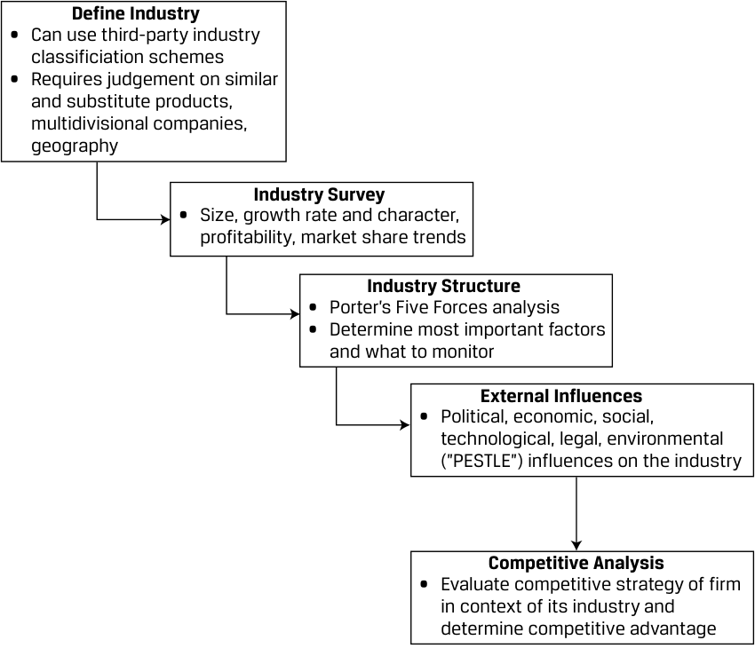
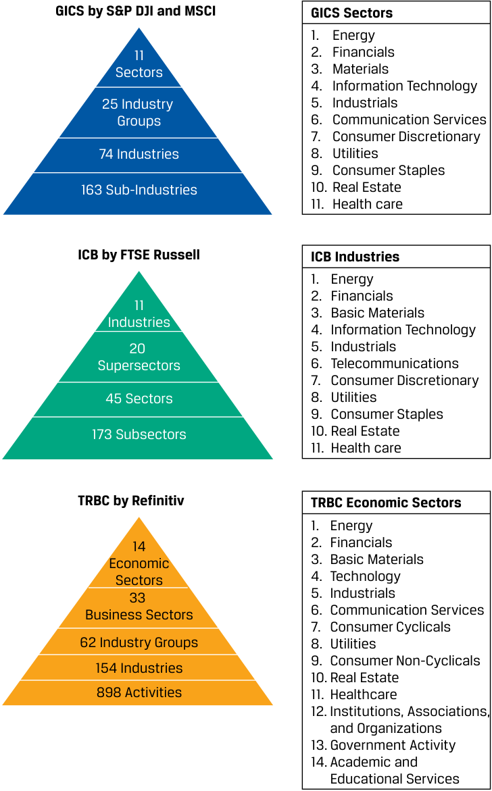
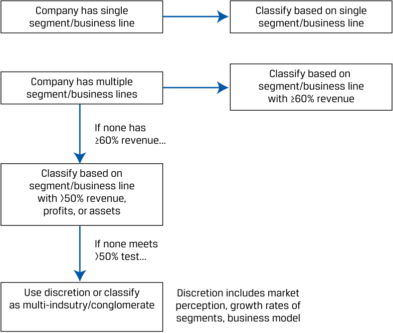
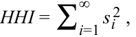
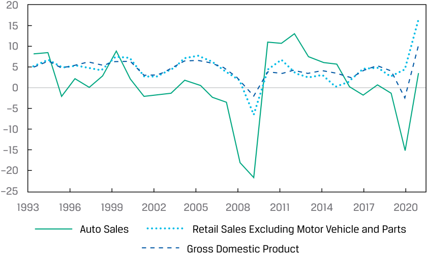
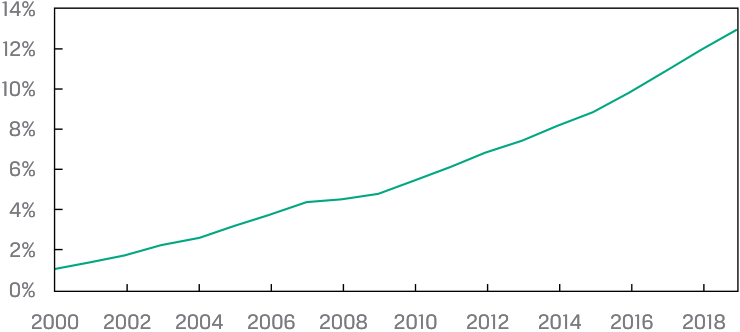

# Tập 5: Đầu tư Cổ phiếu (Equity Investments)
## Learning Module 6 Industry and Competitive Analysis (Trang PDF 255–294)

---

# Tập 5: Đầu tư Cổ phần (Volume 5: Equity Investments)
## Học phần 6: Phân tích Ngành và Cạnh tranh (Learning Module 6: Industry and Competitive Analysis)
### Phần 1/4: Giới thiệu (Trang PDF 255–267)

---

<!-- PDF Page 255 -->

# H Ọ C P H Ầ N **<mark>6</mark>** 

### **Phân tích Ngành và Cạnh tranh (*Industry and Competitive Analysis*)** 

##### **<mark>KẾT QUẢ HỌC TẬP (*LEARNING OUTCOMES*)</mark>** 

|**_Mức độ thành thạo_**|**_Ứng viên cần có khả năng:_**|
|---|---|
||mô tả mục đích và các bước liên quan trong phân tích ngành và cạnh tranh (*industry and competitive analysis*)|
||mô tả các phương pháp phân loại ngành (*industry classification methods*) và so sánh các phương pháp phân nhóm công ty|
||xác định quy mô, đặc điểm tăng trưởng, khả năng sinh lời và xu hướng thị phần (*market share trends*) của một ngành|
||phân tích cấu trúc của một ngành và các ảnh hưởng bên ngoài bằng cách sử dụng khung Năm áp lực cạnh tranh của Porter (*Porter’s Five Forces*) và PESTLE|
||đánh giá chiến lược cạnh tranh (*competitive strategy*) và vị thế của một công ty|

<!-- Picture Text: 1  -->

#### **GIỚI THIỆU (*INTRODUCTION*)** 

Điều thiết yếu đối với các nhà phân tích là phải hiểu rõ bối cảnh ngành đối với kết quả hoạt động tài chính và việc đánh giá một công ty. Ví dụ, liệu tăng trưởng doanh thu của một công ty được thúc đẩy bởi yếu tố kinh tế vĩ mô hay yếu tố toàn ngành (chẳng hạn như mở rộng kinh tế) hay bởi một yếu tố đặc thù của công ty (chẳng hạn như gia tăng thị phần)? Câu trả lời có những hàm ý quan trọng đối với công tác dự báo (*forecasting*) và định giá (*valuation*). 

Trong học phần này, chúng ta thảo luận về cách một ngành được định nghĩa và giải quyết những thách thức liên quan đến việc phân nhóm các công ty hoạt động trong nhiều ngành khác nhau. Tiếp theo, chúng ta giới thiệu các phương pháp khảo sát một ngành về quy mô, khả năng sinh lời và xu hướng thị phần. Phân tích sâu hơn bao gồm các khung lý thuyết để diễn giải môi trường cạnh tranh bằng mô hình Năm áp lực cạnh tranh của Porter (*Porter’s Five Forces*) và các xu hướng bên ngoài bằng phân tích PESTLE (*PESTLE analysis*). Cuối cùng, chúng ta kết hợp các phương pháp tiếp cận này để hiểu chiến lược cạnh tranh của một công ty và vị thế của công ty đó so với các đối thủ cùng ngành (*industry peers*). 

###### **TỔNG QUAN HỌC PHẦN (*LEARNING MODULE OVERVIEW*)** 

- Các nhà phân tích sử dụng phân tích ngành và cạnh tranh để hiểu các yếu tố cấu trúc của ngành, điểm mạnh và điểm yếu cạnh tranh tương đối, và sự đóng góp của chúng vào <u>lợi nhuận kinh tế (*economic profits*)</u> của một công ty. 

<!-- PDF Page 256 -->

- Bước đầu tiên của nhà phân tích trong phân tích ngành và cạnh tranh là xác định ranh giới của ngành đang xét và các thành phần cấu thành ngành đó. Các ngành thường được định nghĩa là các công ty bán các sản phẩm hoặc dịch vụ tương tự nhau. Tuy nhiên, định nghĩa này có thể khó áp dụng trong thực tế, vì các công ty có thể bán các sản phẩm hoặc dịch vụ đa dạng trên nhiều ngành khác nhau và tính tương đồng của sản phẩm mang tính chủ quan. 

- Để xác định một ngành, các nhà phân tích có thể sử dụng các hệ thống phân loại của bên thứ ba như GICS nhưng cần lưu ý đến phương pháp luận và những hạn chế của các hệ thống này. 

- Sau khi xác định ngành, nhà phân tích tiến hành khảo sát ngành bằng cách ước tính tổng doanh thu hàng năm, tốc độ tăng trưởng lịch sử và các chỉ số khả năng sinh lời (*profitability metrics*), sau đó xác định thị phần và xu hướng của các doanh nghiệp chủ chốt. 

- Các chỉ số của ngành có thể được so sánh với các xu hướng kinh tế rộng lớn hơn trong các giai đoạn suy thoái (*recessions*) hoặc mở rộng (*expansions*) để xác định mức độ trưởng thành của ngành, độ nhạy cảm với chu kỳ kinh doanh (*sensitivity to business cycles*) và mức độ cạnh tranh nội bộ ngành (*competitive rivalry*). 

- Các nhà phân tích sử dụng Năm áp lực cạnh tranh của Porter (*Porter’s Five Forces*) để hiểu cấu trúc của một ngành, được xác định bởi mức độ cạnh tranh nội bộ ngành, thông qua việc đánh giá mối đe dọa từ các đối thủ mới gia nhập (*threat of new entrants*), mối đe dọa từ các sản phẩm thay thế (*threat of substitutes*), quyền lực thương lượng của khách hàng (*customer bargaining power*), và quyền lực thương lượng của nhà cung cấp (*bargaining power of suppliers*). 

- Để bổ sung cho nghiên cứu này, các nhà phân tích sử dụng phân tích PESTLE để hiểu các ảnh hưởng bên ngoài và những thay đổi tiềm tàng đối với tốc độ tăng trưởng và động lực thị phần của một ngành. 

- Để đánh giá chiến lược cạnh tranh của một công ty, nhà phân tích cần xác định xem chiến lược đó có tạo ra sự phòng thủ trước các áp lực trong ngành và có phù hợp với các lực lượng bên ngoài tác động lên ngành hay không, đồng thời liệu công ty có các nguồn lực và năng lực (*resources and capabilities*) cần thiết để thực thi chiến lược đó hay không. 

###### **TỰ ĐÁNH GIÁ HỌC PHẦN (*LEARNING MODULE SELF-ASSESSMENT*)** 

Những câu hỏi ban đầu này nhằm giúp bạn tự đánh giá mức độ hiểu biết hiện tại của mình về học phần này. 

1. Khi xếp một công ty vào một ngành, điều nào sau đây là hạn chế của việc sử dụng các hệ thống phân loại ngành của bên thứ ba? 

   - **A.** Sự khác biệt về tiền tệ 

   - **B.** Các công ty đơn sản phẩm 

   - **C.** Hệ thống phân loại theo cấp bậc cứng nhắc (*Strictly hierarchical taxonomies*) 

   - **Lời giải:** 

C là đáp án đúng. Các hệ thống phân loại thương mại như GICS, ICB và TRBC là những ví dụ về hệ thống phân loại theo cấp bậc cứng nhắc, chỉ xếp một công ty vào một nhóm duy nhất, bất kể công ty đó có bán nhiều loại sản phẩm hay dịch vụ hay không. 

2. Một yếu tố quyết định độ nhạy cảm với chu kỳ kinh doanh (*sensitivity to the business cycle*) _nhiều khả năng nhất_ là: 

   - **A.** sự dịch chuyển của khách hàng sang các sản phẩm thay thế. 

   - **B.** mức độ nhạy cảm với lãi suất của mô hình kinh doanh (*interest rate exposure of the business model*). 

<!-- PDF Page 257 -->

   - **C.** tốc độ tăng trưởng phù hợp với hoạt động kinh tế chung. 

   - **Lời giải:** 

B là đáp án đúng. Các yếu tố quyết định độ nhạy cảm với chu kỳ kinh doanh bao gồm mức độ mà doanh thu mang tính tùy ý (*discretionary*) hay thiết yếu (*necessary*) đối với người tiêu dùng, quyền lực định giá (*pricing power*), mức độ nhạy cảm với lãi suất của mô hình kinh doanh, và liệu sản phẩm là hàng hóa lâu bền (*durable good*) hay tư liệu sản xuất (*capital good*) so với việc mua hàng định kỳ như hàng tiêu dùng nhanh (*consumables*) và các dịch vụ đăng ký định kỳ (*subscription services*). 

A và C không đúng, vì chúng phản ánh các đặc điểm của một ngành đã trưởng thành (*mature industry*) nhưng không nhất thiết mang tính chu kỳ cao hơn. 

3. Một thước đo phổ biến về mức độ tập trung của ngành (*industry concentration*) là: 

   - **A.** Năm áp lực cạnh tranh của Porter (*Porter’s Five Forces*). 

   - **B.** khung phân tích PESTLE (*PESTLE framework*). 

   - **C.** Chỉ số Herfindahl-Hirschman (*Herfindahl-Hirschman Index*). 

   - **Lời giải:** 

C là đáp án đúng. Chỉ số Herfindahl-Hirschman (*Herfindahl-Hirschman Index* – HHI) là một thước đo phổ biến về mức độ tập trung của ngành, được tính bằng tổng bình phương thị phần của các đối thủ cạnh tranh. Mô hình Năm áp lực cạnh tranh của Porter đánh giá mức độ cạnh tranh nội bộ và khả năng sinh lời của một ngành. Khung phân tích PESTLE quan tâm nhiều hơn đến tốc độ tăng trưởng và động lực thị phần của ngành. 

4. Xác định phát biểu sau đây là đúng hay sai. Giải thích câu trả lời của bạn. 

Một số áp lực nằm trong khung Năm áp lực cạnh tranh của Porter bao gồm mối đe dọa từ các đối thủ mới gia nhập, độ nhạy cảm với chu kỳ kinh doanh và quyền lực thương lượng của khách hàng. 

###### **Lời giải:** 

Sai. Mô hình Năm áp lực cạnh tranh của Porter sử dụng mối đe dọa từ sản phẩm thay thế (*threat of substitutes*), mối đe dọa từ các đối thủ mới gia nhập (*threat of new entrants*), quyền lực thương lượng của khách hàng (*bargaining power of customers*), và quyền lực thương lượng của nhà cung cấp (*bargaining power of suppliers*) để xác định sự cạnh tranh giữa các đối thủ hiện hữu (*rivalry among existing competitors*). Độ nhạy cảm với chu kỳ kinh doanh _không_ phải là một trong các áp lực này. 

5. Sự cạnh tranh về giá từng được thể hiện trong lịch sử bởi các nhà sản xuất ô tô và các nhà sản xuất máy bay được mô tả _đúng nhất_ là một ví dụ về: 

   - **A.** mối đe dọa từ các sản phẩm thay thế. 

   - **B.** quyền lực thương lượng của nhà cung cấp. 

   - **C.** sự cạnh tranh giữa các đối thủ hiện hữu (*rivalry among existing competitors*). 

   - **Lời giải:** 

C là đáp án đúng. Mặc dù có rủi ro tương đối thấp từ các áp lực khác trong Năm áp lực cạnh tranh, các nhà sản xuất ô tô và các nhà sản xuất máy bay vẫn cạnh tranh gay gắt về giá, đưa ra các chương trình khuyến mãi cùng các điều khoản tài trợ và bảo hành hào phóng nhằm giành lấy từng giao dịch bán hàng. 

6. Việc tiêu chuẩn hóa (*standardization*) một sản phẩm sẽ ____________ (làm tăng/làm giảm/không ảnh hưởng đến) quyền lực thương lượng của khách hàng. 

###### **Lời giải:** 

Việc tiêu chuẩn hóa một sản phẩm sẽ _<u>làm tăng</u>_ quyền lực thương lượng của khách hàng. Ví dụ, các nhà máy lọc dầu trả tiền mua dầu thô dựa trên phẩm cấp (*grade*) của dầu chứ không dựa trên nhà sản xuất dầu cụ thể; dầu thô trong cùng một phẩm cấp có thể thay thế cho nhau (*interchangeable*). 

<!-- PDF Page 258 -->

7. Impression Ltd. là một công ty giả định chuyên thiết kế, sản xuất và bán các sản phẩm chăm sóc da và làm đẹp. Một phân tích PESTLE đối với Impression Ltd. sẽ _nhiều khả năng nhất_ xác định điều nào sau đây? 

   - **A.** Một khách hàng của Impression Ltd., một nhà bán lẻ thương mại điện tử lớn, đang mua lại một nhà sản xuất sản phẩm chăm sóc da nhãn hiệu riêng (*private-label*). 

   - **B.** Các cuộc thảo luận ngày càng gia tăng của các cơ quan lập pháp về việc ban hành thuế tiêu thụ đặc biệt (*excise tax*) đối với bao bì nhựa dùng một lần như một phần của gói thuế carbon 

   - **C.** Một đối thủ cạnh tranh bán hàng trực tiếp trực tuyến đã tung ra một bộ bộ lọc ảnh tích hợp với các ứng dụng mạng xã hội hàng đầu dựa trên các sản phẩm làm đẹp của mình. 

###### **Lời giải:** 

B là đáp án đúng. Phân tích PESTLE quan tâm đến việc xác định và đánh giá các lực lượng _bên ngoài_ tác động lên một ngành, bao gồm các lực lượng chính trị (*political forces*) như thuế bao bì. A và C không đúng, vì chúng là các động thái của đối thủ cạnh tranh bên trong ngành làm đẹp. 

8. Với tư cách là một nhà đầu tư mạo hiểm (*venture capital investor*), bạn là thành viên hội đồng quản trị của Ridge Inc., một công ty giả định đang gia nhập ngành công nghiệp ô tô, vốn có đặc điểm là thâm dụng vốn cao (*high capital intensity*), chi phí chuyển đổi (*switching costs*) tối thiểu đối với khách hàng vì các quy định pháp lý yêu cầu tiêu chuẩn hóa nhiều tính năng, và sự nhạy cảm về giá của khách hàng ngoại trừ một tỷ lệ tương đối nhỏ người tiêu dùng giàu có. 

Dựa trên những quan sát này, hãy đề xuất và giải thích một chiến lược cạnh tranh cho các thành viên còn lại trong hội đồng quản trị của Ridge Inc. 

###### **Lời giải:** 

Chiến lược dẫn đầu về chi phí (*cost leadership strategy*) là một chiến lược cạnh tranh có thể mang lại thành công cho Ridge Inc. Vì hầu hết khách hàng đều nhạy cảm về giá và phải chịu chi phí chuyển đổi tối thiểu giữa các hãng xe hoặc mẫu xe, mức giá bán thấp có thể là một cách hiệu quả để giành thị phần. Kết hợp với mức độ thâm dụng vốn cao, một chiến lược như vậy có thể giúp Ridge hoạt động có lợi nhuận kinh tế nếu công ty sản xuất và bán đủ sản lượng, đồng thời duy trì kỷ luật chi phí cố định (*fixed-cost discipline*) để giữ chi phí đơn vị ở mức thấp. Các chiến lược cạnh tranh khác có thể thành công cho Ridge bao gồm chiến lược khác biệt hóa (*differentiation strategy*) nhắm vào nhóm khách hàng hạng sang hoặc ưa chuộng hiệu suất cao. 

## **<mark>2</mark> CÔNG DỤNG CỦA PHÂN TÍCH NGÀNH (*USES OF INDUSTRY ANALYSIS*)** 

mô tả mục đích và các bước liên quan trong phân tích ngành và cạnh tranh 

Bước tiếp theo trong khung phân tích công ty và ngành của chúng ta (Bảng minh họa 1), đã được giới thiệu trong học phần trước, là phân tích ngành và cạnh tranh (*industry and competitive analysis*), bao gồm việc nghiên cứu các yếu tố thúc đẩy quy mô, khả năng sinh lời và thị phần của một ngành, cũng như đánh giá vị thế cạnh tranh (*competitive positioning*) của một công ty trong ngành đó. 

<!-- PDF Page 259 -->

###### **Bảng minh họa 1: Khung Phân tích Công ty và Ngành (*Exhibit 1: Company and Industry Analysis Framework*)** 

> **Chú thích hình ảnh:**
> - **1) Phân tích Công ty: Quá khứ và Hiện tại (*Company Analysis: Past and Present*)**: Xác định mô hình kinh doanh; Phân tích doanh thu và các động lực doanh thu; Phân tích khả năng sinh lời hoạt động và vốn lưu động; Phân tích đầu tư vốn và cấu trúc vốn (sử dụng vốn và nguồn tài trợ).
> - **2) Phân tích Ngành và Cạnh tranh (*Industry and Competitive Analysis*)**: Xác định ngành; Phân tích quy mô, tăng trưởng và đặc điểm, khả năng sinh lời, xu hướng thị phần; Phân tích cấu trúc ngành và các ảnh hưởng bên ngoài; Đánh giá chiến lược và vị thế cạnh tranh của công ty và xác định xem công ty có lợi thế cạnh tranh hay không.
> - **3) Phân tích Công ty: Dự báo (*Company Analysis: Forecasting*)**: Xác định đối tượng và phương pháp dự báo; Dự báo doanh thu; Dự báo khả năng sinh lời hoạt động và vốn lưu động; Dự báo đầu tư vốn và cấu trúc vốn; Đánh giá các rủi ro và sự không chắc chắn chính.

##### **Tại sao phải Phân tích một Ngành? (*Why Analyze an Industry?*)** 

Nhiều doanh nghiệp tham gia trong ngành có mô hình kinh doanh tương tự nhau. Họ thường cạnh tranh trên cùng hoặc các thị trường sản phẩm tương tự với tư cách là người bán và trên các thị trường yếu tố sản xuất (*factor markets*) với tư cách là người mua, do đó họ có xu hướng chịu cùng các cơ hội về cung và cầu cũng như các yếu tố rủi ro. Như sẽ thảo luận sau với mô hình Năm áp lực cạnh tranh của Porter, các yếu tố cấu trúc ngành này dẫn đến sự khác biệt về khả năng sinh lời giữa các ngành trong dài hạn, với các yếu tố đặc thù của công ty như sự khác biệt về mô hình kinh doanh, chiến lược cạnh tranh, quy mô và khả năng thực thi tạo ra sự phân tán xung quanh mức trung vị của ngành (*industry median*). 

McGahan và Porter (1997) đã ước tính tầm quan trọng tương đối của các hiệu ứng ngành so với các hiệu ứng đặc thù của công ty đối với cả sự xuất hiện của lợi nhuận kinh tế (*economic profits* – ROIC vượt quá WACC) và tính bền vững của chúng theo thời gian, qua đó phát hiện ra rằng ngành là yếu tố quan trọng nhất đối với tính bền vững của lợi nhuận kinh tế. Điều quan trọng là họ nhận thấy các hiệu ứng đặc thù của công ty lớn hơn nhiều đối với các công ty có kết quả hoạt động thấp so với các công ty có kết quả hoạt động cao trong một ngành, cho thấy rằng các áp lực ngành và cạnh tranh có thể đóng vai trò như một mức trần (*ceiling*) đối với tỷ suất sinh lợi của công ty nhưng không phải là một mức sàn (*floor*). 

Một cách hữu ích để suy nghĩ về động lực này là sự cạnh tranh sẽ “kéo” khả năng sinh lời của công ty về mức tỷ suất cơ sở của ngành (*industry base rate*) theo thời gian. Phân tích ngành và cạnh tranh được sử dụng để ước tính tỷ suất cơ sở đó cùng các yếu tố quyết định nó, để hình thành góc nhìn hướng tới tương lai về những thay đổi cấu trúc tiềm tàng, và cuối cùng là để phân tích điểm mạnh và điểm yếu tương đối của các công ty nhằm xác định vị thế của chúng so với tỷ suất cơ sở. Tuy nhiên, cần nhấn mạnh rằng các thước đo và kết quả này mang tính động và một số công ty đã hoạt động vượt trội hoặc kém hiệu quả hơn ngành của mình về khả năng sinh lời kinh tế trong nhiều năm. 

##### **Cải thiện Dự báo (*Improve Forecasts*)** 

Các áp lực cạnh tranh từ các doanh nghiệp hiện hữu trong ngành (*industry incumbents*), sản phẩm thay thế, nhà cung cấp và khách hàng sẽ rèn vào khuôn khổ mức giá và chi phí, thị phần và do đó là khả năng sinh lời của các công ty. Bằng cách tiếp cận từ góc độ ngành và hiểu rõ hơn các động lực này—cũng như xây dựng cơ sở dữ liệu về các hành động và chiến lược cạnh tranh trong quá khứ của các công ty trong ngành cùng hồ sơ thành công của họ—các nhà phân tích có thể làm sắc bén hơn các dự báo của mình và tăng sự nhạy bén đối với những gì quan trọng nhất. Guan, Wong và Zhang (2014) nhận thấy rằng các nhà phân tích đầu tư bên bán (*sell-side investment analysts*) theo dõi cả các công ty lẫn nhà cung cấp của họ đã đưa ra các dự báo lợi nhuận 

<!-- PDF Page 260 -->

chính xác hơn so với những người không theo dõi các nhà cung cấp. Nếu không có góc nhìn rộng hơn, nhà phân tích có thể đánh giá thấp các áp lực cạnh tranh và đánh giá quá cao mức độ mà một công ty tự kiểm soát vận mệnh của mình. 

##### **Xác định Cơ hội Đầu tư (*Identify Investment Opportunities*)** 

Phân tích ngành có thể làm lộ diện một ứng viên đầu tư hấp dẫn mà trước đây nhà phân tích chưa biết đến hoặc chưa đánh giá hết giá trị cho đến khi xem xét điểm mạnh và điểm yếu của nó so với các công ty cùng ngành và các đối thủ cạnh tranh. Ngoài ra, một số nhà đầu tư có thể kết luận rằng chính ngành đó, chứ không phải bất kỳ công ty cụ thể nào, mới là thứ họ muốn tiếp cận đầu tư (*exposure*), và trên thực tế họ muốn đa dạng hóa để loại bỏ các rủi ro đặc thù của công ty (*company-specific risks*). Những nhà đầu tư này có thể áp dụng phương pháp rổ cổ phiếu (*basket approach*) bằng cách đầu tư vào một số công ty với quy mô vị thế được điều chỉnh theo quy mô công ty, tính thanh khoản hoặc mức độ hấp dẫn tương đối. 

##### **Các Bước Phân tích Ngành và Cạnh tranh (*Industry and Competitive Analysis Steps*)** 

Chúng ta tiếp cận phân tích ngành và cạnh tranh thông qua quy trình được thể hiện trong Bảng minh họa 2, bắt đầu bằng việc xác định một ngành và kết thúc bằng việc đánh giá vị thế cạnh tranh của một công ty trong bối cảnh của ngành đó. 

**Bảng minh họa 2: Các Bước Phân tích Ngành và Cạnh tranh (*Exhibit 2: Industry and Competitive Analysis Steps*)** 

> **Chú thích hình ảnh:**
> - **Xác định Ngành (*Define Industry*)**: Có thể sử dụng các hệ thống phân loại ngành của bên thứ ba; Đòi hỏi sự phán đoán về các sản phẩm tương tự và thay thế, các công ty đa bộ phận, yếu tố địa lý.
> - **Khảo sát Ngành (*Industry Survey*)**: Quy mô, tốc độ và đặc điểm tăng trưởng, khả năng sinh lời, xu hướng thị phần.
> - **Cấu trúc Ngành (*Industry Structure*)**: Phân tích Năm áp lực cạnh tranh của Porter; Xác định các yếu tố quan trọng nhất và những gì cần theo dõi.
> - **Các Ảnh hưởng Bên ngoài (*External Influences*)**: Các ảnh hưởng về chính trị, kinh tế, xã hội, công nghệ, pháp lý, môi trường (“PESTLE”) đối với ngành.
> - **Phân tích Cạnh tranh (*Competitive Analysis*)**: Đánh giá chiến lược cạnh tranh của công ty trong bối cảnh ngành của nó và xác định lợi thế cạnh tranh.

###### **BỘ CÂU HỎI (*QUESTION SET*)** 

1. Trong dài hạn: 

   - **A.** các chu kỳ kinh doanh dẫn đến sự khác biệt về khả năng sinh lời giữa các ngành. 

<!-- PDF Page 261 -->

   - **B.** các yếu tố đặc thù của công ty như chiến lược cạnh tranh dẫn đến sự khác biệt về khả năng sinh lời giữa các ngành. 

   - **C.** các yếu tố cấu trúc (*structural factors*) dẫn đến sự khác biệt về khả năng sinh lời giữa các ngành. 

   - **Lời giải:** 

C là đáp án đúng. Các yếu tố cấu trúc, chẳng hạn như Năm áp lực cạnh tranh của Porter, thúc đẩy khả năng sinh lời và sự khác biệt về khả năng sinh lời giữa các ngành trong dài hạn. Các yếu tố đặc thù của công ty dẫn đến các mức khả năng sinh lời của công ty xoay quanh mức trung vị của ngành, trong khi những thay đổi trong chu kỳ kinh doanh thúc đẩy khả năng sinh lời _ngắn hạn_ cho cả các ngành và các công ty. 

2. Điều nào sau đây là một thuộc tính của ngành, _không phải_ thuộc tính đặc thù của công ty? 

   - **A.** Chiến lược cạnh tranh (*Competitive strategy*) 

   - **B.** Sự khác biệt về mô hình kinh doanh (*Business model variation*) 

   - **C.** Độ nhạy cảm với chu kỳ kinh doanh (*Sensitivity to the business cycle*) 

**Lời giải:** 

C là đáp án đúng. Độ nhạy cảm với chu kỳ kinh doanh là một ví dụ về yếu tố ảnh hưởng đến toàn bộ ngành. 

A và B là các ví dụ về thuộc tính đặc thù của công ty, ngoài ra còn bao gồm quy mô công ty và khả năng thực thi chiến lược. 

3. Giải thích tại sao ngành lại có tác động đáng kể đến tăng trưởng và khả năng sinh lời của công ty. 

**Lời giải:** 

Các công ty trong cùng một ngành cạnh tranh trên các thị trường sản phẩm tương tự với tư cách là người bán và trên các thị trường yếu tố sản xuất với tư cách là người mua, do đó họ có xu hướng chịu cùng các cơ hội về cung và cầu cũng như các yếu tố rủi ro. Ví dụ, mặc dù một công ty nhà hàng bán thịt gà có sản phẩm khác với một nhà hàng bán bánh ngọt, cả hai đều đang cạnh tranh cho một nhu cầu khách hàng tương tự (thực phẩm chế biến sẵn), thuê những người lao động có kỹ năng tương tự và đều có thiết bị vốn cùng bất động sản. 

## **PHÂN LOẠI NGÀNH (*INDUSTRY CLASSIFICATION*)** **<mark>3</mark>** 

mô tả các phương pháp phân loại ngành và so sánh các phương pháp phân nhóm công ty 

Một ngành thường được định nghĩa là các công ty bán các sản phẩm hoặc dịch vụ tương tự nhau, xét từ góc độ của khách hàng. Những thách thức trong việc xác định một ngành bao gồm việc có nên đưa các sản phẩm thay thế vào hay không, phân loại các công ty hoạt động trong nhiều ngành, các cân nhắc về địa lý, và việc cập nhật vì các mô hình kinh doanh luôn phát triển. Để giúp các nhà phân tích giải quyết những khó khăn này, các tổ chức bên thứ ba duy trì các hệ thống phân loại ngành (*industry classification schemes*) được sử dụng rộng rãi trong quản lý đầu tư. 

<!-- PDF Page 262 -->

##### **Các Hệ thống Phân loại Ngành của Bên thứ ba (*Third-Party Industry Classification Schemes*)** 

Các hệ thống phân loại ngành của bên thứ ba thời kỳ đầu như SIC, NACE và ISIC được thiết lập bởi các cơ quan chính phủ, có xu hướng đặc thù theo từng quốc gia, và phân nhóm các công ty theo đặc điểm sản xuất của chúng thành các ngành như nông nghiệp, sản xuất chế tạo, phân phối, bán lẻ và dịch vụ. Các hệ thống này không được cập nhật thường xuyên và trở nên kém hữu ích hơn khi các công nghệ và mô hình kinh doanh mới xuất hiện cũng như cả tổ chức phát hành lẫn nhà đầu tư ngày càng mang tính toàn cầu. Những hệ thống cũ (*legacy schemes*) được các nhà phân tích đầu tư sử dụng này phần lớn đã được thay thế bằng các hệ thống thương mại như Tiêu chuẩn Phân loại Ngành Toàn cầu (*Global Industry Classification Standard* – GICS) của MSCI và S&P Dow Jones Indices, Chuẩn Phân loại Ngành (*Industry Classification Benchmark* – ICB) của FTSE Russell, và Phân loại Kinh doanh Refinitiv (*The Refinitiv Business Classification* – TRBC) của Refinitiv. Các hệ thống này mang tính toàn cầu, được rà soát và cập nhật ít nhất hàng năm, với các công ty mới được bổ sung thường xuyên hơn, và phân nhóm các công ty theo mức độ tương đồng của sản phẩm hoặc dịch vụ mà họ bán—một cách tiếp cận từ phía “cầu” (*“demand” approach*) thay vì cách tiếp cận từ phía “cung” (*“supply” approach*) của các hệ thống cũ. GICS và ICB bao gồm các công ty đại chúng, trong khi TRBC bao gồm cả các công ty tư nhân, tổ chức phi lợi nhuận và các thực thể chính phủ. Các đơn vị tổng hợp dữ liệu (*data aggregators* – như Bloomberg, FactSet và CapIQ) và các nhà vận hành sở giao dịch chứng khoán (như Sở Giao dịch Chứng khoán London) hoặc sử dụng các hệ thống phân loại ngành này hoặc có hệ thống của riêng họ nhưng về cơ bản là tương tự. 

GICS, ICB và TRBC là các hệ thống phân loại theo cấp bậc cứng nhắc (*strictly hierarchical taxonomies*), tương tự như hệ thống phân loại loài, chi, họ, v.v. được sử dụng trong sinh học. Trong mỗi hệ thống, một công ty được phân loại vào một nhóm _duy nhất_ ở tầng thấp nhất, và chính các nhóm này tạo nên các tầng cao hơn. Nói cách khác, tiếp tục với phép ẩn dụ sinh học, một công ty được phân loại vào một loài duy nhất, điều này tự động xếp nó vào một chi, họ, v.v. GICS, ICB và TRBC có các nhóm, tầng và tên gọi hơi khác nhau một chút. Bảng minh họa 3 cho thấy tên gọi và thứ bậc các tầng của mỗi hệ thống, số lượng nhóm trong mỗi tầng, và thành phần của tầng cao nhất. 

<!-- PDF Page 263 -->

###### **Bảng minh họa 3: Cấu trúc của GICS, ICB và TRBC (*Exhibit 3: GICS, ICB, and TRBC Structures*)** 

> **Chú thích hình ảnh:**
> - **GICS bởi S&P DJI và MSCI**: 11 Lĩnh vực (*Sectors*) $\rightarrow$ 25 Nhóm ngành (*Industry Groups*) $\rightarrow$ 74 Ngành (*Industries*) $\rightarrow$ 163 Tiểu ngành (*Sub-Industries*). 11 Lĩnh vực GICS gồm: 1. Năng lượng (*Energy*), 2. Tài chính (*Financials*), 3. Nguyên vật liệu (*Materials*), 4. Công nghệ thông tin (*Information Technology*), 5. Công nghiệp (*Industrials*), 6. Dịch vụ truyền thông (*Communication Services*), 7. Tiêu dùng không thiết yếu (*Consumer Discretionary*), 8. Tiện ích (*Utilities*), 9. Tiêu dùng thiết yếu (*Consumer Staples*), 10. Bất động sản (*Real Estate*), 11. Chăm sóc sức khỏe (*Health care*).
> - **ICB bởi FTSE Russell**: 11 Ngành (*Industries*) $\rightarrow$ 20 Siêu lĩnh vực (*Supersectors*) $\rightarrow$ 45 Lĩnh vực (*Sectors*) $\rightarrow$ 173 Tiểu lĩnh vực (*Subsectors*). 11 Ngành ICB gồm: 1. Năng lượng (*Energy*), 2. Tài chính (*Financials*), 3. Nguyên vật liệu cơ bản (*Basic Materials*), 4. Công nghệ thông tin (*Information Technology*), 5. Công nghiệp (*Industrials*), 6. Viễn thông (*Telecommunications*), 7. Tiêu dùng không thiết yếu (*Consumer Discretionary*), 8. Tiện ích (*Utilities*), 9. Tiêu dùng thiết yếu (*Consumer Staples*), 10. Bất động sản (*Real Estate*), 11. Chăm sóc sức khỏe (*Health care*).
> - **TRBC bởi Refinitiv**: 14 Lĩnh vực kinh tế (*Economic Sectors*) $\rightarrow$ 33 Lĩnh vực kinh doanh (*Business Sectors*) $\rightarrow$ 62 Nhóm ngành (*Industry Groups*) $\rightarrow$ 154 Ngành (*Industries*) $\rightarrow$ 898 Hoạt động (*Activities*). 14 Lĩnh vực kinh tế TRBC gồm 11 lĩnh vực tương tự trên (với *Technology*, *Consumer Cyclicals*, *Consumer Non-Cyclicals*) cộng thêm: 12. Các định chế, Hiệp hội và Tổ chức (*Institutions, Associations, and Organizations*), 13. Hoạt động Chính phủ (*Government Activity*), 14. Dịch vụ Học thuật và Giáo dục (*Academic and Educational Services*).

GICS, ICB và TRBC cũng có các quy tắc hơi khác nhau đối với các công ty hoạt động trong nhiều ngành, tất cả đều sử dụng một mức độ xét đoán chủ quan (*discretion*) nhất định. Mặc dù mỗi hệ thống có đôi chút khác biệt, quy trình chung được thể hiện trong Bảng minh họa 4. Mục tiêu là xếp một công ty vào một nhóm duy nhất mô tả phần lớn hoạt động kinh doanh của công ty đó. 

<!-- PDF Page 264 -->

**Bảng minh họa 4: Phân loại Công ty vào các Ngành (*Exhibit 4: Classifying Companies to Industries*)** 

> **Chú thích hình ảnh:**
> - Công ty có một phân khúc/mảng kinh doanh duy nhất $\rightarrow$ Phân loại dựa trên phân khúc/mảng kinh doanh duy nhất đó.
> - Công ty có nhiều phân khúc/mảng kinh doanh $\rightarrow$ Phân loại dựa trên phân khúc/mảng kinh doanh chiếm $\ge 60\%$ doanh thu $\rightarrow$ Nếu không có mảng nào chiếm $\ge 60\%$ doanh thu... $\rightarrow$ Phân loại dựa trên phân khúc/mảng kinh doanh chiếm $> 50\%$ doanh thu, lợi nhuận hoặc tài sản $\rightarrow$ Nếu không có mảng nào đáp ứng bài kiểm tra $> 50\%$... $\rightarrow$ Sử dụng xét đoán chủ quan (*discretion* – bao gồm nhận thức thị trường, tốc độ tăng trưởng của các phân khúc, mô hình kinh doanh) hoặc phân loại là đa ngành/tập đoàn đa ngành (*multi-industry/conglomerate*).

##### **Hạn chế của các Hệ thống Phân loại Ngành của Bên thứ ba (*Limitations of Third-Party Industry Classification Schemes*)** 

Mặc dù các hệ thống phân loại này là điểm khởi đầu hữu ích cho việc nghiên cứu (và chúng có các công dụng khác như xây dựng chỉ số và phân bổ hiệu quả đầu tư, được mô tả ở phần khác trong chương trình học), chúng có bốn hạn chế quan trọng mà các nhà phân tích phải đối mặt khi thực hiện nghiên cứu ngành: 

**1.** Việc phân nhóm các công ty có sự khác biệt về mô hình kinh doanh hoặc bán các sản phẩm thay thế 

**2.** Việc phân loại các công ty đa sản phẩm (*multi-product companies*) 

**3.** Các cân nhắc về mặt địa lý (*geographical considerations*) 

**4.** Những thay đổi trong việc phân nhóm theo thời gian làm ảnh hưởng đến khả năng so sánh với các kỳ trước của các số liệu thống kê ngành 

Các nhà phân tích có thể nhận thấy rằng các nhóm ngành trong các hệ thống của bên thứ ba hoặc quá hẹp hoặc quá rộng, vì các nhà cung cấp hệ thống sử dụng xét đoán chủ quan khi xây dựng các nhóm dựa trên sự tương đồng về sản phẩm và mô hình kinh doanh. Do đó, các nhà phân tích phải hoặc sử dụng các tầng phân loại ở cấp độ cao hơn hoặc thấp hơn, hoặc điều chỉnh các nhóm dựa trên sự xét đoán của riêng họ và mục đích phân tích. Một mặt, nhiều công ty được phân loại là “phần mềm ứng dụng” (*application software*) lại bán các sản phẩm có chức năng hoàn toàn khác nhau và không cạnh tranh với nhau—ví dụ, Shopify, công ty Canada chuyên bán phần mềm giao diện người dùng (*front-end*) và xử lý thanh toán cho các công ty thương mại điện tử vừa và nhỏ, lại được xếp cùng nhóm với Check Point Software, một công ty phần mềm bảo mật của Israel. Mặt khác, như sẽ thấy ở trường hợp của Warehouse Club Inc., các nhà bán lẻ được phân loại vào vô số tiểu ngành và thậm chí trải rộng qua nhiều lĩnh vực (*sectors*), mặc dù nhiều sản phẩm cung ứng của họ chồng lấn lên nhau và do đó đang cạnh tranh để giành cùng một đồng tiền của người tiêu dùng. 

Bởi vì GICS, ICB và TRBC là các hệ thống phân loại cứng nhắc, các công ty đa sản phẩm chỉ được xếp vào một nhóm duy nhất. Cách xử lý này có thể gây ra vấn đề cho nhà phân tích khi xác định các đối thủ cạnh tranh nếu một đối thủ cạnh tranh là một bộ phận (*division*) của một công ty được phân loại ở một 

<!-- PDF Page 265 -->

ngành hoặc thậm chí một lĩnh vực khác. Những ví dụ nổi bật nhất nằm trong ngành công nghệ. Một thị trường phần mềm lớn là dịch vụ nền tảng và cơ sở hạ tầng đám mây (đôi khi được gọi là “đám mây công cộng” – *public cloud*), bao gồm điện toán, lưu trữ và các năng lực liên quan đến CNTT khác được bán theo mức sử dụng (*metered basis*) cho khách hàng qua internet. Các doanh nghiệp lớn bao gồm Amazon Web Services, Microsoft Azure, Google Cloud Platform và Alibaba Cloud, tất cả đều là các bộ phận của các công ty mẹ lớn hơn có các phân khúc khác biệt trọng yếu về mô hình kinh doanh. Trong khi Amazon và Alibaba được phân loại vào cùng một ngành, Alphabet (công ty mẹ của Google Cloud Platform) và Microsoft lại được phân loại vào các lĩnh vực khác nhau. Việc phân loại Amazon là một nhà bán lẻ tiêu dùng không thiết yếu (*consumer discretionary retailer*) từ lâu đã gây ra nhiều bối rối, vì phần lớn lợi nhuận hoạt động của hãng đến từ phân khúc Amazon Web Services chứ không phải thương mại điện tử. 

Với bản chất toàn cầu của mình, GICS, ICB và TRBC rất hữu ích cho một số lĩnh vực và ngành thực sự mang tính toàn cầu (chủ yếu là những ngành sản xuất hàng hóa vật chất và sản phẩm kỹ thuật số), nhưng chúng có thể kém hữu ích hơn đối với các công ty thiên về dịch vụ vốn cạnh tranh ở cấp quốc gia hoặc thậm chí cấp địa phương do hành vi của khách hàng hoặc các quy định hạn chế cạnh tranh. Ví dụ, chỉ một số ít người đi một quãng đường xa từ nhà của họ để nhận các dịch vụ chăm sóc sức khỏe, và các công ty bảo hiểm (dù là tư nhân hay chính phủ) thường giới hạn việc lựa chọn nhà cung cấp theo khu vực địa lý. Các chính phủ cũng quản lý hoạt động hành nghề y thông qua việc cấp phép cho các cơ sở y tế, bác sĩ và các người hành nghề khác. Do đó, ngành dịch vụ chăm sóc sức khỏe tốt nhất nên được xem xét trên cơ sở quốc gia hoặc khu vực; các đặc điểm kinh tế của các bệnh viện ở UAE có rất ít sự liên quan đến các bệnh viện ở Pháp. Tuy nhiên, không nên coi cách tiếp cận này là điều hiển nhiên bất biến, vì các ngành có thể toàn cầu hóa hoặc địa phương hóa dựa trên những thay đổi về mô hình kinh doanh. Trong khi các công ty truyền thông (truyền hình trả tiền) trước đây mang tính khu vực, sự chuyển dịch sang video phát trực tuyến (*streaming video*) dựa trên internet đã tạo ra một ngành toàn cầu với những người chơi mới, lớn hơn. 

Cuối cùng, các nhà cung cấp hệ thống phân loại ngành thay đổi các nhóm và cách phân loại, điều này có thể ảnh hưởng đến các số liệu thống kê ngành. Một trong những thay đổi lớn nhất, chẳng hạn, là việc tạo ra lĩnh vực Bất động sản (*Real Estate sector*), bao gồm chủ yếu là các Quỹ Tín thác Đầu tư Bất động sản (*Real Estate Investment Trusts* – REITs) được tách ra từ lĩnh vực Tài chính (*Financials sector*). Thêm vào đó, các đợt chào bán ra công chúng (*public offerings*) và việc hủy niêm yết (*de-listings*) do mua lại và phá sản làm thay đổi thành phần của các nhóm theo thời gian (đưa thiên lệch sống sót – *survivorship bias* – vào các thống kê tỷ suất sinh lợi lịch sử). Các nhà phân tích cần nhận thức được những vấn đề này, đảm bảo rằng các số liệu thống kê lịch sử được trình bày lại (*restated*) cho phù hợp với các nhóm mới nhất, và xây dựng các bộ dữ liệu không có thiên lệch sống sót nếu có thể. 

###### **NGHIÊN CỨU TÌNH HUỐNG (*CASE STUDY*)** 

##### **Xác định Ngành của Warehouse Club Inc. (*Defining Warehouse Club Inc.’s Industry*)** 

Warehouse Club Inc. có một mảng kinh doanh duy nhất và sẽ được xếp vào tiểu ngành “Bán lẻ Hàng hóa Tiêu dùng Thiết yếu” (*Consumer Staples Merchandise Retail*) trong hệ thống GICS. 

|**Lĩnh vực (*Sector*)**|**Nhóm ngành (*Industry Group*)**|**Ngành (*Industry*)**|**Tiểu ngành (*Sub-Industry*)**|**Các công ty khác trong cùng Tiểu ngành (*Other Sub-Industry Constituents*)**|
|---|---|---|---|---|
|Tiêu dùng Thiết yếu (*Consumer Staples*)|Phân phối & Bán lẻ Hàng Tiêu dùng Thiết yếu (*Consumer Staples Distribution & Retail*)|Phân phối & Bán lẻ Hàng Tiêu dùng Thiết yếu (*Consumer Staples Distribution & Retail*)|Bán lẻ Hàng hóa Tiêu dùng Thiết yếu (*Consumer Staples Merchandise Retail*)|Costco, Walmart, BJ’s, Carrefour, Sun Art Retail Group, Coles Group, PriceSmart|

Mặc dù cách phân loại này là hợp lý, tiểu ngành này lại bao gồm các công ty bên ngoài khu vực địa lý nội địa của Warehouse vốn ít liên quan đến khách hàng của hãng, đồng thời lại không bao gồm nhiều công ty trong khu vực địa lý nội địa của hãng có bán các sản phẩm tương tự 

<!-- PDF Page 266 -->

cho cùng các nhóm khách hàng đó. Ví dụ, các cửa hàng tạp hóa và hiệu thuốc được đưa vào một tiểu ngành khác (lần lượt là Bán lẻ Thực phẩm – *Food Retail* và Bán lẻ Dược phẩm – *Drug Retail*), còn các nhà bán lẻ thương mại điện tử mà công ty cạnh tranh lại nằm ở một lĩnh vực hoàn toàn khác (Tiêu dùng Không thiết yếu – *Consumer Discretionary*). 

Thách thức trong việc xếp Warehouse vào một ngành là công ty bán nhiều danh mục hàng tiêu dùng, bao gồm cả hàng thiết yếu và hàng không thiết yếu như trang phục, giống như nhiều công ty khác. Các nhà bán lẻ cũng có các mô hình kinh doanh khác nhau—bao gồm kho hàng dựa trên thẻ thành viên (*membership-based warehouses*), thương mại điện tử, và đặt cùng địa điểm (*co-locations*) với các dịch vụ khác như hiệu thuốc—cùng các chiến lược về vị trí, danh mục hàng hóa (*assortment*) và định giá khác nhau. 

Elaine Nguyen chọn cách định nghĩa ngành của Warehouse rộng hơn so với tiểu ngành GICS của nó bằng cách tiếp cận từ góc độ khách hàng: các nhà bán lẻ thuộc mọi loại hình hoạt động trong khu vực địa lý nội địa của Warehouse, ngoại trừ các nhà bán lẻ ô tô và phụ tùng ô tô vì Warehouse không bán những sản phẩm đó hoặc thậm chí các sản phẩm thay thế cho chúng (và đây là một danh mục lớn trong doanh số bán lẻ nội địa). Nguyen cũng không đưa vào các nhà hàng và dịch vụ ăn uống, mà thay vào đó coi chúng là các sản phẩm thay thế (*substitutes*). 

##### **Các Phương pháp Phân nhóm Công ty Thay thế (*Alternative Methods of Grouping Companies*)** 

Cách tiếp cận theo ngành hoặc sản phẩm để phân nhóm các công ty không phải là phương pháp phân nhóm duy nhất và có thể kém hữu ích hơn trong các bối cảnh ngoài phân tích ngành. Các cách tiếp cận khác được sử dụng trong các bối cảnh như xây dựng chỉ số (*index construction*) và đánh giá hiệu quả đầu tư (*investment performance evaluation*) bao gồm: 

- **Địa lý (*Geography*)**, trong đó các công ty được phân loại theo quốc gia và sau đó các quốc gia được tổng hợp thành các danh mục như thị trường phát triển (*developed*), mới nổi (*emerging*) và cận biên (*frontier markets*). Việc phân loại theo quốc gia thường dựa trên quốc gia nơi tổ chức phát hành được thành lập (*incorporated*), quốc gia nơi chứng khoán vốn cổ phần của công ty được niêm yết chính (*primary listing*), vị trí đặt trụ sở chính (*headquarters*), hoặc nhận thức của thị trường. Lưu ý rằng việc phân loại theo cơ cấu doanh thu theo địa lý (*geographic composition of revenue*) nhìn chung _không_ phải là cách tiếp cận được áp dụng, mặc dù khía cạnh này có thể là mối quan tâm hàng đầu đối với một nhà phân tích. Ví dụ, Toyota được phân loại rộng rãi là một công ty Nhật Bản. Tuy nhiên, thị trường lớn nhất của hãng tính theo doanh thu là Bắc Mỹ, vốn cũng là nơi đặt phần lớn tài sản của hãng. Việc phân loại các thị trường phát triển, mới nổi và cận biên gây nhiều tranh cãi hơn, và các bên thứ ba như các nhà cung cấp chỉ số sử dụng sự xét đoán chủ quan nhiều hơn. Đây không phải là một sự xác định thuần túy định lượng mà xem xét các biến số như quy mô và tính thanh khoản của các thị trường chứng khoán vốn cổ phần tại quốc gia đó, thu nhập bình quân đầu người, và các hạn chế pháp lý đối với đầu tư nước ngoài. 

- **Độ nhạy cảm với chu kỳ kinh doanh (*Sensitivity to the business cycle*)**, với các cách phân nhóm như “phòng thủ” (*“defensive”*) và “chu kỳ” (*“cyclical”*). Các công ty phòng thủ là những công ty có tốc độ tăng trưởng doanh thu, khả năng sinh lời và mức định giá ít bị ảnh hưởng bởi những thay đổi trong hoạt động kinh tế vĩ mô rộng lớn (ví dụ: tăng trưởng GDP), trong khi điều ngược lại đúng với các công ty chu kỳ. Nhìn chung, việc phân loại này được thực hiện bằng cách gộp toàn bộ các lĩnh vực (*sectors*) từ các hệ thống phân loại ngành đã thảo luận trước đó. Các lĩnh vực như tiêu dùng thiết yếu, chăm sóc sức khỏe và tiện ích được coi là phòng thủ, trong khi tài chính, nguyên vật liệu cơ bản, tiêu dùng không thiết yếu và công nghiệp được coi là chu kỳ. Phương pháp phân nhóm này có thể được kết hợp với các phương pháp khác—chẳng hạn như cách tiếp cận theo địa lý (ví dụ: các cổ phiếu chu kỳ của Nhật Bản), bởi vì các quốc gia có thể khác nhau về vị trí hiện tại của họ trong chu kỳ kinh doanh, hoặc xếp hạng tín nhiệm (ví dụ: các công ty chu kỳ của Nhật Bản có tín dụng lợi suất cao / *high-yield credit*)—để bóc tách rõ hơn mức độ tiếp xúc (*exposure*) với các yếu tố rủi ro nhất định. 

<!-- PDF Page 267 -->

- **Sự tương đồng về mặt thống kê (*Statistical similarities*)**, hay việc sử dụng phân tích phân cụm (*clustering analysis*) để phân nhóm các công ty dựa trên sự tương đồng của các tỷ số tài chính và dữ liệu thị trường hoặc sự biến động cùng chiều (*co-movements*) của tỷ suất sinh lợi đầu tư chứng khoán của chúng. Cách tiếp cận này bao gồm việc phân nhóm theo quy mô dựa trên giá trị vốn hóa thị trường (*market capitalization*) hoặc theo các đặc điểm khác như sau: 

   - Các tỷ số định giá (*Valuation ratios*) 

   - Tốc độ tăng trưởng doanh thu hoặc lợi nhuận (*Growth rates of sales or earnings*) 

   - Các tỷ số khả năng sinh lời (*Profitability ratios*) 

   - Các số liệu thống kê dựa trên diễn biến giá như độ biến động (*volatility*) và quán tính giá (*momentum*) 

- **Các đặc điểm ESG (*ESG characteristics*)**, chẳng hạn như tỷ lệ phát thải carbon trên doanh thu, các thước đo về sự đa dạng của hội đồng quản trị và nhân sự điều hành, và mức độ tiếp xúc với một số ngành kinh doanh nhất định như thuốc lá và cờ bạc. Các chỉ số này có thể được tổng hợp thành các xếp hạng hoặc điểm số ESG tổng hợp (*composite ESG ratings or scores*) cho phép so sánh chéo giữa các tổ chức phát hành. 

Các cách phân nhóm này thường mang tính tương đối (ví dụ: các công ty có tỷ suất cổ tức từ phân vị thứ 75 trở lên tính đến ngày đo lường) và có xu hướng cho thấy tỷ lệ thay đổi thành phần (*turnover*) cao hơn nhiều so với các nhóm dựa trên ngành và quốc gia, bởi vì các số liệu thống kê này kém ổn định hơn ở từng công ty và thứ hạng của các công ty luôn thay đổi. 

###### **BỘ CÂU HỎI (*QUESTION SET*)** 

1. Đối chiếu hệ thống thương mại Tiêu chuẩn Phân loại Ngành Toàn cầu (GICS) với hệ thống phân loại bên thứ ba Phân loại Công nghiệp Tiêu chuẩn (SIC) về phạm vi bao phủ địa lý, tần suất cập nhật và việc bổ sung các công ty mới. 

###### **Lời giải:** 

Hệ thống thương mại GICS được xác định trên cơ sở toàn cầu, được cập nhật ít nhất hàng năm và bổ sung các công ty mới thường xuyên, trong khi SIC chỉ áp dụng tại Hoa Kỳ, không được cập nhật thường xuyên và không định kỳ bổ sung các công ty mới. 

2. Các hệ thống phân loại ngành thương mại GICS, ICB và TRBC gặp phải vấn đề chung nào khi được các nhà phân tích sử dụng? 

   - **A.** Chúng nhanh chóng trở nên lỗi thời. 

   - **B.** Chúng chỉ bao phủ một số lượng hạn chế các quốc gia. 

   - **C.** Chúng thường phân loại các công ty đa ngành không chính xác. 

   - **Lời giải:** 

C là đáp án đúng. Các hệ thống phân loại ngành thương mại tuân theo cấp bậc cứng nhắc và xếp mỗi công ty vào một ngành duy nhất. Các công ty đa ngành được phân loại bằng cách đánh giá doanh thu, lợi nhuận hoặc tài sản của từng phân khúc hoặc theo sự xét đoán chủ quan của đơn vị tạo lập hệ thống. Cách tiếp cận này thường dẫn đến những phân loại khác với kỳ vọng của nhà phân tích hoặc dẫn đến các phân loại “đa ngành” (*“multi-industry”*) rất khó sử dụng trong thực tế. 

3. Xác định xem mỗi lĩnh vực sau đây nhìn chung được coi là “chu kỳ” (*“cyclical”*) hay “phòng thủ” (*“defensive”*). 

|I. Tiêu dùng Thiết yếu (*Consumer Staples*)|Chu kỳ (*Cyclical*)|Phòng thủ (*Defensive*)|
|---|---|---|
|II. Tiêu dùng Không thiết yếu (*Consumer Discretionary*)|Chu kỳ (*Cyclical*)|Phòng thủ (*Defensive*)|
|III. Năng lượng (*Energy*)|Chu kỳ (*Cyclical*)|Phòng thủ (*Defensive*)|
|IV. Chăm sóc Sức khỏe (*Healthcare*)|Chu kỳ (*Cyclical*)|Phòng thủ (*Defensive*)|

---

# Tập 5: Đầu tư Cổ phần (Volume 5: Equity Investments)
## Học phần 6: Phân tích Ngành và Cạnh tranh (Learning Module 6: Industry and Competitive Analysis)
### Phần 2/4: Khảo sát Ngành (Trang PDF 268–274)

---

<!-- PDF Page 268 -->

|V. Tiện ích (*Utilities*)|Chu kỳ (*Cyclical*)|Phòng thủ (*Defensive*)|
|---|---|---|
|VI. Tài chính (*Financials*)|Chu kỳ (*Cyclical*)|Phòng thủ (*Defensive*)|
|VII. Công nghiệp (*Industrials*)|Chu kỳ (*Cyclical*)|Phòng thủ (*Defensive*)|
|VIII. Công nghệ (*Technology*)|Chu kỳ (*Cyclical*)|Phòng thủ (*Defensive*)|
|IX. Nguyên vật liệu (*Materials*)|Chu kỳ (*Cyclical*)|Phòng thủ (*Defensive*)|
|X. Bất động sản (*Real Estate*)|Chu kỳ (*Cyclical*)|Phòng thủ (*Defensive*)|

**Lời giải:** I. Phòng thủ (*Defensive*) II. Chu kỳ (*Cyclical*) III. Chu kỳ (*Cyclical*) IV. Phòng thủ (*Defensive*) V. Phòng thủ (*Defensive*) VI. Chu kỳ (*Cyclical*) VII. Chu kỳ (*Cyclical*) VIII. Phòng thủ (*Defensive*) IX. Chu kỳ (*Cyclical*) 

X. Phòng thủ (*Defensive*) 

# **<mark>4</mark>** 

## **KHẢO SÁT NGÀNH (*INDUSTRY SURVEY*)** 

xác định quy mô, đặc điểm tăng trưởng, khả năng sinh lời và xu hướng thị phần của một ngành 

Sau khi xác định một ngành, bước tiếp theo trong phân tích ngành và cạnh tranh là khảo sát ngành đó bằng cách ước tính quy mô của ngành, tính toán tốc độ tăng trưởng lịch sử, đánh giá đặc điểm của tốc độ tăng trưởng đó, đo lường khả năng sinh lời, và xác định các doanh nghiệp chủ chốt trong ngành cùng các xu hướng thị phần theo thời gian. Cuộc khảo sát ngành này cung cấp cơ sở cho việc đánh giá ngành ở bước tiếp theo và giúp nhà phân tích nhận thức được các vấn đề cũng như cơ hội chính. 

### **Quy mô Ngành và Tốc độ Tăng trưởng Lịch sử (*Industry Size and Historical Growth Rate*)** 

Quy mô ngành (*industry size*) thường được đo lường bằng tổng doanh thu hàng năm xét từ góc độ sản phẩm hoặc khách hàng, vốn không nhất thiết là toàn bộ doanh thu của từng công ty thành viên trong ngành. Ví dụ, doanh thu phân khúc bán lẻ của Amazon sẽ được tính vào khi xác định quy mô ngành bán lẻ, trong khi doanh thu từ phân khúc Amazon Web Services của hãng sẽ không được tính vào. Tốc độ tăng trưởng được tính theo tỷ lệ tăng trưởng so với cùng kỳ năm trước (*year-over-year rates*) cho từng năm hoặc theo tốc độ tăng trưởng kép hàng năm (*compounded annual growth rate* – CAGR) trong một giai đoạn nhiều năm. Nếu có thể, tăng trưởng ngành nên được bóc tách theo mức đóng góp từ các động lực sản lượng (*volume*) và giá/cơ cấu sản phẩm (*price/mix drivers*). 

Ngoại trừ một số ngành bị chi phối bởi các công ty đại chúng lớn (ví dụ: ô tô, điện thoại thông minh, hàng không, dược phẩm), quy mô ngành thường sẽ bao gồm một lượng doanh thu tiềm tàng rất lớn từ các công ty tư nhân, đôi khi là các doanh nghiệp nhỏ, mà dữ liệu của chúng không có sẵn hoặc không khả thi để lập bảng thống kê. Thông lệ phổ biến để ước tính quy mô ngành cho các ngành này là sử dụng các chỉ báo kinh tế do các cơ quan chính phủ công bố, dữ liệu từ các công ty tư vấn bên thứ ba sử dụng khảo sát, hoặc 

<!-- PDF Page 269 -->

dữ liệu ngành từ các bài thuyết trình dành cho nhà đầu tư của các tổ chức phát hành dựa trên các nguồn độc quyền (*proprietary sources*). Tất cả những nguồn này đều cần được nhà phân tích kiểm chứng chéo (*corroborated*) về tính hợp lý. Đối với Warehouse Club Inc., chẳng hạn, chúng ta sử dụng doanh số bán lẻ do một cơ quan chính phủ công bố để tính quy mô ngành, bởi vì ngành bán lẻ bao gồm hàng trăm nghìn nhà bán lẻ nhỏ. 

### **Xác định Đặc điểm Tăng trưởng Ngành (*Characterizing Industry Growth*)** 

Mô hình tăng trưởng lịch sử của một ngành có thể được sử dụng để xác định đặc điểm của ngành đó dựa trên độ lớn của tốc độ tăng trưởng và độ nhạy cảm với chu kỳ kinh doanh. Một cách tiếp cận để xác định đặc điểm tốc độ tăng trưởng của ngành là sử dụng hộp phong cách (*style box*), như được thể hiện trong Bảng minh họa 5. Điểm cốt yếu của cách tiếp cận này là so sánh tốc độ tăng trưởng lịch sử của ngành với một thước đo rộng hơn về tăng trưởng kinh tế trong các giai đoạn suy thoái và mở rộng. 

**Bảng minh họa 5: Hộp Phong cách Tăng trưởng Ngành (*Exhibit 5: Industry Growth Style Box*)** 

> **Chú thích hình ảnh:** Ma trận 2x2 phân loại ngành theo trục ngang **Trưởng thành (*Mature*)** vs. **Tăng trưởng (*Growth*)** và trục dọc **Phòng thủ (*Defensive*)** vs. **Chu kỳ (*Cyclical*)**:
> - **Trưởng thành – Phòng thủ (*Mature – Defensive*)**: Tiện ích (*Utilities*), Đồ uống (*Beverages*), Dược phẩm (*Pharmaceuticals*).
> - **Tăng trưởng – Phòng thủ (*Growth – Defensive*)**: Công nghệ sinh học (*Biotechnology*), Phần mềm (*Software*), Trò chơi điện tử (*Gaming*).
> - **Trưởng thành – Chu kỳ (*Mature – Cyclical*)**: Dầu thô (*Crude oil*), Khí tự nhiên (*Natural gas*), Vận tải hàng hóa (*Freight transportation*).
> - **Tăng trưởng – Chu kỳ (*Growth – Cyclical*)**: Chất bán dẫn (*Semiconductors*), Công nghệ tài chính (*Fintech*), Quảng cáo kỹ thuật số (*Digital advertising*).

_Nguồn:_ Phân tích của nhóm tác giả. 

Các ngành tăng trưởng (*growth industries*) bao gồm những ngành chưa đạt đến mức bão hòa hoàn toàn (*full saturation*) hoặc độ thâm nhập tối đa (*penetration*) trên tổng thị trường tiềm năng (*total addressable market* – TAM) của chúng, và do đó có các động lực tăng trưởng đặc thù (*idiosyncratic growth drivers*) tách biệt với tăng trưởng kinh tế chung. Các ngành tăng trưởng thường dựa trên hoặc hưởng lợi từ một công nghệ mới nổi. Những câu hỏi chính dành cho các nhà phân tích liên quan đến các ngành tăng trưởng bao gồm liệu tốc độ tăng trưởng cao trong lịch sử có tiếp diễn hay không và tỷ lệ thâm nhập đỉnh (*peak penetration rate*) là bao nhiêu—những câu hỏi càng khó trả lời hơn khi ngành đó càng “mới”. Ngược lại, các ngành trưởng thành (*mature industries*) đã thâm nhập hoàn toàn thị trường tiềm năng của mình và có tốc độ tăng trưởng hoặc ngang bằng với hoạt động kinh tế chung (xấp xỉ bằng không) hoặc đang suy giảm khi nhu cầu của khách hàng dịch chuyển sang một sản phẩm thay thế. Các vấn đề chính đối với các nhà đầu tư trong một ngành trưởng thành bao gồm việc theo dõi các mối đe dọa mang tính đột phá (*disruptive threats*), những thay đổi về cường độ cạnh tranh, và tốc độ suy giảm. 

Độ nhạy cảm với chu kỳ kinh doanh (*sensitivity to the business cycle*) được thúc đẩy bởi mô hình kinh doanh của các công ty trong ngành và có tương quan với mức độ trưởng thành của ngành. Các yếu tố quyết định độ nhạy cảm bao gồm mức độ mà doanh thu mang tính tùy ý hay thiết yếu đối với người tiêu dùng, giá cả, mức độ nhạy cảm với lãi suất của mô hình kinh doanh, và liệu sản phẩm là hàng hóa lâu bền hay tư liệu sản xuất so với việc mua hàng định kỳ như hàng tiêu dùng nhanh và các dịch vụ đăng ký định kỳ. Mặc dù hầu hết các nhà đầu tư kỳ vọng sự biến động lớn hơn về tỷ suất sinh lợi từ các công ty trong các ngành chu kỳ, nhưng quan điểm khác nhau của các nhà đầu tư về độ dài và biên độ của các chu kỳ đó dẫn đến sự biến thiên lớn trong mức định giá của các tổ chức phát hành theo thời gian. 

Mặc dù được những người tham gia thị trường sử dụng phổ biến, những sự phân biệt này đôi khi có thể chỉ mang lại giá trị sử dụng hạn chế. Ví dụ, một đợt suy thoái kinh tế nghiêm trọng có khả năng gây tác động tiêu cực đến tất cả các công ty, vì vậy sự khác biệt sẽ chỉ là vấn đề mức độ (*matter of degree*) chứ không phải là sự tách biệt tuyệt đối (*categorical*). Thứ hai, các công ty ở các giai đoạn khác nhau của vòng đời trong cùng một ngành có thể khác biệt trọng yếu về mặt tăng trưởng, tính phòng thủ và tính chu kỳ; ví dụ, các công ty tăng trưởng dựa trên một công nghệ mới nổi có thể tồn tại bên trong một ngành chu kỳ nhưng lại ít bị ảnh hưởng hơn nhiều bởi một đợt suy thoái kinh tế. 

<!-- PDF Page 270 -->

### **Các Thước đo Khả năng Sinh lời của Ngành (*Industry Profitability Measures*)** 

Thước đo tốt nhất về khả năng sinh lời của ngành là một chuỗi thời gian (*time series*) của phân phối tỷ suất sinh lợi trên vốn đầu tư (*returns on invested capital* – ROIC, ví dụ: phân vị thứ 25, 50, 75), phản ánh lợi nhuận hoạt động sau thuế trên mỗi đồng đô la vốn đầu tư và không phụ thuộc vào cấu trúc vốn (*agnostic about capital structure*). Tuy nhiên, trừ khi ngành đó bị chi phối bởi các công ty đại chúng, việc thu thập những dữ liệu này hiếm khi khả thi. 

Hai phương pháp phổ biến để vượt qua thách thức này trong thực tế là đo lường khả năng sinh lời của các công ty đại chúng và giả định rằng khả năng sinh lời của các đối thủ cạnh tranh tư nhân là tương tự—hoặc sử dụng nhiều nguồn khác nhau để ước tính khả năng sinh lời của các công ty chưa đại chúng (ví dụ: đối với các công ty năng lượng thuộc sở hữu nhà nước, có các ước tính về chi phí sản xuất mỗi thùng dầu, sản lượng và chi tiêu vốn của họ, còn giá cả nhìn chung là đồng nhất trong toàn ngành) hoặc thu thập dữ liệu từ một cơ quan chính phủ hay công ty tư vấn bên thứ ba. Đối với Warehouse Club Inc., cùng cơ quan chính phủ công bố dữ liệu doanh số bán lẻ hàng tháng cũng thực hiện một cuộc khảo sát hàng năm về biên lợi nhuận gộp (*gross margins*) và chi phí hoạt động (*operating expenses*) của các nhà bán lẻ, có thể được sử dụng để tính toán biên lợi nhuận hoạt động (*operating margins*) của ngành. 

Rõ ràng, một ngành có lãi luôn được ưa thích hơn một ngành không có lãi, nhưng điều thường quan trọng hơn một ước tính điểm (*point estimate*) về khả năng sinh lời chính là chuỗi thời gian: khả năng sinh lời của ngành đang tăng hay đang giảm? Nếu có một xu hướng có thể nhận biết rõ ràng, đó sẽ là một điểm nghiên cứu quan trọng đối với nhà phân tích. 

### **Xu hướng Thị phần và các Doanh nghiệp Chủ chốt (*Market Share Trends and Major Players*)** 

Cuối cùng, thị phần (*market shares*) được đo lường bằng cách biểu thị doanh thu hàng năm của các doanh nghiệp tham gia trong ngành dưới dạng tỷ lệ phần trăm trên quy mô ngành của mỗi năm. Với những vấn đề đo lường đã nêu ở trên khi ước tính quy mô ngành, thị phần nên được diễn giải như một khoảng giá trị (*range*) hơn là một ước tính điểm tuyệt đối. Một lần nữa, điều quan trọng hơn thị phần của từng công ty chính là xu hướng theo thời gian, điều có thể tiết lộ liệu khách hàng có đánh giá sản phẩm của công ty vượt trội hơn so với sản phẩm của đối thủ cạnh tranh hay không. Một yếu tố quan trọng cần cân nhắc là các thương vụ mua lại (*acquisitions*), đặc biệt là các thương vụ lớn; việc một công ty mua lại một đối thủ cạnh tranh là một sự gia tăng thị phần, nhưng điều quan trọng hơn là liệu công ty đó đang tăng hay giảm thị phần trên cơ sở tự thân (*organic / non-acquired basis*). 

Một yếu tố bổ sung cần xem xét trong phân tích này là mức độ tập trung của ngành (*degree of industry concentration*). Mức độ tập trung thấp hơn—tức là có nhiều đối thủ cạnh tranh nhỏ trên thị trường—thường gắn liền với mức độ cạnh tranh gay gắt (*high degree of competitive intensity*) trừ khi ngành đó rất thiên về dịch vụ, mang bản chất địa phương, hoặc có mức độ khác biệt hóa sản phẩm cao (*high product differentiation*). Mức độ tập trung ngày càng tăng (sự hợp nhất ngành – *consolidation*) gắn liền với cường độ cạnh tranh giảm xuống và khả năng sinh lời cao hơn. Một thước đo phổ biến về mức độ tập trung của ngành là **Chỉ số Herfindahl-Hirschman (*Herfindahl-Hirschman Index* – HHI)**, được tính bằng tổng bình phương thị phần của các đối thủ cạnh tranh: 

$$\text{HHI} = \sum_{i=1}^{\infty} s_i^2$$

<!-- Formula Text: HHI = ∑ i=1 ∞   s i 2 , -->

trong đó $s_i$ là thị phần của doanh nghiệp tham gia thị trường $i$ được biểu thị dưới dạng một số nguyên (tức là 50% thị phần $= 50$, chứ không phải $0.50$). 

Một thị trường bao gồm bốn công ty với thị phần là 30, 30, 20 và 20 có chỉ số HHI là $30^2 + 30^2 + 20^2 + 20^2 = 2,600$. Mức HHI tối đa thuộc về thị trường độc quyền (*monopoly*), với giá trị là $100^2 = 10,000$. Các cơ quan quản lý chống độc quyền (*antitrust regulators*) ở một số quốc gia coi các thị trường có HHI nằm trong khoảng từ $1,500$ đến $2,500$ là tập trung ở mức độ vừa phải (*moderately concentrated*) và coi các thị trường có HHI trên $2,500$ là tập trung cao (*highly concentrated*). Một quy tắc kinh nghiệm (*rule of thumb*) là các thương vụ mua lại trong các thị trường tập trung cao làm tăng HHI thêm hơn 200 điểm thường phải đối mặt với các thách thức từ cơ quan quản lý. 

<!-- PDF Page 271 -->

##### **NGHIÊN CỨU TÌNH HUỐNG (*CASE STUDY*)** 

### **Khảo sát Ngành cho Warehouse Club Inc. và Iliso Marketplace Ltd. (*Industry Survey for Warehouse Club Inc. and Iliso Marketplace Ltd.*)** 

#### **Quy mô Ngành và Tốc độ Tăng trưởng (*Industry Size and Growth Rate*)** 

Elaine Nguyen xác định quy mô ngành bán lẻ Hoa Kỳ (không bao gồm ô tô) bằng cách sử dụng ba thước đo: tổng doanh thu hàng năm, doanh thu hàng năm tính trên đầu người (*per capita basis*), và số lượng các nhà bán lẻ. Đối với tất cả các thước đo này, Nguyen sử dụng dữ liệu từ Cục Điều tra Dân số Hoa Kỳ (*US Census Bureau*), vì ngành này bao gồm chủ yếu là các doanh nghiệp nhỏ không có báo cáo công bố đại chúng và dữ liệu của Cục có chất lượng cao; Cục đã thu thập dữ liệu như vậy từ năm 1952. 

##### **_Doanh số Bán lẻ Hàng năm của Hoa Kỳ không bao gồm Ô tô (Cột, bên trái) và Tốc độ Tăng trưởng (Đường, bên phải)_** 

> **Chú thích hình ảnh:**
> - **Biểu đồ trên**: Doanh số bán lẻ (tỷ USD, trục trái từ 0 đến 4,500) và Tốc độ tăng trưởng (%, trục phải từ 0% đến 8%) từ năm 2X10 đến 2X19.
> - **Biểu đồ dưới**: Doanh số bán lẻ bình quân đầu người (USD, trục trái từ 0 đến 14,000) và Tốc độ tăng trưởng (%, trục phải từ -1% đến 7%) từ năm 2X10 đến 2X19.

Vào cuối năm 2X19, có 556,531 công ty trong ngành, nhưng hơn 92% trong số đó sử dụng ít hơn 20 nhân viên. Chỉ có 470 công ty lớn với hơn 5,000 nhân viên đã chiếm tới 62% tổng số việc làm của toàn ngành. Trong số các công ty lớn này, có 144 công ty được giao dịch đại chúng (*publicly traded*). 

|**Các Nhà bán lẻ Hoa Kỳ (không bao gồm ô tô) tính đến năm 2X19**||
|---|---|
|< 20 nhân viên|516,766|
|Từ 20 đến 5,000 nhân viên|39,295|
|> 5,000 nhân viên|470|

<!-- PDF Page 272 -->

|**Các Nhà bán lẻ Hoa Kỳ (không bao gồm ô tô) tính đến năm 2X19**||
|---|---|
|Tổng cộng (*Total*)|556,531|
|_Lưu ý:_ các công ty đại chúng (*public companies*)|144|

#### **Đặc điểm Tăng trưởng Ngành (*Character of Industry Growth*)** 

Ngành bán lẻ đã tồn tại hàng trăm năm ở Hoa Kỳ, mặc dù đã có nhiều thay đổi cả về hình thức (ví dụ: cửa hàng bách hóa, cửa hàng giảm giá, thương mại điện tử) lẫn các sản phẩm được bán. So sánh tăng trưởng doanh số của ngành với tăng trưởng GDP kể từ đầu những năm 1990 cho thấy hai yếu tố này có mối liên hệ chặt chẽ với nhau. Tuy nhiên, ngành này không cho thấy tính chu kỳ cực đoan, không giống như ngành công nghiệp ô tô. Elaine Nguyen phân loại ngành này là trưởng thành và có tính chu kỳ vừa phải (*mature and moderately cyclical*). 

**_Tốc độ Tăng trưởng Hàng năm: Doanh số Bán lẻ Hoa Kỳ không bao gồm Ô tô, Doanh số Ô tô, và GDP_** 

> **Chú thích hình ảnh:** Biểu đồ đường thể hiện tốc độ tăng trưởng hàng năm (%) từ năm 1993 đến 2020 của: Doanh số Ô tô (*Auto Sales*), Doanh số Bán lẻ Không bao gồm Xe cơ giới và Phụ tùng (*Retail Sales Excluding Motor Vehicle and Parts*), và Tổng sản phẩm Quốc nội (*Gross Domestic Product* – GDP).

#### **Khả năng Sinh lời của Ngành (*Industry Profitability*)** 

Nguyen phân tích khả năng sinh lời của ngành theo hai cách: (1) biên lợi nhuận gộp và biên lợi nhuận hoạt động của tất cả các nhà bán lẻ (ngoại trừ ô tô) tại Hoa Kỳ sử dụng dữ liệu của Cục Điều tra Dân số và (2) khả năng sinh lời của 10 nhà bán lẻ đại chúng lớn nhất tại Hoa Kỳ tính theo doanh số năm 2X19. Do những thay đổi trong thuyết minh phân khúc (*segment disclosure changes*), hoạt động M&A và các giao dịch doanh nghiệp khác, Nguyen xem xét dữ liệu của 5 năm gần nhất thay vì 10 năm. 

**_Biên Lợi nhuận Gộp và Biên Lợi nhuận Hoạt động của các Nhà bán lẻ Hoa Kỳ không bao gồm Ô tô_** 

> **Chú thích hình ảnh:** Biểu đồ đường thể hiện Biên lợi nhuận gộp (*Gross Margin*, khoảng 28%–30%) và Biên lợi nhuận hoạt động (*Operating Margin*, khoảng 3%–5%) từ năm 2X10 đến 2X19.

<!-- PDF Page 273 -->

|**Biên Lợi nhuận Hoạt động (*Operating Margins*)**|**2X15**|**2X16**|**2X17**|**2X18**|**2X19**|
|---|---|---|---|---|---|
|Walmart (phân khúc Hoa Kỳ)|6.4%|5.8%|5.3%|5.2%|5.1%|
|Walmart (phân khúc Sam’s Club)|3.2%|2.9%|1.5%|2.6%|2.8%|
|Amazon.com (phân khúc Bắc Mỹ)|2.2%|3.0%|2.7%|5.1%|4.1%|
|Costco Wholesale (phân khúc Hoa Kỳ)|2.7%|2.7%|2.8%|2.7%|2.7%|
|The Home Depot, Inc.|13.3%|14.2%|14.5%|14.4%|14.4%|
|The Kroger Co.|3.3%|3.0%|2.1%|2.1%|1.8%|
|Target Corp.|6.9%|7.1%|5.8%|5.5%|6.0%|
|Lowe’s Companies, Inc.|8.4%|9.0%|9.6%|7.9%|8.8%|
|Albertsons Companies, Inc.|0.7%|1.1%|0.3%|1.0%|1.5%|
|Ahold Delhaize (phân khúc Hoa Kỳ)|4.0%|3.9%|4.1%|4.5%|4.3%|
|The TJX Companies, Inc. (các phân khúc Hoa Kỳ)|13.0%|12.8%|11.8%|11.8%|11.6%|

#### **Xu hướng Thị phần (*Market Share Trends*)** 

Xu hướng thị phần có ý nghĩa quan trọng nhất trong ngành bán lẻ Hoa Kỳ là sự dịch chuyển sang thương mại điện tử (*e-commerce*), vốn đã diễn ra liên tục kể từ cuối những năm 1990. Sự dịch chuyển này phần lớn mang lại lợi ích cho Amazon.com, doanh nghiệp tiên phong trong lĩnh vực thương mại điện tử tại Hoa Kỳ, với thị phần thương mại điện tử của hãng ở mức khoảng 40% (Amazon có mảng kinh doanh người bán bên thứ ba lớn nhưng không công bố Tổng giá trị hàng hóa – GMV, do đó thị phần chính xác của hãng không được biết rõ). 

##### **_Tỷ trọng Thương mại Điện tử Hoa Kỳ trong Doanh số Bán lẻ không bao gồm Ô tô và Xăng dầu_** 

> **Chú thích hình ảnh:** Biểu đồ đường thể hiện tỷ trọng thương mại điện tử của Hoa Kỳ trong doanh số bán lẻ (không bao gồm ô tô và xăng dầu) tăng đều đặn từ dưới 2% vào năm 2000 lên gần 14% sau năm 2018.

Ngành này bị phân mảnh (*fragmented*), với 10 công ty lớn nhất nắm giữ chưa đến 30% thị phần, công ty lớn thứ 10 nắm giữ chưa đến 1%, cùng một lượng lớn thị phần được nắm giữ bởi hơn 500,000 doanh nghiệp bán lẻ nhỏ. Tuy nhiên, 10 công ty lớn nhất đã giành thêm được thị phần (~2%, tăng từ 26.3% vào năm 2X15 lên 28.6% vào năm 2X19). 

|**Doanh thu Thuần tại Hoa Kỳ (*US Net Sales*)**|**2X15**|**2X16**|**2X17**|**2X18**|**2X19**|
|---|---|---|---|---|---|
|Walmart US và Sam’s Club|355,206|365,198|377,693|389,505|399,796|
|Amazon.com*|63,708|79,785|106,110|141,366|170,773|
|Costco Wholesale (phân khúc Hoa Kỳ)|84,351|86,579|93,889|102,286|111,751|
|The Home Depot, Inc.|80,550|86,615|92,413|99,386|101,333|
|The Kroger Co.|109,830|115,337|123,280|121,852|122,286|
|Target Corp.|73,717|69,414|71,786|74,433|77,130|
|Lowe’s Companies, Inc.|59,074|61,311|63,263|65,872|67,147|
|Albertsons Companies, Inc.|58,734|59,678|56,925|60,535|62,455|
|Ahold Delhaize (phân khúc Hoa Kỳ)|42,482|42,946|43,194|44,174|44,841|
|The TJX Companies, Inc. (các phân khúc Hoa Kỳ)|23,899|25,651|27,365|29,845|32,021|
|Tổng 10 công ty đứng đầu (*Total top 10*)|951,551|992,514|1,055,918|1,129,254|1,189,533|
|Thị phần trong doanh số bán lẻ Hoa Kỳ không bao gồm ô tô (*Share of US retail sales ex autos*)|26.3%|26.9%|27.4%|27.9%|28.6%|

<!-- PDF Page 274 -->

- _*Chỉ tính riêng phân khúc “Bắc Mỹ” (“North America” segment) của Amazon.com._ 

##### **BỘ CÂU HỎI (*QUESTION SET*)** 

1. Xác định phát biểu sau đây là đúng hay sai. Giải thích câu trả lời của bạn. 

Quy mô ngành thường được đo lường bằng tổng doanh thu hàng năm của tất cả các công ty thành viên trong ngành. 

##### **Lời giải:** 

Sai. Quy mô ngành thường được đo lường bằng tổng doanh thu hàng năm xét từ góc độ sản phẩm hoặc khách hàng, vốn không nhất thiết là tổng doanh thu của tất cả các công ty thành viên trong ngành vì một số thành viên có thể có các phân khúc hoạt động trong các ngành khác. 

2. Một phân mảng của thị trường thức ăn nhanh bao gồm 10 công ty vận hành 1,840 địa điểm nhà hàng trên khắp Bắc Mỹ và hiện có Chỉ số Herfindahl-Hirschman (HHI) là 1,516. Công ty dẫn đầu thị trường công bố kế hoạch mua lại đối thủ cạnh tranh gần nhất của mình và cam kết không đóng cửa bất kỳ địa điểm nào ở cả hai công ty. Kết quả là, chỉ số HHI sẽ _nhiều khả năng nhất_: 

   - **A.** giảm xuống. 

   - **B.** không thay đổi. 

   - **C.** tăng lên. 

##### **Lời giải:** 

C là đáp án đúng. Chỉ số Herfindahl-Hirschman (HHI) được tính bằng tổng bình phương thị phần của các đối thủ cạnh tranh. Trong ví dụ này, thị phần của công ty dẫn đầu sẽ tăng lên và số lượng đối thủ cạnh tranh sẽ giảm xuống, điều này sẽ làm tăng chỉ số HHI. Số lượng địa điểm cửa hàng không ảnh hưởng đến HHI. 

3. Xác định phát biểu sau đây là đúng hay sai. Giải thích câu trả lời của bạn. 

Các công ty ở các giai đoạn khác nhau của vòng đời trong cùng một ngành có thể khác biệt trọng yếu về mặt tính chu kỳ (*cyclicality*). 

##### **Lời giải:** 

Đúng. Một ngành được định nghĩa là các công ty có sản phẩm hoặc dịch vụ tương tự nhau xét từ góc độ của khách hàng. Một công ty mới gia nhập ngành có thể có thị phần thấp nhưng đang tăng lên, điều này có thể đóng vai trò là một động lực tăng trưởng bên cạnh sự mở rộng kinh tế. Do đó, công ty mới gia nhập có thể ít bị ảnh hưởng bởi một cuộc suy thoái hơn so với một công ty đã trưởng thành. 

**Vui lòng tham khảo phần Khảo sát Ngành cho Warehouse Club Inc. và Iliso Marketplace Ltd. ở phần trước của bài học để trả lời các câu hỏi sau đây.** 

4. Sự thay đổi về thị phần bán lẻ tại Hoa Kỳ của Amazon.com từ năm 2X15 đến năm 2X19 được mô tả _đúng nhất_ là một ví dụ về: 

   - **A.** một mối đe dọa mang tính đột phá (*a disruptive threat*). 

   - **B.** việc đạt được <u>tỷ lệ thâm nhập đỉnh (*peak penetration rate*).</u> 

---

# Tập 5: Đầu tư Cổ phần (Volume 5: Equity Investments)
## Học phần 6: Phân tích Ngành và Cạnh tranh (Learning Module 6: Industry and Competitive Analysis)
### Phần 3/4: Cấu trúc Ngành và các Ảnh hưởng Bên ngoài (Trang PDF 275–290)

---

<!-- PDF Page 275 -->

   - **C.** sự bão hòa thị trường tiềm năng của hãng (*saturation of its addressable market*). 

   - **Lời giải:** 

A là đáp án đúng. Là doanh nghiệp tiên phong trong lĩnh vực thương mại điện tử tại Hoa Kỳ, Amazon đã đạt được khoảng 40% thị phần nhờ sử dụng Amazon.com làm nền tảng mua sắm trực tuyến. Do đó, Amazon.com là một ví dụ về mối đe dọa mang tính đột phá (*disruptive threat*) đối với ngành bán lẻ truyền thống. Dựa trên doanh thu thuần tại Hoa Kỳ từ năm 2X15 đến 2X19, chưa thể chắc chắn liệu Amazon đã đạt được tỷ lệ thâm nhập đỉnh hay làm bão hòa thị trường tiềm năng của mình hay chưa, vì hãng vẫn tiếp tục gia tăng tỷ trọng thị phần của mình trong nhóm 10 nhà bán lẻ hàng đầu từ 7% lên 14%. 

5. Các dự báo kinh tế hiện tại cho thấy GDP của Hoa Kỳ sẽ tăng 3%, tỷ lệ lạm phát là 1.5% và tâm lý người tiêu dùng (*consumer sentiment*) suy giảm. Do đó, trong năm tài chính tiếp theo, Nguyen sẽ _nhiều khả năng nhất_ kỳ vọng tổng doanh thu của Warehouse Club Inc. sẽ: 

   - **A.** giảm xuống. 

   - **B.** tăng 2%–5%. 

   - **C.** tăng 5%–8%. 

   - **Lời giải:** 

B là đáp án đúng. Nguyen phân loại ngành này là trưởng thành và có tính chu kỳ vừa phải (*mature and moderately cyclical*), đồng thời Warehouse Club Inc. vận hành một mảng kinh doanh duy nhất mà không có sản phẩm hay dịch vụ mới nào được xác định. Kết quả là, tổng doanh thu của Warehouse Club Inc. sẽ biến động phù hợp với mức tăng trưởng GDP chung của Hoa Kỳ với tư cách là một công ty ổn định trong một ngành đã trưởng thành. 

### **CẤU TRÚC NGÀNH VÀ CÁC ẢNH HƯỞNG BÊN NGOÀI (*INDUSTRY STRUCTURE AND EXTERNAL INFLUENCES*)** 

# **<mark>5</mark>** 

phân tích cấu trúc của một ngành và các ảnh hưởng bên ngoài bằng cách sử dụng khung Năm áp lực cạnh tranh của Porter và PESTLE 

Hãy nhớ lại từ các bài học trước trong môn kinh tế học rằng Năm áp lực cạnh tranh của Porter (*Porter’s Five Forces*) là một khung phân tích để đánh giá cấu trúc ngành, qua đó quyết định thước đo khả năng sinh lời dài hạn của một ngành thông qua tỷ suất sinh lợi trên vốn đầu tư (*returns on invested capital* – ROIC). 

<!-- PDF Page 276 -->

> **Chú thích hình ảnh:** Mô hình Năm áp lực cạnh tranh của Porter (*Porter’s Five Forces*):
> - Trung tâm: **Sự cạnh tranh giữa các đối thủ hiện hữu (*Rivalry among existing competitors*)**
> - Phía trên: **Mối đe dọa từ các sản phẩm thay thế (*Threat of Substitutes*)**
> - Phía dưới: **Quyền lực thương lượng của khách hàng (*Bargaining power of customers*)**
> - Bên trái: **Quyền lực thương lượng của nhà cung cấp (*Bargaining power of suppliers*)**
> - Bên phải: **Mối đe dọa từ các đối thủ mới gia nhập (*Threat of new entrants*)**

Nếu một số hoặc tất cả năm áp lực ngành đều gay gắt, hầu như không có công ty nào kiếm được tỷ suất sinh lợi trên vốn hấp dẫn, trong khi các áp lực ôn hòa (*benign forces*) dẫn đến các ngành có khả năng sinh lời cao. Từ công việc khảo sát ngành trong bài học trước, chúng ta có thể đã đo lường được khả năng sinh lời của ngành trên cơ sở lịch sử. Việc phân tích các áp lực cấu trúc không chỉ nhằm mục đích đo lường khả năng sinh lời một cách đơn thuần mà còn nhằm xác định đặc điểm các động lực của nó theo hướng định tính (*qualitative fashion*) và nâng cao sự nhạy bén đối với các vấn đề chính cần theo dõi có thể ảnh hưởng đến khả năng sinh lời của ngành. Đối với các ngành mới chưa có dữ liệu hoặc vẫn đang ở giai đoạn đầu chưa có lãi, việc phân tích cấu trúc ngành có thể giúp chỉ ra các mức khả năng sinh lời tiềm năng. 

#### **Đánh giá Năm Áp lực Cạnh tranh: Phương pháp Tiếp cận theo Danh mục Kiểm tra (*Assessing the Five Forces: A Checklist Approach*)** 

Việc đánh giá năm áp lực cạnh tranh tương tự như việc xác định mô hình kinh doanh của một công ty ở học phần trước, ở chỗ đây là một cuộc điều tra nghiên cứu định tính khó có thể khái quát hóa chung. Chúng tôi cung cấp các câu hỏi minh họa để trả lời dưới góc độ một nhà phân tích và đưa ra các ví dụ về những quan sát thực tế trong ngành cho từng câu hỏi. 

###### **_Đánh giá Mối đe dọa từ các Đối thủ Mới gia nhập (Assessing the Threat of New Entrants)_** 

- Có số lượng đáng kể các đối thủ mới gia nhập ngành trong lịch sử gần đây hay không? 

   - Tại Hoa Kỳ, có hơn 50,000 nhà hàng mới được mở mỗi năm. Ngược lại, từ năm 2010 đến năm 2021, có chưa đến ba giấy phép thành lập ngân hàng thương mại (*commercial bank charters*) mới được cấp mỗi năm tại Hoa Kỳ. 

- Có hiệu ứng mạng lưới (*network effects*) đối với sản phẩm hoặc dịch vụ của ngành hay không, sao cho giá trị của nó đối với người dùng càng lớn khi số lượng người dùng tăng lên và một đối thủ mới gia nhập sẽ chỉ có một sản phẩm giá trị thấp cần phải đạt được quy mô lớn? 

   - Các mạng lưới thanh toán như Visa, Mastercard, JCB và China UnionPay cho phép thực hiện thanh toán giữa hàng trăm triệu chủ thẻ và hàng triệu đơn vị chấp nhận thẻ (*merchants*) bằng cách kết nối hàng nghìn định chế tài chính trên mạng lưới của họ. 

- Các doanh nghiệp hiện hữu (*incumbents*) có được hưởng lợi thế kinh tế theo quy mô (*economies of scale*) từ chi phí cố định đáng kể trong cấu trúc chi phí hay không, khiến một đối thủ mới gia nhập sẽ cần nhiều thời gian và phải chịu kết quả kinh tế thua lỗ để đạt được khả năng cạnh tranh? 

<!-- PDF Page 277 -->

   - Các dịch vụ điện toán đám mây đòi hỏi tài sản cố định khổng lồ về máy chủ và thiết bị mạng. Tuy nhiên, các dịch vụ này hầu như không có chi phí biến đổi (*variable cost*), và các doanh nghiệp hiện hữu lớn đã giảm đáng kể đơn giá theo thời gian trong khi vẫn gia tăng quy mô. 

- Các doanh nghiệp hiện hữu có được hưởng lợi thế kinh tế theo phạm vi (*economies of scope*) trên nhiều mảng kinh doanh—từ sự thuận tiện gia tăng xét về phía khách hàng và thị phần và/hoặc từ các chi phí chung (*joint costs*) có thể được tận dụng đòn bẩy qua các mảng kinh doanh hay không? 

   - Warehouse Club Inc. vận hành các hiệu thuốc và trạm xăng, giúp tận dụng chi phí bất động sản và thúc đẩy lưu lượng khách đến cửa hàng (*foot traffic*) tăng lên. Nhiều ngân hàng thương mại vận hành các mảng ngân hàng bán lẻ, quản lý tài sản và đầu tư, môi giới-tự doanh (*broker-dealers*), và ngân hàng đầu tư, vì có chung tập khách hàng và các chi phí hoạt động chung. 

- Khách hàng có trung thành với thương hiệu (*brand loyalty*) hay không? 

   - Một mối đe dọa phổ biến đối với hàng hóa tiêu dùng có thương hiệu được bán cho các nhà bán lẻ là hàng hóa do các nhà sản xuất theo hợp đồng (*contract manufacturers*) chế tạo theo chỉ đạo của nhà bán lẻ và được bán dưới các thương hiệu “nhãn hiệu riêng” (*“private label”*) hoặc “không tên/phổ thông” (*“generic”*) thuộc sở hữu của nhà bán lẻ. Ở một số danh mục, chẳng hạn như sữa tươi và các loại bánh đóng gói sẵn, nhãn hiệu riêng chiếm hơn 50% thị phần sản lượng, và tỷ lệ này đã tăng lên theo thời gian. Người tiêu dùng dường như không bị chi phối bởi thương hiệu trong các danh mục này. Tuy nhiên, nước tăng lực, đồ uống có cồn và các sản phẩm thuốc lá lại có thị phần nhãn hiệu riêng rất thấp theo thời gian, với việc người tiêu dùng thực hiện mua lặp lại cùng một thương hiệu. Lưu ý rằng một yếu tố quan trọng cần cân nhắc đối với giá trị của thương hiệu là môi trường pháp lý bảo vệ nhãn hiệu thương mại (*trademarks*), kiểu dáng thương mại (*trade dress*), bản quyền (*copyright*) và các tài sản vô hình khác trong một khu vực tài phán. Nếu không có những sự bảo vệ pháp lý này, các thương hiệu và hình ảnh tương tự chúng có thể bị các đối thủ cạnh tranh bắt chước. 

- Có chi phí chuyển đổi (*switching costs*) đáng kể đối với khách hàng về mặt thời gian, đào tạo hoặc thay thế hay không? 

   - Các phần mềm được gọi là phần mềm hạ tầng (*infrastructure software*) như SAP dành cho doanh nghiệp đòi hỏi quy trình triển khai kéo dài do các công ty tư vấn bên thứ ba dẫn dắt, đồng thời cần phải thiết lập các kết nối với các hệ thống phần mềm tối quan trọng (*mission-critical*) khác. Việc chuyển đổi từ SAP sang một nhà cung cấp khác là một nỗ lực tốn kém và mất nhiều thời gian. Ngược lại, khách hàng có thể và thực sự chuyển đổi qua lại giữa các ứng dụng giao đồ ăn, vì chỉ cần (hoặc lưu trữ) một lượng thông tin hữu ích tối thiểu để chuyển đổi ứng dụng (thông tin thanh toán). 

- Các doanh nghiệp hiện hữu có quyền tiếp cận độc quyền hoặc ưu tiên (*exclusive or preferential access*) đối với các yếu tố đầu vào khó kiếm hoặc các giao diện tiếp xúc với khách hàng cuối cùng hay không? 

   - Trong ngành kinh doanh đồ uống, các doanh nghiệp hiện hữu có các thỏa thuận về không gian kệ hàng (*shelf space arrangements*) với các nhà bán lẻ, thường sở hữu các tài sản phân phối, và ở một số quốc gia có các thỏa thuận tương tự với các nhà hàng và quán rượu. Lợi thế này là một rào cản mạnh mẽ ngăn cản khách hàng của các công ty đồ uống bắt đầu nhập bán sản phẩm của các đối thủ mới gia nhập. 

- Có các chính sách của chính phủ hạn chế hoặc làm chậm việc gia nhập ngành hay không? 

   - Các chính sách này có thể tồn tại dưới nhiều hình thức, chẳng hạn như các quy định mà chỉ những công ty lớn hơn mới đủ khả năng tài chính để tuân thủ, các khoản trợ cấp cho các công ty trong nước, bằng sáng chế (*patents*) và giấy phép (*licenses*). 

<!-- PDF Page 278 -->

Lưu ý rằng kinh nghiệm và chuyên môn của các doanh nghiệp hiện hữu không phải là những rào cản gia nhập ngành bền vững. Các đối thủ mới gia nhập có thể bắt chước, lôi kéo nhân viên (*poach employees*), mua các yếu tố đầu vào và dịch vụ từ chính các nhà cung cấp của doanh nghiệp hiện hữu, và thuê các nhà tư vấn trong ngành để có được chuyên môn về ngành. 

###### **_Đánh giá Mối đe dọa từ các Sản phẩm Thay thế (Assessing the Threat of Substitutes)_** 

- Có sản phẩm hoặc dịch vụ nào khác đáp ứng cùng một nhu cầu hoặc nhu cầu tương tự của khách hàng hay không? Nó có mức giá thấp hơn không? 

   - Các cuộc gọi hội nghị truyền hình (*video conference calls*) và phần mềm cộng tác là một sản phẩm thay thế giá rẻ cho các chuyến công tác và bất động sản văn phòng. 

- Khách hàng có thể không cần dùng đến sản phẩm của ngành hay không? 

   - Các thủ thuật y tế thẩm mỹ và tự chọn (*elective medical procedures*) có thể bị hủy bỏ hoặc trì hoãn mà không làm mất chức năng cơ thể của bệnh nhân. 

- Sản phẩm thay thế có đang cải thiện về hiệu năng so với sản phẩm của ngành hay không? 

   - Mặc dù quảng cáo kỹ thuật số còn rất thô sơ vào đầu những năm 2000, với các quảng cáo bật lên (*popups*) và quảng cáo hiển thị (*display ads*), và không phải là mối đe dọa trọng yếu đối với quảng cáo truyền hình, nhưng quảng cáo kỹ thuật số đã được cải thiện để bao gồm các video nhắm mục tiêu cao độ và quảng cáo được ngụy trang dưới dạng nội dung từ những người có sức ảnh hưởng (*influencers*) bên thứ ba, qua đó giành lấy thị phần từ quảng cáo truyền hình. 

- Khách hàng có gặp khó khăn khi chuyển sang một sản phẩm thay thế hay không? 

   - Ở hầu hết các quốc gia, đơn thuốc kê một loại dược phẩm có thương hiệu biệt dược (*branded pharmaceutical*) sẽ tự động được thay thế bằng thuốc gốc (*generic*) tại hiệu thuốc nếu có một loại thuốc gốc đã được phê duyệt. 

###### **_Đánh giá Quyền lực Thương lượng của Khách hàng (Assessing the Bargaining Power of Customers)_** 

- Ngành có ít khách hàng và các khách hàng này có mức độ tập trung cao hay không? 

   - Đối với nhiều công ty linh kiện điện tử, các nhà sản xuất thiết bị di động như Apple, Samsung và Xiaomi chiếm một tỷ lệ phần trăm đáng kể trong doanh thu của họ. 

- Các sản phẩm của ngành có được tiêu chuẩn hóa (*standardized*) hoặc không có sự khác biệt hóa (*undifferentiated*) hay không? 

   - Dầu thô được phân loại theo phẩm cấp (ví dụ: Brent, West Texas Intermediate) dựa trên tỷ trọng và hàm lượng lưu huỳnh của nó, những yếu tố quyết định chi phí và công sức để tinh chế nó thành các sản phẩm như xăng dầu. Các nhà máy lọc dầu trả tiền mua dầu thô dựa trên phẩm cấp của nó chứ không theo nhà sản xuất dầu cụ thể; dầu thô trong cùng một phẩm cấp có thể thay thế hoàn toàn cho nhau. 

- Các sản phẩm của ngành có mang tính sống còn (*critical*) đối với khách hàng hay không? 

   - Thuốc trừ sâu và hạt giống, đặc biệt là những loại được tạo ra bằng công nghệ sinh học, được bán với giá cao nhưng lại đóng vai trò sống còn để duy trì năng suất nông nghiệp cao và mức giá cao đó nhỏ hơn nhiều so với thiệt hại do mùa màng bị mất trắng vì dịch bệnh và côn trùng. 

- Các sản phẩm của ngành có chiếm một phần lớn trong ngân sách của khách hàng hay không? 

   - Khách hàng có thể có nhiều động lực hơn để tìm kiếm các lựa chọn thay thế và thương lượng giá đối với những sản phẩm chiếm một phần lớn trong ngân sách của họ và những sản phẩm mà chất lượng không phải là mối quan tâm tối thượng. Đối với những người chăn nuôi gia súc, chi phí thức ăn chăn nuôi 

<!-- PDF Page 279 -->

chiếm hơn 60% chi phí hoạt động hàng năm, trong khi dược phẩm và vắc-xin cho gia súc chỉ chiếm một tỷ lệ phần trăm nhỏ nhưng lại đi kèm với chi phí thất bại rất cao nếu không dùng, điều này đã mang lại cho các công ty dược phẩm thú y một vị thế thương lượng mạnh mẽ. 

- Khách hàng có thể hội nhập ngược về phía sau (*backward-integrate*)—tức là tự “làm” (*“build”*) thay vì “mua” (*“buy”*) những gì ngành đang bán hay không? 

   - Các dịch vụ phát video trực tuyến ban đầu mua bản quyền nội dung từ các xưởng phim và công ty truyền thông hiện có, nhưng theo thời gian họ đã hội nhập dọc (*vertically integrated*) bằng cách tự sản xuất nội dung video của riêng mình. 

###### **_Đánh giá Quyền lực Thương lượng của Nhà cung cấp (Assessing the Bargaining Power of Suppliers)_** 

- Ngành có ít nhà cung cấp và các nhà cung cấp này có mức độ tập trung cao hay không? 

   - Bộ vi xử lý dòng “A” và “M” của Apple dành cho iPhone và MacBook được sản xuất độc quyền bởi TSMC. Mặc dù Apple có nhiều lựa chọn nhà cung cấp hơn cho các linh kiện khác của mình, hãng lại phụ thuộc vào một công ty duy nhất đối với linh kiện tối quan trọng này. 

- Có chi phí đáng kể khi chuyển đổi nhà cung cấp hay không? 

   - Các nhà quản lý tài sản cần dữ liệu hiệu suất và phân tích về các chỉ số cổ phiếu, thu nhập cố định và các chỉ số khác phục vụ cho quy trình đầu tư và báo cáo chỉ số chuẩn (*benchmarks*) cho khách hàng. Các chỉ số thuộc sở hữu của một số ít công ty và họ thu phí bản quyền (*licensing fees*) đối với quyền sử dụng dữ liệu và mục đích thương mại. An, Benetton, Song (2021) nhận thấy rằng các nhà quản lý quỹ hoán đổi danh mục mô phỏng chỉ số (*indexed ETFs*) đã trả phí bản quyền chỉ số tương đương 35% doanh thu phí quản lý của họ. Mặc dù các nhà quản lý tài sản có thể chuyển đổi vì mỗi nhà cung cấp đều đưa ra danh mục các chỉ số tương tự nhau, nhưng việc làm đó sẽ đòi hỏi phải thay đổi quy trình đầu tư, báo cáo khách hàng và các cuộc trao đổi với khách hàng—đồng thời có thể tạo ấn tượng xấu đối với các khách hàng tiềm năng. 

- Các nhà cung cấp có tính khác biệt hóa hay chuyên môn hóa cao hay không? 

   - Các nhà cung cấp dịch vụ chăm sóc sức khỏe, hãng hàng không, ngân hàng đầu tư, công ty công nghệ và các công ty dịch vụ chuyên nghiệp đều cần lao động có kỹ năng, có chứng chỉ hành nghề hoặc được cấp phép, vốn có nguồn cung hạn chế. 

- Có sản phẩm thay thế cho các sản phẩm từ nhà cung cấp hay không? 

   - Các nhà bán lẻ có thể thay thế hàng hóa có thương hiệu bằng hàng hóa nhãn hiệu riêng từ các nhà sản xuất theo hợp đồng. 

###### **_Đánh giá Sự cạnh tranh giữa các Đối thủ Hiện hữu (Assessing Rivalry among Existing Competitors)_** 

- Có lịch sử cạnh tranh về giá giữa các đối thủ cạnh tranh hay không? 

   - Mặc dù có rủi ro thấp từ mọi áp lực ngành khác, các nhà sản xuất ô tô và các nhà sản xuất máy bay vẫn cạnh tranh gay gắt về giá, đưa ra các chương trình khuyến mãi cùng các điều khoản tài trợ và bảo hành hào phóng để cố gắng giành lấy từng giao dịch bán hàng. 

- Có nhiều đối thủ cạnh tranh với quy mô xấp xỉ ngang nhau hay không? 

   - Có khoảng một tá các nhà sản xuất ô tô có thị phần toàn cầu hàng năm trên 1%. Tuy nhiên, công ty lớn nhất (Toyota) lại có thị phần chưa đến 15% trong suốt nhiều năm. 

- Các sản phẩm có sự khác biệt hóa hay không? 

<!-- PDF Page 280 -->

   - Các dược phẩm không còn bằng sáng chế (thuốc gốc – *generics*) theo luật định phải tương đương về mặt hóa học với thuốc biệt dược gốc (*originator drug*) để được các cơ quan quản lý phê duyệt trong một quy trình rút gọn không bao gồm thử nghiệm lâm sàng. Các hiệu thuốc hoàn toàn bàng quan (*indifferent*) trước việc một loại thuốc gốc đã được phê duyệt được bán bởi công ty này hay công ty khác và chi phí của các nhà sản xuất phần lớn là cố định, vì vậy các công ty cạnh tranh gay gắt về giá để giành sản lượng. Cạnh tranh về giá tăng lên theo số lượng thuốc gốc được phê duyệt cho mỗi loại thuốc biệt dược gốc; Dave, Hartzema và Kesselheim (2017) nhận thấy rằng một loại thuốc chỉ có một đối thủ thuốc gốc có mức giá trung bình cao gấp sáu lần so với giá của một loại thuốc có tới chín nhà sản xuất thuốc gốc. 

- Có rào cản rút lui khỏi ngành (*barriers to exiting*) cao hay không? 

   - Nếu việc rút lui khỏi một ngành là khó khăn hoặc tốn kém, chẳng hạn như việc đóng cửa các tài sản khai thác tài nguyên thiên nhiên, các công ty có khả năng sinh lời thấp có thể ở lại trong ngành lâu hơn nhiều so với ở các ngành khác, điều này có thể dẫn đến sự cạnh tranh dai dẳng kéo dài. 

- Tăng trưởng của ngành có chậm hay không? 

   - Nếu mức độ thâm nhập thị trường tiềm năng còn thấp, các công ty có thể không cảm thấy cần phải cạnh tranh giành giật khách hàng bằng cách sử dụng giá và các điều khoản kinh tế khác. Đây từng là trường hợp của các gói cước di động không dây cho đến giữa những năm 2010, khi mức độ thâm nhập chững lại (*plateaued*) và các công ty bắt đầu tham gia vào các hoạt động khuyến mãi rầm rộ để cạnh tranh giành giật khách hàng của nhau. 

Sau khi hoàn thành việc đánh giá cấu trúc ngành, nhà phân tích phải phán đoán đâu là những yếu tố quan trọng nhất và ít quan trọng nhất. Thường sẽ thấy rõ một hoặc hai áp lực là mạnh nhất, nhưng không có một bài kiểm tra hay ngưỡng định lượng nào để phán quyết một cách dứt khoát. Việc đặt ra các kịch bản cho những người am hiểu nội bộ ngành có kinh nghiệm thường rất hữu ích, chẳng hạn như hỏi: “Bạn nghĩ điều gì sẽ xảy ra nếu công ty X tăng giá thêm 10% vào ngày mai?” Nếu câu trả lời của họ là một tỷ lệ lớn khách hàng sẵn sàng và có khả năng chuyển sang một đối thủ cạnh tranh hoặc sản phẩm thay thế—có lẽ điều đó đã từng xảy ra trước đây—thì nhiều khả năng quyền lực thương lượng của khách hàng và mối đe dọa từ các sản phẩm thay thế cần được điều tra nghiên cứu sâu hơn. 

###### **NGHIÊN CỨU TÌNH HUỐNG (*CASE STUDY*)** 

#### **Phân tích Năm Áp lực Cạnh tranh của Porter đối với Ngành Bán lẻ Hoa Kỳ (không bao gồm ô tô)** 

##### **Mối đe dọa từ các Đối thủ Mới gia nhập: Rất Cao (*Threat of New Entrants: Very High*)** 

Việc mở một cơ sở bán lẻ, đặc biệt là một nhà bán lẻ thương mại điện tử sử dụng các dịch vụ hỗ trợ người bán của bên thứ ba, là tương đối dễ dàng và phổ biến. Tại Hoa Kỳ, các nhà bán lẻ là loại hình doanh nghiệp phổ biến nhất được thành lập—vượt xa các ngành khác, với hơn 40,000 công ty mới nộp hồ sơ thành lập mỗi tháng (ngành phổ biến tiếp theo là vận tải và kho bãi, với số lượng thành lập chỉ bằng khoảng một nửa so với các nhà bán lẻ). Khách hàng có thể dễ dàng chuyển đổi nhà bán lẻ, vì hầu hết không có mối quan hệ ràng buộc liên tục như phí thành viên định kỳ hoặc hợp đồng, và có rất ít rào cản pháp lý như giấy phép và bằng sáng chế. 

##### **Mối đe dọa từ các Sản phẩm Thay thế: Thấp (*Threat of Substitutes: Low*)** 

Nói một cách tổng quát, sản phẩm thay thế cho bán lẻ là các dịch vụ tiêu dùng (ví dụ: nhà hàng, du lịch, chăm sóc sức khỏe), bao gồm cả các dịch vụ kỹ thuật số (như đăng ký xem video trực tuyến và trò chơi điện tử). Tuy nhiên, hầu hết các danh mục hàng hóa đều không 

<!-- PDF Page 281 -->

dễ dàng thay thế bằng dịch vụ (ví dụ: trang phục và đồ trang trí nội thất), hoặc chúng có lợi thế về chi phí do mức độ thâm dụng lao động thấp hơn (ví dụ: thực phẩm tươi sống). Đã có những giai đoạn dịch vụ tăng trưởng nhanh hơn hàng hóa, nhưng như đã trình bày trong bảng minh họa trước đó, doanh số bán lẻ về cơ bản đã tăng trưởng song hành với sản lượng/thu nhập danh nghĩa của Hoa Kỳ. Bán lẻ có thể coi là một trong những ngành lâu đời nhất, và mặc dù nó đã phát triển theo thời gian, nó vẫn chưa bị thay thế. 

##### **Quyền lực Thương lượng của Khách hàng: Trung bình (*Bargaining Power of Customers: Moderate*)** 

Khách hàng bán lẻ bị phân mảnh cao độ, với mỗi người tiêu dùng đại diện cho một người ra quyết định riêng biệt, vì nhìn chung không có các tổ chức mua hàng theo nhóm (*group purchasing organizations*). Tuy nhiên, nhiều sản phẩm được bán bởi nhiều nhà bán lẻ khác nhau, và internet đã cho phép việc mua sắm so sánh giá tại các nhà bán lẻ trở nên dễ dàng. Khách hàng rất nhạy cảm về giá đối với các sản phẩm giống hệt nhau được bán bởi các nhà bán lẻ khác nhau. 

##### **Quyền lực Thương lượng của Nhà cung cấp: Thấp đến Trung bình (*Bargaining Power of Suppliers: Low to Moderate*)** 

Các nhà cung cấp chính cho các nhà bán lẻ bao gồm các nhà sản xuất hàng hóa, người lao động, và các bên cho thuê mặt bằng bán lẻ hoặc kho hoàn tất đơn hàng (*fulfillment space*). Trong hầu hết các trường hợp, có rất nhiều lựa chọn sẵn có. Tuy nhiên, hàng hóa có thương hiệu được bán độc quyền bởi một nhà sản xuất duy nhất, những người có thể áp đặt mức giá cao và các điều khoản kinh tế khác, như vị trí kệ hàng và độ nổi bật trưng bày, và có thể chỉ muốn bán cho một số nhà bán lẻ nhất định (ví dụ: các nhà sản xuất hàng xa xỉ có thể không bán cho các nhà bán lẻ giảm giá để duy trì tính độc quyền). 

##### **Sự cạnh tranh giữa các Đối thủ Hiện hữu: Cao (*Rivalry among Existing Competitors: High*)** 

Với số lượng khổng lồ các công ty có quy mô tương tự nhau cùng bán các sản phẩm tương tự hoặc giống hệt nhau, các nhà bán lẻ cạnh tranh hết sức gay gắt, thường bằng các chương trình khuyến mãi và chiết khấu giá vì giá cả là một trong số ít cách thức họ có thể thu hút khách hàng rời bỏ đối thủ cạnh tranh. 

#### **Các Ảnh hưởng Bên ngoài đến Tăng trưởng Ngành (*External Influences on Industry Growth*)** 

Việc phân tích cấu trúc của một ngành chủ yếu bao gồm việc nhìn vào _bên trong_ ngành đó và các bên lân cận gần gũi như khách hàng, nhà cung cấp và các sản phẩm thay thế. Điều quan trọng đối với các nhà phân tích là phải nhìn ra _bên ngoài_ ngành để tìm kiếm các yếu tố ảnh hưởng đến kết quả kinh tế của ngành. Một khung lý thuyết phục vụ cho mục đích này là **phân tích PESTLE (*PESTLE analysis*)** về các ảnh hưởng _c_ hính trị (*political*), _k_ inh tế (*economic*), _x_ ã hội (*social*), _c_ ông nghệ (*technological*), _p_ háp lý (*legal*), và _m_ ôi trường (*environmental*) đối với một ngành. Trong khi Năm áp lực cạnh tranh của Porter quan tâm đến các yếu tố quyết định khả năng sinh lời của ngành, thì phân tích PESTLE lại quan tâm nhiều hơn đến tốc độ tăng trưởng và động lực thị phần của ngành. Ví dụ, các công ty trang phục thể thao như lululemon athletica inc. từ lâu đã được hưởng lợi từ sự quan tâm ngày càng tăng của người tiêu dùng đối với thể dục và sức khỏe (*fitness and wellness*), một ảnh hưởng xã hội đối với ngành trang phục. Xu hướng này không hiện rõ từ Năm áp lực cạnh tranh của Porter nhưng rõ ràng rất quan trọng đối với sự tăng trưởng trong mảng trang phục thể thao. Khi xu hướng này cuối cùng chững lại hoặc suy giảm, nó có khả năng dẫn đến sự sụt giảm tăng trưởng doanh thu hoặc doanh thu của lululemon, vì vậy các nhà phân tích theo dõi chặt chẽ xu hướng này bằng cách sử dụng nhiều chỉ số khác nhau. Phân tích PESTLE là một khung lý thuyết để xác định các “chủ đề” (*“themes”*) hoặc “câu chuyện dẫn dắt” (*“narratives”*) mà các nhà đầu tư có thể hình thành quan điểm và mong muốn tiếp cận đầu tư. 

Mặc dù các nhà phân tích phải tìm kiếm các ảnh hưởng trên phạm vi rộng, một số yếu tố giúp việc tìm kiếm này trở nên dễ dàng hơn trong thực tế. Thứ nhất, các ảnh hưởng bên ngoài thường không thay đổi quá nhanh chóng (mặc dù độ lớn và chiều hướng của chúng có thể thay đổi), vì vậy phân tích này không cần phải được thực hiện hàng quý. Thứ hai, các nhà phân tích phát triển chuyên môn sâu về ngành, và những người làm việc trong môi trường định chế có thể tiếp cận các chuyên gia trong ngành—những người cung cấp góc nhìn của họ và dịch vụ giám sát các xu hướng ngành có thu phí. Cuối cùng, thông thường một số ảnh hưởng sẽ quan trọng hơn nhiều so với những ảnh hưởng khác đối với một ngành nhất định. 

<!-- PDF Page 282 -->

###### **_Các Ảnh hưởng Chính trị (Political Influences)_** 

Các ảnh hưởng chính trị đối với một ngành bao gồm những thay đổi về chính sách tài khóa và tiền tệ, hoạt động mua và bán trực tiếp của các chính phủ, những thay đổi về quy định quản lý, cũng như các điều kiện và hành động địa chính trị. Chúng tôi làm nổi bật ba lĩnh vực và các ngành cấu thành của chúng nơi các ảnh hưởng chính trị thường rất đáng kể: năng lượng, chăm sóc sức khỏe và quốc phòng. 

Lĩnh vực năng lượng chịu tác động của ba ảnh hưởng chính trị quan trọng: sức hấp dẫn chính trị của giá năng lượng thấp và ổn định trong ngắn hạn, các hiệp định khí hậu và luật pháp kêu gọi cắt giảm khí thải, và các hành động của OPEC (Tổ chức các Nước Xuất khẩu Dầu mỏ). Hầu hết các chính phủ đều mong muốn giá năng lượng thấp trong ngắn hạn để duy trì sức hấp dẫn của mình đối với người tiêu dùng và các doanh nghiệp vốn có cầu không co giãn theo giá (*inelastic demand with respect to price*). Tuy nhiên, trong dài hạn, giá năng lượng cao hơn (có lẽ do thuế carbon) có thể được ưa chuộng hơn nhằm kiềm chế nhu cầu và đáp ứng các mục tiêu giảm phát thải, mà việc tiêu thụ nhiên liệu hóa thạch là tác nhân chính. Các nhà đầu tư và nhà sản xuất có thể lo lắng về triển vọng dài hạn hơn, vì các chính phủ đang có ý định thu hẹp tỷ trọng nhiên liệu hóa thạch trong cơ cấu năng lượng (*energy mix*), nhưng việc cắt giảm sản lượng nhiên liệu hóa thạch lại mâu thuẫn với mục tiêu giá năng lượng thấp trong ngắn hạn. Cuối cùng, các công ty năng lượng thuộc sở hữu của các quốc gia thành viên OPEC đã sản xuất 35% lượng dầu thô toàn cầu vào năm 2021 (_Đánh giá Thống kê Năng lượng Thế giới của BP_ – _BP Statistical Review of World Energy_) và ấn định hạn ngạch sản xuất (*production quotas*) như một khối thống nhất. Các hành động do OPEC thực hiện ảnh hưởng đáng kể đến giá năng lượng toàn cầu và khu vực. Các thành viên OPEC có thể chọn giữ giá đủ thấp để làm chậm quá trình chuyển dịch sang năng lượng tái tạo, khai thác nhu cầu cần giá năng lượng thấp trong ngắn hạn của các chính phủ. 

Các chính phủ là những người mua lớn nhất các sản phẩm và dịch vụ chăm sóc sức khỏe và, trong hầu hết các trường hợp, là người mua độc quyền các hàng hóa và dịch vụ quốc phòng trên toàn cầu. Vì sức hấp dẫn chính trị và để củng cố thâm hụt tài khóa (*fiscal deficits*), các chính phủ đôi khi theo đuổi các cuộc cải cách như mở rộng phạm vi bảo hiểm y tế và trợ cấp, kiểm soát hoặc cắt giảm giá, và hạn chế đối với một số dịch vụ hoặc sản phẩm chăm sóc sức khỏe nhất định. 

Chi tiêu quốc phòng được quyết định bởi các mục tiêu địa chính trị của các quốc gia, môi trường mối đe dọa được nhận thức, và các cam kết liên minh. Từ cuối những năm 1990 đến năm 2010, chi tiêu quân sự toàn cầu đã tăng lên rõ rệt, gia tăng tỷ trọng trong GDP toàn cầu, điều này mang lại lợi ích cho các công ty quốc phòng. Chi tiêu quốc phòng trong tương lai phụ thuộc vào các sự kiện địa chính trị và các ưu tiên ngân sách cạnh tranh khác. Cuối cùng, các chính phủ cũng quản lý chặt chẽ lĩnh vực chăm sóc sức khỏe và quốc phòng, với mức độ nghiêm ngặt thay đổi theo thời gian. Từ năm 2000–2007, một số vụ bê bối dược phẩm đình đám đã dẫn đến một giai đoạn giám sát pháp lý tăng cường và số lượng thuốc được phê duyệt sụt giảm. Sự giám sát này đã được nới lỏng vào giữa những năm 2010. Các quốc gia rất chọn lọc về việc họ cho phép các công ty quốc phòng trong nước giao dịch kinh doanh với những quốc gia nào, và quy trình ký kết hợp đồng vô cùng phức tạp, bao gồm các cuộc kiểm toán chi phí và hiệu suất của bên thứ ba. 

###### **_Các Ảnh hưởng Kinh tế (Economic Influences)_** 

Các ảnh hưởng kinh tế đối với một ngành bao gồm những thay đổi về GDP hoặc thu nhập cá nhân, lạm phát, lãi suất và tỷ giá hối đoái. Những ảnh hưởng này có thể liên quan đến chu kỳ kinh doanh (mang tính chu kỳ) hoặc mang tính cấu trúc (*structural*), chẳng hạn như việc tốc độ tăng trưởng dân số và năng suất trong dài hạn khác nhau như thế nào giữa các quốc gia, qua đó ảnh hưởng đến doanh thu và chi phí của các công ty hoạt động ở các quốc gia khác nhau. Các ảnh hưởng kinh tế là quan trọng nhất đối với các lĩnh vực chu kỳ như tài chính, nguyên vật liệu cơ bản và tiêu dùng không thiết yếu, còn những thay đổi về tỷ giá hối đoái là quan trọng nhất đối với các ngành và công ty hoạt động bằng nhiều đồng tiền—đặc biệt nếu có sự lệch pha lớn về cơ cấu đồng tiền (*currency compositional mismatches*) giữa doanh thu và chi phí, cũng như nếu công ty kinh doanh bằng một đồng tiền kém thanh khoản có tỷ giá hối đoái biến động mạnh hơn. 

Ngành công nghiệp ô tô nằm trong số những ngành chịu ảnh hưởng nhiều nhất bởi các yếu tố kinh tế, bởi vì ngành này bán các hàng hóa lâu bền có giá trị cao, mà việc mua sắm chúng có thể bị trì hoãn (người tiêu dùng giữ chiếc xe hiện tại lâu hơn) hoặc bị thay thế (mua xe cũ) dựa trên niềm tin của người tiêu dùng (*consumer confidence*). Các ảnh hưởng kinh tế mang tính cấu trúc rất quan trọng đối với nhiều công ty đa quốc gia vốn 

<!-- PDF Page 283 -->

đã tìm cách gia tăng mức độ tiếp xúc với các thị trường mới nổi đang tăng trưởng nhanh hơn theo thời gian. Tính đến năm 2022, hơn 40% doanh thu của Nestlé SA nằm ở các thị trường mới nổi, nơi từ lâu đã cho thấy tốc độ tăng trưởng sản lượng nhanh hơn so với doanh thu tại các thị trường phát triển của hãng. 

###### **_Các Ảnh hưởng Xã hội (Social Influences)_** 

Các ảnh hưởng xã hội bao gồm các xu hướng văn hóa và tiêu dùng, những thay đổi về nhân khẩu học (*demographic changes*) chẳng hạn như tốc độ tăng trưởng tương đối giữa các nhóm thế hệ dân số (*population cohorts*) khác nhau, và những thay đổi trong lối sống. Những ảnh hưởng này không hoàn toàn nằm bên ngoài một ngành, vì các công ty tác động đến văn hóa thông qua vận động chính sách, quảng cáo và nhiều nỗ lực khác như lồng ghép sản phẩm (*product placements*) trên các phương tiện truyền thông. Ngày càng có nhiều rủi ro danh tiếng (*reputational risk*) và/hoặc áp lực lên các công ty thông qua mạng xã hội và báo chí đòi hỏi phải tìm kiếm nguồn nguyên liệu đầu vào bền vững, cũng như sự giám sát ngày càng gắt gao đối với chuỗi cung ứng về các hành vi vi phạm nhân quyền. 

Các ảnh hưởng xã hội thường có ý nghĩa lớn hơn đối với các ngành bán hàng cho người tiêu dùng so với các ngành bán hàng cho các doanh nghiệp khác. Kết hợp với các ảnh hưởng công nghệ và kinh tế, ngành làm đẹp toàn cầu (bao gồm chăm sóc da, mỹ phẩm trang điểm, chăm sóc tóc, nước hoa và một số danh mục sản phẩm chăm sóc cá nhân chọn lọc) đã tăng trưởng mạnh mẽ kể từ năm 2010, đặc biệt là các sản phẩm cao cấp. Máy ảnh chất lượng cao trên các thiết bị di động và mạng xã hội đã làm tăng tầm quan trọng nổi bật (*salience*) của ngoại hình con người và tạo ra các kênh tiếp thị hiệu quả cho các công ty làm đẹp sử dụng những người có sức ảnh hưởng (*influencers*) bên thứ ba và các video hướng dẫn. 

###### **_Các Ảnh hưởng Công nghệ (Technological Influences)_** 

Những thay đổi về công nghệ có thể tạo ra các sản phẩm mới hoặc cải tiến hoặc làm cho các sản phẩm hiện có trở nên lỗi thời, làm thay đổi tận gốc rễ các ngành và các công ty. Dựa trên công trình tiên phong của Clayton Christensen, chúng ta phân biệt giữa hai loại thay đổi công nghệ: đổi mới duy trì (*sustaining innovations*) và đổi mới đột phá (*disruptive innovations*). 

Đổi mới duy trì (*sustaining innovations*) là những cải tiến về hiệu năng của sản phẩm hoặc dịch vụ và việc bổ sung thêm các tính năng biên (*marginal features*), nhưng không có sự thay đổi căn bản về chức năng hoặc cách thức vận hành. Những đổi mới này thường được dẫn dắt bởi các doanh nghiệp hiện hữu trong ngành thực hiện các cải tiến nhằm phục vụ tốt hơn nhu cầu của khách hàng hiện tại hoặc khách hàng lân cận. Những cải tiến liên tiếp đối với truyền hình cáp—bao gồm truyền dẫn kỹ thuật số, chất lượng video được cải thiện, các chương trình cao cấp, đầu ghi hình kỹ thuật số (DVR) và các kênh bổ sung—đại diện cho những đổi mới duy trì. Đổi mới đột phá (*disruptive innovation*) là một sự thay đổi tạo ra một thị trường mới hoặc thâm nhập vào một thị trường hiện có nhưng với một tuyên bố giá trị (*value proposition*) rất khác biệt, có thể không lập tức thu hút những khách hàng hiện tại vốn đang hài lòng với sản phẩm hiện hành. Truyền hình cáp đã bị phá vỡ (*disrupted*) bởi dịch vụ video phát trực tuyến phân phối qua internet. Ban đầu chỉ là một dịch vụ thô sơ thu hút những người không đăng ký truyền hình cáp, nó cuối cùng đã phát triển để vượt qua truyền hình cáp về số lượng thuê bao đăng ký. 

Đổi mới đột phá có nhiều khả năng đến từ các đối thủ mới gia nhập nhất, bởi vì họ không có một mảng kinh doanh sinh lời hiện hữu nào cần phải bảo vệ. Khó khăn mà các doanh nghiệp hiện hữu phải đối mặt trước đổi mới đột phá được gọi là “thế tiến thoái lưỡng nan của nhà đổi mới” (*“innovator’s dilemma”*): họ có thể hoặc tự mình đầu tư vào đổi mới đột phá đó, làm đẩy nhanh sự suy giảm của mảng kinh doanh hiện tại (và có khả năng gây tổn hại cho nhân viên) nhưng không bị mất thị phần, hoặc phớt lờ sự đổi mới đó và chấp nhận mất thị phần trong khi vẫn tiếp tục tạo ra lợi nhuận mạnh mẽ trong ngắn hạn đến trung hạn. 

###### **_Các Ảnh hưởng Pháp lý (Legal Influences)_** 

Các ảnh hưởng pháp lý đối với một ngành bao gồm những thay đổi trong luật pháp và quy định từ tòa án và các nhà hoạch định chính sách làm thay đổi thông lệ kinh doanh hoặc kết quả kinh tế của một ngành. Những ảnh hưởng này, bên cạnh những thay đổi về chính sách tài khóa và tiền tệ đã thảo luận trước đó trong phần ảnh hưởng chính trị, thường là những thay đổi tinh vi hơn đối với “luật chơi” (*“rules of the road”*) chi phối các hoạt động trong ngành. Các công ty tìm cách định hình những ảnh hưởng này thông qua hoạt động vận động chính sách và trong các thủ tục tố tụng pháp lý của riêng họ. 

<!-- PDF Page 284 -->

Ví dụ về các ngành chịu ảnh hưởng mạnh mẽ bởi các yếu tố pháp lý bao gồm thuốc lá và cần sa. Các khu vực tài phán có các đạo luật và quy định sâu rộng về việc sản xuất, phân phối, tiếp thị, bán và sử dụng các sản phẩm thuốc lá nhằm hạn chế việc tiêu thụ và các hậu quả bất lợi về sức khỏe đi kèm, bao gồm cả khói thuốc thụ động (*secondhand smoke*). Luật pháp bao gồm lệnh cấm quảng cáo, hình ảnh cảnh báo trực quan trên bao bì, độ tuổi mua hàng tối thiểu, lệnh cấm hút thuốc ở nơi công cộng, và giới hạn về hàm lượng nicotine cũng như hương liệu. Những đạo luật này được áp dụng bên cạnh mức thuế nhìn chung rất cao đánh vào thuốc lá, điều vốn khuyến khích hoạt động làm hàng giả trốn thuế mà các chính phủ phải kiểm soát. Việc thông qua hoặc thay đổi các đạo luật này ở các khu vực tài phán khác nhau ảnh hưởng đáng kể đến doanh số ngành thuốc lá. Để ứng phó với những ảnh hưởng này, cũng như các ảnh hưởng xã hội rộng lớn hơn vốn đã dẫn đến sự sụt giảm sản lượng tiêu thụ thuốc lá điếu, ngành công nghiệp thuốc lá hiện tập trung chủ yếu vào việc phát triển các sản phẩm được gọi là sản phẩm giảm thiểu rủi ro (*reduced risk products*) có thể gây ra ít rủi ro sức khỏe hơn và do đó tạo ra một môi trường pháp lý thuận lợi hơn. 

Ngành công nghiệp cần sa đang ở trong một môi trường pháp lý đang vận động biến đổi, nơi một số khu vực tài phán đã hợp pháp hóa việc sản xuất, bán và sử dụng nó (Canada), trong khi một số nơi có các đạo luật khác nhau ở cấp địa phương/tiểu bang (Hoa Kỳ) và hầu hết các nơi khác vẫn cấm hoàn toàn cần sa (phần lớn châu Á). 

###### **_Các Ảnh hưởng Môi trường (Environmental Influences)_** 

Cuối cùng, các ảnh hưởng môi trường thường gắn liền mật thiết với các ảnh hưởng pháp lý và bao gồm các rủi ro cũng như cơ hội liên quan đến quá trình chuyển dịch sang nền kinh tế carbon thấp (*lower-carbon economy*), luật pháp và thông lệ liên quan đến chất thải và sử dụng đất, cũng như các biện pháp bảo vệ môi trường. 

Rủi ro và cơ hội chuyển đổi (*transition risks and opportunities*) là những ảnh hưởng quan trọng đối với các lĩnh vực như năng lượng, hàng không, tiện ích và ô tô, vì chúng có liên quan đến việc sản xuất hoặc tiêu thụ nhiên liệu hóa thạch, vốn là tác nhân gây ra phát thải carbon. Do những thay đổi về quy định, thuế, thị hiếu người tiêu dùng hoặc các hành động tự nguyện, các công ty trong các lĩnh vực này phải cải tiến hoạt động kinh doanh của mình hoặc đối mặt với việc mất thị phần vào tay các giải pháp cạnh tranh có mức phát thải carbon thấp hơn. 

###### **BỘ CÂU HỎI (*QUESTION SET*)** 

1. Năm 2009, Amazon.com thành lập Amazon Publishing, mở rộng hoạt động kinh doanh sang lĩnh vực xuất bản sách bên cạnh việc bán lẻ sách. Xét từ góc độ của một nhà xuất bản cạnh tranh, đây là một ví dụ về: 

   - **A.** làm giảm mối đe dọa từ các sản phẩm thay thế. 

   - **B.** làm giảm quyền lực thương lượng của nhà cung cấp. 

   - **C.** làm tăng quyền lực thương lượng của khách hàng (*increasing the bargaining power of customers*). 

   - **Lời giải:** 

C là đáp án đúng. Amazon Publishing là một ví dụ về hội nhập ngược về phía sau (*backward-integration*), vì giờ đây hãng có thể tự sản xuất và bán nội dung xuất bản của riêng mình cũng như nội dung của các nhà xuất bản khác. Việc thành lập Amazon Publishing đã làm tăng quyền lực thương lượng của Amazon với tư cách là một khách hàng (của các nhà xuất bản) và làm tăng mức độ cạnh tranh nội bộ trong ngành xuất bản. Amazon Publishing cũng sẽ làm tăng mối đe dọa từ các sản phẩm thay thế và quyền lực thương lượng của nhà cung cấp (tác giả), vì các tác giả và người dùng cuối có thể làm việc trực tiếp với Amazon. 

2. Các quy định dự kiến của chính phủ đối với ngành nhà hàng sẽ đưa ra các yêu cầu tuân thủ mới cho tất cả các cơ sở mới và hiện có nhằm giảm tác động môi trường của các hình thức mua mang đi (*take-out*) và giao hàng (*delivery*). Các quy định này sẽ chỉ áp dụng cho các nhà hàng có địa chỉ vật lý cố định và 

<!-- PDF Page 285 -->

sẽ không áp dụng cho các nhà hàng lưu động (tức là các xe bán đồ ăn – *food trucks*). Đối với một nhà hàng hiện hữu có nhiều địa điểm vật lý, các quy định này sẽ: 

   - **A.** làm giảm sự cạnh tranh nội bộ ngành bằng cách làm tăng các rào cản gia nhập. 

   - **B.** làm tăng sự cạnh tranh nội bộ ngành bằng cách làm tăng mối đe dọa từ các sản phẩm thay thế. 

   - **C.** vừa làm giảm vừa làm tăng sự cạnh tranh nội bộ ngành. 

   - **Lời giải:** 

C là đáp án đúng. Những thay đổi quy định dự kiến sẽ có tác động trái chiều lên mức độ cạnh tranh nội bộ trong ngành nhà hàng. Các quy định về môi trường này sẽ làm tăng rào cản gia nhập bằng cách làm tăng chi phí thiết lập một nhà hàng mới, đồng thời cũng làm tăng mối đe dọa từ các sản phẩm thay thế bằng cách giúp việc mở các nhà hàng lưu động—vốn không phải tuân thủ các quy định này—trở nên dễ dàng hơn tương đối. 

**Vui lòng tham khảo phần Khảo sát Ngành cho Warehouse Club Inc. và Iliso Marketplace Ltd. trong bài học trước để trả lời các câu hỏi sau đây.** 

3. Để cạnh tranh với các nhà bán lẻ trực tuyến, Warehouse Club Inc. đang cân nhắc lắp đặt một hệ thống nhận diện hình ảnh tinh vi trong các cửa hàng của mình để theo dõi và phân tích hành vi của người tiêu dùng nhằm xác định những mặt hàng quần áo đã được mặc thử nhưng không được mua. Đối với Warehouse, sự thay đổi này sẽ là một đổi mới ____________________ (_duy trì_ hay _đột phá_). 

###### **Lời giải:** 

Đối với Warehouse, sự thay đổi này sẽ là một đổi mới _<u>duy trì (sustaining)</u>_. Những cải tiến duy trì tập trung vào việc bổ sung các tính năng biên mà không có sự thay đổi căn bản về chức năng hoặc cách thức vận hành. Ví dụ, hệ thống dự kiến sẽ cung cấp thêm kiến thức gia tăng về khách hàng và sản phẩm nhưng sẽ không đại diện cho một sự thay đổi căn bản trong chiến lược tiếp cận thị trường (*go-to-market strategy*) của Warehouse. Đổi mới đột phá là một sự thay đổi tạo ra một thị trường mới hoặc thâm nhập vào một thị trường hiện có với một tuyên bố giá trị khác biệt. 

4. Xác định phát biểu sau đây là đúng hay sai. Giải thích câu trả lời của bạn. 

CEO của Iliso Marketplace Ltd. kỳ vọng tăng trưởng doanh thu sẽ ngang bằng với mức tăng trưởng GDP của Hoa Kỳ trong hai năm tài chính tiếp theo. Kết quả là, vị CEO phê duyệt việc gia hạn một chiến lược khuyến mãi và chiết khấu bán hàng mạnh mẽ hiện có vốn đã được áp dụng trong suốt 18 tháng qua. Việc gia hạn này sẽ làm tăng sự cạnh tranh nội bộ trong ngành. 

###### **Lời giải:** 

Sai. Chiến lược khuyến mãi và chiết khấu bán hàng đã được áp dụng sẵn trong ngành trưởng thành này, do đó chỉ thể hiện lịch sử cạnh tranh về giá sẵn có giữa các đối thủ cạnh tranh chứ không làm tăng thêm mức độ cạnh tranh mới. 

5. Một phân tích PESTLE đối với Iliso Marketplace Ltd. sẽ _nhiều khả năng nhất_ xác định yếu tố nào sau đây? 

   - **A.** Một đối thủ cạnh tranh đang mua lại một đội xe giao hàng thay vì sử dụng các hãng vận chuyển bưu kiện bên thứ ba. 

   - **B.** Cuộc thảo luận chính trị ngày càng tăng xoay quanh việc ban hành một khoản thuế đối với các chuyến giao hàng bưu kiện dưới 2 kg 

<!-- PDF Page 286 -->

   - **C.** Một đối thủ cạnh tranh đang tung ra một ứng dụng thực tế tăng cường (*augmented reality* – AR) cho phép những người tiêu dùng am hiểu công nghệ xem các sản phẩm trang trí nội thất và đồ gỗ theo thời gian thực. 

###### **Lời giải:** 

B là đáp án đúng. Cuộc thảo luận chính trị xoay quanh khả năng áp dụng một sắc thuế là một ví dụ về xu hướng chính trị thay đổi theo thời gian. Chủ đề này có khả năng ảnh hưởng đến Iliso Marketplace Ltd. Đáp án A (đội xe giao hàng) và C (thực tế tăng cường) là các ví dụ về hành động cạnh tranh có thể ảnh hưởng đến mức độ cạnh tranh nội bộ trong ngành. 

# **<mark>6</mark>** 

### **ĐỊNH VỊ CẠNH TRANH (*COMPETITIVE POSITIONING*)** 

đánh giá chiến lược cạnh tranh và vị thế của một công ty 

Tất cả các công ty đều có một chiến lược cạnh tranh (*competitive strategy*), dù là có chủ đích (*intentional*) hay không có chủ đích (*unintentional*). Một chiến lược có chủ đích là kết quả từ việc lập kế hoạch toàn công ty, đo lường hiệu suất và các vòng phản hồi (*feedback loops*) để làm sắc bén hơn chiến lược đó. Một chiến lược không có chủ đích là kết quả từ việc các nhóm khác nhau trong một công ty theo đuổi các động cơ khuyến khích của riêng họ, làm bất cứ những gì họ đã làm trong những năm trước, hoặc đi theo các chuẩn mực của ngành hoặc nghề nghiệp. Một chiến lược không có chủ đích hiếm khi là chiến lược tốt nhất và thường làm trầm trọng thêm các vấn đề giao tiếp và phối hợp vốn tồn tại ở mọi công ty, mặc dù cách tiếp cận này có thể hoạt động tốt trong các lĩnh vực như nghiên cứu định hướng khám phá (*discovery-oriented research*). Munos (2009) đã tìm thấy bằng chứng về tính phi kinh tế theo quy mô (*diseconomies of scale*) trong hoạt động R&D dược phẩm, với hầu hết các loại thuốc mới được phát hiện bởi các công ty nhỏ hoạt động theo cách tương đối “không bị quản lý gò bó” (*“unmanaged”*). 

Suy cho cùng, một chiến lược cạnh tranh hiệu quả được minh chứng bằng hồ sơ thành tích tạo ra giá trị gia tăng của công ty cho các bên liên quan (*stakeholders*), chẳng hạn như lợi nhuận kinh tế. Tính hiệu quả của nó chỉ có thể được phán xét khi nhìn lại quá khứ (*in hindsight*). Để đánh giá một chiến lược cạnh tranh trên cơ sở hướng tới tương lai (*forward-looking basis*), nhà phân tích cần đánh giá chiến lược đó theo ba chiều cạnh: 

- Chiến lược đó có tạo ra sự phòng thủ trước năm áp lực cạnh tranh của ngành hay không? 

- Chiến lược đó có được hưởng lợi từ, hoặc ít nhất là không mâu thuẫn với, các ảnh hưởng bên ngoài dự kiến đối với ngành đã được xác định trong phân tích PESTLE hay không? 

- Công ty có các nguồn lực và năng lực (*resources and capabilities*) để thực thi chiến lược đó hay không? 

Rõ ràng, việc phân tích và câu trả lời cho những câu hỏi này mang tính đặc thù theo từng công ty và từng ngành (Viện CFA đã xuất bản một tài liệu tham khảo hữu ích theo từng ngành có tựa đề _Phân tích Lĩnh vực: Khung Lý thuyết cho Nhà đầu tư_ – _Sector Analysis: A Framework for Investors_ kèm theo các ví dụ). Tuy nhiên, chúng ta có thể xác định ba chiến lược cạnh tranh nổi tiếng đã phát huy hiệu quả trong nhiều ngành khác nhau, như được thể hiện trong Bảng minh họa 6: dẫn đầu về chi phí (*cost leadership*), khác biệt hóa (*differentiation*), và tập trung (*focus*). Ba chiến lược cạnh tranh tổng quát (*generic strategies*) này dựa trên nghiên cứu của Michael Porter về cạnh tranh. Mặc dù các công ty có xu hướng có những biến thể cụ thể, các chiến lược tổng quát giải thích được một tỷ lệ lớn các chiến lược trong thực tế—tương tự như cách mô hình kinh doanh của nhiều công ty được mô tả tốt bằng việc sử dụng các mô hình truyền thống. Một tình huống tồi tệ là khi một công ty bị “mắc kẹt ở giữa” (*“stuck in the middle”*)—không dẫn đầu về chi phí, không có sự khác biệt hóa, và cũng không tập trung. 

<!-- PDF Page 287 -->

**Bảng minh họa 6: Các Chiến lược Cạnh tranh Tổng quát (*Exhibit 6: Generic Competitive Strategies*)** 

||**Dẫn đầu về Chi phí (*Cost Leadership*)**|**Khác biệt hóa (*Differentiation*)**|**Tập trung (*Focus*)**|
|---|---|---|---|
|Phương thức thực thi chiến lược (*Means of executing strategy*)|■ Lợi thế kinh tế theo quy mô từ chi phí cố định ■ Khả năng tiếp cận thuận lợi với nguyên vật liệu thô ■ Văn hóa kiểm soát chi phí nghiêm ngặt ■ Định giá quyết liệt để giành sản lượng cao ■ Phân phối chi phí thấp ■ Lợi thế kinh tế theo phạm vi (*Economies of scope*)|■ Đầu tư vào quảng cáo, thương hiệu, dịch vụ khách hàng, các kênh phân phối độc quyền ■ Bảo vệ bằng nhãn hiệu thương mại, bản quyền, bằng sáng chế ■ Chất lượng vượt trội, tính năng độc đáo ■ Văn hóa trải nghiệm khách hàng mạnh mẽ ■ Định giá cao cấp (*Premium pricing*) ■ Tích hợp dịch vụ, phần mềm và phần cứng|■ Sự gần gũi với khách hàng và hiểu biết sâu sắc về nhu cầu của họ ■ Có thể kết hợp các yếu tố chiến lược từ cả dẫn đầu về chi phí và khác biệt hóa, nhưng tập trung vào một nhóm cụ thể|
|Phòng thủ trước những áp lực nào trong Năm áp lực cạnh tranh (tại sao nó hiệu quả) (*Which of the Five Forces it defends against*)|■ Mối đe dọa từ đối thủ mới gia nhập: Yêu cầu về vốn và lợi thế quy mô ngăn cản đối thủ mới ■ Quyền lực thương lượng của khách hàng: Khách hàng chỉ có thể ép giá xuống tới mức chi phí của nhà sản xuất cận biên (*marginal producer*), để lại biên lợi nhuận cho các công ty dẫn đầu về chi phí ■ Cạnh tranh nội bộ ngành: Các đối thủ có thể không đủ khả năng cạnh tranh về giá với công ty dẫn đầu về chi phí|■ Mối đe dọa từ đối thủ mới gia nhập và sản phẩm thay thế: Lòng trung thành của khách hàng với sản phẩm độc đáo có thể ngăn cản việc chuyển đổi, bảo vệ thị phần ■ Quyền lực thương lượng của khách hàng: Khách hàng có thể không thể hoặc không muốn mua sắm so sánh giá hoặc chuyển đổi ■ Quyền lực thương lượng của nhà cung cấp: Công ty có thể có khả năng chuyển phần tăng giá sang cho khách hàng và/hoặc có biên lợi nhuận cao để hấp thụ mức tăng chi phí|■ Mối đe dọa từ đối thủ mới gia nhập và sản phẩm thay thế: Lòng trung thành của khách hàng với sản phẩm độc đáo có thể ngăn cản việc chuyển đổi, bảo vệ thị phần ■ Quyền lực thương lượng của khách hàng: Khách hàng có thể không thể hoặc không muốn mua sắm so sánh giá hoặc chuyển đổi|
|Sự phù hợp với ngành (*Industry appropriateness*)|■ Thâm dụng vốn (*Capital intensive*) ■ Khách hàng nhạy cảm về giá ■ Khách hàng không coi trọng hoặc không nhận thấy sự khác biệt của sản phẩm ■ Có rất ít sự đổi mới trong ngành|■ Giá cả không phải là mối quan tâm hàng đầu của khách hàng ■ Khách hàng coi trọng tính khác biệt độc đáo (*distinctiveness*) ■ Có sự đổi mới trong ngành, với các sản phẩm đa dạng về tính năng và hình thức|■ Khó khăn (hoặc không có hiệu quả kinh tế) đối với các doanh nghiệp khác khi phục vụ nhóm khách hàng, sản phẩm hoặc khu vực địa lý đó|
|Rủi ro đối với chiến lược (*Risks to the strategy*)|■ Lạm phát chi phí, mất kỷ luật kiểm soát chi phí ■ Thay đổi công nghệ dẫn đến mất vị thế dẫn đầu về chi phí hoặc mất thị phần ■ Mong muốn cao cấp hóa (*premiumization*) trong bộ phận khách hàng|■ Sự bắt chước của các đối thủ cạnh tranh ■ Người mua trở nên tinh tường hơn, không còn đòi hỏi mức độ dịch vụ đó nữa ■ Mức chênh lệch giá cao cấp (*pricing premium*) trở nên quá cao khiến khách hàng không thể gánh chịu ■ Có thể ngăn cản việc đạt được thị phần cao, vì khách hàng coi trọng tính độc quyền (*exclusivity*)|■ Các đối thủ cạnh tranh lớn hơn đánh bại về giá ■ Sự khác biệt về nhu cầu giữa nhóm hẹp đó và toàn ngành bị thu hẹp lại ■ Người mua trở nên tinh tường hơn, không còn đòi hỏi mức độ dịch vụ đó nữa|

###### **BỘ CÂU HỎI (*QUESTION SET*)** 

1. Manitou Resorts là một khách sạn boutique 25 phòng nằm ở vùng núi nông thôn cách một trung tâm đô thị lớn khoảng ba giờ di chuyển. Khách sạn cung cấp chỗ nghỉ dưỡng, các lựa chọn ẩm thực cao cấp, và một khu spa chăm sóc sức khỏe và thư giãn ngay trong khuôn viên. Khách hàng chính của Manitou là <u>các cặp đôi chuyên gia trẻ tuổi</u> 

<!-- PDF Page 288 -->

thuộc tầng lớp thu nhập trung bình khá đến thượng lưu. Vị CEO đang cân nhắc một số lựa chọn để mở rộng, vì khu nghỉ dưỡng thường xuyên hoạt động hết công suất. Sáng kiến nào sau đây sẽ nhất quán với chiến lược cạnh tranh hiện tại của Manitou? 

- **A.** Phát triển 10 căn nhà gỗ biệt lập ven hồ (*lakefront cottages*) để phục vụ các gia đình lên đến sáu người, cung cấp quyền tiếp cận các hoạt động gia đình như hồ bơi, thể thao dưới nước và giải trí buổi tối 

- **B.** Bổ sung cơ sở vật chất phòng hội nghị để phục vụ các sự kiện doanh nghiệp có thể được định giá thấp hơn 10%–15% so với một khách sạn nhượng quyền 150 phòng cách Manitou khoảng 30 phút 

- **C.** Phát triển một hệ thống quản lý và đặt chỗ để xác định các gợi ý giới thiệu đến các đối tác liên kết (*referral partners*) như sân golf, dịch vụ taxi/xe đưa đón, hoặc các trải nghiệm khác dành cho khách nhằm tăng doanh thu phí 

- **Lời giải:** 

C là đáp án đúng. Chiến lược cạnh tranh hiện tại của Manitou Resorts là chiến lược tập trung (*focus strategy*) nhắm vào một phân khúc khách hàng cụ thể: các chuyên gia trẻ tuổi thuộc tầng lớp thu nhập trung bình khá đến thượng lưu sống ở một thành phố lân cận và tập trung vào việc chăm sóc sức khỏe và thư giãn. Các lựa chọn khác thể hiện sự mở rộng sang các phân khúc khách hàng mới (kỳ nghỉ gia đình và sự kiện doanh nghiệp), điều có thể không nhất quán với cơ sở khách hàng hiện tại của khách sạn. Đáp án A và B đi chệch khỏi phân khúc tập trung cốt lõi hiện tại (trong bản gốc CFA phân loại A và B lần lượt mang yếu tố mở rộng đại trà/dẫn đầu chi phí và khác biệt hóa sang tệp khách khác). 

2. Warehouse Club Inc. đang cân nhắc tung ra một thương hiệu “nhãn hiệu riêng” (*“private label”*) cho các sản phẩm thực phẩm không dễ hư hỏng (*non-perishable food products*). Dựa trên chiến lược cạnh tranh hiện tại của công ty, lý do nào sau đây là _phù hợp nhất_ để ủng hộ quyết định này? 

   - **A.** Khách hàng không nhận thấy sự khác biệt của sản phẩm. 

   - **B.** Khách hàng coi trọng các tính năng và hình thức sản phẩm mới. 

   - **C.** Các sản phẩm có thể được phân khúc thành thương hiệu thông thường và thương hiệu cao cấp. 

   - **Lời giải:** 

A là đáp án đúng. Chiến lược cạnh tranh hiện tại của Warehouse Club Inc. là dẫn đầu về chi phí (*cost leadership*). Trong chiến lược dẫn đầu về chi phí, sự phù hợp với ngành được xác định bởi mức độ thâm dụng vốn, khách hàng nhạy cảm về giá, khách hàng không coi trọng hoặc không nhận thấy sự khác biệt của sản phẩm, và có rất ít sự đổi mới trong ngành. Đáp án B thể hiện một ví dụ về chiến lược khác biệt hóa. Đáp án C thể hiện một ví dụ về chiến lược tập trung. 

3. Để phòng thủ trước quyền lực thương lượng, việc khách hàng có thể không thể hoặc không muốn mua sắm so sánh giá hoặc chuyển đổi là đặc điểm trong những chiến lược cạnh tranh nào sau đây (chọn tất cả các đáp án đúng): 

___ Dẫn đầu về chi phí (*Cost leadership*) 

- ___ Khác biệt hóa (*Differentiation*) 

___ Tập trung (*Focus*) 

###### **Lời giải:** 

Cả khác biệt hóa (*differentiation*) và tập trung (*focus*). Việc “khách hàng có thể không thể hoặc không muốn mua sắm so sánh giá hoặc chuyển đổi” là một đặc điểm chung của cả chiến lược khác biệt hóa và chiến lược tập trung. Trong chiến lược dẫn đầu về chi phí, “khách hàng chỉ có thể ép 

<!-- PDF Page 289 -->

|giá xuống tới mức chi phí của nhà sản xuất cận biên, để lại biên lợi nhuận cho các công ty dẫn đầu về chi phí.”|
|---|
|4. Một rủi ro đối với chiến lược cạnh tranh khác biệt hóa (*differentiation competitive strategy*) là:|
|**A.** thị phần bị hạn chế do tính độc quyền (*limited market share due to exclusivity*).|
|**B.** các đối thủ cạnh tranh lớn hơn đánh bại về giá (*larger competitors outcompete on price*).|
|**C.** thay đổi công nghệ dẫn đến mất thị phần (*technological change that results in loss of market share*). **Lời giải:**|
|A là đáp án đúng. Vì chiến lược khác biệt hóa theo đuổi việc cung cấp sản phẩm hoặc dịch vụ độc đáo, nó tạo ra rủi ro rằng chiến lược này có thể ngăn cản việc đạt được thị phần cao, bởi khách hàng coi trọng tính độc quyền. B là rủi ro đối với chiến lược tập trung khi các đối thủ cạnh tranh lớn hơn đánh bại về giá. C là rủi ro đối với chiến lược dẫn đầu về chi phí khi sự thay đổi công nghệ dẫn đến việc mất vị thế dẫn đầu về chi phí hoặc mất thị phần.|
|5. Một nhà bán lẻ trực tuyến lớn tại Hoa Kỳ đã bắt đầu đưa ra cam kết “khớp giá” (*“price-matching” guarantee*) trên trang web của mình để khớp với mức giá trực tuyến của bất kỳ đối thủ cạnh tranh nào cho một sản phẩm giống hệt, bao gồm cả Iliso Marketplace. Hãy đề xuất và giải thích liệu Iliso có nên tung ra một cam kết tương tự để bảo vệ thị phần của mình hay không. **Lời giải:** Không, Iliso không nên tung ra một cam kết tương tự. Cam kết khớp giá là một chiến lược được theo đuổi bởi các công ty có cách tiếp cận dẫn đầu về chi phí thông qua việc sử dụng định giá quyết liệt để giành sản lượng. Iliso Marketplace Ltd. hoạt động với chiến lược khác biệt hóa cho phép định giá cao cấp (*premium pricing*) nếu đi kèm với trải nghiệm khách hàng mạnh mẽ. Nếu Iliso vẫn duy trì cung cấp trải nghiệm khách hàng cao cấp của mình mà lại bắt đầu giảm doanh thu để khớp giá với các công ty dẫn đầu về chi phí, công ty nhiều khả năng sẽ làm sụt giảm khả năng sinh lời tổng thể của mình.|

<!-- PDF Page 290 -->

## **TÀI LIỆU THAM KHẢO (*REFERENCES*)** 

- An, Yu, Matteo Benetton, and Yang Song. Whales Behind the Scenes of ETFs (July 30, 2021). Available at _SSRN_ : https:// ssrn .com/ abstract = 3855836 or 10.2139/ssrn.3855836 

- Dave, C. V., A. Hartzema, and A. S. Kesselheim. 28 Dec, 2017. “Prices of Generic Drugs Associated with Numbers of Manufacturers.” _New England Journal of Medicine_ 377 (26): 2597–98. 10.1056/NEJMc1711899 

- Guan, Yuyan, M.H. Franco Wong, and Yue Zhang. Analyst Following Along the Supply Chain (March 17, 2014). INSEAD Working Paper No. 2014/21/ACC, Available at _SSRN_ : https:// ssrn .com/ abstract = 2410151 or 10.2139/ssrn.2410151 

- McGahan, A. M. and M. E. Porter. July 1997. ““How Much Does Industry Matter, Really?” Special Issue on Organizational and Competitive Influences on Strategy and Performance.” _Strategic Management Journal_ 18 (no. S1): 15–30. 10.1002/(SICI)1097-0266(199707)18:1+<1 5::AID-SMJ916>3.0.CO;2-1 

- Munos, B. Dec 2009. “Lessons from 60 years of pharmaceutical innovation.” _Nature Reviews. Drug Discovery_ 8 (12): 959–68. 10.1038/nrd2961 

---

# Tập 5: Đầu tư Cổ phần (Volume 5: Equity Investments)
## Học phần 6: Phân tích Ngành và Cạnh tranh (Learning Module 6: Industry and Competitive Analysis)
### Phần 4/4: Bài tập Thực hành (Trang PDF 291–294)

---

<!-- PDF Page 291 -->

# **BÀI TẬP THỰC HÀNH (*PRACTICE PROBLEMS*)** 

**1.** Một phương pháp thay thế để phân nhóm các công ty theo địa lý _ít có khả năng nhất_ được thực hiện bằng cách sử dụng: 

   - **A.** vị trí của trụ sở chính (*location of head office*). 

   - **B.** cơ cấu doanh thu theo địa lý (*geographic composition of revenue*). 

   - **C.** nơi niêm yết chính của chứng khoán vốn cổ phần của công ty (*primary listing of its equity securities*). 

**2.** Một thị trường bao gồm ba công ty với thị phần lần lượt là 50%, 30% và 20%. Chỉ số Herfindahl-Hirschman (HHI) _gần nhất_ với: 

   - **A.** 0.38. 

   - **B.** 2,500. 

   - **C.** 3,800. 

**3.** Mức độ tập trung của ngành thấp hơn thường gắn liền với mức độ cạnh tranh gay gắt cao trừ khi ngành đó _nhiều khả năng nhất_ là: 

   - **A.** mang tính toàn cầu (*global*). 

   - **B.** thiên về dịch vụ (*service-oriented*). 

   - **C.** một ngành có mức độ khác biệt hóa sản phẩm thấp (*low product differentiation*). 

**4.** Các quy định về môi trường ngày càng tăng đối với các nhà sản xuất ô tô sẽ _nhiều khả năng nhất_ có tác động nào sau đây đối với mối đe dọa từ các đối thủ mới gia nhập? 

   - **A.** Làm tăng 

   - **B.** Làm giảm 

   - **C.** Không thay đổi 

**5.** CEO của một công ty luật lớn đang lo ngại về một ứng dụng di động mới sử dụng các thuật toán để tự động điền các biểu mẫu pháp lý và các câu hỏi trong giai đoạn thu thập chứng cứ (*discovery*) cũng như đưa ra các khuyến nghị cho các vụ việc khiếu nại nhỏ với chi phí thấp hơn nhiều so với mức phí mà một công ty luật truyền thống tính. Kết quả là, vị CEO đang cân nhắc xem liệu công ty có nên phát triển và tung ra ứng dụng mang thương hiệu của riêng mình—điều sẽ ảnh hưởng đến khả năng sinh lời ngắn hạn nhưng duy trì được cơ sở khách hàng hiện tại—hay từ bỏ thị phần để tập trung vào các vụ việc phức tạp hơn có khả năng sinh lời cao hơn. Kịch bản này là một ví dụ về: 

   - **A.** tính phòng thủ (*defensiveness*). 

   - **B.** thế tiến thoái lưỡng nan của nhà đổi mới (*innovator’s dilemma*). 

   - **C.** đổi mới duy trì (*sustaining innovation*). 

**6.** Phân tích PESTLE là một khung lý thuyết dùng để xác định: 

   - **A.** các chủ đề của ngành (*industry themes*). 

   - **B.** mức độ tập trung của ngành (*level of industry concentration*). 

<!-- PDF Page 292 -->

   - **C.** các yếu tố quyết định khả năng sinh lời của ngành (*determinants of industry profitability*). 

**7.** Các phương thức thực thi chiến lược cạnh tranh dẫn đầu về chi phí (*cost leadership competitive strategies*) _không bao gồm_ điều nào sau đây? 

   - **A.** sự gần gũi với khách hàng (*proximity to customers*) 

   - **B.** khả năng tiếp cận thuận lợi với nguyên vật liệu thô (*favorable access to raw materials*) 

   - **C.** lợi thế kinh tế theo quy mô từ chi phí cố định (*economies of scale from fixed costs*) 

**8.** Điều nào sau đây _nhiều khả năng nhất_ là một rủi ro của việc thực thi chiến lược cạnh tranh khác biệt hóa (*differentiation competitive strategy*)? 

   - **A.** mức chênh lệch giá cao cấp (*pricing premiums*) trở nên quá cao 

   - **B.** các đối thủ cạnh tranh lớn hơn đánh bại về giá (*outcompete on price*) 

   - **C.** mong muốn cao cấp hóa (*premium-ization*) trong bộ phận khách hàng 

<!-- PDF Page 293 -->

# **LỜI GIẢI (*SOLUTIONS*)** 

1. B là đáp án đúng. Việc phân loại theo quốc gia thường dựa trên quốc gia nơi tổ chức phát hành được thành lập, quốc gia nơi chứng khoán vốn cổ phần của công ty được niêm yết chính, vị trí đặt trụ sở chính, hoặc nhận thức của thị trường. Lưu ý rằng việc phân loại theo cơ cấu doanh thu theo địa lý nhìn chung _không_ phải là cách tiếp cận được áp dụng, mặc dù khía cạnh này có thể là mối quan tâm hàng đầu đối với một nhà phân tích. 

2. C là đáp án đúng. Chỉ số Herfindahl-Hirschman (HHI) được tính bằng tổng bình phương thị phần của các đối thủ cạnh tranh. Trong ví dụ này, HHI được tính bằng ($50^2 + 30^2 + 20^2 = 3,800$). Đáp án A tính sai HHI khi sử dụng thị phần dạng số thập phân ($0.5^2 + 0.3^2 + 0.2^2 = 0.38$). Đáp án B tính sai HHI khi chỉ sử dụng mức độ tập trung của công ty dẫn đầu thị trường ($50^2 = 2,500$). 

3. B là đáp án đúng. Mức độ tập trung của ngành thấp hơn, được định nghĩa là có nhiều đối thủ cạnh tranh nhỏ trên thị trường, thường gắn liền với mức độ cạnh tranh gay gắt cao trừ khi ngành đó thiên về dịch vụ (*service-oriented*), mang bản chất địa phương, hoặc có mức độ khác biệt hóa sản phẩm cao. 

4. B là đáp án đúng. Các quy định về môi trường ngày càng tăng đối với các nhà sản xuất ô tô thể hiện một khoản chi phí tuân thủ bổ sung khi xây dựng một cơ sở sản xuất mới và làm tăng các rào cản gia nhập ngành (*barriers to entry*)—tức làm giảm mối đe dọa từ các đối thủ mới gia nhập. 

5. B là đáp án đúng. Ứng dụng di động được mô tả thể hiện một sự thay đổi căn bản trong mô hình kinh doanh của một công ty luật. Ứng dụng này là một sự đổi mới mang tính đột phá (*disruptive innovation*), chứ không phải đổi mới duy trì (*sustaining innovation*), vì nó đưa các đối thủ mới gia nhập vào thị trường nhưng với một tuyên bố giá trị (*value proposition*) rất khác biệt. Quyết định của vị CEO thể hiện “thế tiến thoái lưỡng nan của nhà đổi mới” (*“innovator’s dilemma”*): công ty có thể hoặc đầu tư vào sự đổi mới mang tính đột phá đó, làm đẩy nhanh sự suy giảm của mảng kinh doanh hiện tại nhưng không bị mất thị phần, hoặc phớt lờ sự đổi mới đó và chấp nhận mất thị phần trong khi vẫn tiếp tục tạo ra lợi nhuận mạnh mẽ trong ngắn hạn. 

6. A là đáp án đúng. Phân tích PESTLE là một khung lý thuyết để xác định các “chủ đề” (*“themes”*) hoặc “câu chuyện dẫn dắt” (*“narratives”*) mà các nhà đầu tư có thể hình thành quan điểm và mong muốn tiếp cận đầu tư. Đáp án B đề cập đến Chỉ số Herfindahl-Hirschman. Đáp án C đề cập đến Năm áp lực cạnh tranh của Porter. 

7. A là đáp án đúng. Sự gần gũi với khách hàng là một phương thức thực thi chiến lược tập trung (*focus strategy*). Các phương thức thực thi chiến lược dẫn đầu về chi phí bao gồm lợi thế kinh tế theo quy mô từ chi phí cố định, khả năng tiếp cận thuận lợi với nguyên vật liệu thô, văn hóa kiểm soát chi phí nghiêm ngặt, định giá quyết liệt để giành sản lượng cao, phân phối chi phí thấp, và lợi thế kinh tế theo phạm vi (*economies of scope*). 

8. A là đáp án đúng. Các rủi ro của chiến lược khác biệt hóa bao gồm sự bắt chước của các đối thủ cạnh tranh, người mua trở nên tinh tường hơn và không còn đòi hỏi mức độ dịch vụ đó nữa, và mức chênh lệch giá cao cấp (*pricing premiums*) trở nên quá cao khiến khách hàng không thể gánh chịu; một chiến lược như vậy cũng có thể ngăn cản việc đạt được thị phần cao, vì khách hàng coi trọng tính độc quyền (*exclusivity*). Đáp án B liên quan đến chiến lược tập trung, trong khi đáp án C liên quan đến chiến lược dẫn đầu về chi phí. 

<!-- PDF Page 294 -->
