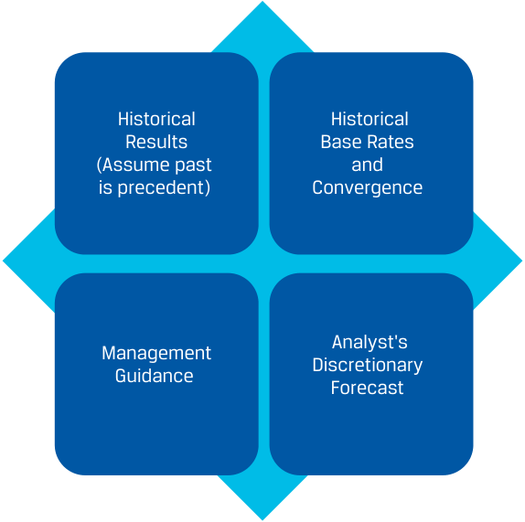

# Tập 5: Đầu tư Cổ phiếu (Equity Investments)
## Learning Module 7 Company Analysis: Forecasting (Trang PDF 295–344)

---

# Tập 5: Đầu tư Cổ phần (Volume 5: Equity Investments)
## Học phần 7: Phân tích Công ty: Dự báo (Learning Module 7: Company Analysis: Forecasting)
### Phần 1/5: Giới thiệu (Trang PDF 295–310)

---

<!-- PDF Page 295 -->

#### H Ọ C P H Ầ N 

# **<mark>7</mark>** 

### **Phân tích Công ty: Dự báo (*Company Analysis: Forecasting*)** 

###### **<mark>KẾT QUẢ HỌC TẬP (*LEARNING OUTCOMES*)</mark>** 

|**_Mức độ thành thạo_**|**_Ứng viên cần có khả năng:_**|
|---|---|
||giải thích các nguyên tắc và phương pháp tiếp cận để dự báo kết quả và tình hình tài chính của một công ty|
||giải thích các phương pháp tiếp cận để dự báo doanh thu (*revenues*) của một công ty|
||giải thích các phương pháp tiếp cận để dự báo chi phí hoạt động (*operating expenses*) và vốn lưu động (*working capital*) của một công ty|
||giải thích các phương pháp tiếp cận để dự báo đầu tư vốn (*capital investments*) và cấu trúc vốn (*capital structure*) của một công ty|
||mô tả việc sử dụng phân tích kịch bản (*scenario analysis*) trong dự báo|

##### **GIỚI THIỆU (*INTRODUCTION*)** 

**<mark>1</mark>** 

Các dự báo về báo cáo tài chính của công ty được các nhà phân tích sử dụng trong định giá và đưa ra các khuyến nghị đầu tư. Việc xây dựng các dự báo (*forecasts*) hoặc phóng chiếu (*projections*) là một khía cạnh quan trọng trong công việc của nhà phân tích và là trọng tâm của học phần này. Trong bài học đầu tiên, chúng ta thảo luận về đối tượng cần dự báo, các phương pháp tiếp cận dự báo và việc lựa chọn tầm nhìn dự báo (*forecast horizon*). Ba bài học tiếp theo tập trung vào các dự báo cụ thể: doanh thu, chi phí hoạt động và vốn lưu động, cũng như đầu tư vốn và cấu trúc vốn. Bài học cuối cùng thảo luận về việc sử dụng phân tích kịch bản khi xem xét nhiều kết quả có thể xảy ra. 

|**TỔNG QUAN HỌC PHẦN (*LEARNING MODULE OVERVIEW*)**|
|---|
|■ Bốn loại đối tượng dự báo (*forecast objects*) phổ biến là các động lực của các khoản mục trên báo cáo tài chính (*drivers of financial statement lines*), các khoản mục riêng lẻ trên báo cáo tài chính (*individual financial statement lines*), các thước đo tóm tắt (*summary measures*), và các đối tượng đột xuất/đặc thù (*ad hoc objects*). Sự lựa chọn đối tượng dự báo của nhà phân tích phụ thuộc vào thông tin sẵn có, tính hiệu quả (*efficiency*), độ chính xác (*accuracy*), giá trị giải thích (*explanatory value*), và khả năng kiểm chứng (*verifiability*).|

<!-- PDF Page 296 -->

- Các phương pháp tiếp cận dự báo (*forecast approaches*) nhìn chung dựa trên kết quả lịch sử (*historical results*), tỷ suất cơ sở lịch sử và sự hội tụ (*historical base rates and convergence*), định hướng của ban điều hành (*management guidance*), hoặc dự báo chủ quan của nhà phân tích (*analyst discretion*). Sự lựa chọn phương pháp dự báo của nhà phân tích phụ thuộc vào cấu trúc ngành của công ty, độ nhạy cảm với chu kỳ kinh doanh và mô hình kinh doanh, cũng như độ tin cậy và tính sẵn có của thông tin. 

- Việc lựa chọn kỳ hạn dự báo (*forecast time horizon*) được quyết định bởi chiến lược đầu tư mà chứng khoán đang được xem xét, tính chu kỳ của ngành, các yếu tố đặc thù của công ty, và ưu tiên của tổ chức tuyển dụng nhà phân tích. 

- Dự báo doanh thu có thể dựa trên các đối tượng dự báo từ trên xuống (*top-down*) hoặc từ dưới lên (*bottom-up*), sử dụng bất kỳ phương pháp nào trong bốn phương pháp dự báo. Việc sử dụng các đối tượng và phương pháp dự báo khác nhau để phóng chiếu doanh thu có thể hữu ích trong việc phát hiện ra các giả định ngầm (*implicit assumptions*) hoặc sai sót trong bất kỳ phương pháp đơn lẻ nào. 

- Các động lực doanh thu từ trên xuống (*top-down revenue drivers*) bao gồm tốc độ tăng trưởng tương quan với tăng trưởng GDP, và tăng trưởng thị trường cùng thị phần. Các động lực doanh thu từ dưới lên (*bottom-up revenue drivers*) bao gồm sản lượng và giá bán bình quân (*average selling prices*); doanh thu theo dòng sản phẩm, khu vực địa lý, hoặc phân khúc báo cáo; các thước đo dựa trên công suất (*capacity-based measures*); và các thước đo dựa trên tỷ suất sinh lợi (*return-based measures*). 

- Các nhà phân tích thường sử dụng các đối tượng dự báo tổng hợp hoặc các thước đo tóm tắt để dự báo chi phí hoạt động do thiếu thông tin bóc tách chi tiết. Tuy nhiên, các dự báo về chi phí hoạt động phải nhất quán mạch lạc (*coherent*) với các dự báo doanh thu. Sự lựa chọn đối tượng dự báo có thể khác nhau tùy thuộc vào tầm nhìn dự báo. 

- Các dự báo vốn lưu động thường sử dụng các tỷ số hiệu quả hoạt động (*efficiency ratios*) kết hợp với dự báo doanh thu và chi phí hoạt động để phóng chiếu các khoản phải thu khách hàng, hàng tồn kho, các khoản phải trả người bán, cùng các tài sản và nợ phải trả ngắn hạn khác. 

- Các dự báo về chi tiêu vốn (*capital expenditures* – CAPEX) có thể phân biệt giữa chi tiêu vốn duy trì (*maintenance capital expenditures*) và chi tiêu vốn tăng trưởng (*growth capital expenditures*). Dự báo chi tiêu vốn duy trì thường dựa trên chi phí khấu hao tài sản cố định và phân bổ tài sản vô hình (*depreciation and amortization expenses*). Dự báo chi tiêu vốn tăng trưởng gắn liền với chiến lược, kế hoạch mở rộng và tăng trưởng doanh thu của công ty. 

- Các dự báo về cấu trúc vốn của một công ty xem xét các tỷ số đòn bẩy lịch sử và cấu trúc vốn lịch sử, chiến lược tài chính của công ty, và các dự báo chi tiêu vốn. 

- Dựa trên các yếu tố rủi ro của công ty, nhà phân tích có thể xây dựng một số kịch bản dự báo (*forecast scenarios*) thay vì chỉ xây dựng một dự báo duy nhất. Nhà phân tích sẽ đánh giá khả năng xảy ra (*likelihood*) của từng kịch bản. 

###### **TỰ ĐÁNH GIÁ HỌC PHẦN (*LEARNING MODULE SELF-ASSESSMENT*)** 

Những câu hỏi ban đầu này nhằm giúp bạn tự đánh giá mức độ hiểu biết hiện tại của mình về học phần này. 

1. Lợi ích của việc sử dụng các thước đo tóm tắt (*summary measures*) làm đối tượng dự báo _nhiều khả năng nhất_ là: 

   - **A.** tính hiệu quả (*efficiency*). 

   - **B.** tính minh bạch (*transparency*). 

<!-- PDF Page 297 -->

|**C.** giá trị giải thích (*explanatory value*). **Lời giải:**|
|---|
|A là đáp án đúng. Lợi ích của việc sử dụng các thước đo tóm tắt làm đối tượng dự báo là tính hiệu quả (tiết kiệm thời gian/công sức), vì cần dự báo ít biến số hơn, nhưng nhược điểm là kém minh bạch hơn. Việc dự báo các khoản mục trên báo cáo tài chính hoặc các động lực của chúng mang lại lợi ích là cải thiện giá trị giải thích.|
|2. Phương pháp tiếp cận nào sau đây là _phù hợp nhất_ để dự báo doanh thu hàng năm cho một công ty trong một ngành có tính chu kỳ (*cyclical industry*)? **A.** Kết quả lịch sử (*Historical results*)|
|**B.** Định hướng của ban điều hành (*Management guidance*) **C.** Dự báo chủ quan của nhà phân tích (*Analyst’s discretionary forecast*) **Lời giải:**|
|C là đáp án đúng. Dự báo chủ quan của nhà phân tích là phù hợp nhất, bởi vì nó cho phép nhà phân tích xem xét cả giai đoạn hiện tại và giai đoạn dự kiến trong tương lai của chu kỳ kinh doanh. Kết quả lịch sử là một phương pháp dự báo kém phù hợp hơn đối với các công ty trong các ngành có tính chu kỳ, bởi vì một giai đoạn trong tương lai nhiều khả năng sẽ nằm ở một điểm khác trong chu kỳ kinh doanh so với giai đoạn hiện tại hoặc quá khứ, và do đó kết quả sẽ khác biệt. Việc sử dụng định hướng của ban điều hành cho các công ty nhạy cảm cao với chu kỳ kinh doanh là kém phù hợp hơn, vì ban điều hành _không_ có lợi thế thông tin hơn các nhà đầu tư trong việc dự báo các biến số kinh tế vĩ mô như GDP hay giá cả hàng hóa cơ bản (*commodities*).|
|3. Một ví dụ về động lực từ trên xuống (*top-down driver*) đối với doanh thu là: **A.** thị phần của công ty (*market share*).|
|**B.** tốc độ tăng trưởng doanh thu của công ty. **C.** giá bán bình quân các sản phẩm của công ty. **Lời giải:**|
|A là đáp án đúng. Các động lực doanh thu từ trên xuống bao gồm thị phần của công ty và mức tăng trưởng thị trường của ngành. Tốc độ tăng trưởng doanh thu của công ty và giá bán bình quân sản phẩm là các động lực doanh thu từ dưới lên (*bottom-up drivers*).|
|4. Khi xây dựng dự báo doanh thu, doanh thu không thường xuyên (*non-recurring revenue*) _nhiều khả năng nhất_:|
|**A.** có cùng các động lực như doanh thu định kỳ thường xuyên (*recurring revenue*). **B.** sẽ được công bố bởi ban điều hành của công ty. **C.** được xem xét tách biệt với doanh thu định kỳ thường xuyên. **Lời giải:**|
|C là đáp án đúng. Các khoản mục và hiệu ứng không thường xuyên cần được xem xét riêng biệt. Các đối tượng không thường xuyên, chẳng hạn như thay đổi tỷ giá hối đoái hoặc dự phòng chi phí pháp lý, nhìn chung không có cùng các động lực như các đối tượng định kỳ thường xuyên. Mặc dù ban điều hành có thể công bố một số khoản mục và hiệu ứng không thường xuyên, nhưng cũng có những khoản mục và hiệu ứng không thường xuyên mà ban điều hành không công bố, đòi hỏi sự phán đoán của nhà phân tích.|
|5. Nhà phân tích cần xem xét tác động của sự thay đổi giá hàng hóa cơ bản (*commodity prices*) khi dự báo:|
|**A.** chỉ riêng doanh thu.|
|**B.** chỉ riêng giá vốn hàng bán (*cost of sales*).|

<!-- PDF Page 298 -->

   - **C.** cả doanh thu và giá vốn hàng bán. 

   - **Lời giải:** 

C là đáp án đúng. Cả giá vốn hàng bán của công ty (thông qua giá đầu vào) lẫn doanh thu của công ty đều có thể bị ảnh hưởng bởi giá hàng hóa cơ bản. Tác động lên doanh thu phụ thuộc vào vị thế cạnh tranh của công ty và độ co giãn của cầu theo giá (*price elasticity of demand*) đối với sản phẩm của công ty. 

6. Các dự báo vốn lưu động cho một công ty đã trưởng thành có mô hình kinh doanh độc nhất (*unique business model*) _nhiều khả năng nhất_ được thực hiện bằng cách: 

   - **A.** tăng tài sản và nợ phải trả ngắn hạn theo tốc độ tăng trưởng doanh thu. 

   - **B.** sử dụng các tỷ số hiệu quả hoạt động (*efficiency ratios*) của công ty kết hợp với các dự báo doanh thu và chi phí hoạt động. 

   - **C.** sử dụng phương pháp tỷ suất cơ sở lịch sử và sự hội tụ để xây dựng các dự báo về doanh thu, chi phí hoạt động và các tỷ số hiệu quả hoạt động. 

   - **Lời giải:** 

B là đáp án đúng. Đối với một công ty có mô hình kinh doanh độc nhất, việc sử dụng phương pháp kết quả lịch sử là phù hợp. Các dự báo vốn lưu động thường được thực hiện bằng cách sử dụng các tỷ số hiệu quả hoạt động, kết hợp với các dự báo doanh thu và chi phí hoạt động để phóng chiếu các khoản phải thu khách hàng, hàng tồn kho, các khoản phải trả người bán, cùng các tài sản và nợ phải trả ngắn hạn khác. Phương pháp tỷ suất cơ sở lịch sử và sự hội tụ sẽ phù hợp nếu công ty đang hội tụ về mức chuẩn của ngành. Việc điều chỉnh tài sản và nợ phải trả ngắn hạn theo tốc độ tăng trưởng doanh thu là không phù hợp, bởi vì những thay đổi về doanh thu sẽ tác động đến từng khoản mục một cách khác nhau. 

7. Chi phí khấu hao tài sản cố định và phân bổ tài sản vô hình (*depreciation and amortization expenses*) thường được sử dụng làm cơ sở cho: 

   - **A.** chỉ riêng chi tiêu vốn tăng trưởng (*growth capital expenditures*). 

   - **B.** chỉ riêng chi tiêu vốn duy trì (*maintenance capital expenditures*). 

   - **C.** cả chi tiêu vốn tăng trưởng và chi tiêu vốn duy trì. 

   - **Lời giải:** 

B là đáp án đúng. Các dự báo chi tiêu vốn duy trì thường dựa trên chi phí khấu hao và phân bổ. Các dự báo chi tiêu vốn tăng trưởng mang tính tùy ý (*discretionary*) nhiều hơn và gắn liền với kế hoạch mở rộng của ban điều hành cũng như tăng trưởng doanh thu. 

8. Yếu tố rủi ro chung (*generic risk factor*) nào sau đây _nhiều khả năng nhất_ sẽ ảnh hưởng đến một công ty lâu đời trong lĩnh vực hàng tiêu dùng thiết yếu (*consumer staples sector*)? 

   - **A.** Lạm phát hoặc giảm phát (*Inflation or deflation*) 

   - **B.** Những phát triển về công nghệ (*Technological developments*) 

   - **C.** Những thay đổi trong chu kỳ kinh doanh (*Changes in the business cycle*) 

   - **Lời giải:** 

A là đáp án đúng. Mặc dù tất cả các lựa chọn này đều là các yếu tố rủi ro chung, lạm phát hoặc giảm phát là yếu tố có nhiều khả năng nhất ảnh hưởng đến một công ty lâu đời trong lĩnh vực hàng tiêu dùng thiết yếu. Lĩnh vực hàng tiêu dùng thiết yếu ít có khả năng trải qua những phát triển công nghệ đột biến và nhìn chung không nhạy cảm với những thay đổi trong chu kỳ kinh doanh. 

<!-- PDF Page 299 -->

##### **ĐỐI TƯỢNG, NGUYÊN TẮC VÀ PHƯƠNG PHÁP DỰ BÁO (*FORECAST OBJECTS, PRINCIPLES, AND APPROACHES*)** 

## **<mark>2</mark>** 

giải thích các nguyên tắc và phương pháp tiếp cận để dự báo kết quả và tình hình tài chính của một công ty 

Các phương pháp tiếp cận dự báo khác nhau tùy theo từng nhà phân tích và bối cảnh làm việc. Các nhà phân tích xuất bản các nghiên cứu công ty để phân phối ra bên ngoài có xu hướng duy trì các dự báo hàng quý và đầu tư rất nhiều công sức để đạt được độ chính xác trong dự báo doanh thu và thu nhập trên mỗi cổ phiếu (EPS). Một nhà đầu tư nắm giữ vị thế kiểm soát tại một công ty tư nhân có quyền tiếp cận nhiều thông tin hơn hẳn, có thể được sử dụng để xây dựng các mô hình chi tiết cao với góc nhìn nhiều năm hoặc thậm chí nhiều thập kỷ. Ngoài ra, có những chuẩn mực dự báo khác nhau tùy theo mô hình kinh doanh của công ty mục tiêu, khiến cho các mô hình dành cho ngân hàng trông khác biệt rõ rệt so với các mô hình dành cho các nhà sản xuất dầu khí. 

Trong học phần này, chúng ta đứng trên góc nhìn của một nhà phân tích có định hướng dài hạn hơn đang dự báo các tổ chức phát hành đại chúng tương đối dễ hiểu—Warehouse Club Inc. và Iliso Marketplace Ltd., đã được giới thiệu trong hai học phần trước—nhưng các nguyên tắc được thảo luận có thể áp dụng rộng rãi. Các chi tiết kỹ thuật sâu hơn về lập mô hình báo cáo tài chính bằng bảng tính (*spreadsheets*) được trình bày trong các bài học của môn Phân tích Báo cáo Tài chính (*Financial Statement Analysis*). 

###### **Dự báo Cái gì? (*What to Forecast?*)** 

Các nhà phân tích có thể tập trung vào các **đối tượng dự báo (*forecast objects*)** khác nhau liên quan đến báo cáo tài chính của tổ chức phát hành. Dưới đây là bốn đối tượng dự báo phổ biến. 

**1.** _Các động lực của các khoản mục trên báo cáo tài chính (Drivers of financial statement lines)_, đã được minh họa trong học phần trước về phân tích công ty. Hãy nhớ lại rằng đối với Warehouse Club Inc., doanh thu thuần mỗi năm được phân tích bằng cách sử dụng hai động lực từ dưới lên: số lượng cửa hàng mở cửa bình quân và doanh thu thuần bình quân trên mỗi cửa hàng, cả hai đều được phân tích bằng thay đổi phần trăm so với cùng kỳ năm trước trong suốt 10 năm qua. Các dự báo về doanh thu thuần (ở dòng trên cùng của báo cáo kết quả hoạt động kinh doanh của Warehouse) có thể được thực hiện bằng cách dự báo riêng rẽ từng động lực này rồi nhân chúng lại với nhau. Biên lợi nhuận gộp và chi phí bán hàng, quản lý doanh nghiệp (SG&A) tính theo tỷ lệ phần trăm trên doanh thu thuần đã được xác định là các động lực chính của chi phí hoạt động, có thể được dự báo và sau đó nhân với dự báo doanh thu thuần để thu được giá vốn hàng bán và chi phí SG&A dự báo. Việc dự báo các động lực thay vì dự báo thẳng các khoản mục trên báo cáo tài chính có lợi ích là cải thiện giá trị giải thích và có thể nâng cao độ chính xác; một khoản mục trên báo cáo tài chính có thể có nhiều động lực di chuyển theo các hướng khác nhau, điều có thể rất khó dự báo trên cơ sở gộp chung. 

**2.** _Các khoản mục riêng lẻ trên báo cáo tài chính (Individual financial statement lines)_. Thay vì các động lực, các nhà phân tích cũng có thể dự báo trực tiếp các khoản mục riêng lẻ trên báo cáo tài chính. Cách tiếp cận này thường được sử dụng cho các khoản mục không có động lực rõ ràng, cho các khoản mục ít trọng yếu hơn, và cho các khoản mục mà nhà phân tích không có quan điểm riêng. Trong một số trường hợp, nhà phân tích có thể tìm kiếm một ước tính của ban điều hành hoặc đơn giản giả định rằng con số đó sẽ giữ nguyên trong các kỳ tương lai giống như trong quá khứ. Các ví dụ bao gồm các khoản mục như chi phí phân bổ tài sản vô hình (*amortization expense*) trên báo cáo kết quả hoạt động kinh doanh (mà dự báo cho khoản mục này thường được ban điều hành cung cấp trong báo cáo thường niên), “tài sản dài hạn khác” trên bảng cân đối kế toán (khi có giá trị nhỏ), và các dòng khác nhau trên báo cáo lưu chuyển tiền tệ nơi chỉ có các thuyết minh tối thiểu được cung cấp. 

<!-- PDF Page 300 -->

**3.** _Các thước đo tóm tắt (Summary measures)_ chẳng hạn như dòng tiền tự do (*free cash flow*), thu nhập trên mỗi cổ phiếu (*earnings per share* – EPS), và tổng tài sản (*total assets*). Lợi ích của việc sử dụng những chỉ tiêu này làm đối tượng dự báo là tính hiệu quả. Nhược điểm là kém minh bạch hơn, khiến việc kiểm tra đánh giá lại (*audit*) bản dự báo trở nên khó khăn. Cách tiếp cận này phù hợp nhất nếu thước đo tóm tắt đó ổn định và dễ dự đoán, hoặc nếu các thuyết minh của tổ chức phát hành bị hạn chế nghiêm trọng. 

**4.** _Các đối tượng đột xuất/đặc thù (Ad hoc objects)_, vốn có thể chưa được báo cáo trên các báo cáo tài chính lịch sử. Trong một số trường hợp, nhà phân tích có thể cần dự báo một khoản lỗ hoặc lãi cùng thời điểm phát sinh của nó để đưa ra quyết định đầu tư đối với chứng khoán vốn cổ phần hoặc chứng khoán nợ của công ty trước khi tổ chức phát hành ghi nhận một khoản dự thu/dự chi (*accrual*) trên báo cáo tài chính của mình. Ví dụ về những trường hợp như vậy bao gồm việc tổ chức phát hành công bố một vụ kiện tụng pháp lý trọng yếu, một hành động chế tài của cơ quan quản lý chính phủ, một vụ tranh chấp thuế, hoặc một thảm họa thiên nhiên. 

###### **Tập trung vào các Đối tượng được Công bố Thường xuyên (*Focus on Objects That Are Regularly Disclosed*)** 

Chúng tôi khuyến nghị sử dụng các đối tượng dự báo hoặc được công bố định kỳ thường xuyên hoặc có thể được tính toán trực tiếp bằng cách sử dụng những gì được công bố thường xuyên (ví dụ: đối với Warehouse Club: doanh thu thuần, số lượng cửa hàng, doanh thu thuần trên mỗi cửa hàng, doanh số bán lẻ toàn quốc do cơ quan chính phủ công bố hàng tháng). Thông tin _không_ được công bố thường xuyên (chẳng hạn như quy mô của một thị trường lấy từ báo cáo của một công ty tư vấn bên thứ ba) phù hợp để _cung cấp thông tin bổ trợ (informing)_ cho các dự báo nhưng có thể gây rắc rối nếu sử dụng trực tiếp bởi vì các dự báo đó không thể được xác nhận một cách kịp thời. Mặc dù việc dự báo doanh thu và biên lợi nhuận gộp theo từng dòng sản phẩm riêng lẻ cho một công ty có vẻ trực quan, nhưng nếu biên lợi nhuận gộp chỉ được công bố trên cơ sở hợp nhất (*consolidated basis*), nhà phân tích sẽ rất khó kiểm chứng các ước tính biên lợi nhuận gộp theo dòng sản phẩm của mình. Nếu kết quả biên lợi nhuận gộp báo cáo của công ty khác với ước tính biên lợi nhuận gộp, thì dự báo đó bị lệch ở sản phẩm A, B hay C? Tương tự, nếu một đại lượng chỉ được công bố hàng năm, dự báo về đại lượng đó chỉ có thể được xác nhận mỗi năm một lần. 

Chúng tôi cũng cảnh báo không nên xây dựng các mô hình quá phức tạp, bởi vì chúng đòi hỏi nhiều dự báo hơn và mất nhiều thời gian hơn để cập nhật, mà thường không mang lại bất kỳ sự cải thiện nào về độ chính xác. Ví dụ, công ty dược phẩm Thụy Sĩ Novartis AG công bố doanh thu hàng quý cho hơn 35 loại thuốc riêng lẻ theo khu vực Hoa Kỳ và Phần còn lại của Thế giới. Hầu hết các loại thuốc này đều được phê duyệt để điều trị cho nhiều hơn một loại bệnh. Công ty cũng có hơn 50 loại thuốc đang trong giai đoạn phát triển lâm sàng cuối có thể thúc đẩy doanh thu trong tương lai. Mặc dù một nhà phân tích có thể dự báo doanh thu của Novartis AG bằng cách dự báo doanh thu cho từng loại thuốc riêng lẻ theo từng căn bệnh và khu vực địa lý, nhưng sẽ mất hàng tháng trời để tạo ra một mô hình như vậy và hàng tuần lễ để cập nhật nó mỗi quý, đồng thời các dự báo theo từng căn bệnh không thể kiểm chứng được theo thời gian dựa trên các thuyết minh của công ty. Thay vào đó, nhà phân tích nên sử dụng sự phán đoán để tập trung vào các động lực quan trọng nhất và sử dụng sự tổng hợp (*aggregations*) cùng các lối tắt (*shortcuts*) ở những nơi mà giá trị gia tăng của việc dự báo rời rạc từng khoản là thấp. Ví dụ, sẽ không phải là cách sử dụng thời gian hợp lý của nhà phân tích nếu đi dự báo chi tiết doanh thu cho các loại thuốc có thị trường tiềm năng nhỏ hoặc những loại thuốc đã đạt đến độ trưởng thành và sẽ có mức tăng trưởng chậm cho đến khi mất quyền bảo hộ bằng sáng chế. 

###### **Các Phương pháp Tiếp cận Dự báo (*Forecast Approaches*)** 

Đối với bất kỳ đối tượng nào, có bốn phương pháp tiếp cận dự báo tổng quát, như được thể hiện trong Bảng minh họa 1. Trong thực tế, chúng thường được kết hợp với nhau. 

<!-- PDF Page 301 -->

**Bảng minh họa 1: Các Phương pháp Tiếp cận Dự báo cho các Đối tượng trên Báo cáo Tài chính (*Exhibit 1: Forecast Approaches for Financial Statement Objects*)** 

> **Chú thích hình ảnh:** Bốn phương pháp tiếp cận dự báo:
> - **Kết quả Lịch sử (*Historical Results*)**: Giả định quá khứ là tiền lệ (*Assume past is precedent*).
> - **Tỷ suất Cơ sở Lịch sử và Sự hội tụ (*Historical Base Rates and Convergence*)**.
> - **Định hướng của Ban điều hành (*Management Guidance*)**.
> - **Dự báo Chủ quan của Nhà phân tích (*Analyst's Discretionary Forecast*)**.

###### **_Kết quả Lịch sử: Giả định Quá khứ là Tiền lệ (Historical Results: Assume Past is Precedent)_** 

Phương pháp tiếp cận này sử dụng các giá trị quan sát được hoặc tính toán được trong quá khứ (chẳng hạn như mức trung vị lịch sử) làm dự báo. Đây là phương pháp dễ nhất và có lẽ là phương pháp mặc định. Bởi vì quá khứ đã từng xảy ra ít nhất một lần trước đây, nên có vẻ hợp lý khi kỳ vọng rằng nó sẽ lặp lại. Tuy nhiên, kết quả trong quá khứ được tạo ra trong các điều kiện của quá khứ, vốn có thể khác với các điều kiện hiện tại và tương lai. 

###### **SỬ DỤNG KẾT QUẢ LỊCH SỬ LÀM DỰ BÁO (*USING HISTORICAL RESULTS AS FORECASTS*)** 

Một nhà phân tích đang dự báo quy mô thị trường cho nước tăng lực (*energy drinks*), một loại đồ uống pha sẵn không cồn. Nhà phân tích sử dụng hai động lực: dự báo về thị trường đồ uống pha sẵn không cồn và thị phần của nước tăng lực trong thị trường đó. Doanh số đồ uống pha sẵn không cồn đã tăng trưởng trung bình 3% mỗi năm trong 10 năm qua. Vì nhà phân tích không kỳ vọng bất kỳ sự thay đổi trọng yếu nào về điều kiện thị trường, cô dự báo rằng thị trường sẽ tiếp tục tăng trưởng 3% mỗi năm. 

Nhà phân tích tin rằng nước tăng lực có một số điểm tương đồng với nước uống thể thao (*sports drinks*), một loại đồ uống pha sẵn không cồn khác vốn đã đạt được thị phần 20%. Do đó, nhà phân tích dự báo rằng nước tăng lực cũng sẽ đạt được thị phần 20% vào năm 2035. Hai dự báo này được nhân với nhau để thu được quy mô thị trường dự báo cho nước tăng lực. 

Phương pháp tiếp cận này có thể phù hợp với các công ty hoạt động trong các ngành mà nhà phân tích không kỳ vọng cấu trúc ngành (ví dụ: Năm áp lực cạnh tranh của Porter, các ảnh hưởng PESTLE) sẽ thay đổi, cũng như với các công ty có độ nhạy cảm thấp với những thay đổi trong chu kỳ kinh doanh. Phương pháp này cũng thường được sử dụng cho các đối tượng dự báo không trọng yếu hoặc những đối tượng mà nhà phân tích không có ý kiến riêng. 

Kết quả lịch sử là một phương pháp dự báo kém phù hợp hơn đối với các công ty trong các ngành có tính chu kỳ, bởi vì một giai đoạn trong tương lai nhiều khả năng sẽ nằm ở một điểm khác trong chu kỳ kinh doanh so với giai đoạn hiện tại hoặc quá khứ, và do đó kết quả sẽ khác biệt. Một mức trung bình hoặc trung vị “xuyên suốt chu kỳ” (*“over the cycle”*) có thể phù hợp cho một dự báo nhiều năm đối với một công ty chu kỳ, 

<!-- PDF Page 302 -->

nhưng lại kém phù hợp hơn cho một năm cụ thể vì mức trung bình hoặc trung vị như vậy che khuất sự biến động qua từng năm (*year-to-year volatility*). Phương pháp dự báo này cũng kém phù hợp hơn đối với các công ty đang thay đổi chiến lược cạnh tranh hoặc đang tái cấu trúc theo một cách nào đó, chẳng hạn như thực hiện một thương vụ mua lại hoặc thoái vốn lớn khiến cho các kết quả lịch sử không còn có thể so sánh được nữa. 

###### **_Tỷ suất Cơ sở Lịch sử và Sự hội tụ (Historical Base Rates and Convergence)_** 

Phương pháp tiếp cận này sử dụng mức trung bình hoặc trung vị của ngành hoặc nhóm công ty cùng ngành (*peer group*), được tính toán trong một khoảng thời gian dài, làm “tỷ suất cơ sở” (*“base rate”*) để dự báo rằng một đối tượng sẽ hội tụ (*converge*) về mức đó trong một khung thời gian nhất định. Tỷ suất cơ sở cũng có thể là một biến số kinh tế vĩ mô như tốc độ tăng trưởng GDP. Phương pháp tiếp cận này không phải là một bài tập sao chép lịch sử máy móc, vì cần có sự xét đoán chủ quan của nhà phân tích trong việc lựa chọn đối tượng, mẫu dữ liệu để tính toán tỷ suất cơ sở, và khung thời gian để hội tụ về tỷ suất cơ sở đó. 

###### **TỶ SUẤT CƠ SỞ LỊCH SỬ VÀ SỰ HỘI TỤ (*HISTORICAL BASE RATES AND CONVERGENCE*)** 

Tesla là một doanh nghiệp mới gia nhập tương đối gần đây trong ngành công nghiệp ô tô, với một bộ sản phẩm xe điện đổi mới sáng tạo. Một nhà phân tích có thể dự báo báo cáo kết quả hoạt động kinh doanh của Tesla bằng cách dự báo rằng tốc độ tăng trưởng doanh thu, biên lợi nhuận gộp và biên lợi nhuận hoạt động, mức độ thâm dụng vốn và cấu trúc vốn của hãng sẽ hội tụ về mức trung bình lịch sử của ngành công nghiệp ô tô (sử dụng một nhóm cùng ngành gồm các nhà sản xuất ô tô toàn cầu được giao dịch đại chúng) trong vòng 10 năm tới. 

Dự báo này có thể bị phản bác bởi các nhà phân tích khác—những người tin rằng sự chuyển dịch từ động cơ đốt trong sang xe điện, công nghệ pin tiên tiến của Tesla, và phương pháp bán hàng trực tiếp tới người tiêu dùng (*direct-to-consumer*) của hãng khiến cho các mức trung bình lịch sử của ngành ô tô trở nên không còn phù hợp đối với Tesla. 

Tỷ suất cơ sở lịch sử và sự hội tụ có thể phù hợp để dự báo các công ty trong các ngành đã định hình vững chắc với nhiều công ty đại chúng cùng ngành, chẳng hạn như ngân hàng, hàng không, nhà hàng, nhà sản xuất ô tô và nhà bán lẻ, đặc biệt khi phân tích ngành của nhà phân tích không chỉ ra những thay đổi trọng yếu trong cấu trúc ngành hoặc các ảnh hưởng bên ngoài lên ngành. Phương pháp này cũng hợp lý đối với các công ty nhỏ hơn đang “trưởng thành dần” (*“maturing into”*) để tiến tới một hồ sơ tài chính tương tự như hồ sơ của các công ty cùng ngành lớn hơn đã có quy mô. Ví dụ, một công ty công nghệ sinh học vừa mới tung ra loại thuốc đầu tiên của mình có khả năng chi tiêu hơn một nửa doanh thu cho hoạt động R&D, một tỷ lệ có khả năng sẽ giảm dần về mức chuẩn của ngành khi công ty mở rộng quy mô. 

Phương pháp tiếp cận này kém phù hợp hơn đối với các công ty trong các ngành đang thay đổi hoặc ngành mới mà việc tính toán tỷ suất cơ sở là khó khăn hoặc ít liên quan, đối với các công ty trong các ngành có tính chu kỳ cao mà một tỷ suất cơ sở dài hạn cùng sự hội tụ mượt mà về mức đó sẽ làm lu mờ sự biến động qua từng năm, và đối với các công ty dẫn đầu ngành với khoảng cách lớn và chiếm một tỷ trọng đáng kể trong bất kỳ tỷ suất cơ sở nào của ngành. Ví dụ, các mức trung bình của “ngành quảng cáo kỹ thuật số” về tăng trưởng doanh thu và biên lợi nhuận hoạt động sẽ bị chi phối bởi Alphabet và Meta, đến mức việc sử dụng chúng để dự báo kết quả tài chính của Alphabet và Meta sẽ chỉ đơn giản là sử dụng chính kết quả lịch sử của hai công ty này làm dự báo, điều có thể bỏ qua bất kỳ lợi ích nào từ lợi thế kinh tế theo quy mô (vì các công ty này nhỏ hơn trong quá khứ). 

###### **_Định hướng của Ban điều hành (Management guidance)_** 

Ban điều hành của các công ty đại chúng có thể công khai đưa ra các mục tiêu về lợi nhuận, doanh thu và các thước đo khác (ví dụ: chi tiêu vốn) cho quý tiếp theo, năm tiếp theo hoặc dài hạn hơn, được gọi là **định hướng của ban điều hành (*management guidance*)** (hoặc đơn giản là *guidance*). Định hướng có thể chi tiết hoặc chỉ mang tính định hướng chiều hướng và thường được cập nhật trong suốt cả năm. Định hướng ban đầu cho năm tài chính tiếp theo có thể được cung cấp trong cuộc họp công bố kết quả kinh doanh quý 4 và được cập nhật cho các quý đã hoàn thành, cùng thông tin mới được cung cấp tại các cuộc họp công bố kết quả kinh doanh quý 1, quý 2 và quý 3. Beyer và cộng sự (2010) nhận thấy rằng định hướng của ban điều hành chiếm phần lớn thông tin báo cáo tài chính hàng quý được các nhà đầu tư sử dụng. Tầm 

<!-- PDF Page 303 -->

quan trọng của nó bắt nguồn từ bản chất hướng tới tương lai (*forward-looking*) thay vì nhìn về quá khứ (*backward-looking*), và bởi vì ban điều hành có một lượng thông tin dồi dào về ngành và công ty mà các nhà đầu tư không có. 

Định hướng thường được cung cấp dưới dạng một khoảng giá trị (ví dụ: “tăng trưởng doanh thu từ 2%–4%”) và hàm chứa nhiều dự báo phụ (*sub-forecasts*) cùng các giả định của ban điều hành, bao gồm tăng trưởng kinh tế vĩ mô, lạm phát chi phí, thay đổi thị phần, các hành động định giá, và thay đổi tỷ giá hối đoái. Nếu ước tính của ban điều hành cho những yếu tố này thay đổi, thì định hướng cũng sẽ thay đổi theo, và không có gì lạ khi các công ty tạm ngừng đưa ra định hướng hoàn toàn trong những giai đoạn có mức độ bất định cao, chẳng hạn như trong đại dịch COVID-19 hoặc trong các cuộc suy thoái. Trọng tâm chính của các nhà đầu tư là hiểu được các giả định của ban điều hành nằm ẩn bên trong định hướng và xem xét kỹ lưỡng tính hợp lý của chúng. 

Mặc dù điểm giữa (*midpoint*) của một khoảng định hướng có thể được diễn giải một cách trực quan là kỳ vọng “thực sự” của ban điều hành, Ciconte và cộng sự (2013) nhận thấy rằng cận trên (*upper bound*) thường đại diện tốt hơn cho kỳ vọng của ban điều hành, vốn được “đệm thêm” (*“padded”*) bằng cách gắn nó với một cận dưới bi quan nhằm tạo ra một rào cản dễ vượt qua hơn, để nhờ đó ban điều hành có thể được khen thưởng. 

###### **ĐỊNH HƯỚNG CỦA BAN ĐIỀU HÀNH TRONG NGẮN HẠN VÀ DÀI HẠN (*SHORT- AND LONG-TERM MANAGEMENT GUIDANCE*)** 

Novo Nordisk A/S là một công ty dược phẩm sinh học lớn có cổ phiếu và Chứng chỉ Lưu ký Hoa Kỳ (*American Depositary Receipts* – ADRs) được niêm yết lần lượt trên sàn NASDAQ Copenhagen và NYSE. Ban điều hành của công ty cung cấp định hướng hàng năm được cập nhật vào mỗi quý, cũng như “khát vọng chiến lược” (*“strategic aspirations”*) ít chi tiết hơn nhưng mang tính dài hạn hơn trong các bài thuyết trình tại Ngày Thị trường Vốn (*Capital Markets Day*) hàng năm của hãng. Định hướng bao gồm các ước tính điểm và ước tính khoảng của ban điều hành cho các chỉ tiêu sau (cho mỗi năm tài chính): 

- Tăng trưởng doanh thu (*Sales growth*) 

- Tăng trưởng lợi nhuận hoạt động (*Operating profit growth*) 

- Thu nhập/chi phí lãi thuần (*Net interest income/expense*) 

- Thuế suất hiệu dụng (*Effective tax rate*) 

- Chi tiêu vốn (*Capital expenditures*) 

- Khấu hao tài sản cố định và phân bổ tài sản vô hình (*Depreciation and amortization*) 

- Dòng tiền tự do (*Free cash flow*) 

Việc sử dụng định hướng cho các dự báo là phù hợp khi nó được cung cấp và khi ban điều hành đã chứng minh được hồ sơ thành tích đưa ra các ước tính đáng tin cậy (các nhà phân tích nên phân tích định hướng trong quá khứ so với kết quả thực tế). Chúng tôi cảnh báo không nên sử dụng định hướng cho các công ty nhạy cảm cao với chu kỳ kinh doanh, vì ban điều hành _không_ có lợi thế thông tin hơn các nhà đầu tư trong việc dự báo các biến số kinh tế vĩ mô như GDP hay giá cả hàng hóa cơ bản. Hutton và cộng sự (2012) nhận thấy rằng các nhà đầu tư có lợi thế thông tin ở cấp độ kinh tế vĩ mô, trong khi ban điều hành có lợi thế ở cấp độ công ty và có xu hướng đưa ra các dự báo chính xác hơn cho các đối tượng thuộc quyền kiểm soát nhiều hơn của ban điều hành, chẳng hạn như chi phí hoạt động và chi tiêu vốn. 

###### **_Dự báo Chủ quan của Nhà phân tích (Analyst’s discretionary forecast)_** 

Chúng ta gộp tất cả các phương pháp tiếp cận dự báo khác vào nhóm dự báo chủ quan của nhà phân tích (*analysts’ discretionary forecasts*), bao gồm các dự báo dựa trên khảo sát, mô hình định lượng, phân phối xác suất, phép tương tự với các tiền lệ lịch sử khác với mức trung bình của các công ty tương đương hoặc trung bình ngành, và các yếu tố đầu vào không quan sát được khác. Phương pháp tiếp cận này phổ biến nhất đối với các công ty trong các ngành có tính chu kỳ, các công ty không có hoặc có ít công ty tương đương (*comparables*), những công ty không cung cấp định hướng của ban điều hành, và/hoặc những công ty đang trải qua một sự thay đổi căn bản như sự dịch chuyển trong môi trường cạnh tranh hoặc môi trường pháp lý. Ví dụ, mặc dù những sự dịch chuyển trong sản xuất năng lượng đã từng xảy ra trước đây (ví dụ: từ than đá sang khí tự nhiên), nhưng biến đổi khí hậu 

<!-- PDF Page 304 -->

và sự chuyển dịch tiềm tàng sang năng lượng tái tạo cùng việc áp dụng các công nghệ như xe điện là chưa từng có tiền lệ, không có các quan sát lịch sử nào để sử dụng làm dự báo. Thay vào đó, một nhà phân tích lĩnh vực năng lượng phải đưa ra các dự báo chủ quan dựa trên nhiều nguồn, chẳng hạn như các cam kết giảm phát thải của chính phủ, các dự thảo luật được đề xuất, những ràng buộc về chi tiêu vốn, v.v. 

###### **CÁC DỰ BÁO CHỦ QUAN (*DISCRETIONARY FORECASTS*)** 

Một nhà phân tích đang xây dựng mô hình báo cáo tài chính cho một công ty công nghệ y tế đang phát triển một thiết bị mới để điều trị một dạng đột quỵ mà hiện không có phương pháp điều trị hiệu quả nào khác. Nhà phân tích sử dụng thông tin từ các cuộc thử nghiệm lâm sàng của thiết bị và dữ liệu dịch tễ học (*epidemiology data*) từ các tạp chí y khoa khác nhau để ước tính tổng thị trường tiềm năng (*total addressable market*) gồm những bệnh nhân có thể điều trị được bằng thiết bị này. Nhà phân tích cũng thực hiện một cuộc khảo sát các bác sĩ chuyên khoa để đánh giá mức độ quan tâm của họ đối với việc sử dụng thiết bị và ước tính số lượng bệnh nhân mà họ sẽ chỉ định sử dụng thiết bị (tùy thuộc vào kết quả của các thử nghiệm lâm sàng), đồng thời sử dụng các đợt ra mắt gần đây của các thiết bị y tế khác dành cho các bệnh thần kinh và tim mạch để ước tính thị phần cho thiết bị này trong 10 năm tới. Nhà phân tích xây dựng một số kịch bản thị phần dựa trên kết quả của các thử nghiệm lâm sàng (tức là thiết bị càng an toàn và hiệu quả thì tốc độ tăng trưởng doanh thu sẽ càng cao). Mặc dù nhà phân tích có sử dụng các kết quả lịch sử tương đương làm đầu vào, nhưng vẫn đòi hỏi sự phán đoán chuyên môn rất lớn bởi vì tình huống này là độc nhất. 

###### **Lựa chọn Tầm nhìn Dự báo (*Selecting a Forecast Horizon*)** 

Việc lựa chọn kỳ hạn dự báo (*forecast time horizon*) được quyết định bởi chiến lược đầu tư mà chứng khoán đang được xem xét, tính chu kỳ của ngành, các yếu tố đặc thù của công ty, và ưu tiên của tổ chức tuyển dụng nhà phân tích. Hầu hết các chiến lược đầu tư được quản lý chuyên nghiệp đều mô tả khung thời gian đầu tư và thời gian nắm giữ bình quân trong mục tiêu đầu tư của chiến lược đó. Ví dụ, các nhà quản lý quỹ có định hướng dài hạn có thể tập trung việc dự báo của mình chủ yếu vào khoảng thời gian từ ba đến năm năm, trong khi các nhà quản lý có định hướng ngắn hạn hơn có thể tập trung nhiều hơn vào một hoặc hai quý tiếp theo. 

Tính chu kỳ của ngành cũng có thể ảnh hưởng đến sự lựa chọn khung thời gian của nhà phân tích, bởi vì giai đoạn dự báo phải đủ dài để cho phép doanh nghiệp đạt đến mức doanh thu và khả năng sinh lời giữa chu kỳ (*mid-cycle level*) dự kiến. Tương tự như tính chu kỳ, nhiều yếu tố đặc thù của công ty, bao gồm hoạt động mua lại hoặc tái cấu trúc gần đây, có thể ảnh hưởng đến việc lựa chọn giai đoạn dự báo nhằm cho phép có đủ thời gian để những lợi ích kỳ vọng từ hoạt động đó được hiện thực hóa và phản ánh vào báo cáo tài chính. Trong các trường hợp khác, có thể không có sự lựa chọn của cá nhân nhà phân tích theo nghĩa là tổ chức tuyển dụng nhà phân tích đã quy định sẵn các tham số cố định. 

###### **BỘ CÂU HỎI (*QUESTION SET*)** 

1. Một công ty công bố kết quả tài chính theo khu vực địa lý, và mức độ tiếp xúc kinh tế (*economic exposure*) của mỗi khu vực địa lý là tương tự nhau. Hãy giải thích tại sao nhà phân tích nên hoặc không nên xây dựng các dự báo theo khu vực địa lý rồi tổng hợp kết quả lại. 

###### **Lời giải:** 

Nhà phân tích _không nên_ xây dựng các dự báo theo từng khu vực địa lý, bởi vì mỗi khu vực đều có mức độ tiếp xúc kinh tế tương tự nhau. Việc xây dựng các dự báo cho từng khu vực địa lý sẽ đòi hỏi nhiều thời gian hơn để xây dựng và cập nhật, mà không mang lại sự cải thiện đáng kể nào về độ chính xác so với một dự báo tổng hợp (*aggregate forecast*). 

<!-- PDF Page 305 -->

|2. Phương pháp tiếp cận nào là _phù hợp nhất_ để nhà phân tích sử dụng nhằm dự báo doanh thu cho một công ty dẫn đầu ngành trong một ngành đã trưởng thành, không có tính chu kỳ (*mature, non-cyclical industry*)?|
|---|
|**A.** Kết quả lịch sử (*Historical results*)|
|**B.** Dự báo chủ quan của nhà phân tích (*Analyst’s discretionary forecast*)|
|**C.** Tỷ suất cơ sở lịch sử và sự hội tụ (*Historical base rates and convergence*) **Lời giải:**|
|A là đáp án đúng. Phương pháp kết quả lịch sử phù hợp với các công ty hoạt động trong các ngành đã trưởng thành nơi nhà phân tích không kỳ vọng cấu trúc ngành sẽ thay đổi và với các công ty có độ nhạy cảm thấp với chu kỳ kinh doanh. Dự báo chủ quan của nhà phân tích phổ biến nhất đối với các công ty không có hoặc có ít công ty tương đương, không cung cấp định hướng của ban điều hành, và/hoặc đang trải qua một sự thay đổi căn bản. Phương pháp tỷ suất cơ sở lịch sử và sự hội tụ là không phù hợp, bởi vì công ty này là đơn vị dẫn đầu ngành và sẽ chiếm một tỷ trọng đáng kể trong bất kỳ tỷ suất cơ sở nào của ngành.|
|3. Phát biểu nào sau đây về định hướng của ban điều hành (*management guidance*) là _chính xác nhất_?|
|**A.** Tính sẵn có của định hướng tăng lên trong các giai đoạn có mức độ bất định cao.|
|**B.** Điểm giữa (*midpoint*) của khoảng định hướng đại diện tốt nhất cho kỳ vọng “thực sự” của ban điều hành.|
|**C.** Việc hiểu rõ các giả định đằng sau định hướng là tối quan trọng để đánh giá định hướng đó. **Lời giải:**|
|C là đáp án đúng. Trọng tâm chính của nhà phân tích là hiểu được các giả định của ban điều hành nằm ẩn bên trong định hướng và xem xét kỹ lưỡng tính hợp lý của chúng.|
|Không có gì lạ khi các công ty tạm ngừng đưa ra định hướng hoàn toàn trong những giai đoạn có mức độ bất định cao. Mặc dù điểm giữa của một khoảng định hướng có thể được diễn giải một cách trực quan là kỳ vọng “thực sự” của ban điều hành, nhưng ban điều hành có thể đưa ra một khoảng giá trị được thiết kế có chủ đích nhằm tạo ra một rào cản dễ vượt qua hơn, để nhờ đó ban điều hành có thể được khen thưởng.|
|4. Điều nào sau đây là một ví dụ về đối tượng dự báo đột xuất/đặc thù (*ad hoc forecast object*)? **A.** Chi phí phân bổ tài sản vô hình (*Amortization expense*)|
|**B.** Doanh thu bình quân trên mỗi cửa hàng (*Average sales per store*)|
|**C.** Các vụ kiện tụng pháp lý đang chờ xử lý (*Pending legal proceedings*) **Lời giải:**|
|C là đáp án đúng. Các đối tượng đột xuất/đặc thù là những đối tượng có thể chưa được phản ánh trong các báo cáo tài chính lịch sử. Chi phí phân bổ tài sản vô hình là một khoản mục riêng lẻ trên báo cáo tài chính. Doanh thu bình quân trên mỗi cửa hàng là một động lực từ dưới lên của một khoản mục trên báo cáo tài chính (doanh thu).|

##### **DỰ BÁO DOANH THU (*FORECASTING REVENUES*)** 

**<mark>3</mark>**

giải thích các phương pháp tiếp cận để dự báo doanh thu của một công ty

<!-- PDF Page 306 -->

Sau khi kỳ hạn dự báo được xác định, việc dự báo doanh thu đòi hỏi phải lựa chọn các đối tượng và phương pháp dự báo. 

###### **Các Đối tượng Dự báo cho Doanh thu (*Forecast Objects for Revenues*)** 

Các đối tượng dự báo cho doanh thu thường là các động lực từ trên xuống (*top-down*) hoặc từ dưới lên (*bottom-up*), như đã thảo luận trong học phần trước về phân tích công ty. Các đối tượng dự báo từ trên xuống phổ biến bao gồm “tăng trưởng tương quan với tăng trưởng GDP” (*“growth relative to GDP growth”*) và “tăng trưởng thị trường và thị phần” (*“market growth and market share”*). 

_Tăng trưởng tương quan với tăng trưởng GDP (Growth relative to GDP growth)._ Trước tiên, nhà phân tích dự báo tốc độ tăng trưởng của GDP danh nghĩa (*nominal GDP*). Sau đó, nhà phân tích xem xét tốc độ tăng trưởng của công ty cụ thể đang được khảo sát sẽ như thế nào khi so sánh với tốc độ tăng trưởng GDP danh nghĩa. Nhà phân tích có thể sử dụng dự báo tăng trưởng GDP thực (*real GDP growth*) để phóng chiếu sản lượng và dự báo lạm phát để phóng chiếu giá cả. Các nhà phân tích thường suy nghĩ theo mức phần bù (*premiums*) hoặc chiết khấu (*discounts*) tính bằng điểm phần trăm bắt nguồn từ vị trí của công ty trong vòng đời của nó (ví dụ: tăng trưởng, trưởng thành, hoặc suy thoái) hoặc độ nhạy cảm với chu kỳ kinh doanh. Do đó, kết luận của nhà phân tích có thể là doanh thu của một công ty chăm sóc sức khỏe sẽ tăng trưởng ở mức cao hơn 200 điểm cơ bản (bps) so với tốc độ tăng trưởng GDP danh nghĩa. Dự báo cũng có thể được biểu thị theo điều khoản tương đối (*relative terms*). Như vậy, nếu GDP được dự báo tăng trưởng ở mức 4% và doanh thu của công ty được dự báo tăng trưởng với tốc độ nhanh hơn 50%, thì thay đổi phần trăm dự báo của doanh thu sẽ là $4\% \times (1 + 0.50) = 6.0\%$, hay cao hơn 200 bps so với dự báo tốc độ tăng trưởng GDP xét theo số tuyệt đối. 

_Tăng trưởng thị trường và thị phần (Market growth and market share)._ Trước tiên, nhà phân tích dự báo tốc độ tăng trưởng cho thị trường sản phẩm của công ty, và sau đó xem xét thị phần hiện tại của công ty cũng như khả năng thị phần đó sẽ thay đổi như thế nào theo thời gian. Ví dụ, nếu một công ty được kỳ vọng sẽ duy trì 8% thị phần của một thị trường sản phẩm nhất định và thị trường sản phẩm đó được dự báo sẽ tăng trưởng từ 144 tỷ CNY lên 154 tỷ CNY doanh thu hàng năm, thì mức tăng trưởng dự báo trong doanh thu của công ty sẽ đi từ mức $8\% \times 144\text{ tỷ CNY} = 11.5\text{ tỷ CNY}$ lên mức $8\% \times 154\text{ tỷ CNY} = 12.3\text{ tỷ CNY}$ (chỉ xét riêng thị trường sản phẩm này). Nếu doanh thu thị trường sản phẩm có mối quan hệ có thể dự đoán được với GDP, phân tích hồi quy (*regression analysis*) có thể được sử dụng để ước tính mối quan hệ đó. 

Ngược lại, nhà phân tích có thể lựa chọn các động lực từ dưới lên (*bottom-up drivers*) làm đối tượng dự báo, sau đó tổng hợp chúng lại để thu được dự báo tổng doanh thu cho công ty. Các ví dụ về động lực từ dưới lên cho dự báo doanh thu bao gồm: 

- _Sản lượng và giá bán bình quân (Volumes and average selling prices)_. Các dự báo về sản lượng và giá cả sản phẩm của công ty được lập riêng rẽ và nhân với nhau để thu được dự báo doanh thu. Phương pháp tiếp cận này thường được sử dụng cho các công ty có công bố các đại lượng này, chẳng hạn như các công ty truyền thông và internet (số lượng người dùng và doanh thu trên mỗi người dùng – ARPU), các hãng hàng không, các công ty quản lý tài sản (tức là Tài sản thuộc quyền quản lý – AUM và mức phí quản lý), và các nhà sản xuất hàng hóa cơ bản. Nhiều công ty công bố mức đóng góp của giá và sản lượng vào tăng trưởng doanh thu tổng thể, vốn cũng có thể được sử dụng làm đối tượng dự báo. 

- _Doanh thu theo dòng sản phẩm hoặc phân khúc (Product-line or segment revenues)_. Các dự báo cho từng sản phẩm riêng lẻ, dòng sản phẩm hoặc mảng kinh doanh, khu vực địa lý, hoặc phân khúc báo cáo được thực hiện rồi sau đó tổng hợp lại thành dự báo tổng doanh thu. Phương pháp tiếp cận này thường được sử dụng nếu công ty có thực hiện các công bố như vậy và nếu các đối tượng đó có mức độ tiếp xúc kinh tế khác nhau. 

- _Các thước đo dựa trên công suất (Capacity-based measures)._ Các dự báo, chẳng hạn trong ngành bán lẻ, dựa trên số lượng cửa hàng và doanh thu trên mỗi cửa hàng, hoặc tăng trưởng doanh thu trên cùng cửa hàng (*same-store sales growth* – đối với các cửa hàng đã mở ít nhất 12 tháng) và doanh thu liên quan đến việc mở các cửa hàng mới. 

- _Các thước đo dựa trên tỷ suất sinh lợi hoặc lợi suất (Return- or yield-based measures)_. Các dự báo dựa trên số dư tài khoản và lợi suất doanh thu trên các số dư đó. Ví dụ, thu nhập lãi thuần (*net interest income*) của một ngân hàng có thể được tính bằng dư nợ cho vay nhân với lãi suất cho vay bình quân trừ đi tích số của tiền gửi cùng nợ phải trả nhân với lãi suất huy động bình quân của chúng. 

<!-- PDF Page 307 -->

Việc sử dụng các yếu tố của cả đối tượng từ trên xuống và từ dưới lên có thể rất hữu ích để phát hiện ra các giả định ngầm hoặc sai sót có thể phát sinh từ việc chỉ sử dụng một phương pháp tiếp cận duy nhất (ví dụ: dự báo doanh thu bằng cách sử dụng các động lực từ dưới lên nhưng kiểm tra đối chiếu với những gì phương pháp này hàm ý đối với quy mô thị trường và thị phần của công ty). 

###### **_Tách biệt Doanh thu hoặc Tăng trưởng Doanh thu Định kỳ Thường xuyên và Không thường xuyên (Separating Recurring and Non-Recurring Revenue or Revenue Growth)_** 

Một nguyên tắc quan trọng là các khoản mục và hiệu ứng không thường xuyên (*non-recurring items and effects*) cần được loại trừ khỏi đối tượng dự báo và được xem xét riêng biệt. Các đối tượng không thường xuyên nhìn chung không có cùng các động lực như đối tượng định kỳ thường xuyên và có thể làm thổi phồng hoặc làm xẹp quy mô của nó. Có hai loại khoản mục và hiệu ứng không thường xuyên: những khoản được ban điều hành của công ty công bố và những khoản không được công bố, đòi hỏi sự phán đoán của nhà phân tích để nhận diện. 

Đối với doanh thu, loại thứ nhất bao gồm tác động của những thay đổi về tỷ giá hối đoái, những ngày và tuần bán hàng tăng thêm trong kỳ, các thương vụ mua lại/thoái vốn, và các khoản doanh thu hoặc thu nhập “một lần” (*“one-time”*) khác. Những khoản này được tách khỏi đối tượng dự báo doanh thu để doanh thu hoặc mức tăng trưởng “cơ bản/cốt lõi” (*“underlying”*) có thể được dự báo tách biệt khỏi các khoản mục không thường xuyên (vốn có thể hoàn toàn không cần lập một dự báo rời rạc). Đây nhìn chung là một công việc đơn giản trực tiếp trừ khi độ tin cậy của báo cáo tài chính của tổ chức phát hành bị nghi ngờ, trong trường hợp đó nhà phân tích có thể phán đoán một số khoản mục “không thường xuyên” thực chất lại là diễn ra thường xuyên. Một số nhà phân tích cũng có thể sử dụng các dự báo tỷ giá hối đoái độc quyền trong các phóng chiếu doanh thu. 

Loại khoản mục không thường xuyên thứ hai là những khoản _không_ được ban điều hành định lượng và đòi hỏi sự phán đoán của nhà phân tích để ước tính. Ví dụ, đại dịch COVID-19 đã gây ra vô số tác động kinh tế, bao gồm sự gia tăng nhanh chóng doanh số thương mại điện tử tính theo tỷ lệ phần trăm trên doanh số bán lẻ ở hầu hết các khu vực địa lý. Nhiều người từng tin rằng hiệu ứng này là một “bình thường mới” (*“new normal”*), rằng sự gia tăng doanh số thương mại điện tử sẽ tiếp tục duy trì và các giai đoạn tiếp theo sẽ cho thấy sự tăng trưởng tiếp nối từ mức nền mới đạt được. Đến nửa cuối năm 2021, niềm tin này đã bị đặt dấu hỏi, bởi vì doanh số thương mại điện tử tính theo tỷ lệ phần trăm trên doanh số bán lẻ bắt đầu giảm xuống, quay trở lại xu hướng đã được thiết lập trước đại dịch. Nhiều công ty thương mại điện tử chứng kiến doanh thu tăng trưởng chậm lại (*decelerate*) hoặc sụt giảm vào năm 2022, xác nhận rằng một phần tăng trưởng liên quan đến COVID-19 của thương mại điện tử trên thực tế là không thường xuyên. Lấy một ví dụ thứ hai, bộ xử lý đồ họa (GPU) là các loại chất bán dẫn được sử dụng trong nhiều ứng dụng khác nhau, bao gồm cả máy tính chơi game (gaming PCs). Các nhà sản xuất GPU đã chứng kiến sự gia tăng lớn về doanh thu vào cuối những năm 2010, điều mà nhiều người tin rằng một phần là do việc sử dụng GPU trong hoạt động đào tiền mã hóa (*cryptocurrency mining*), nhưng các công ty hoặc không thể hoặc không muốn định lượng con số chính xác. Mặc dù con số đó không được biết rõ, nhà phân tích có thể đánh giá khoản doanh thu đó là không thường xuyên (ví dụ: do các hạn chế của chính phủ đối với hoạt động đào tiền mã hóa) và dự báo khoản doanh thu GPU này tách biệt với phần doanh thu đến từ hoạt động chơi game. 

###### **Các Phương pháp Tiếp cận Dự báo cho Doanh thu (*Forecast Approaches for Revenues*)** 

Bất kỳ phương pháp nào trong bốn phương pháp tiếp cận dự báo được giới thiệu trong Bảng minh họa 1 ở bài học trước (kết quả lịch sử, tỷ suất cơ sở lịch sử và sự hội tụ, định hướng của ban điều hành, dự báo chủ quan) đều có thể được sử dụng để dự báo các đối tượng doanh thu, với sự lựa chọn dựa trên phán đoán của nhà phân tích, môi trường thông tin và mô hình kinh doanh của tổ chức phát hành. Chúng ta minh họa cách Elaine Nguyen có thể sử dụng bốn phương pháp này để dự báo doanh thu cho Warehouse Club Inc. trong Bảng minh họa 2. 

<!-- PDF Page 308 -->

**Bảng minh họa 2: Các Phương pháp Tiếp cận Dự báo cho Doanh thu của Warehouse Club Inc. (*Exhibit 2: Forecast Approaches for Warehouse Club Inc.’s Revenues*)** 

|**Đối tượng Dự báo (*Forecast Object*)**|**Phương pháp Dự báo (*Forecast Approach*)**|**Ví dụ về Đối tượng và Phương pháp cho Warehouse Club Inc.**|
|---|---|---|
|Các động lực từ trên xuống (*Top-down drivers* – ví dụ: quy mô thị trường, thị phần)|Kết quả lịch sử (*Historical results*)|Doanh số bán lẻ tại Hoa Kỳ không bao gồm ô tô đã tăng trưởng trung bình 3.4% mỗi năm trong 10 năm qua và thị phần của công ty trong đó (70 điểm cơ bản vào năm 2X19) đã tăng thêm 2 điểm cơ bản mỗi năm. Nguyen có thể dự báo doanh thu bằng cách giả định thị trường tăng trưởng 3.4% và thị phần tăng thêm 2 điểm cơ bản mỗi năm trong tương lai.|
||Tỷ suất cơ sở lịch sử và sự hội tụ (*Historical base rates and convergence*)|Thay vì giả định thị phần tiếp tục tăng, Nguyen có thể dự báo rằng tốc độ tăng trưởng doanh thu của Warehouse sẽ hội tụ về tốc độ tăng trưởng của thị trường trong năm năm tới, và dự báo doanh thu bằng cách giả định mức tăng thị phần hàng năm giảm dần một cách mượt mà về mức 0 điểm cơ bản vào năm 2X25.|
||Định hướng của ban điều hành (*Management guidance*)|Nếu Warehouse cung cấp các kỳ vọng hàng năm hoặc dài hạn hơn về quy mô thị trường, thị phần hoặc doanh thu, Nguyen có thể sử dụng những thông tin này trong dự báo doanh thu của mình.|
||Dự báo chủ quan của nhà phân tích (*Analyst’s discretionary forecast*)|Warehouse đã vận hành các cửa hàng ở một số khu vực địa lý vùng miền trong một thời gian dài. Nguyen có thể ủy thác thực hiện một nghiên cứu hoặc khảo sát để xác định thị phần của Warehouse tại các thị trường lâu đời nhất của hãng (có thể gấp nhiều lần thị phần tổng thể của hãng) và xây dựng các ước tính quy mô thị trường cũng như thị phần theo các khu vực lâu đời/đang phát triển/mới cho Warehouse rồi tổng hợp chúng lại thành dự báo doanh thu.|

|**Đối tượng Dự báo (*Forecast Object*)**|**Phương pháp Dự báo (*Forecast Approach*)**|**Ví dụ về Đối tượng và Phương pháp cho Warehouse Club Inc.**|
|---|---|---|
|Các động lực từ dưới lên (*Bottom-up drivers* – ví dụ: số cửa hàng, doanh thu mỗi cửa hàng, số thành viên, mức phí thành viên hàng năm)|Kết quả lịch sử (*Historical results*)|Warehouse đã mở 4–6 cửa hàng mới, tăng doanh thu thuần trên mỗi cửa hàng thêm 3.8%, và có thêm ~450,000 thành viên mỗi năm trong 10 năm qua. Nguyen có thể giả định các đại lượng tương tự này trong tương lai làm dự báo doanh thu.|
||Tỷ suất cơ sở lịch sử và sự hội tụ (*Historical base rates and convergence*)|Có một số nhà bán lẻ đã trưởng thành tại Hoa Kỳ đã ngừng mở cửa hàng mới từ vài năm trước. Nguyen có thể làm chậm dần tốc độ mở cửa hàng mới về mức không tại Hoa Kỳ.|
||Định hướng của ban điều hành (*Management guidance*)|Ban điều hành đã cung cấp định hướng về số lượng cửa hàng mở mới mỗi năm và mức phí thành viên hàng năm, vốn là các động lực từ dưới lên cho dự báo doanh thu.|
||Dự báo chủ quan của nhà phân tích (*Analyst’s discretionary forecast*)|Nguyen có thể xây dựng một dự báo chủ quan cho số lượng cửa hàng và thành viên bằng cách xác định số cửa hàng bình quân đầu người và tỷ lệ thành viên trên mỗi cửa hàng tại các khu vực địa lý vùng miền đã trưởng thành hơn của Warehouse, sau đó áp dụng các đại lượng này, hoặc một phần của chúng, cho các khu vực khác nhau nơi Warehouse đang mở cửa hàng hiện nay. Cách tiếp cận này sẽ đòi hỏi phải phân tích địa lý các cửa hàng và ủy thác thực hiện các cuộc khảo sát để xác định số lượng thành viên theo vùng hoặc sử dụng dữ liệu của bên thứ ba hoặc chính phủ, nếu có sẵn.|

Các nhà phân tích phải kết hợp quan điểm của mình (một cách ngầm định hoặc tường minh) về các yếu tố rủi ro chính vào trong dự báo doanh thu. Bốn yếu tố rủi ro cần xem xét đối với tất cả các công ty là sự cạnh tranh, những thay đổi trong chu kỳ kinh doanh, lạm phát và giảm phát, cùng những phát triển về công nghệ. Đối với Warehouse Club Inc., hai yếu tố rủi ro chính là sự cạnh tranh và những phát triển về công nghệ, hiện thân là thương mại điện tử, vốn đã và đang giành lấy thị phần trong ngành bán lẻ Hoa Kỳ trong nhiều năm qua. Quan điểm về các yếu tố rủi ro này cũng được lồng ghép vào trong các dự báo về khả năng sinh lời, 

<!-- PDF Page 309 -->

vốn lưu động, đầu tư vốn và cấu trúc vốn. Trước dải kết quả rộng lớn có thể xảy ra, các nhà phân tích thường xây dựng một số bản dự báo cho báo cáo tài chính của một tổ chức phát hành được gọi là _các kịch bản (scenarios)_, mỗi kịch bản dựa trên các quan điểm khác nhau về các yếu tố rủi ro chính. Chúng ta thảo luận về phân tích kịch bản trong bài học cuối cùng của học phần này, sau khi dự báo các động lực báo cáo tài chính chủ chốt khác. 

###### **BỘ CÂU HỎI (*QUESTION SET*)** 

Một nhà phân tích thu thập các thông tin sau đây về Iliso Marketplace Ltd. (Iliso), nhà bán lẻ thương mại điện tử đã được giới thiệu trong các học phần trước. Hãy nhớ lại rằng doanh số bán hàng của những người bán bên thứ ba (*third-party merchants*) được ghi nhận trên cơ sở thuần (*net basis*), bởi vì Iliso không nắm quyền kiểm soát hàng tồn kho. Iliso nhận được 15% tổng giá trị hàng hóa (*gross merchandise value* – GMV) của doanh số bên thứ ba dưới dạng tiền hoa hồng (*commission*). 

||**2X19** **(triệu USD)**|
|---|---|
|Doanh số bán lẻ toàn quốc không bao gồm ô tô (*National retail sales excluding autos*)|4,165,000|
|Doanh số bán lẻ của chính Iliso (*Iliso’s retail sales*)|7,336|
|Doanh số của người bán bên thứ ba trên Iliso (*Iliso’s third-party merchant sales*)|1,269|
|Tổng GMV (*Total GMV*)|8,605|
|Doanh số bán lẻ của chính Iliso (*Iliso’s retail sales*)|7,336|
|Phí thu từ người bán bên thứ ba (*Third-party merchant fees*)|190|
|Tổng Doanh thu (*Total Revenues*)|7,526|

Tổng giá trị hàng hóa (GMV) của thị trường đã tăng trung bình 3.6% mỗi năm từ năm 2X15 đến 2X19 và tăng 2.7% từ năm 2X18 đến 2X19. GMV của Iliso tính theo tỷ lệ phần trăm trên doanh số bán lẻ toàn quốc đã tăng đều đặn, từ 0.08% vào năm 2X15 lên 0.21% vào năm 2X19. 

||**2X19**|**Tăng trưởng Bình quân mỗi Năm, 2X15 đến 2X19**|**Tăng trưởng từ 2X18 đến 2X19**|
|---|---|---|---|
|Doanh số bình quân/tài khoản khách hàng (USD)|204|5.9%|4.6%|
|Số lượng tài khoản (triệu)|36|22.5%|16.1%|
|Doanh số bán lẻ của Iliso (triệu USD)|7,336|29.7%|21.4%|
|Doanh số bình quân/người bán bên thứ ba (USD)|31,300|13.6%|9.8%|
|Số lượng người bán bên thứ ba|40,500|28.5%|28.6%|
|Doanh số của người bán bên thứ ba (triệu USD)|1,269|46.0%|41.2%|

1. Giải thích cách một nhà phân tích sẽ sử dụng các động lực từ trên xuống (*top-down drivers*) để dự báo GMV năm 2X20 của Iliso. 

###### **Lời giải:** 

Trước tiên, nhà phân tích sẽ dự báo doanh số bán lẻ toàn quốc không bao gồm ô tô và sau đó dự báo GMV của Iliso tính theo tỷ lệ phần trăm của thị trường đó, đại diện cho thị phần của Iliso. Doanh số bán lẻ toàn quốc không bao gồm ô tô đã tăng lên 

<!-- PDF Page 310 -->

mỗi năm, và nhà phân tích nhiều khả năng sẽ sử dụng tốc độ tăng trưởng nằm trong khoảng từ 2.7% đến 3.6%, tùy thuộc vào các điều kiện kinh tế. Thị phần của Iliso trong năm 2X19 là 0.21%, và dựa trên các mức tăng trong quá khứ, mức tăng thêm từ 2 đến 3 bps có vẻ hợp lý. 

2. Giải thích tại sao một nhà phân tích sử dụng các động lực từ trên xuống cần phải phân bổ doanh số GMV dự báo của Iliso giữa doanh số bán lẻ của chính công ty và doanh số của những người bán bên thứ ba. Mô tả hai phương pháp tiếp cận thay thế nhau để thực hiện việc này. 

   - **Lời giải:** 

Điều quan trọng là nhà phân tích phải phân bổ tổng GMV dự báo giữa Iliso và những người bán bên thứ ba, bởi vì cấu trúc doanh thu và chi phí của Iliso là khác nhau đối với mỗi mảng. Iliso ghi nhận doanh thu trên cơ sở gộp (*gross basis*) đối với doanh số bán lẻ của chính mình và trên cơ sở thuần (*net basis*) đối với doanh số được thực hiện bởi những người bán bên thứ ba. Tỷ lệ thu phí hoa hồng (*take rate*) của Iliso là 15% trên doanh số của người bán bên thứ ba, nhưng tỷ lệ biên lợi nhuận gộp trên mảng này lại cao hơn rất nhiều. 

Hiện tại, doanh số bán lẻ của chính Iliso chiếm 85% GMV của hãng, trong khi doanh số của người bán bên thứ ba chiếm 15% còn lại. Nhà phân tích có thể phân bổ mức tăng dự báo của doanh số GMV dựa trên các tỷ lệ phần trăm đó. Ngoài ra, nhà phân tích có thể phân bổ một tỷ trọng ngày càng tăng cho doanh số của người bán bên thứ ba, bởi vì mảng này đã và đang tăng trưởng với tốc độ nhanh hơn so với doanh số bán lẻ của chính Iliso. 

3. Với các giả định sau đây, dự báo của nhà phân tích về tổng doanh thu năm 2X20 của Iliso _gần nhất_ với: 

   - Doanh số bán lẻ toàn quốc không bao gồm ô tô tăng trưởng 3.4%. 

   - Thị phần của Iliso (tức là GMV của hãng tính theo tỷ lệ phần trăm trên doanh số bán lẻ toàn quốc không bao gồm ô tô) tăng thêm 2 bps. 

   - GMV được chia theo tỷ lệ 75%/25% giữa doanh số bán lẻ của chính hãng và doanh số của người bán bên thứ ba. 

   - Tỷ lệ thu phí hoa hồng (*take rate*) trên doanh số của người bán bên thứ ba giữ nguyên như năm 2X19. 

   - **A.** 7,800. 

   - **B.** 8,441. 

   - **C.** 9,906. 

   - **Lời giải:** 

A là đáp án đúng. 

Dự báo doanh số bán lẻ toàn quốc không bao gồm ô tô $= 1.034 \times 4,165,000 = 4,306,610$ 

Dự báo GMV năm 2X20 của Iliso $= 4,307,000 \times (0.21\% + 2\text{ bps}) = 9,906$

Dự báo doanh số bán lẻ năm 2X20 của Iliso $= 9,905 \times 75\% = 7,430$

Dự báo doanh số người bán bên thứ ba năm 2X20 $= 9,905 \times 25\% = 2,477$

Dự báo phí thu từ người bán bên thứ ba năm 2X20 $= 2,476 \times 15\% = 371$

Dự báo tổng doanh thu năm 2X20 của Iliso $= 7,429 + 371 = 7,801$ 

4. Một nhà phân tích sử dụng các động lực từ dưới lên dự báo số lượng tài khoản khách hàng sẽ tăng 15%, doanh số bình quân trên mỗi khách hàng tăng 5%, số lượng người bán bên thứ ba tăng 28%, và doanh số bình quân 

---

# Tập 5: Đầu tư Cổ phần (Volume 5: Equity Investments)
## Học phần 7: Phân tích Công ty: Dự báo (Learning Module 7: Company Analysis: Forecasting)
### Phần 2/5: Dự báo Chi phí Hoạt động và Vốn Lưu động (Trang PDF 311–320)

---

<!-- PDF Page 311 -->

trên mỗi người bán bên thứ ba tăng 40%. Dự báo của nhà phân tích về GMV năm 2X20 của Iliso (tính bằng triệu USD) _gần nhất_ với: 

**A.** 8,860. 

**B.** 9,210. 

**C.** 11,140. 

**Lời giải:** 

C là đáp án đúng. 

Dự báo doanh số bán lẻ năm 2X20 của Iliso $= 204 \times (1.05) \times 36 \times (1.15) = 8,868$ hoặc $= 7,336 \times (1.05) \times (1.15)$ 

$= 8,858$ 

Dự báo doanh số của người bán bên thứ ba năm 2X20 $= [40,500 \times (1.28) \times 31,300 \times (1.40)] / 1,000,000 = 2,272$ hoặc $= 1,269 \times (1.28) \times (1.40)$ 

$= 2,274$ 

Dự báo GMV năm 2X20 của Iliso $= 8,868 + 2,272 = 11,140$ 

## **DỰ BÁO CHI PHÍ HOẠT ĐỘNG VÀ VỐN LƯU ĐỘNG (*FORECASTING OPERATING EXPENSES AND WORKING CAPITAL*)** 

# **<mark>4</mark>** 

giải thích các phương pháp tiếp cận để dự báo chi phí hoạt động và vốn lưu động của một công ty 

Các thuyết minh của tổ chức phát hành về chi phí hoạt động thường ít chi tiết hơn so với các thuyết minh về doanh thu. Thay vì lập mô hình chi phí riêng rẽ cho các khu vực địa lý, phân khúc kinh doanh hoặc dòng sản phẩm khác nhau, các nhà phân tích thường buộc phải sử dụng các đối tượng dự báo có tính tổng hợp cao hơn như các khoản mục trên báo cáo tài chính hợp nhất (ví dụ: giá vốn hàng bán, chi phí SG&A) hoặc các thước đo tóm tắt như biên EBITDA trên cơ sở hợp nhất hoặc theo từng phân khúc. Các dự báo về doanh thu và chi phí vẫn phải nhất quán mạch lạc (*coherent*) với nhau. Nếu doanh thu của một sản phẩm, phân khúc hoặc khu vực địa lý có biên lợi nhuận tương đối thấp được dự báo sẽ tăng trưởng nhanh hơn các khoản doanh thu khác, thì cần phải dự báo một mức độ suy giảm biên lợi nhuận tổng thể nhất định, ngay cả khi nhà phân tích không chắc chắn về mức biên lợi nhuận chính xác kiếm được trên từng đối tượng. Ví dụ, thực phẩm và hàng tạp hóa thường có biên lợi nhuận gộp thấp, vì vậy nhà phân tích khi đánh giá một chuỗi cửa hàng tạp hóa có bán thêm các mặt hàng có biên lợi nhuận cao hơn, chẳng hạn như các sản phẩm đồ uống có cồn hoặc dược phẩm, sẽ muốn dự báo bất kỳ sự thay đổi nào trong cơ cấu sản phẩm (*product mix*) bán ra. 

### **Giá vốn Hàng bán và Biên Lợi nhuận Gộp (*Cost of Sales and Gross Margins*)** 

Giá vốn hàng bán (*cost of sales* hay *cost of goods sold* – COGS) thường là khoản chi phí đơn lẻ lớn nhất đối với các công ty sản xuất và/hoặc bán sản phẩm. Bởi vì nó có mối liên hệ trực tiếp với doanh thu, việc dự báo khoản mục này theo tỷ lệ phần trăm trên doanh thu (hoặc thông qua biên lợi nhuận gộp) thường là một phương pháp tiếp cận tốt. Nếu một công ty đang mất thị phần vào tay các sản phẩm thay thế mới có mức giá thấp hơn, biên lợi nhuận gộp có khả năng sẽ sụt giảm. Nhưng nếu công ty đang giành thêm thị phần bởi vì hãng đã giới thiệu các sản phẩm có tính khác biệt hóa—đặc biệt nếu hãng làm được điều đó kết hợp với việc đạt được các lợi thế về chi phí—thì biên lợi nhuận gộp có khả năng sẽ tăng lên. 

<!-- PDF Page 312 -->

Giá vốn hàng bán thường là một khoản chi phí lớn, vì vậy ngay cả một điểm cơ bản (1 bps) thay đổi trong dự báo biên lợi nhuận gộp cũng có thể tạo ra tác động trọng yếu lên các dự báo về lợi nhuận hoạt động và dòng tiền tự do. Các nhà phân tích cần cân nhắc xem liệu có thể thực hiện một phân tích chi tiết hơn về các chi phí này (ví dụ: theo phân khúc, yếu tố đầu vào, hoặc dòng sản phẩm, hoặc theo các thành phần sản lượng và giá) để có cơ sở vững chắc hơn cho dự báo hay không. Ví dụ, một số công ty phải đối mặt với chi phí đầu vào biến động mà chỉ có thể chuyển sang cho khách hàng sau một độ trễ thời gian (*time lag*). Đặc biệt đối với các công ty có biên lợi nhuận gộp thấp, những cú sốc đột ngột về chi phí đầu vào có thể ảnh hưởng đáng kể đến lợi nhuận hoạt động. Một ví dụ điển hình là độ nhạy cảm của lợi nhuận các hãng hàng không trước những biến động không được phòng vệ giá (*unhedged changes*) của chi phí nhiên liệu máy bay. Trong những trường hợp này, việc bóc tách cả chi phí và doanh thu thành các thành phần sản lượng và giá là điều thiết yếu để xây dựng các dự báo ngắn hạn, ngay cả khi các nhà phân tích sử dụng mối quan hệ tổng thể giữa doanh thu và chi phí đầu vào để xây dựng các dự báo dài hạn hơn, như được thể hiện trong Bảng minh họa 3. 

#### **Bảng minh họa 3: Tác động của Giá và Chi phí lên Lợi nhuận Gộp và Biên Lợi nhuận Gộp (*Exhibit 3: The Effect of Prices and Costs on Gross Profit and Margin*)** 

Giả sử COGS tính theo tỷ lệ phần trăm trên doanh thu của một công ty bằng 25% và sản lượng bán ra trong Kỳ 2 bằng với sản lượng trong Kỳ 1. Nếu chi phí đầu vào tăng gấp đôi trong Kỳ 2 và công ty có thể chuyển toàn bộ mức tăng đó sang cho khách hàng thông qua việc tăng giá bán thêm 25%, thì COGS tính theo tỷ lệ phần trăm trên doanh thu sẽ tăng lên (đến 40%) bởi vì một con số tuyệt đối bằng nhau đã được cộng thêm vào cả tử số và mẫu số. 

||**Kỳ 1 (*Period 1*)**|**Kỳ 2 (*Period 2*)**|
|---|---|---|
|Doanh thu (*Sales*)|100.0|125.0|
|Giá vốn hàng bán (*COGS*)|25.0|50.0|
|Lợi nhuận gộp (*Gross profit*)|75.0|75.0|
|COGS tính theo % doanh thu (*COGS as % of sales*)|25%|40%|
|% Biên lợi nhuận gộp (*Gross margin %*)|75%|60%|

Do đó, mặc dù giá trị tuyệt đối của lợi nhuận gộp không đổi, biên lợi nhuận gộp sẽ giảm xuống (từ 75% xuống 60%). 

Các nhà phân tích cần kết hợp chiến lược phòng vệ rủi ro giá (*hedging strategy*) của công ty vào trong dự báo. Ví dụ, biên lợi nhuận gộp của các công ty phụ thuộc vào hàng hóa cơ bản hầu như tự động sụt giảm nếu giá đầu vào của các hàng hóa cơ bản cần thiết tăng mạnh, bởi vì chi phí biến đổi tăng với tốc độ nhanh hơn giá đầu ra. Thông qua các chiến lược phòng vệ rủi ro, một công ty có thể giảm thiểu tác động lên khả năng sinh lời. Ví dụ, các nhà sản xuất bia thường phòng vệ chi phí lúa mạch, một nguyên liệu thô chính cần thiết để nấu bia, trước một năm. Mặc dù các công ty thường không công bố các vị thế phòng vệ rủi ro cụ thể, nhưng chiến lược phòng vệ rủi ro của họ thường được thuyết minh trong phần thuyết minh báo cáo tài chính. Hơn nữa, tác động tiêu cực của việc tăng giá bán đối với sản lượng tiêu thụ (nếu cầu sản phẩm co giãn theo giá) có thể được giảm thiểu bằng chính sách tăng giá bán từ từ từng bước. Ví dụ, nếu nhà sản xuất bia kỳ vọng giá lúa mạch sẽ cao hơn do mất mùa, họ có thể tăng giá từ từ để tránh một cú nhảy vọt về giá vào năm tới. 

Mặc dù biên lợi nhuận gộp của các đối thủ cạnh tranh có thể cung cấp một sự kiểm tra chéo hữu ích cho việc dự báo biên lợi nhuận gộp, nhưng các mức biên này có thể không so sánh ngang hàng được do sự khác biệt trong mô hình kinh doanh. Ví dụ, một số nhà bán lẻ sở hữu và vận hành các cửa hàng của riêng họ, trong khi các công ty khác hoạt động như những nhà bán buôn (*wholesalers*) với hoạt động bán lẻ nhượng quyền (*franchised retail operations*). Trong mô hình nhượng quyền, phần lớn chi phí hoạt động do bên nhận quyền (*franchisee*) gánh chịu; nhà bán buôn bán sản phẩm cho các bên nhận quyền này chỉ với một mức chênh lệch giá cộng thêm (*markup*) nhỏ. So với một nhà bán lẻ có cửa hàng riêng, nhà bán buôn sẽ có biên lợi nhuận gộp thấp hơn nhiều nhưng đồng thời chi phí hoạt động cũng thấp hơn nhiều. 

<!-- PDF Page 313 -->

### **Chi phí Bán hàng, Quản lý Chung và Hành chính (*SG&A Expenses*)** 

Chi phí SG&A là loại chi phí hoạt động chính còn lại. Trái ngược với giá vốn hàng bán, chi phí SG&A thường có mối quan hệ ít trực tiếp hơn với doanh thu. Để minh họa cho tác động lên lợi nhuận của COGS và SG&A, hãy xem xét trường hợp của một công ty xi măng và vật liệu xây dựng Thái Lan, Siam Cement Group, từ năm 2017 đến năm 2018. Tóm tắt các khoản mục chính trên báo cáo kết quả hoạt động kinh doanh của công ty được trình bày trong Bảng minh họa 4. 

**Bảng minh họa 4: Số liệu Tài chính năm 2017–18 của Siam Cement Group (*Exhibit 4: Siam Cement Group 2017–18 Financials*)** 

||**2017**|**2018**||**Tỷ lệ Phần trăm trên Doanh thu (*Percentage of Sales*)**||
|---|---|---|---|---|---|
||**(tỷ THB)**|**(tỷ THB)**|**YoY%**|**2017**|**2018**|
|Doanh thu thuần (*Net sales*)|450.92|478.44|6.1|100.0|100.0|
|Giá vốn hàng bán (*COGS*)|349.31|383.46|9.8|77.5|80.1|
|Lợi nhuận gộp (*Gross profit*)|101.61|94.98|−6.5|22.5|19.9|
|Chi phí SG&A (*SG&A*)|52.58|55.09|4.8|11.7|11.5|
|_Một số khoản mục SG&A chọn lọc:_||||||
|Chi phí tiền lương và nhân sự (*Salary and personnel expenses*)|24.24|23.98|−1.1|5.4|5.0|
|Chi phí vận chuyển hàng hóa (*Freight costs*)|11.63|11.55|−0.7|2.6|2.4|
|Nghiên cứu và phát triển (*Research and development*)|4.18|4.67|11.7|0.9|1.0|
|Khuyến mãi và quảng cáo (*Promotion and advertising*)|2.62|2.58|−1.5|0.6|0.5|
|Thu nhập hoạt động (*Operating income*)|49.03|39.89|−18.6|10.8|8.4|

_Lưu ý:_ “YoY%” có nghĩa là thay đổi phần trăm so với cùng kỳ năm trước. 

_Nguồn:_ Dựa trên thông tin trong báo cáo thường niên của Siam Cement Group. 

Như thể hiện trong Bảng minh họa 4, Siam Cement đã bị ảnh hưởng vào năm 2018 bởi chi phí đầu vào cao hơn mà không thể chuyển toàn bộ sang cho khách hàng. Hệ quả là, mặc dù doanh thu tăng trưởng 6.1%, lợi nhuận gộp lại giảm 6.5% và biên lợi nhuận gộp sụt giảm. Công ty đã có thể kiềm chế các chi phí hoạt động khác của mình; chi phí SG&A tăng 4.8%, giảm nhẹ khi tính theo tỷ lệ phần trăm trên doanh thu. Thu nhập hoạt động giảm 18.6%. Trải nghiệm này trái ngược với những gì công ty đã trải qua vào năm 2016 (không hiển thị trong bảng), khi chi phí đầu vào thấp hơn đã giúp mở rộng biên lợi nhuận gộp thêm 240 điểm cơ bản so với năm trước đó. 

Mặc dù chi phí SG&A xét tổng thể nhìn chung ít gắn kết chặt chẽ với doanh thu hơn so với giá vốn hàng bán, một số khoản chi phí SG&A nhất định có thể mang tính biến đổi (*variable*) nhiều hơn các khoản khác. Cụ thể, chi phí bán hàng và phân phối thường có một cấu phần biến đổi lớn và có thể được lập mô hình theo tỷ lệ phần trăm trên doanh thu, trong khi các chi phí quản lý doanh nghiệp chung mang tính cố định (*fixed*) nhiều hơn và có thể được lập mô hình tốt hơn bằng cách sử dụng một tốc độ tăng trưởng cố định dựa trên mức lạm phát tiền lương dự kiến. 

Các thuyết minh theo phân khúc (*segment disclosures*) thường bao gồm khả năng sinh lời theo biên lợi nhuận hoạt động và biên EBITDA cho từng phân khúc, nhưng nhìn chung không bao gồm các khoản mục chi phí như giá vốn hàng bán, SG&A, v.v. theo từng phân khúc. Nếu một nhà phân tích đang xây dựng một mô hình dựa trên các dự báo theo phân khúc, thay vào đó nhà phân tích có thể sử dụng các thước đo tóm tắt trên cơ sở từng phân khúc, như được thể hiện trong Ví dụ 1. 

<!-- PDF Page 314 -->

#### **VÍ DỤ 1 (*EXAMPLE 1*)** 

### **Phân tích một Công ty Hàng Tiêu dùng có Nhiều Phân khúc (*Analysis of a Consumer Goods Company with Multiple Segments*)** 

Một công ty hàng tiêu dùng đã báo cáo biên lợi nhuận hoạt động cốt lõi (*underlying operating margin*) tổng thể là 19.1% vào năm 2X19. Như thể hiện trong Bảng minh họa 5, biên lợi nhuận hoạt động ở mức thấp nhất tại phân khúc tăng trưởng nhanh nhất của công ty, Chăm sóc Gia đình (*Home Care*). Hai phân khúc còn lại có biên lợi nhuận cao hơn nhưng đang tăng trưởng chậm hơn. 

**Bảng minh họa 5: Doanh thu và Lợi nhuận theo Phân khúc (triệu EUR, trừ khi có ghi chú khác)** 

|**Phân khúc (*Segment*)**|**2X19**|**2X18**|**’19/’18 YoY**|**Tốc độ Tăng trưởng Bình quân, 2X17–2X19**|
|---|---|---|---|---|
|Làm đẹp & Chăm sóc Cá nhân (*Beauty & Personal Care*)|21,868|20,624|6%|3%|
|Thực phẩm & Giải khát (*Foods & Refreshments*)|19,287|20,227|−5%|−5%|
|Chăm sóc Gia đình (*Home Care*)|10,825|10,131|7%|3%|
|Tổng doanh thu (*Total revenues*)|51,980|50,982|2%|0%|
|_Lợi nhuận hoạt động cốt lõi (Underlying operating profit)_|||||
|Làm đẹp & Chăm sóc Cá nhân (*Beauty & Personal Care*)|4,960|4,543|9%||
|Thực phẩm & Giải khát (*Foods & Refreshments*)|3,382|3,576|−5%||
|Chăm sóc Gia đình (*Home Care*)|1,605|1,344|19%||
|Tổng cộng (*Total*)|9,947|9,463|5%||
|_Biên lợi nhuận hoạt động cốt lõi (Underlying operating profit margin)_|||||
|Làm đẹp & Chăm sóc Cá nhân (*Beauty & Personal Care*)|22.7%|22.0%|||
|Thực phẩm & Giải khát (*Foods & Refreshments*)|17.5%|17.7%|||
|Chăm sóc Gia đình (*Home Care*)|14.8%|13.3%|||
|Tổng cộng (*Total*)|19.1%|18.6%|||

_Lưu ý:_ Lợi nhuận hoạt động cốt lõi (*underlying operating profit*) là một thước đo lợi nhuận hoạt động ngoài chuẩn mực IFRS (*non-IFRS*), bằng lợi nhuận hoạt động theo IFRS được điều chỉnh cho các khoản mục như chi phí tái cấu trúc. 

_Nguồn:_ Ví dụ được phỏng theo dữ liệu từ Unilever. 

1. Xác định doanh thu, lợi nhuận hoạt động và biên lợi nhuận hoạt động ước tính bằng cách sử dụng hai phương pháp tiếp cận sau: (A) Giả định tổng doanh thu tăng trưởng 2.0% và biên lợi nhuận hoạt động cốt lõi tổng thể là 19.1% trong năm năm tới, và (B) giả định tốc độ tăng trưởng doanh thu và biên lợi nhuận hoạt động cốt lõi của từng phân khúc riêng lẻ tiếp tục duy trì ở cùng mức như đã báo cáo vào năm 2019. Phương pháp tiếp cận nào sẽ dẫn đến lợi nhuận hoạt động cốt lõi ước tính cao hơn sau năm năm? 

#### **Lời giải:** 

Bảng minh họa 6 cho thấy lợi nhuận hoạt động sau năm năm sẽ là 10,962 triệu EUR theo Phương pháp A và 11,549 triệu EUR theo Phương pháp B. 

<!-- PDF Page 315 -->

**Bảng minh họa 6: Doanh thu và Lợi nhuận Hoạt động, 2X19–2X24E (triệu EUR, trừ khi có ghi chú khác)** 

|**Phương pháp A (*Approach A*)**|**2X19A**|**2X20E**|**2X21E**|**2X22E**|**2X23E**|**2X24E**|
|---|---|---|---|---|---|---|
|Tổng doanh thu (*Total revenues*)|51,980|53,020|54,080|55,162|56,265|57,390|
|Tốc độ tăng trưởng (*Growth rate*)||2%|2%|2%|2%|2%|
|Lợi nhuận hoạt động cốt lõi (*Underlying operating profit*)|9,947|10,127|10,329|10,536|10,747|10,962|
|Tốc độ tăng trưởng (*Growth rate*)||2%|2%|2%|2%|2%|
|Biên lợi nhuận hoạt động cốt lõi (*Underlying operating profit margin*)|19.1%|19.1%|19.1%|19.1%|19.1%|19.1%|
|**Phương pháp B (*Approach B*)**|||||||
|**Doanh thu (*Sales*)**|**2X19A**|**2X20E**|**2X21E**|**2X22E**|**2X23E**|**2X24E**|
|Làm đẹp & Chăm sóc Cá nhân (*Beauty & Personal Care*)|21,868|23,187|24,586|26,069|27,641|29,308|
|Tốc độ tăng trưởng (*Growth rate*)||6%|6%|6%|6%|6%|
|Thực phẩm & Giải khát (*Foods & Refreshments*)|19,287|18,391|17,536|16,721|15,944|15,203|
|Tốc độ tăng trưởng (*Growth rate*)||−5%|−5%|−5%|−5%|−5%|
|Chăm sóc Gia đình (*Home Care*)|10,825|11,567|12,359|13,205|14,110|15,077|
|Tốc độ tăng trưởng (*Growth rate*)||7%|7%|7%|7%|7%|
|Tổng doanh thu (*Total revenues*)|51,980|53,144|54,481|55,995|57,695|59,588|
|**Biên lợi nhuận (*Margins*)**|**2X19A**|**2X20E**|**2X21E**|**2X22E**|**2X23E**|**2X24E**|
|Làm đẹp & Chăm sóc Cá nhân (*Beauty & Personal Care*)|22.7%|22.7%|22.7%|22.7%|22.7%|22.7%|
|Thực phẩm & Giải khát (*Foods & Refreshments*)|17.5%|17.5%|17.5%|17.5%|17.5%|17.5%|
|Chăm sóc Gia đình (*Home Care*)|14.8%|14.8%|14.8%|14.8%|14.8%|14.8%|
|**Lợi nhuận hoạt động cốt lõi (*Underlying operating profit*)**|**2X19A**|**2X20E**|**2X21E**|**2X22E**|**2X23E**|**2X24E**|
|Làm đẹp & Chăm sóc Cá nhân (*Beauty & Personal Care*)|4,960|5,259|5,576|5,913|6,269|6,648|
|Thực phẩm & Giải khát (*Foods & Refreshments*)|3,382|3,225|3,075|2,932|2,796|2,666|
|Chăm sóc Gia đình (*Home Care*)|1,605|1,715|1,832|1,958|2,092|2,235|
|Tổng cộng (*Total*)|9,947|10,199|10,484|10,803|11,157|11,549|

2. So sánh và giải thích kết quả theo hai phương pháp tiếp cận thay thế nhau (A và B) trong Câu hỏi 1. 

#### **Lời giải:** 

Phương pháp A giả định tốc độ tăng trưởng tổng doanh thu không đổi ở mức 2% và biên lợi nhuận hoạt động cốt lõi ổn định ở mức 19.1%. Do đó, tốc độ tăng trưởng lợi nhuận hoạt động ngang bằng với tốc độ tăng trưởng doanh thu và không đổi ở mức 2%, đồng nghĩa với việc giả định không có sự khác biệt về tốc độ tăng trưởng và khả năng sinh lời giữa các phân khúc. Phương pháp B giả định tốc độ tăng trưởng doanh thu lần lượt là 6%, −5% và 7% cho các phân khúc Làm đẹp & Chăm sóc Cá nhân, Thực phẩm & Giải khát, và Chăm sóc Gia đình. Phương pháp này dẫn đến tốc độ tăng trưởng kép tổng thể nhanh hơn so với Phương pháp A (3% so với 2%) và mức tăng hàng năm, tính trung bình, của tổng biên lợi nhuận hoạt động cốt lõi là 6 bps do hiệu ứng cơ cấu (*mix effect*) của các mức biên lợi nhuận phân khúc khác nhau (khi phân khúc Làm đẹp & Chăm sóc Cá nhân có biên lợi nhuận cao nhất tăng trưởng mạnh còn Thực phẩm & Giải khát sụt giảm). Năm 2024E, Phương pháp A mang lại biên lợi nhuận hoạt động cốt lõi là 19.1% (trong khi Phương pháp B đạt $11,549 / 59,588 \approx 19.4\%$). 

<!-- PDF Page 316 -->

3. Giả sử công ty có thể tăng trưởng doanh thu các phân khúc trong năm năm tới với các tốc độ sau: Làm đẹp & Chăm sóc Cá nhân, 3.0%; Thực phẩm & Giải khát, 2.0%; Chăm sóc Gia đình, 4.0%. Nhưng biên lợi nhuận hoạt động cốt lõi của mảng Làm đẹp & Chăm sóc Cá nhân sẽ giảm 20 bps mỗi năm trong năm năm tới (do cạnh tranh cao, tăng trưởng hạn chế, và chi phí phát sinh từ việc áp dụng bao bì bền vững), còn biên lợi nhuận hoạt động trong các phân khúc Thực phẩm & Giải khát và Chăm sóc Gia đình sẽ tăng lần lượt 15 bps và 50 bps mỗi năm trong năm năm tới (nhờ nhu cầu đối với sản phẩm của công ty tăng lên và việc sử dụng công suất các nhà máy tốt hơn). Hãy tính biên lợi nhuận hoạt động cốt lõi tổng thể trong từng năm của năm năm tới. 

#### **Lời giải:** 

Như thể hiện trong Bảng minh họa 7, biên lợi nhuận hoạt động cốt lõi tổng thể cải thiện từ 19.1% vào năm 2X19 lên 19.5% vào năm 2X24, bởi vì sự sụt giảm biên lợi nhuận ở mảng Làm đẹp & Chăm sóc Cá nhân được bù đắp nhiều hơn bởi sự gia tăng biên lợi nhuận ở mảng Thực phẩm & Giải khát cùng phân khúc Chăm sóc Gia đình vốn đang tăng trưởng nhanh hơn. 

**Bảng minh họa 7: Doanh thu và Lợi nhuận Hoạt động, 2X19–2X24E (triệu EUR, trừ khi có ghi chú khác)** 

|**Doanh thu (*Sales*)**|**2X19A**|**2X20E**|**2X21E**|**2X22E**|**2X23E**|**2X24E**|
|---|---|---|---|---|---|---|
|Làm đẹp & Chăm sóc Cá nhân (*Beauty & Personal Care*)|21,868|22,524|23,200|23,896|24,613|25,351|
|Tốc độ tăng trưởng (*Growth rate*)||3%|3%|3%|3%|3%|
|Thực phẩm & Giải khát (*Foods & Refreshments*)|19,287|19,673|20,066|20,468|20,877|21,294|
|Tốc độ tăng trưởng (*Growth rate*)||2%|2%|2%|2%|2%|
|Chăm sóc Gia đình (*Home Care*)|10,825|11,258|11,708|12,177|12,664|13,170|
|Tốc độ tăng trưởng (*Growth rate*)||4%|4%|4%|4%|4%|
|Tổng doanh thu (*Total revenues*)|51,980|53,455|54,974|56,540|58,153|59,816|
|**Biên lợi nhuận (*Margins*)**|**2X19A**|**2X20E**|**2X21E**|**2X22E**|**2X23E**|**2X24E**|
|Làm đẹp & Chăm sóc Cá nhân (*Beauty & Personal Care*)|22.7%|22.5%|22.3%|22.1%|21.9%|21.7%|
|Thực phẩm & Giải khát (*Foods & Refreshments*)|17.5%|17.7%|17.8%|18.0%|18.1%|18.3%|
|Chăm sóc Gia đình (*Home Care*)|14.8%|15.3%|15.8%|16.3%|16.8%|17.3%|
|**Lợi nhuận hoạt động cốt lõi (*Underlying operating profit*)**|**2X19A**|**2X20E**|**2X21E**|**2X22E**|**2X23E**|**2X24E**|
|Làm đẹp & Chăm sóc Cá nhân (*Beauty & Personal Care*)|4,960|5,064|5,169|5,277|5,386|5,496|
|Thực phẩm & Giải khát (*Foods & Refreshments*)|3,382|3,479|3,579|3,681|3,786|3,894|
|Chăm sóc Gia đình (*Home Care*)|1,605|1,725|1,853|1,988|2,131|2,282|
|Tổng cộng (*Total*)|9,947|10,268|10,601|10,946|11,303|11,672|
|Biên lợi nhuận (*Margin*)|19.1%|19.2%|19.3%|19.4%|19.4%|19.5%|

### **Dự báo Vốn Lưu động (*Working Capital Forecasts*)** 

Các dự báo vốn lưu động thường được thực hiện bằng cách sử dụng các tỷ số hiệu quả hoạt động (*efficiency ratios*), đã được thảo luận trong các học phần trước, làm đối tượng dự báo, sau đó kết hợp chúng với các dự báo doanh thu và chi phí để phóng chiếu các khoản phải thu khách hàng (*accounts receivable*), hàng tồn kho (*inventories*), các khoản phải trả người bán (*accounts payable*), cùng các tài sản và nợ phải trả ngắn hạn khác, như được minh họa trong Ví dụ 2. 

<!-- PDF Page 317 -->

#### **VÍ DỤ 2 (*EXAMPLE 2*)** 

### **Dự báo Vốn Lưu động bằng các Tỷ số Hiệu quả Hoạt động (*Working Capital Forecasts with Efficiency Ratios*)** 

Bảng minh họa 8 cho thấy doanh thu, giá vốn hàng bán (COGS), và số dư cuối năm của các tài khoản vốn lưu động đối với YY Ltd., một công ty giả định, cho các năm 1–3. Dựa trên dữ liệu trong bảng minh họa, hãy trả lời các Câu hỏi 1–3. 

**Bảng minh họa 8: Dữ liệu Tài chính của YY Ltd. (triệu CNY)** 

|**Năm (*Year*)**|**1**|**2**|**3**|
|---|---|---|---|
|Doanh thu (*Revenue*)|174,915|205,839|245,866|
|Giá vốn hàng bán (*COGS*)|152,723|177,285|209,114|
|Khoản phải thu khách hàng (*Accounts receivable*)|5,598|6,949|10,161|
|Hàng tồn kho (*Inventory*)|29,481|32,585|41,671|
|Khoản phải trả người bán (*Accounts payable*)|46,287|59,528|72,199|

1. Tính số ngày thu tiền bình quân (*days sales outstanding* – DSO), số ngày lưu kho bình quân (*inventory days on hand* – DOH), và số ngày trả tiền bình quân (*days payable outstanding* – DPO) cho các năm 1, 2 và 3, sử dụng số dư cuối năm và giả định một năm tài chính có 365 ngày. 

#### **Lời giải:** 

Hãy nhớ lại rằng số ngày thu tiền bình quân (DSO) bằng $\text{Khoản phải thu khách hàng} / (\text{Doanh thu} / 365)$, số ngày lưu kho bình quân (DOH) bằng $\text{Hàng tồn kho} / (\text{COGS} / 365)$, và số ngày trả tiền bình quân (DPO) bằng $\text{Khoản phải trả người bán} / (\text{COGS} / 365)$. Sử dụng dữ liệu trong Bảng minh họa 8, ba tỷ số cho các năm 1–3 như sau: 

|**Năm (*Year*)**|**1**|**2**|**3**|
|---|---|---|---|
|Số ngày thu tiền bình quân (*Days sales outstanding*)|12|12|15|
|Số ngày lưu kho bình quân (*Inventory days on hand*)|70|67|73|
|Số ngày trả tiền bình quân (*Days payable outstanding*)|111|123|126|

2. Đồng nghiệp của bạn là Liang dự báo tốc độ tăng trưởng doanh thu lần lượt là 18%, 16% và 13% và biên lợi nhuận gộp lần lượt là 17%, 17% và 16% trong các năm 4, 5 và 6 cho YY Ltd. Sử dụng các dự báo của Liang, hãy tính doanh thu và COGS dự kiến trong các năm 4, 5 và 6. 

#### **Lời giải:** 

Sử dụng các dự báo của Liang về tốc độ tăng trưởng doanh thu hàng năm và biên lợi nhuận gộp cùng dữ liệu trong Bảng minh họa 8, doanh thu và COGS dự kiến cho các năm 4–6 như sau: 

|**Năm (triệu CNY)**|**1**|**2**|**3**|**4**|**5**|**6**|
|---|---|---|---|---|---|---|
|Doanh thu (*Revenue*)|174,915|205,839|245,866|290,122|336,541|380,292|
|Tốc độ tăng trưởng (*Growth rate*)||18%|19%|18%|16%|13%|
|Giá vốn hàng bán (*COGS*)|152,723|177,285|209,114|240,801|279,329|319,445|
|Biên lợi nhuận gộp (*Gross margin*)|13%|14%|15%|17%|17%|16%|

<!-- PDF Page 318 -->

3. Liang dự báo rằng số ngày thu tiền bình quân, số ngày lưu kho bình quân, và số ngày trả tiền bình quân trong các năm 4, 5 và 6 sẽ giữ nguyên như mức của năm 3. Sử dụng các dự báo của Liang cũng như doanh thu và COGS dự báo, hãy tính số dư cuối năm dự kiến của các khoản phải thu khách hàng, hàng tồn kho và các khoản phải trả người bán cho các năm 4, 5 và 6. 

#### **Lời giải:** 

Mỗi tỷ số hiệu quả hoạt động có thể được biến đổi lại để suy ra số dư vốn lưu động, bởi vì chúng ta đã có giá trị cho hai trong số ba biến số trong đó: các tỷ số hiệu quả hoạt động được giả định giữ nguyên không đổi từ mức của năm 3, còn doanh thu và COGS đã được dự báo. 

Số ngày thu tiền bình quân bằng $\text{Khoản phải thu khách hàng} / (\text{Doanh thu} / 365)$; do đó, $\text{Khoản phải thu khách hàng} = \text{DSO} \times (\text{Doanh thu} / 365)$. Tương tự, $\text{Hàng tồn kho} = \text{DOH} \times (\text{COGS} / 365)$, và $\text{Khoản phải trả người bán} = \text{DPO} \times (\text{COGS} / 365)$. Sử dụng dữ liệu trong Bảng minh họa 8 cùng các dự báo doanh thu và COGS, số dư cuối năm của các tài khoản vốn lưu động như sau: 

|**Năm (triệu CNY)**|**1**|**2**|**3**|**4**|**5**|**6**|
|---|---|---|---|---|---|---|
|Doanh thu (*Revenue*)|174,915|205,839|245,866|290,122|336,541|380,292|
|Giá vốn hàng bán (*COGS*)|152,723|177,285|209,114|240,801|279,329|319,445|
|Khoản phải thu khách hàng (*Accounts receivable*)|5,598|6,949|10,161|11,990|13,908|15,716|
|Hàng tồn kho (*Inventories*)|29,481|32,585|41,671|47,985|55,663|63,657|
|Khoản phải trả người bán (*Accounts payable*)|46,287|59,528|72,199|83,139|96,442|110,292|
|Số ngày thu tiền bình quân (*Days sales outstanding*)|12|12|15|15|15|15|
|Số ngày lưu kho bình quân (*Inventory days on hand*)|70|67|73|73|73|73|
|Số ngày trả tiền bình quân (*Days payable outstanding*)|111|123|126|126|126|126|

Mặc dù phương pháp tiếp cận dựa trên kết quả lịch sử là phổ biến đối với các tỷ số hiệu quả vốn lưu động, các nhà phân tích cũng có thể sử dụng các phương pháp dự báo khác. Bảng minh họa 9 thảo luận về các đối tượng và phương pháp dự báo mà Elaine Nguyen có thể sử dụng cho chi phí hoạt động và vốn lưu động của Warehouse Club Inc. 

<!-- PDF Page 319 -->

**Bảng minh họa 9: Các Phương pháp Tiếp cận Dự báo cho Chi phí Hoạt động và Vốn Lưu động của Warehouse Club Inc.** 

|**Đối tượng Dự báo (*Forecast Object*)**|**Phương pháp Dự báo (*Forecast Approach*)**|**Ví dụ về Đối tượng và Phương pháp cho Warehouse Club Inc.**|
|---|---|---|
|Biên lợi nhuận gộp (trên doanh thu thuần) (*Gross margin on net sales*)|Kết quả lịch sử (*Historical results*)  Tỷ suất cơ sở lịch sử và sự hội tụ (*Historical base rates and convergence*)  Định hướng của ban điều hành (*Management guidance*)  Dự báo chủ quan của nhà phân tích (*Analyst’s discretionary forecast*)|Từ năm 2X10 đến 2X19, biên lợi nhuận gộp của Warehouse đã tăng trung bình 2 bps mỗi năm. Mức tăng như vậy có thể phản ánh quyền lực thương lượng ngày càng tăng đối với các nhà cung cấp nhờ quy mô lớn, và Nguyen có thể sử dụng cùng mức tăng 2 bps mỗi năm của biên lợi nhuận gộp làm dự báo.  Cả biên lợi nhuận gộp trung bình của ngành lẫn biên lợi nhuận gộp của các nhà bán lẻ lớn hơn, trưởng thành hơn như Walmart đều cao hơn nhiều so với biên lợi nhuận gộp của Warehouse. Nhưng mô hình kinh doanh của Warehouse là sử dụng biên lợi nhuận gộp thấp trên doanh thu thuần để thúc đẩy doanh thu phí thành viên có biên lợi nhuận cao. Do đó, Nguyen có lẽ sẽ không sử dụng phương pháp này.  Nếu ban điều hành của Warehouse cung cấp định hướng về biên lợi nhuận, Nguyen có thể sử dụng phương pháp này làm dự báo, sau khi đánh giá mức độ đáng tin cậy trong dự báo của ban điều hành.  Nguyen có thể xây dựng một dự báo chủ quan cho biên lợi nhuận gộp bằng cách khám phá mối quan hệ giữa nó với lạm phát/giảm phát trong các danh mục sản phẩm của Warehouse, và mong muốn của ban điều hành trong việc giúp thành viên tiết kiệm chi phí so với các đối thủ cạnh tranh ở mức gấp 5 lần giá thẻ thành viên hàng năm.|
|**Đối tượng Dự báo (*Forecast Object*)**|**Phương pháp Dự báo (*Forecast Approach*)**|**Ví dụ về Đối tượng và Phương pháp cho Warehouse Club Inc.**|
|Chi phí bán hàng, quản lý chung và hành chính (SG&A) tính theo tỷ lệ phần trăm trên doanh thu|Kết quả lịch sử (*Historical results*)  Tỷ suất cơ sở lịch sử và sự hội tụ (*Historical base rates and convergence*)|SG&A, bao gồm chi phí vận hành các cửa hàng và một số hoạt động phân phối hàng hóa, chủ yếu được cấu thành từ chi phí bảng lương nhân viên (*employee payroll*). So với doanh thu, tỷ lệ này nhìn chung giữ nguyên ổn định ở mức hoặc xoay quanh mức 9%. Nguyen có thể dự báo nó sẽ tiếp tục giữ nguyên.  Chi phí SG&A tính theo tỷ lệ phần trăm trên doanh thu của Warehouse vốn đã thấp hơn so với các đối thủ bán lẻ lớn hơn (và thấp hơn đáng kể so với mức trung bình của ngành bán lẻ), nhờ vào sự khác biệt trong mô hình kinh doanh nhấn mạnh vào năng suất cửa hàng và vị thế dẫn đầu về chi phí. Do đó, Nguyen có lẽ sẽ không sử dụng phương pháp này để dự báo SG&A.|
||Định hướng của ban điều hành (*Management guidance*)  Dự báo chủ quan của nhà phân tích (*Analyst’s discretionary forecast*)|Nếu ban điều hành của Warehouse cung cấp định hướng về SG&A, Nguyen có thể sử dụng phương pháp này làm dự báo, sau khi đánh giá mức độ đáng tin cậy trong dự báo của ban điều hành.  Vì SG&A chủ yếu được cấu thành từ chi phí bảng lương nhân viên, Nguyen có thể dự báo nó dựa trên năng suất nhân viên phóng chiếu (ví dụ: tỷ lệ nhân viên trên số cửa hàng) và mức lương phóng chiếu, vốn có thể dựa trên các biến số kinh tế vĩ mô như tốc độ tăng trưởng tiền lương dự kiến của toàn nền kinh tế.|

<!-- PDF Page 320 -->

|**Đối tượng Dự báo (*Forecast Object*)**|**Phương pháp Dự báo (*Forecast Approach*)**|**Ví dụ về Đối tượng và Phương pháp cho Warehouse Club Inc.**|
|---|---|---|
|Các tỷ số vốn lưu động (ví dụ: DSO, DOH, DPO)|Kết quả lịch sử (*Historical results*)|Tính đến năm 2X19, DSO, DOH và DPO của Warehouse lần lượt là 3, 30 và 28 ngày. DSO và DPO đã duy trì ổn định trong 10 năm qua, trong khi DOH đã giảm 7 ngày kể từ năm 2X10. Nguyen có thể dự báo DSO và DPO ổn định cùng mức DOH giảm nhẹ trong vài năm tới.|
||Tỷ suất cơ sở lịch sử và sự hội tụ (*Historical base rates and convergence*)|Các tỷ số vốn lưu động và chu kỳ chuyển đổi tiền mặt (*cash conversion cycle*) của Warehouse tốt hơn một cách trọng yếu so với mức trung bình của ngành và một số công ty cùng ngành lớn hơn và đã duy trì như vậy trong nhiều năm, nhờ vào sự khác biệt trong mô hình kinh doanh của hãng. Do đó, Nguyen có lẽ sẽ không sử dụng phương pháp dự báo này, trừ khi Warehouse thay đổi mô hình kinh doanh của mình (ví dụ: hãng tung ra mảng kinh doanh thương mại điện tử).|
||Định hướng của ban điều hành (*Management guidance*)|Nếu ban điều hành của Warehouse cung cấp định hướng về vốn lưu động (ví dụ: một phóng chiếu cho tỷ số vốn lưu động ròng trên doanh thu), Nguyen có thể sử dụng phương pháp này làm dự báo, sau khi đánh giá mức độ đáng tin cậy trong dự báo của ban điều hành.|
||Dự báo chủ quan của nhà phân tích (*Analyst’s discretionary forecast*)|Nguyen có thể xây dựng một dự báo chủ quan cho vốn lưu động bằng cách, chẳng hạn, ước tính các tỷ số vốn lưu động ròng trên doanh thu theo từng danh mục sản phẩm (ví dụ: thực phẩm tươi sống, thực phẩm đóng gói, hàng hóa phi thực phẩm) và áp dụng chúng vào bản dự báo doanh thu thuần cũng được bóc tách theo từng danh mục.|

#### **BỘ CÂU HỎI (*QUESTION SET*)** 

Iliso Marketplace Ltd., nhà bán lẻ thương mại điện tử đã được giới thiệu trong các học phần trước, báo cáo GMV của mình theo danh mục sản phẩm: vào năm 2X19, cơ cấu là 55% thực phẩm và hàng tạp hóa, 20% truyền thông và điện tử, 8% đồ gia dụng và trang trí nội thất, và 17% trang phục và sản phẩm làm đẹp. Tuy nhiên, Iliso chỉ trình bày các kết quả tài chính tổng hợp (không có thuyết minh theo phân khúc). 

Giá vốn doanh thu (*cost of revenue*) của Iliso chủ yếu bao gồm chi phí hàng tồn kho của các sản phẩm bán cho khách hàng nơi Iliso ghi nhận doanh thu theo số gộp (*gross*). Chi phí hàng tồn kho bao gồm chi phí vận chuyển và bốc dỡ đầu vào (*shipping and handling costs*). Ngoài ra, giá vốn doanh thu còn bao gồm các chi phí vận chuyển đầu ra (*outbound shipping*) và chi phí liên quan đến hậu cần (*logistics*), cũng như chi phí dịch vụ giao hàng từ mảng kinh doanh người bán bên thứ ba, nơi Iliso là nhà cung cấp dịch vụ giao hàng. Giá vốn doanh thu cũng bao gồm chi phí khấu hao liên quan đến các tài sản xử lý hàng tồn kho và vận chuyển. 

Chi phí hoạt động, quản lý chung và hành chính của Iliso bao gồm các chi phí phát sinh trong việc vận hành và bố trí nhân sự tại các trung tâm hoàn tất đơn hàng (*fulfillment centers*), chi phí dịch vụ khách hàng, phí xử lý thanh toán, các chi phí liên quan đến việc thiết kế, thực thi và bảo trì cơ sở hạ tầng công nghệ của Iliso, và các chi phí chức năng quản trị doanh nghiệp chung. 

Iliso có rất ít khoản phải thu khách hàng, bởi vì khách hàng thanh toán bằng thẻ tín dụng vốn được tất toán trong vòng chưa đầy một tuần. Iliso có lượng hàng tồn kho, khoản phải trả người bán và chi phí phải trả (*accrued expenses*) đáng kể trên bảng cân đối kế toán của mình. 

1. Một nhà phân tích có thể sử dụng thuyết minh về GMV theo danh mục sản phẩm của Iliso như thế nào? 

#### **Lời giải:** 

Nhà phân tích có thể ước tính tỷ lệ giá vốn hàng bán/doanh thu và biên lợi nhuận gộp theo từng danh mục bằng cách quan sát các nhà bán lẻ khác vốn chủ yếu bán các sản phẩm trong danh mục cụ thể đó. Thông tin về các công ty đó có thể được sử dụng để kiểm tra xem liệu biên lợi nhuận gộp của Iliso có nhất quán với mức biên lợi nhuận hàm ý bởi cơ cấu danh mục sản phẩm hay không. Ngoài ra, nếu cơ cấu này được kỳ vọng sẽ thay đổi, nhà phân tích có thể điều chỉnh tỷ lệ giá vốn hàng bán/doanh thu và biên lợi nhuận gộp tổng hợp cho phù hợp. Thông tin 

---

# Tập 5: Đầu tư Cổ phần (Volume 5: Equity Investments)
## Học phần 7: Phân tích Công ty: Dự báo (Learning Module 7: Company Analysis: Forecasting)
### Phần 3/5: Dự báo Đầu tư Vốn và Cấu trúc Vốn (Trang PDF 321–327)

---

<!-- PDF Page 321 -->

- này có lẽ không nên được sử dụng trực tiếp để xây dựng các dự báo chi tiết theo từng danh mục, bởi vì những dự báo đó sẽ không thể kiểm chứng được (*not verifiable*) và sẽ không phải là cách sử dụng thời gian hiệu quả của nhà phân tích. 

- 2. Sẽ _phù hợp nhất_ nếu dự báo giá vốn doanh thu (*cost of revenue*) của Iliso theo tỷ lệ phần trăm trên: 

   - **A.** doanh số bán lẻ của chính Iliso (*retail sales*). 

   - **B.** tổng doanh thu (*total revenues*). 

   - **C.** tổng doanh số GMV (*total GMV sales*). 

- **Lời giải:** A là đáp án đúng. Giá vốn doanh thu nên được tính dựa trên doanh số bán lẻ của chính Iliso. Giá vốn doanh thu không bị ảnh hưởng bởi doanh số hàng hóa của người bán bên thứ ba trừ khi người bán đó sử dụng mạng lưới hoàn tất đơn hàng của Iliso để lưu kho và giao hàng. Công ty không cung cấp thông tin về việc sử dụng dịch vụ như vậy của các bên thứ ba, và đó sẽ chỉ là một khoản chi phí nhỏ so với giá vốn doanh thu đối với doanh số bán lẻ của chính Iliso. Giá vốn doanh thu của Iliso chủ yếu bao gồm chi phí hàng tồn kho của các sản phẩm bán cho khách hàng nơi Iliso ghi nhận doanh thu theo số gộp (*gross*). 

- 3. Thảo luận về việc sử dụng phương pháp tỷ suất cơ sở lịch sử và sự hội tụ (*historical base rates and convergence*), được tính toán bằng cách sử dụng kết quả tài chính của các nhà bán lẻ khác, để dự báo chi phí hoạt động của Iliso. 

   - **Lời giải:** Mô hình kinh doanh thương mại điện tử của Iliso và độ rộng lớn của ngành bán lẻ có thể khiến các mức trung bình của ngành không phù hợp để sử dụng cho Iliso. Tuy nhiên, nếu có các nhà bán lẻ thương mại điện tử lớn hơn, đã trưởng thành hơn để tính toán các số liệu thống kê, thì phương pháp tiếp cận này có thể phù hợp. 

4. Nếu thực phẩm và hàng tạp hóa tăng tỷ trọng trong doanh số bán lẻ của Iliso, chỉ tiêu nào sau đây sẽ _nhiều khả năng nhất_ tăng lên? 

   - **A.** Vòng quay hàng tồn kho (*Inventory turnover*) 

   - **B.** Biên lợi nhuận gộp (*Gross profit margin*) 

   - **C.** Tài sản ngắn hạn/doanh thu (*Current assets/sales*) 

**Lời giải:** 

A là đáp án đúng. Vòng quay hàng tồn kho sẽ tăng lên do bản chất dễ hư hỏng (*perishable nature*) của thực phẩm và hàng tạp hóa. Hàng tồn kho tính theo tỷ lệ phần trăm trên doanh thu sẽ giảm xuống, dẫn đến sự sụt giảm tỷ số tài sản ngắn hạn trên doanh thu. 

## **DỰ BÁO ĐẦU TƯ VỐN VÀ CẤU TRÚC VỐN (*FORECASTING CAPITAL INVESTMENTS AND CAPITAL STRUCTURE*)** 

# **<mark>5</mark>** 

giải thích các phương pháp tiếp cận để dự báo đầu tư vốn và cấu trúc vốn của một công ty 

Các phóng chiếu cho tài sản dài hạn dựa trên các phóng chiếu của báo cáo lưu chuyển tiền tệ và báo cáo kết quả hoạt động kinh doanh, bởi vì tài sản cố định hữu hình ròng (*net PP&E*) và tài sản vô hình trên bảng cân đối kế toán tăng lên chủ yếu do chi tiêu vốn (*capital expenditures*) và giảm xuống do chi phí khấu hao tài sản cố định và 

<!-- PDF Page 322 -->

phân bổ tài sản vô hình (*depreciation and amortization expenses*). Chi tiêu vốn có thể được chia thành chi tiêu vốn duy trì (*maintenance capital expenditures*) cần thiết để duy trì hoạt động kinh doanh hiện tại và chi tiêu vốn tăng trưởng (*growth capital expenditures*) cần thiết để mở rộng hoạt động kinh doanh. Các dự báo chi tiêu vốn duy trì thường dựa trên chi phí khấu hao và phân bổ lịch sử, thường kèm theo một mức điều chỉnh tăng nhẹ để tính đến lạm phát của tư liệu sản xuất (*capital goods*). Đối với các doanh nghiệp có vòng quay tài sản cố định thấp, nhu cầu chi tiêu vốn duy trì có thể khá cao. Các dự báo chi tiêu vốn tăng trưởng mang tính tùy ý (*discretionary*) nhiều hơn và gắn liền với kế hoạch mở rộng của ban điều hành cũng như tăng trưởng doanh thu. Các dự báo khấu hao và phân bổ dựa trên tài sản cố định hữu hình (PP&E) ròng và tài sản vô hình trên bảng cân đối kế toán (vốn tăng lên do chi tiêu vốn) cùng thời gian sử dụng hữu ích (*useful lives*) của chúng theo giả định trong các chính sách kế toán của ban điều hành, có thể được ước tính xấp xỉ bằng tỷ số giữa nguyên giá tài sản cố định (*gross fixed assets*) trên chi phí khấu hao và phân bổ. Thông tin cũng có thể được tìm thấy trong phần thuyết minh báo cáo tài chính. 

Các nhà phân tích cũng phải đưa ra các phóng chiếu về cấu trúc vốn tương lai của công ty. Các tỷ số đòn bẩy (*leverage ratios*)—chẳng hạn như nợ trên tổng vốn (*debt to capital*), nợ trên vốn chủ sở hữu (*debt to equity*), và nợ trên EBITDA (*debt to EBITDA*)—thường được sử dụng làm đối tượng dự báo để phóng chiếu mức nợ và vốn chủ sở hữu trong tương lai. Các nhà phân tích cần xem xét thông lệ lịch sử của công ty, chiến lược tài chính của ban điều hành, và nhu cầu vốn hàm ý bởi các giả định chi tiêu vốn khi phóng chiếu cấu trúc vốn trong tương lai. Ban điều hành có thể cung cấp định hướng về cấu trúc vốn mục tiêu, các tỷ số cam kết nợ (*debt covenant ratios*, ví dụ: nợ ròng trên EBITDA), và chi tiêu vốn, đôi khi được bóc tách thành duy trì, tăng trưởng và mua lại. Ví dụ 3 minh họa việc sử dụng các đối tượng dự báo này cho YY Ltd., cùng công ty trong Ví dụ 2. 

##### **VÍ DỤ 3 (*EXAMPLE 3*)** 

### **Lập Mô hình Bảng Cân đối Kế toán (*Balance Sheet Modeling*)** 

Bảng minh họa 10 cho thấy dữ liệu tài chính của YY Ltd. liên quan đến tài sản cố định hữu hình (PP&E) và tài sản vô hình của công ty. Dựa trên dữ liệu trong Bảng minh họa 10 cùng dữ liệu và phân tích trong Ví dụ 2, hãy trả lời Câu hỏi 1 và 2. 

**Bảng minh họa 10: Dữ liệu Tài sản Dài hạn của YY Ltd. (triệu CNY)** 

|**Năm (*Year*)**|**1**|**2**|**3**|
|---|---|---|---|
|PP&E, giá trị ròng (*PP&E, net*)|5,068|6,992|6,306|
|Lợi thế thương mại (*Goodwill*)|282|248|253|
|Tài sản vô hình, giá trị ròng (*Intangible assets, net*)|1,779|1,424|4,013|
|Tổng tài sản cố định (*Total fixed assets*)|7,129|8,664|10,572|
|Chi tiêu vốn − PP&E (*Capital expenditures − PP&E*)|3,785|3,405|3,026|
|Chi tiêu vốn − tài sản vô hình (*Capital expenditures − intangibles*)|333|142|3,310|
|Chi phí khấu hao (*Depreciation expense*)|220|324|518|
|Chi phí phân bổ (*Amortization expense*)|529|486|666|

_Lưu ý:_ Số dư các tài khoản tài sản PP&E và tài sản vô hình cũng bị ảnh hưởng mỗi năm bởi những thay đổi về tỷ giá hối đoái và thanh lý tài sản (*disposals*), vốn không được hiển thị trong bảng minh họa. Giả sử rằng các tác động như vậy bằng không trong các năm 4–6. 

1. Tính toán các chỉ tiêu sau: 

   - **A.** Chi tiêu vốn (cho cả PP&E và tài sản vô hình) tính theo tỷ lệ phần trăm trên doanh thu (cho các năm 1–3) 

<!-- PDF Page 323 -->

   - **B.** Chi phí khấu hao tính theo tỷ lệ phần trăm trên PP&E ròng đầu năm (cho các năm 2 và 3) 

   - **C.** Chi phí phân bổ tính theo tỷ lệ phần trăm trên tài sản vô hình ròng đầu năm (cho các năm 2 và 3). 

##### **Lời giải:** 

Sử dụng dữ liệu đã cho, các tỷ lệ phần trăm sau đây đã được tính toán. 

|**Năm (*Year*)**|**1**|**2**|**3**|
|---|---|---|---|
|Doanh thu (*Revenue*)|174,915|205,839|245,866|
|Chi tiêu vốn − PP&E (% doanh thu)|2.2%|1.7%|1.2%|
|Chi tiêu vốn − tài sản vô hình (% doanh thu)|0.2%|0.1%|1.3%|
|Khấu hao (% PP&E đầu kỳ)||6%|7%|
|Phân bổ (% tài sản vô hình đầu kỳ)||27%|47%|

2. Với các giả định sau đây và doanh thu dự báo từ Ví dụ 2, hãy tính tổng tài sản cố định dự kiến cho các năm 4–6. 

   - Chi tiêu vốn cho PP&E tính theo tỷ lệ phần trăm trên doanh thu giữ nguyên ở mức của năm 3 

   - Chi tiêu vốn cho tài sản vô hình tính theo tỷ lệ phần trăm trên doanh thu giữ nguyên ở mức của năm 1 

   - Lợi thế thương mại (*Goodwill*) giữ nguyên ở mức của năm 3 

   - Chi phí khấu hao và chi phí phân bổ tính theo tỷ lệ phần trăm trên PP&E ròng đầu năm và tài sản vô hình ròng đầu năm giữ nguyên ở mức của năm 3 

##### **Lời giải:** 

Sử dụng dữ liệu được cung cấp, tổng tài sản cố định dự kiến cho các năm 4–6 được tính toán lần lượt là 12,351 triệu CNY; 15,179 triệu CNY; và 18,662 triệu CNY. PP&E ròng cho mỗi năm được tính bằng số dư kỳ trước cộng chi tiêu vốn trừ chi phí khấu hao. Tài sản vô hình ròng cho mỗi năm được tính theo cách tương tự. Lợi thế thương mại được giữ không đổi ở mức 253 triệu CNY. 

|**Năm (*Year*)**|**1**|**2**|**3**|**4**|**5**|**6**|
|---|---|---|---|---|---|---|
|Doanh thu (*Revenue*)|174,915|205,839|245,866|290,122|336,541|380,292|
|PP&E, giá trị ròng (*PP&E, net*)|5,068|6,992|6,306|9,410|12,854|16,583|
|Lợi thế thương mại (*Goodwill*)|282|248|253|253|253|253|
|Tài sản vô hình khác, giá trị ròng (*Other intangible assets, net*)|1,779|1,424|4,013|2,688|2,072|1,827|
|Tổng tài sản cố định (*Total fixed assets*)|7,129|8,664|10,572|12,351|15,179|18,662|
|Chi tiêu vốn − PP&E (*Capital expenditures − PP&E*)|3,785|3,405|3,026|3,571|4,142|4,680|

<!-- PDF Page 324 -->

#### **Phân tích Công ty: Dự báo (*Company Analysis: Forecasting*)** 

|**Năm (*Year*)**|**1**|**2**|**3**|**4**|**5**|**6**|
|---|---|---|---|---|---|---|
|Chi tiêu vốn − PP&E (% doanh thu)|2.2%|1.7%|1.2%|1.2%|1.2%|1.2%|
|Chi tiêu vốn – tài sản vô hình (*Capital expenditures – intangibles*)|333|142|3,310|552|641|724|
|Chi tiêu vốn − tài sản vô hình (% doanh thu)|0.2%|0.1%|1.3%|0.2%|0.2%|0.2%|
|Chi phí khấu hao (*Depreciation expense*)|220|324|518|467|697|952|
|Khấu hao (% PP&E đầu kỳ)||6%|7%|7%|7%|7%|
|Chi phí phân bổ (*Amortization expense*)|529|486|666|1,877|1,257|969|
|Phân bổ (% tài sản vô hình đầu kỳ)||27%|47%|47%|47%|47%|

3. Dựa vào Bảng minh họa 11, cho thấy dữ liệu tài chính của YY Ltd. liên quan đến cấu trúc vốn và khả năng sinh lời của công ty, hãy trả lời Câu hỏi 3. 

##### **Bảng minh họa 11: Dữ liệu Nợ và Khả năng Sinh lời của YY Ltd. (triệu CNY)** 

|**Năm (*Year*)**|**1**|**2**|**3**|
|---|---|---|---|
|Tổng nợ vay (*Gross debt*)|10,931|17,624|17,597|
|Doanh thu (*Revenue*)|174,915|205,839|245,866|
|EBITDA|9,304|12,343|14,190|
|Biên EBITDA (*EBITDA margin*)|5.3%|6.0%|5.8%|

Ban điều hành YY Ltd. có mục tiêu tỷ số tổng nợ vay trên EBITDA (*gross debt to EBITDA ratio*) vào năm 6 là 2.0. 

- **A.** Giả định biên EBITDA là 6.0%, các dự báo doanh thu từ Ví dụ 2, và tỷ số tổng nợ vay trên EBITDA lần lượt là 1.25, 1.50 và 2.0 cho các năm 4, 5 và 6, hãy tính tổng nợ vay dự kiến cho các năm 4–6. 

- **B.** Với kết quả của phần A, dự báo này hàm ý mức vay nợ tăng thêm (*incremental borrowing*) là bao nhiêu từ năm 3 đến năm 6? 

##### **Lời giải:** 

Tổng nợ vay dự kiến cho YY Ltd. trong các năm 4–6 lần lượt là 21,759 triệu CNY (trong lời giải gốc ghi nhầm chữ số hàng trăm là 21,579 nhưng trong bảng tính đúng là 21,759); 30,289 triệu CNY; và 45,635 triệu CNY. Dự báo này được thực hiện bằng cách trước tiên nhân doanh thu dự báo với biên EBITDA dự báo để tính EBITDA dự báo. Sau đó, lấy tỷ số tổng nợ vay trên EBITDA dự kiến nhân với EBITDA dự báo để tính tổng nợ vay dự báo. (Đối với câu B: mức vay nợ tăng thêm từ năm 3 đến năm 6 là $45,635 - 17,597 = 28,038$ triệu CNY).

|**Năm (*Year*)**|**1**|**2**|**3**|**4**|**5**|**6**|
|---|---|---|---|---|---|---|
|Tổng nợ vay (*Gross debt*)|10,931|17,624|17,597|21,759|30,289|45,635|

<!-- PDF Page 325 -->

|**Năm (*Year*)**|**1**|**2**|**3**|**4**|**5**|**6**|
|---|---|---|---|---|---|---|
|Doanh thu (*Revenue*)|174,915|205,839|245,866|290,122|336,541|380,292|
|EBITDA|9,304|12,343|14,190|17,407|20,192|22,818|
|Biên EBITDA (*EBITDA margin*)|5.3%|6.0%|5.8%|6.0%|6.0%|6.0%|
|Tổng nợ vay trên EBITDA (*Gross debt to EBITDA*)|1.17|1.43|1.24|1.25|1.50|2.00|

Bảng minh họa 12 thảo luận về các đối tượng và phương pháp dự báo mà Elaine Nguyen có thể sử dụng cho chi tiêu vốn và tỷ số tổng nợ vay trên EBITDA của Warehouse Club Inc. 

<!-- PDF Page 326 -->

**Bảng minh họa 12: Các Phương pháp Tiếp cận Dự báo cho Chi tiêu Vốn và Cấu trúc Vốn của Warehouse Club Inc.** 

|**Đối tượng Dự báo (*Forecast Object*)**|**Phương pháp Dự báo (*Forecast Approach*)**|**Ví dụ về Đối tượng và Phương pháp cho Warehouse Club Inc.**|
|---|---|---|
|Chi tiêu vốn tính theo tỷ lệ phần trăm trên doanh thu thuần (*Capital expenditures as a percentage of net sales*)|Kết quả lịch sử (*Historical results*)  Tỷ suất cơ sở lịch sử và sự hội tụ (*Historical base rates and convergence*)  Định hướng của ban điều hành (*Management guidance*)|Warehouse đã chi 2% doanh thu thuần cho chi tiêu vốn trong 10 năm qua, mức mà Nguyen có thể sử dụng làm dự báo trong tương lai.  Các nhà bán lẻ đã trưởng thành hơn (ví dụ: Walmart tại Hoa Kỳ) hầu như đã ngừng mở cửa hàng mới, điều này đã làm giảm nhu cầu vốn của họ xuống chỉ còn mức duy trì và dành cho các sáng kiến mới như thương mại điện tử. Nếu Warehouse không có ý định tiến vào các khu vực địa lý mới hoặc tung ra mảng kinh doanh thương mại điện tử, Nguyen có thể dự báo chi tiêu vốn có xu hướng giảm dần về mức duy trì, cùng với sự sụt giảm số lượng cửa hàng mở mới mỗi năm, khi Warehouse trưởng thành.  Ban điều hành của Warehouse cung cấp định hướng về số lượng cửa hàng mở mới, thông tin mà Nguyen có thể sử dụng để dự báo chi tiêu vốn (cùng với dự báo chi tiêu vốn duy trì và dự báo chi tiêu vốn tăng trưởng trên mỗi cửa hàng mới).|
||Dự báo chủ quan của nhà phân tích (*Analyst’s discretionary forecast*)|Thay vào đó, Nguyen có thể sử dụng dự báo chủ quan cho chi tiêu vốn bằng cách phóng chiếu một khoản CAPEX duy trì (không được ban điều hành công bố) và CAPEX tăng trưởng gắn liền với việc mở các cửa hàng mới.|
|**Đối tượng Dự báo (*Forecast Object*)**|**Phương pháp Dự báo (*Forecast Approach*)**|**Ví dụ về Đối tượng và Phương pháp cho Warehouse Club Inc.**|
|Tổng nợ vay trên EBITDA (*Gross debt to EBITDA*)|Kết quả lịch sử (*Historical results*)  Tỷ suất cơ sở lịch sử và sự hội tụ (*Historical base rates and convergence*)  Định hướng của ban điều hành (*Management guidance*)|Trong năm năm qua, tỷ số nợ trên EBITDA 12 tháng gần nhất (*trailing twelve months EBITDA*) của Warehouse là 1.10, mức mà Nguyen có thể phóng chiếu cho tương lai. Tích số của tỷ số này và EBITDA phóng chiếu (từ các dự báo trước đó về doanh thu và chi phí hoạt động) chính là tổng nợ vay của Warehouse.  Các đối thủ cạnh tranh và các công ty cùng ngành đã trưởng thành hơn của Warehouse sử dụng lượng nợ lớn hơn trong cấu trúc vốn của họ, và hoàn trả nhiều vốn hơn cho các cổ đông thông qua mua lại cổ phiếu quỹ (*buybacks*) và chia cổ tức. Nguyen có thể dự báo điều tương tự cho Warehouse theo thời gian, với tỷ số nợ trên EBITDA và tỷ lệ phần trăm dòng tiền tự do hoàn trả cho cổ đông ngày càng tăng.  Ban điều hành của Warehouse có thể đưa ra một cấu trúc vốn mục tiêu thông qua tỷ số nợ trên EBITDA mục tiêu hoặc mức xếp hạng tín nhiệm mục tiêu, thông tin mà Nguyen có thể sử dụng làm dự báo.|
||Dự báo chủ quan của nhà phân tích (*Analyst’s discretionary forecast*)|Thay vào đó, Nguyen có thể đưa ra một dự báo chủ quan gắn liền với dự báo dòng tiền tự do của cô, phóng chiếu tỷ số nợ trên EBITDA và mức hoàn trả vốn cho cổ đông. Tùy thuộc vào chiến lược của Fyleton Investments, Nguyen có thể trao đổi tương tác (*engage*) với ban điều hành của Warehouse để vận động cho một cấu trúc vốn như vậy.|

|**BỘ CÂU HỎI (*QUESTION SET*)**|
|---|
|Một nhà phân tích thu thập các thông tin sau đây liên quan đến chi tiêu vốn và cấu trúc vốn của Iliso (triệu USD):|

<!-- PDF Page 327 -->

||**2X15**|**2X16**|**2X17**|**2X18**|**2X19**|
|---|---|---|---|---|---|
|Doanh số bán lẻ của Iliso (*Iliso’s retail sales*)|2,589|3,424|5,100|6,052|7,336|
|Thu nhập hoạt động (*Operating income*)|−1|18|61|72|130|
|Chi phí khấu hao (*Depreciation expense*)|25|43|65|91|123|
|PP&E (ròng)|198|294|435|590|768|
|Nợ ngắn hạn (*Short-term debt*)|56|255|198|66|0|
|Nợ dài hạn (*Long-term debt*)|43|157|168|144|144|
|Vốn chủ sở hữu (*Equity*)|548|732|858|1,006|1,178|
|Chi tiêu vốn (*Capital expenditures*)|79|140|208|247|301|

1. Nhà phân tích sẽ _nhiều khả năng nhất_ sử dụng chỉ tiêu nào sau đây khi ước tính chi tiêu vốn duy trì (*maintenance capital expenditures*) của Iliso? 

   - **A.** Thu nhập hoạt động (*Operating income*) 

   - **B.** Chi phí khấu hao (*Depreciation expense*) 

   - **C.** Lợi nhuận trước lãi vay, thuế, khấu hao và phân bổ (EBITDA) 

##### **Lời giải:** 

B là đáp án đúng. Chi phí khấu hao có thể đóng vai trò làm cơ sở cho chi tiêu vốn duy trì, vì đó là ước tính của ban điều hành về chi phí của tài sản cố định được hạch toán vào chi phí trên báo cáo kết quả hoạt động kinh doanh theo cách phản ánh mức độ hao mòn sử dụng chúng. 

2. Phương pháp tiếp cận nào sau đây là _phù hợp nhất_ để dự báo chi tiêu vốn của Iliso? 

   - **A.** Kết quả lịch sử (*Historical results*) 

   - **B.** Dự báo chủ quan của nhà phân tích (*Analyst’s discretionary forecast*) 

   - **C.** Tỷ suất cơ sở lịch sử và sự hội tụ (*Historical base rates and convergence*) 

   - **Lời giải:** 

A là đáp án đúng. Chi tiêu vốn luôn ở mức 4.1% doanh số bán lẻ trong suốt bốn năm qua (2X16–2X19). Phương pháp kết quả lịch sử—sử dụng động lực từ dưới lên là doanh số bán lẻ—là phù hợp nhất. Không cần đến dự báo chủ quan của nhà phân tích, bởi vì Iliso không nằm trong một ngành có tính chu kỳ hoặc đang trải qua một sự thay đổi căn bản. Mô hình độc đáo của Iliso và độ rộng lớn của ngành khiến phương pháp sử dụng tỷ suất cơ sở lịch sử và sự hội tụ về mức của ngành trở nên không phù hợp. 

3. Nhà phân tích dự báo tổng doanh thu năm 2X20 là 8,411 triệu, thu nhập hoạt động bằng 2% tổng doanh thu, chi tiêu vốn bằng 4% tổng doanh thu, chi phí khấu hao bằng 20% PP&E (ròng) đầu kỳ, và tỷ số nợ/EBITDA là 0.50. Dự báo của nhà phân tích về mức nợ (tính bằng triệu) _gần nhất_ với: 

**A.** 84. 

**B.** 161. 

---

# Tập 5: Đầu tư Cổ phần (Volume 5: Equity Investments)
## Học phần 7: Phân tích Công ty: Dự báo (Learning Module 7: Company Analysis: Forecasting)
### Phần 4/5: Phân tích Kịch bản (Trang PDF 328–343)

---

<!-- PDF Page 328 -->

**C.** 195. 

**Lời giải:** 

B là đáp án đúng. 

Thu nhập hoạt động năm 2X20 $= 0.02 \times (8,411) = 168$ 

Chi phí khấu hao năm 2X20 $= 0.20 \times (768) = 154$ 

$\text{EBITDA} = 168 + 154 = 322$ 

Nợ vay (*Debt*) $= 0.50 \times (322) = 161$ 

4. Nhà phân tích lưu ý rằng các tài khoản cổ phiếu phổ thông (*common stock*) và vốn góp thặng dư (*paid-in capital*) của Iliso đã tăng tổng cộng 75 triệu từ năm 2X18 đến 2X19, nhưng chỉ có 42 triệu được báo cáo là tiền thu từ phát hành cổ phiếu trên báo cáo lưu chuyển tiền tệ. Lợi nhuận giữ lại (*retained earnings*) tăng thêm đúng bằng giá trị thu nhập ròng (*net income*). Điều nào sau đây _nhiều khả năng nhất_ giải thích cho khoản chênh lệch 33 triệu đó? 

   - **A.** Chia tách cổ phiếu (*A stock split*) 

   - **B.** Cổ tức bằng cổ phiếu (*A stock dividend*) 

   - **C.** Thù lao bằng cổ phiếu (*Stock-based compensation*) 

   - **Lời giải:** 

C là đáp án đúng. Thù lao bằng cổ phiếu (*stock-based compensation*) là một khoản chi phí phi tiền mặt (*non-cash expense*) trên báo cáo kết quả hoạt động kinh doanh và được báo cáo như một khoản cộng ngược vào thu nhập ròng theo phương pháp gián tiếp khi lập báo cáo lưu chuyển tiền tệ từ hoạt động kinh doanh. Việc phát hành này cũng làm tăng tài khoản cổ phiếu phổ thông và vốn góp thặng dư. Việc chia tách cổ phiếu thường chỉ đơn giản làm tăng số lượng cổ phiếu đang lưu hành và làm giảm mệnh giá được quy định trên mỗi cổ phiếu. Cổ tức bằng cổ phiếu làm tăng cổ phiếu phổ thông và vốn góp thặng dư đồng thời làm giảm lợi nhuận giữ lại đi cùng một lượng tương ứng. 

# **<mark>6</mark> PHÂN TÍCH KỊCH BẢN (*SCENARIO ANALYSIS*)** 

mô tả việc sử dụng phân tích kịch bản trong dự báo 

Hãy nhớ lại từ các bài học trước rằng các rủi ro ngành và rủi ro kinh doanh có thể dẫn đến các kết quả trong tương lai khác với kỳ vọng. Bước cuối cùng trong dự báo bao gồm việc kết hợp khả năng xảy ra các kết quả khác nhau dựa trên các yếu tố rủi ro chính cũng như đánh giá xác suất xảy ra của chúng. Các yếu tố rủi ro chung (*generic risk factors*) ảnh hưởng đến tất cả các công ty—nhưng ở các mức độ khác nhau—bao gồm những thay đổi trong chu kỳ kinh doanh, sự cạnh tranh, lạm phát và giảm phát, và những phát triển về công nghệ. Thay vì chỉ xây dựng các dự báo ước tính điểm đơn lẻ (*single point estimate forecasts*), các nhà phân tích tạo ra một số kịch bản dự báo (*forecast scenarios*) biến thiên dựa trên các kết quả khác nhau liên quan đến các yếu tố rủi ro chính. Các nhà đầu tư so sánh các kịch bản này với dự báo của các nhà phân tích khác (ví dụ: các nhà phân tích bên bán – *sell-side analysts*) cho một công ty, cũng như các dự báo hàm ý bởi mức định giá hiện tại, để đưa ra quyết định đầu tư. 

Chúng ta minh họa việc sử dụng phân tích kịch bản cho những phát triển về công nghệ có nguy cơ ăn mòn (*cannibalize*) nhu cầu đối với một sản phẩm hiện có trong nghiên cứu tình huống lịch sử sau đây. Những phát triển về công nghệ có thể ảnh hưởng đến cầu của một sản phẩm, lượng cung của một sản phẩm, hoặc cả hai. Khi những thay đổi về công nghệ dẫn đến chi phí sản xuất thấp hơn, 

<!-- PDF Page 329 -->

đường cung sẽ dịch chuyển sang bên phải khi các nhà cung cấp sản xuất nhiều sản phẩm hơn ở cùng một mức giá. Ngược lại, nếu những thay đổi về công nghệ dẫn đến sự phát triển của các sản phẩm thay thế hấp dẫn, đường cầu sẽ dịch chuyển sang bên trái. 

#### **VÍ DỤ 4 (*EXAMPLE 4*)** 

### **Định lượng Tiềm năng của Thị trường Máy tính bảng trong việc Ăn mòn Nhu cầu đối với Máy tính Cá nhân (*Quantifying the Tablet Market’s Potential to Cannibalize Demand for Personal Computers*)** 

Thị trường máy tính bảng toàn cầu đã chứng kiến một bước phát triển công nghệ lớn với sự ra đời của máy tính bảng Apple iPad vào tháng 4 năm 2010, sự kiện được kỳ vọng sẽ có (và thực tế đã có) những hàm ý quan trọng đối với các nhà sản xuất máy tính để bàn và máy tính xách tay. Một chiếc máy tính bảng hứa hẹn mang lại các tính năng của một chiếc máy tính cá nhân (PC) xách tay với giao diện màn hình cảm ứng thay vì bàn phím. Một đặc điểm khác biệt nữa của những chiếc máy tính bảng mới ra mắt thời bấy giờ là—không giống như phần lớn PC vốn chạy trên nền tảng Microsoft Windows—chúng sẽ chạy trên một hệ điều hành không phải của Microsoft: iOS của Apple hoặc Android của Google. Với khả năng của máy tính bảng trong việc thực hiện nhiều tác vụ phổ biến nhất của một chiếc PC—bao gồm gửi email, duyệt web, chia sẻ ảnh, phát nhạc, xem phim, chơi trò chơi, lưu lịch làm việc và quản lý danh bạ—một nhà phân tích vào thời điểm đó hoàn toàn có lý do để tự hỏi doanh số máy tính bảng có thể ăn mòn (*cannibalize*) nhu cầu đối với PC đến mức độ nào và tác động tiềm tàng lên doanh thu và lợi nhuận của Microsoft sẽ ra sao. Bảng minh họa 13 trình bày một phương pháp tiếp cận để trả lời những câu hỏi này. Bối cảnh được đặt vào đầu năm 2012, chỉ hơn một năm sau khi ra mắt iPad. Nội dung được trình bày từ góc nhìn của một nhà phân tích đang đánh giá tác động của máy tính bảng lên thị trường PC và Microsoft. 

**Bảng minh họa 13: Phóng chiếu Sản lượng và Doanh thu (tính bằng nghìn đơn vị, trừ khi có ghi chú khác)** 

|**Phóng chiếu PC Trước khi bị Ăn mòn (*Pre-Cannibalization PC Projections*)**|**FY2011**|**FY2012E**|**FY2013E**|**FY2014E**|**CAGR 3 Năm (*3-Year CAGR*)**|
|---|---|---|---|---|---|
|Lượng PC xuất xưởng cho người tiêu dùng (*Consumer PC shipments*)|170,022|174,430|184,120|193,811|4.5%|
|Lượng PC xuất xưởng cho khối phi tiêu dùng (*Non-consumer PC shipments*)|180,881|185,570|195,880|206,189|4.5%|
|Tổng lượng PC xuất xưởng toàn cầu (*Total global PC shipments*)|350,903|360,000|380,000|400,000|4.5%|
|% thuộc người tiêu dùng cá nhân (*consumer*)|48%|48%|48%|48%||
|% thuộc khối phi tiêu dùng (*non-consumer*)|52%|52%|52%|52%||
|Lượng máy tính bảng xuất xưởng cho người tiêu dùng (*Consumer tablet shipments*)|36,785|82,800|111,250|148,750|59.3%|
|Lượng máy tính bảng xuất xưởng cho khối phi tiêu dùng (*Non-consumer tablet shipments*)|1,686|7,200|13,750|26,250|149.7%|
|Tổng lượng máy tính bảng xuất xưởng toàn cầu (*Total global tablet shipments*)|38,471|90,000|125,000|175,000|65.7%|
|% thuộc người tiêu dùng cá nhân (*consumer*)|96%|92%|89%|85%||
|% thuộc khối phi tiêu dùng (*non-consumer*)|4%|8%|11%|15%||

<!-- PDF Page 330 -->

|**Phóng chiếu PC Trước khi bị Ăn mòn (*Pre-Cannibalization PC Projections*)**|**FY2011**|**FY2012E**|**FY2013E**|**FY2014E**|**CAGR 3 Năm (*3-Year CAGR*)**|
|---|---|---|---|---|---|
|Hệ số ăn mòn, người tiêu dùng cá nhân (*Cannibalization factor, consumer*)|30%|30%|30%|30%||
|Hệ số ăn mòn, khối phi tiêu dùng (*Cannibalization factor, non-consumer*)|10%|10%|10%|10%||
|Số lượng PC người tiêu dùng bị ăn mòn bởi máy tính bảng|11,036|24,840|33,375|44,625||
|Số lượng PC phi tiêu dùng bị ăn mòn bởi máy tính bảng|169|720|1,375|2,625||
|Tổng số lượng PC bị ăn mòn bởi máy tính bảng (*Total PCs cannibalized by tablets*)|11,205|25,560|34,750|47,250||
|% tổng số PC bị ăn mòn bởi máy tính bảng|3.2%|7.1%|9.1%|11.8%||
|**Phóng chiếu PC Sau khi bị Ăn mòn (*Post-Cannibalization PC Projections*)**||||||
|Lượng PC xuất xưởng cho người tiêu dùng (*Consumer PC shipments*)|158,987|149,590|150,745|149,186|−2.1%|
|Lượng PC xuất xưởng cho khối phi tiêu dùng (*Non-consumer PC shipments*)|180,712|184,850|194,505|203,564|4.0%|
|Tổng lượng PC xuất xưởng toàn cầu (*Total global PC shipments*)|339,699|334,440|345,250|352,750|1.3%|
|_Giá bán bình quân hàm ý của Microsoft (USD)_||||||
|Người tiêu dùng cá nhân (*Consumer*)|85|85|85|85||
|Khối phi tiêu dùng (*Non-consumer*)|155|155|155|155||
|_Tác động doanh thu đối với Microsoft (triệu USD)_||||||
|Người tiêu dùng cá nhân (*Consumer*)|938|2,111|2,837|3,793||
|Khối phi tiêu dùng (*Non-consumer*)|26|112|213|407||
|Tổng tác động doanh thu (*Total revenue impact*)|964|2,223|3,050|4,200||

_Lưu ý:_ CAGR là tốc độ tăng trưởng kép hàng năm. Khối phi tiêu dùng (*non-consumer*) bao gồm các đơn vị mua là doanh nghiệp, tổ chức giáo dục và chính phủ. 

_Nguồn:_ Dựa trên dữ liệu từ Gartner, JPMorgan, Microsoft, và phân tích của nhóm tác giả. 

Lượng xuất xưởng PC trên thị trường toàn cầu trong năm tài chính FY2011 đạt tổng cộng 350.9 triệu chiếc, trong khi lượng xuất xưởng máy tính bảng toàn cầu đạt tổng cộng 38.5 triệu chiếc (nguồn: Cơ sở dữ liệu Thống kê Hàng quý Máy tính Cá nhân Toàn cầu của Gartner). Lượng xuất xưởng cho người tiêu dùng cá nhân chiếm 96% tổng lượng máy tính bảng xuất xưởng trong năm tài chính 2011. Tiếp theo, chúng ta ước tính độ lớn của hiệu ứng thay thế tiềm năng, hay hệ số ăn mòn (*cannibalization factor*), mà máy tính bảng sẽ gây ra đối với thị trường PC. Bởi vì hệ số ăn mòn phụ thuộc vào nhiều biến số khác nhau—bao gồm thị hiếu người dùng, ứng dụng sử dụng cuối cùng, và việc người mua đã sở hữu một chiếc PC hay chưa—chúng ta sử dụng một dải các ước tính tiềm năng. Hơn nữa, chúng ta cũng chia thị trường PC toàn cầu thành người tiêu dùng cá nhân (*consumer*) và khối phi tiêu dùng (*non-consumer* – người mua là doanh nghiệp, tổ chức giáo dục và chính phủ), 

<!-- PDF Page 331 -->

bởi vì mức độ thay thế có khả năng khác nhau giữa hai nhóm này. Để phục vụ mục đích minh họa, chúng ta giả định hệ số ăn mòn là 30% đối với thị trường người tiêu dùng cá nhân và 10% đối với thị trường phi tiêu dùng trong kịch bản cơ sở (*base case scenario*) của mình. 

Ngoài ra, kịch bản cơ sở giả định rằng tỷ lệ chấp nhận sử dụng máy tính bảng của khối phi tiêu dùng tăng lên mức 15% thị trường từ mức 4% vào năm 2011. Hơn nữa, mặc dù cơ cấu thị trường PC toàn cầu được chia xấp xỉ đồng đều giữa người tiêu dùng cá nhân và khối phi tiêu dùng (lần lượt là 48% và 52% trong năm tài chính 2011), phân khúc phi tiêu dùng mang lại khả năng sinh lời cao hơn đáng kể cho Microsoft, bởi vì khoảng 80% các sản phẩm Office của công ty được bán cho các định chế doanh nghiệp, giáo dục và chính phủ. Các ước tính giá bán bình quân (*average selling price* – ASP) được suy ra bằng cách chia doanh thu bình quân ước tính của Microsoft theo từng loại khách hàng trong ba năm trước đó cho lượng PC xuất xưởng ước tính của Microsoft cho từng loại khách hàng. Bằng cách nhân số lượng PC dự kiến bị ăn mòn bởi máy tính bảng với mức ASP ước tính, chúng ta có thể suy ra ước tính tác động doanh thu đối với Microsoft. Ví dụ, trong năm FY2012, phóng chiếu có 24.8 triệu PC người tiêu dùng sẽ bị ăn mòn bởi doanh số máy tính bảng. Với mức ASP người tiêu dùng là 85 USD, sự ăn mòn này hàm ý mức tổn thất doanh thu cho Microsoft là 2.1 tỷ USD ($\text{24.8 triệu chiếc} \times \text{85 USD/chiếc} = \text{2.1 tỷ USD}$). 

Một khi tác động doanh thu đã được phóng chiếu, bước tiếp theo là ước tính tác động của sản lượng PC thấp hơn lên chi phí hoạt động và biên lợi nhuận. Chúng ta bắt đầu bằng cách phân tích cấu trúc chi phí của Microsoft và, cụ thể hơn, sự bóc tách giữa chi phí cố định và chi phí biến đổi. Hầu hết các công ty phần mềm đều có cấu trúc chi phí với tỷ trọng chi phí cố định tương đối cao và tỷ trọng chi phí biến đổi thấp, bởi vì các chi phí liên quan đến phát triển sản phẩm và tiếp thị (phần lớn là cố định) là chi phí chìm (*sunk*) và không thể thu hồi, trong khi chi phí sản xuất thêm một bản sao phần mềm bổ sung (phần lớn là biến đổi) lại tương đối thấp. Bởi vì có rất ít công ty, nếu có, cung cấp sự bóc tách tường minh giữa chi phí cố định và chi phí biến đổi, nên hầu như luôn cần phải thực hiện một ước tính. Một phương pháp là sử dụng công thức: 

$$\%\Delta (\text{Giá vốn doanh thu} + \text{Chi phí hoạt động}) / \%\Delta \text{Doanh thu}$$

trong đó $\%\Delta$ là “thay đổi phần trăm của”, được sử dụng làm biến đại diện (*proxy*) cho tỷ lệ phần trăm chi phí biến đổi. Một phương pháp tiếp cận khác là gán một ước tính tỷ lệ phần trăm chi phí cố định và chi phí biến đổi cho các cấu phần khác nhau của chi phí hoạt động. Hai phương pháp tiếp cận này được minh họa trong Bảng minh họa 14 và Bảng minh họa 15. 

**Bảng minh họa 14: Ước tính Chi phí Biến đổi cho Microsoft, Phương pháp 1 (triệu USD)** 

|**Các Phân khúc Hoạt động Chọn lọc (*Selected Operating Segments*)**|**FY2009**|**FY2010**|**FY2011**|**Thay đổi Phần trăm FY2011/FY2009**|
|---|---|---|---|---|
|Doanh thu (*Revenue*):|||||
|Windows và Windows Live|15,563|18,792|18,778||
|Bộ phận kinh doanh Microsoft (*Microsoft business division*)|19,211|19,345|21,986||
|Tổng doanh thu phân khúc (*Total segment revenue*)|34,774|38,137|40,764|17%|
|Chi phí hoạt động (*Operating expenses*):|||||
|Windows và Windows Live|6,191|6,539|6,810||

<!-- PDF Page 332 -->

> **Chú thích hình ảnh (Phần tiếp theo của Bảng minh họa 14):**
> - Bộ phận kinh doanh Microsoft (*Microsoft business division*): FY2009 = 8,058; FY2010 = 7,703; FY2011 = 8,159.
> - Tổng chi phí hoạt động (*Total operating expenses*): FY2009 = 14,249; FY2010 = 14,242; FY2011 = 14,969; Thay đổi phần trăm FY2011/FY2009 = **5%**.

Ước tính % Chi phí biến đổi $\approx \%\Delta (\text{Giá vốn doanh thu} + \text{Chi phí hoạt động}) / \%\Delta \text{Doanh thu} \approx 5\% / 17\% \approx \mathbf{29\%}$ 

% Chi phí cố định $\approx 1 - \text{\% Chi phí biến đổi} \approx 1 - 29\% \approx \mathbf{71\%}$ 

**Bảng minh họa 15: Ước tính Chi phí Biến đổi cho Microsoft, Phương pháp 2 (triệu USD)** 

|**Chi phí Hoạt động (*Operating Expenses*)**|**FY2009**|**FY2010**|**FY2011**|**Trung bình FY2009–FY2011**|**% Tổng Chi phí Hoạt động**|**% Chi phí Cố định Ước tính**|**Đóng góp Chi phí Cố định (*Fixed Cost Contribution*)**|
|---|---|---|---|---|---|---|---|
|Giá vốn doanh thu (không gồm khấu hao)|10,455|10,595|13,577|11,542|29%|20%|6%|
|Chi phí khấu hao (*Depreciation expense*)|1,700|1,800|2,000|1,833|5%|100%|5%|
|Tổng giá vốn doanh thu (*Total cost of revenue*)|12,155|12,395|15,577|13,376|34%||10%|
|R&D|9,010|8,714|9,043|8,922|22%|100%|22%|
|Bán hàng và tiếp thị (*Sales and marketing*)|12,879|13,214|13,940|13,344|34%|80%|27%|
|Quản lý chung và hành chính (*General and admin.*)|4,030|4,063|4,222|4,105|10%|100%|10%|
|Tổng chi phí hoạt động (*Total operating expenses*)|38,074|38,386|42,782|39,747|100%||69% (làm tròn 70%)|

Tỷ lệ phần trăm ước tính trong tổng cấu trúc chi phí của Microsoft mang tính cố định: 

70% 

_Lưu ý:_ Năm tài chính kết thúc vào tháng Sáu. (Trong cột đóng góp chi phí cố định ở bảng gốc ghi tổng dòng cuối là 60% do lỗi in ấn của tài liệu gốc nhưng tổng cộng các cấu phần $6\% + 5\% + 22\% + 27\% + 10\% = 70\%$ như kết luận ngay bên dưới bảng). 

_Nguồn:_ Báo cáo Mẫu 10-K năm 2011 của Microsoft và phân tích của nhóm tác giả. 

Như có thể thấy, cấu trúc chi phí của Microsoft dường như bao gồm khoảng 70% chi phí cố định và 30% chi phí biến đổi. Tuy nhiên, lưu ý rằng một công ty đang tăng trưởng như Microsoft thường sẽ tái đầu tư vào PP&E để hỗ trợ sự tăng trưởng trong tương lai, vì vậy ngay cả những khoản chi phí có vẻ là “cố định” cũng sẽ tăng lên theo thời gian. Để điều chỉnh cho mức tăng trưởng dự kiến này của chi phí cố định, ví dụ này đưa vào một giả định rằng tốc độ thay đổi của chi phí cố định sẽ bằng một nửa tốc độ thay đổi của doanh thu. Chi phí biến đổi được phóng chiếu thay đổi cùng tốc độ với doanh thu. Như thể hiện trong Bảng minh họa 16, sau khi kết hợp các giả định này vào các phóng chiếu, tốc độ tăng trưởng kép hàng năm (CAGR) giả định là 7.0% của doanh thu cho đến hết năm FY2014 sẽ chuyển hóa thành mức CAGR 10.6% của thu nhập hoạt động $[(36,757 / 27,161)^{1/3} - 1 = 0.106, \text{ hay } 10.6\%]$. Ngoài ra, các giả định này sẽ dẫn đến việc mở rộng biên lợi nhuận hoạt động thêm 410 bps trong cùng giai đoạn ($42.9\% - 38.8\% = 4.1\text{ điểm phần trăm, hay } 410\text{ bps}$), nhờ vào mức đòn bẩy hoạt động (*operating leverage*) đáng kể tồn tại do 

<!-- PDF Page 333 -->

nền tảng chi phí cố định tương đối lớn. Với các giả định tiếp theo là không có sự thay đổi trong thu nhập khác, thuế suất hiệu dụng không đổi, và số lượng cổ phiếu đang lưu hành không đổi, mô hình trước khi bị ăn mòn (*pre-cannibalization model*), được thể hiện trong Bảng minh họa 16, cho kết quả doanh thu phóng chiếu là 85.7 tỷ USD, thu nhập hoạt động là 36.8 tỷ USD, biên lợi nhuận hoạt động là 42.9%, và EPS tăng trưởng với mức CAGR là 10.3% lên 3.62 USD vào năm FY2014. 

**Bảng minh họa 16: Phóng chiếu EPS Trước khi bị Ăn mòn của Microsoft (triệu USD, ngoại trừ EPS)** 

||**FY2011**|**FY2012E**|**FY2013E**|**FY2014E**|**CAGR 3 Năm**|
|---|---|---|---|---|---|
|Doanh thu (*Revenue*)|69,943|74,839|80,078|85,683|7.0%|
|YoY%||7.0%|7.0%|7.0%||
|_Chi phí Hoạt động (Operating Expenses)_||||||
|Cố định (70%)|29,947|30,996|32,080|33,203|3.5%|
|Biến đổi (30%)|12,835|13,733|14,694|15,723|7.0%|
|Tổng chi phí hoạt động (*Total operating expenses*)|42,782|44,729|46,774|48,926|4.6%|
|Thu nhập hoạt động (*Operating income*)|27,161|30,110|33,303|36,757|10.6%|
|Biên lợi nhuận hoạt động (*Operating margin*)|38.83%|40.23%|41.59%|42.90%||
|Thu nhập (chi phí) khác (*Other income/expense*)|910|910|910|910||
|Thu nhập trước thuế (*Pre-tax income*)|28,071|31,020|34,213|37,667||
|Dự phòng thuế thu nhập (*Provision for income taxes*)|4,921|5,438|5,998|6,603||
|Thuế suất hiệu dụng (*Effective tax rate*)|17.53%|17.53%|17.53%|17.53%||
|Thu nhập ròng (*Net income*)|23,150|25,582|28,215|31,064||
|Số lượng cổ phiếu bình quân gia quyền đang lưu hành, pha loãng|8,593|8,593|8,593|8,593||
|EPS ước tính trước khi bị ăn mòn (*Estimated EPS pre-cannibalization*)|2.69|2.98|3.28|3.62|10.3%|

Trong kịch bản sau khi bị ăn mòn (*post-cannibalization scenario*), như thể hiện trong Bảng minh họa 17, doanh thu bị cắt giảm mỗi năm để phản ánh tác động dự kiến của sự ăn mòn doanh số, dẫn đến sự sụt giảm mức CAGR của doanh thu trong giai đoạn này xuống còn 5.2%, giảm từ mức 7.0% trong kịch bản trước khi bị ăn mòn. Với sự sụt giảm trong tăng trưởng doanh thu và giữ nguyên cấu trúc chi phí ở mức 70/30 chi phí cố định so với chi phí biến đổi, tốc độ tăng trưởng thu nhập hoạt động chậm lại xuống mức CAGR là 8.0%, giảm từ mức 10.6% trong kịch bản trước khi bị ăn mòn. Biên lợi nhuận hoạt động vào cuối giai đoạn bị giảm khoảng 100 bps, từ 42.9% xuống 41.9%, bởi vì công ty không thể tận dụng đòn bẩy nền tảng chi phí cố định của mình ở cùng mức độ như trước do tăng trưởng doanh thu chậm hơn. Nhìn chung, trong kịch bản sau khi bị ăn mòn, Microsoft được kỳ vọng sẽ tạo ra doanh thu 81.5 tỷ USD, thu nhập hoạt động 34.2 tỷ USD, biên lợi nhuận hoạt động 41.9%, và EPS tăng trưởng với mức CAGR là 7.7% 

<!-- PDF Page 334 -->

lên 3.37 USD vào năm FY2014. Như vậy, sự ăn mòn doanh số PC do mức tăng trưởng phóng chiếu của thị trường máy tính bảng được kỳ vọng sẽ làm giảm doanh thu hàng năm của công ty trong năm FY2014 đi 4.2 tỷ USD, thu nhập hoạt động giảm 2.6 tỷ USD, biên lợi nhuận hoạt động giảm 96 bps, và EPS giảm 0.25 USD. 

#### **Bảng minh họa 17: Phóng chiếu EPS Sau khi bị Ăn mòn của Microsoft, Kịch bản Cơ sở (triệu USD, ngoại trừ EPS và trừ khi có ghi chú khác)** 

||**FY2011**|**FY2012E**|**FY2013E**|**FY2014E**|**CAGR 3 Năm**|
|---|---|---|---|---|---|
|Doanh thu (*Revenue*)|69,943|72,616|77,028|81,483|5.2%|
|YoY%||3.8%|6.1%|5.8%||
|_Chi phí Hoạt động (Operating Expenses)_||||||
|Cố định (70%)|29,947|30,520|31,447|32,356|2.6%|
|Biến đổi (30%)|12,835|13,325|14,135|14,952|5.2%|
|Tổng chi phí hoạt động (*Total operating expenses*)|42,782|43,845|45,581|47,308|3.4%|
|Thu nhập hoạt động (*Operating income*)|27,161|28,771|31,446|34,175|8.0%|
|Biên lợi nhuận hoạt động (*Operating margin*)|38.83%|39.62%|40.82%|41.94%||
|Thu nhập (chi phí) khác (*Other income/expense*)|910|910|910|910||
|Thu nhập trước thuế (*Pre-tax income*)|28,071|29,681|32,356|35,085||
|Dự phòng thuế thu nhập (*Provision for income taxes*)|4,921|5,203|5,672|6,151||
|Thuế suất hiệu dụng (*Effective tax rate*)|17.53%|17.53%|17.53%|17.53%||
|Thu nhập ròng (*Net income*)|23,150|24,478|26,684|28,934||
|Số lượng cổ phiếu bình quân gia quyền đang lưu hành, pha loãng|8,593|8,593|8,593|8,593||
|EPS ước tính sau khi bị ăn mòn (*Estimated EPS post-cannibalization*)|2.69|2.85|3.11|3.37|7.7%|
|So với trước khi bị ăn mòn (*Compared with pre-cannibalization*):||||||
|Tác động ước tính lên biên lợi nhuận hoạt động||−61 bps|−77 bps|−96 bps||
|Tác động ước tính lên EPS (USD)||–0.13|–0.17|–0.25|−2.6%|

#### **KIỂM TRA KIẾN THỨC (*KNOWLEDGE CHECK*)** 

Trả lời các câu hỏi sau đây bằng cách sử dụng dữ liệu từ các bảng minh họa về Microsoft: 

1. Ước tính lượng PC xuất xưởng toàn cầu sau khi bị ăn mòn trong năm FY2012 giả định hệ số ăn mòn là 40% đối với người tiêu dùng cá nhân và 15% đối với khối phi tiêu dùng. 

#### **Lời giải:** 

Số lượng PC bị ăn mòn bởi máy tính bảng bằng tích số của số lượng máy tính bảng xuất xưởng toàn cầu dự kiến, tỷ lệ phần trăm đại diện của từng danh mục khách hàng, và hệ số ăn mòn đối với danh mục đó. Lượng máy tính bảng xuất xưởng trong năm FY2012 được phóng chiếu là 90 triệu chiếc; <u>(90 triệu máy tính bảng</u> 

<!-- PDF Page 335 -->

   - $\times\ 92\%$ tỷ trọng người tiêu dùng cá nhân $\times\ 40\%$ hệ số ăn mòn người tiêu dùng cá nhân $= 33.12$ triệu PC người tiêu dùng cá nhân bị ăn mòn bởi máy tính bảng) $+ (90$ triệu máy tính bảng $\times\ 8\%$ tỷ trọng khối phi tiêu dùng $\times\ 15\%$ hệ số ăn mòn $= 1.08$ triệu PC khối phi tiêu dùng bị ăn mòn bởi máy tính bảng) $= 34.2$ triệu tổng số PC bị ăn mòn bởi máy tính bảng. Lượng xuất xưởng sau khi bị ăn mòn bằng lượng xuất xưởng trước khi bị ăn mòn trừ đi mức ăn mòn dự kiến, tức là $360\text{ triệu} - 34.2\text{ triệu} = 325.8\text{ triệu}$. 

2. Sử dụng kết quả thu được trong Câu hỏi 1, hãy ước tính doanh thu sau khi bị ăn mòn trong năm FY2012 cho Microsoft. 

#### **Lời giải:** 

Tác động ước tính lên doanh thu bằng tích số của số lượng PC bị ăn mòn và giá bán bình quân (ASP). Sử dụng kết quả thu được trong Câu hỏi 1 và dữ liệu ASP, tác động doanh thu dự kiến có thể được tính bằng $(33.12\text{ triệu PC người tiêu dùng bị ăn mòn bởi máy tính bảng} \times 85\text{ USD ASP} = 2.815\text{ tỷ USD}) + (1.08\text{ triệu PC khối phi tiêu dùng bị ăn mòn bởi máy tính bảng} \times 155\text{ USD ASP} = 167.4\text{ triệu USD}) = 2.983\text{ tỷ USD}$ tổng tác động lên doanh thu đối với Microsoft. Doanh thu sau khi bị ăn mòn bằng doanh thu trước khi bị ăn mòn trừ đi tác động ước tính của sự ăn mòn lên doanh thu, tức là $74.839\text{ tỷ USD} - 2.983\text{ tỷ USD} = 71.856\text{ tỷ USD}$. 

3. Sử dụng ước tính doanh thu sau khi bị ăn mòn thu được trong Câu hỏi 2 và cấu trúc chi phí đã cung cấp, hãy ước tính thu nhập hoạt động và biên lợi nhuận hoạt động sau khi bị ăn mòn trong năm FY2012 cho Microsoft. Giả sử rằng chi phí cố định thay đổi với tốc độ bằng một nửa tốc độ thay đổi của doanh thu. 

   - **Lời giải:** 

**Bảng minh họa 18: Lời giải cho Câu hỏi 3 (triệu USD)** 

||**FY2011**|**FY2012E**|**Ghi chú (*Notes*)**|
|---|---|---|---|
|Doanh thu (*Revenue*)|69,943|71,856|Suy ra từ Câu hỏi 2|
|YoY%||2.74%|Tốc độ thay đổi doanh thu được dùng để ước tính chi phí hoạt động|
|_Chi phí Hoạt động (Operating Expenses)_||||
|Cố định (70%)|29,947|30,357|Chi phí cố định thay đổi bằng một nửa tốc độ thay đổi doanh thu, hay $29,947 \times (1 + 2.74\% / 2)$|
|Biến đổi (30%)|12,835|13,186|Chi phí biến đổi thay đổi cùng tốc độ với thay đổi doanh thu, hay $12,835 \times (1 + 2.74\%)$|
|Tổng chi phí hoạt động (*Total operating expenses*)|42,782|43,543|Mặc dù không hiển thị tách rời, chi phí hoạt động đã bao gồm cả COGS|

<!-- PDF Page 336 -->

||**FY2011**|**FY2012E**|**Ghi chú (*Notes*)**|
|---|---|---|---|
|Thu nhập hoạt động (*Operating income*)|27,161|28,313|Doanh thu trừ tổng chi phí hoạt động, hay $71,856 - 43,543 = 28,313$|
|Biên lợi nhuận hoạt động (*Operating margin*)|38.8%|39.4%|Thu nhập hoạt động chia cho doanh thu, hay $28,313 / 71,856 = 39.4\%$|

Thu nhập hoạt động và biên lợi nhuận hoạt động sau khi bị ăn mòn trong năm FY2012 của Microsoft lần lượt là 28,314 triệu USD (làm tròn từ phép tính không làm tròn trung gian; hoặc 28,313 triệu USD từ bảng) và 39.4%. 

4. Sử dụng ước tính thu nhập hoạt động thu được trong Câu hỏi 3 và dữ liệu trong các bảng minh họa, hãy tính EPS sau khi bị ăn mòn dự kiến trong năm FY2012 cho Microsoft. Giả sử rằng thu nhập (chi phí) khác, thuế suất hiệu dụng, và số lượng cổ phiếu bình quân gia quyền đang lưu hành pha loãng được cung cấp cho năm FY2011 giữ nguyên không đổi trong năm FY2012. 

**Lời giải:** 

#### **Bảng minh họa 19: Lời giải cho Câu hỏi 4 (triệu USD, ngoại trừ EPS và trừ khi có ghi chú khác)** 

||**FY2011**|**FY2012E**|**Ghi chú (*Notes*)**|
|---|---|---|---|
|Doanh thu (*Revenue*)|69,943|71,856||
|YoY%||2.74%||
|_Chi phí Hoạt động (Operating Expenses)_||||
|Cố định (70%)|29,947|30,357||
|Biến đổi (30%)|12,835|13,186||
|Tổng chi phí hoạt động (*Total operating expenses*)|42,782|43,543||
|Thu nhập hoạt động (*Operating income*)|27,161|28,314||
|Biên lợi nhuận hoạt động (*Operating margin*)|38.8%|39.4%||
|Thu nhập (chi phí) khác (*Other income/expense*)|910|910||
|Thu nhập trước thuế (*Pre-tax income*)|28,071|29,224|Thu nhập hoạt động + Thu nhập (chi phí) khác, hay $28,314 + 910 = 29,224$|
|Dự phòng thuế thu nhập (*Provision for income taxes*)|4,921|5,123|Thu nhập trước thuế $\times$ Thuế suất hiệu dụng, hay $29,224 \times 17.53\% = 5,123$|
|Thuế suất hiệu dụng (*Effective tax rate*)|17.53%|17.53%||
|Thu nhập ròng (*Net income*)|23,150|24,101|Thu nhập trước thuế $-$ Dự phòng thuế thu nhập, hay $29,224 - 5,123 = 24,101$|

<!-- PDF Page 337 -->

||**FY2011**|**FY2012E**|**Ghi chú (*Notes*)**|
|---|---|---|---|
|Số lượng cổ phiếu bình quân gia quyền đang lưu hành, pha loãng|8,593|8,593||
|**EPS ước tính sau khi bị ăn mòn (USD)**|**2.69**|**2.80**|Thu nhập ròng / Số CP bình quân gia quyền lưu hành, hay $24,101 / 8,593 = 2.80\text{ USD}$|

Bất cứ khi nào một người ước tính một đại lượng phụ thuộc vào nhiều biến số khác nhau vốn rất khó đo lường, chúng tôi khuyến nghị thay đổi một số giả định để tạo ra một dải các ước tính dựa trên các kịch bản khác nhau. Do đó, sau khi đã xây dựng một dự báo theo kịch bản ăn mòn cơ sở (*base case cannibalization scenario*), chúng ta có thể phân tích độ nhạy (*sensitivity*) của kết quả bằng cách thay đổi các giả định ăn mòn. Kịch bản cơ sở tương ứng với các giả định được phản ánh ở ô trung tâm của bảng trong Bảng minh họa 20 (30% người tiêu dùng cá nhân / 10% khối phi tiêu dùng $\rightarrow -0.25$ USD). Bảng minh họa 21 tóm tắt kết quả của cả kịch bản tích cực (*bull case*) và kịch bản tiêu cực (*bear case*), cho thấy mức EPS năm FY2014 ước tính dưới các hệ số ăn mòn ước tính thay thế nhau. 

**Bảng minh họa 20: Độ nhạy EPS năm FY2014 Ước tính trước những Thay đổi về Tỷ lệ Ăn mòn (USD)** 

||**Ăn mòn Khối Phi tiêu dùng (*Non-Consumer Cannibalization*)**||||||
|---|---|---|---|---|---|---|
|**Ăn mòn Người tiêu dùng cá nhân (*Consumer Cannibalization*)**||**0%**|**5%**|**10%**|**15%**|**20%**|
||15%|−0.11|−0.12|−0.14|−0.15|−0.16|
||20%|−0.15|−0.16|−0.17|−0.19|−0.20|
||25%|−0.19|−0.20|−0.21|−0.22|−0.23|
||30%|−0.22|−0.24|**−0.25**|−0.26|−0.27|
||35%|−0.26|−0.27|−0.28|−0.30|−0.31|
||40%|−0.30|−0.31|−0.32|−0.33|−0.35|
||45%|−0.34|−0.35|−0.36|−0.37|−0.38|

**Bảng minh họa 21: Phóng chiếu EPS Sau khi bị Ăn mòn cho Kịch bản Tích cực (Bull Case) và Kịch bản Tiêu cực (Bear Case) (triệu USD, ngoại trừ EPS và trừ khi có ghi chú khác)** 

**Kịch bản Tích cực (*Bull Case Scenario* – Hệ số Ăn mòn: 15% Người tiêu dùng cá nhân / 5% Khối Phi tiêu dùng)** 

||**FY2011**|**FY2012E**|**FY2013E**|**FY2014E**|**CAGR 3 Năm**|
|---|---|---|---|---|---|
|Doanh thu (*Revenue*)|69,943|73,728|78,553|83,583|6.1%|
|YoY%||5.4%|6.5%|6.4%||
|_Chi phí Hoạt động (Operating Expenses)_||||||
|Cố định (70%)|29,947|30,758|31,764|32,781|3.1%|
|Biến đổi (30%)|12,835|13,529|14,414|15,338|6.1%|
|Tổng chi phí hoạt động (*Total operating expenses*)|42,782|44,287|46,178|48,119|4.0%|

<!-- PDF Page 338 -->

|**Kịch bản Tích cực (Hệ số Ăn mòn: 15% Người tiêu dùng / 5% Phi tiêu dùng)**|**FY2011**|**FY2012E**|**FY2013E**|**FY2014E**|**CAGR 3 Năm**|
|---|---|---|---|---|---|
|Thu nhập hoạt động (*Operating income*)|27,161|29,441|32,374|35,464|9.3%|
|Biên lợi nhuận hoạt động (*Operating margin*)|38.83%|39.93%|41.21%|42.43%||
|Thu nhập (chi phí) khác (*Other income/expense*)|910|910|910|910||
|Thu nhập trước thuế (*Pre-tax income*)|28,071|30,351|33,284|36,374||
|Dự phòng thuế thu nhập (*Provision for income taxes*)|4,921|5,321|5,835|6,377||
|Thuế suất hiệu dụng (*Effective tax rate*)|17.53%|17.53%|17.53%|17.53%||
|Thu nhập ròng (*Net income*)|23,150|25,030|27,449|29,998||
|Số lượng cổ phiếu bình quân gia quyền đang lưu hành, pha loãng|8,593|8,593|8,593|8,593||
|**EPS ước tính sau khi bị ăn mòn (USD)**|**2.69**|**2.91**|**3.19**|**3.49**|**9.0%**|
|So với trước khi bị ăn mòn (*Compared with pre-cannibalization*):||||||
|**Tác động ước tính lên biên lợi nhuận hoạt động**||**−30 bps**|**−38 bps**|**−47 bps**||
|**Tác động ước tính lên EPS (USD)**||**–0.07**|**–0.09**|**–0.13**|**−1.3%**|

|**Kịch bản Tiêu cực (*Bear Case Scenario* – hệ số ăn mòn: 40% người tiêu dùng, 20% phi tiêu dùng)**||||||
|---|---|---|---|---|---|
||**FY2011**|**FY2012E**|**FY2013E**|**FY2014E**|**CAGR 3 Năm**|
|Doanh thu (*Revenue*)|69,943|71,801|75,869|79,812|4.5%|
|YoY%||2.7%|5.7%|5.2%||
|_Chi phí Hoạt động (Operating Expenses)_||||||
|Cố định (70%)|29,947|30,345|31,205|32,016|2.3%|
|Biến đổi (30%)|12,835|13,175|13,922|14,646|4.5%|
|Tổng chi phí hoạt động (*Total operating expenses*)|42,782|43,520|45,127|46,662|2.9%|
|Thu nhập hoạt động (*Operating income*)|27,161|28,280|30,742|33,151|6.9%|
|Biên lợi nhuận hoạt động (*Operating margin*)|38.83%|39.39%|40.52%|41.54%||
|Thu nhập (chi phí) khác (*Other income/expense*)|910|910|910|910||
|Thu nhập trước thuế (*Pre-tax income*)|28,071|29,190|31,652|34,061||
|Dự phòng thuế thu nhập (*Provision for income taxes*)|4,921|5,117|5,549|5,971||
|Thuế suất hiệu dụng (*Effective tax rate*)|17.53%|17.53%|17.53%|17.53%||
|Thu nhập ròng (*Net income*)|23,150|24,073|26,103|28,090||

<!-- PDF Page 339 -->

**Kịch bản Tiêu cực (*Bear Case Scenario* – hệ số ăn mòn: 40% người tiêu dùng, 20% phi tiêu dùng)** 

||**FY2011**|**FY2012E**|**FY2013E**|**FY2014E**|**CAGR 3 Năm**|
|---|---|---|---|---|---|
|Số lượng cổ phiếu bình quân gia quyền đang lưu hành, pha loãng|8,593|8,593|8,593|8,593||
|**EPS ước tính sau khi bị ăn mòn (USD)** So với trước khi bị ăn mòn:|**2.69**|**2.80**|**3.04**|**3.27**|**6.7%**|
|**Tác động ước tính lên biên lợi nhuận hoạt động**||**−84 bps**|**−107 bps**|**−136 bps**||
|**Tác động ước tính lên EPS (USD)**||**–0.18**|**–0.24**|**–0.35**|**−3.6%**|

#### **BỘ CÂU HỎI (*QUESTION SET*)** 

1. Đối với công ty nào sau đây, việc nhà phân tích thực hiện phân tích kịch bản để ước tính mức sụt giảm lợi nhuận do suy thoái kinh tế là _tối quan trọng nhất_? 

   - **A.** Một ngân hàng 

   - **B.** Một chuỗi cửa hàng tạp hóa lớn 

   - **C.** Một nhà cung cấp điện sinh hoạt cho hộ gia đình 

   - **Lời giải:** 

A là đáp án đúng, bởi vì cả khối lượng cho vay và lãi suất thường đều giảm trong các đợt suy thoái, dẫn đến sự sụt giảm lợi nhuận của các ngân hàng. Nhu cầu đối với cả thực phẩm dùng tại nhà và điện sinh hoạt nhìn chung không nhạy cảm nhiều với những thay đổi trong chu kỳ kinh doanh. 

2. Một nhà phân tích đang chuẩn bị các kịch bản cho biên lợi nhuận gộp của một công ty. Dữ liệu tài chính chọn lọc từ kỳ trước bao gồm: 

Giá bán bình quân trên mỗi sản phẩm: 6.50 EUR 

Sản lượng tiêu thụ (nghìn đơn vị): 2,300 

Tổng doanh thu (nghìn EUR): 14,950 

Giá vốn hàng bán (nghìn EUR): 7,475 

Lợi nhuận gộp (nghìn EUR): 7,475 

Biên lợi nhuận gộp: 50% 

Nếu giá đầu vào tăng 20%, nhà phân tích kỳ vọng công ty sẽ tăng giá bán thêm 10%, dẫn đến sản lượng tiêu thụ giảm 5%. Mức giảm dự báo của biên lợi nhuận gộp _gần nhất_ với: 

**A.** 4.5%. 

**B.** 7.4%. 

<!-- PDF Page 340 -->

**C.** 15.0%. 

**Lời giải:** 

A là đáp án đúng. 

Giá bán bình quân mới $= 6.50\text{ EUR} \times (1.10) = 7.15\text{ EUR}$ 

Sản lượng tiêu thụ mới (tính bằng nghìn đơn vị) $= 2,300 \times (0.95) = 2,185$

Chi phí đầu vào bình quân mới $= (7,475 / 2,300) \times (1.20) = 3.90\text{ EUR}$ 

Tổng doanh thu mới (tính bằng nghìn EUR) $= 2,185 \times (7.15\text{ EUR}) = 15,622.75$ 

Lợi nhuận gộp mới (tính bằng nghìn EUR) $= 2,185 \times (7.15\text{ EUR} - 3.90\text{ EUR}) = 7,101.25$

Biên lợi nhuận gộp mới: 

   - $= 7,101.25 / 15,622.75 \approx 45.5\%$, thấp hơn 4.5% (điểm phần trăm) so với mức 50% ban đầu. 

3. Việc phát minh ra một công nghệ mới dẫn đến chi phí sản xuất sản phẩm thấp hơn trong một ngành có tính cạnh tranh cao _nhiều khả năng nhất_ sẽ dẫn đến: 

   - **A.** biên lợi nhuận gộp thấp hơn. 

   - **B.** biên lợi nhuận gộp cao hơn. 

   - **C.** không có tác động lên biên lợi nhuận gộp. 

   - **Lời giải:** 

C là đáp án đúng. Trong một ngành có tính cạnh tranh cao, các khoản tiết kiệm chi phí sản xuất nhiều khả năng sẽ được chuyển toàn bộ sang cho khách hàng thông qua áp lực cạnh tranh dưới hình thức giá bán thấp hơn. 

<!-- PDF Page 341 -->

## **TÀI LIỆU THAM KHẢO (*REFERENCES*)** 

- Beyer, Anne, Daniel A. Cohen, Thomas Z. Lys, and Beverly R. Walther. 2010. “The financial reporting environment: Review of the recent literature.” December. _Journal of Accounting and Economics, Elsevier_ 50 (2-3): 296–343. 10.1016/j.jacceco.2010.10.003 

- Ciconte, Will, Marcus Kirk, and Jenny Wu Tucker. 2013. Does the Midpoint of Range Earnings Forecasts Represent Managers’ Expectations? (February 1, 2013). _Review of Accounting Studies_ 19(2), : 628-660., Available at _SSRN_ : https:// ssrn .com/ abstract = 2061440 or 

- Hutton, A. P., L. F. Lee, and S. Z. Shu. 2012. “Do Managers Always Know Better? The Relative Accuracy of Management and Analyst Forecasts.” _Journal of Accounting Research_ 50:1217–44. 

- 10.1111/j.1475-679X.2012.00461.x 

<!-- PDF Page 342 -->

## **BÀI TẬP THỰC HÀNH (*PRACTICE PROBLEMS*)** 

**1.** Các đối tượng dự báo (*forecast objects*) nên: 

   - **A.** dựa trên các báo cáo của bên thứ ba độc lập. 

   - **B.** dựa trên các khoản mục rời rạc riêng lẻ, chứ không phải các số liệu tổng hợp. 

   - **C.** được công bố định kỳ thường xuyên hoặc dựa trên các khoản mục được công bố định kỳ thường xuyên. 

**2.** Định hướng của ban điều hành (*management guidance*) được các nhà phân tích sử dụng _phù hợp nhất_ khi dự báo: 

   - **A.** chi tiêu vốn (*capital expenditures*) của một công ty. 

   - **B.** giá của các hàng hóa cơ bản (*commodities*) được bán bởi một công ty. 

   - **C.** doanh thu của một công ty nhạy cảm với chu kỳ kinh doanh. 

**3.** Điều nào sau đây là một ví dụ về động lực doanh thu từ trên xuống (*top-down driver*) đối với một hãng hàng không chở khách? 

   - **A.** Thị phần các tuyến bay (*Market share of routes*) 

   - **B.** Số lượng máy bay trong đội bay (*Number of planes in fleet*) 

   - **C.** Giá vé bình quân trên mỗi dặm bay (*Average ticket price per mile flown*) 

**4.** Một nhà phân tích dự báo doanh thu của một công ty bằng cách sử dụng phương pháp kết quả lịch sử và các động lực từ trên xuống (doanh số dự kiến của ngành và thị phần dự kiến). Nhà phân tích quan sát thấy rằng bản dự báo nằm trong khoảng định hướng doanh thu của ban điều hành nhưng lại nghiêng về phía cận trên (*upper end*) chứ không nằm gần điểm giữa (*midpoint*). Điều nào sau đây là lời giải thích _hợp lý nhất_ cho quan sát này? 

   - **A.** Nhà phân tích đã quá lạc quan khi ước tính thị phần dự kiến của công ty. 

   - **B.** Kỳ vọng thực sự của ban điều hành nằm ở phía cận trên, nhưng ban điều hành đã tạo ra một khoảng giá trị bằng cách sử dụng một cận dưới bi quan để dễ dàng vượt qua hơn. 

   - **C.** Điểm giữa đại diện cho kỳ vọng thực sự của ban điều hành, và ban điều hành có ước tính thấp hơn nhưng tốt hơn về mức tăng trưởng thị trường dựa trên các biến số kinh tế vĩ mô. 

**5.** Một công ty may mặc, ban đầu sản xuất quần áo thiết kế cao cấp, đã ngày càng thâm nhập sâu vào thị trường đại chúng (*mass market*). Phương pháp tiếp cận dự báo doanh thu nào sau đây là _kém phù hợp nhất_? 

   - **A.** Kết quả lịch sử (*Historical results*) 

   - **B.** Dự báo chủ quan của nhà phân tích (*Analyst’s discretionary forecast*) 

   - **C.** Tỷ suất cơ sở lịch sử và sự hội tụ (*Historical base rates and convergence*) 

**6.** Một nhà phân tích đang dự báo chi phí hoạt động cho một công ty có chi phí cố định tương đối cao, nhạy cảm với các điều kiện kinh tế, và sử dụng các yếu tố đầu vào là hàng hóa cơ bản có giá cả biến động mạnh. Công ty không theo đuổi chiến lược phòng vệ rủi ro giá (*hedging strategy*) khi mua hàng hóa cơ bản mà cố gắng mua vào khi giá thấp. Phương pháp nào sau đây là _phù hợp nhất_ 

<!-- PDF Page 343 -->

để sử dụng khi dự báo chi phí hoạt động? Nhà phân tích sử dụng: 

   - **A.** sự xét đoán chủ quan của nhà phân tích để dự báo toàn bộ chi phí hoạt động. 

   - **B.** định hướng của ban điều hành để dự báo toàn bộ chi phí hoạt động. 

   - **C.** định hướng của ban điều hành để dự báo chi phí hoạt động cố định và sự xét đoán chủ quan của nhà phân tích để dự báo chi phí hoạt động biến đổi. 

**7.** Một nhà phân tích lưu ý rằng chi tiêu vốn của một công ty không tuân theo một quy luật rõ ràng nào; công ty dường như có những giai đoạn chi tiêu vốn rất thấp và những giai đoạn chi tiêu vốn rất cao. Ban điều hành không cung cấp bất kỳ định hướng nào về chi tiêu vốn. Nhà phân tích nên xây dựng dự báo chi tiêu vốn dựa trên: 

   - **A.** mức độ sử dụng công suất tài sản cố định hữu hình (PP&E) của công ty (*usage of PP&E capacity*). 

   - **B.** mức chi tiêu vốn trung bình của ngành. 

   - **C.** mức chi tiêu vốn trung bình của công ty. 

**8.** Một nhà phân tích dự đoán rằng nếu những phát triển công nghệ của một công ty thành công, chi phí hoạt động (giá vốn) của công ty sẽ giảm 15%. Nhờ việc giảm chi phí, công ty sẽ giảm giá bán bình quân sản phẩm của mình đi 5% và sản lượng tiêu thụ sẽ tăng thêm 8%. Biên lợi nhuận gộp hiện tại của công ty là 40%. Nếu những phát triển công nghệ đó diễn ra, biên lợi nhuận gộp của công ty sẽ _gần nhất_ với: 

   - **A.** 44.8%. 

   - **B.** 46.3%. 

   - **C.** 47.5%. 

---

# Tập 5: Đầu tư Cổ phần (Volume 5: Equity Investments)
## Học phần 7: Phân tích Công ty: Dự báo (Learning Module 7: Company Analysis: Forecasting)
### Phần 5/5: Lời giải (Trang PDF 344–344)

---

<!-- PDF Page 344 -->

# **LỜI GIẢI (*SOLUTIONS*)** 

1. C là đáp án đúng. Các đối tượng dự báo (*forecast objects*) phải được công bố định kỳ thường xuyên hoặc có thể tính toán trực tiếp bằng cách sử dụng những gì được công bố thường xuyên. Thông tin _không_ được công bố thường xuyên (chẳng hạn như báo cáo của một công ty tư vấn bên thứ ba) phù hợp để _cung cấp thông tin bổ trợ_ cho các dự báo nhưng có thể gây rắc rối nếu sử dụng trực tiếp, bởi vì các dự báo không thể được xác nhận một cách kịp thời. Mặc dù việc dự báo các khoản mục rời rạc riêng lẻ, chẳng hạn như doanh thu và biên lợi nhuận gộp theo từng dòng sản phẩm riêng lẻ, có vẻ trực quan, nhưng nếu biên lợi nhuận gộp chỉ được công bố trên cơ sở hợp nhất, các nhà phân tích sẽ rất khó kiểm chứng các ước tính biên lợi nhuận gộp theo dòng sản phẩm của mình. 

2. A là đáp án đúng. Ban điều hành có lợi thế ở cấp độ công ty và có xu hướng đưa ra các dự báo chính xác hơn cho các đối tượng chịu sự chi phối bởi hành động của ban điều hành, chẳng hạn như chi tiêu vốn (*capital expenditures*). Ban điều hành _không_ có lợi thế thông tin hơn các nhà đầu tư trong việc dự báo các biến số kinh tế vĩ mô, chẳng hạn như GDP, chu kỳ kinh doanh, hoặc giá cả hàng hóa cơ bản. Hutton và cộng sự (2012) nhận thấy rằng các nhà đầu tư có lợi thế thông tin hơn ban điều hành ở cấp độ kinh tế vĩ mô. 

3. A là đáp án đúng. Thị phần các tuyến bay (*market share of routes*) là một động lực doanh thu từ trên xuống (*top-down driver*) và có thể được sử dụng để ước tính thị phần của một hãng hàng không. Số lượng máy bay trong đội bay và giá vé bình quân trên mỗi dặm bay là các động lực doanh thu từ dưới lên (*bottom-up drivers*). 

4. B là đáp án đúng. Ban điều hành có xu hướng tạo bước đệm an toàn (*pad*) cho định hướng của mình để giúp việc đạt được các kết quả dự báo—mà nhờ đó ban điều hành sẽ được khen thưởng—trở nên dễ dàng hơn. Ban điều hành không có lợi thế thông tin ở cấp độ kinh tế vĩ mô. 

5. A là đáp án đúng. Phương pháp kết quả lịch sử (*historical results*) là kém phù hợp nhất, bởi vì công ty đã thay đổi chiến lược cạnh tranh của mình. Dự báo chủ quan của nhà phân tích (*analyst’s discretionary forecast*) có thể phù hợp, bởi vì công ty đang trải qua một sự thay đổi căn bản. Công ty đang tăng trưởng và có thể đang chuyển dịch để trở nên giống với toàn ngành hơn, trong trường hợp đó phương pháp tỷ suất cơ sở lịch sử và sự hội tụ (*historical base rates and convergence*) có thể là một phương pháp tiếp cận phù hợp. 

6. C là đáp án đúng. Ban điều hành có lợi thế trong việc dự báo các đối tượng chịu sự chi phối bởi hành động của mình (chẳng hạn như chi tiêu vốn và hàng tồn kho, vốn ảnh hưởng đến chi phí cố định). Nhà phân tích nhiều khả năng có lợi thế thông tin khi dự báo các điều kiện kinh tế và giá cả hàng hóa cơ bản, vốn ảnh hưởng đến doanh thu và chi phí biến đổi. 

7. A là đáp án đúng. Dựa trên mô hình chi tiêu của công ty, nhiều khả năng công ty thực hiện chi tiêu vốn dựa trên nhu cầu công suất (*capacity needs*) khi công ty tăng trưởng. Nếu công ty đang tiến gần đến mức sử dụng tối đa công suất hiện có, công ty sẽ tiến hành mở rộng. 

8. B là đáp án đúng. 

Giả sử Doanh thu ban đầu $= 100$ và Giá vốn hàng bán ban đầu $= 60$ (do biên lợi nhuận gộp hiện tại là $40\%$).

Doanh thu mới (*Sales*) $= 100 \times (0.95) \times (1.08) = 102.6$

Giá vốn hàng bán mới (*Cost of sales*) $= 60 \times (0.85) \times (1.08) = 55.1$

Lợi nhuận gộp mới (*Gross profit*) $= 102.6 - 55.1 = 47.5$ (Lưu ý: trong bản gốc tiếng Anh ghi nhầm chữ số $102.2 - 55.1 = 47.5$, nhưng kết quả $47.5$ là chính xác từ $102.6 - 55.1$).

Biên lợi nhuận gộp mới (*Gross profit margin*) $= 47.5 / 102.6 = 46.3\%$
