# Tập 5: Đầu tư Cổ phiếu (Equity Investments)
## Learning Module 8 Equity Valuation: Concepts and Basic Tools (Trang PDF 345–398)

---

# Tập 5: Đầu tư Cổ phiếu (Volume 5: Equity Investments)
## Học phần 8: Định giá Cổ phiếu: Các Khái niệm và Công cụ Cơ bản (Equity Valuation: Concepts and Basic Tools)
### Phần 1/4: Giới thiệu (Introduction) (Trang PDF 345–359)

---

<!-- PDF Page 345 -->

#### H Ọ C P H Ầ N 

# **<mark>8</mark>** 

### **Định giá Cổ phiếu: Các Khái niệm và Công cụ Cơ bản (Equity Valuation: Concepts and Basic Tools)** 

**bởi John J. Nagorniak, CFA, và Stephen E. Wilcox, PhD, CFA.** 

_John J. Nagorniak, CFA (Hoa Kỳ). Stephen E. Wilcox, PhD, CFA, công tác tại Đại học Bang Minnesota, Mankato (Hoa Kỳ)._ 

###### **<mark>MỤC TIÊU HỌC TẬP (LEARNING OUTCOMES)</mark>** 

|**_Mức độ thành thạo_**|**_Ứng viên cần có khả năng:_**|
|---|---|
||đánh giá xem một chứng khoán, dựa trên giá thị trường hiện tại và ước tính giá trị của nó, đang được thị trường định giá cao (*overvalued*), định giá hợp lý (*fairly valued*), hay định giá thấp (*undervalued*)|
||mô tả các nhóm mô hình định giá cổ phiếu chính (*major categories of equity valuation models*)|
||mô tả cổ tức tiền mặt thông thường (*regular cash dividends*), cổ tức bổ sung (*extra dividends*), cổ tức bằng cổ phiếu (*stock dividends*), chia tách cổ phiếu (*stock splits*), gộp cổ phiếu (*reverse stock splits*), và mua lại cổ phiếu (*share repurchases*)|
||mô tả trình tự thời gian chi trả cổ tức (*dividend payment chronology*)|
||giải thích cơ sở lý luận của việc sử dụng các mô hình giá trị hiện tại (*present value models*) để định giá cổ phiếu và mô tả mô hình chiết khấu cổ tức (*dividend discount model*) cũng như mô hình dòng tiền tự do thuộc về vốn chủ sở hữu (*free-cash-flow-to-equity model*)|
||giải thích các ưu điểm và nhược điểm của từng nhóm mô hình định giá|
||tính toán giá trị nội tại (*intrinsic value*) của một cổ phiếu ưu đãi không có quyền mua lại và không có quyền chuyển đổi (*non-callable, non-convertible preferred stock*)|
||tính toán và diễn giải giá trị nội tại của một chứng khoán vốn dựa trên mô hình chiết khấu cổ tức tăng trưởng đều Gordon (*Gordon (constant) growth dividend discount model*) hoặc mô hình chiết khấu cổ tức hai giai đoạn (*two-stage dividend discount model*), tùy trường hợp phù hợp|
||xác định các đặc điểm của những công ty phù hợp để áp dụng mô hình chiết khấu cổ tức tăng trưởng đều hoặc đa giai đoạn (*multistage dividend discount model*)|
||giải thích cơ sở lý luận của việc sử dụng các bội số giá (*price multiples*) để định giá cổ phiếu, mối liên hệ giữa bội số giá trên thu nhập (*price to earnings multiple*) với các yếu tố cơ bản (*fundamentals*), và việc sử dụng các bội số dựa trên phương pháp so sánh (*comparables*)|

<!-- PDF Page 346 -->

###### **<mark>MỤC TIÊU HỌC TẬP (LEARNING OUTCOMES)</mark>** 

|**_Mức độ thành thạo_**|**_Ứng viên cần có khả năng:_**|
|---|---|
||tính toán và diễn giải các bội số sau: giá trên thu nhập (*price to earnings*), giá trên ước tính dòng tiền hoạt động (*price to an estimate of operating cash flow*), giá trên doanh thu (*price to sales*), và giá trên giá trị sổ sách (*price to book value*)|
||mô tả các bội số giá trị doanh nghiệp (*enterprise value multiples*) và việc sử dụng chúng trong ước tính giá trị vốn chủ sở hữu|
||mô tả các mô hình định giá dựa trên tài sản (*asset-based valuation models*) và việc sử dụng chúng trong ước tính giá trị vốn chủ sở hữu|

## **<mark>1</mark>** 

##### **GIỚI THIỆU (INTRODUCTION)** 

Các chuyên gia phân tích thu thập và xử lý thông tin để đưa ra các quyết định đầu tư, bao gồm cả các khuyến nghị mua và bán. Thông tin nào được thu thập và cách thức xử lý thông tin đó phụ thuộc vào chuyên gia phân tích và mục đích của việc phân tích. Phân tích kỹ thuật (*technical analysis*) sử dụng những thông tin như giá cổ phiếu và khối lượng giao dịch làm cơ sở cho các quyết định đầu tư. Phân tích cơ bản (*fundamental analysis*) sử dụng thông tin về nền kinh tế, ngành và công ty làm cơ sở cho các quyết định đầu tư. Ví dụ về các yếu tố cơ bản bao gồm tỷ lệ thất nghiệp, tăng trưởng tổng sản phẩm quốc nội (GDP), tăng trưởng ngành, cùng chất lượng và mức tăng trưởng thu nhập của công ty. Trong khi các nhà phân tích kỹ thuật sử dụng thông tin để dự đoán biến động giá và dựa vào chiều hướng thay đổi giá dự kiến để ra quyết định đầu tư, thì các nhà phân tích cơ bản sử dụng thông tin để ước tính giá trị của một chứng khoán, so sánh giá trị ước tính đó với giá thị trường rồi mới đưa ra quyết định đầu tư dựa trên sự so sánh đó. 

Bài đọc này giới thiệu các mô hình định giá cổ phiếu được sử dụng để ước tính **giá trị nội tại (*intrinsic value*)** (từ đồng nghĩa: **giá trị cơ bản (*fundamental value*)**) của một chứng khoán; giá trị nội tại được dựa trên việc phân tích các yếu tố cơ bản và đặc điểm của khoản đầu tư. Các yếu tố cơ bản cần xem xét phụ thuộc vào cách tiếp cận định giá của chuyên gia phân tích. Trong cách tiếp cận từ trên xuống (*top-down approach*), chuyên gia phân tích xem xét môi trường kinh tế, xác định các khu vực/nhóm ngành dự kiến sẽ thịnh vượng trong môi trường đó, và phân tích chứng khoán của các công ty thuộc những nhóm ngành hấp dẫn đã xác định trước đó. Trong cách tiếp cận từ dưới lên (*bottom-up approach*), chuyên gia phân tích thường theo dõi một hoặc nhiều ngành và dự báo các yếu tố cơ bản cho những công ty trong các ngành đó nhằm xác định mức định giá. Dù theo cách tiếp cận nào, một chuyên gia phân tích khi ước tính giá trị nội tại của một chứng khoán vốn đều đang ngầm đặt câu hỏi về tính chính xác của giá thị trường với tư cách là một ước tính về giá trị. Định giá đặc biệt quan trọng trong quản lý danh mục đầu tư cổ phiếu chủ động (*active equity portfolio management*), vốn hướng tới mục tiêu cải thiện sự đánh đổi giữa tỷ suất sinh lợi và rủi ro so với chỉ số chuẩn (*benchmark*) của danh mục bằng cách xác định các chứng khoán bị định giá sai (*mispriced securities*). 

Bài đọc này được cấu trúc như sau. Phần 2 thảo luận về hàm ý của sự khác biệt giữa giá trị ước tính và giá thị trường. Phần 3 giới thiệu ba nhóm mô hình định giá chính. Phần 4 trình bày tổng quan về các mô hình giá trị hiện tại với trọng tâm là mô hình chiết khấu cổ tức. Phần 5 mô tả và khảo sát việc sử dụng các bội số trong định giá. Phần 6 giải thích định giá dựa trên tài sản và minh họa cách sử dụng các mô hình này để ước tính giá trị. Phần 7 nêu kết luận và tóm tắt bài đọc. 

<!-- PDF Page 347 -->

##### **GIÁ TRỊ ƯỚC TÍNH VÀ GIÁ THỊ TRƯỜNG (ESTIMATED VALUE AND MARKET PRICE)** 

## **<mark>2</mark>** 

đánh giá xem một chứng khoán, dựa trên giá thị trường hiện tại và ước tính giá trị của nó, đang được thị trường định giá cao (*overvalued*), định giá hợp lý (*fairly valued*), hay định giá thấp (*undervalued*) 

Bằng cách so sánh các ước tính về giá trị và giá thị trường, một chuyên gia phân tích có thể đi đến một trong ba kết luận: Chứng khoán đang bị _định giá thấp (undervalued)_ , _định giá cao (overvalued)_ , hoặc _định giá hợp lý (fairly valued)_ trên thị trường. Ví dụ, nếu giá thị trường của một tài sản là $10 và chuyên gia phân tích ước tính giá trị nội tại ở mức $10, một kết luận hợp lý là chứng khoán đó đang được định giá hợp lý. Nếu chứng khoán đang được bán với giá $20, chứng khoán đó sẽ được coi là bị định giá cao. Nếu chứng khoán đang được bán với giá $5, chứng khoán đó sẽ được coi là bị định giá thấp. Về cơ bản, bằng việc ước tính giá trị, chuyên gia phân tích đang giả định rằng giá thị trường không nhất thiết là ước tính tốt nhất về giá trị nội tại. Nếu giá trị ước tính vượt quá giá thị trường, chuyên gia phân tích suy ra rằng chứng khoán đang bị _định giá thấp_. Nếu giá trị ước tính bằng với giá thị trường, chuyên gia phân tích suy ra rằng chứng khoán đang được _định giá hợp lý_. Nếu giá trị ước tính thấp hơn giá thị trường, chuyên gia phân tích suy ra rằng chứng khoán đang bị _định giá cao_. 

Trên thực tế, kết luận không đơn giản như vậy. Các chuyên gia phân tích phải đối mặt với những sự không chắc chắn liên quan đến tính phù hợp của mô hình và giá trị chính xác của các biến đầu vào. Kết luận cuối cùng của một chuyên gia phân tích không chỉ phụ thuộc vào việc so sánh giữa giá trị ước tính và giá thị trường mà còn phụ thuộc vào mức độ tự tin của chuyên gia phân tích đối với giá trị ước tính đó (tức là đối với mô hình được lựa chọn và các dữ liệu đầu vào được sử dụng trong mô hình). Người ta có thể hình dung một dải phổ trải dài từ mức độ tự tin tương đối cao vào mô hình định giá _và_ các dữ liệu đầu vào cho đến mức độ tự tin tương đối thấp vào mô hình định giá _và/hoặc_ các dữ liệu đầu vào. Khi mức độ tự tin tương đối thấp, chuyên gia phân tích có thể đòi hỏi một sự chênh lệch đáng kể giữa ước tính giá trị của chính họ và giá thị trường trước khi hành động dựa trên một sự định giá sai bề ngoài. Chẳng hạn, nếu ước tính giá trị nội tại là $10 và giá thị trường là $10.05, chuyên gia phân tích có thể kết luận một cách hợp lý rằng chứng khoán đang được định giá hợp lý và mức chênh lệch giá thị trường 0.5% (1/2 của 1 phần trăm) so với giá trị ước tính nằm trong khoảng tin cậy (*confidence interval*) của chuyên gia phân tích. 

Sự tự tin vào khả năng hội tụ của giá thị trường về giá trị nội tại trong khung thời gian đầu tư (*investment time horizon*) phù hợp với các mục tiêu của danh mục đầu tư cũng phải được tính đến trước khi chuyên gia phân tích hành động dựa trên sự định giá sai bề ngoài hoặc đưa ra khuyến nghị mua, bán, hay nắm giữ: Khả năng thu lợi từ việc phát hiện một chứng khoán bị định giá sai phụ thuộc vào việc giá thị trường có hội tụ về giá trị nội tại ước tính hay không. 

Khi tìm cách xác định sự định giá sai và các khoản đầu tư hấp dẫn, các chuyên gia phân tích nhìn nhận giá thị trường với sự hoài nghi, nhưng họ cũng đồng thời dành sự tôn trọng cho giá thị trường. Ví dụ, một chuyên gia phân tích nhận thấy nhiều chứng khoán được khảo sát dường như đang bị định giá cao thường sẽ kiểm tra lại các mô hình và dữ liệu đầu vào trước khi hành động theo kết luận định giá cao đó. Các chuyên gia phân tích cũng thường nhận diện và đưa vào khuyến nghị của mình thực tế rằng các phân khúc thị trường khác nhau—chẳng hạn như các chứng khoán được giới phân tích theo dõi sát sao so với các chứng khoán tương đối bị giới phân tích bỏ qua—có thể khác biệt về mức độ phổ biến hoặc tính dai dẳng của sự định giá sai. Sự định giá sai có thể dễ xảy ra hơn ở những chứng khoán ít được các chuyên gia phân tích chú ý. 

###### **VÍ DỤ 1 (EXAMPLE 1)** 

###### **Định giá và Phản ứng của Chuyên gia Phân tích (Valuation and Analyst Response)** 

1. Một chuyên gia phân tích nhận thấy tất cả các chứng khoán được phân tích đều có giá trị ước tính cao hơn giá thị trường của chúng. Tất cả các chứng khoán này dường như đang: 

   - **A.** bị định giá cao (*overvalued*). 

<!-- PDF Page 348 -->

   - **B.** bị định giá thấp (*undervalued*). 

   - **C.** được định giá hợp lý (*fairly valued*). 

###### **Lời giải:** 

B là đáp án đúng. Giá trị nội tại ước tính cho mỗi chứng khoán đều lớn hơn giá thị trường. Tất cả các chứng khoán này dường như đang bị định giá thấp trên thị trường. Tuy nhiên, lưu ý rằng chuyên gia phân tích có thể muốn kiểm tra lại mô hình và các dữ liệu đầu vào để đảm bảo kết luận đó là hợp lệ. 

2. Một chuyên gia phân tích nhận thấy gần như tất cả các công ty trong một phân khúc thị trường đều có cổ phiếu phổ thông đang giao dịch ở mức giá thị trường cao hơn ước tính của chuyên gia phân tích về giá trị của các cổ phiếu đó. Phân khúc thị trường này được giới phân tích theo dõi rộng rãi. Phát biểu nào sau đây mô tả hành động đầu tiên _phù hợp nhất_ của chuyên gia phân tích? 

   - **A.** Đưa ra khuyến nghị bán cho từng mã cổ phiếu. 

   - **B.** Đưa ra khuyến nghị mua cho từng mã cổ phiếu. 

   - **C.** Kiểm tra lại các mô hình và dữ liệu đầu vào đã sử dụng để định giá. 

###### **Lời giải:** 

C là đáp án đúng. Dường như khó có khả năng tất cả các mã cổ phiếu được phân tích đều bị định giá cao như biểu hiện qua việc giá thị trường vượt quá giá trị ước tính—đặc biệt là vì phân khúc thị trường này được giới phân tích theo dõi rộng rãi. Do đó, chuyên gia phân tích sẽ không đưa ra khuyến nghị bán cho từng mã cổ phiếu ngay. Chuyên gia phân tích sẽ hành động _phù hợp nhất_ là kiểm tra lại các mô hình và dữ liệu đầu vào trước khi đưa ra bất kỳ khuyến nghị nào. Khuyến nghị mua không phải là phản ứng phù hợp đối với một chứng khoán bị định giá cao. 

3. Một chuyên gia phân tích, sử dụng một số mô hình và một dải các dữ liệu đầu vào, ước tính giá trị của một chứng khoán nằm trong khoảng từ ¥250 đến ¥270. Chứng khoán này đang giao dịch ở mức giá ¥265. Chứng khoán này dường như đang: 

   - **A.** bị định giá cao. 

   - **B.** bị định giá thấp. 

   - **C.** được định giá hợp lý. 

###### **Lời giải:** 

C là đáp án đúng. Giá thị trường của chứng khoán là ¥265 nằm trong phạm vi ước tính của chuyên gia phân tích. Chứng khoán này dường như đang được định giá hợp lý. 

Các chuyên gia phân tích thường sử dụng nhiều mô hình và dữ liệu đầu vào khác nhau để đạt được sự tự tin cao hơn vào các ước tính giá trị nội tại của mình. Việc sử dụng nhiều hơn một mô hình và một dải các dữ liệu đầu vào cũng giúp chuyên gia phân tích hiểu được độ nhạy (*sensitivity*) của các ước tính giá trị trước những mô hình và dữ liệu đầu vào khác nhau. 

## **<mark>3</mark> CÁC NHÓM MÔ HÌNH ĐỊNH GIÁ CỔ PHIẾU (CATEGORIES OF EQUITY VALUATION MODELS)** 

mô tả các nhóm mô hình định giá cổ phiếu chính 

<!-- PDF Page 349 -->

Ba nhóm mô hình định giá cổ phiếu chính bao gồm: 

- **Các mô hình giá trị hiện tại (*Present value models*)** (từ đồng nghĩa: **các mô hình dòng tiền chiết khấu (*discounted cash flow models*)**). Các mô hình này ước tính giá trị nội tại của một chứng khoán bằng giá trị hiện tại của các lợi ích tương lai dự kiến nhận được từ chứng khoán đó. Trong các mô hình giá trị hiện tại, lợi ích thường được định nghĩa theo lượng tiền mặt dự kiến sẽ phân phối cho các cổ đông (**các mô hình chiết khấu cổ tức – *dividend discount models***) hoặc theo các dòng tiền sẵn có để phân phối cho cổ đông sau khi đã đáp ứng các nhu cầu chi tiêu vốn và vốn lưu động (**các mô hình dòng tiền tự do thuộc về vốn chủ sở hữu – *free-cash-flow-to-equity models***). Có rất nhiều mô hình thuộc nhóm này, từ tương đối đơn giản đến cực kỳ phức tạp. Trong Phần 4, chúng ta sẽ thảo luận chi tiết về hai trong số các mô hình đơn giản hơn: mô hình tăng trưởng đều Gordon (*Gordon (constant) growth model*) và mô hình chiết khấu cổ tức hai giai đoạn (*two-stage dividend discount models*). 

- **Các mô hình bội số (*Multiplier models*)** (từ đồng nghĩa: **các mô hình bội số thị trường (*market multiple models*)**). Các mô hình này chủ yếu dựa trên bội số giá cổ phiếu (*share price multiples*) hoặc bội số giá trị doanh nghiệp (*enterprise value multiples*). Mô hình đầu tiên ước tính giá trị nội tại của một cổ phiếu phổ thông từ bội số giá đối với một biến số cơ bản nào đó, chẳng hạn như doanh thu, thu nhập, dòng tiền, hoặc giá trị sổ sách. Ví dụ về các bội số này bao gồm giá trên thu nhập (P/E, giá cổ phiếu chia cho thu nhập trên mỗi cổ phiếu – EPS) và giá trên doanh thu (P/S, giá cổ phiếu chia cho doanh thu trên mỗi cổ phiếu). Biến số cơ bản có thể được nêu trên cơ sở dự phóng (*forward basis* – ví dụ: EPS dự báo cho năm tới) hoặc trên cơ sở quá khứ/trượt (*trailing basis* – ví dụ: EPS của năm vừa qua), miễn là cách sử dụng phải nhất quán giữa các công ty đang được xem xét. Các bội số giá cũng được sử dụng để so sánh các giá trị tương đối. Việc sử dụng tỷ số giữa giá cổ phiếu trên EPS—tức là bội số P/E—để đánh giá giá trị tương đối là một ví dụ về cách tiếp cận này trong định giá cổ phiếu. Các bội số **giá trị doanh nghiệp (*Enterprise value* – EV)** có dạng (Giá trị doanh nghiệp)/(Giá trị của một biến số cơ bản). Hai lựa chọn khả dĩ cho mẫu số là thu nhập trước lãi vay, thuế và khấu hao (EBITDA) và tổng doanh thu. Giá trị doanh nghiệp, ở tử số, là thước đo tổng giá trị thị trường của một công ty sau khi đã trừ đi tiền mặt và các khoản đầu tư ngắn hạn (bởi vì bên mua thâu tóm có thể sử dụng những tài sản đó để thanh toán cho việc mua lại công ty). Ước tính giá trị cổ phiếu phổ thông có thể được tính gián tiếp từ bội số EV; giá trị của nợ phải trả và cổ phiếu ưu đãi có thể được trừ khỏi EV để tìm ra giá trị của vốn chủ sở hữu phổ thông. 

- **Các mô hình định giá dựa trên tài sản (*Asset-based valuation models*)**. Các mô hình này ước tính giá trị nội tại của một cổ phiếu phổ thông từ giá trị ước tính của toàn bộ tài sản của một công ty trừ đi giá trị ước tính của các khoản nợ phải trả và cổ phiếu ưu đãi của công ty đó. Giá trị thị trường ước tính của các tài sản thường được xác định bằng cách thực hiện các điều chỉnh đối với **giá trị sổ sách (*book value*)** (từ đồng nghĩa: **giá trị ghi sổ (*carrying value*)**) của tài sản và nợ phải trả. Lý thuyết nền tảng của cách tiếp cận dựa trên tài sản là giá trị của một doanh nghiệp bằng tổng giá trị các tài sản của doanh nghiệp đó. 

Như đã đề cập, nhiều chuyên gia phân tích sử dụng nhiều hơn một loại mô hình để ước tính giá trị. Các chuyên gia phân tích nhận thức rằng mỗi mô hình là một sự đơn giản hóa thế giới thực và luôn tồn tại những sự không chắc chắn liên quan đến tính phù hợp của mô hình cũng như các dữ liệu đầu vào cho mô hình. Việc lựa chọn (các) mô hình sẽ phụ thuộc vào sự sẵn có của thông tin để đưa vào (các) mô hình và mức độ tự tin của chuyên gia phân tích đối với thông tin đó cũng như đối với tính phù hợp của (các) mô hình. 

<!-- PDF Page 350 -->

###### **VÍ DỤ 2 (EXAMPLE 2)** 

###### **Các Nhóm Mô hình Định giá Cổ phiếu (Categories of Equity Valuation Models)** 

1. Một chuyên gia phân tích đang ước tính giá trị nội tại của một công ty mới thành lập. Chuyên gia phân tích này có báo cáo tài chính một năm của công ty và đã tính toán giá trị trung bình của nhiều bội số giá khác nhau cho ngành mà công ty đang hoạt động. Chuyên gia phân tích dự định sử dụng ít nhất một mô hình từ mỗi nhóm trong ba nhóm mô hình định giá. Chuyên gia phân tích _ít có khả năng nhất_ sẽ dựa vào (các) ước tính từ: 

   - **A.** (các) mô hình bội số (*multiplier models*). 

   - **B.** (các) mô hình giá trị hiện tại (*present value models*). 

   - **C.** (các) mô hình định giá dựa trên tài sản (*asset-based valuation models*). 

###### **Lời giải:** 

B là đáp án đúng. Bởi vì công ty chỉ mới có dữ liệu của một năm, chuyên gia phân tích _ít có khả năng nhất_ sẽ tự tin vào các dữ liệu đầu vào cho một mô hình giá trị hiện tại. Các giá trị trên bảng cân đối kế toán, ngay cả trước khi điều chỉnh, có khả năng sát với giá trị thị trường vì các tài sản đều tương đối mới. Các mô hình bội số thì được dựa trên các bội số trung bình của ngành. 

2. Dựa trên mức EPS của một công ty là €1.35, một chuyên gia phân tích ước tính giá trị nội tại của một chứng khoán là €16.60. Chuyên gia phân tích này _có khả năng cao nhất_ đang sử dụng loại mô hình nào để ước tính giá trị nội tại? 

   - **A.** Mô hình bội số (*Multiplier model*). 

   - **B.** Mô hình giá trị hiện tại (*Present value model*). 

   - **C.** Mô hình định giá dựa trên tài sản (*Asset-based valuation model*). 

###### **Lời giải:** 

A là đáp án đúng. Chuyên gia phân tích đang sử dụng mô hình bội số dựa trên bội số P/E. Bội số P/E được sử dụng là $16.60 / 1.35 = 12.3$. 

Khi bạn bắt đầu nghiên cứu các mô hình định giá cổ phiếu cụ thể trong phần tiếp theo, bạn phải luôn ghi nhớ rằng bất kỳ mô hình định giá nào, về mặt tất yếu, đều là một sự đơn giản hóa thế giới thực. Đừng bao giờ quên sự thật đơn giản này! Bạn có thể bắt gặp những mô hình phức tạp hơn nhiều so với những mô hình được thảo luận ở đây, nhưng ngay cả những mô hình đó cũng vẫn là sự đơn giản hóa thực tế. 

## **<mark>4</mark>** 

##### **KIẾN THỨC NỀN TẢNG CHO MÔ HÌNH CHIẾT KHẤU CỔ TỨC (BACKGROUND FOR THE DIVIDEND DISCOUNT MODEL)** 

mô tả cổ tức tiền mặt thông thường, cổ tức bổ sung, cổ tức bằng cổ phiếu, chia tách cổ phiếu, gộp cổ phiếu, và mua lại cổ phiếu
mô tả trình tự thời gian chi trả cổ tức 

Các mô hình giá trị hiện tại tuân theo một nguyên lý cơ bản của kinh tế học, phát biểu rằng các cá nhân trì hoãn tiêu dùng—tức là họ đầu tư—vì những lợi ích dự kiến trong tương lai. Các cá nhân và công ty thực hiện một khoản đầu tư bởi vì qua đó họ kỳ vọng sẽ kiếm được một 

<!-- PDF Page 351 -->

tỷ suất sinh lợi trong suốt kỳ đầu tư. Về mặt logic, giá trị của một khoản đầu tư phải bằng giá trị hiện tại của các lợi ích tương lai dự kiến. Đối với cổ phiếu phổ thông, chuyên gia phân tích có thể đồng nhất các lợi ích với các dòng tiền sẽ được tạo ra bởi khoản đầu tư đó. Mô hình giá trị hiện tại đơn giản nhất trong định giá cổ phiếu là mô hình chiết khấu cổ tức (*dividend discount model* – DDM), mô hình xác định các dòng tiền từ khoản đầu tư cổ phiếu phổ thông chính là cổ tức. 

Phần tiếp theo mô tả các khía cạnh của cổ tức mà người sử dụng các mô hình chiết khấu cổ tức cần phải hiểu rõ. 

###### **Cổ tức: Kiến thức Nền tảng cho Mô hình Chiết khấu Cổ tức (Dividends: Background for the Dividend Discount Model)** 

Nhìn chung, có hai nguồn tỷ suất sinh lợi từ việc đầu tư vào cổ phiếu: (1) cổ tức tiền mặt (*cash dividends*) mà nhà đầu tư nhận được trong thời kỳ nắm giữ và (2) sự thay đổi trong giá thị trường của cổ phiếu trong thời kỳ nắm giữ đó. 

**Cổ tức (*dividend*)** là khoản phân phối được chi trả cho các cổ đông dựa trên số lượng cổ phiếu nắm giữ, và cổ tức tiền mặt (*cash dividend*) là khoản phân phối bằng tiền mặt cho các cổ đông của công ty. Cổ tức tiền mặt thường được chi trả định kỳ theo các khoảng thời gian đã biết trước; những khoản cổ tức như vậy được gọi là cổ tức tiền mặt thông thường (*regular cash dividends*). Ngược lại, **cổ tức bổ sung (*extra dividend*)** hay **cổ tức đặc biệt (*special dividend*)** là khoản cổ tức được chi trả bởi một công ty vốn không trả cổ tức theo lịch trình định kỳ, hoặc là khoản cổ tức bổ sung thêm một khoản chi trả phụ trội vào cổ tức tiền mặt thông thường. Các công ty trong những ngành có tính chu kỳ và các công ty đang trải qua quá trình tái cấu trúc doanh nghiệp và/hoặc tài chính nằm trong số những doanh nghiệp thường được quan sát thấy sử dụng cổ tức bổ sung.1 

Việc chi trả cổ tức không phải là một nghĩa vụ pháp lý: cổ tức phải được công bố (tức là được phê duyệt/ủy quyền) bởi hội đồng quản trị của công ty; tại một số khu vực pháp lý, chúng còn phải được sự chấp thuận của các cổ đông. Cổ tức tiền mặt thông thường theo thông lệ được công bố và chi trả hàng quý tại Hoa Kỳ và Canada; nửa năm một lần (bán niên) tại Châu Âu và Nhật Bản; và hàng năm tại một số quốc gia khác, bao gồm cả Trung Quốc. 

Các mô hình chiết khấu cổ tức giải quyết việc chiết khấu các khoản cổ tức tiền mặt dự kiến. **Cổ tức bằng cổ phiếu (*stock dividend*)** (còn được gọi là **phát hành cổ phiếu thưởng – *bonus issue of shares***) là một loại cổ tức trong đó công ty phân phối thêm cổ phiếu phổ thông của chính mình (thường là 2%–10% số lượng cổ phiếu đang lưu hành tại thời điểm đó) cho các cổ đông thay vì tiền mặt. Cổ tức bằng cổ phiếu chia "chiếc bánh" (giá trị thị trường của vốn chủ sở hữu) thành những phần nhỏ hơn mà không làm ảnh hưởng đến tổng giá trị của chiếc bánh hay tỷ lệ sở hữu tương ứng của bất kỳ cổ đông nào trong công ty. Do đó, cổ tức bằng cổ phiếu không có ý nghĩa liên quan đối với việc định giá. Chia tách cổ phiếu (*stock splits*) và gộp cổ phiếu (*reverse stock splits*) cũng tương tự như cổ tức bằng cổ phiếu ở chỗ chúng không có tác động kinh tế nào đối với công ty hay các cổ đông. **Chia tách cổ phiếu (*stock split*)** bao gồm việc tăng số lượng cổ phiếu đang lưu hành đi kèm với sự sụt giảm tương ứng của giá cổ phiếu. Một ví dụ về chia tách cổ phiếu là chia tách cổ phiếu theo tỷ lệ hai đổi một (2-for-1), trong đó mỗi cổ đông được phát hành thêm một cổ phiếu cho mỗi cổ phiếu hiện đang sở hữu. **Gộp cổ phiếu (*reverse stock split*)** bao gồm việc giảm số lượng cổ phiếu đang lưu hành đi kèm với sự gia tăng tương ứng của giá cổ phiếu. Trong đợt gộp cổ phiếu tỷ lệ một đổi hai (1-for-2), mỗi cổ đông sẽ nhận được một cổ phiếu mới cho mỗi hai cổ phiếu cũ đang nắm giữ, qua đó làm giảm một nửa số lượng cổ phiếu đang lưu hành. 

Trái ngược với cổ tức bằng cổ phiếu và chia tách cổ phiếu, mua lại cổ phiếu là một phương án thay thế cho việc chi trả cổ tức bằng tiền mặt. **Mua lại cổ phiếu (*share repurchase* hoặc *buyback*)** là một giao dịch trong đó công ty sử dụng tiền mặt để mua lại cổ phiếu của chính mình. Những cổ phiếu đã được mua lại (cổ phiếu quỹ) sẽ không được tính khi chia cổ tức, biểu quyết, hoặc tính toán thu nhập trên mỗi cổ phiếu (EPS). Mua lại cổ phiếu được xem là tương đương với việc chi trả cổ tức tiền mặt có cùng giá trị xét về mặt tác động lên tài sản của cổ đông, với giả định các yếu tố khác không đổi. Ban lãnh đạo các công ty đã nêu ra một số lý do chính cho việc thực hiện mua lại cổ phiếu—cụ thể là: (1) phát tín hiệu về niềm tin rằng cổ phiếu của họ đang bị định giá thấp (hoặc nói rộng hơn là để 

> 1 Một loại cổ tức khác là cổ tức thanh lý (*liquidating dividend*), đây là khoản hoàn trả vốn thay vì phân phối từ thu nhập hoặc lợi nhuận giữ lại. Cổ tức thanh lý được sử dụng khi một công ty ngừng hoạt động kinh doanh và phân phối tài sản ròng của mình, bán một phần hoạt động kinh doanh lấy tiền mặt và phân phối số tiền thu được từ việc bán đó, hoặc trả một khoản cổ tức vượt quá lợi nhuận giữ lại lũy kế của công ty. 

<!-- PDF Page 352 -->

hỗ trợ giá cổ phiếu), (2) sự linh hoạt về quy mô và thời điểm phân phối tiền mặt cho các cổ đông, (3) hiệu quả về thuế tại những thị trường nơi thuế suất đánh vào cổ tức cao hơn thuế suất đánh vào lãi vốn (*capital gains*), và (4) khả năng hấp thụ sự gia tăng số lượng cổ phiếu đang lưu hành do việc thực hiện quyền chọn cổ phiếu của nhân viên (*employee stock options*). 

Việc chi trả cổ tức tiền mặt thông thường cho các cổ đông phổ thông tuân theo một trình tự thời gian khá chuẩn mực, được khởi động một khi hội đồng quản trị của công ty bỏ phiếu thông qua việc trả cổ tức. Đầu tiên là **ngày công bố (*declaration date*)**, ngày mà công ty đưa ra thông báo công bố một mức cổ tức cụ thể. Tiếp theo là **ngày giao dịch không hưởng quyền (*ex-dividend date* hoặc *ex-date*)**, ngày đầu tiên mà cổ phiếu được giao dịch mà không kèm theo (tức là "ex") quyền nhận cổ tức. Theo sát ngay sau đó (một hoặc hai ngày làm việc sau) là **ngày đăng ký cuối cùng (*holder-of-record date*)** (còn được gọi là ngày chủ sở hữu ghi sổ – *owner-of-record date*, ngày cổ đông ghi sổ – *shareholder-of-record date*, ngày ghi sổ – *record date*, *date of record*, hoặc ngày khóa sổ – *date of book closure*), là ngày mà một cổ đông có tên trong sổ sách của công ty sẽ được coi là có quyền sở hữu cổ phiếu cho mục đích nhận khoản cổ tức sắp tới; khoảng thời gian giữa ngày giao dịch không hưởng quyền và ngày đăng ký cuối cùng gắn liền với chu kỳ thanh toán bù trừ giao dịch (*trade settlement cycle*) đang có hiệu lực. Cột mốc cuối cùng là **ngày thanh toán (*payment date* hoặc *payable date*)**, là ngày mà công ty thực sự gửi thư (hoặc chuyển khoản điện tử) khoản tiền thanh toán cổ tức cho các cổ đông. 

###### **VÍ DỤ 3 (EXAMPLE 3)** 

###### **Đường Thời gian Chi trả Cổ tức của Total S.A. (Total S.A. Dividend Payment Time Line)** 

Vào ngày 26 tháng 5 năm 2017, Total S.A., một trong những tập đoàn năng lượng tích hợp lớn nhất thế giới, đã công bố mức cổ tức hàng năm là €2.48 trên mỗi cổ phiếu, được trả định kỳ hàng quý. Khoản cổ tức hàng quý đầu tiên là $€2.48 / 4 = €0.62$ được thanh toán vào ngày 12 tháng 10 năm 2017. Ngày đăng ký cuối cùng là ngày 26 tháng 9, và ngày giao dịch không hưởng quyền là ngày 25 tháng 9. Đường thời gian cho khoản cổ tức hàng quý sắp tới của Total S.A. được thể hiện trong Bảng minh họa 1 (Exhibit 1). 

**Bảng minh họa 1: Đường thời gian cho Cổ tức Hàng quý của Total S.A. (Exhibit 1: Timeline for Total S.A. Quarterly Dividend)** 

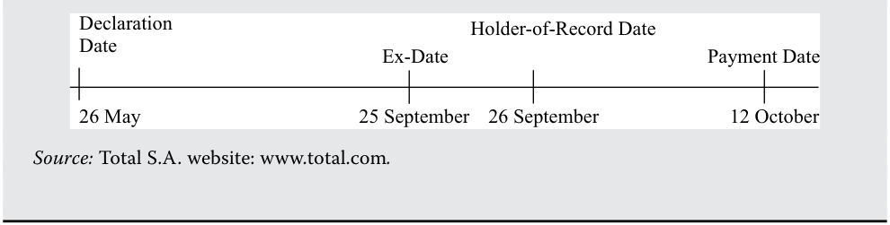

<!-- Picture Text: Declaration Holder-of-Record Date Date Ex-Date Payment Date 26 May 25 September 26 September 12 October Source:  Total S.A. website: www .total .com .  -->

> **Chú thích hình ảnh:**
> - **26 May (26 tháng 5):** Declaration Date (Ngày công bố)
> - **25 September (25 tháng 9):** Ex-Date (Ngày giao dịch không hưởng quyền)
> - **26 September (26 tháng 9):** Holder-of-Record Date (Ngày đăng ký cuối cùng)
> - **12 October (12 tháng 10):** Payment Date (Ngày thanh toán)
> - *Nguồn:* Trang web của Total S.A.: www.total.com.

Bởi vì những người mua cổ phiếu của công ty vào ngày giao dịch không hưởng quyền không còn đủ điều kiện để nhận khoản cổ tức sắp tới, nên với giả định các yếu tố khác không đổi, vào ngày hôm đó giá cổ phiếu của công ty sẽ ngay lập tức giảm xuống một lượng bằng với khoản cổ tức bị mất đi. Bảng minh họa 2 (Exhibit 2) minh họa sự sụt giảm giá cổ phiếu diễn ra đối với một công ty giả định đã công bố mức cổ tức $1.00 trên mỗi cổ phiếu khi giao dịch bắt đầu vào ngày giao dịch không hưởng quyền của công ty đó. 

<!-- PDF Page 353 -->

###### **Bảng minh họa 2: Thay đổi Giá Cổ phiếu của Công ty Giả định vào Ngày Giao dịch Không hưởng quyền (Exhibit 2: Stock Price Change for Hypothetical Company on Ex-Dividend Date)** 

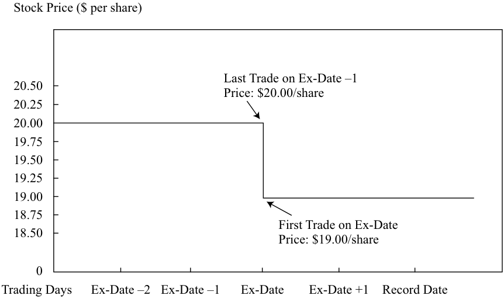

<!-- Picture Text: Stock Price ($ per share) Last Trade on Ex-Date –1 20.50 Price: $20.00/share 20.25 20.00 19.75 19.50 19.25 19.00 18.75 First Trade on Ex-Date 18.50 Price: $19.00/share 0 Trading Days Ex-Date –2 Ex-Date –1 Ex-Date Ex-Date +1 Record Date  -->

> **Chú thích hình ảnh:**
> - **Trục tung:** Giá cổ phiếu ($ trên mỗi cổ phiếu) từ 0 đến 20.50.
> - **Trục hoành:** Các ngày giao dịch (*Trading Days*): Ex-Date –2, Ex-Date –1, Ex-Date (Ngày giao dịch không hưởng quyền), Ex-Date +1, Record Date (Ngày đăng ký cuối cùng).
> - **Giao dịch cuối cùng vào ngày Ex-Date –1 (*Last Trade on Ex-Date –1*):** Giá: $20.00/cổ phiếu.
> - **Giao dịch đầu tiên vào ngày Ex-Date (*First Trade on Ex-Date*):** Giá: $19.00/cổ phiếu.

_Lưu ý_ : Giả định cổ tức được công bố là $1 trên mỗi cổ phiếu và thông lệ thanh toán bù trừ giao dịch cổ phiếu là $T + 3$. 

##### **MÔ HÌNH CHIẾT KHẤU CỔ TỨC (DDM) VÀ MÔ HÌNH DÒNG TIỀN TỰ DO THUỘC VỀ VỐN CHỦ SỞ HỮU (FCFE) (DIVIDEND DISCOUNT MODEL (DDM) AND FREE-CASH-FLOW-TO-EQUITY MODEL (FCFE))** 

## **<mark>5</mark>** 

giải thích cơ sở lý luận của việc sử dụng các mô hình giá trị hiện tại để định giá cổ phiếu và mô tả mô hình chiết khấu cổ tức cũng như mô hình dòng tiền tự do thuộc về vốn chủ sở hữu
giải thích các ưu điểm và nhược điểm của từng nhóm mô hình định giá 

Nếu công ty phát hành được giả định là một doanh nghiệp hoạt động liên tục (*going concern*), giá trị nội tại của một cổ phiếu chính là giá trị hiện tại của các khoản cổ tức dự kiến trong tương lai. Nếu giả định thêm một tỷ suất sinh lợi yêu cầu không đổi, thì biểu thức DDM cho giá trị nội tại của một cổ phiếu là Phương trình 1: 

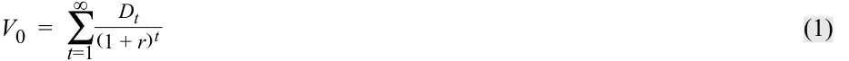

<!-- Formula Text: V 0  =  ∑ t=1 ∞ D t _ (1 + r) t (1) -->

$$V_0 = \sum_{t=1}^{\infty} \frac{D_t}{(1 + r)^t} \tag{1}$$

trong đó 

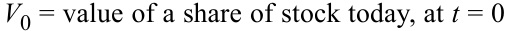

<!-- Formula Text: V0 = value of a share of stock today, at t = 0 -->

- $V_0 =$ giá trị của một cổ phiếu ngày hôm nay, tại $t = 0$

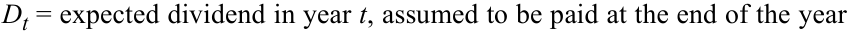

<!-- Formula Text: Dt = expected dividend in year t, assumed to be paid at the end of the year -->

- $D_t =$ cổ tức dự kiến trong năm $t$, được giả định là chi trả vào cuối năm
- $r =$ tỷ suất sinh lợi yêu cầu (*required rate of return*) đối với cổ phiếu 

Ở cấp độ cổ đông, tiền mặt nhận được từ một khoản đầu tư cổ phiếu phổ thông bao gồm bất kỳ khoản cổ tức nào nhận được cùng với số tiền thu về khi bán cổ phiếu. Nếu một nhà đầu tư dự định mua và nắm giữ một cổ phiếu trong một năm, giá trị của cổ phiếu ngày hôm nay là giá trị hiện tại của hai dòng tiền—cụ thể là, cổ tức dự kiến _cộng với_ giá bán dự kiến sau một năm: 

<!-- PDF Page 354 -->

<!-- Formula Text: V 0  = D 1 + P 1 _ (1 + r) 1   = D 1 _ (1 + r) 1  + P 1 _ (1 + r) 1 (2) -->

$$V_0 = \frac{D_1 + P_1}{(1 + r)^1} = \frac{D_1}{(1 + r)^1} + \frac{P_1}{(1 + r)^1} \tag{2}$$

trong đó $P_1 =$ giá dự kiến trên mỗi cổ phiếu tại $t = 1$. 

Để ước tính giá bán dự kiến, $P_1$, chuyên gia phân tích có thể ước tính mức giá mà một nhà đầu tư khác có thời kỳ nắm giữ một năm sẽ sẵn lòng trả cho cổ phiếu đó sau một năm nữa. Nếu $V_0$ được dựa trên $D_1$ và $P_1$, thì suy ra rằng $P_1$ có thể được ước tính từ $D_2$ và $P_2$: 

<!-- Formula Text: P 1  = D 2 + P 2 _ (1 + r) -->

$$P_1 = \frac{D_2 + P_2}{(1 + r)}$$

Thay thế vế phải của phương trình này cho $P_1$ trong Phương trình 2 sẽ cho ra kết quả ước tính $V_0$ là: 

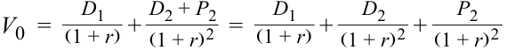

<!-- Formula Text: V 0  = D 1 _ (1 + r)  + D 2 + P 2 _ (1 + r) 2   = D 1 _ (1 + r)  + D 2 _ (1 + r) 2  + P 2 _ (1 + r) 2 -->

$$V_0 = \frac{D_1}{(1 + r)} + \frac{D_2 + P_2}{(1 + r)^2} = \frac{D_1}{(1 + r)} + \frac{D_2}{(1 + r)^2} + \frac{P_2}{(1 + r)^2}$$

Lặp lại quá trình này, chúng ta tìm được giá trị cho $n$ kỳ nắm giữ bằng giá trị hiện tại của các khoản cổ tức dự kiến trong $n$ kỳ cộng với giá trị hiện tại của mức giá dự kiến sau $n$ kỳ: 

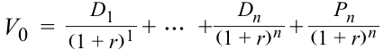

<!-- Formula Text: V 0  = D 1 _ (1 + r) 1  + ⋯  + D n _ (1 + r) n  + P n _ (1 + r) n -->

$$V_0 = \frac{D_1}{(1 + r)^1} + \cdots + \frac{D_n}{(1 + r)^n} + \frac{P_n}{(1 + r)^n}$$

Sử dụng ký hiệu tổng ($\sum$) để biểu diễn giá trị hiện tại của $n$ khoản cổ tức dự kiến, chúng ta đi đến biểu thức tổng quát cho một thời kỳ nắm giữ hoặc khung thời gian đầu tư gồm $n$ kỳ: 

<!-- Formula Text: V 0  =  ∑ t=1 n D t _ (1 + r) t  + P n _ (1 + r) n (3) -->

$$V_0 = \sum_{t=1}^{n} \frac{D_t}{(1 + r)^t} + \frac{P_n}{(1 + r)^n} \tag{3}$$

Giá trị dự kiến của một cổ phiếu tại thời điểm kết thúc khung thời gian đầu tư—trên thực tế chính là giá bán dự kiến—thường được gọi là **giá trị cổ phiếu cuối kỳ (*terminal stock value*)** (hoặc **giá trị kết thúc – *terminal value***). 

###### **VÍ DỤ 4 (EXAMPLE 4)** 

###### **Ước tính Giá trị Cổ phiếu cho Khung thời gian Đầu tư Ba năm (Estimating Share Value for a Three-Year Investment Horizon)** 

1. Trong ba năm tới, cổ tức hàng năm của một cổ phiếu dự kiến lần lượt là €2.00, €2.10, và €2.20. Giá cổ phiếu dự kiến sẽ ở mức €20.00 vào cuối năm thứ ba. Nếu tỷ suất sinh lợi yêu cầu đối với cổ phiếu này là 10 phần trăm, giá trị ước tính của một cổ phiếu là bao nhiêu? 

###### **Lời giải:** 

<!-- Formula Text: The present values of the expected future cash flows can be written as follows: V 0  =    2.00 _ (1.10) 1  +   2.10 _ (1.10) 2  +   2.20 _ (1.10) 3  +  20.00 _ (1.10) 3 Calculating and summing these present values gives an estimated share value of V0 = 1.818 + 1.736 + 1.653 + 15.026 = €20.23. The three dividends have a total present value of €5.207, and the terminal stock value has a present value of €15.026, for a total estimated value of €20.23. -->

Giá trị hiện tại của các dòng tiền tương lai dự kiến có thể được viết như sau:

$$V_0 = \frac{2.00}{(1.10)^1} + \frac{2.10}{(1.10)^2} + \frac{2.20}{(1.10)^3} + \frac{20.00}{(1.10)^3}$$

Tính toán và cộng các giá trị hiện tại này lại cho ra giá trị cổ phiếu ước tính là $V_0 = 1.818 + 1.736 + 1.653 + 15.026 = €20.23$. Ba khoản cổ tức có tổng giá trị hiện tại là €5.207, và giá trị cổ phiếu cuối kỳ có giá trị hiện tại là €15.026, mang lại tổng giá trị ước tính là €20.23.

Mở rộng thời kỳ nắm giữ đến tương lai vô hạn, chúng ta có thể nói rằng giá trị ước tính của một cổ phiếu là giá trị hiện tại của tất cả các khoản cổ tức tương lai dự kiến như được trình bày trong Phương trình 1. 

<!-- PDF Page 355 -->

Việc xem xét một tương lai vô hạn là hợp lý bởi vì các doanh nghiệp được thành lập dưới hình thức công ty cổ phần nhìn chung được thiết lập để hoạt động vô thời hạn. Dạng tổng quát này của DDM vẫn áp dụng ngay cả trong trường hợp nhà đầu tư có khung thời gian đầu tư hữu hạn. Đối với nhà đầu tư đó, giá trị cổ phiếu ngày hôm nay phụ thuộc _trực tiếp_ vào các khoản cổ tức mà nhà đầu tư dự kiến nhận được trước khi bán cổ phiếu và phụ thuộc _gián tiếp_ vào các khoản cổ tức dự kiến cho những kỳ sau khi bán, bởi vì những khoản cổ tức tương lai dự kiến đó quyết định giá bán dự kiến. Do vậy, biểu thức tổng quát được cho bởi Phương trình 1 luôn đúng bất kể thời kỳ nắm giữ của nhà đầu tư là bao lâu. 

Trên thực tế, nhiều chuyên gia phân tích ưa thích sử dụng mô hình định giá dòng tiền tự do thuộc về vốn chủ sở hữu (*free-cash-flow-to-equity* – FCFE). Các chuyên gia phân tích này giả định rằng _năng lực_ chi trả cổ tức nên được phản ánh trong các ước tính dòng tiền hơn là _cổ tức dự kiến_. FCFE là một thước đo về năng lực chi trả cổ tức (*dividend-paying capacity*). Các chuyên gia phân tích cũng có thể sử dụng các mô hình định giá FCFE cho một cổ phiếu không trả cổ tức. Để sử dụng DDM, chuyên gia phân tích cần dự đoán thời điểm và quy mô của khoản cổ tức đầu tiên cùng tất cả các khoản cổ tức hoặc tốc độ tăng trưởng cổ tức sau đó. Việc đưa ra những dự đoán này một cách chính xác cho cổ phiếu không trả cổ tức thường rất khó khăn, vì vậy trong những trường hợp như thế, các chuyên gia phân tích thường tìm đến các mô hình FCFE. 

Việc tính toán FCFE bắt đầu bằng việc tính dòng tiền từ hoạt động kinh doanh (*cash flow from operations* – CFO). CFO được định nghĩa đơn giản là thu nhập ròng (*net income*) cộng với các chi phí phi tiền mặt (*non-cash expenses*) trừ đi khoản đầu tư vào vốn lưu động (*investment in working capital*). FCFE là thước đo dòng tiền được tạo ra trong một kỳ sẵn có để phân phối cho các cổ đông phổ thông. "Sẵn có để phân phối" có nghĩa là gì? Toàn bộ CFO _không_ phải đều sẵn có để phân phối; phần CFO cần thiết cho đầu tư tài sản cố định (*fixed capital investment* – FCInv) trong kỳ nhằm duy trì giá trị của công ty như một doanh nghiệp hoạt động liên tục _không_ được xem là sẵn có để phân phối cho các cổ đông phổ thông. Ngược lại, các khoản vay ròng (*net amounts borrowed* – tiền vay mới trừ đi tiền trả nợ gốc) được coi là sẵn có để phân phối cho các cổ đông phổ thông. Do đó, FCFE có thể được biểu diễn như sau: 

$$\text{FCFE} = \text{CFO} - \text{FCInv} + \text{Vay ròng (Net borrowing)} \tag{4}$$

Thông tin cần thiết để tính toán FCFE lịch sử có sẵn từ báo cáo lưu chuyển tiền tệ và các thuyết minh báo cáo tài chính của công ty. Thông thường, dưới giả định rằng ban lãnh đạo đang hành động vì lợi ích duy trì giá trị của công ty như một doanh nghiệp hoạt động liên tục, chi tiêu vốn (*capital expenditure*) được báo cáo sẽ được lấy để đại diện cho FCInv. Các chuyên gia phân tích phải lập các dự phóng báo cáo tài chính để dự báo FCFE tương lai. Mức định giá thu được bằng cách sử dụng FCFE bao gồm việc chiết khấu các khoản FCFE tương lai dự kiến theo tỷ suất sinh lợi yêu cầu đối với vốn chủ sở hữu; biểu thức này song hành với Phương trình 1: 

<!-- Formula Text: V 0  =  ∑ t=1 ∞ FCFE t _ (1 + r) t -->

$$V_0 = \sum_{t=1}^{\infty} \frac{\text{FCFE}_t}{(1 + r)^t}$$

###### **VÍ DỤ 5 (EXAMPLE 5)** 

###### **Các Mô hình Giá trị Hiện tại (Present Value Models)** 

1. Một nhà đầu tư kỳ vọng một cổ phiếu sẽ trả cổ tức $3.00 và $3.15 vào cuối Năm 1 và Năm 2 tương ứng. Vào cuối năm thứ hai, nhà đầu tư kỳ vọng cổ phiếu sẽ giao dịch ở mức giá $40.00. Tỷ suất sinh lợi yêu cầu đối với cổ phiếu là 8 phần trăm. Nếu các dự báo của nhà đầu tư là chính xác và giá thị trường hiện tại của cổ phiếu là $30, kết luận _có khả năng cao nhất_ là cổ phiếu đang: 

   - **A.** bị định giá cao (*overvalued*). 

   - **B.** bị định giá thấp (*undervalued*). 

   - **C.** được định giá hợp lý (*fairly valued*). 

<!-- PDF Page 356 -->

###### **Lời giải:** 

B là đáp án đúng. 

<!-- Formula Text: V 0  =    3.00 _ (1.08) 1  +   3.15 _ (1.08) 2  +  40.00 _ (1.08) 2   =  39.77 -->

$$V_0 = \frac{3.00}{(1.08)^1} + \frac{3.15}{(1.08)^2} + \frac{40.00}{(1.08)^2} = 39.77$$

Ước tính giá trị $39.77 vượt quá giá thị trường $30, vì vậy kết luận là cổ phiếu đang bị định giá thấp. 

2. Hai nhà đầu tư có thời kỳ nắm giữ khác nhau nhưng có cùng các kỳ vọng và tỷ suất sinh lợi yêu cầu đối với một công ty đang ước tính giá trị nội tại của một cổ phiếu phổ thông của công ty đó. Nhà đầu tư có thời kỳ nắm giữ ngắn hơn sẽ _có khả năng cao nhất_ ước tính một: 

   - **A.** giá trị nội tại thấp hơn. 

   - **B.** giá trị nội tại cao hơn. 

   - **C.** giá trị nội tại tương tự. 

###### **Lời giải:** 

C là đáp án đúng. Giá trị nội tại của một chứng khoán độc lập với thời kỳ nắm giữ của nhà đầu tư. 

3. Một mô hình định giá cổ phiếu tập trung vào cổ tức dự kiến thay vì năng lực chi trả cổ tức là: 

   - **A.** mô hình chiết khấu cổ tức (*dividend discount model*). 

   - **B.** mô hình dòng tiền tự do thuộc về vốn chủ sở hữu (*free cash flow to equity model*). 

   - **C.** mô hình tỷ suất sinh lợi dòng tiền trên vốn đầu tư (*cash flow return on investment model*). 

###### **Lời giải:** 

A là đáp án đúng. Các mô hình chiết khấu cổ tức tập trung vào các khoản cổ tức dự kiến. 

Tỷ suất sinh lợi yêu cầu để sử dụng trong các mô hình giá trị hiện tại được ước tính như thế nào? Để ước tính tỷ suất sinh lợi yêu cầu đối với một cổ phiếu, các chuyên gia phân tích thường xuyên sử dụng mô hình định giá tài sản vốn (*capital asset pricing model* – CAPM): 

$$\text{Tỷ suất sinh lợi yêu cầu đối với cổ phiếu } i = \text{Lãi suất phi rủi ro kỳ vọng hiện tại} + \text{Beta}_i \times \left[\text{Phần bù rủi ro thị trường (vốn chủ sở hữu)}\right] \tag{5}$$

Phương trình 5 phát biểu rằng tỷ suất sinh lợi yêu cầu đối với một cổ phiếu bằng tổng của lãi suất phi rủi ro kỳ vọng hiện tại cộng với một phần bù rủi ro bằng tích số giữa hệ số beta của cổ phiếu (thước đo rủi ro không thể đa dạng hóa – *non-diversifiable risk*) và phần bù rủi ro thị trường (*market risk premium* – tỷ suất sinh lợi kỳ vọng của thị trường vượt trên lãi suất phi rủi ro, trong đó trên thực tế, "thị trường" thường được đại diện bởi một chỉ số thị trường chứng khoán diện rộng). Tuy nhiên, ngay cả khi các chuyên gia phân tích đồng ý rằng CAPM là một mô hình phù hợp, các dữ liệu đầu vào của họ cho CAPM vẫn có thể khác nhau. Do đó, không có câu trả lời đúng duy nhất cho câu hỏi: Tỷ suất sinh lợi yêu cầu là bao nhiêu? 

Các phương pháp phổ biến khác để ước tính tỷ suất sinh lợi yêu cầu đối với cổ phiếu của một công ty bao gồm việc cộng một phần bù rủi ro dựa trên các đánh giá kinh tế, thay vì dựa vào CAPM, vào một mức lãi suất phi rủi ro phù hợp (thường là trái phiếu chính phủ) và cộng một phần bù rủi ro vào lợi suất trái phiếu của chính công ty đó (*bond yield plus risk premium*). Sự phán đoán sắc bén về kinh doanh và kinh tế có vai trò tối quan trọng trong việc ước tính tỷ suất sinh lợi yêu cầu. Tại nhiều công ty đầu tư, tỷ suất sinh lợi yêu cầu được xác định theo chính sách của công ty. 

<!-- PDF Page 357 -->

##### **ĐỊNH GIÁ CỔ PHIẾU ƯU ĐÃI (PREFERRED STOCK VALUATION)** 

## **<mark>6</mark>** 

tính toán giá trị nội tại của một cổ phiếu ưu đãi không có quyền mua lại và không có quyền chuyển đổi 

giải thích các ưu điểm và nhược điểm của từng nhóm mô hình định giá 

Các mô hình chiết khấu cổ tức tổng quát tương đối dễ áp dụng đối với cổ phiếu ưu đãi. Ở dạng đơn giản nhất, **cổ phiếu ưu đãi (*preferred stock*)** là một hình thức vốn chủ sở hữu (nhìn chung không có quyền biểu quyết) có thứ tự ưu tiên cao hơn cổ phiếu phổ thông trong việc nhận cổ tức và đối với tài sản của tổ chức phát hành trong trường hợp công ty bị thanh lý. Cổ phiếu ưu đãi có thể có một ngày đáo hạn xác định mà tại thời điểm đó mệnh giá (*par/face value*) của cổ phiếu được thanh toán, hoặc nó có thể là vĩnh cửu (*perpetual*) không có ngày đáo hạn; ngoài ra, nó có thể kèm quyền mua lại (*callable*) hoặc quyền chuyển đổi (*convertible*). 

Đối với một cổ phiếu ưu đãi vĩnh cửu không có quyền mua lại, không có quyền chuyển đổi trả một mức cổ tức cố định $D$ và giả định tỷ suất sinh lợi yêu cầu không đổi theo thời gian, Phương trình 1 rút gọn thành công thức tính giá trị hiện tại của một niên kim vĩnh cửu (*perpetuity*). Giá trị của nó là: 

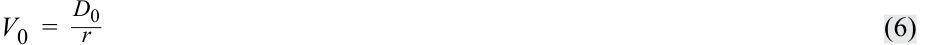

<!-- Formula Text: V 0  = D 0 _ r (6) -->

$$V_0 = \frac{D_0}{r} \tag{6}$$

Ví dụ, một cổ phiếu ưu đãi vĩnh cửu không có quyền mua lại có mệnh giá $100 trả cổ tức hàng năm là $5.50. Nếu tỷ suất sinh lợi yêu cầu của nó là 6 phần trăm, ước tính giá trị sẽ là $\$5.50 / 0.06 = \$91.67$. 

Đối với một cổ phiếu ưu đãi không có quyền mua lại, không có quyền chuyển đổi có thời điểm đáo hạn tại thời điểm $n$, giá trị nội tại ước tính có thể được tính bằng cách sử dụng Phương trình 3 nhưng thay thế $P_n$ bằng mệnh giá của cổ phiếu ưu đãi, $F$: 

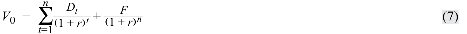

<!-- Formula Text: V 0  =  ∑ t=1 n D t _ (1 + r) t  + F _ (1 + r) n (7) -->

$$V_0 = \sum_{t=1}^{n} \frac{D_t}{(1 + r)^t} + \frac{F}{(1 + r)^n} \tag{7}$$

Khi sử dụng Phương trình 7, cách tiếp cận chuẩn xác nhất là sử dụng các giá trị cho $n, r,$ và $D$ phản ánh đúng lịch trình chi trả của cổ tức. Phương pháp này tương tự như thông lệ của các chuyên gia phân tích thu nhập cố định khi định giá một trái phiếu. Ví dụ, một cổ phiếu ưu đãi không có quyền chuyển đổi có mệnh giá £20.00, đáo hạn sau sáu năm, tỷ suất sinh lợi yêu cầu danh nghĩa là 8.20 phần trăm, và trả cổ tức bán niên (nửa năm một lần) là £2.00 sẽ được định giá bằng cách sử dụng $n = 12$, $r = 4.10\%$, $D = £2.00$, và $F = £20.00$. Kết quả sẽ là mức giá trị ước tính £31.01. Nếu giả định các khoản thanh toán được thực hiện hàng năm thay vì bán niên (tức là giả định $n = 6$, $r = 8.20\%$, và $D = £4.00$) thì sẽ cho ra kết quả giá trị ước tính là £30.84. 

Các đợt phát hành cổ phiếu ưu đãi thường xuyên có tính năng cho phép tổ chức phát hành mua lại (*callable/redeemable*) tại một thời điểm nào đó trước khi đáo hạn, thường là ở mức mệnh giá hoặc ở các mức giá cao hơn mệnh giá và giảm dần về bằng mệnh giá khi ngày đáo hạn đến gần. Những quyền chọn mua lại (*call options*) như vậy có xu hướng làm giảm giá trị của đợt phát hành cổ phiếu ưu đãi đối với nhà đầu tư bởi vì quyền chọn mua lại sẽ được tổ chức phát hành thực hiện khi điều đó có lợi cho tổ chức phát hành và bị bỏ qua khi không có lợi. Ví dụ, nếu một tổ chức phát hành có thể mua lại các cổ phiếu ở mức mệnh giá trong khi lẽ ra chúng sẽ giao dịch trên mức mệnh giá (dựa trên cơ sở cổ tức, kỳ hạn và tỷ suất sinh lợi yêu cầu), thì tổ chức phát hành có động lực để mua lại số cổ phiếu đó. 

Các đợt phát hành cổ phiếu ưu đãi cũng có thể bao gồm quyền chọn bán lại (*retraction option*) cho phép người nắm giữ cổ phiếu ưu đãi bán lại cổ phiếu cho tổ chức phát hành trước khi đáo hạn theo các điều khoản được quy định trước. Về bản chất, người nắm giữ cổ phiếu có một quyền chọn bán (*put option*). Những quyền chọn bán như vậy có xu hướng làm tăng giá trị của đợt phát hành cổ phiếu ưu đãi đối với nhà đầu tư bởi vì quyền chọn bán lại sẽ được nhà đầu tư thực hiện khi điều đó có lợi cho nhà đầu tư và bị bỏ qua khi 

<!-- PDF Page 358 -->

không có lợi. Mặc dù việc định giá chính xác các đợt phát hành có gắn kèm các quyền chọn (*embedded options*) như vậy nằm ngoài phạm vi của bài đọc này, Ví dụ 6 vẫn đưa vào một tình huống trong đó Phương trình 7 có thể được sử dụng để xấp xỉ giá trị của một cổ phiếu ưu đãi có quyền mua lại và quyền bán lại (*callable, retractable preferred share*). 

###### **VÍ DỤ 6 (EXAMPLE 6)** 

###### **Định giá Cổ phiếu Ưu đãi: Hai Tình huống (Preferred Share Valuation: Two Cases)** 

###### **_Tình huống 1 (Case 1)_ :** **_Cổ phiếu Ưu đãi Vĩnh cửu Không có Quyền mua lại, Không có Quyền chuyển đổi (Non-callable, Non-convertible, Perpetual Preferred Shares)_** 

Các thông tin thực tế liên quan đến cổ phiếu ưu đãi vĩnh cửu lãi suất 4.75 phần trăm của Công ty Union Electric như sau: 

   - Tổ chức phát hành: Union Electric Co. (thuộc sở hữu của Ameren) 

   - Mệnh giá (*Par value*): US$100 

   - Cổ tức (*Dividend*): US$4.75 mỗi năm 

   - Kỳ hạn (*Maturity*): vĩnh cửu (*perpetual*) 

   - Quyền chọn đi kèm (*Embedded options*): không có 

   - Xếp hạng tín nhiệm (*Credit rating*): Moody’s Investors Service/Standard & Poor’s Ba1/BB 

   - Tỷ suất sinh lợi yêu cầu đối với cổ phiếu ưu đãi có xếp hạng Ba1/BB tính đến ngày định giá: 7.5 phần trăm. 

1. Ước tính giá trị nội tại của cổ phiếu ưu đãi này. 

###### **Lời giải** 

Dựa trên lãi suất chiết khấu là tỷ suất sinh lợi yêu cầu đối với cổ phiếu ưu đãi xếp hạng Ba1/BB ở mức 7.5 phần trăm, ta có ước tính giá trị nội tại là $\text{US}\$4.75 / 0.075 = \text{US}\$63.33$. 

2. Giải thích xem giá trị nội tại của đợt phát hành này sẽ cao hơn hay thấp hơn nếu đợt phát hành này có kèm quyền mua lại (*callable*) (với tất cả các thông tin khác giữ nguyên không đổi). 

###### **Lời giải** 

Giá trị nội tại sẽ thấp hơn nếu đợt phát hành có kèm quyền mua lại. Quyền chọn thu hồi hay mua lại đợt phát hành có giá trị đối với tổ chức phát hành bởi vì quyền mua lại sẽ được thực hiện khi việc làm đó đem lại lợi ích cho tổ chức phát hành. Giá trị nội tại của cổ phiếu đối với nhà đầu tư thường sẽ thấp hơn nếu đợt phát hành có thể bị mua lại. Trong trường hợp này, bởi vì giá trị nội tại khi không có quyền mua lại thấp hơn rất nhiều so với mệnh giá, tổ chức phát hành sẽ khó có khả năng mua lại đợt phát hành ngay cả khi nó có quyền mua lại; do đó, tính năng có thể mua lại (*callability*) sẽ làm giảm giá trị nội tại, nhưng chỉ giảm nhẹ. 

###### **_Tình huống 2 (Case 2)_ :** **_Cổ phiếu Ưu đãi Có kỳ hạn Kèm Quyền bán lại (Retractable Term Preferred Shares)_** 

Cổ phiếu ưu đãi có kỳ hạn kèm quyền bán lại (*retractable term preferred shares*) là một loại cổ phiếu ưu đãi trước đây từng được phát hành bởi các công ty Canada, và hiện nay đã bắt đầu được chào bán bởi các công ty tại những khu vực pháp lý khác, bao gồm cả Nhật Bản. Loại phát hành này quy định cụ thể một "ngày thực hiện quyền bán lại (*retraction date*)" mà tại đó các cổ đông ưu đãi có quyền chọn bán lại cổ phiếu của họ cho tổ chức phát hành ở mức mệnh giá (tức là cổ phiếu có tính năng "bán lại – *retractable*" hay "*putable*" 

<!-- PDF Page 359 -->

vào ngày đó).2 Vào các ngày được xác định trước sớm hơn ngày thực hiện quyền bán lại, tổ chức phát hành có quyền chọn mua lại đợt phát hành cổ phiếu ưu đãi ở các mức giá định trước (luôn bằng hoặc cao hơn mệnh giá). 

Một ví dụ về cổ phiếu ưu đãi có kỳ hạn kèm quyền bán lại hiện đang lưu hành là cổ phiếu hạng Model AA Đợt Đầu tiên (*First Series Model AA class shares*) của TMC (Toyota Motor Corporation), với tỷ lệ cổ tức 0.5 phần trăm, tăng thêm 0.5 phần trăm mỗi năm cho đến năm 2020 và sau đó trở nên cố định ở mức 2.5 phần trăm. TMC là nhà sản xuất ô tô hàng đầu thế giới, có trụ sở chính tại Nhật Bản và hoạt động trên toàn cầu. Đợt phát hành này tính bằng đồng Yên Nhật. Cổ phiếu có mệnh giá ¥10,598 và trả cổ tức bán niên là ¥26.5 $[= (0.5\% \times ¥10,598)/2]$ vào ngày 31 tháng 3 năm 2016. Cổ tức bán niên dự kiến sẽ tăng lên mức ¥132.5 $[= (2.5\% \times ¥10,598)/2]$ vào ngày 31 tháng 3 năm 2020 và các kỳ sau đó. Tính đến ngày 31 tháng 12 năm 2017, công ty mang xếp hạng tín nhiệm từ Moody’s và Standard & Poor’s lần lượt là Aa3 và AA–. Như vậy, cổ phiếu này được Moody’s và Standard & Poor’s đánh giá là có chất lượng tín dụng "đảm bảo (*adequate*)", được định danh bởi mức "Aa3 và AA–", nghĩa là có chất lượng tương đối cao trong nhóm đó. Bắt đầu từ ngày 2 tháng 4 năm 2021, cổ phiếu có thể được mua lại theo quyền chọn của TMC ở mức ¥10,598 (mệnh giá). Ngày thực hiện quyền bán lại (*retraction date*) là ngày cuối cùng của các tháng 3, tháng 6, tháng 9 và tháng 12 hàng năm, bắt đầu từ ngày 1 tháng 9 năm 2020, với việc cổ phiếu có thể được bán lại ở mức mệnh giá. Cổ phiếu Series AA có quyền biểu quyết và có thể thực hiện quyền biểu quyết cũng như các quyền khác mà cổ đông phổ thông của TMC nắm giữ theo cùng một cách thức. Cổ phiếu Series AA được phát hành ở mức giá cao hơn 20% (*20% premium*) so với giá cổ phiếu phổ thông vào năm 2015, và kể từ đó giá cổ phiếu đã giảm xuống mức ¥7,243 tính đến ngày 31 tháng 12 năm 2017, với tỷ suất sinh lợi yêu cầu hiện tại là 3.05% mỗi năm (1.525 phần trăm mỗi nửa năm). Bởi vì giá thị trường của đợt phát hành thấp hơn rất nhiều so với mức giá mà TMC có thể mua lại hoặc thu hồi đợt phát hành, việc TMC mua lại được coi là khó có khả năng xảy ra, trong khi quyền chọn bán lại dành cho những người nắm giữ Series AA dường như có giá trị đáng kể vì họ có tiềm năng bán lại cổ phiếu cho TMC ở mức giá cao hơn xấp xỉ 45 phần trăm so với giá trị thị trường hiện tại (¥10,598 so với ¥7,243). 

3. Giả sử rằng đợt phát hành sẽ được thực hiện quyền bán lại vào tháng 12 năm 2020; những người nắm giữ cổ phiếu sẽ bán lại (*put*) cổ phiếu cho công ty vào tháng 12 năm 2020. Dựa trên thông tin đã cho, hãy ước tính giá trị nội tại của một cổ phiếu. Giả sử thời điểm hiện tại là tháng 12 năm 2017. 

###### **Lời giải** 

Ước tính giá trị nội tại của một cổ phiếu thuộc đợt phát hành ưu đãi này là ¥10,279. Các khoản cổ tức bán niên dự kiến: 

Năm kết thúc ngày 31 tháng 3 năm 2018: $¥79.5 \ [= (1.5\% \times ¥10,598)/2]$ 

Năm kết thúc ngày 31 tháng 3 năm 2019: $¥106 \ [= (2.0\% \times ¥10,598)/2]$ 

Năm kết thúc ngày 31 tháng 3 năm 2020: $¥132.5 \ [= (2.5\% \times ¥10,598)/2]$ 

$$V_0 = \left[ \frac{¥79.5}{1.01525} + \frac{¥79.5}{1.01525^2} + \frac{¥106}{1.01525^3} + \frac{¥106}{1.01525^4} + \frac{¥132.5}{1.01525^5} + \frac{¥132.5}{1.01525^6} + \frac{¥10,598}{1.01525^6} \right] \approx ¥10,279$$

Khoảng chênh lệch giữa giá thị trường hiện tại là ¥7,243 và giá trị nội tại là ¥10,279 chính là giá trị hàm ẩn (*implied value*) của quyền chọn bán lại được trao cho những người nắm giữ cổ phiếu Series AA. 

> 2 "Quyền bán lại (*Retraction*)" đề cập đến quyền chọn này, vốn là một quyền chọn bán (*put option*). Thuật ngữ này vẫn chưa hoàn toàn thống nhất: Loại cổ phiếu được gọi là "cổ phiếu ưu đãi có kỳ hạn kèm quyền bán lại (*retractable term preferred*)" còn được biết đến với tên gọi "cổ phiếu ưu đãi bán lại cứng (*hard retractable preferred*)", với từ "cứng (*hard*)" ám chỉ việc thanh toán bằng tiền mặt thay vì bằng cổ phiếu phổ thông vào ngày thực hiện quyền bán lại. 

---

# Tập 5: Đầu tư Cổ phiếu (Volume 5: Equity Investments)
## Học phần 8: Định giá Cổ phiếu: Các Khái niệm và Công cụ Cơ bản (Equity Valuation: Concepts and Basic Tools)
### Phần 2/4: Mô hình Tăng trưởng Gordon (The Gordon Growth Model) (Trang PDF 360–372)

---

<!-- PDF Page 360 -->

# **<mark>7</mark>** 

## **MÔ HÌNH TĂNG TRƯỞNG GORDON (THE GORDON GROWTH MODEL)** 

tính toán và diễn giải giá trị nội tại của một chứng khoán vốn dựa trên mô hình chiết khấu cổ tức tăng trưởng đều Gordon (*Gordon (constant) growth dividend discount model*) hoặc mô hình chiết khấu cổ tức hai giai đoạn (*two-stage dividend discount model*), tùy trường hợp phù hợp 

xác định các đặc điểm của những công ty phù hợp để áp dụng mô hình chiết khấu cổ tức tăng trưởng đều hoặc đa giai đoạn (*multistage dividend discount model*)
giải thích các ưu điểm và nhược điểm của từng nhóm mô hình định giá 

Một vấn đề khá hiển nhiên khi cố gắng áp dụng Phương trình 1 cho vốn chủ sở hữu phổ thông là phương trình này đòi hỏi chuyên gia phân tích phải ước tính một chuỗi vô hạn các khoản cổ tức dự kiến. Để đơn giản hóa quá trình này, các chuyên gia phân tích thường đưa ra những giả định về cách thức cổ tức sẽ tăng trưởng hoặc thay đổi theo thời gian. Mô hình tăng trưởng (đều) Gordon (*Gordon (constant) growth model* – Gordon, 1962) là một mô hình chiết khấu cổ tức (DDM) đơn giản và được công nhận rộng rãi. Mô hình này giả định cổ tức tăng trưởng vô thời hạn ở một tốc độ không đổi. 

Bởi vì giả định tốc độ tăng trưởng không đổi, mô hình tăng trưởng Gordon đặc biệt phù hợp để định giá vốn chủ sở hữu của các công ty có trả cổ tức, tương đối ít nhạy cảm với chu kỳ kinh doanh (*business cycle*) và đang ở giai đoạn tăng trưởng trưởng thành/bão hòa (*mature growth phase*). Các ví dụ có thể bao gồm một công ty tiện ích điện lực phục vụ một khu vực tăng trưởng chậm hoặc một nhà sản xuất mặt hàng thực phẩm thiết yếu (ví dụ: bánh mì). Lịch sử tăng cổ tức ở một tốc độ tăng trưởng ổn định là một tiêu chí thực tiễn khác nếu chuyên gia phân tích tin rằng khuôn mẫu đó sẽ tiếp tục duy trì trong tương lai. 

Với giả định tăng trưởng không đổi, Phương trình 1 có thể được viết lại thành Phương trình 8, trong đó $g$ là tốc độ tăng trưởng không đổi (*constant growth rate*): 

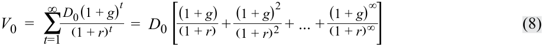

<!-- Formula Text: V 0  =  ∑ t=1 ∞ D 0 (1 + g) t _ (1 + r) t    =  D 0 [ (1 + g) _ (1 + r)  + (1 + g) 2 _ (1 + r) 2  + ... + (1 + g) ∞ _ (1 + r) ∞ ] (8) -->

$$V_0 = \sum_{t=1}^{\infty} \frac{D_0(1 + g)^t}{(1 + r)^t} = D_0 \left[ \frac{(1 + g)}{(1 + r)} + \frac{(1 + g)^2}{(1 + r)^2} + \cdots + \frac{(1 + g)^\infty}{(1 + r)^\infty} \right] \tag{8}$$

Nếu tỷ suất sinh lợi yêu cầu $r$ được giả định là lớn hơn nghiêm ngặt so với tốc độ tăng trưởng $g$ ($r > g$), thì biểu thức trong ngoặc vuông ở Phương trình 8 là một cấp số nhân lùi vô hạn (*infinite geometric series*) và có tổng bằng $[(1 + g)/(r - g)]$. Thay vào Phương trình 8 sẽ tạo ra mô hình tăng trưởng Gordon như được trình bày trong Phương trình 9: 

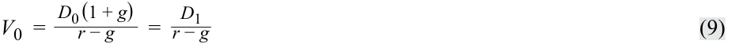

<!-- Formula Text: V 0  = D 0 (1 + g) _ r − g    = D 1 _ r − g (9) -->

$$V_0 = \frac{D_0(1 + g)}{r - g} = \frac{D_1}{r - g} \tag{9}$$

Để minh họa cho biểu thức này, giả sử cổ tức hàng năm hiện tại (gần đây nhất) của một cổ phiếu là €5.00 và cổ tức dự kiến sẽ tăng trưởng ở mức 4 phần trăm mỗi năm. Tỷ suất sinh lợi yêu cầu đối với vốn chủ sở hữu là 8 phần trăm. Do đó, ước tính giá trị nội tại theo mô hình tăng trưởng Gordon là $€5.00(1.04)/(0.08 - 0.04) = €5.20/0.04 = €130$ trên mỗi cổ phiếu. Lưu ý rằng tử số là $D_1$ chứ không phải $D_0$. (Sử dụng sai tử số là một lỗi phổ biến.) 

Mô hình tăng trưởng Gordon ước tính giá trị nội tại như là giá trị hiện tại của một niên kim vĩnh cửu tăng trưởng đều (*growing perpetuity*). Nếu tốc độ tăng trưởng, $g$, được giả định bằng 0, Phương trình 8 sẽ rút gọn về biểu thức tính giá trị hiện tại của một niên kim vĩnh cửu không đổi, đã được cho trước đó ở Phương trình 6. 

Khi ước tính tốc độ tăng trưởng dài hạn, các chuyên gia phân tích sử dụng nhiều phương pháp khác nhau, bao gồm việc đánh giá mức tăng trưởng của cổ tức hoặc thu nhập theo thời gian, sử dụng tốc độ tăng trưởng trung vị của ngành, và sử dụng mối quan hệ được trình bày trong Phương trình 10 để ước tính tốc độ tăng trưởng bền vững (*sustainable growth rate*): 

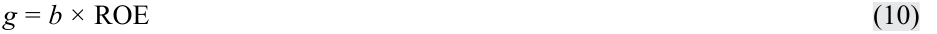

<!-- Formula Text: g = b × ROE (10) -->

$$g = b \times \text{ROE} \tag{10}$$

<!-- PDF Page 361 -->

##### trong đó 

$g =$ tốc độ tăng trưởng cổ tức (*dividend growth rate*) 

$b =$ tỷ lệ lợi nhuận giữ lại (*earnings retention rate*) $= (1 - \text{Tỷ lệ chi trả cổ tức } [\text{Dividend payout ratio}])$ 

$\text{ROE} =$ tỷ suất sinh lợi trên vốn chủ sở hữu (*return on equity*) 

Ví dụ 7 minh họa việc áp dụng mô hình tăng trưởng Gordon đối với cổ phiếu của một công ty sản xuất công nghiệp lớn. Chuyên gia phân tích tin rằng công ty sẽ tiếp tục tăng trưởng ở tốc độ mà nó đã đạt được trong ba năm trước đó và duy trì ổn định trong tương lai. Ví dụ này đặt câu hỏi rằng giả định tăng trưởng cổ tức đóng góp bao nhiêu vào ước tính giá trị nội tại. Câu hỏi này có ý nghĩa liên quan đến việc định giá bởi vì nếu con số này cao xét theo tỷ lệ phần trăm, thì một phần lớn giá trị của cổ phiếu phụ thuộc vào việc hiện thực hóa ước tính tăng trưởng đó. Người ta có thể trả lời câu hỏi này bằng cách lấy ước tính giá trị nội tại được xác định bởi Phương trình 9 trừ đi giá trị được xác định bởi Phương trình 6 (vốn giả định cổ tức không tăng trưởng).3 

##### **VÍ DỤ 7 (EXAMPLE 7)** 

### **Áp dụng Mô hình Tăng trưởng Gordon (Applying the Gordon Growth Model)** 

Siemens AG hoạt động trong lĩnh vực tư liệu sản xuất (*capital goods*) và công nghệ. Công ty tham gia vào các lĩnh vực kỹ thuật, sản xuất chế tạo, tự động hóa, năng lượng và giao thông vận tải. Công ty hoạt động trên phạm vi toàn cầu và là một trong những tập đoàn lớn nhất trong các lĩnh vực mà mình tham gia. Đây là một nhà tuyển dụng lớn cả ở thị trường nội địa Đức nguyên bản lẫn tại hàng chục quốc gia trên khắp thế giới. Thông tin tài chính chọn lọc của Siemens xuất hiện trong Bảng minh họa 3 (Exhibit 3). 

**Bảng minh họa 3: Thông tin Tài chính Chọn lọc của Siemens AG (Exhibit 3: Selected Financial Information for Siemens AG)** 

|**Năm (Year)**|**2017**|**2016**|**2015**|**2014**|**2013**|
|---|---|---|---|---|---|
|EPS|€7.45|€6.74|€8.85|€6.37|€5.08|
|DPS|€3.7|€3.6|€3.5|€3.3|€3.0|
|Tỷ lệ chi trả cổ tức (*Payout ratio*)|50%|53%|40%|52%|59%|
|ROE|15.6%|15.9%|22.3%|18.2%|14.6%|
|Giá cổ phiếu (*Share price*) (XETRA - Frankfurt)|€119.2|€104.2|€79.94|€94.37|€89.06|

_Lưu ý:_ DPS viết tắt của "cổ tức trên mỗi cổ phiếu (*dividends per share*)." 

_Nguồn:_ Morningstar, www.siemens.com. 

Chuyên gia phân tích ước tính tốc độ tăng trưởng vào khoảng 5.4 phần trăm dựa trên tốc độ tăng trưởng cổ tức trong giai đoạn từ năm 2013 đến năm 2017 $[3(1 + g)^4 = 3.7$, suy ra $g = 5.4\%]$. Để xác minh rằng tốc độ tăng trưởng ước tính 5.4 phần trăm là khả thi trong tương lai, chuyên gia phân tích cũng sử dụng mức trung bình của tỷ lệ lợi nhuận giữ lại và ROE của Siemens trong năm năm trước đó $(g \approx 0.49 \times 17.3\% \approx 8.5\%)$ để ước tính tốc độ tăng trưởng bền vững. 

Sử dụng một số cách tiếp cận, bao gồm việc cộng một phần bù rủi ro vào trái phiếu chính phủ Đức dài hạn và sử dụng mô hình CAPM, chuyên gia phân tích ước tính tỷ suất sinh lợi yêu cầu là 7.5 phần trăm. Khoản cổ tức gần nhất là €3.70 được sử dụng cho $D_0$. 

<!-- PDF Page 362 -->

1. Sử dụng mô hình tăng trưởng Gordon để ước tính giá trị nội tại của Siemens. 

#### **Lời giải:** 

<!-- Formula Text: V 0  =   €3.70 (1 + 0.054) _____________ 0.075 − 0.054    =  €185.70 -->

$$V_0 = \frac{€3.70(1 + 0.054)}{0.075 - 0.054} = €185.70$$

2. Giả định tăng trưởng cổ tức đóng góp bao nhiêu vào ước tính giá trị nội tại? 

#### **Lời giải:** 

<!-- Formula Text: €185.70 −  €3.70 _ 0.075   =  €136.37 -->

$$€185.70 - \frac{€3.70}{0.075} = €136.37$$

3. Dựa trên giá trị nội tại ước tính, một cổ phiếu của Siemens đang bị định giá thấp, định giá cao, hay định giá hợp lý? 

#### **Lời giải:** 

Một cổ phiếu của Siemens dường như đang bị định giá thấp (*undervalued* – vì giá thị trường năm 2017 là €119.2 thấp hơn €185.70). Trước khi đưa ra khuyến nghị, chuyên gia phân tích có thể cân nhắc xem các dữ liệu đầu vào ước tính có thực tế hay không và kiểm tra độ nhạy của giá trị ước tính đối với những thay đổi trong các dữ liệu đầu vào. 

4. Giá trị nội tại là bao nhiêu nếu ước tính tốc độ tăng trưởng được hạ xuống mức 4.4 phần trăm? 

#### **Lời giải:** 

<!-- Formula Text: V 0  =   €3.70 (1 + 0.044) _____________ 0.075 − 0.044    =  €124.61 -->

$$V_0 = \frac{€3.70(1 + 0.044)}{0.075 - 0.044} = €124.61$$

5. Giá trị nội tại là bao nhiêu nếu ước tính tốc độ tăng trưởng được hạ xuống mức 4.4 phần trăm và ước tính tỷ suất sinh lợi yêu cầu được tăng lên mức 8.5 phần trăm? 

#### **Lời giải:** 

<!-- Formula Text: V 0  =   €3.70 (1 + 0.044) _____________ 0.085 − 0.044    =  €94.21 -->

$$V_0 = \frac{€3.70(1 + 0.044)}{0.085 - 0.044} = €94.21$$

Ước tính giá trị nội tại theo mô hình tăng trưởng Gordon cực kỳ nhạy cảm với việc lựa chọn tỷ suất sinh lợi yêu cầu $r$ và tốc độ tăng trưởng $g$. Có khả năng là giả định tốc độ tăng trưởng và giả định tỷ suất sinh lợi yêu cầu được sử dụng ban đầu đã quá cao. Tăng trưởng kinh tế toàn cầu thường chỉ ở mức một chữ số thấp, điều này có thể đồng nghĩa với việc một công ty lớn như Siemens sẽ phải chật vật mới có thể tăng trưởng cổ tức ở mức 5.4 phần trăm mãi mãi. Bảng minh họa 4 (Exhibit 4) trình bày một phân tích độ nhạy sâu hơn đối với giá trị nội tại của Siemens theo các ước tính tỷ suất sinh lợi yêu cầu và tốc độ tăng trưởng. 

**Bảng minh họa 4: Phân tích Độ nhạy đối với Ước tính Giá trị Nội tại của Siemens AG (Exhibit 4: Sensitivity Analysis of the Intrinsic-Value Estimate for Siemens AG)** 

||**$g = 2.5\%$**|**$g = 3.5\%$**|**$g = 4.5\%$**|**$g = 5.5\%$**|**$g = 6.5\%$**|
|---|---|---|---|---|---|
|$r = 6\%$|€108.4|€153.2|€257.8|€780.7|—|
|$r = 7\%$|€84.3|€109.4|€154.7|€260.2|€788.1|
|$r = 8\%$|€69.0|€85.1|€110.5|€156.1|€262.7|

<!-- PDF Page 363 -->

||**$g = 2.5\%$**|**$g = 3.5\%$**|**$g = 4.5\%$**|**$g = 5.5\%$**|**$g = 6.5\%$**|
|---|---|---|---|---|---|
|$r = 9\%$|€58.3|€69.6|€85.9|€111.5|€157.6|
|$r = 10\%$|€50.6|€58.9|€70.3|€86.7|€112.6|

Lưu ý rằng không có giá trị nào được hiển thị khi tốc độ tăng trưởng vượt quá tỷ suất sinh lợi yêu cầu. Mô hình tăng trưởng Gordon giả định rằng tốc độ tăng trưởng không thể lớn hơn tỷ suất sinh lợi yêu cầu. 

Các giả định của mô hình Gordon bao gồm: 

- Cổ tức là thước đo chính xác để sử dụng cho mục đích định giá. 

- Tốc độ tăng trưởng cổ tức là mãi mãi: Nó là vĩnh cửu và không bao giờ thay đổi. 

- Tỷ suất sinh lợi yêu cầu cũng không đổi theo thời gian. 

- Tốc độ tăng trưởng cổ tức nhỏ hơn nghiêm ngặt so với tỷ suất sinh lợi yêu cầu ($g < r$). 

Một chuyên gia phân tích có thể không hài lòng với những giả định này vì nhiều lý do. Các cổ phiếu đang được xem xét có thể hiện tại không trả cổ tức. Các giả định của Gordon có thể quá đơn giản hóa nên không phản ánh được đặc điểm của các công ty đang được đánh giá. Một số phương án thay thế cho việc sử dụng mô hình Gordon như sau: 

- Sử dụng một mô hình DDM mạnh mẽ/linh hoạt hơn cho phép các khuôn mẫu tăng trưởng thay đổi khác nhau. 

- Sử dụng một thước đo dòng tiền khác ngoài cổ tức cho mục đích định giá. 

- Sử dụng một cách tiếp cận định giá khác (chẳng hạn như phương pháp bội số). 

Việc áp dụng DDM sẽ gặp khó khăn nếu công ty đang được phân tích hiện tại không trả cổ tức. Một công ty có thể không trả cổ tức nếu: 1) các cơ hội đầu tư mà công ty có được đều hấp dẫn đến mức việc giữ lại và tái đầu tư nguồn vốn là tốt hơn, xét dưới góc độ tỷ suất sinh lợi, so với việc phân phối cổ tức cho các cổ đông, hoặc 2) công ty đang ở trong tình trạng tài chính bấp bênh đến mức không đủ khả năng chi trả cổ tức. Một chuyên gia phân tích vẫn có thể sử dụng DDM để định giá các công ty như vậy bằng cách giả định rằng cổ tức sẽ bắt đầu được chi trả tại một thời điểm nào đó trong tương lai. Chuyên gia phân tích có thể giả định thêm rằng sự tăng trưởng không đổi sẽ diễn ra sau ngày đó và sử dụng mô hình tăng trưởng Gordon để định giá. Tuy nhiên, việc ngoại suy từ chỗ hiện tại chưa có cổ tức nhìn chung sẽ mang lại những dự báo có độ bất định rất cao. Các chuyên gia phân tích thường chọn sử dụng một hoặc nhiều phương án thay thế thay cho hoặc để bổ trợ cho mô hình tăng trưởng Gordon. 

##### **VÍ DỤ 8 (EXAMPLE 8)** 

### **Mô hình Tăng trưởng Gordon trong Trường hợp Hiện tại Không có Cổ tức (Gordon Growth Model in the Case of No Current Dividend)** 

1. Một công ty hiện tại không trả cổ tức nhưng dự kiến sẽ bắt đầu trả cổ tức sau 5 năm nữa (tại $t = 5$). Khoản cổ tức đầu tiên dự kiến là $4.00 và sẽ nhận được sau 5 năm kể từ hôm nay. Khoản cổ tức đó dự kiến sẽ tăng trưởng ở mức 6 phần trăm mãi mãi. Tỷ suất sinh lợi yêu cầu là 10 phần trăm. Giá trị nội tại hiện tại ước tính là bao nhiêu? 

### **Lời giải:** 

Chuyên gia phân tích có thể định giá cổ phiếu này thành hai phần: 

**1.** Chuyên gia phân tích sử dụng mô hình tăng trưởng Gordon để ước tính giá trị tại $t = 5$; trong mô hình này, khoản cổ tức của năm kế tiếp (năm 6) là $\$4(1.06)$. Sau đó chuyên gia phân tích tìm giá trị hiện tại của mức giá trị này tính tại thời điểm $t = 0$. 

<!-- PDF Page 364 -->

**2.** Chuyên gia phân tích tìm giá trị hiện tại của khoản cổ tức $4 chưa được "tính" trong ước tính ở Phần 1 (vốn chỉ định giá các khoản cổ tức từ $t = 6$ trở đi). Lưu ý rằng đề bài ngụ ý rằng $D_0, D_1, D_2, D_3,$ và $D_4$ đều bằng 0.

Phần 1: Giá trị của phần này là $65.818:

$$V_n = \frac{D_n(1 + g)}{r - g} = \frac{D_{n+1}}{r - g}$$

$$V_5 = \frac{\$4(1 + 0.06)}{0.10 - 0.06} = \frac{\$4.24}{0.04} = \$106$$

$$V_0 = \frac{\$106}{(1 + 0.10)^5} = \$65.818$$

Phần 2: Giá trị của phần này là $2.484:

$$V_0 = \frac{\$4}{(1 + 0.10)^5} = \$2.484$$

Tổng của hai phần là $\$65.818 + \$2.484 = \$68.30$. Cách khác, chuyên gia phân tích có thể định giá cổ phiếu tại thời điểm $t = 4$, thời điểm mà cổ tức dự kiến sẽ được chi trả vào năm kế tiếp (năm 5) và từ thời điểm đó chúng dự kiến sẽ tăng trưởng với tốc độ không đổi:

$$V_4 = \frac{\$4.00}{0.10 - 0.06} = \frac{\$4.00}{0.04} = \$100$$

$$V_0 = \frac{\$100}{(1 + 0.10)^4} = \$68.30$$

Phần tiếp theo giải quyết việc áp dụng DDM với các giả định linh hoạt hơn về tốc độ tăng trưởng cổ tức. 

# **<mark>8</mark> CÁC MÔ HÌNH CHIẾT KHẤU CỔ TỨC ĐA GIAI ĐOẠN (MULTISTAGE DIVIDEND DISCOUNT MODELS)** 

tính toán và diễn giải giá trị nội tại của một chứng khoán vốn dựa trên mô hình chiết khấu cổ tức tăng trưởng đều Gordon hoặc mô hình chiết khấu cổ tức hai giai đoạn, tùy trường hợp phù hợp 

xác định các đặc điểm của những công ty phù hợp để áp dụng mô hình chiết khấu cổ tức tăng trưởng đều hoặc đa giai đoạn
giải thích các ưu điểm và nhược điểm của từng nhóm mô hình định giá 

Các mô hình tăng trưởng đa giai đoạn (*multistage growth models*) thường được sử dụng để mô hình hóa các công ty đang tăng trưởng nhanh. _Mô hình DDM hai giai đoạn (two-stage DDM)_ giả định rằng tại một thời điểm nào đó công ty sẽ bắt đầu trả cổ tức tăng trưởng với tốc độ không đổi, nhưng trước thời điểm đó công ty sẽ trả cổ tức đang tăng trưởng ở một tốc độ cao hơn mức có thể duy trì bền vững trong dài hạn. Nghĩa là, công ty được giả định sẽ trải qua một giai đoạn tăng trưởng cao ban đầu và hữu hạn, có lẽ là trước khi có sự gia nhập của các đối thủ cạnh tranh, theo sau bởi một giai đoạn tăng trưởng bền vững vô hạn. Do đó, DDM hai giai đoạn sử dụng hai tốc độ tăng trưởng: một tốc độ tăng trưởng cao cho giai đoạn hữu hạn ban đầu, theo sau là một tốc độ tăng trưởng bền vững thấp hơn kéo dài mãi mãi. Mô hình tăng trưởng Gordon được sử dụng để ước tính giá trị kết thúc (*terminal value*) tại thời điểm $n$, phản ánh giá trị hiện tại tại thời điểm $n$ của các khoản cổ tức nhận được trong suốt giai đoạn tăng trưởng bền vững. 

Phương trình 11 sẽ được sử dụng ở đây làm điểm khởi đầu cho mô hình định giá hai giai đoạn. Mô hình định giá hai giai đoạn tương tự như Ví dụ 8 ngoại trừ việc thay vì giả định cổ tức bằng 0 trong giai đoạn đầu, chuyên gia phân tích giả định rằng cổ tức sẽ thể hiện một 

<!-- PDF Page 365 -->

tốc độ tăng trưởng cao trong suốt giai đoạn đầu. Phương trình 11 định giá các khoản cổ tức trong giai đoạn tăng trưởng cao ngắn hạn và giá trị kết thúc vào cuối giai đoạn tăng trưởng cao đó. Tốc độ tăng trưởng ngắn hạn, $g_S$, kéo dài trong $n$ năm. Giá trị nội tại trên mỗi cổ phiếu vào năm $n$, $V_n$, đại diện cho giá trị tại năm $n$ của các khoản cổ tức nhận được trong giai đoạn tăng trưởng bền vững hay chính là giá trị kết thúc tại thời điểm $n$. $V_n$ có thể được ước tính bằng cách sử dụng mô hình tăng trưởng Gordon như được trình bày trong Phương trình 12, trong đó $g_L$ là tốc độ tăng trưởng dài hạn hay bền vững (*long-term or sustainable growth rate*). Cổ tức trong năm $n + 1$, $D_{n+1}$, có thể được xác định bằng cách sử dụng Phương trình 13: 

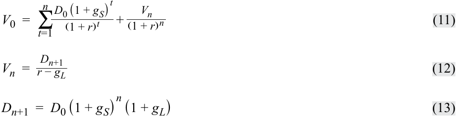

<!-- Formula Text: V 0  =  ∑ t=1 n D 0 (1 + g S) t _ (1 + r) t   + V n _ (1 + r) n (11) V n  = D n+1 _ r − g L (12) D n+1  =  D 0 (1 + g S) n (1 + g L) (13) -->

$$V_0 = \sum_{t=1}^{n} \frac{D_0(1 + g_S)^t}{(1 + r)^t} + \frac{V_n}{(1 + r)^n} \tag{11}$$

$$V_n = \frac{D_{n+1}}{r - g_L} \tag{12}$$

$$D_{n+1} = D_0(1 + g_S)^n(1 + g_L) \tag{13}$$

##### **VÍ DỤ 9 (EXAMPLE 9)** 

### **Áp dụng Mô hình Chiết khấu Cổ tức Hai giai đoạn (Applying the Two-Stage Dividend Discount Model)** 

1. Cổ tức hiện tại, $D_0$, là $5.00. Tốc độ tăng trưởng dự kiến là 10 phần trăm một năm trong ba năm và sau đó là 5 phần trăm. Tỷ suất sinh lợi yêu cầu là 15 phần trăm. Hãy ước tính giá trị nội tại. 

### **Lời giải:** 

$$D_1 = \$5.00(1 + 0.10) = \$5.50$$

$$D_2 = \$5.00(1 + 0.10)^2 = \$6.05$$

$$D_3 = \$5.00(1 + 0.10)^3 = \$6.655$$

$$D_4 = \$5.00(1 + 0.10)^3(1 + 0.05) = \$6.98775$$

$$V_3 = \frac{\$6.98775}{0.15 - 0.05} = \$69.8775$$

$$V_0 = \frac{\$5.50}{(1 + 0.15)} + \frac{\$6.05}{(1 + 0.15)^2} + \frac{\$6.655}{(1 + 0.15)^3} + \frac{\$69.8775}{(1 + 0.15)^3} \approx \$59.68$$

Mô hình DDM có thể được mở rộng ra nhiều giai đoạn tùy theo mức độ phù hợp. Đối với hầu hết các công ty đại chúng (tức là các công ty đã vượt qua giai đoạn khởi nghiệp), những người hành nghề giả định tốc độ tăng trưởng rốt cuộc sẽ rơi vào ba giai đoạn: 1) tăng trưởng (*growth*), 2) chuyển tiếp (*transition*), và 3) trưởng thành/bão hòa (*maturity*). Giả định này củng cố việc sử dụng _mô hình DDM ba giai đoạn (three-stage DDM)_, vốn sử dụng ba tốc độ tăng trưởng: một tốc độ tăng trưởng cao cho giai đoạn hữu hạn đầu tiên, theo sau là một tốc độ tăng trưởng thấp hơn cho giai đoạn hữu hạn thứ hai, và tiếp theo là một tốc độ tăng trưởng bền vững thấp hơn kéo dài mãi mãi. 

Người ta có thể lập luận rằng DDM ba giai đoạn sẽ phù hợp nhất đối với một công ty khá non trẻ, một công ty vừa mới bước vào giai đoạn tăng trưởng. Mô hình DDM hai giai đoạn sẽ phù hợp để ước tính giá trị của một công ty lâu đời hơn đã đi qua giai đoạn tăng trưởng của mình và hiện đang ở giai đoạn chuyển tiếp (một giai đoạn có tốc độ tăng trưởng cao hơn tốc độ tăng trưởng bền vững) trước khi tiến tới giai đoạn trưởng thành (giai đoạn có tốc độ tăng trưởng bền vững thấp hơn). 

Tuy nhiên, việc lựa chọn DDM hai giai đoạn không nhất thiết chỉ dựa vào tuổi đời của công ty. Các công ty đã thành lập lâu năm đôi khi vẫn xoay sở để tái khởi động mức tăng trưởng trên trung bình thông qua, chẳng hạn như, đổi mới sáng tạo, mở rộng sang các thị trường mới, hoặc mua lại và sáp nhập (*acquisitions*). 

<!-- PDF Page 366 -->

Hoặc tốc độ tăng trưởng dài hạn của một công ty có thể bị gián đoạn bởi một giai đoạn hoạt động kém hơn mức bình thường. Nếu tốc độ tăng trưởng dự kiến sẽ dịu lại (trong trường hợp thứ nhất) hoặc cải thiện (trong trường hợp thứ hai) hướng về một tốc độ tăng trưởng dài hạn nào đó, thì DDM hai giai đoạn có thể sẽ phù hợp. Do đó, chúng ta đã chọn DDM hai giai đoạn để định giá Tập đoàn International Business Machines (IBM) trong Ví dụ 10. 

##### **VÍ DỤ 10 (EXAMPLE 10)** 

### **Mô hình Chiết khấu Cổ tức Hai giai đoạn: Tập đoàn International Business Machines (Two-Stage Dividend Discount Model: International Business Machines Corporation)** 

Tập đoàn International Business Machines (IBM) là một công ty công nghệ hàng đầu có trụ sở tại Hoa Kỳ. IBM được thành lập vào năm 1911, ban đầu là một công ty sản xuất máy móc để bán và cho thuê, từ cân thương mại và máy chấm công công nghiệp, máy thái thịt và phô mai, cho đến thẻ đục lỗ. IBM đã giới thiệu máy tính cá nhân vào năm 1981; tuy nhiên, đến thập niên 1990, công ty bắt đầu chịu thua lỗ trong mảng kinh doanh sản xuất máy tính cốt lõi của mình và đến thập niên 2000, công ty đã bắt đầu đa dạng hóa sang lĩnh vực tư vấn kinh doanh, quá trình này được hoàn tất vào năm 2005 khi hãng bán mảng kinh doanh máy tính cá nhân của mình cho công ty Trung Quốc Lenovo. IBM hiện hoạt động thông qua năm phân khúc: Giải pháp Nhận thức (*Cognitive Solutions*), Dịch vụ Kinh doanh Toàn cầu (*Global Business Services* – GBS), Dịch vụ Công nghệ & Nền tảng Đám mây (*Technology Services & Cloud Platforms*), Hệ thống (*Systems*), và Tài chính Toàn cầu (*Global Financing*). Phân khúc Giải pháp Nhận thức cung cấp một dải năng lực từ phân tích mô tả, dự đoán và đề xuất (*descriptive, predictive, and prescriptive analytics*) cho đến các hệ thống nhận thức. Giải pháp Nhận thức bao gồm Watson, một nền tảng điện toán nhận thức có khả năng tương tác bằng ngôn ngữ tự nhiên, xử lý dữ liệu lớn (*big data*), và học hỏi từ các tương tác với con người và máy tính. Phân khúc GBS cung cấp cho khách hàng dịch vụ tư vấn, dịch vụ quản lý ứng dụng và dịch vụ quy trình toàn cầu. Phân khúc Dịch vụ Công nghệ & Nền tảng Đám mây cung cấp các dịch vụ cơ sở hạ tầng công nghệ thông tin. Phân khúc Hệ thống cung cấp cho khách hàng các công nghệ cơ sở hạ tầng. Phân khúc Tài chính Toàn cầu bao gồm tài trợ khách hàng, tài trợ thương mại, cùng tái sản xuất và tiếp thị lại. 

Báo cáo _Value Line_ ngày 30 tháng 7 năm 2018 về IBM xuất hiện trong Bảng minh họa 5 (Exhibit 5). IBM đã tăng cổ tức hàng năm trong suốt 15 năm qua. Thông tin từ _Value Line_ cho thấy mức tăng trưởng cổ tức vào khoảng 17.0 phần trăm trong 10 năm qua, 13.5 phần trăm trong 5 năm qua, và ước tính ở mức 4.5 phần trăm cho giai đoạn từ năm 2015 đến năm 2023. Sau một thời kỳ tăng trưởng thông qua mua lại và sáp nhập, khuôn mẫu này cho thấy IBM có thể đang chuyển tiếp sang giai đoạn tăng trưởng trưởng thành. 

Mô hình DDM hai giai đoạn có thể nói là một lựa chọn tốt để định giá IBM bởi vì công ty dường như đang chuyển tiếp từ giai đoạn tăng trưởng cao (lưu ý mức tăng trưởng cổ tức 13.5 phần trăm trong 5 năm qua) sang giai đoạn tăng trưởng thấp hơn (lưu ý mức dự báo tăng trưởng cổ tức 4.5 phần trăm cho giai đoạn 2015–2023). 

Mô hình CAPM có thể được sử dụng để ước tính tỷ suất sinh lợi yêu cầu, $r$, cho IBM. Báo cáo _Value Line_ (ở góc trên bên trái) ước tính hệ số beta là 0.95. Sử dụng lợi suất khoảng 2.0 phần trăm của trái phiếu Kho bạc Hoa Kỳ kỳ hạn 10 năm làm đại diện (*proxy*) cho lãi suất phi rủi ro và giả định phần bù rủi ro vốn chủ sở hữu là 5.0 phần trăm, chúng ta tìm được ước tính cho $r$ sẽ là 6.75 phần trăm $[2.0\% + 0.95(5.0\%)]$. 

Để ước tính giá trị nội tại vào cuối năm 2018, chúng ta sử dụng mức cổ tức năm 2018 là US$6.21 từ báo cáo _Value Line_. Cổ tức được giả định sẽ tăng trưởng ở tốc độ 5.0 phần trăm trong một năm và sau đó là 2.33 phần trăm. Giả định tốc độ tăng trưởng cho giai đoạn đầu nhất quán với dự báo của _Value Line_ cho 

<!-- PDF Page 367 -->

cổ tức năm 2018 và năm 2019. Giả định của chúng ta về tốc độ tăng trưởng vĩnh cửu 2.33 phần trăm tạo ra một giả định tốc độ tăng trưởng 8 năm gần mức 4.5%,4 nhất quán với dự báo của _Value Line_ về mức tăng trưởng 4.5 phần trăm từ năm 2015–2022. Do đó: 

$$D_{2019} = \text{US}\$6.21(1 + 0.05) = \text{US}\$6.5205$$

$$D_{2020} = \text{US}\$6.21(1 + 0.05)(1 + 0.0233) = \text{US}\$6.6724$$

$$D_{2021} = \text{US}\$6.21(1 + 0.05)(1 + 0.0233)^2 = \text{US}\$6.8279$$

$$V_{2020} = \frac{\text{US}\$6.8279}{0.0675 - 0.0233} = \text{US}\$154.4774$$

$$V_{2018} = \frac{\text{US}\$6.5205}{(1 + 0.0675)} + \frac{\text{US}\$6.6724}{(1 + 0.0675)^2} + \frac{\text{US}\$154.4774}{(1 + 0.0675)^2} \approx \text{US}\$147.523$$

Với mức giá gần đây là US$148.56, như được ghi chú ở góc trên bên trái của báo cáo _Value Line_, ước tính giá trị nội tại US$147.523 cho thấy rằng IBM đang được định giá xấp xỉ mức hợp lý (*approximately fairly valued*). 

<!-- PDF Page 368 -->

##### **Bảng minh họa 5: Báo cáo _Value Line_ về IBM (Exhibit 5: _Value Line_ Report on IBM)** 

_Nguồn:_ © 2018 Value Line, Inc. Bảo lưu mọi quyền trên toàn thế giới. “Value Line” là nhãn hiệu đã đăng ký của Value Line, Inc. Các Chỉ số Trung bình Nhân và Trung bình Cộng của Value Line được tính toán bởi Thomson Reuters. Thông tin được cung cấp bởi Thomson Reuters. 

<!-- PDF Page 369 -->

## **CÁC MÔ HÌNH BỘI SỐ VÀ MỐI QUAN HỆ GIỮA BỘI SỐ GIÁ, MÔ HÌNH GIÁ TRỊ HIỆN TẠI, VÀ CÁC YẾU TỐ CƠ BẢN (MULTIPLIER MODELS AND RELATIONSHIP AMONG PRICE MULTIPLES, PRESENT VALUE MODELS, AND FUNDAMENTALS)** 

# **<mark>9</mark>** 

giải thích cơ sở lý luận của việc sử dụng các bội số giá để định giá cổ phiếu, mối liên hệ giữa bội số giá trên thu nhập với các yếu tố cơ bản, và việc sử dụng các bội số dựa trên phương pháp so sánh
tính toán và diễn giải các bội số sau: giá trên thu nhập, giá trên ước tính dòng tiền hoạt động, giá trên doanh thu, và giá trên giá trị sổ sách 

giải thích các ưu điểm và nhược điểm của từng nhóm mô hình định giá 

Thuật ngữ **bội số giá (*price multiple*)** đề cập đến một tỷ số so sánh giá cổ phiếu với một dòng tiền tệ hoặc giá trị nào đó nhằm cho phép đánh giá giá trị tương đối của cổ phiếu một công ty. Một số người hành nghề sử dụng các tỷ số giá như một cơ chế sàng lọc (*screening mechanism*). Nếu tỷ số này thấp hơn một giá trị xác định, cổ phiếu sẽ được xác định là ứng viên để mua, và nếu tỷ số này vượt quá một giá trị xác định, cổ phiếu sẽ được xác định là ứng viên để bán. Nhiều người hành nghề sử dụng các tỷ số khi xem xét một nhóm hoặc một khu vực ngành các cổ phiếu và coi những cổ phiếu có tỷ số tương đối thấp là những chứng khoán có mức định giá hấp dẫn. 

Các bội số giá được các chuyên gia phân tích chứng khoán sử dụng bao gồm: 

- Tỷ số giá trên thu nhập (*Price-to-earnings ratio* – P/E). Thước đo này là tỷ số giữa giá cổ phiếu trên thu nhập mỗi cổ phiếu (EPS). P/E có thể nói là bội số giá được giới truyền thông trích dẫn thường xuyên nhất và được các chuyên gia phân tích cũng như các nhà đầu tư sử dụng nhiều nhất (Block 1999). Các công trình nền tảng của McWilliams (1966), Miller và Widmann (1966), Nicholson (1968), Dreman (1977), và Basu (1977) đã trình bày bằng chứng về lợi thế tỷ suất sinh lợi của các cổ phiếu có P/E thấp. 

- Tỷ số giá trên giá trị sổ sách (*Price-to-book ratio* – P/B). Tỷ số giữa giá cổ phiếu trên giá trị sổ sách mỗi cổ phiếu. Nhiều bằng chứng đáng kể cho thấy các bội số P/B có mối quan hệ nghịch biến với tỷ suất sinh lợi tương lai (Fama và French 1995). 

- Tỷ số giá trên doanh thu (*Price-to-sales ratio* – P/S). Thước đo này là tỷ số giữa giá cổ phiếu trên doanh thu mỗi cổ phiếu. O’Shaughnessy (2005) đã cung cấp bằng chứng cho thấy bội số P/S thấp là bội số hữu ích nhất để dự đoán tỷ suất sinh lợi tương lai. 

- Tỷ số giá trên dòng tiền (*Price-to-cash-flow ratio* – P/CF). Thước đo này là tỷ số giữa giá cổ phiếu trên một thước đo dòng tiền tính trên mỗi cổ phiếu nào đó. Các thước đo dòng tiền bao gồm dòng tiền tự do (*free cash flow* – FCF) và dòng tiền hoạt động (*operating cash flow* – OCF). 

Một lời chỉ trích phổ biến đối với tất cả các bội số này là chúng không tính đến tương lai. Lời chỉ trích này là đúng nếu bội số được tính toán từ các giá trị quá khứ (*trailing*) hoặc hiện tại của mẫu số. Những người hành nghề tìm cách khắc phục lời chỉ trích này bằng nhiều kỹ thuật khác nhau, bao gồm việc dự báo các giá trị cơ bản (mẫu số) cho một hoặc nhiều năm trong tương lai. Các bội số giá dự phóng (*forward*, *leading*, hoặc *prospective price multiples*) thu được có thể khác biệt rõ rệt so với các bội số giá quá khứ (*trailing price multiples*). Trong trường hợp không có dự báo tường minh về các giá trị cơ bản, chuyên gia phân tích đang đưa ra một dự báo ngầm định về tương lai khi triển khai các mô hình như vậy. Việc lựa chọn bội số giá—quá khứ (*trailing*) hay dự phóng (*forward*)—cần phải được sử dụng nhất quán cho các công ty đang được đem ra so sánh. 

Bên cạnh các bội số giá truyền thống được sử dụng trong định giá vừa được trình bày, các chuyên gia phân tích cần biết cách tính toán và diễn giải các tỷ số khác. Những tỷ số đó bao gồm các tỷ số được sử dụng để phân tích hiệu quả hoạt động kinh doanh và tình trạng tài chính dựa trên dữ liệu được báo cáo trong báo cáo tài chính. Ngoài ra, nhiều ngành còn có các thước đo chuyên biệt về 

<!-- PDF Page 370 -->

hiệu quả hoạt động kinh doanh mà các chuyên gia phân tích phụ trách những ngành đó cần phải nắm vững. Ví dụ, khi phân tích các công ty truyền hình cáp, tỷ số giữa tổng giá trị thị trường của công ty trên tổng số lượng thuê bao thường được sử dụng. Một thước đo phổ biến khác là doanh thu trên mỗi thuê bao. Trong ngành dầu khí, một tỷ số thường được trích dẫn là trữ lượng đã được chứng minh (*proved reserves*) trên mỗi cổ phiếu phổ thông. Các tỷ số đặc thù theo ngành hoặc lĩnh vực như thế này có thể được sử dụng để hiểu các biến số kinh doanh cốt lõi trong một ngành hoặc lĩnh vực cũng như để làm nổi bật các chứng khoán có mức định giá hấp dẫn. 

### **Mối quan hệ giữa các Bội số Giá, Mô hình Giá trị Hiện tại, và các Yếu tố Cơ bản (Relationships among Price Multiples, Present Value Models, and Fundamentals)** 

Các bội số giá thường được sử dụng độc lập với các mô hình giá trị hiện tại. Một cách tiếp cận định giá theo bội số giá, phương pháp so sánh (*method of comparables*), không bao gồm việc dự báo dòng tiền hay chiết khấu về giá trị hiện tại. Tuy nhiên, một bội số giá thường có liên hệ với các yếu tố cơ bản thông qua một mô hình dòng tiền chiết khấu, chẳng hạn như mô hình tăng trưởng Gordon. Việc hiểu rõ những mối liên kết như vậy có thể làm sâu sắc thêm sự thấu hiểu của chuyên gia phân tích về các nhân tố tác động đến giá trị của một bội số và thường có thể giúp giải thích nguyên nhân dẫn đến sự khác biệt trong các bội số mà không liên quan đến việc định giá sai. Các biểu thức được xây dựng có thể được diễn giải là _giá trị hợp lý (justified value)_ của một bội số—tức là giá trị được biện minh bởi (dựa trên) các yếu tố cơ bản hoặc một tập hợp các dự đoán dòng tiền. Những biểu thức này là một cách thức thay thế để trình bày các ước tính giá trị nội tại. 

Ví dụ, sử dụng mô hình tăng trưởng Gordon đã xác định trước đó trong Phương trình 9 và giả định rằng giá bằng với giá trị nội tại ($P_0 = V_0$), chúng ta có thể phát biểu lại Phương trình 9 như sau: 

<!-- Formula Text: P 0  = D 1 _ r − g (14) -->

$$P_0 = \frac{D_1}{r - g} \tag{14}$$

Để đi đến mô hình cho hệ số P/E dự phóng hợp lý (*justified forward P/E*) được cho trong Phương trình 15, chúng ta chia cả hai vế của Phương trình 14 cho dự báo thu nhập của năm tới, $E_1$. Trong Phương trình 15, tỷ lệ chi trả cổ tức (*dividend payout ratio*), $p$, là tỷ số giữa cổ tức trên thu nhập: 

<!-- Formula Text: P 0 _ E 1   = D 1 / E 1 _ r − g   = p _ r − g (15) -->

$$\frac{P_0}{E_1} = \frac{D_1 / E_1}{r - g} = \frac{p}{r - g} \tag{15}$$

Phương trình 15 chỉ ra rằng hệ số P/E có mối quan hệ nghịch biến với tỷ suất sinh lợi yêu cầu và đồng biến với tốc độ tăng trưởng; nghĩa là, khi tỷ suất sinh lợi yêu cầu tăng lên thì P/E giảm xuống, và khi tốc độ tăng trưởng tăng lên thì P/E tăng lên. Hệ số P/E và tỷ lệ chi trả cổ tức bề ngoài dường như có mối quan hệ đồng biến. Tuy nhiên, mối quan hệ này có thể không đúng, bởi vì tỷ lệ chi trả cổ tức cao hơn có thể hàm ý một tốc độ tăng trưởng chậm hơn do công ty giữ lại một tỷ trọng thu nhập thấp hơn để tái đầu tư. Hiện tượng này được gọi là sự đánh đổi giữa cổ tức và thu nhập (*dividend displacement of earnings*). 

##### **VÍ DỤ 11 (EXAMPLE 11)** 

### **Ước tính Giá trị Dựa trên các Yếu tố Cơ bản (Value Estimate Based on Fundamentals)** 

1. Petroleo Brasileiro SA, thường được biết đến với tên gọi Petrobras, từng có lần bị Bloomberg.com gắn mác là "công ty dầu khí đắt đỏ nhất". Dữ liệu của Petrobras và ngành dầu khí, bao gồm hệ số P/E 12 tháng gần nhất (*trailing twelve-month* – TTM) và tỷ lệ chi trả cổ tức, xuất hiện dưới đây. 

||**Petrobras**|**Ngành (Industry)**|
|---|---|---|
|Tỷ số P/E (TTM)|39.61|13.0|
|Tỷ suất sinh lợi trên tài sản – ROA (TTM) (%)|3.0|3.2|

<!-- PDF Page 371 -->

||**Petrobras**|**Ngành (Industry)**|
|---|---|---|
|Tốc độ tăng trưởng EPS 3 năm (%)|NM|66.00|
|EPS (MRQ) so với Quý cách đây 1 năm (% thay đổi)|138.96|−12.0|

_Lưu ý:_ NM viết tắt của không thể định lượng (*non-quantifiable*). EPS của Petrobras đã chuyển biến từ mức lỗ 1.14 BRL trên mỗi cổ phiếu sang mức lãi 0.16 BRL trên mỗi cổ phiếu trong kỳ gần nhất. MRQ viết tắt của "quý gần nhất (*most recent quarter*)." 

_Nguồn:_ Reuters. 

Hãy giải thích làm thế nào thông tin được hiển thị lại củng cố cho một hệ số P/E của Petrobras cao hơn so với của ngành. 

### **Lời giải:** 

Dữ liệu củng cố cho mức P/E cao hơn đối với Petrobras bởi vì tốc độ tăng trưởng EPS quý gần nhất (MRQ) của công ty vượt trội so với ngành. Phương trình 15 ngụ ý một mối quan hệ đồng biến giữa tỷ lệ chi trả cổ tức và bội số P/E. Petrobras đã có EPS âm trong giai đoạn từ năm 2014 đến năm 2017, và không trả cổ tức trong suốt giai đoạn đó. Tỷ lệ chi trả cổ tức cao hơn sẽ hỗ trợ cho mức P/E cao hơn. Hơn nữa, trong chừng mực mà mức tăng trưởng EPS cao hơn hàm ý một tốc độ tăng trưởng cao về cổ tức, thì tốc độ tăng trưởng EPS cao sẽ hỗ trợ cho một mức P/E cao. Tỷ số P/E cao hơn là do sự cải thiện trong hiệu quả hoạt động tài chính cơ bản của công ty và tiềm năng tăng trưởng dự kiến cao hơn của cổ phiếu này so với các công ty trung vị trong ngành. 

##### **VÍ DỤ 12 (EXAMPLE 12)** 

### **Xác định P/E Dự phóng Hợp lý (Determining Justified Forward P/E)** 

Heinrich Gladisch, CFA, đang ước tính hệ số P/E dự phóng hợp lý cho Nestlé, một trong những công ty dinh dưỡng và sức khỏe hàng đầu thế giới. Gladisch ghi nhận rằng doanh thu năm 2017 là 89.78 tỷ SFr (90.3 tỷ US$) và thu nhập ròng là 7.18 tỷ SFr (7.25 tỷ US$). Ông sắp xếp dữ liệu về EPS, cổ tức trên mỗi cổ phiếu, và tỷ lệ chi trả cổ tức cho các năm 2013–2017 trong bảng sau: 

||**2013**|**2014**|**2015**|**2016**|**2017**|
|---|---|---|---|---|---|
|Thu nhập trên mỗi cổ phiếu (*Earnings per share*)|SFr3.24|SFr4.54|SFr2.90|SFr2.76|SFr2.32|
|_% thay đổi so với năm trước (Year over year % change)_||44.6%|–36.1%|–4.8%|–15.9%|
|Cổ tức trên mỗi cổ phiếu (*Dividend per share*)|SFr2.15|SFr2.2|SFr2.25|SFr2.3|SFr2.35|
|_% thay đổi so với năm trước (Year over year % change)_||2.3%|2.3%|2.2%|2.2%|
|Tỷ lệ chi trả cổ tức (*Dividend payout ratio*)|68.5%|48.5%|77.6%|83.3%|99.2%|

Gladisch tính toán rằng ROE đạt trung bình 15.5 phần trăm trong giai đoạn 2013−2017 nhưng đã xuống dưới mức đó ở 11.7 phần trăm vào năm 2017. Tuy nhiên, trong năm đó, thu nhập ròng báo cáo của Nestlé bao gồm một khoản mục không thường xuyên (*nonrecurring component*) lớn. Công ty đã báo cáo "thu nhập cơ bản (*underlying earnings*)" năm 2017, được định nghĩa là thu nhập ròng "từ các hoạt động kinh doanh liên tục trước các khoản suy giảm giá trị tài sản (*impairments*), chi phí tái cấu trúc, kết quả từ việc thanh lý và các khoản mục bất thường một lần (*one-off items*) đáng kể," ở mức SFr2.93, mang lại mức ROE điều chỉnh là 14.8%. Dự đoán sự cải thiện ngày càng tăng trong biên lợi nhuận của Nestlé nhờ sự tăng trưởng tại các thị trường sản phẩm của hãng, Gladisch ước tính mức ROE dài hạn là 21.5 phần trăm. 

<!-- PDF Page 372 -->

Gladisch quyết định rằng các tỷ lệ chi trả cổ tức của giai đoạn 2013–2016—đạt trung bình 67.7 phần trăm—đại diện tốt hơn cho tỷ lệ chi trả cổ tức trong tương lai của Nestlé so với tỷ lệ chi trả cổ tức cao của năm 2017 (khi tính dựa trên thu nhập báo cáo). Tỷ lệ chi trả cổ tức năm 2017 cao hơn bởi vì ban lãnh đạo rõ ràng đã dựa vào các cấu phần thu nhập ròng dự kiến sẽ tiếp diễn trong tương lai để ấn định mức cổ tức năm 2017. Nhưng việc dựa vào thu nhập ròng bao gồm cả các khoản mục không thường xuyên để trả cổ tức sẽ tạo ra nhu cầu tiềm tàng phải tăng cổ tức trong tương lai. Làm tròn mức trung bình giai đoạn 2013−2016 lên, Gladisch chốt mức ước tính 68 phần trăm cho tỷ lệ chi trả cổ tức để sử dụng trong việc tính toán hệ số P/E dự phóng hợp lý bằng Phương trình 15. 

Công ty của Gladisch ước tính rằng tỷ suất sinh lợi yêu cầu đối với cổ phiếu của Nestlé là 9 phần trăm mỗi năm. Gladisch cũng tìm thấy dữ liệu sau đây ở hai đầu thái cực của dải phổ dự báo từ các chuyên gia phân tích nghiên cứu bên ngoài: 

||**2018E**|**2019E**|
|---|---|---|
|Dự báo của chuyên gia phân tích lạc quan nhất:|||
|EPS|SFr3.99|SFr4.33|
|_% thay đổi so với năm trước_|71.9%|8.5%|
|P/E (dựa trên mức giá mục tiêu SFr105)|26.3|24.2|
|Dự báo của chuyên gia phân tích kém lạc quan nhất:|||
|EPS|SFr3.52|SFr3.59|
|_% thay đổi so với năm trước_|51.7%|2.0%|
|P/E (dựa trên mức giá mục tiêu SFr68)|19.3|18.9|

1. Chỉ dựa trên thông tin và các ước tính do Gladisch cùng công ty của ông xây dựng, hãy ước tính hệ số P/E dự phóng hợp lý của Nestlé. 

#### **Lời giải:** 

Ước tính hệ số P/E dự phóng hợp lý là 32.38. Tốc độ tăng trưởng cổ tức có thể được ước tính bằng cách sử dụng Phương trình 10 là $(1 - \text{Tỷ lệ chi trả cổ tức}) \times \text{ROE} = (1 - 0.68) \times 0.215 = 0.069$, hay 6.9 phần trăm. Do đó, 

<!-- Formula Text: P 0 _ E 1   = Payout _ r − g   = 0.68 _ 0.09 − 0.069   =  32.38 -->

$$\frac{P_0}{E_1} = \frac{\text{Payout}}{r - g} = \frac{0.68}{0.09 - 0.069} = 32.38$$

2. So sánh và đối chiếu ước tính P/E dự phóng hợp lý từ Câu hỏi 1 với các ước tính từ mỗi đầu thái cực trong dải phổ dự báo của các chuyên gia phân tích nghiên cứu bên ngoài. 

#### **Lời giải:** 

Hệ số P/E dự phóng hợp lý ước tính là 32.38 cao hơn so với các ước tính P/E năm 2018 hợp lý ở mức 26.3 và 19.3 của hai chuyên gia phân tích kia. Việc sử dụng tỷ suất sinh lợi yêu cầu 9.5 phần trăm thay vì 9 phần trăm sẽ dẫn đến ước tính P/E dự phóng hợp lý là $26.2 = 0.68 / (0.095 - 0.069)$. Việc sử dụng mức ROE 16.5 phần trăm (mức ROE trung bình của giai đoạn 2013–2016) thay vì 21.5 phần trăm sẽ dẫn đến ước tính P/E dự phóng hợp lý là $18.4 = 0.68 / [0.09 - (0.32)(0.165)] = 0.68 / (0.09 - 0.053)$. Hệ số P/E dự phóng hợp lý rất nhạy cảm với những thay đổi trong các dữ liệu đầu vào. 

Các ước tính P/E dự phóng hợp lý có thể nhạy cảm với những thay đổi nhỏ trong các giả định. Do đó, các chuyên gia phân tích có thể hưởng lợi từ việc thực hiện phân tích độ nhạy, như được trình bày trong Bảng minh họa 6 (Exhibit 6), vốn được dựa trên Ví dụ 12. Bảng minh họa 6 cho thấy hệ số P/E dự phóng hợp lý 

---

# Tập 5: Đầu tư Cổ phiếu (Volume 5: Equity Investments)
## Học phần 8: Định giá Cổ phiếu: Các Khái niệm và Công cụ Cơ bản (Equity Valuation: Concepts and Basic Tools)
### Phần 3/4: Phương pháp So sánh và Định giá Dựa trên Bội số Giá (Method of Comparables and Valuation Based on Price Multiples) (Trang PDF 373–387)

---

<!-- PDF Page 373 -->

P/E thay đổi theo những biến động trong các ước tính về tỷ lệ chi trả cổ tức (các cột) và tỷ suất sinh lợi trên vốn chủ sở hữu (ROE). Tốc độ tăng trưởng cổ tức (các hàng) thay đổi do sự thay đổi trong tỷ lệ lợi nhuận giữ lại $(1 - \text{Tỷ lệ chi trả cổ tức})$ và ROE. Hãy nhớ lại rằng $g = \text{ROE} \times \text{tỷ lệ lợi nhuận giữ lại}$. 

**Bảng minh họa 6: Các Ước tính cho P/E Dự phóng Hợp lý của Nestlé (Tỷ suất Sinh lợi Yêu cầu = 9 Phần trăm) (Exhibit 6: Estimates for Nestlé’s Justified Forward P/E [Required Rate of Return = 9 Percent])** 

|**Tốc độ Tăng trưởng Cổ tức Đều (Constant Dividend Growth Rate) (%)**|**Tỷ lệ Chi trả Cổ tức (Dividend Payout Ratio): 55%**|**60%**|**65%**|**70%**|**75%**|
|---|---|---|---|---|---|
|4.0|11.0|12.0|13.0|14.0|15.0|
|4.5|12.2|13.3|14.4|15.6|16.7|
|5.0|13.8|15.0|16.3|17.5|18.8|
|5.5|15.7|17.1|18.6|20.0|21.4|
|6.0|18.3|20.0|21.7|23.3|25.0|
|6.5|22.0|24.0|26.0|28.0|30.0|
|7.0|27.5|30.0|32.5|35.0|37.5|
|7.5|36.7|40.0|43.3|46.7|50.0|

### **PHƯƠNG PHÁP SO SÁNH VÀ ĐỊNH GIÁ DỰA TRÊN BỘI SỐ GIÁ (METHOD OF COMPARABLES AND VALUATION BASED ON PRICE MULTIPLES)** 

# **<mark>10</mark>** 

- giải thích cơ sở lý luận của việc sử dụng các bội số giá để định giá cổ phiếu, mối liên hệ giữa bội số giá trên thu nhập với các yếu tố cơ bản, và việc sử dụng các bội số dựa trên phương pháp so sánh 

- tính toán và diễn giải các bội số sau: giá trên thu nhập, giá trên ước tính dòng tiền hoạt động, giá trên doanh thu, và giá trên giá trị sổ sách 

- giải thích các ưu điểm và nhược điểm của từng nhóm mô hình định giá 

Phương pháp so sánh (*method of comparables*) là cách tiếp cận được sử dụng rộng rãi nhất đối với các chuyên gia phân tích khi báo cáo những đánh giá định giá trên cơ sở các bội số giá. Về bản chất, phương pháp này so sánh các giá trị tương đối được ước tính bằng cách sử dụng các bội số hoặc so sánh giá trị tương đối của chính các bội số đó. Cơ sở lý luận kinh tế nền tảng của phương pháp so sánh là **quy luật một giá (*law of one price*)**: Các tài sản giống hệt nhau thì phải được bán với cùng một mức giá. Phương pháp luận này bao gồm việc sử dụng một bội số giá để đánh giá xem một tài sản đang được định giá hợp lý, định giá thấp, hay định giá cao trong mối tương quan với giá trị chuẩn (*benchmark value*) của bội số đó. Các lựa chọn cho bội số chuẩn bao gồm bội số của một cổ phiếu riêng lẻ có đặc điểm tương đồng sát sao hoặc giá trị trung bình hay trung vị của bội số đó đối với ngành của cổ phiếu. Một số chuyên gia phân tích thực hiện phân tích xu hướng (*trend analysis*) hoặc chuỗi thời gian (*time-series analysis*) và sử dụng các giá trị trong quá khứ hoặc giá trị trung bình của một bội số giá làm mức chuẩn. 

Việc xác định các công ty riêng lẻ hoặc thậm chí một ngành làm đối tượng "tương đồng có thể so sánh (*comparable*)" có thể đặt ra một thách thức không nhỏ. Nhiều tập đoàn lớn hoạt động trong nhiều lĩnh vực kinh doanh khác nhau, vì vậy quy mô và phạm vi hoạt động của chúng có thể khác biệt đáng kể. Khi xác định các công ty tương đồng (đôi khi được gọi tắt là "comps"), chuyên gia phân tích cần thận trọng để xác định những công ty giống nhau nhất xét theo một số chiều hướng tiêu chí. Những 

<!-- PDF Page 374 -->

chiều hướng tiêu chí này bao gồm (nhưng không giới hạn ở) quy mô tổng thể, các dòng sản phẩm, và tốc độ tăng trưởng. Kiểu phân tích đã trình bày trong Phần 5.1 (Mục 9) gắn kết các bội số với những yếu tố cơ bản là một cách thức hiệu quả để xác định các biến số cơ bản cần được tính đến khi lựa chọn các công ty tương đồng. 

###### **VÍ DỤ 13 (EXAMPLE 13)** 

#### **Phương pháp So sánh (1) (Method of Comparables (1))** 

1. Như đã lưu ý trước đó, P/E là một bội số giá thường xuyên được các chuyên gia phân tích sử dụng. Tuy nhiên, việc sử dụng P/E trong phương pháp so sánh có thể gặp vấn đề do những tác động của chu kỳ kinh doanh lên EPS. Một công cụ định giá thay thế hữu ích trong những giai đoạn kinh tế suy giảm hoặc tăng trưởng đột biến là bội số P/S (*price-to-sales*). Mặc dù doanh thu sẽ giảm trong thời kỳ suy thoái và tăng trong thời kỳ tăng trưởng kinh tế, mức độ thay đổi của doanh thu sẽ ít hơn mức độ thay đổi của thu nhập xét theo tỷ lệ phần trăm bởi vì thu nhập chịu ảnh hưởng nặng nề bởi các chi phí hoạt động cố định và chi phí tài trợ cố định (đòn bẩy hoạt động và đòn bẩy tài chính – *operating and financial leverage*). 

Dữ liệu sau đây cung cấp hệ số P/S cho hầu hết các nhà sản xuất ô tô lớn tính đến tháng 12 năm 2017: 

|**Công ty (Company)**|**P/S**|
|---|---|
|Peugeot|0.28|
|Ford Motor|0.33|
|General Motors|0.36|
|Nissan Motor|0.38|
|Honda Motor|0.46|
|Tata Motors|0.49|
|Daimler|0.55|
|BMW|0.57|
|Toyota Motor|0.80|

_Nguồn:_ Morningstar và trang web của các công ty. 

Dựa trên dữ liệu được trình bày, cổ phiếu nào dường như đang bị định giá thấp khi so sánh với các cổ phiếu còn lại? 

#### **Lời giải:** 

Phân tích hệ số P/S cho thấy rằng cổ phiếu Peugeot mang lại mức giá trị tốt nhất (định giá thấp nhất). Tuy nhiên, chuyên gia phân tích phải luôn cảnh giác trước hàng loạt cách giải thích tiềm tàng cho các mức bội số bề ngoài có vẻ thấp hoặc cao khi thực hiện phân tích so sánh, thay vì chỉ đơn thuần giả định rằng có sự định giá sai tương đối (*relative mispricing*). 

<!-- PDF Page 375 -->

###### **VÍ DỤ 14 (EXAMPLE 14)** 

#### **Phương pháp So sánh (2) (Method of Comparables (2))** 

1. Được thành lập tại Hà Lan, Airbus hoạt động trong ngành hàng không vũ trụ và quốc phòng. Đây là công ty hàng không vũ trụ giữ vị thế thống lĩnh tại Châu Âu. Mảng kinh doanh lớn nhất của hãng, Airbus Commercial Aircraft (Máy bay Thương mại Airbus), là một công ty sản xuất có cơ sở tại một số quốc gia Châu Âu và đóng góp phần lớn lợi nhuận của Airbus SE. Airbus và đối thủ cạnh tranh chính của mình, Boeing, kiểm soát phần lớn ngành công nghiệp máy bay thương mại toàn cầu. 

Các phép so sánh thường xuyên được thực hiện giữa Airbus và Boeing. Như được ghi nhận trong Bảng minh họa 7 (Exhibit 7), hai công ty nhìn chung có quy mô tương đồng khi đo lường bằng tổng doanh thu. Quy đổi tổng doanh thu dự báo từ đồng euro sang đồng đô la Mỹ bằng tỷ giá hối đoái trung bình năm 2017 là US$1.13/€ sẽ cho ra giá trị $75.5 tỷ đối với tổng doanh thu của Airbus. Như vậy, tổng doanh thu của Boeing dự kiến cao hơn khoảng một phần năm (20%) so với của Airbus. 

Tuy nhiên, hai công ty có sự khác biệt ở một số khía cạnh quan trọng. Airbus thu được tỷ trọng doanh thu từ sản xuất máy bay thương mại lớn hơn so với Boeing, và lượng đơn đặt hàng tồn đọng chưa thực hiện (*order backlog*) của Airbus cao hơn nhiều so với của Boeing. Quy đổi lượng đơn đặt hàng tồn đọng của Airbus từ đồng euro sang đồng đô la Mỹ bằng tỷ giá cuối quý vào tháng 9 năm 2017 là $1.1813/€ sẽ cho ra giá trị $1,116.3 tỷ ($1.12 nghìn tỷ) đối với lượng đơn đặt hàng tồn đọng của Airbus. Như vậy, lượng đơn đặt hàng tồn đọng của Airbus cao hơn gấp đôi so với lượng đơn hàng tồn đọng của Boeing.5 

**Bảng minh họa 7: Dữ liệu của Airbus (EADS) và Boeing (Exhibit 7: Data for EADS and Boeing)** 

||**Airbus**|**Boeing**|
|---|---|---|
|Tổng doanh thu (*Total revenues* – tỷ, 2017)|€66.8|$92.2|
|Tăng trưởng doanh thu hàng năm (trung bình 2015–2017)|1.8%|–2.1%|
|Phần trăm doanh thu từ máy bay thương mại|75%|69%|
|Đơn đặt hàng tồn đọng (*Order backlog* – tỷ)|€945|$474|
|Giá cổ phiếu, 12/12/2017|€86.96|$283.73|
|EPS (cơ bản – *basic*)|€3.33|$10.18|
|DPS|€1.48|$5.7|
|Tỷ lệ chi trả cổ tức (*Dividend payout ratio*)|44%|56%|
|Tỷ số P/E (*P/E ratio*)|26.1|27.9|

_Lưu ý:_ Dữ liệu dự báo năm 2017 và tỷ giá hối đoái trung bình từ đầu năm đến ngày lập báo cáo (YTD) tính đến ngày 12 tháng 12 năm 2017. Đơn đặt hàng tồn đọng tính đến ngày 30 tháng 9 năm 2017. 

_Nguồn:_ Trang web của các công ty: www.airbus.com và www.boeing.com, _Financial Times_. 

Dữ liệu nào hiển thị trong Bảng minh họa 7 củng cố cho mức P/E của Boeing cao hơn so với của Airbus? 

> 5 Dữ liệu tỷ giá hối đoái có sẵn từ FRED (Dữ liệu Kinh tế của Cục Dự trữ Liên bang) tại http://research.stlouisfed.org/fred2/. Mỗi công ty sử dụng phương pháp luận hơi khác nhau một chút để tính toán lượng đơn đặt hàng tồn đọng. 

<!-- PDF Page 376 -->

#### **Lời giải:** 

Hãy nhớ lại từ Phương trình 14 (và Phương trình 15) cùng phần thảo luận theo sau nó rằng hệ số P/E có mối quan hệ thuận (đồng biến) với tỷ lệ chi trả cổ tức và tốc độ tăng trưởng cổ tức. Hệ số P/E có mối quan hệ nghịch biến với tỷ suất sinh lợi yêu cầu. Dữ liệu duy nhất được trình bày trong Bảng minh họa 7 hỗ trợ cho mức P/E cao hơn đối với Boeing là tỷ lệ chi trả cổ tức cao hơn của công ty này (dự kiến ở mức 56 phần trăm so với 44 phần trăm của Airbus). 

Những yếu tố sau đây ngầm hỗ trợ cho mức P/E cao hơn đối với Airbus: Airbus có mức tăng trưởng doanh thu cao hơn (như đã báo cáo cho năm 2016 và dự kiến cho năm 2017) và lượng đơn đặt hàng tồn đọng cao hơn, cho thấy hãng có thể có tốc độ tăng trưởng tương lai cao hơn. 

###### **VÍ DỤ 15 (EXAMPLE 15)** 

#### **Phương pháp So sánh (3) (Method of Comparables (3))** 

1. Canon Inc. là nhà sản xuất hàng đầu thế giới về máy móc văn phòng kinh doanh, máy ảnh và các sản phẩm quang học. Canon được thành lập vào năm 1937 với tư cách là một nhà sản xuất máy ảnh và được đăng ký thành lập tại Tokyo. Triết lý doanh nghiệp của Canon là _kyosei_ hay "sống và làm việc cùng nhau vì lợi ích chung." Dữ liệu sau đây có thể được sử dụng để xác định hệ số P/E cho Canon trong khoảng thời gian 2013–2017. Hãy phân tích hệ số P/E của Canon theo thời gian và thảo luận về mức định giá của Canon. 

|**Năm (Year)**|**Giá (Price)** **(a)**|**EPS** **(b)**|**P/E** **(a) ÷ (b)**|
|---|---|---|---|
|2013|¥3,330|¥200.8|16.6|
|2014|¥3,840.5|¥229.0|16.8|
|2015|¥3,675|¥201.7|18.2|
|2016|¥3,295|¥138|23.9|
|2017|¥4,200|¥222.88|18.8|

_Nguồn:_ Dữ liệu EPS, giá cuối năm và P/E được lấy từ Capital IQ và _Financial Times_. 

#### **Lời giải:** 

Phân tích xu hướng đối với hệ số P/E của Canon cho thấy mức đỉnh là 23.9 vào cuối năm 2016. Hệ số P/E năm 2013 ở mức 16.6 là mức thấp nhất trong 5 năm được báo cáo. Phát hiện này gợi ý rằng giá cổ phiếu của Canon có thể đang được định giá hợp lý (*fairly priced*) tính đến cuối năm 2017. Một kịch bản bi quan (*bearish case*) đối với cổ phiếu của Canon có thể được đưa ra nếu chuyên gia phân tích tin rằng hệ số P/E sẽ quay trở về mức thấp lịch sử của nó (16.6 trong giai đoạn 5 năm này) hoặc thấp hơn. Một dự đoán bi quan như vậy đòi hỏi sự sụt giảm của P/E không được bù đắp bởi sự gia tăng của EPS. Ngược lại, một kịch bản lạc quan (*bullish case*) có thể được đưa ra nếu chuyên gia phân tích tin rằng cổ phiếu này xứng đáng được định giá lại (*re-rating*) và hưởng mức P/E thậm chí còn cao hơn xu hướng. 

#### **Minh họa về Định giá Dựa trên Bội số Giá (Illustration of a Valuation Based on Price Multiples)** 

Telefónica S.A., một công ty dẫn đầu thế giới trong lĩnh vực viễn thông, cung cấp các sản phẩm và dịch vụ truyền thông, thông tin và giải trí tại Châu Âu, Châu Phi và Châu Mỹ Latinh. Công ty đã hoạt động tại quê nhà Tây Ban Nha kể từ năm 1924, nhưng tính đến năm 2017, hơn 75 phần trăm hoạt động kinh doanh của hãng nằm bên ngoài thị trường nội địa. 

<!-- PDF Page 377 -->

Deutsche Telekom AG cung cấp dịch vụ truy cập mạng, dịch vụ truyền thông và các dịch vụ giá trị gia tăng thông qua mạng cố định và mạng di động. Hãng tạo ra hơn một nửa doanh thu bên ngoài quốc gia quê nhà là nước Đức. 

Bảng minh họa 8 (Exhibit 8) cung cấp dữ liệu so sánh cho hai gã khổng lồ truyền thông này trong giai đoạn 2015–2017. 

**Bảng minh họa 8: Dữ liệu của Telefónica và Deutsche Telekom (Exhibit 8: Data for Telefónica and Deutsche Telekom)** 

||**Telefónica: 2017**|**2016**|**2015**|**Deutsche Telekom: 2017**|**2016**|**2015**|
|---|---|---|---|---|---|---|
|(1) Tổng tài sản (€ tỷ)|115.0|123.6|120.3|141.3|148.5|143.9|
|_Tăng trưởng tài sản (Asset growth)_|−6.9%|2.7%|—|−4.9%|3.2%|—|
|(2) Doanh thu thuần (€ tỷ)|52.0|52.0|54.9|77.3|75.2|71.3|
|_Tăng trưởng doanh thu (Revenue growth)_|0%|−5.2%|—|2.8%|5.5%|—|
|(3) Dòng tiền thuần từ hoạt động kinh doanh (€ tỷ)|13.8|13.3|13.6|17.2|15.5|15.0|
|_Tăng trưởng dòng tiền (Cash flow growth)_|3.4%|−2.0%|—|11.0%|3.3%|—|
|(4) Giá trị sổ sách vốn chủ sở hữu phổ thông (€ tỷ)|16.9|18.2|15.8|42.5|38.8|38.2|
|_Tỷ số nợ (Debt ratio): $1 - [(4) \div (1)]$_|85.3%|85.3%|86.9%|70.0%|73.9%|73.5%|
|(5) Lợi nhuận ròng (€ tỷ)|2.9|2.1|0.4|3.5|2.7|3.3|
|_Tăng trưởng thu nhập (Earnings growth)_|38.1%|425.0%|—|29.6%|−18.2%|—|
|(6) Số lượng cổ phiếu đang lưu hành bình quân gia quyền (triệu)|5,122.9|4,896.6|4,833.6|4,740.2|4,654.9|4,584.8|
|(7) Giá mỗi cổ phiếu (€)|7.93|9.52|9.13|13.42|16.21|15.44|
|_Tỷ số giá trên doanh thu (P/R): $(7) \div [(2) \div (6)]$_|0.8|0.9|0.8|0.8|1.0|1.0|
|_P/CF: $(7) \div [(3) \div (6)]$_|2.9|3.5|3.2|3.7|4.9|4.7|
|_P/B: $(7) \div [(4) \div (6)]$_|2.4|2.6|2.8|1.5|1.9|1.9|
|_P/E: $(7) \div [(5) \div (6)]$_|14.0|22.2|110.3|18.2|27.9|21.5|

_Nguồn:_ Trang web của các công ty: www.telefonica.es và www.deutschetelekom.com. 

Phân tích chuỗi thời gian đối với tất cả các bội số giá trong Bảng minh họa 8 cho thấy cả hai công ty hiện đều đang có mức định giá hấp dẫn. Ví dụ, tỷ số giá trên doanh thu (P/R) năm 2017 ở mức 0.78 (làm tròn 0.8) của Telefónica thấp hơn mức trung bình giai đoạn 2015–2017 của tỷ số này là khoảng 0.83. Hệ số P/CF năm 2017 ở mức 3.7 của Deutsche Telekom thấp hơn mức trung bình giai đoạn 2015–2017 của tỷ số này là khoảng 4.4. 

Một phân tích so sánh ngang mang lại kết quả có phần trái chiều. Các giá trị năm 2017 của Deutsche Telekom đối với các bội số P/R, P/CF, P/E đều cao hơn so với của Telefónica. Kết quả này gợi ý rằng Telefónica có mức định giá hấp dẫn khi so sánh với Deutsche Telekom. Tuy nhiên, hệ số P/B năm 2017 của Telefónica lại cao hơn so với của Deutsche Telekom. Một chuyên gia phân tích khi tìm hiểu những kết quả mâu thuẫn này sẽ tìm kiếm các thông tin không được báo cáo trong Bảng minh họa 8. Ví dụ, thu nhập trước lãi vay, thuế và khấu hao (EBITDA) của Telefónica là €16.4 tỷ vào năm 2017. Giá trị EBITDA của Deutsche Telekom là €20.7 tỷ vào năm 2017. Tỷ số giá trên EBITDA (*price-to-EBITDA ratio*) năm 2017 của Telefónica là $[(7.93 \times 5,123)/16,400]$ hay $[7.93/(16,400/5,123)] = 2.5$, trong khi 

<!-- PDF Page 378 -->

tỷ số giá trên EBITDA năm 2017 của Deutsche Telekom là 3.1. Do đó, mức P/E cao hơn của Deutsche Telekom không thể được giải thích bởi chi phí khấu hao cao hơn, chi phí lãi vay cao hơn, và/hoặc gánh nặng thuế lớn hơn, mà dường như là do chất lượng thu nhập (*quality of earnings*) tốt hơn. 

Tóm lại, ưu điểm chính của việc sử dụng các bội số giá là chúng cho phép thực hiện các phép so sánh tương đối, cả so sánh chéo (*cross-sectional* – so với thị trường hoặc một công ty tương đồng khác) lẫn so sánh theo chuỗi thời gian (*time series*). Cách tiếp cận này có thể đặc biệt hữu ích đối với các chuyên gia phân tích được phân công phụ trách một ngành hoặc khu vực kinh tế cụ thể và cần xác định những cổ phiếu dự kiến có thành quả hoạt động tốt nhất trong khu vực đó. Các bội số giá được giới đầu tư ưa chuộng bởi vì chúng có thể được tính toán dễ dàng và nhiều bội số có sẵn ngay trên các trang web tài chính và báo chí. 

Sự thận trọng là rất cần thiết. Một cổ phiếu có thể đang bị định giá thấp tương đối khi so sánh với các mức chuẩn của nó nhưng lại bị định giá cao khi so sánh với ước tính giá trị nội tại được xác định bởi một trong các phương pháp luận dòng tiền chiết khấu. Hơn nữa, sự khác biệt trong quy định báo cáo giữa các thị trường khác nhau và trong các phương pháp kế toán được lựa chọn có thể dẫn đến doanh thu, thu nhập, giá trị sổ sách và dòng tiền không dễ dàng so sánh trực tiếp với nhau. Những sự khác biệt này, đến lượt nó, có thể dẫn đến các bội số không dễ so sánh với nhau. Cuối cùng, các bội số đối với những công ty có tính chu kỳ có thể chịu ảnh hưởng mạnh mẽ bởi các điều kiện kinh tế hiện hành. 

# **<mark>11</mark>** 

### **GIÁ TRỊ DOANH NGHIỆP (ENTERPRISE VALUE)** 

mô tả các bội số giá trị doanh nghiệp và việc sử dụng chúng trong ước tính giá trị vốn chủ sở hữu 

giải thích các ưu điểm và nhược điểm của từng nhóm mô hình định giá 

Một phương án thay thế cho việc ước tính giá trị của vốn chủ sở hữu là ước tính giá trị của toàn bộ doanh nghiệp (*value of the enterprise*). Giá trị doanh nghiệp (*Enterprise value* – EV) thường được xác định nhất bằng giá trị vốn hóa thị trường (*market capitalization*) cộng với giá trị thị trường của cổ phiếu ưu đãi cộng với giá trị thị trường của nợ vay trừ đi tiền mặt và các khoản đầu tư (các khoản tương đương tiền và đầu tư ngắn hạn). Giá trị doanh nghiệp thường được xem như chi phí của một thương vụ thâu tóm (*cost of a takeover*): Trong trường hợp mua lại toàn bộ (*buyout*), công ty đi thâu tóm sẽ gánh nhận khoản nợ của công ty bị mua lại nhưng đồng thời cũng nhận được lượng tiền mặt của công ty đó. Giá trị doanh nghiệp hữu ích nhất khi so sánh các công ty có sự khác biệt đáng kể về cấu trúc vốn (*capital structure*). 

Các bội số giá trị doanh nghiệp (EV) được sử dụng rộng rãi tại Châu Âu, với EV/EBITDA có thể nói là phổ biến nhất. EBITDA là một đại diện (*proxy*) cho dòng tiền hoạt động bởi vì nó loại trừ chi phí khấu hao tài sản cố định hữu hình và phân bổ tài sản vô hình (*depreciation and amortization*). Tuy nhiên, EBITDA có thể vẫn bao gồm các chi phí phi tiền mặt khác và doanh thu phi tiền mặt. EBITDA có thể được xem như một nguồn quỹ để thanh toán lãi vay, cổ tức và thuế. Bởi vì EBITDA được tính toán trước khi chi trả cho bất kỳ bên có quyền lợi tài chính liên quan (*financial stakeholders*) nào của công ty, nên việc sử dụng nó để ước tính giá trị doanh nghiệp là hoàn toàn hợp lý về mặt logic. 

Việc sử dụng giá trị doanh nghiệp thay vì giá trị vốn hóa thị trường để xác định một bội số có thể rất hữu ích cho các chuyên gia phân tích. Ngay cả khi hệ số P/E gặp vấn đề do thu nhập âm, bội số EV/EBITDA nhìn chung vẫn có thể tính toán được bởi vì EBITDA thường mang giá trị dương. Một phương án thay thế cho việc sử dụng EBITDA trong các bội số EV là sử dụng thu nhập hoạt động (*operating income* – EBIT/OI). 

Trên thực tế, các chuyên gia phân tích có thể gặp khó khăn trong việc đánh giá chính xác giá trị doanh nghiệp nếu họ không tiếp cận được các báo giá thị trường đối với khoản nợ vay của công ty. Khi không có sẵn các báo giá thị trường hiện tại, giá trị trái phiếu có thể được ước tính từ các báo giá hiện tại của những trái phiếu có đặc điểm tương đồng về kỳ hạn, khu vực ngành và chất lượng tín dụng. Việc thay thế giá trị 

<!-- PDF Page 379 -->

sổ sách của nợ vay cho giá trị thị trường của nợ vay chỉ cung cấp một ước tính thô sơ về giá trị thị trường của khoản nợ. Điều này là do lãi suất thị trường thay đổi và nhận thức của các nhà đầu tư về rủi ro tín dụng của tổ chức phát hành có thể đã thay đổi kể từ khi khoản nợ được phát hành. 

###### **VÍ DỤ 16 (EXAMPLE 16)** 

#### **Ước tính Giá trị Thị trường của Nợ vay và Giá trị Doanh nghiệp (Estimating the Market Value of Debt and Enterprise Value)** 

1. Cameco Corporation là một trong những nhà sản xuất uranium lớn nhất thế giới; công ty chiếm 16 phần trăm sản lượng thế giới từ các mỏ của mình tại Canada và Hoa Kỳ. Cameco ước tính hãng có khoảng 458 triệu kilôgam trữ lượng đã được chứng minh và có khả năng khai thác (*proven and probable reserves*) đồng thời nắm giữ những vị trí đất đai hàng đầu tại các khu vực triển vọng nhất thế giới cho việc phát hiện các mỏ uranium mới ở Canada và Úc. Cameco cũng là nhà cung cấp hàng đầu các dịch vụ chế biến cần thiết để sản xuất nhiên liệu cho các nhà máy điện hạt nhân. Hãng tạo ra 1,000 megawatt điện thông qua quan hệ đối tác tại trạm phát điện hạt nhân lớn nhất Bắc Mỹ đặt tại Ontario, Canada. 

Để đơn giản hóa việc trình bày trong ví dụ này, chúng ta sẽ trình bày số lượng cổ phiếu theo đơn vị hàng nghìn và tất cả các con số tiền tệ theo đơn vị hàng nghìn đô la Canada. Vào năm 2017, Cameco có 395,793 (nghìn) cổ phiếu đang lưu hành. Giá cổ phiếu cuối năm 2017 của hãng là $14.11. Do đó, giá trị vốn hóa thị trường cuối năm 2017 của Cameco là $5,584,640 (nghìn CAD). 

Trong Báo cáo Thường niên năm 2017 (có sẵn tại www.cameco.com), Cameco đã báo cáo tổng nợ vay và các khoản nợ phải trả khác là $2,919,100. Công ty đã trình bày lịch trình thanh toán nợ dài hạn như sau: 

|**Năm (Year)**|**Khoản thanh toán (Payment)**|
|---|---|
|2018|$69,000|
|2019 và 2020|610,000|
|2021 và 2022|482,000|
|Từ đó về sau (*Thereafter*)|744,000|
|Tổng cộng (*Total*)|$1,905,000|

Khoản nợ có kỳ hạn dài nhất của Cameco đáo hạn vào năm 2042. Chúng ta sẽ giả định rằng số tiền thanh toán trong năm 2019 và 2020, cũng như trong năm 2021 và 2022, sẽ được chi trả đều nhau trong hai năm đó. Giai đoạn "từ đó về sau (*thereafter*)" bao gồm hai đợt trái phiếu không có tài sản đảm bảo (*debenture tranches*), đợt đầu tiên đáo hạn vào năm 2024 với tổng giá trị là $620,000 và đợt thứ hai đáo hạn vào năm 2042 cho phần còn lại là $124,000. Đường cong lợi suất (*yield curve*) đối với chứng khoán chính phủ Canada không trả lãi định kỳ (*zero-coupon*) có sẵn từ Ngân hàng Trung ương Canada. Dữ liệu đường cong lợi suất và các phần bù rủi ro giả định trong Bảng minh họa 9 (Exhibit 9) đã được sử dụng để ước tính giá trị thị trường cho khoản nợ dài hạn của Cameco: 

<!-- PDF Page 380 -->

**Bảng minh họa 9: Giá trị Thị trường Ước tính (Exhibit 9: Estimated Market Value)** 

|**Năm (Year)**|**Lợi suất Chứng khoán Chính phủ Zero-Coupon (%)**|**Phần bù Rủi ro Giả định (%)**|**Lãi suất Chiết khấu (%)**|**Giá trị Sổ sách (Book Value)**|**Giá trị Thị trường (Market Value)**|
|---|---|---|---|---|---|
|2018|0.89|0.50|1.39|$69,000|$68,054|
|2019|1.11|1.00|2.11|$305,000|$292,525|
|2020|1.39|1.50|2.89|$305,000|$280,014|
|2021|1.65|2.00|3.65|$241,000|$208,804|
|2022|1.88|2.50|4.38|$241,000|$194,505|
|2023|2.10|3.00|5.10|$0|$0|
|2024|2.30|3.50|5.80|$620,000|$417,823|
|2025|2.50|4.00|6.50|$0|$0|
|…|…|…|…|$…|$...|
|2042|2.92|5.00|7.92|$124,000|$18,445|
|**Tổng cộng**||||**$1,905,000**|**$1,480,170**|

Lưu ý từ Bảng minh họa 9 rằng giá trị sổ sách của nợ dài hạn là $1,905,000 và giá trị thị trường ước tính của nó là $1,480,170. Giá trị sổ sách của tổng nợ vay và nợ phải trả là $2,919,100 trừ đi giá trị sổ sách của nợ dài hạn $1,905,000 bằng $1,014,100. Nếu chúng ta giả định rằng giá trị thị trường của phần nợ còn lại đó bằng với giá trị sổ sách của nó là $1,014,100, thì ước tính giá trị thị trường của tổng nợ vay và nợ phải trả là con số đó cộng với giá trị thị trường ước tính của nợ dài hạn $1,480,170, tức là bằng $2,494,270. 

Vào cuối năm 2017, Cameco có tiền mặt và các khoản tương đương tiền là $591,600. Giá trị doanh nghiệp (EV) có thể được ước tính bằng giá trị thị trường của cổ phiếu $5,584,640 cộng với giá trị thị trường của nợ $2,494,270 trừ đi tiền mặt và các khoản tương đương tiền $591,600, tức là bằng $7,487,310. EBITDA năm 2017 của Cameco là $606,000; do đó, ước tính hệ số EV/EBITDA bằng $7,487,310 chia cho $606,000, hay bằng 12.4. 

###### **VÍ DỤ 17 (EXAMPLE 17)** 

#### **EV/Thu nhập Hoạt động (EV/Operating Income)** 

1. Bảng minh họa 10 (Exhibit 10) trình bày dữ liệu của mười hai công ty khai khoáng lớn. Chỉ dựa trên thông tin trong Bảng minh họa 10, hai công ty khai khoáng nào dường như đang bị định giá thấp _nhất_? 

###### **Bảng minh họa 10: Dữ liệu của Mười hai Công ty Khai khoáng Lớn (Exhibit 10: Data for Twelve Major Mining Companies)** 

|**Công ty (Company)**|**EV** **(triệu US$)**|**Thu nhập Hoạt động – Operating Income (OI)** **(triệu US$)**|**EV/OI**|
|---|---|---|---|
|BHP Billiton|119,712.3|11,753|10.19|
|Rio Tinto|93,856.1|6,471|14.5|
|Vale|82,051.2|6,366|12.89|
|Glencore|80,772.0|–549|–147.13|

<!-- PDF Page 381 -->

|**Công ty (Company)**|**EV** **(triệu US$)**|**Thu nhập Hoạt động – Operating Income (OI)** **(triệu US$)**|**EV/OI**|
|---|---|---|---|
|Southern Copper|37,817.0|1,564|24.18|
|Freeport-McMoRan|33,452.0|–2,766|–12.09|
|Anglo American|32,870.3|2,562|12.83|
|Norilsk Nickel|22,483.0|3,377|6.66|
|Coal India|21,652.1|1,382|15.67|
|Barrick Gold|21,549.8|2,424|8.89|
|Newmont Mining|20,683.0|–65|–318.20|
|Goldcorp|12,986.7|369|35.19|

_Nguồn:_ www.miningfeeds.com, Morningstar. 

#### **Lời giải:** 

Norilsk Nickel và Barrick Gold có hệ số EV/OI dương thấp nhất (lần lượt là 6.66 và 8.89) và do đó dường như đang bị định giá thấp _nhất_ hoặc có mức giá thuận lợi nhất trên cơ sở EV/OI. Lưu ý tỷ số âm đối với Glencore, Freeport-McMoRan và Newmont Mining. Các tỷ số âm rất khó diễn giải, vì vậy cần sử dụng các phương tiện khác để đánh giá những công ty có tỷ số âm. 

### **ĐỊNH GIÁ DỰA TRÊN TÀI SẢN (ASSET-BASED VALUATION)** 

<!-- Picture Text: 12  -->

# **<mark>12</mark>**

- mô tả các mô hình định giá dựa trên tài sản và việc sử dụng chúng trong ước tính giá trị vốn chủ sở hữu 

- giải thích các ưu điểm và nhược điểm của từng nhóm mô hình định giá 

Định giá dựa trên tài sản (*asset-based valuation*) đối với một công ty sử dụng các ước tính về giá trị thị trường hoặc giá trị hợp lý (*market or fair value*) của tài sản và nợ phải trả của công ty đó. Do vậy, định giá dựa trên tài sản phát huy hiệu quả tốt đối với những công ty không có tỷ trọng cao các tài sản vô hình (*intangible assets*) hoặc tài sản "ngoài sổ sách (*off the books*)" và có tỷ trọng cao các tài sản ngắn hạn (*current assets*) cùng nợ ngắn hạn (*current liabilities*). Chuyên gia phân tích có thể định giá tài sản và nợ phải trả của các công ty này một cách hợp lý bằng cách bắt đầu từ các khoản mục trên bảng cân đối kế toán. Tuy nhiên, đối với hầu hết các công ty, giá trị trên bảng cân đối kế toán khác với giá trị thị trường (hợp lý), và giá trị thị trường (hợp lý) có thể rất khó xác định. 

Các mô hình định giá dựa trên tài sản thường xuyên được sử dụng kết hợp với các mô hình bội số để định giá các công ty tư nhân (*private companies*). Khi các công ty đại chúng tăng cường báo cáo hoặc thuyết minh về giá trị hợp lý, định giá dựa trên tài sản có thể ngày càng được sử dụng nhiều hơn để bổ trợ cho các mô hình định giá giá trị hiện tại và bội số. Những thực tế quan trọng mà người hành nghề cần nhận thức được bao gồm: 

- Các công ty có những tài sản không dễ xác định được giá trị thị trường (hợp lý)—chẳng hạn như những công ty có lượng bất động sản, nhà xưởng và thiết bị (*property, plant, and equipment* – PP&E) lớn—rất khó phân tích bằng các phương pháp định giá tài sản. 

- Giá trị hợp lý của tài sản và nợ phải trả có thể rất khác biệt so với giá trị ghi sổ của chúng trên bảng cân đối kế toán của một công ty. 

<!-- PDF Page 382 -->

- Một số tài sản "vô hình" được thể hiện trên sổ sách của công ty. Các tài sản vô hình khác, chẳng hạn như giá trị từ sức mạnh cộng hưởng (*synergies*) hoặc giá trị của uy tín kinh doanh tốt, có thể không được thể hiện trên sổ sách. Bởi vì định giá dựa trên tài sản có thể không tính đến một số tài sản vô hình, nó có thể đưa ra một mức giá trị "sàn (*floor*)" cho một tình huống liên quan đến một lượng đáng kể tài sản vô hình. Khi một công ty có lượng tài sản vô hình đáng kể, chuyên gia phân tích nên ưu tiên phương pháp định giá dòng tiền hướng tới tương lai (*forward-looking cash flow valuation*). 

- Giá trị tài sản có thể khó ước tính hơn trong môi trường siêu lạm phát (*hyper-inflationary environment*). 

Chúng ta bắt đầu bằng việc thảo luận về định giá dựa trên tài sản đối với các công ty phi đại chúng giả định và sau đó chuyển sang một ví dụ về công ty đại chúng. Các chuyên gia phân tích cần cân nhắc những khó khăn và lợi ích của việc sử dụng định giá dựa trên tài sản cho các công ty phù hợp với thước đo này. Chủ sở hữu của các doanh nghiệp nhỏ do tư nhân nắm giữ rất quen thuộc với các mức định giá đạt được bằng cách định giá tài sản của công ty rồi trừ đi bất kỳ khoản nợ phải trả liên quan nào. 

###### **VÍ DỤ 18 (EXAMPLE 18)** 

#### **Định giá Dựa trên Tài sản đối với một Tiệm Giặt là Gia đình (An Asset-Based Valuation of a Family-Owned Laundry)** 

1. Một gia đình sở hữu một tiệm giặt là và bất động sản nơi tiệm giặt là tọa lạc. Bất động sản này là tài sản thế chấp cho một khoản vay đang lưu hành trị giá $100,000. Làm thế nào có thể sử dụng định giá dựa trên tài sản để định giá doanh nghiệp này? 

#### **Lời giải:** 

Chuyên gia phân tích nên lấy ít nhất hai bản thẩm định giá thị trường cho bất động sản (tòa nhà và đất đai) và ước tính chi phí để tất toán khoản vay $100,000. Thông tin này sẽ cung cấp giá trị ước tính cho mọi thứ ngoại trừ bản thân tiệm giặt là với tư cách là một doanh nghiệp hoạt động liên tục. Nghĩa là, chuyên gia phân tích đã có giá trị thị trường cho tòa nhà, đất đai và khoản vay nhưng vẫn cần định giá hoạt động kinh doanh giặt là. Chuyên gia phân tích có thể định giá các tài sản của tiệm giặt là: máy móc thiết bị và hàng tồn kho. Máy móc thiết bị có thể được định giá theo giá trị còn lại sau khấu hao (*depreciated value*), giá trị sau khấu hao đã điều chỉnh lạm phát (*inflation-adjusted depreciated value*), hoặc chi phí thay thế (*replacement cost*). Chi phí thay thế trong trường hợp này có nghĩa là số tiền sẽ phải bỏ ra để mua những cỗ máy đã qua sử dụng tương đương. Số tiền này chính là giá trị thị trường của những cỗ máy đã qua sử dụng đó. Chuyên gia phân tích sẽ nhận thức rằng bất kỳ giá trị vô hình nào của tiệm giặt là (vị trí đắc địa, tiếp thị khéo léo, v.v.) đều đang bị loại trừ, điều này sẽ dẫn đến việc định giá dựa trên tài sản không hoàn toàn chính xác. 

Ví dụ 18 cho thấy một số điểm tinh tế hiện diện khi áp dụng định giá dựa trên tài sản để xác định giá trị công ty. Nó cũng cho thấy định giá dựa trên tài sản không giải quyết được các tài sản vô hình như thế nào. Ví dụ 19 nhấn mạnh thêm điểm này. 

###### **VÍ DỤ 19 (EXAMPLE 19)** 

#### **Định giá Dựa trên Tài sản đối với một Nhà hàng (An Asset-Based Valuation of a Restaurant)** 

1. Doanh nghiệp đang được định giá là một nhà hàng phục vụ bữa sáng và bữa trưa. Người chủ sở hữu muốn bán lại cơ sở kinh doanh này và nghỉ hưu. Không gian mặt bằng nhà hàng là đi thuê, không phải sở hữu riêng. Nhà hàng cụ thể này cực kỳ đông khách 

<!-- PDF Page 383 -->

nhờ kỹ năng nấu nướng và các công thức bí truyền của người chủ. Chuyên gia phân tích có thể định giá doanh nghiệp này như thế nào? 

#### **Lời giải:** 

Bởi vì các yếu tố vô hình, việc ấn định giá trị cho doanh nghiệp này là một thách thức lớn. Một bội số của thu nhập hoặc doanh thu có thể được xem xét. Nhưng ngay cả những cách tiếp cận đó cũng bỏ qua thực tế rằng người chủ có thể không bán kèm các công thức bí truyền của ông ấy và, hơn thế nữa, ông ấy không có ý định tiếp tục đứng bếp. Một số (hoặc toàn bộ) tài sản vô hình có thể biến mất khi doanh nghiệp được bán đi. Định giá dựa trên tài sản đối với nhà hàng này sẽ bắt đầu bằng việc ước tính giá trị của thiết bị nhà hàng và hàng tồn kho rồi trừ đi giá trị của bất kỳ khoản nợ phải trả nào. Tuy nhiên, cách tiếp cận này sẽ chỉ cung cấp một mức cơ sở (*baseline*) tốt cho một mức định giá tối thiểu. 

Đối với các công ty đại chúng, tài sản thường sẽ rộng lớn đến mức việc phân tích từng món một là điều bất khả thi, và việc chuyển đổi từ giá trị sổ sách sang giá trị thị trường là một nhiệm vụ không hề đơn giản. Cách tiếp cận định giá dựa trên tài sản có tính ứng dụng cao nhất khi giá trị thị trường của các tài sản doanh nghiệp có thể dễ dàng xác định được và các tài sản vô hình (vốn thường khó định giá) chỉ chiếm một tỷ trọng tương đối nhỏ trong tổng tài sản của doanh nghiệp. Định giá dựa trên tài sản cũng đã được áp dụng cho các công ty tài chính, các công ty tài nguyên thiên nhiên, và các doanh nghiệp trước đây từng hoạt động liên tục nhưng hiện đang bị thanh lý. Tuy nhiên, ngay cả đối với các loại hình công ty khác, việc định giá dựa trên tài sản đối với các tài sản hữu hình vẫn có thể cung cấp một mức cơ sở cho mức định giá tối thiểu. 

###### **VÍ DỤ 20 (EXAMPLE 20)** 

#### **Định giá Dựa trên Tài sản đối với một Hãng Hàng không (An Asset-Based Valuation of an Airline)** 

1. Hãy xem xét giá trị của một công ty hàng không có ít tuyến bay, chi phí nhân công và các chi phí hoạt động khác cao, đã ngừng trả cổ tức, và đang thua lỗ hàng triệu đô la mỗi năm. Nếu sử dụng hầu hết các cách tiếp cận định giá, công ty này sẽ có giá trị âm. Tại sao một cách tiếp cận định giá dựa trên tài sản lại có thể phù hợp để sử dụng bởi một trong những đối thủ cạnh tranh của công ty đang cân nhắc mua lại hãng hàng không này? 

#### **Lời giải:** 

Các tuyến bay, quyền hạ cánh (*landing rights*), hợp đồng thuê cơ sở vật chất tại sân bay, cùng thiết bị mặt đất và máy bay của hãng hàng không có thể có giá trị lớn đối với một đối thủ cạnh tranh. Cách tiếp cận dựa trên tài sản để định giá công ty này sẽ định giá riêng rẽ các tài sản của công ty và tách biệt khỏi hoạt động kinh doanh đang thua lỗ mà tại đó chúng hiện đang được sử dụng. 

Các chuyên gia phân tích, khi nhận thức được những sự không chắc chắn liên quan đến tính phù hợp của mô hình và các dữ liệu đầu vào cho mô hình, thường sử dụng nhiều hơn một mô hình hoặc nhiều loại mô hình trong định giá để củng cố sự tự tin vào các ước tính giá trị nội tại của mình. Việc lựa chọn các mô hình sẽ phụ thuộc vào sự sẵn có của thông tin để đưa vào các mô hình đó. Ví dụ 21 minh họa việc sử dụng cả ba phương pháp định giá. 

<!-- PDF Page 384 -->

###### **VÍ DỤ 21 (EXAMPLE 21)** 

#### **Một Ví dụ Đơn giản về Việc Sử dụng Ba Mô hình Định giá Cổ phiếu Chính (A Simple Example of the Use of Three Major Equity Valuation Models)** 

Dữ liệu công ty về cổ tức mỗi cổ phiếu (DPS), thu nhập mỗi cổ phiếu (EPS), giá cổ phiếu, và tỷ số giá trên thu nhập (P/E) cho 5 năm gần nhất được trình bày trong Bảng minh họa 11 (Exhibit 11). Ngoài ra, các ước tính (được biểu thị bằng chữ "E" phía sau con số) của DPS và EPS cho 5 năm tiếp theo cũng được hiển thị. Ngày định giá là vào cuối Năm 5. Công ty có 1,000 cổ phiếu đang lưu hành. 

**Bảng minh họa 11: Dữ liệu DPS, EPS, Giá Cổ phiếu và P/E của Công ty (Exhibit 11: Company DPS, EPS, Share Price, and P/E Data)** 

|**Năm (Year)**|**DPS**|**EPS**|**Giá Cổ phiếu (Share Price)**|**TTM P/E**|
|---|---|---|---|---|
|10|$3.10E|$5.20E|—|—|
|9|$2.91E|$4.85E|—|—|
|8|$2.79E|$4.65E|—|—|
|7|$2.65E|$4.37E|—|—|
|6|$2.55E|$4.30E|—|—|
|5|$2.43|$4.00|$50.80|12.7|
|4|$2.32|$3.90|$51.48|13.2|
|3|$2.19|$3.65|$59.86|16.4|
|2|$2.14|$3.60|$54.72|15.2|
|1|$2.00|$3.30|$46.20|14.0|

Bảng cân đối kế toán của công ty vào cuối Năm 5 được cho trong Bảng minh họa 12 (Exhibit 12). 

**Bảng minh họa 12: Bảng Cân đối Kế toán Tính đến Cuối Năm 5 (Exhibit 12: Balance Sheet as of End of Year 5)** 

|**Khoản mục**|**Giá trị**|
|---|---|
|Tiền mặt (*Cash*)|$ 5,000|
|Khoản phải thu khách hàng (*Accounts receivable*)|15,000|
|Hàng tồn kho (*Inventories*)|30,000|
|Tài sản cố định ròng (*Net fixed assets*)|50,000|
|**Tổng tài sản (*Total assets*)**|**$100,000**|
|Khoản phải trả người bán (*Accounts payable*)|$ 3,000|
|Thương phiếu phải trả (*Notes payable*)|17,000|
|Các khoản vay có kỳ hạn (*Term loans*)|25,000|
|Vốn chủ sở hữu phổ thông (*Common shareholders’ equity*)|55,000|
|**Tổng nợ phải trả và vốn chủ sở hữu (*Total liabilities and equity*)**|**$100,000**|

1. Sử dụng mô hình tăng trưởng Gordon, hãy ước tính giá trị nội tại. Sử dụng lãi suất chiết khấu là 10 phần trăm và ước tính tốc độ tăng trưởng dựa trên mức tăng trưởng cổ tức trong 5 năm tới. 

##### **Lời giải:** 

$$D_5(1 + g)^5 = D_{10} \implies 2.43(1 + g)^5 = 3.10$$

$$g \approx 5.0\%$$

<!-- PDF Page 385 -->

$$\text{Ước tính giá trị} = V_5 = \frac{2.55}{0.10 - 0.05} = \$51.00$$

2. Sử dụng cách tiếp cận bội số, hãy ước tính giá trị nội tại. Giả định rằng một ước tính hợp lý của hệ số P/E là tỷ số P/E 12 tháng gần nhất (TTM) trung bình trong suốt giai đoạn từ Năm 1 đến Năm 4. 

##### **Lời giải:** 

$$\text{P/E trung bình} = \frac{14.0 + 15.2 + 16.4 + 13.2}{4} = 14.7$$

$$\text{Ước tính giá trị} = \$4.00 \times 14.7 = \$58.80$$

3. Sử dụng cách tiếp cận định giá dựa trên tài sản, hãy ước tính giá trị mỗi cổ phiếu từ giá trị sổ sách đã điều chỉnh (*adjusted book values*). Giả định rằng giá trị thị trường của các khoản phải thu khách hàng và hàng tồn kho đúng bằng giá trị báo cáo, giá trị thị trường của tài sản cố định ròng bằng 110 phần trăm giá trị sổ sách báo cáo, và giá trị sổ sách báo cáo của các khoản nợ phải trả phản ánh đúng giá trị thị trường của chúng. 

##### **Lời giải:** 

$$\text{Giá trị thị trường của tài sản} = 5,000 + 15,000 + 30,000 + 1.1(50,000) = \$105,000$$

$$\text{Giá trị thị trường của nợ phải trả} = \$3,000 + 17,000 + 25,000 = \$45,000$$

$$\text{Giá trị sổ sách đã điều chỉnh} = \$105,000 - 45,000 = \$60,000$$

$$\text{Giá trị ước tính (giá trị sổ sách điều chỉnh trên mỗi cổ phiếu)} = \$60,000 \div 1,000 \text{ cổ phiếu} = \$60.00$$

Với mức giá cổ phiếu hiện tại là $50.80, cách tiếp cận bội số và cách tiếp cận định giá dựa trên tài sản chỉ ra rằng cổ phiếu đang bị định giá thấp (*undervalued*). Với giá trị nội tại được ước tính bằng mô hình tăng trưởng Gordon ($51.00), chuyên gia phân tích có khả năng sẽ kết luận rằng cổ phiếu đang được định giá hợp lý (*fairly priced*). Chuyên gia phân tích có thể kiểm tra lại các giả định trong cách tiếp cận bội số và cách tiếp cận định giá dựa trên tài sản để xác định tại sao giá trị ước tính của chúng lại khác biệt so với giá trị ước tính được cung cấp bởi mô hình tăng trưởng Gordon và giá thị trường. 

## **TÓM TẮT (SUMMARY)** 

Các mô hình định giá cổ phiếu được sử dụng để ước tính giá trị nội tại—các mô hình giá trị hiện tại, các mô hình bội số, và định giá dựa trên tài sản—được sử dụng rộng rãi và phục vụ một mục đích quan trọng. Các mô hình định giá được trình bày ở đây là một nền tảng để làm cơ sở cho việc phân tích và nghiên cứu nhưng phải được áp dụng một cách khôn ngoan. Định giá không chỉ đơn thuần là một phép phân tích số học. Việc lựa chọn mô hình và việc suy xuất các dữ liệu đầu vào đòi hỏi kỹ năng và sự phán đoán. 

Khi định giá một công ty hoặc một nhóm công ty, chuyên gia phân tích muốn chọn một mô hình định giá phù hợp với lượng thông tin sẵn có để sử dụng làm dữ liệu đầu vào. Trong hầu hết các trường hợp, dữ liệu sẵn có sẽ giới hạn việc lựa chọn mô hình và ảnh hưởng đến cách thức sử dụng nó. Có tồn tại những mô hình phức tạp có thể cải thiện hơn so với các mô hình định giá đơn giản được mô tả trong bài đọc này; nhưng trước khi sử dụng những mô hình đó và giả định rằng sự phức tạp làm tăng độ chính xác, chuyên gia phân tích nên cân nhắc kỹ "quy luật tiết kiệm (*law of parsimony*)": Một 

<!-- PDF Page 386 -->

mô hình nên được giữ càng đơn giản càng tốt xét theo các dữ liệu đầu vào sẵn có. Định giá là một bộ môn có thể mắc sai lầm, và bất kỳ phương pháp nào cũng sẽ dẫn đến một dự báo không chính xác tại một thời điểm nào đó. Mục tiêu là giảm thiểu sự thiếu chính xác của dự báo. 

Trong số các điểm được nêu ra trong bài đọc này có những nội dung sau: 

- Một chuyên gia phân tích khi ước tính giá trị nội tại đang ngầm đặt câu hỏi về ước tính giá trị của thị trường. 

- Nếu giá trị ước tính vượt quá giá thị trường, chuyên gia phân tích suy ra rằng chứng khoán đang bị _định giá thấp (undervalued)_. Nếu giá trị ước tính bằng với giá thị trường, chuyên gia phân tích suy ra rằng chứng khoán đang được _định giá hợp lý (fairly valued)_. Nếu giá trị ước tính thấp hơn giá thị trường, chuyên gia phân tích suy ra rằng chứng khoán đang bị _định giá cao (overvalued)_. Bởi vì những sự không chắc chắn liên quan đến việc định giá, một chuyên gia phân tích có thể đòi hỏi các ước tính giá trị phải khác biệt rõ rệt so với giá thị trường trước khi kết luận rằng có tồn tại sự định giá sai (*misvaluation*). 

- Các chuyên gia phân tích thường sử dụng nhiều hơn một mô hình định giá do những lo ngại về khả năng áp dụng của bất kỳ mô hình cụ thể nào và sự biến thiên trong các ước tính bắt nguồn từ những thay đổi trong dữ liệu đầu vào. 

- Ba nhóm mô hình định giá cổ phiếu chính là các mô hình giá trị hiện tại (*present value models*), mô hình bội số (*multiplier models*), và mô hình định giá dựa trên tài sản (*asset-based valuation models*). 

- Các mô hình giá trị hiện tại ước tính giá trị bằng giá trị hiện tại của các lợi ích tương lai dự kiến. 

- Các mô hình bội số ước tính giá trị nội tại dựa trên một bội số của một biến số cơ bản nào đó. 

- Các mô hình định giá dựa trên tài sản ước tính giá trị dựa trên giá trị ước tính của tài sản và nợ phải trả. 

- Việc lựa chọn mô hình sẽ phụ thuộc vào sự sẵn có của thông tin để đưa vào mô hình và mức độ tự tin của chuyên gia phân tích đối với cả thông tin đó lẫn tính phù hợp của mô hình. 

- Các công ty phân phối tiền mặt cho cổ đông thông qua việc chi trả cổ tức và mua lại cổ phiếu (*share repurchases*). 

- Cổ tức tiền mặt thông thường (*regular cash dividends*) là một biến đầu vào then chốt cho các mô hình định giá cổ tức. 

- Các ngày quan trọng trong trình tự thời gian cổ tức (*dividend chronology*) là ngày công bố (*declaration date*), ngày giao dịch không hưởng quyền (*ex-dividend date*), ngày đăng ký cuối cùng (*holder-of-record date*), và ngày thanh toán (*payment date*). 

- Trong mô hình chiết khấu cổ tức (DDM), giá trị được ước tính bằng giá trị hiện tại của các khoản cổ tức tương lai dự kiến. 

- Trong mô hình dòng tiền tự do thuộc về vốn chủ sở hữu (FCFE), giá trị được ước tính bằng giá trị hiện tại của các dòng tiền tự do thuộc về vốn chủ sở hữu dự kiến trong tương lai. 

- Mô hình tăng trưởng Gordon, một dạng DDM đơn giản, ước tính giá trị bằng $D_1 / (r - g)$. 

- Mô hình chiết khấu cổ tức hai giai đoạn (*two-stage dividend discount model*) ước tính giá trị bằng tổng giá trị hiện tại của các khoản cổ tức trong suốt giai đoạn tăng trưởng cao ngắn hạn và giá trị hiện tại của giá trị kết thúc (*terminal value*) vào cuối giai đoạn tăng trưởng cao đó. Giá trị kết thúc được ước tính bằng cách sử dụng mô hình tăng trưởng Gordon. 

- Việc lựa chọn mô hình cổ tức dựa trên các khuôn mẫu được giả định đối với cổ tức trong tương lai. 

- Các mô hình bội số thường sử dụng các bội số có dạng: $\text{P} / \text{thước đo của biến số cơ bản}$ hoặc $\text{EV} / \text{thước đo của biến số cơ bản}$. 

- Các bội số có thể được dựa trên các yếu tố cơ bản (*fundamentals*) hoặc dựa trên phương pháp so sánh (*comparables*). 

- Các mô hình định giá dựa trên tài sản ước tính giá trị của vốn chủ sở hữu bằng giá trị của tài sản trừ đi giá trị của nợ phải trả. 

<!-- PDF Page 387 -->

## **TÀI LIỆU THAM KHẢO (REFERENCES)** 

Basu, S. 1977. “Investment Performance of Common Stocks in Relation to Their Price-Earnings Ratios: A Test of the Efficient Market Hypothesis.” _Journal of Finance_ 32, vol. , no. 3:663–682. 10.2307/2326304 

Block, S. 1999. “A Study of Financial Analysts: Practice and Theory.” _Financial Analysts Journal_ 55, vol. , no. 4:86–95. 10.2469/faj.v55.n4.2288 

Dreman, D. 1977. _Psychology of the Stock Market_ . New York: AMACOM. 

Fama, E. and K. French. 1995. “Size and Book-to-Market Factors in Earnings and Returns.” _Journal of Finance_ 50, vol. , no. 1:131–155. 10.2307/2329241 

McWilliams, J. 1966. “Prices, Earnings and P-E Ratios.” _Financial Analysts Journal_ 22, vol. , no. 3:137. 10.2469/faj.v22.n3.137 

Miller, P. and E. Widmann. 1966. “Price Performance Outlook for High & Low P/E Stocks.” _1966 Stock & Bond Issue, Commercial & Financial Chronicle_ : 26–28. 

Nicholson, S. 1968. “Price Ratios in Relation to Investment Results.” _Financial Analysts Journal_ 24, vol. , no. 1:105–109. 10.2469/faj.v24.n1.105 

O’Shaughnessy, J. 2005. _What Works on Wall Street_ . New York: McGraw-Hill. 

---

# Tập 5: Đầu tư Cổ phiếu (Volume 5: Equity Investments)
## Học phần 8: Định giá Cổ phiếu: Các Khái niệm và Công cụ Cơ bản (Equity Valuation: Concepts and Basic Tools)
### Phần 4/4: Bài tập Thực hành (Practice Problems) (Trang PDF 388–398)

---

<!-- PDF Page 388 -->

# **BÀI TẬP THỰC HÀNH (PRACTICE PROBLEMS)** 

**1.** Một chuyên gia phân tích ước tính giá trị nội tại của một cổ phiếu nằm trong khoảng từ €17.85 đến €21.45. Giá thị trường hiện tại của cổ phiếu là €24.35. Cổ phiếu này _có khả năng cao nhất_ đang:
- **A.** bị định giá cao (*overvalued*).
- **B.** bị định giá thấp (*undervalued*).
- **C.** được định giá hợp lý (*fairly valued*). 

**2.** Một chuyên gia phân tích xác định giá trị nội tại của một chứng khoán vốn bằng $55. Nếu giá hiện tại là $47, chứng khoán vốn này _có khả năng cao nhất_ đang:
- **A.** bị định giá thấp (*undervalued*).
- **B.** được định giá hợp lý (*fairly valued*).
- **C.** bị định giá cao (*overvalued*). 

**3.** Trong các mô hình định giá dựa trên tài sản (*asset-based valuation models*), giá trị nội tại của một cổ phiếu phổ thông được dựa trên:
- **A.** giá trị thị trường ước tính của tài sản công ty.
- **B.** giá trị thị trường ước tính của tài sản cộng với nợ phải trả của công ty.
- **C.** giá trị thị trường ước tính của tài sản trừ đi nợ phải trả của công ty. 

**4.** Đại lượng nào sau đây _có khả năng cao nhất_ được sử dụng trong một mô hình giá trị hiện tại (*present value model*)?
- **A.** Giá trị doanh nghiệp (*Enterprise value*).
- **B.** Giá trên dòng tiền tự do (*Price to free cash flow*).
- **C.** Dòng tiền tự do thuộc về vốn chủ sở hữu (*Free cash flow to equity*). 

**5.** Giá trị sổ sách (*book value*) _ít có khả năng nhất_ được xem xét khi sử dụng:
- **A.** một mô hình bội số (*multiplier model*).
- **B.** một mô hình định giá dựa trên tài sản (*asset-based valuation model*).
- **C.** một mô hình giá trị hiện tại (*present value model*). 

**6.** Một chuyên gia phân tích đang cố gắng tính toán giá trị nội tại của một công ty và đã thu thập được các dữ liệu sau đây về công ty: EBITDA, tổng giá trị thị trường, và giá trị thị trường của tiền mặt cùng các khoản đầu tư ngắn hạn, nợ phải trả, và cổ phiếu ưu đãi. Chuyên gia phân tích này _ít có khả năng nhất_ sẽ sử dụng:
- **A.** một mô hình bội số (*multiplier model*).
- **B.** một mô hình dòng tiền chiết khấu (*discounted cash flow model*).
- **C.** một mô hình định giá dựa trên tài sản (*asset-based valuation model*). 

**7.** Một chuyên gia phân tích đặt cơ sở tính toán giá trị nội tại dựa trên năng lực chi trả cổ tức (*dividend-paying capacity*) 

<!-- PDF Page 389 -->

thay vì cổ tức dự kiến sẽ _có khả năng cao nhất_ sử dụng: 

   - **A.** mô hình chiết khấu cổ tức (*dividend discount model*). 

   - **B.** mô hình dòng tiền tự do thuộc về vốn chủ sở hữu (*free cash flow to equity model*). 

   - **C.** mô hình dòng tiền từ hoạt động kinh doanh (*cash flow from operations model*). 

**8.** Một nhà đầu tư dự kiến mua cổ phiếu phổ thông ngày hôm nay và bán chúng sau hai năm. Nhà đầu tư đã ước tính cổ tức cho hai năm tới, $D_1$ và $D_2$, cùng giá bán của cổ phiếu sau hai năm nữa kể từ bây giờ, $P_2$. Theo mô hình chiết khấu cổ tức, giá trị nội tại của cổ phiếu ngày hôm nay là giá trị hiện tại của: 

   - **A.** cổ tức năm tới, $D_1$. 

   - **B.** các khoản cổ tức dự kiến trong tương lai, $D_1$ và $D_2$. 

   - **C.** các khoản cổ tức và mức giá dự kiến trong tương lai—$D_1$, $D_2$ và $P_2$. 

**9.** Trong mô hình dòng tiền tự do thuộc về vốn chủ sở hữu (FCFE), giá trị nội tại của một cổ phiếu được tính bằng: 

   - **A.** giá trị hiện tại của các khoản FCFE dự kiến trong tương lai. 

   - **B.** giá trị hiện tại của các khoản FCFE dự kiến trong tương lai cộng với vay ròng (*net borrowing*). 

   - **C.** giá trị hiện tại của các khoản FCFE dự kiến trong tương lai trừ đi đầu tư tài sản cố định (*fixed capital investment*). 

**10.**Liên quan đến các mô hình giá trị hiện tại, phát biểu nào sau đây là _chính xác nhất_? 

   - **A.** Các mô hình giá trị hiện tại chỉ có thể được sử dụng nếu cổ phiếu có trả cổ tức. 

   - **B.** Các mô hình giá trị hiện tại chỉ có thể được sử dụng nếu cổ phiếu có trả cổ tức hoặc dự kiến sẽ trả cổ tức. 

   - **C.** Các mô hình giá trị hiện tại có thể được sử dụng cho các cổ phiếu hiện đang trả cổ tức, dự kiến sẽ trả cổ tức, hoặc không dự kiến sẽ trả cổ tức. 

**11.**Một công ty bảo hiểm nhân thọ của Canada đang có một đợt cổ phiếu ưu đãi vĩnh cửu, không có quyền chuyển đổi, không có quyền mua lại đang lưu hành với mệnh giá $25 và tỷ lệ cổ tức 4.80 phần trăm. Tỷ suất sinh lợi yêu cầu đối với các đợt phát hành tương tự là 4.49 phần trăm. Giá trị nội tại của một cổ phiếu ưu đãi _gần nhất_ với mức: 

   - **A.** $25.00. 

   - **B.** $26.75. 

   - **C.** $28.50. 

**12.**Hai chuyên gia phân tích khi ước tính giá trị của một cổ phiếu ưu đãi vĩnh cửu, không có quyền chuyển đổi, không có quyền mua lại với mức cổ tức không đổi đã đi đến các giá trị ước tính khác nhau. Lý do _có khả năng cao nhất_ cho sự khác biệt này là hai chuyên gia phân tích đã sử dụng khác nhau về: 

   - **A.** khung thời gian đầu tư (*time horizons*). 

   - **B.** tỷ suất sinh lợi yêu cầu (*required rates of return*). 

   - **C.** tốc độ tăng trưởng cổ tức ước tính (*estimated dividend growth rates*). 

<!-- PDF Page 390 -->

**13.**Beasley Corporation vừa mới trả mức cổ tức $1.75 trên mỗi cổ phiếu. Nếu tỷ suất sinh lợi yêu cầu là 12.3 phần trăm mỗi năm và cổ tức dự kiến sẽ tăng trưởng vô thời hạn với tốc độ không đổi là 9.2 phần trăm mỗi năm, giá trị nội tại của cổ phiếu Beasley Corporation _gần nhất_ với mức: 

   - **A.** $15.54. 

   - **B.** $56.45. 

   - **C.** $61.65. 

**14.**Một nhà đầu tư đang cân nhắc mua một cổ phiếu phổ thông có mức cổ tức hàng năm là $2.00. Cổ tức dự kiến sẽ tăng trưởng ở tốc độ 4 phần trăm hàng năm. Nếu tỷ suất sinh lợi yêu cầu của nhà đầu tư là 7 phần trăm, giá trị nội tại của cổ phiếu _gần nhất_ với mức: 

   - **A.** $50.00. 

   - **B.** $66.67. 

   - **C.** $69.33. 

**15.**Mô hình tăng trưởng Gordon có thể được sử dụng để định giá các công ty có trả cổ tức đang: 

   - **A.** dự kiến tăng trưởng rất nhanh. 

   - **B.** ở trong giai đoạn tăng trưởng trưởng thành/bão hòa (*mature phase of growth*). 

   - **C.** rất nhạy cảm với chu kỳ kinh doanh (*business cycle*). 

**16.**Điều nào sau đây _có khả năng cao nhất_ được coi là một điểm yếu của các mô hình giá trị hiện tại? 

   - **A.** Các mô hình giá trị hiện tại không thể sử dụng cho những công ty không trả cổ tức. 

   - **B.** Những thay đổi nhỏ trong giả định và dữ liệu đầu vào của mô hình có thể dẫn đến những thay đổi lớn trong giá trị nội tại tính toán được của chứng khoán. 

   - **C.** Giá trị của chứng khoán phụ thuộc vào thời kỳ nắm giữ của nhà đầu tư; do đó, việc so sánh mức định giá của các công ty khác nhau đối với những nhà đầu tư khác nhau là rất khó khăn. 

**17.**Một chuyên gia phân tích thu thập hoặc ước tính thông tin sau đây về một cổ phiếu: 

|**Khoản mục**|**Giá trị**|
|---|---|
|Giá hiện tại mỗi cổ phiếu|€22.56|
|Cổ tức hàng năm hiện tại mỗi cổ phiếu|€1.60|
|Tốc độ tăng trưởng cổ tức hàng năm cho các Năm 1–4|9.00%|
|Tốc độ tăng trưởng cổ tức hàng năm cho các Năm 5+|4.00%|
|Tỷ suất sinh lợi yêu cầu|12%|

Dựa trên mô hình chiết khấu cổ tức, cổ phiếu này _có khả năng cao nhất_ đang: 

- **A.** bị định giá thấp (*undervalued*). 

- **B.** được định giá hợp lý (*fairly valued*). 

- **C.** bị định giá cao (*overvalued*). 

<!-- PDF Page 391 -->

**18.**Một chuyên gia phân tích đang cố gắng định giá cổ phiếu của Công ty Dominion. Công ty vừa mới trả mức cổ tức $0.58 trên mỗi cổ phiếu. Cổ tức dự kiến sẽ tăng trưởng 20 phần trăm vào năm tới và 15 phần trăm vào năm sau đó. Từ năm thứ ba trở đi, cổ tức dự kiến sẽ tăng trưởng ở mức 5.6 phần trăm mỗi năm vô thời hạn. Nếu tỷ suất sinh lợi yêu cầu là 8.3 phần trăm, giá trị nội tại của cổ phiếu _gần nhất_ với mức: 

   - **A.** $26.00. 

   - **B.** $27.00. 

   - **C.** $28.00. 

**19.**Hideki Corporation vừa mới trả mức cổ tức ¥450 trên mỗi cổ phiếu. Cổ tức hàng năm dự kiến sẽ tăng trưởng ở tốc độ 4 phần trăm mỗi năm trong suốt bốn năm tới. Vào cuối bốn năm đó, cổ phiếu của Hideki Corporation dự kiến sẽ bán được ở mức giá ¥9,000. Nếu tỷ suất sinh lợi yêu cầu là 12 phần trăm, giá trị nội tại của một cổ phiếu Hideki Corporation _gần nhất_ với mức: 

   - **A.** ¥5,850. 

   - **B.** ¥7,220. 

   - **C.** ¥7,670. 

**20.**Mô hình tốt nhất để sử dụng khi định giá một công ty trẻ có trả cổ tức và vừa mới bước vào giai đoạn tăng trưởng _có khả năng cao nhất_ là: 

   - **A.** mô hình tăng trưởng Gordon (*Gordon growth model*). 

   - **B.** mô hình chiết khấu cổ tức hai giai đoạn (*two-stage dividend discount model*). 

   - **C.** mô hình chiết khấu cổ tức ba giai đoạn (*three-stage dividend discount model*). 

**21.**Một chuyên gia phân tích cổ phiếu được yêu cầu ước tính giá trị nội tại của cổ phiếu phổ thông thuộc Omega Corporation, một nhà sản xuất ghế ô tô hàng đầu. Omega đang ở trong một ngành đã trưởng thành/bão hòa (*mature industry*), và cả thu nhập lẫn cổ tức của công ty đều dự kiến sẽ tăng trưởng ở tốc độ 3 phần trăm hàng năm. Mô hình nào sau đây _có khả năng cao nhất_ là mô hình tốt nhất để xác định giá trị nội tại của một cổ phiếu Omega? 

   - **A.** Mô hình tăng trưởng Gordon (*Gordon growth model*). 

   - **B.** Mô hình dòng tiền tự do thuộc về vốn chủ sở hữu (*Free cash flow to equity model*). 

   - **C.** Mô hình chiết khấu cổ tức đa giai đoạn (*Multistage dividend discount model*). 

**22.**Tỷ số giá trên thu nhập (P/E) được suy ra từ mô hình tăng trưởng Gordon có mối quan hệ nghịch biến với: 

   - **A.** tốc độ tăng trưởng (*growth rate*). 

   - **B.** tỷ lệ chi trả cổ tức (*dividend payout ratio*). 

   - **C.** tỷ suất sinh lợi yêu cầu (*required rate of return*). 

**23.**Sự khác biệt chính yếu giữa các bội số P/E dựa trên phương pháp so sánh (*comparables*) và các bội số P/E dựa trên các yếu tố cơ bản (*fundamentals*) là hệ số P/E dựa trên các yếu tố cơ bản có tính đến: 

   - **A.** các kỳ vọng trong tương lai (*future expectations*). 

   - **B.** quy luật một giá (*the law of one price*). 

<!-- PDF Page 392 -->

   - **C.** thông tin lịch sử (*historical information*). 

**24.**Một chuyên gia phân tích đưa ra phát biểu sau: “Việc sử dụng P/E và các bội số khác để phân tích là không hiệu quả bởi vì các bội số được dựa trên dữ liệu lịch sử và bởi vì không phải tất cả các công ty đều có thu nhập kế toán dương.” Phát biểu của chuyên gia phân tích này _có khả năng cao nhất_ là: 

   - **A.** không chính xác đối với cả dữ liệu lịch sử lẫn thu nhập. 

   - **B.** chính xác đối với dữ liệu lịch sử và không chính xác đối với thu nhập. 

   - **C.** không chính xác đối với dữ liệu lịch sử và chính xác đối với thu nhập. 

**25.**Một chuyên gia phân tích đã thu thập được các thông tin sau đây cho Oudin Corporation:
- Thu nhập dự kiến trên mỗi cổ phiếu (*Expected EPS*) = €5.70
- Cổ tức dự kiến trên mỗi cổ phiếu (*Expected DPS*) = €2.70
- Cổ tức dự kiến sẽ tăng trưởng ở mức 2.75 phần trăm mỗi năm vô thời hạn
- Tỷ suất sinh lợi yêu cầu là 8.35 phần trăm 

Dựa trên thông tin được cung cấp, bội số giá/thu nhập (P/E) của Oudin _gần nhất_ với mức: 

- **A.** 5.7. 

- **B.** 8.5. 

- **C.** 9.4. 

**26.**Một chuyên gia phân tích đã lập một bảng gồm các hệ số giá trên thu nhập (P/E), giá trên dòng tiền (P/CF), và giá trên doanh thu (P/S) 12 tháng gần nhất (*trailing twelve-month*) trung bình của Tanaka Corporation cho các năm từ 2014 đến 2017. 

|**Năm (Year)**|**P/E**|**P/CF**|**P/S**|
|---|---|---|---|
|2014|4.9|5.4|1.2|
|2015|6.1|8.6|1.5|
|2016|8.3|7.3|1.9|
|2017|9.2|7.9|2.3|

Tính đến ngày định giá vào năm 2018, các hệ số P/E, P/CF và P/S 12 tháng gần nhất lần lượt là 9.2, 8.0 và 2.5. Dựa trên thông tin được cung cấp, chuyên gia phân tích có thể kết luận một cách hợp lý rằng cổ phiếu của Tanaka _có khả năng cao nhất_ đang: 

   - **A.** bị định giá cao (*overvalued*). 

   - **B.** bị định giá thấp (*undervalued*). 

   - **C.** được định giá hợp lý (*fairly valued*). 

**27.**Một chuyên gia phân tích thu thập thông tin sau đây về hai công ty: 

||**Alpha Corp.**|**Delta Co.**|
|---|---|---|
|Giá hiện tại mỗi cổ phiếu|$57.32|$18.93|

<!-- PDF Page 393 -->

||**Alpha Corp.**|**Delta Co.**|
|---|---|---|
|EPS năm ngoái (*Last year’s EPS*)|$3.82|$1.35|
|EPS ước tính của năm hiện tại (*Current year’s estimated EPS*)|$4.75|$1.40|

Phát biểu nào sau đây là _chính xác nhất_? 

   - **A.** Delta có bội số P/E quá khứ (*trailing P/E*) cao hơn và bội số P/E ước tính hiện tại (*current estimated P/E*) thấp hơn. 

   - **B.** Alpha có bội số P/E quá khứ cao hơn và bội số P/E ước tính hiện tại thấp hơn. 

   - **C.** Alpha có bội số P/E quá khứ cao hơn và bội số P/E ước tính hiện tại cao hơn. 

**28.**Một chuyên gia phân tích thu thập thông tin sau đây về các công ty tương đồng trong ngành ngân hàng: 

||**First Bank**|**Prime Bank**|**Pioneer Trust**|
|---|---|---|---|
|P/B|1.10|0.60|0.60|
|P/E|8.40|11.10|8.30|

Công ty nào _có khả năng cao nhất_ đang bị định giá thấp (*undervalued*)? 

   - **A.** First Bank. 

   - **B.** Prime Bank. 

   - **C.** Pioneer Trust. 

**29.**Giá trị thị trường của vốn chủ sở hữu đối với một công ty có thể được tính bằng giá trị doanh nghiệp (*enterprise value*): 

   - **A.** trừ đi giá trị thị trường của nợ vay, cổ phiếu ưu đãi, và các khoản đầu tư ngắn hạn. 

   - **B.** cộng với giá trị thị trường của nợ vay và cổ phiếu ưu đãi trừ đi các khoản đầu tư ngắn hạn. 

   - **C.** trừ đi giá trị thị trường của nợ vay và cổ phiếu ưu đãi cộng với các khoản đầu tư ngắn hạn. 

**30.**Phát biểu nào sau đây liên quan đến việc tính toán bội số giá trị doanh nghiệp (*enterprise value multiple*) là _có khả năng đúng nhất_? 

   - **A.** Thu nhập hoạt động (*operating income*) có thể được sử dụng thay cho EBITDA. 

   - **B.** EBITDA không thể được sử dụng nếu thu nhập của công ty bị âm. 

   - **C.** Giá trị sổ sách của nợ vay có thể được sử dụng thay cho giá trị thị trường của nợ vay. 

**31.**Một chuyên gia phân tích đã xác định rằng hệ số EV/EBITDA phù hợp cho Công ty Rainbow là 10.2. Chuyên gia phân tích cũng đã thu thập các thông tin dự báo sau đây cho Công ty Rainbow:
- $\text{EBITDA} = \$22,000,000$
- $\text{Giá trị thị trường của nợ vay} = \$56,000,000$
- $\text{Tiền mặt} = \$1,500,000$ 

Giá trị vốn chủ sở hữu của Công ty Rainbow _gần nhất_ với mức: 

<!-- PDF Page 394 -->

- **A.** $169 triệu.
- **B.** $224 triệu.
- **C.** $281 triệu. 

**32.** Giá trị doanh nghiệp (*Enterprise value*) thường được xác định nhất bằng giá trị vốn hóa thị trường của vốn chủ sở hữu phổ thông và cổ phiếu ưu đãi trừ đi giá trị của các khoản tương đương tiền cộng với:
- **A.** giá trị sổ sách của nợ vay (*book value of debt*).
- **B.** giá trị thị trường của nợ vay (*market value of debt*).
- **C.** giá trị thị trường của nợ dài hạn (*market value of long-term debt*). 

**33.** Một nhược điểm của phương pháp EV trong việc định giá vốn chủ sở hữu là thông tin nào sau đây có thể khó thu thập được:
- **A.** Thu nhập hoạt động (*Operating income*).
- **B.** Giá trị thị trường của nợ vay (*Market value of debt*).
- **C.** Giá trị thị trường của vốn chủ sở hữu (*Market value of equity*). 

**34.** Các mô hình định giá dựa trên tài sản phù hợp nhất với những công ty mà cấu trúc tài sản/nguồn vốn không có tỷ trọng cao về:
- **A.** nợ vay (*debt*).
- **B.** tài sản vô hình (*intangible assets*).
- **C.** tài sản ngắn hạn và nợ ngắn hạn (*current assets and liabilities*). 

**35.** Điều nào sau đây _có khả năng cao nhất_ là một lý do để sử dụng định giá dựa trên tài sản?
- **A.** Chuyên gia phân tích đang định giá một công ty tư nhân (*privately held company*).
- **B.** Công ty có mức độ tài sản vô hình tương đối cao.
- **C.** Giá trị thị trường của tài sản và nợ phải trả khác với giá trị trên bảng cân đối kế toán. 

**36.** Loại mô hình định giá cổ phiếu nào _có khả năng cao nhất_ được ưu tiên hơn khi một người đang so sánh các công ty tương đồng?
- **A.** Mô hình bội số (*A multiplier model*).
- **B.** Mô hình giá trị hiện tại (*A present value model*).
- **C.** Mô hình định giá dựa trên tài sản (*An asset-based valuation model*). 

<!-- PDF Page 395 -->

# **LỜI GIẢI (SOLUTIONS)** 

1. A là đáp án đúng. Giá thị trường hiện tại của cổ phiếu (€24.35) vượt quá cận trên trong khoảng ước tính giá trị nội tại của cổ phiếu (€21.45) do chuyên gia phân tích đưa ra. 

2. A là đáp án đúng. Giá thị trường ($47) thấp hơn giá trị nội tại hay giá trị cơ bản ước tính ($55). 

3. C là đáp án đúng. Các mô hình định giá dựa trên tài sản tính toán giá trị nội tại của vốn chủ sở hữu bằng cách lấy giá trị thị trường của tài sản trừ đi các khoản nợ phải trả. 

4. C là đáp án đúng. FCFE có thể được sử dụng trong một dạng mô hình giá trị hiện tại, hay mô hình dòng tiền chiết khấu. Cả EV lẫn tỷ số giá trên dòng tiền tự do (P/FCF) đều là các dạng của mô hình bội số. 

5. C là đáp án đúng. Các mô hình định giá theo bội số (dưới dạng P/B) và các mô hình định giá dựa trên tài sản (dưới dạng các điều chỉnh đối với giá trị sổ sách) có sử dụng giá trị sổ sách, trong khi các mô hình giá trị hiện tại thường chiết khấu các dòng tiền dự kiến trong tương lai. 

6. B là đáp án đúng. Để sử dụng một mô hình dòng tiền chiết khấu, chuyên gia phân tích sẽ cần dữ liệu về FCFE hoặc cổ tức. Ngoài ra, chuyên gia phân tích sẽ cần dữ liệu để tính toán một mức lãi suất chiết khấu phù hợp. 

7. B là đáp án đúng. Mô hình FCFE giả định rằng năng lực chi trả cổ tức được phản ánh trong FCFE. 

8. C là đáp án đúng. Theo mô hình chiết khấu cổ tức, giá trị nội tại của một cổ phiếu ngày hôm nay là giá trị hiện tại của tất cả các khoản cổ tức trong tương lai. Trong trường hợp này, giá trị nội tại là giá trị hiện tại của $D_1$, $D_2$, và $P_2$. Lưu ý rằng $P_2$ là giá trị hiện tại tại Kỳ 2 của tất cả các khoản cổ tức tương lai tính từ Kỳ 3 đến vô cùng. 

9. A là đáp án đúng. Trong mô hình FCFE, giá trị nội tại của cổ phiếu được tính bằng cách chiết khấu các khoản FCFE dự kiến trong tương lai về giá trị hiện tại. Không cần thực hiện thêm bất kỳ điều chỉnh nào khác. 

10. C là đáp án đúng. Các mô hình chiết khấu cổ tức có thể được sử dụng cho một cổ phiếu hiện đang trả cổ tức hoặc một cổ phiếu dự kiến sẽ trả cổ tức. Mô hình FCFE có thể được sử dụng cho cả hai loại cổ phiếu đó và cho cả những cổ phiếu không trả, hoặc không dự kiến sẽ trả cổ tức trong tương lai gần. Cả hai mô hình này đều là các dạng của mô hình giá trị hiện tại. 

11. B là đáp án đúng. Cổ tức hàng năm dự kiến là $4.80\% \times \$25 = \$1.20$. Giá trị của một cổ phiếu ưu đãi là $\$1.20 / 0.0449 = \$26.73$ (gần nhất với $26.75). 

12. B là đáp án đúng. Tỷ suất sinh lợi yêu cầu, $r$, có thể biến thiên rộng tùy thuộc vào các dữ liệu đầu vào và không phải là duy nhất. Một cổ phiếu ưu đãi với mức cổ tức không đổi sẽ không có tốc độ tăng trưởng cần phải ước tính, và khung thời gian đầu tư của nhà đầu tư không có ảnh hưởng nào đến việc tính toán giá trị nội tại. 

13. C là đáp án đúng. $P_0 = D_1 / (r - g) = 1.75(1.092) / (0.123 - 0.092) = \$61.65$. 

14. C là đáp án đúng. Theo mô hình tăng trưởng Gordon, $V_0 = D_1 / (r - g)$. Trong trường hợp này, $D_1 = \$2.00 \times 1.04 = \$2.08$, do đó $V_0 = \$2.08 / (0.07 - 0.04) = \$69.3333 = \$69.33$. 

15. B là đáp án đúng. Mô hình tăng trưởng Gordon (còn được gọi là mô hình tăng trưởng không đổi) có thể được sử dụng để định giá các công ty có trả cổ tức đang ở trong giai đoạn tăng trưởng trưởng thành/bão hòa (*mature phase of growth*). Tốc độ tăng trưởng cổ tức ổn định thường là một giả định hợp lý cho những công ty như vậy. 

<!-- PDF Page 396 -->

16. B là đáp án đúng. Những thay đổi rất nhỏ trong các dữ liệu đầu vào, chẳng hạn như tỷ suất sinh lợi yêu cầu hoặc tốc độ tăng trưởng cổ tức, có thể dẫn đến những thay đổi lớn trong kết quả đầu ra của mô hình định giá. Một số mô hình giá trị hiện tại, chẳng hạn như các mô hình FCFE, vẫn có thể được sử dụng để định giá các công ty không trả cổ tức. Ngoài ra, giá trị nội tại của một chứng khoán độc lập với thời kỳ nắm giữ của nhà đầu tư. 

17. A là đáp án đúng. Giá hiện tại là €22.56 thấp hơn giá trị nội tại ($V_0$) là €24.64; do đó, cổ phiếu này dường như hiện đang bị định giá thấp (*undervalued*). Theo mô hình chiết khấu cổ tức hai giai đoạn: 

$$V_0 = \sum_{t=1}^{n} \frac{D_0(1 + g_S)^t}{(1 + r)^t} + \frac{V_n}{(1 + r)^n} \quad \text{và} \quad V_n = \frac{D_{n+1}}{r - g_L}$$

$$D_{n+1} = D_0(1 + g_S)^n(1 + g_L)$$

$$D_1 = €1.60 \times 1.09 = €1.744$$

$$D_2 = €1.60 \times (1.09)^2 = €1.901$$

$$D_3 = €1.60 \times (1.09)^3 = €2.072$$

$$D_4 = €1.60 \times (1.09)^4 = €2.259$$

$$D_5 = \left[€1.60 \times (1.09)^4\right](1.04) = €2.349$$

$$V_4 = \frac{€2.349}{0.12 - 0.04} = €29.363$$

$$V_0 = \frac{1.744}{(1.12)^1} + \frac{1.901}{(1.12)^2} + \frac{2.072}{(1.12)^3} + \frac{2.259}{(1.12)^4} + \frac{29.363}{(1.12)^4} = 1.557 + 1.515 + 1.475 + 1.436 + 18.661$$

$$= €24.64 \text{ (lớn hơn mức giá hiện tại là } €22.56\text{)}$$

18. C là đáp án đúng. 

$$V_0 = \frac{D_1}{(1 + r)} + \frac{D_2}{(1 + r)^2} + \frac{P_2}{(1 + r)^2} = \frac{0.70}{(1.083)} + \frac{0.80}{(1.083)^2} + \frac{31.29}{(1.083)^2}$$

$$= \$28.01$$

Lưu ý rằng $D_1 = 0.58(1.20) = 0.70$, $D_2 = 0.58(1.20)(1.15) = 0.80$, và $P_2 = D_3 / (k - g) = 0.80(1.056) / (0.083 - 0.056) = 31.29$. 

19. B là đáp án đúng. 

$$V_0 = \frac{D_1}{(1 + r)} + \frac{D_2}{(1 + r)^2} + \frac{D_3}{(1 + r)^3} + \frac{D_4}{(1 + r)^4} + \frac{P_4}{(1 + r)^4} = \frac{468}{(1.12)} + \frac{486.72}{(1.12)^2} + \frac{506.19}{(1.12)^3} + \frac{526.44}{(1.12)^4} + \frac{9000}{(1.12)^4}$$

$$= ¥7,220$$

20. C là đáp án đúng. Mô hình tăng trưởng Gordon phù hợp nhất để định giá các công ty đã trưởng thành. Mô hình hai giai đoạn là tốt nhất cho các công ty đang chuyển tiếp từ giai đoạn tăng trưởng sang giai đoạn trưởng thành. Mô hình ba giai đoạn phù hợp với các công ty trẻ vừa mới bước vào giai đoạn tăng trưởng. 

21. A là đáp án đúng. Công ty này là một công ty đã trưởng thành với tốc độ tăng trưởng cổ tức đều đặn. Mô hình hai giai đoạn (hoặc đa giai đoạn) là không cần thiết bởi vì tốc độ tăng trưởng cổ tức dự kiến sẽ duy trì ổn định. Mặc dù mô hình FCFE có thể được sử dụng, mô hình đó thường được lựa chọn nhiều hơn cho những công ty hiện tại không trả cổ tức. 

<!-- PDF Page 397 -->

22. C là đáp án đúng. Hệ số P/E dự phóng hợp lý được tính như sau: 

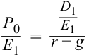

<!-- Formula Text: P 0 _ E 1   = D 1 _ E 1 _ r − g -->

$$\frac{P_0}{E_1} = \frac{D_1 / E_1}{r - g}$$

Hệ số P/E có mối quan hệ nghịch biến với tỷ suất sinh lợi yêu cầu, $r$, và có mối quan hệ đồng biến với tốc độ tăng trưởng, $g$, cùng tỷ lệ chi trả cổ tức, $D / E$. 

23. A là đáp án đúng. Các bội số dựa trên phương pháp so sánh được đặt nền tảng trên quy luật một giá và có tính đến các giá trị bội số lịch sử. Ngược lại, các bội số P/E dựa trên các yếu tố cơ bản có thể được dựa trên mô hình tăng trưởng Gordon, vốn có tính đến các khoản cổ tức dự kiến trong tương lai. 

24. A là đáp án đúng. Phát biểu này không chính xác ở cả hai khía cạnh. Mặc dù các bội số có thể được tính toán từ dữ liệu lịch sử, các giá trị dự báo cũng có thể được sử dụng. Đối với những công ty không có thu nhập kế toán dương, một số bội số khác vẫn có thể được sử dụng. Những bội số này thường đặc thù theo ngành hoặc lĩnh vực của công ty và bao gồm tỷ số giá trên doanh thu (P/S) cũng như giá trên dòng tiền (P/CF). 

25. B là đáp án đúng. 

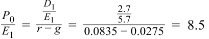

<!-- Formula Text: P 0 _ E 1   = D 1 _ E 1 _ r − g   = 2.7 _ 5.7 ____________ 0.0835 − 0.0275   =  8.5 -->

$$\frac{P_0}{E_1} = \frac{D_1 / E_1}{r - g} = \frac{2.7 / 5.7}{0.0835 - 0.0275} = 8.5$$

26. A là đáp án đúng. Cổ phiếu của Tanaka có khả năng cao nhất đang bị định giá cao (*overvalued*). Như bảng dưới đây cho thấy, tất cả các bội số năm 2018 hiện đều đang cao hơn mức trung bình giai đoạn 2014–2017 của chúng. 

|**Năm (Year)**|**P/E**|**P/CF**|**P/R (P/S)**|
|---|---|---|---|
|2014|4.9|5.4|1.2|
|2015|6.1|8.6|1.5|
|2016|8.3|7.3|1.9|
|2017|9.2|7.9|2.3|
|**Trung bình (Average)**|**7.1**|**7.3**|**1.7**|

27. B là đáp án đúng. $\text{P/E quá khứ} = \text{Giá hiện tại} / \text{EPS năm ngoái}$, và $\text{P/E ước tính} = \text{Giá hiện tại} / \text{EPS ước tính}$. 
- $\text{P/E quá khứ của Alpha} = \$57.32 / \$3.82 = 15.01$
- $\text{P/E ước tính của Alpha} = \$57.32 / \$4.75 = 12.07$
- $\text{P/E quá khứ của Delta} = \$18.93 / \$1.35 = 14.02$
- $\text{P/E ước tính của Delta} = \$18.93 / \$1.40 = 13.52$ 

28. C là đáp án đúng. So với các ngân hàng khác, Pioneer Trust có bội số P/E thấp nhất (8.30) và bội số P/B đồng hạng thấp nhất với Prime Bank (0.60). Theo quy luật một giá, các công ty tương đồng nên giao dịch ở các mức P/B và P/E tương tự nhau. Do đó, dựa trên thông tin được trình bày, Pioneer có khả năng cao nhất đang bị định giá thấp (*undervalued*). 

29. C là đáp án đúng. Giá trị doanh nghiệp (EV) được tính bằng giá trị thị trường của vốn chủ sở hữu cộng với giá trị thị trường của nợ vay và cổ phiếu ưu đãi trừ đi các khoản đầu tư ngắn hạn. Do đó, giá trị thị trường của vốn chủ sở hữu bằng giá trị doanh nghiệp trừ đi giá trị thị trường của nợ vay và cổ phiếu ưu đãi cộng với các khoản đầu tư ngắn hạn. 

30. A là đáp án đúng. Thu nhập hoạt động (*operating income*) có thể được sử dụng thay cho EBITDA khi tính toán bội số giá trị doanh nghiệp. EBITDA vẫn có thể được sử dụng khi thu nhập ròng của công ty 

<!-- PDF Page 398 -->

bị âm bởi vì EBITDA thường mang giá trị dương. Giá trị sổ sách của nợ vay không thể được sử dụng thay cho giá trị thị trường của nợ vay. 

31. A là đáp án đúng. 

$$\text{EV} = 10.2 \times 22,000,000 = \$224,400,000$$

$$\text{Giá trị vốn chủ sở hữu (Equity value)} = \text{EV} - \text{Nợ vay (Debt)} + \text{Tiền mặt (Cash)}$$

$$= 224,400,000 - 56,000,000 + 1,500,000$$

$$= \$169,900,000 \text{ (gần nhất với } \$169\text{ triệu)}$$

32. B là đáp án đúng. Giá trị thị trường của nợ vay phải được tính toán và đưa vào giá trị doanh nghiệp. Giá trị doanh nghiệp, đôi khi được gọi là chi phí của một thương vụ thâu tóm, là chi phí mua lại toàn bộ công ty, bao gồm cả việc gánh nhận các khoản nợ của công ty theo giá trị thị trường. 

33. B là đáp án đúng. Theo bài đọc, các chuyên gia phân tích có thể không tiếp cận được các báo giá thị trường cho khoản nợ vay của công ty. 

34. B là đáp án đúng. Tài sản vô hình rất khó định giá. Do đó, các mô hình định giá dựa trên tài sản phát huy hiệu quả tốt nhất đối với những công ty không có tỷ trọng cao về tài sản vô hình. 

35. A là đáp án đúng. Định giá dựa trên tài sản thường được sử dụng nhất khi chuyên gia phân tích đang định giá các doanh nghiệp tư nhân (*private enterprises*). Cả B và C đều là những điểm cần lưu ý trong định giá dựa trên tài sản nhưng có nhiều khả năng là lý do để tránh sử dụng mô hình định giá đó hơn là lý do để sử dụng nó. 

36. A là đáp án đúng. Mặc dù tất cả các mô hình đều có thể được sử dụng để so sánh các công ty khác nhau, các mô hình bội số có ưu điểm là quy giản các điểm dữ liệu cơ bản khác nhau về một định dạng cho phép so sánh trực tiếp. Miễn là chuyên gia phân tích áp dụng dữ liệu một cách nhất quán cho tất cả các công ty, cách tiếp cận này sẽ cung cấp dữ liệu so sánh rất hữu ích. 
