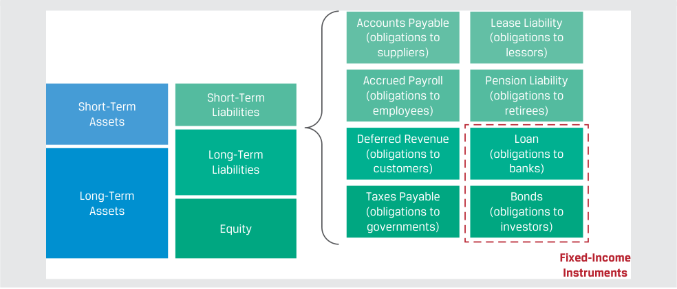
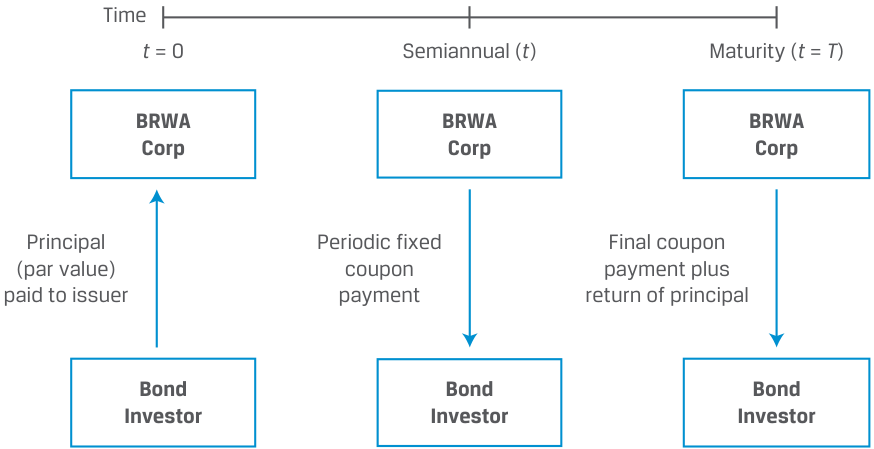
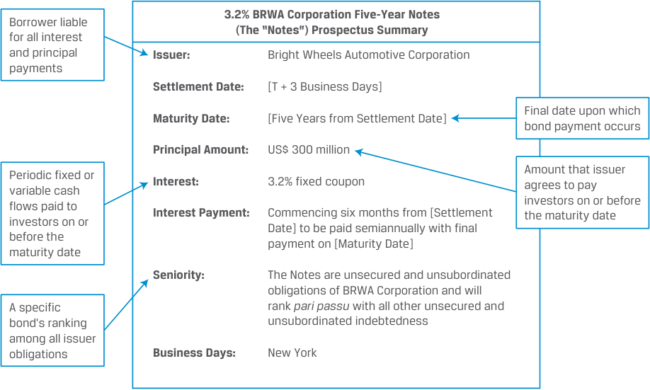
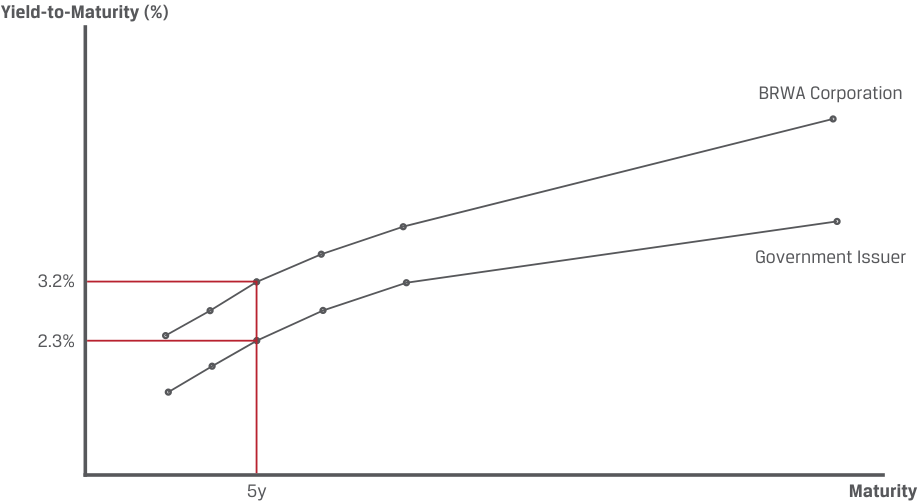

# Tập 6: Chứng Khoán Thu Nhập Cố Định (*Fixed Income*)
## Học Phần 1: Các Đặc Điểm Của Công Cụ Thu Nhập Cố Định (*Fixed-Income Instrument Features*)
### Phần 1/2: Giới Thiệu (Trang PDF 13–23)

---

<!-- PDF Page 13 -->

#### H Ọ C P H Ầ N 

# **<mark>1</mark>** 

### **Các Đặc Điểm Của Công Cụ Thu Nhập Cố Định (*Fixed-Income Instrument Features*)** 

###### **<mark>MỤC TIÊU HỌC TẬP (*LEARNING OUTCOMES*)</mark>** 

**_Mức độ thành thạo – Ứng viên cần có khả năng:_**
- Mô tả các đặc điểm của một chứng khoán thu nhập cố định (*fixed-income security*).
- Mô tả nội dung của một khế ước trái phiếu (*bond indenture*) và phân biệt giữa các điều khoản cam kết khẳng định (*affirmative covenants*) và các điều khoản cam kết phủ định (*negative covenants*).

##### **GIỚI THIỆU (*INTRODUCTION*)** 

## **<mark>1</mark>** 

Các công cụ thu nhập cố định (*fixed-income instruments*), chẳng hạn như các khoản vay (*loans*) và trái phiếu (*bonds*), là phương thức tài trợ vốn phổ biến nhất. Các tổ chức phát hành thu nhập cố định (*fixed-income issuers*) bao gồm các doanh nghiệp, chính phủ và các tổ chức phi lợi nhuận cam kết trả lãi (*interest*) và hoàn trả vốn gốc đã vay (*borrowed principal*) cho các nhà đầu tư. Các khoản vay thường được sử dụng giữa một cá nhân hoặc công ty và một ngân hàng. Trái phiếu là các công cụ thu nhập cố định được chuẩn hóa cao hơn, được thiết kế để dễ dàng giao dịch hơn so với các khoản vay và thường được phát hành bởi các công ty lớn hơn, các chính phủ và các tổ chức phát hành có mục đích đặc biệt (*special purpose issuers*). Trái phiếu là một khoản nắm giữ cốt lõi (*core holding*) đối với nhiều nhà đầu tư, bao gồm các quỹ tương hỗ (*mutual funds*), các quỹ hưu trí (*pension plans*), các công ty bảo hiểm (*insurance companies*) và các ngân hàng trung ương (*central banks*). Học phần này giới thiệu các đặc điểm của công cụ thu nhập cố định và các hợp đồng pháp lý điều chỉnh chúng. 

###### **TỔNG QUAN HỌC PHẦN (*LEARNING MODULE OVERVIEW*)** 

- Các công cụ thu nhập cố định (*fixed-income instruments*) là các công cụ nợ (*debt instruments*), chẳng hạn như các khoản vay và trái phiếu, đại diện cho một thỏa thuận hợp đồng theo đó tổ chức phát hành vay tiền từ các nhà đầu tư để đổi lấy tiền lãi và việc hoàn trả vốn gốc trong tương lai. 

- Các đặc điểm chính của công cụ thu nhập cố định bao gồm tổ chức phát hành (*issuer* / bên đi vay), thời gian đáo hạn (*time to maturity*), mệnh giá gốc (*principal amount*), lãi suất coupon và tần suất thanh toán (*coupon rate and frequency*), mức độ ưu tiên trả nợ (*seniority*) và các điều khoản dự phòng (*contingency provisions*). Đến lượt mình, các đặc điểm này xác định cấu trúc dòng tiền (*cash flow structure*) của công cụ đó. 

- Một nhà đầu tư thu nhập cố định (bên cho vay) nhận được tỷ suất sinh lợi (*return*) hoặc lợi suất (*yield*) dựa trên các dòng tiền định kỳ được thanh toán bởi tổ chức phát hành trái phiếu và sự thay đổi giá của trái phiếu. Giá trái phiếu (*bond’s price*) và lợi suất (*yield*) biến thiên nghịch chiều với nhau. 

<!-- PDF Page 14 -->

- Các nhà đầu tư thu nhập cố định phải chịu rủi ro tín dụng (*credit risk*), tức là rủi ro tổn thất phát sinh từ việc tổ chức phát hành không thực hiện thanh toán lãi đầy đủ và đúng hạn và/hoặc không hoàn trả vốn gốc. Các nhà đầu tư kỳ vọng nhận được lợi suất thấp nhất đối với các trái phiếu có ít hoặc không có rủi ro tín dụng và kỳ vọng lợi suất cao hơn đối với các công cụ có chất lượng tín dụng thấp hơn (*lower-credit-quality instruments*). 

- Chất lượng tín dụng (*credit quality*) của một công cụ thu nhập cố định bị ảnh hưởng bởi nguồn trả nợ cơ sở (*underlying source of repayment*), mức độ ưu tiên trả nợ (*seniority*), các điều khoản tín dụng như tài sản thế chấp đảm bảo (*collateral backing*) và thiện chí trả nợ của tổ chức phát hành (*issuer’s willingness to pay*). 

- Hợp đồng pháp lý mô tả các đặc điểm và các điều khoản khác của một chứng khoán thu nhập cố định được gọi là khế ước trái phiếu (*indenture*). 

- Các khế ước trái phiếu thường chứa đựng các điều khoản cam kết (*covenants*), hay các điều khoản có hiệu lực cưỡng chế pháp lý, được thỏa thuận tại thời điểm phát hành. Các điều khoản này có thể yêu cầu tổ chức phát hành trái phiếu thực hiện một hành động hoặc cấm tổ chức phát hành thực hiện một số hành động nhất định. 

###### **TỰ ĐÁNH GIÁ HỌC PHẦN (*LEARNING MODULE SELF-ASSESSMENT*)** 

Những câu hỏi ban đầu này nhằm mục đích giúp bạn tự đánh giá mức độ hiểu biết hiện tại của mình về học phần này. 

1. Số tiền coupon hàng năm (*annual coupon amount*) đối với một trái phiếu lãi suất cố định (*fixed-rate bond*) được tính bằng cách: 

   - **A.** nhân lợi suất (*yield*) của nó với mệnh giá (*par value*) của trái phiếu. 

   - **B.** nhân lãi suất coupon (*coupon rate*) của nó với giá (*price*) của trái phiếu. 

   - **C.** nhân lãi suất coupon (*coupon rate*) của nó với mệnh giá (*par value*) của trái phiếu. 

   - **Lời giải:** 

C là đáp án đúng. Vào mỗi ngày thanh toán lãi, tổ chức phát hành trái phiếu lãi suất cố định trả cho các nhà đầu tư một khoản thanh toán coupon bằng lãi suất coupon của trái phiếu nhân với mệnh giá (*par value*) của nó. Đối với các kỳ ngắn hơn một năm, số tiền coupon hàng năm được chia thành các khoản thanh toán định kỳ nhỏ hơn bằng nhau. Ví dụ, một trái phiếu có mệnh giá 100 và lãi suất coupon 6% trả hàng quý sẽ thanh toán các khoản coupon là $0.06 \times 100 = 6.0 / 4 = 1.5$ bốn lần mỗi năm (hoặc với mệnh giá 1,000 thì bằng $0.06 \times 1,000 = 60/4 = 15$ bốn lần mỗi năm). 

2. Hãy ghép mỗi loại trái phiếu ở cột bên trái với mô tả tương ứng ở cột bên phải. 

| Loại trái phiếu | Mô tả |
|---|---|
| A. Trái phiếu có lãi suất coupon cố định (*Fixed-coupon bond*) | I. Phần chênh lệch giữa giá phát hành (*issuance price*) và mệnh giá (*par value*) khi đáo hạn thể hiện khoản thanh toán lãi tích lũy tại ngày đáo hạn. |
| B. Trái phiếu lãi suất thả nổi (*Floating-rate note* – FRN) | II. Thường bao gồm các khoản thanh toán đồng nhất diễn ra định kỳ hàng tháng, hàng quý, bán niên hoặc hàng năm. |
| C. Trái phiếu không trả lãi định kỳ (*Zero-coupon bond*) | III. Bao gồm các khoản thanh toán lãi được thiết lập lại định kỳ (*reset periodically*) dựa trên các yếu tố thị trường. |

###### **Lời giải:** 

- **A.** II là đáp án đúng. Trái phiếu có lãi suất coupon cố định (*fixed-coupon bonds*) thường bao gồm các khoản thanh toán đồng nhất diễn ra định kỳ hàng tháng, hàng quý, bán niên hoặc hàng năm. 

- **B.** III là đáp án đúng. Trái phiếu lãi suất thả nổi (*floating-rate notes* – FRNs) bao gồm các khoản thanh toán lãi được thiết lập lại định kỳ dựa trên các yếu tố thị trường. 

<!-- PDF Page 15 -->

- **C.** I là đáp án đúng. Trái phiếu không trả lãi định kỳ (*zero-coupon bonds*) thường được phát hành ở mức chiết khấu so với mệnh giá (*discount to par*); phần chênh lệch giữa giá phát hành và mệnh giá thể hiện khoản thanh toán lãi tích lũy tại ngày đáo hạn.

3. Lãi suất coupon của một trái phiếu lãi suất thả nổi (*floating-rate note* – FRN) được cấu thành từ một lãi suất tham chiếu thị trường (*market reference rate*) và:
   - **A.** một xếp hạng tín dụng (*credit rating*).
   - **B.** một phần chênh lệch tín dụng đặc thù theo tổ chức phát hành (*issuer-specific spread*).
   - **C.** lợi suất của một trái phiếu chuẩn lãi suất cố định (*fixed-rate benchmark bond*).

   - **Lời giải:**

B là đáp án đúng. Lãi suất coupon của FRN bao gồm lãi suất tham chiếu thị trường (*market reference rate* – MRR) và phần chênh lệch đặc thù theo tổ chức phát hành (*issuer-specific spread*) – phần chênh lệch này thường không đổi và được ấn định tại thời điểm phát hành, trong khi MRR được thiết lập lại định kỳ dựa trên các yếu tố thị trường. Khi MRR thay đổi, lãi suất coupon của FRN và khoản thanh toán lãi sẽ thay đổi tương ứng.

A không đúng. Mặc dù xếp hạng tín dụng của tổ chức phát hành có thể là một yếu tố quyết định mức chênh lệch (*spread*) của FRN so với MRR, nhưng xếp hạng tín dụng là một đánh giá rủi ro tín dụng bằng chữ cái và không trực tiếp tham gia vào phép tính lãi suất coupon.

C không đúng. Lợi suất của một trái phiếu chuẩn lãi suất cố định phản ánh các yếu tố từ trên xuống (*top-down factors*) quyết định lãi suất, chẳng hạn như tăng trưởng thực và lạm phát kỳ vọng, vốn đã được tính đến trong MRR.

4. Trái phiếu chính phủ (*sovereign bond*) thường là một khoản đầu tư an toàn hơn so với trái phiếu doanh nghiệp (*corporate bond*) có cùng kỳ hạn được phát hành trong cùng một quốc gia vì:
   - **A.** trái phiếu doanh nghiệp chịu rủi ro lạm phát (*inflation risk*).
   - **B.** trái phiếu chính phủ được đảm bảo bởi quyền đánh thuế và quyền lực tài khóa (*taxation and fiscal power*) của chính phủ phát hành.
   - **C.** trái phiếu chính phủ được đảm bảo bằng tài sản thế chấp chất lượng cao (*high-quality collateral*), chẳng hạn như bất động sản và thiết bị.

   - **Lời giải:**

B là đáp án đúng. Trái phiếu chính phủ được đảm bảo bởi quyền đánh thuế và quyền lực tài khóa của chính phủ quốc gia và do đó thường đại diện cho các trái phiếu có chất lượng tín dụng cao nhất tại mỗi thị trường địa lý.

A không đúng vì trái phiếu chính phủ, trừ khi được gắn chỉ số cụ thể với lạm phát (*indexed to inflation*), cũng phải chịu rủi ro lạm phát.

C không đúng vì trái phiếu chính phủ thường không được đảm bảo bằng tài sản thế chấp; đây là đặc điểm phổ biến hơn của trái phiếu doanh nghiệp và chứng khoán đảm bảo bằng tài sản (*asset-backed securities*).

5. Đâu là thứ tự ưu tiên thanh toán phù hợp của các quyền đòi nợ khi thanh lý (*order of claims in liquidation*), theo loại trái phiếu, theo thứ tự từ cao nhất đến thấp nhất?
   - **A.** Nợ thứ cấp (*Junior*), nợ cấp cao có đảm bảo (*senior secured*), nợ cấp cao không có đảm bảo (*senior unsecured*)
   - **B.** Nợ cấp cao không có đảm bảo (*Senior unsecured*), nợ cấp cao có đảm bảo (*senior secured*), nợ thứ cấp (*junior*)
   - **C.** Nợ cấp cao có đảm bảo (*Senior secured*), nợ cấp cao không có đảm bảo (*senior unsecured*), nợ thứ cấp (*junior*)

   - **Lời giải:**

C là đáp án đúng. Các khoản nợ cấp cao có đảm bảo (*senior secured debts*) sẽ là các quyền đòi nợ có mức độ ưu tiên cao nhất được đáp ứng. Các khoản nợ cấp cao không có đảm bảo (*senior unsecured debts*) sẽ là đối tượng tiếp theo nhận được phân bổ giá trị tài sản thanh lý, và các khoản nợ thứ cấp (*junior debts*) sẽ là các quyền đòi nợ có mức độ ưu tiên thấp nhất được đáp ứng.

<!-- PDF Page 16 -->

6. Hãy mô tả mục đích của điều khoản ngang quyền (*pari passu clause*) trong một khế ước trái phiếu (*bond indenture*).

   - **Lời giải:** 

Điều khoản *pari passu* (“ngang hàng” hay “bình đẳng quyền lợi” – *“equal footing”*) đảm bảo rằng một nghĩa vụ nợ được đối xử ngang bằng như các công cụ nợ cấp cao (*senior debt instruments*) khác của bên đi vay. 

## **<mark>2</mark>** 

##### **CÁC ĐẶC ĐIỂM CỦA CHỨNG KHOÁN THU NHẬP CỐ ĐỊNH (*FEATURES OF FIXED-INCOME SECURITIES*)** 

*Mục tiêu: Mô tả các đặc điểm của một chứng khoán thu nhập cố định.*

**Các công cụ thu nhập cố định (*fixed-income instruments*)** là các công cụ nợ, chẳng hạn như các khoản vay và trái phiếu. **Các khoản vay (*loans*)** là các công cụ nợ được hình thành và điều chỉnh bởi một thỏa thuận riêng tư (*private agreement*) thường là giữa một cá nhân hoặc công ty và một định chế tài chính trung gian (*financial intermediary*), chẳng hạn như một ngân hàng. **Trái phiếu (*bonds*)** hay **chứng khoán thu nhập cố định (*fixed-income securities*)** là các thỏa thuận hợp đồng được chuẩn hóa cao hơn giữa các tổ chức phát hành quy mô lớn hơn và các nhà đầu tư. Một tổ chức phát hành trái phiếu thường vay tiền nhất để tài trợ cho hoạt động kinh doanh (*operations*) hoặc chi tiêu vốn (*capital expenditures*). Các nhà đầu tư trái phiếu là những người cho vay cung cấp vốn cho tổ chức phát hành để đổi lấy các khoản thanh toán lãi và việc hoàn trả vốn gốc trong tương lai. Trong khi các tổ chức phát hành doanh nghiệp thường chỉ có tối đa một hoặc hai loại chứng khoán vốn cổ phần (*equity securities*) đang lưu hành, họ thường có nhiều loại nghĩa vụ nợ đang lưu hành, mỗi loại có những đặc điểm riêng biệt, chẳng hạn như thời gian đáo hạn (*time to maturity*), mức độ ưu tiên trả nợ (*seniority*) và đồng tiền định danh (*currency*). 

###### **NHỮNG KHOẢN NỢ PHẢI TRẢ NÀO LÀ CÔNG CỤ THU NHẬP CỐ ĐỊNH? (*WHICH LIABILITIES ARE FIXED-INCOME INSTRUMENTS?*)** 

Các học phần trước trong môn Tổ chức phát hành doanh nghiệp (*Corporate Issuers*) và Phân tích báo cáo tài chính (*Financial Statement Analysis*) đã thảo luận về bảng cân đối kế toán của các tổ chức phát hành doanh nghiệp bao gồm tài sản (*assets*) cùng với nợ phải trả (*liabilities*) và vốn chủ sở hữu (*equity*) tài trợ cho chúng. Nợ phải trả được các chuẩn mực kế toán định nghĩa rộng là các nghĩa vụ hiện tại phải chuyển giao các nguồn lực kinh tế như là kết quả của các sự kiện trong quá khứ. Định nghĩa này bao hàm nhiều loại nghĩa vụ, bao gồm các khoản tiền mà tổ chức phát hành nợ các nhà cung cấp, khách hàng, người lao động, chính phủ, người nghỉ hưu, bên cho thuê tài sản, v.v. 

Không phải tất cả các khoản nợ phải trả đều là công cụ thu nhập cố định (hay “nợ vay” – *“debt”*), nhưng tất cả các công cụ thu nhập cố định đều là nợ phải trả. Trong các học phần về chứng khoán thu nhập cố định này, dưới góc độ của một tổ chức phát hành doanh nghiệp, chúng ta chỉ tập trung vào các khoản vay (*loans*) và trái phiếu (*bonds*): những công cụ có thể được thanh toán bằng tiền mặt và có đối tác (*counterparty*) là một nhà đầu tư hoặc một ngân hàng. Các khoản nợ phải trả khác, đặc biệt là nợ thuê tài sản (*leases*) và nghĩa vụ hưu trí (*pension obligations*), có chung một số đặc điểm với các công cụ thu nhập cố định nhưng nằm ngoài phạm vi của các học phần này. 

> **Chú thích hình ảnh:**
> - **Bảng cân đối kế toán**: Tài sản ngắn hạn (*Short-Term Assets*) & Tài sản dài hạn (*Long-Term Assets*) đối ứng với Nợ ngắn hạn (*Short-Term Liabilities*), Nợ dài hạn (*Long-Term Liabilities*) và Vốn chủ sở hữu (*Equity*).
> - **Các khoản nợ phải trả thông thường**: Phải trả người bán (*Accounts Payable* – nghĩa vụ với nhà cung cấp), Lương phải trả (*Accrued Payroll* – nghĩa vụ với nhân viên), Doanh thu chưa thực hiện (*Deferred Revenue* – nghĩa vụ với khách hàng), Thuế phải nộp (*Taxes Payable* – nghĩa vụ với chính phủ), Nợ thuê (*Lease Liability* – nghĩa vụ với bên cho thuê), Nợ hưu trí (*Pension Liability* – nghĩa vụ với người nghỉ hưu).
> - **Công cụ thu nhập cố định (*Fixed-Income Instruments*)**: Khoản vay (*Loan* – nghĩa vụ với ngân hàng) và Trái phiếu (*Bonds* – nghĩa vụ với nhà đầu tư).

<!-- PDF Page 17 -->

Lưu ý rằng các tổ chức phát hành chính phủ có xu hướng được tài trợ bằng trái phiếu chứ không phải bằng các khoản vay, mặc dù vẫn tồn tại một số ngoại lệ — ví dụ, các khoản vay từ các tổ chức siêu quốc gia (*supranational organizations*) như Quỹ Tiền tệ Quốc tế (IMF). 

Các dòng tiền định kỳ được cam kết (*committed periodic cash flows*) của một trái phiếu giúp phân biệt nó với các chứng khoán vốn cổ phần. Bảng minh họa 1 (*Exhibit 1*) cho thấy các dòng tiền của một trái phiếu lãi suất cố định được phát hành bởi Tập đoàn Bright Wheels Automotive (BRWA). 

**Bảng minh họa 1: Dòng tiền trái phiếu của Tập đoàn BRWA (*BRWA Corporation Bond Cash Flows*)** 

> **Chú thích hình ảnh:**
> - **Thời điểm $t = 0$**: Nhà đầu tư trái phiếu (*Bond Investor*) thanh toán Vốn gốc / Mệnh giá (*Principal / par value*) cho Tập đoàn BRWA (*BRWA Corp*).
> - **Định kỳ bán niên ($t$)**: Tập đoàn BRWA thanh toán khoản lãi coupon cố định định kỳ (*Periodic fixed coupon payment*) cho Nhà đầu tư trái phiếu.
> - **Khi đáo hạn ($t = T$)**: Tập đoàn BRWA thanh toán khoản lãi coupon cuối cùng cộng với việc hoàn trả vốn gốc (*Final coupon payment plus return of principal*) cho Nhà đầu tư trái phiếu.

Tại thời điểm phát hành, các nhà đầu tư đã mua trái phiếu BRWA để đổi lấy tiền mặt bằng với **vốn gốc (*principal*)** của trái phiếu hay số tiền đã vay, vốn cũng được gọi là **mệnh giá (*par value*)** của trái phiếu. Vào mỗi ngày thanh toán lãi, BRWA cam kết trả cho các nhà đầu tư trái phiếu một khoản thanh toán lãi hay **coupon** bằng lãi suất coupon nhân với mệnh giá của trái phiếu. Đối với các kỳ ngắn hơn một năm, số tiền coupon hàng năm được chia thành các khoản thanh toán định kỳ nhỏ hơn bằng nhau. Vào ngày đáo hạn (*maturity date*) của trái phiếu, BRWA thanh toán khoản coupon cố định cuối cùng và số tiền vốn gốc cho các nhà đầu tư. 

Các đặc điểm chính của mỗi đợt phát hành trái phiếu thường được tóm tắt trong một bản cáo bạch (*prospectus*). Bảng minh họa 2 (*Exhibit 2*) phác thảo các điều khoản của đợt phát hành trái phiếu của Tập đoàn BRWA. 

<!-- PDF Page 18 -->

**Bảng minh họa 2: Trái phiếu Tập đoàn BRWA: Tóm tắt ngắn gọn các điều khoản (*BRWA Corporation Bond: Brief Summary of Terms*)** 

> **Chú thích hình ảnh:**
> **Tóm tắt Bản cáo bạch Trái phiếu kỳ hạn 5 năm lãi suất 3.2% của Tập đoàn BRWA (Gọi tắt là “Trái phiếu” – *The “Notes”*)**
> - **Tổ chức phát hành (*Issuer*)**: Bright Wheels Automotive Corporation *(Bên đi vay chịu trách nhiệm cho mọi khoản thanh toán lãi và gốc)*.
> - **Ngày thanh toán giao dịch (*Settlement Date*)**: $[T + 3\text{ Ngày làm việc}]$.
> - **Ngày đáo hạn (*Maturity Date*)**: $[\text{5 năm kể từ Ngày thanh toán giao dịch}]$ *(Ngày cuối cùng mà khoản thanh toán trái phiếu diễn ra)*.
> - **Mệnh giá gốc (*Principal Amount*)**: $300\text{ triệu USD}$ *(Số tiền mà tổ chức phát hành đồng ý trả cho nhà đầu tư vào hoặc trước ngày đáo hạn)*.
> - **Tiền lãi (*Interest*)**: Lãi suất coupon cố định $3.2\%$.
> - **Thanh toán lãi (*Interest Payment*)**: Bắt đầu 6 tháng kể từ $[\text{Ngày thanh toán giao dịch}]$, được trả bán niên với khoản thanh toán cuối cùng vào $[\text{Ngày đáo hạn}]$ *(Các dòng tiền cố định hoặc biến đổi định kỳ trả cho nhà đầu tư vào hoặc trước ngày đáo hạn)*.
> - **Mức độ ưu tiên trả nợ (*Seniority*)**: Trái phiếu là các nghĩa vụ không có đảm bảo (*unsecured*) và không phải nợ thứ cấp (*unsubordinated*) của Tập đoàn BRWA và sẽ xếp ngang hàng (*rank pari passu*) với tất cả các khoản nợ không có đảm bảo và không phải nợ thứ cấp khác *(Thứ hạng của một trái phiếu cụ thể trong tổng số các nghĩa vụ của tổ chức phát hành)*.
> - **Ngày làm việc (*Business Days*)**: New York.

Các đặc điểm chính của trái phiếu bao gồm tổ chức phát hành (*issuer*), thời gian đáo hạn (*time to maturity*), mệnh giá gốc (*principal amount*), lãi suất coupon và tần suất thanh toán (*coupon rate and frequency*), mức độ ưu tiên trả nợ (*seniority*) và các điều khoản dự phòng (*contingency provisions*). 

###### **Tổ chức phát hành (*Issuer*)** 

Tổ chức phát hành trái phiếu có thể là bất kỳ thực thể pháp lý nào và chịu trách nhiệm đối với tất cả các khoản thanh toán lãi và vốn gốc. Các tổ chức phát hành khu vực chính phủ (*government sector issuers*) bao gồm chính phủ quốc gia (còn gọi là chính phủ có chủ quyền – *sovereign*) hoặc chính quyền địa phương (*local governments*), các tổ chức siêu quốc gia (*supranational organizations*, chẳng hạn như Ngân hàng Thế giới – *World Bank*), và các thực thể bán chính phủ (*quasi-government entities* – các cơ quan thuộc sở hữu hoặc được bảo trợ bởi chính phủ, chẳng hạn như dịch vụ bưu chính hoặc đường sắt quốc gia). Bởi vì trái phiếu chính phủ (*sovereign bonds*) được đảm bảo bởi quyền đánh thuế và quyền lực tài khóa của chính phủ phát hành, chúng thường đại diện cho trái phiếu có rủi ro tín dụng thấp nhất ở mỗi khu vực. Các tổ chức phát hành khu vực tư nhân (*private sector issuers*) bao gồm các tổ chức phát hành doanh nghiệp và các thực thể có mục đích đặc biệt (*special purpose entities* – SPEs) được thành lập để nắm quyền sở hữu đối với các tài sản như các khoản vay hoặc các khoản phải thu, được tài trợ bằng **chứng khoán đảm bảo bằng tài sản (*asset-backed securities* – ABS)** phát hành cho các nhà đầu tư, nội dung này sẽ được thảo luận chi tiết trong các bài học sau. 

###### **Kỳ hạn / Ngày đáo hạn (*Maturity*)** 

**Ngày đáo hạn (*maturity*)** của một trái phiếu là ngày diễn ra khoản thanh toán cuối cùng mà tổ chức phát hành thực hiện cho các nhà đầu tư, và **kỳ hạn còn lại (*tenor*)** đề cập đến khoảng thời gian còn lại cho đến khi đáo hạn. Các chứng khoán thu nhập cố định có kỳ hạn từ một năm trở xuống tại thời điểm phát hành được gọi là **chứng khoán thị trường tiền tệ (*money market securities*)**, ví dụ bao gồm tín phiếu Kho bạc chính phủ (*government Treasury bills*) và thương phiếu (*commercial paper*) do các tập đoàn phát hành. Các trái phiếu có kỳ hạn dài hơn một năm tại thời điểm phát hành được gọi là **chứng khoán thị trường vốn (*capital market securities*)**. **Trái phiếu vĩnh cửu (*perpetual bonds*)** là một loại trái phiếu ít phổ biến hơn không có ngày đáo hạn xác định (*no stated maturity*). Các thực thể khu vực công là những tổ chức phát hành trái phiếu vĩnh cửu đầu tiên, và các ví dụ hiện tại bao gồm chính quyền địa phương và các cơ quan quản lý địa phương, cũng như một số trái phiếu do các ngân hàng phát hành để đáp ứng các yêu cầu về vốn theo quy định pháp lý (*regulatory capital requirements*). Tuy nhiên, trái phiếu vĩnh cửu vẫn khác biệt với cổ phiếu ở chỗ chúng có các dòng tiền được xác định theo hợp đồng, không có quyền biểu quyết (*no voting rights*), và có mức độ ưu tiên trả nợ cao hơn trong cấu trúc vốn (*capital structure*). 

<!-- PDF Page 19 -->

###### **TRÁI PHIẾU VĨNH CỬU CỦA CƠ QUAN QUẢN LÝ SÂN BAY HỒNG KÔNG (*AIRPORT AUTHORITY HONG KONG’S PERPETUAL BONDS*)** 

Cơ quan Quản lý Sân bay Hồng Kông (AAHK) là một cơ quan theo luật định chịu trách nhiệm vận hành và phát triển Sân bay Quốc tế Hồng Kông, một trong những sân bay hàng hóa bận rộn nhất thế giới và là một trung tâm hành khách lớn kết nối với hơn 200 điểm đến toàn cầu. Vào cuối năm 2020, sau sự sụt giảm mạnh về lưu lượng hành khách trong đại dịch COVID-19, AAHK đã công bố đợt phát hành trái phiếu vĩnh cửu gồm hai phần trị giá 1.5 tỷ USD để tài trợ cho việc xây dựng đường băng thứ ba và cho các mục đích chung của doanh nghiệp. Các nhà đầu tư châu Á và châu Âu đã thể hiện sự tin tưởng vào sự phục hồi lưu lượng hành khách của sân bay, đặt lệnh mua với tổng giá trị gấp hơn 10 lần quy mô chào bán. 

###### **Vốn gốc (Mệnh giá – *Principal / Par or Face Value*)** 

Vốn gốc (*principal*), mệnh giá (*par value*), hay **giá trị bề mặt (*face value*)** là số tiền mà một tổ chức phát hành đồng ý hoàn trả cho các nhà đầu tư khi đáo hạn. Trong ví dụ về Tập đoàn BRWA, số tiền vốn gốc 300 triệu USD được hoàn trả khi đáo hạn, tức là năm năm kể từ khi phát hành. Một số công cụ nhất định có thể hoàn trả vốn gốc theo các phần bằng nhau hoặc biến đổi theo thời gian. Một ví dụ phổ biến là khoản vay thế chấp (*mortgage loan*), theo đó người đi vay thực hiện khoản thanh toán hàng tháng bao gồm cả việc hoàn trả vốn gốc và tiền lãi. Vốn gốc được hoàn trả dần theo thời gian chứ không phải trả một lần (*lump sum*) khi đáo hạn. 

###### **Lãi suất coupon và Tần suất thanh toán (*Coupon Rate and Frequency*)** 

Tiền lãi của một trái phiếu có thể được thanh toán dưới dạng: 

- một khoản coupon cố định (*fixed coupon*) được trả vào các ngày xác định, 

- một khoản coupon biến đổi (*variable coupon*) được xác định và trả vào các ngày xác định, hoặc 

- một phần của khoản thanh toán duy nhất cùng với vốn gốc khi đáo hạn. 

Các khoản thanh toán của trái phiếu có lãi suất coupon cố định thường bao gồm các khoản thanh toán đồng nhất theo định kỳ hàng tháng, hàng quý, bán niên hoặc hàng năm. Trái phiếu doanh nghiệp có xu hướng trả lãi bán niên (nửa năm một lần). 

Các trái phiếu có khoản thanh toán lãi biến đổi được gọi là **trái phiếu lãi suất thả nổi (*floating-rate notes* – FRNs)**. Khoản coupon của một FRN được xác định bằng sự kết hợp giữa một **lãi suất tham chiếu thị trường (*market reference rate* – MRR)** và một phần chênh lệch đặc thù theo tổ chức phát hành được gọi là **chênh lệch tín dụng (*credit spread*)**. MRR là mức lãi suất đi vay hoặc cho vay tiêu chuẩn đối với các tổ chức phát hành có mức độ tín nhiệm cao nhất (*highest creditworthiness*) hoặc rủi ro vỡ nợ thấp nhất đối với các đồng tiền và kỳ hạn khác nhau. Trước đây, các mức MRR được xác định thông qua cuộc khảo sát các bên cho vay (Libor) nhưng đã chuyển đổi sang mức trung bình của các lãi suất giao dịch quan sát được trên thị trường. 

Chênh lệch tín dụng (*credit spread*) được ấn định tại thời điểm phát hành FRN, thường không đổi trong suốt vòng đời của trái phiếu và được biểu thị bằng điểm cơ bản (*basis points* – bps), hay một phần trăm của một điểm phần trăm ($1\text{ bp} = 0.01\%$). Chất lượng tín dụng của tổ chức phát hành càng cao thì mức chênh lệch càng thấp. Ngược lại, MRR được thiết lập lại định kỳ trong suốt vòng đời của trái phiếu dựa trên các yếu tố thị trường. Khi MRR thay đổi, lãi suất coupon và khoản thanh toán lãi của FRN sẽ thay đổi tương ứng. 

Các trái phiếu không trả lãi định kỳ và thay vào đó trả lãi như một phần của khoản thanh toán duy nhất cùng với vốn gốc khi đáo hạn được gọi là **trái phiếu không trả lãi định kỳ (*zero-coupon bonds*)** hay **trái phiếu chiết khấu thuần túy (*pure discount bonds*)**. Trái phiếu không trả lãi định kỳ thường được phát hành ở mức chiết khấu so với mệnh giá; phần chênh lệch giữa giá phát hành và mệnh giá thể hiện khoản thanh toán lãi tích lũy tại ngày đáo hạn. 

<!-- PDF Page 20 -->

###### **Mức độ ưu tiên trả nợ (*Seniority*)** 

**Mức độ ưu tiên trả nợ (*seniority*)** hay thứ tự ưu tiên hoàn trả của một đợt phát hành nợ trong tổng số các nghĩa vụ của tổ chức phát hành là một yếu tố quan trọng quyết định rủi ro. **Nợ cấp cao (*senior debt*)** có quyền ưu tiên hơn so với các quyền đòi nợ khác trong trường hợp phá sản hoặc thanh lý. Các quyền đòi nợ của **nợ thứ cấp (*junior debt* hoặc *subordinated debt*)** có mức độ ưu tiên thấp hơn nợ cấp cao và chỉ được thanh toán sau khi các quyền đòi nợ cấp cao đã được đáp ứng. Trái phiếu của Tập đoàn BRWA là nợ cấp cao và sẽ được hoàn trả trước bất kỳ khoản nợ thứ cấp nào của BRWA trong trường hợp phá sản. 

###### **Các điều khoản dự phòng (*Contingency Provisions*)** 

Một **điều khoản dự phòng (*contingency provision*)** là một điều khoản trong thỏa thuận pháp lý cho phép thực hiện một hành động nếu một sự kiện hoặc hoàn cảnh nào đó xảy ra. Điều khoản dự phòng phổ biến nhất đối với trái phiếu liên quan đến **các quyền chọn đi kèm (*embedded options*)** — cụ thể là quyền chọn mua lại (*call option*), quyền chọn bán lại (*put option*), và quyền chọn chuyển đổi thành cổ phiếu (*conversion to equity option*). Những quyền chọn này giống như các hợp đồng quyền chọn nhưng không thể được giao dịch tách biệt khỏi bản thân trái phiếu đó. Tuy nhiên, giá trị của các quyền chọn đi kèm này có thể được xác lập bằng cách so sánh giá trị của một trái phiếu có điều khoản dự phòng với giá trị của một trái phiếu tiêu chuẩn tương tự về mọi mặt khác từ cùng một tổ chức phát hành. Trái phiếu BRWA không chứa bất kỳ điều khoản dự phòng nào, nhưng đặc điểm này sẽ được khám phá sâu hơn trong các bài học sau. 

Chúng ta có thể sử dụng các đặc điểm của một đợt phát hành trái phiếu để mô hình hóa các dòng tiền của nó. Bảng minh họa 3 (*Exhibit 3*) minh họa các dòng tiền trong suốt vòng đời của trái phiếu Tập đoàn BRWA kỳ hạn 5 năm, lãi suất coupon cố định đã được mô tả trước đó. 

**Bảng minh họa 3: Dòng tiền trái phiếu của Tập đoàn BRWA (*BRWA Corporation Bond Cash Flows*)** 

> **Chú thích hình ảnh:**
> - **Thời điểm $0$**: Tập đoàn BRWA nhận mệnh giá trái phiếu khi phát hành: $-300$ (triệu USD từ góc độ nhà đầu tư chi tiền / $+300$ triệu USD BRWA nhận về).
> - **Các kỳ bán niên $0.5, 1.0, 1.5, 2.0, 2.5, 3.0, 3.5, 4.0, 4.5\text{ năm}$**: Nhà đầu tư nhận khoản thanh toán lãi coupon $4.8$ triệu USD mỗi nửa năm.
> - **Tại thời điểm đáo hạn $5.0\text{ năm}$**: Nhà đầu tư nhận khoản thanh toán coupon cuối cùng ($4.8$) và khoản thanh toán vốn gốc ($300$) khi đáo hạn, tổng cộng là $304.8$ triệu USD.

Tại thời điểm phát hành, các nhà đầu tư mua trái phiếu và trả tiền mặt cho Tập đoàn BRWA bằng với 300 triệu USD mệnh giá. Các nhà đầu tư BRWA nhận được các khoản thanh toán lãi định kỳ như sau: 

$$\text{Chi phí lãi hàng năm} = \text{Mệnh giá trái phiếu} \times \text{Lãi suất coupon}$$

<!-- PDF Page 21 -->

$$\text{Chi phí lãi hàng năm} = \text{USD } 300,000,000 \times 3.2\%$$

$$\text{Chi phí lãi hàng năm} = \text{USD } 9,600,000$$

$$\text{Chi phí lãi bán niên} = \frac{\text{USD } 9,600,000}{2} = \text{USD } 4,800,000$$

Vào cuối năm thứ năm tại ngày đáo hạn, Tập đoàn BRWA trả cho các nhà đầu tư khoản thanh toán coupon bán niên cuối cùng cộng với mệnh giá 300 triệu USD, tổng cộng là 304.8 triệu USD. 

###### **Các thước đo lợi suất (*Yield Measures*)** 

Khi biết các dòng tiền kỳ vọng của một trái phiếu và giá của nó, ta có thể tính toán các thước đo tỷ suất sinh lợi hoặc lợi suất. Một thước đo đơn giản là **lợi suất hiện hành (*current yield* – CY)**, bằng tiền lãi coupon hàng năm của trái phiếu chia cho giá của trái phiếu và được biểu thị dưới dạng phần trăm. Ví dụ, nếu trái phiếu BRWA kỳ hạn 5 năm đang được giao dịch ở mức giá 101 USD trên mỗi 100 USD mệnh giá tại thời điểm $t$, lợi suất hiện hành của nó sẽ là: 

$$CY_t = \frac{\text{Coupon hàng năm}_t}{\text{Giá trái phiếu}_t} = \frac{3.2\%}{1.01} = 3.168\%$$

Lợi suất hiện hành tương tự như tỷ suất cổ tức (*dividend yield*) đối với một chứng khoán vốn cổ phần. 

Một thước đo lợi suất phức tạp hơn nhưng phổ biến hơn nhiều là **lợi suất đáo hạn (*yield-to-maturity* – YTM)**, tức là tỷ suất hoàn vốn nội bộ (*internal rate of return* – IRR) được tính bằng cách sử dụng giá của trái phiếu và các dòng tiền kỳ vọng của nó cho đến khi đáo hạn. YTM thường được yết giá theo lãi suất năm. Tỷ suất sinh lợi của một nhà đầu tư trên một trái phiếu sẽ bằng với YTM của trái phiếu tại thời điểm mua miễn là nhà đầu tư đó: 

**1.** nhận được tất cả các khoản thanh toán lãi và vốn gốc đã cam kết theo đúng lịch trình (tức là không có vỡ nợ), 

**2.** nắm giữ trái phiếu cho đến khi đáo hạn, và 

**3.** tái đầu tư tất cả các dòng tiền định kỳ ở mức lãi suất bằng YTM. 

Lưu ý rằng đây cũng chính là các giả định của IRR đã được thảo luận trong các học phần trước. Nếu bất kỳ giả định nào trong số này không được thỏa mãn, tỷ suất sinh lợi thực tế của nhà đầu tư trên khoản đầu tư trái phiếu sẽ khác với YTM. Nếu trái phiếu BRWA kỳ hạn 5 năm được giao dịch ở mức giá 101 USD trên mỗi 100 USD mệnh giá ngay sau khi phát hành, YTM của nó là mức lãi suất $r$ trong phương trình sau (hãy nhớ rằng lãi suất coupon 3.2% được trả bán niên, tức là 1.6 trong mỗi kỳ của 10 kỳ trên mỗi 100 USD mệnh giá): 

$$101 = \frac{1.6}{(1 + r)^1} + \frac{1.6}{(1 + r)^2} + \dots + \frac{101.6}{(1 + r)^{10}}$$

$r = 1.49\%$ trên cơ sở bán niên, hoặc $1.49\% \times 2 = 2.98\%$ quy đổi theo năm (*annualized*). 

Cách tính YTM sẽ được trình bày sâu hơn trong các học phần sau. 

###### **Đường cong lợi suất (*Yield Curves*)** 

Hầu hết các tổ chức phát hành thu nhập cố định đều có nhiều công cụ nợ đang lưu hành. Một cách hữu ích để đánh giá YTM của một đợt phát hành là vẽ đồ thị tất cả các công cụ nợ có đặc điểm giống hệt nhau của một tổ chức phát hành theo YTM và thời gian đáo hạn của chúng. Sự mô tả bằng đồ thị này tạo ra một **đường cong lợi suất (*yield curve*)**. BRWA có sáu đợt phát hành trái phiếu đang lưu hành, được hiển thị trong Bảng minh họa 4 (*Exhibit 4*). Trái phiếu kỳ hạn 5 năm có lãi suất 3.2% là điểm thứ ba tính từ bên trái. 

<!-- PDF Page 22 -->

**Bảng minh họa 4: Đường cong lợi suất trái phiếu của Tập đoàn BRWA (*BRWA Corporation Bond Yield Curve*)** 

> **Chú thích hình ảnh:**
> - **Trục tung**: Lợi suất đáo hạn (*Yield-to-Maturity* – %).
> - **Trục hoành**: Kỳ hạn đáo hạn (*Maturity*), điểm thứ ba từ trái sang là kỳ hạn 5 năm (*5y*) ứng với mức lợi suất $3.2\%$ trên đường cong lợi suất của Tập đoàn BRWA (*BRWA Corporation*).

Trong ví dụ này, các trái phiếu BRWA có kỳ hạn dài hơn có mức YTM cao hơn, cho thấy các nhà đầu tư đang đòi hỏi tỷ suất sinh lợi kỳ vọng cao hơn để bù đắp cho rủi ro cao hơn gắn liền với các trái phiếu có kỳ hạn dài hơn của cùng một tổ chức phát hành. Một cách để đo lường rủi ro tín dụng (một loại rủi ro đầu tư của chứng khoán thu nhập cố định) đối với một trái phiếu là so sánh đường cong lợi suất của tổ chức phát hành đó với đường cong lợi suất của các trái phiếu chính phủ tương đương vốn có ít hoặc không có rủi ro tín dụng. Bảng minh họa 5 (*Exhibit 5*) cho thấy đường cong lợi suất của các trái phiếu BRWA so với đường cong lợi suất của các trái phiếu chính phủ tương đương tại Hoa Kỳ, tức là Trái phiếu Kho bạc Hoa Kỳ (*US Treasuries*). 

**Bảng minh họa 5: Đường cong lợi suất của Tập đoàn BRWA so với Trái phiếu Kho bạc (*BRWA Corporation Yield Curve vs. Treasuries*)** 

> **Chú thích hình ảnh:**
> - **Trục tung**: Lợi suất đáo hạn (*Yield-to-Maturity* – %).
> - **Trục hoành**: Kỳ hạn (*Maturity*). Tại kỳ hạn 5 năm (*5y*), đường cong lợi suất của Tập đoàn BRWA (*BRWA Corporation*) ở mức $3.2\%$, trong khi đường cong lợi suất của Tổ chức phát hành Chính phủ (*Government Issuer*) ở mức $2.3\%$.

Phần chênh lệch lợi suất đáo hạn giữa trái phiếu BRWA kỳ hạn 5 năm và trái phiếu Kho bạc Hoa Kỳ kỳ hạn 5 năm là $90\text{ bps}$ ($= 3.2\% - 2.3\%$), phản ánh phần bù đắp mà các nhà đầu tư đòi hỏi khi gánh chịu thêm rủi ro tín dụng gắn liền với trái phiếu BRWA. 

<!-- PDF Page 23 -->

###### **BỘ CÂU HỎI (*QUESTION SET*)** 

1. Hãy ghép loại công cụ thu nhập cố định ở cột bên trái với mô tả của nó ở cột bên phải. 

| Loại công cụ | Mô tả |
|---|---|
| A. Chứng khoán thị trường tiền tệ (*Money market securities*) | I. Trái phiếu đại chúng và phát hành riêng lẻ có thời gian đáo hạn lớn hơn một năm |
| B. Chứng khoán thị trường vốn (*Capital market securities*) | II. Các công cụ thu nhập cố định có kỳ hạn dưới một năm, chẳng hạn như thương phiếu (*commercial paper*) |
| C. Trái phiếu vĩnh cửu (*Perpetual bonds*) | III. Các trái phiếu không có ngày đáo hạn xác định |

###### **Lời giải:** 

   - **A.** II là đáp án đúng. Chứng khoán thị trường tiền tệ (*money market securities*) là các công cụ thu nhập cố định có kỳ hạn dưới một năm, chẳng hạn như thương phiếu. 

   - **B.** I là đáp án đúng. Chứng khoán thị trường vốn (*capital market securities*) là các trái phiếu đại chúng và phát hành riêng lẻ có thời gian đáo hạn lớn hơn một năm. 

   - **C.** III là đáp án đúng. Trái phiếu vĩnh cửu (*perpetual bonds*) không có ngày đáo hạn xác định. 

2. Tính khoản thanh toán coupon của một trái phiếu có lãi suất coupon 2.5% với mệnh giá 100,000 GBP và tần suất thanh toán bán niên. 

###### **Lời giải:** 

Đáp án đúng là 1,250 GBP. 

Tiền lãi coupon hàng năm của một trái phiếu được tính bằng cách nhân lãi suất coupon với mệnh giá. Đối với trái phiếu này, lãi suất coupon 2.5% và mệnh giá 100,000 GBP mang lại khoản coupon hàng năm là 2,500 GBP. Tuy nhiên, vì tần suất thanh toán là bán niên (hai lần một năm), mỗi khoản thanh toán coupon là 1,250 GBP. 

3. Xác định lãi suất coupon FRN và số tiền lãi phải trả phù hợp trong ví dụ sau: Một tập đoàn châu Âu phát hành một FRN trị giá 10 triệu EUR trả lãi hàng quý bằng lãi suất MRR kỳ hạn 3 tháng cộng với 125 bps. Nếu MRR kỳ hạn 3 tháng là $-0.50\%$, số tiền lãi coupon FRN mà tập đoàn phải trả cho kỳ đó là bao nhiêu? 

###### **Lời giải:** 

Đáp án là 18,750 EUR. 

Lãi suất coupon của một FRN bao gồm MRR cộng với phần chênh lệch đặc thù theo tổ chức phát hành (*issuer-specific spread*). 

$$\text{Coupon FRN} = \text{MRR} + \text{Spread}$$

$$\text{Coupon FRN} = -0.50\% + 1.25\%$$

$$\text{Coupon FRN} = 0.75\%$$

$$\text{Tiền lãi hàng năm} = \text{Vốn gốc} \times \text{Coupon FRN} = €10,000,000 \times 0.75\% = €75,000\text{, hay } €18,750\text{ trên cơ sở hàng quý.}$$
