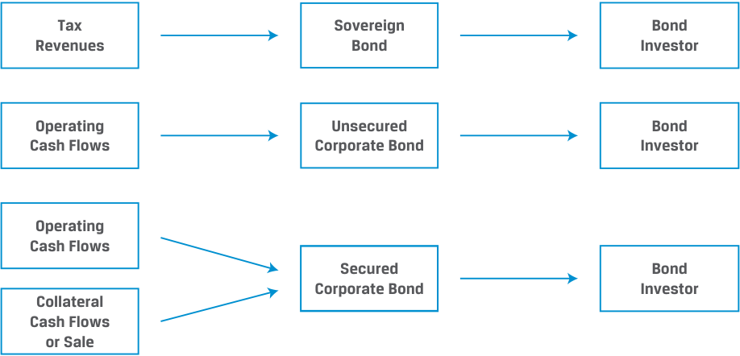
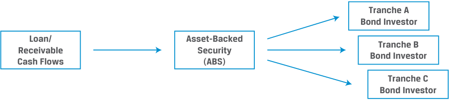

# Tập 6: Chứng Khoán Thu Nhập Cố Định (*Fixed Income*)
## Học Phần 1: Các Đặc Điểm Của Công Cụ Thu Nhập Cố Định (*Fixed-Income Instrument Features*)
### Phần 2/2: Khế Ước Trái Phiếu và Các Điều Khoản Cam Kết (Trang PDF 24–32)

---

<!-- PDF Page 24 -->

4. Điền vào chỗ trống. Lợi suất hiện hành (*current yield*) bằng _____ hàng năm của trái phiếu chia cho giá của trái phiếu được biểu thị dưới dạng phần trăm. Nếu giá của trái phiếu giảm xuống, chúng ta kỳ vọng lợi suất hiện hành sẽ ____. 

###### **Lời giải:** 

Lợi suất hiện hành bằng _tiền lãi coupon_ (*coupon*) hàng năm của trái phiếu chia cho giá của trái phiếu được biểu thị dưới dạng phần trăm. Nếu giá của trái phiếu giảm xuống, chúng ta kỳ vọng lợi suất hiện hành sẽ _tăng lên_ (*rise*). 

5. Điền vào chỗ trống. Một đường cong lợi suất dốc xuống (*downward-sloping yield curve*) cho thấy lợi suất đáo hạn (*yields-to-maturity*) của các trái phiếu dài hạn hơn của một tổ chức phát hành là __________ so với lợi suất đáo hạn của các trái phiếu ngắn hạn hơn của tổ chức phát hành đó. 

   - **Lời giải:** 

Một đường cong lợi suất dốc xuống cho thấy lợi suất đáo hạn của các trái phiếu dài hạn hơn của một tổ chức phát hành là _thấp hơn_ (*lower*) so với lợi suất đáo hạn của các trái phiếu ngắn hạn hơn của tổ chức phát hành đó. 

# **<mark>3</mark>** 

#### **KHẾ ƯỚC TRÁI PHIẾU VÀ CÁC ĐIỀU KHOẢN CAM KẾT (*BOND INDENTURES AND COVENANTS*)** 

*Mục tiêu: Mô tả nội dung của một khế ước trái phiếu và phân biệt giữa các điều khoản cam kết khẳng định và các điều khoản cam kết phủ định.*

##### **Khế ước trái phiếu (*Bond Indentures*)** 

Các đặc điểm của chứng khoán thu nhập cố định được phác thảo trong bài học trước được đưa vào một hợp đồng pháp lý mô tả hình thức của trái phiếu, các nghĩa vụ của tổ chức phát hành và quyền lợi của các trái chủ (*bondholders*). Hợp đồng pháp lý này được gọi là **khế ước trái phiếu (*bond indenture*)**. Ngoài việc quy định cụ thể các đặc điểm của trái phiếu, khế ước trái phiếu còn xác định các nguồn trả nợ của tổ chức phát hành, bất kỳ cam kết nào do tổ chức phát hành đưa ra đối với các trái chủ, cũng như bất kỳ điều khoản nào hỗ trợ hoặc tăng cường khả năng hoàn trả đầy đủ khoản nợ của tổ chức phát hành. 

##### **Các nguồn trả nợ (*Sources of Repayment*)** 

Các nguồn trả nợ trái phiếu khác nhau giữa các tổ chức phát hành và là một yếu tố then chốt trong việc xác định rủi ro tương đối của một trái phiếu. Ví dụ, các chính phủ quốc gia có quyền chủ quyền trong việc đánh thuế hoạt động kinh tế (và trong một số trường hợp là in tiền), điều này dẫn đến việc trái phiếu của họ thường có chất lượng tín dụng cao nhất trong một khu vực nhất định. Trái phiếu chính phủ (*sovereign bonds*) tại các thị trường phát triển thường được coi là không có rủi ro vỡ nợ (*no default risk*) và được sử dụng làm chuẩn tham chiếu (*benchmark*) cho rủi ro tương đối trên thị trường trái phiếu. 

Chính quyền địa phương hoặc khu vực có thể sử dụng thẩm quyền đánh thuế của mình làm nguồn trả nợ trái phiếu hoặc sử dụng các khoản phí thu từ các dự án cơ sở hạ tầng, chẳng hạn như cầu, đường thu phí hoặc hệ thống giao thông công cộng, để trả lãi và vốn gốc cho đợt phát hành trái phiếu liên quan. 

Các nhà đầu tư vào trái phiếu doanh nghiệp thường dựa vào dòng tiền hoạt động (*operating cash flows*) của doanh nghiệp làm nguồn chính để thanh toán lãi và vốn gốc. Như sẽ thấy trong các bài học sau, các nhà đầu tư sử dụng các yếu tố như khả năng sinh lời (*profitability*) và đòn bẩy (*leverage*) để đánh giá mức độ biến động kỳ vọng của dòng tiền doanh nghiệp sẵn có để trả nợ (*service debt*). Trái phiếu doanh nghiệp của các tổ chức phát hành có chất lượng tín dụng cao hơn thường là **không có đảm bảo (*unsecured*)**, nghĩa là các dòng tiền này là 

<!-- PDF Page 25 -->

nguồn trả nợ _duy nhất_ (*sole source of repayment*), giống như trong ví dụ về Tập đoàn BRWA trước đó. Các tổ chức phát hành doanh nghiệp có dòng tiền hoạt động kém ổn định hơn thường phải đối mặt với nhiều điều khoản và hạn chế tín dụng hơn, đồng thời có thể cung cấp cho các nhà đầu tư một quyền đòi nợ hợp pháp (hay **quyền nắm giữ tài sản (*lien*)** hoặc **cầm cố/thế chấp (*pledge*)**) đối với các tài sản cụ thể làm nguồn trả nợ thứ cấp trong những công cụ được gọi là trái phiếu **có đảm bảo (*secured bonds*)**. Khi thanh lý, các chủ nợ có đảm bảo (*secured debtholders*) có thể nhận được giá trị của các tài sản được chỉ định trong khi các chủ nợ không có đảm bảo (*unsecured debtholders*) sẽ chỉ nhận được bất kỳ khoản tiền nào còn lại sau đợt phân bổ này. Một trái chủ nắm giữ nợ thứ cấp không có đảm bảo (*junior unsecured bondholder*) sẽ là chủ nợ cuối cùng trong hàng chờ nhận giá trị tài sản của một tổ chức phát hành bị vỡ nợ, bởi vì tất cả các khoản nợ có đảm bảo và nợ cấp cao không có đảm bảo đều có quyền đòi nợ ưu tiên cao hơn. 

Các nhà đầu tư đánh giá dòng tiền hoạt động cũng như các quyền đòi nợ thứ cấp này (được gọi là **tài sản thế chấp / tài sản đảm bảo (*collateral*)**) khi đánh giá chất lượng tín dụng của một tổ chức phát hành; tài sản đảm bảo có thể bao gồm tài sản vật chất (*physical assets*); các dòng tiền, chẳng hạn như phí cấp phép bản quyền (*licensing fees*); hoặc các bảo lãnh tài chính (*financial guarantees*) từ một bên thứ ba. Các tổ chức phát hành phải cân nhắc lợi ích của việc cung cấp các biện pháp tăng cường tín dụng này (chi phí đi vay thấp hơn) so với chi phí dưới dạng sự suy giảm tính linh hoạt trong hoạt động (*reduced operating flexibility*). 

**Bảng minh họa 6: Nguồn trả nợ của Trái phiếu Chính phủ và Trái phiếu Doanh nghiệp (*Sovereign Bond and Corporate Bond Sources of Repayment*)** 

> **Chú thích hình ảnh:**
> - **Trái phiếu Chính phủ (*Sovereign Bond*)**: Doanh thu thuế (*Tax Revenues*) $\rightarrow$ Trái phiếu Chính phủ $\rightarrow$ Nhà đầu tư trái phiếu (*Bond Investor*).
> - **Trái phiếu Doanh nghiệp không có đảm bảo (*Unsecured Corporate Bond*)**: Dòng tiền hoạt động (*Operating Cash Flows*) $\rightarrow$ Trái phiếu doanh nghiệp không có đảm bảo $\rightarrow$ Nhà đầu tư trái phiếu.
> - **Trái phiếu Doanh nghiệp có đảm bảo (*Secured Corporate Bond*)**: Dòng tiền hoạt động (*Operating Cash Flows*) + Dòng tiền từ tài sản thế chấp hoặc bán tài sản thế chấp (*Collateral Cash Flows or Sale*) $\rightarrow$ Trái phiếu doanh nghiệp có đảm bảo $\rightarrow$ Nhà đầu tư trái phiếu.

Đúng như tên gọi, nguồn trả nợ đối với chứng khoán đảm bảo bằng tài sản (*asset-backed securities* – ABS) là các dòng tiền từ một nhóm các khoản vay hoặc các khoản phải thu thuộc sở hữu của tổ chức phát hành có mục đích đặc biệt (*special purpose issuer*). Một học phần sau sẽ chỉ ra chi tiết cách một giao dịch ABS tái tạo lại toàn bộ cấu trúc vốn của các quyền đòi nợ dòng tiền dựa trên tài sản giữa các tầng lớp nhà đầu tư có thứ tự ưu tiên khác nhau đối với các dòng tiền này. Các tầng lớp khác nhau được hiển thị trong Bảng minh họa 7 (*Exhibit 7*) được gọi là **các phân lớp / nhánh (*tranches*)**. 

**Bảng minh họa 7: Nguồn trả nợ của Chứng khoán Đảm bảo bằng Tài sản (*Asset-Backed Security Sources of Repayment*)** 

> **Chú thích hình ảnh:**
> - **Dòng tiền từ Khoản vay / Khoản phải thu (*Loan/Receivable Cash Flows*)** $\rightarrow$ **Chứng khoán đảm bảo bằng tài sản (*Asset-Backed Security* – ABS)** $\rightarrow$ Phân bổ theo thứ tự ưu tiên cho:
>   - Nhà đầu tư trái phiếu Phân lớp A (*Tranche A Bond Investor*)
>   - Nhà đầu tư trái phiếu Phân lớp B (*Tranche B Bond Investor*)
>   - Nhà đầu tư trái phiếu Phân lớp C (*Tranche C Bond Investor*)

<!-- PDF Page 26 -->

Ví dụ, trái phiếu Phân lớp A (*Tranche A notes*) có thể có quyền đòi nợ ưu tiên đối với các dòng tiền định kỳ, tiếp theo là Phân lớp B. Các nhà đầu tư Phân lớp C sẽ chỉ nhận được dòng tiền sau các nhà đầu tư Phân lớp A và B. 

##### **Các điều khoản cam kết trái phiếu (*Bond Covenants*)** 

Các trái chủ có ảnh hưởng hạn chế đối với tổ chức phát hành so với các nhà đầu tư cổ phiếu vốn có quyền biểu quyết. Một ngoại lệ đối với điều này là các quy tắc có hiệu lực cưỡng chế pháp lý hay **các điều khoản cam kết (*covenants*)** của trái phiếu mà bên đi vay và bên cho vay thỏa thuận vào thời điểm phát hành trái phiếu hoặc thực hiện khoản vay. Các điều khoản cam kết khẳng định (*affirmative covenants*) quy định những gì tổ chức phát hành bắt buộc phải làm, trong khi các điều khoản cam kết phủ định (*negative covenants*) quy định những gì tổ chức phát hành bị cấm làm. 

Các điều khoản cam kết khẳng định thường mang tính chất hành chính (*administrative in nature*). Ví dụ, các điều khoản cam kết khẳng định phổ biến bao gồm mục đích sử dụng số tiền thu được (*use of proceeds*) từ đợt phát hành trái phiếu, việc cung cấp báo cáo tài chính đúng hạn, và cho phép các trái chủ được chuộc lại trái phiếu của họ ở mức giá cao hơn mệnh giá (*premium to par*) nếu tổ chức phát hành bị mua lại. 

Các ví dụ khác về điều khoản cam kết khẳng định bao gồm **điều khoản ngang quyền (*pari passu clause* hay *“equal footing” clause*)**, đảm bảo rằng một nghĩa vụ nợ được đối xử ngang bằng như các nghĩa vụ nợ khác có mức độ ưu tiên tương tự của bên đi vay. **Điều khoản vỡ nợ chéo (*cross-default clause*)** quy định rằng bên đi vay bị coi là vỡ nợ nếu họ vỡ nợ đối với một nghĩa vụ nợ khác. Những điều khoản cam kết này thường không áp đặt thêm chi phí cho tổ chức phát hành cũng như không hạn chế đáng kể quyền tự quyết của tổ chức phát hành trong việc điều hành hoạt động kinh doanh của mình. 

Bảng minh họa 8 (*Exhibit 8*) cung cấp các điều khoản cam kết mà Tập đoàn BRWA phải tuân thủ đối với các trái phiếu cấp cao không có đảm bảo của mình từ ví dụ trước. 

**Bảng minh họa 8: Trái phiếu BRWA: Tóm tắt ngắn gọn các điều khoản trong Khế ước (*BRWA Bond: Brief Summary of Indenture Terms*)** 

| Điều khoản | **Trái phiếu Kỳ hạn 5 năm Lãi suất 3.2% của Tập đoàn BRWA** **Tóm tắt Bản cáo bạch (Tiếp theo)** |
|---|---|
| **Tổ chức phát hành (*Issuer*):** | Bright Wheels Automotive Corporation |
| **Mục đích sử dụng vốn (*Use of Proceeds*):** | Chúng tôi sẽ sử dụng số tiền thu ròng (*net proceeds*) từ Trái phiếu cho các mục đích chung của doanh nghiệp (*general corporate purposes*). |
| **Mức độ ưu tiên trả nợ (*Seniority*):** | Trái phiếu là các nghĩa vụ không có đảm bảo và không phải nợ thứ cấp của Tập đoàn BRWA và sẽ xếp ngang hàng (*rank pari passu*) với tất cả các khoản nợ không có đảm bảo và không phải nợ thứ cấp khác. |
| **Hạn chế về quyền nắm giữ tài sản đảm bảo (*Limitation on Liens*):** | Khế ước hạn chế khả năng của chúng tôi trong việc cầm cố/thế chấp một số tài sản của mình làm vật đảm bảo cho các khoản nợ khác. |
| **Hạn chế về giao dịch bán và thuê lại (*Limitation on Sales and Leasebacks*):** | Khế ước cấm chúng tôi bán và thuê lại bất kỳ nhà máy nào với thời hạn trên [X] năm. |
| **Sáp nhập và Hợp nhất (*Merger and Consolidation*):** | Khế ước cấm chúng tôi sáp nhập hoặc hợp nhất với bất kỳ công ty nào hoặc bán toàn bộ hay gần như toàn bộ tài sản của mình cho bất kỳ công ty nào nếu sau khi thực hiện việc đó, công ty tồn tại sau sáp nhập sẽ vi phạm hạn chế về quyền nắm giữ tài sản đảm bảo hoặc giao dịch bán và thuê lại đã thảo luận ở trên. |

Là một tổ chức phát hành nợ cấp cao không có đảm bảo, mục đích sử dụng vốn của BRWA được định nghĩa rộng, và công ty phải đối mặt với rất ít điều khoản cam kết phủ định làm hạn chế các quyết định kinh doanh của mình. Các hạn chế về quyền nắm giữ tài sản đảm bảo (*liens*) và giao dịch bán và thuê lại (*sale and leaseback*), cũng như các hạn chế về sáp nhập và hợp nhất, tất cả đều bảo vệ các trái chủ khỏi sự pha loãng quyền đòi nợ (*dilution of their claims*) với tư cách là các trái chủ cấp cao. 

Các tổ chức phát hành có chất lượng tín dụng thấp hơn thường phải đối mặt với các điều khoản cam kết bổ sung được thiết lập để bảo vệ các trái chủ nếu tình hình tài chính của tổ chức phát hành xấu đi. Ví dụ, hãy xem xét trường hợp của Vivivyu Inc., một tập đoàn truyền thông kỹ thuật số đã phát hành trái phiếu cấp cao có đảm bảo và có quyền chọn mua lại (*senior secured callable bonds*), như được hiển thị trong Bảng minh họa 9 (*Exhibit 9*). 

<!-- PDF Page 27 -->

**Bảng minh họa 9: Vivivyu Inc. – Tóm tắt các điều khoản của Trái phiếu và Khế ước (*Vivivyu Inc. Summary of Bond and Indenture Terms*)** 

| Điều khoản | **Trái phiếu Có thể mua lại Kỳ hạn 7 năm Lãi suất 6.5% của Vivivyu Inc. (VIVU) (Gọi tắt là “Trái phiếu”)** **Tóm tắt Bản cáo bạch** |
|---|---|
| **Tổ chức phát hành (*Issuer*):** | Vivivyu Incorporated |
| **Ngày thanh toán giao dịch (*Settlement Date*):** | [T + 3 Ngày làm việc] |
| **Ngày đáo hạn (*Maturity Date*):** | [7 năm kể từ Ngày thanh toán giao dịch] |
| **Mệnh giá gốc (*Principal Amount*):** | 400 triệu USD |
| **Tiền lãi (*Interest*):** | Lãi suất coupon cố định 6.5% |
| **Thanh toán lãi (*Interest Payment*):** | Bắt đầu 6 tháng kể từ [Ngày thanh toán giao dịch], được trả bán niên với khoản thanh toán cuối cùng vào [Ngày đáo hạn] |
| **Mức độ ưu tiên trả nợ (*Seniority*):** | Trái phiếu là các nghĩa vụ có đảm bảo (*secured*) và không phải nợ thứ cấp (*unsubordinated*) của VIVU và xếp ngang hàng (*rank pari passu*) với tất cả các khoản nợ có đảm bảo và không phải nợ thứ cấp khác |
| **Điều khoản mua lại (*Call Provision*):** | Tổ chức phát hành có thể mua lại một phần hoặc toàn bộ Trái phiếu vào bất kỳ Ngày làm việc nào trước [Ngày đáo hạn] bắt đầu từ 3 năm sau [Ngày thanh toán giao dịch] dựa trên Biểu giá mua lại (*Call Price Schedule*) tính theo tỷ lệ phần trăm của Mệnh giá gốc cộng với lãi tích lũy (*accrued interest*) |
| **Biểu giá mua lại (*Call Price Schedule*):** | 103.25% [Từ năm thứ 3 đến năm thứ 4 sau Ngày thanh toán giao dịch] 102.50% [Từ năm thứ 4 đến năm thứ 5 sau Ngày thanh toán giao dịch] 101.75% [Từ năm thứ 5 đến năm thứ 6 sau Ngày thanh toán giao dịch] 101.00% [Từ năm thứ 6 đến năm thứ 7 sau Ngày thanh toán giao dịch] |

Trong trường hợp của Vivivyu, các trái chủ được bảo vệ bởi một tập hợp các điều khoản cam kết nhằm giám sát chặt chẽ một số tỷ số tài chính nhất định và hạn chế khả năng trả cổ tức cho cổ đông, mua lại cổ phiếu quỹ và/hoặc vay thêm nợ mới trừ khi các hạn chế tài chính chặt chẽ hơn được đáp ứng theo cái gọi là **bài kiểm tra phát sinh (*incurrence test*)** (xem Bảng minh họa 10). 

###### **Bảng minh họa 10: Trái phiếu VIVU: Tóm tắt ngắn gọn các điều khoản trong Khế ước (*VIVU Bond: Brief Summary of Indenture Terms*)** 

| Điều khoản | **Trái phiếu Có thể mua lại Kỳ hạn 7 năm Lãi suất 6.5% của Vivivyu Inc. (VIVU) (Gọi tắt là “Trái phiếu”)** **Tóm tắt Bản cáo bạch (tiếp theo)** |
|---|---|
| **Tổ chức phát hành (*Issuer*):** | Vivivyu Incorporated |
| **Đảm bảo giao dịch (*Transaction Security*):** | Trái phiếu được đảm bảo bằng việc cầm cố/thế chấp một số tài sản nhất định như được xác định trong Khế ước. |
| **Hạn chế đối với Nợ vay bổ sung (*Restriction on Additional Debt*):** | Trừ khi Bài kiểm tra phát sinh (*Incurrence Test*) được đáp ứng, Tổ chức phát hành sẽ không được phát hành thêm nợ mới trừ khi đó là (a) nợ thứ cấp (*subordinated*) hoặc (b) một hạn mức tín dụng vốn lưu động (*working capital facility*) lên tới 20% Mệnh giá gốc của Trái phiếu đang lưu hành. |
| **Hạn chế đối với Cổ tức và Phân phối (*Restrictions on Dividends and Distributions*):** | Tổ chức phát hành sẽ không được (i) trả bất kỳ khoản cổ tức nào liên quan đến cổ phần của mình, (ii) mua lại bất kỳ cổ phần nào của chính mình, hoặc (iii) giảm vốn cổ phần thông qua việc hoàn trả tiền cho các cổ đông trừ khi Bài kiểm tra phát sinh được đáp ứng. |
| **Bài kiểm tra hạn chế nợ (*Debt Restriction Test*):** | Tổ chức phát hành phải duy trì (a) Tỷ số Nợ ròng chịu lãi trên EBITDA (*Net Interest Bearing Debt to EBITDA*) không lớn hơn $5.00\times$ và (b) Tỷ số khả năng thanh toán lãi vay (*Interest Coverage Ratio*) lớn hơn $2.50\times$ cho mỗi kỳ báo cáo tài chính. |
| **Bài kiểm tra phát sinh (*Incurrence Test*):** | Bài kiểm tra được đáp ứng nếu tổ chức phát hành có (a) Tỷ số Nợ ròng chịu lãi trên EBITDA không lớn hơn $4.50\times$ và (b) Tỷ số khả năng thanh toán lãi vay lớn hơn $3.0\times$ cho mỗi kỳ báo cáo tài chính. |

<!-- PDF Page 28 -->

Các điều khoản cam kết phủ định khác bao gồm các hạn chế về đầu tư, thanh lý tài sản, hoặc phát hành nợ có thứ tự ưu tiên cao hơn các nghĩa vụ hiện hành theo cái được gọi là **điều khoản cam kết không thế chấp (*negative pledge clause*)**. Các điều khoản cam kết phủ định tìm cách đảm bảo rằng tổ chức phát hành duy trì được khả năng thực hiện các khoản thanh toán lãi và vốn gốc. Các điều khoản cam kết mang tính hạn chế quá mức có thể không mang lại lợi ích tốt nhất cho các trái chủ nếu chúng buộc tổ chức phát hành phải vỡ nợ trong khi điều đó có thể tránh được. Ví dụ, các hạn chế nợ nghiêm ngặt có thể ngăn cản tổ chức phát hành huy động nguồn vốn mới cần thiết để đáp ứng các nghĩa vụ theo hợp đồng. Việc vi phạm điều khoản cam kết (*covenant violations*) có thể mang lại cho các trái chủ quyền truy đòi (*recourse*) theo một số cách khả dĩ, bao gồm thay đổi các điều khoản tài chính, chẳng hạn như tăng lãi suất của trái phiếu, đẩy nhanh tiến độ thanh toán nợ (*accelerated debt payments*), hoặc chấm dứt thỏa thuận nợ (*termination of the debt agreement*). 

###### **BỘ CÂU HỎI (*QUESTION SET*)** 

1. Giải thích sự khác biệt về nguồn trả nợ giữa một trái phiếu doanh nghiệp có đảm bảo (*secured*) và không có đảm bảo (*unsecured*). 

###### **Lời giải:** 

Nguồn trả nợ duy nhất đối với trái phiếu doanh nghiệp không có đảm bảo thường là dòng tiền hoạt động của tổ chức phát hành, trong khi trái phiếu doanh nghiệp có đảm bảo còn bao gồm các tài sản cụ thể làm nguồn trả nợ thứ cấp bên cạnh dòng tiền hoạt động của tổ chức phát hành. 

2. Mô tả nguồn trả nợ đối với chứng khoán đảm bảo bằng tài sản (*asset-backed securities*). 

###### **Lời giải:** 

Nguồn trả nợ đối với chứng khoán đảm bảo bằng tài sản là các dòng tiền từ nhóm các khoản vay hoặc các khoản phải thu thuộc sở hữu của tổ chức phát hành có mục đích đặc biệt (*special purpose issuer*). 

3. Hãy ghép loại điều khoản cam kết trái phiếu ở cột bên trái với các ví dụ ở cột bên phải. 

| Loại điều khoản cam kết | Ví dụ |
|---|---|
| A. Điều khoản cam kết khẳng định (*Affirmative Covenant*) | I. Hạn chế nợ bổ sung (*Additional Debt Restriction*) |
| B. Điều khoản cam kết phủ định (*Negative Covenant*) | II. Điều khoản vỡ nợ chéo (*Cross-Default Clause*) |
| | III. Mức tối thiểu của tỷ số khả năng thanh toán lãi vay (*Interest Coverage Minimum*) |

###### **Lời giải:** 

   - **A.** II là đáp án đúng. Điều khoản vỡ nợ chéo (*cross-default clause*) quy định rằng bên đi vay bị coi là vỡ nợ nếu họ vỡ nợ đối với một nghĩa vụ nợ khác và đây là một điều khoản cam kết khẳng định. 

   - **B.** I và III là đáp án đúng. Điều khoản hạn chế nợ bổ sung giới hạn sự gia tăng nợ của tổ chức phát hành và là một điều khoản cam kết phủ định. Mức tối thiểu của tỷ số khả năng thanh toán lãi vay giới hạn mức độ đòn bẩy tương quan với lợi nhuận hoạt động hoặc EBITDA của tổ chức phát hành. 

4. Mô tả sự khác biệt giữa các điều khoản cam kết khẳng định và các điều khoản cam kết phủ định của trái phiếu. 

###### **Lời giải:** 

Các điều khoản cam kết khẳng định (*affirmative covenants*) quy định những gì tổ chức phát hành bắt buộc phải làm, trong khi các điều khoản cam kết phủ định (*negative covenants*) quy định những gì tổ chức phát hành bị cấm làm. 

5. Điền vào chỗ trống. Việc vi phạm các điều khoản cam kết mang lại cho trái chủ quyền truy đòi theo một số cách khả dĩ, bao gồm sự thay đổi trong các điều khoản _________, chẳng hạn như 

<!-- PDF Page 29 -->

tăng lãi suất hoặc tài sản đảm bảo của trái phiếu, thanh toán nợ ___________, hoặc ___________ thỏa thuận nợ.

###### **Lời giải:**

Việc vi phạm các điều khoản cam kết mang lại cho trái chủ quyền truy đòi theo một số cách khả dĩ, bao gồm sự thay đổi trong các điều khoản _tài chính_ (*financial*), chẳng hạn như tăng lãi suất hoặc tài sản đảm bảo của trái phiếu, thanh toán nợ _sớm/đẩy nhanh_ (*accelerated*), hoặc _chấm dứt_ (*termination*) thỏa thuận nợ. 

<!-- PDF Page 30 -->

## **BÀI TẬP THỰC HÀNH (*PRACTICE PROBLEMS*)** 

### **Thông tin sau đây liên quan đến các câu hỏi từ 1 đến 5** 

Antelas AG là một công ty công nghệ mới nổi của Đức tập trung vào thiết kế quy trình sản xuất. Công ty đã phát triển một số bằng sáng chế có giá trị liên quan đến gia công vi cơ khí (*micromachining*) và công nghệ in 3D kim loại, đồng thời tạo ra doanh thu thông qua tiền bản quyền cấp phép (*licensing royalties*) và dịch vụ tư vấn. Antelas gần đây đã phát hành công cụ nợ sau đây: 

| Điều khoản | **Trái phiếu Lãi suất Thả nổi Kỳ hạn 4 năm của Antelas AG (Gọi tắt là “Trái phiếu”)** **Tóm tắt Bản cáo bạch** |
|---|---|
| **Tổ chức phát hành (*Issuer*):** | Antelas AG |
| **Ngày thanh toán giao dịch (*Settlement Date*):** | [T + 5 Ngày làm việc] |
| **Ngày đáo hạn (*Maturity Date*):** | [4 năm kể từ Ngày thanh toán giao dịch] |
| **Mệnh giá gốc (*Principal Amount*):** | 250 triệu EUR |
| **Tiền lãi (*Interest*):** | MRR cộng 250 bps/năm (*p.a.*) |
| **Thanh toán lãi (*Interest Payment*):** | Bắt đầu 3 tháng kể từ [Ngày thanh toán giao dịch], được trả hàng quý với khoản thanh toán cuối cùng vào [Ngày đáo hạn] |
| **Mức độ ưu tiên trả nợ (*Seniority*):** | Trái phiếu là các nghĩa vụ có đảm bảo (*secured*) và không phải nợ thứ cấp (*unsubordinated*) của Antelas AG và sẽ xếp ngang hàng (*rank pari passu*) với tất cả các khoản nợ có đảm bảo và không phải nợ thứ cấp khác. |
| **Ngày làm việc (*Business Days*):** | Frankfurt |

**1.** “Bốn năm” (*“Four years”*) và “MRR cộng 250 bps/năm” (*“MRR plus 250 bps p.a.”*) lần lượt đề cập đến những đặc điểm nào của trái phiếu tính tại ngày thanh toán giao dịch? 

   - **A.** Thời gian đáo hạn (*Time to maturity*) và lãi suất coupon (*coupon rate*) 

   - **B.** Tần suất trả coupon (*Coupon frequency*) và lợi suất hiện hành (*current yield*) 

   - **C.** Thời gian đáo hạn (*Time to maturity*) và điều khoản dự phòng (*contingency provision*) 

**2.** Phát biểu nào sau đây mô tả _đúng nhất_ (các) nguồn trả nợ đối với trái phiếu lãi suất thả nổi của Antelas AG? 

   - **A.** Vì trái phiếu được đảm bảo (hoặc hậu thuẫn) bằng tài sản của Antelas AG, nên trái phiếu lãi suất thả nổi này sẽ được coi là chứng khoán đảm bảo bằng tài sản (*asset-backed securities*). 

   - **B.** Trái phiếu của Antelas AG dựa vào dòng tiền hoạt động của doanh nghiệp làm nguồn _duy nhất_ (*sole source*) để thanh toán lãi và vốn gốc. 

   - **C.** Trái phiếu của Antelas AG dựa vào dòng tiền hoạt động của doanh nghiệp làm nguồn _chính_ (*primary source*) để thanh toán lãi và vốn gốc. 

**3.** Phần chênh lệch tín dụng đặc thù theo tổ chức phát hành (*issuer-specific credit spread*) của Antelas AG tăng thêm 25 bps/năm một năm sau khi phát hành FRN. Phát biểu nào sau đây mô tả _đúng nhất_ lãi suất coupon FRN của Antelas AG 

<!-- PDF Page 31 -->

sẽ thay đổi như thế nào do kết quả của việc này? 

   - **A.** Khoản thanh toán coupon FRN của Antelas AG cho các nhà đầu tư sẽ tăng _ngay lập tức_ thêm 25 bps/năm. 

   - **B.** Khoản thanh toán coupon FRN của Antelas AG cho các nhà đầu tư sẽ tăng thêm 25 bps/năm nhưng sẽ không có hiệu lực cho đến khi kỳ trả lãi coupon đầy đủ tiếp theo bắt đầu. 

   - **C.** Lãi suất coupon FRN của Antelas AG sẽ giữ nguyên không đổi. 

**4.** Tính giá trị khoản thanh toán của Antelas cho các trái chủ vào ngày đáo hạn nếu MRR là 0.25%/năm cho kỳ tính lãi cuối cùng. 

   - **A.** 1,718,750 EUR 

   - **B.** 251,718,750 EUR 

   - **C.** 256,875,000 EUR 

**5.** Antelas quyết định huy động thêm khoản nợ mới có đảm bảo và không phải nợ thứ cấp (*secured, unsubordinated debt*). Phát biểu nào sau đây mô tả đúng nhất thứ tự ưu tiên thanh toán giữa khoản nợ mới của tổ chức phát hành và khoản nợ hiện hữu của công ty? 

   - **A.** Bởi vì trái phiếu của Antelas AG có điều khoản ngang quyền (*pari passu* hay *“equal footing”*), nghĩa vụ nợ này sẽ được đối xử ngang bằng như bất kỳ khoản nợ có đảm bảo, không phải nợ thứ cấp nào khác của bên đi vay này. 

   - **B.** Bởi vì khoản nợ hiện hữu được phát hành sớm hơn, nó sẽ nhận được quyền ưu tiên hơn so với khoản nợ mới về mặt thanh toán lãi và vốn gốc. 

   - **C.** Chúng ta không có đủ thông tin để trả lời câu hỏi này; thông tin cần thiết sẽ được cung cấp trong khế ước của đợt phát hành trái phiếu có đảm bảo, không phải nợ thứ cấp mới. 

<!-- PDF Page 32 -->

## **LỜI GIẢI (*SOLUTIONS*)** 

1. A là đáp án đúng. Trái phiếu đáo hạn (ngày mà Antelas AG sẽ thanh toán khoản coupon cuối cùng và số tiền vốn gốc) bốn năm sau ngày thanh toán giao dịch (*trade settlement date*), và lãi suất coupon là biến đổi, được xác định bởi MRR cộng với mức chênh lệch (*spread*) cố định 250 bps. 

2. C là đáp án đúng. Trái phiếu doanh nghiệp có đảm bảo (*secured corporate bonds*) dựa vào dòng tiền hoạt động của doanh nghiệp làm nguồn chính (*primary source*) để thanh toán lãi và vốn gốc, cùng với quyền đòi nợ hợp pháp đối với tài sản làm nguồn thanh toán thứ cấp (*secondary source*). 

A không đúng vì chứng khoán đảm bảo bằng tài sản (*asset-backed securities* – ABS) được phát hành bởi các thực thể có mục đích đặc biệt (*special-purpose entities*) được thành lập để nắm quyền sở hữu đối với các khoản vay hoặc các khoản phải thu, mà dòng tiền từ đó được sử dụng để trả lãi và vốn gốc cho các nhà đầu tư. 

B không đúng vì câu này mô tả nợ doanh nghiệp _không có đảm bảo_ (*unsecured*), chứ không phải nợ có đảm bảo. 

3. C là đáp án đúng. Đối với FRN của Antelas AG, phần chênh lệch (*spread*) được cố định ở mức 250 bps và lãi suất coupon sẽ chỉ thay đổi theo những thay đổi của MRR. 

4. B là đáp án đúng. Vào ngày đáo hạn, Antelas AG trả cho các nhà đầu tư khoản thanh toán coupon FRN cuối cùng cộng với số tiền vốn gốc của trái phiếu. Lãi suất coupon FRN bao gồm MRR cộng với phần chênh lệch đặc thù theo tổ chức phát hành. 

   - **Lãi suất coupon FRN (*FRN coupon rate*):** MRR cộng chênh lệch, hay $0.25\% + 2.50\% = 2.75\%$ 

   - **Chi phí lãi hàng năm (*Annual interest expense*):** $\text{Vốn gốc} \times \text{Coupon FRN}$, hay $\text{EUR } 250,000,000 \times 2.75\% = \text{EUR } 6,875,000$ 

   - **Chi phí lãi hàng quý (*Quarterly interest expense*):** $\text{Chi phí lãi hàng năm} / 4$, hay $\text{EUR } 6,875,000 / 4 = \text{EUR } 1,718,750$ 

   - **Mệnh giá gốc (*Principal Amount*):** $\text{EUR } 250,000,000$ 

   - **Tổng khoản thanh toán (*Total Payment*)** $= \text{EUR } 250,000,000 + \text{EUR } 1,718,750 = \text{EUR } 251,718,750$ 

5. A là đáp án đúng. Khoản nợ có đảm bảo, không phải nợ thứ cấp hiện hữu của Antelas AG có điều khoản ngang quyền (*pari passu* hay *“equal footing”*), đảm bảo rằng nghĩa vụ nợ này sẽ được đối xử ngang bằng như bất kỳ khoản nợ có đảm bảo, không phải nợ thứ cấp nào khác của bên đi vay này. B không đúng vì thứ tự ưu tiên thanh toán không liên quan đến thời điểm phát hành. 

C không đúng vì điều khoản *pari passu* đảm bảo vị thế bình đẳng cho khoản nợ mới tương tự. 
