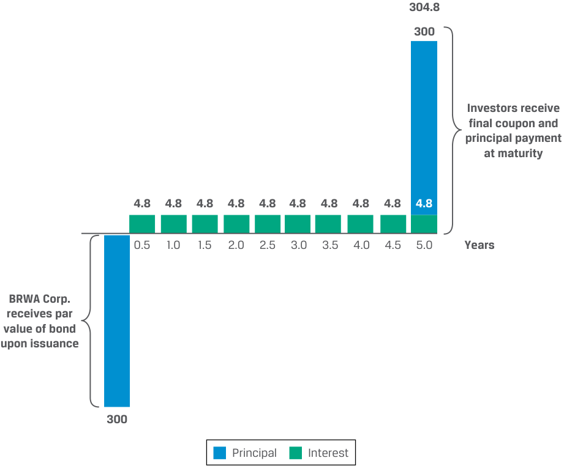
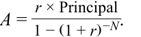
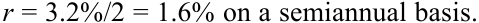
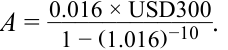
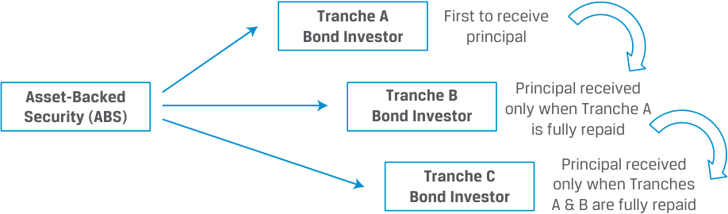
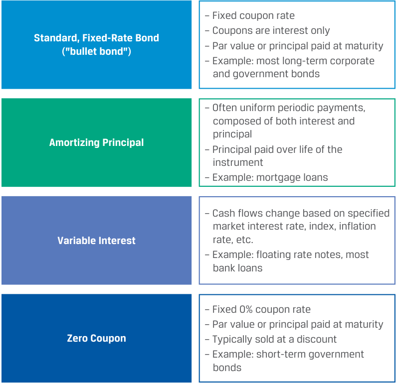

# Tập 6: Chứng khoán Thu nhập Cố định (Fixed Income)
## Learning Module 2 Fixed-Income Cash Flows and Types (Trang PDF 33–64)

---

# Tập 6: Chứng Khoán Thu Nhập Cố Định (*Fixed Income*)
## Học Phần 2: Các Dòng Tiền và Phân Loại Công Cụ Thu Nhập Cố Định (*Fixed-Income Cash Flows and Types*)
### Phần 1/2: Giới Thiệu (Trang PDF 33–48)

---

<!-- PDF Page 33 -->

#### H Ọ C P H Ầ N 

# **<mark>2</mark>** 

### **Các Dòng Tiền và Phân Loại Công Cụ Thu Nhập Cố Định (*Fixed-Income Cash Flows and Types*)** 

###### **<mark>MỤC TIÊU HỌC TẬP (*LEARNING OUTCOMES*)</mark>** 

| **_Mức độ thành thạo_** | **_Ứng viên cần có khả năng:_** |
|---|---|
| | Mô tả các cấu trúc dòng tiền phổ biến của công cụ thu nhập cố định và phân biệt các điều khoản dự phòng dòng tiền (*cash flow contingency provisions*) mang lại lợi ích cho tổ chức phát hành và cho nhà đầu tư |
| | Mô tả cách thức các yếu tố pháp lý, quy định quản lý và thuế (*legal, regulatory, and tax considerations*) ảnh hưởng đến việc phát hành và giao dịch chứng khoán thu nhập cố định |

##### **GIỚI THIỆU (*INTRODUCTION*)** 

## **<mark>1</mark>** 

Dòng tiền của một công cụ thu nhập cố định được xác định bởi các đặc điểm của nó. Trong học phần này, chúng ta thảo luận về các cấu trúc dòng tiền phổ biến của công cụ thu nhập cố định và những hàm ý của chúng đối với các tổ chức phát hành cũng như các nhà đầu tư. Bài học cuối cùng của học phần thảo luận về các yếu tố pháp lý, quy định quản lý và thuế giữa các khu vực tài phán khác nhau mà các tổ chức phát hành và nhà đầu tư thu nhập cố định phải đối mặt. 

###### **TỔNG QUAN HỌC PHẦN (*LEARNING MODULE OVERVIEW*)** 

- Trái ngược với các trái phiếu trả gốc một lần khi đáo hạn tiêu chuẩn (*standard bullet bonds*) với việc hoàn trả toàn bộ vốn gốc khi đáo hạn, các trái phiếu khấu hao dần vốn gốc (*amortizing bonds*) có lịch trình thanh toán bao gồm việc hoàn trả sớm vốn gốc. Quỹ trả nợ (*sinking funds*) và cấu trúc thác nước (*waterfall structures*) đại diện cho các trường hợp đặc biệt của trái phiếu khấu hao dần vốn gốc. 

- Các cấu trúc thanh toán coupon khác bao gồm trái phiếu liên kết chỉ số (*index-linked bonds*) cung cấp các khoản thanh toán được điều chỉnh theo những thay đổi của chỉ số giá và trái phiếu có lãi suất coupon bậc thang (*step-up coupons*), với mức lãi suất coupon tăng thêm những khoản cụ thể trong tương lai dựa trên một lịch trình định trước hoặc phụ thuộc vào các điều khoản cụ thể. 

- Các điều khoản dự phòng thu nhập cố định (*fixed-income contingency provisions*) bao gồm đặc tính mua lại (*call*), bán lại (*put*) và chuyển đổi (*conversion*). Đặc tính mua lại (*call feature*) trao cho tổ chức phát hành quyền mua lại trái phiếu sớm ở một mức giá cố định, trong khi đặc tính bán lại (*put feature*) trao cho nhà đầu tư quyền bán lại trái phiếu cho tổ chức phát hành ở một mức giá cố định trước ngày đáo hạn. Trái phiếu chuyển đổi (*convertible bonds*) trao cho các nhà đầu tư quyền chuyển đổi trái phiếu thành cổ phần phổ thông của tổ chức phát hành ở một mức giá được xác định trước. 

<!-- PDF Page 34 -->

- Trái phiếu có thể được phân loại thành trái phiếu nội địa (*domestic bonds*), trái phiếu nước ngoài (*foreign bonds*), hoặc trái phiếu châu Âu (*Eurobonds*). Trái phiếu nội địa là những trái phiếu được phát hành tại một quốc gia bởi một tổ chức phát hành được thành lập hợp pháp tại chính quốc gia đó, trong khi trái phiếu nước ngoài được phát hành bởi các thực thể được thành lập ở nơi khác. 

- Trái phiếu châu Âu (*Eurobonds*) được phát hành trên phạm vi quốc tế bằng một đồng tiền khác với đồng nội tệ của quốc gia nơi phát hành (ví dụ: trái phiếu định danh bằng đô la Mỹ được phát hành tại London) và chịu ít yêu cầu về niêm yết, công bố thông tin và quy định quản lý hơn so với trái phiếu nội địa hoặc trái phiếu nước ngoài. 

- Tiền lãi trái phiếu mà nhà đầu tư kiếm được thường bị đánh thuế như thu nhập thông thường (*ordinary income*), mặc dù một số trái phiếu mang lại ưu đãi thuế. Một số quốc gia cũng áp dụng thuế lãi vốn (*capital gains tax*). Các quy định thuế cụ thể thường được áp dụng đối với trái phiếu được phát hành ở mức chiết khấu (*issued at a discount*) hoặc được mua ở mức phụ trội (*purchased at a premium*). 

###### **TỰ ĐÁNH GIÁ HỌC PHẦN (*LEARNING MODULE SELF-ASSESSMENT*)** 

Những câu hỏi ban đầu này nhằm mục đích giúp bạn tự đánh giá mức độ hiểu biết hiện tại của mình về học phần này. 

1. Một nhà đầu tư nhạy cảm với rủi ro tín dụng (*credit risk*) của tổ chức phát hành hơn là rủi ro tái đầu tư (*reinvestment risk*) nhiều khả năng nhất sẽ đầu tư vào: 

   - **A.** trái phiếu trả gốc một lần khi đáo hạn (*bullet bond*). 

   - **B.** trái phiếu khấu hao gốc một phần (*partially amortizing bond*). 

   - **C.** trái phiếu khấu hao gốc toàn phần (*fully amortizing bond*). 

   - **Lời giải:** 

C là đáp án đúng. Các nhà đầu tư nhận được các dòng tiền trong ngắn hạn cao hơn đối với khoản nợ khấu hao dần vốn gốc (*amortizing debt*) so với trái phiếu trả gốc một lần (*bullet bonds*) và chịu rủi ro tín dụng thấp hơn bởi vì nghĩa vụ nợ của bên đi vay giảm dần theo thời gian. Tuy nhiên, các nhà đầu tư cũng phải đối mặt với rủi ro tái đầu tư các dòng tiền ngắn hạn cao hơn đó ở mức lãi suất thị trường hiện hành vốn có thể biến động. Hiệu ứng này lớn hơn đối với trái phiếu khấu hao gốc toàn phần so với trái phiếu khấu hao gốc một phần. 

###### 2. Hãy ghép thuật ngữ ở cột bên trái với mô tả của nó ở cột bên phải. 

| Thuật ngữ | Mô tả |
|---|---|
| A. Trái phiếu trả gốc một lần (*Bullet bond*) | I. Một trái phiếu có lịch trình thanh toán định kỳ cố định làm giảm dư nợ gốc của trái phiếu xuống còn một phần vốn gốc sẽ được hoàn trả vào ngày đáo hạn |
| B. Trái phiếu khấu hao gốc một phần (*Partially amortizing bond*) | II. Một trái phiếu có lãi suất coupon tăng lên theo các biên độ xác định vào một hoặc nhiều ngày cụ thể |
| C. Trái phiếu có lãi suất coupon bậc thang (*Step-up coupon bond*) | III. Một trái phiếu thanh toán mệnh giá và khoản tiền lãi cuối cùng khi đáo hạn |

###### **Lời giải:** 

- **A.** III là đáp án đúng. Một trái phiếu trả gốc một lần (*bullet bond*) thanh toán 100% mệnh giá của nó cộng với khoản thanh toán lãi cuối cùng tại thời điểm đáo hạn của trái phiếu. 

- **B.** I là đáp án đúng. Một trái phiếu được đặc trưng bởi lịch trình thanh toán định kỳ cố định làm giảm dư nợ gốc của trái phiếu xuống còn một phần vốn gốc sẽ được hoàn trả vào ngày đáo hạn được gọi là trái phiếu khấu hao gốc một phần (*partially amortizing bond*). 

<!-- PDF Page 35 -->

- **C.** II là đáp án đúng. Một trái phiếu có lãi suất coupon tăng lên theo các biên độ xác định vào một hoặc nhiều ngày cụ thể được gọi là trái phiếu có lãi suất coupon bậc thang (*step-up coupon bond*).

3. Một điều khoản mua lại (*call provision*) đi kèm trong một chứng khoán thu nhập cố định:
   - **A.** là một lợi ích đối với tổ chức phát hành (*benefit to the issuer*).
   - **B.** trao cho trái chủ quyền nhưng không phải nghĩa vụ bán lại trái phiếu.
   - **C.** trao cho trái chủ một mức độ bảo vệ nhất định trước lạm phát.

   - **Lời giải:**

A là đáp án đúng. Điều khoản mua lại (*call provision*) trao cho tổ chức phát hành quyền mua lại toàn bộ hoặc một phần trái phiếu ở một mức giá được xác định trước vào các ngày cụ thể. Đó là một lợi ích cho tổ chức phát hành bởi vì nếu lãi suất thị trường giảm xuống, tổ chức phát hành có thể thay thế trái phiếu có thể mua lại (*callable bond*) bằng một trái phiếu mới có lãi suất thấp hơn. Nó cũng mang lại cho tổ chức phát hành sự linh hoạt bổ sung nếu công ty có tiền mặt dư thừa hoặc muốn thay đổi cấu trúc vốn của mình trong tương lai.

B không đúng. Điều này mô tả một trái phiếu có thể bán lại (*putable bond*), chứ không phải trái phiếu có thể mua lại (*callable bond*). Nếu một trái phiếu có thể mua lại bị thực hiện quyền mua lại (*called*), trái chủ có nghĩa vụ phải bán nó cho tổ chức phát hành theo các điều khoản đã quy định.

C không đúng. Điều khoản mua lại không mang lại cho trái chủ sự bảo vệ trước lạm phát. Quyền chọn mua lại sẽ được tổ chức phát hành thực hiện nếu lãi suất giảm xuống.

4. Một điều khoản bán lại (*put provision*) đi kèm trong một chứng khoán thu nhập cố định:
   - **A.** là một lợi ích đối với các trái chủ (*benefit to the bondholders*).
   - **B.** dẫn đến giá trị thấp hơn so với một trái phiếu trả gốc một lần (*bullet bond*).
   - **C.** làm tăng khả năng tổ chức phát hành của nó sẽ bị mua lại/thâu tóm (*acquired*).

   - **Lời giải:**

A là đáp án đúng. Điều khoản bán lại (*put provision*) trao cho các trái chủ quyền bán lại trái phiếu cho tổ chức phát hành ở một mức giá được xác định trước vào các ngày cụ thể. Điều khoản bán lại là một lợi ích đối với các trái chủ vì nó có thể bảo vệ họ khỏi rủi ro giá trái phiếu sụt giảm do, chẳng hạn như, lãi suất tăng lên.

B không đúng. Vì điều khoản bán lại có lợi cho các nhà đầu tư, trái phiếu có thể bán lại (*putable bonds*) được định giá ở mức phụ trội (*premium*), chứ không phải chiết khấu (*discount*), so với các trái phiếu tương đương không có quyền chọn (*option-free counterparts*).

C không đúng. Điều khoản bán lại có thể ngăn cản các bên thâu tóm bởi vì việc thực hiện quyền bán lại trái phiếu dẫn đến một yêu cầu thanh toán tiền mặt ngay lập tức, làm cho thương vụ thâu tóm trở nên đắt đỏ hơn. Phát hành trái phiếu kèm theo điều khoản bán lại là một chiến lược được một số doanh nghiệp sử dụng để ngăn chặn các vụ thâu tóm thù địch (*unfriendly takeovers*), được gọi là “quyền chọn bán độc dược” (*“poison puts”*).

5. Hãy ghép thuật ngữ ở cột bên trái với mô tả của nó ở cột bên phải. 

| Thuật ngữ | Mô tả |
|---|---|
| A. Trái phiếu châu Âu (*Eurobond*) | I. Một trái phiếu được phát hành bên ngoài phạm vi tài phán của bất kỳ quốc gia đơn lẻ nào |
| B. Trái phiếu toàn cầu (*Global bond*) | II. Một trái phiếu được phát hành đồng thời trên thị trường Eurobond và tại ít nhất một thị trường trái phiếu nội địa |

**Lời giải:** 

- **A.** I là đáp án đúng. Trái phiếu châu Âu (*Eurobonds*) được phát hành bên ngoài phạm vi tài phán của bất kỳ quốc gia đơn lẻ nào, thường là không có đảm bảo (*unsecured*), và có thể được định danh bằng bất kỳ đồng tiền nào, kể cả đồng nội tệ của tổ chức phát hành. 

<!-- PDF Page 36 -->

- **B.** II là đáp án đúng. Một trái phiếu toàn cầu (*global bond*) là một trái phiếu được phát hành đồng thời trên thị trường Eurobond và tại ít nhất một thị trường trái phiếu nội địa, đảm bảo đủ nhu cầu cho các đợt phát hành trái phiếu quy mô lớn và khả năng tiếp cận tới tất cả các nhà đầu tư thu nhập cố định bất kể vị trí địa lý. 

6. So với một trái phiếu có điều khoản thuế chiết khấu phát hành gốc (*original issue discount – OID tax provision*), một trái phiếu giống hệt về mọi mặt khác nhưng không có điều khoản này _nhiều khả năng nhất_ sẽ có: 

   - **A.** mức thuế phải nộp khi đáo hạn thấp hơn. 

   - **B.** mức thuế phải nộp khi đáo hạn bằng nhau. 

   - **C.** mức thuế phải nộp khi đáo hạn cao hơn. 

   - **Lời giải:** 

C là đáp án đúng. Theo điều khoản thuế OID, nhà đầu tư sẽ ghi nhận một phần phân bổ theo tỷ lệ (*prorated portion*) của khoản OID làm thu nhập chịu thuế mỗi năm và không phải nộp thuế lãi vốn khi đáo hạn. Các nhà đầu tư không chịu điều khoản thuế OID sẽ không ghi nhận thu nhập chịu thuế nào cho đến khi đáo hạn, tại thời điểm đó họ sẽ phải chịu thuế lãi vốn đối với toàn bộ khoản OID (với điều kiện có áp dụng thuế lãi vốn tại khu vực tài phán của họ). 

## **<mark>2</mark>** 

##### **CÁC CẤU TRÚC DÒNG TIỀN CỦA CÔNG CỤ THU NHẬP CỐ ĐỊNH (*FIXED-INCOME CASH FLOW STRUCTURES*)** 

*Mục tiêu: Mô tả các cấu trúc dòng tiền phổ biến của công cụ thu nhập cố định và phân biệt các điều khoản dự phòng dòng tiền mang lại lợi ích cho tổ chức phát hành và cho nhà đầu tư.*

Cấu trúc dòng tiền trái phiếu phổ biến nhất là cấu trúc của một trái phiếu lãi suất coupon cố định tiêu chuẩn, thường được gọi là **trái phiếu trả gốc một lần khi đáo hạn (*bullet bond*)**. Tổ chức phát hành trái phiếu nhận vốn gốc vào ngày thanh toán giao dịch (*settlement*), thực hiện các khoản thanh toán coupon cố định định kỳ và hoàn trả vốn gốc khi đáo hạn. Hầu hết các tổ chức phát hành chính phủ và doanh nghiệp đều sử dụng trái phiếu *bullet* làm phương tiện tài trợ nợ chính của họ, và các nhà đầu tư thường ưa chuộng luồng thu nhập cố định đi kèm cùng ngày đáo hạn cố định để tài trợ cho các dòng tiền đã biết trước. Bảng minh họa 1 (*Exhibit 1*) cho thấy cấu trúc trái phiếu *bullet* của trái phiếu BRWA kỳ hạn 5 năm, trị giá 300 triệu USD, trả coupon bán niên 3.2% đã được giới thiệu trong học phần trước. 

<!-- PDF Page 37 -->

###### **Bảng minh họa 1: Dòng tiền Trái phiếu Trả gốc một lần (*Bullet Bond*) của Tập đoàn BRWA** 

> **Chú thích hình ảnh:**
> - **Thời điểm $0$**: Tập đoàn BRWA nhận mệnh giá trái phiếu khi phát hành: $300$ triệu USD (Vốn gốc – *Principal*).
> - **Các kỳ bán niên $0.5, 1.0, 1.5, 2.0, 2.5, 3.0, 3.5, 4.0, 4.5\text{ năm}$**: Nhà đầu tư nhận tiền lãi (*Interest*) $4.8$ triệu USD mỗi kỳ.
> - **Tại thời điểm đáo hạn $5.0\text{ năm}$**: Nhà đầu tư nhận khoản thanh toán coupon cuối cùng ($4.8$) và khoản thanh toán vốn gốc ($300$) khi đáo hạn, tổng cộng là $304.8$ triệu USD.

Một số công cụ, bao gồm hầu hết các khoản vay, có cấu trúc dòng tiền khác với cấu trúc của trái phiếu *bullet*. Ví dụ, một số công cụ có các khoản hoàn trả vốn gốc được phân bổ trong suốt vòng đời của công cụ. Trong trường hợp thanh toán lãi, hầu hết các khoản vay đều trả lãi định kỳ theo mức lãi suất thay đổi khi lãi suất thị trường ngắn hạn thay đổi, trong khi những công cụ khác thay đổi dựa trên tín dụng hoặc các điều khoản khác. Cuối cùng, trái phiếu không trả lãi định kỳ (*zero-coupon bonds*) được bán ở mức chiết khấu mà không có dòng tiền nào trong suốt vòng đời của chúng cho đến khi hoàn trả mệnh giá lúc đáo hạn. Những trái phiếu này không trả lãi định kỳ, nhưng phần chênh lệch giữa giá chiết khấu và mệnh giá khi đáo hạn thể hiện một khoản thanh toán lãi tích lũy tại ngày đáo hạn. 

###### **Nợ khấu hao dần vốn gốc (*Amortizing Debt*)** 

Các công cụ thu nhập cố định định kỳ thanh toán bớt một phần dư nợ gốc trước ngày đáo hạn mang lại cho bên đi vay khả năng dàn trải các khoản thanh toán đồng đều hơn trong suốt vòng đời của công cụ. Các ví dụ bao gồm các khoản vay thế chấp bất động sản thương mại hoặc nhà ở (*commercial or residential real estate mortgage loans*). Các nhà đầu tư nhận được các dòng tiền ngắn hạn cao hơn đối với **khoản nợ khấu hao dần vốn gốc (*amortizing debt*)** này so với trái phiếu *bullet* và chịu rủi ro tín dụng thấp hơn bởi vì nghĩa vụ nợ của bên đi vay được giảm dần theo thời gian. Tuy nhiên, các nhà đầu tư cũng phải đối mặt với rủi ro tái đầu tư các dòng tiền cao hơn đó ở mức lãi suất thị trường hiện hành trong suốt vòng đời của công cụ, vốn có thể sụt giảm. 

Hãy xem xét trường hợp đối lập với trái phiếu *bullet* kỳ hạn 5 năm của BRWA, đó là một **khoản vay khấu hao gốc toàn phần (*fully amortizing loan*)** có cùng kỳ hạn và cùng mức lãi suất. Như được hiển thị trong Bảng minh họa 2 (*Exhibit 2*), việc khấu hao vốn gốc bắt đầu vào ngày thanh toán lãi đầu tiên và tiếp tục cho đến khi đáo hạn. 

<!-- PDF Page 38 -->

**Bảng minh họa 2: Dòng tiền Khoản vay Khấu hao gốc Toàn phần của Tập đoàn BRWA (*BRWA Corporation Fully Amortizing Loan Cash Flows*)** 

> **Chú thích hình ảnh:**
> - **Thời điểm $0$**: Tổ chức phát hành nhận mệnh giá trái phiếu/khoản vay khi phát hành: $300$ triệu USD.
> - **Các kỳ bán niên từ $0.5$ đến $5.0\text{ năm}$**: Nhà đầu tư nhận một khoản thanh toán cố định $32.7$ triệu USD mỗi kỳ bằng tổng của khoản thanh toán lãi (*Interest*) và vốn gốc (*Principal*):
>   - Phần vốn gốc (*Principal*) tăng dần qua các kỳ: $27.9 \rightarrow 28.4 \rightarrow 28.8 \rightarrow 29.3 \rightarrow 29.7 \rightarrow 30.2 \rightarrow 30.7 \rightarrow 31.2 \rightarrow 31.7 \rightarrow 32.2$.
>   - Phần tiền lãi (*Interest*) giảm dần qua các kỳ: $4.8 \rightarrow 4.4 \rightarrow 3.9 \rightarrow 3.4 \rightarrow 3.0 \rightarrow 2.5 \rightarrow 2.0 \rightarrow 1.5 \rightarrow 1.0 \rightarrow 0.5$.

Lưu ý rằng mặc dù khoản thanh toán lãi đầu tiên, 4.8 triệu USD, giống hệt như của trái phiếu *bullet*, nhưng thay vì các khoản coupon chỉ trả lãi mỗi kỳ rồi mới trả coupon cuối cùng và vốn gốc khi đáo hạn, các nhà đầu tư lại nhận được một dòng tiền định kỳ đồng nhất là 32.7 triệu USD cho đến khi đáo hạn, trong đó ở kỳ đầu tiên bao gồm 27.9 triệu USD tiền khấu hao vốn gốc. Theo thời gian, phần tiền lãi trong khoản thanh toán giảm dần trong khi phần hoàn trả vốn gốc tăng lên. 

Thay vào đó, chúng ta hãy giả sử rằng BRWA phát hành một trái phiếu có cùng kỳ hạn và cùng mức lãi suất nhưng chỉ hoàn trả _một phần_ vốn gốc mỗi kỳ, kèm theo một khoản thanh toán gộp một lần cuối cùng (hay **khoản thanh toán gốc lớn cuối kỳ – *balloon payment***) khi đáo hạn bằng một nửa số tiền vốn gốc. Các khoản thanh toán lãi và vốn gốc cho **trái phiếu khấu hao gốc một phần (*partially amortizing bond*)** này được hiển thị trong Bảng minh họa 3 (*Exhibit 3*). 

<!-- PDF Page 39 -->

**Bảng minh họa 3: Dòng tiền Trái phiếu Khấu hao gốc Một phần của Tập đoàn BRWA (*BRWA Corporation Partially Amortizing Bond Cash Flows*)** 

> **Chú thích hình ảnh:**
> - **Thời điểm $0$**: Tổ chức phát hành nhận mệnh giá trái phiếu khi phát hành: $300$ triệu USD.
> - **Các kỳ bán niên từ $0.5$ đến $4.5\text{ năm}$**: Nhà đầu tư nhận khoản thanh toán $18.75$ triệu USD bằng tổng của tiền lãi và phần khấu hao vốn gốc một phần:
>   - Phần vốn gốc (*Principal*): $14.0 \rightarrow 14.2 \rightarrow 14.4 \rightarrow 14.6 \rightarrow 14.9 \rightarrow 15.1 \rightarrow 15.3 \rightarrow 15.6 \rightarrow 15.8$ (và $16.1$ ở kỳ $5.0$).
>   - Phần tiền lãi (*Interest*): $4.8 \rightarrow 4.6 \rightarrow 4.4 \rightarrow 4.1 \rightarrow 3.9 \rightarrow 3.6 \rightarrow 3.4 \rightarrow 3.2 \rightarrow 2.9$ (và $2.65$ ở kỳ $5.0$).
> - **Tại thời điểm đáo hạn $5.0\text{ năm}$**: Nhà đầu tư nhận khoản thanh toán định kỳ cuối cùng $18.75$ triệu USD và khoản thanh toán gốc lớn cuối kỳ (*balloon principal payment*) $150$ triệu USD, tổng cộng là $168.75$ triệu USD.

Dòng tiền của trái phiếu khấu hao gốc một phần kết hợp các yếu tố của ví dụ trái phiếu *bullet* và khoản vay khấu hao gốc toàn phần. Lịch trình dòng tiền dưới góc độ của nhà đầu tư đối với trái phiếu *bullet*, trái phiếu khấu hao gốc một phần, và khoản vay khấu hao gốc toàn phần có cùng vốn gốc, kỳ hạn và lãi suất coupon cố định được hiển thị trong Bảng minh họa 4 (*Exhibit 4*). 

**Bảng minh họa 4: Góc độ Nhà đầu tư: Tóm tắt Dòng tiền Trái phiếu/Khoản vay BRWA (triệu USD)** 

| **Năm (*Year*)** | **Trái phiếu Trả gốc một lần (*Bullet Bond*)** | **Trái phiếu Khấu hao gốc Một phần (*Partially Amortizing Bond*)** | **Khoản vay Khấu hao gốc Toàn phần (*Fully Amortizing Loan*)** |
|---|---|---|---|
| 0 | –300 | –300 | –300 |
| 0.5 | 4.8 | 18.75 | 32.7 |
| 1 | 4.8 | 18.75 | 32.7 |
| 1.5 | 4.8 | 18.75 | 32.7 |
| 2 | 4.8 | 18.75 | 32.7 |
| 2.5 | 4.8 | 18.75 | 32.7 |
| 3 | 4.8 | 18.75 | 32.7 |
| 3.5 | 4.8 | 18.75 | 32.7 |
| 4 | 4.8 | 18.75 | 32.7 |
| 4.5 | 4.8 | 18.75 | 32.7 |
| 5 | 304.8 | 168.75 | 32.7 |

Khoản vay khấu hao gốc toàn phần có mức thanh toán bán niên cố định bằng tổng của tiền lãi và hoàn trả vốn gốc. Chúng ta có thể tính toán khoản thanh toán định kỳ ($A$) như sau: 

$$A = \frac{r \times \text{Principal}}{1 - (1 + r)^{-N}} \tag{1}$$

<!-- PDF Page 40 -->

trong đó:

$A$ = Số tiền thanh toán định kỳ (*Periodic payment amount*) 

$r$ = Lãi suất thị trường mỗi kỳ (*Market interest rate per period*) 

$\text{Principal}$ = Số tiền vốn gốc của khoản vay hoặc trái phiếu (*Principal amount of loan or bond*) 

$N$ = Số kỳ thanh toán (*Number of payment periods*) 

Trái phiếu BRWA khấu hao gốc toàn phần là một trái phiếu kỳ hạn 5 năm, trả coupon bán niên 3.2% với mệnh giá 300 triệu USD. Khoản thanh toán định kỳ được tính như sau, tính theo đơn vị triệu: 

$$A = \frac{r \times \text{Principal}}{1 - (1 + r)^{-N}}$$

$$r = \frac{3.2\%}{2} = 1.6\% \text{ trên cơ sở bán niên.}$$

$$\text{Principal} = \text{USD } 300\text{ triệu.}$$

$$N = 5 \times 2 = 10 \text{ kỳ bán niên.}$$

$$A = \frac{0.016 \times \text{USD } 300}{1 - (1.016)^{-10}}$$

$$A = \text{USD } 32.70$$

Do đó, khoản thanh toán bán niên là một mức không đổi 32.70 triệu USD, như được hiển thị trong Bảng minh họa 2, nhưng số tiền gốc và lãi thay đổi qua mỗi kỳ như sau: 

- Khoản thanh toán lãi bán niên đầu tiên: $\text{USD } 300 \times 3.2\% / 2 = \text{USD } 4.80$. 

- Khoản hoàn trả vốn gốc ban đầu: $\text{USD } 32.7 - \text{USD } 4.8 = \text{USD } 27.90$. 

- Dư nợ gốc còn lại sau kỳ đầu tiên: $\text{USD } 300 - \text{USD } 27.90 = \text{USD } 272.10$. 

Dư nợ gốc còn lại 272.10 triệu USD trở thành cơ sở để tính toán khoản thanh toán lãi và gốc trong kỳ thứ hai: 

- Khoản thanh toán lãi bán niên thứ hai: $\text{USD } 272.10 \times 3.2\% / 2 = \text{USD } 4.35$. 

- Khoản hoàn trả vốn gốc thứ hai: $\text{USD } 32.70 - \text{USD } 4.35 = \text{USD } 28.35$. 

- Dư nợ gốc còn lại sau kỳ thứ hai: $\text{USD } 272.10 - \text{USD } 28.35 = \text{USD } 243.75$. 

Lưu ý rằng khoản thanh toán định kỳ là không đổi, nhưng theo thời gian, khoản thanh toán lãi giảm xuống trong khi khoản hoàn trả vốn gốc tăng lên. 

Trái phiếu khấu hao gốc một phần trong Bảng minh họa 3 với khoản thanh toán gốc lớn cuối kỳ (*balloon principal payment*) 150 triệu USD được trả khi đáo hạn kết hợp hai yếu tố: 

**1.** một khoản vay khấu hao gốc toàn phần kỳ hạn 5 năm với giá trị danh nghĩa 150 triệu USD và 

**2.** một khoản thanh toán gốc lớn cuối kỳ (*balloon payment*) 150 triệu USD khi đáo hạn. 

Tổng giá trị hiện tại của hai yếu tố này bằng với giá trái phiếu là 300 triệu USD. Giá trị hiện tại ($PV$) của khoản thanh toán *balloon* 150 triệu USD được tính như sau: 

$$\text{PV của khoản thanh toán balloon} = \frac{\text{USD } 150}{(1.016)^{10}} = \text{USD } 127.98$$

Lấy giá 300 triệu USD của trái phiếu trừ đi giá trị hiện tại của khoản thanh toán *balloon* cho chúng ta 172 triệu USD tiền hoàn trả vốn gốc cần khấu hao trong 10 kỳ bán niên để chừa lại phần vốn gốc còn lại là 150 triệu USD khi đáo hạn. Sử dụng số tiền vốn gốc 172 triệu USD này, chúng ta có thể tính toán số tiền thanh toán định kỳ như sau: 

$$A = \frac{0.016 \times (\text{USD } 172)}{1 - (1.016)^{-10}} = \text{USD } 18.75$$

<!-- PDF Page 41 -->

Khoản thanh toán định kỳ là 18.75 triệu USD, như được hiển thị trong Bảng minh họa 3. Khoản thanh toán bán niên cuối cùng 168.75 triệu USD là tổng của khoản thanh toán cố định cuối cùng 18.75 triệu USD và dư nợ gốc còn lại 150 triệu USD. Vì số tiền vốn gốc không được khấu hao toàn bộ, các khoản thanh toán lãi của trái phiếu khấu hao gốc một phần cao hơn trong mỗi kỳ so với trái phiếu khấu hao gốc toàn phần, ngoại trừ kỳ đầu tiên khi chúng bằng nhau. 

Các khoản vay thế chấp thương mại và nhà ở (*commercial and residential mortgages*) là những ví dụ phổ biến về các khoản vay khấu hao gốc toàn phần. Người đi vay thế chấp thường ưa chuộng các dòng tiền không đổi của các khoản vay khấu hao gốc toàn phần, bởi vì họ có khả năng khớp tốt hơn với thu nhập cho thuê trong trường hợp người đi vay thương mại hoặc thu nhập cá nhân đối với các hộ gia đình. Tại Hoa Kỳ, các khoản vay thế chấp này thường làm tài sản đảm bảo cho các trái phiếu được gọi là **chứng khoán đảm bảo bằng thế chấp (*mortgage-backed securities* – MBS)** với các dòng tiền tương tự như dòng tiền của khoản vay được trình bày trong Ví dụ 1. 

###### **VÍ DỤ 1** 

###### **Khoản vay Thế chấp Nhà ở Lãi suất Cố định Kỳ hạn 30 năm (*30-Year Fixed-Rate Residential Mortgage Loan*)** 

Một người đi vay đồng ý mua một căn nhà và ký kết một khoản vay thế chấp với một định chế tài chính trung gian dựa trên các điều khoản sau: 

- Giá nhà (*Home price*): 500,000 USD 
- Số tiền vay (*Loan amount*): 400,000 USD 
- Lãi suất hàng năm (*Annual interest rate*): 3.50% 
- Thời hạn vay (*Loan term*): 360 tháng 

Lưu ý rằng lãi suất hàng tháng của người đi vay là $0.29167\%$ ($= 3.50\% / 12$), chúng ta có thể sử dụng Phương trình 1 để tính khoản thanh toán thế chấp hàng tháng của chủ nhà đối với khoản vay 400,000 USD như sau: 

$$A = \frac{0.0029167(\text{USD } 400,000)}{1 - (1.0029167)^{-360}} = \text{USD } 1,796.18$$

Giống như trong trường hợp của BRWA, chúng ta có thể tính toán các cấu phần tiền lãi và vốn gốc của mỗi khoản thanh toán định kỳ, với năm khoản thanh toán hàng tháng đầu tiên và năm khoản thanh toán hàng tháng cuối cùng của khoản vay thế chấp 30 năm được hiển thị bên dưới. 

| **Tháng (*Month*)** | **Tổng thanh toán hàng tháng (*Total Monthly Payment*)** | **Thanh toán lãi hàng tháng (*Monthly Interest Payment*)** | **Thanh toán gốc hàng tháng (*Monthly Principal Payment*)** | **Dư nợ gốc còn lại (*Remaining Principal*)** |
|---|---|---|---|---|
| 1 | USD1,796.18 | USD1,166.67 | USD629.51 | USD399,370.49 |
| 2 | USD1,796.18 | USD1,164.83 | USD631.35 | USD398,739.14 |
| 3 | USD1,796.18 | USD1,162.99 | USD633.19 | USD398,105.95 |
| 4 | USD1,796.18 | USD1,161.14 | USD635.04 | USD397,470.91 |
| 5 | USD1,796.18 | USD1,159.29 | USD636.89 | USD396,834.03 |
| 356 | USD1,796.18 | USD25.97 | USD1,770.21 | USD7,132.63 |
| 357 | USD1,796.18 | USD20.80 | USD1,775.38 | USD5,357.26 |
| 358 | USD1,796.18 | USD15.63 | USD1,780.55 | USD3,576.70 |
| 359 | USD1,796.18 | USD10.43 | USD1,785.75 | USD1,790.96 |
| 360 | USD1,796.18 | USD5.22 | USD1,790.96 | USD0.00 |

<!-- PDF Page 42 -->

Hai thỏa thuận khấu hao trái phiếu bổ sung thường gặp là **quỹ trả nợ (*sinking funds*)**, được sử dụng chủ yếu bởi các tổ chức phát hành chính phủ và một số tổ chức phát hành doanh nghiệp, và **cấu trúc thác nước (*waterfall structures*)**, thường được sử dụng trong chứng khoán đảm bảo bằng tài sản (ABS) và chứng khoán đảm bảo bằng thế chấp (MBS). 

Một thỏa thuận quỹ trả nợ (*sinking fund arrangement*) được các tổ chức phát hành sử dụng để định kỳ thanh toán bớt dư nợ gốc đang lưu hành của trái phiếu. Thuật ngữ _quỹ trả nợ (sinking fund)_ đề cập đến kế hoạch của tổ chức phát hành trong việc dành riêng các khoản tiền theo thời gian vào một tài khoản ký quỹ (*escrow account*) để thu hồi trái phiếu sớm dựa trên các điều khoản đã thỏa thuận khi phát hành. Ví dụ, một tổ chức phát hành có thể chỉ thị cho bên nhận ủy thác trái phiếu (*bond trustee*) mua lại một số tiền vốn gốc đã xác định trước được lựa chọn ngẫu nhiên trong số các nhà đầu tư. Ngoài ra, tổ chức phát hành có thể có quyền mua lại trái phiếu trước ngày đáo hạn ở một mức giá cố định xác định trước theo một đặc tính dự phòng sẽ được đề cập ở phần sau của bài học này. Giống như việc khấu hao dần vốn gốc (*amortization*), quỹ trả nợ làm giảm rủi ro tín dụng đồng thời làm tăng rủi ro tái đầu tư do sự sụt giảm dư nợ gốc đang lưu hành trước khi đáo hạn. 

Một cấu trúc khác để hoàn trả vốn gốc là cấu trúc thác nước (*waterfall*). Phương pháp này được sử dụng để xác định thời điểm phân bổ dòng tiền cho các tầng lớp nhà đầu tư có thứ tự ưu tiên đòi nợ khác nhau đối với cùng một nguồn dòng tiền. Ở hình thức phổ biến nhất, các khoản thanh toán lãi hoặc coupon được trả cho tất cả các tầng lớp mà không có sự ưu tiên phân biệt nào, nhưng việc hoàn trả vốn gốc diễn ra tuần tự (*sequentially*) sao cho tầng lớp nhà đầu tư cấp cao nhất (*most senior investor class*) có thứ hạng cao nhất trong cấu trúc vốn nhận được các khoản thanh toán vốn gốc đầu tiên, tiếp theo là các nhà đầu tư có thứ hạng cao thứ hai một khi tầng lớp cấp cao nhất đã được hoàn trả đầy đủ. Bảng minh họa 5 (*Exhibit 5*) cho thấy một cấu trúc thác nước điển hình dựa trên ví dụ ba phân lớp (*three-tranche*) từ học phần trước. 

###### **Bảng minh họa 5: Cấu trúc Thác nước ABS Điển hình (*Typical ABS Waterfall Structure*)** 

> **Chú thích hình ảnh:**
> **Chứng khoán đảm bảo bằng tài sản (*Asset-Backed Security* – ABS)**:
> - **Nhà đầu tư trái phiếu Phân lớp A (*Tranche A Bond Investor*)**: Là đối tượng đầu tiên nhận được vốn gốc (*First to receive principal*).
> - **Nhà đầu tư trái phiếu Phân lớp B (*Tranche B Bond Investor*)**: Chỉ nhận được vốn gốc khi Phân lớp A đã được hoàn trả đầy đủ (*Principal received only when Tranche A is fully repaid*).
> - **Nhà đầu tư trái phiếu Phân lớp C (*Tranche C Bond Investor*)**: Chỉ nhận được vốn gốc khi cả Phân lớp A & B đã được hoàn trả đầy đủ (*Principal received only when Tranches A & B are fully repaid*).

Sự thiếu hụt thanh toán (*payment shortfalls*) sẽ do các phân lớp thứ cấp hơn (*more junior tranches*) gánh chịu vì các phân lớp cấp cao (*senior tranches*) được thanh toán trước, do đó Phân lớp A chịu rủi ro tín dụng thấp nhất, tiếp theo là Phân lớp B và C. 

###### **Nợ có lãi suất biến đổi (*Variable Interest Debt*)** 

Một số trái phiếu và hầu hết các khoản vay có các khoản thanh toán lãi biến đổi, được tính toán bằng cách sử dụng lãi suất tham chiếu thị trường (MRR) và phần chênh lệch tín dụng (*credit spread*). Các định chế tài chính trung gian, chẳng hạn như ngân hàng, ưa chuộng các tài sản là khoản vay có lãi suất thả nổi vì chúng khớp với các khoản nợ phải trả có lãi suất biến đổi của họ, chẳng hạn như tiền gửi. Các khoản vay hoặc trái phiếu lãi suất thả nổi (FRN) cũng hấp dẫn đối với các nhà đầu tư đang tìm cách hưởng lợi từ việc lãi suất tăng lên. 

Hãy nhớ lại rằng một khoản vay lãi suất biến đổi hoặc khoản coupon của FRN bao gồm một mức MRR được thiết lập lại định kỳ cộng với một phần chênh lệch tín dụng đặc thù theo tổ chức phát hành. 

$$\text{Coupon FRN} = \text{MRR} + \text{Chênh lệch tín dụng (Credit spread)}$$

Ví dụ, các bài tập thực hành trong học phần trước đã làm nổi bật FRN kỳ hạn 4 năm, trị giá 250 triệu EUR của Antelas AG được phát hành ở mức lãi suất $\text{MRR} + 250\text{ bps/năm}$ trả hàng quý. Bảng minh họa 6 (*Exhibit 6*) cho thấy bốn dòng tiền cuối cùng của FRN Antelas AG, bao gồm việc hoàn trả vốn gốc khi đáo hạn tương tự như một trái phiếu *bullet* lãi suất cố định. 

<!-- PDF Page 43 -->

**Bảng minh họa 6: Dòng tiền FRN của Antelas AG (*Antelas AG FRN Cash Flows*)** 

| Thông tin trái phiếu | Giá trị | | | |
|---|---|---|---|---|
| **Mệnh giá gốc trái phiếu (EUR)** | **250,000,000** | | | |
| **Chênh lệch tín dụng trên MRR (*Credit Spread over MRR*)** | **2.50%** | | | |
| **Quý (*Quarter*)** | **MRR** | **Lãi suất Coupon (*Coupon Rate*)** | **Thanh toán lãi hàng quý (*Quarterly Interest Payment*)** | **Thanh toán vốn gốc (*Principal Payment*)** |
| 13 | –0.50% | 2.00% | 1,250,000 | |
| 14 | 0.15% | 2.65% | 1,656,250 | |
| 15 | 0.25% | 2.75% | 1,718,750 | |
| 16 | 0.50% | 3.00% | 1,875,000 | 250,000,000 |

Ví dụ, trong Quý 15, lãi suất coupon là $2.75\%$ ($= 0.25\% + 2.50\%$) và khoản thanh toán lãi hàng quý được tính như sau: 

$$\frac{2.75\% \times \text{EUR } 250,000,000}{4} = \text{EUR } 1,718,750$$

Các nhà đầu tư chịu ít rủi ro lãi suất (*interest rate risk*) hơn đối với các công cụ có lãi suất biến đổi bởi vì các khoản thanh toán coupon điều chỉnh theo lãi suất, không giống như trái phiếu có lãi suất coupon cố định. Tuy nhiên, giống như trái phiếu có lãi suất coupon cố định, các công cụ có lãi suất biến đổi vẫn có rủi ro tín dụng (*credit risk*): Nếu khả năng bỏ lỡ thanh toán của tổ chức phát hành tăng lên, các nhà đầu tư sẽ đòi hỏi một mức lợi suất cao hơn để bù đắp cho chất lượng tín dụng thấp hơn, khiến giá của chúng sụt giảm, bất kể mọi sự thay đổi của MRR. 

Ngoài việc thay đổi dòng tiền dựa trên các biến động của MRR, còn tồn tại các cơ chế điều chỉnh khác, có thể được xác định trước (*predetermined*) hoặc gắn với một sự kiện (*tied to an event*). Trong trường hợp các điều chỉnh được xác định trước, lãi suất coupon của trái phiếu tăng lên theo các biên độ cụ thể vào các ngày cụ thể. Những trái phiếu này được gọi là **trái phiếu có lãi suất bậc thang (*step-up bonds*)** và được sử dụng để bảo vệ các nhà đầu tư trước lãi suất tăng và, trong một số trường hợp, để tạo động lực cho các tổ chức phát hành tận dụng một điều khoản dự phòng, như sẽ đề cập ở phần sau. Một ví dụ về những thay đổi dòng tiền dựa trên một sự kiện là mức lãi suất coupon cao hơn trong trường hợp chất lượng tín dụng của tổ chức phát hành bị suy giảm. Điều này mang lại cho các nhà đầu tư sự an tâm lớn hơn rằng họ sẽ được đền bù cho những thay đổi tín dụng bất lợi và cho phép các tổ chức phát hành có mức độ tín nhiệm thấp hơn huy động được nguồn tài trợ nợ với kỳ hạn dài hơn và/hoặc ở mức chênh lệch thấp hơn so với mức có thể đạt được với lãi suất coupon cố định. Điều này phổ biến nhất đối với **các khoản vay có đòn bẩy cao (*leveraged loans*)**, tức là các khoản vay dành cho các tổ chức phát hành có chất lượng tín dụng thấp hơn. Những thay đổi về lãi suất coupon cũng có thể được liên kết với các điều khoản cam kết tài chính hoặc xếp hạng tín dụng, đôi khi được sử dụng trong những công cụ được gọi là **trái phiếu liên kết tín dụng (*credit-linked notes*)**. 

Ví dụ, giả sử rằng Antelas AG trải qua sự sụt giảm về chất lượng tín dụng khi FRN đáo hạn. Do đó, công ty phải giải quyết thỏa đáng những lo ngại về tín dụng của nhà đầu tư bằng cách sửa đổi các điều khoản nợ của mình. Bảng minh họa 7 (*Exhibit 7*) cho thấy cách Antelas có thể đạt được điều này bằng cách ký kết một thỏa thuận vay do ngân hàng thu xếp với mức chênh lệch tín dụng điều chỉnh dựa trên tỷ số đòn bẩy và tỷ số khả năng thanh toán lãi vay. 

**Bảng minh họa 7: Bản điều khoản Khoản vay Đòn bẩy của Antelas AG (*Antelas AG Leveraged Loan Term Sheet*)** 

| Điều khoản | **Khoản vay Đòn bẩy Kỳ hạn 5 năm của Antelas AG** **Bản điều khoản (*Term Sheet*)** |
|---|---|
| **Tổ chức phát hành (*Issuer*):** | Antelas AG |
| **Ngày thanh toán giao dịch (*Settlement Date*):** | [T + 3 Ngày làm việc] |
| **Ngày đáo hạn (*Maturity Date*):** | [5 năm kể từ Ngày thanh toán giao dịch] |
| **Mệnh giá gốc (*Principal Amount*):** | 250 triệu EUR |
| **Tiền lãi (*Interest*):** | MRR cộng Chênh lệch tín dụng (*Credit Spread*) |

<!-- PDF Page 44 -->

| Điều khoản | **Khoản vay Đòn bẩy Kỳ hạn 5 năm của Antelas AG** **Bản điều khoản (*Term Sheet* – tiếp theo)** |
|---|---|
| **Thanh toán lãi (*Interest Payment*):** | Bắt đầu 3 tháng kể từ [Ngày thanh toán giao dịch], được trả hàng quý với khoản thanh toán cuối cùng vào [Ngày đáo hạn] |
| **Chênh lệch tín dụng (*Credit Spread*):** | Dựa trên Tổng tỷ số đòn bẩy (*Total Leverage Ratio* – TLR) của Tổ chức phát hành vào cuối mỗi quý như sau: $325\text{ bps/năm}$ nếu $\text{TLR} \ge 3.5\times$ $300\text{ bps/năm}$ nếu $3.5\times > \text{TLR} \ge 3.0\times$ $275\text{ bps/năm}$ nếu $3.0\times > \text{TLR} \ge 2.5\times$ $250\text{ bps/năm}$ nếu $\text{TLR} \le 2.5\times$ |
| **Mức độ ưu tiên trả nợ (*Seniority*):** | Khoản vay là nghĩa vụ có đảm bảo, không phải nợ thứ cấp của Antelas AG. |
| **Bài kiểm tra hạn chế nợ (*Debt Restriction Test*):** | Tổ chức phát hành phải duy trì (a) Tổng tỷ số đòn bẩy (Nợ ròng chịu lãi trên EBITDA) không lớn hơn $5.00\times$ và (b) Tỷ số khả năng thanh toán lãi vay lớn hơn $2.50\times$ cho mỗi kỳ báo cáo tài chính. |

Antelas chỉ duy trì được mức chênh lệch tín dụng hiện tại nếu tổng tỷ số đòn bẩy của công ty giữ ở mức dưới $2.5\times$, và chịu mức chênh lệch cao hơn nếu đòn bẩy tăng lên. Một tổ chức phát hành lo ngại về các vấn đề dòng tiền tiềm ẩn trong tương lai có thể tìm cách bổ sung một đặc tính **thanh toán bằng hiện vật / gốc hóa lãi (*payment-in-kind* – PIK)** vào một khoản vay hoặc trái phiếu. Đặc tính PIK cho phép tổ chức phát hành trả lãi định kỳ dưới hình thức làm tăng thêm dư nợ gốc đang lưu hành của trái phiếu hoặc khoản vay thay vì thanh toán bằng tiền mặt. Đặc tính này thường được sử dụng nhất bởi các doanh nghiệp có sự phụ thuộc tương đối cao vào tài trợ nợ và thường đi kèm với mức lãi suất cao hơn để đền bù cho các nhà đầu tư gánh chịu rủi ro vốn gốc lớn hơn. 

Như ví dụ đóng khung sau đây cho thấy, việc sử dụng các điều khoản lãi suất coupon trái phiếu biến đổi không chỉ giới hạn ở các tổ chức phát hành gặp vấn đề về chất lượng tín dụng hoặc dòng tiền. 

###### **TRÁI PHIẾU LIÊN KẾT BỀN VỮNG CỦA PUBLIC POWER CORPORATION (PPC) (*PUBLIC POWER CORPORATION SUSTAINABILITY-LINKED BOND*)** 

Các thị trường thu nhập cố định đã nhanh chóng thích ứng với tầm quan trọng ngày càng tăng của các yếu tố môi trường, xã hội và quản trị (ESG) đối với các tổ chức phát hành và nhà đầu tư. Ví dụ, **trái phiếu xanh (*green bonds*)** là các công cụ thu nhập cố định thường được phát hành bởi các chính phủ hoặc các công ty tư nhân được tạo ra để tài trợ cho các dự án có tác động tích cực đến môi trường. 

Public Power Corporation (PPC) là một công ty đại chúng có niêm yết với 51% cổ phần thuộc sở hữu của chính phủ Hy Lạp và là công ty điện lực lớn nhất của Hy Lạp. PPC đã công bố kế hoạch đóng cửa hầu hết công suất nhiệt điện than của mình để cắt giảm mạnh lượng khí thải carbon, tăng sản lượng năng lượng tái tạo, đồng thời hiện đại hóa và tư nhân hóa một phần lưới điện của mình. Nhằm thu hút một cơ sở nhà đầu tư rộng lớn hơn để cung cấp nguồn tài trợ nợ cho các kế hoạch đầy tham vọng của mình, PPC đã phát hành trái phiếu liên kết bền vững (*sustainability-linked bonds*) vào đầu năm 2021 dựa trên các điều khoản sau: 

| Điều khoản | **Trái phiếu Liên kết Bền vững Kỳ hạn 5 năm của Public Power Corporation** **Các điều khoản chính (*Key Terms*)** |
|---|---|
| **Tổ chức phát hành (*Issuer*):** | Public Power Corporation S.A. |
| **Ngày thanh toán giao dịch (*Settlement Date*):** | 18 tháng 3 năm 2021 |
| **Ngày đáo hạn (*Maturity Date*):** | 30 tháng 3 năm 2026 |
| **Mệnh giá gốc (*Principal Amount*):** | 775 triệu EUR |
| **Tiền lãi (*Interest*):** | 3.875%/năm (*p.a.*) |
| **Biên độ lãi suất bậc thang (*Step-Up Margin*):** | 50 bps/năm nếu Sự kiện tăng lãi suất (*Step-Up Event*) xảy ra |

<!-- PDF Page 45 -->

| Điều khoản | **Trái phiếu Liên kết Bền vững Kỳ hạn 5 năm của Public Power Corporation** **Các điều khoản chính (*Key Terms* – tiếp theo)** |
|---|---|
| **Sự kiện tăng lãi suất (*Step-Up Event*):** | Tổ chức phát hành không giảm được lượng khí thải $\text{CO}_2$ ở mức 40% vào tháng 12 năm 2022 so với năm cơ sở 2019 |
| **Thanh toán lãi (*Interest Payment*):** | Bắt đầu từ 30/9/2021, được trả bán niên với khoản thanh toán cuối cùng vào Ngày đáo hạn |
| **Mức độ ưu tiên trả nợ (*Seniority*):** | Trái phiếu là các nghĩa vụ cấp cao không có đảm bảo (*senior unsecured obligations*) của Tổ chức phát hành |

Trái phiếu liên kết bền vững của PPC là loại trái phiếu đầu tiên thuộc dạng này đối với một tổ chức phát hành lợi suất cao (*high-yield issuer*) tại châu Âu. Đặc tính biên độ lãi suất bậc thang liên quan đến $\text{CO}_2$ trong trái phiếu của PPC là một yếu tố quan trọng trong việc thu hút nhu cầu rộng rãi của nhà đầu tư trong một giao dịch vượt xa quy mô dự kiến ban đầu là 500 triệu EUR. 

**Trái phiếu liên kết chỉ số (*index-linked bonds*)** có các khoản thanh toán lãi và/hoặc vốn gốc được liên kết với một chỉ số xác định. Mặc dù một trái phiếu có thể được liên kết với bất kỳ biến số nào, nhưng trên thực tế, **trái phiếu liên kết lạm phát (*inflation-linked bonds***, đôi khi được gọi là *linkers*) gắn với một chỉ số giá tiêu dùng rộng lớn cho đến nay là loại trái phiếu liên kết chỉ số phổ biến nhất. Các khoản thanh toán lãi và vốn gốc cố định của một trái phiếu tiêu chuẩn là các dòng tiền danh nghĩa (*nominal cash flows*) có sức mua suy giảm theo lạm phát. Lãi suất mà một trái chủ nhận được sau khi trừ đi lạm phát là lãi suất thực (*real interest rate*), xấp xỉ bằng lãi suất danh nghĩa trừ đi tỷ lệ lạm phát. Các nhà đầu tư thường sử dụng trái phiếu liên kết lạm phát để bảo vệ trước tình trạng giá cả tăng cao bằng cách nhận các dòng tiền đã được điều chỉnh theo lạm phát. Hầu hết các trái phiếu liên kết lạm phát được phát hành bởi các chính phủ quốc gia. Các ví dụ bao gồm **Chứng khoán Kho bạc Bảo vệ khỏi Lạm phát (*Treasury Inflation-Protected Securities* – TIPS)** tại Hoa Kỳ, đáp ứng nhu cầu của nhà đầu tư đối với các dòng tiền được gắn chỉ số lạm phát. Cũng có nhu cầu ngày càng tăng đối với trái phiếu thị trường mới nổi liên kết lạm phát do lo ngại của nhà đầu tư về lạm phát cao. Ví dụ sau đây minh họa cách thức các dòng tiền của TIPS được điều chỉnh theo lạm phát. 

###### **VÍ DỤ 2** 

###### **Dòng tiền của TIPS (*TIPS Cash Flow*)** 

Một nhà đầu tư mua TIPS với các điều khoản sau: 

| Điều khoản | Chi tiết |
|---|---|
| Mệnh giá gốc (*Principal amount*): | USD 115,000,000 |
| Lãi suất coupon bán niên (*Semiannual coupon*): | 1.00%/năm (*p.a.*) |
| Thời gian đáo hạn (*Time to maturity*): | 9.5 năm |
| Bảo vệ lạm phát (*Inflation protection*): | Dựa trên sự thay đổi của Chỉ số Giá Tiêu dùng cho Tất cả Người tiêu dùng Đô thị: Tất cả các Mặt hàng theo Trung bình Thành phố Hoa Kỳ, Không điều chỉnh theo mùa vụ (*Consumer Price Index* – CPI) |

Nếu CPI tăng từ 265.00 lên 267.25 trong kỳ tính lãi bán niên tiếp theo, khoản thanh toán coupon tiếp theo được tính như sau: 

- Điều chỉnh lạm phát (*Inflation adjustment*): $(267.25 - 265) / 265 = 0.849\%$. 

- Vốn gốc đã điều chỉnh theo lạm phát (*Inflation-adjusted principal*) $= \text{Mệnh giá gốc} \times (1 + \text{Điều chỉnh lạm phát}) = \text{USD } 115,000,000 \times 1.00849 = \text{USD } 115,976,350$. 

- Chi phí lãi hàng năm (*Annual interest expense*) $= \text{Lãi suất coupon} \times \text{Vốn gốc đã điều chỉnh theo lạm phát} = 1.00\% \times \text{USD } 115,976,350 = \text{USD } 1,159,764$. 

- Tiền lãi bán niên được trả (*Semiannual interest paid*) $= \text{USD } 1,159,764 / 2 = \text{USD } 579,882$. 

<!-- PDF Page 46 -->

TIPS, vốn có sự điều chỉnh vốn gốc định kỳ dựa trên một chỉ số giá, là một ví dụ về **trái phiếu gắn chỉ số vào vốn gốc (*capital-indexed bond*)**. Phương pháp này bảo vệ giá trị thực của vốn gốc khoản nợ. Trái phiếu gắn chỉ số vào vốn gốc cũng được phát hành bởi các chính phủ quốc gia khác, bao gồm Úc, Canada và Vương quốc Anh. Lưu ý rằng mặc dù giảm phát (*deflation*) khiến vốn gốc giảm xuống theo thời gian, các nhà đầu tư thường nhận được mức cao hơn giữa vốn gốc đã điều chỉnh theo lạm phát và mệnh giá gốc (*par*) khi đáo hạn. 

Không giống như trái phiếu gắn chỉ số vào vốn gốc, **trái phiếu gắn chỉ số vào tiền lãi (*interest-indexed bonds*)** trả một số tiền vốn gốc danh nghĩa cố định khi đáo hạn. Chỉ có khoản coupon là được liên kết với chỉ số và trả phần điều chỉnh lạm phát. Những trái phiếu này về bản chất là một FRN trong đó MRR chính là tỷ lệ lạm phát. Trái phiếu gắn chỉ số vào tiền lãi thường được phát hành bởi các định chế tài chính trung gian tư nhân hơn là bởi các chính phủ. 

###### **Cấu trúc Trái phiếu Không trả lãi định kỳ (*Zero-Coupon Structures*)** 

Trái phiếu không trả lãi định kỳ (*zero-coupon bonds*) hoàn trả vốn gốc khi đáo hạn nhưng không có các khoản thanh toán coupon. Trái phiếu không trả lãi định kỳ thường được gọi là trái phiếu chiết khấu (*discount bonds*), vì chúng được định giá dưới mệnh giá nếu lãi suất là số dương. Nguồn tỷ suất sinh lợi duy nhất của nhà đầu tư là phần chênh lệch giữa mức giá đã trả và vốn gốc, đại diện cho một khoản thanh toán lãi tích lũy tại ngày đáo hạn. Trái phiếu không trả lãi định kỳ thường được các chính phủ phát hành với kỳ hạn dưới 12 tháng. Khi lãi suất trái phiếu chính phủ giảm xuống bằng (hoặc thấp hơn) mức không sau cuộc khủng hoảng tài chính toàn cầu năm 2008, trái phiếu không trả lãi định kỳ cũng trở nên phổ biến hơn ở các kỳ hạn dài hơn. Trái phiếu không trả lãi định kỳ cũng được tạo ra bởi các định chế tài chính trung gian thông qua việc bán các khoản thanh toán lãi hoặc vốn gốc riêng lẻ được tách ra (*separated* hay *stripped*) từ các trái phiếu *bullet* của chính phủ. 

Trái phiếu không trả lãi định kỳ rất hữu ích để tài trợ cho các nghĩa vụ cố định trong tương lai. Nếu lãi suất giảm xuống, một trái phiếu lãi suất cố định tiêu chuẩn có thể không đáp ứng đủ nghĩa vụ đó bởi vì lãi suất giảm làm giảm thu nhập tái đầu tư (nói cách khác, tỷ suất sinh lợi thực tế của nhà đầu tư sẽ giảm xuống dưới mức YTM ban đầu bởi vì giả định tái đầu tư ở mức YTM không còn đúng nữa). Vì trái phiếu không trả lãi định kỳ không đòi hỏi việc tái đầu tư coupon, nên các nhà đầu tư vào những trái phiếu này không phải đối mặt với rủi ro này. 

###### **Cấu trúc Trái phiếu Trả lãi chậm (*Deferred Coupon Structures*)** 

**Trái phiếu trả lãi chậm (*deferred coupon bonds*)** không trả lãi trong vài năm đầu tiên và có mức coupon cao hơn được trả sau đó cho đến khi đáo hạn. Các tổ chức phát hành trái phiếu trả lãi chậm thường tìm cách bảo toàn tiền mặt ngay sau đợt phát hành trái phiếu, điều này có thể cho thấy chất lượng tín dụng thấp hơn hoặc tổ chức phát hành đang tài trợ cho một dự án xây dựng chưa tạo ra thu nhập cho đến khi hoàn thành. Tương tự như trái phiếu không trả lãi định kỳ (vốn có thể được coi là một dạng cực đoan của trái phiếu trả lãi chậm), trái phiếu trả lãi chậm thường được định giá ở mức chiết khấu so với mệnh giá vì mức coupon cao hơn sau đó thường không đủ để bù đắp cho phần tiền lãi bị bỏ qua trong các kỳ đầu tiên. 

Bảng minh họa 8 (*Exhibit 8*) tóm tắt các loại cấu trúc dòng tiền phổ biến đối với các công cụ thu nhập cố định. 

<!-- PDF Page 47 -->

###### **Bảng minh họa 8: Các Cấu trúc Dòng tiền của Công cụ Thu nhập Cố định (*Fixed-Income Instrument Cash Flow Structures*)** 

> **Chú thích hình ảnh:**
> 1. **Trái phiếu lãi suất cố định tiêu chuẩn (*Standard, Fixed-Rate Bond* – “bullet bond”)**:
>    - Lãi suất coupon cố định (*Fixed coupon rate*)
>    - Các khoản coupon chỉ bao gồm tiền lãi (*Coupons are interest only*)
>    - Mệnh giá hoặc vốn gốc được trả khi đáo hạn (*Par value or principal paid at maturity*)
>    - Ví dụ: hầu hết các trái phiếu doanh nghiệp và chính phủ dài hạn
> 2. **Khấu hao vốn gốc (*Amortizing Principal*)**:
>    - Thường là các khoản thanh toán định kỳ đồng nhất, bao gồm cả tiền lãi và vốn gốc (*Often uniform periodic payments, composed of both interest and principal*)
>    - Vốn gốc được trả dần trong suốt vòng đời của công cụ (*Principal paid over life of the instrument*)
>    - Ví dụ: các khoản vay thế chấp (*mortgage loans*)
> 3. **Lãi suất biến đổi (*Variable Interest*)**:
>    - Dòng tiền thay đổi dựa trên lãi suất thị trường, chỉ số, tỷ lệ lạm phát xác định, v.v. (*Cash flows change based on specified market interest rate, index, inflation rate, etc.*)
>    - Ví dụ: trái phiếu lãi suất thả nổi (*floating rate notes*), hầu hết các khoản vay ngân hàng (*most bank loans*)
> 4. **Không trả lãi định kỳ (*Zero Coupon*)**:
>    - Lãi suất coupon cố định 0% (*Fixed 0% coupon rate*)
>    - Mệnh giá hoặc vốn gốc được trả khi đáo hạn (*Par value or principal paid at maturity*)
>    - Thường được bán ở mức chiết khấu (*Typically sold at a discount*)
>    - Ví dụ: trái phiếu chính phủ ngắn hạn (*short-term government bonds*)

###### **BỘ CÂU HỎI (*QUESTION SET*)**

1. So với một trái phiếu trả gốc một lần (*bullet bond*), một trái phiếu khấu hao dần vốn gốc (*amortizing bond*) giống hệt về mọi mặt khác _nhiều khả năng nhất_ sẽ có:
   - **A.** rủi ro tín dụng thấp hơn (*lower credit risk*).
   - **B.** rủi ro tái đầu tư thấp hơn (*lower reinvestment risk*).
   - **C.** dòng tiền ngắn hạn thấp hơn (*lower near-term cash flows*).

   - **Lời giải:**

A là đáp án đúng. So với một trái phiếu *bullet*, một trái phiếu khấu hao dần vốn gốc giống hệt về mọi mặt khác sẽ có các khoản hoàn trả vốn gốc sớm vào mỗi kỳ thay vì toàn bộ vốn gốc được trả khi đáo hạn, làm giảm mức độ phơi nhiễm với rủi ro tín dụng của tổ chức phát hành. Tuy nhiên, các khoản thanh toán định kỳ lớn hơn làm tăng rủi ro tái đầu tư.

2. Tính khoản thanh toán định kỳ cùng các cấu phần tiền lãi và vốn gốc của khoản thanh toán đầu tiên đối với một trái phiếu khấu hao gốc toàn phần dựa trên thông tin sau:
   - Số tiền vay (*Loan amount*): 10,000,000 USD
   - Lãi suất hàng năm (*Annual interest rate*): 2.75%
   - Thời hạn vay (*Loan term*): 10 kỳ bán niên (5 năm)

   - **Lời giải:**

Sử dụng Phương trình 1:

<!-- PDF Page 48 -->

$$A = \frac{r \times \text{Principal}}{1 - (1 + r)^{-N}}$$

trong đó:

$r = 1.375\%$ ($= 2.75\% / 2$)

$\text{Principal} = \text{USD } 10,000,000$

$N = 10$

Giải tìm khoản thanh toán định kỳ ($A$) như sau: 

$$A = \frac{(0.01375) \times (10,000,000)}{1 - (1.01375)^{-10}} = \text{USD } 1,077,174$$

Khoản thanh toán định kỳ ban đầu 1,077,174 USD bao gồm: 

   - Khoản thanh toán lãi ban đầu: $\text{USD } 10,000,000 \times 1.375\% = \text{USD } 137,500$. 

   - Khoản hoàn trả vốn gốc ban đầu: $\text{USD } 1,077,174 - \text{USD } 137,500 = \text{USD } 939,674$. 

3. Mô tả việc giảm chỉ số giá tiêu dùng sẽ ảnh hưởng như thế nào đến khoản thanh toán coupon tiếp theo của một trái phiếu liên kết lạm phát gắn chỉ số vào vốn gốc (*capital-indexed inflation-linked bond*). 

###### **Lời giải:** 

Vốn gốc của trái phiếu liên kết lạm phát gắn chỉ số vào vốn gốc được điều chỉnh bằng cách sử dụng một chỉ số giá, với các khoản thanh toán coupon được tính bằng lãi suất coupon cố định nhân với vốn gốc đã điều chỉnh. Sự sụt giảm trong chỉ số giá tiêu dùng (hay giảm phát – *deflation*) sẽ khiến vốn gốc của trái phiếu liên kết lạm phát gắn chỉ số vào vốn gốc bị điều chỉnh giảm xuống trong kỳ tiếp theo và dẫn đến khoản thanh toán coupon thấp hơn. 

4. Hãy ghép thuật ngữ ở cột bên trái với mô tả của nó ở cột bên phải. 

| Thuật ngữ | Mô tả |
|---|---|
| A. Thanh toán bằng hiện vật / gốc hóa lãi (*Payment-in-kind*) | I. Lãi suất coupon dựa trên lãi suất tham chiếu thị trường cộng với một phần chênh lệch (*spread*). |
| B. Trái phiếu lãi suất thả nổi (*Floating-rate note*) | II. Lãi coupon có thể được thanh toán bằng cách làm tăng vốn gốc. |
| C. Lãi suất coupon bậc thang (*Step-up coupon*) | III. Lãi suất coupon tăng lên theo các biên độ xác định vào các ngày xác định. |

###### **Lời giải:** 

- **A.** II là đáp án đúng. Đặc tính thanh toán bằng hiện vật (*payment-in-kind*) cho phép tổ chức phát hành thanh toán lãi coupon của trái phiếu hoặc khoản vay bằng cách làm tăng vốn gốc. 

- **B.** I là đáp án đúng. Lãi suất coupon của trái phiếu lãi suất thả nổi (*floating-rate note*) dựa trên lãi suất tham chiếu thị trường cộng với một phần chênh lệch. 

- **C.** III là đáp án đúng. Đặc tính lãi suất coupon bậc thang (*step-up coupon*) bao gồm mức lãi suất coupon tăng lên theo các biên độ xác định vào các ngày xác định. 

---

# Tập 6: Chứng Khoán Thu Nhập Cố Định (*Fixed Income*)
## Học Phần 2: Các Dòng Tiền và Phân Loại Công Cụ Thu Nhập Cố Định (*Fixed-Income Cash Flows and Types*)
### Phần 2/2: Các Điều Khoản Dự Phòng Thu Nhập Cố Định (Trang PDF 49–64)

---

<!-- PDF Page 49 -->

#### **CÁC ĐIỀU KHOẢN DỰ PHÒNG THU NHẬP CỐ ĐỊNH (*FIXED-INCOME CONTINGENCY PROVISIONS*)** 

# **<mark>3</mark>** 

*Mục tiêu: Mô tả các cấu trúc dòng tiền phổ biến của công cụ thu nhập cố định và phân biệt các điều khoản dự phòng dòng tiền mang lại lợi ích cho tổ chức phát hành và cho nhà đầu tư.*

Một điều khoản dự phòng (*contingency provision*) là một điều khoản trong một thỏa thuận pháp lý cho phép thực hiện một hành động nếu một sự kiện hoặc hoàn cảnh nào đó xảy ra. Các điều khoản dự phòng phổ biến nhất đối với trái phiếu liên quan đến quyền — nhưng không phải nghĩa vụ — của tổ chức phát hành hoặc các trái chủ trong việc thực hiện một hành động được quy định cụ thể trong khế ước trái phiếu (*indenture*). Các điều khoản dự phòng trái phiếu này thường được gọi là các quyền chọn đi kèm (*embedded options*) bởi vì chúng giống như các hợp đồng quyền chọn nhưng không thể được giao dịch tách biệt khỏi bản thân trái phiếu đó. Giá trị của các quyền chọn đi kèm này có thể được xác lập bằng cách so sánh giá trị của một trái phiếu có điều khoản dự phòng với giá trị của một trái phiếu từ cùng một tổ chức phát hành nhưng không có điều khoản đó. Các trái phiếu phổ biến nhất có điều khoản dự phòng bao gồm trái phiếu có thể mua lại (*callable bonds*), trái phiếu có thể bán lại (*putable bonds*), và trái phiếu chuyển đổi (*convertible bonds*). 

##### **Trái phiếu có thể mua lại (*Callable Bonds*)** 

Tổ chức phát hành của một **trái phiếu có thể mua lại (*callable bond*)** có quyền mua lại (hay “thu hồi” – *“call”*) toàn bộ hoặc một phần trái phiếu trước ngày đáo hạn đã quy định. Một tổ chức phát hành cân nhắc giữa trái phiếu có thể mua lại và trái phiếu không thể mua lại (*non-callable bonds*) thường tìm kiếm sự linh hoạt để tái tài trợ nợ (*refinance debt*) nếu lãi suất thị trường giảm xuống. **Quyền chọn mua lại theo giá cố định (*fixed-price calls*)** trao cho tổ chức phát hành quyền mua lại trái phiếu ở một mức giá xác định trước trong tương lai, như được hiển thị trong Bảng minh họa 9 (*Exhibit 9*) đối với trái phiếu của Vivivyu Inc. đã được giới thiệu trong học phần trước. 

**Bảng minh họa 9: Các điều khoản Trái phiếu Có thể mua lại của Vivivyu (VIVU) (*Vivivyu Callable Bond Terms*)** 

| Điều khoản | **Tóm tắt Bản cáo bạch Trái phiếu Có thể mua lại Kỳ hạn 7 năm Lãi suất 6.5% của Vivivyu Inc. (VIVU) (Gọi tắt là “Trái phiếu”)** |
|---|---|
| **Tổ chức phát hành (*Issuer*):** | Vivivyu Incorporated |
| **Ngày thanh toán giao dịch (*Settlement Date*):** | [T + 3 Ngày làm việc] |
| **Ngày đáo hạn (*Maturity Date*):** | [7 năm kể từ Ngày thanh toán giao dịch] |
| **Mệnh giá gốc (*Principal Amount*):** | 400 triệu USD |
| **Tiền lãi (*Interest*):** | Lãi suất coupon cố định 6.5% |
| **Thanh toán lãi (*Interest Payment*):** | Bắt đầu 6 tháng kể từ [Ngày thanh toán giao dịch], được trả bán niên với khoản thanh toán cuối cùng vào [Ngày đáo hạn] |
| **Mức độ ưu tiên trả nợ (*Seniority*):** | Trái phiếu là các nghĩa vụ có đảm bảo (*secured*) và không phải nợ thứ cấp (*unsubordinated*) của VIVU và xếp ngang hàng (*rank pari passu*) với tất cả các khoản nợ có đảm bảo và không phải nợ thứ cấp khác. |
| **Điều khoản mua lại (*Call Provision*):** | Tổ chức phát hành có thể mua lại một phần hoặc toàn bộ Trái phiếu vào bất kỳ Ngày làm việc nào trước [Ngày đáo hạn] bắt đầu từ 3 năm sau [Ngày thanh toán giao dịch] dựa trên Biểu giá mua lại (*Call Price Schedule*) tính theo tỷ lệ phần trăm của Mệnh giá gốc cộng với lãi tích lũy (*accrued interest*). |
| **Biểu giá mua lại (*Call Price Schedule*):** | 103.25% [Từ năm thứ 3 đến năm thứ 4 sau Ngày thanh toán giao dịch] 102.50% [Từ năm thứ 4 đến năm thứ 5 sau Ngày thanh toán giao dịch] 101.75% [Từ năm thứ 5 đến năm thứ 6 sau Ngày thanh toán giao dịch] 101.00% [Từ năm thứ 6 đến năm thứ 7 sau Ngày thanh toán giao dịch] |

<!-- PDF Page 50 -->

Trái phiếu có thể mua lại thường quy định một khoảng thời gian mà trong đó đặc tính mua lại không thể được sử dụng, được gọi là **thời gian bảo vệ khỏi việc mua lại (*call protection period*)**. Trong **thời gian được phép mua lại (*call period*)**, tức là khoảng thời gian mà đặc tính mua lại có thể được sử dụng, một biểu giá sẽ quy định cụ thể **giá mua lại (*call price*)**, hay mức giá cố định phải trả cho các trái chủ nếu tổ chức phát hành thực hiện quyền mua lại trái phiếu. 

Ví dụ, trái phiếu VIVU không được phép mua lại trong ba năm đầu tiên nhưng trong năm tiếp theo có thể được mua lại ở mức giá 103.25 USD trên mỗi 100 USD mệnh giá. VIVU có quyền mua lại trái phiếu trong bốn năm cuối cùng ở một mức giá cố định giảm dần theo thời gian. Các nhà đầu tư phải đối mặt với rủi ro tái đầu tư (*reinvestment risk*) bắt đầu từ năm thứ ba khi trái phiếu có thể bị mua lại, cũng như bị giới hạn mức tăng giá trái phiếu vượt quá mức giá mua lại cố định. 

Giá trị của đặc tính mua lại phụ thuộc vào mối quan hệ giữa YTM và lãi suất coupon của trái phiếu. Nếu YTM tăng vượt quá lãi suất coupon, tổ chức phát hành hầu như không có động lực để sử dụng đặc tính mua lại. YTM cung cấp một ước tính về chi phí tái tài trợ, mà trong trường hợp này lại vượt quá mức lãi suất coupon hiện hành. Do đó, trái phiếu có thể mua lại vận động rất giống với một trái phiếu tương đương không thể mua lại xét về các biến động giá do thay đổi lãi suất. Tuy nhiên, khi YTM của một trái phiếu có thể mua lại giảm xuống dưới lãi suất coupon của nó, giá của nó trên thực tế bị chặn trần (*capped*) tại mức giá mua lại cố định, trong khi giá của một trái phiếu không thể mua lại sẽ tiếp tục tăng lên. Các nhà đầu tư kỳ vọng được đền bù trên các trái phiếu có thể mua lại bằng một mức lợi suất cao hơn so với một trái phiếu tương tự không thể mua lại do ngày đáo hạn không chắc chắn và mức tăng giá bị giới hạn, được gọi là **rủi ro bị mua lại (*call risk*)**. 

Một số trái phiếu có đặc tính mua lại khác với quyền chọn mua lại theo giá cố định, theo đó tổ chức phát hành đền bù cho các nhà đầu tư để mua lại trái phiếu, được gọi là quyền chọn mua lại đền bù toàn bộ (*make-whole call*). Quyền chọn *make-whole call* phổ biến nhất ở các đợt phát hành trái phiếu có xếp hạng tín nhiệm cao và mang lại cho tổ chức phát hành sự linh hoạt lớn hơn để mua lại nợ so với việc mua lại trên thị trường. Tuy nhiên, điều khoản này thường yêu cầu tổ chức phát hành trả cho các trái chủ một mức giá cao dựa trên YTM của một trái phiếu chính phủ có kỳ hạn tương tự. Bởi vì mức giá này thường cao hơn nhiều so với giá thị trường hiện tại của trái phiếu, nên các quyền chọn *make-whole call* hiếm khi được thực hiện và có rất ít tác động kinh tế đối với các tổ chức phát hành hoặc nhà đầu tư. 

##### **Trái phiếu có thể bán lại (*Putable Bonds*)** 

Một điều khoản bán lại (*put provision*) trao cho các trái chủ quyền bán lại trái phiếu cho tổ chức phát hành ở một mức giá xác định trước vào các ngày cụ thể. Giá bán lại (*put price*) thường là mệnh giá của trái phiếu. **Trái phiếu có thể bán lại (*putable bonds*)** mang lại lợi ích cho các trái chủ bằng cách đảm bảo một mức giá bán đã quy định trước vào các ngày thực hiện quyền hoàn trả. Nếu lãi suất tăng lên sau khi phát hành và giá trái phiếu giảm xuống, các trái chủ có thể bán hay thực hiện quyền chọn bán (*“put”*) trái phiếu lại cho tổ chức phát hành và tái đầu tư số tiền thu được ở mức lãi suất thị trường cao hơn. Khi đó, tổ chức phát hành sẽ buộc phải tái tài trợ khoản nợ của mình sớm hơn kế hoạch ở mức lợi suất cao hơn. 

Vì điều khoản bán lại có giá trị đối với các trái chủ, nên giá của một trái phiếu có thể bán lại sẽ cao hơn giá của một trái phiếu tương tự không thể bán lại (*non-putable bond*). Do đó, lợi suất của một trái phiếu có điều khoản bán lại phải thấp hơn lợi suất của một trái phiếu tương tự không thể bán lại. Mức lợi suất thấp hơn này bù đắp cho tổ chức phát hành đối với giá trị của quyền chọn bán trao cho nhà đầu tư. 

Nếu YTM của một trái phiếu có thể bán lại thấp hơn lãi suất coupon của nó (nên giá cao hơn giá bán lại), thì đặc tính bán lại ít có giá trị hơn, và trái phiếu có thể bán lại vận động giống như một trái phiếu tương đương không có quyền chọn (*option-free equivalent bond*) xét về các thay đổi lãi suất. Tuy nhiên, nếu YTM của trái phiếu có thể bán lại tăng vượt quá lãi suất coupon của nó, mức giá bán lại sẽ đóng vai trò như một mức giá sàn (*price floor*) cho trái phiếu. 

##### **Trái phiếu chuyển đổi (*Convertible Bonds*)** 

Một **trái phiếu chuyển đổi (*convertible bond*)** là một công cụ nợ có một điều khoản dự phòng liên quan đến cổ phiếu phổ thông đang lưu hành của tổ chức phát hành. Nó trao cho các trái chủ quyền đổi trái phiếu của tổ chức phát hành lấy một số lượng cổ phần phổ thông của công ty trong tương lai ở một mức giá hiệu dụng trên mỗi cổ phần được gọi là **giá chuyển đổi (*conversion price*)**. Đặc tính chuyển đổi tăng giá trị đối với 

<!-- PDF Page 51 -->

###### **Các Điều Khoản Dự Phòng Thu Nhập Cố Định (*Fixed-Income Contingency Provisions*)** 

các nhà đầu tư khi giá cổ phiếu tăng lên. Thay vì là một quyền thu hồi nợ sớm như trong trường hợp của trái phiếu có thể mua lại và trái phiếu có thể bán lại, nếu được thực hiện, đặc tính chuyển đổi sẽ thay thế nợ bằng vốn chủ sở hữu. 

Bảng minh họa 10 (*Exhibit 10*) trình bày một trái phiếu chuyển đổi của ZTG BioTech S.p.a., một công ty Ý có niêm yết đại chúng. 

**Bảng minh họa 10: Các điều khoản Trái phiếu Chuyển đổi của ZTG BioTech S.p.a. (*ZTG BioTech S.p.a. Convertible Bond Terms*)** 

| Điều khoản | **Trái phiếu Chuyển đổi Kỳ hạn 5 năm Lãi suất 1.25% của ZTG Biotech (ZTGB) (Gọi tắt là “Trái phiếu”)** **Bản điều khoản (*Term Sheet*)** |
|---|---|
| **Tổ chức phát hành (*Issuer*):** | ZTG Biotech S.p.a. |
| **Ngày thanh toán giao dịch (*Settlement Date*):** | [T + 3 Ngày làm việc] |
| **Ngày đáo hạn (*Maturity Date*):** | 5 năm kể từ Ngày thanh toán giao dịch trừ khi Trái phiếu được thu hồi sớm hơn trong một đợt Chuyển đổi |
| **Mệnh giá gốc (*Principal Amount*):** | 300 triệu EUR |
| **Tiền lãi (*Interest*):** | Lãi suất coupon cố định 1.25% được trả hàng năm bắt đầu từ Một năm kể từ Ngày thanh toán giao dịch với khoản coupon cuối cùng được trả khi Đáo hạn |
| **Mức độ ưu tiên trả nợ (*Seniority*):** | Trái phiếu là nghĩa vụ không có đảm bảo của ZTGB và xếp ngang hàng (*rank pari passu*) với các khoản nợ không có đảm bảo khác |
| **Điều khoản chuyển đổi (*Conversion Provision*):** | Nhà đầu tư, theo toàn quyền quyết định của mình, có quyền chuyển đổi một phần hoặc toàn bộ Mệnh giá gốc, hoặc bất kỳ phần nào đang lưu hành vào bất kỳ thời điểm nào tại mức Giá chuyển đổi trong suốt Thời gian chuyển đổi |
| **Giá cổ phiếu hiện tại (*Current Share Price*):** | 28.00 EUR trên mỗi cổ phần phổ thông ZTGB |
| **Giá chuyển đổi (*Conversion Price*):** | 42.00 EUR trên mỗi cổ phần phổ thông ZTGB |
| **Thời gian chuyển đổi (*Conversion Period*):** | Bất kỳ Ngày làm việc nào bắt đầu từ Một năm kể từ Ngày thanh toán giao dịch cho đến Ngày đáo hạn |

Mức lãi suất coupon hàng năm 1.25% của trái phiếu chuyển đổi ZTGB thấp hơn nhiều so với mức YTM mà các nhà đầu tư kỳ vọng đối với một trái phiếu ZTGB tiêu chuẩn có cùng kỳ hạn. Các trái chủ thường sẵn sàng chấp nhận một mức lợi suất đáo hạn rất thấp (hoặc thậm chí bằng không) để đổi lấy quyền chuyển đổi. Các nhà đầu tư trái phiếu ZTGB có quyền đổi nợ lấy cổ phiếu phổ thông của ZTGB ở mức giá 42.00 EUR mỗi cổ phần, tương ứng với mức phụ trội 50% (*50% premium*) so với giá hiện tại của ZTGB là 28.00 EUR mỗi cổ phần $[= (42.00 - 28.00) / 28.00]$. **Tỷ lệ chuyển đổi (*conversion ratio*)** thể hiện số lượng cổ phần phổ thông mà một trái phiếu có thể được chuyển đổi thành ứng với một mệnh giá cụ thể: 

$$\text{Tỷ lệ chuyển đổi (Conversion ratio)} = \frac{\text{Mệnh giá trái phiếu chuyển đổi (Convertible bond par value)}}{\text{Giá chuyển đổi (Conversion price)}} \tag{2}$$

Ví dụ, nếu trái phiếu ZTGB được giao dịch theo từng đơn vị mệnh giá 1,000 EUR: 

- tỷ lệ chuyển đổi bằng $\text{EUR } 1,000 / \text{EUR } 42$, hay $23.81$, và 

- người sở hữu một đơn vị mệnh giá 1,000 EUR của trái phiếu ZTGB có quyền đổi trái phiếu lấy $23.81$ cổ phần của cổ phiếu ZTGB trong suốt thời gian chuyển đổi. 

Một cách để ước tính giá trị của đặc tính chuyển đổi tại bất kỳ thời điểm nào là so sánh giá của trái phiếu chuyển đổi với giá trị của nó nếu trái chủ chuyển đổi trái phiếu ngay hôm nay. **Giá trị chuyển đổi (*conversion value*)** này được tính như sau: 

$$\text{Giá trị chuyển đổi (Conversion value)} = \text{Tỷ lệ chuyển đổi (Conversion ratio)} \times \text{Giá cổ phiếu hiện tại (Current share price)} \tag{3}$$

Ví dụ, giả sử rằng một năm kể từ ngày phát hành của ZTGB, cổ phiếu của tổ chức phát hành đang được giao dịch ở mức 35.00 EUR. Do đó, một trái chủ ZTGB có thể chuyển đổi một đơn vị mệnh giá 1,000 EUR thành giá trị chuyển đổi là $\text{EUR } 833.35$ ($= 23.81 \times \text{EUR } 35.00$). Nếu trái phiếu chuyển đổi đang giao dịch ở mức ngang mệnh giá (tức giá thị trường là 1,000 EUR mỗi đơn vị), nhà đầu tư sẽ thích nắm giữ 

<!-- PDF Page 52 -->

trái phiếu và nhận lãi cùng vốn gốc hơn là chuyển đổi trái phiếu thành cổ phiếu. Nhìn chung, giá của một trái phiếu chuyển đổi sẽ biến thiên cùng với giá cổ phiếu của tổ chức phát hành. Nếu giá cổ phiếu thấp hơn nhiều so với giá chuyển đổi, giá của trái phiếu chuyển đổi sẽ tiệm cận với giá của một trái phiếu tiêu chuẩn không chuyển đổi (*non-convertible bond*). Nếu giá cổ phiếu của tổ chức phát hành vượt xa giá chuyển đổi, giá của trái phiếu sẽ bám sát hơn với giá trị chuyển đổi của nó. 

Việc sử dụng nợ chuyển đổi rất phổ biến ở các công ty tăng trưởng (*growth companies*), những công ty có thể có dòng tiền hạn chế để trả lãi và hoàn trả vốn gốc nhưng sẵn sàng huy động vốn cổ phần ở một mức giá chuyển đổi cao hơn trong tương lai. Trái phiếu chuyển đổi cũng thường bao gồm các đặc tính bổ sung, chẳng hạn như điều khoản mua lại (*call provision*), cho phép các tổ chức phát hành giới hạn mức lợi nhuận của nhà đầu tư trái phiếu từ sự tăng giá cổ phiếu bằng cách mua lại trái phiếu sớm. 

Một số tổ chức phát hành có thể phát hành chứng quyền (*warrants*) kèm theo trái phiếu. Một **chứng quyền (*warrant*)** là một quyền chọn “đính kèm” (*“attached”*) chứ không phải quyền chọn đi kèm (*embedded*), trao quyền cho trái chủ mua cổ phiếu của tổ chức phát hành ở một mức giá thực hiện cố định (*fixed exercise price*) cho đến ngày đáo hạn. Chứng quyền được sử dụng như một công cụ tăng cường lợi suất (*yield enhancement*) cho các nhà đầu tư trái phiếu và được giao dịch tách biệt trên các thị trường tài chính, chẳng hạn như Sở Giao dịch Chứng khoán Đức (*Deutsche Börse*) và Sở Giao dịch Chứng khoán Hồng Kông. 

Một số ngân hàng châu Âu đã phát hành một loại trái phiếu chuyển đổi được gọi là **trái phiếu chuyển đổi dự phòng / bắt buộc (*contingent convertible bonds* – CoCos)**, với các điều khoản ghi giảm giá trị dự phòng (*contingent write-down provisions*). Trong khi các trái phiếu chuyển đổi tiêu chuẩn sẽ được chuyển đổi khi giá cổ phiếu tăng lên, thì CoCos lại được chuyển đổi khi có biến động giảm giá bất lợi (*on the downside*). Việc chuyển đổi này cũng không nằm ở quyền tự quyết của nhà đầu tư mà diễn ra tự động nếu một sự kiện xác định xảy ra — ví dụ, nếu tỷ lệ vốn cấp 1 cốt lõi (*core Tier 1 capital ratio* – một thước đo tỷ trọng vốn chủ sở hữu cốt lõi sẵn có để hấp thụ thua lỗ của ngân hàng) giảm xuống dưới mức yêu cầu tối thiểu theo quy định pháp lý. Nếu ngân hàng gánh chịu các khoản lỗ làm giảm vốn chủ sở hữu xuống dưới mức yêu cầu vốn tối thiểu theo quy định, CoCos sẽ chuyển đổi nợ thành vốn chủ sở hữu để tăng vốn và giảm khả năng vỡ nợ của ngân hàng. CoCos được đưa vào sử dụng nhằm hạn chế rủi ro hệ thống (*systemic risk*), tức là rủi ro sụp đổ hệ thống tài chính. Vì lý do này, CoCos mang lại cho các nhà đầu tư mức lợi suất cao hơn so với các trái phiếu tương tự về mọi mặt khác. Lưu ý rằng việc chuyển đổi được kích hoạt bởi một sự kiện cụ thể — sự vi phạm một số yêu cầu vốn tối thiểu theo quy định quản lý — chứ không phải bởi các mức giá cổ phiếu hay giá nợ nhất định. 

###### **BỘ CÂU HỎI (*QUESTION SET*)** 

1. Với các yếu tố khác không đổi, trái phiếu mang lại lợi ích lớn nhất cho tổ chức phát hành là một trái phiếu có: 

   - **A.** không có điều khoản dự phòng (*no contingency provisions*). 

   - **B.** một điều khoản mua lại theo giá cố định (*a fixed-price call provision*). 

   - **C.** một điều khoản mua lại đền bù toàn bộ (*a make-whole call provision*). 

   - **Lời giải:** 

B là đáp án đúng. Quyền chọn mua lại theo giá cố định (*fixed-price calls*) trao cho tổ chức phát hành quyền mua lại trái phiếu ở một mức giá xác định trước trong tương lai, đây là một lợi ích cho tổ chức phát hành nếu lãi suất giảm xuống. 

A không đúng. Một trái phiếu không có điều khoản dự phòng là một trái phiếu không có quyền chọn (*option-free bond*) và không có lợi cho tổ chức phát hành bằng một trái phiếu có điều khoản mua lại theo giá cố định. 

C không đúng. Quyền chọn *make-whole call* là một đặc tính dự phòng theo đó các tổ chức phát hành có thể mua lại trái phiếu ở một mức giá thường dựa trên lợi suất đáo hạn của một trái phiếu chính phủ có kỳ hạn tương tự cộng với một mức chênh lệch xác định trước. Các quyền chọn *make-whole call* hiếm khi được thực hiện và có rất ít tác động kinh tế đối với các tổ chức phát hành hoặc nhà đầu tư. 

<!-- PDF Page 53 -->

2. Giá của trái phiếu có thể mua lại (*callable*) và trái phiếu có thể bán lại (*putable*) có cùng lãi suất coupon sẽ vận động giống nhất với một trái phiếu tương đương không có quyền chọn (*option-free equivalent bond*) khi YTM của chúng lần lượt: 

   - **A.** cao hơn lãi suất coupon và thấp hơn lãi suất coupon. 

   - **B.** thấp hơn lãi suất coupon và cao hơn lãi suất coupon. 

   - **C.** cả hai đều gần bằng lãi suất coupon. 

   - **Lời giải:** 

   - A là đáp án đúng. Nếu YTM của một trái phiếu có thể mua lại tăng vượt quá lãi suất coupon của nó, đặc tính mua lại ít có giá trị hơn và trái phiếu có thể mua lại vận động rất giống với một trái phiếu không thể mua lại xét về các biến động giá do thay đổi lãi suất. Nếu YTM của một trái phiếu có thể bán lại thấp hơn lãi suất coupon của nó, đặc tính bán lại ít có giá trị hơn và giá của trái phiếu có thể bán lại vận động giống như một trái phiếu tương đương không có quyền chọn xét về các thay đổi lãi suất. 

B không đúng. Đây là chiều ngược lại của mối quan hệ đúng. 

C không đúng. Nếu YTM của cả hai đều gần với lãi suất coupon, cả hai trái phiếu sẽ ở gần giới hạn giá nơi các đặc tính mua lại và bán lại sẽ được thực hiện. Mức độ thay đổi giá của chúng sẽ nhỏ hơn về độ lớn so với một trái phiếu không thể mua lại. 

3. Một trái phiếu chuyển đổi sẽ bám sát giá trị chuyển đổi (*conversion value*) của nó nếu giá cổ phiếu của tổ chức phát hành: 

   - **A.** thấp hơn giá chuyển đổi. 

   - **B.** bằng giá chuyển đổi. 

   - **C.** cao hơn giá chuyển đổi. 

   - **Lời giải:** 

C là đáp án đúng. Nhìn chung, giá của một trái phiếu chuyển đổi sẽ biến thiên theo giá cổ phiếu của tổ chức phát hành. Nếu giá cổ phiếu của tổ chức phát hành vượt xa giá chuyển đổi, giá của trái phiếu sẽ bám sát hơn với giá trị chuyển đổi của nó. 

A không đúng. Nếu giá cổ phiếu thấp hơn nhiều so với giá chuyển đổi, giá của trái phiếu chuyển đổi sẽ tiệm cận với giá của một trái phiếu không chuyển đổi. 

B không đúng. Trong trường hợp này, trái phiếu chuyển đổi sẽ có sự pha trộn các đặc tính giá giữa một trái phiếu không chuyển đổi và một trái phiếu chuyển đổi. 

4. Hãy ghép mỗi mô tả ở cột bên phải với loại trái phiếu đúng ở cột bên trái. 

| Loại trái phiếu | Mô tả |
|---|---|
| A. Trái phiếu chuyển đổi (*Convertible bond*) | I. Việc chuyển đổi diễn ra tự động |
| B. Trái phiếu chuyển đổi dự phòng (*Contingent convertible – CoCo bond*) | II. Việc chuyển đổi diễn ra theo quyền tự quyết của nhà đầu tư |
| | III. Nhiều khả năng chuyển đổi hơn nếu giá cổ phiếu tăng |
| | IV. Nhiều khả năng chuyển đổi hơn nếu giá cổ phiếu giảm |

###### **Lời giải:** 

- **A.** II và III là đáp án đúng. Một trái phiếu chuyển đổi tiêu chuẩn trao quyền đổi trái phiếu lấy cổ phiếu của tổ chức phát hành, diễn ra theo quyền tự quyết của nhà đầu tư, và có nhiều khả năng xảy ra hơn nếu giá cổ phiếu của tổ chức phát hành tăng lên. 

<!-- PDF Page 54 -->

   - **B.** I và IV là đáp án đúng. Trái phiếu chuyển đổi dự phòng (CoCo) được chuyển đổi khi giá giảm (*on the downside*) và diễn ra tự động nếu một sự kiện xác định xảy ra, chẳng hạn như sự sụt giảm vốn ngân hàng xuống dưới mức tối thiểu theo quy định. 

5. Một tổ chức phát hành muốn bảo toàn các dòng tiền chi ra trong ngắn hạn (*near-term cash outflows*) nhiều khả năng nhất sẽ phát hành một: 

   - **A.** trái phiếu có thể bán lại (*putable bond*). 

   - **B.** trái phiếu có thể mua lại (*callable bond*). 

   - **C.** trái phiếu chuyển đổi (*convertible bond*). 

   - **Lời giải:** 

C là đáp án đúng. Với các yếu tố khác không đổi, một tổ chức phát hành sẽ có các khoản thanh toán lãi thấp nhất đối với một trái phiếu chuyển đổi. Các trái chủ thường sẵn sàng chấp nhận một mức lợi suất đáo hạn rất thấp (hoặc thậm chí bằng không) để đổi lấy quyền chuyển đổi. Trái phiếu có thể bán lại mang lại mức lợi suất thấp hơn trái phiếu có thể mua lại bởi vì quyền chọn bán là lợi ích cho trái chủ trong khi quyền chọn mua là lợi ích cho tổ chức phát hành. Tuy nhiên, lợi suất của cả trái phiếu có thể mua lại và trái phiếu có thể bán lại đều cao so với lợi suất của trái phiếu chuyển đổi. 

# **<mark>4</mark>** 

#### **CÁC YẾU TỐ PHÁP LÝ, QUY ĐỊNH QUẢN LÝ VÀ THUẾ (*LEGAL, REGULATORY, AND TAX CONSIDERATIONS*)** 

*Mục tiêu: Mô tả cách thức các yếu tố pháp lý, quy định quản lý và thuế ảnh hưởng đến việc phát hành và giao dịch chứng khoán thu nhập cố định.*

Chứng khoán thu nhập cố định phải tuân thủ các yêu cầu pháp lý và quy định quản lý khác nhau tùy thuộc vào nơi chúng được phát hành và giao dịch, cũng như ai là người nắm giữ chúng. Dựa trên khu vực tài phán của tổ chức phát hành và đợt phát hành, một trái phiếu có thể được phân loại thành trái phiếu nội địa (*domestic*), trái phiếu nước ngoài (*foreign*), hoặc trái phiếu châu Âu (*Eurobond*). Cách phân loại này có những hàm ý về pháp lý, thuế và quy định quản lý đối với các tổ chức phát hành và các nhà đầu tư. 

##### **Các yếu tố pháp lý và quy định quản lý (*Legal and Regulatory Considerations*)** 

Các trái phiếu được phát hành bởi các thực thể được thành lập hợp pháp tại cùng quốc gia đó được gọi là **trái phiếu nội địa (*domestic bonds*)**, trong khi các trái phiếu được phát hành bởi các thực thể được thành lập ở một quốc gia khác được gọi là **trái phiếu nước ngoài (*foreign bonds*)**. Các thị trường trái phiếu nội địa rất khác nhau giữa các thị trường mới nổi và thị trường phát triển, và các tổ chức phát hành tư nhân cũng như khu vực công đi vay bên ngoài thị trường nội địa vì nhiều lý do khác nhau. Các tổ chức phát hành doanh nghiệp thường khớp đồng tiền của dòng tiền tài trợ trái phiếu của họ với đồng tiền từ các hoạt động kinh doanh ở nước ngoài bằng cách sử dụng trái phiếu nước ngoài. Các chính phủ quốc gia tại thị trường mới nổi thường phát hành trái phiếu bằng các đồng ngoại tệ mạnh (*major foreign currencies*) để thu hút một tập hợp nhà đầu tư rộng lớn hơn và đa dạng hóa cơ sở nhà đầu tư của họ vượt ra ngoài thị trường trái phiếu nội địa. Nhằm khẳng định vị thế là một trung tâm tài chính Hồi giáo và thu hút các nhà đầu tư tuân thủ luật *shari’a*, chính phủ Vương quốc Anh đã phát hành một trái phiếu *sukuk*, như được mô tả dưới đây. 

###### **ĐỢT PHÁT HÀNH SUKUK CHÍNH PHỦ CỦA VƯƠNG QUỐC ANH (*UK SOVEREIGN SUKUK ISSUANCE*)** 

*Sukuk* là các công cụ thu nhập cố định được phát triển phù hợp với luật Hồi giáo hay _shari’a_, vốn nghiêm cấm việc trả lãi (*interest*) và tài trợ cho các lĩnh vực không tuân thủ *shari’a*, chẳng hạn như rượu bia hoặc cờ bạc. Thay vì tiền lãi định kỳ, *sukuk* 

<!-- PDF Page 55 -->

trả cho các nhà đầu tư một dòng tiền cho thuê định kỳ (hay tỷ suất lợi nhuận – *profit rate*) từ các tài sản cơ sở, mà đối với các tài sản đó công ty đầu tư phát hành chứng khoán có quyền sở hữu trong suốt vòng đời của chứng khoán. 

Trong lịch sử, các tổ chức phát hành *sukuk* tập trung ở các quốc gia có đa số dân là người Hồi giáo, bao gồm các thực thể siêu quốc gia, chẳng hạn như Ngân hàng Phát triển Hồi giáo (*Islamic Development Bank*); các tổ chức phát hành chính phủ, bao gồm Cộng hòa Thổ Nhĩ Kỳ; và các tổ chức phát hành doanh nghiệp, chẳng hạn như Saudi Aramco. Năm 2014, Vương quốc Anh đã trở thành tổ chức phát hành *sukuk* chính phủ đầu tiên bên ngoài thế giới Hồi giáo với đợt phát hành *sukuk* kỳ hạn 5 năm trị giá 200 triệu GBP được niêm yết trên Sở Giao dịch Chứng khoán London. Những chứng khoán *sukuk* định danh bằng bảng Anh này được phát hành với tỷ suất lợi nhuận tương đương với lợi suất đáo hạn của một chứng khoán chuẩn của chính phủ Vương quốc Anh có kỳ hạn tương tự, và các chứng khoán *sukuk* này được đảm bảo bằng các tài sản thuộc sở hữu trực tiếp của chính phủ trung ương Vương quốc Anh. 

Tại các thị trường mới nổi quy mô nhỏ hơn với mức độ trung gian tài chính thấp hơn (các thị trường cận biên – *frontier markets*), việc phát hành trái phiếu nội địa tại các thị trường cận biên thường bao gồm trái phiếu chính phủ nội địa và trái phiếu của các định chế tài chính trung gian địa phương, chẳng hạn như các ngân hàng. Tài trợ nợ doanh nghiệp thường mang hình thức một khoản vay ngân hàng tại các thị trường này, và các nhà đầu tư chỉ giới hạn ở việc tiếp cận gián tiếp thu nhập cố định đối với các tổ chức phát hành doanh nghiệp thông qua việc mua trái phiếu ngân hàng. Các chính phủ quốc gia tại thị trường cận biên tiếp cận các thị trường trái phiếu địa phương và sử dụng các thị trường trái phiếu quốc tế để tài trợ cho nợ nước ngoài bằng ngoại tệ. Ví dụ, thị trường trái phiếu nội địa của Romania, định danh bằng đồng leu Romania (RON), có phạm vi hạn chế, trong khi chính phủ Romania thường phát hành nợ trên các thị trường trái phiếu quốc tế. Các thị trường trái phiếu nội địa phát triển hơn tại các thị trường mới nổi có thể bao gồm các doanh nghiệp nhà nước hoặc do nhà nước kiểm soát và các nhà sản xuất hoạt động trong một ngành công nghiệp nội địa chủ đạo, chẳng hạn như hàng hóa cơ bản (*basic commodities*). Vì nhiều trái phiếu thị trường mới nổi được định danh bằng đồng nội tệ bị hạn chế chuyển đổi (*restricted domestic currency*) với các mức độ thanh khoản khác nhau, nên chính phủ quốc gia và một số ít tổ chức phát hành nội địa chọn lọc có thể phát hành trái phiếu bằng một đồng ngoại tệ mạnh, chẳng hạn như đô la Mỹ hoặc euro. Ngược lại, thị trường trái phiếu tại các thị trường phát triển bằng các đồng tiền mạnh phản ánh mức độ cao của cả trung gian tài chính lẫn sự chuyên môn hóa, thu hút các tổ chức phát hành từ các khu vực tài phán khác và các nhà đầu tư tìm kiếm tỷ suất sinh lợi trên các thị trường thanh khoản được định danh bằng các đồng tiền thả nổi tự do (*freely floating currencies*). Các tổ chức phát hành doanh nghiệp đa quốc gia có thể tiếp cận một số thị trường trái phiếu nội địa để đáp ứng nhu cầu tài trợ vốn của mình. Hãy nhớ lại ví dụ trước đó về trái phiếu lãi suất cố định bằng đô la Mỹ kỳ hạn 5 năm của Tập đoàn BRWA. Vì BRWA là một tập đoàn có trụ sở tại Hoa Kỳ phát hành trái phiếu định danh bằng đô la Mỹ tại Hoa Kỳ, nên những trái phiếu này được coi là trái phiếu nội địa (*domestic*). Nếu BRWA hoặc một công ty con ở nước ngoài phát hành trái phiếu định danh bằng đồng euro tại Đức hoặc trái phiếu định danh bằng đồng nhân dân tệ tại Trung Quốc, thì những trái phiếu này sẽ được coi là trái phiếu nước ngoài (*foreign*). 

Thị trường Eurobond được hình thành vào những năm 1960 chủ yếu nhằm tránh né các ràng buộc về pháp lý, quy định quản lý và thuế áp đặt lên các tổ chức phát hành và nhà đầu tư trái phiếu, đặc biệt là tại Hoa Kỳ. Các trái phiếu được phát hành và giao dịch trên thị trường xuyên biên giới này được gọi là **trái phiếu châu Âu (*Eurobonds*)**, và chúng thường được đặt tên theo đồng tiền định danh của chúng, chẳng hạn như trái phiếu *Eurodollar* và *Euroyen*, hoặc *euro-denominated Eurobonds* đối với đồng euro. 

Trái phiếu châu Âu (*Eurobonds*) được phát hành bên ngoài phạm vi tài phán của bất kỳ quốc gia đơn lẻ nào, thường là không có đảm bảo, và có thể được định danh bằng bất kỳ đồng tiền nào, kể cả đồng nội tệ của tổ chức phát hành. Chúng thường được bảo lãnh phát hành (*underwritten*) bởi một nhóm các định chế tài chính trung gian từ các khu vực tài phán khác nhau và chủ yếu được bán cho các nhà đầu tư tại châu Âu, Trung Đông và châu Á. Các trái phiếu Eurobond định danh bằng đô la Mỹ không thể được bán cho các nhà đầu tư Hoa Kỳ tại thời điểm phát hành bởi vì chúng không được đăng ký với Ủy ban Chứng khoán và Giao dịch Hoa Kỳ (SEC), ngoại trừ một ngoại lệ dành cho các nhà đầu tư tổ chức đủ điều kiện quy mô lớn (*large qualified institutional investors*). Trong quá khứ, các trái phiếu Eurobond thường là **trái phiếu vô danh (*bearer bonds*)**, nghĩa là bên nhận ủy thác không lưu giữ hồ sơ về việc ai sở hữu trái phiếu; chỉ có hệ thống bù trừ thanh toán (*clearing system*) mới biết chủ sở hữu trái phiếu là ai. Ngày nay, trái phiếu Eurobond, trái phiếu nội địa và trái phiếu nước ngoài đều là **trái phiếu ghi danh (*registered bonds*)** mà quyền sở hữu được ghi nhận theo tên hoặc theo số sê-ri. 

<!-- PDF Page 56 -->

Một trái phiếu toàn cầu (*global bond*) là một trái phiếu được phát hành đồng thời trên thị trường Eurobond và tại ít nhất một thị trường trái phiếu nội địa, đảm bảo đủ nhu cầu và khả năng tiếp cận tới tất cả các nhà đầu tư thu nhập cố định bất kể vị trí địa lý. Ví dụ, Ngân hàng Thế giới (*World Bank*) là một tổ chức phát hành thường xuyên các trái phiếu toàn cầu. Nhiều thành viên tham gia thị trường gọi chung trái phiếu nước ngoài, trái phiếu Eurobond và trái phiếu toàn cầu là _trái phiếu quốc tế (international bonds)_, để phân biệt với trái phiếu nội địa. 

Ví dụ, Bảng minh họa 11 (*Exhibit 11*) cho thấy các điều khoản của đợt phát hành trái phiếu định danh bằng đồng euro kỳ hạn 30 năm đầu tiên của Romania vào năm 2019. 

**Bảng minh họa 11: Đợt phát hành Kỳ hạn 30 năm Trị giá 1.95 tỷ EUR năm 2019 của Romania (*2019 Romanian EUR1.95 Billion, 30-Year Issuance*)** 

| Điều khoản | **Trái phiếu Bộ Tài chính Romania Lãi suất 4.625%** **Tóm tắt ngắn gọn các điều khoản** |
|---|---|
| **Tổ chức phát hành (*Issuer*):** | Romania (Bộ Tài chính) |
| **Ngày thanh toán giao dịch (*Settlement Date*):** | 3 tháng 4 năm 2019 |
| **Ngày đáo hạn (*Maturity Date*):** | 3 tháng 4 năm 2049 |
| **Mệnh giá gốc (*Principal Amount*):** | 1.95 tỷ EUR |
| **Tiền lãi (*Interest*):** | Lãi suất coupon hàng năm cố định 4.625% |
| **Giá phát hành (*Issuance Price*):** | 99.488 |
| **Chênh lệch khi phát hành (*Issuance Spread*):** | 411.4 bps so với trái phiếu Cộng hòa Liên bang Đức lãi suất 1.25% đáo hạn ngày 15/8/2048 |
| **Phát hành và Giao dịch (*Issuance and Trading*):** | Eurobond Phát hành riêng lẻ tại Hoa Kỳ theo Quy tắc 144A (*US Private Placement under Rule 144A*) DTC/Euroclear/Clearstream |
| **Mức độ ưu tiên trả nợ (*Seniority*):** | Cấp cao Không có đảm bảo (*Senior Unsecured*) |
| **Sàn giao dịch (*Exchanges*):** | Luxembourg |

Lưu ý rằng trái phiếu chính phủ Romania được chào bán cho cả các nhà đầu tư Eurobond và các nhà đầu tư tại Hoa Kỳ theo một điều khoản phát hành riêng lẻ (Quy tắc 144A – *Rule 144A*) giới hạn việc bán trái phiếu cho một số nhà đầu tư đủ điều kiện nhất định. Trái phiếu được định giá ở mức chênh lệch 4.11% so với trái phiếu chuẩn của chính phủ Đức. 

Việc phát hành nợ công xuyên biên giới không chỉ giới hạn ở các chính phủ quốc gia. Nhiều cơ quan liên bang, cũng như chính quyền bang và địa phương, tìm kiếm các nhà đầu tư thu nhập cố định bằng các đồng ngoại tệ và/hoặc tại các khu vực tài phán nước ngoài. Ví dụ, PT Indonesia Infrastructure Finance (IIF) là một thực thể bán chính phủ (*quasi-government entity*) được thành lập bởi Cộng hòa Indonesia cùng với Ngân hàng Thế giới và các định chế đa phương khác nhằm cung cấp tài trợ và tư vấn cơ sở hạ tầng tại Indonesia. IIF đã phát hành trái phiếu Eurobond định danh bằng đô la Mỹ như được phác thảo trong Bảng minh họa 12 (*Exhibit 12*). 

**Bảng minh họa 12: Trái phiếu Định danh bằng Đô la Mỹ của IIF (*IIF US Dollar–Denominated Bonds*)** 

| Điều khoản | **PT Indonesia Infrastructure Finance (IIF) Lãi suất 1.50%** **Tóm tắt ngắn gọn các điều khoản** |
|---|---|
| **Tổ chức phát hành (*Issuer*):** | PT Indonesia Infrastructure Finance |
| **Ngày thanh toán giao dịch (*Settlement Date*):** | [T + 5 Ngày làm việc] |
| **Ngày đáo hạn (*Maturity Date*):** | 5 năm kể từ Ngày thanh toán giao dịch |
| **Mệnh giá gốc (*Principal Amount*):** | 150 triệu USD |
| **Tiền lãi (*Interest*):** | Lãi suất cố định 1.50% trả bán niên |
| **Giá phát hành (*Issuance Price*):** | 98.808 |
| **Chênh lệch khi phát hành (*Issuance Spread*):** | +129 bps so với Trái phiếu Kho bạc Hoa Kỳ kỳ hạn 5 năm hiện hành |

<!-- PDF Page 57 -->

| Điều khoản | **PT Indonesia Infrastructure Finance (IIF) Lãi suất 1.50%** **Tóm tắt ngắn gọn các điều khoản (tiếp theo)** |
|---|---|
| **Phát hành và Giao dịch (*Issuance and Trading*):** | Eurobond (Trái phiếu trung hạn – *Medium Term Note*) |
| **Mục đích sử dụng vốn (*Use of Proceeds*):** | Trái phiếu mang tính bền vững phù hợp với khung tài chính bền vững của IIF (tuân thủ ICMA) |
| **Mức độ ưu tiên trả nợ (*Seniority*):** | Cấp cao Không có đảm bảo (*Senior Unsecured*) |
| **Sàn giao dịch (*Exchanges*):** | Singapore |

Trái phiếu nội địa, trái phiếu nước ngoài, trái phiếu Eurobond và trái phiếu toàn cầu phải tuân thủ các yêu cầu pháp lý, quy định quản lý và thuế khác nhau tại các khu vực tài phán khác nhau. Chúng cũng có tần suất thanh toán lãi và phương pháp tính toán khác nhau làm ảnh hưởng đến dòng tiền và giá trái phiếu. Tuy nhiên, lưu ý rằng đồng tiền mà trái phiếu được định danh có tác động mạnh hơn đến giá của nó so với nơi trái phiếu được phát hành hoặc giao dịch. Điều này là do lãi suất thị trường có ảnh hưởng mạnh mẽ đến giá của trái phiếu, và lãi suất thị trường tác động đến một trái phiếu chính là lãi suất gắn liền với đồng tiền mà trái phiếu đó được định danh. Ví dụ, trong khi IIF có thể phát hành khoản nợ bằng đô la Mỹ kỳ hạn 5 năm với mức lãi suất coupon 1.50%, thì các trái phiếu nội địa định danh bằng đồng rupiah Indonesia có kỳ hạn tương tự của họ lại có lợi suất đáo hạn là 6.97%. 

##### **Các yếu tố về thuế (*Tax Considerations*)** 

Cách thức xử lý thuế (*tax treatment*) đối với chứng khoán thu nhập cố định là một yếu tố quan trọng cần cân nhắc đối với cả tổ chức phát hành và nhà đầu tư. Đối với các tổ chức phát hành doanh nghiệp đang cân nhắc chi phí tương đối giữa vốn nợ và vốn chủ sở hữu, khả năng khấu trừ thuế của chi phí lãi vay (*tax deductibility of interest expense*) là một yếu tố quan trọng trong các quyết định tài trợ, như đã thảo luận trong học phần trước về tổ chức phát hành doanh nghiệp. Đối với các nhà đầu tư, thu nhập lãi trái phiếu thường bị đánh thuế theo mức thuế suất thu nhập thông thường (*ordinary income tax rate*), thường là cùng mức thuế suất mà một cá nhân phải nộp đối với thu nhập từ tiền công hoặc tiền lương. 

Cách thức xử lý thuế đối với các nhà đầu tư mua các loại trái phiếu chính phủ cụ thể cũng có thể khác nhau tùy theo khu vực tài phán. Ví dụ, công dân Vương quốc Anh phải nộp thuế thu nhập đối với thu nhập lãi đã tích lũy và đã thanh toán nhưng được miễn thuế lãi vốn (*exempt from capital gains tax*) phát sinh khi bán trái phiếu cao hơn giá mua ban đầu. Tại Hoa Kỳ, các nhà đầu tư vào Trái phiếu Kho bạc Hoa Kỳ nộp thuế thu nhập liên bang đối với thu nhập lãi nhưng được miễn thuế cấp bang và địa phương, trong khi các nhà đầu tư vào trái phiếu chính quyền bang và địa phương của Hoa Kỳ (được gọi là trái phiếu đô thị – *municipal bonds*) thường được miễn thuế thu nhập liên bang và thuế thu nhập của bang nơi trái phiếu được phát hành, qua đó khuyến khích các nhà đầu tư mua trái phiếu bang và địa phương nơi họ cư trú. Quy chế thuế của thu nhập trái phiếu cũng có thể phụ thuộc vào nơi trái phiếu được phát hành và giao dịch. Ví dụ, một số trái phiếu nội địa trả tiền lãi sau khi đã khấu trừ thuế thu nhập (*net of income tax*). Các trái phiếu khác, bao gồm một số trái phiếu Eurobond, thực hiện thanh toán tiền lãi gộp (*gross interest payments*, tức là không khấu trừ thuế tại nguồn – *no withholding*), điều này có thể mang lại cho một số nhà đầu tư sự linh hoạt lớn hơn về cách thức và nơi họ nộp thuế đối với khoản thu nhập lãi này. 

Ngoài thu nhập từ tiền lãi, một khoản đầu tư trái phiếu sẽ tạo ra một khoản lãi vốn hoặc lỗ vốn (*capital gain or loss*) nếu được bán trước khi đáo hạn ở một mức giá khác với giá mua. Lãi vốn hoặc lỗ vốn thường chịu cách thức xử lý thuế khác với thu nhập chịu thuế thông thường, và thường khác nhau giữa lãi vốn dài hạn và ngắn hạn. Ví dụ, các khoản lãi vốn được ghi nhận sau hơn một năm kể từ khi mua trái phiếu ban đầu có thể được đánh thuế ở mức thuế suất lãi vốn dài hạn thấp hơn, trong khi các khoản lãi vốn được ghi nhận trong vòng một năm kể từ khi mua trái phiếu có thể bị đánh thuế như một khoản lãi vốn ngắn hạn bằng với mức thuế suất thu nhập thông thường. Vẫn tồn tại các ngoại lệ, và không phải tất cả các quốc gia đều có sắc thuế lãi vốn riêng biệt hoặc có sự phân biệt theo thời gian nắm giữ (*holding period*). 

Đối với các trái phiếu như trái phiếu không trả lãi định kỳ được phát hành ở mức chiết khấu, quy chế thuế của khoản chiết khấu phát hành gốc (*original issue discount* – OID) là một yếu tố thuế bổ sung cần cân nhắc và khác nhau tùy theo từng quốc gia. OID là phần chênh lệch giữa mệnh giá và giá phát hành ban đầu. Ví 

<!-- PDF Page 58 -->

dụ, Hoa Kỳ tính một phần phân bổ theo tỷ lệ (*prorated portion*) của khoản chiết khấu vào thu nhập lãi trong mỗi năm tính thuế, trong khi Nhật Bản thì không. Ví dụ sau đây minh họa sự khác biệt trong cách xử lý thuế bằng cách sử dụng một trái phiếu không trả lãi định kỳ. 

###### **VÍ DỤ 3** 

##### **Xử lý Thuế đối với Trái phiếu Không trả lãi định kỳ (*Zero-Coupon Bond Tax Treatment*)** 

Giả sử cả một nhà đầu tư có trụ sở tại Hoa Kỳ và một nhà đầu tư có trụ sở tại một khu vực tài phán thuế không có điều khoản thuế chiết khấu gốc đều mua một chứng khoán Kho bạc Hoa Kỳ không trả lãi định kỳ giống hệt nhau dựa trên các điều khoản sau: 

- Mệnh giá gốc (*Principal amount*): 25,000,000 USD 
- Thời gian đáo hạn (*Time to maturity*): 5 năm 
- Giá phát hành (*Issuance price*): 92.83 USD (trên mỗi 100 USD mệnh giá) 

Khoản chiết khấu phát hành gốc (*original issue discount*) có thể được tính như sau: 

$$\text{Chiết khấu phát hành gốc (Original issue discount)} = \text{Mệnh giá trái phiếu} - \text{Giá phát hành}$$

$$\text{USD } 1,792,500 = \text{USD } 25,000,000 - (0.9283 \times \text{USD } 25,000,000)$$

Khoản chiết khấu phát hành gốc 1,792,500 USD thể hiện phần tiền lãi sẽ tích lũy cho cả hai nhà đầu tư trong suốt năm năm. Theo điều khoản thuế chiết khấu phát hành gốc tại Hoa Kỳ, nhà đầu tư có trụ sở tại Hoa Kỳ sẽ ghi nhận một phần phân bổ theo tỷ lệ của khoản OID 1,792,500 USD làm thu nhập chịu thuế mỗi năm và không phải nộp thuế lãi vốn khi đáo hạn. Nhà đầu tư ngoài Hoa Kỳ không chịu điều khoản thuế OID sẽ không ghi nhận thu nhập chịu thuế nào cho đến khi đáo hạn, tại thời điểm đó họ sẽ phải chịu thuế lãi vốn đối với khoản OID (với điều kiện có áp dụng thuế lãi vốn tại khu vực tài phán của họ). 

Tương tự, một số khu vực tài phán cũng có các điều khoản thuế đối với trái phiếu được mua ở mức phụ trội (*purchased at a premium*). Họ có thể cho phép các nhà đầu tư khấu trừ một phần phân bổ theo tỷ lệ của số tiền đã trả vượt quá mệnh giá trái phiếu ra khỏi thu nhập chịu thuế của họ trong mỗi năm tính thuế cho đến khi đáo hạn. Khoản khấu trừ này có thể là một sự lựa chọn thay vì bắt buộc, theo đó nhà đầu tư có thể quyết định xem có nên khấu trừ một phần phân bổ theo tỷ lệ của khoản phụ trội mỗi năm hay không khấu trừ gì cả và kê khai một khoản lỗ vốn (*capital loss*) khi trái phiếu được hoàn trả vốn gốc lúc đáo hạn. 

###### **BỘ CÂU HỎI (*QUESTION SET*)** 

1. Xác định phát biểu sau đây là đúng hay sai: Khoản thanh toán coupon của một trái phiếu có nhiều khả năng nhất bị đánh thuế như thu nhập thông thường (*ordinary income*). 

   - **Lời giải:** 

Đúng (*True*). Tiền lãi trái phiếu thường bị đánh thuế theo mức thuế suất thu nhập thông thường, thường là cùng mức thuế suất mà một cá nhân phải nộp đối với thu nhập từ tiền công hoặc tiền lương. 

<!-- PDF Page 59 -->

2. Hãy ghép loại trái phiếu ở cột bên trái với mô tả đúng của nó ở cột bên phải. 

| Loại trái phiếu | Mô tả |
|---|---|
| A. Trái phiếu nước ngoài (*Foreign bond*) | I. Các trái phiếu được phát hành bên ngoài phạm vi tài phán của bất kỳ quốc gia đơn lẻ nào |
| B. Trái phiếu châu Âu (*Eurobond*) | II. Các trái phiếu được phát hành bởi các thực thể được thành lập hợp pháp tại chính quốc gia đó |
| C. Trái phiếu nội địa (*Domestic bond*) | III. Các trái phiếu được bán tại một quốc gia và được định danh bằng đồng tiền của quốc gia đó bởi một thực thể đến từ một quốc gia khác |

###### **Lời giải:** 

   - **A.** III là đáp án đúng. Các trái phiếu được bán tại một quốc gia và được định danh bằng đồng tiền của quốc gia đó bởi một thực thể đến từ một quốc gia khác được gọi là trái phiếu nước ngoài (*foreign bonds*). 

   - **B.** I là đáp án đúng. Các trái phiếu được phát hành bên ngoài phạm vi tài phán của bất kỳ quốc gia đơn lẻ nào được gọi là trái phiếu châu Âu (*Eurobonds*). 

   - **C.** II là đáp án đúng. Các trái phiếu được phát hành bởi các thực thể được thành lập hợp pháp tại chính quốc gia đó được gọi là trái phiếu nội địa (*domestic bonds*). 

3. Điền vào chỗ trống. Một trái phiếu không chịu sự quản lý (*unregulated bond*) được phát hành bằng đồng nội tệ bên ngoài biên giới quốc gia của tổ chức phát hành được gọi là _______________. Một trái phiếu được phát hành đồng thời trên thị trường Eurobond và tại ít nhất một thị trường trái phiếu nội địa được gọi là trái phiếu ____________. 

###### **Lời giải:** 

Một trái phiếu không chịu sự quản lý được phát hành bằng đồng nội tệ bên ngoài biên giới quốc gia của tổ chức phát hành được gọi là _<u>Eurobond</u>_. Một trái phiếu được phát hành đồng thời trên thị trường Eurobond và tại ít nhất một thị trường trái phiếu nội địa được gọi là trái phiếu _<u>toàn cầu (global)</u>_. 

4. Hãy ghép điều khoản thuế ở cột bên trái với cách xử lý thuế đúng ở cột bên phải. 

| Điều khoản thuế | Cách xử lý thuế |
|---|---|
| A. Điều khoản thuế chiết khấu phát hành gốc (*Original issue discount – OID tax provision*) | I. Nộp thuế trên thu nhập lãi mỗi năm |
| B. Không có điều khoản thuế chiết khấu phát hành gốc (*No original issue discount tax provision*) | II. Không nộp thuế trên thu nhập lãi mỗi năm |
| | III. Nộp thuế lãi vốn khi đáo hạn |
| | IV. Không nộp thuế lãi vốn khi đáo hạn |

###### **Lời giải:** 

- **A.** I và IV là đáp án đúng. Các nhà đầu tư chịu điều khoản thuế chiết khấu phát hành gốc và mua trái phiếu phát hành ở mức chiết khấu phải ghi nhận một phần phân bổ theo tỷ lệ của khoản OID vào thu nhập chịu thuế mỗi năm và không phải nộp thuế lãi vốn khi đáo hạn. 

- **B.** II và III là đáp án đúng. Các nhà đầu tư vào trái phiếu phát hành ở mức chiết khấu mà không chịu điều khoản thuế OID sẽ không ghi nhận thu nhập lãi cho đến khi đáo hạn, thời điểm mà họ phải chịu thuế lãi vốn đối với khoản OID. 

<!-- PDF Page 60 -->

5. Một trái phiếu được phát hành bởi một công ty Nam Phi, định danh bằng đồng bảng Anh, được bán độc quyền cho các nhà đầu tư có nơi cư trú hợp pháp tại Vương quốc Anh nhiều khả năng nhất sẽ được phân loại là: 

   - **A.** trái phiếu nước ngoài (*foreign*). 

   - **B.** trái phiếu nội địa (*domestic*). 

   - **C.** trái phiếu châu Âu (*a Eurobond*). 

   - **Lời giải:** 

A là đáp án đúng. Các trái phiếu được bán tại một quốc gia (Vương quốc Anh) và được định danh bằng đồng tiền của quốc gia đó (bảng Anh) bởi một thực thể đến từ một quốc gia khác (Nam Phi) được gọi là trái phiếu nước ngoài (*foreign bonds*). 

6. Một tổ chức phát hành doanh nghiệp nội địa đang tìm cách tài trợ cho các hoạt động kinh doanh tại một thị trường nước ngoài _nhiều khả năng nhất_ sẽ phát hành: 

   - **A.** trái phiếu nước ngoài (*foreign bonds*). 

   - **B.** trái phiếu nội địa (*domestic bonds*). 

   - **C.** trái phiếu Kho bạc (*Treasury bonds*). 

   - **Lời giải:** 

A là đáp án đúng. Các tổ chức phát hành doanh nghiệp thường khớp đồng tiền của dòng tiền tài trợ trái phiếu của họ với đồng tiền từ các hoạt động kinh doanh ở nước ngoài bằng cách sử dụng trái phiếu nước ngoài. B không đúng. Việc sử dụng trái phiếu nội địa sẽ không khớp với đồng tiền từ hoạt động kinh doanh ở nước ngoài của tổ chức phát hành. Một khả năng thứ hai là phát hành trái phiếu nội địa và sau đó sử dụng hợp đồng hoán đổi (*swap*) để có được mức độ tiếp cận ngoại tệ mong muốn. Tuy nhiên, phương pháp này nằm ngoài phạm vi của bài học này và sẽ được giới thiệu sau. 

C không đúng. Trái phiếu Kho bạc được phát hành bởi các tổ chức phát hành chính phủ quốc gia (*sovereign issuers*). 

<!-- PDF Page 61 -->

## **BÀI TẬP THỰC HÀNH (*PRACTICE PROBLEMS*)** 

### **Thông tin sau đây liên quan đến các câu hỏi từ 1 đến 5** 

Digistrype Logistics (DILO) là một doanh nghiệp Canada tạo ra một phần lớn doanh thu tại châu Âu. Để tài trợ cho kế hoạch mở rộng sang lĩnh vực logistics kỹ thuật số, DILO đang tìm cách phát hành trái phiếu định danh bằng đồng euro cho các nhà đầu tư tổ chức tại Đức. Bản điều khoản (*term sheet*) cho đợt phát hành trái phiếu dự kiến được trình bày dưới đây. 

| Điều khoản | **Trái phiếu Chuyển đổi Kỳ hạn 7 năm Lãi suất 1.25% của Digistrype Logistics (DILO) (Gọi tắt là “Trái phiếu”)** **Bản điều khoản (*Term Sheet*)** |
|---|---|
| **Tổ chức phát hành (*Issuer*):** | Digistrype Logistics Inc. |
| **Ngày thanh toán giao dịch (*Settlement Date*):** | [T + 3 Ngày làm việc] |
| **Ngày đáo hạn (*Maturity Date*):** | 7 năm kể từ Ngày thanh toán giao dịch trừ khi Trái phiếu được thu hồi sớm hơn trong một đợt Chuyển đổi |
| **Mệnh giá gốc (*Principal Amount*):** | 250 triệu EUR |
| **Quy mô đơn vị (*Unit Size*):** | 1,000 EUR mỗi trái phiếu |
| **Tiền lãi (*Interest*):** | Lãi suất coupon cố định 3.25% được trả hàng năm bắt đầu từ một năm kể từ Ngày thanh toán giao dịch với khoản coupon cuối cùng được trả khi Đáo hạn |
| **Mức độ ưu tiên trả nợ (*Seniority*):** | Trái phiếu là nghĩa vụ không có đảm bảo của DILO và xếp ngang hàng (*rank pari passu*) với các khoản nợ không có đảm bảo khác. |
| **Điều khoản chuyển đổi (*Conversion Provision*):** | Nhà đầu tư, theo toàn quyền quyết định của mình, có quyền chuyển đổi một phần hoặc toàn bộ Mệnh giá gốc, hoặc bất kỳ phần nào đang lưu hành vào bất kỳ thời điểm nào tại mức Giá chuyển đổi trong suốt Thời gian chuyển đổi. |
| **Giá cổ phiếu hiện tại (*Current Share Price*):** | 60.00 EUR trên mỗi cổ phần phổ thông DILO |
| **Giá chuyển đổi (*Conversion Price*):** | 75.00 EUR trên mỗi cổ phần phổ thông DILO |
| **Thời gian chuyển đổi (*Conversion Period*):** | Bất kỳ Ngày làm việc nào bắt đầu từ Ngày thanh toán giao dịch cho đến Ngày đáo hạn |

Các nhà đầu tư tổ chức đã bày tỏ sự quan ngại về rủi ro tín dụng gia tăng do kế hoạch mở rộng ra ngoài lĩnh vực kinh doanh cốt lõi của Digistrype. Giám đốc Tài chính (CFO) của Digistrype muốn tài trợ cho việc mở rộng bằng nợ vay, bất chấp kỳ vọng lãi suất thị trường sẽ thấp hơn trong vài năm tới. Vị CFO này cũng đang cân nhắc việc loại bỏ đặc tính chuyển đổi vì lo ngại về khả năng pha loãng cổ phiếu (*share dilution*) nếu trái phiếu được chuyển đổi thành vốn chủ sở hữu và tin rằng cổ phiếu DILO đang bị định giá thấp đáng kể. 

**1.** Phát biểu nào sau đây mô tả _đúng nhất_ _loại_ trái phiếu sẽ được phát hành xét theo quốc gia của tổ chức phát hành và nơi trái phiếu sẽ được phát hành và giao dịch? 

   - **A.** Vì Digistrype đang có kế hoạch phát hành và bán trái phiếu định danh bằng đồng euro, nên trái phiếu của công ty sẽ được coi là trái phiếu châu Âu (*Eurobonds*). 

   - **B.** Vì Digistrype đang có kế hoạch phát hành và bán trái phiếu định danh bằng đồng euro cho các nhà đầu tư tại Đức, nên trái phiếu của công ty sẽ được coi là trái phiếu nước ngoài (*foreign bonds*). 

   - **C.** Vì Digistrype đang có kế hoạch phát hành và bán trái phiếu cho các nhà đầu tư nội địa tại Đức, nên trái phiếu của công ty sẽ được coi là trái phiếu nội địa (*domestic bonds*). 

<!-- PDF Page 62 -->

**2.** Digistrype có thể kết hợp sự điều chỉnh nào sau đây để giảm thiểu _tốt nhất_ những lo ngại về tín dụng của các nhà đầu tư? 

   - **A.** Digistrype có thể cân nhắc trả chậm lãi coupon của khoản nợ và/hoặc các khoản thanh toán vốn gốc. 

   - **B.** Digistrype có thể cân nhắc bổ sung một điều khoản mua lại (*call provision*) vào khoản nợ mới của mình. 

   - **C.** Digistrype có thể cân nhắc đẩy nhanh việc hoàn trả vốn gốc (*accelerating principal repayment*) hoặc liên kết những thay đổi lãi suất coupon của khoản nợ với các điều khoản cam kết tài chính (*financial covenants*). 

**3.** Đâu là đặc tính dự phòng _tốt nhất_ mà Digistrype có thể bổ sung để giảm thiểu những lo ngại của chính công ty liên quan đến việc lãi suất giảm thấp hơn? 

   - **A.** Bổ sung một điều khoản mua lại (*call provision*) vào khoản nợ mới dự kiến. 

   - **B.** Bổ sung một điều khoản bán lại (*put provision*) vào khoản nợ mới dự kiến. 

   - **C.** Bổ sung lãi suất coupon bậc thang (*step-up coupon*) vào khoản nợ mới dự kiến. 

**4.** Nếu giá cổ phiếu của DILO trên Sở Giao dịch Chứng khoán Frankfurt tăng lên mức 75 EUR, giá trị chuyển đổi (*conversion value*) của mỗi trái phiếu sẽ là: 

   - **A.** 1,000 EUR. 

   - **B.** 15,000 EUR. 

   - **C.** 75,000 EUR. 

**5.** Phát biểu nào sau đây mô tả _đúng nhất_ những hàm ý của việc loại bỏ đặc tính chuyển đổi khỏi trái phiếu? 

   - **A.** Việc loại bỏ đặc tính chuyển đổi nhiều khả năng sẽ dẫn đến mức lãi suất coupon cao hơn. 

   - **B.** Việc loại bỏ đặc tính chuyển đổi nhiều khả năng sẽ làm tăng giá trái phiếu. 

   - **C.** Việc loại bỏ đặc tính chuyển đổi nhiều khả năng sẽ làm giảm rủi ro tín dụng. 

<!-- PDF Page 63 -->

## **LỜI GIẢI (*SOLUTIONS*)** 

1. B là đáp án đúng. Digistrype, một doanh nghiệp Canada, đang có kế hoạch phát hành và bán trái phiếu định danh bằng đồng euro cho các nhà đầu tư tại Đức. Các trái phiếu được phát hành bởi các thực thể được thành lập hợp pháp ở một quốc gia khác được gọi là trái phiếu nước ngoài (*foreign bonds*). 

   - A không đúng vì trái phiếu châu Âu (*Eurobonds*) là các trái phiếu xuyên biên giới không nhất thiết phải được định danh bằng đồng euro. 

   - C không đúng vì trái phiếu nội địa đề cập đến _tổ chức phát hành_ nội địa, chứ không phải nhà đầu tư nội địa. 

2. C là đáp án đúng. Việc đẩy nhanh hoàn trả vốn gốc, chẳng hạn như khấu hao gốc toàn phần, khấu hao gốc một phần, hoặc thỏa thuận quỹ trả nợ (*sinking fund arrangement*), là một cách để giảm rủi ro tín dụng. Ngoài ra, Digistrype có thể kết hợp những thay đổi lãi suất coupon của khoản nợ được liên kết với các điều khoản cam kết tài chính và/hoặc xếp hạng tín dụng nhằm giải quyết những lo ngại của nhà đầu tư. A không đúng vì nó sẽ trì hoãn thay vì đẩy nhanh việc trả nợ. B không đúng vì điều khoản mua lại không giải quyết được những lo ngại về tín dụng. 

3. A là đáp án đúng. Điều khoản mua lại (*call provision*) trao cho Digistrype quyền mua lại toàn bộ hoặc một phần trái phiếu trước khi đáo hạn nếu lãi suất giảm xuống, nhờ đó khoản nợ mới có thể được phát hành với chi phí thấp hơn. 

B không đúng vì điều khoản bán lại (*put provision*) trao cho các nhà đầu tư, chứ không phải tổ chức phát hành, quyền thu hồi nợ trước khi đáo hạn nhưng sẽ không được thực hiện nếu lãi suất giảm, bởi vì điều khoản bán lại nhằm mục đích hạn chế rủi ro giảm giá (*downside*) của nhà đầu tư chứ không phải chiều tăng giá (*upside*). 

C không đúng; lãi suất coupon bậc thang không phải là một điều khoản dự phòng (*contingency provision*). 

4. A là đáp án đúng. Giá trị chuyển đổi của một trái phiếu bằng với mệnh giá của nó nếu giá cổ phiếu hiện tại và giá chuyển đổi bằng nhau. 

$$\text{Tỷ lệ chuyển đổi (Conversion ratio)} = \frac{\text{Mệnh giá trái phiếu chuyển đổi (Convertible bond par value)}}{\text{Giá chuyển đổi (Conversion price)}}$$

Chúng ta biết rằng: 

$$\text{Giá trị chuyển đổi (Conversion value)} = \text{Tỷ lệ chuyển đổi (Conversion ratio)} \times \text{Giá cổ phiếu hiện tại (Current share price)}$$

Hoặc, sau khi sắp xếp lại: 

$$\text{Tỷ lệ chuyển đổi (Conversion ratio)} = \frac{\text{Giá trị chuyển đổi (Conversion value)}}{\text{Giá cổ phiếu hiện tại (Current share price)}}$$

Thay biểu thức này vào vế trái của phương trình đầu tiên: 

$$\frac{\text{Giá trị chuyển đổi (Conversion value)}}{\text{Giá cổ phiếu hiện tại (Current share price)}} = \frac{\text{Mệnh giá trái phiếu chuyển đổi (Convertible bond par value)}}{\text{Giá chuyển đổi (Conversion price)}}$$

Nếu $\text{Giá cổ phiếu hiện tại} = \text{Giá chuyển đổi}$ ($75\text{ EUR} = 75\text{ EUR}$), thì:

$$\text{Giá trị chuyển đổi (Conversion value)} = \text{Mệnh giá trái phiếu chuyển đổi (Convertible bond par value)} = \text{EUR } 1,000$$

5. A là đáp án đúng. Bởi vì điều khoản chuyển đổi có giá trị đối với các trái chủ, giá trái phiếu chuyển đổi cao hơn giá của một trái phiếu tương tự không có điều khoản chuyển đổi. Tương tự, lợi suất của một trái phiếu chuyển đổi thấp hơn lợi suất của một trái phiếu tương tự không chuyển đổi. Do đó, nếu ban lãnh đạo Digistrype quyết định loại bỏ đặc tính chuyển đổi, nhiều khả năng công ty sẽ phải tăng lãi suất coupon của trái phiếu để thu hút các nhà đầu tư. 

B không đúng vì việc loại bỏ đặc tính chuyển đổi sẽ làm giảm, chứ không làm tăng, giá trái phiếu. 

C không đúng vì việc loại bỏ đặc tính chuyển đổi sẽ không làm thay đổi rủi ro tín dụng. 

<!-- PDF Page 64 -->
