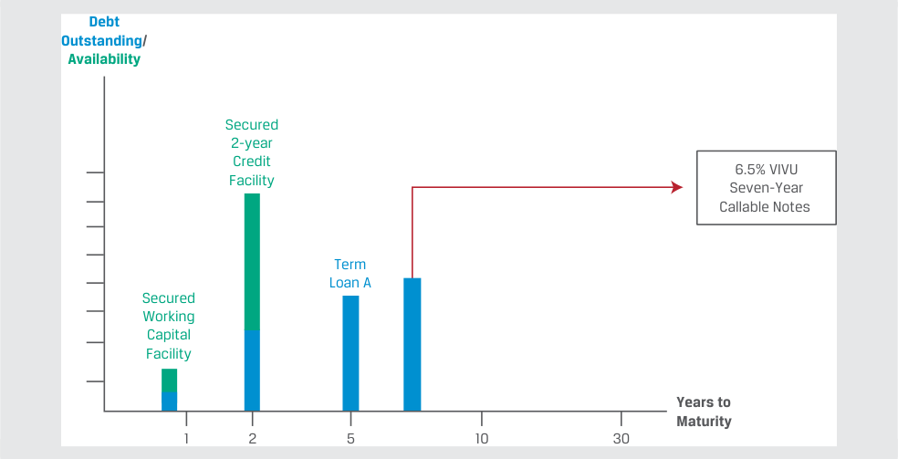
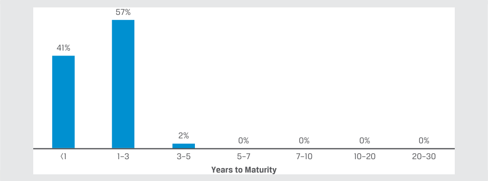

# Tập 6: Chứng khoán Thu nhập Cố định (Fixed Income)
## Learning Module 3 Fixed-Income Issuance and Trading (Trang PDF 65–88)

---

# Tập 6: Chứng Khoán Thu Nhập Cố Định (*Fixed Income*)
## Học Phần 3: Phát Hành và Giao Dịch Chứng Khoán Thu Nhập Cố Định (*Fixed-Income Issuance and Trading*)
### Phần 1/2: Giới Thiệu (Trang PDF 65–80)

---

<!-- PDF Page 65 -->

#### H Ọ C P H Ầ N 

# **<mark>3</mark>** 

### **Phát Hành và Giao Dịch Chứng Khoán Thu Nhập Cố Định (*Fixed-Income Issuance and Trading*)** 

###### **<mark>MỤC TIÊU HỌC TẬP (*LEARNING OUTCOMES*)</mark>** 

**_Mức độ thành thạo – Ứng viên cần có khả năng:_**
- Mô tả các phân khúc thị trường thu nhập cố định (*fixed-income market segments*) cùng các thành viên tham gia là tổ chức phát hành và nhà đầu tư của chúng.
- Mô tả các loại chỉ số thu nhập cố định (*fixed-income indexes*).
- So sánh thị trường thu nhập cố định sơ cấp và thứ cấp (*primary and secondary fixed-income markets*) với thị trường vốn cổ phần (*equity markets*).

##### **GIỚI THIỆU (*INTRODUCTION*)** 

## **<mark>1</mark>** 

Các công cụ và thị trường thu nhập cố định thường được phân loại theo loại hình tổ chức phát hành (*issuer type*), chất lượng tín dụng (*credit quality*), thời gian đáo hạn (*time to maturity*), và đôi khi là các đặc điểm bổ sung, chẳng hạn như đồng tiền định danh (*currency*), khu vực địa lý (*geography*), và các đặc điểm về môi trường, xã hội và quản trị (ESG). Các chỉ số thu nhập cố định (*fixed-income indexes*) được phân loại theo cách thức tương tự và đảm nhận các chức năng quan trọng, giống như vai trò của các chỉ số thị trường cổ phiếu trên thị trường chứng khoán. Giống như các thị trường tài chính khác, thị trường thu nhập cố định bao gồm thị trường sơ cấp (*primary markets*) nơi các tổ chức phát hành huy động vốn từ các nhà đầu tư thông qua các đợt phát hành mới và thị trường thứ cấp (*secondary markets*) nơi các nhà đầu tư giao dịch các công cụ hiện hành với các nhà đầu tư khác. Xét đến kỳ hạn hữu hạn (*finite maturities*) và các đặc điểm khác của trái phiếu, có những điểm khác biệt quan trọng trên thị trường thu nhập cố định so với thị trường sơ cấp và thứ cấp của cổ phiếu. 

###### **TỔNG QUAN HỌC PHẦN (*LEARNING MODULE OVERVIEW*)** 

- Các công cụ và thị trường thu nhập cố định thường được phân loại theo ba chiều: loại hình tổ chức phát hành (tức lĩnh vực – *sector*), chất lượng tín dụng (*credit quality*), và thời gian đáo hạn (*time to maturity*). 

- Các nhà đầu tư thu nhập cố định có các vị thế tương ứng dọc theo phổ tín dụng và phổ kỳ hạn (*credit and maturity spectrum*) khi họ tìm kiếm sự tiếp cận đối với những rủi ro nhất định và cố gắng khớp các dòng tiền của các nghĩa vụ trong tương lai đã biết trước. 

<!-- PDF Page 66 -->

- Tương tự như các chỉ số thị trường cổ phiếu, các chỉ số thu nhập cố định theo dõi tỷ suất sinh lợi của các nhóm chứng khoán đáp ứng các tiêu chí đưa vào rổ chỉ số (*inclusion criteria*). Các chỉ số được sử dụng để đánh giá hiệu quả hoạt động của thị trường, làm chuẩn tham chiếu (*benchmark*) cho hiệu quả của các khoản đầu tư và các nhà quản lý đầu tư, đồng thời hình thành cơ sở cho các chiến lược đầu tư theo chỉ số (*indexed investment strategies*). 

- Các chỉ số thu nhập cố định có thể được phân loại thành các chỉ số tổng hợp diện rộng (*broad-based, aggregate indexes*) với một số lượng rất lớn các chứng khoán thành phần (*constituents*) hoặc các chỉ số hẹp hơn tập trung vào các tiêu chí như loại hình tổ chức phát hành, chất lượng tín dụng và thời gian đáo hạn. 

- Thị trường trái phiếu sơ cấp (*primary bond markets*) là thị trường trong đó một tổ chức phát hành bán một hoặc nhiều trái phiếu mới cho các nhà đầu tư để huy động vốn tài trợ, trong khi thị trường trái phiếu thứ cấp (*secondary bond markets*) là thị trường trong đó các trái phiếu hiện hành được giao dịch giữa các nhà đầu tư. 

###### **TỰ ĐÁNH GIÁ HỌC PHẦN (*LEARNING MODULE SELF-ASSESSMENT*)** 

Những câu hỏi ban đầu này nhằm mục đích giúp bạn tự đánh giá mức độ hiểu biết hiện tại của mình về học phần này. 

1. Thảo luận hai cách mà một nhà đầu tư có thể thực hiện để tìm cách gia tăng tỷ suất sinh lợi kỳ vọng trên một danh mục đầu tư thu nhập cố định. 

###### **Lời giải:** 

Các nhà đầu tư có thể gia tăng _rủi ro tín dụng_ (*credit risk*) thông qua các công cụ có xếp hạng tín dụng thấp hơn. Thứ hai, với điều kiện đường cong lợi suất có độ dốc đi lên (*upward sloping*), các nhà đầu tư cũng có thể gia tăng tỷ suất sinh lợi kỳ vọng bằng _các trái phiếu có kỳ hạn dài hơn_ (*longer-term bonds*). 

2. Phát biểu nào sau đây về chỉ số thu nhập cố định và chỉ số cổ phiếu là đúng? 

   - **A.** Có sự thay đổi thành phần (*turnover*) trong các chỉ số cổ phiếu nhiều hơn so với trong các chỉ số thu nhập cố định. 

   - **B.** Các chỉ số thu nhập cố định thường có nhiều chứng khoán thành phần (*constituent securities*) hơn so với các chỉ số cổ phiếu. 

   - **C.** Các chứng khoán thành phần của chỉ số thu nhập cố định thường có tỷ trọng bằng nhau (*equally weighted*), trong khi các chứng khoán thành phần của chỉ số cổ phiếu thường được tính tỷ trọng theo giá trị vốn hóa thị trường của tổ chức phát hành. 

###### **Lời giải:** 

B là đáp án đúng. Các chỉ số thu nhập cố định thường có nhiều chứng khoán thành phần hơn so với các chỉ số cổ phiếu bởi vì các tổ chức phát hành có xu hướng có nhiều loại công cụ nợ đang lưu hành, và các chính phủ phát hành khối lượng lớn chứng khoán thu nhập cố định nhưng không phát hành chứng khoán vốn cổ phần. Kỳ hạn hữu hạn của trái phiếu và tần suất phát hành mới cao hơn dẫn đến mức độ thay đổi thành phần (*turnover*) trong các chỉ số thu nhập cố định lớn hơn nhiều so với trong các chỉ số cổ phiếu. Các chứng khoán thành phần của chỉ số thu nhập cố định thường được tính tỷ trọng theo giá trị thị trường của khoản nợ đang lưu hành (*market value of debt outstanding*), trong khi các chỉ số cổ phiếu được tính tỷ trọng theo giá trị vốn hóa thị trường của các tổ chức phát hành. 

3. Chỉ số Tổng hợp Toàn cầu Bloomberg Barclays (*Bloomberg Barclays Global Aggregate Index*) bao gồm: 

   - **A.** tất cả các quy mô tổ chức phát hành. 

   - **B.** các tổ chức phát hành bằng nhiều đồng tiền khác nhau. 

<!-- PDF Page 67 -->

   - **C.** các tổ chức phát hành có lợi suất cao (*high-yield*) và không được xếp hạng (*unrated*).

   - **Lời giải:**

B là đáp án đúng. Chỉ số Tổng hợp Toàn cầu Bloomberg Barclays bao gồm các chứng khoán thị trường vốn có lãi suất coupon cố định từ tất cả các loại hình tổ chức phát hành chính tại 28 thị trường phát triển và mới nổi đáp ứng các tiêu chí đưa vào chỉ số. Tuy nhiên, chỉ số này loại trừ các công cụ nợ có lợi suất cao (*high-yield*) và không được xếp hạng (*unrated*) cũng như những công cụ không đáp ứng quy mô phát hành tối thiểu. 

4. Một tổ chức phát hành lần đầu (*debut issuer*) đang tìm cách chỉ bán trái phiếu của mình cho một nhóm nhà đầu tư chọn lọc sẽ _nhiều khả năng nhất_ thực hiện một đợt: 

   - **A.** chào bán ra công chúng (*public offering*). 

   - **B.** đăng ký phát hành khung (*shelf registration*). 

   - **C.** phát hành riêng lẻ (*private placement*). 

   - **Lời giải:** 

C là đáp án đúng. Trái phiếu có thể được bán thông qua phát hành riêng lẻ (*private placement*), trong đó chỉ một nhóm nhà đầu tư chọn lọc hoặc một nhà đầu tư đơn lẻ mua trái phiếu. Trái phiếu cũng có thể được bán trong một đợt chào bán ra công chúng (*public offering*), trong đó bất kỳ thành viên nào của công chúng cũng có thể mua trái phiếu. Các tổ chức phát hành trái phiếu thường xuyên sử dụng hình thức đăng ký phát hành khung (*shelf registration*), vốn được cập nhật định kỳ và có thể được sử dụng cho một loạt các đợt phát hành trái phiếu trong tương lai. 

5. Một tổ chức phát hành trái phiếu thường xuyên tìm kiếm sự linh hoạt để phát hành trái phiếu một cách chớp thời cơ (*opportunistically*) khi điều kiện thị trường thuận lợi sẽ _nhiều khả năng nhất_ sử dụng một đợt: 

   - **A.** phát hành bổ sung / mở lại (*reopening*).
   - **B.** chào bán theo đăng ký khung (*shelf offering*). 
   - **C.** phát hành riêng lẻ (*private placement*). 

   - **Lời giải:** 

B là đáp án đúng. Các tổ chức phát hành trái phiếu thường xuyên có khả năng tiếp cận sẵn sàng với thị trường trái phiếu và thường chọn thời điểm phát hành trên cơ sở chớp thời cơ, khi các điều kiện thị trường thuận lợi nhất. Các tổ chức phát hành trái phiếu thường xuyên sử dụng đăng ký phát hành khung (*shelf registration*) hay một bản thông tư chào bán bao quát rộng khắp được cập nhật định kỳ và có thể được sử dụng cho một loạt các đợt phát hành trái phiếu trong tương lai. Một chiến lược ít phổ biến hơn là tăng quy mô của một trái phiếu _hiện hành_ có mức giá _khác biệt_ đáng kể so với mệnh giá, được gọi là phát hành bổ sung / mở lại (*reopening*) một trái phiếu hiện hành. Trong một đợt phát hành riêng lẻ, chỉ một nhà đầu tư hoặc một nhóm nhà đầu tư được lựa chọn mới có thể mua trái phiếu. 

##### **CÁC PHÂN KHÚC, TỔ CHỨC PHÁT HÀNH VÀ NHÀ ĐẦU TƯ THU NHẬP CỐ ĐỊNH (*FIXED-INCOME SEGMENTS, ISSUERS, AND INVESTORS*)** 

# **<mark>2</mark>** 

*Mục tiêu: Mô tả các phân khúc thị trường thu nhập cố định cùng các thành viên tham gia là tổ chức phát hành và nhà đầu tư của chúng.*

Các công cụ và thị trường thu nhập cố định thường được phân loại theo ba chiều: loại hình tổ chức phát hành (thường được gọi là lĩnh vực – *sector*), chất lượng tín dụng (*credit quality*), và thời gian đáo hạn (*time to maturity*). Đôi khi, các công cụ và thị trường còn được phân loại bổ sung theo khu vực địa lý của tổ chức phát hành, đồng tiền định danh, và các đặc điểm ESG. 

<!-- PDF Page 68 -->

Trái ngược với cổ phiếu, nơi các tổ chức phát hành thường chỉ phát hành một hoặc hai công cụ, các tổ chức phát hành thường có _nhiều_ công cụ thu nhập cố định đang lưu hành. Ví dụ, một tổ chức phát hành doanh nghiệp có thể có các khoản vay hoặc cả các khoản vay và trái phiếu, trên cơ sở ngắn hạn để tài trợ vốn lưu động hoặc trên cơ sở dài hạn để đầu tư vốn. Một số công ty lớn cũng phát hành thương phiếu (*commercial paper*), một loại trái phiếu ngắn hạn để tài trợ nhu cầu vốn lưu động có thể được thế chấp bằng các tài sản cụ thể. Những công cụ nợ này có thể được định danh bằng các đồng tiền khác nhau để phòng vệ rủi ro (*hedge exposures*) và mở rộng khả năng tiếp cận tới các nhà đầu tư. Ví dụ, vào cuối năm 2021, Apple Inc. có hơn 80 công cụ thu nhập cố định nhưng chỉ có một công cụ vốn cổ phần duy nhất (cổ phiếu phổ thông) đang lưu hành. 

Bảng minh họa 1 (*Exhibit 1*) minh họa các tổ chức phát hành và các loại công cụ điển hình qua các phân khúc tín dụng và thời gian đáo hạn. 

**Bảng minh họa 1: Các Tổ chức Phát hành qua Phổ Tín dụng và Phổ Kỳ hạn: Các Tổ chức Phát hành và Loại Công cụ (*Issuers across the Credit and Maturity Spectrums: Issuers and Instrument Types*)** 

> **Chú thích hình ảnh:**
> Ma trận phân loại theo **Số năm đến khi đáo hạn (*Years to Maturity*)**: Ngắn hạn (*Short-Term*, $< 1\text{ năm}$), Trung hạn (*Intermediate-Term*, $1\text{–}10\text{ năm}$), Dài hạn (*Long-Term*, $> 10\text{ năm}$) và **Chất lượng tín dụng (*Credit Quality*)**:
> - **“Phi rủi ro vỡ nợ” (*“Default Risk Free”*)**: Tín phiếu Kho bạc (*Treasury bills*, $<1\text{y}$), Trái phiếu Kho bạc trung hạn (*Treasury notes*, $1\text{–}10\text{y}$), Trái phiếu Kho bạc dài hạn (*Treasury bonds*, $>10\text{y}$), Hợp đồng mua lại (*Repo*, ngắn hạn).
> - **Hạng đầu tư (*Investment Grade*)**: Thương phiếu (*Commercial Paper*), Thương phiếu đảm bảo bằng tài sản (*ABCP*), Trái phiếu doanh nghiệp không có đảm bảo (*Unsecured Corporate bonds* – trung và dài hạn), Chứng khoán đảm bảo bằng tài sản (*ABS*) và Chứng khoán đảm bảo bằng thế chấp (*MBS*).
> - **Lợi suất cao (*High Yield*)**: Các khoản vay đòn bẩy (*Leveraged loans*) và Trái phiếu doanh nghiệp có đảm bảo (*Secured Corporate bonds*).

_Ghi chú:_ ABCP là thương phiếu đảm bảo bằng tài sản (*asset-backed commercial paper*). 

Các nhà đầu tư thu nhập cố định có các vị thế tương ứng dọc theo phổ tín dụng và phổ kỳ hạn khi họ tìm cách tiếp cận những rủi ro nhất định và khớp các dòng tiền của các nghĩa vụ trong tương lai đã biết trước. Các nghĩa vụ ngắn hạn và mong muốn có các công cụ thay thế tiền mặt thanh khoản (*liquid cash alternatives*) thường được đáp ứng bằng chứng khoán thị trường tiền tệ, trong khi các nhà đầu tư có thể chấp nhận rủi ro lãi suất lớn hơn với các trái phiếu dài hạn để đáp ứng các nghĩa vụ xa hơn trong tương lai hoặc theo đuổi tỷ suất sinh lợi kỳ vọng cao hơn. Các quỹ hưu trí và các công ty bảo hiểm có tầm nhìn thời gian đầu tư dài hạn ưa chuộng các công cụ thu nhập cố định có dòng tiền coupon định kỳ cố định và cấu trúc kỳ hạn khớp với các khoản nợ phải trả dài hạn của họ. Ngoài ra, các nhà đầu tư có thể chấp nhận rủi ro tín dụng tại bất kỳ điểm nào trên phổ kỳ hạn để gia tăng tỷ suất sinh lợi. Bảng minh họa 2 (*Exhibit 2*) minh họa các vị thế nhà đầu tư phổ biến qua phổ tín dụng và phổ kỳ hạn. 

<!-- PDF Page 69 -->

**Bảng minh họa 2: Các Nhà đầu tư qua Phổ Tín dụng và Phổ Kỳ hạn: Các Nhà đầu tư (*Investors across the Credit and Maturity Spectrums: Investors*)** 

> **Chú thích hình ảnh:**
> Ma trận phân loại các nhà đầu tư theo **Số năm đến khi đáo hạn (*Years to Maturity*)** ($< 1\text{y}$, $1\text{–}10\text{y}$, $> 10\text{y}$) và **Chất lượng tín dụng (*Credit Quality*)**:
> - **Ngắn hạn & Phi rủi ro vỡ nợ / Hạng đầu tư**: Các ngân hàng trung ương (*Central banks*), Các quỹ thị trường tiền tệ (*Money market funds*), Các tổ chức phát hành doanh nghiệp (*Corporate issuers* – quản trị tiền mặt).
> - **Trải rộng qua các kỳ hạn**: Các định chế tài chính trung gian (*Financial intermediaries*), Các quỹ trái phiếu và ETF (*Bond funds and ETFs*), Các công ty quản lý tài sản (*Asset managers*).
> - **Trung và Dài hạn (Hạng đầu tư)**: Các quỹ hưu trí (*Pension funds*), Các công ty bảo hiểm (*Insurance companies*).
> - **Lợi suất cao (*High Yield*)**: Các quỹ phòng hộ (*Hedge funds*), Các quỹ đầu tư nợ xấu/nợ gặp khó khăn (*Distressed debt funds*).

Một thước đo phổ biến về chất lượng tín dụng là **xếp hạng tín dụng (*credit rating*)**. Xếp hạng tín dụng là các thước đo định tính bằng chữ cái đánh giá khả năng đáp ứng các nghĩa vụ nợ của tổ chức phát hành dựa trên cả xác suất vỡ nợ (*probability of default*) và mức tổn thất kỳ vọng (*expected loss*) trong kịch bản vỡ nợ. Xếp hạng tín dụng được cấp và duy trì bởi **các tổ chức xếp hạng tín dụng (*credit rating agencies*)** cho cả nợ ngắn hạn và dài hạn cũng như cho cả _các tổ chức phát hành (issuers)_ và _các đợt phát hành (issues)_ trái phiếu cụ thể. Hai trong số các tổ chức xếp hạng tín dụng lớn nhất là Standard & Poor’s (S&P) và Moody’s. Nhiều nhà đầu tư bị giới hạn chỉ được đầu tư vào các công cụ có xếp hạng tín dụng, với một tỷ lệ phần trăm hạn chế trong danh mục của họ được đầu tư vào các công cụ không được xếp hạng (*unrated instruments*). Rủi ro tín dụng và xếp hạng tín dụng sẽ được thảo luận chi tiết trong các bài học sau. 

###### **XẾP HẠNG TÍN DỤNG CỦA S&P (*S&P CREDIT RATINGS*)** 

Xếp hạng của S&P trải dài từ AAA đối với chất lượng tín dụng cao nhất đến D đối với tình trạng vỡ nợ, với các mức xếp hạng theo thứ tự giảm dần về chất lượng tín dụng như sau: 

| Phân nhóm | Mức xếp hạng | Ý nghĩa |
|---|---|---|
| **Hạng đầu tư (*Investment Grade*)** | **AAA** | Năng lực cực kỳ mạnh mẽ trong việc đáp ứng các cam kết tài chính; mức xếp hạng cao nhất |
| | **AA** | Năng lực rất mạnh mẽ trong việc đáp ứng các cam kết tài chính |
| | **A** | Năng lực mạnh mẽ trong việc đáp ứng các cam kết tài chính nhưng hơi nhạy cảm trước các điều kiện kinh tế bất lợi và những thay đổi của hoàn cảnh |
| | **BBB** | Năng lực đầy đủ trong việc đáp ứng các cam kết tài chính nhưng dễ bị ảnh hưởng hơn bởi các điều kiện kinh tế bất lợi |
| | **BBB-** | Được các thành viên tham gia thị trường coi là mức hạng đầu tư thấp nhất (*lowest investment grade*) |
| **Hạng đầu cơ (*Speculative Grade*)** _hoặc_ **Lợi suất cao (*High Yield*)** | **BB+** | Được các thành viên tham gia thị trường coi là mức hạng đầu cơ cao nhất (*highest speculative grade*) |

<!-- PDF Page 70 -->

| Phân nhóm | Mức xếp hạng | Ý nghĩa |
|---|---|---|
| **Hạng đầu cơ (*Speculative Grade*)** _hoặc_ **Lợi suất cao (*High Yield*)** *(tiếp theo)* | **BB** | Ít dễ bị tổn thương hơn trong ngắn hạn nhưng phải đối mặt với những bất định lớn đang diễn ra trước các điều kiện kinh doanh, tài chính và kinh tế bất lợi |
| | **B** | Dễ bị tổn thương hơn trước các điều kiện kinh doanh, tài chính và kinh tế bất lợi nhưng hiện tại vẫn có năng lực đáp ứng các cam kết tài chính |
| | **CCC** | Hiện tại dễ bị tổn thương và phụ thuộc vào các điều kiện kinh doanh, tài chính và kinh tế thuận lợi để đáp ứng các cam kết tài chính |
| | **CC** | Rất dễ bị tổn thương; vỡ nợ chưa xảy ra nhưng được dự kiến gần như chắc chắn sẽ xảy ra |
| | **C** | Hiện tại rất dễ bị tổn thương dẫn đến không thanh toán được, và mức thu hồi cuối cùng (*ultimate recovery*) được kỳ vọng thấp hơn so với các nghĩa vụ có xếp hạng cao hơn |
| | **D** | Vỡ nợ thanh toán đối với một cam kết tài chính hoặc vi phạm một lời hứa ngầm định; cũng được sử dụng khi đơn xin phá sản đã được đệ trình hoặc hành động tương tự đã được thực hiện |

_Nguồn:_ S&P Global Ratings. 

Các tổ chức phát hành chính phủ tại thị trường phát triển (*developed market – DM sovereign issuers*) thường đại diện cho những bên đi vay có mức độ tín nhiệm cao nhất trong một thị trường và thường mang xếp hạng AAA. Bởi vì các nhà đầu tư thường giả định rằng họ sẽ nhận được tất cả các khoản thanh toán lãi và vốn gốc đã cam kết trên trái phiếu chính phủ DM, nên chúng hợp thành danh mục “phi rủi ro vỡ nợ” (*“default risk free”*) trong Bảng minh họa 1. 

Các tổ chức phát hành được xếp hạng BBB- (Baa3 trên thang đo của Moody’s) hoặc cao hơn được coi là **hạng đầu tư (*investment grade*)**. Các tổ chức phát hành được xếp hạng BB+ (Ba1 trên thang đo của Moody’s) hoặc thấp hơn được gọi là **lợi suất cao (*high yield*)**, hạng đầu cơ (*speculative grade*), hoặc trái phiếu rác (*junk*). Các tổ chức phát hành lợi suất cao bao gồm các tổ chức phát hành mới mà các nhà đầu tư có nhiều khả năng yêu cầu tài sản thế chấp hơn do dòng tiền hoạt động kém ổn định hơn, cũng như các tổ chức phát hành trước đây thuộc hạng đầu tư nhưng chất lượng tín dụng đã bị suy giảm kể từ thời điểm phát hành (được gọi là **“thiên thần sa ngã” – *“fallen angels”***). 

Sự tham gia của các tổ chức phát hành và nhà đầu tư trong các thị trường thu nhập cố định không đồng nhất (*heterogeneous fixed-income markets*) được minh họa trong các ví dụ sau đây. 

<!-- PDF Page 71 -->

###### **VÍ DỤ 1** 

> **Chú thích hình ảnh:**
> **Hồ sơ Nợ của Tập đoàn BRWA (*BRWA Corporation Debt Profile*)** theo Dư nợ đang lưu hành / Hạn mức sẵn có (*Debt Outstanding / Availability*) và Số năm đến khi đáo hạn (*Years to Maturity*):
> - **Dưới 1 năm**: Thương phiếu kỳ hạn 150 ngày của BRWA lãi suất 0.12% (*0.12% BRWA 150-day Commercial Paper*) được hậu thuẫn bởi Hạn mức tín dụng không có đảm bảo 364 ngày (*Unsecured 364 Day Facility*).
> - **1–5 năm**: Hạn mức tín dụng quay vòng 3 năm không có đảm bảo (*Unsecured 3-year Revolving Credit Facility*) và Trái phiếu kỳ hạn 5 năm của BRWA lãi suất 3.2% (*3.2% BRWA Five-Year Notes*).
> - **10–30 năm**: Trái phiếu kỳ hạn 15 năm của BRWA lãi suất 3.95% (*3.95% BRWA Fifteen-Year Notes*).

BRWA là một ví dụ về một tổ chức phát hành doanh nghiệp hạng đầu tư (*investment-grade corporate issuer*) có khả năng tiếp cận sẵn sàng đối với các khoản nợ không có đảm bảo ở nhiều kỳ hạn và thị trường cũng như bằng các đồng tiền khác nhau một cách trực tiếp hoặc thông qua các công ty liên kết của mình. Công ty sử dụng thương phiếu để đáp ứng nhu cầu vốn lưu động ngắn hạn hoặc theo mùa vụ, nợ trung hạn để trang trải vốn lưu động thường xuyên hơn hoặc các khoản đầu tư trung hạn, và nợ dài hạn để khớp với thời gian hữu dụng dài hơn của các khoản đầu tư vốn, chẳng hạn như thiết bị sản xuất mới hoặc nhà máy. BRWA trả phí cho một nhóm (hay **tổ hợp – *syndicate***) các ngân hàng cho hai **hạn mức tín dụng (*credit facilities*)**, vốn là các thỏa thuận vay có các điều khoản và hạn mức được quy định trước nhưng có số dư biến động dựa trên nhu cầu cụ thể của bên đi vay tại các thời điểm khác nhau, tương tự như một chiếc thẻ tín dụng. Hạn mức thứ nhất là hạn mức 364 ngày dùng để hậu thuẫn cho chương trình thương phiếu, và hạn mức thứ hai là hạn mức tín dụng quay vòng (*revolving credit facility*) có kỳ hạn dài hơn. 

Sự kết hợp của các hoạt động kinh doanh, tài trợ và thuê tài sản trong nước cũng như xuyên biên giới trong Ví dụ 1 khiến nhiều công ty cùng ngành ngoài đời thực của BRWA có tới _hàng trăm_ công cụ nợ riêng biệt đang lưu hành trên khắp tất cả các công ty liên kết. Chúng ta có thể đối chiếu ví dụ về BRWA với VIVU, công ty truyền thông kỹ thuật số đã được giới thiệu trong học phần trước vốn có ít tài sản cố định hơn, dòng tiền hoạt động kém ổn định hơn, và do đó có khả năng tiếp cận hạn chế đối với các thị trường thu nhập cố định. 

<!-- PDF Page 72 -->

###### **VÍ DỤ 2** 

> **Chú thích hình ảnh:** Các Công cụ Thu nhập Cố định Đã Phát hành của VIVU (*VIVU Fixed-Income Issuance*)

> **Chú thích hình ảnh:**
> **Hồ sơ Nợ của VIVU** theo Dư nợ đang lưu hành / Hạn mức sẵn có (*Debt Outstanding / Availability*) và Số năm đến khi đáo hạn (*Years to Maturity*):
> - **1–2 năm**: Hạn mức vốn lưu động có đảm bảo (*Secured Working Capital Facility*) và Hạn mức tín dụng 2 năm có đảm bảo (*Secured 2-year Credit Facility*).
> - **2–5 năm**: Khoản vay có kỳ hạn A (*Term Loan A*).
> - **5–10 năm**: Trái phiếu có thể mua lại kỳ hạn 7 năm của VIVU lãi suất 6.5% (*6.5% VIVU Seven-Year Callable Notes*).

VIVU là một ví dụ về một tổ chức phát hành doanh nghiệp có lợi suất cao (*high-yield corporate issuer*) có khả năng tiếp cận hạn chế đối với nợ có đảm bảo ở các kỳ hạn ngắn hơn. VIVU không có khả năng tiếp cận thị trường thương phiếu không có đảm bảo mà thay vào đó dựa vào các hạn mức vốn lưu động và hạn mức tín dụng có đảm bảo được giải ngân một phần từ các ngân hàng để đáp ứng nhu cầu ngắn hạn của mình. VIVU có một khoản vay đã giải ngân toàn bộ (*Term Loan A*) có lãi suất coupon thả nổi bằng MRR cộng với một mức chênh lệch tín dụng cố định. VIVU cũng có các trái phiếu có thể mua lại kỳ hạn 7 năm đang lưu hành, theo đó công ty có quyền mua lại trái phiếu ở một mức giá cố định bắt đầu từ ba năm kể từ khi phát hành. 

Các tổ chức phát hành chính phủ quốc gia (*sovereign government issuers*) thường có rủi ro tín dụng thấp nhất (xếp hạng tín dụng cao nhất) tại mỗi thị trường, do quyền đánh thuế hoạt động kinh tế của chính phủ có chủ quyền. Trái phiếu chính phủ tại các thị trường phát triển thường được nắm giữ rộng rãi bởi cả các nhà đầu tư nước ngoài và các ngân hàng trung ương nước ngoài đang tìm cách nắm giữ dự trữ ngoại hối bằng đồng tiền của thị trường phát triển đó dưới hình thức một tài sản sinh lãi. Trái phiếu chính phủ cũng đảm nhận các chức năng quan trọng trong hệ thống tài chính nội địa. Các ngân hàng trung ương thường sử dụng trái phiếu chính phủ nội địa để điều hành chính sách tiền tệ, đi vay hoặc cho vay các chứng khoán này để làm tăng hoặc giảm dự trữ tiền tệ. 

Các nhà đầu tư trái phiếu hạng đầu tư kỳ vọng các dòng tiền ổn định hơn, và tình trạng vỡ nợ trong số các tổ chức phát hành hạng đầu tư là tương đối hiếm. Do đó, tỷ suất sinh lợi kỳ vọng thấp hơn so với trái phiếu lợi suất cao và thường tương đương hoặc cao hơn đôi chút so với trái phiếu chính phủ. Các nhà đầu tư lợi suất cao kỳ vọng tỷ suất sinh lợi lớn hơn khi chấp nhận xác suất vỡ nợ cao hơn và thường so sánh tỷ suất sinh lợi này với tỷ suất sinh lợi của các khoản đầu tư vốn cổ phần. 

###### **VÍ DỤ 3** 

###### **Các Quỹ Trái phiếu của Baywhite Financial (*Baywhite Financial’s Bond Funds*)** 

Baywhite Financial quản lý Quỹ Trái phiếu Cốt lõi (*Core Bond Fund*) của mình với mục tiêu tăng trưởng vốn trong dài hạn cùng mức độ chấp nhận rủi ro tín dụng tương đối thấp. Quỹ đầu tư vào các trái phiếu trung hạn và dài hạn thuộc hạng đầu tư, bao gồm trái phiếu kỳ hạn 5 năm và 15 năm của BRWA. Cơ cấu danh mục nắm giữ của quỹ, bao gồm 3,601 vị thế, như sau: 

**Danh mục nắm giữ của Quỹ Trái phiếu Cốt lõi Baywhite theo Xếp hạng Tín dụng (*Baywhite Core Bond Fund Holdings by Credit Rating*)** 

<!-- PDF Page 73 -->

> **Chú thích hình ảnh:**
> - **Danh mục nắm giữ của Quỹ Trái phiếu Cốt lõi Baywhite theo Xếp hạng Tín dụng**: AAA (55%), AA (4%), A (13%), BBB (19%), Không xếp hạng – *Not Rated* (9%).
> - **Danh mục nắm giữ của Quỹ Trái phiếu Cốt lõi Baywhite theo Loại hình Tổ chức Phát hành (*Baywhite Core Bond Fund Holdings by Issuer Type*)**: Chính phủ (*Sovereign* – 28%), Doanh nghiệp (*Corporate* – 33%), Chứng khoán đảm bảo bằng thế chấp (*Mortgage Backed Securities* – 23%), Chứng khoán đảm bảo bằng tài sản khác (*Other Asset Backed Securities* – 16%).

> **Chú thích hình ảnh:** Danh mục nắm giữ của Quỹ Trái phiếu Cốt lõi Baywhite theo Thời gian Đáo hạn (*Baywhite Core Bond Fund Holdings by Time to Maturity*)

> **Chú thích hình ảnh:**
> **Tỷ trọng theo Số năm đến khi đáo hạn (*Years to Maturity*)**: $<1\text{ năm}$ (9%), $1\text{–}3\text{ năm}$ (23%), $3\text{–}5\text{ năm}$ (19%), $5\text{–}7\text{ năm}$ (11%), $7\text{–}10\text{ năm}$ (9%), $10\text{–}20\text{ năm}$ (13%), $20\text{–}30\text{ năm}$ (16%).

Baywhite cũng quản lý Quỹ Trái phiếu Ngắn hạn (*Short-Term Bond Fund*) như một công cụ thay thế tiền mặt có tính thanh khoản cho các nhà đầu tư, và quỹ chỉ chấp nhận rủi ro tín dụng cũng như rủi ro lãi suất ở mức tối thiểu bằng cách đầu tư vào các trái phiếu ngắn hạn thuộc hạng đầu tư, chẳng hạn như thương phiếu của BRWA. Cơ cấu danh mục nắm giữ của Quỹ Trái phiếu Ngắn hạn, bao gồm 451 vị thế, như sau: 

**Danh mục nắm giữ của Quỹ Trái phiếu Ngắn hạn Baywhite theo Xếp hạng Tín dụng (*Baywhite Short-Term Bond Fund Holdings by Credit Rating*)** 

<!-- PDF Page 74 -->

> **Chú thích hình ảnh:**
> **Danh mục nắm giữ của Quỹ Trái phiếu Ngắn hạn Baywhite theo Xếp hạng Tín dụng**: AAA (30%), AA (8%), A (25%), BBB (34%), Không xếp hạng – *Not Rated* (3%).

> **Chú thích hình ảnh:**
> **Danh mục nắm giữ của Quỹ Trái phiếu Ngắn hạn Baywhite theo Loại hình Tổ chức Phát hành (*Baywhite Short-Term Bond Fund Holdings by Issuer Type*)**: Chính phủ (*Sovereign* – 13%), Doanh nghiệp (*Corporate* – 56%), Chứng khoán đảm bảo bằng thế chấp (*Mortgage Backed Securities* – 18%), Chứng khoán đảm bảo bằng tài sản khác (*Other Asset Backed Securities* – 13%).

**Danh mục nắm giữ của Quỹ Trái phiếu Ngắn hạn Baywhite theo Thời gian Đáo hạn (*Baywhite Short-Term Bond Fund Holdings by Time to Maturity*)** 

> **Chú thích hình ảnh:**
> **Tỷ trọng theo Số năm đến khi đáo hạn (*Years to Maturity*)**: $<1\text{ năm}$ (41%), $1\text{–}3\text{ năm}$ (57%), $3\text{–}5\text{ năm}$ (2%), $5\text{–}7\text{ năm}$ (0%), $7\text{–}10\text{ năm}$ (0%), $10\text{–}20\text{ năm}$ (0%), $20\text{–}30\text{ năm}$ (0%).

Không quỹ nào trong hai quỹ này sẽ đầu tư vào trái phiếu có thể mua lại kỳ hạn 7 năm của VIVU, bởi vì cả hai đều bị giới hạn chỉ được sở hữu các khoản nợ thuộc hạng đầu tư (*investment-grade debt*). 

<!-- PDF Page 75 -->

###### **BỘ CÂU HỎI (*QUESTION SET*)** 

1. Một quỹ tương hỗ thu nhập cố định bị yêu cầu chỉ được đầu tư vào các trái phiếu hạng đầu tư (*investment-grade bonds*) sẽ _nhiều khả năng nhất_ đầu tư vào:
   - **A.** trái phiếu được xếp hạng B.
   - **B.** trái phiếu được xếp hạng BB+.
   - **C.** trái phiếu được xếp hạng BBB-. 

   - **Lời giải:**

C là đáp án đúng. Cả trái phiếu được xếp hạng B và BB+ đều được coi là trái phiếu lợi suất cao (*high-yield bonds*). Trái phiếu được xếp hạng BBB- được coi là trái phiếu hạng đầu tư thấp nhất (*lowest investment-grade bond*). 

2. Các tổ chức phát hành mới mà các nhà đầu tư có khả năng yêu cầu tài sản thế chấp do dòng tiền hoạt động biến động nhiều hơn được phân loại _đúng nhất_ là: 

   - **A.** các thiên thần sa ngã (*fallen angels*).
   - **B.** các tổ chức phát hành lợi suất cao (*high-yield issuers*).
   - **C.** các tổ chức phát hành hạng đầu tư (*investment-grade issuers*). 

   - **Lời giải:**

B là đáp án đúng. Các tổ chức phát hành lợi suất cao (chứ không phải các tổ chức phát hành hạng đầu tư) bao gồm các tổ chức phát hành mới mà các nhà đầu tư có nhiều khả năng yêu cầu tài sản thế chấp hơn do dòng tiền hoạt động kém ổn định hơn. Các tổ chức phát hành hạng đầu tư có chất lượng tín dụng bị suy giảm kể từ thời điểm phát hành được gọi là các thiên thần sa ngã (*fallen angels*). 

3. Một tổ chức phát hành doanh nghiệp đang tìm cách tài trợ cho các nhu cầu vốn lưu động sẽ _nhiều khả năng nhất_ phát hành:
   - **A.** thương phiếu (*commercial paper*).
   - **B.** nợ trung hạn (*intermediate-term debt*).
   - **C.** nợ dài hạn (*long-term debt*). 

   - **Lời giải:** 

A/B: Một tổ chức phát hành doanh nghiệp sẽ sử dụng thương phiếu (*commercial paper*) để đáp ứng nhu cầu vốn lưu động ngắn hạn hoặc theo mùa vụ của mình, nợ trung hạn (*intermediate-term debt*) để trang trải vốn lưu động thường xuyên hơn hoặc các khoản đầu tư trung hạn, và nợ dài hạn hoặc vốn cổ phần để khớp với thời gian hữu dụng dài hơn của các khoản đầu tư vốn. *(Lưu ý: Theo văn bản gốc của CFA Curriculum, đáp án in là B cho vốn lưu động thường xuyên/đầu tư trung hạn hoặc A cho vốn lưu động ngắn hạn/mùa vụ).*

4. Một tổ chức phát hành doanh nghiệp có lợi suất cao (*high-yield corporate issuer*) sẽ _nhiều khả năng nhất_ tài trợ cho các hoạt động của mình bằng cách sử dụng:
   - **A.** các khoản vay có kỳ hạn có đảm bảo (*secured term loans*).
   - **B.** trái phiếu có thể mua lại dài hạn (*long-term callable bonds*).
   - **C.** thương phiếu không có đảm bảo (*unsecured commercial paper*).

   - **Lời giải:**

A là đáp án đúng. Một tổ chức phát hành doanh nghiệp có lợi suất cao có khả năng tiếp cận hạn chế đối với các khoản nợ có đảm bảo ở các kỳ hạn ngắn hơn nhưng không có khả năng tiếp cận thương phiếu không có đảm bảo hoặc thị trường trái phiếu dài hạn. (Xem Ví dụ 2.) 

<!-- PDF Page 76 -->

5. Xác định phát biểu sau đây là đúng hay sai. Giải thích câu trả lời của bạn. 

Các nhà đầu tư nước ngoài vào nợ thị trường mới nổi có tỷ suất sinh lợi kỳ vọng tương tự như tỷ suất sinh lợi của trái phiếu chính phủ tại thị trường phát triển. 

###### **Lời giải:** 

Sai (*False*). Các nhà đầu tư nước ngoài vào nợ thị trường mới nổi kỳ vọng một mức tỷ suất sinh lợi cao hơn so với trái phiếu chính phủ tại thị trường phát triển để đổi lấy việc nắm giữ các trái phiếu có chất lượng tín dụng thấp hơn và rủi ro cao hơn liên quan đến biến động tiền tệ. 

## **<mark>3</mark>** 

##### **CÁC CHỈ SỐ THU NHẬP CỐ ĐỊNH (*FIXED-INCOME INDEXES*)** 

*Mục tiêu: Mô tả các loại chỉ số thu nhập cố định.*

Một học phần trước đã làm nổi bật vai trò của các chỉ số thị trường trong việc theo dõi rủi ro và tỷ suất sinh lợi tổng thể của các thị trường chứng khoán khác nhau, cho phép đánh giá hiệu quả hoạt động của thị trường, làm chuẩn tham chiếu (*benchmarking*) cho hiệu quả của các khoản đầu tư và các nhà quản lý đầu tư, đồng thời hình thành cơ sở cho các chiến lược đầu tư theo chỉ số. Các chỉ số thu nhập cố định thực hiện chức năng tương tự trên thị trường trái phiếu giống như các chỉ số cổ phiếu trên thị trường chứng khoán nhưng khác biệt ở ba điểm quan trọng so với các chỉ số cổ phiếu tương ứng. 

**1.** Một tổ chức phát hành đơn lẻ có thể có nhiều chứng khoán thu nhập cố định riêng lẻ đang lưu hành. _Tất cả_ các trái phiếu đáp ứng các yêu cầu đủ điều kiện của chỉ số đều được đưa vào chỉ số, khiến cho các chỉ số thu nhập cố định có nhiều chứng khoán thành phần hơn rất nhiều so với các chỉ số cổ phiếu. Một số chỉ số có hơn 10,000 chứng khoán thành phần. 

**2.** Kỳ hạn hữu hạn của trái phiếu và tần suất phát hành mới cao hơn dẫn đến nhiều thay đổi về chứng khoán thành phần (tỷ lệ thay đổi thành phần – *turnover*) trong các chỉ số thu nhập cố định hơn nhiều so với trong các chỉ số cổ phiếu. Các chỉ số trái phiếu thường được tái cân bằng (*rebalanced*) mỗi tháng để vừa bổ sung các đợt phát hành mới vừa loại bỏ những trái phiếu giảm xuống dưới mức kỳ hạn tối thiểu. 

**3.** Tương tự như các chỉ số cổ phiếu được tính tỷ trọng theo giá trị vốn hóa thị trường của tổ chức phát hành, các chứng khoán thành phần của chỉ số trái phiếu thường được tính tỷ trọng theo giá trị thị trường của khoản nợ đang lưu hành (*market value of debt outstanding*). Vì trái phiếu được phát hành bởi nhiều loại hình tổ chức phát hành, các chỉ số trái phiếu diện rộng sẽ phản ánh những thay đổi trong cơ cấu thị trường trái phiếu theo thời gian — ví dụ, sự gia tăng nợ của tổ chức phát hành khu vực công so với khu vực tư nhân, kỳ hạn dài hơn, và sự suy giảm chất lượng tín dụng. Các tổ chức phát hành chính phủ là những tổ chức phát hành trái phiếu quy mô lớn, vì vậy nhiều chỉ số trái phiếu diện rộng có tỷ trọng nợ chính phủ cao. 

Nếu một quỹ trái phiếu đặt mục tiêu bám sát tỷ suất sinh lợi của một chỉ số cụ thể, quỹ đó thường sẽ nắm giữ một mẫu đại diện (*representative sample*) gồm các chứng khoán thành phần nhằm khớp với tỷ suất sinh lợi của chỉ số bởi vì mức độ phức tạp của các chỉ số trái phiếu khiến việc mua toàn bộ tất cả các chứng khoán thành phần là điều bất khả thi. 

Các chỉ số thu nhập cố định có thể được phân loại thành các chỉ số tổng hợp (*aggregate indexes*), với một số lượng rất lớn các chứng khoán thành phần, hoặc các chỉ số hẹp hơn, dựa trên các tiêu chí như lĩnh vực, chất lượng tín dụng, thời gian đáo hạn, khu vực địa lý, và các yếu tố ESG. Việc lựa chọn chỉ số để đánh giá hiệu quả hoạt động của nhà quản lý đầu tư là rất quan trọng và sẽ được thảo luận chi tiết ở phần sau của chương trình học, nhưng nhìn chung, chỉ số được chọn để đánh giá một nhà quản lý đầu tư hoặc một quỹ phải tương ứng với chiến lược đầu tư của nhà quản lý hoặc quỹ đó. Ví dụ, Quỹ Trái phiếu Ngắn hạn của Baywhite đầu tư vào các trái phiếu ngắn hạn thuộc hạng đầu tư. Để đánh giá quỹ này, tỷ suất sinh lợi của nó phải được so sánh với một chỉ số gồm các công cụ có kỳ hạn và chất lượng tín dụng tương tự. 

<!-- PDF Page 77 -->

Ba bảng minh họa sau đây minh họa các chỉ số thu nhập cố định và việc sử dụng chúng bởi các nhà đầu tư. 

**Bảng minh họa 3: Chỉ số Trái phiếu Tổng hợp Toàn cầu (*Global Aggregate Bond Index*)** 

| Tiêu chí | **Chỉ số Tổng hợp Toàn cầu Bloomberg Barclays (*Bloomberg Barclays Global Aggregate Index*)** **Tóm tắt ngắn gọn các Tiêu chí đưa vào chỉ số (*Inclusion Criteria*)** |
|---|---|
| **Tổ chức phát hành (*Issuers*):** | Trái phiếu lãi suất cố định từ các tổ chức phát hành chính phủ quốc gia (*sovereign*), chính quyền (*government*), doanh nghiệp (*corporate*), và chứng khoán hóa (*securitized*) có trụ sở tại các thị trường phát triển (DM) và mới nổi (EM) |
| **Đồng tiền (*Currencies*):** | 28 đồng tiền đủ điều kiện khắp Châu Mỹ, EMEA (Châu Âu, Trung Đông và Châu Phi), và Châu Á – Thái Bình Dương |
| **Chất lượng tín dụng (*Credit Quality*):** | Xếp hạng thuộc hạng đầu tư (*Investment-grade rating*) hoặc tương đương |
| **Lãi suất coupon (*Coupon*):** | Lãi suất cố định, không trả lãi định kỳ (*zero coupon*), và lãi suất coupon bậc thang (*step-up coupon*, nếu các ngày tăng lãi suất được xác định trước) |
| **Giá trị đang lưu hành (*Amount Outstanding*):** | Quy mô phát hành tối thiểu theo thị trường, ví dụ: — 150 triệu CAD — 300 triệu USD, 300 triệu EUR, 300 triệu CHF, 300 triệu AUD — 5 tỷ CNY (Nợ Kho bạc và ngân hàng) — 20 tỷ RUB — 35 tỷ JPY |
| **Kỳ hạn (*Maturity*):** | Ít nhất một năm cho đến ngày đáo hạn cuối cùng hoặc kỳ hạn bình quân gia quyền |
| **Quy tắc tái cân bằng (*Rebalancing Rules*):** | Vào mỗi cuối tháng, cơ cấu của tập hợp trái phiếu cố định dùng để tính tỷ suất sinh lợi chỉ số hàng tháng tiếp theo sẽ được xác lập. Các trái phiếu không còn đáp ứng tiêu chí về kỳ hạn, xếp hạng, quy mô hoặc các tiêu chí khác sẽ bị loại bỏ, và các đợt phát hành mới nơi có sẵn thông tin tham chiếu chứng khoán và định giá sẽ được đưa vào. |
| **Tái đầu tư dòng tiền (*Reinvestment of Cash Flows*):** | Các khoản thanh toán lãi và vốn gốc trong tháng đóng góp vào tỷ suất sinh lợi chỉ số hàng tháng và được tái đầu tư vào chỉ số vào ngày tái cân bằng tiếp theo. |
| **Thị trường phát hành (*Market of Issue*):** | Các thị trường đại chúng toàn cầu và khu vực |
| **Mức độ ưu tiên của nợ (*Seniority of Debt*):** | Các đợt phát hành nợ cấp cao (*senior*) và nợ thứ cấp (*subordinated*) |
| **Khả năng chịu thuế (*Taxability*):** | Chỉ các đợt phát hành chịu thuế toàn phần mới đủ điều kiện. |

Chỉ số Tổng hợp Toàn cầu Bloomberg Barclays (*Bloomberg Barclays Global Aggregate Index*) bao gồm các chứng khoán thị trường vốn có lãi suất coupon cố định từ tất cả các loại hình tổ chức phát hành chính tại 28 thị trường phát triển và mới nổi đáp ứng các tiêu chí đưa vào chỉ số nêu trên. Tuy nhiên, chỉ số này loại trừ các công cụ nợ có lợi suất cao và không được xếp hạng cũng như những công cụ không đáp ứng quy mô phát hành tối thiểu. 

Đơn vị xây dựng chỉ số (*index sponsor*) định giá tất cả các trái phiếu vào một thời điểm xác định trước trong mỗi ngày làm việc để tính giá trị chỉ số. Các quỹ tương hỗ và quỹ ETF bám sát chỉ số chuẩn này mang lại khả năng tiếp cận _toàn diện_ (*comprehensive exposure*) tới nhiều thị trường thu nhập cố định mà _không có_ sự lựa chọn chứng khoán chủ động nào và tỷ lệ thay đổi danh mục (*portfolio turnover*) chỉ giới hạn ở các đợt phát hành mới hoặc các đợt phát hành không còn đáp ứng tiêu chí đưa vào chỉ số. Các chỉ số phụ (*subindexes*) tương tự cũng có sẵn theo thị trường hoặc khu vực, và tỷ suất sinh lợi có thể bao gồm các khoản lãi hoặc lỗ do biến động tiền tệ (tỷ suất sinh lợi không phòng vệ tỷ giá – *unhedged returns*) hoặc có thể bù trừ những thay đổi dựa trên tiền tệ này bằng cách sử dụng các hợp đồng kỳ hạn tiền tệ (*currency forwards*) vào các ngày tái cân bằng (tỷ suất sinh lợi có phòng vệ tỷ giá – *hedged returns*). 

Chỉ số Tổng hợp Toàn cầu Bloomberg Barclays có thể phù hợp để sử dụng nhằm đánh giá Quỹ Trái phiếu Cốt lõi của Baywhite Financial vì nó bao gồm các trái phiếu dài hạn hơn thuộc hạng đầu tư từ nhiều lĩnh vực khác nhau. Tuy nhiên, nếu Baywhite chỉ đầu tư vào một thị trường đơn lẻ, chẳng hạn như Nhật Bản, thì một chỉ số chuẩn phù hợp hơn sẽ là Chỉ số Tổng hợp Nhật Bản Bloomberg Barclays (*Bloomberg Barclays Japanese Aggregate Index*). 

<!-- PDF Page 78 -->

Chỉ số J.P. Morgan EMBI+ (*J.P. Morgan EMBI+ Index*) trong Bảng minh họa 4 (*Exhibit 4*) là một chỉ số thu nhập cố định được định nghĩa hẹp hơn, bao gồm các khoản nợ định danh bằng đô la Mỹ của các chính phủ quốc gia ở mức hoặc thấp hơn một chất lượng tín dụng nhất định với quy mô phát hành và kỳ hạn tối thiểu. Việc tập trung vào nợ nước ngoài có chất lượng tín dụng thấp hơn nhắm tới mức tỷ suất sinh lợi tính theo đô la Mỹ cao hơn so với trái phiếu chính phủ tại thị trường phát triển trong khi gánh chịu rủi ro nợ nước ngoài (*external debt risk*) của các quốc gia phát hành. 

**Bảng minh họa 4: Chỉ số Trái phiếu Thị trường Mới nổi (*Emerging Markets Bond Index*)** 

| Tiêu chí | **Chỉ số Trái phiếu Thị trường Mới nổi J.P. Morgan Plus (*J.P. Morgan Emerging Markets Bond Index Plus* – EMBI+)** **Tóm tắt ngắn gọn các Tiêu chí đưa vào chỉ số** |
|---|---|
| **Tổ chức phát hành (*Issuers*):** | Các tổ chức phát hành chính phủ tại thị trường mới nổi phát hành nợ bằng đô la Mỹ |
| **Đồng tiền (*Currencies*):** | Chỉ bao gồm các trái phiếu định danh bằng đô la Mỹ. Các trái phiếu có khoản thanh toán coupon hoặc hoàn trả vốn gốc liên kết với tỷ giá hối đoái không đủ điều kiện. |
| **Chất lượng tín dụng (*Credit Quality*):** | Xếp hạng tín nhiệm quốc gia ở mức Baa1/BBB+/BBB+ hoặc thấp hơn bởi Moody’s/S&P/Fitch Ratings |
| **Lãi suất coupon (*Coupon*):** | Lãi suất cố định, không trả lãi định kỳ (*zero coupon*), và lãi suất coupon bậc thang (*step-up coupon*, nếu các ngày tăng lãi suất được xác định trước) |
| **Giá trị đang lưu hành (*Amount Outstanding*):** | Các đợt phát hành có mệnh giá đang lưu hành hiện tại từ 500 triệu USD trở lên |
| **Kỳ hạn (*Maturity*):** | Chỉ xem xét các công cụ có thời gian còn lại cho đến khi đáo hạn ít nhất là 2.5 năm. Vào mỗi cuối tháng, các công cụ sẽ giảm xuống dưới 12 tháng cho đến khi đáo hạn trong tháng tới sẽ bị loại trừ. |
| **Tính toán tỷ suất sinh lợi (*Return Calculation*):** | Tổng tỷ suất sinh lợi của chỉ số được tính bằng bình quân gia quyền tỷ suất sinh lợi của các trái phiếu sử dụng giá chào mua (*bid side prices*). |
| **Tái cân bằng (*Rebalancing*):** | Diễn ra vào ngày làm việc cuối cùng của Hoa Kỳ trong mỗi tháng |
| **Tái đầu tư dòng tiền (*Reinvestment of Cash Flows*):** | Tất cả các khoản coupon nhận được đều được tái đầu tư ngay lập tức vào chỉ số |

Các nhà đầu tư trái phiếu tìm cách tích hợp các yếu tố ESG vào các quyết định đầu tư thu nhập cố định thường xuyên sử dụng các chỉ số trái phiếu định kỳ sàng lọc và loại trừ các tổ chức phát hành không đáp ứng được một số tiêu chí ESG tối thiểu nhất định. Ví dụ, Chỉ số Đầu tư Có trách nhiệm Xã hội Bền vững Doanh nghiệp Đồng Euro Bloomberg Barclays MSCI (*Bloomberg Barclays MSCI Euro Corporate Sustainable SRI Index* – xem Bảng minh họa 5) lọc theo lĩnh vực, đồng tiền, chất lượng tín dụng, thời gian đáo hạn, _và_ các yếu tố ESG, chẳng hạn như mức xếp hạng ESG tối thiểu và việc loại trừ các tổ chức phát hành tham gia vào một số hoạt động kinh doanh nhất định. 

**Bảng minh họa 5: Chỉ số Trái phiếu Đầu tư Có trách nhiệm Xã hội (SRI) Bền vững Doanh nghiệp (*Corporate Sustainable Socially Responsible Investment Bond Index*)** 

| Tiêu chí | **Chỉ số Bloomberg Barclays MSCI Euro Corporate Sustainable SRI** **Tóm tắt ngắn gọn các Tiêu chí đưa vào chỉ số** |
|---|---|
| **Tổ chức phát hành (*Issuers*):** | Các tổ chức phát hành doanh nghiệp (công nghiệp, tiện ích công cộng và định chế tài chính) |
| **Đồng tiền (*Currencies*):** | Chỉ bao gồm các trái phiếu định danh bằng đồng euro. |
| **Chất lượng tín dụng (*Credit Quality*):** | Xếp hạng chứng khoán ở mức Baa3/BBB-/BBB- hoặc cao hơn bởi Moody’s/S&P/Fitch hoặc tương đương |
| **Lãi suất coupon (*Coupon*):** | Lãi suất cố định, không trả lãi định kỳ (*zero coupon*), và lãi suất coupon bậc thang (*step-up coupon*, nếu các ngày tăng lãi suất được xác định trước) |
| **Giá trị đang lưu hành (*Amount Outstanding*):** | Mệnh giá đang lưu hành tối thiểu 300 triệu EUR |

<!-- PDF Page 79 -->

| Tiêu chí | **Chỉ số Bloomberg Barclays MSCI Euro Corporate Sustainable SRI** **Tóm tắt ngắn gọn các Tiêu chí đưa vào chỉ số (tiếp theo)** |
|---|---|
| **Kỳ hạn (*Maturity*):** | Ít nhất một năm cho đến ngày đáo hạn cuối cùng, với các trái phiếu vĩnh cửu chuyển từ lãi suất cố định sang thả nổi (*fixed-to-floating perpetual bonds*) bị loại trừ một năm trước khi chuyển đổi. Trái phiếu vĩnh cửu lãi suất cố định bị loại trừ. |
| **Tính toán tỷ suất sinh lợi (*Return Calculation*):** | Tổng tỷ suất sinh lợi của chỉ số được tính bằng bình quân gia quyền tỷ suất sinh lợi của các trái phiếu sử dụng giá chào mua (*bid side prices*). |
| **Tái cân bằng (*Rebalancing*):** | Diễn ra vào ngày làm việc cuối cùng của Hoa Kỳ trong mỗi tháng |
| **Tái đầu tư dòng tiền (*Reinvestment of Cash Flows*):** | Các khoản thanh toán lãi và vốn gốc trong tháng đóng góp vào tỷ suất sinh lợi chỉ số hàng tháng và được tái đầu tư vào chỉ số vào ngày tái cân bằng tiếp theo. |
| **Quy tắc ESG (*ESG Rules*):** | ■ Phải có xếp hạng MSCI ESG từ BBB trở lên ■ Loại trừ các tổ chức phát hành tham gia vào các ngành nghề/hoạt động kinh doanh sau:   ● Rượu bia (*Alcohol*)   ● Thuốc lá (*Tobacco*)   ● Cờ bạc (*Gambling*)   ● Giải trí người lớn (*Adult Entertainment*)   ● Sinh vật biến đổi gen (*Genetically Modified Organisms* – GMOs)   ● Điện hạt nhân (*Nuclear Power*)   ● Súng dân dụng (*Civilian Firearms*)   ● Vũ khí quân sự (*Military Weapons*)   ● Than nhiệt điện (*Thermal Coal*)   ● Phát điện từ than nhiệt điện (*Generation of Thermal Coal*)   ● Cát dầu (*Oil Sands*) ■ Loại trừ các tổ chức phát hành có điểm Tranh cãi MSCI màu “Đỏ” (*“Red” MSCI Controversies score*) đo lường mức độ liên đới của tổ chức phát hành trong các vụ tranh cãi lớn về ESG và việc tuân thủ các chuẩn mực cũng như nguyên tắc quốc tế |

###### **BỘ CÂU HỎI (*QUESTION SET*)** 

1. Chỉ số nào sau đây sẽ _phù hợp nhất_ để đánh giá Quỹ Trái phiếu Ngắn hạn của Baywhite? 

Một chỉ số bao gồm chủ yếu là: 

- **A.** các trái phiếu ngắn hạn có lợi suất cao (*high-yield short-term bonds*). 

- **B.** các trái phiếu ngắn hạn thuộc hạng đầu tư (*investment-grade short-term bonds*). 

- **C.** các trái phiếu thuộc hạng đầu tư có thời gian đáo hạn trên năm năm. 

- **Lời giải:** 

B là đáp án đúng. Quỹ Trái phiếu Ngắn hạn của Baywhite đầu tư vào các trái phiếu ngắn hạn thuộc hạng đầu tư. Để đánh giá quỹ này, tỷ suất sinh lợi của nó phải được so sánh với tỷ suất sinh lợi của một chỉ số gồm các công cụ có kỳ hạn và chất lượng tín dụng tương tự. 

2. Hãy ghép các đặc điểm ở bên phải với các chỉ số ở bên trái.

| Loại chỉ số | Đặc điểm |
|---|---|
| A. Chỉ số cổ phiếu diện rộng (*Broad equity index*) | I. Bao gồm các tổ chức phát hành chính phủ quốc gia (*sovereign issuers*) |
| B. Chỉ số trái phiếu diện rộng (*Broad bond index*) | II. Tái cân bằng ít thường xuyên hơn (*Less frequent rebalancing*) |

<!-- PDF Page 80 -->

| Loại chỉ số | Đặc điểm (tiếp theo) |
|---|---|
| | III. Dễ dàng hơn để mô phỏng toàn bộ (*Easier to fully replicate*) |
| | IV. Số lượng chứng khoán thành phần lớn hơn (*Larger number of constituents*) |

###### **Lời giải:** 

   - **A.** II và III 

   - **B.** I và IV 

3. So với các chỉ số cổ phiếu, các chỉ số thu nhập cố định thể hiện mức độ thay đổi thành phần (*turnover*) nhiều hơn do: 

   - **A.** việc tái cân bằng hàng năm. 

   - **B.** kỳ hạn hữu hạn của trái phiếu (*the finite maturity of bonds*). 

   - **C.** tần suất phát hành mới thấp hơn. 

   - **Lời giải:** 

B là đáp án đúng. Kỳ hạn hữu hạn của trái phiếu và tần suất phát hành mới cao hơn dẫn đến mức độ thay đổi thành phần (*turnover*) trong các chỉ số thu nhập cố định lớn hơn nhiều so với trong các chỉ số cổ phiếu. Các chỉ số trái phiếu thường được tái cân bằng mỗi tháng để vừa bổ sung các đợt phát hành mới vừa loại bỏ những trái phiếu giảm xuống dưới mức kỳ hạn tối thiểu. 

4. Cơ cấu của các chỉ số trái phiếu diện rộng sẽ _nhiều khả năng nhất_ thay đổi do những thay đổi trong: 

   - **A.** chỉ riêng cơ cấu kỳ hạn của các tổ chức phát hành. 

   - **B.** chỉ riêng tỷ trọng của các tổ chức phát hành khu vực công so với khu vực tư nhân. 

   - **C.** cả cơ cấu kỳ hạn của các tổ chức phát hành và tỷ trọng của các tổ chức phát hành khu vực công so với khu vực tư nhân. 

   - **Lời giải:** 

C là đáp án đúng. Vì trái phiếu được phát hành bởi nhiều loại hình tổ chức phát hành, các chỉ số trái phiếu diện rộng sẽ phản ánh những thay đổi trong cơ cấu thị trường trái phiếu theo thời gian — ví dụ, sự gia tăng nợ của tổ chức phát hành khu vực công so với khu vực tư nhân, kỳ hạn dài hơn, và sự suy giảm chất lượng tín dụng. 

5. Xác định phát biểu sau đây là đúng hay sai. Giải thích câu trả lời của bạn. 

Chỉ số Bloomberg Barclays MSCI Euro Corporate Sustainable SRI yêu cầu mức xếp hạng MSCI ESG là AAA và loại trừ tất cả các tổ chức phát hành tại thị trường mới nổi. 

###### **Lời giải:** 

Sai (*False*). Chỉ số Bloomberg Barclays MSCI Euro Corporate Sustainable SRI yêu cầu mức xếp hạng MSCI ESG từ BBB trở lên và loại trừ một số ngành nghề/hoạt động kinh doanh nhất định, bao gồm rượu bia, thuốc lá, cờ bạc và than nhiệt điện. Các tổ chức phát hành tại thị trường mới nổi không bị loại trừ. 

---

# Tập 6: Chứng Khoán Thu Nhập Cố Định (*Fixed Income*)
## Học Phần 3: Phát Hành và Giao Dịch Chứng Khoán Thu Nhập Cố Định (*Fixed-Income Issuance and Trading*)
### Phần 2/2: Thị Trường Thu Nhập Cố Định Sơ Cấp và Thứ Cấp (Trang PDF 81–88)

---

<!-- PDF Page 81 -->

# **THỊ TRƯỜNG THU NHẬP CỐ ĐỊNH SƠ CẤP VÀ THỨ CẤP (*PRIMARY AND SECONDARY FIXED-INCOME MARKETS*)** **<mark>4</mark>** 

*Mục tiêu: So sánh thị trường thu nhập cố định sơ cấp và thứ cấp với thị trường vốn cổ phần.*

### **Thị trường Thu nhập Cố định Sơ cấp (*Primary Fixed-Income Markets*)** 

**Thị trường trái phiếu sơ cấp (*primary bond markets*)** là thị trường trong đó một tổ chức phát hành bán một hoặc nhiều trái phiếu mới cho các nhà đầu tư để huy động vốn. Ngược lại, **thị trường trái phiếu thứ cấp (*secondary bond markets*)** là thị trường trong đó các trái phiếu hiện hành được giao dịch giữa các nhà đầu tư. Giống như trường hợp phát hành cổ phiếu lần đầu ra công chúng (IPO) đối với các nhà đầu tư vốn cổ phần, một tổ chức phát hành tiếp cận thị trường trái phiếu lần đầu tiên (thường được gọi là **tổ chức phát hành lần đầu – *debut issuer***) đại diện cho cơ hội đầu tiên để một nhà đầu tư thu nhập cố định mua trái phiếu của tổ chức phát hành đó. Trái phiếu có thể được bán thông qua một đợt chào bán ra công chúng (*public offering*), trong đó bất kỳ thành viên nào của công chúng cũng có thể mua trái phiếu, hoặc thông qua một đợt phát hành riêng lẻ (*private placement*), trong đó chỉ một nhà đầu tư hoặc một nhóm nhà đầu tư được lựa chọn mới có thể mua trái phiếu. Tương tự như việc phát hành cổ phiếu trên thị trường sơ cấp vốn thường bao gồm sự chuyển giao từ sở hữu tư nhân sang sở hữu đại chúng, một tổ chức phát hành trái phiếu lần đầu thường thay thế khoản nợ tư nhân (*private debt*), chẳng hạn như một khoản vay ngân hàng, bằng trái phiếu. Các ví dụ về tổ chức phát hành trái phiếu lần đầu bao gồm: 

- các thực thể pháp lý doanh nghiệp mới được hình thành sau một vụ sáp nhập, mua lại hoặc thoái vốn (*merger, acquisition, or divestiture*), thường tái tài trợ cho _tất cả_ các khoản nợ hiện đang lưu hành; 

- các công ty đạt đến giai đoạn trưởng thành hơn trong chu kỳ sống với các dòng tiền dễ dự đoán hơn và bắt đầu phát hành nợ; và 

- các chính phủ quốc gia huy động nợ nước ngoài bằng ngoại tệ lần đầu tiên. 

Đối với các tổ chức phát hành lần đầu phải hoàn tất quy trình đăng ký tại thị trường nội địa tương ứng hoặc thị trường Eurobond, các tổ chức bảo lãnh phát hành (*underwriters*) thường tiến hành các buổi giới thiệu (*roadshows*) và các phiên cung cấp thông tin khác trong khoảng thời gian vài tuần trước khi phát hành để giúp các nhà đầu tư tiềm năng làm quen với thực thể mới cũng như mục đích sử dụng vốn và các nguồn trả nợ cho trái phiếu mới. 

Đối với các tổ chức phát hành _lặp lại / thường xuyên_ (*repeat issuers*) chứng khoán thu nhập cố định, quy trình này được rút gọn hơn rất nhiều so với các tổ chức phát hành lần đầu và so với các đợt chào bán cổ phiếu bổ sung (*follow-on offerings of equities*). Trong khi các công ty đại chúng quay trở lại thị trường vốn cổ phần để tăng số lượng cổ phiếu đang lưu hành đều thực hiện điều đó dưới cùng một công cụ giống hệt nhau, thì các tổ chức phát hành thu nhập cố định thường phát hành một chứng khoán mới được định giá bằng hoặc gần bằng mệnh giá (*at or close to par*). Một chiến lược ít phổ biến hơn là tăng quy mô của một trái phiếu _hiện hành_ có mức giá _khác biệt_ đáng kể so với mệnh giá, được gọi là **phát hành bổ sung / mở lại (*reopening*)** một trái phiếu hiện hành. 

Ví dụ, việc phát hành trái phiếu doanh nghiệp mới thuộc hạng đầu tư không có đảm bảo thường diễn ra trong vòng vài giờ đồng hồ, như được hiển thị trong sơ đồ và lộ trình thời gian tại Bảng minh họa 6 (*Exhibit 6*). 

<!-- PDF Page 82 -->

**Bảng minh họa 6: Lộ trình Thời gian Phát hành Trái phiếu Doanh nghiệp Hạng Đầu tư (*Investment-Grade Corporate Bond Issuance Timeline*)** 

> **Chú thích hình ảnh:**
> Biểu đồ Quy mô sổ lệnh (*Order Book Size*) tăng dần theo Thời gian trong ngày (*Time of Day*) từ 9:00 sáng đến 3:00 chiều:
> - **9:15 sáng**: Công bố giao dịch (*Transaction Announced*)
> - **10:30 sáng**: Cuộc gọi hội nghị với nhà đầu tư (*Investor Conference Call*)
> - **12:00 trưa**: Công bố định hướng giá (*Price Guidance Announced*)
> - **1:00 chiều**: Chính thức triển khai giao dịch (*Transaction Launched*)
> - **3:00 chiều**: Định giá giao dịch (*Transaction Priced*)

### **Lộ trình thời gian minh họa (*Illustrative Timeline*):** 

- **9:00 sáng**: Các tổ chức bảo lãnh phát hành và tổ chức phát hành đồng ý triển khai giao dịch.
- **9:15 sáng**: Giao dịch được công bố (quy mô, mức chênh lệch *spread* và kỳ hạn sẽ được xác định sau – *TBD*). Bản giới thiệu điện tử (*electronic roadshow*) được phát hành. Sổ lệnh (*order book*) mở cho các nhà đầu tư. 
- **10:30 sáng**: Cuộc gọi hội nghị với nhà đầu tư (*investor conference call*) cùng tổ chức phát hành và các tổ chức bảo lãnh phát hành.
- **12:00 trưa**: Định hướng giá (*price guidance*), quy mô và kỳ hạn có thể thay đổi. Sổ lệnh đóng lại đối với các nhà đầu tư. 
- **1:00 chiều**: Giao dịch được triển khai với quy mô, mức định giá và kỳ hạn cuối cùng.
- **1:00–3:00 chiều**: Các tổ chức bảo lãnh phát hành phân bổ giao dịch cho các nhà đầu tư.
- **3:00 chiều**: Giao dịch được định giá (xác lập chuẩn tham chiếu chính phủ và lãi suất coupon).
- **4:00 chiều**: Bản điều khoản cuối cùng (*final term sheet*) được chuyển giao, trái phiếu tự do giao dịch trong cùng ngày hoặc ngày hôm sau. 

Bảng minh họa 6 là một ví dụ về một đợt chào bán trái phiếu có bảo lãnh phát hành (*underwritten bond offering*), trong đó một hoặc nhiều định chế tài chính trung gian (hay tổ chức bảo lãnh phát hành – *underwriters*) đảm bảo việc bán đợt phát hành trái phiếu ở một mức giá chào bán đã được đàm phán với tổ chức phát hành. Các nhà đầu tư vào những trái phiếu như vậy (ví dụ: Baywhite) thường rất quen thuộc với khế ước trái phiếu và báo cáo tài chính của những tổ chức phát hành thường xuyên này. Giống như trường hợp của BRWA ở phần trước của học phần này, các tổ chức phát hành những trái phiếu như vậy có khả năng tiếp cận sẵn sàng với thị trường trái phiếu và thường chọn thời điểm phát hành trên cơ sở chớp thời cơ khi điều kiện thị trường thuận lợi nhất. Các tổ chức bảo lãnh phát hành tìm cách quản lý sổ lệnh trái phiếu để đảm bảo mức độ phân phối lớn nhất cho các nhà đầu tư tổ chức quy mô lớn ở mức chênh lệch (*spread*) thấp nhất có thể qua các kỳ hạn. Các tổ chức phát hành trái phiếu thường xuyên sử dụng hình thức đăng ký phát hành khung (*shelf registration*) hay một bản thông tư chào bán bao quát rộng khắp được cập nhật định kỳ và có thể được sử dụng cho một loạt các đợt phát hành trái phiếu trong tương lai. 

Việc phát hành trái phiếu có đảm bảo ở nhóm doanh nghiệp lợi suất cao, một số thực thể có mục đích đặc biệt (SPE) và các tổ chức phát hành khác (ví dụ: VIVU) thường là một quy trình dài hơn và phức tạp hơn so với trái phiếu hạng đầu tư không có đảm bảo. Các nhà đầu tư phải tự làm quen với các điều khoản cam kết đặc thù và phức tạp hơn, cũng như việc sử dụng _cả_ dòng tiền hoạt động _lẫn_ tài sản thế chấp làm nguồn trả nợ trái phiếu. Đối với các trái phiếu có chất lượng tín dụng thấp hơn, định chế tài chính trung gian không đảm bảo việc bán được toàn bộ mà có thể chỉ đóng vai trò là nhà môi giới (*broker*) trong một đợt chào bán cố gắng tối đa (*best-efforts offering*). Nghĩa là, họ chỉ cố gắng bán đợt phát hành trái phiếu trên cơ sở hưởng hoa hồng ở mức giá đã đàm phán nếu họ có thể làm được điều đó. 

Trong những trường hợp quy mô trái phiếu nhỏ, tổ chức phát hành ít được biết đến hơn, hoặc các điều khoản được tùy chỉnh riêng biệt nhiều hơn, một trái phiếu có thể mang hình thức phát hành riêng lẻ (*private placement*) hoặc chào bán không có bảo lãnh phát hành, không đăng ký (*non-underwritten, unregistered offering*) gồm các trái phiếu chỉ được bán cho một nhóm nhỏ các nhà đầu tư. 

Việc phát hành nợ chính phủ trên thị trường sơ cấp thường mang hình thức một cuộc đấu giá công khai (*public auction*) do kho bạc quốc gia hoặc bộ tài chính chủ trì, nội dung này sẽ được thảo luận chi tiết trong một học phần sau. 

<!-- PDF Page 83 -->

### **Thị trường Thu nhập Cố định Thứ cấp (*Secondary Fixed-Income Markets*)** 

Mặc dù những bước tiến vẫn tiếp tục được thực hiện bởi nhiều nền tảng thị trường giao dịch điện tử khác nhau, chẳng hạn như MarketAxess và Tradeweb, thị trường thu nhập cố định phần lớn vẫn là thị trường định hướng theo báo giá (*quote-driven*) hay thị trường phi tập trung (*over-the-counter* – OTC). Các thành viên tham gia chính trong giao dịch thị trường trái phiếu thứ cấp bao gồm các nhà đầu tư tổ chức (chẳng hạn như các quỹ Baywhite đã được giới thiệu trước đó), các định chế tài chính trung gian, và các ngân hàng trung ương. 

Tính thanh khoản của thị trường trái phiếu thứ cấp rất khác nhau giữa các phân khúc thị trường thu nhập cố định và thậm chí giữa các trái phiếu đang lưu hành của cùng một tổ chức phát hành đơn lẻ. Chênh lệch giá chào mua – chào bán (*bid–offer spread*), hay phần chênh lệch giá mà tại đó một nhà tạo lập thị trường (*dealer*) sẽ mua (hay *bid*) từ khách hàng và bán (hay *offer*) cho khách hàng, là một thước đo thanh khoản then chốt. Mức chênh lệch này thường được yết bằng điểm cơ bản (*basis points*) trên thị trường thu nhập cố định. 

Các trái phiếu chính phủ tại thị trường phát triển vừa mới được phát hành gần nhất, hay còn gọi là trái phiếu đang trong đợt phát hành mới (*on-the-run*), thường là các chứng khoán thu nhập cố định có tính thanh khoản cao nhất, với các nhà tạo lập thị trường sơ cấp (*primary dealers*) tích cực tạo lập thị trường ở quy mô lớn với mức chênh lệch giá chào mua – chào bán chỉ bằng một phần nhỏ của một điểm cơ bản. Tại một số thị trường, chẳng hạn như Úc, trái phiếu chính phủ nội địa được giao dịch trên một sở giao dịch tập trung (*exchange*). Trong số các tổ chức phát hành doanh nghiệp, các trái phiếu doanh nghiệp mới được phát hành gần đây từ các tổ chức phát hành thường xuyên có chất lượng tín dụng cao hơn thường thể hiện tính thanh khoản lớn nhất và chênh lệch giá chào mua – chào bán hẹp nhất. Các tổ chức bảo lãnh phát hành và các nhà tạo lập thị trường khác có nhiều khả năng nắm giữ hàng tồn kho giao dịch (*trading inventory*) đối với các đợt phát hành gần đây và do đó có thể yết mức chênh lệch giá chào mua – chào bán chỉ vài điểm cơ bản. Trái phiếu của các tổ chức phát hành doanh nghiệp ít phát hành hơn hoặc các trái phiếu đã phát hành lâu năm hơn (*more seasoned bonds*) của các tổ chức phát hành thường xuyên hiếm khi được giao dịch, dẫn đến việc các nhà tạo lập thị trường yết mức chênh lệch giá chào mua – chào bán ít nhất từ 10–20 điểm cơ bản trở lên cho các quy mô giao dịch nhỏ. Một ngoại lệ có thể làm tăng tần suất giao dịch của một đợt phát hành lâu năm là sự suy giảm nghiêm trọng về chất lượng tín dụng của trái phiếu, như trong ví dụ sau đây. 

#### **VÍ DỤ 4** 

### **Tập đoàn Hertz (*Hertz Corporation*)** 

Hertz Global Holdings Inc. (Hertz) là một công ty cho thuê xe hơi có trụ sở tại Hoa Kỳ đã đệ đơn xin bảo hộ phá sản theo Chương 11 (*Chapter 11 bankruptcy protection*) vào tháng 5 năm 2020 giữa đợt bùng phát dịch COVID-19 ban đầu tại Hoa Kỳ. Các trái phiếu đáo hạn vào năm 2022 và 2028 của Hertz được giao dịch ở mức trung bình chưa đến 10% mệnh giá, giảm hơn 90% so với ba tháng trước đó. Tuy nhiên, một năm sau, các trái phiếu này đã tăng trở lại mức giá trước đại dịch khi công ty thoát khỏi tình trạng phá sản thông qua một đợt tái cơ cấu với các nhà đầu tư bên ngoài mà vẫn giữ nguyên vẹn các trái phiếu này. 

_Nguồn:_ Bloomberg News 

Trái phiếu của các tổ chức phát hành được cho là đang ở rất gần hoặc đang trong tình trạng phá sản, như trong ví dụ trước, được gọi là **nợ xấu / nợ gặp khó khăn tài chính (*distressed debt*)**. Nợ gặp khó khăn tài chính thường được giao dịch trên thị trường thứ cấp ở mức giá thấp hơn nhiều so với mệnh giá, bởi vì các trái chủ khó có khả năng nhận được toàn bộ các khoản thanh toán lãi và vốn gốc đã cam kết trong tương lai. Các nhà đầu tư có chính sách giới hạn khoản đầu tư trái phiếu của mình ở các chứng khoán có xếp hạng cao có thể buộc phải bán các khoản nợ gặp khó khăn tài chính, trong khi các quỹ phòng hộ (*hedge funds*) và các nhà đầu tư săn tìm cơ hội (*opportunistic investors*) khác đang tìm kiếm tỷ suất sinh lợi giống như cổ phiếu hơn (từ sự tăng giá) thường là người mua các trái phiếu đang gặp khó khăn này. Nợ gặp khó khăn tài chính được giao dịch cho đến khi tổ chức phát hành doanh nghiệp đã thanh lý xong tài sản của mình hoặc các trái phiếu đang lưu hành của họ đã được tái cơ cấu (*restructured*). Ngược lại, một chứng khoán vốn cổ phần có thể bị hủy bỏ hoặc hủy niêm yết (*delisted*) khỏi giao dịch thứ cấp trên một sở giao dịch nếu nó không đáp ứng được các yêu cầu niêm yết của sở giao dịch, vốn thường bao gồm mức giá cổ phiếu tối thiểu, giá trị tài sản ròng (*net worth*) và tỷ lệ cổ phiếu tự do chuyển nhượng (*free float*). Vào thời điểm khoản nợ của một tổ chức phát hành trở thành nợ gặp khó khăn tài chính, chứng khoán vốn cổ phần của công ty đó nhiều khả năng đã bị hủy niêm yết từ trước rồi. 

<!-- PDF Page 84 -->

Cuối cùng, nhiều đợt phát hành trái phiếu hoàn toàn không được giao dịch một cách thường xuyên. Các báo giá từ các nhà tạo lập thị trường hoặc trên các nền tảng như Bloomberg đối với các trái phiếu kém thanh khoản thường dựa vào các ước tính được suy ra từ các trái phiếu có tính thanh khoản cao hơn có cùng chất lượng tín dụng và kỳ hạn, một quy trình sẽ được trình bày trong một học phần sau. 

#### **BỘ CÂU HỎI (*QUESTION SET*)** 

1. Một đợt phát hành trái phiếu bởi một công ty sau khi công ty đó đã đạt đến giai đoạn trưởng thành hơn trong chu kỳ sống với các dòng tiền dễ dự đoán hơn sẽ được coi _đúng nhất_ là một: 

   - **A.** đợt phát hành riêng lẻ (*private placement*). 

   - **B.** giao dịch thị trường thu nhập cố định sơ cấp (*primary fixed-income market transaction*). 

   - **C.** giao dịch thị trường thu nhập cố định thứ cấp (*secondary fixed-income market transaction*). 

   - **Lời giải:** 

B là đáp án đúng. Thị trường trái phiếu sơ cấp là thị trường trong đó một tổ chức phát hành bán một hoặc nhiều trái phiếu mới cho các nhà đầu tư để huy động vốn. Thị trường trái phiếu thứ cấp là thị trường trong đó các trái phiếu hiện hành được giao dịch giữa các nhà đầu tư. Trái phiếu có thể được bán thông qua phát hành riêng lẻ, trong đó chỉ một nhà đầu tư hoặc một nhóm nhà đầu tư được lựa chọn mới có thể mua trái phiếu. 

2. Phát biểu nào sau đây về các tổ chức phát hành lần đầu (*debut issuers*) là _đúng_? 

   - **A.** Một tổ chức phát hành lần đầu thường thay thế các khoản vay ngân hàng bằng trái phiếu. 

   - **B.** Các tổ chức phát hành lần đầu chuyển giao quyền sở hữu từ thị trường đại chúng sang thị trường tư nhân. 

   - **C.** Các tổ chức phát hành lần đầu chào bán trái phiếu trong một đợt chào bán ra công chúng, chứ không phải phát hành riêng lẻ. 

   - **Lời giải:** 

A là đáp án đúng. Tương tự như việc phát hành cổ phiếu trên thị trường sơ cấp vốn thường bao gồm sự chuyển giao từ sở hữu tư nhân sang sở hữu đại chúng, một tổ chức phát hành trái phiếu lần đầu tiên thường thay thế khoản nợ tư nhân, chẳng hạn như khoản vay ngân hàng, bằng trái phiếu. 

B không đúng. Chứng khoán thu nhập cố định không có quyền biểu quyết hay quyền kiểm soát, và các đợt phát hành lần đầu thể hiện sự chuyển dịch từ tư nhân sang đại chúng (chứ không phải từ đại chúng sang tư nhân). C không đúng. Một tổ chức phát hành lần đầu có thể chào bán trái phiếu trong một đợt chào bán ra công chúng hoặc một đợt phát hành riêng lẻ. 

3. So với các tổ chức phát hành không có đảm bảo (*unsecured issuers*), các tổ chức phát hành có đảm bảo (*secured issuers*) _nhiều khả năng nhất_ trải qua một lộ trình thời gian phát hành: 

   - **A.** ngắn hơn. 

   - **B.** bằng nhau. 

   - **C.** dài hơn. 

   - **Lời giải:** 

C là đáp án đúng. Việc phát hành trái phiếu có đảm bảo ở nhóm doanh nghiệp lợi suất cao, một số thực thể có mục đích đặc biệt và các tổ chức phát hành khác (ví dụ: VIVU) thường là một quy trình dài hơn và phức tạp hơn so với trái phiếu hạng đầu tư không có đảm bảo. Các nhà đầu tư phải tự làm quen với các điều khoản cam kết đặc thù và phức tạp hơn, cũng như việc sử dụng _cả_ dòng tiền hoạt động _lẫn_ tài sản thế chấp làm nguồn trả nợ trái phiếu. 

<!-- PDF Page 85 -->

4. Xác định phát biểu sau đây là đúng hay sai. Giải thích câu trả lời của bạn. 

Thị trường thu nhập cố định thứ cấp bao gồm chủ yếu là các thị trường định hướng theo báo giá (*quote-driven*) hoặc thị trường phi tập trung (*over-the-counter*), trong khi giao dịch thứ cấp đối với các thị trường vốn cổ phần niêm yết chủ yếu diễn ra trên một sở giao dịch điện tử (*electronic exchange*).

   - **Lời giải:** 

Đúng (*True*). Không giống như cổ phiếu niêm yết mà giao dịch thứ cấp phần lớn diễn ra trên một sở giao dịch điện tử, các thị trường thu nhập cố định bao gồm chủ yếu là các thị trường định hướng theo báo giá hoặc thị trường phi tập trung (OTC). 

5. Đối với một doanh nghiệp đang gặp khó khăn tài chính (*in distress*), trái phiếu của công ty đó sẽ _nhiều khả năng nhất_ ngừng giao dịch: 

   - **A.** trước cổ phiếu của doanh nghiệp. 

   - **B.** cùng lúc với cổ phiếu của doanh nghiệp. 

   - **C.** sau cổ phiếu của doanh nghiệp.

   - **Lời giải:** 

C là đáp án đúng. Nợ gặp khó khăn tài chính (*distressed debt*) được giao dịch cho đến khi tổ chức phát hành doanh nghiệp đã thanh lý xong tài sản của mình hoặc các trái phiếu đang lưu hành của họ đã được tái cơ cấu. Ngược lại, một chứng khoán vốn cổ phần có thể bị hủy bỏ hoặc hủy niêm yết khỏi giao dịch thứ cấp trên một sở giao dịch nếu nó không đáp ứng được các yêu cầu niêm yết của sở giao dịch, vốn thường bao gồm mức giá cổ phiếu tối thiểu, giá trị tài sản ròng và tỷ lệ cổ phiếu tự do chuyển nhượng. Vào thời điểm khoản nợ của một tổ chức phát hành trở thành nợ gặp khó khăn tài chính, chứng khoán vốn cổ phần của công ty đó nhiều khả năng đã bị hủy niêm yết từ trước rồi. 

<!-- PDF Page 86 -->

## **BÀI TẬP THỰC HÀNH (*PRACTICE PROBLEMS*)** 

**1.** Hãy ghép loại công cụ ở bên trái với nhà đầu tư điển hình của nó ở bên phải. 

| Loại công cụ | Nhà đầu tư điển hình |
|---|---|
| A. Thương phiếu (*Commercial paper*) | I. Các công ty bảo hiểm (*Insurance companies*) |
| B. Trái phiếu doanh nghiệp không có đảm bảo (*Unsecured corporate bonds*) | II. Các quỹ phòng hộ (*Hedge funds*) |
| C. Trái phiếu doanh nghiệp có đảm bảo (*Secured corporate bonds*) | III. Các quỹ thị trường tiền tệ (*Money market funds*) |

**2.** Một tổ chức phát hành có xếp hạng tín dụng AAA sẽ _nhiều khả năng nhất_ là một: 

   - **A.** tổ chức phát hành đang gặp khó khăn tài chính (*distressed issuer*). 

   - **B.** tổ chức phát hành lợi suất cao (*high-yield issuer*). 

   - **C.** tổ chức phát hành chính phủ quốc gia (*sovereign issuer*). 

**3.** Một quỹ chỉ số bám sát Chỉ số Tổng hợp Toàn cầu Bloomberg Barclays (*Bloomberg Barclays Global Aggregate Index*) sẽ _nhiều khả năng nhất_ có: 

   - **A.** sự lựa chọn chứng khoán hạn chế (*limited security selection*). 

   - **B.** tỷ lệ thay đổi danh mục vừa phải do những thay đổi về giá trị thị trường. 

   - **C.** khả năng tiếp cận toàn diện tới các thị trường thu nhập cố định (*comprehensive exposure to fixed-income markets*). 

**4.** Một doanh nghiệp tăng quy mô của một đợt phát hành trái phiếu hiện hành có mức giá khác biệt đáng kể so với mệnh giá là đang tiến hành một đợt: 

   - **A.** phát hành bổ sung / mở lại (*reopening*). 

   - **B.** phát hành riêng lẻ (*private placement*). 

   - **C.** phát hành nợ gặp khó khăn tài chính (*distressed debt issuance*). 

**5.** Đợt phát hành trái phiếu giao dịch ở mức chênh lệch giá chào mua – chào bán (*bid–offer spread*) cao nhất _nhiều khả năng nhất_ là một: 

   - **A.** trái phiếu chính phủ mới phát hành gần đây. 

   - **B.** trái phiếu doanh nghiệp hạng đầu tư đã phát hành lâu năm (*seasoned investment-grade corporate bond*). 

   - **C.** trái phiếu doanh nghiệp hạng đầu tư mới phát hành gần đây. 

<!-- PDF Page 87 -->

## **LỜI GIẢI (*SOLUTIONS*)** 

1. 
   - **A.** III (Thương phiếu – Các quỹ thị trường tiền tệ)
   - **B.** I (Trái phiếu doanh nghiệp không có đảm bảo – Các công ty bảo hiểm)
   - **C.** II (Trái phiếu doanh nghiệp có đảm bảo – Các quỹ phòng hộ)

2. C là đáp án đúng. Các tổ chức phát hành chính phủ quốc gia (*sovereign government issuers*) thường có rủi ro tín dụng thấp nhất (xếp hạng tín dụng cao nhất) tại mỗi thị trường, do quyền đánh thuế hoạt động kinh tế của chính phủ có chủ quyền. Các tổ chức phát hành lợi suất cao có xếp hạng tín dụng dưới hạng đầu tư (từ BB+ trở xuống; BBB- là mức thấp nhất của hạng đầu tư), trong khi các tổ chức phát hành đang gặp khó khăn tài chính thường có xếp hạng lợi suất cao hoặc đang trong tình trạng vỡ nợ. 

3. C là đáp án đúng. Các quỹ tương hỗ và quỹ ETF bám sát chỉ số chuẩn này mang lại khả năng tiếp cận _toàn diện_ tới nhiều thị trường thu nhập cố định mà _không có_ sự lựa chọn chứng khoán chủ động nào và tỷ lệ thay đổi danh mục chỉ giới hạn ở các đợt phát hành mới hoặc các đợt phát hành không còn đáp ứng tiêu chí đưa vào chỉ số. 

4. A là đáp án đúng. Việc tăng quy mô của một trái phiếu hiện hành có mức giá khác biệt đáng kể so với mệnh giá được gọi là phát hành bổ sung / mở lại (*reopening*) một trái phiếu hiện hành. Phát hành riêng lẻ (*private placement*) đề cập đến việc trái phiếu được bán cho một nhà đầu tư hoặc một nhóm nhà đầu tư được lựa chọn, so với việc bán ra công chúng. Trái phiếu của các tổ chức phát hành được cho là đang ở rất gần hoặc đang trong tình trạng phá sản được gọi là nợ gặp khó khăn tài chính (*distressed*). 

5. B là đáp án đúng. Trái phiếu của các tổ chức phát hành doanh nghiệp ít phát hành hơn hoặc các trái phiếu đã phát hành lâu năm hơn (*more seasoned bonds*) của các tổ chức phát hành thường xuyên hiếm khi được giao dịch, dẫn đến việc các nhà tạo lập thị trường yết mức chênh lệch giá chào mua – chào bán ít nhất từ 10–20 điểm cơ bản trở lên cho các quy mô giao dịch nhỏ. Các trái phiếu chính phủ tại thị trường phát triển vừa mới được phát hành gần nhất (*on-the-run*) thường là các chứng khoán thu nhập cố định có tính thanh khoản cao nhất, với các nhà tạo lập thị trường sơ cấp tích cực tạo lập thị trường ở quy mô lớn với mức chênh lệch giá chào mua – chào bán chỉ bằng một phần nhỏ của một điểm cơ bản. Trong số các tổ chức phát hành doanh nghiệp, các trái phiếu doanh nghiệp mới được phát hành gần đây từ các tổ chức phát hành thường xuyên có chất lượng tín dụng cao hơn thường thể hiện tính thanh khoản lớn nhất và chênh lệch giá chào mua – chào bán hẹp nhất. 

<!-- PDF Page 88 -->
