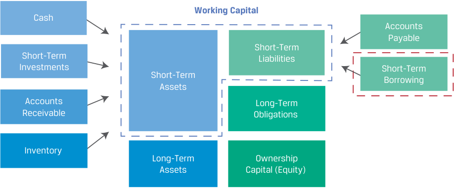
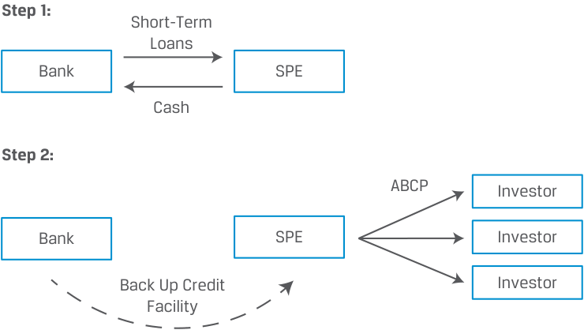
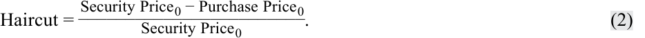
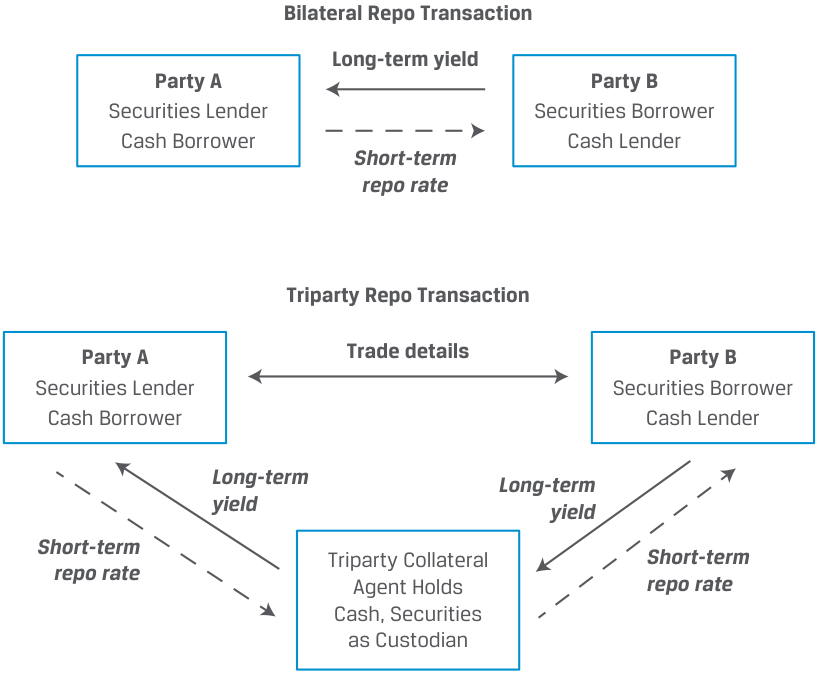
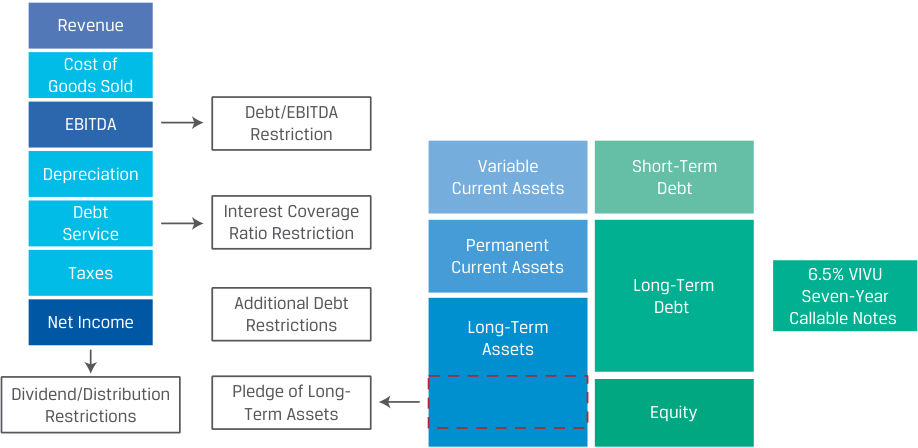

# Tập 6: Chứng khoán Thu nhập Cố định (Fixed Income)
## Learning Module 4 Fixed-Income Markets for Corporate Issuers (Trang PDF 89–116)

---

# Tập 6: Chứng Khoán Thu Nhập Cố Định (*Fixed Income*)
## Học Phần 4: Thị Trường Thu Nhập Cố Định Cho Các Tổ Chức Phát Hành Doanh Nghiệp (*Fixed-Income Markets for Corporate Issuers*)
### Phần 1/3: Giới Thiệu (Trang PDF 89–97)

---

<!-- PDF Page 89 -->

#### H Ọ C P H Ầ N **<mark>4</mark>** 

## **Thị Trường Thu Nhập Cố Định Cho Các Tổ Chức Phát Hành Doanh Nghiệp (*Fixed-Income Markets for Corporate Issuers*)** 

#### **<mark>MỤC TIÊU HỌC TẬP (*LEARNING OUTCOMES*)</mark>** 

| **_Mức độ thành thạo_** | **_Ứng viên cần có khả năng:_** |
|---|---|
| | So sánh các phương thức tài trợ ngắn hạn (*short-term funding alternatives*) sẵn có đối với các doanh nghiệp và các định chế tài chính |
| | Mô tả các hợp đồng mua lại (*repurchase agreements* – repos), công dụng của chúng, cũng như các lợi ích và rủi ro của chúng |
| | Phân biệt hoạt động tài trợ dài hạn (*long-term funding*) của các tổ chức phát hành doanh nghiệp hạng đầu tư (*investment-grade*) so với hạng lợi suất cao (*high-yield*) |

### **GIỚI THIỆU (*INTRODUCTION*)** 

# **<mark>1</mark>** 

Các học phần trước đã mô tả nhiều loại hình tổ chức phát hành và nhà đầu tư thu nhập cố định khác nhau. Trong học phần này, chúng ta tập trung vào khu vực thu nhập cố định doanh nghiệp (*corporate fixed-income sector*), bao gồm các công cụ được phát hành bởi các định chế tài chính (*financial institutions*) và các tổ chức phát hành doanh nghiệp phi tài chính (*non-financial corporate issuers*) trải rộng qua phổ thời gian đáo hạn và phổ tín dụng. Những công cụ này chiếm một tỷ trọng đáng kể trong tổng khối lượng phát hành nợ và dư nợ đang lưu hành trên toàn cầu. 

##### **TỔNG QUAN HỌC PHẦN (*LEARNING MODULE OVERVIEW*)** 

- Các tập đoàn phi tài chính thường xuyên sử dụng nguồn tài trợ bên ngoài ngắn hạn dưới hình thức các khoản vay ngân hàng và chứng khoán, chẳng hạn như thương phiếu (*commercial paper*) để đáp ứng nhu cầu tiền mặt. 

- Các định chế tài chính dựa vào tiền gửi (*deposits*), thị trường liên ngân hàng (*interbank markets*), thương phiếu (*commercial paper*), và các hợp đồng mua lại (*repurchase agreements* – repos) làm các nguồn tài trợ ngắn hạn chính. 

- Thương phiếu (*commercial paper*) là một kỳ phiếu nhận nợ ngắn hạn không có đảm bảo (*short-term unsecured promissory note*) được phát hành bởi cả các định chế tài chính và các tập đoàn phi tài chính. 

- Một hợp đồng mua lại (*repurchase agreement* – repo) là một hình thức cho vay ngắn hạn có đảm bảo (*short-term secured lending*) bao gồm việc bán và thỏa thuận đồng thời sẽ mua lại một chứng khoán ở một mức giá tương lai đã được thỏa thuận trước. 

<!-- PDF Page 90 -->

- Một trái phiếu hạng đầu tư (*investment-grade bond*) có một tỷ trọng đáng kể trong lợi suất đáo hạn (YTM) của nó được quy cho lợi suất chuẩn của chính phủ (*government benchmark yield*) do khả năng mạnh mẽ của tổ chức phát hành trong việc đáp ứng các nghĩa vụ lãi và vốn gốc đã cam kết từ dòng tiền hoạt động. 

- Các tổ chức phát hành lợi suất cao (*high-yield issuers*) được đặc trưng bởi khả năng kỳ vọng rơi vào tình trạng kiệt quệ tài chính (*financial distress*) cao hơn. So với trái phiếu hạng đầu tư, một tỷ trọng cao hơn trong YTM của trái phiếu của họ được quy cho phần chênh lệch đặc thù theo tổ chức phát hành (*issuer-specific spread*) cao hơn lợi suất chuẩn của chính phủ. 

##### **TỰ ĐÁNH GIÁ HỌC PHẦN (*LEARNING MODULE SELF-ASSESSMENT*)** 

Những câu hỏi ban đầu này nhằm mục đích giúp bạn tự đánh giá mức độ hiểu biết hiện tại của mình về học phần này. 

1. Công cụ tài trợ nào sau đây cung cấp nguồn tài trợ ngân hàng ngắn hạn _đáng tin cậy nhất_ cho một tập đoàn phi tài chính? 

   - **A.** Thỏa thuận tín dụng quay vòng (*Revolving credit agreement*) 

   - **B.** Hạn mức tín dụng ngân hàng có cam kết (*Committed bank line of credit*) 

   - **C.** Hạn mức tín dụng ngân hàng không cam kết (*Uncommitted bank line of credit*) 

##### **Lời giải:** 

A là đáp án đúng. Các thỏa thuận tín dụng quay vòng (*revolving credit agreements*), còn được gọi là *revolvers*, là nguồn tài trợ ngân hàng ngắn hạn đáng tin cậy nhất. 

B không đúng. Mặc dù các hạn mức tín dụng có cam kết là nguồn tài trợ đáng tin cậy hơn so với các hạn mức không cam kết bởi vì chúng bao gồm một cam kết chính thức bằng văn bản, nhưng chúng vẫn kém tin cậy hơn so với tín dụng quay vòng (*revolvers*). C không đúng vì các hạn mức tín dụng ngân hàng không cam kết là hình thức vay ngân hàng kém tin cậy nhất đối với một công ty. 

2. Xác định phát biểu sau đây là đúng hay sai. Giải thích câu trả lời của bạn. 

Trong một khoản vay không có đảm bảo (*unsecured loan*), bên cho vay yêu cầu công ty cung cấp tài sản thế chấp dưới hình thức một tài sản được cầm cố/thế chấp cho khoản vay đó. 

##### **Lời giải:** 

Sai (*False*). Các khoản vay _có đảm bảo_ (*secured loans*) mới là các khoản vay trong đó bên cho vay yêu cầu công ty cung cấp tài sản thế chấp dưới hình thức một tài sản, chẳng hạn như tài sản cố định thuộc sở hữu của công ty hoặc các khoản phải thu hay hàng tồn kho chất lượng cao. Những tài sản này được thế chấp cho khoản vay, và bên cho vay đăng ký quyền lợi đảm bảo (*security interest*) đối với chúng. Việc cầm cố hay quyền nắm giữ tài sản (*pledge or lien*) này được bổ sung vào hồ sơ tài chính của công ty đi vay và được phản ánh trên báo cáo tín dụng của công ty. Các công ty không có đủ chất lượng tín dụng để đủ điều kiện nhận các khoản vay không có đảm bảo có thể tìm cách tiếp cận các khoản vay có đảm bảo. 

3. So với nợ dài hạn và vốn chủ sở hữu, nguồn tài trợ từ hợp đồng mua lại (*repo funding*) mang lại lợi ích nào sau đây cho một định chế tài chính? 

   - **A.** Chi phí thấp hơn (*Lower cost*) 

   - **B.** Tài trợ dài hạn hơn (*Longer-term financing*) 

   - **C.** Sự linh hoạt tài chính lớn hơn (*Greater financial flexibility*) 

##### **Lời giải:** 

A là đáp án đúng. Các định chế tài chính phải cân bằng giữa chi phí thấp của nguồn tài trợ repo với sự linh hoạt tài chính lớn hơn của các phương thức tài trợ dài hạn 

<!-- PDF Page 91 -->

tốn kém hơn, chẳng hạn như nợ dài hạn và vốn chủ sở hữu. B và C không đúng vì cả hai đều là lợi ích của nợ dài hạn và vốn chủ sở hữu.

4. Venus, Inc., một định chế tài chính, và Ngân hàng A, một ngân hàng khu vực lớn, ký kết một hợp đồng mua lại (*repurchase agreement*) trong đó Venus là bên bán chứng khoán và Ngân hàng A là bên mua chứng khoán. Hợp đồng repo này chịu mức ký quỹ ban đầu (*initial margin*) là 102%. Phát biểu nào sau đây là đúng?
   - **A.** Ngân hàng A hưởng lợi từ một khoản đầu tư tiền mặt dài hạn trên cơ sở có tài sản thế chấp với rủi ro thanh khoản tối thiểu.
   - **B.** Ngân hàng A có thể tạo ra tỷ suất sinh lợi cao hơn với các kỳ hạn repo dài hơn và/hoặc bằng cách chấp nhận tài sản thế chấp kém thanh khoản hơn hoặc có chất lượng thấp hơn.
   - **C.** Giao dịch repo làm giảm nhu cầu tài trợ của Venus đối với chứng khoán xuống còn một phần nhỏ trong giá mua trái phiếu.

   - **Lời giải:**

B là đáp án đúng. Các hợp đồng repo ngắn hạn với tài sản thế chấp chất lượng cao (rủi ro thấp nhất) mang lại tỷ suất sinh lợi thấp nhất; tuy nhiên, các nhà đầu tư có thể kỳ vọng tỷ suất sinh lợi cao hơn đối với các kỳ hạn repo dài hơn và/hoặc bằng cách chấp nhận tài sản thế chấp kém thanh khoản hơn hoặc có chất lượng thấp hơn.

A không đúng vì Ngân hàng A hưởng lợi từ một khoản đầu tư tiền mặt ngắn hạn (chứ không phải dài hạn) trên cơ sở có tài sản thế chấp với rủi ro thanh khoản tối thiểu.

C không đúng vì giao dịch repo làm giảm nhu cầu tài trợ của bên đi vay tiền / bên mua chứng khoán mới bằng vốn tự có (tức Venus vẫn phải tự tài trợ phần chênh lệch ký quỹ ban đầu 2%, còn bản thân giao dịch repo tài trợ phần lớn giá mua chứng khoán chứ không phải giảm nhu cầu tài trợ của Ngân hàng A hay giảm xuống chỉ còn một phần nhỏ nhờ mức ký quỹ 102%). *(Lưu ý theo giải thích gốc của CFA: C bị coi là sai do diễn đạt nhầm vai trò/tác động của mức ký quỹ 102%).*

5. Một nhà đầu tư đang phân tích ba trái phiếu cho một khoản đầu tư tiềm năng: một trái phiếu xếp hạng AA, một trái phiếu xếp hạng B, và một trái phiếu xếp hạng CCC. Trái phiếu nào là _phù hợp nhất_ nếu nhà đầu tư đang tìm kiếm sự an toàn với ít hạn chế đối với tổ chức phát hành?
   - **A.** Trái phiếu xếp hạng AA
   - **B.** Trái phiếu xếp hạng B
   - **C.** Trái phiếu xếp hạng CCC

   - **Lời giải:**

A là đáp án đúng. Trái phiếu xếp hạng AA thuộc hạng đầu tư (*investment grade*) với khả năng vỡ nợ thấp và các hạn chế tối thiểu đối với tổ chức phát hành. B và C không đúng vì trái phiếu xếp hạng B và xếp hạng CCC được coi là trái phiếu lợi suất cao (*high yield*) với các thuộc tính rủi ro giống như cổ phiếu và thường có các hạn chế lớn hơn đối với tổ chức phát hành.

6. Một chuyên gia phân tích trái phiếu sẽ _nhiều khả năng nhất_ xem xét xác suất vỡ nợ (*probability of default*) và mức tổn thất khi vỡ nợ (*loss given default*) đối với:
   - **A.** một trái phiếu hạng đầu tư bởi vì dòng tiền giống như cổ phiếu của nó.
   - **B.** một trái phiếu lợi suất cao bởi vì khả năng kỳ vọng rơi vào tình trạng kiệt quệ tài chính cao hơn của nó.
   - **C.** một trái phiếu hạng đầu tư bởi vì tầm quan trọng của các tỷ số tài chính và xếp hạng tín dụng nhằm xác định khả năng vỡ nợ của tổ chức phát hành.

   - **Lời giải:**

B là đáp án đúng. Các tổ chức phát hành lợi suất cao được đặc trưng bởi khả năng kỳ vọng rơi vào tình trạng kiệt quệ tài chính cao hơn. Do khả năng vỡ nợ cao hơn, những công cụ này có bản chất giống như cổ phiếu hơn và các chuyên gia phân tích đặt trọng tâm lớn hơn vào khả năng (xác suất) vỡ nợ, mức tổn thất tiềm tàng khi vỡ nợ, cũng như các biện pháp bảo vệ và các nguồn trả nợ thứ cấp hiện có. A không đúng vì trái phiếu hạng đầu tư thể hiện các dòng tiền giống như trái phiếu tiêu chuẩn, 

<!-- PDF Page 92 -->

đối với chúng có xác suất cao sẽ nhận được các khoản thanh toán lãi và vốn gốc đã thỏa thuận. C không đúng vì các chuyên gia phân tích trái phiếu hạng đầu tư sử dụng các tỷ số tài chính và xếp hạng tín dụng để xác định xem liệu và khi nào khả năng vỡ nợ của một tổ chức phát hành hạng đầu tư sẽ thay đổi chứ không dựa vào các thước đo xác suất vỡ nợ hay mức tổn thất khi vỡ nợ trực tiếp như đối với nợ lợi suất cao. 

# **<mark>2</mark>** 

### **CÁC PHƯƠNG THỨC TÀI TRỢ NGẮN HẠN (*SHORT-TERM FUNDING ALTERNATIVES*)** 

*Mục tiêu: So sánh các phương thức tài trợ ngắn hạn sẵn có đối với các doanh nghiệp và các định chế tài chính.*

Cả các tập đoàn phi tài chính và các định chế tài chính đều dựa vào nguồn vốn vay để hỗ trợ các hoạt động ngắn hạn của mình. Như đã thảo luận trong học phần trước ở bài đọc về các tổ chức phát hành doanh nghiệp, các tập đoàn sử dụng nguồn tài trợ ngắn hạn bên ngoài để đáp ứng nhu cầu tiền mặt trong chu kỳ chuyển đổi tiền mặt (*cash conversion cycle*), duy trì tính thanh khoản, và tận dụng các khoản chiết khấu thanh toán sớm từ nhà cung cấp (*supplier discounts*). 

Các nguồn và mục đích sử dụng tài trợ ngắn hạn của doanh nghiệp phi tài chính được tóm tắt trong Bảng minh họa 1 (*Exhibit 1*). 

**Bảng minh họa 1: Các Nguồn và Mục đích Sử dụng Tài trợ Ngắn hạn đối với Doanh nghiệp Phi Tài chính (*Sources and Uses of Short-Term Funding for Non-Financial Corporates*)** 

> **Chú thích hình ảnh:**
> **Vốn lưu động (*Working Capital*)** trên Bảng cân đối kế toán:
> - **Tài sản ngắn hạn (*Short-Term Assets*)**: Tiền mặt (*Cash*), Đầu tư ngắn hạn (*Short-Term Investments*), Phải thu khách hàng (*Accounts Receivable*), Hàng tồn kho (*Inventory*). (Bên dưới là Tài sản dài hạn – *Long-Term Assets*).
> - **Nợ ngắn hạn (*Short-Term Liabilities*)**: Phải trả người bán (*Accounts Payable*), Vay ngắn hạn (*Short-Term Borrowing*). (Bên dưới là Nghĩa vụ nợ dài hạn – *Long-Term Obligations* và Vốn chủ sở hữu – *Ownership Capital / Equity*).

#### **Tài trợ bằng Khoản vay Bên ngoài (*External Loan Financing*)** 

Các tập đoàn phi tài chính thường dựa vào các định chế tài chính trung gian để tài trợ ngắn hạn. Các công cụ phổ biến bao gồm: 

- hạn mức tín dụng ngân hàng không cam kết (*uncommitted bank lines of credit*), 

- hạn mức tín dụng ngân hàng có cam kết (*committed bank lines of credit*), và 

- thỏa thuận tín dụng quay vòng (*revolving credit agreements* hay *revolvers*). 

<!-- PDF Page 93 -->

Những công cụ này có thể là không có đảm bảo hoặc có đảm bảo, tùy thuộc vào sức mạnh tài chính, tình hình tín dụng chung của công ty và khu vực tài phán. Các hạn mức không cam kết và tín dụng quay vòng (*revolvers*) được sử dụng thường xuyên hơn tại Hoa Kỳ, trong khi các hạn mức có cam kết thông thường lại phổ biến hơn ở những nơi khác. Các hạn mức tín dụng thường mang lại khả năng tiếp cận linh hoạt nhất và tức thời nhất đối với nguồn tài trợ ngắn hạn. 

##### **_Các hạn mức tín dụng (Lines of Credit)_** 

**Hạn mức tín dụng không cam kết (*uncommitted lines of credit*)** là hình thức vay ngân hàng kém tin cậy nhất đối với một công ty, đúng như tên gọi của nó. Một ngân hàng cung cấp các hạn mức tín dụng không cam kết lên đến một số tiền vốn gốc nhất định (“hạn mức tín dụng”) trong một kỳ hạn tối đa được xác định trước, tính lãi suất cơ sở hoặc lãi suất tham chiếu thị trường (MRR) cộng với một phần chênh lệch đặc thù theo tổ chức phát hành chỉ trên phần dư nợ gốc thực tế đang sử dụng trong khoảng thời gian sử dụng. Trong điều kiện kinh doanh bình thường, các công ty thường thấy hạn mức tín dụng ngân hàng không cam kết là phương tiện tài trợ bên ngoài linh hoạt nhất và ít tốn kém nhất. Các ngân hàng thường cung cấp các hạn mức này trên cơ sở không có đảm bảo cho những khách hàng duy trì lượng tiền gửi ổn định tại ngân hàng, cho phép ngân hàng giám sát chặt chẽ và phản ứng kịp thời trước những diễn biến bất lợi của bên đi vay, chẳng hạn như số dư tài khoản sụt giảm. Các hạn mức tín dụng không cam kết đòi hỏi mức dự trữ vốn tối thiểu cho đến khi chúng được rút vốn và sử dụng, nhưng các ngân hàng bảo lưu quyền từ chối thực hiện bất kỳ yêu cầu sử dụng hạn mức nào. Do đó, các doanh nghiệp không thể dựa vào các hạn mức không cam kết làm nguồn tài trợ chính, bởi vì các ngân hàng có thể chọn không cho vay nếu điều kiện kinh doanh hoặc kinh tế xấu đi. Các nguồn tài trợ thay thế có thể khó đạt được hoặc đắt đỏ đến mức không thể tiếp cận vào những thời điểm khi nguồn tài trợ không cam kết trở nên không còn sẵn có. Sự hấp dẫn chính của các hạn mức không cam kết là chúng không yêu cầu công ty phải trả bất kỳ khoản thù lao nào ngoài tiền lãi tính trên số dư nợ đang lưu hành cho ngân hàng. Dưới góc độ của ngân hàng, những hạn mức tín dụng không cam kết này đóng vai trò là công cụ có giá trị để duy trì mối quan hệ kinh doanh lâu dài với bên đi vay, qua đó ngân hàng có thể giám sát hoạt động của bên đi vay. Nguồn vốn cho các hạn mức này thường đến từ các khoản tiền gửi ổn định mà ngân hàng nắm giữ, cho phép ngân hàng tài trợ cho các hạn mức này bằng cách sử dụng nguồn tiền mà người gửi tiền không thường xuyên đụng tới. 

**Hạn mức tín dụng có cam kết / thông thường (*committed / regular lines of credit*)** là một nguồn tài trợ đáng tin cậy hơn so với các hạn mức không cam kết bởi vì chúng bao gồm một cam kết chính thức bằng văn bản. Các hạn mức có cam kết đòi hỏi nhiều vốn ngân hàng hơn so với các hạn mức không cam kết, mặc dù các cam kết dưới một năm (thường là 364 ngày) giúp giảm thiểu yêu cầu vốn của ngân hàng. Đối với những bên đi vay doanh nghiệp quy mô lớn hơn, các ngân hàng thường giảm thêm lượng vốn cam kết cần thiết để hỗ trợ hạn mức bằng cách thành lập một nhóm ngân hàng hay một tổ hợp cho vay hợp vốn (*syndicate*), bao gồm một thỏa thuận chung để chấp nhận một tỷ lệ phần trăm xác định trước trong tổng cam kết tín dụng và việc giải ngân khoản vay theo thời gian. Khi được rút vốn, các hạn mức tín dụng thông thường là các khoản nợ phải trả ngắn hạn, thường được phân loại là phải trả theo kỳ phiếu (*notes payable*) hoặc tương đương. Các hạn mức có cam kết chưa rút vốn đôi khi được sử dụng làm nguồn tín dụng dự phòng (*backup credit*) cho các hình thức tài trợ khác, chẳng hạn như chứng khoán ngắn hạn, như sẽ trình bày ở phần sau. 

Các hạn mức thông thường là không có đảm bảo và có thể trả trước mà không bị phạt (*prepayable without penalty*). Mặc dù chúng là nguồn tài trợ ngắn hạn đáng tin cậy hơn so với các hạn mức không cam kết, những cam kết này vẫn phải đối mặt với rủi ro gia hạn khi đáo hạn (*risk of renewal at maturity*), đặc biệt là khi được sử dụng và rút vốn nhiều bởi một bên đi vay có điều kiện tín dụng đang suy yếu. Không giống như các hạn mức không cam kết, các hạn mức thông thường thường bao gồm các chi phí trả trước dưới hình thức phí cam kết (*commitment fee*, chẳng hạn như 0.50%) tính trên toàn bộ hạn mức hoặc phần hạn mức chưa sử dụng cho khoảng thời gian cam kết. 

**Thỏa thuận tín dụng quay vòng (*revolving credit agreements*)**, còn được gọi là *“revolvers”* (hay “hạn mức tín dụng hoạt động” – *“operating lines of credit”*), là nguồn tài trợ ngân hàng ngắn hạn đáng tin cậy nhất. Đây là những cam kết tín dụng kéo dài nhiều năm (*multiyear credit commitments*) và các bên cho vay thường tìm kiếm các biện pháp bảo vệ, chẳng hạn như các điều khoản cam kết (*covenants*) yêu cầu hoặc hạn chế một số hành động nhất định của bên đi vay giống như trường hợp của khế ước trái phiếu. Ngoài điểm đó ra, tín dụng quay vòng có các đặc điểm tương tự như các hạn mức thông thường xét về lãi suất đi vay và phí cam kết, đồng thời cũng có thể bao gồm các đặc tính khoản vay trung hạn tùy chọn. 

<!-- PDF Page 94 -->

##### **_Các khoản vay có đảm bảo và Bao thanh toán (Secured Loans and Factoring)_** 

**Các khoản vay có đảm bảo (*secured loans*)**, còn được gọi là các khoản vay dựa trên tài sản (*asset-based loans*), là các khoản vay trong đó bên cho vay yêu cầu công ty cung cấp tài sản thế chấp dưới hình thức một tài sản, chẳng hạn như tài sản cố định mà công ty sở hữu hoặc các khoản phải thu chất lượng cao, hàng tồn kho, hoặc chứng khoán khả mại (*marketable securities*). Những tài sản này được cầm cố/thế chấp cho khoản vay, và bên cho vay đăng ký quyền lợi đảm bảo (*security interest* – tức quyền chiếm hữu tài sản cho đến khi khoản vay được hoàn trả) đối với chúng. Việc cầm cố hay quyền nắm giữ tài sản này được bổ sung vào hồ sơ tài chính của công ty đi vay và được phản ánh trên báo cáo tín dụng của công ty. Các công ty không có đủ chất lượng tín dụng để đủ điều kiện nhận các khoản vay không có đảm bảo có thể thu xếp các khoản vay có đảm bảo. 

Một công ty có thể sử dụng các khoản phải thu khách hàng (*accounts receivable*) của mình để tạo ra dòng tiền thông qua việc chuyển nhượng quyền đòi nợ các khoản phải thu (*assignment of accounts receivable*), tức là việc sử dụng các khoản phải thu làm tài sản thế chấp cho một khoản vay. Các doanh nghiệp cũng có thể bán đứt các khoản phải thu cho một bên cho vay, được gọi là đơn vị bao thanh toán (*factor*), thường ở một mức chiết khấu đáng kể. Theo hình thức thế chấp/chuyển nhượng quyền đòi nợ (*assignment*), công ty vẫn chịu trách nhiệm thu hồi các khoản phải thu đó, trong khi trong một **thỏa thuận bao thanh toán (*factoring arrangement*)**, công ty chuyển giao quy trình cấp tín dụng và thu hồi nợ sang cho bên cho vay hay đơn vị bao thanh toán. Chi phí của khoản tín dụng này (tức số tiền chiết khấu) phụ thuộc vào chất lượng tín dụng của các khoản phải thu và chi phí thu hồi nợ. Tương tự, hàng tồn kho có thể được sử dụng theo nhiều cách khác nhau làm tài sản thế chấp cho một khoản vay. 

#### **Tài trợ Bên ngoài Dựa trên Chứng khoán (*External, Security-Based Financing*)** 

Đối với một số doanh nghiệp, các khoản vay có thể đắt đỏ hơn so với nợ vay (có đảm bảo hoặc không có đảm bảo) được phát hành trên các thị trường tài chính. Các công ty lớn, có xếp hạng tín nhiệm cao có thể phát hành các kỳ phiếu ngắn hạn, không có đảm bảo được gọi là **thương phiếu (*commercial paper* – CP)** trên thị trường đại chúng hoặc thông qua phát hành riêng lẻ. Thương phiếu do các tập đoàn phát hành thường đáo hạn trong vòng chưa đầy ba tháng và có thể được sử dụng để tài trợ vốn lưu động, nhu cầu tiền mặt theo mùa vụ, hoặc để cung cấp **tài trợ bắc cầu (*bridge financing***, tức là khoản tài trợ tạm thời cung cấp vốn cho đến khi nguồn tài trợ dài hạn/vĩnh viễn có thể được thu xếp). 

Trong hầu hết các trường hợp, thương phiếu đáo hạn được thanh toán bằng số tiền thu được từ thương phiếu mới phát hành (hay được “đảo nợ / quay vòng” – *“rolled over”*). Thông lệ này làm nảy sinh khả năng một tổ chức phát hành không thể phát hành thương phiếu mới khi đáo hạn, được gọi là **rủi ro đảo nợ / rủi ro tái cấp vốn (*rollover risk*)**. Để giảm thiểu rủi ro đảo nợ, các nhà đầu tư thường yêu cầu một **hạn mức tín dụng dự phòng (*backup line of credit*)** có cam kết từ các ngân hàng, còn được gọi là tăng cường thanh khoản (*liquidity enhancement*) hoặc hạn mức thanh khoản dự phòng (*backup liquidity lines*). Mục đích của các hạn mức tín dụng dự phòng là để đảm bảo rằng tổ chức phát hành có thể hoàn trả đầy đủ thương phiếu đáo hạn nếu việc đảo nợ không thể thực hiện được. Do kỳ hạn ngắn của chúng, các thị trường thương phiếu thích ứng nhanh chóng với các sự kiện tín dụng bất lợi và tình trạng vỡ nợ là tương đối hiếm. 

Ngoài các tập đoàn phi tài chính, những tổ chức phát hành thương phiếu lớn nhất bao gồm các định chế tài chính, các chính phủ, và các cơ quan siêu quốc gia. Thương phiếu được phát hành trên thị trường quốc tế được gọi là thương phiếu châu Âu (*Eurocommercial paper* – ECP). Mặc dù tương tự như thương phiếu Hoa Kỳ (*United States commercial paper* – USCP), quy mô giao dịch ECP điển hình nhỏ hơn nhiều và kém thanh khoản hơn so với thị trường USCP. 

#### **Các Phương thức Tài trợ Ngắn hạn cho các Định chế Tài chính (*Short-Term Funding Alternatives for Financial Institutions*)** 

Các nguồn và mục đích sử dụng vốn phổ biến của ngân hàng được hiển thị trong Bảng minh họa 2 (*Exhibit 2*). Nhu cầu tài trợ ngắn hạn của các định chế tài chính, chẳng hạn như các ngân hàng, phát sinh từ vai trò làm trung gian giữa người đi vay và người gửi tiền của họ. Ngoài tiền mặt và dự trữ, hầu hết tài sản của ngân hàng là các khoản vay đã cấp hoặc chứng khoán đã mua. Nợ phải trả bao gồm tiền gửi nhận được từ các hộ gia đình và doanh nghiệp, chứng khoán đã bán, hoặc các khoản vay ngắn hạn. 

<!-- PDF Page 95 -->

**Bảng minh họa 2: Các Nguồn và Mục đích Sử dụng Tài trợ Ngắn hạn của Ngân hàng (*Bank Short-Term Funding Sources and Uses*)** 

> **Chú thích hình ảnh:**
> **Bảng cân đối kế toán của Ngân hàng**:
> - **Tài sản ngắn hạn (*Short-Term Assets*)**: Tiền mặt (*Cash*), Dự trữ tại Ngân hàng Trung ương (*Central Bank Reserves*), Các khoản cho vay ngắn hạn (*Short-Term Loans*), Chứng khoán mua theo hợp đồng bán lại hoặc đi mượn (*Securities Purchased under Agreements to Resell or Borrowed*). (Bên dưới là Tài sản dài hạn – *Long-Term Assets*).
> - **Nợ ngắn hạn (*Short-Term Liabilities*)**: Tiền gửi (*Deposits*), Chứng chỉ tiền gửi dưới 1 năm (*Certificates of Deposit < 1 year*), Chứng khoán bán theo hợp đồng mua lại hoặc cho mượn (*Securities Sold under Agreements to Repurchase or Loaned*), Vay ngắn hạn (*Short-Term Borrowing*). (Bên dưới là Nghĩa vụ dài hạn – *Long-Term Obligations* và Vốn chủ sở hữu – *Ownership Capital / Equity*).
> - **Công thức**: $r_{\text{Assets}} - r_{\text{Liabilities}} = \text{Biên lãi ròng (Net Interest Margin)}$.

##### **_Tiền gửi (Deposits)_** 

Tiền gửi của hộ gia đình (hay bán lẻ) và tiền gửi thương mại là nguồn tài trợ ngắn hạn chính đối với hầu hết các ngân hàng. Chúng thường dưới hình thức **tài khoản thanh toán / tài khoản vãng lai (*checking accounts*)**, hay các khoản tiền gửi không có kỳ hạn xác định sẵn có cho các mục đích giao dịch và trả rất ít hoặc không trả lãi. Mặc dù số dư của các khoản gọi là tiền gửi không kỳ hạn (*demand deposits*) này có thể bị rút ra bất cứ lúc nào, nhưng việc hoàn phí (*fee rebates*), các hạn mức tín dụng không cam kết, và các dịch vụ khác được các ngân hàng cung cấp trong điều kiện kinh doanh bình thường cho khách hàng thương mại của họ cho phép ngân hàng dựa vào nguồn vốn ổn định này để đáp ứng cả nhu cầu tài trợ ngắn hạn và dài hạn hơn. Đối với những người gửi tiền quy mô lớn hơn, các khoản gọi là **tiền gửi hoạt động (*operational deposits*)** được tạo ra từ các hoạt động bù trừ, lưu ký và quản lý tiền mặt cũng là một nguồn tài trợ tương đối ổn định, trong khi các quy định yêu cầu ngân hàng phải duy trì dự trữ thanh khoản đối với các khoản tiền gửi không kỳ hạn kém ổn định khác khiến chúng trở thành một nguồn tài trợ kém hấp dẫn hơn. 

**Tiền gửi tiết kiệm (*saving deposits*)** thường được nắm giữ cho các mục đích phi giao dịch và thường có kỳ hạn xác định. Ví dụ, một ngân hàng có thể nhận một khoản tiền gửi cụ thể với kỳ hạn và lãi suất được xác định trước được gọi là **chứng chỉ tiền gửi (*certificate of deposit* – CD)**. Các CD thường có kỳ hạn ngắn hơn một năm và trả lãi khi đáo hạn. Một CD không thể chuyển nhượng (*non-negotiable CD*) bao gồm việc thanh toán vốn gốc và tiền lãi khi đáo hạn cho người gửi tiền ban đầu, kèm theo một khoản phạt nếu rút tiền trước hạn. Các CD có thể chuyển nhượng (*negotiable CDs*) cho phép người gửi tiền rút vốn bằng cách bán CD trên thị trường mở trước khi đáo hạn. Một CD có thể chuyển nhượng hướng tới thị trường bán lẻ được gọi là CD mệnh giá nhỏ (*small-denomination CD*), trong khi các CD mệnh giá lớn (*large-denomination CDs*) là một nguồn tài trợ bán buôn (*wholesale funding*) phổ biến từ các nhà đầu tư tổ chức. Giống như trường hợp của thương phiếu (CP), các CD cũng được giao dịch trên thị trường Eurobond. 

##### **_Thị trường liên ngân hàng (Interbank Market)_** 

**Thị trường liên ngân hàng (*interbank market*)** bao gồm hoạt động đi vay và cho vay ngắn hạn giữa các định chế tài chính trên cơ sở có đảm bảo hoặc không có đảm bảo. Các khoản vay và tiền gửi không có đảm bảo trên thị trường liên ngân hàng thường dao động từ kỳ hạn qua đêm (*overnight*) đến kỳ hạn một năm ở mức lãi suất gắn chặt với lãi suất tham chiếu thị trường (MRR). Các ngân hàng thường tính đến rủi ro tín dụng vào trong lãi suất của các khoản vay và tiền gửi này, đồng thời áp đặt các hạn mức đối tác (*counterparty limits*) như một phần trong công tác quản trị rủi ro tín dụng của mình. 

Tại hầu hết các quốc gia, các ngân hàng và các định chế tài chính khác bị yêu cầu phải duy trì dự trữ tại ngân hàng trung ương. Trong khi một số ngân hàng có thể có nguồn vốn dư thừa vượt mức dự trữ bắt buộc tối thiểu, những ngân hàng khác có thể bị thiếu hụt dự trữ bắt buộc. Sự mất cân đối này được giải quyết thông qua **thị trường vốn ngân hàng trung ương (*central bank funds market*)**, cho phép các ngân hàng có thặng dư 

<!-- PDF Page 96 -->

vốn cho các ngân hàng khác vay. Lãi suất mà tại đó nguồn vốn tại ngân hàng trung ương được mua (tức đi vay) và bán (tức cho vay) được gọi là **lãi suất vốn ngân hàng trung ương (*central bank funds rate*)**. Các ngân hàng trung ương nhắm mục tiêu vào một mức lãi suất cụ thể hoặc một biên độ lãi suất chính sách và sử dụng các nghiệp vụ thị trường mở (*open market operations*) hoặc tiền lãi trả trên khoản dự trữ để đạt được mục tiêu đó. Một ngân hàng không thể đi vay trên thị trường liên ngân hàng có thể vay trực tiếp từ ngân hàng trung ương như một cứu cánh cuối cùng (cho vay qua cửa sổ chiết khấu – *discount window lending*), nhưng việc này thường đi kèm với việc phải nộp tài sản thế chấp cho ngân hàng trung ương và có thể dẫn đến sự giám sát chặt chẽ hơn của ngân hàng trung ương, có thể kéo theo các hạn chế đối với hoạt động của ngân hàng nhằm giải quyết các vấn đề thanh khoản của ngân hàng đó. Khoản cho vay như vậy được cung cấp ở mức lãi suất cao hơn lãi suất vốn ngân hàng trung ương. 

Hình thức đi vay và cho vay liên ngân hàng có đảm bảo phổ biến nhất bao gồm các hợp đồng mua lại (*repurchase agreements*) sẽ được đề cập trong bài học tiếp theo. 

##### **_Thương phiếu (Commercial Paper)_** 

Việc phát hành thương phiếu được chi phối bởi các định chế tài chính lớn, những tổ chức sử dụng các kỳ phiếu _không có đảm bảo_ này để đáp ứng nhu cầu đi vay ngắn hạn và trong một số trường hợp để tài trợ cho các tài sản dài hạn hơn trên bảng cân đối kế toán, chẳng hạn như các khoản cho vay. Khoảng 60% khối lượng phát hành hàng năm đến từ các định chế tài chính, và phần còn lại đến từ các tổ chức phát hành doanh nghiệp phi tài chính. Giống như trường hợp của các tập đoàn phi tài chính, các ngân hàng cũng phải đối mặt với rủi ro đảo nợ (*rollover risk*) trong chừng mực nhu cầu tài trợ của họ vượt quá kỳ hạn của các thương phiếu đang lưu hành. 

Các ngân hàng và các định chế tài chính khác cũng thường sử dụng một hình thức phát hành thương phiếu _có đảm bảo_ được gọi là **thương phiếu đảm bảo bằng tài sản (*asset-backed commercial paper* – ABCP)**. Hãy nhớ lại từ bài học trước rằng trong một số trường hợp, các khoản vay hoặc các khoản phải thu được bán cho một thực thể có mục đích đặc biệt (*special purpose entity* – SPE), thực thể này phát hành nợ và thực hiện các khoản thanh toán lãi cũng như vốn gốc từ dòng tiền của tài sản. Bảng minh họa 3 (*Exhibit 3*) trình bày một đợt phát hành ABCP qua hai bước đơn giản (chứng khoán đảm bảo bằng tài sản sẽ được trình bày chi tiết ở phần sau). Bước thứ nhất, một ngân hàng đồng ý chuyển giao các khoản cho vay ngắn hạn cho một SPE để đổi lấy tiền mặt. Bước thứ hai, SPE phát hành ABCP cho các nhà đầu tư kèm theo một hạn mức thanh khoản tín dụng dự phòng (*backup credit liquidity line*) do ngân hàng đó cung cấp. 

**Bảng minh họa 3: Phát hành Thương phiếu Đảm bảo bằng Tài sản (*Asset-Backed Commercial Paper Issuance*)** 

> **Chú thích hình ảnh:**
> - **Bước 1 (*Step 1*)**: Ngân hàng (*Bank*) chuyển giao Các khoản cho vay ngắn hạn (*Short-Term Loans*) cho Thực thể có mục đích đặc biệt (*SPE*) và nhận lại Tiền mặt (*Cash*).
> - **Bước 2 (*Step 2*)**: Ngân hàng cung cấp Hạn mức tín dụng dự phòng (*Back Up Credit Facility*) cho SPE; SPE phát hành Thương phiếu đảm bảo bằng tài sản (*ABCP*) cho các Nhà đầu tư (*Investor*).

Khoản tài trợ này không được ghi nhận trên bảng cân đối kế toán của tổ chức phát hành, và hình thức tài trợ ngoại bảng (*off-balance-sheet financing*) như vậy mang lại lợi ích cho cả ngân hàng (với tư cách là bên bảo trợ SPE và bên cung cấp tín dụng dự phòng) lẫn các nhà đầu tư. Ngân hàng nhận được tiền mặt khi thương phiếu được phát hành và giảm được chi phí vốn của mình bằng cách cung cấp thanh khoản dự phòng chưa rút vốn thay vì nắm giữ các khoản cho vay ngắn hạn cho đến khi đáo hạn. Các nhà đầu tư mua được một kỳ phiếu ngắn hạn có tính thanh khoản với các khoản thanh toán lãi và vốn gốc từ một danh mục khoản vay mà nếu không có cấu trúc này thì họ sẽ không có khả năng tiếp cận trực tiếp. 

<!-- PDF Page 97 -->

Thị trường ABCP đã trải qua sự tăng trưởng nhanh chóng trước Cuộc Khủng hoảng Tài chính Toàn cầu một phần do sự gia tăng đáng kể trong việc tài trợ cho các tài sản dài hạn bằng các kỳ phiếu ngắn hạn. Tuy nhiên, việc nhiều tổ chức phát hành không có khả năng đảo nợ ABCP ở đỉnh điểm của cuộc khủng hoảng đã khiến vô số SPE bị sụp đổ. Sau cuộc khủng hoảng, thị trường ABCP đã quay trở lại với việc chủ yếu tài trợ cho các khoản vay và khoản phải thu ngắn hạn, nhìn chung có chất lượng cao. 

##### **BỘ CÂU HỎI (*QUESTION SET*)** 

1. Tập đoàn Pennington là một công ty dược phẩm lớn có xếp hạng tín dụng thuộc hạng đầu tư và sử dụng Ngân hàng Cavalier cho một số nhu cầu tài trợ của mình. Pennington duy trì các khoản tiền gửi bằng tiền mặt ổn định tại Ngân hàng Cavalier và đang tìm kiếm một phương án tài trợ ngắn hạn không có phí cam kết trả trước (*no upfront commitment fee*). Phương án tài trợ nào sau đây sẽ _phù hợp nhất_ cho Pennington? 

   - **A.** Khoản vay có đảm bảo (*Secured loan*) 

   - **B.** Hạn mức tín dụng ngân hàng có cam kết (*Committed bank line of credit*) 

   - **C.** Hạn mức tín dụng ngân hàng không cam kết (*Uncommitted bank line of credit*) 

   - **Lời giải:** 

C là đáp án đúng. Các ngân hàng cung cấp hạn mức tín dụng không cam kết trên cơ sở không có đảm bảo cho những khách hàng duy trì các khoản tiền gửi bằng tiền mặt ổn định tại ngân hàng, cho phép ngân hàng giám sát chặt chẽ và phản ứng kịp thời trước những diễn biến bất lợi của bên đi vay, chẳng hạn như số dư tài khoản sụt giảm. Các hạn mức tín dụng không cam kết cũng không có phí cam kết trả trước và được tiếp cận bởi các công ty có năng lực tài chính mạnh hơn, chẳng hạn như Pennington. A không đúng vì các khoản vay có đảm bảo được sử dụng bởi các công ty không có đủ chất lượng tín dụng để đủ điều kiện nhận các khoản vay không có đảm bảo. B không đúng vì các hạn mức tín dụng có cam kết có thu phí cam kết trả trước. 

2. Phát biểu nào sau đây về tín dụng quay vòng (*revolvers*) là đúng? 

   - **A.** Tín dụng quay vòng là hình thức vay ngân hàng kém tin cậy nhất đối với một công ty. 

   - **B.** Tín dụng quay vòng là các cam kết tín dụng kéo dài nhiều năm trong đó các bên cho vay thường tìm kiếm các điều khoản cam kết (*covenants*) yêu cầu hoặc hạn chế một số hành động nhất định của bên đi vay. 

   - **C.** Tín dụng quay vòng thường chỉ khác biệt ở việc bao gồm các chi phí trả trước dưới hình thức phí cam kết tính trên toàn bộ hoặc phần hạn mức chưa sử dụng cho khoảng thời gian cam kết. 

##### **Lời giải:** 

B là đáp án đúng. Tín dụng quay vòng (*revolvers*) là các cam kết tín dụng kéo dài nhiều năm trong đó các bên cho vay thường tìm kiếm các biện pháp bảo vệ, chẳng hạn như các điều khoản cam kết (*covenants*), yêu cầu hoặc hạn chế một số hành động nhất định của bên đi vay, giống như trường hợp của khế ước trái phiếu. A không đúng vì các hạn mức tín dụng không cam kết mới là hình thức vay ngân hàng kém tin cậy nhất đối với một công ty. C không đúng vì các hạn mức tín dụng có cam kết thông thường (chứ không phải điểm đặc trưng riêng của *revolvers*) đã bao gồm các chi phí trả trước dưới hình thức phí cam kết tính trên toàn bộ hoặc phần hạn mức chưa sử dụng cho khoảng thời gian cam kết. 

3. Một tổ chức phát hành thương phiếu sẽ _nhiều khả năng nhất_ phải có được yếu tố nào sau đây để giảm thiểu rủi ro đảo nợ (*rollover risk*)? 

   - **A.** Xếp hạng tín dụng (*Credit rating*) 

   - **B.** Tài trợ bắc cầu (*Bridge financing*) 

---

# Tập 6: Chứng Khoán Thu Nhập Cố Định (*Fixed Income*)
## Học Phần 4: Thị Trường Thu Nhập Cố Định Cho Các Tổ Chức Phát Hành Doanh Nghiệp (*Fixed-Income Markets for Corporate Issuers*)
### Phần 2/3: Hợp Đồng Mua Lại (Trang PDF 98–113)

---

<!-- PDF Page 98 -->

   - **C.** Tăng cường thanh khoản (*Liquidity enhancement*) 

   - **Lời giải:** 

C là đáp án đúng. Để giảm thiểu rủi ro đảo nợ (*rollover risk*), các nhà đầu tư thường yêu cầu một biện pháp tăng cường thanh khoản (*liquidity enhancement* – hạn mức tín dụng dự phòng) để đảm bảo rằng tổ chức phát hành có thể hoàn trả đầy đủ thương phiếu đáo hạn nếu việc đảo nợ không thể thực hiện được. B không đúng vì tài trợ bắc cầu, vốn là khoản tài trợ tạm thời cung cấp vốn cho đến khi nguồn tài trợ dài hạn/vĩnh viễn có thể được thu xếp, sẽ đòi hỏi việc phát hành thêm thương phiếu của tổ chức phát hành, làm tăng rủi ro đảo nợ. A không đúng vì xếp hạng tín dụng không trực tiếp loại bỏ rủi ro đảo nợ. 

4. Phát biểu nào sau đây về thương phiếu đảm bảo bằng tài sản (*asset-backed commercial paper* – ABCP) là đúng? 

   - **A.** Khoản tài trợ này không được ghi nhận trên bảng cân đối kế toán của tổ chức phát hành (ngân hàng khởi tạo). 

   - **B.** Ngân hàng phát hành ABCP cho các nhà đầu tư kèm theo một hạn mức thanh khoản tín dụng dự phòng do SPE cung cấp. 

   - **C.** Các nhà đầu tư mua một kỳ phiếu ngắn hạn, kém thanh khoản với các khoản thanh toán lãi và vốn gốc từ SPE. 

   - **Lời giải:** 

A là đáp án đúng. Khoản tài trợ này không được ghi nhận trên bảng cân đối kế toán của tổ chức phát hành. B không đúng vì SPE (chứ không phải ngân hàng) phát hành ABCP cho các nhà đầu tư kèm theo một hạn mức thanh khoản tín dụng dự phòng do ngân hàng cung cấp. C không đúng vì các nhà đầu tư mua một kỳ phiếu ngắn hạn, _có tính thanh khoản_ (*liquid*) từ SPE. 

# **<mark>3</mark> HỢP ĐỒNG MUA LẠI (*REPURCHASE AGREEMENTS*)** 

*Mục tiêu: Mô tả các hợp đồng mua lại (repos), công dụng của chúng, cũng như các lợi ích và rủi ro của chúng.*

Một nguồn cho vay và đi vay ngắn hạn _có đảm bảo_ quan trọng là thị trường hợp đồng mua lại (*repurchase agreement* – repo). Một **hợp đồng mua lại (*repurchase agreement* hay *repo*)** bao gồm việc bán một chứng khoán kèm theo một thỏa thuận đồng thời của bên bán sẽ mua lại chính chứng khoán đó (hoặc một chứng khoán tương tự) từ bên mua ở một mức **giá mua lại (*repurchase price*)** đã thỏa thuận vào một ngày trong tương lai được gọi là **ngày mua lại (*repurchase date*)**. Bảng minh họa 4 (*Exhibit 4*) cho thấy cơ chế hoạt động của một hợp đồng mua lại đơn giản. 

<!-- PDF Page 99 -->

**Bảng minh họa 4: Hợp đồng Mua lại (*Repurchase Agreement*)** 

> **Chú thích hình ảnh:**
> - **Tại thời điểm $t = 0$**: Thỏa thuận tại $t = 0$ bán một chứng khoán ngày hôm nay và mua lại tại thời điểm $t = T$:
>   - **Bên bán chứng khoán / Bên vay tiền mặt (*Security Seller / Cash Borrower*)** giao 100 triệu USD Trái phiếu Kho bạc Hoa Kỳ kỳ hạn 5 năm (*$100 million US 5-year Treasury Note*) cho **Bên mua chứng khoán / Bên cho vay tiền mặt (*Security Buyer / Cash Lender*)**.
>   - **Bên mua chứng khoán / Bên cho vay tiền mặt** thanh toán $100,000,000\text{ USD}$ tiền mặt cho **Bên bán chứng khoán / Bên vay tiền mặt**.
> - **Tại thời điểm $t = T$**: Tiền mặt cộng với tiền lãi được trao đổi để lấy lại chính chứng khoán đó:
>   - **Bên mua chứng khoán / Bên cho vay tiền mặt** hoàn trả 100 triệu USD Trái phiếu Kho bạc Hoa Kỳ kỳ hạn 5 năm cho **Bên bán chứng khoán / Bên vay tiền mặt**.
>   - **Bên bán chứng khoán / Bên vay tiền mặt** thanh toán $100,020,833\text{ USD}$ cho **Bên mua chứng khoán / Bên cho vay tiền mặt**.

Giả sử rằng ngày hôm nay ($t = 0$) trái phiếu Kho bạc Hoa Kỳ kỳ hạn 5 năm hiện hành được giao dịch ở mức giá bằng với mệnh giá của trái phiếu là 100,000,000 USD. Bên _mua_ chứng khoán nhận chuyển giao trái phiếu Kho bạc Hoa Kỳ ngày hôm nay và trả cho bên _bán_ chứng khoán 100,000,000 USD. Nếu chúng ta giả sử kỳ hạn repo là 30 ngày (và 360 ngày trong một năm) cùng mức lãi suất hàng năm (hay **lãi suất repo – *repo rate***) là 0.25%, thì bên mua đồng ý hoàn trả trái phiếu Kho bạc sau 30 ngày kể từ hôm nay ($t = T$) cho bên bán ở mức giá mua lại là 100,020,833 USD, được tính như sau: 

$$\text{USD } 100,000,000 \times \left[1 + \left(0.25\% \times \frac{30}{360}\right)\right] = \text{USD } 100,020,833$$

Trên thực tế, bên bán chứng khoán vay 100,000,000 USD trên cơ sở ngắn hạn với chi phí thấp, với tiền lãi (20,833 USD) được trả khi đáo hạn, bởi vì khoản vay được thế chấp bằng trái phiếu Kho bạc Hoa Kỳ. 

Chi tiết về cách tính lãi repo và các công cụ thị trường tiền tệ khác sẽ được đề cập trong một bài học sau. Trong một giao dịch repo, bên bán chứng khoán (bên vay tiền mặt) vẫn giữ quyền sở hữu kinh tế đối với chứng khoán trong suốt kỳ hạn repo, cũng như tiền lãi tích lũy và khoản coupon thực tế được trả bởi chứng khoán đó, trong khi bên mua chứng khoán (bên cho vay tiền mặt) nhận được lãi suất repo. 

Bởi vì những người cho vay tiền mặt trên thị trường repo chủ yếu quan tâm đến cả tính thanh khoản và sự an toàn của khoản đầu tư của họ, nên hầu hết các hợp đồng repo thường là các giao dịch rất ngắn hạn với các chứng khoán có chất lượng cao nhất (ví dụ: trái phiếu chính phủ) đóng vai trò làm tài sản thế chấp. Kỳ hạn repo dao động từ qua đêm (*overnight*) cho đến cái gọi là **repo có kỳ hạn (*term repos*)**, tức những hợp đồng có bất kỳ kỳ hạn nào dài hơn một ngày. Các chứng khoán cơ sở được sử dụng trong các giao dịch repo thường chỉ giới hạn ở những trái phiếu có tính thanh khoản cao nhất với rủi ro tín dụng thấp nhất, chẳng hạn như trái phiếu chính phủ ở các kỳ hạn khác nhau. Thay vì liên quan đến một chứng khoán cụ thể như trong Bảng minh họa 4, một giao dịch repo có thể tham chiếu đến một nhóm chứng khoán cụ thể làm tài sản thế chấp đủ điều kiện (chẳng hạn như trái phiếu chính phủ có một kỳ hạn cụ thể) trong cái được gọi là giao dịch **repo tài sản thế chấp chung (*general collateral repo*)**. Những giao dịch này diễn ra ở mức **lãi suất repo tài sản thế chấp chung (*general collateral repo rate*)**. 

Ngoài chất lượng cao của các chứng khoán cơ sở, các hợp đồng repo còn bao gồm các đặc tính được thiết kế để làm giảm rủi ro thiếu hụt tài sản thế chấp (*collateral shortfall*) trong suốt thời hạn hợp đồng. Một đặc tính như vậy là việc cung cấp tài sản thế chấp vượt quá lượng tiền mặt trao đổi, được gọi là **ký quỹ ban đầu (*initial margin*)**, được định nghĩa theo tỷ số sau: 

$$\text{Ký quỹ ban đầu (Initial Margin)} = \frac{\text{Giá chứng khoán}_0\text{ (Security Price}_0\text{)}}{\text{Giá mua}_0\text{ (Purchase Price}_0\text{)}} \tag{1}$$

<!-- PDF Page 100 -->

Mức ký quỹ ban đầu 100% cho biết một khoản vay được thế chấp vừa đủ toàn phần, trong khi mức ký quỹ cao hơn cho biết sự bảo vệ bằng tài sản thế chấp ban đầu còn lớn hơn nữa. Điều này cũng có thể được hiểu theo cách khác là một _khoản khấu trừ_ hay **tỷ lệ chiết khấu tài sản đảm bảo (*haircut*)** của khoản vay cơ sở tương quan với giá trị tài sản thế chấp ban đầu, có thể được biểu diễn như sau: 

$$\text{Haircut} = \frac{\text{Security Price}_0 - \text{Purchase Price}_0}{\text{Security Price}_0} \tag{2}$$

Việc sử dụng tài sản thế chấp vượt mức được thể hiện trong ví dụ repo sau đây. 

#### **KIỂM TRA KIẾN THỨC (*KNOWLEDGE CHECK*)** 

1. Giả sử hợp đồng mua lại trong Bảng minh họa 4 chịu mức ký quỹ ban đầu là 102%. 

Hãy tính giá mua ban đầu (số tiền vay) đã điều chỉnh. 

**Lời giải:** Sử dụng mức ký quỹ ban đầu 102%, chúng ta có thể giải tìm giá mua đã điều chỉnh bằng Phương trình 1: 

$$\text{Initial Margin} = \frac{\text{Security Price}_0}{\text{Purchase Price}_0}$$

$$102\% = \frac{\text{USD } 100,000,000}{\text{Purchase Price}_0}$$

- $\text{Purchase Price}_0 = \text{USD } 98,039,216$. 

Lưu ý rằng bên bán chứng khoán phải tài trợ phần còn lại là 1,960,784 USD từ các nguồn khác. 

2. Tính tỷ lệ chiết khấu tài sản đảm bảo (*repo haircut*) tương ứng. 

**Lời giải:** Sử dụng Phương trình 2, giải tìm *haircut* như sau: 

$$\text{Haircut} = \frac{\text{Security Price}_0 - \text{Purchase Price}_0}{\text{Security Price}_0}$$

$$\text{Haircut} = \frac{\text{USD } 100,000,000 - \text{USD } 98,039,216}{\text{USD } 100,000,000}$$

$$\text{Haircut} = 1.96\%$$

3. Tính giá mua lại (*repurchase price*) sử dụng cùng kỳ hạn repo 30 ngày và lãi suất repo 0.25%. 

**Lời giải:** Giá mua lại có thể được tính như sau: 

$$\text{Giá mua lại (Repurchase price)} = \text{USD } 98,039,216 \times \left[1 + \left(0.25\% \times \frac{30}{360}\right)\right]$$

$$\text{Giá mua lại (Repurchase price)} = \text{USD } 98,059,641$$

Các hợp đồng repo xử lý những _thay đổi_ về giá trị tài sản thế chấp bằng cách trao cho các bên tham gia hợp đồng quyền yêu cầu bổ sung tài sản thế chấp (hoặc giải tỏa bớt tài sản thế chấp hiện có) nhằm duy trì quyền lợi đảm bảo bằng với các điều khoản ký quỹ ban đầu gốc. Khoản thanh toán ký quỹ biến đổi này (được gọi là **ký quỹ biến đổi – *variation margin***) bằng phần chênh lệch giữa mức ký quỹ hiện tại được yêu cầu và giá của chứng khoán tại thời điểm $t$, như được thể hiện trong Phương trình 3: 

$$\text{Ký quỹ biến đổi (Variation margin)} = (\text{Initial margin} \times \text{Purchase price}_t) - \text{Security price}_t \tag{3}$$

<!-- PDF Page 101 -->

Ví dụ, sự _sụt giảm_ giá chứng khoán đòi hỏi bên vay tiền mặt (bên bán chứng khoán) phải cung cấp thêm tài sản thế chấp cho bên mua chứng khoán (bên cho vay tiền mặt). 

#### **KIỂM TRA KIẾN THỨC (*KNOWLEDGE CHECK*)** 

1. Giả sử giữ nguyên các điều khoản hợp đồng mua lại từ Bảng minh họa 4 và phần Kiểm tra Kiến thức trước đó. Hãy tính mức ký quỹ biến đổi (*variation margin*) năm ngày sau khi bắt đầu giao dịch nếu giá của trái phiếu Kho bạc Hoa Kỳ kỳ hạn 5 năm tăng lên mức 103% mệnh giá 100 triệu USD của chứng khoán.

**Lời giải:** Hãy nhớ lại số tiền vay ban đầu (hay giá mua tại $t = 0$) bằng $98,039,216\text{ USD}$, tức $\text{USD } 100,000,000 / 1.02$. Chúng ta có thể giải tìm giá mua khi $t = 5$ như sau:

$$\text{Purchase price}_5 = \text{USD } 98,039,216 \times \left[1 + \left(0.25\% \times \frac{5}{360}\right)\right] = \text{USD } 98,042,620$$

Để tính mức ký quỹ biến đổi, chúng ta sử dụng Phương trình 3:

$$\text{Variation margin} = (\text{Initial margin} \times \text{Purchase price}_t) - \text{Security price}_t$$

$$\text{Variation margin} = (102\% \times \text{USD } 98,042,620) - \text{USD } 103,000,000$$

$$\text{Variation margin} = -\text{USD } 2,996,528$$

Việc giá chứng khoán tăng lên 103,000,000 USD đã dẫn đến tình trạng thế chấp vượt mức (*overcollateralization*) cho khoản vay thêm 2,996,528 USD, cho phép bên vay tiền mặt (bên bán chứng khoán) yêu cầu giải tỏa bớt trái phiếu Kho bạc Hoa Kỳ kỳ hạn 5 năm có mệnh giá xấp xỉ $2.91\text{ triệu USD}$ ($= \text{USD } 2,996,528 / 1.03$). 

Các bên tham gia hợp đồng repo thường thỏa thuận về việc ký quỹ và các điều khoản khác, chẳng hạn như khả năng thay thế tài sản thế chấp (*substitutability of collateral*) và các sự kiện vỡ nợ, trong một **hợp đồng mua lại khung (*master repurchase agreement*)** hoặc văn bản pháp lý tương tự điều chỉnh tất cả các giao dịch giữa các bên. 

### **Các Ứng dụng và Lợi ích của Hợp đồng Mua lại (*Repurchase Agreement Applications and Benefits*)** 

Các thành viên tham gia thị trường tài chính sử dụng thị trường repo cho ba mục đích cụ thể: 

- Tài trợ cho quyền sở hữu một chứng khoán (*Finance the ownership of a security*) 

- Kiếm thu nhập ngắn hạn bằng cách cho vay vốn trên cơ sở có đảm bảo (*Earn short-term income by lending funds on a secured basis*) 

- Vay/mượn một chứng khoán để bán khống nó (*Borrow a security in order to sell it short*) 

Các định chế tài chính thường xuyên giao dịch chứng khoán hoặc nắm giữ hàng tồn kho chứng khoán thường tham gia vào thị trường repo với tư cách là bên bán chứng khoán hay bên vay tiền mặt. Ví dụ, giả sử một nhà đầu tư bán một trái phiếu cho bộ phận giao dịch (*trading desk*) của một ngân hàng để đổi lấy tiền mặt. Ngân hàng phải thanh toán ngay lập tức cho nhà đầu tư mặc dù ngân hàng có thể dự định bán lại chứng khoán đó cho một bên khác vào một thời điểm sau đó. Để làm như vậy, ngân hàng có thể vay số tiền bằng giá mua từ một ngân hàng khác hoặc một công ty quản lý tài sản để đổi lấy việc chuyển giao trái phiếu vừa mua được. Giao dịch repo làm giảm nhu cầu vốn tự có để tài trợ cho chứng khoán của ngân hàng xuống chỉ còn một phần nhỏ (bằng phần chênh lệch ký quỹ ban đầu / *haircut*) của giá mua trái phiếu. 

Dưới góc độ của bên mua chứng khoán, một hợp đồng repo mang lại một khoản đầu tư tiền mặt ngắn hạn trên cơ sở có tài sản thế chấp với rủi ro thanh khoản hoặc rủi ro vỡ nợ ở mức tối thiểu. Các hợp đồng repo tiền mặt qua đêm với tài sản thế chấp chất lượng cao mang lại tỷ suất sinh lợi thấp nhất; các nhà đầu tư có thể tạo ra tỷ suất sinh lợi cao hơn với các kỳ hạn repo dài hơn hoặc bằng cách chấp nhận tài sản thế chấp kém thanh khoản hơn hoặc có chất lượng thấp hơn. 

<!-- PDF Page 102 -->

Những nhà đầu tư này bao gồm các ngân hàng và các định chế khác, chẳng hạn như các quỹ tương hỗ hoặc quỹ hưu trí. Như được hiển thị trong Bảng minh họa 2 (nguyên bản ghi *Equation 4*), những tài sản ngắn hạn này xuất hiện trên bảng cân đối kế toán của ngân hàng dưới khoản mục “Chứng khoán mua theo hợp đồng bán lại hoặc đi mượn” (*“Securities Purchased under Agreements to Resell or Borrowed”*). 

Các ngân hàng trung ương cũng là những thành viên tham gia tích cực trên thị trường repo để điều hành chính sách tiền tệ. Trong khi tỷ lệ dự trữ bắt buộc và việc mua bán đứt đoạn (*outright purchase and sale*) các chứng khoán là những phương tiện mang tính lâu dài hơn để tác động đến cung tiền, các hợp đồng repo thường xuyên được sử dụng cho các biện pháp chính sách ngắn hạn hơn, mang tính tạm thời. Ví dụ, một ngân hàng trung ương có thể tạm thời làm tăng dự trữ tiền mặt trong hệ thống ngân hàng bằng cách mượn chứng khoán và cho vay tiền mặt. 

Đôi khi, một bên mua chứng khoán tham gia vào một hợp đồng repo không chỉ để cho vay tiền mặt lấy lãi mà còn để sử dụng chứng khoán đó vào một mục đích khác. Chẳng hạn, một quỹ phòng hộ (*hedge fund*) có thể thực hiện một vị thế bán khống (*short position*) đối với một chứng khoán, với quan điểm rằng giá của nó sẽ giảm xuống. Việc sử dụng một giao dịch repo để tạo thuận lợi cho giao dịch này được hiển thị trong Bảng minh họa 5 (*Exhibit 5*). 

**Bảng minh họa 5: Hợp đồng Mua lại Đảo ngược (*Reverse Repos*) và Các Vị thế Bán khống Chứng khoán (*Short Security Positions*)** 

> **Chú thích hình ảnh:**
> - **Tại thời điểm $t = 0$**:
>   - **1.) Vay chứng khoán trên thị trường repo (*Borrow security in repo market*)**: Quỹ phòng hộ (*Hedge Fund* – Bên mua chứng khoán) nhận Chứng khoán (*Security*) và trả Giá mua (*Purchase Price*) cho Bên bán chứng khoán / Bên vay tiền mặt (*Security Seller / Cash Borrower*).
>   - **2.) Bán chứng khoán trên thị trường giao ngay (*Sell security in cash market*)**: Quỹ phòng hộ (*Hedge Fund* – Bên bán chứng khoán) giao Chứng khoán (*Security*) và nhận Tiền mặt (*Cash*) từ Thị trường chứng khoán (*Securities Market*).
> - **Tại thời điểm $t = T$**:
>   - **3.) Mua chứng khoán trên thị trường giao ngay (*Buy security in cash market*)**: Quỹ phòng hộ (*Hedge Fund* – Bên mua chứng khoán) trả Tiền mặt (*Cash*) và nhận Chứng khoán (*Security*) từ Thị trường chứng khoán (*Securities Market*).
>   - **4.) Hoàn trả chứng khoán đã mượn trên thị trường repo (*Return borrowed security in repo market*)**: Quỹ phòng hộ (*Hedge Fund* – Bên mua chứng khoán) hoàn trả Chứng khoán (*Security*) và nhận lại Giá mua lại (*Repurchase Price*) từ Bên bán chứng khoán / Bên vay tiền mặt (*Security Seller / Cash Borrower*).

- Bảng minh họa 5 minh họa giao dịch này qua bốn bước: Tại thời điểm $t = 0$: 

   **1.** Quỹ phòng hộ _mượn_ chứng khoán để đổi lấy việc chi tiền mặt trong một giao dịch repo. 

   **2.** Quỹ phòng hộ đồng thời _bán_ chứng khoán đó trên thị trường thứ cấp và nhận về tiền mặt. 

<!-- PDF Page 103 -->

Tại thời điểm $t = T$: 

**3.** Quỹ phòng hộ _mua_ lại chứng khoán đó trên thị trường thứ cấp và trả mức giá thị trường hiện hành. 

**4.** Quỹ phòng hộ đồng thời _chuyển giao_ chứng khoán đó ở mức giá mua lại đã thỏa thuận trước để nhận lại tiền mặt nhằm tất toán hợp đồng repo. 

Khi được nhìn nhận dưới góc độ của bên mua chứng khoán (bên cho vay tiền mặt), một giao dịch repo đôi khi được gọi là **hợp đồng mua lại đảo ngược (*reverse repurchase agreement* hay *reverse repo*)**. 

#### **KIỂM TRA KIẾN THỨC (*KNOWLEDGE CHECK*)** 

1. Giả sử rằng một quỹ phòng hộ tham gia vào cùng hợp đồng mua lại từ Bảng minh họa 4 với tư cách là bên mua chứng khoán (bên cho vay tiền mặt), bán khống chứng khoán đó trên thị trường thứ cấp ngày hôm nay, và mua lại chứng khoán để chuyển giao cho việc tất toán repo sau 30 ngày. Vì mục đích của ví dụ này, chúng ta bỏ qua ký quỹ ban đầu hoặc ký quỹ biến đổi. 

Hãy tính lợi nhuận (*return*) của quỹ phòng hộ trên giao dịch này nếu quỹ có thể mua trái phiếu Kho bạc Hoa Kỳ kỳ hạn 5 năm sau 30 ngày trên thị trường thứ cấp ở mức giá bằng 99% mệnh giá. 

#### **Lời giải:** 

Thực hiện theo bốn bước trong Bảng minh họa 5: 

**1.** Quỹ phòng hộ _mượn_ trái phiếu Kho bạc Hoa Kỳ kỳ hạn 5 năm được định giá ở mức 100,000,000 USD ngày hôm nay và chuyển giao 100,000,000 USD tiền mặt cho bên bán chứng khoán trong một giao dịch repo. 

Giống như trong Bảng minh họa 4, quỹ phòng hộ (bên mua chứng khoán) đồng ý hoàn trả trái phiếu Kho bạc kỳ hạn 5 năm sau 30 ngày kể từ hôm nay cho bên bán ở mức giá mua lại là 100,020,833 USD, được tính (sử dụng lãi suất repo 0.25%) như sau: 

$$\text{USD } 100,000,000 \times \left[1 + \frac{0.25\% \times 30}{360}\right] = \text{USD } 100,020,833$$

**2.** Quỹ phòng hộ đồng thời _bán_ trái phiếu Kho bạc Hoa Kỳ kỳ hạn 5 năm trên thị trường thứ cấp ngày hôm nay và nhận về 100,000,000 USD tiền mặt. 

**3.** Sau 30 ngày, quỹ phòng hộ mua lại trái phiếu Kho bạc Hoa Kỳ kỳ hạn 5 năm trên thị trường thứ cấp ở mức giá thị trường hiện hành là 99,000,000 USD. 

**4.** Quỹ phòng hộ đồng thời _chuyển giao_ trái phiếu Kho bạc Hoa Kỳ kỳ hạn 5 năm và nhận về mức giá mua lại đã thỏa thuận trước là 100,020,833 USD để tất toán hợp đồng repo. 

Do đó, quỹ phòng hộ đã kiếm được một khoản lợi nhuận là $\text{USD } 1,020,833$ ($= \text{USD } 100,020,833 - \text{USD } 99,000,000$), nếu bỏ qua chi phí giao dịch. Vị thế bán khống của quỹ phòng hộ mang lại lợi nhuận bởi vì giá của trái phiếu Kho bạc đã giảm xuống trong khoảng thời gian đó. 

Nếu bỏ qua ký quỹ ban đầu và các chi phí giao dịch khác, quỹ phòng hộ sẽ kiếm được tỷ suất sinh lợi dương nếu khoản lãi từ vị thế bán khống cộng/trừ lãi suất repo mang lại số dương (hoặc ngay cả khi phải trả phí mượn nếu mức giảm giá vượt quá chi phí). Lưu ý rằng một giao dịch repo như vậy đòi hỏi việc chuyển giao một chứng khoán cụ thể, được gọi là giao dịch đặc biệt (*special trade*), diễn ra ở mức lãi suất tài sản thế chấp đặc biệt (*special collateral rate*). Khi một chứng khoán cụ thể có nhu cầu mượn rất cao, mức lãi suất repo đặc biệt này có thể giảm xuống dưới mức lãi suất repo tài sản thế chấp chung (*general collateral repo rate*) hoặc thậm chí xuống dưới mức không (số âm). Dưới mức lãi suất repo âm, bên mua chứng khoán _trả_ tiền lãi trên số tiền mặt đã cho bên vay tiền mặt vay. 

<!-- PDF Page 104 -->

Lãi suất repo chịu ảnh hưởng bởi một số yếu tố, bao gồm các yếu tố sau: 

- **Lãi suất thị trường tiền tệ (*Money market interest rates*)**: Lãi suất repo có tương quan với các lãi suất ngắn hạn khác. Các ngân hàng trung ương sử dụng các thị trường repo có đảm bảo để tác động đến lãi suất vốn ngân hàng trung ương không có đảm bảo. 

- **Chất lượng tài sản thế chấp (*Collateral quality*)**: Rủi ro tài sản thế chấp cao hơn làm tăng lãi suất repo. Lãi suất repo thường cao hơn đối với chứng khoán vốn cổ phần hoặc trái phiếu thị trường mới nổi so với trái phiếu chính phủ tại thị trường phát triển. 

- **Kỳ hạn repo (*Repo term*)**: Lãi suất repo nhìn chung tăng lên theo kỳ hạn, bởi vì lãi suất dài hạn cao hơn lãi suất ngắn hạn trong điều kiện thị trường bình thường và kỳ hạn dài hơn làm tăng rủi ro tín dụng. 

- **Tính độc nhất / khan hiếm của tài sản thế chấp (*Collateral uniqueness*)**: Nhu cầu đối với một chứng khoán cụ thể càng cao thì lãi suất repo càng thấp. Các trái phiếu chính phủ tại thị trường phát triển vừa mới phát hành gần nhất (*on-the-run*) thường có lãi suất repo thấp nhất trong một thị trường nhất định. 

- **Chuyển giao tài sản thế chấp (*Collateral delivery*)**: Lãi suất repo thường cao hơn khi khoản tiền mặt cho vay được thế chấp dưới mức (*undercollateralized*) hoặc không có tài sản thế chấp nào được chuyển giao trực tiếp cho bên cho vay vốn. 

### **Các Rủi ro Gắn liền với Hợp đồng Mua lại (*Risks Associated with Repurchase Agreements*)** 

Các thị trường repo là một nguồn tài trợ ngắn hạn được sử dụng rộng rãi, với chi phí đi vay tương đối thấp so với các nguồn tài trợ khác sẵn có đối với các ngân hàng và các định chế tài chính khác. Tuy nhiên, các hợp đồng mua lại bao hàm một số rủi ro cấu trúc, và sự phụ thuộc quá mức vào hình thức tài trợ có đảm bảo này trong các điều kiện thị trường bất lợi có thể dẫn đến tình trạng kiệt quệ tài chính hoặc mất khả năng thanh toán (*insolvency*). 

Mỗi bên tham gia hợp đồng repo đều phải chịu rủi ro rằng bên kia không có khả năng đáp ứng các nghĩa vụ của mình. Mặc dù bản chất có đảm bảo của các hợp đồng repo làm giảm rủi ro nhờ giá trị của tài sản thế chấp cơ sở, vẫn có một số rủi ro quan trọng cần xem xét: 

- **Rủi ro vỡ nợ (*Default risk*)**: Rủi ro vỡ nợ là rủi ro phơi nhiễm chính theo một giao dịch repo, bất chấp sự tồn tại của tài sản thế chấp. Tài sản thế chấp nhận được từ các bên có mức độ tín nhiệm thấp hơn có nhiều khả năng bị thử thách hơn trong kịch bản vỡ nợ và có thể phải đối mặt với tình trạng kém thanh khoản, thay đổi giá bất lợi, cũng như các thách thức về pháp lý hoặc vận hành. 

- **Rủi ro tài sản thế chấp (*Collateral risk*)**: Ngoài việc giảm thiểu rủi ro thanh khoản và rủi ro tín dụng để đảm bảo thanh lý nhanh chóng và hiệu quả khi xảy ra vỡ nợ, tài sản thế chấp cần có ít hoặc không có sự tương quan với rủi ro tín dụng của đối tác repo nhằm đa dạng hóa mức độ phơi nhiễm tín dụng. 

- **Rủi ro ký quỹ (*Margining risk*)**: Việc định giá tài sản thế chấp và chuyển giao ký quỹ biến đổi (*variation margin*) một cách chính xác và kịp thời nhằm giảm thiểu sự thiếu hụt tài sản thế chấp trong trường hợp thanh lý sau khi vỡ nợ là rất quan trọng. Những điều kiện thị trường bất lợi như vậy cũng có thể gây ra những thay đổi lớn về giá trị tài sản thế chấp, làm gia tăng các lệnh gọi ký quỹ (*margin calls*) giữa các thành viên tham gia thị trường và buộc phải thanh lý thêm nữa. 

- **Rủi ro pháp lý (*Legal risk*)**: Đề cập đến khả năng thực thi các quyền hợp pháp theo một hợp đồng mua lại. 

- **Rủi ro bù trừ ròng và thanh toán (*Netting and settlement risk*)**: Đề cập đến khả năng của các bên tham gia hợp đồng repo trong việc vừa bù trừ ròng (*offset or net*) các nghĩa vụ của bên không vỡ nợ vừa nắm quyền sở hữu tài sản thế chấp hoặc tiền mặt trong việc tất toán giao dịch. 

Trong nhiều trường hợp, các thành viên tham gia thị trường repo quản lý những rủi ro này bằng cách thuê một bên thứ ba. Các hợp đồng repo được thực hiện trực tiếp giữa hai bên được gọi là repo song phương (*bilateral repos*); theo một **hợp đồng repo ba bên (*triparty repo*)**, cả hai bên đồng ý sử dụng một đại lý bên thứ ba (*third-party agent*) cho giao dịch. Mặc dù các đại lý ba bên không làm thay đổi mối quan hệ rủi ro tín dụng giữa các bên tham gia repo trong trường hợp vỡ nợ, nhưng họ tạo ra hiệu quả về chi phí bằng cách cung cấp khả năng tiếp cận một bể tài sản thế chấp (*collateral pool*) lớn hơn và nhiều đối tác hơn, cũng như chuyên môn hóa trong việc định giá 

<!-- PDF Page 105 -->

và lưu giữ an toàn tài sản. Đại lý ba bên (một ngân hàng giám sát/lưu ký – *custodian* hoặc trung tâm bù trừ – *clearinghouse*) quản lý hành chính giao dịch và chịu trách nhiệm đối với tiền mặt, chứng khoán, định giá và quản lý tài sản thế chấp, cũng như lưu ký tài sản thế chấp, như được hiển thị trong Bảng minh họa 6 (*Exhibit 6*). 

**Bảng minh họa 6: Hợp đồng Repo Song phương so với Repo Ba bên (*Bilateral versus Triparty Repo Agreements*)** 

> **Chú thích hình ảnh:**
> - **Giao dịch Repo Song phương (*Bilateral Repo Transaction*)**:
>   - **Bên A (*Party A* – Bên cho mượn chứng khoán / Bên vay tiền mặt)** trao đổi trực tiếp với **Bên B (*Party B* – Bên mượn chứng khoán / Bên cho vay tiền mặt)**: Chuyển giao chứng khoán có lợi suất dài hạn (*Long-term yield*) và nhận tiền mặt chịu lãi suất repo ngắn hạn (*Short-term repo rate*).
> - **Giao dịch Repo Ba bên (*Triparty Repo Transaction*)**:
>   - **Bên A** và **Bên B** thống nhất chi tiết giao dịch (*Trade details*).
>   - Cả hai chuyển tài sản và tiền mặt qua **Đại lý Ba bên (*Triparty Agent* – Nắm giữ Tài sản thế chấp, Tiền mặt, Chứng khoán với tư cách là Ngân hàng Lưu ký / *Custodian*)** để quản lý chứng khoán (hưởng lợi suất dài hạn) và tiền mặt (trả lãi suất repo ngắn hạn).

Mặc dù thị trường repo đại diện cho một nguồn tài trợ ổn định hơn so với tài trợ ngắn hạn không có đảm bảo, cả bản chất không cam kết của thị trường repo lẫn kỳ hạn rất ngắn (chủ yếu là qua đêm) của chúng đều làm phát sinh rủi ro đảo nợ (*rollover risk*) và rủi ro thanh khoản đáng kể trong các điều kiện thị trường bất lợi. Các định chế tài chính phải cân bằng giữa chi phí thấp của nguồn tài trợ repo với sự linh hoạt tài chính lớn hơn của các phương thức tài trợ dài hạn tốn kém hơn, chẳng hạn như nợ dài hạn và vốn chủ sở hữu. Về mặt lý thuyết, bản chất có tài sản thế chấp của các giao dịch repo lẽ ra phải mang lại cho những người cho vay tiền mặt sự an tâm để gia hạn/đảo nợ các giao dịch repo hiện có. Tuy nhiên trên thực tế, các định chế tài chính đánh mất niềm tin của các thành viên tham gia thị trường đã phải đối mặt với những khoản lỗ lớn và thậm chí là phá sản trong các cuộc khủng hoảng tài chính trước đây một phần do sự phụ thuộc nặng nề của họ vào nguồn tài trợ repo. 

#### **SỰ SỤP ĐỔ CỦA BEAR STEARNS VÀ THỊ TRƯỜNG REPO (*THE FALL OF BEAR STEARNS AND THE REPO MARKET*)** 

Bear Stearns từng là ngân hàng đầu tư lớn thứ năm của Hoa Kỳ, với tổng tài sản 350 tỷ USD vào cuối năm 2006 và doanh thu kỷ lục hơn 9 tỷ USD trong năm đó. Là một tổ chức bảo lãnh phát hành lớn đối với chứng khoán đảm bảo bằng thế chấp (MBS) và MBS dưới chuẩn (*subprime MBS*), công ty đã phải đối mặt với nhiều thách thức vào năm 2007 khi thị trường MBS xấu đi. Các khoản lỗ của công ty chồng chất do sự sụp đổ của các quỹ phòng hộ thế chấp dưới chuẩn mà công ty đã bảo trợ vào tháng 7 năm 2007 và việc ghi giảm giá trị hơn 2 tỷ USD chứng khoán MBS mà công ty nắm giữ vào cuối năm đó, dẫn đến khoản lỗ hàng quý đầu tiên trong lịch sử và bị hạ bậc xếp hạng tín nhiệm vào cuối năm 2007. 

Cùng lúc đó, Bear Stearns đã cắt giảm đáng kể nguồn tài trợ ngắn hạn không có đảm bảo của mình (từ 25.8 tỷ USD vào cuối năm 2006 xuống còn 11.6 tỷ USD vào cuối năm 2007) và cụ thể là thương phiếu của mình (từ 20.7 tỷ USD xuống còn 3.9 tỷ USD) để chuyển sang nguồn tài trợ có đảm bảo — cụ thể là vay qua repo. Tính đến ngày 10 tháng 3 

<!-- PDF Page 106 -->

năm 2008, Bear Stearns có 18 tỷ USD tiền mặt, nhưng chỉ trong vòng hai ngày, sự sụt giảm niềm tin do việc hạ bậc xếp hạng tín nhiệm của các thực thể liên quan và những tin đồn trên thị trường đã khiến lượng tiền mặt này giảm xuống chỉ còn 2 tỷ USD. Cụ thể, các đối tác repo đã từ chối đảo nợ hoặc gia hạn các giao dịch repo, các khách hàng môi giới chính (*prime brokerage clients*) rút tiền mặt và chứng khoán, đồng thời các ngân hàng khác rút lại hoặc từ chối cấp tín dụng. Vào thứ Sáu, ngày 14 tháng 3 năm 2008, Bear Stearns đã nhận được một khoản vay khẩn cấp từ Cục Dự trữ Liên bang (Fed) thế chấp bằng các chứng khoán của mình để ngăn chặn sự sụp đổ ngay lập tức, và vào thứ Hai, ngày 17 tháng 3 năm 2008, Bear Stearns đã đồng ý để JPMorgan mua lại, trong đó JPMorgan nhận được một khoản vay hỗ trợ từ Cục Dự trữ Liên bang. 

#### **BỘ CÂU HỎI (*QUESTION SET*)** 

1. Giả sử rằng ngày hôm nay ($t = 0$) trái phiếu Kho bạc Hoa Kỳ kỳ hạn 5 năm hiện hành được giao dịch ở mức giá bằng với mệnh giá của trái phiếu là 100,000,000 USD. Bên mua chứng khoán nhận chuyển giao trái phiếu Kho bạc Hoa Kỳ ngày hôm nay và trả cho bên bán chứng khoán một mức giá mua dựa trên mức ký quỹ ban đầu là 103%. Tỷ lệ chiết khấu tài sản đảm bảo (*repo haircut*) _gần nhất_ với: 

   - **A.** 0.00%. 

   - **B.** 2.91%. 

   - **C.** 3.00%. 

#### **Lời giải:** 

B là đáp án đúng. Sử dụng mức ký quỹ ban đầu 103%, giá mua (số tiền vay) được tính bằng $\text{USD } 100,000,000 / 1.03 = \text{USD } 97,087,379$. 

Sau đó, *repo haircut* được tính bằng: 

$$\frac{\text{USD } 100,000,000 - \text{USD } 97,087,379}{\text{USD } 100,000,000} = 2.91\%$$

2. Giả sử rằng ngày hôm nay ($t = 0$) trái phiếu Kho bạc Hoa Kỳ kỳ hạn 5 năm hiện hành được giao dịch ở mức giá bằng với mệnh giá của trái phiếu là 200,000,000 USD. Bên mua chứng khoán nhận chuyển giao trái phiếu Kho bạc Hoa Kỳ ngày hôm nay và trả cho bên bán chứng khoán một mức giá mua dựa trên mức ký quỹ ban đầu là 102%. Giả sử kỳ hạn repo là 15 ngày (và 360 ngày trong một năm) và lãi suất hàng năm (hay lãi suất repo) là 0.50%. Nếu bên mua đồng ý hoàn trả trái phiếu Kho bạc kỳ hạn 5 năm sau 15 ngày kể từ hôm nay ($t = T$) cho bên bán, giá mua lại (*repurchase price*) gần nhất với: 

   - **A.** 196,119,281 USD. 

   - **B.** 196,160,130 USD. 

   - **C.** 200,041,667 USD. 

#### **Lời giải:** 

A là đáp án đúng. Sử dụng mức ký quỹ ban đầu 102%, giá mua (số tiền vay) được tính bằng $\text{USD } 200,000,000 / 1.02 = \text{USD } 196,078,431$. 

Sau đó, giá mua lại được tính như sau: 

$$\text{USD } 196,119,281 = \text{USD } 196,078,431 \times \left[1 + \frac{0.50\% \times 15}{360}\right]$$

B không đúng vì đã sử dụng sai kỳ hạn repo là 30 ngày: 

$$\text{USD } 196,160,130 = \text{USD } 196,078,431 \times \left[1 + \frac{0.50\% \times 30}{360}\right]$$

C không đúng vì không tính đến mức ký quỹ ban đầu khi tính giá mua: 

$$\text{USD } 200,041,667 = \text{USD } 200,000,000 \times \left[1 + \frac{0.50\% \times 15}{360}\right]$$

<!-- PDF Page 107 -->

3. Phát biểu nào sau đây về hợp đồng repo là đúng?
   - **A.** Các thành viên tham gia thị trường tài chính sử dụng thị trường repo để kiếm thu nhập ngắn hạn bằng cách cho vay vốn trên cơ sở có đảm bảo.
   - **B.** Các nhà đầu tư có thể tạo ra tỷ suất sinh lợi cao hơn với các kỳ hạn repo ngắn hơn.
   - **C.** Dưới góc độ của bên mua chứng khoán, một hợp đồng repo mang lại một khoản đầu tư tiền mặt ngắn hạn trên cơ sở có tài sản thế chấp với rủi ro thanh khoản hoặc rủi ro vỡ nợ đáng kể.

   - **Lời giải:**

A là đáp án đúng. Các thành viên tham gia thị trường tài chính sử dụng thị trường repo để kiếm thu nhập ngắn hạn bằng cách cho vay vốn trên cơ sở có đảm bảo. B không đúng vì các nhà đầu tư có thể tạo ra tỷ suất sinh lợi cao hơn với các kỳ hạn repo dài hơn (chứ không phải ngắn hơn). C không đúng vì dưới góc độ của bên mua chứng khoán, một hợp đồng repo mang lại một khoản đầu tư tiền mặt ngắn hạn trên cơ sở có tài sản thế chấp với rủi ro thanh khoản hoặc rủi ro vỡ nợ ở mức tối thiểu (chứ không phải đáng kể).

4. Phát biểu nào sau đây về hợp đồng repo là đúng?
   - **A.** Lãi suất repo có tương quan với các lãi suất ngắn hạn khác.
   - **B.** Lãi suất repo thường thấp hơn đối với chứng khoán vốn cổ phần hoặc trái phiếu thị trường mới nổi so với trái phiếu chính phủ tại thị trường phát triển.
   - **C.** Các trái phiếu chính phủ tại thị trường phát triển vừa mới phát hành gần nhất (*on-the-run*) thường có lãi suất repo cao nhất trong một thị trường nhất định.

   - **Lời giải:**

A là đáp án đúng. Lãi suất repo có tương quan với các lãi suất ngắn hạn khác. Các ngân hàng trung ương sử dụng các thị trường repo có đảm bảo để tác động đến lãi suất vốn ngân hàng trung ương không có đảm bảo. B không đúng vì lãi suất repo thường cao hơn đối với chứng khoán vốn cổ phần hoặc trái phiếu thị trường mới nổi so với trái phiếu chính phủ tại thị trường phát triển. C không đúng vì các trái phiếu chính phủ tại thị trường phát triển vừa mới phát hành gần nhất (*on-the-run*) thường có lãi suất repo thấp nhất trong một thị trường nhất định.

## **NỢ DOANH NGHIỆP DÀI HẠN (*LONG-TERM CORPORATE DEBT*)** 

# **<mark>4</mark>** 

*Mục tiêu: Phân biệt hoạt động tài trợ dài hạn của các tổ chức phát hành doanh nghiệp hạng đầu tư so với hạng lợi suất cao.*

Các bài học trước về các tổ chức phát hành doanh nghiệp đã đề cập đến các công dụng của nợ dài hạn, bao gồm nguồn tài trợ ổn định hơn cho các hoạt động ngắn hạn và cho các nhu cầu dài hạn, chẳng hạn như các khoản đầu tư vốn. Mặc dù các tổ chức phát hành doanh nghiệp phải đối mặt với các quyết định phân bổ vốn và cấu trúc vốn tương tự nhau khi phát hành nợ dài hạn bất kể chất lượng tín dụng của họ, nhưng những khác biệt về tín dụng làm phát sinh các đặc tính và mức độ sẵn có khác nhau của nguồn tài trợ doanh nghiệp dài hạn. Hãy nhớ lại rằng các tổ chức phát hành doanh nghiệp được phân loại là hạng đầu tư (*investment grade* – IG) có năng lực mạnh mẽ hơn trong việc đáp ứng các nghĩa vụ cố định trong tương lai từ dòng tiền, trong khi khả năng của các tổ chức phát hành lợi suất cao (*high-yield* – HY) trong việc đáp ứng các khoản thanh toán lãi và vốn gốc của khoản nợ được coi là dễ bị tổn thương hơn. Chất lượng tín dụng tương đối của một tổ chức phát hành ngày càng trở nên quan trọng hơn đối với các kỳ hạn dài hơn khi khả năng xảy ra kiệt quệ tài chính tăng lên theo thời gian. 

<!-- PDF Page 108 -->

### **Những Điểm tương đồng giữa Phát hành Hạng Đầu tư (IG) và Lợi suất Cao (HY) Dài hạn (*Similarities between Long-Term Investment-Grade and High-Yield Issuance*)** 

Cả các tổ chức phát hành và nhà đầu tư khi xem xét các khoản nợ dài hạn (không có quyền chọn mua lại – *non-callable*) ở các kỳ hạn khác nhau đều cân nhắc rủi ro tương đối gắn liền với sự lựa chọn kỳ hạn so với chi phí hay lợi suất đáo hạn của nó. Trong điều kiện thị trường bình thường, các kỳ hạn dài hơn gắn liền với cả lãi suất cao hơn (lợi suất đáo hạn của trái phiếu chính phủ) và chênh lệch tín dụng (*credit spreads*) cao hơn đối với một tổ chức phát hành nhất định. Điều này được thể hiện trong Bảng minh họa 7 (*Exhibit 7*) bằng cách quay lại ví dụ về Tập đoàn BRWA. 

**Bảng minh họa 7: Lựa chọn Kỳ hạn của các Tổ chức Phát hành và Nhà đầu tư Dài hạn (*Maturity Choices of Long-Term Issuers and Investors*)** 

> **Chú thích hình ảnh:**
> - **Trục tung**: Lợi suất đáo hạn (*Yield-to-Maturity* – %).
> - **Trục hoành**: Kỳ hạn (*Maturity*) tại các mốc 3 năm (*3y*), 5 năm (*5y*), 7 năm (*7y*).
> - Đường cong lợi suất của **Tập đoàn BRWA (*BRWA Corporation*)** nằm phía trên đường cong lợi suất của **Tổ chức phát hành Chính phủ (*Government Issuer*)**, và khoảng cách chênh lệch tín dụng mở rộng hơn khi kỳ hạn tăng từ 3 năm lên 5 năm (3.2% so với 2.3%) và 7 năm.

Bảng minh họa 7 cho thấy một phần đường cong lợi suất đối với các trái phiếu của BRWA đã được giới thiệu trước đó. Giả sử một nhà đầu tư có tầm nhìn đầu tư 5 năm lại bị thu hút bởi mức YTM cao hơn của trái phiếu BRWA kỳ hạn 7 năm. Bằng việc đầu tư vào một trái phiếu có kỳ hạn vượt quá tầm nhìn đầu tư dự kiến của mình, nhà đầu tư đó phải gánh chịu rủi ro giá (*price risk*) khi bán lại một trái phiếu lúc đó sẽ còn kỳ hạn 2 năm vào thời điểm 5 năm sau. Cũng lưu ý rằng nhà đầu tư phải đối mặt với rủi ro tái đầu tư (*reinvestment risk*), hay khả năng lãi suất thị trường hiện hành mà tại đó nhà đầu tư có thể đầu tư các khoản tiền nhận được lại thấp hơn mức lãi suất coupon ban đầu của trái phiếu. Ngược lại, với tư cách là một tổ chức phát hành, BRWA có thể bị thu hút bởi mức YTM thấp hơn của một đợt phát hành kỳ hạn 3 năm tiềm năng để tài trợ cho một dự án 5 năm. Tuy nhiên, khi làm như vậy, BRWA phải gánh chịu rủi ro đảo nợ (*rollover risk*), hay khả năng phải tái tài trợ ở mức lãi suất cao hơn khi những trái phiếu này đáo hạn sau ba năm. Mặc dù những sự đánh đổi này đối với cả nhà đầu tư và tổ chức phát hành đều tồn tại như nhau cho cả tổ chức phát hành hạng đầu tư và lợi suất cao, nhưng mức chênh lệch tín dụng cao hơn gắn liền với nợ lợi suất cao làm gia tăng sự đánh đổi giữa rủi ro và tỷ suất sinh lợi đối với các tổ chức phát hành có chất lượng tín dụng thấp hơn. Sự thay đổi giá của một trái phiếu ứng với một sự thay đổi lợi suất nhất định cho các kỳ hạn khác nhau và tỷ suất sinh lợi của nhà đầu tư trong một tầm nhìn thời gian cụ thể sẽ được đề cập chi tiết trong các bài học sau. 

### **Những Điểm khác biệt giữa Phát hành IG và HY (*Differences between IG and HY Issuance*)** 

Những điểm khác biệt giữa trái phiếu doanh nghiệp hạng đầu tư và lợi suất cao vượt xa một sự khác biệt đơn thuần về chênh lệch tín dụng nhằm đền bù cho các nhà đầu tư khi gánh chịu rủi ro vỡ nợ nhiều hay ít hơn. Bảng minh họa 8 (*Exhibit 8*) tóm tắt những điểm khác biệt giữa trái phiếu IG và HY. 

<!-- PDF Page 109 -->

#### **Bảng minh họa 8: Trái phiếu Hạng Đầu tư (IG) so với Trái phiếu Lợi suất Cao (HY) (*IG versus HY Bonds*)** 

> **Chú thích hình ảnh:**
> So sánh theo thang xếp hạng tín dụng từ **AAA, AA, A, BBB (IG)** xuống **BB, B, CCC, CC, C, D (HY)**:
> - **Đặc điểm trái phiếu (*Bond Features*)**:
>   - **Nhóm IG (AAA – BBB)**: Dòng tiền giống trái phiếu tiêu chuẩn (*Bond-like cash flows*); Tỷ trọng YTM do chênh lệch tín dụng thấp hơn (*Lower YTM proportion due to credit spreads*); Ít hạn chế đối với tổ chức phát hành hơn (*Fewer issuer restrictions*); Khó có khả năng vỡ nợ (*Unlikely to default*).
>   - **Nhóm HY (BB – D)**: Dòng tiền giống cổ phiếu (*Equity-like cash flows*); Tỷ trọng YTM do chênh lệch tín dụng cao hơn (*Higher YTM proportion due to credit spreads*); Có các hạn chế đối với tổ chức phát hành và/hoặc trái phiếu được đảm bảo bằng tài sản (*Issuer restrictions and/or bonds secured by assets*); Nhiều khả năng vỡ nợ hơn (*More likely to default*).
> - **Phương pháp phân tích (*Analytical Approach*)**:
>   - **Nhóm IG**: Sử dụng các tỷ số tài chính và xếp hạng tín dụng để xác định liệu/khi nào khả năng vỡ nợ của tổ chức phát hành IG sẽ thay đổi (*Use financial ratios and credit ratings to determine if/when IG issuer’s likelihood of default will change*).
>   - **Nhóm HY**: Xem xét khả năng vỡ nợ và mức tổn thất tiềm tàng khi vỡ nợ xét theo các điều khoản cam kết, các hạn chế và/hoặc tài sản đảm bảo (*Consider likelihood of default and potential loss given default given covenants, restrictions and/or security*).

Do khả năng mạnh mẽ của chúng trong việc đáp ứng các nghĩa vụ lãi và vốn gốc đã cam kết từ dòng tiền hoạt động, một tỷ trọng đáng kể trong lợi suất đáo hạn của một trái phiếu hạng đầu tư được quy cho lợi suất chuẩn của chính phủ. Sự tin tưởng cao độ của nhà đầu tư rằng một tổ chức phát hành IG sẽ có thể thực hiện các khoản thanh toán trả nợ theo thời gian từ dòng tiền hoạt động thường cho phép những bên đi vay này phát hành nợ với sự giám sát tương đối ít từ các trái chủ trong suốt kỳ hạn nợ. Các tổ chức phát hành có thể tận dụng mức độ linh hoạt cao trong việc lựa chọn kỳ hạn nợ (thường lên tới 30 năm), vốn được các nhà đầu tư chấp nhận với rất ít hoặc không có các điều khoản cam kết hạn chế nào, như được hiển thị trong Bảng minh họa 9 (*Exhibit 9*). 

#### **Bảng minh họa 9: Các Điều khoản Cam kết Hạn chế của BRWA (*BRWA Restrictive Covenants*)** 

> **Chú thích hình ảnh:**
> **Bảng cân đối kế toán của BRWA** (Tài sản ngắn hạn biến đổi – *Variable Current Assets*, Tài sản ngắn hạn thường xuyên – *Permanent Current Assets*, Tài sản dài hạn – *Long-Term Assets* đối ứng với Nợ ngắn hạn – *Short-Term Debt*, Nợ dài hạn – *Long-Term Debt* gồm Trái phiếu kỳ hạn 5 năm lãi suất 3.2% của BRWA, và Vốn chủ sở hữu – *Equity*):
> - Chỉ áp dụng trên **Tài sản dài hạn (*Long-Term Assets*)**: Hạn chế về quyền nắm giữ tài sản đảm bảo (*Lien Limitations*) và Hạn chế về giao dịch bán và thuê lại (*Sale Leaseback Limitations*).

<!-- PDF Page 110 -->

Bởi vì các trái phiếu cấp cao không có đảm bảo của BRWA chỉ dựa duy nhất vào dòng tiền hoạt động làm nguồn trả nợ, nên các hạn chế đối với những trái phiếu hạng đầu tư này chỉ giới hạn ở những điều khoản bảo vệ một cách tổng quát quyền đòi nợ của nhà đầu tư đối với tài sản của công ty bằng cách ngăn chặn việc bán và thuê lại chúng hoặc đem thế chấp chúng cho một bên thứ ba. 

Trái phiếu hạng đầu tư là các công cụ nợ tương đối chuẩn hóa, và các tổ chức phát hành thường có nhiều trái phiếu nghĩa vụ chung không có đảm bảo (*general obligation unsecured bonds*) đang lưu hành dựa trên các điều khoản tương tự với các kỳ hạn khác nhau tại bất kỳ thời điểm nào. Các tổ chức phát hành nợ IG thường xuyên nhất thường giảm thiểu rủi ro tái tài trợ (*refinancing risk*) bằng cách rải đều kỳ hạn đáo hạn của các khoản nợ (*staggering debt maturities*) theo thời gian, làm giảm rủi ro đảo nợ đồng thời duy trì khả năng huy động thêm nợ một cách chớp thời cơ nếu điều kiện thị trường cho phép. 

Các tổ chức phát hành lợi suất cao được đặc trưng bởi khả năng kỳ vọng rơi vào tình trạng kiệt quệ tài chính cao hơn, với một tỷ trọng cao hơn trong YTM của trái phiếu được quy cho phần chênh lệch đặc thù theo tổ chức phát hành trên lợi suất chuẩn so với nợ IG. Do khả năng vỡ nợ cao hơn, những công cụ này có bản chất giống như cổ phiếu hơn (tức là các dòng tiền không chắc chắn) và các chuyên gia phân tích đặt trọng tâm lớn hơn vào mức tổn thất tiềm tàng khi vỡ nợ (*loss given default*) cũng như các biện pháp bảo vệ và các nguồn trả nợ thứ cấp hiện có. Kết quả là, các nhà đầu tư nhìn chung áp đặt nhiều ràng buộc hơn lên các tổ chức phát hành lợi suất cao. Các điều khoản cam kết nợ trong khế ước trái phiếu (hoặc các điều khoản cam kết vay trong thỏa thuận vay) thiết lập khả năng giám sát hiệu quả tài chính của tổ chức phát hành dựa trên các tiêu chí xác định trước, cho phép các bên cho vay thực hiện các hành động để tái cơ cấu nợ hoặc bảo toàn quyền đòi nợ của chủ nợ khi cần thiết. Bảng minh họa 10 (*Exhibit 10*) cho thấy các điều khoản cam kết hạn chế đối với trái phiếu có thể mua lại kỳ hạn 7 năm lãi suất 6.5% của VIVU. 

**Bảng minh họa 10: Các Điều khoản Cam kết Hạn chế của VIVU (*VIVU Restrictive Covenants*)** 

> **Chú thích hình ảnh:**
> **Báo cáo kết quả kinh doanh & Bảng cân đối kế toán của VIVU** đối với Trái phiếu có thể mua lại kỳ hạn 7 năm lãi suất 6.5% (*6.5% VIVU Seven-Year Callable Notes*):
> - **Trên dòng tiền báo cáo kết quả kinh doanh** (Doanh thu $\rightarrow$ Giá vốn hàng bán $\rightarrow$ EBITDA $\rightarrow$ Khấu hao $\rightarrow$ Trả nợ/Lãi vay $\rightarrow$ Thuế $\rightarrow$ Lợi nhuận ròng):
>   - Tại mức **EBITDA**: Hạn chế tỷ số Nợ/EBITDA (*Debt/EBITDA Restriction*).
>   - Tại mức **Trả nợ/Lãi vay (*Debt Service*)**: Hạn chế tỷ số khả năng thanh toán lãi vay (*Interest Coverage Ratio Restriction*).
>   - Tại mức **Lợi nhuận ròng (*Net Income*)**: Hạn chế trả cổ tức/phân phối lợi nhuận (*Dividend/Distribution Restrictions*).
> - **Trên Bảng cân đối kế toán**:
>   - Tại mức **Nợ dài hạn (*Long-Term Debt*)**: Hạn chế vay thêm nợ bổ sung (*Additional Debt Restrictions*).
>   - Tại mức **Tài sản dài hạn (*Long-Term Assets*)**: Thế chấp tài sản dài hạn (*Pledge of Long-Term Assets*).

Trái ngược với các chủ nợ IG của BRWA, những người nắm giữ trái phiếu nghĩa vụ chung không có đảm bảo và dựa vào dòng tiền hoạt động làm nguồn trả nợ, với tư cách là các chủ nợ có đảm bảo, các nhà đầu tư vào VIVU nắm giữ quyền đòi nợ đối với các tài sản thế chấp cụ thể. Nguồn trả nợ thứ cấp này nhằm mục đích giảm thiểu tổn thất trong trường hợp vỡ nợ vốn có khả năng xảy ra cao hơn. Khế ước cũng thiết lập các giới hạn đối với khoản nợ bổ sung và các hạn chế liên quan đến mức nợ so với dòng tiền hoạt động cũng như việc phân phối lợi nhuận ròng cho các cổ đông. 

Những hạn chế và ràng buộc này của nhà đầu tư dẫn đến sự linh hoạt của tổ chức phát hành HY và mức độ sẵn có của thị trường thấp hơn rất nhiều so với các tổ chức phát hành IG. Ví dụ, khế ước của VIVU được giới thiệu trước đó đã cấm công ty phát hành thêm nợ mới trong một số điều kiện nhất định trừ khi khoản nợ mới đó là nợ thứ cấp hoặc bao gồm vốn lưu động ngắn hạn lên tới 20% mệnh giá gốc của trái phiếu đang lưu hành. Các tổ chức phát hành HY cũng phải đối mặt với các giới hạn về kỳ hạn nợ, thường có kỳ hạn ngắn hơn (từ 10 năm trở xuống) và chịu sự biến động lớn hơn về cả chênh lệch tín dụng đặc thù theo tổ chức phát hành lẫn mức độ sẵn có của thị trường 

<!-- PDF Page 111 -->

qua chu kỳ kinh tế. Thay vì tài trợ một cách chớp thời cơ khi điều kiện thị trường cho phép, các doanh nghiệp HY thường phải tái cơ cấu nợ và đàm phán lại các điều khoản cam kết để có thể tận dụng chi phí đi vay thấp hơn. 

Các tổ chức phát hành trên thị trường lợi suất cao thường tìm cách giữ lại sự linh hoạt tài chính bằng cách đi vay theo các khoản vay đòn bẩy có đặc tính trả trước (*prepayment features*) hoặc phát hành trái phiếu có các đặc tính dự phòng (*contingency features*). Hãy nhớ lại rằng các tổ chức phát hành nợ có thể mua lại (*callable debt*) thiết lập quyền mua lại toàn bộ hoặc một phần trái phiếu trước khi đáo hạn ở một mức giá cố định. Trong ví dụ về VIVU trước đó, công ty đã phát hành khoản nợ lãi suất 6.5% trong bảy năm nhưng sở hữu quyền mua lại trái phiếu bắt đầu từ ba năm sau khi phát hành ở mức giá cố định ban đầu là 103.25% vốn gốc. Những bên đi vay tin rằng mức độ tín nhiệm của mình sẽ được cải thiện thường chọn phát hành nợ có thể mua lại, bởi vì giá trị của đặc tính dự phòng này tăng lên khi chi phí đi vay của doanh nghiệp giảm xuống. Lưu ý rằng các nhà đầu tư lợi suất cao cũng được hưởng lợi từ giá trái phiếu cao hơn (lợi suất thấp hơn) khi mức chênh lệch tín dụng đặc thù theo tổ chức phát hành giảm xuống, nhưng trong trường hợp nợ có thể mua lại, những khoản lợi nhuận tăng giá này bị chặn trần tại mức giá mua lại (*call price*). Ví dụ, nếu VIVU có thể phát hành khoản nợ mới sau ba năm với khoản tiết kiệm chi phí tài trợ vượt quá mức phần bù mua lại (*call premium*) 3.25% xét theo giá trị hiện tại, thì việc VIVU thu hồi trái phiếu và phát hành khoản nợ mới ở mức YTM thấp hơn là hoàn toàn hợp lý. Mối quan hệ giữa giá và lợi suất của trái phiếu có thể mua lại cùng các kết quả khác nhau đối với các tổ chức phát hành và nhà đầu tư lợi suất cao sẽ được trình bày chi tiết ở phần sau của chương trình học. 

Một ngoại lệ quan trọng trên thị trường trái phiếu lợi suất cao là các tổ chức phát hành trước đây thuộc hạng đầu tư được gọi là “các thiên thần sa ngã” (*“fallen angels”*), đã được giới thiệu trước đó. Mặc dù khả năng rơi vào tình trạng kiệt quệ tài chính của những bên đi vay này tương tự như của các tổ chức phát hành lợi suất cao khác, nhưng các khoản nợ đang lưu hành của họ lại mang các đặc điểm của hạng đầu tư; nghĩa là, chúng thường không thể mua lại (*non-callable*), có ít hạn chế và điều khoản cam kết, đồng thời có kỳ hạn dài hơn. Lý do cho điều này là các trái phiếu đó đã được phát hành cho các nhà đầu tư trái phiếu hạng đầu tư vào thời điểm mà bên đi vay vẫn được xếp hạng cao. Sự suy giảm sau đó về chất lượng tín dụng của tổ chức phát hành dẫn đến thua lỗ cho các nhà đầu tư ban đầu, nhiều người trong số họ buộc phải thoái vốn khỏi những trái phiếu này bởi vì chúng không còn đáp ứng các yêu cầu xếp hạng tối thiểu đối với danh mục đầu tư của họ. Điều này có thể dẫn đến sự sụt giảm giá nghiêm trọng bởi vì quy mô của thị trường trái phiếu lợi suất cao chỉ bằng một phần nhỏ so với quy mô của thị trường trái phiếu hạng đầu tư. 

#### **BỘ CÂU HỎI (*QUESTION SET*)** 

1. Đối với một tổ chức phát hành nhất định, các kỳ hạn dài hơn thường gắn liền với: 

   - **A.** lãi suất thấp hơn và chênh lệch tín dụng thấp hơn. 

   - **B.** lãi suất thấp hơn và chênh lệch tín dụng cao hơn. 

   - **C.** lãi suất cao hơn và chênh lệch tín dụng cao hơn. 

   - **Lời giải:** 

C là đáp án đúng. Trong điều kiện thị trường bình thường, các kỳ hạn dài hơn gắn liền với cả lãi suất cao hơn và chênh lệch tín dụng cao hơn đối với một tổ chức phát hành nhất định. A và B không đúng vì các kỳ hạn dài hơn thường gắn liền với lãi suất cao hơn và chênh lệch tín dụng cao hơn. 

2. Đâu là lý do tại sao một tổ chức phát hành lợi suất cao có thể chọn phát hành cổ phiếu thay vì trái phiếu? 

   - **A.** Kỳ hạn của trái phiếu lợi suất cao bị giới hạn từ 30 năm trở xuống. 

   - **B.** Các tổ chức phát hành lợi suất cao phải đối mặt với vô số hạn chế khi phát hành nợ. 

<!-- PDF Page 112 -->

   - **C.** Các chuyên gia phân tích trái phiếu lợi suất cao sử dụng các tỷ số tài chính và xếp hạng tín dụng để xác định khi nào xếp hạng tín dụng của một tổ chức phát hành lợi suất cao có khả năng thay đổi. 

   - **Lời giải:** 

B là đáp án đúng. Các tổ chức phát hành lợi suất cao phải đối mặt với vô số hạn chế khi phát hành nợ; tuy nhiên, lại có rất ít hạn chế khi phát hành cổ phiếu. A không đúng vì kỳ hạn của trái phiếu lợi suất cao có xu hướng bị giới hạn từ 10 năm (chứ không phải 30 năm) trở xuống trong khi không có ngày đáo hạn đối với vốn cổ phần. C không đúng vì các chuyên gia phân tích trái phiếu hạng đầu tư mới sử dụng các tỷ số tài chính và xếp hạng tín dụng để xác định khi nào xếp hạng tín dụng của một tổ chức phát hành hạng đầu tư có khả năng thay đổi. 

3. So với trái phiếu hạng đầu tư, trái phiếu lợi suất cao thể hiện: 

   - **A.** mức độ sẵn có của thị trường ít hơn (*less market availability*). 

   - **B.** các dòng tiền giống trái phiếu tiêu chuẩn hơn (*more bond-like cash flows*). 

   - **C.** ít ràng buộc hơn từ phía các nhà đầu tư (*fewer constraints by investors*). 

#### **Lời giải:** 

A là đáp án đúng. Các hạn chế và ràng buộc của nhà đầu tư đối với các tổ chức phát hành HY dẫn đến mức độ sẵn có của thị trường ít hơn so với các tổ chức phát hành IG. B không đúng vì trái phiếu lợi suất cao thể hiện các dòng tiền giống như cổ phiếu hơn. C không đúng vì trái phiếu lợi suất cao thể hiện nhiều hạn chế và ràng buộc hơn từ phía các nhà đầu tư. 

4. Phát biểu nào sau đây về trái phiếu lợi suất cao so với trái phiếu hạng đầu tư là đúng? 

   - **A.** Trái phiếu lợi suất cao có các dòng tiền giống trái phiếu tiêu chuẩn hơn. 

   - **B.** Trái phiếu hạng đầu tư có các hạn chế lớn hơn đối với tổ chức phát hành. 

   - **C.** Trái phiếu lợi suất cao có tỷ trọng YTM được quy cho chênh lệch tín dụng cao hơn. 

#### **Lời giải:** 

C là đáp án đúng. Trái phiếu lợi suất cao có tỷ trọng YTM được quy cho chênh lệch tín dụng cao hơn, trong khi trái phiếu hạng đầu tư có tỷ trọng YTM được quy cho chênh lệch tín dụng thấp hơn. A không đúng vì trái phiếu lợi suất cao có các dòng tiền giống cổ phiếu hơn trong khi trái phiếu hạng đầu tư có các dòng tiền giống trái phiếu tiêu chuẩn hơn. B không đúng vì trái phiếu hạng đầu tư có ít hạn chế đối với tổ chức phát hành hơn so với trái phiếu lợi suất cao. 

5. Phát biểu nào sau đây về các thiên thần sa ngã (*fallen angels*) là đúng? 

   - **A.** Các khoản nợ đang lưu hành của họ mang các đặc điểm của trái phiếu lợi suất cao. 

   - **B.** Khả năng rơi vào tình trạng kiệt quệ tài chính của họ tương tự như của các tổ chức phát hành lợi suất cao khác. 

   - **C.** Sự cải thiện về chất lượng tín dụng của tổ chức phát hành mang lại lợi nhuận cho các nhà đầu tư ban đầu. 

#### **Lời giải:** 

B là đáp án đúng. Khả năng rơi vào tình trạng kiệt quệ tài chính của các thiên thần sa ngã tương tự như của các tổ chức phát hành lợi suất cao khác. A không đúng vì các khoản nợ đang lưu hành của họ mang các đặc điểm của trái phiếu hạng đầu tư (chứ không phải lợi suất cao); chúng thường không thể mua lại (*non-callable*), có ít hạn chế và điều khoản cam kết, đồng thời có kỳ hạn dài hơn. C không đúng vì sự suy giảm (chứ không phải cải thiện) về chất lượng tín dụng của tổ chức phát hành dẫn đến thua lỗ (chứ không phải lợi nhuận) cho các nhà đầu tư ban đầu, nhiều người trong số họ buộc phải thoái vốn khỏi những trái phiếu này bởi vì chúng không còn đáp ứng các yêu cầu xếp hạng tối thiểu. Điều này có thể dẫn đến sự sụt giảm giá nghiêm trọng bởi vì thị trường 

<!-- PDF Page 113 -->

trái phiếu lợi suất cao có quy mô chỉ bằng một phần nhỏ so với quy mô của thị trường trái phiếu hạng đầu tư. 

---

# Tập 6: Chứng Khoán Thu Nhập Cố Định (*Fixed Income*)
## Học Phần 4: Thị Trường Thu Nhập Cố Định Cho Các Tổ Chức Phát Hành Doanh Nghiệp (*Fixed-Income Markets for Corporate Issuers*)
### Phần 3/3: Bài Tập Thực Hành (Trang PDF 114–116)

---

<!-- PDF Page 114 -->

# **BÀI TẬP THỰC HÀNH (*PRACTICE PROBLEMS*)** 

**1.** Đâu là một lợi ích đối với một ngân hàng thực hiện các khoản cho vay ngắn hạn và phát hành thương phiếu đảm bảo bằng tài sản (*asset-backed commercial paper* – ABCP)? 

   - **A.** Ngân hàng nhận được thương phiếu khi ABCP được phát hành. 

   - **B.** Chi phí vốn được giảm xuống bằng cách cung cấp thanh khoản dự phòng chưa rút vốn (*undrawn backup liquidity*) thay vì nắm giữ các khoản cho vay ngắn hạn cho đến khi đáo hạn. 

   - **C.** Ngân hàng mua một kỳ phiếu ngắn hạn có tính thanh khoản với các khoản thanh toán lãi và vốn gốc từ một danh mục khoản vay ngắn hạn mà nếu không thì ngân hàng sẽ không có khả năng tiếp cận trực tiếp. 

**2.** Ewing Corp. là một tập đoàn lớn có mối quan hệ hiện hữu với Ngân hàng Sycamore. Ewing đang tìm kiếm nguồn tài trợ ngắn hạn từ một hạn mức tín dụng có cam kết (*committed line of credit*); tuy nhiên, Sycamore sẽ chỉ cung cấp một hạn mức tín dụng không cam kết (*uncommitted line of credit*). Điều nào sau đây hỗ trợ _đúng nhất_ cho quyết định của Sycamore? 

   - **A.** Sycamore sẽ nhận được một khoản phí cam kết trả trước (*upfront commitment fee*) đối với hạn mức tín dụng không cam kết. 

   - **B.** Sycamore sẽ cần ít vốn ngân hàng hơn cho hạn mức không cam kết so với hạn mức tín dụng có cam kết. 

   - **C.** Sycamore có thể thành lập một tổ hợp cho vay hợp vốn (*syndicate*) để giảm số lượng vốn cam kết cần thiết theo một hạn mức tín dụng không cam kết. 

**3.** Giả sử rằng ngày hôm nay ($t = 0$) trái phiếu Kho bạc Hoa Kỳ kỳ hạn 5 năm hiện hành được giao dịch ở mức giá bằng với mệnh giá của trái phiếu là 50,000,000 USD. Bên mua chứng khoán nhận chuyển giao trái phiếu Kho bạc Hoa Kỳ ngày hôm nay và trả cho bên bán chứng khoán 50,000,000 USD. Giả sử kỳ hạn repo là 45 ngày (và 360 ngày trong một năm) và lãi suất repo là 0.375%. Nếu bên mua đồng ý hoàn trả trái phiếu Kho bạc kỳ hạn 5 năm sau 45 ngày kể từ hôm nay ($t = T$) cho bên bán, giá mua lại (*repurchase price*) _gần nhất_ với: 

   - **A.** 50,015,625 USD. 

   - **B.** 50,023,438 USD. 

   - **C.** 50,187,500 USD. 

**4.** Một giao dịch trong đó một quỹ phòng hộ tham gia vào một hợp đồng repo bằng cách thực hiện một vị thế bán khống (*short position*) đối với một chứng khoán với quan điểm rằng giá của nó sẽ giảm xuống tương đối so với giá của một chứng khoán khác đang nắm giữ được mô tả _đúng nhất_ là: 

   - **A.** một hợp đồng mua lại đảo ngược (*a reverse repo*). 

   - **B.** một hợp đồng repo ba bên (*a triparty repo*). 

   - **C.** việc tài trợ cho quyền sở hữu một chứng khoán (*financing the ownership of a security*). 

**5.** Điều nào sau đây _không phải_ là lý do tại sao các tổ chức phát hành chọn phát hành nợ dài hạn thay vì nợ ngắn hạn? 

   - **A.** Nguồn tài trợ ổn định hơn cho các hoạt động ngắn hạn 

   - **B.** Lãi suất thấp hơn cho các kỳ hạn dài hơn đối với một tổ chức phát hành nhất định 

<!-- PDF Page 115 -->

   - **C.** Nguồn tài trợ ổn định hơn cho các nhu cầu dài hạn, chẳng hạn như các khoản đầu tư vốn 

**6.** Phát biểu nào sau đây về trái phiếu lợi suất cao (*high yield*) là đúng? 

   - **A.** Các nhà đầu tư lợi suất cao hưởng lợi từ giá trái phiếu cao hơn khi chênh lệch tín dụng đặc thù theo tổ chức phát hành giảm xuống, nhưng trong trường hợp nợ có thể mua lại (*callable debt*), những khoản lợi nhuận tăng giá này bị chặn trần tại mức giá mua ban đầu (*original purchase price*). 

   - **B.** Các tổ chức phát hành trên thị trường lợi suất cao tìm cách giữ lại sự linh hoạt tài chính bằng cách đi vay theo các khoản vay đòn bẩy có đặc tính trả trước (*prepayment features*) hoặc phát hành trái phiếu có các đặc tính dự phòng (*contingency features*). 

   - **C.** Các tổ chức phát hành tin rằng mức độ tín nhiệm của mình sẽ suy giảm thường chọn phát hành nợ có thể mua lại, bởi vì giá trị của đặc tính dự phòng này tăng lên khi chi phí đi vay của doanh nghiệp tăng lên. 

<!-- PDF Page 116 -->

# **LỜI GIẢI (*SOLUTIONS*)** 

1. B là đáp án đúng. Ngân hàng sẽ giảm được chi phí vốn bằng cách cung cấp thanh khoản dự phòng chưa rút vốn thay vì nắm giữ các khoản cho vay ngắn hạn cho đến khi đáo hạn. A không đúng vì ngân hàng nhận được tiền mặt khi ABCP được phát hành, giúp làm tăng tỷ suất sinh lợi của ngân hàng. C không đúng vì các nhà đầu tư (chứ không phải ngân hàng khởi tạo) mới là bên mua một kỳ phiếu ngắn hạn có tính thanh khoản với các khoản thanh toán lãi và vốn gốc từ một danh mục khoản vay ngắn hạn mà nếu không thì họ sẽ không có khả năng tiếp cận trực tiếp. 

2. B là đáp án đúng. Các hạn mức có cam kết đòi hỏi nhiều vốn ngân hàng hơn so với các hạn mức không cam kết, mặc dù các cam kết dưới một năm (thường là 364 ngày) giúp giảm thiểu yêu cầu vốn của ngân hàng. A không đúng vì Sycamore sẽ nhận được phí cam kết trả trước đối với một hạn mức tín dụng có cam kết (chứ không phải không cam kết). C không đúng vì Sycamore có thể thành lập một tổ hợp cho vay hợp vốn (*syndicate*) để giảm lượng vốn cam kết cần thiết theo một hạn mức tín dụng có cam kết. 

3. B là đáp án đúng. Mức 50,023,438 USD được tính như sau: 

$$\text{USD } 50,000,000 \times \left[1 + \left(0.375\% \times \frac{45}{360}\right)\right] = \text{USD } 50,023,438$$

Trên thực tế, bên bán chứng khoán vay 50,000,000 USD trên cơ sở ngắn hạn với chi phí thấp, với tiền lãi (23,438 USD) được trả khi đáo hạn, bởi vì khoản vay được thế chấp bằng trái phiếu Kho bạc Hoa Kỳ. 

A không đúng vì đã sử dụng sai kỳ hạn repo là 30 ngày thay vì 45 ngày: 

$$\text{USD } 50,000,000 \times \left[1 + \left(0.375\% \times \frac{30}{360}\right)\right] = \text{USD } 50,015,625$$

C không đúng vì không sử dụng kỳ hạn repo và số ngày trong một năm: 

$$\text{USD } 50,000,000 \times (1 + 0.375\%) = \text{USD } 50,187,500$$

4. A là đáp án đúng. Khi được nhìn nhận dưới góc độ của bên mua chứng khoán (bên cho vay tiền mặt), một giao dịch repo được gọi là hợp đồng mua lại đảo ngược (*reverse repurchase agreement* hay *reverse repo*). B không đúng vì theo một hợp đồng repo ba bên, cả hai bên đồng ý sử dụng một đại lý bên thứ ba cho giao dịch. C không đúng vì việc tài trợ cho quyền sở hữu một chứng khoán không phải là mục đích được thực hiện bởi quỹ phòng hộ trong trường hợp này. 

5. B là đáp án đúng. Trong điều kiện thị trường bình thường, các kỳ hạn dài hơn gắn liền với cả lãi suất cao hơn (lợi suất đáo hạn của trái phiếu chính phủ) và chênh lệch tín dụng cao hơn đối với một tổ chức phát hành nhất định. A không đúng vì nợ dài hạn cung cấp nguồn tài trợ ổn định hơn cho các hoạt động ngắn hạn. C không đúng vì nợ dài hạn cung cấp nguồn tài trợ ổn định hơn cho các nhu cầu dài hạn, chẳng hạn như các khoản đầu tư vốn. 

6. B là đáp án đúng. Các tổ chức phát hành trên thị trường lợi suất cao thường tìm cách giữ lại sự linh hoạt tài chính bằng cách đi vay theo các khoản vay đòn bẩy có đặc tính trả trước hoặc phát hành trái phiếu có các đặc tính dự phòng, chẳng hạn như nợ có thể mua lại (*callable debt*). A không đúng vì các nhà đầu tư lợi suất cao hưởng lợi từ giá trái phiếu cao hơn khi chênh lệch tín dụng đặc thù theo tổ chức phát hành giảm xuống, nhưng trong trường hợp nợ có thể mua lại, những khoản lợi nhuận tăng giá này bị chặn trần tại mức giá mua lại (*call price*) chứ không phải giá mua ban đầu. C không đúng vì các tổ chức phát hành tin rằng mức độ tín nhiệm của mình sẽ được cải thiện (chứ không phải suy giảm) mới thường chọn phát hành nợ có thể mua lại, bởi vì giá trị của đặc tính dự phòng này tăng lên khi chi phí đi vay của doanh nghiệp giảm xuống. 
