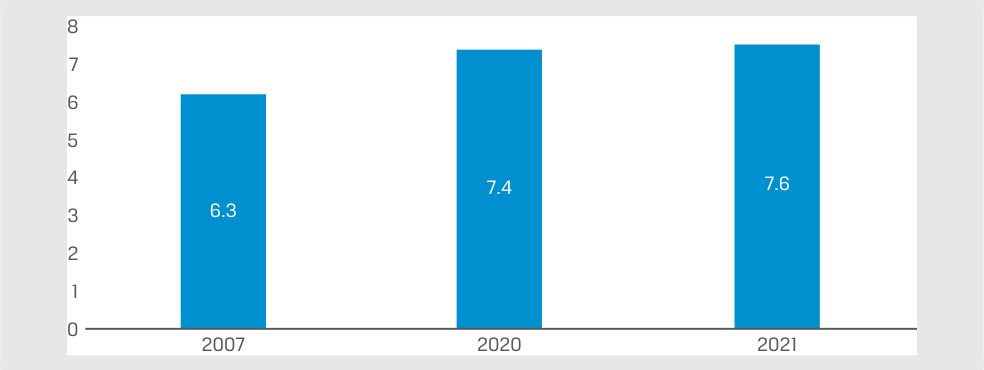

# Tập 6: Chứng Khoán Thu Nhập Cố Định (*Fixed Income*)
## Học phần 5: Thị Trường Thu Nhập Cố Định Cho Các Tổ Chức Phát Hành Chính Phủ (*Fixed-Income Markets for Government Issuers*)
### Phần 1/2: Giới thiệu (Trang PDF 117–129)

---

<!-- PDF Page 117 -->

#### H Ọ C P H Ầ N

# **<mark>5</mark>**

### **Thị Trường Thu Nhập Cố Định Cho Các Tổ Chức Phát Hành Chính Phủ (*Fixed-Income Markets for Government Issuers*)**

###### **<mark>MỤC TIÊU HỌC TẬP (*LEARNING OUTCOMES*)</mark>**

|**_Mức độ thành thạo_** **_Ứng viên cần có khả năng:_**|
|---|
|mô tả các lựa chọn huy động vốn của chính phủ trung ương (*sovereign governments*), chính quyền địa phương/khu vực (*non-sovereign governments*), các định chế bán chính phủ (*quasi-government entities*) và các tổ chức siêu quốc gia (*supranational agencies*)|
|đối chiếu việc phát hành và giao dịch các công cụ thu nhập cố định của chính phủ và của doanh nghiệp|

##### **GIỚI THIỆU (*INTRODUCTION*)**

**<mark>1</mark>**

Trong học phần này, chúng ta sẽ hoàn tất việc xem xét các phân khúc thu nhập cố định chính bằng cách tập trung vào các tổ chức phát hành thuộc khu vực công (*public sector issuers*), bao gồm chính phủ trung ương và chính quyền địa phương/khu vực, cũng như sự khác biệt giữa họ và các tổ chức phát hành thuộc khu vực tư nhân. Chính phủ trung ương (*sovereign governments*) được phân biệt bởi quyền đánh thuế trong phạm vi quyền tài phán của mình, trong khi các tổ chức phát hành chính quyền địa phương/khu vực (*non-sovereign*), bán chính phủ (*quasi-government*) và siêu quốc gia (*supranational*) có thể dựa vào thuế địa phương, doanh thu từ phí dịch vụ hoặc các nguồn trả nợ khác. Việc phát hành nợ chính phủ trung ương (*sovereign debt*) thường được thực hiện thông qua các phiên đấu thầu công khai định kỳ theo lịch trình, với vai trò của các định chế trung gian tài chính khác biệt so với trong phát hành của khu vực tư nhân. Chứng khoán nợ chính phủ trung ương là các chứng khoán chuẩn (*benchmark securities*) phổ biến nhất được sử dụng trong các phân tích định giá đối với các công cụ thu nhập cố định.

###### **TỔNG QUAN HỌC PHẦN (*LEARNING MODULE OVERVIEW*)**

- Các tổ chức phát hành là chính phủ quốc gia hoặc trung ương (*national or sovereign government issuers*) được phân biệt bởi thẩm quyền pháp lý nhằm thiết lập và duy trì hàng hóa và dịch vụ công của một quốc gia, cũng như khả năng đánh thuế đối với các hoạt động kinh tế trong phạm vi quyền tài phán của họ. Các đợt phát hành chính phủ tại thị trường phát triển (*developed market sovereign issues*) có đặc trưng là nền kinh tế nội địa vững mạnh, ổn định và đa dạng hóa tốt, trong khi các tổ chức phát hành chính phủ tại thị trường mới nổi (*emerging market sovereign issuers*) thường có đặc trưng là tốc độ tăng trưởng cao hơn nhưng nền kinh tế kém ổn định hơn, ít đa dạng hóa hơn và <u>chịu nhiều biến động lớn hơn qua chu kỳ kinh tế.</u>

<!-- PDF Page 118 -->

- Các đợt phát hành nợ chính phủ trung ương bao gồm chứng khoán ngắn hạn (với kỳ hạn từ 1 đến 12 tháng), trái phiếu trung hạn và dài hạn (*notes and bonds*), cùng các trái phiếu được bảo lãnh nhưng không trực tiếp phát hành bởi chính phủ trung ương.

- Việc phát hành nợ chính phủ trung ương thường diễn ra dưới hình thức đấu thầu công khai (*public auction*) sử dụng các quy trình tiêu chuẩn do kho bạc quốc gia hoặc bộ tài chính chủ trì, trong khi các đợt phát hành nợ doanh nghiệp được quản lý bởi các tổ chức bảo lãnh phát hành thuộc ngân hàng đầu tư (*investment bank underwriters*) thay mặt cho các tổ chức phát hành. Chính phủ trung ương chỉ định một nhóm các định chế trung gian tài chính làm các đại lý sơ cấp (*primary dealers*), những đơn vị này bắt buộc phải tham gia vào tất cả các phiên đấu thầu với mức giá cạnh tranh.

- Khi một phiên đấu thầu nợ chính phủ được công bố, các nhà đầu tư tiềm năng sẽ nộp các lệnh đặt thầu cạnh tranh (*competitive bids*) hoặc không cạnh tranh (*non-competitive bids*). Sau khi được phát hành, nợ chính phủ trung ương thường được giao dịch theo phương thức tương tự như chứng khoán nợ khu vực tư nhân, chủ yếu trên các thị trường phi tập trung (*OTC markets*) thông qua các định chế trung gian tài chính là nhà môi giới/nhà tạo lập thị trường (*broker/dealers*).

- Mức độ và loại hình huy động vốn của chính quyền địa phương/khu vực (*non-sovereign government*) rất khác nhau giữa các quốc gia, tùy thuộc vào việc các hàng hóa và dịch vụ cụ thể được cung cấp và tài trợ ở cấp quốc gia, khu vực hay địa phương.

- Các cơ quan chức năng (*agencies*) là những định chế bán chính phủ (*quasi-government entities*) phát hành nợ nhằm tài trợ cho việc cung cấp các hàng hóa hoặc dịch vụ công cụ thể do chính phủ bảo trợ dựa trên luật pháp quốc gia hoặc địa phương. Các tổ chức siêu quốc gia (*supranational organizations*) được thành lập và hỗ trợ bởi các chính phủ trung ương nhằm theo đuổi một mục tiêu chung.

###### **TỰ ĐÁNH GIÁ HỌC PHẦN (*LEARNING MODULE SELF-ASSESSMENT*)**

Các câu hỏi ban đầu này nhằm giúp bạn đánh giá mức độ hiểu biết hiện tại của mình về học phần này.

1. Hoàn thành câu sau bằng cách chọn các từ đúng từ những phương án cho sẵn.

   - Chính sách tài khóa (*fiscal policy*) của một quốc gia quyết định ( _quy mô_ [*level*] / _cơ cấu_ [*composition*] ) của nợ chính phủ trung ương thông qua chi tiêu của chính phủ trung ương, và các chính sách quản lý nợ chính phủ (*government debt management policies*) giải quyết ( _quy mô_ [*level*] / _cơ cấu_ [*composition*] ) của nợ chính phủ trung ương—tức là nợ ngắn hạn so với nợ dài hạn, cũng như các đặc tính khác.

   - **Lời giải:**

Chính sách tài khóa của một quốc gia quyết định _<u>quy mô</u>_ (*level*) của nợ chính phủ trung ương thông qua chi tiêu của chính phủ trung ương, và các chính sách quản lý nợ chính phủ giải quyết _<u>cơ cấu</u>_ (*composition*) của nợ chính phủ trung ương—tức là nợ ngắn hạn so với nợ dài hạn, cũng như các đặc tính khác.

2. Tổ chức phát hành xếp hạng các lệnh đặt thầu theo mức giá, lựa chọn các lệnh đặt thầu từ cao nhất đến thấp nhất cho đến khi đạt được quy mô phát hành mong muốn, đối với:

   - **A.** đấu thầu một mức giá (*single-price auctions*).

   - **B.** đấu thầu nhiều mức giá (*multiple-price auctions*).

<!-- PDF Page 119 -->

   - **C.** cả đấu thầu một mức giá và đấu thầu nhiều mức giá (*single-price and multiple-price auctions*).

   - **Lời giải:**

   - C là đáp án đúng. Đối với cả đấu thầu một mức giá và đấu thầu nhiều mức giá, tổ chức phát hành đều xếp hạng các lệnh đặt thầu theo giá, lựa chọn các lệnh đặt thầu từ cao nhất đến thấp nhất cho đến khi đạt được quy mô phát hành mong muốn.

3. So sánh vai trò của các định chế trung gian tài chính khi làm việc với các tổ chức phát hành chính phủ trung ương so với các tổ chức phát hành nợ doanh nghiệp.

###### **Lời giải:**

Các tổ chức phát hành chính phủ trung ương làm việc với các định chế trung gian tài chính giống như các tổ chức phát hành nợ doanh nghiệp, nhưng dưới một hình thức khác. Chính phủ trung ương chỉ định một nhóm các định chế trung gian tài chính làm các đại lý sơ cấp (*primary dealers*), những đơn vị bắt buộc phải tham gia vào tất cả các phiên đấu thầu với mức giá cạnh tranh, thường đóng vai trò là đối tác của ngân hàng trung ương trong các nghiệp vụ thị trường mở (*open market operations*), và tạo điều kiện thuận lợi cho việc mua bán nợ chính phủ của các ngân hàng trung ương nước ngoài cùng các nhà đặt thầu gián tiếp khác. Ngược lại, các đợt phát hành nợ doanh nghiệp được quản lý bởi các tổ chức bảo lãnh phát hành thuộc ngân hàng đầu tư (*investment bank underwriters*) thay mặt cho các tổ chức phát hành.

4. Khả năng của các tổ chức phát hành chính phủ _______________________ trong việc tiếp cận nguồn vốn qua các kỳ hạn bị ảnh hưởng bởi tính có thể dự đoán và sự ổn định của các nguồn trả nợ.

   - **A.** Trung ương (*Sovereign*)

   - **B.** Địa phương/khu vực (*Non-sovereign*)

   - **C.** Cả chính phủ trung ương và chính quyền địa phương/khu vực (*Both sovereign and non-sovereign*)

   - **Lời giải:**

   - C là đáp án đúng. Chi phí đi vay và khả năng tiếp cận nguồn tài trợ của cả các tổ chức phát hành chính phủ trung ương và chính quyền địa phương/khu vực đều bị ảnh hưởng bởi chất lượng tín dụng (*credit quality*) của họ.

5. Xác định phát biểu sau đây là đúng hay sai. Giải thích câu trả lời của bạn.

Các cơ quan chính phủ trung ương (*sovereign agencies*), chẳng hạn như Cơ quan Quản lý Sân bay Hồng Kông (AAHK) và Hiệp hội Thế chấp Quốc gia Chính phủ Hoa Kỳ (Ginnie Mae), được hưởng toàn bộ phần bù thanh khoản (*liquidity premium*) gắn liền với nợ chính phủ trung ương.

###### **Lời giải:**

Sai. Mặc dù mỗi cơ quan chính phủ trung ương này thường có thể đi vay ở mức lợi suất đáo hạn (*yield-to-maturity*) gần bằng với mức lợi suất của chính phủ trung ương bảo lãnh cho họ, nhưng không cơ quan nào được hưởng toàn bộ phần bù thanh khoản gắn liền với nợ chính phủ trung ương.

##### **NỢ CHÍNH PHỦ TRUNG ƯƠNG (*SOVEREIGN DEBT*)**

## **<mark>2</mark>**

mô tả các lựa chọn huy động vốn của chính phủ trung ương (*sovereign governments*), chính quyền địa phương/khu vực (*non-sovereign governments*), các định chế bán chính phủ (*quasi-government entities*) và các tổ chức siêu quốc gia (*supranational agencies*)

Các tổ chức phát hành là chính phủ quốc gia hoặc trung ương (*national or sovereign government issuers*) được phân biệt bởi thẩm quyền pháp lý nhằm thiết lập và duy trì hàng hóa và dịch vụ công của một quốc gia cũng như khả năng đánh thuế đối với các hoạt động kinh tế trong phạm vi quyền tài phán của họ. Các nguồn trả nợ bổ sung cho các nghĩa vụ

<!-- PDF Page 120 -->

nợ của họ bao gồm thuế quan (*tariffs*), phí sử dụng (*usage fees*) và dòng tiền từ các doanh nghiệp nhà nước (*government-owned enterprises*). Quy mô và phạm vi của các hàng hóa và dịch vụ công do chính phủ quốc gia cung cấp so với chính quyền khu vực hoặc địa phương rất khác nhau giữa các thị trường, cũng như mức độ can thiệp của chính phủ vào nền kinh tế. Tương tự như các tổ chức phát hành khu vực tư nhân, “bảng cân đối kế toán kinh tế” (*economic balance sheet*) của một chính phủ có thể được sử dụng để minh họa các nguồn vốn và việc sử dụng vốn, như được thể hiện trong Bảng minh họa 1 (bao gồm cả các hoạt động của ngân hàng trung ương).

**Bảng minh họa 1: “Bảng cân đối kế toán” của Chính phủ (*Government “Balance Sheet”*)**

> **Chú thích hình ảnh:**
> - **Bảng cân đối kế toán tài chính (*Financial Balance Sheet*):**
>   - **Bên Tài sản / Quyền đòi nợ (*Assets / Claims*):** Quyền đòi nợ và tài sản ngắn hạn (*Short-Term Claims and Assets*); Tài sản cố định (*Fixed Assets*): Cơ sở hạ tầng (*Infrastructure*), Đất đai (*Land*), Doanh nghiệp nhà nước (*Government-Owned Firms*); Dự trữ ngoại hối (*FX Reserves*); Dự trữ hàng hóa và dự trữ khác (*Commodity and Other Reserves*).
>   - **Bên Nguồn vốn vay / Nợ (*Borrowed Capital / Debt*):** Đồng nội tệ đang lưu hành (*Domestic Currency Outstanding*); Nợ ngắn hạn (*Short-Term Debt*); Nợ dài hạn (*Long-Term Debt*): Đồng nội tệ (*Domestic Currency*), Ngoại tệ (*Foreign Currency*); Nghĩa vụ hưu trí và các nghĩa vụ nội địa khác (*Pension and Other Domestic Obligations*); Nghĩa vụ siêu quốc gia và đối ngoại (*Supranational and External Obligations*).
> - **Bảng cân đối kế toán kinh tế (*Economic Balance Sheet*):** Bao gồm thêm **Quyền đòi nợ (*Claims*):** Doanh thu thuế kỳ vọng trong tương lai (*Expected Future Tax Revenues*) và **Nghĩa vụ (*Obligations*):** Chi tiêu cam kết trong tương lai (*Promised Future Expenditures*).

<!-- Picture Text: Short-Term Claims Domestic Currency and Assets Outstanding Short-Term Fixed Assets Debt – Infrastructure Financial Borrowed Balance – Land Long-Term Debt Capital Sheet – Domestic Currency (Debt) – Government- – Foreign Currency  Owned Firms Pension and Other FX Reserves Domestic Obligations Commodity and Supranational and  Other Reserves External Obligations Claims: Obligations: Expected Promised Economic Future Tax Future Balance Revenues Expenditures Sheet  -->

Trong khi các tổ chức phát hành tư nhân lập và nộp báo cáo tài chính định kỳ theo các nguyên tắc kế toán được chấp nhận chung (GAAP), các chuẩn mực kế toán tài chính khu vực công lại rất đa dạng và thường được lập theo nguyên tắc cơ sở tiền mặt (*cash-based*) thay vì cơ sở dồn tích (*accrual-based*), thường loại trừ các khoản mục như khấu hao hàng hóa công cố định (chẳng hạn như đường cao tốc liên bang) hoặc việc trích lập dồn tích các khoản nợ chưa có nguồn tài trợ (chẳng hạn như nghĩa vụ lương hưu của chính phủ). Ngược lại, bảng cân đối kế toán kinh tế trong Bảng minh họa 1 bao gồm các quyền đòi nợ và nghĩa vụ kỳ vọng trong tương lai, do đó có mức độ phù hợp cao hơn đối với các tổ chức phát hành khu vực công so với khu vực tư nhân.

Quy mô tương đối của khu vực chính phủ tính theo tỷ trọng trong nền kinh tế nội địa rất khác nhau giữa các quốc gia, và sự phân bổ các hoạt động này giữa bản thân chính phủ quốc gia, các cơ quan bán chính phủ và chính quyền địa phương cũng khác biệt giữa các nước. Do đó, điều này làm xuất hiện các tổ chức phát hành chính quyền địa phương/khu vực (*non-sovereign issuers*) có trụ sở trong cùng phạm vi quyền tài phán với tổ chức phát hành chính phủ trung ương—một chủ đề sẽ được thảo luận ở Bài 3.

Một sự phân biệt quan trọng giữa các tổ chức phát hành chính phủ quốc gia là sự khác biệt giữa các tổ chức phát hành chính phủ tại thị trường phát triển (*developed market*) và thị trường mới nổi (*emerging market*).

- _Các tổ chức phát hành chính phủ tại thị trường phát triển (Developed market – DM sovereign issuers):_ Các thị trường phát triển (DM) có đặc trưng là một nền kinh tế nội địa vững mạnh, ổn định và đa dạng hóa tốt. Ngân sách chính phủ quốc gia tại DM chủ yếu bao gồm các khoản chi tiêu thường xuyên, nhất quán được tài trợ bằng dòng tiền thuế cá nhân và doanh nghiệp trên diện rộng, mang lại chính sách tài khóa ổn định và minh bạch. Chứng khoán thu nhập cố định tại DM được định danh bằng một

<!-- PDF Page 121 -->

đồng tiền mạnh (*major currency*) thường được các chính phủ nước ngoài nắm giữ làm dự trữ. Những đặc điểm này cho phép các chính phủ trung ương tại DM phát hành loại nợ thường được gọi là nợ phi rủi ro vỡ nợ (*default-risk-free debt*) với khả năng tiếp cận thị trường không bị hạn chế trên toàn bộ phổ kỳ hạn (*maturity spectrum*).

- _Các tổ chức phát hành chính phủ tại thị trường mới nổi (Emerging market – EM sovereign issuers):_ Các thị trường mới nổi (EM) thường có đặc trưng là tốc độ tăng trưởng cao hơn nhưng nền kinh tế kém ổn định hơn, ít đa dạng hóa hơn và chịu nhiều biến động lớn hơn qua chu kỳ kinh tế. Các EM thường phụ thuộc vào một hoặc một số ngành công nghiệp nội địa thống trị, chẳng hạn như hàng hóa cơ bản (*commodities*), và có thể bao gồm nhiều doanh nghiệp nhà nước hoặc do nhà nước kiểm soát hơn. Các ưu tiên ngân sách của chính phủ trung ương có thể bao gồm các khoản đầu tư nhằm mở rộng cơ sở hạ tầng kinh tế và xã hội vượt quá dòng tiền thuế nội địa hiện tại, làm phát sinh nhu cầu huy động vốn từ bên ngoài (*external funding*) hoặc từ các tổ chức siêu quốc gia (*supranational funding*). Chứng khoán nợ chính phủ EM thường được định danh bằng một **đồng nội tệ bị hạn chế (*restricted domestic currency*)**, tức là đồng tiền có khả năng chuyển đổi hạn chế sang các đồng tiền khác do tính kém thanh khoản. Các hạn chế tiền tệ có thể giới hạn đầu tư nước ngoài và cản trở khả năng tiếp cận các kỳ hạn dài hơn bằng đồng nội tệ.

Trong trường hợp của các tổ chức phát hành chính phủ tại thị trường mới nổi, điều quan trọng là phải phân biệt rõ hơn giữa nợ _nội địa_ (*domestic debt*) được phát hành bằng đồng nội tệ và **nợ nước ngoài (*external debt*)**, tức là khoản nợ phải trả cho các chủ nợ nước ngoài. Trái phiếu chính phủ phát hành bằng đồng nội tệ thường được nắm giữ chủ yếu bởi các định chế tài chính trong nước và các nhà đầu tư nội địa khác.

Nợ nước ngoài của các tổ chức phát hành chính phủ tại thị trường mới nổi và thị trường cận biên (*frontier market*) bao gồm các khoản nợ vay từ các tổ chức tài chính siêu quốc gia và các đợt phát hành nợ định danh bằng ngoại tệ do các nhà đầu tư tư nhân nước ngoài nắm giữ. Các học phần trước đã dẫn chứng những ví dụ về việc phát hành trái phiếu Eurobond của chính phủ thị trường mới nổi, chẳng hạn như trái phiếu định danh bằng đồng euro của Romania và trái phiếu định danh bằng đồng đô la Mỹ của định chế bán chính phủ PT Indonesia Infrastructure Finance. Các nhà đầu tư có trụ sở tại các thị trường phát triển khi mua những trái phiếu này không phải đối mặt với rủi ro tiền tệ _trực tiếp_ (*direct currency risk*) giống như đối với nợ chính phủ thị trường mới nổi bằng đồng nội tệ. Tuy nhiên, họ phải chịu sự phơi nhiễm _gián tiếp_ (*indirect exposure*) trước các biến động tiền tệ, bởi vì tỷ suất sinh lợi của họ phụ thuộc vào khả năng tạo ra doanh thu ngoại tệ của tổ chức phát hành thông qua các dòng vốn, hàng hóa và dịch vụ quốc tế đủ để đáp ứng các khoản thanh toán lãi và gốc bằng ngoại tệ. Ví dụ sau đây làm nổi bật trường hợp nợ nước ngoài của chính phủ Sri Lanka.

###### **NỢ NƯỚC NGOÀI CỦA CHÍNH PHỦ SRI LANKA (*GOVERNMENT OF SRI LANKA EXTERNAL DEBT*)**

Vào tháng 5 năm 2022, Sri Lanka đã trở thành quốc gia châu Á - Thái Bình Dương đầu tiên sau nhiều năm vỡ nợ đối với khoản nợ nước ngoài khi nước này không thể thực hiện khoản thanh toán lãi bằng ngoại tệ trị giá 78 triệu USD sau thời gian ân hạn (*grace period*) 30 ngày. Nợ chính phủ của Sri Lanka đã tăng vọt trong những năm trước khi vỡ nợ, phần lớn là do các dự án cơ sở hạ tầng được tài trợ bởi thị trường nợ toàn cầu, các tổ chức siêu quốc gia và các đối tác thương mại lớn. Tổng dư nợ chính phủ đã tăng từ mức 87% GDP của Sri Lanka lên hơn 100% vào năm 2020, trong khi cả nền kinh tế lẫn dự trữ ngoại hối của nước này đều sụt giảm trong năm đó do sự sụp đổ của ngành du lịch và sự sụt giảm kiều hối từ công dân làm việc ở nước ngoài. Lạm phát và giá hàng hóa cơ bản tăng cao sau cuộc chiến năm 2022 tại Ukraine đã làm trầm trọng thêm các vấn đề nợ nước ngoài của quốc gia này và cuối cùng dẫn đến vỡ nợ.

<!-- PDF Page 122 -->

###### **Nợ Nước Ngoài của Sri Lanka, 2021 (*Sri Lanka’s External Debt, 2021*)**

> **Chú thích hình ảnh:** Cơ cấu nợ nước ngoài của Sri Lanka năm 2021:
> - Nợ thị trường (*Market Debt*): 47%
> - Ngân hàng Phát triển Châu Á (ADB): 13%
> - Trung Quốc (*China*): 10%
> - Nhật Bản (*Japan*): 10%
> - Ngân hàng Thế giới (*World Bank*): 9%
> - Khác (*Other*): 9%
> - Ấn Độ (*India*): 2%

<!-- Picture Text: India 2% Other 9% Japan 10% Market Debt China 47% 10% World Bank 9% ADB 13%  -->

_Ghi chú:_ “Nợ thị trường” (*Market Debt*) chủ yếu là các trái phiếu chính phủ quốc tế định danh bằng đồng đô la Mỹ và thuộc sở hữu của các nhà đầu tư tư nhân nước ngoài, bao gồm các quỹ tương hỗ (*mutual funds*).

_Nguồn:_ Chính phủ Sri Lanka, Cục Nguồn lực Đối ngoại (www.erd.gov.lk). Lilian Karunungan và Amelia Pollard, “Sri Lanka Falls into Default for the First Time Ever,” Bloomberg (19 tháng 5 năm 2022). Ngân hàng Thanh toán Quốc tế (BIS), “Debt Securities Statistics.” “Infrastructure Financing in Sri Lanka: Lessons Learnt and Future Collaborations,” Viện Nghiên cứu Châu Á của Châu Âu, Tóm tắt Chính sách 16/2021.

Chính sách tài khóa của một quốc gia quyết định _quy mô_ (*level*) nợ chính phủ trung ương thông qua chi tiêu của chính phủ trung ương, bao gồm cả nhu cầu ngân sách và chi phí trả nợ (*debt service costs*), đối chiếu với nguồn thu thuế, phí và doanh thu từ các doanh nghiệp nhà nước hoặc các nguồn khác. Thâm hụt ngân sách chính phủ làm tăng nhu cầu đi vay trong khi thặng dư ngân sách làm giảm nhu cầu đi vay. Các dự báo về quy mô nợ chính phủ trung ương phải xem xét không chỉ những thay đổi trong chính sách tài khóa mà còn cả độ nhạy của các khoản chi tiêu và doanh thu trước những thay đổi về tăng trưởng kinh tế và lạm phát.

Các chính sách **quản lý nợ chính phủ (*government debt management*)** giải quyết _cơ cấu_ (*composition*) của nợ chính phủ trung ương—tức là nợ ngắn hạn so với nợ dài hạn, cũng như các đặc tính khác. Các đợt phát hành nợ chính phủ trung ương bao gồm:

- Chứng khoán ngắn hạn (với kỳ hạn từ 1 đến 12 tháng), thường được gọi là tín phiếu Kho bạc (*Treasury bills*), thường là các công cụ không trả lãi định kỳ (*zero-coupon instruments*) được bán ở mức chiết khấu so với mệnh giá (*discount to par*).

- Chứng khoán trung hạn và dài hạn, thường được gọi là trái phiếu Kho bạc trung hạn và dài hạn (*Treasury notes and bonds*). Các công cụ trả lãi coupon cố định (*fixed-rate coupon instruments*) bằng đồng nội tệ là phổ biến nhất, nhưng các chính phủ trung ương cũng phát hành các công cụ lãi suất thả nổi (*floating-rate*), gắn với lạm phát (*inflation-linked*) và định danh bằng ngoại tệ.

- Mặc dù không đóng vai trò là tổ chức phát hành trực tiếp, một số chính phủ trung ương bảo lãnh cho một số công cụ khác mà trên thực tế biến chúng thành một dạng nợ chính phủ trung ương. Ví dụ nổi bật nhất là các chứng khoán đảm bảo bằng thế chấp (*mortgage-backed securities* – MBS), đặc biệt là tại Hoa Kỳ, khi tuân thủ các tiêu chí nhất định. Các công cụ như vậy sẽ được thảo luận chi tiết sau.

Với quyền tối cao trong việc đánh thuế đối với hoạt động kinh tế, các chính phủ quốc gia đại diện cho mức rủi ro vỡ nợ thấp nhất trong số các tổ chức phát hành bằng đồng nội tệ và thường là tổ chức phát hành trái phiếu lớn nhất trên thị trường nội địa.

Hãy nhớ lại từ bài đọc trước về các tổ chức phát hành doanh nghiệp rằng định lý Modigliani–Miller (MM) phát biểu rằng dưới những điều kiện nghiêm ngặt nhất định, việc lựa chọn cấu trúc vốn của một công ty không ảnh hưởng đến việc xác định giá trị hiện tại của dòng tiền kỳ vọng trong tương lai của doanh nghiệp đó. Trong trường hợp nợ chính phủ trung ương, định lý tương đương Ricardo (*Ricardian equivalence theorem*)

<!-- PDF Page 123 -->

được giới thiệu trong một bài học kinh tế học trước đó, dựa trên các giả định đơn giản hóa tương tự, cũng đưa ra một kết quả tương đồng: sự lựa chọn kỳ hạn nợ của chính phủ không ảnh hưởng đến việc xác định giá trị hiện tại của các dòng tiền thuế trong tương lai.

Theo định lý tương đương Ricardo, người nộp thuế kỳ vọng nợ chính phủ sẽ được bù đắp bằng mức thuế cao hơn trong tương lai, ngụ ý rằng chính phủ trung ương sẽ bàng quan giữa việc thu thuế ngay hôm nay hoặc huy động nợ ở bất kỳ kỳ hạn nào dựa trên các giả định sau:

- Người nộp thuế làm mượt tiêu dùng (*smooth consumption*) theo thời gian, tiết kiệm khoản thuế kỳ vọng phải nộp trong tương lai ngay từ hôm nay để thanh toán trong tương lai.

- Người nộp thuế hình thành kỳ vọng hợp lý (*rational expectations*) rằng việc cắt giảm thuế ngày hôm nay sẽ dẫn đến việc tăng thuế trong tương lai.

- Thị trường vốn là hoàn hảo không có chi phí giao dịch, và người nộp thuế có thể tự do đi vay và cho vay.

- Người nộp thuế có lòng vị tha giữa các thế hệ (*altruistic on an intergenerational basis*); nghĩa là họ chuyển giao khoản tiết kiệm thuế cho con cháu đời sau.

Việc nới lỏng các giả định của định lý tương đương Ricardo để cho phép thị trường vốn không hoàn hảo và có chi phí ma sát (*friction costs*) giữa các nhà đầu tư trái phiếu và người nộp thuế đã làm xuất hiện các chính sách quản lý nợ mang lại lợi ích thanh khoản cho các nhà đầu tư và các tổ chức phát hành khác trên toàn bộ phổ kỳ hạn.

Ví dụ, việc phát hành nợ chính phủ ngắn hạn cung cấp cho các nhà đầu tư mức độ thanh khoản và an toàn cao, đồng thời thường thay thế cho tiền gửi ngân hàng. Trong điều kiện thị trường bình thường, giá của những chứng khoán chính phủ rất ngắn hạn này bao hàm một phần bù thanh khoản (*liquidity premium*); nghĩa là lợi suất đáo hạn (*yields-to-maturity*) của chúng sẽ có xu hướng _thấp hơn_ so với mức lẽ ra phải có nếu không có lợi ích thanh khoản này. Mặc dù nợ chính phủ trung ương ngắn hạn thường được phát hành theo các khoảng thời gian đều đặn (sẽ thảo luận sau) và có các kỳ hạn tiêu chuẩn, các tổ chức phát hành chính phủ có mức độ linh hoạt cao trong việc thay đổi quy mô của các phiên đấu thầu định kỳ này nhằm quản lý các dòng tiền không chắc chắn, chẳng hạn như nguồn thu thuế ngắn hạn hoặc các nhu cầu vốn phát sinh ngoài dự kiến.

Việc tuân thủ nghiêm ngặt các giả định tương đương Ricardo gợi ý rằng các chính phủ nên tự tài trợ bằng kỳ hạn ngắn nhất có thể nhằm tối thiểu hóa chi phí đi vay và tránh phải trả bất kỳ phần bù kỳ hạn (*term premium*) nào gắn liền với lãi suất dài hạn. Tuy nhiên, tương tự như ví dụ về trái phiếu doanh nghiệp trong học phần trước, sự phụ thuộc quá mức của chính phủ vào nguồn vốn ngắn hạn sẽ làm phát sinh rủi ro đảo nợ (*rollover risk*), hay chi phí tái cấp vốn không chắc chắn, làm gia tăng sự biến động của chi phí ngân sách và do đó làm biến động thuế suất. Vì người nộp thuế không thể làm mượt tiêu dùng một cách hoàn hảo theo thời gian và cũng không hình thành các kỳ vọng hợp lý về thuế hiện tại so với thuế tương lai qua các thế hệ, sự bất ổn tài khóa sẽ tạo ra sự không chắc chắn về thuế suất trong tương lai và đe dọa sự ổn định của tăng trưởng kinh tế theo thời gian. Do đó, trên thực tế, các chính phủ tìm cách tối thiểu hóa rủi ro lãi suất và rủi ro đảo nợ bằng cách phân bổ nợ qua nhiều kỳ hạn khác nhau, đồng thời phát hành nợ theo các khoảng thời gian đều đặn và có thể dự đoán được.

Các chính sách tài khóa có sự khác biệt đáng kể giữa 38 quốc gia thành viên OECD, nhưng cấu trúc kỳ hạn nợ chính phủ trung ương của họ lại cho thấy phương sai nhỏ hơn nhiều. Vào cuối năm 2021, kỳ hạn bình quân gia quyền trên toàn khối OECD chỉ cao hơn một chút so với mức một năm trên mức trung bình vào cuối năm 2007. Nợ dài hạn chiếm 85% tổng dư nợ chính phủ trung ương đang lưu hành, hầu như không thay đổi kể từ năm 2007, trong khi khối lượng phát hành hàng năm được chia đều giữa ngắn hạn và dài hạn (nợ ngắn hạn phải được phát hành thường xuyên hơn vì chúng đáo hạn sớm hơn). Khung thời gian này bao gồm hai cuộc suy thoái lớn và khối lượng phát hành nợ chính phủ trung ương đáng kể.

<!-- PDF Page 124 -->

###### **Thời Gian Đáo Hạn Bình Quân của Dư Nợ Chính Phủ Trung Ương tại Các Quốc Gia OECD (Số năm) (*Average Time to Maturity of OECD Nations’ Sovereign Debt Outstanding (Years)*)**

> **Chú thích hình ảnh:** Thời gian đáo hạn bình quân (tính bằng năm) của dư nợ chính phủ trung ương tại các nước OECD: năm 2007 là 6,3 năm; năm 2020 là 7,4 năm; năm 2021 là 7,6 năm.

<!-- Picture Text: 8 7 6 5 4 7.4 7.6 3 6.3 2 1 0 2007 2020 2021  -->

###### **Cấu Trúc Kỳ Hạn của Dư Nợ Chính Phủ Trung Ương tại Các Quốc Gia OECD (Phần trăm) (*Maturity Structure of OECD Nations’ Sovereign Government Debt Outstanding (Percent)*)**

> **Chú thích hình ảnh:** Cấu trúc kỳ hạn (tỷ lệ %) của dư nợ chính phủ trung ương tại các nước OECD từ năm 2007 đến năm 2021, chia thành hai phần: Dài hạn (*Long-term*, chiếm từ 81% đến 90%) và Ngắn hạn (*Short-term*, chiếm từ 10% đến 19%).

<!-- Picture Text: 100 90 14 19 18 16 14 14 12 11 10 10 10 10 10 16 12 80 70 60 50 40 86 81 82 84 86 86 88 89 90 90 90 90 90 84 88 30 20 10 0 2007 2008 2009 2010 2011 2012 2013 2014 2015 2016 2017 2018 2019 2020 2021 Long-term Short-term  -->

_Nguồn:_ OECD, “OECD Sovereign Borrowing Outlook 2022” (2022). https://doi.org/10.1787/b2d85ea7-en.

Việc sử dụng phát hành nợ chính phủ trung ương trung và dài hạn phải cân bằng sự đánh đổi giữa chi phí đi vay cao hơn với sự ổn định tài khóa lớn hơn, đồng thời xem xét lợi ích thanh khoản hoặc các lợi ích khác của việc phát hành trái phiếu có rủi ro vỡ nợ thấp nhất trên toàn bộ phổ kỳ hạn.

Những lợi ích của việc phát hành đủ khối lượng chứng khoán chính phủ trung ương dài hạn nhằm duy trì tính thanh khoản qua các kỳ hạn bao gồm:

- _Thiết lập chuẩn tham chiếu phi rủi ro (*risk-free benchmark*) cho tất cả các khoản nợ có kỳ hạn cụ thể:_ Học phần thu nhập cố định đầu tiên đã minh họa việc sử dụng lợi suất trái phiếu chính phủ trung ương để tính toán phần bù rủi ro tín dụng (*credit risk premium*) của một tổ chức phát hành. Các chính sách nợ chính phủ thường quy định việc phát hành định kỳ các chứng khoán chuẩn (*benchmark securities*) qua các kỳ hạn nhằm gia tăng hiệu quả và tính minh bạch của thị trường vốn cho các tổ chức phát hành tư nhân.

- _Sử dụng trong việc quản lý và phòng ngừa rủi ro lãi suất thị trường (*hedging market interest rate risk*):_ Các chủ thể tham gia thị trường như các định chế trung gian tài chính và các nhà quản lý tài sản sử dụng chứng khoán chính phủ trung và dài hạn cùng các công cụ phái sinh liên quan để quản lý rủi ro lãi suất tách biệt với rủi ro tín dụng.

- _Ưu tiên sử dụng làm tài sản thế chấp trong các giao dịch repo và phái sinh (*collateral in repo and derivative transactions*):_ Chứng khoán chính phủ dài hạn là hình thức tài sản thế chấp phổ biến nhất cho cả giao dịch repo và giao dịch phái sinh nhờ mức độ thanh khoản và an toàn cao của chúng. Hãy nhớ lại từ học phần trước rằng các hợp đồng mua lại (*repurchase agreements* – repo) cung cấp cho người bán chứng khoán một phương tiện huy động vốn và cung cấp cho người mua chứng khoán một khoản đầu tư ngắn hạn có tài sản thế chấp với rủi ro thanh khoản hoặc rủi ro vỡ nợ tương đối thấp.

- _Sử dụng trái phiếu chính phủ trong chính sách tiền tệ và dự trữ ngoại hối (*monetary policy and foreign exchange reserves*):_ Hãy nhớ lại từ bài học trước rằng các ngân hàng trung ương sử dụng chứng khoán chính phủ để thực hiện nhiệm vụ chính sách tiền tệ của mình, bao gồm việc mua và bán đứt (*outright purchase and sale*)

<!-- PDF Page 125 -->

chứng khoán cũng như các hợp đồng repo với trái phiếu chính phủ làm tài sản thế chấp. Nhờ mức độ thanh khoản và an toàn cao, các chủ thể tham gia thị trường nước ngoài thường nắm giữ dự trữ ngoại hối của họ dưới hình thức trái phiếu chính phủ nước ngoài có tính thanh khoản cao.

Mặc dù các chính phủ trung ương tìm cách duy trì khả năng tiếp cận thị trường trái phiếu một cách đều đặn và có thể dự đoán được qua các kỳ hạn, những thay đổi về quy mô nợ, mức độ thâm hụt và sự chênh lệch giữa lãi suất ngắn hạn và dài hạn sẽ dẫn đến những thay đổi trong chính sách quản lý nợ, như được minh họa trong ví dụ sau đây.

###### **TRÁI PHIẾU KHO BẠC HOA KỲ KỲ HẠN 30 NĂM (*THE US TREASURY’S 30-YEAR BOND*)**

Vào tháng 10 năm 2001, Hoa Kỳ đã ngừng phát hành trái phiếu Kho bạc kỳ hạn 30 năm do những lo ngại về chi phí liên quan đến việc trả lãi cho các trái phiếu này. Vào thời điểm đó, các quan chức Bộ Tài chính nhận thấy nhu cầu đi vay trong tương lai giảm xuống bởi vì chính phủ Hoa Kỳ đang ghi nhận thặng dư ngân sách. Động thái này đã gây chấn động thị trường và dẫn đến biến động giá trong một ngày lớn nhất trong nhiều năm do những lo ngại về nguồn cung. Trong những năm trước đó, Bộ Tài chính đã đình chỉ các đợt phát hành kỳ hạn 3 năm và 7 năm. Trái phiếu Kho bạc kỳ hạn 10 năm đã trở thành chuẩn tham chiếu thực tế (*de facto benchmark*) để đo lường hiệu quả hoạt động của các trái phiếu dài hạn trong thời gian đình chỉ trái phiếu 30 năm. Việc phát hành trái phiếu Kho bạc Hoa Kỳ kỳ hạn 30 năm đã được nối lại vào tháng 2 năm 2006 để bù đắp các khoản thâm hụt do việc cắt giảm thuế và chi tiêu chiến tranh tạo ra.

_Nguồn: Wall Street Journal_, “Yields Plunge after Treasury Halts Issue of 30-Year Bonds” (31 tháng 10 năm 2001). www.wsj.com/articles/SB1004542963185681400. TSC Staff, “Treasury to Resume 30-Year Bond on Feb. 9,” TheStreet (2 tháng 11 năm 2005). www.thestreet.com/markets/rates-and-bonds/treasury-to-resume-30-year-bond-on-feb-9-10250971.

###### **BỘ CÂU HỎI (*QUESTION SET*)**

1. Xác định phát biểu sau đây là đúng hay sai. Giải thích câu trả lời của bạn.

Nợ nước ngoài của chính phủ thị trường mới nổi (*emerging market external sovereign debt*) luôn được định danh bằng ngoại tệ.

###### **Lời giải:**

Sai. Mặc dù các chính phủ thị trường mới nổi (EM) có phát hành nợ bằng ngoại tệ để gia tăng nhu cầu từ các nhà đầu tư nước ngoài muốn giảm thiểu rủi ro tiền tệ, nhiều chính phủ EM cũng có nợ nước ngoài được định danh bằng chính đồng nội tệ của họ, đặc biệt là những quốc gia có đồng tiền thể hiện sự ổn định về tỷ giá hối đoái.

2. Các nhà đầu tư có trụ sở tại Hoa Kỳ nắm giữ nợ nước ngoài của chính phủ định danh bằng đồng đô la Mỹ vẫn có thể phải đối mặt với rủi ro tiền tệ bởi vì:

   - **A.** chứng khoán thu nhập cố định của chính phủ được định danh bằng các đồng nội tệ thả nổi tự do.

   - **B.** xếp hạng tín nhiệm của tổ chức phát hành có thể bị hạ bậc.

   - **C.** tổ chức phát hành phải có khả năng tạo ra doanh thu bằng ngoại tệ.

   - **Lời giải:**

C là đáp án đúng. Các nhà đầu tư có trụ sở tại các thị trường phát triển khi mua nợ nước ngoài của các tổ chức phát hành chính phủ tại thị trường mới nổi và thị trường cận biên phải chịu sự phơi nhiễm _gián tiếp_ (*indirect exposure*) trước các biến động tiền tệ, bởi vì tỷ suất sinh lợi của họ phụ thuộc vào khả năng

<!-- PDF Page 126 -->

tạo ra doanh thu ngoại tệ của tổ chức phát hành nhằm đáp ứng các khoản thanh toán lãi và gốc bằng ngoại tệ thông qua các dòng vốn, hàng hóa và dịch vụ quốc tế.

3. Giải thích tại sao các chính phủ quốc gia lại đại diện cho mức rủi ro vỡ nợ thấp nhất trong số các tổ chức phát hành bằng đồng nội tệ.

###### **Lời giải:**

Các chính phủ quốc gia được phân biệt bởi quyền tối cao (*sovereign right*) trong việc tạo ra dòng tiền thuế từ hoạt động kinh tế trong phạm vi quyền tài phán của mình, không giống như các tổ chức phát hành khu vực tư nhân phải dựa vào dòng tiền hoạt động kinh doanh và các nguồn trả nợ thứ cấp, chẳng hạn như bán tài sản, để thanh toán các nghĩa vụ nợ.

4. Nhờ mức độ thanh khoản và an toàn cao, hình thức tài sản thế chấp phổ biến nhất cho cả giao dịch repo và giao dịch phái sinh là:

   - **A.** chứng khoán chính phủ ngắn hạn (*shorter-term government securities*).

   - **B.** chứng khoán chính phủ trung hạn (*medium-term government securities*).

   - **C.** chứng khoán chính phủ dài hạn (*longer-term government securities*).

   - **Lời giải:**

C là đáp án đúng. Chứng khoán chính phủ dài hạn là hình thức tài sản thế chấp phổ biến nhất cho cả giao dịch repo và giao dịch phái sinh nhờ mức độ thanh khoản và an toàn cao của chúng.

5. Một chính phủ trung ương đang phải đối mặt với thâm hụt ngày càng tăng và những lo ngại về rủi ro đảo nợ (*rollover risk*) sẽ _có nhiều khả năng nhất_ là:

   - **A.** hạ thuế suất.

   - **B.** ngừng thanh toán nợ (*stop servicing the debt*).

   - **C.** phát hành chứng khoán trung và dài hạn.

   - **Lời giải:**

C là đáp án đúng. Thâm hụt ngân sách chính phủ làm tăng nhu cầu đi vay ở mức độ cao hơn trong khi thặng dư làm giảm nhu cầu đi vay. Sự phụ thuộc quá mức của chính phủ vào nguồn vốn ngắn hạn làm phát sinh rủi ro đảo nợ, hay chi phí tái cấp vốn không chắc chắn, làm gia tăng sự biến động của chi phí ngân sách và do đó làm biến động thuế suất. Do đó, trên thực tế, các chính phủ tìm cách tối thiểu hóa rủi ro lãi suất và rủi ro đảo nợ bằng cách phân bổ nợ qua nhiều kỳ hạn trong khi phát hành nợ theo các khoảng thời gian đều đặn, có thể dự đoán được. A không đúng vì trong kịch bản như vậy, thuế cần phải được tăng lên chứ không phải hạ xuống. B không đúng vì hành động như vậy sẽ đẩy chính phủ vào tình trạng vỡ nợ, gây ra những hậu quả nghiêm trọng đối với uy tín tín dụng và khả năng thực hiện các cam kết chính sách tài khóa của mình.

## **<mark>3</mark> PHÁT HÀNH VÀ GIAO DỊCH NỢ CHÍNH PHỦ TRUNG ƯƠNG (*SOVEREIGN DEBT ISSUANCE AND TRADING*)**

đối chiếu việc phát hành và giao dịch các công cụ thu nhập cố định của chính phủ và của doanh nghiệp

<!-- PDF Page 127 -->

Trái ngược với bản chất tận dụng cơ hội (*opportunistic nature*) của việc phát hành nợ doanh nghiệp do các tổ chức bảo lãnh phát hành thuộc ngân hàng đầu tư quản lý thay mặt cho tổ chức phát hành, việc phát hành nợ chính phủ trung ương thường diễn ra dưới hình thức một phiên đấu thầu công khai (*public auction*) do Kho bạc quốc gia hoặc bộ tài chính chủ trì.

Khi một phiên đấu thầu nợ chính phủ được công bố, các nhà đầu tư tiềm năng sẽ nộp các lệnh đặt thầu cạnh tranh (*competitive bids*) hoặc không cạnh tranh (*non-competitive bids*). Một nhà đặt thầu cạnh tranh (*competitive bidder*) sẽ chỉ định mức giá chấp nhận được và số lượng chứng khoán muốn mua. Nếu mức giá được xác định tại phiên đấu thầu cao hơn mức giá đặt thầu, nhà đặt thầu cạnh tranh đó sẽ không được phân bổ bất kỳ chứng khoán nào. Ngược lại, một nhà đặt thầu không cạnh tranh (*non-competitive bidder*) đồng ý chấp nhận mức giá được xác định tại phiên đấu thầu và luôn nhận được chứng khoán.

Quy trình đặt thầu cạnh tranh có thể là **đấu thầu một mức giá (*single-price auction*)** hoặc **đấu thầu nhiều mức giá (*multiple-price auction*)**. Trong cả hai trường hợp, tổ chức phát hành đều xếp hạng các lệnh đặt thầu theo giá, lựa chọn các lệnh đặt thầu từ cao nhất đến thấp nhất cho đến khi đạt được quy mô phát hành mong muốn. Theo hình thức đấu thầu một mức giá, _tất cả_ những người trúng thầu đều trả cùng một mức giá và nhận cùng một mức lãi suất coupon cho trái phiếu bất kể mức giá họ đã đặt. Ngược lại, quy trình đấu thầu nhiều mức giá tạo ra các mức giá khác nhau giữa những người đặt thầu cho cùng một đợt phát hành trái phiếu. Quy trình đấu thầu một mức giá có thể dẫn đến chi phí vốn thấp hơn và sự phân phối rộng rãi hơn giữa các nhà đầu tư, trong khi đấu thầu nhiều mức giá có thể dẫn đến sự phân phối hẹp hơn gồm các lệnh đặt thầu lớn bởi vì các nhà đầu tư phải nhận trái phiếu tại chính mức giá đặt thầu của họ.

Quy trình đấu thầu một mức giá có bốn giai đoạn:

**1.** Phiên đấu thầu được văn phòng quản lý nợ chính phủ công bố, bao gồm các thông tin về đợt phát hành trái phiếu, chẳng hạn như quy mô và loại chứng khoán được chào bán, ngày đấu thầu và ngày phát hành, ngày đáo hạn của trái phiếu, và thời gian nhận thầu.

**2.** Các nhà tạo lập thị trường (*dealers*), các nhà đầu tư định chế và các cá nhân thực hiện đặt thầu. Các lệnh đặt thầu có thể là cạnh tranh hoặc không cạnh tranh.

**3.** Tất cả các lệnh đặt thầu không cạnh tranh đều được chấp nhận trong khi các lệnh đặt thầu cạnh tranh được xếp hạng bắt đầu từ mức lợi suất thấp nhất (giá trái phiếu cao nhất). Mức lợi suất cao nhất lấp đầy tổng khối lượng chào bán, tính từ dưới lên, được gọi là mức “cắt” (*cut-off*). Tất cả các chứng khoán đều được bán với một mức giá duy nhất, sử dụng mức lợi suất dừng (*stop yield*) này. Các nhà đặt thầu cạnh tranh đặt mức lợi suất cao hơn mức này (tức đặt giá thấp hơn) sẽ không mua được bất kỳ chứng khoán nào. Kết quả được công bố công khai, như được thể hiện trong Bảng minh họa 2.

**4.** Chứng khoán được chuyển giao cho những người đặt thầu không cạnh tranh và những người trúng thầu cạnh tranh để đổi lấy tiền thanh toán.

###### **Bảng minh họa 2: Thông Báo và Kết Quả Đấu Thầu Trái Phiếu Chính Phủ Singapore Kỳ Hạn 30 Năm (*Exhibit 2: 30-Year Singapore Government Bond Auction Announcement and Results*)**

Vào ngày 8 tháng 9 năm 2021, Cơ quan Tiền tệ Singapore (MAS) đã công bố phiên đấu thầu 2,6 tỷ SGD trái phiếu chính phủ Singapore kỳ hạn 30 năm.

|**Cơ Quan Tiền Tệ Singapore (*The Monetary Authority of Singapore*)** **Ngày 21 tháng 9 năm 2021** **Đơn Đăng Ký Trái Phiếu Chính Phủ Singapore Ghi Sổ Chịu Thuế (*Application for Taxable Book-Entry Singapore Government Bonds*)**||
|---|---|
|**Kỳ hạn (*Tenor*):**|Khoảng 30 năm|
|**Tổng Khối Lượng Chào Bán (*Total Amount Offered*):**|2.600.000.000 SGD|
|**Ngày Phát Hành/Thanh Toán (*Issue/Settlement Date*):**|1 tháng 10 năm 2021|
|**Ngày Đáo Hạn (*Maturity Date*):**|1 tháng 10 năm 2051|
|**Lãi Suất Coupon (*Coupon Rate*):**|Sẽ được xác định dựa trên lợi suất cắt (*cut-off yield*) của các đơn đăng ký trúng thầu|
|**Lợi Suất và Giá (*Yield and Price*):**|Sẽ được xác định tại phiên đấu thầu|
|**Ngày Thanh Toán Coupon (*Coupon Payment Dates*):**|1 tháng 10 và 1 tháng 4|

<!-- PDF Page 128 -->

|**Cơ Quan Tiền Tệ Singapore (*The Monetary Authority of Singapore*)** **Ngày 21 tháng 9 năm 2021** **Đơn Đăng Ký Trái Phiếu Chính Phủ Singapore Ghi Sổ Chịu Thuế (*Application for Taxable Book-Entry Singapore Government Bonds*)**|
|---|
|**Phương Thức Bán (*Method of Sale*):** Đấu thầu đồng giá (*Uniform-price auction*)|
|Các lệnh đặt thầu phải được nộp thông qua các đại lý sơ cấp (*primary dealers*).|

Kết quả đã được công bố ngay sau phiên đấu thầu vào ngày 28 tháng 9 năm 2021.

|**Cơ Quan Tiền Tệ Singapore (*The Monetary Authority of Singapore*)** **Ngày 28 tháng 9 năm 2021**||
|---|---|
|**Kết Quả Đấu Thầu Trái Phiếu Chính Phủ Singapore Ghi Sổ Chịu Thuế Dự Kiến Phát Hành Ngày 1 tháng 10 năm 2021 (*Results of Auction of Taxable Book-Entry Singapore Government Bonds to Be Issued 1 October 2021*)**||
|**Kỳ hạn (*Tenor*):**|Khoảng 30 năm|
|**Tổng khối lượng phân bổ (*Total amount allotted*):**|2.600.000.000 SGD|
|**Khối lượng phân bổ cho các lệnh đặt thầu không cạnh tranh (*Amount allotted to non-competitive bids*):**|207.355.000 SGD|
|**Tổng khối lượng đặt thầu (*Total amount of bids*):**|4.105.487.000 SGD|
|**Lãi suất coupon (*Coupon rate*):**|1,875%/năm (*p.a.*)|
|**Lợi suất và giá cắt (*Cut-off yield and price*):**|1,95%/năm và 98,303|
|**Lợi suất và giá trung vị (*Median yield and price*):**|1,89%/năm và 99,658|
|**Lợi suất và giá trung bình (*Average yield and price*):**|1,84%/năm và 100,804|
|**Tổng khối lượng đặt thầu (*Total amount of bids*):**|4.105.487.000 SGD|

Lợi suất đáo hạn và mức giá được xác định tại phiên đấu thầu này (“Lợi suất và giá cắt”) là 1,95% và 98,303% mệnh giá. Quy tắc đấu thầu của Cơ quan Tiền tệ Singapore quy định rằng lãi suất coupon của trái phiếu sẽ là mức lợi suất cắt được làm tròn xuống bội số gần nhất của 0,125%, tức là 1,875%. Phiên đấu thầu này đã thu hút tổng khối lượng đặt thầu lên tới 4,1 tỷ SGD, gấp hơn 1,5 lần khối lượng chào bán.

###### **CHÍNH PHỦ ẤN ĐỘ CHUYỂN TỪ ĐẤU THẦU NỢ NHIỀU MỨC GIÁ SANG MỘT MỨC GIÁ (*GOVERNMENT OF INDIA SWITCHES FROM MULTIPLE-PRICE TO SINGLE-PRICE DEBT AUCTIONS*)**

Vào tháng 7 năm 2021, ngân hàng trung ương Ấn Độ (Ngân hàng Dự trữ Ấn Độ – RBI) đã chuyển từ hình thức đấu thầu nhiều mức giá sang đấu thầu một mức giá đối với các trái phiếu kỳ hạn 2 năm, 3 năm, 5 năm, 10 năm, 14 năm và trái phiếu lãi suất thả nổi của mình. Các trái phiếu kỳ hạn 30 năm và 40 năm tiếp tục được đấu thầu theo phương thức nhiều mức giá. Ngân hàng Dự trữ Ấn Độ đã thay đổi phương pháp luận sử dụng để phát hành trái phiếu chính phủ sau khi phải đối mặt với một số phiên đấu thầu thất bại một phần. Theo hình thức đấu thầu một mức giá, sự biến động của lợi suất được giảm thiểu bởi vì tất cả những người trúng thầu đều nhận được cùng một mức lãi suất.

_Nguồn:_ BQ Prime, “RBI Tweaks Government Bond Auction Strategy amid Falling Sales” (2 tháng 7 năm 2021). www.bloombergquint.com/business/rbi-tweaks-government-bond-auction-strategy-amid-falling-sales.

Subhadip Sircar, Suvashree Ghosh, và Ronojoy Mazumdar, “RBI Proposes Framework for Acceptable Bids at Auctions to Underwriters,” Bloomberg (2 tháng 7 năm 2021). www.bloomberg.com/news/articles/2021-07-02/rbi-said-to-propose-acceptable-bids-at-auctions-to-underwriters.

Các tổ chức phát hành chính phủ trung ương cũng làm việc với các định chế trung gian tài chính giống như các tổ chức phát hành nợ doanh nghiệp, nhưng dưới một hình thức khác. Chính phủ trung ương chỉ định một nhóm các định chế trung gian tài chính làm **các đại lý sơ cấp (*primary dealers*)**, những đơn vị bắt buộc phải tham gia vào tất cả các phiên đấu thầu với mức giá cạnh tranh, thường đóng vai trò là đối tác của ngân hàng trung ương trong các nghiệp vụ thị trường mở và tạo điều kiện thuận lợi cho việc mua bán nợ chính phủ của

<!-- PDF Page 129 -->

các ngân hàng trung ương nước ngoài cùng các nhà đặt thầu gián tiếp khác. Các nhà đầu tư cũng có thể tham gia trực tiếp vào các phiên đấu thầu—ví dụ: thông qua Văn phòng Quản lý Nợ Vương quốc Anh (*UK Debt Management Office*) hoặc hệ thống TreasuryDirect tại Hoa Kỳ.

Sau khi được phát hành, nợ chính phủ trung ương thường được giao dịch theo phương thức tương tự như chứng khoán nợ khu vực tư nhân, chủ yếu trên các thị trường phi tập trung (OTC) thông qua các định chế trung gian tài chính là nhà môi giới/nhà tạo lập thị trường (*broker/dealers*), mặc dù tại một số thị trường, chẳng hạn như Úc, chúng được giao dịch trên sở giao dịch tập trung. Tại mỗi thị trường, tổ chức phát hành chính phủ trung ương thường là bên đi vay lớn nhất và chứng khoán của họ có tính thanh khoản cao nhất trong số các công cụ thu nhập cố định. Các chứng khoán nợ chính phủ trung ương được phát hành gần đây nhất, được gọi là **chứng khoán mới phát hành (*on-the-run securities*)**, được sử dụng cho các phân tích lợi suất chuẩn (*benchmark yield analyses*) bởi vì chúng có tính thanh khoản cao hơn so với các **chứng khoán phát hành đợt cũ (*off-the-run securities*)** vốn được giao dịch không thường xuyên. Nhờ tính thanh khoản cao, một số giao dịch chứng khoán *on-the-run* diễn ra bằng phương thức điện tử trên các sàn giao dịch tập trung do các công ty tư nhân vận hành.

Một sự khác biệt đáng kể trong giao dịch giữa nợ chính phủ trung ương và nợ doanh nghiệp là sự hiện diện của các nhà đầu tư vào nợ chính phủ với các mục tiêu “phi kinh tế” (*non-economic objectives*) khác nhau. Ví dụ, các nhà đầu tư lớn nắm giữ trái phiếu Kho bạc Hoa Kỳ bao gồm Cục Dự trữ Liên bang (Fed), cơ quan sử dụng trái phiếu Kho bạc trong việc điều hành chính sách tiền tệ; các chính phủ nước ngoài lớn, nắm giữ các chứng khoán này làm dự trữ đô la Mỹ; chính quyền các tiểu bang và địa phương, những đơn vị chịu sự hạn chế trong việc nắm giữ các loại chứng khoán khác; cùng các ngân hàng và công ty bảo hiểm bắt buộc phải nắm giữ trái phiếu Kho bạc hoặc được khuyến khích làm như vậy để đáp ứng các yêu cầu pháp lý. Những yếu tố này làm giảm chi phí đi vay của chính phủ trung ương so với khu vực tư nhân và thể hiện rõ rệt nhất đối với các tổ chức phát hành chính phủ có **đồng tiền dự trữ (*reserve currency*)**—một đồng tiền được các ngân hàng trung ương toàn cầu nắm giữ với số lượng lớn và được sử dụng rộng rãi để thực hiện các giao dịch thương mại và tài chính quốc tế. Ngoài đồng đô la Mỹ, đồng euro, yên Nhật, bảng Anh, franc Thụy Sĩ, đô la Úc và nhân dân tệ Trung Quốc cũng là các đồng tiền dự trữ. Tuy nhiên, đồng đô la Mỹ chiếm tới 60% dự trữ ngoại hối toàn cầu và khoảng một nửa thương mại quốc tế, các khoản vay quốc tế và chứng khoán nợ toàn cầu, đồng thời tham gia vào gần 90% tổng số giao dịch trên thị trường ngoại hối (FX).1

###### **BỘ CÂU HỎI (*QUESTION SET*)**

1. Một ưu điểm của đấu thầu một mức giá (*single-price auction*) so với đấu thầu nhiều mức giá (*multiple-price auction*) là đấu thầu một mức giá có thể dẫn đến:

   - **A.** chi phí vốn thấp hơn và sự phân phối rộng rãi hơn giữa các nhà đầu tư.

   - **B.** sự phân phối hẹp hơn gồm các lệnh đặt thầu lớn bởi vì các nhà đầu tư phải nhận trái phiếu tại mức giá đặt thầu của họ.

   - **C.** việc xếp hạng các lệnh đặt thầu theo giá, trong đó các lệnh đặt thầu từ cao nhất đến thấp nhất được lựa chọn cho đến khi đạt được quy mô phát hành mong muốn.

###### **Lời giải:**

A là đáp án đúng. Quy trình đấu thầu một mức giá có thể dẫn đến chi phí vốn thấp hơn và sự phân phối rộng rãi hơn giữa các nhà đầu tư. B không đúng vì đấu thầu nhiều mức giá mới có thể dẫn đến sự phân phối hẹp hơn gồm các lệnh đặt thầu lớn do các nhà đầu tư phải nhận trái phiếu tại mức giá đặt thầu của họ. C không đúng vì trong cả hai trường hợp, tổ chức phát hành đều xếp hạng các lệnh đặt thầu theo giá, lựa chọn các lệnh đặt thầu từ cao nhất đến thấp nhất cho đến khi đạt được quy mô phát hành mong muốn.
