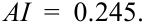
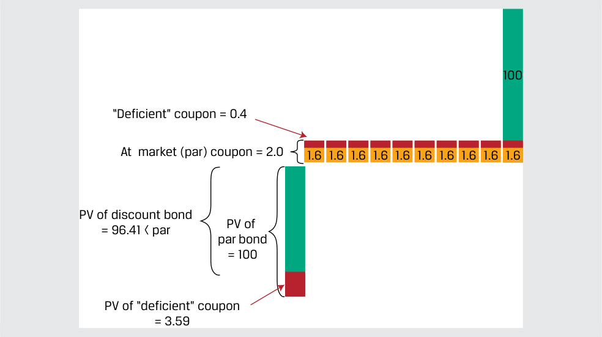
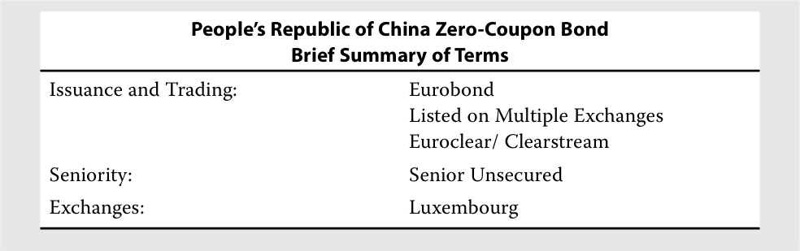
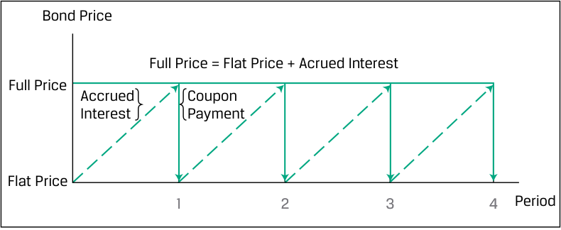
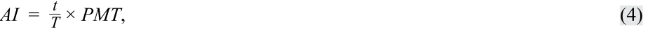

# Tập 6: Chứng khoán Thu nhập Cố định (Fixed Income)
## Learning Module 6 Fixed-Income Bond Valuation: Prices and Yields (Trang PDF 137–166)

---

# Tập 6: Chứng Khoán Thu Nhập Cố Định (*Fixed Income*)
## Học phần 6: Định Giá Trái Phiếu Thu Nhập Cố Định: Giá và Lợi Suất (*Fixed-Income Bond Valuation: Prices and Yields*)
### Phần 1/2: Giới thiệu (Trang PDF 137–152)

---

<!-- PDF Page 137 -->

# H Ọ C P H Ầ N **<mark>6</mark>**

## **Định Giá Trái Phiếu Thu Nhập Cố Định: Giá và Lợi Suất (*Fixed-Income Bond Valuation: Prices and Yields*)**

#### **<mark>MỤC TIÊU HỌC TẬP (*LEARNING OUTCOMES*)</mark>**

**_Mức độ thành thạo — Ứng viên cần có khả năng:_**
- tính toán giá của một trái phiếu khi biết lợi suất đáo hạn (*yield-to-maturity*) vào ngày trả lãi coupon hoặc giữa các ngày trả lãi coupon
- xác định mối quan hệ giữa giá trái phiếu, lãi suất coupon (*coupon rate*), kỳ hạn (*maturity*) và lợi suất đáo hạn (*yield-to-maturity*)
- mô tả phương pháp định giá ma trận (*matrix pricing*)

### **GIỚI THIỆU (*INTRODUCTION*)**

**<mark>1</mark>**

Bây giờ chúng ta sẽ sử dụng phân tích dòng tiền chiết khấu (*discounted cash flow analysis*) để tính toán giá trái phiếu và chỉ ra cách thức mà lãi suất chiết khấu được sử dụng cũng như các đặc tính của trái phiếu, chẳng hạn như lãi suất coupon và thời gian đáo hạn (*time-to-maturity*), tác động đến việc định giá. Giá của một trái phiếu và các dòng tiền tương lai của nó có thể được sử dụng để tính toán một tỷ suất hoàn vốn nội bộ (*internal rate of return* – IRR), được gọi là lợi suất đáo hạn (*yield-to-maturity* – YTM), đóng vai trò là một thước đo tỷ suất sinh lợi hữu ích cho các nhà đầu tư thu nhập cố định dưới những giả định nhất định. Một trong những giả định áp dụng cho học phần này là tất cả các dòng tiền lãi và gốc của trái phiếu đều diễn ra đúng như cam kết. Chúng ta sẽ khám phá mối quan hệ giữa giá trái phiếu và các đặc tính của trái phiếu, chỉ ra cách các đặc tính khác nhau ảnh hưởng đến giá trái phiếu, đồng thời minh họa việc định giá vào đúng ngày trả lãi coupon cũng như giữa các ngày trả lãi coupon. Cuối cùng, chúng ta sẽ giới thiệu phương pháp định giá ma trận (*matrix pricing*), sử dụng các trái phiếu tương đương (*comparable bonds*) để ước tính giá và lợi suất đáo hạn của một trái phiếu khi chưa biết cả hai thông số này.

Hầu hết các ví dụ và bảng minh họa được sử dụng xuyên suốt bài đọc này có thể được tải xuống dưới dạng sổ làm việc Microsoft Excel. Mỗi trang tính trong sổ làm việc được gắn nhãn với số thứ tự ví dụ hoặc bảng minh họa tương ứng trong bài học.

##### **TỔNG QUAN HỌC PHẦN (*LEARNING MODULE OVERVIEW*)**

- Định giá trái phiếu là một ứng dụng của phân tích dòng tiền chiết khấu (*discounted cash flow analysis*). Giá trái phiếu là một hàm số phụ thuộc vào các đặc tính của trái phiếu, bao gồm các dòng tiền của nó và (các) mức lãi suất được sử dụng để chiết khấu các dòng tiền tương lai.

<!-- PDF Page 138 -->

- Bằng cách so sánh giá của một trái phiếu với mệnh giá (*face value*) của nó hoặc so sánh lãi suất coupon với lãi suất chiết khấu, chúng ta có thể xác định liệu một trái phiếu đang được giao dịch ở mức chiết khấu (*at a discount*), ngang giá (*at par*) hay ở mức phần bù/thặng dư (*at a premium*).

- Nếu biết giá thị trường của một trái phiếu, ta có thể tính được tỷ suất hoàn vốn nội bộ của các dòng tiền, được gọi là lợi suất đáo hạn (*yield-to-maturity* – YTM). YTM là mức lãi suất đơn nhất làm cân bằng giá trị hiện tại của các dòng tiền tương lai với giá của trái phiếu.

- Tỷ suất sinh lợi của một nhà đầu tư trái phiếu sẽ bằng với YTM nếu (1) nhà đầu tư nắm giữ trái phiếu đến khi đáo hạn, (2) tổ chức phát hành thực hiện đầy đủ các khoản thanh toán coupon và gốc vào đúng các ngày theo lịch trình, và (3) nhà đầu tư tái đầu tư tất cả các khoản thanh toán coupon ở cùng mức lãi suất YTM đó.

- Khi một trái phiếu được định giá hoặc giao dịch ở giữa các ngày trả lãi coupon, một khoản tiền bổ sung phải được cộng thêm cho phần tiền lãi đã tích lũy kể từ lần thanh toán coupon gần nhất nhằm đền bù cho người bán, bởi vì người mua sẽ nhận được toàn bộ khoản thanh toán coupon tiếp theo.

- Để tính lãi tích lũy (*accrued interest*) của một trái phiếu vào bất kỳ ngày nào, chúng ta nhân khoản thanh toán coupon với tỷ lệ số ngày đã trôi qua trong kỳ trả lãi chia cho tổng số ngày trong kỳ trả lãi đó. Có nhiều quy ước khác nhau để đếm số ngày này; hai quy ước phổ biến là thực tế/thực tế (*actual/actual*) và 30/360.

- Giá của một trái phiếu biến đổi ngược chiều với những thay đổi trong YTM của nó. Các đặc tính của trái phiếu quyết định độ nhạy của giá trước những thay đổi trong YTM.

- Lãi suất coupon của một trái phiếu trả lãi cố định càng thấp thì phần trăm thay đổi giá càng lớn đối với một mức thay đổi nhất định trong lợi suất đáo hạn của trái phiếu. Nhìn chung, thời gian đáo hạn của một trái phiếu càng dài thì phần trăm thay đổi giá của nó càng lớn đối với một mức thay đổi nhất định trong lợi suất đáo hạn.

- Không giống như các chứng khoán vốn cổ phần niêm yết, hầu hết các trái phiếu được giao dịch thưa thớt (*thinly traded*), làm phức tạp hóa quá trình khám phá giá (*price discovery*).

- Định giá ma trận (*matrix pricing*) là một quy trình ước tính giá cho các trái phiếu mới hoặc kém thanh khoản bằng cách sử dụng lợi suất của các chứng khoán có cùng đặc tính hoặc có đặc tính tương tự. Định giá ma trận được sử dụng rộng rãi trong việc báo giá trái phiếu.

##### **TỰ ĐÁNH GIÁ HỌC PHẦN (*LEARNING MODULE SELF-ASSESSMENT*)**

Các câu hỏi ban đầu này nhằm giúp bạn đánh giá mức độ hiểu biết hiện tại của mình về học phần này.

1. Một trái phiếu doanh nghiệp đáo hạn vào ngày 1 tháng 1 năm 2035 trả lãi coupon bán niên ở mức 3,25%/năm và có mệnh giá là 100. Lãi suất chiết khấu thị trường (*market discount rate*) là 4,0%. Đối với ngày thanh toán giao dịch (*trade settlement date*) là ngày 1 tháng 1 năm 2030, giá của trái phiếu tính theo phần trăm mệnh giá, giả định quy ước đếm ngày 30/360, _gần nhất_ với:

   - **A.** 96,632.

   - **B.** 96,661.

   - **C.** 103,436.

- **Lời giải:**

A là đáp án đúng. Giá trái phiếu là tổng các khoản thanh toán coupon và gốc được chiết khấu theo lãi suất chiết khấu thị trường.

<!-- PDF Page 139 -->

$$PV = \frac{PMT_1}{(1 + r)^1} + \frac{PMT_2}{(1 + r)^2} + \dots + \frac{PMT_N + FV_N}{(1 + r)^N}$$

trong đó:

$PMT = 1{,}625$, $r = 0{,}02$, $FV = 100$, $N = 10$

$$PV = \frac{1{,}625}{(1 + 0{,}02)^1} + \frac{1{,}625}{(1 + 0{,}02)^2} + \frac{1{,}625}{(1 + 0{,}02)^3} + \frac{1{,}625}{(1 + 0{,}02)^4} + \frac{1{,}625}{(1 + 0{,}02)^5} + \frac{1{,}625}{(1 + 0{,}02)^6} + \frac{1{,}625}{(1 + 0{,}02)^7} + \frac{1{,}625}{(1 + 0{,}02)^8} + \frac{1{,}625}{(1 + 0{,}02)^9} + \frac{101{,}625}{(1 + 0{,}02)^{10}}$$

$$PV = 96{,}632$$

Lưu ý: Các đại lượng trong phép tính không được làm tròn trong quá trình tính toán, mặc dù chúng được hiển thị với ba chữ số thập phân cho mục đích trình bày. Kết quả cuối cùng được làm tròn đến ba chữ số thập phân.

Phép tính này cũng có thể được thực hiện bằng hàm `PV` hoặc `PRICE` trong Microsoft Excel và Google Sheets:

`=-PV(rate, nper, pmt, [FV], type)`
`=-PV(0.02,10,1.625,100,0) = 96.632`

`=PRICE(settlement, maturity, rate, yield, redemption, frequency, [basis])`
`=PRICE(DATE(2030,1,1),DATE(2035,1,1),0.0325,0.04,100,2) = 96.632`

2. Điều nào sau đây _không_ bắt buộc để tỷ suất sinh lợi của một nhà đầu tư trái phiếu trên khoản đầu tư trái phiếu bằng với YTM của trái phiếu đó?
   - **A.** Trái phiếu được nắm giữ đến khi đáo hạn.
   - **B.** Tổ chức phát hành có thể vỡ nợ đối với một, nhưng chỉ một, khoản thanh toán coupon.
   - **C.** Các khoản thanh toán coupon được tái đầu tư ở cùng mức lãi suất với YTM.

**Lời giải:**

B là đáp án đúng. Để một nhà đầu tư trái phiếu đạt được mức sinh lợi bằng YTM, tổ chức phát hành phải thực hiện tất cả các khoản thanh toán coupon và gốc vào đúng các ngày theo lịch trình.

A không đúng vì nhà đầu tư trái phiếu bắt buộc phải nắm giữ trái phiếu đến khi đáo hạn để đạt được YTM. C không đúng vì nhà đầu tư trái phiếu bắt buộc phải tái đầu tư các khoản coupon ở cùng mức lãi suất với YTM để đạt được YTM.

3. Một trái phiếu chính phủ trung ương kỳ hạn 3 năm được phát hành vào ngày 1 tháng 1 năm 2030 trả lãi coupon bán niên ở mức 1,5%/năm vào ngày 30 tháng 6 và ngày 31 tháng 12 hàng năm và có mệnh giá là 100. Lãi suất chiết khấu thị trường là 2,0%. Đối với ngày thanh toán giao dịch

<!-- PDF Page 140 -->

là ngày 29 tháng 8 năm 2031, giá tịnh (*flat price*) của trái phiếu tính theo phần trăm mệnh giá, giả định quy ước đếm ngày thực tế/thực tế (*actual/actual*), _gần nhất_ với:

**A.** 99,343.

**B.** 99,587.

**C.** 99,832.

**Lời giải:**

A là đáp án đúng. Giá tịnh (*flat price*) bằng giá gộp (*full price*) trừ đi lãi tích lũy (*accrued interest*). Giá gộp là giá trị hiện tại tính tại ngày thanh toán giao dịch, bao gồm các kỳ thanh toán lẻ bởi vì chúng ta đang ở giữa các ngày trả lãi coupon.

<!-- Formula Text: P V Full  = PMT _ (1 + r) 1−t/T  + PMT _ (1 + r) 2−t/T  + ⋯  +  PMT + FV _ (1 + r) N−t/T . -->
$$PV^{Full} = \frac{PMT}{(1 + r)^{1 - t/T}} + \frac{PMT}{(1 + r)^{2 - t/T}} + \dots + \frac{PMT + FV}{(1 + r)^{N - t/T}}$$

Ở đây:

$PMT = 0{,}75$

$r = 0{,}01$

$t = 60$ (số ngày từ 30 tháng 6 năm 2031 đến 29 tháng 8 năm 2031)

$T = 184$ (số ngày từ 30 tháng 6 năm 2031 đến kỳ trả lãi tiếp theo vào ngày 31 tháng 12 năm 2031)

$FV = 100$

$N = 3$

<!-- Formula Text: P V Full  = 0.75 _____________ (1 + 0.01) 1−60/184  + 0.75 _____________ (1 + 0.01) 2−60/184 100.75 _____________ (1 + 0.01) 3−60/184 -->
$$PV^{Full} = \frac{0{,}75}{(1 + 0{,}01)^{1 - 60/184}} + \frac{0{,}75}{(1 + 0{,}01)^{2 - 60/184}} + \frac{100{,}75}{(1 + 0{,}01)^{3 - 60/184}}$$

$PV^{Full} = 99{,}587$.

Lãi tích lũy (*accrued interest*) là phần tỷ lệ tương ứng của khoản thanh toán coupon tiếp theo thuộc về người bán.

<!-- Formula Text: AI  =   t _ T  × PMT, AI  =   60 _ 184  × 0.75 -->
$$AI = \frac{t}{T} \times PMT, \quad AI = \frac{60}{184} \times 0{,}75$$

<!-- Formula Text: AI  =  0.245. -->
$$AI = 0{,}245$$

Giá tịnh (*flat price*) là $99{,}587 - 0{,}245 = 99{,}343$.

Các phép tính giá trị hiện tại cũng có thể được thực hiện dễ dàng trên phần mềm bảng tính. Ngoài ra, hàm `PRICE` trong Microsoft Excel và Google Sheets có thể được sử dụng để giải trực tiếp giá tịnh (lưu ý: _không phải_ giá gộp).

`=PRICE(settlement, maturity, rate, yield, redemption, frequency, [basis])`

`=PRICE(DATE(2031,8,29),DATE(2032,12,31),0.015,0.02,100,2)`

`= 99.343.`

4. Đúng hay sai: Giá yết (*quoted price*) của một trái phiếu còn được gọi là giá gộp (*full price*) bởi vì đó là số tiền mà người mua trả cho người bán.

**A.** Đúng (*True*)

<!-- PDF Page 141 -->

**B.** Sai (*False*)

**Lời giải:**
Sai. Một trái phiếu được yết giá theo giá tịnh (*flat price*) của nó. Giá gộp (*full price*) là số tiền mà người mua thực trả cho người bán, và nó bao gồm cả lãi tích lũy nếu việc thanh toán không diễn ra vào đúng ngày trả lãi coupon.

5. Giả sử chính phủ Nhật Bản phát hành hai trái phiếu trả lãi cố định không kèm quyền mua lại trước hạn (*non-callable fixed-coupon bonds*) vào cùng một ngày với cùng mức lãi suất coupon. Hai trái phiếu này hoàn toàn giống hệt nhau ngoại trừ việc một trái phiếu đáo hạn sau 10 năm và trái phiếu kia đáo hạn sau 30 năm. Nếu lãi suất chiết khấu thị trường có liên quan của cả hai trái phiếu cùng tăng thêm 65 bps, phát biểu nào sau đây sẽ đúng?
   - **A.** Trái phiếu kỳ hạn 10 năm sẽ có phần trăm thay đổi giá lớn hơn so với trái phiếu kỳ hạn 30 năm.
   - **B.** Trái phiếu kỳ hạn 10 năm sẽ có phần trăm thay đổi giá nhỏ hơn so với trái phiếu kỳ hạn 30 năm.
   - **C.** Trái phiếu kỳ hạn 10 năm và trái phiếu kỳ hạn 30 năm sẽ có phần trăm thay đổi giá bằng nhau.

**Lời giải:**
B là đáp án đúng. Nhìn chung, với cùng một mức lãi suất coupon, một trái phiếu có kỳ hạn ngắn hơn sẽ có phần trăm thay đổi giá nhỏ hơn so với một trái phiếu có kỳ hạn dài hơn khi lãi suất chiết khấu thị trường có liên quan của chúng thay đổi cùng một lượng. A không đúng vì nhìn chung trái phiếu ngắn hạn hơn sẽ có phần trăm thay đổi giá nhỏ hơn so với trái phiếu dài hạn hơn khi lãi suất chiết khấu thị trường của chúng thay đổi cùng một lượng. C không đúng vì trái phiếu ngắn hạn hơn và trái phiếu dài hạn hơn sẽ không có cùng phần trăm thay đổi giá khi lãi suất chiết khấu thị trường của chúng thay đổi cùng một lượng.

6. Đúng hay sai. Giải thích câu trả lời của bạn.
Định giá ma trận (*matrix pricing*) là một quy trình ước tính trong đó các báo giá từ thị trường phái sinh (ví dụ: hợp đồng hoán đổi lãi suất) được sử dụng để xác định giá của các trái phiếu kém thanh khoản hoặc mới phát hành vốn khan hiếm dữ liệu giao dịch.
   - **A.** Đúng (*True*)
   - **B.** Sai (*False*)

**Lời giải:**
Sai. Định giá ma trận là một quy trình ước tính giá của các trái phiếu kém thanh khoản hoặc mới phát hành bằng cách sử dụng giá của các trái phiếu tương đương (*comparable bonds*), chứ không phải từ các giao dịch trên thị trường phái sinh. Các trái phiếu tương đương có thời gian đáo hạn, lãi suất coupon và chất lượng tín dụng tương tự như trái phiếu đang được nghiên cứu.

## **<mark>2</mark> ĐỊNH GIÁ TRÁI PHIẾU VÀ LỢI SUẤT ĐÁO HẠN (*BOND PRICING AND YIELD-TO-MATURITY*)**

tính toán giá của một trái phiếu khi biết lợi suất đáo hạn (*yield-to-maturity*) vào ngày trả lãi coupon hoặc giữa các ngày trả lãi coupon

<!-- PDF Page 142 -->

#### **Định Giá Trái Phiếu Với Lãi Suất Chiết Khấu Thị Trường (*Bond Pricing with a Market Discount Rate*)**

Định giá trái phiếu là một ứng dụng của phân tích dòng tiền chiết khấu phụ thuộc vào các đặc tính dòng tiền của trái phiếu và mức lãi suất (hoặc các mức lãi suất) được sử dụng để chiết khấu. Hãy nhớ lại từ bài học trước rằng giá của trái phiếu tại thời điểm phát hành là giá trị hiện tại của các dòng tiền lãi và gốc đã cam kết. Lãi suất chiết khấu thị trường được sử dụng trong phép tính giá trị thời gian của tiền tệ để thu được giá trị hiện tại. **Lãi suất chiết khấu thị trường (*market discount rate*)** là tỷ suất sinh lợi mà các nhà đầu tư yêu cầu dựa trên mức độ rủi ro của khoản đầu tư trái phiếu. Nó còn được gọi là **lợi suất yêu cầu (*required yield*)**, hoặc **tỷ suất sinh lợi yêu cầu (*required rate of return*)**.

Phép tính giá trị hiện tại ($PV$) cho mỗi dòng tiền coupon của trái phiếu ($PMT$) phát sinh sau $t$ kỳ với lãi suất chiết khấu thị trường là $r$ mỗi kỳ hẳn đã quen thuộc từ bài học trước về giá trị thời gian của tiền tệ:

$$PV(\text{Bond coupon}) = \frac{PMT_t}{(1 + r)^t} \tag{1}$$

Phương trình 2 mở rộng phép tính này thành một công thức tổng quát để tính giá trái phiếu ($PV$) khi biết lãi suất chiết khấu thị trường vào một ngày trả lãi coupon:

$$PV = \frac{PMT_1}{(1 + r)^1} + \frac{PMT_2}{(1 + r)^2} + \dots + \frac{PMT_N + FV_N}{(1 + r)^N} \tag{2}$$

trong đó $FV$ bằng mệnh giá của trái phiếu và $N$ là số kỳ cho đến khi đáo hạn.

Hãy nhớ lại trái phiếu của Bright Wheels Automotive (BRWA) đã được giới thiệu trong bài học trước. Giá của trái phiếu đó bằng 100% mệnh giá (*face or par value*) bởi vì lãi suất chiết khấu thị trường, $r$, và lãi suất coupon cố định của trái phiếu, $PMT$, bằng nhau (ở mức 3,2%/năm, hay 1,6% mỗi nửa năm). Bây giờ chúng ta sẽ xem xét các trường hợp trong đó lãi suất coupon của trái phiếu và lãi suất chiết khấu thị trường không bằng nhau.

##### **VÍ DỤ 1 (*EXAMPLE 1*)**

|**Trái Phiếu Ngang Giá, Chiết Khấu và Phần Bù của BRWA (*BRWA Par, Discount, and Premium Bond*)**|||||||||||
|---|---|---|---|---|---|---|---|---|---|---|
|**Kỳ (*Period*):**|**1**|**2**|**3**|**4**|**5**|**6**|**7**|**8**|**9**|**10**|
|Dòng tiền (*Cash Flow*):|1,6|1,6|1,6|1,6|1,6|1,6|1,6|1,6|1,6|101,6|
|PV của Dòng tiền tại YTM định kỳ 1,2%:|1,6|1,6|1,5|1,5|1,5|1,5|1,5|1,5|1,4|90,2|
|Giá trái phiếu (tổng):|103,75||||||||||
|PV của Dòng tiền tại YTM định kỳ 1,6%:|1,6|1,6|1,5|1,5|1,5|1,5|1,4|1,4|1,4|86,7|
|Giá trái phiếu:|100,00||||||||||
|PV của Dòng tiền tại YTM định kỳ 2,0%:|1,6|1,5|1,5|1,5|1,4|1,4|1,4|1,4|1,3|83,3|
|Giá trái phiếu:|96,41||||||||||

_Lưu ý:_ Vui lòng tham khảo hệ sinh thái học tập dành cho ứng viên trực tuyến để xem bảng tính của các phép tính này trong sổ làm việc Microsoft Excel được tải xuống.

Nếu lãi suất chiết khấu thị trường tăng lên mức 2% mỗi nửa năm, các trái phiếu mới được phát hành ngang giá phải cung cấp mức lãi suất coupon cũng là 2% mỗi nửa năm. Trái phiếu BRWA đã phát hành trước đó trả lãi coupon ở mức 1,6%, vì vậy nó phải có mức giá thấp hơn so với một trái phiếu trả lãi 2%. Chúng ta có thể nói rằng mức lãi suất coupon 1,6% của trái phiếu BRWA là _thiếu hụt_ (*deficient*) so với mức lãi suất chiết khấu thị trường cao hơn là 2%. Do đó, giá thị trường của trái phiếu BRWA, với mức coupon thấp hơn, sẽ giảm xuống dưới 100% mệnh giá. Ví dụ 1 cho thấy khi chúng ta chiết khấu các dòng tiền của trái phiếu BRWA theo lãi suất chiết khấu thị trường là 2%, chúng ta tính được mức giá là 96,41. Mức giá thấp hơn này bù đắp cho mức lãi suất coupon thấp hơn lãi suất chiết khấu thị trường. Khi giá của một trái phiếu nhỏ hơn 100, chúng ta nói rằng trái phiếu đó giao dịch ở mức chiết khấu (*trades at a discount*). (Cách dùng từ “chiết khấu” [*discount*] khi nói đến giá trái phiếu không liên quan đến cách dùng từ “chiết khấu” trong lãi suất chiết khấu thị trường). Bảng minh họa 1 minh họa một trái phiếu đang giao dịch ở mức chiết khấu.

<!-- PDF Page 143 -->

##### **Bảng minh họa 1: Dòng Tiền của Trái Phiếu Chiết Khấu (*Exhibit 1: Discount Bond Cash Flows*)**

> **Chú thích hình ảnh:** Dòng tiền của trái phiếu chiết khấu (*Discount Bond Cash Flows*):
> - Mệnh giá hoàn trả cuối kỳ = 100.
> - Coupon theo thị trường (ngang giá) (*At market (par) coupon*) = 2,0 mỗi kỳ; Coupon thực trả = 1,6 mỗi kỳ; Phần coupon “thiếu hụt” (*“Deficient” coupon*) = 0,4 mỗi kỳ.
> - Giá trị hiện tại của trái phiếu ngang giá (*PV of par bond*) = 100; trừ đi Giá trị hiện tại của phần coupon “thiếu hụt” (*PV of “deficient” coupon*) = 3,59; bằng Giá trị hiện tại của trái phiếu chiết khấu (*PV of discount bond*) = 96,41 < mệnh giá (*par*).

<!-- Picture Text: 100 “Deficient” coupon = 0.4 At  market (par) coupon = 2.0 1.6 1.6 1.6 1.6 1.6 1.6 1.6 1.6 1.6 1.6 PV of discount bond PV of = 96.41 < par par bond = 100 PV of “deficient” coupon = 3.59  -->

Bây giờ chúng ta xem xét giá của trái phiếu BRWA hiện hữu sẽ thay đổi như thế nào nếu lãi suất chiết khấu thị trường giảm xuống còn 1,2%. Một trái phiếu tương tự (kỳ hạn 5 năm, trả lãi coupon bán niên) được phát hành khi lãi suất chiết khấu thị trường kỳ hạn 5 năm ở mức 1,2% mỗi nửa năm cũng sẽ có lãi suất coupon bán niên là 1,2% để giá của nó bằng 100% mệnh giá. Bởi vì trái phiếu BRWA trả mức lãi suất coupon cao hơn là 1,6%, giá của nó phải cao hơn giá của một trái phiếu chỉ trả 1,2%. Chúng ta có thể nói rằng mức lãi suất coupon 1,6% của trái phiếu BRWA là _vượt trội/dư thừa_ (*excessive*) so với mức lãi suất chiết khấu thị trường thấp hơn là 1,2%. Do đó, giá của trái phiếu BRWA tăng lên khi lãi suất chiết khấu thị trường giảm xuống. Khi chúng ta chiết khấu các dòng tiền của trái phiếu BRWA theo lãi suất chiết khấu thị trường 1,2% rồi cộng chúng lại, chúng ta tính được giá trái phiếu bằng 103,75% (trong văn bản gốc ghi 103,73% do làm tròn trung gian, bảng tính chính xác là 103,75%) mệnh giá. Nó có mức giá cao hơn trái phiếu coupon 1,2% bởi vì nó trả mức coupon cao hơn. Bảng minh họa 2 minh họa một trái phiếu đang giao dịch ở mức phần bù/thặng dư (*at a premium*).

##### **Bảng minh họa 2: Dòng Tiền của Trái Phiếu Phần Bù (*Exhibit 2: Premium Bond Cash Flows*)**

> **Chú thích hình ảnh:** Dòng tiền của trái phiếu phần bù (*Premium Bond Cash Flows*):
> - Mệnh giá hoàn trả cuối kỳ = 100.
> - Coupon định kỳ (*Periodic coupon*) = 1,6; Coupon theo thị trường (ngang giá) (*At market (par) coupon*) = 1,2; Phần coupon “vượt trội” (*“Excess” coupon*) = 0,4 mỗi kỳ.
> - Giá trị hiện tại của trái phiếu ngang giá (*PV of par bond*) = 100; cộng với Giá trị hiện tại của phần coupon “vượt trội” (*PV of “excess” coupon*) = 3,75; bằng Giá trị hiện tại của trái phiếu phần bù = 103,75 > mệnh giá (*par*).

<!-- Picture Text: 100 Periodic coupon = 1.6 “Excess” coupon = 0.4 At  market (par) coupon = 1.2 1.2 1.2 1.2 1.2 1.2 1.2 1.2 1.2 1.2 1.2 PV of PV of discount bond par bond = 103.75 > par = 100 PV of “excess” coupon = 3.75  -->

Hàm `PV` trong Microsoft Excel hoặc Google Sheets cũng có thể được sử dụng để tính giá:

`=PV(rate, nper, pmt, FV, type)`,

trong đó:

<!-- PDF Page 144 -->

_rate_ là lãi suất chiết khấu thị trường mỗi kỳ

_nper_ là tổng số kỳ

_pmt_ là khoản thanh toán coupon định kỳ

_FV_ là giá trị tương lai hay mệnh giá

_type_ tương ứng với các khoản thanh toán được thực hiện vào cuối mỗi kỳ (0) hoặc đầu mỗi kỳ (1)

Các mối quan hệ chiết khấu (*discount*), phần bù (*premium*) và ngang giá (*par*) được tóm tắt trong Bảng minh họa 3.

**Bảng minh họa 3: Trái Phiếu Lãi Suất Cố Định Giao Dịch ở Mức Chiết Khấu, Phần Bù và Ngang Giá (*Exhibit 3: Fixed-Rate Discount, Premium, and Par Bonds*)**

|**Giá Trái Phiếu (*Bond Price*)**|**Giá so với Giá Trị Tương Lai (*Price vs. Future Value*)**|**Coupon so với Lãi Suất Chiết Khấu Thị Trường (*Coupon vs. Market Discount Rate*)**|
|---|---|---|
|Ngang giá (*Par*)|$PV = FV$|$PMT =$ Lãi suất chiết khấu thị trường|
|Chiết khấu (*Discount*)|$PV < FV$|$PMT <$ Lãi suất chiết khấu thị trường|
|Phần bù (*Premium*)|$PV > FV$|$PMT >$ Lãi suất chiết khấu thị trường|

Lãi suất mỗi kỳ được quy đổi theo năm (*annualized*) bằng cách nhân lãi suất mỗi kỳ với số kỳ trong một năm. Do đó, một phát biểu tương đương là trái phiếu BRWA được định giá ở mức phần bù bởi vì lãi suất coupon công bố theo năm của nó là 3,2% lớn hơn lãi suất chiết khấu thị trường công bố theo năm là 2,4%. Trừ khi có quy định khác, lãi suất thường được yết theo mức lãi suất năm.

#### **Lợi Suất Đáo Hạn (*Yield-to-Maturity*)**

Nếu biết giá thị trường của một trái phiếu, Phương trình 2 có thể được sử dụng để tính lợi suất đáo hạn của nó. **Lợi suất đáo hạn (*yield-to-maturity* – YTM)** là tỷ suất hoàn vốn nội bộ (*internal rate of return* – IRR) của các dòng tiền—mức lãi suất đồng nhất sao cho khi các dòng tiền tương lai được chiết khấu theo mức lãi suất đó, tổng giá trị hiện tại sẽ bằng với giá của trái phiếu. Đó là một mức lãi suất chiết khấu thị trường đơn nhất _ngầm định_ (*implied*) hoặc _quan sát được_ (*observed*).

Một nhà đầu tư trái phiếu sẽ kiếm được tỷ suất sinh lợi trên trái phiếu bằng đúng với YTM của nó nếu mỗi điều kiện sau đây đều thỏa mãn:

**1.** Nhà đầu tư nắm giữ trái phiếu đến khi đáo hạn.

**2.** Tổ chức phát hành thực hiện đầy đủ các khoản thanh toán coupon và gốc vào đúng các ngày theo lịch trình. YTM là mức lợi suất _cam kết_ (*promised yield*)—nghĩa là giả định tổ chức phát hành không vỡ nợ.

**3.** Nhà đầu tư tái đầu tư tất cả các khoản thanh toán coupon ở cùng mức YTM đó.

Ví dụ, giả sử chúng ta quan sát thấy trái phiếu BRWA lãi suất cố định 3,2% kỳ hạn 5 năm trong Ví dụ 1 được định giá ở mức 108,15. Lợi suất đáo hạn là nghiệm của lãi suất, $r$, trong phương trình sau:

$$108{,}15 = \frac{1{,}6}{(1 + r)^1} + \frac{1{,}6}{(1 + r)^2} + \dots + \frac{101{,}6}{(1 + r)^{10}}$$

Hàm `YIELD` trong Microsoft Excel hoặc Google Sheets có thể được sử dụng cho các trái phiếu trả lãi định kỳ:

<!-- PDF Page 145 -->

`=YIELD(settlement, maturity, rate, pr, redemption, frequency, [basis])` trong đó:

_settlement_ là ngày thanh toán giao dịch được nhập bằng hàm `DATE`

_maturity_ là ngày đáo hạn được nhập bằng hàm `DATE`

_rate_ là lãi suất coupon bán niên (hoặc theo năm tùy chuẩn hàm; lưu ý trong Excel chuẩn hàm `YIELD` nhận lãi suất coupon năm, ở ví dụ dưới đây tác giả minh họa nhập 1,6% cho kỳ bán niên hoặc lãi suất tương ứng)

_pr_ là mức giá trên mỗi 100 đơn vị mệnh giá

_redemption_ là giá trị tương lai khi đáo hạn

_frequency_ là số lần trả lãi coupon mỗi năm

_[basis]_ là quy ước đếm ngày, thường là 0 đối với trái phiếu Hoa Kỳ (đếm ngày 30/360).

Nếu chúng ta giả định trái phiếu BRWA thanh toán và đáo hạn lần lượt vào ngày 15 tháng 10 năm 2025 và ngày 15 tháng 10 năm 2030, các thông số nhập phù hợp là `DATE(2025,10,15)` và `DATE(2030,10,15)`. Các thông số khác là _rate_ = 1,6%, _pr_ = 108,15, _redemption_ = 100, _frequency_ = 2, và _basis_ = 0, như sau:

`=YIELD(DATE(2025,10,15),DATE(2030,10,15),1.6%,108.15,100,2,0)`

Với mức giá là 108,15, hàm `YIELD` tính toán lợi suất đáo hạn theo năm của trái phiếu BRWA là 1,50%. Ngoài ra, vì lợi suất đáo hạn là một tỷ suất hoàn vốn nội bộ, chúng ta cũng có thể sử dụng hàm `IRR` trong Microsoft Excel hoặc Google Sheets để thu được kết quả tương tự.

Lợi suất đáo hạn, thường được gọi tắt là “lợi suất” (*yield*), thường được sử dụng thay thế cho nhau với lãi suất chiết khấu thị trường hoặc lợi suất yêu cầu và thay cho việc thảo luận về giá trái phiếu. Ví dụ, các chủ thể tham gia thị trường sẽ chỉ nói đơn giản là “lợi suất đang tăng” thay vì nói “lãi suất chiết khấu thị trường đang tăng” hay “giá trái phiếu đang giảm”.

##### **TRÁI PHIẾU CÓ LỢI SUẤT ĐÁO HẠN ÂM (*BONDS WITH NEGATIVE YIELDS-TO-MATURITY*)**

Lợi suất đáo hạn của một trái phiếu có thể dương, bằng không hoặc âm. Lợi suất của nhiều trái phiếu chính phủ trung ương đã giảm xuống dưới mức không sau các chính sách tiền tệ nới lỏng (*accommodative monetary policies*) do các ngân hàng trung ương đưa ra bắt đầu từ năm 2012 nhằm ứng phó với tỷ lệ lạm phát thấp hơn mục tiêu. Các trái phiếu có lợi suất đáo hạn âm bao gồm những trái phiếu đã được phát hành với mức lợi suất cao hơn trong quá khứ nhưng đã trải qua sự tăng giá đáng kể, và các trái phiếu chính phủ trung ương không trả lãi định kỳ (*zero-coupon*) mới phát hành được định giá ở mức phần bù so với mệnh giá. Trái phiếu nhìn chung không được phát hành với lãi suất coupon âm.

Năm 2020, Trung Quốc đã phát hành trái phiếu chính phủ trung ương có lợi suất âm đầu tiên trong lịch sử của mình được định danh bằng đồng euro, với các điều khoản được thể hiện trong Bảng minh họa 4.

**Bảng minh họa 4: Trái Phiếu Eurobond của Cộng Hòa Nhân Dân Trung Hoa (*Exhibit 4: People’s Republic of China Eurobond*)**

|**Trái Phiếu Không Trả Lãi Định Kỳ của Cộng Hòa Nhân Dân Trung Hoa (*People’s Republic of China Zero-Coupon Bond*)** **Tóm Tắt Ngắn Gọn Các Điều Khoản (*Brief Summary of Terms*)**||
|---|---|
|Tổ chức phát hành (*Issuer*):|Cộng hòa Nhân dân Trung Hoa (*People’s Republic of China*)|
|Ngày thanh toán (*Settlement Date*):|25 tháng 11 năm 2020|
|Ngày đáo hạn (*Maturity Date*):|25 tháng 11 năm 2025|
|Mệnh giá gốc (*Principal Amount*):|750 triệu EUR|
|Lãi suất (*Interest*):|Không trả lãi định kỳ (*Zero coupon*) (quy ước đếm ngày ACT/ACT)|
|Giá phát hành (*Issuance Price*):|100,763|
|Chênh lệch phát hành (*Issuance Spread*):|+30 bps/năm cộng với Lãi suất Hoán đổi Trung bình (*Mid Swaps*)|

<!-- PDF Page 146 -->

> **Chú thích hình ảnh:** Tóm tắt điều khoản bổ sung của Trái phiếu không trả lãi định kỳ của Cộng hòa Nhân dân Trung Hoa:
> - Phát hành và Giao dịch (*Issuance and Trading*): Eurobond; Niêm yết trên nhiều sở giao dịch (*Listed on Multiple Exchanges*); Thanh toán bù trừ qua Euroclear/Clearstream.
> - Thứ tự ưu tiên trả nợ (*Seniority*): Trái phiếu cấp cao không có tài sản đảm bảo (*Senior Unsecured*).
> - Sở giao dịch (*Exchanges*): Luxembourg.

<!-- Picture Text: People’s Republic of China Zero-Coupon Bond Brief Summary of Terms Issuance and Trading: Eurobond Listed on Multiple Exchanges Euroclear/ Clearstream Seniority: Senior Unsecured Exchanges:  Luxembourg  -->

Hàm `YIELD` trong Excel không thể sử dụng cho trái phiếu không trả lãi định kỳ (*zero-coupon bonds*). Thay vào đó, chúng ta giải tìm lợi suất đáo hạn theo năm bằng cách sử dụng Phương trình 1 cho dòng tiền đơn nhất bằng mệnh giá ($PMT = 100$) sau 5 năm ($t = 5$) tại mức giá phát hành ban đầu ($PV = 100{,}763$):

<!-- Formula Text: PV  =    PMT _ (1 + r) t . 100.763  =    100 _ (1 + r) 5 . r  =  (  100 _ 100.763 ) 1 _ 5 − 1. r  =  − 0.15 % . -->
$$PV = \frac{PMT}{(1 + r)^t}$$
$$100{,}763 = \frac{100}{(1 + r)^5}$$
$$r = \left(\frac{100}{100{,}763}\right)^{\frac{1}{5}} - 1$$
$$r = -0{,}15\%$$

Tờ _Financial Times_ đã đưa tin về nhu cầu cao đối với trái phiếu Trung Quốc có lợi suất âm này bởi vì lợi suất của nó cao hơn 50 bps so với lợi suất trái phiếu chính phủ châu Âu—trái phiếu chính phủ Đức (*German bund*) kỳ hạn 5 năm ở mức xấp xỉ $-0{,}74\%$ vào cùng thời điểm đó—và nhìn chung hơn là bởi vì nhiều nhà đầu tư tìm kiếm mức độ tiếp xúc danh mục đầu tư với Trung Quốc trong bối cảnh trái phiếu Trung Quốc định danh bằng đồng euro tương đối khan hiếm vào thời điểm đó.

#### **Giá Tịnh, Lãi Tích Lũy và Giá Gộp (*Flat Price, Accrued Interest, and the Full Price*)**

Khi một trái phiếu được định giá ở giữa các ngày thanh toán coupon, giá của nó có hai thành phần: **giá tịnh (*flat price*)** ($PV^{Flat}$) và **lãi tích lũy (*accrued interest*)** ($AI$). Tổng của hai thành phần này là **giá gộp (*full price*)** ($PV^{Full}$), còn được gọi là giá hóa đơn (*invoice price*) hay giá “bẩn” (*“dirty” price*).

$$PV^{Full} = PV^{Flat} + AI \tag{3}$$

Giá tịnh, bằng giá gộp trừ đi lãi tích lũy, còn được gọi là giá yết (*quoted price*) hay giá “sạch” (*“clean” price*) và là loại giá thường được các nhà tạo lập thị trường trái phiếu (*bond dealers*) niêm yết/báo giá. Nếu một giao dịch diễn ra, lãi tích lũy sẽ được cộng vào giá tịnh để thu được giá gộp mà người mua phải trả và người bán nhận được vào **ngày thanh toán giao dịch (*trade settlement date*)**. Giao dịch hoàn tất thanh toán khi người mua trái phiếu trả tiền và người bán chuyển giao chứng khoán.

Giá tịnh được sử dụng để báo giá nhằm tránh gây hiểu lầm cho các nhà đầu tư về xu hướng giá thị trường của trái phiếu. Nếu giá gộp được các nhà tạo lập thị trường dùng để báo giá, các nhà đầu tư sẽ thấy giá tăng lên mỗi ngày ngay cả khi YTM không thay đổi do sự tích lũy tiền lãi. Khi một khoản thanh toán coupon được thực hiện, mức giá báo sẽ sụt giảm mạnh, như được thể hiện trong Bảng minh họa 5.

<!-- PDF Page 147 -->

**Bảng minh họa 5: Giá Tịnh, Lãi Tích Lũy và Giá Gộp (*Exhibit 5: Flat Price, Accrued Interest, and Full Price*)**

> **Chú thích hình ảnh:** Đồ thị minh họa Giá trái phiếu (*Bond Price*) qua các kỳ trả lãi (*Period 1, 2, 3, 4*):
> - Giá gộp (*Full Price*) = Giá tịnh (*Flat Price*) + Lãi tích lũy (*Accrued Interest*).
> - Trong mỗi kỳ, Lãi tích lũy tăng dần đều làm Giá gộp tăng hình răng cưa và rơi xuống bằng Giá tịnh ngay khi Thanh toán coupon (*Coupon Payment*) được thực hiện.

<!-- Picture Text: Bond Price Full Price = Flat Price + Acrued Interest Full Price Accrued Coupon Interest Payment Flat Price 1 2 3 4 Period  -->

Lãi tích lũy (*accrued interest*) là phần của khoản thanh toán coupon tiếp theo thuộc về người bán trái phiếu, bởi vì mặc dù người bán đã nắm giữ trái phiếu trong một phần của kỳ trả lãi coupon, toàn bộ khoản coupon tiếp theo sẽ do người mua nhận. Để tính lãi tích lũy, chúng ta xác định tỷ lệ phân số bằng cách đếm số ngày trong kỳ. Nếu kỳ trả lãi coupon có $T$ ngày giữa các ngày thanh toán và $t$ ngày đã trôi qua kể từ lần thanh toán gần nhất, lãi tích lũy được tính bằng Phương trình 4:

<!-- Formula Text: AI  =   t _ T  × PMT, (4) -->
$$AI = \frac{t}{T} \times PMT \tag{4}$$

trong đó:

- $t =$ số ngày kể từ lần thanh toán coupon trước đó đến ngày thanh toán giao dịch (*settlement date*)
- $T =$ tổng số ngày trong kỳ trả lãi coupon
- $t / T =$ phân số (tỷ lệ) của kỳ trả lãi coupon đã trôi qua kể từ lần thanh toán trước đó
- $PMT =$ khoản thanh toán coupon mỗi kỳ

Lưu ý rằng phần lãi tích lũy trong giá gộp không phụ thuộc vào lợi suất đáo hạn. Do đó, chỉ có giá tịnh mới bị ảnh hưởng bởi sự thay đổi của lãi suất.

Có nhiều phương pháp tiếp cận để đếm ngày (*day counting* hay *“day counts”*). Quy ước đếm ngày được xác định bởi hai tham số: cách thức đếm các ngày trong một kỳ nhất định và số ngày được giả định cho mỗi kỳ. Hai quy ước đếm ngày phổ biến là 30/360 và thực tế/thực tế (*actual/actual*). Quy ước đếm ngày 30/360 giả định mỗi tháng có đúng 30 ngày (mặc dù hầu hết các tháng không phải vậy) và mỗi năm có đúng 360 ngày (mặc dù không năm nào như vậy). Ngược lại, quy ước đếm ngày thực tế/thực tế (*actual/actual*) sử dụng số ngày thực tế trong mỗi tháng và số ngày thực tế trong một năm.

##### **VÍ DỤ 2 (*EXAMPLE 2*)**

#### **Quy Ước Đếm Ngày Thực Tế/Thực Tế so với 30/360 (*Actual/Actual vs. 30/360 Day Count*)**

Xét hai trái phiếu hoàn toàn giống hệt nhau về mọi mặt khác, trả lãi bán niên 4,375%/năm vào ngày 15 tháng 5 và ngày 15 tháng 11 hàng năm. Một trái phiếu là trái phiếu chính phủ với quy ước đếm ngày thực tế/thực tế (*actual/actual*) và trái phiếu kia là trái phiếu doanh nghiệp với quy ước đếm ngày 30/360. Phương pháp thực tế/thực tế sử dụng số ngày thực tế, bao gồm cả ngày cuối tuần, ngày lễ và ngày nhuận. Phương pháp 30/360 giả định có 30 ngày trong một tháng và 360 ngày trong mỗi năm.

Tính lãi tích lũy cho việc thanh toán giao dịch vào ngày 27 tháng 6 đối với cả hai trái phiếu.

<!-- PDF Page 148 -->

Lãi tích lũy đối với trái phiếu thực tế/thực tế là số ngày thực tế giữa ngày 15 tháng 5 và ngày 27 tháng 6 ($t = 43$ ngày) chia cho số ngày thực tế giữa ngày 15 tháng 5 và ngày 15 tháng 11 ($T = 184$ ngày), nhân với khoản thanh toán coupon.

Đối với trái phiếu 30/360, chúng ta có 42 ngày giữa ngày 15 tháng 5 và ngày 27 tháng 6: 15 ngày giữa ngày 15 tháng 5 và ngày 30 tháng 5, cộng với 27 ngày giữa ngày 1 tháng 6 và ngày 27 tháng 6 (ngày 31 tháng 5 không được tính trong quy ước 30/360). Giả định có 180 ngày trong kỳ sáu tháng giữa ngày 15 tháng 5 và ngày 15 tháng 11.

||**Trái Phiếu Thực Tế/Thực Tế (*Actual/Actual Bond*)**|**Trái Phiếu 30/360 (*30/360 Bond*)**|
|---|---|---|
|Số ngày ($t$)|43|42|
|Kỳ trả lãi ($T$)|184|180|
|$t/T$|0,233696|0,233333|

Lãi tích lũy được tính như sau:

**Trái phiếu thực tế/thực tế:** $AI = (43/184) \times (4{,}375/2) = 0{,}511209$ trên mỗi 100 đơn vị mệnh giá.

**Trái phiếu 30/360:** $AI = (42/180) \times (4{,}375/2) = 0{,}510417$ trên mỗi 100 đơn vị mệnh giá.

Giá gộp (*full price*) của một trái phiếu lãi suất cố định giữa các kỳ thanh toán coupon khi biết lãi suất chiết khấu thị trường mỗi kỳ ($r$) là giá trị hiện tại của các dòng tiền tương lai tính tại ngày thanh toán giao dịch, như được thể hiện trong Phương trình 5:

<!-- Formula Text: P V Full  = PMT _ (1 + r) 1−t/T  + PMT _ (1 + r) 2−t/T  + ⋯  +  PMT + FV _ (1 + r) N−t/T . (5) -->
$$PV^{Full} = \frac{PMT}{(1 + r)^{1 - t/T}} + \frac{PMT}{(1 + r)^{2 - t/T}} + \dots + \frac{PMT + FV}{(1 + r)^{N - t/T}} \tag{5}$$

Phương trình này rất giống với Phương trình 2. Sự khác biệt là khoản thanh toán coupon tiếp theo ($PMT$) được chiết khấu cho phần thời gian còn lại của kỳ trả lãi coupon, tức là $1 - t/T$. Khoản thanh toán coupon thứ hai được chiết khấu cho phần phân số đó cộng thêm một kỳ đầy đủ nữa, tức là $2 - t/T$.

<!-- Formula Text: Equation 5 is simplified by multiplying both the numerator and denominator by the expression (1 + r)t/T. The result is Equation 6: P V Full  =  [  PMT _ (1 + r) 1  +   PMT _ (1 + r) 2  + ⋯  +  PMT + FV _ (1 + r) N  ] × (1 + r) t/T = PV × (1 + r) t/T. (6) -->
Phương trình 5 được rút gọn bằng cách nhân cả tử số và mẫu số với biểu thức $(1 + r)^{t/T}$. Kết quả là Phương trình 6:

$$PV^{Full} = \left[ \frac{PMT}{(1 + r)^1} + \frac{PMT}{(1 + r)^2} + \dots + \frac{PMT + FV}{(1 + r)^N} \right] \times (1 + r)^{t/T} = PV \times (1 + r)^{t/T} \tag{6}$$

Một ưu điểm của Phương trình 6 là biểu thức trong ngoặc vuông, $PV$, có thể dễ dàng tính được bằng hàm `PV` (trong văn bản gốc ghi `YIELD`, thực tế là hàm `PV`) của Excel bởi vì có $N$ kỳ cách đều nhau. $PV$ ở đây là giá trị hiện tại của các dòng tiền tương lai tính tại ngày trả lãi coupon gần nhất; nó hoàn toàn giống với Phương trình 2 nhưng không giống với $PV^{Flat}$.

Hai ví dụ tiếp theo minh họa phép tính giá tịnh, lãi tích lũy và giá gộp của một trái phiếu.

##### **VÍ DỤ 3 (*EXAMPLE 3*)**

#### **Trái Phiếu BRWA—Giá Tịnh và Giá Gộp (*BRWA Bond—Flat and Full Price*)**

Tính giá tịnh và giá gộp của trái phiếu BRWA lãi suất cố định 3,2% vào thời điểm 90 ngày sau lần thanh toán coupon đầu tiên.

Trước tiên, chúng ta tính giá trị hiện tại của trái phiếu vào ngày trả lãi coupon bắt đầu kỳ trả lãi mà trong đó việc thanh toán giao dịch diễn ra, sử dụng Phương trình 2 hoặc hàm `PV` trong Microsoft Excel hay Google Sheets.

<!-- PDF Page 149 -->

`=-PV(0.02,9,1.60,100,0) = 96.735`

Tiếp theo, chúng ta tính giá gộp bằng cách đếm số ngày theo quy ước đếm ngày được chỉ định và sử dụng Phương trình 6.

Số ngày từ đầu kỳ cho đến ngày thanh toán giao dịch, $t = 90$
Số ngày trong kỳ chứa ngày thanh toán giao dịch, $T = 180$

$$PV^{Full} = PV \times (1 + r)^{t/T}$$
$$PV^{Full} = 96{,}735 \times (1 + 0{,}02)^{90/180}$$
$$PV^{Full} = 97{,}698$$

Sau đó, chúng ta sử dụng Phương trình 4 để tính lãi tích lũy.

$$AI = \frac{t}{T} \times PMT$$
$$AI = \frac{90}{180} \times 1{,}60$$
$$AI = 0{,}80$$

Cuối cùng, chúng ta tính giá tịnh bằng Phương trình 3 bằng cách lấy giá gộp trừ đi lãi tích lũy.

$$PV^{Full} = PV^{Flat} + AI$$
$$PV^{Flat} = PV^{Full} - AI$$
$$PV^{Flat} = 97{,}698 - 0{,}80$$
$$PV^{Flat} = 96{,}898$$

_Lưu ý:_ Các đại lượng trong phép tính không được làm tròn trong quá trình tính toán, mặc dù chúng được hiển thị với ba chữ số thập phân cho mục đích trình bày. Kết quả cuối cùng được làm tròn đến ba chữ số thập phân.

##### **VÍ DỤ 4 (*EXAMPLE 4*)**

#### **Trái Phiếu Romania—Giá Tịnh và Giá Gộp (*Romania Bond—Flat and Full Price*)**

Trái phiếu trả lãi cố định hàng năm 4,625% bằng đồng EUR, quy ước đếm ngày thực tế/thực tế (*actual/actual*) do Romania phát hành đáo hạn ngày 3 tháng 4 năm 2049 đã được giới thiệu trong bài học trước. Hãy tính giá gộp ($PV^{Full}$), lãi tích lũy ($AI$) và giá tịnh ($PV^{Flat}$) cho ngày thanh toán giao dịch 15 tháng 12 năm 2031, giả định lợi suất đáo hạn năm vào ngày đó là 3,50%.

**Lời giải**

Bước 1: Tính $PV$ tại thời điểm bắt đầu kỳ trả lãi coupon hiện tại của ngày thanh toán giao dịch:

`=-PV(rate, nper, pmt, [FV], type)`
`=-PV(0.035,18,4.625,100,0) = 114.838`

Bước 2: Tính số ngày thực tế ($t$):

<!-- PDF Page 150 -->

|**Số ngày (*Days*)**|**Các tháng (*Months*)**|
|---|---|
|15|Tháng 12 (*December*)|
|27|Tháng 4 (*April*)|
|30|Tháng 6, Tháng 9, Tháng 11 (*June, September, November*)|
|31|Tháng 5, Tháng 7, Tháng 8, Tháng 10 (*May, July, August, October*)|
|**256**|**Tổng cộng (*Total*)**|

Bước 3: Tính số ngày thực tế trong kỳ trả lãi coupon ($T$):

|Ngày bắt đầu kỳ (*Date at beginning of period*)|3/4/2031 (*4/3/2031*)|
|---|---|
|Ngày kết thúc kỳ (*Date at end of period*)|3/4/2032 (*4/3/2032*)|
|**Số ngày thực tế trong kỳ (*Actual number of days in period*)**|**366**|

Lưu ý rằng năm 2032 là năm nhuận nên có thêm một ngày.

Bước 4: Sử dụng Phương trình 6 để giải tìm $PV^{Full}$:

$$PV^{Full} = PV \times (1 + r)^{\frac{t}{T}}$$
$$PV^{Full} = 114{,}838 \times (1 + 0{,}035)^{\frac{256}{366}}$$
$$PV^{Full} = 117{,}635$$

Bước 5: Sử dụng Phương trình 4 để giải tìm lãi tích lũy:

$$AI = \frac{t}{T} \times PMT$$
$$AI = \frac{256}{366} \times 4{,}625$$
$$AI = 3{,}235$$

Bước 6: Sử dụng Phương trình 3 để giải tìm $PV^{Flat}$:

$$PV^{Full} = PV^{Flat} + AI$$
$$PV^{Flat} = PV^{Full} - AI$$
$$PV^{Flat} = 117{,}635 - 3{,}235$$
$$PV^{Flat} = 114{,}400$$

_Lưu ý:_ Các đại lượng trong phép tính không được làm tròn trong quá trình tính toán, mặc dù chúng được hiển thị với ba chữ số thập phân cho mục đích trình bày. Kết quả cuối cùng được làm tròn đến ba chữ số thập phân.

##### **KIỂM TRA KIẾN THỨC (*KNOWLEDGE CHECK*)**

1. Định nghĩa lợi suất đáo hạn (*yield-to-maturity*).

**Lời giải:**

Lợi suất đáo hạn là tỷ suất hoàn vốn nội bộ (*internal rate of return*) trên các dòng tiền của trái phiếu—mức lãi suất đồng nhất sao cho khi các dòng tiền tương lai được chiết khấu theo mức lãi suất đó, tổng giá trị hiện tại sẽ bằng với giá của trái phiếu.

<!-- PDF Page 151 -->

|2. Một trái phiếu trả lãi cố định không kèm quyền mua lại trước hạn có kỳ hạn 10 năm và mệnh giá 100 được phát hành với lãi suất coupon hàng năm là 2,8% khi lãi suất chiết khấu thị trường hiện hành cũng là 2,8%. Giá của trái phiếu này tại thời điểm phát hành là:|
|---|
|**A.** nhỏ hơn 100.|
|**B.** bằng đúng 100.|
|**C.** lớn hơn 100. **Lời giải:**|
|B là đáp án đúng. Khi một trái phiếu được phát hành với lãi suất coupon bằng với lãi suất chiết khấu thị trường, nó được định giá ngang mệnh giá (*at par*).|
|3. Một trái phiếu trả lãi cố định không kèm quyền mua lại trước hạn có kỳ hạn 10 năm và mệnh giá 100 có lãi suất coupon hàng năm là 2,8%, trong khi lãi suất chiết khấu thị trường là 4,0%. Giá của trái phiếu này tại thời điểm phát hành là:|
|**A.** nhỏ hơn 100.|
|**B.** bằng đúng 100. **C.** lớn hơn 100. **Lời giải:**|
|A là đáp án đúng. Một trái phiếu có lãi suất coupon thấp hơn lãi suất chiết khấu thị trường sẽ giao dịch ở mức chiết khấu so với mệnh giá (*at a discount to par*), nhằm bù đắp cho các khoản coupon “thiếu hụt” của nó so với lãi suất thị trường.|
|4. Một trái phiếu chính phủ trung ương đáo hạn vào ngày 1 tháng 1 năm 2030 trả lãi coupon hàng năm là 1,2% và có mệnh giá là 100. Đối với ngày thanh toán giao dịch là ngày 1 tháng 1 năm 2020, trái phiếu được định giá ở mức 128. Hãy tính lợi suất đáo hạn tại ngày thanh toán giao dịch và mức giá đó. **Lời giải:** $-1{,}390\%$. Chúng ta sử dụng hàm `YIELD` trong Microsoft Excel hoặc Google Sheets:|
|`=YIELD(settlement, maturity, rate, pr, redemption, frequency,[basis])` `=YIELD(DATE(2020,1,1),DATE(2030,1,1),0.012,128,100,1)` `= -1.390%`|
|5. Một trái phiếu có mệnh giá 100 trả lãi coupon hàng năm là 12% và đáo hạn vào ngày 14 tháng 8 năm 2007. Trái phiếu này sử dụng quy ước đếm ngày thực tế/thực tế (*actual/actual*). Đối với ngày thanh toán giao dịch là 23 tháng 12 năm 2002 và YTM hàng năm là 9,75%, hãy tính giá gộp, lãi tích lũy và giá tịnh. Giả định quy ước đếm ngày thực tế/thực tế. **Lời giải:**|
|Bước 1: Tính $PV$ tại thời điểm bắt đầu kỳ trả lãi coupon hiện tại của ngày thanh toán giao dịch:|
|`=-PV(rate, nper, pmt, [FV], type)`|
|`=-PV(0.0975,5,12,100,0)` `= 108.584`|

<!-- PDF Page 152 -->

##### Bước 2: Tính số ngày thực tế ($t$):

|**Tháng (*Month*)**|**Số ngày (*Days*)**|
|---|---|
|Tháng 8 (*August*)|17|
|Tháng 9 (*September*)|30|
|Tháng 10 (*October*)|31|
|Tháng 11 (*November*)|30|
|Tháng 12 (*December*)|23|
|**Tổng cộng (*Total*)**|**131**|

Bước 3: Tính số ngày thực tế trong kỳ trả lãi coupon ($T$):

|Ngày bắt đầu kỳ (*Date at beginning of period*)|14/8/2002 (*8/14/2002*)|
|---|---|
|Ngày kết thúc kỳ (*Date at end of period*)|14/8/2003 (*8/14/2003*)|
|**Số ngày thực tế trong kỳ (*Actual number of days in period*)**|**365**|

Bước 4: Sử dụng Phương trình 6 để giải tìm $PV^{Full}$:

- $PV^{Full} = PV \times (1 + r)^{\frac{t}{T}}$.

$$PV^{Full} = 108{,}584 \times (1 + 0{,}0975)^{\frac{131}{365}}$$

$$PV^{Full} = 112{,}271$$

Bước 5: Sử dụng Phương trình 4 để giải tìm lãi tích lũy:

$$AI = \frac{t}{T} \times PMT$$

$$AI = \frac{131}{365} \times 12$$

$$AI = 4{,}307$$

Bước 6: Sử dụng Phương trình 3 để giải tìm $PV^{Flat}$:

- $PV^{Full} = PV^{Flat} + AI$.
- $PV^{Flat} = PV^{Full} - AI$.
- $PV^{Flat} = 112{,}271 - 4{,}307$.
- $PV^{Flat} = 107{,}964$.

_Lưu ý:_ Các đại lượng trong phép tính không được làm tròn trong quá trình tính toán, mặc dù chúng được hiển thị với ba chữ số thập phân cho mục đích trình bày. Kết quả cuối cùng được làm tròn đến ba chữ số thập phân.

6. Thực hiện các phép tính tương tự cho cùng trái phiếu ở Câu hỏi 5, nhưng sử dụng quy ước đếm ngày 30/360.

**Lời giải:**

- Bước 1: Tính $PV$ tại thời điểm bắt đầu kỳ trả lãi coupon hiện tại của ngày thanh toán giao dịch:
- `=-PV(rate, nper, pmt, [FV], type)`
- `=-PV(0.0975,5,12,100,0)`

---

# Tập 6: Chứng Khoán Thu Nhập Cố Định (*Fixed Income*)
## Học phần 6: Định Giá Trái Phiếu Thu Nhập Cố Định: Giá và Lợi Suất (*Fixed-Income Bond Valuation: Prices and Yields*)
### Phần 2/2: Mối Quan Hệ Giữa Giá Trái Phiếu và Các Đặc Tính của Trái Phiếu (Trang PDF 153–166)

---

<!-- PDF Page 153 -->

##### `= 108.584`

Bước 2: Tính số ngày ($t$):

|**Tháng (*Month*)**|**Số ngày (*Days*)**|
|---|---|
|Tháng 8 (*August*)|16|
|Tháng 9 (*September*)|30|
|Tháng 10 (*October*)|30|
|Tháng 11 (*November*)|30|
|Tháng 12 (*December*)|23|
|**Tổng cộng (*Total*)**|**129**|

Bước 3: Giả định số ngày trong kỳ trả lãi coupon ($T$) là 360.

Bước 4: Sử dụng Phương trình 6 để giải tìm $PV^{Full}$:

<!-- Formula Text: P V Full  =  PV × (1 + r)  t _ T . P V Full  =  108.584 × (1 + 0.0975)  129 _ 360 . P V Full  =  112.265. -->
$$PV^{Full} = PV \times (1 + r)^{\frac{t}{T}}$$
$$PV^{Full} = 108{,}584 \times (1 + 0{,}0975)^{\frac{129}{360}}$$
$$PV^{Full} = 112{,}265$$

Bước 5: Sử dụng Phương trình 4 để giải tìm lãi tích lũy:

<!-- Formula Text: AI  =   t _ T  × PMT. AI  =   129 _ 360  × 12. -->
$$AI = \frac{t}{T} \times PMT$$
$$AI = \frac{129}{360} \times 12$$

<!-- Formula Text: AI  =  4.300. -->
$$AI = 4{,}300$$

Bước 6: Sử dụng Phương trình 3 để giải tìm $PV^{Flat}$:

<!-- Formula Text: P V Full  =  P V Flat + AI. P V Flat  =  P V Full − AI. P V Flat  =  112.265 − 4.300. P V Flat  =  107.965. -->
$$PV^{Full} = PV^{Flat} + AI$$
$$PV^{Flat} = PV^{Full} - AI$$
$$PV^{Flat} = 112{,}265 - 4{,}300$$
$$PV^{Flat} = 107{,}965$$

_Lưu ý:_ Các đại lượng trong phép tính không được làm tròn trong quá trình tính toán, mặc dù chúng được hiển thị với ba chữ số thập phân cho mục đích trình bày. Kết quả cuối cùng được làm tròn đến ba chữ số thập phân.

### **MỐI QUAN HỆ GIỮA GIÁ TRÁI PHIẾU VÀ CÁC ĐẶC TÍNH CỦA TRÁI PHIẾU (*RELATIONSHIPS BETWEEN BOND PRICES AND BOND FEATURES*)**

# **<mark>3</mark>**

xác định mối quan hệ giữa giá trái phiếu, lãi suất coupon (*coupon rate*), kỳ hạn (*maturity*) và lợi suất đáo hạn (*yield-to-maturity*)

<!-- PDF Page 154 -->

#### **Mối Quan Hệ Ngược Chiều (*Inverse Relationship*)**

Như đã thấy trong bài học trước, giá của một trái phiếu lãi suất cố định sẽ thay đổi khi lãi suất được sử dụng để chiết khấu các dòng tiền tương lai thay đổi. Đối với bất kỳ phép tính giá trị thời gian của tiền tệ nào, lãi suất chiết khấu cao hơn sẽ dẫn đến giá trị hiện tại thấp hơn cho bất kỳ dòng tiền tương lai cố định nào, và lãi suất chiết khấu thấp hơn sẽ dẫn đến giá trị hiện tại cao hơn. Do đó, lợi suất đáo hạn và giá trái phiếu luôn biến động ngược chiều nhau.

#### **Hiệu Ứng Coupon (*Coupon Effect*)**

_Quy mô_ của các dòng tiền coupon của trái phiếu ảnh hưởng đến mức độ thay đổi giá trái phiếu đối với một mức thay đổi lợi suất nhất định cho các trái phiếu có cùng kỳ hạn. Lãi suất coupon của một trái phiếu càng thấp thì _tỷ trọng_ (*proportion*) của tổng dòng tiền phát sinh vào lúc đáo hạn càng cao. Việc chiết khấu dòng tiền cuối cùng này theo thừa số $(1 + r)^N$ như được thể hiện trong Phương trình 2 sẽ khuếch đại tác động của một sự thay đổi nhất định trong $r$ so với những trái phiếu có dòng tiền cuối cùng chiếm tỷ trọng nhỏ hơn trong tổng dòng tiền. Hiệu ứng coupon (*coupon effect*) này được minh họa rõ nhất bằng cách so sánh trường hợp cực đoan của một trái phiếu không trả lãi định kỳ (*zero-coupon bond*, với 100% dòng tiền bao gồm cả tiền lãi tích lũy được thanh toán khi đáo hạn) với một trái phiếu trả lãi cố định giống hệt về mọi mặt khác, như trong ví dụ sau đây.

##### **VÍ DỤ 5 (*EXAMPLE 5*)**

#### **Tác Động Thay Đổi Lợi Suất Đối Với Trái Phiếu Không Trả Lãi Định Kỳ so với Trái Phiếu Có Trả Lãi Coupon (*Yield Change Effect for Zero-Coupon vs. Coupon Bond*)**

Giả sử một nhà đầu tư có sự lựa chọn giữa trái phiếu Eurobond kỳ hạn 30 năm của Romania trả lãi cố định 4,625% được định giá ngang mệnh giá (*at par*) và một trái phiếu không trả lãi định kỳ (*zero-coupon bond*) giống hệt về mọi mặt khác từ cùng tổ chức phát hành ở cùng mức lợi suất đáo hạn là 4,625%.

Tính phần trăm thay đổi giá cho cả hai phương án trái phiếu nếu YTM tăng hoặc giảm 100 bps ngay khi phát hành.

Sử dụng Phương trình 1 (trái phiếu không trả lãi định kỳ) và hàm `PV` trong Excel hoặc Google Sheets (trái phiếu coupon 4,625%) để tính toán và so sánh những thay đổi này. Vui lòng tham khảo hệ sinh thái học tập dành cho ứng viên trực tuyến để xem bảng tính của các phép tính này trong sổ làm việc Microsoft Excel được tải xuống.

|Mệnh giá (*Face Value*)|100|
|---|---|
|Số kỳ / năm (*Periods / year*)|1|
|Tổng số kỳ (*Number of periods*)|30|
|Khoản thanh toán coupon (*Coupon payment*)|4,625|

|**Mức thay đổi (*Change*)**|**YTM**|**Giá (*Prices*)**||**Thay đổi giá (*Price Changes*)**||**Phần trăm thay đổi giá (*Percentage Price Changes*)**||
|---|---|---|---|---|---|---|---|
|||Coupon|Zero|Coupon|Zero|Coupon|Zero|
|--|0,04625|100,000|25,759|--|--|--|--|
|0,01|0,05625|85,665|19,364|–14,335|–6,395|–14,34%|–24,83%|
|–0,01|0,03625|118,107|34,361|18,107|8,601|18,11%|33,39%|

Với cùng một thời gian đáo hạn, trái phiếu có lãi suất coupon thấp hơn (hoặc không trả lãi định kỳ) có phần trăm thay đổi giá lớn hơn so với trái phiếu có lãi suất coupon cao hơn khi lãi suất chiết khấu thị trường thay đổi cùng một lượng.

<!-- PDF Page 155 -->

#### **Hiệu Ứng Kỳ Hạn (*Maturity Effect*)**

Thời gian đáo hạn (*time-to-maturity*) của một trái phiếu cũng ảnh hưởng đến mối quan hệ giá/lợi suất của trái phiếu đó. Nhìn chung, khi các yếu tố khác không đổi (*all else equal*), một trái phiếu dài hạn hơn có phần trăm thay đổi giá lớn hơn so với một trái phiếu ngắn hạn hơn khi lãi suất chiết khấu thị trường thay đổi cùng một lượng. Hiệu ứng kỳ hạn (*maturity effect*) là kết quả của giá trị $N$ lớn hơn trong Phương trình 2 đối với trái phiếu có kỳ hạn dài hơn.

##### **VÍ DỤ 6 (*EXAMPLE 6*)**

#### **Tác Động Thay Đổi Lợi Suất Đối Với Các Kỳ Hạn Khác Nhau (*Yield Change Effect for Different Maturities*)**

Giả sử một nhà đầu tư có sự lựa chọn giữa Trái phiếu A, có lãi suất coupon cố định 1,5% và kỳ hạn 30 năm được định giá ngang mệnh giá, và Trái phiếu B, một trái phiếu kỳ hạn 10 năm có lãi suất coupon cố định 1,5% được định giá ngang mệnh giá từ cùng một tổ chức phát hành.

Tính phần trăm thay đổi giá cho các trái phiếu này nếu YTM tăng hoặc giảm 100 bps ngay khi phát hành.

So sánh mức thay đổi giá ở trái phiếu kỳ hạn 10 năm và 30 năm bằng cách sử dụng hàm `PV` để tính toán và so sánh những thay đổi này. Vui lòng tham khảo hệ sinh thái học tập dành cho ứng viên trực tuyến để xem bảng tính của các phép tính này trong sổ làm việc Microsoft Excel được tải xuống.

|**Trái phiếu (*Bond*)**|**A**||**B**|
|---|---|---|---|
|Mệnh giá (*Face Value*)|100||100|
|Giá (*Price*)|100||100|
|Lãi suất coupon (*Coupon Rate*)|0,015||0,015|
|Khoản thanh toán coupon (*Coupon Payment*)|1,50||1,50|
|Kỳ hạn (*Maturity*)|30||10|
|**_YTM tăng 100 bps (100 bps rise in YTM)_**||||
|YTM||0,025||
|Giá (*Price*)|79,070||91,248|
|% thay đổi (*% change*)|–20,93%||–8,75%|
|**_YTM giảm 100 bps (100 bps fall in YTM)_**||||
|YTM||0,005||
|Giá (*Price*)|127,794||109,730|
|% thay đổi (*% change*)|27,79%||9,73%|

Chúng ta thấy rằng phần trăm thay đổi giá đối với trái phiếu có kỳ hạn dài hơn lớn hơn so với trái phiếu có kỳ hạn ngắn hơn. Ngoài ra, chúng ta thấy rằng, xét theo mức giá, sự thay đổi khi YTM _giảm_ lớn hơn so với khi YTM _tăng_.

Các ngoại lệ đối với hiệu ứng kỳ hạn có tồn tại nhưng rất hiếm gặp trên thực tế. Chúng chỉ xảy ra đối với các trái phiếu dài hạn có lãi suất coupon thấp (nhưng không phải trái phiếu không trả lãi định kỳ) đang giao dịch ở mức chiết khấu. Hiệu ứng kỳ hạn luôn luôn đúng đối với trái phiếu không trả lãi định kỳ (*zero-coupon bonds*), cũng như đối với các trái phiếu được định giá ngang mệnh giá (*at par value*) hoặc ở mức phần bù cao hơn mệnh giá (*at a premium above par value*).

#### **Quỹ Đạo Giá Theo Lợi Suất Không Đổi (*Constant-Yield Price Trajectory*)**

Giá trái phiếu thay đổi theo thời gian trôi qua, ngay cả khi lãi suất chiết khấu thị trường giữ nguyên không đổi. Khi thời gian trôi qua, tức là khi $N$ trong Phương trình 2 tiến dần về 0, người nắm giữ trái phiếu tiến gần hơn đến việc nhận lại mệnh giá khi đáo hạn, miễn là tổ chức phát hành không vỡ nợ. **Quỹ đạo giá theo lợi suất không đổi (*constant-yield price trajectory*)** trong Bảng minh họa 6 minh họa những thay đổi về giá

<!-- PDF Page 156 -->

của hai trái phiếu kỳ hạn 10 năm theo thời gian: một trái phiếu coupon 2% được phát hành ở mức chiết khấu và một trái phiếu coupon 8% được phát hành ở mức phần bù. Tại mỗi thời điểm, giá trái phiếu được tính lại bằng cách sử dụng cùng mức lãi suất chiết khấu thị trường là 5%.

**Bảng minh họa 6: Quỹ Đạo Giá Theo Lợi Suất Không Đổi (*Exhibit 6: Constant-Yield Price Trajectory*)**

> **Chú thích hình ảnh:** Quỹ đạo giá theo lợi suất không đổi (*Constant-Yield Price Trajectory*) với trục tung là Giá (*Price*, 100 = mệnh giá) và trục hoành là Năm (*Year* từ 1 đến 10):
> - Đường nét đứt (Trái phiếu coupon 8%): Giá khởi đầu ở mức trên 120 và giảm dần về 100 khi đáo hạn.
> - Đường nét liền (Trái phiếu coupon 2%): Giá khởi đầu ở mức dưới 80 và tăng dần về 100 khi đáo hạn.

<!-- Picture Text: Price (100 = par) 130 120 110 100 90 80 70 60 50 1 2 3 4 5 6 7 8 9 10 Year 2% Coupon 8% Coupon  -->

Giá ban đầu của trái phiếu coupon 2% là 76,835 trên mỗi 100 đơn vị mệnh giá. Giá tăng lên mỗi năm và tiến dần về mệnh giá khi ngày đáo hạn đến gần. Giá ban đầu của trái phiếu coupon 8% là 123,165, và nó giảm xuống mỗi năm, tiến dần về mệnh giá khi ngày đáo hạn đến gần. Giá của cả hai trái phiếu đều “hội tụ về mệnh giá” (*“pulled to par”*). Vui lòng tham khảo hệ sinh thái học tập dành cho ứng viên trực tuyến để xem bảng tính của các phép tính này trong sổ làm việc Microsoft Excel được tải xuống.

#### **Hiệu Ứng Độ Lồi (*Convexity Effect*)**

_Phần trăm_ thay đổi trong giá của một trái phiếu cũng sẽ khác nhau tùy thuộc vào chiều hướng thay đổi của lợi suất. Phần trăm _tăng_ giá lớn hơn, xét theo giá trị tuyệt đối, so với phần trăm _giảm_ giá. Điều này ngụ ý rằng mối quan hệ giữa giá trái phiếu và lợi suất không phải là tuyến tính (*not linear*); thay vào đó, nó có dạng đường cong và “lồi” (*“convex”*). Bảng minh họa 7 thể hiện mối quan hệ tổng quát này giữa giá của một trái phiếu và lợi suất đáo hạn của nó.

<!-- PDF Page 157 -->

##### **Bảng minh họa 7: Mối Quan Hệ Giá–Lợi Suất Lồi (*Exhibit 7: Convex Price–Yield Relationship*)**

> **Chú thích hình ảnh:** Đường cong lồi biểu diễn mối quan hệ nghịch biến phi tuyến tính giữa Giá (*Price* - trục tung) và Lợi suất (*Yield (%)* - trục hoành).

<!-- Picture Text: Yield (%) Price  -->

##### **VÍ DỤ 7 (*EXAMPLE 7*)**

#### **Trái Phiếu BRWA: Mối Quan Hệ Lồi (*BRWA Bond: Convex Relationship*)**

Mặc dù lợi suất đáo hạn hàng năm của trái phiếu BRWA tăng và giảm một lượng đồng nhất như nhau, hãy lưu ý cách thức mà các mức thay đổi giá tương ứng lại khác nhau. Vui lòng tham khảo hệ sinh thái học tập dành cho ứng viên trực tuyến để xem bảng tính của các phép tính này trong sổ làm việc Microsoft Excel được tải xuống.

|Mệnh giá (*Face Value*)|||100|
|---|---|---|---|
|Khoản thanh toán coupon (*Coupon payment*)|||1,6|
|Số kỳ (*Number of periods*)|||10|
|**Thay đổi YTM (*YTM Change*)**|**YTM**|**Giá (*Price*)**|**% Thay đổi giá (*% Price Change*)**|
|--|0,016|100,00|--|
|0,004|0,020|96,41|–3,59%|
|–0,004|0,012|103,75|3,75%|

Việc lợi suất đáo hạn định kỳ giảm từ 160 bps xuống 120 bps dẫn đến mức tăng giá trái phiếu là 3,75%, nhưng việc YTM tăng từ 160 bps lên 200 bps lại dẫn đến mức giảm giá trái phiếu _nhỏ hơn_ (3,59%). Dựa trên điều này, chúng ta có thể nói rằng trái phiếu BRWA có độ lồi _dương_ (*positive convexity*). Độ lồi sẽ được thảo luận chi tiết hơn trong một bài học sau.

<!-- PDF Page 158 -->

##### **KIỂM TRA KIẾN THỨC (*KNOWLEDGE CHECK*)**

1. Hãy nhớ lại trái phiếu Romania từ Ví dụ 4. Trái phiếu này trả lãi coupon hàng năm ở mức 4,625% và có mệnh giá là 100. Ngày phát hành của nó là ngày 3 tháng 4 năm 2019 và ngày đáo hạn là ngày 3 tháng 4 năm 2049. Hãy tính lợi suất đáo hạn ban đầu tại thời điểm phát hành nếu giá phát hành của nó là 99,488.

##### **Lời giải:**

Lợi suất đáo hạn ban đầu là 4,657%. Các đối số của hàm `YIELD` trong Microsoft Excel hoặc Google Sheets như sau:

`=YIELD(settlement, maturity, rate, pr, redemption, frequency,[basis])`

`=YIELD(DATE(2019,4,3),DATE(2049,4,3),0.04625,99.488,100,1)`

`= 4.657%`

2. Mô tả hiệu ứng coupon (*coupon effect*).

##### **Lời giải:**

Cho hai trái phiếu trả lãi cố định không kèm quyền mua lại trước hạn có lãi suất coupon khác nhau nhưng giống hệt nhau về mọi mặt khác, đối với một mức thay đổi trong lợi suất, trái phiếu có lãi suất coupon thấp hơn sẽ có phần trăm thay đổi giá lớn hơn so với trái phiếu có lãi suất coupon cao hơn.

3. Mô tả hiệu ứng kỳ hạn (*maturity effect*).

##### **Lời giải:**

Nhìn chung, đối với hai trái phiếu giống hệt nhau ngoại trừ thời gian đáo hạn của chúng, trái phiếu có kỳ hạn dài hơn sẽ có phần trăm thay đổi giá lớn hơn so với trái phiếu có kỳ hạn ngắn hơn khi lợi suất thay đổi cùng một lượng.

4. Hai trái phiếu trả lãi cố định không kèm quyền mua lại trước hạn có cùng ngày đáo hạn. Một trái phiếu giao dịch ở mức chiết khấu; trái phiếu kia giao dịch ở mức phần bù. Nếu lợi suất giữ nguyên không đổi cho đến khi các trái phiếu đáo hạn và không có trái phiếu nào vỡ nợ, giá của hai trái phiếu này theo thời gian sẽ:

   - **A.** hội tụ (*converge*).

   - **B.** giữ nguyên không đổi (*remain unchanged*).

   - **C.** phân kỳ (*diverge*).

##### **Lời giải:**

A là đáp án đúng. Giá của chúng sẽ hội tụ do hiệu ứng “kéo về mệnh giá” (*“pull-to-par” effect*). Khi ngày đáo hạn đến gần, giá trị hiện tại của các dòng tiền tương lai sẽ giảm xuống hoặc tăng lên tiến về mệnh giá, miễn là tổ chức phát hành không vỡ nợ.

# **<mark>4</mark> ĐỊNH GIÁ MA TRẬN (*MATRIX PRICING*)**

<!-- PDF Page 159 -->

mô tả phương pháp định giá ma trận (*matrix pricing*)

#### **Quy Trình Định Giá Ma Trận (*Matrix Pricing Process*)**

Không giống như các chứng khoán vốn cổ phần niêm yết, hầu hết các trái phiếu không được giao dịch sôi động, vì vậy thường không có sẵn giá thị trường hiện hành để tính lợi suất đáo hạn. Vấn đề tương tự cũng xảy ra đối với các trái phiếu chưa được phát hành. Trong những tình huống này, người ta thường ước tính giá bằng cách sử dụng giá của các trái phiếu tương đương (*comparable bonds*) nhưng được giao dịch thường xuyên hơn. Các trái phiếu tương đương này có thời gian đáo hạn, lãi suất coupon và chất lượng tín dụng tương tự. Quy trình ước tính này, được minh họa trong Bảng minh họa 8 và Bảng minh họa 9, được gọi là **định giá ma trận (*matrix pricing*)**.

**Bảng minh họa 8: Định Giá Ma Trận (*Exhibit 8: Matrix Pricing*)**

> **Chú thích hình ảnh:** Đồ thị minh họa Định giá ma trận (*Matrix Pricing*):
> - Trục hoành: Kỳ hạn tính theo năm (*Maturity Years*: 2, 3, 5, 7, 10, 30); chỉ ra Kỳ hạn của trái phiếu giao dịch không sôi động (*Maturity of inactively traded bond*).
> - Đường dưới cùng: Đường cong lợi suất trái phiếu chính phủ mới phát hành (*Sovereign “on-the-run” yield curve*).
> - Các điểm chấm tròn: Lợi suất của các trái phiếu được giao dịch sôi động từ các tổ chức phát hành tương tự (*Yields of actively traded bonds for similar issuers*).
> - Điểm chấm vuông (nội suy giữa hai điểm chấm tròn): Lợi suất đáo hạn ước tính của trái phiếu giao dịch không sôi động (*Yield-to-Maturity of inactively traded bond*).

<!-- Picture Text: Maturity (Years) Maturity of inactively traded bond Yield-to-Maturity of Inactively traded bond Yields of actively traded bonds for similar issuers Sovereign “on-the-run” yield curve 2 3 5 7 10 30 Maturity Years  -->

**Bảng minh họa 9: Xác Định Giá của Trái Phiếu Mới hoặc Kém Thanh Khoản Bằng Định Giá Ma Trận (*Exhibit 9: Determining Price of New or Illiquid Bond Using Matrix Pricing*)**

|Bước 1 (*Step 1*)|Bước 2 (*Step 2*)|Bước 3 (*Step 3*)|Bước 4 (*Step 4*)|
|---|---|---|---|
|Xác định các trái phiếu tương đương được giao dịch sôi động dựa trên thời gian đáo hạn, lãi suất coupon và chất lượng tín dụng tương tự.|Tính toán lợi suất đáo hạn (YTM) cho từng trái phiếu tương đương, và tính lợi suất trung bình cho mỗi năm đáo hạn.|Nội suy tuyến tính (*linearly interpolate*) các mức YTM đã tính của các trái phiếu tương đương để ước tính YTM gần nhất với kỳ hạn của trái phiếu mới/kém thanh khoản.|Sử dụng mức YTM ước tính, tính giá của trái phiếu mới/kém thanh khoản bằng cách chiết khấu tất cả các khoản thanh toán coupon và gốc.|

Ví dụ, giả sử một chuyên viên phân tích cần định giá một trái phiếu doanh nghiệp kỳ hạn 3 năm, trả lãi coupon bán niên 4%/năm, gọi là Trái phiếu X. Giả sử Trái phiếu X không được giao dịch sôi động và không có giao dịch gần đây nào được báo cáo cho chứng khoán cụ thể này. Bảng minh họa 10 và Bảng minh họa 11 thể hiện giá yết và lợi suất đáo hạn của bốn trái phiếu doanh nghiệp có chất lượng tín dụng rất tương đồng, dưới dạng bảng và dạng ma trận (theo lãi suất coupon và thời gian đáo hạn).

<!-- PDF Page 160 -->

**Bảng minh họa 10: Các Trái Phiếu Tương Đương Được Giao Dịch Sôi Động (*Exhibit 10: Actively Traded Comparable Bonds*)**

> **Chú thích hình ảnh:** Bảng thông số 4 trái phiếu tương đương được giao dịch sôi động:
> - Trái phiếu A (*Bond A*): Kỳ hạn (*Tenor*) 2 năm, Coupon (Bán niên - S/A) 3,00%, Giá (*Price*) 98,5, Lợi suất đáo hạn (*Yield-to-Maturity*) 3,786%.
> - Trái phiếu B (*Bond B*): Kỳ hạn 2 năm, Coupon (S/A) 5,00%, Giá 102,25, Lợi suất đáo hạn 3,821%.
> - Trái phiếu C (*Bond C*): Kỳ hạn 5 năm, Coupon (S/A) 2,00%, Giá 90,25, Lợi suất đáo hạn 4,181%.
> - Trái phiếu D (*Bond D*): Kỳ hạn 5 năm, Coupon (S/A) 4,00%, Giá 99,125, Lợi suất đáo hạn 4,196%.

<!-- Picture Text: Bond Tenor Coupon (S/A) Price Yield-to-Maturity A 2 years 3.00% 98.5 3.786% B 2 years 5.00% 102.25 3.821% C 5 years 2.00% 90.25 4.181% D 5 years 4.00% 99.125 4.196%  -->

**Bảng minh họa 11: Ma Trận Các Trái Phiếu Tương Đương Được Giao Dịch Sôi Động (*Exhibit 11: Actively Traded Comparable Bonds Matrix*)**

> **Chú thích hình ảnh:** Ma trận các trái phiếu tương đương theo Kỳ hạn (2 năm, 3 năm, 4 năm, 5 năm) và Lãi suất Coupon (2%, 3%, 4%, 5%):
> - Hàng Hai năm (*Two Years*): Cột 3% Coupon (98,500; 3,786%), Cột 5% Coupon (102,250; 3,821%).
> - Hàng Ba năm (*Three Years*): Cột 4% Coupon là Trái phiếu X (*Bond X*).
> - Hàng Năm năm (*Five Years*): Cột 2% Coupon (90,250; 4,181%), Cột 4% Coupon (99,125; 4,196%).

<!-- Picture Text: 2% Coupon 3% Coupon 4% Coupon 5% Coupon Two Years 98.500 102.250 3.786% 3.821% Three Years Bond X Four Years Five Years 90.250 99.125 4.181% 4.196%  -->

Tiếp theo, chuyên viên phân tích tính lợi suất trung bình cho mỗi năm đáo hạn: 3,8035% đối với các trái phiếu kỳ hạn 2 năm và 4,1885% đối với các trái phiếu kỳ hạn 5 năm.

<!-- Formula Text: 0.03786 + 0.03821 ______________ 2 =  3.8035% -->
$$\frac{0{,}03786 + 0{,}03821}{2} = 3{,}8035\%$$

<!-- Formula Text: 0.04181 + 0.04196 ______________ 2 =  4.1855% -->
$$\frac{0{,}04181 + 0{,}04196}{2} = 4{,}1885\% \quad (\text{trong ảnh gốc in nhầm là } 4{,}1855\%)$$

Lợi suất kỳ hạn 3 năm ước tính cho các trái phiếu có chất lượng tín dụng tương tự có thể thu được bằng phương pháp nội suy tuyến tính (*linear interpolation*). Lợi suất nội suy là 3,932%.

<!-- Formula Text: 0.038035 + ( 3 − 2 _ 5 − 2 ) × (0.041885 − 0.038035)  =  0.03932. -->
$$0{,}038035 + \left(\frac{3 - 2}{5 - 2}\right) \times (0{,}041885 - 0{,}038035) = 0{,}03932$$

Sử dụng 3,9318% làm mức lợi suất hàng năm ước tính cho kỳ hạn 3 năm (tương đương lãi suất bán niên là $3{,}9318\% / 2 = 1{,}9659\%$), trái phiếu doanh nghiệp kỳ hạn 3 năm trả lãi coupon bán niên 4%/năm có mức giá ước tính là 100,191 trên mỗi 100 đơn vị mệnh giá.

<!-- Formula Text: 2 _ (1.019659) 1  + 2 _ (1.019659) 2  + 2 _ (1.019659) 3  + 2 _ (1.019659) 4  + 2 _ (1.019659) 5 + 102 _ (1.019659) 6   =  100.191. -->
$$\frac{2}{(1{,}019659)^1} + \frac{2}{(1{,}019659)^2} + \frac{2}{(1{,}019659)^3} + \frac{2}{(1{,}019659)^4} + \frac{2}{(1{,}019659)^5} + \frac{102}{(1{,}019659)^6} = 100{,}191$$

Việc tính toán lợi suất đáo hạn cũng có thể được thực hiện bằng hàm `YIELD` trong Excel hoặc Google Sheets:

`=YIELD(DATE(2025,10,1),DATE(2028,10,1),0.04,100.191,100,2,1)`

<!-- PDF Page 161 -->

Định giá ma trận cũng được sử dụng trong việc bảo lãnh phát hành các trái phiếu mới nhằm thu được ước tính về **mức chênh lệch lợi suất yêu cầu (*required yield spread*)** so với lãi suất chuẩn (*benchmark rate*), tức là sự chênh lệch về lợi suất đáo hạn giữa trái phiếu đó và một trái phiếu chuẩn của chính phủ có cùng thời gian đáo hạn hoặc có thời gian đáo hạn tương tự.

Giả sử một tập đoàn sắp phát hành một trái phiếu kỳ hạn 5 năm. Tổ chức phát hành doanh nghiệp này hiện đang có một khoản nợ trái phiếu kỳ hạn 4 năm, trả lãi coupon hàng năm 3%. Giá của trái phiếu đó là 102,400 trên mỗi 100 đơn vị mệnh giá. Đây là giá gộp, bằng đúng với giá tịnh bởi vì lãi tích lũy bằng không. Điều này ngụ ý rằng khoản thanh toán coupon vừa mới được thực hiện và còn trọn vẹn 4 năm nữa là đến khi đáo hạn. Tỷ suất sinh lợi kỳ hạn 4 năm mà các nhà đầu tư yêu cầu đối với trái phiếu này là 2,36%:

<!-- Formula Text: 102.400  = 3 _ (1 + r) 1  + 3 _ (1 + r) 2  + 3 _ (1 + r) 3  +   103 _ (1 + r) 4 ; r  =  0.0236. -->
$$102{,}400 = \frac{3}{(1 + r)^1} + \frac{3}{(1 + r)^2} + \frac{3}{(1 + r)^3} + \frac{103}{(1 + r)^4}; \quad r = 0{,}0236$$

Kết quả này cũng có thể được tính bằng hàm `YIELD` trong Microsoft Excel hoặc Google Sheets:

`=YIELD(DATE(2025,10,1),DATE(2029,10,1),0.03,102.401,100,2,1)`

Giả sử không có trái phiếu chính phủ kỳ hạn 4 năm để tính mức chênh lệch lợi suất yêu cầu trên chứng khoán này. Tuy nhiên, có các trái phiếu chính phủ kỳ hạn 3 năm và 5 năm có lợi suất đáo hạn lần lượt là 0,75% và 1,45%. Trung bình cộng của hai mức lợi suất đáo hạn này là 1,10%, đây là mức lợi suất ước tính cho trái phiếu chính phủ kỳ hạn 4 năm. Do đó, mức chênh lệch lợi suất yêu cầu ước tính là 126 bps cao hơn lãi suất chuẩn ngầm định ($0{,}0236 - 0{,}0110 = 0{,}0126$).

Tổ chức phát hành hiện đã có một ước tính về mức chênh lệch lợi suất kỳ hạn 4 năm: 126 bps. Mức chênh lệch này là điểm tham chiếu để ước tính mức chênh lệch kỳ hạn 5 năm cho trái phiếu mới phát hành.

##### **BỘ CÂU HỎI (*QUESTION SET*)**

1. Đúng hay sai: Báo giá trái phiếu trên các nền tảng như Bloomberg thường đại diện cho mức giá mà tại đó giao dịch gần nhất của trái phiếu đó được thực hiện.

   - **A.** Đúng (*True*)

   - **B.** Sai (*False*)

   - **Lời giải:**

Sai. Hầu hết các trái phiếu được giao dịch không thường xuyên, vì vậy báo giá trên các nền tảng như Bloomberg thường được ước tính bằng các phương pháp định giá ma trận (*matrix pricing methods*).

2. Một chuyên viên phân tích đang ước tính giá cho một trái phiếu doanh nghiệp kém thanh khoản có kỳ hạn 4 năm, trả lãi coupon hàng năm 4,5%. Chuyên viên phân tích xác định được hai trái phiếu doanh nghiệp có chất lượng tín dụng tương tự: Một là trái phiếu kỳ hạn 3 năm, trả lãi coupon hàng năm 5,50% được định giá ở mức 107,500 trên mỗi 100 đơn vị mệnh giá, và trái phiếu kia là trái phiếu kỳ hạn 5 năm, trả lãi coupon hàng năm 4,50% được định giá ở mức 104,750 trên mỗi 100 đơn vị mệnh giá. Sử dụng định giá ma trận, mức giá ước tính của trái phiếu kém thanh khoản trên mỗi 100 đơn vị mệnh giá _gần nhất_ với:

**A.** 103,895.

**B.** 104,991.

**C.** 106,125.

##### **Lời giải:**

B là đáp án đúng. Bước đầu tiên là xác định lợi suất đáo hạn trên các trái phiếu quan sát được. Lợi suất yêu cầu đối với trái phiếu kỳ hạn 3 năm, coupon 5,50% có giá 107,500 là 2,856%:

<!-- PDF Page 162 -->

<!-- Formula Text: 107.500  =    5.50 _ (1 + r) 1  +   5.50 _ (1 + r) 2  +  105.50 _ (1 + r) 3 ; r  =  0.02856. -->
$$107{,}500 = \frac{5{,}50}{(1 + r)^1} + \frac{5{,}50}{(1 + r)^2} + \frac{105{,}50}{(1 + r)^3}; \quad r = 0{,}02856$$

Lợi suất yêu cầu đối với trái phiếu kỳ hạn 5 năm, coupon 4,50% có giá 104,750 là 3,449%:

<!-- Formula Text: 104.750  =    4.50 _ (1 + r) 1  +   4.50 _ (1 + r) 2  +   4.50 _ (1 + r) 3  +   4.50 _ (1 + r) 4  +  104.50 _ (1 + r) 5 ; r  =  0.03449. -->
$$104{,}750 = \frac{4{,}50}{(1 + r)^1} + \frac{4{,}50}{(1 + r)^2} + \frac{4{,}50}{(1 + r)^3} + \frac{4{,}50}{(1 + r)^4} + \frac{104{,}50}{(1 + r)^5}; \quad r = 0{,}03449$$

Lợi suất ước tính cho một trái phiếu kỳ hạn 4 năm có cùng chất lượng tín dụng là trung bình cộng của hai mức lợi suất yêu cầu:

<!-- Formula Text: 0.02856 + 0.03449 ______________ 2 =  0.031525. -->
$$\frac{0{,}02856 + 0{,}03449}{2} = 0{,}031525$$

Với lợi suất đáo hạn ước tính là 3,153%, giá ước tính của trái phiếu doanh nghiệp kém thanh khoản kỳ hạn 4 năm, trả lãi coupon hàng năm 4,50% là 104,991 trên mỗi 100 đơn vị mệnh giá:

<!-- Formula Text: 4.50 _ (1.031525) 1  + 4.50 _ (1.031525) 2  + 4.50 _ (1.031525) 3  + 104.50 _ (1.031525) 4   =  104.991. -->
$$\frac{4{,}50}{(1{,}031525)^1} + \frac{4{,}50}{(1{,}031525)^2} + \frac{4{,}50}{(1{,}031525)^3} + \frac{104{,}50}{(1{,}031525)^4} = 104{,}991$$

3. Một chuyên viên phân tích sử dụng phương pháp định giá ma trận để xác định giá của một trái phiếu kém thanh khoản. Hãy xác định ba đặc tính của trái phiếu có thể được sử dụng để so sánh các trái phiếu được giao dịch thường xuyên với trái phiếu kém thanh khoản đó.

   - **Lời giải:**

Định giá ma trận bao gồm việc xác định giá của một trái phiếu mới hoặc kém thanh khoản bằng cách so sánh nó với các trái phiếu được giao dịch thường xuyên có sự tương đồng về:

**1.** kỳ hạn (*maturity*),

**2.** lãi suất coupon (*coupon rates*), và

**3.** chất lượng tín dụng (*credit quality*).

<!-- PDF Page 163 -->

## **CÂU HỎI THỰC HÀNH (*PRACTICE PROBLEMS*)**

**1.** Một trái phiếu trả lãi cố định không kèm quyền mua lại trước hạn có giá là 106,0625 và YTM là 2,8%. Nếu YTM tăng tức thời thêm 80 bps, giá của trái phiếu sẽ giảm 11%. Nếu YTM giảm tức thời đi 80 bps, giá của trái phiếu sẽ tăng thêm:

   - **A.** ít hơn 11%.

   - **B.** đúng bằng 11%.

   - **C.** nhiều hơn 11%.

**2.** Các ngoại lệ đối với hiệu ứng kỳ hạn (*maturity effect*) tồn tại đối với các trái phiếu có:

   - **A.** kỳ hạn dài, trả các khoản thanh toán coupon nhỏ và giao dịch ở mức chiết khấu.

   - **B.** kỳ hạn ngắn, có lãi suất coupon cao và giao dịch ở mức chiết khấu.

   - **C.** kỳ hạn dài, có lãi suất coupon cao và giao dịch ở mức phần bù.

**3.** Với lãi suất chiết khấu thị trường không đổi, khi một trái phiếu trả lãi cố định không kèm quyền mua lại trước hạn tiến gần đến ngày đáo hạn:

   - **A.** mối quan hệ giá–lợi suất sẽ trở nên lồi hơn (*more convex*).

   - **B.** một trái phiếu có lãi suất coupon thấp đang giao dịch ở mức chiết khấu sẽ tăng giá.

   - **C.** một trái phiếu có lãi suất coupon cao đang giao dịch ở mức phần bù sẽ tăng giá.

**4.** Một chuyên viên phân tích thu nhập cố định đang định giá một trái phiếu bằng phương trình sau đây.

<!-- Formula Text: PV  = 3 _ (1 + 0.0275) 1  + 3 _ (1 + 0.0275) 2  + .... + 103 ___________ (1 + 0.0275) 40 -->
$$PV = \frac{3}{(1 + 0{,}0275)^1} + \frac{3}{(1 + 0{,}0275)^2} + \dots + \frac{103}{(1 + 0{,}0275)^{40}}$$

Giá của trái phiếu này, so với mệnh giá, _nhiều khả năng nhất_ là:

   - **A.** lớn hơn 100.

   - **B.** bằng đúng 100.

   - **C.** nhỏ hơn 100.

**5.** Một trái phiếu kỳ hạn 4 năm, lãi suất coupon bán niên 2,0%/năm (trả lãi định kỳ mỗi nửa năm) đang giao dịch ở mức giá 102,581. Lợi suất đáo hạn quy đổi theo năm (*annualized yield-to-maturity*) của trái phiếu này _gần nhất với_:

**A.** 0,67%.

**B.** 1,34%.

**C.** 2,22%.

**6.** Một trái phiếu được giao dịch ở giữa các ngày thanh toán coupon của nó. Phát biểu nào sau đây là đúng?

   - **A.** Người mua phải trả giá gộp (*full price*) cộng với lãi tích lũy (*accrued interest*).

   - **B.** Giá yết (*quoted price*) của trái phiếu lớn hơn giá tịnh (*flat price*) của nó.

   - **C.** Lãi tích lũy không được bao gồm trong giá tịnh (*flat price*).

<!-- PDF Page 164 -->

**7.** Một chuyên viên phân tích đang phân tích một trái phiếu sắp được Công ty XYZ phát hành. Trái phiếu mới sẽ có thời gian đáo hạn là 5 năm và lãi suất coupon 2,25%, trả bán niên. XYZ chưa từng phát hành trái phiếu trước đây, vì vậy chuyên viên phân tích sẽ sử dụng phương pháp định giá ma trận. Chuyên viên phân tích đã xác định được bốn trái phiếu tương tự có các đặc điểm sau đây.

|**Trái phiếu (*Bond*)**|**Kỳ hạn (*Maturity*)**|**Coupon (Bán niên - S/A)**|**YTM**|
|---|---|---|---|
|A|4 năm|2,250%|1,6995%|
|B|4 năm|1,750%|1,5438%|
|C|7 năm|2,250%|2,2671%|
|D|7 năm|1,500%|1,9576%|

Sử dụng thông tin được cung cấp, hãy lập một ma trận định giá để chuyên viên phân tích ước tính giá của trái phiếu XYZ kỳ hạn 5 năm bằng cách điền các Trái phiếu A, B, C và D vào ma trận dưới đây:

|||**Lãi Suất Coupon (*Coupon Rate*)**|||
|---|---|---|---|---|
||**1,50%**|**1,75%**|**2,25%**|**2,25%**|
|4 năm (*4 Years*)|||||
|5 năm (*5 Years*)|||||
|6 năm (*6 Years*)|||||
|7 năm (*7 Years*)|||||

<!-- PDF Page 165 -->

## **LỜI GIẢI (*SOLUTIONS*)**

1. C là đáp án đúng. Mức tăng giá tuyệt đối sẽ lớn hơn mức giảm giá tuyệt đối cho cùng một mức thay đổi tuyệt đối trong YTM bởi vì mối quan hệ lồi (*convex relationship*) giữa giá trái phiếu và lợi suất.

   - A không đúng vì mối quan hệ lồi dương (*positive convex relationship*) giữa giá trái phiếu và lợi suất. Đối với một mức thay đổi lợi suất nhất định, mức tăng giá khi lợi suất giảm đi lượng đó sẽ lớn hơn mức giảm giá khi lợi suất tăng lên cùng lượng đó.

   - B không đúng vì mối quan hệ giữa giá trái phiếu và lợi suất không phải là tuyến tính.

2. A là đáp án đúng. Các ngoại lệ đối với hiệu ứng kỳ hạn rất hiếm gặp và chỉ xảy ra đối với các trái phiếu dài hạn có lãi suất coupon thấp (nhưng không phải trái phiếu không trả lãi định kỳ) đang giao dịch ở mức chiết khấu. B không đúng vì hiệu ứng kỳ hạn luôn đúng đối với các trái phiếu có kỳ hạn ngắn và lãi suất coupon cao.

   - C không đúng vì hiệu ứng kỳ hạn luôn luôn đúng đối với các trái phiếu được định giá ở mức phần bù cao hơn mệnh giá.

3. B là đáp án đúng. Bất kỳ trái phiếu nào đang giao dịch ở mức chiết khấu đều sẽ tăng giá do hiệu ứng kéo về mệnh giá (*pull-to-par effect*).

   - A không đúng vì mối quan hệ giá–lợi suất nhìn chung trở nên ít lồi hơn khi trái phiếu tiến gần đến ngày đáo hạn.

   - C không đúng vì một trái phiếu có lãi suất coupon cao đang giao dịch ở mức phần bù sẽ giảm giá khi tiến gần đến ngày đáo hạn.

4. A là đáp án đúng. Lãi suất coupon định kỳ của trái phiếu (3%) vượt quá lãi suất chiết khấu thị trường định kỳ (2,75%), hay lãi suất coupon của nó là “vượt trội/dư thừa” (*“excessive”*) so với thị trường. Do đó, trái phiếu sẽ giao dịch ở mức phần bù so với mệnh giá (lớn hơn 100). B không đúng. Để trái phiếu giao dịch ngang mệnh giá, lãi suất coupon và lãi suất chiết khấu thị trường (lợi suất đáo hạn) phải bằng nhau.

   - C không đúng. Để trái phiếu giao dịch ở mức chiết khấu, lợi suất đáo hạn phải cao hơn lãi suất coupon.

5. B là đáp án đúng. Hai phương pháp tiếp cận để tính lợi suất đáo hạn là tính IRR hoặc sử dụng hàm `YIELD` trong Microsoft Excel hay Google Sheets. IRR định kỳ được quy đổi theo năm bằng cách nhân với hai.

|**Kỳ (*Period*)**|**Dòng tiền (*Cash Flow*)**|**Hàm YIELD (*YIELD Function*)**||
|---|---|---|---|
|0|–102,581|Ngày thanh toán (*Settlement date*)|1/1/2000|
|1|1|Ngày đáo hạn (*Maturity date*)|1/1/2004|
|2|1|Lãi suất coupon (*Coupon*)|0,02|
|3|1|Giá (*Price*)|102,581|
|4|1|Giá trị hoàn trả (*Redemption*)|100|
|5|1|Tần suất coupon (*Coupon frequency*)|2|
|6|1|**Lợi suất (*Yield*)**|**1,34%**|
|7|1|||
|8|101|||
|**IRR định kỳ (*Periodic IRR*)**|**0,67%**|||
|**IRR quy đổi năm (*Annualized IRR*)**|**1,34%**|||

A không đúng vì 0,67% là lợi suất đáo hạn định kỳ (nửa năm), chứ không phải lợi suất quy đổi theo năm.

<!-- PDF Page 166 -->

C không đúng. Lưu ý rằng phương án này có thể bị loại trừ ngay bởi vì trái phiếu đang giao dịch ở mức phần bù; do đó lợi suất đáo hạn của nó phải thấp hơn mức lãi suất coupon 2,0% của nó. Vui lòng tham khảo hệ sinh thái học tập dành cho ứng viên trực tuyến để xem bảng tính của các phép tính này trong sổ làm việc Microsoft Excel được tải xuống.

6. C là đáp án đúng. Giá tịnh (*flat price*), được các nhà tạo lập thị trường trái phiếu báo giá, bằng giá gộp (*full price*) trừ đi lãi tích lũy (*accrued interest*). Lãi tích lũy không được bao gồm trong giá tịnh. A không đúng. Người mua phải trả giá gộp, trong đó đã bao gồm lãi tích lũy.

B không đúng. Giá tịnh chính là giá yết (*quoted price*).

7. Để định giá trái phiếu XYZ mới, chuyên viên phân tích nên nhóm lợi suất của các trái phiếu tương đương vào một ma trận theo kỳ hạn và lãi suất coupon.

|||**Lãi Suất Coupon (*Coupon Rate*)**|||
|---|---|---|---|---|
||**1,50%**|**1,75%**|**2,25%**|**2,25%**|
|4 năm (*4 Years*)||B||A|
|5 năm (*5 Years*)|||||
|6 năm (*6 Years*)|||||
|7 năm (*7 Years*)|D||C||
