# Tập 6: Chứng Khoán Thu Nhập Cố Định (*Fixed Income*)
## Học phần 6: Định Giá Trái Phiếu Thu Nhập Cố Định: Giá và Lợi Suất (*Fixed-Income Bond Valuation: Prices and Yields*)
### Phần 2/2: Mối Quan Hệ Giữa Giá Trái Phiếu và Các Đặc Tính của Trái Phiếu (Trang PDF 153–166)

---

<!-- PDF Page 153 -->

##### `= 108.584`

Bước 2: Tính số ngày ($t$):

|**Tháng (*Month*)**|**Số ngày (*Days*)**|
|---|---|
|Tháng 8 (*August*)|16|
|Tháng 9 (*September*)|30|
|Tháng 10 (*October*)|30|
|Tháng 11 (*November*)|30|
|Tháng 12 (*December*)|23|
|**Tổng cộng (*Total*)**|**129**|

Bước 3: Giả định số ngày trong kỳ trả lãi coupon ($T$) là 360.

Bước 4: Sử dụng Phương trình 6 để giải tìm $PV^{Full}$:

<!-- Formula Text: P V Full  =  PV × (1 + r)  t _ T . P V Full  =  108.584 × (1 + 0.0975)  129 _ 360 . P V Full  =  112.265. -->
$$PV^{Full} = PV \times (1 + r)^{\frac{t}{T}}$$
$$PV^{Full} = 108{,}584 \times (1 + 0{,}0975)^{\frac{129}{360}}$$
$$PV^{Full} = 112{,}265$$

Bước 5: Sử dụng Phương trình 4 để giải tìm lãi tích lũy:

<!-- Formula Text: AI  =   t _ T  × PMT. AI  =   129 _ 360  × 12. -->
$$AI = \frac{t}{T} \times PMT$$
$$AI = \frac{129}{360} \times 12$$

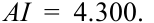

<!-- Formula Text: AI  =  4.300. -->
$$AI = 4{,}300$$

Bước 6: Sử dụng Phương trình 3 để giải tìm $PV^{Flat}$:

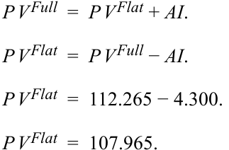

<!-- Formula Text: P V Full  =  P V Flat + AI. P V Flat  =  P V Full − AI. P V Flat  =  112.265 − 4.300. P V Flat  =  107.965. -->
$$PV^{Full} = PV^{Flat} + AI$$
$$PV^{Flat} = PV^{Full} - AI$$
$$PV^{Flat} = 112{,}265 - 4{,}300$$
$$PV^{Flat} = 107{,}965$$

_Lưu ý:_ Các đại lượng trong phép tính không được làm tròn trong quá trình tính toán, mặc dù chúng được hiển thị với ba chữ số thập phân cho mục đích trình bày. Kết quả cuối cùng được làm tròn đến ba chữ số thập phân.

### **MỐI QUAN HỆ GIỮA GIÁ TRÁI PHIẾU VÀ CÁC ĐẶC TÍNH CỦA TRÁI PHIẾU (*RELATIONSHIPS BETWEEN BOND PRICES AND BOND FEATURES*)**

# **<mark>3</mark>**

xác định mối quan hệ giữa giá trái phiếu, lãi suất coupon (*coupon rate*), kỳ hạn (*maturity*) và lợi suất đáo hạn (*yield-to-maturity*)

<!-- PDF Page 154 -->

#### **Mối Quan Hệ Ngược Chiều (*Inverse Relationship*)**

Như đã thấy trong bài học trước, giá của một trái phiếu lãi suất cố định sẽ thay đổi khi lãi suất được sử dụng để chiết khấu các dòng tiền tương lai thay đổi. Đối với bất kỳ phép tính giá trị thời gian của tiền tệ nào, lãi suất chiết khấu cao hơn sẽ dẫn đến giá trị hiện tại thấp hơn cho bất kỳ dòng tiền tương lai cố định nào, và lãi suất chiết khấu thấp hơn sẽ dẫn đến giá trị hiện tại cao hơn. Do đó, lợi suất đáo hạn và giá trái phiếu luôn biến động ngược chiều nhau.

#### **Hiệu Ứng Coupon (*Coupon Effect*)**

_Quy mô_ của các dòng tiền coupon của trái phiếu ảnh hưởng đến mức độ thay đổi giá trái phiếu đối với một mức thay đổi lợi suất nhất định cho các trái phiếu có cùng kỳ hạn. Lãi suất coupon của một trái phiếu càng thấp thì _tỷ trọng_ (*proportion*) của tổng dòng tiền phát sinh vào lúc đáo hạn càng cao. Việc chiết khấu dòng tiền cuối cùng này theo thừa số $(1 + r)^N$ như được thể hiện trong Phương trình 2 sẽ khuếch đại tác động của một sự thay đổi nhất định trong $r$ so với những trái phiếu có dòng tiền cuối cùng chiếm tỷ trọng nhỏ hơn trong tổng dòng tiền. Hiệu ứng coupon (*coupon effect*) này được minh họa rõ nhất bằng cách so sánh trường hợp cực đoan của một trái phiếu không trả lãi định kỳ (*zero-coupon bond*, với 100% dòng tiền bao gồm cả tiền lãi tích lũy được thanh toán khi đáo hạn) với một trái phiếu trả lãi cố định giống hệt về mọi mặt khác, như trong ví dụ sau đây.

##### **VÍ DỤ 5 (*EXAMPLE 5*)**

#### **Tác Động Thay Đổi Lợi Suất Đối Với Trái Phiếu Không Trả Lãi Định Kỳ so với Trái Phiếu Có Trả Lãi Coupon (*Yield Change Effect for Zero-Coupon vs. Coupon Bond*)**

Giả sử một nhà đầu tư có sự lựa chọn giữa trái phiếu Eurobond kỳ hạn 30 năm của Romania trả lãi cố định 4,625% được định giá ngang mệnh giá (*at par*) và một trái phiếu không trả lãi định kỳ (*zero-coupon bond*) giống hệt về mọi mặt khác từ cùng tổ chức phát hành ở cùng mức lợi suất đáo hạn là 4,625%.

Tính phần trăm thay đổi giá cho cả hai phương án trái phiếu nếu YTM tăng hoặc giảm 100 bps ngay khi phát hành.

Sử dụng Phương trình 1 (trái phiếu không trả lãi định kỳ) và hàm `PV` trong Excel hoặc Google Sheets (trái phiếu coupon 4,625%) để tính toán và so sánh những thay đổi này. Vui lòng tham khảo hệ sinh thái học tập dành cho ứng viên trực tuyến để xem bảng tính của các phép tính này trong sổ làm việc Microsoft Excel được tải xuống.

|Mệnh giá (*Face Value*)|100|
|---|---|
|Số kỳ / năm (*Periods / year*)|1|
|Tổng số kỳ (*Number of periods*)|30|
|Khoản thanh toán coupon (*Coupon payment*)|4,625|

|**Mức thay đổi (*Change*)**|**YTM**|**Giá (*Prices*)**||**Thay đổi giá (*Price Changes*)**||**Phần trăm thay đổi giá (*Percentage Price Changes*)**||
|---|---|---|---|---|---|---|---|
|||Coupon|Zero|Coupon|Zero|Coupon|Zero|
|--|0,04625|100,000|25,759|--|--|--|--|
|0,01|0,05625|85,665|19,364|–14,335|–6,395|–14,34%|–24,83%|
|–0,01|0,03625|118,107|34,361|18,107|8,601|18,11%|33,39%|

Với cùng một thời gian đáo hạn, trái phiếu có lãi suất coupon thấp hơn (hoặc không trả lãi định kỳ) có phần trăm thay đổi giá lớn hơn so với trái phiếu có lãi suất coupon cao hơn khi lãi suất chiết khấu thị trường thay đổi cùng một lượng.

<!-- PDF Page 155 -->

#### **Hiệu Ứng Kỳ Hạn (*Maturity Effect*)**

Thời gian đáo hạn (*time-to-maturity*) của một trái phiếu cũng ảnh hưởng đến mối quan hệ giá/lợi suất của trái phiếu đó. Nhìn chung, khi các yếu tố khác không đổi (*all else equal*), một trái phiếu dài hạn hơn có phần trăm thay đổi giá lớn hơn so với một trái phiếu ngắn hạn hơn khi lãi suất chiết khấu thị trường thay đổi cùng một lượng. Hiệu ứng kỳ hạn (*maturity effect*) là kết quả của giá trị $N$ lớn hơn trong Phương trình 2 đối với trái phiếu có kỳ hạn dài hơn.

##### **VÍ DỤ 6 (*EXAMPLE 6*)**

#### **Tác Động Thay Đổi Lợi Suất Đối Với Các Kỳ Hạn Khác Nhau (*Yield Change Effect for Different Maturities*)**

Giả sử một nhà đầu tư có sự lựa chọn giữa Trái phiếu A, có lãi suất coupon cố định 1,5% và kỳ hạn 30 năm được định giá ngang mệnh giá, và Trái phiếu B, một trái phiếu kỳ hạn 10 năm có lãi suất coupon cố định 1,5% được định giá ngang mệnh giá từ cùng một tổ chức phát hành.

Tính phần trăm thay đổi giá cho các trái phiếu này nếu YTM tăng hoặc giảm 100 bps ngay khi phát hành.

So sánh mức thay đổi giá ở trái phiếu kỳ hạn 10 năm và 30 năm bằng cách sử dụng hàm `PV` để tính toán và so sánh những thay đổi này. Vui lòng tham khảo hệ sinh thái học tập dành cho ứng viên trực tuyến để xem bảng tính của các phép tính này trong sổ làm việc Microsoft Excel được tải xuống.

|**Trái phiếu (*Bond*)**|**A**||**B**|
|---|---|---|---|
|Mệnh giá (*Face Value*)|100||100|
|Giá (*Price*)|100||100|
|Lãi suất coupon (*Coupon Rate*)|0,015||0,015|
|Khoản thanh toán coupon (*Coupon Payment*)|1,50||1,50|
|Kỳ hạn (*Maturity*)|30||10|
|**_YTM tăng 100 bps (100 bps rise in YTM)_**||||
|YTM||0,025||
|Giá (*Price*)|79,070||91,248|
|% thay đổi (*% change*)|–20,93%||–8,75%|
|**_YTM giảm 100 bps (100 bps fall in YTM)_**||||
|YTM||0,005||
|Giá (*Price*)|127,794||109,730|
|% thay đổi (*% change*)|27,79%||9,73%|

Chúng ta thấy rằng phần trăm thay đổi giá đối với trái phiếu có kỳ hạn dài hơn lớn hơn so với trái phiếu có kỳ hạn ngắn hơn. Ngoài ra, chúng ta thấy rằng, xét theo mức giá, sự thay đổi khi YTM _giảm_ lớn hơn so với khi YTM _tăng_.

Các ngoại lệ đối với hiệu ứng kỳ hạn có tồn tại nhưng rất hiếm gặp trên thực tế. Chúng chỉ xảy ra đối với các trái phiếu dài hạn có lãi suất coupon thấp (nhưng không phải trái phiếu không trả lãi định kỳ) đang giao dịch ở mức chiết khấu. Hiệu ứng kỳ hạn luôn luôn đúng đối với trái phiếu không trả lãi định kỳ (*zero-coupon bonds*), cũng như đối với các trái phiếu được định giá ngang mệnh giá (*at par value*) hoặc ở mức phần bù cao hơn mệnh giá (*at a premium above par value*).

#### **Quỹ Đạo Giá Theo Lợi Suất Không Đổi (*Constant-Yield Price Trajectory*)**

Giá trái phiếu thay đổi theo thời gian trôi qua, ngay cả khi lãi suất chiết khấu thị trường giữ nguyên không đổi. Khi thời gian trôi qua, tức là khi $N$ trong Phương trình 2 tiến dần về 0, người nắm giữ trái phiếu tiến gần hơn đến việc nhận lại mệnh giá khi đáo hạn, miễn là tổ chức phát hành không vỡ nợ. **Quỹ đạo giá theo lợi suất không đổi (*constant-yield price trajectory*)** trong Bảng minh họa 6 minh họa những thay đổi về giá

<!-- PDF Page 156 -->

của hai trái phiếu kỳ hạn 10 năm theo thời gian: một trái phiếu coupon 2% được phát hành ở mức chiết khấu và một trái phiếu coupon 8% được phát hành ở mức phần bù. Tại mỗi thời điểm, giá trái phiếu được tính lại bằng cách sử dụng cùng mức lãi suất chiết khấu thị trường là 5%.

**Bảng minh họa 6: Quỹ Đạo Giá Theo Lợi Suất Không Đổi (*Exhibit 6: Constant-Yield Price Trajectory*)**

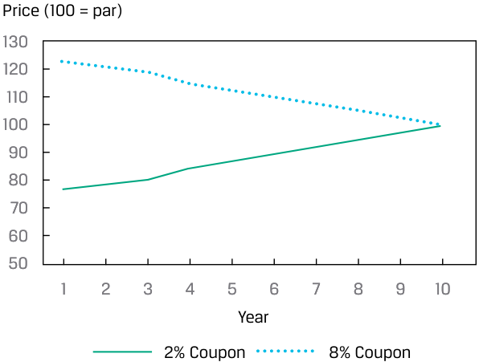

> **Chú thích hình ảnh:** Quỹ đạo giá theo lợi suất không đổi (*Constant-Yield Price Trajectory*) với trục tung là Giá (*Price*, 100 = mệnh giá) và trục hoành là Năm (*Year* từ 1 đến 10):
> - Đường nét đứt (Trái phiếu coupon 8%): Giá khởi đầu ở mức trên 120 và giảm dần về 100 khi đáo hạn.
> - Đường nét liền (Trái phiếu coupon 2%): Giá khởi đầu ở mức dưới 80 và tăng dần về 100 khi đáo hạn.

<!-- Picture Text: Price (100 = par) 130 120 110 100 90 80 70 60 50 1 2 3 4 5 6 7 8 9 10 Year 2% Coupon 8% Coupon  -->

Giá ban đầu của trái phiếu coupon 2% là 76,835 trên mỗi 100 đơn vị mệnh giá. Giá tăng lên mỗi năm và tiến dần về mệnh giá khi ngày đáo hạn đến gần. Giá ban đầu của trái phiếu coupon 8% là 123,165, và nó giảm xuống mỗi năm, tiến dần về mệnh giá khi ngày đáo hạn đến gần. Giá của cả hai trái phiếu đều “hội tụ về mệnh giá” (*“pulled to par”*). Vui lòng tham khảo hệ sinh thái học tập dành cho ứng viên trực tuyến để xem bảng tính của các phép tính này trong sổ làm việc Microsoft Excel được tải xuống.

#### **Hiệu Ứng Độ Lồi (*Convexity Effect*)**

_Phần trăm_ thay đổi trong giá của một trái phiếu cũng sẽ khác nhau tùy thuộc vào chiều hướng thay đổi của lợi suất. Phần trăm _tăng_ giá lớn hơn, xét theo giá trị tuyệt đối, so với phần trăm _giảm_ giá. Điều này ngụ ý rằng mối quan hệ giữa giá trái phiếu và lợi suất không phải là tuyến tính (*not linear*); thay vào đó, nó có dạng đường cong và “lồi” (*“convex”*). Bảng minh họa 7 thể hiện mối quan hệ tổng quát này giữa giá của một trái phiếu và lợi suất đáo hạn của nó.

<!-- PDF Page 157 -->

##### **Bảng minh họa 7: Mối Quan Hệ Giá–Lợi Suất Lồi (*Exhibit 7: Convex Price–Yield Relationship*)**

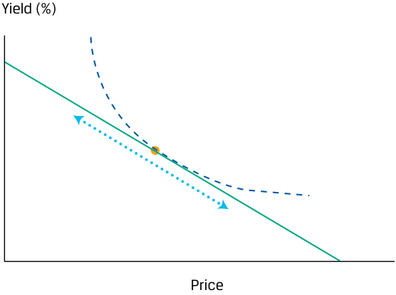

> **Chú thích hình ảnh:** Đường cong lồi biểu diễn mối quan hệ nghịch biến phi tuyến tính giữa Giá (*Price* - trục tung) và Lợi suất (*Yield (%)* - trục hoành).

<!-- Picture Text: Yield (%) Price  -->

##### **VÍ DỤ 7 (*EXAMPLE 7*)**

#### **Trái Phiếu BRWA: Mối Quan Hệ Lồi (*BRWA Bond: Convex Relationship*)**

Mặc dù lợi suất đáo hạn hàng năm của trái phiếu BRWA tăng và giảm một lượng đồng nhất như nhau, hãy lưu ý cách thức mà các mức thay đổi giá tương ứng lại khác nhau. Vui lòng tham khảo hệ sinh thái học tập dành cho ứng viên trực tuyến để xem bảng tính của các phép tính này trong sổ làm việc Microsoft Excel được tải xuống.

|Mệnh giá (*Face Value*)|||100|
|---|---|---|---|
|Khoản thanh toán coupon (*Coupon payment*)|||1,6|
|Số kỳ (*Number of periods*)|||10|
|**Thay đổi YTM (*YTM Change*)**|**YTM**|**Giá (*Price*)**|**% Thay đổi giá (*% Price Change*)**|
|--|0,016|100,00|--|
|0,004|0,020|96,41|–3,59%|
|–0,004|0,012|103,75|3,75%|

Việc lợi suất đáo hạn định kỳ giảm từ 160 bps xuống 120 bps dẫn đến mức tăng giá trái phiếu là 3,75%, nhưng việc YTM tăng từ 160 bps lên 200 bps lại dẫn đến mức giảm giá trái phiếu _nhỏ hơn_ (3,59%). Dựa trên điều này, chúng ta có thể nói rằng trái phiếu BRWA có độ lồi _dương_ (*positive convexity*). Độ lồi sẽ được thảo luận chi tiết hơn trong một bài học sau.

<!-- PDF Page 158 -->

##### **KIỂM TRA KIẾN THỨC (*KNOWLEDGE CHECK*)**

1. Hãy nhớ lại trái phiếu Romania từ Ví dụ 4. Trái phiếu này trả lãi coupon hàng năm ở mức 4,625% và có mệnh giá là 100. Ngày phát hành của nó là ngày 3 tháng 4 năm 2019 và ngày đáo hạn là ngày 3 tháng 4 năm 2049. Hãy tính lợi suất đáo hạn ban đầu tại thời điểm phát hành nếu giá phát hành của nó là 99,488.

##### **Lời giải:**

Lợi suất đáo hạn ban đầu là 4,657%. Các đối số của hàm `YIELD` trong Microsoft Excel hoặc Google Sheets như sau:

`=YIELD(settlement, maturity, rate, pr, redemption, frequency,[basis])`

`=YIELD(DATE(2019,4,3),DATE(2049,4,3),0.04625,99.488,100,1)`

`= 4.657%`

2. Mô tả hiệu ứng coupon (*coupon effect*).

##### **Lời giải:**

Cho hai trái phiếu trả lãi cố định không kèm quyền mua lại trước hạn có lãi suất coupon khác nhau nhưng giống hệt nhau về mọi mặt khác, đối với một mức thay đổi trong lợi suất, trái phiếu có lãi suất coupon thấp hơn sẽ có phần trăm thay đổi giá lớn hơn so với trái phiếu có lãi suất coupon cao hơn.

3. Mô tả hiệu ứng kỳ hạn (*maturity effect*).

##### **Lời giải:**

Nhìn chung, đối với hai trái phiếu giống hệt nhau ngoại trừ thời gian đáo hạn của chúng, trái phiếu có kỳ hạn dài hơn sẽ có phần trăm thay đổi giá lớn hơn so với trái phiếu có kỳ hạn ngắn hơn khi lợi suất thay đổi cùng một lượng.

4. Hai trái phiếu trả lãi cố định không kèm quyền mua lại trước hạn có cùng ngày đáo hạn. Một trái phiếu giao dịch ở mức chiết khấu; trái phiếu kia giao dịch ở mức phần bù. Nếu lợi suất giữ nguyên không đổi cho đến khi các trái phiếu đáo hạn và không có trái phiếu nào vỡ nợ, giá của hai trái phiếu này theo thời gian sẽ:

   - **A.** hội tụ (*converge*).

   - **B.** giữ nguyên không đổi (*remain unchanged*).

   - **C.** phân kỳ (*diverge*).

##### **Lời giải:**

A là đáp án đúng. Giá của chúng sẽ hội tụ do hiệu ứng “kéo về mệnh giá” (*“pull-to-par” effect*). Khi ngày đáo hạn đến gần, giá trị hiện tại của các dòng tiền tương lai sẽ giảm xuống hoặc tăng lên tiến về mệnh giá, miễn là tổ chức phát hành không vỡ nợ.

# **<mark>4</mark> ĐỊNH GIÁ MA TRẬN (*MATRIX PRICING*)**

<!-- PDF Page 159 -->

mô tả phương pháp định giá ma trận (*matrix pricing*)

#### **Quy Trình Định Giá Ma Trận (*Matrix Pricing Process*)**

Không giống như các chứng khoán vốn cổ phần niêm yết, hầu hết các trái phiếu không được giao dịch sôi động, vì vậy thường không có sẵn giá thị trường hiện hành để tính lợi suất đáo hạn. Vấn đề tương tự cũng xảy ra đối với các trái phiếu chưa được phát hành. Trong những tình huống này, người ta thường ước tính giá bằng cách sử dụng giá của các trái phiếu tương đương (*comparable bonds*) nhưng được giao dịch thường xuyên hơn. Các trái phiếu tương đương này có thời gian đáo hạn, lãi suất coupon và chất lượng tín dụng tương tự. Quy trình ước tính này, được minh họa trong Bảng minh họa 8 và Bảng minh họa 9, được gọi là **định giá ma trận (*matrix pricing*)**.

**Bảng minh họa 8: Định Giá Ma Trận (*Exhibit 8: Matrix Pricing*)**

> **Chú thích hình ảnh:** Đồ thị minh họa Định giá ma trận (*Matrix Pricing*):
> - Trục hoành: Kỳ hạn tính theo năm (*Maturity Years*: 2, 3, 5, 7, 10, 30); chỉ ra Kỳ hạn của trái phiếu giao dịch không sôi động (*Maturity of inactively traded bond*).
> - Đường dưới cùng: Đường cong lợi suất trái phiếu chính phủ mới phát hành (*Sovereign “on-the-run” yield curve*).
> - Các điểm chấm tròn: Lợi suất của các trái phiếu được giao dịch sôi động từ các tổ chức phát hành tương tự (*Yields of actively traded bonds for similar issuers*).
> - Điểm chấm vuông (nội suy giữa hai điểm chấm tròn): Lợi suất đáo hạn ước tính của trái phiếu giao dịch không sôi động (*Yield-to-Maturity of inactively traded bond*).

<!-- Picture Text: Maturity (Years) Maturity of inactively traded bond Yield-to-Maturity of Inactively traded bond Yields of actively traded bonds for similar issuers Sovereign “on-the-run” yield curve 2 3 5 7 10 30 Maturity Years  -->

**Bảng minh họa 9: Xác Định Giá của Trái Phiếu Mới hoặc Kém Thanh Khoản Bằng Định Giá Ma Trận (*Exhibit 9: Determining Price of New or Illiquid Bond Using Matrix Pricing*)**

|Bước 1 (*Step 1*)|Bước 2 (*Step 2*)|Bước 3 (*Step 3*)|Bước 4 (*Step 4*)|
|---|---|---|---|
|Xác định các trái phiếu tương đương được giao dịch sôi động dựa trên thời gian đáo hạn, lãi suất coupon và chất lượng tín dụng tương tự.|Tính toán lợi suất đáo hạn (YTM) cho từng trái phiếu tương đương, và tính lợi suất trung bình cho mỗi năm đáo hạn.|Nội suy tuyến tính (*linearly interpolate*) các mức YTM đã tính của các trái phiếu tương đương để ước tính YTM gần nhất với kỳ hạn của trái phiếu mới/kém thanh khoản.|Sử dụng mức YTM ước tính, tính giá của trái phiếu mới/kém thanh khoản bằng cách chiết khấu tất cả các khoản thanh toán coupon và gốc.|

Ví dụ, giả sử một chuyên viên phân tích cần định giá một trái phiếu doanh nghiệp kỳ hạn 3 năm, trả lãi coupon bán niên 4%/năm, gọi là Trái phiếu X. Giả sử Trái phiếu X không được giao dịch sôi động và không có giao dịch gần đây nào được báo cáo cho chứng khoán cụ thể này. Bảng minh họa 10 và Bảng minh họa 11 thể hiện giá yết và lợi suất đáo hạn của bốn trái phiếu doanh nghiệp có chất lượng tín dụng rất tương đồng, dưới dạng bảng và dạng ma trận (theo lãi suất coupon và thời gian đáo hạn).

<!-- PDF Page 160 -->

**Bảng minh họa 10: Các Trái Phiếu Tương Đương Được Giao Dịch Sôi Động (*Exhibit 10: Actively Traded Comparable Bonds*)**

> **Chú thích hình ảnh:** Bảng thông số 4 trái phiếu tương đương được giao dịch sôi động:
> - Trái phiếu A (*Bond A*): Kỳ hạn (*Tenor*) 2 năm, Coupon (Bán niên - S/A) 3,00%, Giá (*Price*) 98,5, Lợi suất đáo hạn (*Yield-to-Maturity*) 3,786%.
> - Trái phiếu B (*Bond B*): Kỳ hạn 2 năm, Coupon (S/A) 5,00%, Giá 102,25, Lợi suất đáo hạn 3,821%.
> - Trái phiếu C (*Bond C*): Kỳ hạn 5 năm, Coupon (S/A) 2,00%, Giá 90,25, Lợi suất đáo hạn 4,181%.
> - Trái phiếu D (*Bond D*): Kỳ hạn 5 năm, Coupon (S/A) 4,00%, Giá 99,125, Lợi suất đáo hạn 4,196%.

<!-- Picture Text: Bond Tenor Coupon (S/A) Price Yield-to-Maturity A 2 years 3.00% 98.5 3.786% B 2 years 5.00% 102.25 3.821% C 5 years 2.00% 90.25 4.181% D 5 years 4.00% 99.125 4.196%  -->

**Bảng minh họa 11: Ma Trận Các Trái Phiếu Tương Đương Được Giao Dịch Sôi Động (*Exhibit 11: Actively Traded Comparable Bonds Matrix*)**

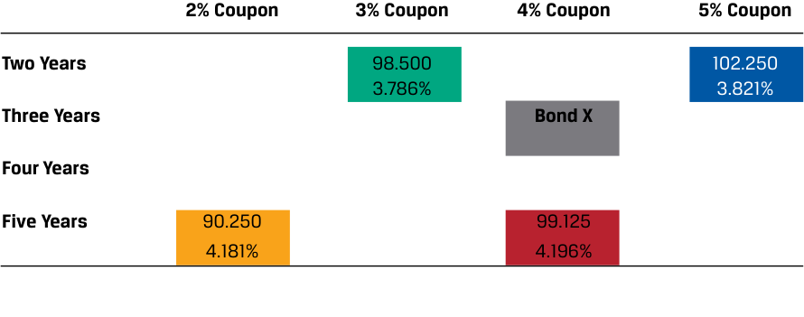

> **Chú thích hình ảnh:** Ma trận các trái phiếu tương đương theo Kỳ hạn (2 năm, 3 năm, 4 năm, 5 năm) và Lãi suất Coupon (2%, 3%, 4%, 5%):
> - Hàng Hai năm (*Two Years*): Cột 3% Coupon (98,500; 3,786%), Cột 5% Coupon (102,250; 3,821%).
> - Hàng Ba năm (*Three Years*): Cột 4% Coupon là Trái phiếu X (*Bond X*).
> - Hàng Năm năm (*Five Years*): Cột 2% Coupon (90,250; 4,181%), Cột 4% Coupon (99,125; 4,196%).

<!-- Picture Text: 2% Coupon 3% Coupon 4% Coupon 5% Coupon Two Years 98.500 102.250 3.786% 3.821% Three Years Bond X Four Years Five Years 90.250 99.125 4.181% 4.196%  -->

Tiếp theo, chuyên viên phân tích tính lợi suất trung bình cho mỗi năm đáo hạn: 3,8035% đối với các trái phiếu kỳ hạn 2 năm và 4,1885% đối với các trái phiếu kỳ hạn 5 năm.

<!-- Formula Text: 0.03786 + 0.03821 ______________ 2 =  3.8035% -->
$$\frac{0{,}03786 + 0{,}03821}{2} = 3{,}8035\%$$

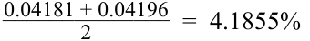

<!-- Formula Text: 0.04181 + 0.04196 ______________ 2 =  4.1855% -->
$$\frac{0{,}04181 + 0{,}04196}{2} = 4{,}1885\% \quad (\text{trong ảnh gốc in nhầm là } 4{,}1855\%)$$

Lợi suất kỳ hạn 3 năm ước tính cho các trái phiếu có chất lượng tín dụng tương tự có thể thu được bằng phương pháp nội suy tuyến tính (*linear interpolation*). Lợi suất nội suy là 3,932%.

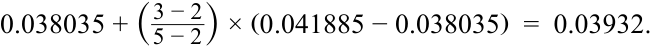

<!-- Formula Text: 0.038035 + ( 3 − 2 _ 5 − 2 ) × (0.041885 − 0.038035)  =  0.03932. -->
$$0{,}038035 + \left(\frac{3 - 2}{5 - 2}\right) \times (0{,}041885 - 0{,}038035) = 0{,}03932$$

Sử dụng 3,9318% làm mức lợi suất hàng năm ước tính cho kỳ hạn 3 năm (tương đương lãi suất bán niên là $3{,}9318\% / 2 = 1{,}9659\%$), trái phiếu doanh nghiệp kỳ hạn 3 năm trả lãi coupon bán niên 4%/năm có mức giá ước tính là 100,191 trên mỗi 100 đơn vị mệnh giá.

<!-- Formula Text: 2 _ (1.019659) 1  + 2 _ (1.019659) 2  + 2 _ (1.019659) 3  + 2 _ (1.019659) 4  + 2 _ (1.019659) 5 + 102 _ (1.019659) 6   =  100.191. -->
$$\frac{2}{(1{,}019659)^1} + \frac{2}{(1{,}019659)^2} + \frac{2}{(1{,}019659)^3} + \frac{2}{(1{,}019659)^4} + \frac{2}{(1{,}019659)^5} + \frac{102}{(1{,}019659)^6} = 100{,}191$$

Việc tính toán lợi suất đáo hạn cũng có thể được thực hiện bằng hàm `YIELD` trong Excel hoặc Google Sheets:

`=YIELD(DATE(2025,10,1),DATE(2028,10,1),0.04,100.191,100,2,1)`

<!-- PDF Page 161 -->

Định giá ma trận cũng được sử dụng trong việc bảo lãnh phát hành các trái phiếu mới nhằm thu được ước tính về **mức chênh lệch lợi suất yêu cầu (*required yield spread*)** so với lãi suất chuẩn (*benchmark rate*), tức là sự chênh lệch về lợi suất đáo hạn giữa trái phiếu đó và một trái phiếu chuẩn của chính phủ có cùng thời gian đáo hạn hoặc có thời gian đáo hạn tương tự.

Giả sử một tập đoàn sắp phát hành một trái phiếu kỳ hạn 5 năm. Tổ chức phát hành doanh nghiệp này hiện đang có một khoản nợ trái phiếu kỳ hạn 4 năm, trả lãi coupon hàng năm 3%. Giá của trái phiếu đó là 102,400 trên mỗi 100 đơn vị mệnh giá. Đây là giá gộp, bằng đúng với giá tịnh bởi vì lãi tích lũy bằng không. Điều này ngụ ý rằng khoản thanh toán coupon vừa mới được thực hiện và còn trọn vẹn 4 năm nữa là đến khi đáo hạn. Tỷ suất sinh lợi kỳ hạn 4 năm mà các nhà đầu tư yêu cầu đối với trái phiếu này là 2,36%:

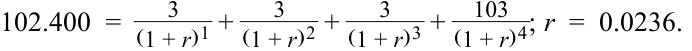

<!-- Formula Text: 102.400  = 3 _ (1 + r) 1  + 3 _ (1 + r) 2  + 3 _ (1 + r) 3  +   103 _ (1 + r) 4 ; r  =  0.0236. -->
$$102{,}400 = \frac{3}{(1 + r)^1} + \frac{3}{(1 + r)^2} + \frac{3}{(1 + r)^3} + \frac{103}{(1 + r)^4}; \quad r = 0{,}0236$$

Kết quả này cũng có thể được tính bằng hàm `YIELD` trong Microsoft Excel hoặc Google Sheets:

`=YIELD(DATE(2025,10,1),DATE(2029,10,1),0.03,102.401,100,2,1)`

Giả sử không có trái phiếu chính phủ kỳ hạn 4 năm để tính mức chênh lệch lợi suất yêu cầu trên chứng khoán này. Tuy nhiên, có các trái phiếu chính phủ kỳ hạn 3 năm và 5 năm có lợi suất đáo hạn lần lượt là 0,75% và 1,45%. Trung bình cộng của hai mức lợi suất đáo hạn này là 1,10%, đây là mức lợi suất ước tính cho trái phiếu chính phủ kỳ hạn 4 năm. Do đó, mức chênh lệch lợi suất yêu cầu ước tính là 126 bps cao hơn lãi suất chuẩn ngầm định ($0{,}0236 - 0{,}0110 = 0{,}0126$).

Tổ chức phát hành hiện đã có một ước tính về mức chênh lệch lợi suất kỳ hạn 4 năm: 126 bps. Mức chênh lệch này là điểm tham chiếu để ước tính mức chênh lệch kỳ hạn 5 năm cho trái phiếu mới phát hành.

##### **BỘ CÂU HỎI (*QUESTION SET*)**

1. Đúng hay sai: Báo giá trái phiếu trên các nền tảng như Bloomberg thường đại diện cho mức giá mà tại đó giao dịch gần nhất của trái phiếu đó được thực hiện.

   - **A.** Đúng (*True*)

   - **B.** Sai (*False*)

   - **Lời giải:**

Sai. Hầu hết các trái phiếu được giao dịch không thường xuyên, vì vậy báo giá trên các nền tảng như Bloomberg thường được ước tính bằng các phương pháp định giá ma trận (*matrix pricing methods*).

2. Một chuyên viên phân tích đang ước tính giá cho một trái phiếu doanh nghiệp kém thanh khoản có kỳ hạn 4 năm, trả lãi coupon hàng năm 4,5%. Chuyên viên phân tích xác định được hai trái phiếu doanh nghiệp có chất lượng tín dụng tương tự: Một là trái phiếu kỳ hạn 3 năm, trả lãi coupon hàng năm 5,50% được định giá ở mức 107,500 trên mỗi 100 đơn vị mệnh giá, và trái phiếu kia là trái phiếu kỳ hạn 5 năm, trả lãi coupon hàng năm 4,50% được định giá ở mức 104,750 trên mỗi 100 đơn vị mệnh giá. Sử dụng định giá ma trận, mức giá ước tính của trái phiếu kém thanh khoản trên mỗi 100 đơn vị mệnh giá _gần nhất_ với:

**A.** 103,895.

**B.** 104,991.

**C.** 106,125.

##### **Lời giải:**

B là đáp án đúng. Bước đầu tiên là xác định lợi suất đáo hạn trên các trái phiếu quan sát được. Lợi suất yêu cầu đối với trái phiếu kỳ hạn 3 năm, coupon 5,50% có giá 107,500 là 2,856%:

<!-- PDF Page 162 -->

<!-- Formula Text: 107.500  =    5.50 _ (1 + r) 1  +   5.50 _ (1 + r) 2  +  105.50 _ (1 + r) 3 ; r  =  0.02856. -->
$$107{,}500 = \frac{5{,}50}{(1 + r)^1} + \frac{5{,}50}{(1 + r)^2} + \frac{105{,}50}{(1 + r)^3}; \quad r = 0{,}02856$$

Lợi suất yêu cầu đối với trái phiếu kỳ hạn 5 năm, coupon 4,50% có giá 104,750 là 3,449%:

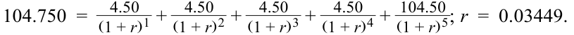

<!-- Formula Text: 104.750  =    4.50 _ (1 + r) 1  +   4.50 _ (1 + r) 2  +   4.50 _ (1 + r) 3  +   4.50 _ (1 + r) 4  +  104.50 _ (1 + r) 5 ; r  =  0.03449. -->
$$104{,}750 = \frac{4{,}50}{(1 + r)^1} + \frac{4{,}50}{(1 + r)^2} + \frac{4{,}50}{(1 + r)^3} + \frac{4{,}50}{(1 + r)^4} + \frac{104{,}50}{(1 + r)^5}; \quad r = 0{,}03449$$

Lợi suất ước tính cho một trái phiếu kỳ hạn 4 năm có cùng chất lượng tín dụng là trung bình cộng của hai mức lợi suất yêu cầu:

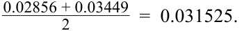

<!-- Formula Text: 0.02856 + 0.03449 ______________ 2 =  0.031525. -->
$$\frac{0{,}02856 + 0{,}03449}{2} = 0{,}031525$$

Với lợi suất đáo hạn ước tính là 3,153%, giá ước tính của trái phiếu doanh nghiệp kém thanh khoản kỳ hạn 4 năm, trả lãi coupon hàng năm 4,50% là 104,991 trên mỗi 100 đơn vị mệnh giá:

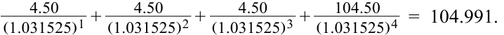

<!-- Formula Text: 4.50 _ (1.031525) 1  + 4.50 _ (1.031525) 2  + 4.50 _ (1.031525) 3  + 104.50 _ (1.031525) 4   =  104.991. -->
$$\frac{4{,}50}{(1{,}031525)^1} + \frac{4{,}50}{(1{,}031525)^2} + \frac{4{,}50}{(1{,}031525)^3} + \frac{104{,}50}{(1{,}031525)^4} = 104{,}991$$

3. Một chuyên viên phân tích sử dụng phương pháp định giá ma trận để xác định giá của một trái phiếu kém thanh khoản. Hãy xác định ba đặc tính của trái phiếu có thể được sử dụng để so sánh các trái phiếu được giao dịch thường xuyên với trái phiếu kém thanh khoản đó.

   - **Lời giải:**

Định giá ma trận bao gồm việc xác định giá của một trái phiếu mới hoặc kém thanh khoản bằng cách so sánh nó với các trái phiếu được giao dịch thường xuyên có sự tương đồng về:

**1.** kỳ hạn (*maturity*),

**2.** lãi suất coupon (*coupon rates*), và

**3.** chất lượng tín dụng (*credit quality*).

<!-- PDF Page 163 -->

## **CÂU HỎI THỰC HÀNH (*PRACTICE PROBLEMS*)**

**1.** Một trái phiếu trả lãi cố định không kèm quyền mua lại trước hạn có giá là 106,0625 và YTM là 2,8%. Nếu YTM tăng tức thời thêm 80 bps, giá của trái phiếu sẽ giảm 11%. Nếu YTM giảm tức thời đi 80 bps, giá của trái phiếu sẽ tăng thêm:

   - **A.** ít hơn 11%.

   - **B.** đúng bằng 11%.

   - **C.** nhiều hơn 11%.

**2.** Các ngoại lệ đối với hiệu ứng kỳ hạn (*maturity effect*) tồn tại đối với các trái phiếu có:

   - **A.** kỳ hạn dài, trả các khoản thanh toán coupon nhỏ và giao dịch ở mức chiết khấu.

   - **B.** kỳ hạn ngắn, có lãi suất coupon cao và giao dịch ở mức chiết khấu.

   - **C.** kỳ hạn dài, có lãi suất coupon cao và giao dịch ở mức phần bù.

**3.** Với lãi suất chiết khấu thị trường không đổi, khi một trái phiếu trả lãi cố định không kèm quyền mua lại trước hạn tiến gần đến ngày đáo hạn:

   - **A.** mối quan hệ giá–lợi suất sẽ trở nên lồi hơn (*more convex*).

   - **B.** một trái phiếu có lãi suất coupon thấp đang giao dịch ở mức chiết khấu sẽ tăng giá.

   - **C.** một trái phiếu có lãi suất coupon cao đang giao dịch ở mức phần bù sẽ tăng giá.

**4.** Một chuyên viên phân tích thu nhập cố định đang định giá một trái phiếu bằng phương trình sau đây.

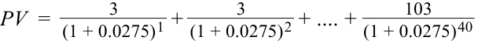

<!-- Formula Text: PV  = 3 _ (1 + 0.0275) 1  + 3 _ (1 + 0.0275) 2  + .... + 103 ___________ (1 + 0.0275) 40 -->
$$PV = \frac{3}{(1 + 0{,}0275)^1} + \frac{3}{(1 + 0{,}0275)^2} + \dots + \frac{103}{(1 + 0{,}0275)^{40}}$$

Giá của trái phiếu này, so với mệnh giá, _nhiều khả năng nhất_ là:

   - **A.** lớn hơn 100.

   - **B.** bằng đúng 100.

   - **C.** nhỏ hơn 100.

**5.** Một trái phiếu kỳ hạn 4 năm, lãi suất coupon bán niên 2,0%/năm (trả lãi định kỳ mỗi nửa năm) đang giao dịch ở mức giá 102,581. Lợi suất đáo hạn quy đổi theo năm (*annualized yield-to-maturity*) của trái phiếu này _gần nhất với_:

**A.** 0,67%.

**B.** 1,34%.

**C.** 2,22%.

**6.** Một trái phiếu được giao dịch ở giữa các ngày thanh toán coupon của nó. Phát biểu nào sau đây là đúng?

   - **A.** Người mua phải trả giá gộp (*full price*) cộng với lãi tích lũy (*accrued interest*).

   - **B.** Giá yết (*quoted price*) của trái phiếu lớn hơn giá tịnh (*flat price*) của nó.

   - **C.** Lãi tích lũy không được bao gồm trong giá tịnh (*flat price*).

<!-- PDF Page 164 -->

**7.** Một chuyên viên phân tích đang phân tích một trái phiếu sắp được Công ty XYZ phát hành. Trái phiếu mới sẽ có thời gian đáo hạn là 5 năm và lãi suất coupon 2,25%, trả bán niên. XYZ chưa từng phát hành trái phiếu trước đây, vì vậy chuyên viên phân tích sẽ sử dụng phương pháp định giá ma trận. Chuyên viên phân tích đã xác định được bốn trái phiếu tương tự có các đặc điểm sau đây.

|**Trái phiếu (*Bond*)**|**Kỳ hạn (*Maturity*)**|**Coupon (Bán niên - S/A)**|**YTM**|
|---|---|---|---|
|A|4 năm|2,250%|1,6995%|
|B|4 năm|1,750%|1,5438%|
|C|7 năm|2,250%|2,2671%|
|D|7 năm|1,500%|1,9576%|

Sử dụng thông tin được cung cấp, hãy lập một ma trận định giá để chuyên viên phân tích ước tính giá của trái phiếu XYZ kỳ hạn 5 năm bằng cách điền các Trái phiếu A, B, C và D vào ma trận dưới đây:

|||**Lãi Suất Coupon (*Coupon Rate*)**|||
|---|---|---|---|---|
||**1,50%**|**1,75%**|**2,25%**|**2,25%**|
|4 năm (*4 Years*)|||||
|5 năm (*5 Years*)|||||
|6 năm (*6 Years*)|||||
|7 năm (*7 Years*)|||||

<!-- PDF Page 165 -->

## **LỜI GIẢI (*SOLUTIONS*)**

1. C là đáp án đúng. Mức tăng giá tuyệt đối sẽ lớn hơn mức giảm giá tuyệt đối cho cùng một mức thay đổi tuyệt đối trong YTM bởi vì mối quan hệ lồi (*convex relationship*) giữa giá trái phiếu và lợi suất.

   - A không đúng vì mối quan hệ lồi dương (*positive convex relationship*) giữa giá trái phiếu và lợi suất. Đối với một mức thay đổi lợi suất nhất định, mức tăng giá khi lợi suất giảm đi lượng đó sẽ lớn hơn mức giảm giá khi lợi suất tăng lên cùng lượng đó.

   - B không đúng vì mối quan hệ giữa giá trái phiếu và lợi suất không phải là tuyến tính.

2. A là đáp án đúng. Các ngoại lệ đối với hiệu ứng kỳ hạn rất hiếm gặp và chỉ xảy ra đối với các trái phiếu dài hạn có lãi suất coupon thấp (nhưng không phải trái phiếu không trả lãi định kỳ) đang giao dịch ở mức chiết khấu. B không đúng vì hiệu ứng kỳ hạn luôn đúng đối với các trái phiếu có kỳ hạn ngắn và lãi suất coupon cao.

   - C không đúng vì hiệu ứng kỳ hạn luôn luôn đúng đối với các trái phiếu được định giá ở mức phần bù cao hơn mệnh giá.

3. B là đáp án đúng. Bất kỳ trái phiếu nào đang giao dịch ở mức chiết khấu đều sẽ tăng giá do hiệu ứng kéo về mệnh giá (*pull-to-par effect*).

   - A không đúng vì mối quan hệ giá–lợi suất nhìn chung trở nên ít lồi hơn khi trái phiếu tiến gần đến ngày đáo hạn.

   - C không đúng vì một trái phiếu có lãi suất coupon cao đang giao dịch ở mức phần bù sẽ giảm giá khi tiến gần đến ngày đáo hạn.

4. A là đáp án đúng. Lãi suất coupon định kỳ của trái phiếu (3%) vượt quá lãi suất chiết khấu thị trường định kỳ (2,75%), hay lãi suất coupon của nó là “vượt trội/dư thừa” (*“excessive”*) so với thị trường. Do đó, trái phiếu sẽ giao dịch ở mức phần bù so với mệnh giá (lớn hơn 100). B không đúng. Để trái phiếu giao dịch ngang mệnh giá, lãi suất coupon và lãi suất chiết khấu thị trường (lợi suất đáo hạn) phải bằng nhau.

   - C không đúng. Để trái phiếu giao dịch ở mức chiết khấu, lợi suất đáo hạn phải cao hơn lãi suất coupon.

5. B là đáp án đúng. Hai phương pháp tiếp cận để tính lợi suất đáo hạn là tính IRR hoặc sử dụng hàm `YIELD` trong Microsoft Excel hay Google Sheets. IRR định kỳ được quy đổi theo năm bằng cách nhân với hai.

|**Kỳ (*Period*)**|**Dòng tiền (*Cash Flow*)**|**Hàm YIELD (*YIELD Function*)**||
|---|---|---|---|
|0|–102,581|Ngày thanh toán (*Settlement date*)|1/1/2000|
|1|1|Ngày đáo hạn (*Maturity date*)|1/1/2004|
|2|1|Lãi suất coupon (*Coupon*)|0,02|
|3|1|Giá (*Price*)|102,581|
|4|1|Giá trị hoàn trả (*Redemption*)|100|
|5|1|Tần suất coupon (*Coupon frequency*)|2|
|6|1|**Lợi suất (*Yield*)**|**1,34%**|
|7|1|||
|8|101|||
|**IRR định kỳ (*Periodic IRR*)**|**0,67%**|||
|**IRR quy đổi năm (*Annualized IRR*)**|**1,34%**|||

A không đúng vì 0,67% là lợi suất đáo hạn định kỳ (nửa năm), chứ không phải lợi suất quy đổi theo năm.

<!-- PDF Page 166 -->

C không đúng. Lưu ý rằng phương án này có thể bị loại trừ ngay bởi vì trái phiếu đang giao dịch ở mức phần bù; do đó lợi suất đáo hạn của nó phải thấp hơn mức lãi suất coupon 2,0% của nó. Vui lòng tham khảo hệ sinh thái học tập dành cho ứng viên trực tuyến để xem bảng tính của các phép tính này trong sổ làm việc Microsoft Excel được tải xuống.

6. C là đáp án đúng. Giá tịnh (*flat price*), được các nhà tạo lập thị trường trái phiếu báo giá, bằng giá gộp (*full price*) trừ đi lãi tích lũy (*accrued interest*). Lãi tích lũy không được bao gồm trong giá tịnh. A không đúng. Người mua phải trả giá gộp, trong đó đã bao gồm lãi tích lũy.

B không đúng. Giá tịnh chính là giá yết (*quoted price*).

7. Để định giá trái phiếu XYZ mới, chuyên viên phân tích nên nhóm lợi suất của các trái phiếu tương đương vào một ma trận theo kỳ hạn và lãi suất coupon.

|||**Lãi Suất Coupon (*Coupon Rate*)**|||
|---|---|---|---|---|
||**1,50%**|**1,75%**|**2,25%**|**2,25%**|
|4 năm (*4 Years*)||B||A|
|5 năm (*5 Years*)|||||
|6 năm (*6 Years*)|||||
|7 năm (*7 Years*)|D||C||
