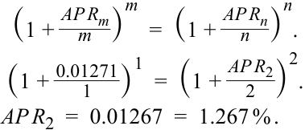
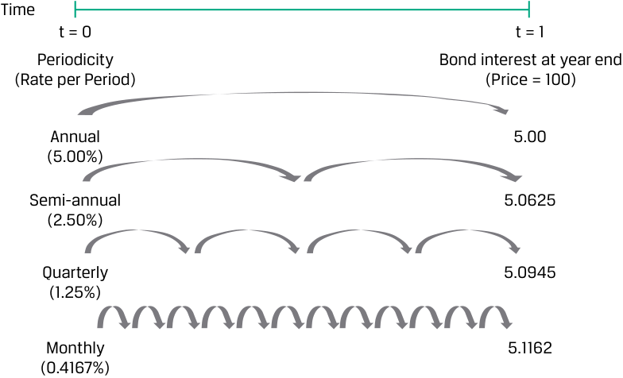
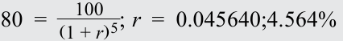
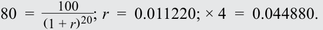
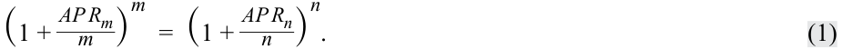
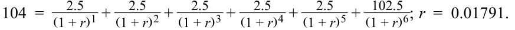
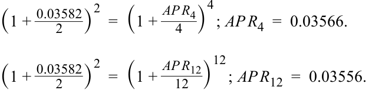
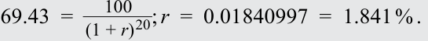
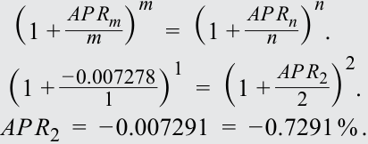
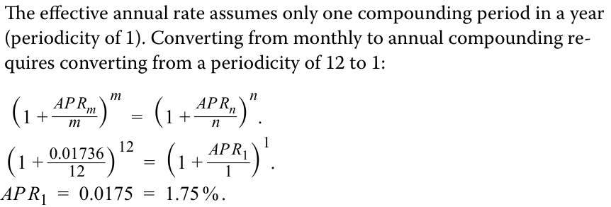

# Tập 6: Chứng Khoán Thu Nhập Cố Định (*Fixed Income*)
## Học phần 7: Các Thước Đo Lợi Suất và Chênh Lệch Lợi Suất Cho Trái Phiếu Lãi Suất Cố Định (*Yield and Yield Spread Measures for Fixed-Rate Bonds*)
### Phần 1/2: Giới thiệu (Trang PDF 167–182)

---

<!-- PDF Page 167 -->

#### H Ọ C P H Ầ N

# **<mark>7</mark>**

### **Các Thước Đo Lợi Suất và Chênh Lệch Lợi Suất Cho Trái Phiếu Lãi Suất Cố Định (*Yield and Yield Spread Measures for Fixed-Rate Bonds*)**

###### **<mark>MỤC TIÊU HỌC TẬP (*LEARNING OUTCOMES*)</mark>**

**_Mức độ thành thạo — Ứng viên cần có khả năng:_**
- tính toán lợi suất hàng năm trên một trái phiếu cho các số kỳ ghép lãi (*compounding periods*) khác nhau trong một năm
- so sánh, tính toán và diễn giải các thước đo lợi suất (*yield measures*) và chênh lệch lợi suất (*yield spread measures*) cho trái phiếu lãi suất cố định

##### **GIỚI THIỆU (*INTRODUCTION*)**

**<mark>1</mark>**

Các bài học trước đã minh họa mối quan hệ giữa giá trái phiếu và lợi suất đáo hạn (*yields-to-maturity* – YTMs), cũng như các đặc tính khác, chẳng hạn như lãi suất coupon và thời gian đáo hạn. Hai yếu tố cần cân nhắc quan trọng để diễn giải và xác định lợi suất đáo hạn cùng các thước đo lợi suất khác là tần suất ghép lãi giả định (*assumed frequency of compounding interest*) và sự hiện diện của các quyền chọn đi kèm (*embedded options*) có thể làm ảnh hưởng đến quy mô hoặc thời điểm của dòng tiền. Học phần này khám phá những yếu tố đó và mở rộng việc phân tích lợi suất bằng cách giới thiệu các thước đo chênh lệch lợi suất (*spread measures*), dùng để so sánh lợi suất với các lãi suất chuẩn (*benchmark rates*) nhằm xác định mức độ đền bù mà một nhà đầu tư nhận được khi chấp nhận những rủi ro nhất định.

Hầu hết các ví dụ và bảng minh họa được sử dụng xuyên suốt bài đọc này có thể được tải xuống dưới dạng sổ làm việc Microsoft Excel. Mỗi trang tính trong sổ làm việc được gắn nhãn với số thứ tự ví dụ hoặc bảng minh họa tương ứng trong bài học.

###### **TỔNG QUAN HỌC PHẦN (*LEARNING MODULE OVERVIEW*)**

- Lợi suất đáo hạn (*yields-to-maturity*) cho phép các chuyên viên phân tích sử dụng một thước đo đơn nhất để so sánh các trái phiếu có kỳ hạn và lãi suất coupon khác nhau. Một yếu tố quan trọng trong việc xác định và diễn giải lợi suất là tần suất ghép lãi (*frequency of compounding*), được gọi là số kỳ ghép lãi trong năm (*periodicity*).

- Khi các yếu tố khác không đổi, việc ghép lãi thường xuyên hơn sẽ dẫn đến giá trị tương lai hoặc tỷ suất sinh lợi lớn hơn. Do đó, việc ghép lãi thường xuyên hơn ở một mức lãi suất thấp hơn có thể tương đương với việc ghép lãi ít thường xuyên hơn ở một mức lãi suất cao hơn; việc ghép lãi thường xuyên hơn đã bù đắp cho mức lãi suất thấp hơn đó.

<!-- PDF Page 168 -->

- Giá và lợi suất của các trái phiếu có quyền chọn đi kèm (*embedded options*) đòi hỏi phải có sự điều chỉnh để phản ánh giá trị của quyền chọn. Chênh lệch lợi suất đã điều chỉnh quyền chọn (*option-adjusted yield spread*) và lợi suất thấp nhất có thể (*yield-to-worst*) là các thước đo phản ánh giá trị quyền chọn.

- Các thước đo lợi suất của một trái phiếu, cũng như những thay đổi trong chúng, có thể được phân tách thành một lãi suất chuẩn (*benchmark rate*) và một mức chênh lệch (*spread*) so với lãi suất chuẩn đó. Lãi suất chuẩn phản ánh các điều kiện kinh tế vĩ mô “từ trên xuống” (*“top-down”*) tác động đến tất cả các trái phiếu trên thị trường, trong khi mức chênh lệch nắm bắt các yếu tố đặc thù của tổ chức phát hành “từ dưới lên” (*“bottom-up”*), chẳng hạn như rủi ro tín dụng, thanh khoản và thuế.

- Tương tự như cách đường cong lợi suất (*yield curve*) biểu diễn bằng đồ thị mối quan hệ giữa lợi suất đáo hạn và thời gian đáo hạn đối với các chứng khoán có cùng hồ sơ rủi ro, lãi suất chuẩn và các mức chênh lệch lợi suất cũng có thể được vẽ đồ thị theo thời gian đáo hạn nhằm thể hiện cấu trúc kỳ hạn của chênh lệch tín dụng (*term structure of credit spreads*).

###### **TỰ ĐÁNH GIÁ HỌC PHẦN (*LEARNING MODULE SELF-ASSESSMENT*)**

Các câu hỏi ban đầu này nhằm giúp bạn đánh giá mức độ hiểu biết hiện tại của mình về học phần này.

1. Hoàn thành các câu sau bằng cách điền vào chỗ trống sử dụng các từ sau đây:

   - quy đổi theo năm (*annualized*)
   - ghép lãi (*compounded*)
   - chuẩn hóa (*standardized*)

Cả lợi suất của chứng khoán thị trường vốn và lãi suất thị trường tiền tệ có ngày đáo hạn ngắn hơn một năm đều được _________________. Tuy nhiên, lãi suất thị trường tiền tệ không được ________________.

###### **Lời giải:**

Cả lợi suất của chứng khoán thị trường vốn và lãi suất thị trường tiền tệ có ngày đáo hạn ngắn hơn một năm đều được quy đổi theo năm (*annualized*). Tuy nhiên, lãi suất thị trường tiền tệ không được ghép lãi (*compounded*).

2. Một trái phiếu chính phủ trung ương kỳ hạn 3 năm không kèm quyền mua lại trước hạn được định giá ở mức 106,24 trên mỗi 100 đơn vị mệnh giá. Trái phiếu trả lãi coupon bán niên 2%/năm. Lợi suất đáo hạn hàng năm của trái phiếu này gần nhất với:

   - **A.** –0,077% (trong đề gốc thiếu dấu trừ ở phương án A và B, lời giải tính ra –0,077%).

   - **B.** –0,039%.

   - **C.** 1,883%.

###### **Lời giải:**

A là đáp án đúng. Vì trái phiếu trả lãi coupon bán niên, lợi suất đáo hạn bán niên được tính bằng cách giải tìm $r$ trong phương trình sau đây. Ngoài ra, có thể sử dụng hàm `IRR` hoặc `YIELD` trong Microsoft Excel và Google Sheets.

<!-- PDF Page 169 -->

<!-- Formula Text: 106.24  = 1 _ (1 + r) 1  + 1 _ (1 + r) 2  + 1 _ (1 + r) 3  + 1 _ (1 + r) 4  + 1 _ (1 + r) 5  +   101 _ (1 + r) 6 . r  =  − 0.00038596. -->
$$106{,}24 = \frac{1}{(1 + r)^1} + \frac{1}{(1 + r)^2} + \frac{1}{(1 + r)^3} + \frac{1}{(1 + r)^4} + \frac{1}{(1 + r)^5} + \frac{101}{(1 + r)^6}$$
$$r = -0{,}00038596$$

Vì lợi suất được biểu thị theo kỳ bán niên, nó cần được quy đổi theo năm bằng cách nhân với 2, dẫn đến kết quả là $-0{,}000772$, hay $-0{,}077\%$.

B không đúng vì đó là lợi suất bán niên, chứ không phải lợi suất năm.

C không đúng vì 1,883% là lợi suất hiện hành (*current yield*) của trái phiếu, chứ không phải lợi suất đáo hạn.

3. Một chuyên viên phân tích thu nhập cố định thu thập được dữ liệu sau đây cho ba trái phiếu doanh nghiệp có cùng ngày đáo hạn. Lãi suất chuẩn trái phiếu chính phủ có liên quan, được tính trên cơ sở tương đương trái phiếu bán niên (*semiannual bond equivalent basis*), là 1,10%. Hãy tính mức chênh lệch G (*G-spread*) cho mỗi trái phiếu.

||**Trái phiếu A (*Bond A*)**|**Trái phiếu B (*Bond B*)**|**Trái phiếu C (*Bond C*)**|
|---|---|---|---|
|Lợi suất đáo hạn (*Yield-to-maturity*)|1,271%|1,213%|1,178%|
|Tần suất coupon và số kỳ ghép lãi giả định (*Coupon frequency and assumed periodicity*)|Hàng năm (*Annual*)|Bán niên (*Semiannual*)|Hàng quý (*Quarterly*)|

###### **Lời giải:**

G-spread của Trái phiếu B là $(0{,}01213 - 0{,}011) = 11{,}3\text{ bps}$.

Trước khi tính G-spread cho Trái phiếu A và C, lợi suất đáo hạn của chúng trước tiên phải được chuyển đổi sang số kỳ ghép lãi trong năm là 2 (*periodicity of two*). Lợi suất tương đương bán niên của Trái phiếu A là 1,267%:

<!-- Formula Text: (1 + AP R m _ m  ) m =  (1 + AP R n _ n  ) n . (1 +  0.01271 _ 1 ) 1 =  (1 + AP R 2 _ 2  ) 2 . AP R 2  =  0.01267  =  1.267 % . -->
$$\left(1 + \frac{APR_m}{m}\right)^m = \left(1 + \frac{APR_n}{n}\right)^n$$
$$\left(1 + \frac{0{,}01271}{1}\right)^1 = \left(1 + \frac{APR_2}{2}\right)^2$$
$$APR_2 = 0{,}01267 = 1{,}267\%$$

Do đó, G-spread của nó là $(0{,}01267 - 0{,}011) = 16{,}7\text{ bps}$ (trong bản gốc tiếng Anh ghi nhầm là 167 bps do dịch dấu thập phân). Lợi suất tương đương bán niên của Trái phiếu C là 1,1797%:

<!-- Formula Text: (1 + AP R m _ m  ) m =  (1 + AP R n _ n  ) n . (1 +  0.01178 _ 4 ) 4 =  (1 + AP R 2 _ 2  ) 2 . AP R 2  =  0.011797  =  1.1797 % . -->
$$\left(1 + \frac{APR_m}{m}\right)^m = \left(1 + \frac{APR_n}{n}\right)^n$$
$$\left(1 + \frac{0{,}01178}{4}\right)^4 = \left(1 + \frac{APR_2}{2}\right)^2$$
$$APR_2 = 0{,}011797 = 1{,}1797\%$$

Do đó, G-spread của nó là $(0{,}011797 - 0{,}011) = 8\text{ bps}$ (chính xác là $7{,}97\text{ bps}$).

4. Nếu một trái phiếu có quyền chọn mua lại đi kèm (*embedded call option*) và giá trị của quyền chọn mua lại là dương, thì giá đã điều chỉnh quyền chọn (*option-adjusted price*), so với giá tịnh (*flat price*) của trái phiếu đó, nhiều khả năng nhất là:

**A.** thấp hơn.

**B.** bằng nhau.

**C.** cao hơn.

###### **Lời giải:**

A là đáp án đúng (theo lời giải trong sách gốc; lưu ý ở phần bài học trang 181 sách định nghĩa giá đã điều chỉnh quyền chọn bằng giá tịnh cộng giá trị quyền chọn mua lại, tức cao hơn giá tịnh, nhưng trong câu hỏi tự đánh giá số 4 này đáp án của sách in là A với lập luận như sau). Giá trị của quyền chọn mua lại bằng giá của trái phiếu không kèm quyền chọn trừ đi giá của trái phiếu có quyền mua lại trước hạn. Nếu giá trị của quyền chọn mua lại là

<!-- PDF Page 170 -->

dương, thì giá đã điều chỉnh quyền chọn thấp hơn so với giá tịnh của trái phiếu.

B không đúng vì nếu giá trị của quyền chọn mua lại là dương, giá đã điều chỉnh quyền chọn so với giá tịnh của trái phiếu là thấp hơn, chứ không phải bằng nhau.

C không đúng vì nếu giá trị của quyền chọn mua lại là dương, giá đã điều chỉnh quyền chọn so với giá tịnh của trái phiếu là thấp hơn, chứ không phải cao hơn.

## **<mark>2</mark>**

##### **SỐ KỲ GHÉP LÃI TRONG NĂM VÀ LỢI SUẤT QUY ĐỔI THEO NĂM (*PERIODICITY AND ANNUALIZED YIELDS*)**

tính toán lợi suất hàng năm trên một trái phiếu cho các số kỳ ghép lãi (*compounding periods*) khác nhau trong một năm

Các nhà đầu tư khi phân tích các trái phiếu có hồ sơ dòng tiền và kỳ hạn đa dạng đều tìm kiếm một thước đo lợi suất _chuẩn hóa_ (*standardized*) để so sánh giữa các lựa chọn khác nhau. Các thước đo lợi suất thường được _quy đổi theo năm_ (*annualized*) nhằm cho phép so sánh trực tiếp. Đối với các chứng khoán thị trường vốn đáo hạn sau hơn một năm, các nhà đầu tư muốn có một mức lợi suất đáo hạn _được quy đổi theo năm_ và _có ghép lãi_ (*compounded*). Các quy ước đối với những công cụ đáo hạn trong vòng một năm hoặc ngắn hơn sẽ được trình bày trong một bài học sau.

Một mức lợi suất quy đổi theo năm và có ghép lãi trên một trái phiếu lãi suất cố định phụ thuộc vào số kỳ tính lãi giả định trong năm, được gọi là **số kỳ ghép lãi trong năm (*periodicity*)** của lãi suất năm. Số kỳ ghép lãi trong năm (*periodicity*) thường khớp với tần suất thanh toán coupon. Ví dụ, trái phiếu kỳ hạn 5 năm trả lãi cố định do Bright Wheels Automotive (BRWA) phát hành từ các bài học trước trả lãi coupon bán niên với lợi suất đáo hạn công bố theo năm là 3,2% ứng với số kỳ ghép lãi trong năm là 2—bằng lãi suất mỗi kỳ nửa năm (1,6%) nhân với 2. Một trái phiếu trả lãi coupon hàng quý có lợi suất công bố theo năm ứng với số kỳ ghép lãi trong năm là 4—bằng lãi suất mỗi quý nhân với 4.

Bảng minh họa 1 cho thấy cách một mức lợi suất đáo hạn công bố theo năm là 5% tạo ra các số tiền lãi khác nhau trong một năm khi ghép lãi hàng năm, bán niên, hàng quý và hàng tháng dựa trên một trái phiếu ngang giá lãi suất cố định có giá là 100.

<!-- PDF Page 171 -->

###### **Bảng minh họa 1: Lãi Suất Hiệu Dụng Năm Cho Các Kỳ Ghép Lãi Khác Nhau (*Exhibit 1: Effective Annual Rate for Different Compounding Periods*)**

> **Chú thích hình ảnh:** Lãi suất hiệu dụng năm ứng với các số kỳ ghép lãi khác nhau từ $t = 0$ đến $t = 1$ (Giá trái phiếu = 100):
> - Hàng năm (*Annual*, 5,00%/kỳ): Tiền lãi trái phiếu vào cuối năm = 5,00.
> - Bán niên (*Semi-annual*, 2,50%/kỳ): Tiền lãi trái phiếu vào cuối năm = 5,0625.
> - Hàng quý (*Quarterly*, 1,25%/kỳ): Tiền lãi trái phiếu vào cuối năm = 5,0945.
> - Hàng tháng (*Monthly*, 0,4167%/kỳ): Tiền lãi trái phiếu vào cuối năm = 5,1162.

<!-- Picture Text: Time t = 0 t = 1 Periodicity Bond interest at year end (Rate per Period) (Price = 100) Annual 5.00 (5.00%) Semi-annual 5.0625 (2.50%) Quarterly 5.0945 (1.25%) Monthly 5.1162 (0.4167%)  -->

Số tiền lãi trái phiếu ở phía bên phải của Bảng minh họa 1 khi được biểu thị dưới dạng phần trăm được gọi là lãi suất hiệu dụng năm. **Lãi suất hiệu dụng năm (*effective annual rate* – EAR)** có số kỳ ghép lãi trong năm (*periodicity*) là 1 bởi vì chỉ có duy nhất một kỳ ghép lãi trong năm. Ví dụ, đối với một trái phiếu trả lãi coupon hàng quý ở mức 1,25% mỗi kỳ, hay lãi suất coupon năm là $(1{,}25\% \times 4) = 5\%$, mỗi khoản coupon nhận được đều được giả định là sẽ tái đầu tư ở mức lãi suất định kỳ—ở đây là 1,25%—trong phần thời gian còn lại của năm. Chúng ta có thể giải tìm giá trị tương lai của các dòng tiền này bằng cách sử dụng hàm `FV` trong Excel hoặc Google Sheets:

`=FV(rate, nper, pmt, [pv], [type]),`

trong đó:

_rate_ là lãi suất tái đầu tư định kỳ

_nper_ là số kỳ trong một năm

_pmt_ là khoản lãi mỗi kỳ

[_pv_] là giá trị hiện tại

[_type_] cho biết thời điểm thanh toán diễn ra, với 0 chỉ định việc thanh toán vào cuối mỗi kỳ

Đối với trái phiếu trả lãi coupon hàng quý:

`=FV(0.0125,4,1.25,0,0) = 5.0945.`

Do đó, giả định mỗi khoản coupon được tái đầu tư ở mức 1,25% cho đến hết năm, một trái phiếu trả lãi coupon hàng quý với lãi suất công bố theo năm là 5% sẽ tạo ra cùng số tiền lãi như một trái phiếu trả lãi coupon hàng năm với lãi suất công bố là 5,0945%. Hàm `EFFECT` trong Excel hoặc Google Sheets cũng có thể được sử dụng để tính lãi suất hiệu dụng năm cho một số kỳ ghép lãi nhất định mỗi năm.

Số kỳ ghép lãi trong năm phổ biến nhất tại Hoa Kỳ, Vương quốc Anh và một số thị trường thu nhập cố định khác là 2 bởi vì hầu hết các trái phiếu tại những khu vực tài phán này đều thực hiện thanh toán coupon bán niên. Một mức lãi suất hàng năm có số kỳ ghép lãi là 2 được gọi là **lợi suất theo cơ sở trái phiếu bán niên (*semiannual bond basis yield*)**, hay **lợi suất tương đương trái phiếu bán niên (*semiannual bond equivalent yield*)**. Do đó, lợi suất theo cơ sở trái phiếu bán niên bằng lợi suất mỗi kỳ nửa năm nhân với 2. Điều quan trọng cần ghi nhớ là “lợi suất theo cơ sở trái phiếu bán niên” (*“semiannual bond basis yield”*) và “lợi suất mỗi kỳ nửa năm” (*“yield per semiannual period”*) có ý nghĩa khác nhau. Ví dụ, nếu lợi suất trái phiếu là 2% mỗi kỳ nửa năm, thì lợi suất hàng năm của nó là 4% khi được công bố trên cơ sở trái phiếu bán niên.

<!-- PDF Page 172 -->

###### **VÍ DỤ 1 (*EXAMPLE 1*)**

###### **Số Kỳ Ghép Lãi Trong Năm của Trái Phiếu Không Trả Lãi Định Kỳ (*Periodicity of Zero-Coupon Bonds*)**

Số kỳ ghép lãi trong năm của lãi suất chiết khấu thị trường hàng năm đối với một trái phiếu không trả lãi định kỳ (*zero-coupon bond*) là tùy ý (*arbitrary*) bởi vì không có các khoản thanh toán coupon. Xét một trái phiếu không trả lãi định kỳ kỳ hạn 5 năm được định giá ở mức 80 trên mỗi 100 đơn vị mệnh giá. Giả định ghép lãi hàng năm, tức số kỳ ghép lãi là 1, lợi suất đáo hạn là 4,564%.

<!-- Formula Text: 80  =    100 _ (1 + r) 5 ; r  =  0.045640;4.564% -->
$$80 = \frac{100}{(1 + r)^5}; \quad r = 0{,}045640 = 4{,}564\%$$

Giả định ghép lãi hàng quý, tức số kỳ ghép lãi là 4, lợi suất đáo hạn hàng năm cho cùng trái phiếu không trả lãi định kỳ kỳ hạn 5 năm này là 4,488%.

<!-- Formula Text: 80  =    100 _ (1 + r) 20 ; r  =  0.011220; × 4  =  0.044880. -->
$$80 = \frac{100}{(1 + r)^{20}}; \quad r = 0{,}011220; \quad 0{,}011220 \times 4 = 0{,}044880 = 4{,}488\%$$

Như được thể hiện trong Bảng minh họa 2, mức lãi suất 2,2565% ghép lãi 2 lần một năm, 1,1220% ghép lãi 4 lần một năm, và 0,3726% ghép lãi 12 lần một năm đều tương đương với mức lãi suất hiệu dụng năm là 4,564%.

###### **Bảng minh họa 2: Số Kỳ Ghép Lãi Trong Năm của Lãi Suất Chiết Khấu Hàng Năm Đối Với Trái Phiếu Không Trả Lãi Định Kỳ (*Exhibit 2: Periodicity of Annual Discount Rate for Zero-Coupon Bond*)**

|**_Cột 1_**|**_Cột 2_**|**_Cột 3:_** **_(Cột 2 × 5)_**|**_Cột 4_**|**_Cột 5:_** **_(Cột 2 × Cột 4)_**|**_Cột 6:_** **_$(1 + \text{Cột 4})^{(\text{Cột 2})} - 1$_**|
|---|---|---|---|---|---|
|**Tần suất (*Periodicity*)**|**Số kỳ / Năm (*Number of Periods/Year*)**|**Tổng số kỳ ghép lãi (*Number of Compounding Periods*)**|**Lợi suất đáo hạn định kỳ (*Periodic YTM*) (%)**|**Lợi suất đáo hạn hàng năm (*Annual YTM*) (%)**|**YTM định kỳ được ghép lãi theo số kỳ/năm (%)**|
|Hàng năm (*Annual*)|1|5|0,045640|0,045640|0,045640|
|Bán niên (*Semi-annual*)|2|10|0,022565|0,045130|0,045640|
|Hàng quý (*Quarterly*)|4|20|0,011220|0,044879|0,045640|
|Hàng tháng (*Monthly*)|12|60|0,003726|0,044712|0,045640|

Tổng tỷ suất sinh lợi ghép lãi là như nhau đối với mỗi cách biểu diễn lãi suất hàng năm. Chúng chỉ khác nhau về số kỳ ghép lãi mỗi năm—tức là về _số kỳ ghép lãi trong năm_ (*periodicity*) của lãi suất hàng năm. Đối với một cặp dòng tiền nhất định, lãi suất công bố theo năm và số kỳ ghép lãi trong năm có mối quan hệ tỉ lệ nghịch.

Một công cụ quan trọng trong phân tích thu nhập cố định là việc chuyển đổi một mức lợi suất quy đổi theo năm từ một số kỳ ghép lãi này sang một số kỳ ghép lãi khác. Đây được gọi là phép chuyển đổi số kỳ ghép lãi (*periodicity conversions* hay *compounding conversions*). Phương trình 1 thể hiện công thức tổng quát để chuyển đổi một mức lãi suất phần trăm năm (*annual percentage rate* – APR) cho $m$ kỳ mỗi năm, ký hiệu là $APR_m$, sang mức lãi suất phần trăm năm cho $n$ kỳ mỗi năm, ký hiệu là $APR_n$:

<!-- Formula Text: (1 + AP R m _ m  ) m =  (1 + AP R n _ n  ) n . (1) -->
$$\left(1 + \frac{APR_m}{m}\right)^m = \left(1 + \frac{APR_n}{n}\right)^n \tag{1}$$

Ví dụ, giả sử một trái phiếu doanh nghiệp kỳ hạn 3 năm, trả lãi coupon bán niên 5%/năm được định giá ở mức 104 trên mỗi 100 đơn vị mệnh giá. Lợi suất đáo hạn của nó là 3,582%, được yết trên cơ sở trái phiếu bán niên ứng với số kỳ ghép lãi là 2: $0{,}01791 \times 2 = 0{,}03582$.

<!-- Formula Text: 104  =    2.5 _ (1 + r) 1  +   2.5 _ (1 + r) 2  +   2.5 _ (1 + r) 3  +   2.5 _ (1 + r) 4  +   2.5 _ (1 + r) 5  +   102.5 _ (1 + r) 6 ; r  =  0.01791. -->
$$104 = \frac{2{,}5}{(1 + r)^1} + \frac{2{,}5}{(1 + r)^2} + \frac{2{,}5}{(1 + r)^3} + \frac{2{,}5}{(1 + r)^4} + \frac{2{,}5}{(1 + r)^5} + \frac{102{,}5}{(1 + r)^6}; \quad r = 0{,}01791$$

Để so sánh trái phiếu này với các trái phiếu khác, một chuyên viên phân tích chuyển đổi mức lợi suất đáo hạn quy đổi theo năm này sang ghép lãi hàng quý và hàng tháng. Việc này đòi hỏi sử dụng Phương trình 1 để chuyển đổi từ số kỳ ghép lãi $m = 2$ sang số kỳ ghép lãi $n = 4$ và $n = 12$.

<!-- PDF Page 173 -->

<!-- Formula Text: (1 +  0.03582 _ 2 ) 2 =  (1 + AP R 4 _ 4  ) 4 ; AP R 4  =  0.03566. (1 +  0.03582 _ 2 ) 2 =  (1 + AP R 12 _ 12  ) 12 ; AP R 12  =  0.03556. -->
$$\left(1 + \frac{0{,}03582}{2}\right)^2 = \left(1 + \frac{APR_4}{4}\right)^4; \quad APR_4 = 0{,}03566$$
$$\left(1 + \frac{0{,}03582}{2}\right)^2 = \left(1 + \frac{APR_{12}}{12}\right)^{12}; \quad APR_{12} = 0{,}03556$$

Mức lợi suất đáo hạn hàng năm 3,582% khi ghép lãi bán niên mang lại cùng tỷ suất sinh lợi như mức lợi suất hàng năm 3,566% và 3,556% khi ghép lãi lần lượt theo quý và theo tháng. Một quy tắc chung cho việc chuyển đổi số kỳ ghép lãi là _ghép lãi thường xuyên hơn ở mức lãi suất năm thấp hơn sẽ tương ứng với ghép lãi ít thường xuyên hơn ở mức lãi suất năm cao hơn_. Quy tắc này có thể được sử dụng để kiểm tra các phép tính chuyển đổi số kỳ ghép lãi.

###### **VÍ DỤ 2 (*EXAMPLE 2*)**

###### **So Sánh Trái Phiếu Tách Lãi Với Trái Phiếu Trả Lãi Định Kỳ (*Comparing Strip Bonds to Coupon Bonds*)**

Các định chế trung gian tài chính có thể sở hữu các trái phiếu trả lãi coupon định kỳ rồi sau đó phát hành các trái phiếu không trả lãi định kỳ (*zero-coupon bonds*) riêng lẻ được cấu thành từ các khoản thanh toán coupon hoặc gốc của những trái phiếu trả lãi coupon đó. Những trái phiếu không trả lãi định kỳ này được gọi là trái phiếu tách lãi (*strip bonds*). Trái phiếu tách lãi hấp dẫn đối với các nhà đầu tư đang tìm cách khớp các dòng tiền đã biết vào một ngày cụ thể trong tương lai.

Một trái phiếu tách lãi (*strip bond* – không trả lãi định kỳ) kỳ hạn 20 năm của chính phủ Canada được định giá ở mức 69,4300 trên mỗi 100 đơn vị mệnh giá. Một chuyên viên phân tích muốn so sánh lợi suất của trái phiếu tách lãi này với lợi suất của một trái phiếu trả lãi coupon kỳ hạn 20 năm mới được phát hành. Cả trái phiếu tách lãi và trái phiếu trả lãi coupon đều không kèm quyền mua lại trước hạn. Trái phiếu trả lãi coupon kỳ hạn 20 năm trả lãi bán niên 2%/năm, và giá hiện tại của nó là 101,99 trên mỗi 100 đơn vị mệnh giá, tương ứng với mức lợi suất tương đương trái phiếu bán niên là 1,880%.

Chuyên viên phân tích sẽ tính lợi suất tương đương trái phiếu bán niên cho trái phiếu tách lãi và so sánh nó với mức lợi suất tương đương trái phiếu bán niên 1,880% của trái phiếu trả lãi coupon kỳ hạn 20 năm.

Có hai phương pháp tiếp cận. Phương pháp thứ nhất bao gồm việc tính lợi suất đáo hạn giả định ghép lãi hàng năm cho trái phiếu tách lãi rồi chuyển đổi nó sang lợi suất tương đương trái phiếu bán niên. Phương pháp thứ hai bao gồm việc tính trực tiếp lợi suất đáo hạn bán niên cho trái phiếu tách lãi rồi quy đổi theo năm bằng cách nhân với 2.

###### **Phương pháp 1 (*Approach 1*)**

Trái phiếu tách lãi kỳ hạn 20 năm không trả bất kỳ khoản coupon nào, vì vậy ở bước đầu tiên, chúng ta giả định ghép lãi hàng năm (số kỳ ghép lãi là 1) để tính lãi suất hiệu dụng năm dựa trên mức giá hiện tại và số năm còn lại cho đến khi đáo hạn.

<!-- Formula Text: 69.43  =    100 _ (1 + r) 20 ; r  =  0.01840997  =  1.841 % . -->
$$69{,}43 = \frac{100}{(1 + r)^{20}}; \quad r = 0{,}01840997 = 1{,}841\%$$

Bước tiếp theo là chuyển đổi lãi suất hiệu dụng năm sang lợi suất tương đương trái phiếu bán niên. Việc này được thực hiện bằng cách sử dụng Phương trình 1 để chuyển đổi từ số kỳ ghép lãi là 1 sang số kỳ ghép lãi là 2.

<!-- Formula Text: (1 + AP R m _ m  ) m =  (1 + AP R n _ n  ) n . (1 +  0.01841 _ 1 ) 1 =  (1 + AP R 2 _ 2  ) 2 . AP R 2  =  0.01832604  =  1.833 % . -->
$$\left(1 + \frac{APR_m}{m}\right)^m = \left(1 + \frac{APR_n}{n}\right)^n$$
$$\left(1 + \frac{0{,}01841}{1}\right)^1 = \left(1 + \frac{APR_2}{2}\right)^2$$
$$APR_2 = 0{,}01832604 = 1{,}833\%$$

<!-- PDF Page 174 -->

###### **Phương pháp 2 (*Approach 2*)**

Cách khác, chúng ta có thể giả định rằng việc ghép lãi diễn ra mỗi nửa năm (số kỳ ghép lãi là 2) và mức lãi suất hiệu dụng tính được sẽ là lãi suất bán niên.

<!-- Formula Text: 69.43  =    100 _ (1 + r) 40 ; r  =  0.009163  =  0.916 % . -->
$$69{,}43 = \frac{100}{(1 + r)^{40}}; \quad r = 0{,}009163 = 0{,}916\%$$

Để quy đổi theo năm, chúng ta nhân kết quả này với 2 và thu được cùng kết quả như phương pháp thứ nhất: 1,833%.

###### **VÍ DỤ 3 (*EXAMPLE 3*)**

###### **Chuyển Đổi Số Kỳ Ghép Lãi Với Lợi Suất Âm (*Periodicity Conversion with Negative Yields*)**

Giả sử chính phủ Đức phát hành một trái phiếu không trả lãi định kỳ kỳ hạn 5 năm ở mức giá 103,72. Hãy tính lãi suất năm của trái phiếu tại thời điểm phát hành giả định ghép lãi hàng năm, bán niên và hàng tháng.

###### **Lời giải:**

Trước tiên, chúng ta có thể tính lợi suất đáo hạn của trái phiếu Đức dưới dạng lãi suất hiệu dụng năm giả định số kỳ ghép lãi là 1.

<!-- Formula Text: 103.72  =    100 _ (1 + r) 5 ; r  =  − 0.00727834  =  − 0.7278 % . -->
$$103{,}72 = \frac{100}{(1 + r)^5}; \quad r = -0{,}00727834 = -0{,}7278\%$$

Việc chuyển đổi mức lợi suất đó sang ghép lãi bán niên và hàng tháng đòi hỏi phải sử dụng Phương trình 1 để chuyển đổi từ số kỳ ghép lãi là 1 sang số kỳ ghép lãi lần lượt là 2 và 12.

Chuyển đổi từ lợi suất năm ($m = 1$) sang bán niên ($n = 2$):

<!-- Formula Text: (1 + AP R m _ m  ) m =  (1 + AP R n _ n  ) n . (1 +  − 0.007278 _ 1 ) 1 =  (1 + AP R 2 _ 2  ) 2 . AP R 2  =  − 0.007291  =  − 0.7291 % . -->
$$\left(1 + \frac{APR_m}{m}\right)^m = \left(1 + \frac{APR_n}{n}\right)^n$$
$$\left(1 + \frac{-0{,}007278}{1}\right)^1 = \left(1 + \frac{APR_2}{2}\right)^2$$
$$APR_2 = -0{,}007291 = -0{,}7291\%$$

Chuyển đổi từ lợi suất năm ($m = 1$) sang hàng tháng ($n = 12$):

<!-- Formula Text: (1 + AP R m _ m  ) m =  (1 + AP R n _ n  ) n . (1 +  − 0.007278 _ 1 ) 1 =  (1 + AP R 12 _ 12  ) 12 . AP R 2  =  − 0.007303  =  − 0.7303 % . -->
$$\left(1 + \frac{APR_m}{m}\right)^m = \left(1 + \frac{APR_n}{n}\right)^n$$
$$\left(1 + \frac{-0{,}007278}{1}\right)^1 = \left(1 + \frac{APR_{12}}{12}\right)^{12}$$
$$APR_{12} = -0{,}007303 = -0{,}7303\%$$

_Lưu ý:_ Các đại lượng trong phép tính không được làm tròn trong quá trình tính toán, mặc dù chúng được hiển thị với ba chữ số thập phân cho mục đích trình bày. Kết quả cuối cùng được làm tròn đến ba chữ số thập phân.

###### **BỘ CÂU HỎI (*QUESTION SET*)**

1. Một trái phiếu có lợi suất đáo hạn là $-0{,}50\%$ khi sử dụng ghép lãi hàng năm. Nếu lợi suất này được chuyển đổi sang ghép lãi hàng tháng, nó sẽ _nhiều khả năng nhất_ là:

   - **A.** lớn hơn $-0{,}50\%$.

   - **B.** bằng $-0{,}50\%$.

<!-- PDF Page 175 -->

   - **C.** nhỏ hơn $-0{,}50\%$.

**Lời giải:**

C là đáp án đúng. Một quy tắc chung đối với việc chuyển đổi số kỳ ghép lãi là việc ghép lãi thường xuyên hơn trong năm tương ứng với mức lợi suất đáo hạn thấp hơn (hoặc âm nhiều hơn).

2. Chuyển đổi mức lợi suất 1,736% ghép lãi hàng tháng sang lãi suất hiệu dụng năm.

**Lời giải:**

<!-- Formula Text: The effective annual rate assumes only one compounding period in a year (periodicity of 1). Converting from monthly to annual compounding re- quires converting from a periodicity of 12 to 1: (1 + AP R m _ m  ) m =  (1 + AP R n _ n  ) n . (1 +  0.01736 _ 12  ) 12 =  (1 + AP R 1 _ 1  ) 1 . AP R 1  =  0.0175  =  1.75 % . -->
Lãi suất hiệu dụng năm giả định chỉ có duy nhất một kỳ ghép lãi trong một năm (số kỳ ghép lãi là 1). Việc chuyển đổi từ ghép lãi hàng tháng sang hàng năm đòi hỏi phải chuyển đổi từ số kỳ ghép lãi là 12 sang 1:

$$\left(1 + \frac{APR_m}{m}\right)^m = \left(1 + \frac{APR_n}{n}\right)^n$$
$$\left(1 + \frac{0{,}01736}{12}\right)^{12} = \left(1 + \frac{APR_1}{1}\right)^1$$
$$APR_1 = 0{,}0175 = 1{,}75\%$$

3. Khi tính lợi suất đáo hạn cho một trái phiếu tách lãi (*strip bond* – không trả lãi định kỳ), số kỳ ghép lãi trong năm bắt buộc phải là 1.

Giải thích câu trả lời của bạn.

**A.** Đúng (*True*)
**B.** Sai (*False*)

###### **Lời giải**

Sai. Số kỳ ghép lãi trong năm của lãi suất chiết khấu thị trường hàng năm đối với một trái phiếu không trả lãi định kỳ là tùy ý bởi vì không có các khoản thanh toán coupon. Ví dụ, một mức lợi suất được tính bằng cách sử dụng số kỳ ghép lãi hàng quý (4) có thể dễ dàng được chuyển đổi sang mức lợi suất có số kỳ ghép lãi hàng năm (1).

##### **CÁC THƯỚC ĐO LỢI SUẤT KHÁC, CÁC QUY ƯỚC VÀ VIỆC HẠCH TOÁN CÁC QUYỀN CHỌN ĐI KÈM (*OTHER YIELD MEASURES, CONVENTIONS, AND ACCOUNTING FOR EMBEDDED OPTIONS*)**

## **<mark>3</mark>**

so sánh, tính toán và diễn giải các thước đo lợi suất (*yield measures*) và chênh lệch lợi suất (*yield spread measures*) cho trái phiếu lãi suất cố định

###### **Các Thước Đo Lợi Suất Khác và Các Quy Ước (*Other Yield Measures and Conventions*)**

Lợi suất hiện hành (*current yield*), một thước đo đơn giản bằng tiền lãi coupon hàng năm của trái phiếu chia cho giá tịnh (*flat price*), đã được giới thiệu trong một bài học trước. Ví dụ, nếu trái phiếu BRWA kỳ hạn 5 năm trả lãi coupon cố định bán niên 3,2%/năm được giới thiệu trước đó đang giao dịch ở mức giá 98,7 trên mỗi 100 đô la mệnh giá tại thời điểm $t$, thì lợi suất hiện hành của nó sẽ là:

$$CY_t = \frac{\text{Annual coupon}_t}{\text{Bond price}_t} = \frac{3{,}2\%}{0{,}987} = 3{,}242\% \tag{2}$$

<!-- PDF Page 176 -->

Lợi suất hiện hành là một thước đo tỷ suất sinh lợi thô sơ bởi vì nó chỉ tập trung vào thu nhập lãi đơn thuần, bỏ qua tần suất thanh toán coupon, tiền lãi sinh ra từ lãi (*interest on interest* – giá trị thời gian của tiền tệ) và lãi tích lũy (*accrued interest*). Bên cạnh việc thu thập và tái đầu tư các khoản thanh toán coupon, nhà đầu tư còn có một khoản lãi vốn (*gain*) nếu trái phiếu được mua ở mức chiết khấu và được hoàn trả ngang mệnh giá. Nhà đầu tư sẽ chịu một khoản lỗ vốn (*loss*) nếu trái phiếu được mua ở mức phần bù và được hoàn trả ngang mệnh giá.

Trên thực tế, thời điểm thực tế của các dòng tiền là yếu tố quan trọng để báo giá và tính toán lợi suất đáo hạn của trái phiếu. Hãy xét lại trái phiếu Eurobond kỳ hạn 30 năm trả lãi coupon hàng năm 4,625% của Romania đáo hạn vào ngày 3 tháng 4 năm 2049 từ phần trước. Giả sử đối với ngày thanh toán giao dịch là ngày 3 tháng 4 năm 2026, trái phiếu được định giá ở mức 97,3684 trên mỗi 100 đơn vị mệnh giá để đạt mức lợi suất 4,75% được yết trên cơ sở hàng năm, đếm ngày thực tế/thực tế (*actual/actual*). Khoản thanh toán coupon của nó được lên lịch vào ngày 3 tháng 4 hàng năm. Phép tính lợi suất này ngầm giả định rằng các khoản thanh toán được thực hiện vào chính xác những ngày đó. Phép tính này bỏ qua thực tế là có một số ngày trong số đó không phải là ngày làm việc (*business days*). Ví dụ, cả ngày 3 tháng 4 năm 2027 và ngày 3 tháng 4 năm 2032 đều là ngày Thứ Bảy, vì vậy các nhà đầu tư sẽ nhận được các khoản thanh toán coupon vào các ngày Thứ Hai kế tiếp, lần lượt là ngày 5 tháng 4 năm 2027 và năm 2032.

Các thước đo lợi suất giả định rằng các khoản thanh toán được thực hiện vào đúng các ngày theo lịch trình và không tính đến các ngày cuối tuần cũng như ngày nghỉ lễ được yết theo cái gọi là **quy ước thông lệ thị trường (*street convention*)**. Giả định này làm đơn giản hóa các phép tính giá và lợi suất trái phiếu và thường được sử dụng trên thực tế. **Lợi suất thực (*true yield*)** sử dụng các ngày thanh toán thực tế (ví dụ: ngày 5 tháng 4 năm 2027 và năm 2032 trong ví dụ trái phiếu Romania), có tính đến các ngày cuối tuần và ngày nghỉ lễ, cũng có thể được tính toán. Lợi suất thực không bao giờ cao hơn lợi suất theo quy ước thông lệ thị trường (*street convention yield*) bởi vì ngày cuối tuần và ngày nghỉ lễ làm trì hoãn thời gian nhận thanh toán. Sự chênh lệch này thường rất nhỏ, không quá một hoặc hai điểm cơ bản (*basis points*). Do đó, lợi suất thực không thường được sử dụng trên thực tế.

Hãy nhớ lại rằng lợi suất trái phiếu doanh nghiệp thường sử dụng quy ước đếm ngày 30/360. Đôi khi, các mức lợi suất này được quy đổi lại bằng cách sử dụng quy ước đếm ngày thực tế/thực tế (*actual/actual*), được gọi là **lợi suất tương đương trái phiếu chính phủ (*government equivalent yield*)**. Lợi suất tương đương trái phiếu chính phủ trên một trái phiếu doanh nghiệp có thể được sử dụng để thu được mức chênh lệch (*spread*) so với lợi suất trái phiếu chính phủ.

###### **VÍ DỤ 4 (*EXAMPLE 4*)**

###### **Lợi Suất Tương Đương Trái Phiếu Chính Phủ Cho Trái Phiếu BRWA Kỳ Hạn 5 Năm (*Government Equivalent Yield for BRWA Five-Year Bond*)**

Trong một ví dụ trước, BRWA đã phát hành một trái phiếu kỳ hạn 5 năm trả lãi coupon cố định bán niên 3,2%/năm ngang mệnh giá (*at par*). Theo tiêu chuẩn đối với trái phiếu doanh nghiệp, lợi suất trái phiếu BRWA được tính trên cơ sở đếm ngày 30/360. Trái phiếu Kho bạc Hoa Kỳ kỳ hạn 5 năm tương đương có lợi suất là 2,3%, nhưng vì là trái phiếu chính phủ nên lợi suất của nó được tính bằng cơ sở đếm ngày thực tế/thực tế (*actual/actual*). Mặc dù mức chênh lệch lợi suất có vẻ như là 90 bps ($= 3{,}2\% - 2{,}3\%$), nhưng cơ sở đếm ngày của chúng lại khác nhau.

Hãy tính lợi suất tương đương trái phiếu chính phủ cho trái phiếu BRWA và chỉ ra mức chênh lệch lợi suất giữa trái phiếu BRWA và trái phiếu chính phủ dựa trên cùng một cơ sở đếm ngày.

**Lời giải:**

<!-- Formula Text: A simple approximation for restating a corporate bond yield from the 30/360 day count basis to the actual/actual day count basis is to multiply the BRWA bond yield by 365/360. Yiel d ACT/ACT  =   365 _ 360  × Yiel d 30/360. Yiel d ACT/ACT  =   365 _ 360  × 0.032. Yiel d ACT/ACT  =  3.244 % . -->
Một phép xấp xỉ đơn giản để quy đổi lợi suất trái phiếu doanh nghiệp từ cơ sở đếm ngày 30/360 sang cơ sở đếm ngày thực tế/thực tế là nhân lợi suất trái phiếu BRWA với $365/360$:

$$\text{Yield}_{ACT/ACT} = \frac{365}{360} \times \text{Yield}_{30/360}$$
$$\text{Yield}_{ACT/ACT} = \frac{365}{360} \times 0{,}032$$
$$\text{Yield}_{ACT/ACT} = 3{,}244\%$$

<!-- PDF Page 177 -->

Lợi suất tương đương trái phiếu chính phủ của trái phiếu BRWA là 3,2444%; do đó, mức chênh lệch lợi suất đáo hạn giữa hai trái phiếu là 94,4 bps ($= 3{,}2444\% - 2{,}3\%$).

Đôi khi **lợi suất đơn (*simple yield*)** trên một trái phiếu được yết giá. Đó là tổng của các khoản thanh toán coupon hàng năm cộng với phần phân bổ tuyến tính (*straight-line amortized share*) của khoản lãi hoặc lỗ vốn, chia cho giá tịnh (*flat price*). Lợi suất đơn được sử dụng chủ yếu để báo giá trái phiếu chính phủ Nhật Bản, được gọi là JGBs.

**Bảng minh họa 3: Tóm Tắt Các Quy Ước Lợi Suất (*Exhibit 3: Summary of Yield Conventions*)**

|**Quy ước (*Convention*)**|**Ý nghĩa (*Meaning*)**|
|---|---|
|**Thực tế/Thực tế (*Actual/Actual* – Act/Act)**|Số ngày thực tế từ lần thanh toán coupon trước đến ngày thanh toán giao dịch / tổng số ngày trong kỳ trả lãi coupon, giả định số ngày thực tế trong một năm. Thường được sử dụng với trái phiếu chính phủ.|
|**30/360**|Số ngày từ lần thanh toán coupon trước đến ngày thanh toán giao dịch, giả định có 30 ngày trong một tháng / tổng số ngày trong kỳ trả lãi coupon, giả định có 360 ngày trong một năm. Thường được sử dụng với trái phiếu doanh nghiệp.|
|**Quy ước thông lệ thị trường (*Street Convention*)**|Thước đo lợi suất không tính đến ngày cuối tuần và ngày nghỉ lễ ngân hàng, do đó giả định các dòng tiền được thanh toán vào đúng các ngày theo lịch trình của chúng.|
|**Lợi suất thực (*True Yield*)**|Thước đo lợi suất có tính đến ngày cuối tuần và ngày nghỉ lễ ngân hàng, do đó giả định các dòng tiền được thanh toán sau các ngày theo lịch trình khi trùng ngày nghỉ. Lợi suất thực không bao giờ cao hơn lợi suất theo quy ước thông lệ thị trường do sự chậm trễ về thời gian thanh toán.|
|**Lợi suất tương đương trái phiếu chính phủ (*Government Equivalent Yield*)**|Thước đo lợi suất quy đổi lại lợi suất đáo hạn dựa trên quy ước đếm ngày 30/360 sang mức lợi suất dựa trên quy ước đếm ngày thực tế/thực tế. Nó được sử dụng để quy đổi lại YTM trên một trái phiếu doanh nghiệp nhằm thu được mức chênh lệch (*spread*) so với YTM của trái phiếu chính phủ.|
|**Lợi suất đơn (*Simple Yield*)**|Thước đo lợi suất bằng tổng các khoản thanh toán coupon cộng với phần phân bổ tuyến tính của khoản lãi hoặc lỗ vốn, chia cho giá tịnh. Nó được sử dụng chủ yếu để báo giá trái phiếu chính phủ Nhật Bản (JGBs).|

###### **VÍ DỤ 5 (*EXAMPLE 5*)**

###### **So Sánh Lợi Suất Cho Các Số Kỳ Ghép Lãi Khác Nhau (*Comparing Yields for Different Periodicities*)**

Một chuyên viên phân tích quan sát thấy các số liệu thống kê được báo cáo sau đây cho hai trái phiếu.

||**Trái phiếu Antelas AG (*Antelas AG Bond*)**|**Trái phiếu BRWA (*BRWA Bond*)**|
|---|---|---|
|Lãi suất coupon hàng năm (*Annual Coupon Rate*)|3,20%|2,50%|
|Tần suất thanh toán coupon (*Coupon Payment Frequency*)|Hàng quý (*Quarterly*)|Bán niên (*Semiannually*)|
|Số năm đáo hạn (*Years to Maturity*)|5 năm|5 năm|
|Giá (trên 100 đơn vị mệnh giá) (*Price*)|94|98,70|
|Lợi suất hiện hành (*Current Yield*)|3,40%|2,53%|
|Lợi suất đáo hạn (*Yield-to-Maturity*)|4,548%|2,780%|

**1.** Xác nhận phép tính lợi suất hiện hành và lợi suất đáo hạn cho hai trái phiếu.

<!-- PDF Page 178 -->

**2.** Chuyên viên phân tích tin rằng trái phiếu BRWA có ít rủi ro hơn so với trái phiếu Antelas AG. Người mua trái phiếu Antelas AG nhận được bao nhiêu mức đền bù bổ sung, tính bằng điểm cơ bản (*basis points*) của lợi suất đáo hạn, cho việc gánh chịu rủi ro này so với trái phiếu BRWA?

**Lời giải câu 1:**

Hãy nhớ lại rằng lợi suất hiện hành là khoản coupon hàng năm được biểu thị dưới dạng phần trăm so với giá tịnh của trái phiếu.

$$\text{Current yield} = \frac{\text{Annual coupon}}{\text{Flat price}}$$

Lợi suất hiện hành đối với trái phiếu Antelas AG:

$$CY = \frac{3{,}20}{94} = 0{,}0340 = 3{,}40\%$$

Lợi suất hiện hành đối với trái phiếu BRWA:

$$CY = \frac{2{,}50}{98{,}70} = 0{,}0253 = 2{,}53\%$$

Hãy nhớ lại rằng lợi suất đáo hạn là một tỷ suất hoàn vốn nội bộ, tức mức lãi suất chiết khấu $r$ làm cân bằng giá của một trái phiếu với giá trị hiện tại của các dòng tiền tương lai.

$$PV = \frac{PMT_1}{(1 + r)^1} + \frac{PMT_2}{(1 + r)^2} + \dots + \frac{PMT_N + FV_N}{(1 + r)^N}$$

Lợi suất đáo hạn cũng có thể được tính bằng các hàm `YIELD` và `IRR` trong Microsoft Excel hoặc Google Sheets.

|**Trái phiếu Antelas AG (*Antelas AG Bond*)**||**Trái phiếu BRWA (*BRWA Bond*)**||
|---|---|---|---|
|Ngày thanh toán (*Settlement date*)|1/1/2000|Ngày thanh toán (*Settlement date*)|1/1/2000|
|Ngày đáo hạn (*Maturity date*)|1/1/2005|Ngày đáo hạn (*Maturity date*)|1/1/2005|
|Lãi suất coupon (*Coupon*)|0,032|Lãi suất coupon (*Coupon*)|0,025|
|Giá (*Price*)|94|Giá (*Price*)|98,7|
|Giá trị hoàn trả (*Redemption*)|100|Giá trị hoàn trả (*Redemption*)|100|
|Tần suất coupon (*Coupon frequency*)|4|Tần suất coupon (*Coupon frequency*)|2|
|**LỢI SUẤT (*YIELD*)**|**4,548%**|**LỢI SUẤT (*YIELD*)**|**2,780%**|

###### **Lời giải câu 2:**

Lợi suất đáo hạn trên hai trái phiếu có các giả định khác nhau về số kỳ ghép lãi trong năm (*periodicity*). Do đó, sự chênh lệch về lợi suất _không phải_ là 177 bps ($0{,}04548 - 0{,}02780$). Điều cốt yếu là phải so sánh các mức lợi suất trên cùng một số kỳ ghép lãi để đưa ra nhận định về giá trị tương đối (*relative value*).

<!-- Formula Text: The Antelas AG bond yield-to-maturity of 4.548% for a periodicity of 4 converts to 4.574% for a periodicity of 2: (1 + AP R m _ m  ) m =  (1 + AP R n _ n  ) n . (1 +  0.04548 _ 4 ) 4 =  (1 + AP R 2 _ 2  ) 2 . AP R 2  =  0.04574  =  4.574 % . -->
Lợi suất đáo hạn 4,548% của trái phiếu Antelas AG ứng với số kỳ ghép lãi là 4 chuyển đổi thành 4,574% ứng với số kỳ ghép lãi là 2:

$$\left(1 + \frac{APR_m}{m}\right)^m = \left(1 + \frac{APR_n}{n}\right)^n$$
$$\left(1 + \frac{0{,}04548}{4}\right)^4 = \left(1 + \frac{APR_2}{2}\right)^2$$
$$APR_2 = 0{,}04574 = 4{,}574\%$$

Khi lợi suất đáo hạn của trái phiếu Antelas AG và trái phiếu BRWA được công bố trên cùng một số kỳ ghép lãi chung, phần lợi suất bổ sung mà người mua trái phiếu Antelas AG nhận được để đền bù cho rủi ro cao hơn của nó, so với trái phiếu BRWA, là $(0{,}04574 - 0{,}02780) = 179\text{ bps}$.

<!-- PDF Page 179 -->

###### **Trái Phiếu Có Quyền Chọn Đi Kèm (*Bonds with Embedded Options*)**

Nếu một trái phiếu lãi suất cố định có chứa một quyền chọn đi kèm (*embedded option*), các thước đo lợi suất khác sẽ được sử dụng. Hãy nhớ lại từ bài học trước rằng các điều khoản dự phòng (*contingency provisions*) này của trái phiếu không thể bị tách rời và giao dịch độc lập với trái phiếu. Ví dụ, một trái phiếu có quyền mua lại trước hạn (*callable bond*) trao cho tổ chức phát hành quyền mua lại trái phiếu từ nhà đầu tư. Việc này diễn ra tại các mức giá cụ thể vào những ngày được xác định trước sau một giai đoạn bảo vệ khỏi việc mua lại (*call protection period*) mà trong thời gian đó tổ chức phát hành không được phép thực hiện quyền chọn mua lại.

Ví dụ, một bài học trước về trái phiếu có quyền mua lại trước hạn đã giới thiệu trái phiếu trung hạn có quyền mua lại kỳ hạn 7 năm của Vivivyu Inc. (VIVU) (xem Bảng minh họa 4).

**Bảng minh họa 4: Bản Điều Khoản Trái Phiếu Có Quyền Mua Lại Trước Hạn Kỳ Hạn 7 Năm Lãi Suất 6,5% của VIVU (*Exhibit 4: 6.5% VIVU Seven-Year Callable Notes Term Sheet*)**

|**Trái Phiếu Có Quyền Mua Lại Trước Hạn Kỳ Hạn 7 Năm Lãi Suất 6,5% của Vivivyu Inc. (VIVU) (“Trái Phiếu”) (*6.5% Vivivyu Inc. (VIVU) Seven-Year Callable Notes (The “Notes”)*)**||
|---|---|
||**Tóm Tắt Bản Cáo Bạch (*Prospectus Summary*)**|
|Tổ chức phát hành (*Issuer*):|Vivivyu Incorporated|
|Ngày thanh toán (*Settlement Date*):|[T + 3 Ngày làm việc]|
|Ngày đáo hạn (*Maturity Date*):|[Bảy năm kể từ Ngày thanh toán]|
|Mệnh giá gốc (*Principal Amount*):|400 triệu USD|
|Lãi suất (*Interest*):|Lãi suất coupon cố định 6,5%|
|Thanh toán lãi (*Interest Payment*):|Bắt đầu sáu tháng kể từ [Ngày thanh toán], được trả bán niên với lần thanh toán cuối cùng vào [Ngày đáo hạn]|
|Thứ tự ưu tiên trả nợ (*Seniority*):|Trái phiếu là các nghĩa vụ nợ có tài sản đảm bảo và không phải nợ thứ cấp (*secured and unsubordinated*) của VIVU và có thứ tự ưu tiên ngang hàng (*rank pari passu*) với tất cả các khoản nợ có tài sản đảm bảo và không phải nợ thứ cấp khác|
|Điều khoản mua lại trước hạn (*Call Provision*):|Tổ chức phát hành có thể mua lại một phần hoặc toàn bộ Trái phiếu vào bất kỳ Ngày làm việc nào trước [Ngày đáo hạn] bắt đầu từ ba năm sau [Ngày thanh toán] dựa trên Lịch biểu Giá mua lại (*Call Price Schedule*) tính theo tỷ lệ phần trăm của Mệnh giá gốc cộng với lãi tích lũy|
|Lịch biểu Giá mua lại (*Call Price Schedule*):|103,25% [Từ năm thứ 3 đến năm thứ 4 sau Ngày thanh toán] 102,50% [Từ năm thứ 4 đến năm thứ 5 sau Ngày thanh toán] 101,75% [Từ năm thứ 5 đến năm thứ 6 sau Ngày thanh toán]|
||101,00% [Từ năm thứ 6 đến năm thứ 7 sau Ngày thanh toán]|

Trái phiếu VIVU không được phép mua lại trong ba năm đầu tiên, nhưng vào năm tiếp theo nó có thể bị mua lại ở mức giá 103,25 đô la trên mỗi 100 đô la mệnh giá. VIVU có quyền mua lại trái phiếu trong bốn năm cuối cùng dựa trên một lịch biểu giá cố định. Các nhà đầu tư đối mặt với rủi ro bị mua lại trước hạn (*call risk*) bắt đầu từ Năm thứ 3 thường ước tính mức lợi suất thấp nhất có thể kiếm được bằng cách tính toán chuỗi các mức lợi suất tương ứng với các ngày mua lại của trái phiếu.

Các thước đo lợi suất đáo hạn truyền thống giả định rằng tất cả các dòng tiền đều diễn ra đúng như cam kết và do đó phải được sửa đổi đối với các trái phiếu có quyền mua lại trước hạn. Các chuyên viên phân tích phải sử dụng các thước đo tỷ suất sinh lợi thay thế có tính đến đặc tính mua lại trước hạn của trái phiếu, chẳng hạn như lợi suất tính đến ngày mua lại đầu tiên (*yield to the first call date*), ngày mua lại thứ hai (*second call date*), v.v. **Lợi suất tính đến ngày mua lại (*yield-to-call* – YTC)** được tính bằng cách sửa đổi công thức tổng quát dùng để tính lợi suất đáo hạn.

<!-- Formula Text: PV  =    PMT _ (1 + r) 1  +   PMT _ (1 + r) 2  + ... + PMT + Call price _____________ (1 + r) N , (3) -->
$$PV = \frac{PMT}{(1 + r)^1} + \frac{PMT}{(1 + r)^2} + \dots + \frac{PMT + \text{Call price}}{(1 + r)^N} \tag{3}$$

<!-- PDF Page 180 -->

trong đó:

$PV =$ giá của trái phiếu

$PMT =$ khoản thanh toán coupon mỗi kỳ

$\text{Call price} =$ mức giá mà tại đó trái phiếu có thể bị mua lại vào một ngày nhất định

- $r =$ lợi suất mỗi kỳ hay lãi suất chiết khấu thị trường
- $N =$ số kỳ cách đều nhau cho đến ngày mà trái phiếu có thể bị mua lại tại mức giá mua lại ($\text{Call price}$)

###### **VÍ DỤ 6 (*EXAMPLE 6*)**

###### **Lợi Suất Tính Đến Ngày Mua Lại Đối Với Trái Phiếu VIVU (*Yields-to-Call for the VIVU Bond*)**

Giả định lịch biểu giá mua lại đối với trái phiếu VIVU (đang giao dịch ở mức giá 106,50), phép tính lợi suất tính đến ngày mua lại lần thứ nhất, thứ hai, thứ ba, thứ tư, lợi suất thấp nhất có thể (*yield-to-worst*) và lợi suất đáo hạn như sau:

Lợi suất tính đến ngày mua lại lần thứ nhất (*Yield-to-first call*):

$$106{,}50 = \frac{3{,}25}{(1 + r)^1} + \frac{3{,}25}{(1 + r)^2} + \frac{3{,}25}{(1 + r)^3} + \frac{3{,}25}{(1 + r)^4} + \frac{3{,}25}{(1 + r)^5} + \frac{103{,}25 + 3{,}25}{(1 + r)^6}$$
$$r = 0{,}025748 \times 2 = 0{,}0515$$

Cách khác, có thể sử dụng hàm `YIELD` trong Microsoft Excel hoặc Google Sheets.

Lợi suất tính đến ngày mua lại lần thứ hai (*Yield-to-second call*):

$$106{,}50 = \frac{3{,}25}{(1 + r)^1} + \frac{3{,}25}{(1 + r)^2} + \frac{3{,}25}{(1 + r)^3} + \frac{3{,}25}{(1 + r)^4} + \frac{3{,}25}{(1 + r)^5} + \frac{3{,}25}{(1 + r)^6} + \frac{3{,}25}{(1 + r)^7} + \frac{102{,}50 + 3{,}25}{(1 + r)^8}$$
$$r = 0{,}026237 \times 2 = 0{,}0525$$

Lợi suất tính đến ngày mua lại lần thứ ba (*Yield-to-third call*):

$$106{,}50 = \frac{3{,}25}{(1 + r)^1} + \frac{3{,}25}{(1 + r)^2} + \frac{3{,}25}{(1 + r)^3} + \frac{3{,}25}{(1 + r)^4} + \frac{3{,}25}{(1 + r)^5} + \frac{3{,}25}{(1 + r)^6} + \frac{3{,}25}{(1 + r)^7} + \frac{3{,}25}{(1 + r)^8} + \frac{3{,}25}{(1 + r)^9} + \frac{101{,}75 + 3{,}25}{(1 + r)^{10}}$$
$$r = 0{,}02653 \times 2 = 0{,}0531$$

Lợi suất tính đến ngày mua lại lần thứ tư (*Yield-to-fourth call*):

$$106{,}50 = \frac{3{,}25}{(1 + r)^1} + \frac{3{,}25}{(1 + r)^2} + \frac{3{,}25}{(1 + r)^3} + \frac{3{,}25}{(1 + r)^4} + \frac{3{,}25}{(1 + r)^5} + \frac{3{,}25}{(1 + r)^6} + \frac{3{,}25}{(1 + r)^7} + \frac{3{,}25}{(1 + r)^8} + \frac{3{,}25}{(1 + r)^9} + \frac{3{,}25}{(1 + r)^{10}} + \frac{3{,}25}{(1 + r)^{11}} + \frac{101{,}00 + 3{,}25}{(1 + r)^{12}}$$
$$r = 0{,}026811 \times 2 = 0{,}0536$$

Và cuối cùng, lợi suất đáo hạn giả định trái phiếu không bị mua lại trước hạn:

$$106{,}50 = \frac{3{,}25}{(1 + r)^1} + \frac{3{,}25}{(1 + r)^2} + \frac{3{,}25}{(1 + r)^3} + \frac{3{,}25}{(1 + r)^4} + \frac{3{,}25}{(1 + r)^5} + \frac{3{,}25}{(1 + r)^6} + \frac{3{,}25}{(1 + r)^7} + \frac{3{,}25}{(1 + r)^8} + \frac{3{,}25}{(1 + r)^9} + \frac{3{,}25}{(1 + r)^{10}} + \frac{3{,}25}{(1 + r)^{11}} + \frac{3{,}25}{(1 + r)^{12}} + \frac{3{,}25}{(1 + r)^{13}} + \frac{100{,}00 + 3{,}25}{(1 + r)^{14}}$$

Cách khác, có thể sử dụng hàm `YIELD` trong Microsoft Excel hoặc Google Sheets.

<!-- PDF Page 181 -->

###### $r = 0{,}026868 \times 2 = 0{,}0537$.

Tóm lại, các thước đo lợi suất đối với trái phiếu VIVU như sau:

|Lợi suất tính đến ngày mua lại lần thứ nhất (*Yield-to-first call*)|5,149%|
|---|---|
|Lợi suất tính đến ngày mua lại lần thứ hai (*Yield-to-second call*)|5,247%|
|Lợi suất tính đến ngày mua lại lần thứ ba (*Yield-to-third call*)|5,313%|
|Lợi suất tính đến ngày mua lại lần thứ tư (*Yield-to-fourth call*)|5,362%|
|Lợi suất đáo hạn (*Yield-to-maturity*)|5,374%|

Mức thấp nhất trong chuỗi các lợi suất tính đến ngày mua lại và lợi suất đáo hạn được gọi là **lợi suất thấp nhất có thể (*yield-to-worst* – YTW)**. Đối với trái phiếu VIVU, đó là lợi suất tính đến ngày mua lại lần thứ nhất ở mức 5,15%. Mục đích của thước đo này là cung cấp cho nhà đầu tư thước đo thận trọng nhất (*most conservative measure*) về tỷ suất sinh lợi.

Lợi suất thấp nhất có thể (*yield-to-worst*) là một thước đo lợi suất thường được trích dẫn đối với các trái phiếu lãi suất cố định có quyền mua lại trước hạn do các nhà tạo lập thị trường trái phiếu và các nhà đầu tư sử dụng. Tuy nhiên, một phương pháp tiếp cận chính xác hơn là sử dụng mô hình định giá quyền chọn (*option pricing model*) cùng một giả định về độ biến động lãi suất tương lai để định giá quyền chọn mua lại đi kèm (*embedded call option*). Giá trị của quyền chọn mua lại đi kèm được cộng vào giá tịnh của trái phiếu để thu được **giá đã điều chỉnh quyền chọn (*option-adjusted price*)**. Nhà đầu tư gánh chịu rủi ro bị mua lại trước hạn (tổ chức phát hành trái phiếu nắm giữ quyền chọn mua lại), vì vậy quyền chọn mua lại đi kèm làm giảm giá trị của trái phiếu dưới góc độ của nhà đầu tư. Nhà đầu tư trả mức giá thấp hơn cho trái phiếu có quyền mua lại so với trường hợp nó không kèm quyền chọn (*option-free*). Nếu trái phiếu không kèm quyền mua lại, giá của nó sẽ cao hơn. Giá đã điều chỉnh quyền chọn được sử dụng để tính **lợi suất đã điều chỉnh quyền chọn (*option-adjusted yield*)**. Lợi suất đã điều chỉnh quyền chọn là lãi suất chiết khấu thị trường yêu cầu mà theo đó mức giá đã được điều chỉnh cho giá trị của quyền chọn đi kèm. Giá trị của quyền chọn mua lại bằng giá của trái phiếu không kèm quyền chọn trừ đi giá của trái phiếu có quyền mua lại trước hạn.

###### **BỘ CÂU HỎI (*QUESTION SET*)**

1. Xác định thước đo lợi suất nào sau đây tương ứng với các đặc điểm được liệt kê dưới đây.

|**Thước đo lợi suất (*Yield Measure*)**|**Đặc điểm (*Characteristic*)**|
|---|---|
|A. Lợi suất đơn (*Simple Yield*)|1. Thước đo lợi suất giả định một kỳ ghép lãi mỗi năm|
|B. Lãi suất hiệu dụng năm (*Effective Annual Rate*)|2. Thước đo lợi suất quy đổi lại mức lợi suất dựa trên quy ước đếm ngày 30/360 sang mức lợi suất dựa trên quy ước đếm ngày thực tế/thực tế|
|C. Lợi suất theo quy ước thông lệ thị trường (*Street Convention Yield*)|3. Thước đo lợi suất bằng tổng các khoản thanh toán coupon cộng với phần phân bổ tuyến tính của khoản lãi hoặc lỗ vốn, chia cho giá tịnh|
|D. Lợi suất tương đương trái phiếu chính phủ (*Government Equivalent Yield*)|4. Giả định các dòng tiền được thanh toán vào đúng các ngày theo lịch trình của chúng, không tính đến ngày cuối tuần và ngày nghỉ lễ ngân hàng|

**Lời giải:**

<!-- PDF Page 182 -->

|**Thước đo lợi suất (*Yield Measure*)**|**Đặc điểm (*Characteristic*)**|
|---|---|
|B. Lãi suất hiệu dụng năm (*Effective Annual Rate*)|1. Thước đo lợi suất giả định một kỳ ghép lãi trong năm|
|D. Lợi suất tương đương trái phiếu chính phủ (*Government Equivalent Yield*)|2. Thước đo lợi suất quy đổi lại lợi suất đáo hạn dựa trên quy ước đếm ngày 30/360 sang mức lợi suất dựa trên quy ước đếm ngày thực tế/thực tế|
|A. Lợi suất đơn (*Simple Yield*)|3. Thước đo lợi suất bằng tổng các khoản thanh toán coupon cộng với phần phân bổ tuyến tính của khoản lãi hoặc lỗ vốn, chia cho giá tịnh|
|C. Lợi suất theo quy ước thông lệ thị trường (*Street Convention Yield*)|4. Giả định các dòng tiền được thanh toán vào đúng các ngày theo lịch trình của chúng, không tính đến ngày cuối tuần và ngày nghỉ lễ ngân hàng|

2. Một chuyên viên phân tích đã tính toán các mức lợi suất sau đây cho một trái phiếu có quyền mua lại kỳ hạn 4 năm. Hãy xác định lợi suất thấp nhất có thể (*yield-to-worst*).

|**Thước đo lợi suất (*Yield Measure*)**|**Giá trị (*Value*)**|
|---|---|
|Lợi suất tính đến ngày mua lại lần thứ nhất (*Yield-to-first call*)|0,000%|
|Lợi suất tính đến ngày mua lại lần thứ hai (*Yield-to-second call*)|0,157%|
|Lợi suất tính đến ngày mua lại lần thứ ba (*Yield-to-third call*)|0,939%|
|Lợi suất đáo hạn (*Yield-to-maturity*)|–0,385%|

###### **Lời giải:**

$-0{,}385\%$ (hay $-0{,}3852\%$). Lợi suất thấp nhất có thể (*yield-to-worst*) là mức thấp nhất trong chuỗi các lợi suất tính đến ngày mua lại và lợi suất đáo hạn. Mục đích của *yield-to-worst* là cung cấp cho nhà đầu tư giả định thận trọng nhất về tỷ suất sinh lợi.

Sử dụng thông tin sau đây do một chuyên viên phân tích thu nhập cố định tổng hợp cho hai trái phiếu, vào ngày cả hai được phát hành, để trả lời Câu hỏi 3 và 4.

||**Trái phiếu Doanh nghiệp (*Corporate Bond*)**|**Trái phiếu Chính phủ (*Sovereign Bond*)**|
|---|---|---|
|Lãi suất coupon hàng năm (*Annual coupon rate*)|4,00%|1,00%|
|Tần suất coupon (*Coupon frequency*)|Bán niên (*Semiannual*)|Hàng quý (*Quarterly*)|
|Số năm đáo hạn (*Years to maturity*)|3 năm|3 năm|
|Giá (trên 100 đơn vị mệnh giá) (*Price*)|91|102|
|Cơ sở đếm ngày (*Day-count basis*)|30/360|Thực tế/thực tế (*Actual/actual*)|
|Lịch biểu giá mua lại (*Call price schedule*):|101,25 (1–2 năm sau ngày thanh toán)|-|

3. Lợi suất hiện hành (*current yield*) của trái phiếu chính phủ xấp xỉ:

   - **A.** _thấp hơn_ 140 bps so với lợi suất hiện hành của trái phiếu doanh nghiệp.

   - **B.** _thấp hơn_ 340 bps so với lợi suất hiện hành của trái phiếu doanh nghiệp.

   - **C.** _cao hơn_ 140 bps so với lợi suất hiện hành của trái phiếu doanh nghiệp.

   - **Lời giải:**

B là đáp án đúng. Lợi suất hiện hành là khoản coupon hàng năm được biểu thị dưới dạng phần trăm so với giá của trái phiếu. Lợi suất hiện hành của trái phiếu doanh nghiệp là 440 bps ($4/91 = 4{,}3956\%$), trong khi lợi suất hiện hành của trái phiếu chính phủ là 98 bps ($1/102 = 0{,}9804\%$), thấp hơn 342 bps.
