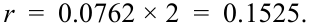
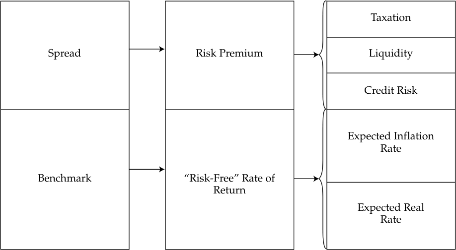
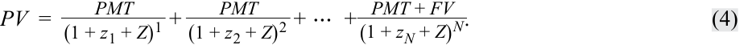
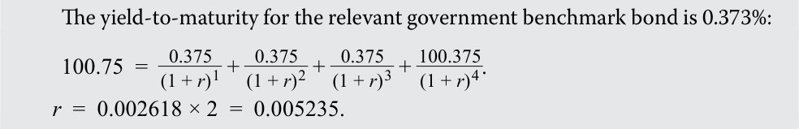
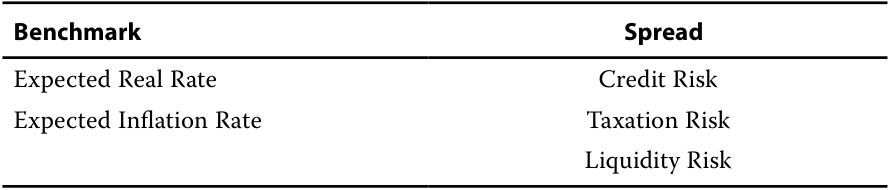
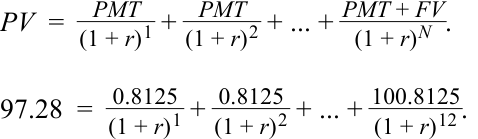
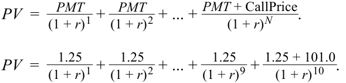
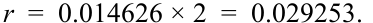
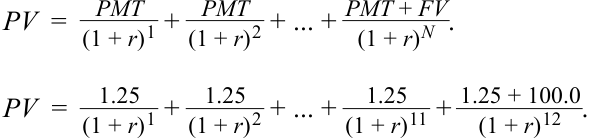

# Tập 6: Chứng Khoán Thu Nhập Cố Định (*Fixed Income*)
## Học phần 7: Các Thước Đo Lợi Suất và Chênh Lệch Lợi Suất Cho Trái Phiếu Lãi Suất Cố Định (*Yield and Yield Spread Measures for Fixed-Rate Bonds*)
### Phần 2/2: Các Thước Đo Chênh Lệch Lợi Suất Cho Trái Phiếu Lãi Suất Cố Định và Định Giá Ma Trận (Trang PDF 183–196)

---

<!-- PDF Page 183 -->

4. Lợi suất tính đến ngày mua lại lần thứ nhất (*yield-to-first call*) của trái phiếu doanh nghiệp gần nhất với:

**A.** 2,15%.

**B.** 7,80%.

**C.** 15,00%.

**Lời giải:**

C là đáp án đúng. Lợi suất tính đến ngày mua lại lần thứ nhất là tỷ suất hoàn vốn nội bộ $r$ của một trái phiếu có quyền mua lại trước hạn giả định nó được mua lại vào ngày mua lại theo lịch trình sớm nhất tại mức giá mua lại của nó.

<!-- Formula Text: PV  =    PMT _ (1 + r) 1  +   PMT _ (1 + r) 2  + ... + PMT + Callprice ____________ (1 + r) N . 91  = 2 _ (1 + r) 1  +  101.5 + 2 _ (1 + r) 2 . -->
$$PV = \frac{PMT}{(1 + r)^1} + \frac{PMT}{(1 + r)^2} + \dots + \frac{PMT + \text{Call price}}{(1 + r)^N}$$
$$91 = \frac{2}{(1 + r)^1} + \frac{101{,}25 + 2}{(1 + r)^2} \quad (\text{trong ảnh gốc ghi } 101{,}5 + 2)$$

<!-- Formula Text: r  =  0.0762 × 2  =  0.1525. -->
$$r = 0{,}0762 \times 2 = 0{,}1525$$

Lợi suất tính đến ngày mua lại lần thứ nhất của trái phiếu là 15,25%.

### **CÁC THƯỚC ĐO CHÊNH LỆCH LỢI SUẤT CHO TRÁI PHIẾU LÃI SUẤT CỐ ĐỊNH VÀ ĐỊNH GIÁ MA TRẬN (*YIELD SPREAD MEASURES FOR FIXED-RATE BONDS AND MATRIX PRICING*)**

# **<mark>4</mark>**

so sánh, tính toán và diễn giải các thước đo lợi suất (*yield measures*) và chênh lệch lợi suất (*yield spread measures*) cho trái phiếu lãi suất cố định

#### **Chênh Lệch Lợi Suất So Với Lãi Suất Chuẩn (*Yield Spreads over Benchmark Rates*)**

Trong phân tích chứng khoán thu nhập cố định, điều quan trọng là phải hiểu _tại sao_ giá trái phiếu và lợi suất đáo hạn lại thay đổi. Để làm được điều này, sẽ rất hữu ích khi phân tách lợi suất đáo hạn thành một lãi suất cơ sở hay **lãi suất chuẩn (*benchmark*)** và một **mức chênh lệch (*spread*)** đặc thù của tổ chức phát hành. Ví dụ, một bài học trước đã giới thiệu trái phiếu chuẩn của chính phủ (*government benchmark bonds*) là những chứng khoán có tính thanh khoản cao nhất với rủi ro vỡ nợ thấp nhất cho một thời gian đáo hạn cụ thể trên mỗi thị trường. **Chênh lệch lợi suất (*yield spread*)** là hiệu số giữa lợi suất đáo hạn của trái phiếu và lợi suất chuẩn (*benchmark yield*).

Hai thành phần này giúp các nhà đầu tư phân biệt giữa các yếu tố kinh tế vĩ mô (từ trên xuống – *top-down*) và kinh tế vi mô (từ dưới lên – *bottom-up*) tác động đến giá trái phiếu và do đó tác động đến lợi suất đáo hạn của nó. Lãi suất chuẩn nắm bắt các yếu tố từ trên xuống, trong khi mức chênh lệch nắm bắt các yếu tố từ dưới lên, như được thể hiện trong Bảng minh họa 5.

<!-- PDF Page 184 -->

**Bảng minh họa 5: Các Thành Phần của Lợi Suất Đáo Hạn (*Exhibit 5: Yield-to-Maturity Components*)**

> **Chú thích hình ảnh:** Cấu trúc các thành phần của Lợi suất đáo hạn (YTM):
> - **Mức chênh lệch (*Spread*) — Phần bù rủi ro (*Risk Premium*):** Thuế (*Taxation*), Thanh khoản (*Liquidity*), Rủi ro tín dụng (*Credit Risk*).
> - **Lãi suất chuẩn (*Benchmark*) — Tỷ suất sinh lợi “phi rủi ro” (*“Risk-Free” Rate of Return*):** Tỷ lệ lạm phát kỳ vọng (*Expected Inflation Rate*), Lãi suất thực kỳ vọng (*Expected Real Rate*).

<!-- Picture Text: Taxation Spread Risk Premium Liquidity Credit Risk Expected Inflation Rate Benchmark “Risk-Free” Rate of Return Expected Real Rate  -->

Lãi suất chuẩn được sử dụng nhiều nhất là trái phiếu chính phủ được phát hành gần đây nhất, được gọi là chứng khoán **mới phát hành (*on-the-run*)**. Trái phiếu chính phủ *on-the-run* là chứng khoán được giao dịch sôi động nhất và có lãi suất coupon gần nhất với lãi suất chiết khấu thị trường hiện hành cho kỳ hạn đó. Điều này ngụ ý rằng nó được định giá gần với mệnh giá (*par value*). Các trái phiếu chính phủ đã lưu hành lâu hơn được gọi là **chứng khoán phát hành đợt cũ (*off-the-run*)**. Các trái phiếu *on-the-run* thường giao dịch ở mức lợi suất đáo hạn thấp hơn một chút so với các trái phiếu *off-the-run* có cùng thời gian đáo hạn hoặc có thời gian đáo hạn tương tự do sự khác biệt về nhu cầu đối với chứng khoán và đôi khi là sự khác biệt về chi phí tài trợ chứng khoán chính phủ trên thị trường repo.

Mức chênh lệch lợi suất so với một chuẩn tham chiếu cụ thể được gọi là **chênh lệch chuẩn (*benchmark spread*)** và đại diện cho phần bù rủi ro đối với rủi ro tín dụng, rủi ro thanh khoản và có thể cả tác động thuế của việc nắm giữ một trái phiếu cụ thể. Bảng minh họa 6 thể hiện mối quan hệ giữa lợi suất đáo hạn của một tổ chức phát hành cụ thể và đường cong lợi suất chính phủ chuẩn (*benchmark government yield curve*).

<!-- PDF Page 185 -->

**Bảng minh họa 6: Đường Cong Lợi Suất của Tổ Chức Phát Hành và của Chính Phủ (*Exhibit 6: Issuer and Government Yield Curves*)**

> **Chú thích hình ảnh:** Đồ thị Đường cong lợi suất với trục tung là Lợi suất (*Yield %*) và trục hoành là Kỳ hạn (*Term*: 2, 3, 5, 7, 10, 20):
> - Đường bên dưới: Trái phiếu Kho bạc mới phát hành (*On-the-Run Treasuries*).
> - Đường bên trên: Bao gồm thêm phần Chênh lệch lợi suất so với trái phiếu Kho bạc (*Yield Spread Over Treasuries*).

<!-- Picture Text: Yield (%) 4.0 Yield Spread 3.5 Over Treasuries 3.0 2.5 2.0 On-the-Run Treasuries 1.5 1.0 0 2 3 5 7 10 20 Term  -->

Các mức chênh lệch lợi suất (*spreads*) cho phép chuyên viên phân tích đánh giá tốt hơn giá trị tương đối (*relative value*) của một trái phiếu trên cơ sở lịch sử và so sánh bằng cách kiểm soát (loại trừ) các yếu tố kinh tế vĩ mô, chẳng hạn như sự tăng hoặc giảm trên diện rộng của lãi suất chuẩn. Một chuyên viên phân tích có thể so sánh mức chênh lệch hiện tại với mức trung bình lịch sử cũng như các mức đỉnh và đáy trong quá khứ của nó, đồng thời so sánh với các trái phiếu khác để giúp xác định liệu một trái phiếu đang bị định giá thấp hay định giá cao trên cơ sở tương đối.

Mức chênh lệch lợi suất tính bằng điểm cơ bản (*basis points*) so với lợi suất trái phiếu chính phủ thực tế hoặc nội suy được gọi là **chênh lệch G (*G-spread*)** và đại diện cho tỷ suất sinh lợi để gánh chịu các rủi ro so với trái phiếu chính phủ trung ương. Nếu không có trái phiếu chuẩn của chính phủ trung ương nào khớp với kỳ hạn của trái phiếu đang xét, một quy trình xấp xỉ để tìm G-spread phải được sử dụng, như được minh họa trong Bảng minh họa 7 và được trình bày trong ví dụ sau đây.

##### **Bảng minh họa 7: Tìm Chênh Lệch G Khi Không Có Trái Phiếu Chuẩn Tương Đương (*Exhibit 7: Finding G-Spreads When a Comparable Benchmark Bond Does Not Exist*)**

> **Chú thích hình ảnh:** Quy trình 3 bước tính G-spread khi không có trái phiếu chuẩn cùng kỳ hạn:
> - **Bước 1 (*Step 1*):** Tính YTM hiện tại của trái phiếu.
> - **Bước 2 (*Step 2*):** Nội suy tuyến tính lãi suất (YTM) hiện tại của các trái phiếu chính phủ chuẩn có kỳ hạn gần nhất (ngắn hơn / dài hơn) với kỳ hạn của trái phiếu đã cho, để tìm mức lãi suất chính phủ xấp xỉ khớp với kỳ hạn của trái phiếu đã cho.
> - **Bước 3 (*Step 3*):** G-spread là hiệu số giữa YTM hiện tại của trái phiếu và lãi suất chuẩn chính phủ nội suy (xấp xỉ).

<!-- Picture Text: Step 1 Step 2 Step 3 Calculate the bond’s current YTM. Linearly interpolate current rates (YTMs) for the  G-spread is difference sovereign benchmark bonds  between the bond’s with maturities closest to  current YTM and the (below/above) the given interpolated (appproximate) bond’s maturity, to find sovereign an approximate sovereign  benchmark rate. rate matching the given bond’s maturity.  -->

<!-- PDF Page 186 -->

##### **VÍ DỤ 7 (*EXAMPLE 7*)**

#### **Tính Chênh Lệch G Khi Không Có Trái Phiếu Chuẩn Tương Đương (*Calculating G-Spread without a Comparable Benchmark Bond*)**

Giả sử Liên bang Nga đã phát hành một trái phiếu chính phủ kỳ hạn 30 năm định danh bằng đồng đô la Mỹ dựa trên các điều khoản sau đây:

|**Trái Phiếu Liên Bang Nga Lãi Suất 5,25% (*5.25% Russian Federation Bonds*)** **Tóm Tắt Ngắn Gọn Các Điều Khoản (*Brief Summary of Terms*)**||
|---|---|
|Tổ chức phát hành (*Issuer*):|Liên bang Nga (*Russian Federation*)|
|Ngày thanh toán (*Settlement Date*):|[T + 5 Ngày làm việc]|
|Ngày đáo hạn (*Maturity Date*):|[30 năm kể từ Ngày thanh toán]|
|Mệnh giá gốc (*Principal Amount*):|750 triệu USD|
|Lãi suất (*Interest*):|Lãi suất cố định bán niên 5,25%, cơ sở đếm ngày 30/360|
|Giá phát hành (*Issuance Price*):|99,625|
|Chênh lệch phát hành (*Issuance Spread*):|200 bp so với trái phiếu Kho bạc Hoa Kỳ kỳ hạn 30 năm hiện hành|
|Phát hành và Giao dịch (*Issuance and Trading*):|Phát hành riêng lẻ tại Hoa Kỳ theo Quy tắc 144A (*US Private Placement under Rule 144A*) DTC / Euroclear / Clearstream|
|Thứ tự ưu tiên trả nợ (*Seniority*):|Trái phiếu cấp cao không có tài sản đảm bảo (*Senior Unsecured*)|
|Sở giao dịch (*Exchanges*):|Luxembourg|

Sáu năm sau ngày phát hành ban đầu, vào ngày 15 tháng 3 năm 2026, trái phiếu này đang giao dịch ở mức giá 123,5 trên mỗi 100 đơn vị mệnh giá, và một chuyên viên phân tích quan sát thấy lợi suất trái phiếu Kho bạc Hoa Kỳ kỳ hạn 20 năm và 30 năm hiện lần lượt ở mức 2,00% và 2,25%. Hãy tính mức G-spread hiện tại của trái phiếu Liên bang Nga.

- Bước 1: Tính lợi suất đáo hạn hiện tại của trái phiếu Liên bang Nga. Chúng ta có thể giải tìm $r$ bằng công thức tổng quát cho giá và lợi suất trái phiếu:

$$PV = \frac{PMT_1}{(1 + r)^1} + \frac{PMT_2}{(1 + r)^2} + \dots + \frac{PMT_N + FV_N}{(1 + r)^N}$$

- Hoặc chúng ta có thể sử dụng hàm `YIELD` trong Excel hay Google Sheets giả định ngày thanh toán giao dịch là 15 tháng 3 năm 2026:

`=YIELD(DATE(2026,3,15),DATE(2050,3,15),5.25%,123.5,100,2,0)`

`= 3.756%.`

- Bước 2: Nội suy tuyến tính lợi suất trái phiếu Kho bạc Hoa Kỳ kỳ hạn 20 năm ($r_{20y}$) và 30 năm ($r_{30y}$) hiện hành để giải tìm mức chuẩn trái phiếu Kho bạc Hoa Kỳ kỳ hạn 24 năm xấp xỉ ($r_{24y}$):

   **1.** Giải tìm tỷ trọng của trái phiếu kỳ hạn 20 năm và 30 năm trong phép tính nội suy:

Tỷ trọng trái phiếu kỳ hạn 20 năm $= w_{20} = 60\%$ $[= (30 - 24)/(30 - 20)]$.
Tỷ trọng trái phiếu kỳ hạn 30 năm $= w_{30} = 40\%$, hay $(1 - w_{20})$.

- Lưu ý rằng $(w_{20} \times 20) + (w_{30} \times 30) = 24$.

- **2.** Lãi suất chính phủ kỳ hạn 24 năm là mức bình quân gia quyền của lãi suất trái phiếu kỳ hạn 20 năm và lãi suất trái phiếu Kho bạc Hoa Kỳ kỳ hạn 30 năm sử dụng các tỷ trọng ở trên.

$$r_{24y} = w_{20} \times r_{20y} + w_{30} \times r_{30y}$$

<!-- PDF Page 187 -->

$$= (60\% \times 2{,}00\%) + (40\% \times 2{,}25\%) = 2{,}10\%$$

Bước 3: G-spread là hiệu số giữa lợi suất đáo hạn hiện tại của trái phiếu Liên bang Nga và lãi suất chính phủ Hoa Kỳ kỳ hạn 24 năm: $1{,}656\% = 3{,}756\% - 2{,}10\%$, vì vậy G-spread là 166 bps.

Mức chênh lệch lợi suất của một trái phiếu so với lãi suất hoán đổi tiêu chuẩn (*standard swap rate*) bằng cùng đồng tiền và có cùng kỳ hạn được gọi là **chênh lệch I (*I-spread*)** hay chênh lệch nội suy (*interpolated spread*). Loại chênh lệch này là một phép so sánh với một lãi suất tham chiếu ngắn hạn dựa trên thị trường và là thông lệ phổ biến để định giá cũng như báo giá các trái phiếu doanh nghiệp định danh bằng đồng euro, sử dụng hợp đồng hoán đổi lãi suất đồng euro (*euro interest rate swap*) làm chuẩn tham chiếu. Ví dụ, trái phiếu đồng euro không trả lãi định kỳ kỳ hạn 5 năm do chính phủ Trung Quốc phát hành ở mức lợi suất đáo hạn âm từ bài học trước đã được định giá ở mức “lãi suất hoán đổi trung bình cộng 30 bps” (*“mid-swaps plus 30 bps”*), trong đó “lãi suất hoán đổi trung bình” (*“mid-swaps”*) là mức trung bình cộng của lãi suất hoán đổi chào mua (*bid*) và chào bán (*offered*).

Các tổ chức phát hành sẽ sử dụng I-spread để xác định chi phí tương đối của trái phiếu lãi suất cố định so với các phương án lãi suất thả nổi thay thế, chẳng hạn như khoản vay ngân hàng hoặc thương phiếu (*commercial paper*), trong khi các nhà đầu tư sử dụng nó như một thước đo rủi ro tín dụng của trái phiếu. Trong khi một hợp đồng hoán đổi lãi suất tiêu chuẩn bao gồm việc trao đổi các dòng tiền cố định lấy dòng tiền thả nổi dựa trên một chỉ số lãi suất thả nổi, thì một hợp đồng hoán đổi tài sản (*asset swap*) chuyển đổi khoản coupon cố định định kỳ của một trái phiếu cụ thể thành lãi suất tham chiếu thị trường (*market reference rate* – MRR) cộng hoặc trừ một mức chênh lệch. Nếu trái phiếu được định giá gần với mệnh giá, phép chuyển đổi này xấp xỉ với cái giá của rủi ro tín dụng của trái phiếu cao hơn chỉ số MRR.

##### **VÍ DỤ 8 (*EXAMPLE 8*)**

#### **Chênh Lệch Lợi Suất Sử Dụng Chức Năng Giá Trị Tương Đối Thu Nhập Cố Định (FIRV) của Bloomberg (*Yield Spreads Using Bloomberg Fixed-Income Relative Value (FIRV)*)**

Chức năng FIRV của Bloomberg đối với trái phiếu Apple lãi suất 3,75% đáo hạn vào ngày 12 tháng 9 năm 2047 hiển thị như sau. Hãy xác định các thước đo lợi suất và chênh lệch lợi suất.

##### **Chức Năng FIRV Đối Với Trái Phiếu AAPL 3,75% Đáo Hạn Ngày 12 Tháng 9 Năm 2047 (*FIRV Function for 3.75% AAPL Bond Maturing 12 September 2047*)**

> **Chú thích hình ảnh:** Màn hình Bloomberg Fixed Income Relative Value (FIRV) cho trái phiếu AAPL 3 ¾ 09/12/47:
> - Góc trên bên trái hiển thị các mức chênh lệch lợi suất hiện tại (*Now*): `Spreads-Bench` = 72 bps, `G-Spread` = 76 bps, `I-Spread` = 106 bps, `Z-Spread` = 109 bps (cùng với mức thấp nhất *Low*, cao nhất *High*, trung bình *Avg*, độ lệch chuẩn *StdDev* trong khoảng thời gian từ 11/01/2021 đến 11/06/2021).
> - Phần dưới hiển thị bảng so sánh trái phiếu với các trái phiếu tương đương (*Bond vs Comparables - COMB*) gồm INTC, TXN, ORCL, MSI, HPE với Giá (*Price*), Lợi suất (*Yield*) và Chênh lệch Z (*Z-Spd*).

<!-- Picture Text: AAPL 3 34 09/12/47 Corp Settings Fixed Income Relative Value 82.439/83.193 4.988/4.928 BMRK@ 13:19 95) Buy 96) Sell BVAL as of 06/11/2021 11-Jan-2021 11-Jun-2021 Custom Spread Low Range High Avg +/– bps StdDev #SDs 1) Spreads to Curves (RV) Avg Now 2) Spreads-Bench 72 69 89 78 –6 5 –1.2 3) G-Spread 76 73 96 84 –8 6 –1.4 4) I-Spread 106 94 122 109 –3 6 –0.5 5) Z-Spread 109 96 125 112 –3 6 –0.5 6) Credit Rel Value (CRVD) 7) CDS Basis 8) Bond vs Comparables (COMB) Z-Spd Dif f erence in comparable Z-Spreads over date range Price Yield Spread Dif Lo Range Hi Avg +/– bps #SDs AAPL 3 3 4 09/47 115.9 2.87 109 9) INTC 4.6  03/40 124.3 2.88 118 –9 –17 13 –4 –5 –0.7 10) TXN 3 78 03/39 118.1 2.57 87 22 13 32 25 –3 –1.0 11) ORCL 3.6  04/40 104.4 3.28 156 –47 –53 –7 –32 –15 –0.8 12) MSI 5 12 09/44 128.4 3.67 194 –85 –135 –83 –103 18 1.3 13) HPE 6.35 10/45 133.7 4.11 240 –131 –188 –121 –138 7 0.4 14) HPE 6.35 10/45 133.7 4.11 240 –131 –188 –121 –138 7 0.4 Avg of Comparables 3.44 173 –64 –89 –55 –65 2 0.2 15) BVAL Price 115.9 2.87 Japan 81 3 4565 8900Australia 61 2 9777 8600 Brazil 5511 2395 9000Singapore 65 6212 1000 Europe 44 20 7330 7500U.S. 1 212 318 2000 Germany 49 69 9204 1210Copyright 2022 Bloomberg Finance L.P.Hong Kong 852 2977 6000 SN 2363375 H462–2316–173 05-OCt-22 13:21:55  EDT GMT–4:00  -->

_© 2021 Bloomberg L.P. Bảo lưu mọi quyền. Được tái bản với sự cho phép._

**Lời giải:**

<!-- PDF Page 188 -->

Các mức chênh lệch lợi suất nằm ở góc trên bên trái. Vào ngày phân tích:

- Mức chênh lệch lợi suất so với một trái phiếu Kho bạc chuẩn cụ thể (`Spreads-Bench`) là 72 bps.
- Mức chênh lệch G (`G-Spread`) so với lợi suất trái phiếu chính phủ nội suy là 76 bps. Mức chênh lệch so với chuẩn tham chiếu và G-spread đôi khi chênh nhau một vài điểm cơ bản, đặc biệt nếu kỳ hạn của trái phiếu chuẩn khác với kỳ hạn của trái phiếu cơ sở.
- Mức chênh lệch I (`I-Spread`) của trái phiếu là 106 bps. Mức I-spread lớn hơn G-spread cho thấy lợi suất trái phiếu Kho bạc cao hơn một chút so với lãi suất hoán đổi (*swap rates*) vào thời điểm đó.

Việc sử dụng các mức chênh lệch này trong các chiến lược đầu tư sẽ được trình bày chi tiết hơn ở phần sau. Nhìn chung, một chuyên viên phân tích sẽ theo dõi các mức chênh lệch này so với mức trung bình cũng như các mức đỉnh và đáy lịch sử của chúng để xác định giá trị tương đối.

#### **Chênh Lệch Lợi Suất So Với Đường Cong Lợi Suất Chuẩn (*Yield Spreads over the Benchmark Yield Curve*)**

Trong khi G-spread và I-spread là hiệu số giữa hai con số đơn lẻ và sử dụng cùng một lãi suất chiết khấu (lợi suất đáo hạn) cho mỗi dòng tiền, một phương pháp tiếp cận khác là tính một mức chênh lệch lợi suất không đổi (*constant yield spread*) cộng thêm vào một _đường cong_ lãi suất giao ngay (*spot curve*, tức một chuỗi các mức lợi suất) của chính phủ (hoặc của hợp đồng hoán đổi lãi suất). Mức chênh lệch này được gọi là chênh lệch độ biến động bằng không (**chênh lệch Z – *Z-spread* / *zero-volatility spread***) của một trái phiếu so với lãi suất chuẩn. Nói cách khác, Z-spread là phần phải được cộng thêm vào mỗi mức lãi suất giao ngay chuẩn (*benchmark spot rate*) để làm cho giá trị hiện tại của các dòng tiền của trái phiếu bằng với giá của nó. Trong Ví dụ 8, Z-spread đối với trái phiếu Apple, như được báo giá bằng chức năng FIRV của Bloomberg, là 109 bps.

Z-spread so với đường cong lãi suất giao ngay chuẩn có thể được tính bằng Phương trình 4:

<!-- Formula Text: PV  = PMT _ (1 + z 1 + Z) 1  + PMT _ (1 + z 2 + Z) 2  + ⋯  +   PMT + FV _ (1 + z N + Z) N . (4) -->
$$PV = \frac{PMT}{(1 + z_1 + Z)^1} + \frac{PMT}{(1 + z_2 + Z)^2} + \dots + \frac{PMT + FV}{(1 + z_N + Z)^N} \tag{4}$$

Các mức lãi suất giao ngay hay lãi suất zero chuẩn (*benchmark spot or zero rates*)—$z_1, z_2, \dots, z_N$—được suy ra từ đường cong lợi suất chính phủ (hoặc từ lãi suất cố định trên các hợp đồng hoán đổi lãi suất), như sẽ được trình bày chi tiết trong một bài học sau. $Z$ là mức Z-spread mỗi kỳ và giữ nguyên như nhau cho tất cả các kỳ thời gian. Trong Phương trình 4, số mũ là một số nguyên, vì vậy phép tính được thực hiện vào một ngày trả lãi coupon khi lãi tích lũy bằng không. Đôi khi, Z-spread còn được gọi là “chênh lệch tĩnh” (*“static spread”*) bởi vì nó là hằng số (và có độ biến động bằng không). Trên thực tế, Z-spread thường được tính trong bảng tính bằng chức năng Goal Seek hoặc công cụ giải phương trình (*Solver*) tương tự.

Z-spread cũng được sử dụng để tính **chênh lệch đã điều chỉnh quyền chọn (*option-adjusted spread* – OAS)** trên một trái phiếu có quyền mua lại trước hạn. Giống như lợi suất đã điều chỉnh quyền chọn, OAS dựa trên một mô hình định giá quyền chọn và một giả định về độ biến động lãi suất trong tương lai. Sau đó, giá trị của quyền chọn mua lại đi kèm, được biểu thị bằng số điểm cơ bản mỗi năm (*basis points per year*), sẽ được trừ đi khỏi mức chênh lệch lợi suất.

$$\text{OAS} = \text{Z-spread} - \text{Giá trị quyền chọn tính bằng điểm cơ bản mỗi năm (Option value in basis points per year)} \tag{5}$$

Thước đo quan trọng này sẽ được trình bày chi tiết ở phần sau.

<!-- PDF Page 189 -->

##### **Bảng minh họa 8: Tóm Tắt Các Thước Đo Chênh Lệch Lợi Suất (*Exhibit 8: Summary of Yield Spreads*)**

|**Loại (*Type*)**|**Mô tả (*Description*)**|
|---|---|
|G-spread|Chênh lệch chính phủ (*Government spread*), mức chênh lệch lợi suất tính bằng điểm cơ bản so với một trái phiếu chính phủ thực tế hoặc nội suy. Được sử dụng tại Hoa Kỳ, Vương quốc Anh, Nhật Bản và các khu vực tài phán khác.|
|I-spread|Chênh lệch nội suy (*Interpolated spread*), mức chênh lệch lợi suất của một trái phiếu so với lãi suất hoán đổi tiêu chuẩn bằng cùng đồng tiền và có cùng kỳ hạn. Các trái phiếu doanh nghiệp định danh bằng đồng euro thường được định giá so với chuẩn tham chiếu là hợp đồng hoán đổi lãi suất đồng euro.|
|Z-spread|Chênh lệch độ biến động bằng không (*Zero-volatility spread*), một mức chênh lệch lợi suất không đổi cộng thêm vào đường cong lãi suất giao ngay của chính phủ (hoặc của hợp đồng hoán đổi lãi suất), được sử dụng để suy ra cấu trúc kỳ hạn của chênh lệch tín dụng cho một tổ chức phát hành.|
|Chênh lệch đã điều chỉnh quyền chọn (*Option-adjusted spread* – OAS)|Mức Z-spread đã được điều chỉnh cho giá trị của quyền chọn mua lại đi kèm (*embedded call option*).|

##### **VÍ DỤ 9 (*EXAMPLE 9*)**

#### **Chênh Lệch G và Chênh Lệch Z (*The G-Spread and Z-Spread*)**

Một trái phiếu trả lãi coupon bán niên 1,5%/năm, định danh bằng đồng đô la Mỹ đã được PT Indonesia Infrastructure Finance (IIF) phát hành cách đây ba năm. Hiện tại, trái phiếu còn hai năm nữa là đáo hạn và đang giao dịch ở mức giá 100,45. Trái phiếu chuẩn của chính phủ kỳ hạn hai năm, trả lãi bán niên 0,75%/năm đang giao dịch ở mức giá 100,750.

Lãi suất giao ngay của chính phủ (*government spot rates*, được công bố dưới dạng lãi suất kỳ bán niên/hiệu dụng trong phép tính dưới đây) như sau:

|**Kỳ hạn (*Maturity*)**|**Lãi suất giao ngay (*Spot Rate*)**|
|---|---|
|6M (6 tháng)|0,127%|
|12M (12 tháng)|0,249%|
|18M (18 tháng)|0,314%|
|24M (24 tháng)|0,373%|

**1.** Tính G-spread cho trái phiếu IIF.

**2.** Tính Z-spread cho trái phiếu IIF.

##### **Lời giải câu 1:**

G-spread là mức chênh lệch lợi suất tính bằng điểm cơ bản so với một trái phiếu chính phủ thực tế hoặc nội suy. Lợi suất đáo hạn của trái phiếu IIF là 1,271%:

<!-- Formula Text: 100.45  =    0.75 _ (1 + r) 1  +   0.75 _ (1 + r) 2  +   0.75 _ (1 + r) 3  +  100.75 _ (1 + r) 4 . r  =  0.006357 × 2  =  0.01271. -->
$$100{,}45 = \frac{0{,}75}{(1 + r)^1} + \frac{0{,}75}{(1 + r)^2} + \frac{0{,}75}{(1 + r)^3} + \frac{100{,}75}{(1 + r)^4}$$
$$r = 0{,}006357 \times 2 = 0{,}01271$$

<!-- Formula Text: The yield-to-maturity for the relevant government benchmark bond is 0.373%: 100.75  =    0.375 _ (1 + r) 1  +   0.375 _ (1 + r) 2  +   0.375 _ (1 + r) 3  +  100.375 _ (1 + r) 4 . r  =  0.002618 × 2  =  0.005235. -->
Lợi suất đáo hạn của trái phiếu chuẩn chính phủ có liên quan là 0,373% (trong ảnh gốc ghi 0,373% ở lời dẫn nhưng phương trình tính ra $r = 0{,}001865 \times 2 = 0{,}00373$, hoặc $0{,}002618 \times 2 = 0{,}005235$ theo số in trong ảnh):

$$100{,}75 = \frac{0{,}375}{(1 + r)^1} + \frac{0{,}375}{(1 + r)^2} + \frac{0{,}375}{(1 + r)^3} + \frac{100{,}375}{(1 + r)^4}$$
$$r = 0{,}002618 \times 2 = 0{,}005235$$

Do đó, G-spread là $0{,}01271 - 0{,}005235 = 75\text{ bps}$.

##### **Lời giải câu 2:**

Z-spread là một mức chênh lệch lợi suất không đổi cộng thêm vào đường cong lãi suất giao ngay của chính phủ hoặc đường cong hoán đổi lãi suất.

<!-- PDF Page 190 -->

Z-spread đối với trái phiếu IIF là giá trị của $Z$ giải phương trình sau đây, sử dụng các mức lãi suất giao ngay chính phủ đã cung cấp:

<!-- Formula Text: PV  = PMT _ (1 + z 1 + Z) 1  + PMT _ (1 + z 2 + Z) 2  + ⋯  +   PMT + FV _ (1 + z N + Z) N . 100.45  = 0.75 ______________ (1 + 0.00127 + Z) 1  + 0.75 ______________ (1 + 0.00249 + Z) 2  + 0.75 ______________ (1 + 0.00314 + Z) 3  + 100.75 ______________ (1 + 0.00373 + Z) 4 . -->
$$PV = \frac{PMT}{(1 + z_1 + Z)^1} + \frac{PMT}{(1 + z_2 + Z)^2} + \dots + \frac{PMT + FV}{(1 + z_N + Z)^N}$$
$$100{,}45 = \frac{0{,}75}{(1 + 0{,}00127 + Z)^1} + \frac{0{,}75}{(1 + 0{,}00249 + Z)^2} + \frac{0{,}75}{(1 + 0{,}00314 + Z)^3} + \frac{100{,}75}{(1 + 0{,}00373 + Z)^4}$$

Tiện ích bổ sung Solver trong Microsoft Excel tìm được $Z = 0{,}00268$, hay 27 bps (trên cơ sở bán niên, hoặc nhân 2 theo năm), bằng cách đặt mức giá (tổng giá trị hiện tại của các dòng tiền) bằng 100,45 làm hàm mục tiêu và $Z$ làm biến thay đổi. Vui lòng tham khảo hệ sinh thái học tập dành cho ứng viên trực tuyến để xem bảng tính minh họa phép tính này trong sổ làm việc Excel có thể tải xuống.

##### **BỘ CÂU HỎI (*QUESTION SET*)**

1. Mỗi mục trong năm mục dưới đây là một rủi ro khi đầu tư vào các công cụ thu nhập cố định. Đối với mỗi mục, hãy xác định thành phần của lợi suất đáo hạn mang lại sự đền bù cho rủi ro đó: lãi suất chuẩn (*benchmark*) hay mức chênh lệch (*spread*).

   - Tín dụng (*Credit*)
   - Lãi suất thực kỳ vọng (*Expected Real Rate*)
   - Thuế (*Taxation*)
   - Tỷ lệ lạm phát kỳ vọng (*Expected Inflation Rate*)
   - Thanh khoản (*Liquidity*)

**Lãi suất chuẩn (*Benchmark*) — Mức chênh lệch (*Spread*)**

##### **Lời giải:**

> **Chú thích hình ảnh:** Phân loại rủi ro vào hai thành phần:
> - **Lãi suất chuẩn (*Benchmark*):** Lãi suất thực kỳ vọng (*Expected Real Rate*), Tỷ lệ lạm phát kỳ vọng (*Expected Inflation Rate*).
> - **Mức chênh lệch (*Spread*):** Rủi ro tín dụng (*Credit Risk*), Rủi ro thuế (*Taxation Risk*), Rủi ro thanh khoản (*Liquidity Risk*).

<!-- Picture Text: Benchmark Spread Expected Real Rate Credit Risk Expected Inflation Rate Taxation Risk Liquidity Risk  -->

Hai thành phần của lợi suất—lãi suất chuẩn (*benchmark*) và mức chênh lệch (*spread*)—cho phép chúng ta phân biệt các yếu tố kinh tế vĩ mô và kinh tế vi mô.

Lợi suất chuẩn nắm bắt các yếu tố kinh tế vĩ mô: tỷ lệ lạm phát kỳ vọng của đồng tiền định danh trái phiếu, tăng trưởng kinh tế chung và chu kỳ kinh doanh, tỷ giá hối đoái và tác động của chính sách tiền tệ cũng như chính sách tài khóa. Những thay đổi trong các yếu tố đó tác động đến tất cả các trái phiếu trên thị trường.

Chênh lệch lợi suất nắm bắt các yếu tố kinh tế vi mô đặc thù đối với tổ chức phát hành trái phiếu và bản thân trái phiếu đó: rủi ro tín dụng, tính thanh khoản và giao dịch của các chứng khoán tương đương, cùng tình trạng chịu thuế của trái phiếu.

<!-- PDF Page 191 -->

2. Một trái phiếu doanh nghiệp Mexico không kèm quyền mua lại trước hạn đáo hạn sau 3 năm và có lãi suất coupon hàng năm là 5,5%. Lãi suất giao ngay của chính phủ (được công bố dưới dạng lãi suất hiệu dụng năm) như sau:

###### **Lãi Suất Giao Ngay Của Chính Phủ (*Government Spot Rates*)**

|**Kỳ hạn (*Maturity*)**|**Lãi suất giao ngay (*Spot Rate*)**|
|---|---|
|1Y (1 năm)|2,98%|
|2Y (2 năm)|3,48%|
|3Y (3 năm)|4,00%|

Sử dụng các mức lãi suất giao ngay được cung cấp và mức Z-spread là 378 bps, hãy tính giá của trái phiếu doanh nghiệp Mexico này.

##### **Lời giải:**

Giá của trái phiếu là 94,20.

<!-- Formula Text: PV  = PMT _ (1 + z 1 + Z) 1  + PMT _ (1 + z 2 + Z) 2  + ⋯  +   PMT + FV _ (1 + z N + Z) N . PV  = 5.5 ________________ (1 + 0.0298 + 0.0378) 1  + 5.5 ________________ (1 + 0.0348 + 0.0378) 2  + 105.5 _______________ (1 + 0.04 + 0.0378) 3 . PV  =  94.20. -->
$$PV = \frac{PMT}{(1 + z_1 + Z)^1} + \frac{PMT}{(1 + z_2 + Z)^2} + \dots + \frac{PMT + FV}{(1 + z_N + Z)^N}$$
$$PV = \frac{5{,}5}{(1 + 0{,}0298 + 0{,}0378)^1} + \frac{5{,}5}{(1 + 0{,}0348 + 0{,}0378)^2} + \frac{105{,}5}{(1 + 0{,}04 + 0{,}0378)^3}$$
$$PV = 94{,}20$$

##### **Sử dụng thông tin được cung cấp cho Câu hỏi 3 và 4.**

Một chuyên viên phân tích thu nhập cố định đã tổng hợp các số liệu thống kê sau đây cho ba trái phiếu doanh nghiệp được phát hành bởi các công ty có trụ sở tại ba quốc gia khác nhau.

|**Trái phiếu (*Bond*)**|**Lợi suất đáo hạn (*Yield-to-Maturity*)**|**Lãi suất hoán đổi áp dụng (*Applicable Swap Rate*)**|
|---|---|---|
|A|13,379%|12,419%|
|B|8,121%|6,527%|
|C|5,406%|4,184%|

3. Trái phiếu nào nhiều khả năng nhất có rủi ro tín dụng lớn nhất?

   - **A.** Trái phiếu A
   - **B.** Trái phiếu B
   - **C.** Trái phiếu C

##### **Lời giải:**

B là đáp án đúng. Là một yếu tố rủi ro “từ dưới lên” (*“bottom-up”*) hay đặc thù của tổ chức phát hành, rủi ro tín dụng là một thành phần của chênh lệch lợi suất (*yield spread*). Để ước tính trái phiếu nào nhiều khả năng có rủi ro tín dụng lớn nhất, chúng ta tính I-spread, tức mức chênh lệch lợi suất của một trái phiếu so với lãi suất hoán đổi cho cùng đồng tiền và kỳ hạn.

|**Trái phiếu (*Bond*)**|**Lợi suất đáo hạn (*Yield-to-Maturity*)**|**Lãi suất hoán đổi áp dụng (*Applicable Swap Rate*)**|**I-Spread**|
|---|---|---|---|
|A|13,379%|12,419%|96 bps|
|B|8,121%|6,527%|159 bps|
|C|5,406%|4,184%|122 bps|

<!-- PDF Page 192 -->

4. Giả sử các tổ chức phát hành Trái phiếu A, B và C tương đương nhau về mặt rủi ro tín dụng và các trái phiếu này có đặc điểm thanh khoản cũng như thuế tương tự nhau. Chỉ dựa trên thông tin được cung cấp, trái phiếu nào có thể mang lại cho nhà đầu tư giá trị tương đối _thấp nhất_ (*least relative value*)?

   - **A.** Trái phiếu A
   - **B.** Trái phiếu B
   - **C.** Trái phiếu C

##### **Lời giải:**

A là đáp án đúng. Nếu các trái phiếu được đánh giá là tương đương nhau trên mọi khía cạnh trọng yếu, thì giá trị tương đối thấp nhất (cao nhất) sẽ tương ứng với trái phiếu có mức chênh lệch lợi suất thấp nhất (cao nhất). Ở mức 96 bps, Trái phiếu A có mức chênh lệch thấp nhất và do đó có mức định giá kém hấp dẫn nhất đối với một nhà đầu tư.

5. Ghép các đặc điểm sau đây với trái phiếu _mới phát hành_ (*on-the-run*) và trái phiếu _phát hành đợt cũ_ (*off-the-run*):

   - Trái phiếu chính phủ đã lưu hành lâu (*Seasoned government bonds*)
   - Trái phiếu chính phủ được phát hành gần đây nhất (*Most recently issued government bonds*)
   - Có lãi suất coupon thấp hơn hoặc cao hơn lãi suất chiết khấu thị trường hiện hành cho kỳ hạn đó
   - Có lãi suất coupon gần nhất với lãi suất chiết khấu thị trường hiện hành cho kỳ hạn đó
   - Giao dịch ở mức lợi suất đáo hạn thấp hơn một chút so với các trái phiếu có cùng thời gian đáo hạn hoặc có thời gian đáo hạn tương tự
   - Giao dịch ở mức lợi suất đáo hạn cao hơn một chút so với các trái phiếu có cùng thời gian đáo hạn hoặc có thời gian đáo hạn tương tự

##### **Lời giải:**

|**Mới phát hành (*On-the-Run*)**|**Phát hành đợt cũ (*Off-the-Run*)**|
|---|---|
|Trái phiếu chính phủ được phát hành gần đây nhất|Trái phiếu chính phủ đã lưu hành lâu (*Seasoned government bonds*)|
|Có lãi suất coupon gần nhất với lãi suất chiết khấu thị trường hiện hành cho kỳ hạn đó|Có lãi suất coupon thấp hơn hoặc cao hơn lãi suất chiết khấu thị trường hiện hành cho kỳ hạn đó|
|Giao dịch ở mức lợi suất đáo hạn thấp hơn một chút so với các trái phiếu có cùng thời gian đáo hạn hoặc có thời gian đáo hạn tương tự|Giao dịch ở mức lợi suất đáo hạn cao hơn một chút so với các trái phiếu có cùng thời gian đáo hạn hoặc có thời gian đáo hạn tương tự|

<!-- PDF Page 193 -->

## **CÂU HỎI THỰC HÀNH (*PRACTICE PROBLEMS*)**

**1.** Một trái phiếu do RTR phát hành trả lãi coupon hàng quý là 3,25%/năm, còn 3 năm nữa là đáo hạn và hiện đang giao dịch ở mức giá 97,28. Lợi suất theo cơ sở trái phiếu bán niên (*semiannual bond basis yield*) gần nhất với:

**A.** 1,055%.

**B.** 2,121%.

**C.** 4,242%.

**2.** Một chuyên viên phân tích đang phân tích một trái phiếu kỳ hạn 3 năm, trả lãi coupon hàng năm 2,25% do Công ty QWE phát hành. Hiện tại, lợi suất đáo hạn của trái phiếu là 2,707%. Lãi suất hoán đổi kỳ hạn 3 năm là 1,840%. Lãi suất giao ngay của chính phủ được trình bày trong bảng dưới đây.

|**Kỳ hạn (*Maturity*)**|**Lãi suất giao ngay của chính phủ (*Government Spot Rate*)**|
|---|---|
|1Y (1 năm)|0,899%|
|2Y (2 năm)|1,260%|
|3Y (3 năm)|1,904%|

Mức G-Spread (tính bằng điểm cơ bản) đối với trái phiếu QWE gần nhất với:

**A.** 80.

**B.** 87.

**C.** 135.

**3.** Mức I-spread (tính bằng điểm cơ bản) đối với trái phiếu QWE gần nhất với:

   - **A.** 46.

   - **B.** 80.

   - **C.** 87.

**4.** Nếu giá của trái phiếu QWE bằng 98,70% mệnh giá, thì mức Z-spread của nó (tính bằng điểm cơ bản) gần nhất với:

**A.** 80.

**B.** 82.

**C.** 87.

**5.** Một chuyên viên phân tích đang phân tích một trái phiếu có quyền mua lại trước hạn kỳ hạn 6 năm với lãi suất coupon bán niên 2,50%/năm đang giao dịch ở mức giá 98,90 trên mỗi 100 đơn vị mệnh giá và có lịch biểu mua lại sau đây:

###### **Lịch Biểu Mua Lại (*Call Schedule*)**

|**Giai đoạn (*Period*)**|**Giá mua lại (*Call Price*)**|
|---|---|
|4–5 năm|101,50|
|5–6 năm|101,00|

Hãy ghép các mức lợi suất dưới đây với các thước đo lợi suất tương ứng.

<!-- PDF Page 194 -->

|**Lợi suất (*Yield*)**|**Thước đo lợi suất (*Yield Measure*)**|
|---|---|
|2,6998%|Lợi suất tính đến ngày mua lại lần thứ nhất (*Yield-to-first call*)|
|2,6998%|Lợi suất tính đến ngày mua lại lần thứ hai (*Yield-to-second call*)|
|2,9253%|Lợi suất đáo hạn (*Yield-to-maturity*)|
|3,1497%|Lợi suất thấp nhất có thể (*Yield-to-worst*)|

<!-- PDF Page 195 -->

## **LỜI GIẢI (*SOLUTIONS*)**

1. C là đáp án đúng. Ở bước đầu tiên, chúng ta cần tính lợi suất hàng quý và quy đổi theo năm:

<!-- Formula Text: PV  =    PMT _ (1 + r) 1  +   PMT _ (1 + r) 2  + ... +  PMT + FV _ (1 + r) N  . 97.28  =   0.8125 _ (1 + r) 1  +  0.8125 _ (1 + r) 2  + ... +  100.8125 _ (1 + r) 12 . -->
$$PV = \frac{PMT}{(1 + r)^1} + \frac{PMT}{(1 + r)^2} + \dots + \frac{PMT + FV}{(1 + r)^N}$$
$$97{,}28 = \frac{0{,}8125}{(1 + r)^1} + \frac{0{,}8125}{(1 + r)^2} + \dots + \frac{100{,}8125}{(1 + r)^{12}}$$

$$r = 0{,}01055 \times 4 = 0{,}0422$$

<!-- Formula Text: The next step is to convert the annualized quarterly yield to the semiannual bond basis yield. (1 + AP R m _ m  ) m =  (1 + AP R n _ n  ) n . (1 +  0.0422 _ 4  ) 4 =  (1 + AP R 2 _ 2  ) 2 . -->
Bước tiếp theo là chuyển đổi mức lợi suất hàng quý quy đổi theo năm sang lợi suất theo cơ sở trái phiếu bán niên:

$$\left(1 + \frac{APR_m}{m}\right)^m = \left(1 + \frac{APR_n}{n}\right)^n$$
$$\left(1 + \frac{0{,}0422}{4}\right)^4 = \left(1 + \frac{APR_2}{2}\right)^2$$

$$APR_2 = 0{,}04242 = 4{,}242\%$$

A không đúng vì 1,0550% là lợi suất mỗi quý.

B không đúng vì 2,1100% (hay 2,121%) là lợi suất mỗi nửa năm (hoặc lợi suất mỗi quý nhân với 2).

2. A là đáp án đúng. G-spread là mức chênh lệch lợi suất cao hơn lợi suất của một trái phiếu chính phủ có cùng ngày đáo hạn. Lợi suất đáo hạn của trái phiếu doanh nghiệp là 2,7070%. Lợi suất đáo hạn của trái phiếu chính phủ chuẩn là 1,9036% (làm tròn 1,904%).

$$\text{G-spread} = 2{,}707\% - 1{,}904\% = 0{,}8034\% = 80{,}3\text{ bps}$$

B không đúng vì 87 bps là mức I-spread được tính bằng mức chênh lệch lợi suất của trái phiếu so với lãi suất hoán đổi tiêu chuẩn bằng cùng đồng tiền và có cùng kỳ hạn.

C không đúng vì 135 bps là mức chênh lệch được tính bằng hiệu số giữa lợi suất đáo hạn của trái phiếu QWE và trung bình cộng lãi suất chính phủ của tất cả các kỳ hạn.

3. C là đáp án đúng. I-spread là mức chênh lệch lợi suất của một trái phiếu so với lãi suất hoán đổi tiêu chuẩn bằng cùng đồng tiền và có cùng kỳ hạn. Lợi suất đáo hạn của trái phiếu doanh nghiệp là 2,707%, và lãi suất hoán đổi cho cùng kỳ hạn là 1,840%.

$$\text{I-spread} = 2{,}707\% - 1{,}840\% = 0{,}867\% = 87\text{ bps}$$

A không đúng vì 46 bps là hiệu số giữa lợi suất đáo hạn và lãi suất coupon của trái phiếu:

$$2{,}707\% - 2{,}250\% = 0{,}457\% = 46\text{ bps}$$

B không đúng vì 80 bps là G-spread—lợi suất đáo hạn của trái phiếu doanh nghiệp trừ đi lợi suất đáo hạn của trái phiếu chính phủ chuẩn:

$$\text{G-spread} = 2{,}707\% - 1{,}904\% = 80\text{ bps}$$

4. B là đáp án đúng. Để tính Z-spread, chúng ta phải giải tìm $Z$ trong phương trình sau đây, khi biết lãi suất giao ngay và giá của trái phiếu:

$$PV = \frac{PMT}{(1 + z_1 + Z)^1} + \frac{PMT}{(1 + z_2 + Z)^2} + \dots + \frac{PMT + FV}{(1 + z_N + Z)^N}$$

<!-- PDF Page 196 -->

<!-- Formula Text: 98.70  = 2.25 ______________ (1 + 0.00899 + Z) 1  + 2.25 ______________ (1 + 0.01260 + Z) 2  + 102.25 ______________ (1 + 0.01904 + Z) 3 . -->
$$98{,}70 = \frac{2{,}25}{(1 + 0{,}00899 + Z)^1} + \frac{2{,}25}{(1 + 0{,}01260 + Z)^2} + \frac{102{,}25}{(1 + 0{,}01904 + Z)^3}$$

Tiện ích bổ sung Solver trong Microsoft Excel tìm được $Z = 0{,}0082$, hay 82 bps, bằng cách đặt mức giá (tổng giá trị hiện tại của các dòng tiền) bằng 98,70 làm hàm mục tiêu và $Z$ làm biến thay đổi. Vui lòng tham khảo hệ sinh thái học tập dành cho ứng viên trực tuyến để xem bảng tính minh họa phép tính này trong sổ làm việc Excel có thể tải xuống.

A không đúng vì 80 bps là giá trị của G-spread, chứ không phải Z-spread. G-spread được tính bằng hiệu số giữa lợi suất trái phiếu QWE và lợi suất của trái phiếu chính phủ có cùng kỳ hạn:

$$\text{G-spread} = 2{,}707\% - 1{,}904\% = 80\text{ bps}$$

C không đúng vì 87 bps là I-spread, chứ không phải Z-spread. I-spread được tính bằng mức chênh lệch lợi suất của một trái phiếu so với lãi suất hoán đổi tiêu chuẩn bằng cùng đồng tiền và có cùng kỳ hạn. Lợi suất đáo hạn của trái phiếu doanh nghiệp là 2,707%, và lãi suất hoán đổi cho cùng kỳ hạn là 1,840%:

$$\text{I-spread} = 2{,}707\% - 1{,}840\% = 87\text{ bps}$$

5. Các giá trị lợi suất đúng được ghép với các thước đo lợi suất tương ứng được trình bày trong bảng sau đây:

|**Lợi suất (*Yield*)**|**Thước đo lợi suất (*Yield Measure*)**|
|---|---|
|3,1497%|Lợi suất tính đến ngày mua lại lần thứ nhất (*Yield-to-first call*)|
|2,9253%|Lợi suất tính đến ngày mua lại lần thứ hai (*Yield-to-second call*)|
|2,6998%|Lợi suất đáo hạn (*Yield-to-maturity*)|
|2,6998%|Lợi suất thấp nhất có thể (*Yield-to-worst*)|

Phép tính lợi suất tính đến ngày mua lại lần thứ nhất (*yield-to-first call*):

<!-- Formula Text: PV  =    PMT _ (1 + r) 1  +   PMT _ (1 + r) 2  + ... +  PMT + CallPrice ____________ (1 + r) N . PV  =    1.25 _ (1 + r) 1  +   1.25 _ (1 + r) 2  + ... +   1.25 _ (1 + r) 7  +  1.25 + 101.50 _ (1 + r) 8 . -->
$$PV = \frac{PMT}{(1 + r)^1} + \frac{PMT}{(1 + r)^2} + \dots + \frac{PMT + \text{CallPrice}}{(1 + r)^N}$$
$$98{,}90 = \frac{1{,}25}{(1 + r)^1} + \frac{1{,}25}{(1 + r)^2} + \dots + \frac{1{,}25}{(1 + r)^7} + \frac{1{,}25 + 101{,}50}{(1 + r)^8}$$

$$r = 0{,}0157485 \times 2 = 0{,}031497 \quad (\text{trong sách gốc in là } 0{,}01548 \times 2 = 0{,}031497)$$

Phép tính lợi suất tính đến ngày mua lại lần thứ hai (*yield-to-second call*):

<!-- Formula Text: PV  =    PMT _ (1 + r) 1  +   PMT _ (1 + r) 2  + ... +  PMT + CallPrice ____________ (1 + r) N . PV  =    1.25 _ (1 + r) 1  +   1.25 _ (1 + r) 2  + ... +   1.25 _ (1 + r) 9  +  1.25 + 101.0 _ (1 + r) 10  . -->
$$PV = \frac{PMT}{(1 + r)^1} + \frac{PMT}{(1 + r)^2} + \dots + \frac{PMT + \text{CallPrice}}{(1 + r)^N}$$
$$98{,}90 = \frac{1{,}25}{(1 + r)^1} + \frac{1{,}25}{(1 + r)^2} + \dots + \frac{1{,}25}{(1 + r)^9} + \frac{1{,}25 + 101{,}0}{(1 + r)^{10}}$$

<!-- Formula Text: r  =  0.014626 × 2  =  0.029253. -->
$$r = 0{,}014626 \times 2 = 0{,}029253$$

Phép tính lợi suất đáo hạn (*yield-to-maturity*):

<!-- Formula Text: PV  =    PMT _ (1 + r) 1  +   PMT _ (1 + r) 2  + ... +  PMT + FV _ (1 + r) N  . PV  =    1.25 _ (1 + r) 1  +   1.25 _ (1 + r) 2  + ... +   1.25 _ (1 + r) 11  +  1.25 + 100.0 _ (1 + r) 12  . -->
$$PV = \frac{PMT}{(1 + r)^1} + \frac{PMT}{(1 + r)^2} + \dots + \frac{PMT + FV}{(1 + r)^N}$$
$$98{,}90 = \frac{1{,}25}{(1 + r)^1} + \frac{1{,}25}{(1 + r)^2} + \dots + \frac{1{,}25}{(1 + r)^{11}} + \frac{1{,}25 + 100{,}0}{(1 + r)^{12}}$$

$$r = 0{,}013499 \times 2 = 0{,}026998$$
