# Tập 6: Thu nhập Cố định (Fixed Income)
## Học phần 8: Các Thước đo Lợi suất và Chênh lệch Lợi suất đối với Công cụ Lãi suất Thả nổi (Yield and Yield Spread Measures for Floating-Rate Instruments)
### Phần 2/2: Các Thước đo Lợi suất đối với Công cụ Thị trường Tiền tệ (Trang PDF 207–220)

---

<!-- PDF Page 207 -->

#### **CÁC THƯỚC ĐO LỢI SUẤT ĐỐI VỚI CÔNG CỤ THỊ TRƯỜNG TIỀN TỆ (*YIELD MEASURES FOR MONEY MARKET INSTRUMENTS*)** 

# **<mark>3</mark>** 

tính toán và diễn giải các thước đo lợi suất đối với các công cụ thị trường tiền tệ 

**Các công cụ thị trường tiền tệ (*money market instruments*)** là các chứng khoán nợ có kỳ hạn gốc từ một năm trở xuống. Có rất nhiều loại, bao gồm thỏa thuận bán và mua lại qua đêm (*overnight sale and repurchase agreements* – *repos*), chứng chỉ tiền gửi ngân hàng (*bank certificates of deposit*), thương phiếu (*commercial paper*), tín phiếu Kho bạc (*Treasury bills* – chứng khoán chính phủ được phát hành với kỳ hạn từ một năm trở xuống), hối phiếu được ngân hàng chấp nhận (*bankers’ acceptances*), và tiền gửi có kỳ hạn (*time deposits*) dựa trên lãi suất tham chiếu thị trường. Có những quỹ tương hỗ chỉ đầu tư vào các chứng khoán thị trường tiền tệ đủ điều kiện, được gọi là **quỹ tương hỗ thị trường tiền tệ (*money market mutual funds*)**, đôi khi được xem là một lựa chọn thay thế cho tiền gửi ngân hàng. 

Có một số điểm khác biệt quan trọng trong các thước đo lợi suất được yết cho các công cụ thị trường tiền tệ so với trái phiếu: 

**1.** Lợi suất đáo hạn của trái phiếu (*bond yields-to-maturity*) được chuẩn hóa theo năm (*annualized*) và tính lãi kép (*compounded*). Các thước đo lợi suất trên thị trường tiền tệ được chuẩn hóa theo năm nhưng _không_ tính lãi kép; tỷ suất sinh lợi trên một công cụ thị trường tiền tệ được biểu thị trên cơ sở lãi đơn (*simple interest basis*). 

**2.** Lợi suất đáo hạn của trái phiếu thường được biểu thị theo một định kỳ (*periodicity*) chung cho mọi thời gian đáo hạn. Các công cụ thị trường tiền tệ có thời gian đáo hạn khác nhau sẽ có các định kỳ khác nhau cho lãi suất hàng năm. 

**3.** Lợi suất đáo hạn của trái phiếu có thể được tính toán bằng cách sử dụng phân tích giá trị thời gian của tiền tệ tiêu chuẩn. Các công cụ thị trường tiền tệ thường được yết giá bằng các mức lãi suất phi tiêu chuẩn và đòi hỏi các phương trình định giá khác với những phương trình được sử dụng cho trái phiếu. 

Nhìn chung, lãi suất thị trường tiền tệ được yết giá là **lãi suất chiết khấu (*discount rates*)** hoặc **lãi suất cộng thêm (*add-on rates*)**. Mặc dù các quy ước thị trường khác nhau trên khắp thế giới, thương phiếu, tín phiếu Kho bạc và hối phiếu được ngân hàng chấp nhận thường được yết trên cơ sở lãi suất chiết khấu. Chứng chỉ tiền gửi ngân hàng, hợp đồng mua lại (*repos*) và các chỉ số lãi suất tham chiếu thị trường được yết trên cơ sở lãi suất cộng thêm. Mặc dù _lãi suất chiết khấu_ (*discount rate*) thông thường có nghĩa là “lãi suất được sử dụng để tính giá trị hiện tại”, nhưng trên thị trường tiền tệ, lãi suất chiết khấu liên quan đến một công cụ mà tiền lãi đã được bao gồm trong mệnh giá của công cụ đó. Ngược lại, lãi suất cộng thêm liên quan đến tiền lãi được cộng thêm vào số tiền gốc hoặc số tiền đầu tư. Một số ví dụ sẽ làm rõ điểm này. 

Phương trình 2 là công thức định giá cho các công cụ thị trường tiền tệ được yết trên cơ sở lãi suất chiết khấu. 

<!-- Formula Text: PV  =  FV × (1 − Days _ Year  × DR ) , (2) -->
$$PV = FV \times \left(1 - \frac{\text{Days}}{\text{Year}} \times DR\right) \tag{2}$$

trong đó: 

- $PV$ = giá trị hiện tại (*present value*), hay giá của công cụ thị trường tiền tệ 

- $FV$ = giá trị tương lai (*future value*) được trả khi đáo hạn, hay mệnh giá (*face value*) của công cụ thị trường tiền tệ 

- $\text{Days}$ = số ngày giữa ngày thanh toán (*settlement*) và ngày đáo hạn (*maturity*) 

- $\text{Year}$ = số ngày trong năm 

- $DR$ = lãi suất chiết khấu (*discount rate*), được biểu thị dưới dạng lãi suất phần trăm năm 

<!-- PDF Page 208 -->

Giả sử một tín phiếu Kho bạc Ấn Độ (*T-bill*) kỳ hạn 91 ngày có mệnh giá 10 triệu INR được yết ở mức lãi suất chiết khấu 3,45% cho một năm giả định 360 ngày. Giá của tín phiếu Kho bạc bằng đồng rupee Ấn Độ này là 9.912.792 INR. 

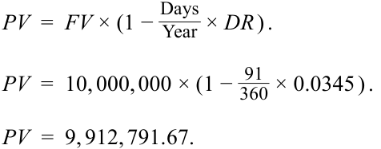

<!-- Formula Text: PV  =  FV × (1 − Days _ Year  × DR ) . PV  =  10, 000, 000 × (1 −  91 _ 360  × 0.0345 ) . PV  =  9, 912, 791.67. -->
$$PV = FV \times \left(1 - \frac{\text{Days}}{\text{Year}} \times DR\right)$$
$$PV = 10,000,000 \times \left(1 - \frac{91}{360} \times 0.0345\right)$$
$$PV = 9,912,791.67$$

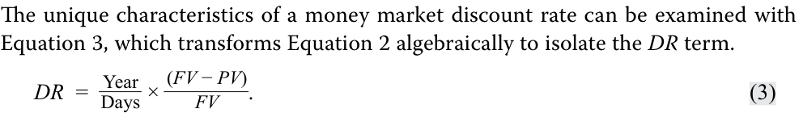

<!-- Formula Text: The unique characteristics of a money market discount rate can be examined with Equation 3, which transforms Equation 2 algebraically to isolate the DR term. DR  =   Year _ Days  ×  (FV − PV) _ FV . (3) -->
Các đặc điểm độc đáo của lãi suất chiết khấu thị trường tiền tệ có thể được xem xét thông qua Phương trình 3, biến đổi đại số Phương trình 2 để tách riêng số hạng $DR$:

$$DR = \frac{\text{Year}}{\text{Days}} \times \frac{FV - PV}{FV} \tag{3}$$

Số hạng đầu tiên, $\text{Year}/\text{Days}$, là định kỳ (*periodicity*) của lãi suất hàng năm. Số hạng thứ hai cho thấy đặc tính kỳ lạ của lãi suất chiết khấu thị trường tiền tệ. Tử số, $FV - PV$, là tiền lãi kiếm được trên tín phiếu Kho bạc bằng đồng rupee, 87.208 INR ($= 10.000.000 - 9.912.792$), trong 91 ngày cho đến khi đáo hạn. Tuy nhiên, mẫu số lại là $FV$, chứ không phải $PV$. Về mặt lý thuyết, lãi suất là số tiền kiếm được chia cho số tiền đầu tư ($PV$), chứ không phải giá trị đáo hạn ($FV$) vốn đã bao gồm cả khoản tiền kiếm được đó. Do đó, về mặt thiết kế, lãi suất chiết khấu thị trường tiền tệ _đánh giá thấp_ (*understates*) tỷ suất sinh lợi của nhà đầu tư, và nó _đánh giá thấp_ chi phí vốn vay đối với tổ chức phát hành. Điều đó là do $PV$ nhỏ hơn $FV$ nếu $DR$ lớn hơn không. 

Phương trình 4 là công thức định giá cho các công cụ thị trường tiền tệ được yết trên cơ sở lãi suất cộng thêm (*add-on rate basis*). 

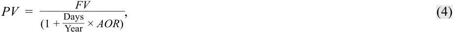

<!-- Formula Text: PV  = FV _____________ (1 + Days _ Year  × AOR) , (4) -->
$$PV = \frac{FV}{1 + \frac{\text{Days}}{\text{Year}} \times AOR} \tag{4}$$

trong đó: 

- $PV$ = giá trị hiện tại (*present value*), số tiền gốc (*principal amount*), hay giá của công cụ thị trường tiền tệ 

- $FV$ = giá trị tương lai (*future value*), hay số tiền hoàn trả (*redemption amount*) được thanh toán khi đáo hạn bao gồm cả tiền lãi 

- $\text{Days}$ = số ngày giữa ngày thanh toán và ngày đáo hạn 

- $\text{Year}$ = số ngày trong năm 

- $AOR$ = lãi suất cộng thêm (*add-on rate*), được biểu thị dưới dạng lãi suất phần trăm năm 

###### **VÍ DỤ 2** 

##### **Các Thước đo Lợi suất trên Chứng chỉ Tiền gửi Ngân hàng (*Yield Measures on Bank Certificates of Deposit*)** 

Commercial Finance Partners AG (CFP Bank) phát hành chứng chỉ tiền gửi (CD) kỳ hạn 90 ngày để tài trợ cho các khoản vay lãi suất thả nổi cấp cho khách hàng. Mục tiêu là duy trì sự cân xứng giữa tài sản của ngân hàng (các khoản vay lãi suất thả nổi) và các nguồn vốn của ngân hàng. Lãi suất cộng thêm yết giá cho CD kỳ hạn 90 ngày của ngân hàng là 0,12%, giả định một năm có 365 ngày. Nếu số tiền gốc ban đầu là 20 triệu EUR, số tiền hoàn trả đến hạn khi đáo hạn được tìm bằng cách sắp xếp lại Phương trình 4 và nhập $PV = 20,000,000$, $\text{Days} = 90$, $\text{Year} = 365$, và $AOR = 0.0012$. 

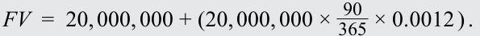

<!-- Formula Text: FV  =  20, 000, 000 + (20, 000, 000 ×  90 _ 365  × 0.0012 ) . -->
$$FV = 20,000,000 + \left(20,000,000 \times \frac{90}{365} \times 0.0012\right)$$

<!-- Formula Text: FV  =  20,005,918. -->
$$FV = 20,005,918$$

<!-- PDF Page 209 -->

Khi đáo hạn, CFP Bank thanh toán 20.005.918 EUR, bao gồm tiền gốc 20.000.000 EUR cộng với tiền lãi 5.918 EUR. Tiền lãi được tính bằng tiền gốc nhân với phân số của năm nhân với lãi suất cộng thêm hàng năm. Nó được cộng vào tiền gốc để xác định số tiền hoàn trả. 

Giả sử sau 45 ngày, nhà đầu tư sở hữu CD bán CD đó cho một nhà tạo lập thị trường (*dealer*). Vào thời điểm đó, lãi suất cộng thêm yết giá cho một CD kỳ hạn 45 ngày là 0,06%. Giá bán của CD có thể được tính bằng cách sử dụng Phương trình 4 với $FV = 20,005,918$ (lưu ý bản gốc ghi nhầm thành 20,004,918 trong lời dẫn nhưng dùng 20,005,918 trong công thức), $\text{Days} = 45$, $\text{Year} = 365$, và $AOR = 0.0006$. Giá bán là 20.003.438 EUR (hoặc 20.002.958 EUR theo lời dẫn). 

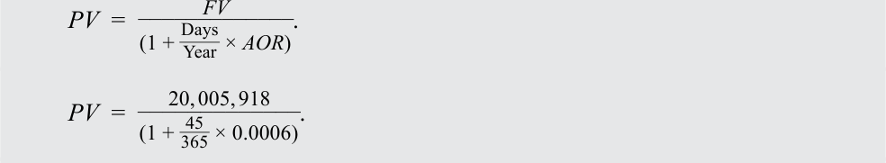

<!-- Formula Text: PV  = FV _____________ (1 + Days _ Year  × AOR) . PV  = 20, 005, 918 _____________ (1 +  45 _ 365  × 0.0006) . -->
$$PV = \frac{FV}{1 + \frac{\text{Days}}{\text{Year}} \times AOR}$$
$$PV = \frac{20,005,918}{1 + \frac{45}{365} \times 0.0006}$$

<!-- Formula Text: PV  =  20, 003, 438. -->
$$PV = 20,003,438$$

Các đặc điểm của lãi suất cộng thêm có thể được xem xét thông qua Phương trình 5, biến đổi đại số Phương trình 4 để tách riêng số hạng $AOR$. 

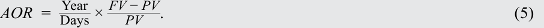

<!-- Formula Text: AOR  =   Year _ Days  ×  FV − PV _ PV  . (5) -->
$$AOR = \frac{\text{Year}}{\text{Days}} \times \frac{FV - PV}{PV} \tag{5}$$

Số hạng đầu tiên, $\text{Year}/\text{Days}$, là định kỳ của lãi suất hàng năm. Số hạng thứ hai là tiền lãi kiếm được ($FV - PV$) chia cho số tiền đã đầu tư ($PV$). 

Tỷ suất sinh lợi của nhà đầu tư vào CD của CFP Bank trong khoản đầu tư 45 ngày vào chứng chỉ tiền gửi có thể được tính bằng Phương trình 5. 

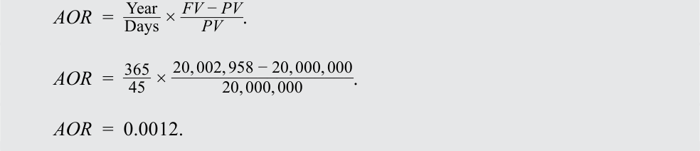

<!-- Formula Text: AOR  =   Year _ Days  ×  FV − PV _ PV  . AOR  =   365 _ 45  ×  20, 002, 958 − 20, 000, 000 ___________________ 20, 000, 000 . AOR  =  0.0012. -->
$$AOR = \frac{\text{Year}}{\text{Days}} \times \frac{FV - PV}{PV}$$
$$AOR = \frac{365}{45} \times \frac{20,002,958 - 20,000,000}{20,000,000}$$
$$AOR = 0.0012$$

Tỷ suất sinh lợi, được biểu thị trên cơ sở lãi suất cộng thêm 365 ngày, là 0,12%. Kết quả này là một mức lãi suất hàng năm cho định kỳ là 8,11 ($= 365/45$). Ngầm định rằng khoản đầu tư này có thể được lặp lại 8,11 lần trong năm. 

Phân tích đầu tư đối với các chứng khoán thị trường tiền tệ có nhiều thách thức hơn bởi vì (1) một số công cụ được yết trên cơ sở lãi suất chiết khấu trong khi những công cụ khác lại được yết trên cơ sở lãi suất cộng thêm và (2) một số giả định một năm có 360 ngày và những công cụ khác lại sử dụng một năm có 365 ngày. Một điểm khác biệt nữa là “số tiền” (*“amount”*) của một công cụ thị trường tiền tệ được các nhà giao dịch yết trên cơ sở lãi suất chiết khấu thường là mệnh giá được trả khi đáo hạn. Tuy nhiên, “số tiền” khi được yết trên cơ sở lãi suất cộng thêm thường là mức giá tại thời điểm phát hành. Bảng 2 tóm tắt các quy ước này. 

**Bảng 2: Tóm tắt các Thước đo Lợi suất Thị trường Tiền tệ (*Exhibit 2: Summary of Money Market Yield Measures*)** 

|**Quy ước và Công cụ (*Conventions and Instruments*)**|**Mô tả (*Description*) — Lãi suất Chiết khấu**|**Mô tả (*Description*) — Lãi suất Cộng thêm**|
|---|---|---|
|Cơ sở yết giá (*Quote Basis*)|Lãi suất chiết khấu (*Discount Rate* – DR)|Lãi suất cộng thêm (*Add-on Rate* – AOR)|
|Phương trình (*Equation*)|$DR = (\text{Year}/\text{Days}) \times [(FV - PV)/FV]$|$AOR = (\text{Year}/\text{Days}) \times [(FV - PV)/PV]$|

<!-- PDF Page 210 -->

|**Quy ước và Công cụ (*Conventions and Instruments*)**|**Mô tả (*Description*) — Lãi suất Chiết khấu**|**Mô tả (*Description*) — Lãi suất Cộng thêm**|
|---|---|---|
|Số tiền yết giá (*Quoted Amount*)|Mệnh giá khi đáo hạn (*Face Value at Maturity* – FV)|Giá tại thời điểm phát hành (*Price at Issuance* – PV)|
|Các công cụ điển hình (*Typical Instruments*)|Thương phiếu (*Commercial Paper*), Tín phiếu Kho bạc (*Treasury Bills*), Hối phiếu được ngân hàng chấp nhận (*Bankers’ Acceptances*)|Chứng chỉ tiền gửi ngân hàng (*Bank Certificates of Deposit*), Thỏa thuận mua lại (*Repurchase Agreements* – Repos), Lãi suất tham chiếu thị trường (*Market Reference Rates* – MRRs)|

Để đưa ra các quyết định đầu tư trên thị trường tiền tệ, điều cốt yếu là phải so sánh các công cụ trên một cơ sở chung. Ví dụ sau đây minh họa điểm này. 

###### **VÍ DỤ 3** 

##### **Các Thước đo Lợi suất trên Chứng chỉ Tiền gửi Ngân hàng (*Yield Measures on Bank Certificates of Deposit*)** 

Giả sử một nhà đầu tư đang so sánh hai công cụ thị trường tiền tệ sau đây. Công cụ nào mang lại tỷ suất sinh lợi kỳ vọng cao hơn, giả sử rằng rủi ro tín dụng là như nhau? 

- Một thương phiếu (CP) kỳ hạn 90 ngày được phát hành bởi Bright Wheel Automotive Corporation (BRWA), được yết ở mức lãi suất chiết khấu 0,100% cho một năm 360 ngày 

- Một chứng chỉ tiền gửi kỳ hạn 90 ngày được phát hành bởi CFP Bank, được yết ở mức lãi suất cộng thêm 0,120% cho một năm 365 ngày 

Giá của thương phiếu là 99,975 trên mỗi 100 đơn vị mệnh giá, được tính bằng cách sử dụng Phương trình 2 và nhập $FV = 100$, $\text{Days} = 90$, $\text{Year} = 360$, và $DR = 0.0010$. 

<!-- Formula Text: PV  =  FV × (1 − Days _ Year  × DR ) . PV  =  100 × (1 −  90 _ 360  × 0.0010 ) . PV  =  99.975. -->
$$PV = FV \times \left(1 - \frac{\text{Days}}{\text{Year}} \times DR\right)$$
$$PV = 100 \times \left(1 - \frac{90}{360} \times 0.0010\right)$$
$$PV = 99.975$$

Tiếp theo, sử dụng Phương trình 5 để giải tìm $AOR$ cho một năm 365 ngày, trong đó $\text{Year} = 365$, $\text{Days} = 90$, $FV = 100$, và $PV = 99.975$. 

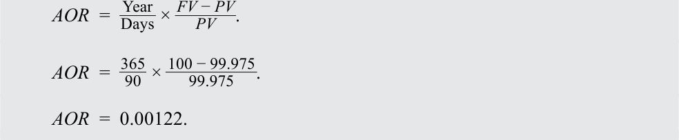

<!-- Formula Text: AOR  =   Year _ Days  ×  FV − PV _ PV  . AOR  =   365 _ 90  ×  100 − 99.975 _ 99.975 . AOR  =  0.00122. -->
$$AOR = \frac{\text{Year}}{\text{Days}} \times \frac{FV - PV}{PV}$$
$$AOR = \frac{365}{90} \times \frac{100 - 99.975}{99.975}$$
$$AOR = 0.001014 \text{ (lưu ý bản gốc in nhầm là } 0.00122 \text{ trong công thức nhưng ghi } 0.1014\% \text{ ở đoạn dưới)}$$

Lãi suất chiết khấu của thương phiếu kỳ hạn 90 ngày ở mức 0,10% chuyển đổi thành lãi suất cộng thêm cho một năm 365 ngày là 0,1014%. Mức lãi suất đã chuyển đổi này được gọi là lợi suất tương đương trái phiếu (*bond equivalent yield*), hay đôi khi chỉ gọi là “lợi suất đầu tư” (*“investment yield”*). **Lợi suất tương đương trái phiếu (*bond equivalent yield* – BEY)** là một mức lãi suất thị trường tiền tệ được biểu thị trên cơ sở lãi suất cộng thêm 365 ngày. Nếu rủi ro là như nhau, CP của BRWA (nếu tính theo con số 0,122% in trong công thức của bản gốc) mang lại lợi suất hàng năm cao hơn 0,2 bps so với CD của CFP Bank. 

Bảng 3 tóm tắt quy trình vừa được minh họa để so sánh các công cụ thị trường tiền tệ trên một cơ sở chung là lợi suất tương đương trái phiếu. 

<!-- PDF Page 211 -->

###### **Bảng 3: So sánh các Công cụ Thị trường Tiền tệ trên Cơ sở Lợi suất Tương đương Trái phiếu (*Exhibit 3: Comparing Money Market Instruments on Bond Equivalent Yield Basis*)** 

- **Bước 1:** Đối với một công cụ thị trường tiền tệ (MM) được yết trên _Cơ sở Lãi suất Chiết khấu (DR)_: Xác định Giá trên mỗi 100 đơn vị mệnh giá ($PV$):
  $$PV = FV \times (1 - [\text{Days}/\text{Year}] \times DR)$$
- **Bước 2:** Xác định _Lãi suất Cộng thêm (AOR)_ cho công cụ MM này bằng cách sử dụng $PV$ từ Bước 1:
  $$AOR = (365/\text{Days}) \times ([FV - PV]/PV)$$
- **Bước 3:** _Lợi suất Tương đương Trái phiếu (BEY)_ là một mức lãi suất MM được biểu thị trên _cơ sở AOR_ 365 ngày. Công cụ này hiện đã có thể so sánh được với các công cụ MM khác được biểu thị trên cơ sở BEY. 

###### **VÍ DỤ 4** 

##### **So sánh các Công cụ Thị trường Tiền tệ Dựa trên Lợi suất Tương đương Trái phiếu (*Comparing Money Market Instruments Based on Bond Equivalent Yields*)** 

Một nhà đầu tư thị trường tiền tệ quan sát lãi suất yết giá trên bốn công cụ thị trường tiền tệ kỳ hạn 180 ngày: A, B, C, và D. 

|**Công cụ thị trường tiền tệ (*Money Market Instrument*)**|**Cơ sở yết giá (*Quotation Basis*)**|**Số ngày giả định trong năm (*Assumed Number of Days in the Year*)**|**Lãi suất yết giá (*Quoted Rate*)**|
|---|---|---|---|
|A|Lãi suất chiết khấu (*Discount Rate*)|360|4,33%|
|B|Lãi suất chiết khấu (*Discount Rate*)|365|4,36%|
|C|Lãi suất cộng thêm (*Add-On Rate*)|360|4,35%|
|D|Lãi suất cộng thêm (*Add-On Rate*)|365|4,45%|

Sử dụng bảng tính, chúng ta có thể tính lợi suất tương đương trái phiếu cho từng công cụ để có thể so sánh tỷ suất sinh lợi. Công cụ A mang lại tỷ suất sinh lợi cao nhất (4,487%) và Công cụ C mang lại tỷ suất sinh lợi thấp nhất (4,410%) trên cơ sở lợi suất tương đương trái phiếu. Vui lòng tham khảo hệ sinh thái học tập dành cho ứng viên trực tuyến để biết bảng tính minh họa phép tính trong sổ làm việc Excel có thể tải xuống. 

||**Công cụ thị trường tiền tệ (*Money Market Instrument*)**|**A**|**B**|**C**|**D**|
|---|---|---|---|---|---|
|Đầu vào (*Input*)|Cơ sở yết giá (*Quotation Basis*)|Lãi suất chiết khấu|Lãi suất chiết khấu|Lãi suất cộng thêm|Lãi suất cộng thêm|
||Số ngày trong năm (*Number of Days in the Year*)|360|365|360|365|
||Lãi suất yết giá (*Quoted Rate*) (%)|4,33%|4,36%|4,35%|4,45%|
|Đầu ra (*Output*)|PV/FV|97,835|97,850|102,175|102,195|
||Lãi suất cộng thêm (*Add-On-Rate*)|0,04487|0,04456|0,04410|0,04450|
||Lợi suất tương đương trái phiếu (*Bond Equivalent Yield*) (%)|4,487%|4,456%|4,410%|4,450%|

Một sự khác biệt quan trọng khác giữa các thước đo lợi suất trên thị trường tiền tệ và thị trường trái phiếu là định kỳ (*periodicity*) của lãi suất hàng năm. Bởi vì lợi suất đáo hạn của trái phiếu được tính bằng cách sử dụng ghép lãi (*interest rate compounding*), nên có một định kỳ được xác định rõ ràng. Chẳng hạn, lợi suất đáo hạn của trái phiếu ghép lãi nửa năm một lần được chuẩn hóa theo năm với 

<!-- PDF Page 212 -->

định kỳ bằng 2. Lãi suất thị trường tiền tệ được tính bằng lãi đơn mà không ghép lãi. Trên thị trường tiền tệ, định kỳ là số ngày trong năm chia cho số ngày cho đến khi đáo hạn. Do đó, lãi suất thị trường tiền tệ cho các thời gian đáo hạn khác nhau sẽ có các định kỳ khác nhau. 

Giả sử một chuyên viên phân tích muốn chuyển đổi lãi suất thị trường tiền tệ sang cơ sở trái phiếu trả lãi nửa năm một lần (*semiannual bond basis*) để các mức lãi suất này có thể so sánh trực tiếp với lợi suất trên các trái phiếu thanh toán coupon nửa năm một lần. Lãi suất yết giá cho một tín phiếu Kho bạc bằng đồng rupee Ấn Độ kỳ hạn 91 ngày là 3,50%, được yết dưới dạng lợi suất tương đương trái phiếu, có nghĩa là định kỳ của nó là $365/91$. Chúng ta sử dụng công thức chuyển đổi định kỳ đã được đề cập trong một bài học trước để chuyển đổi từ định kỳ $m = 365/91$ sang $n = 2$: 

<!-- Formula Text: (1 + AP R m _ m  ) m =  (1 + AP R n _ n  ) n . (1 +  0.035 _ 365 _ 91   ) 365 _ 91 =  (1 + AP R 2 _ 2  ) 2 . AP R 2  =  0.03515  =  3.515 % . -->
$$\left(1 + \frac{APR_m}{m}\right)^m = \left(1 + \frac{APR_n}{n}\right)^n$$
$$\left(1 + \frac{0.035}{365/91}\right)^{365/91} = \left(1 + \frac{APR_2}{2}\right)^2$$
$$APR_2 = 0.03515 = 3.515\%$$

Do đó, mức 3,50% cho định kỳ $365/91$ tương ứng với mức 3,515% cho định kỳ bằng 2. Mức chênh lệch là –1,5 bps. Nhìn chung, mức chênh lệch phụ thuộc vào mức lãi suất phần trăm năm (*annual percentage rate*). Khi lãi suất thấp hơn, sự chênh lệch giữa lãi suất hàng năm của bất kỳ hai định kỳ nào cũng sẽ giảm xuống. 

###### **BỘ CÂU HỎI (*QUESTION SET*)** 

1. Xác định mối quan hệ đúng cho một công cụ thị trường tiền tệ được yết trên cơ sở lãi suất chiết khấu (*discount rate basis*): 

<!-- Picture Text: _ A.  PV  =  FV  × (1 −   Days Year ×  DR  ) . _ B.  FV  =  PV  × (1 −  Days Year  ×  DR  ) . C.  PV  =  _ FV  .  (1 +  DR ) _ Days Year  -->
- **A.** $PV = FV \times \left(1 - \frac{\text{Days}}{\text{Year}} \times DR\right)$.
- **B.** $FV = PV \times \left(1 - \frac{\text{Days}}{\text{Year}} \times DR\right)$.
- **C.** $PV = \frac{FV}{(1 + DR)^{\text{Days}/\text{Year}}}$.

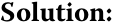

<!-- Picture Text: Solution:  -->
###### **Lời giải:**

A là đáp án đúng. Trên thị trường tiền tệ, lãi suất chiết khấu là một loại lãi suất yết giá cụ thể. Do đó, giá hay giá trị hiện tại của một công cụ thị trường tiền tệ được xác định bởi: 

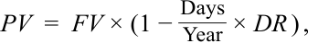

<!-- Formula Text: PV  =  FV × (1 − Days _ Year  × DR ) , -->
$$PV = FV \times \left(1 - \frac{\text{Days}}{\text{Year}} \times DR\right)$$

trong đó: 

$PV$ = giá trị hiện tại, hay giá của công cụ thị trường tiền tệ 

$FV$ = giá trị tương lai được trả khi đáo hạn, hay mệnh giá của công cụ thị trường tiền tệ 

$\text{Days}$ = số ngày giữa ngày thanh toán và ngày đáo hạn 

$\text{Year}$ = số ngày trong năm 

$DR$ = lãi suất chiết khấu, được biểu thị dưới dạng lãi suất phần trăm năm 

<!-- PDF Page 213 -->

2. _Đúng hay sai:_ Các thước đo lợi suất trong các công cụ thị trường tiền tệ được chuẩn hóa theo năm và tính lãi kép (*annualized and compounded*). 

- **A.** Đúng (*True*) 

- **B.** Sai (*False*) 

###### **Lời giải:** 

Sai (*False*). Lợi suất đáo hạn của trái phiếu được chuẩn hóa theo năm và tính lãi kép. Tuy nhiên, các thước đo lợi suất trên thị trường tiền tệ được chuẩn hóa theo năm nhưng không tính lãi kép. 

3. _Đúng hay sai:_ Các công cụ thị trường tiền tệ sử dụng giá trị thời gian của tiền tệ tiêu chuẩn, chẳng hạn như lãi suất chiết khấu hoặc lãi suất cộng thêm. 

   - **A.** Đúng (*True*) 

   - **B.** Sai (*False*) 

###### **Lời giải:** 

Sai (*False*). Lợi suất đáo hạn của trái phiếu được tính bằng cách sử dụng giá trị thời gian của tiền tệ tiêu chuẩn. Các công cụ thị trường tiền tệ thường được yết giá bằng cách sử dụng các mức lãi suất phi tiêu chuẩn, chẳng hạn như lãi suất chiết khấu hoặc lãi suất cộng thêm. 

4. _Đúng hay sai:_ Các công cụ thị trường tiền tệ có thời gian đáo hạn khác nhau sẽ có các định kỳ (*periodicities*) khác nhau. 

- **A.** Đúng (*True*) 

- **B.** Sai (*False*) 

###### **Lời giải:** 

Đúng (*True*). Các công cụ thị trường tiền tệ có thời gian đáo hạn khác nhau sẽ có các định kỳ khác nhau. Tuy nhiên, lợi suất đáo hạn của trái phiếu được đưa ra theo một định kỳ chung cho tất cả các thời gian đáo hạn. 

5. Giải thích khái niệm lợi suất tương đương trái phiếu (*bond equivalent yield*) đối với một công cụ thị trường tiền tệ. 

###### **Lời giải:** 

Lợi suất tương đương trái phiếu là tỷ suất sinh lợi trên một công cụ thị trường tiền tệ được tính toán dựa trên giá mua của công cụ đó theo một năm 365 ngày. Mức lãi suất hoặc lợi suất đã chuyển đổi này có thể được sử dụng để so sánh tỷ suất sinh lợi kiếm được trên công cụ thị trường tiền tệ với tỷ suất sinh lợi tương tự kiếm được từ một trái phiếu. 

6. Một nhà quản lý danh mục đầu tư đã yêu cầu bạn đánh giá các công cụ thị trường tiền tệ định danh bằng đồng baht Thái kỳ hạn 180 ngày sau đây có rủi ro tín dụng tương đương nhau. 

|**Công cụ thị trường tiền tệ (*Money Market Instrument*)**|**Cơ sở yết giá (*Quotation Basis*)**|**Số ngày trong năm (*Number of Days in the Year*)**|**Lãi suất yết giá (*Quoted Rate*)**|
|---|---|---|---|
|Tín phiếu Kho bạc Thái Lan ngắn hạn (*Short-Term Thai T-Bills*)|Lãi suất chiết khấu (*Discount Rate*)|360|4,78%|
|Chứng chỉ tiền gửi ngân hàng Thái Lan (*Thai Bank Certificate of Deposit*)|Lãi suất chiết khấu (*Discount Rate*)|365|4,81%|
|Thương phiếu doanh nghiệp Thái Lan (*Thai Corporate Commercial Paper*)|Lãi suất cộng thêm (*Add-On Rate*)|365|4,85%|

Công cụ nào có tỷ suất sinh lợi cao nhất trên cơ sở lợi suất tương đương trái phiếu (*bond equivalent yield basis*)? 

<!-- PDF Page 214 -->

- **A.** Tín phiếu Kho bạc Thái Lan ngắn hạn 

- **B.** Chứng chỉ tiền gửi ngân hàng Thái Lan 

- **C.** Thương phiếu doanh nghiệp Thái Lan 

- **Lời giải:** 

A là đáp án đúng. Lợi suất tương đương trái phiếu cho mỗi công cụ được tính dễ dàng nhất bằng cách sử dụng bảng tính. Vui lòng tham khảo hệ sinh thái học tập dành cho ứng viên trực tuyến để biết bảng tính minh họa các phép tính trong sổ làm việc Excel có thể tải xuống. Tín phiếu Kho bạc Thái Lan ngắn hạn mang lại tỷ suất sinh lợi cao nhất là 4,965% trên cơ sở lợi suất tương đương trái phiếu. 

||**Công cụ thị trường tiền tệ (*Money Market Instrument*)**|**Tín phiếu Kho bạc Thái Lan ngắn hạn (*Short-Term Thai T-Bill*)**|**CD Ngân hàng Thái Lan (*Thai Bank CD*)**|**CP Doanh nghiệp Thái Lan (*Thai Corporate CP*)**|
|---|---|---|---|---|
|Đầu vào (*Input*)|Cơ sở yết giá (*Quotation Basis*)|Lãi suất chiết khấu|Lãi suất chiết khấu|Lãi suất cộng thêm|
||Số ngày trong năm (*Number of Days in the Year*)|360|365|365|
||Lãi suất yết giá (*Quoted Rate*) (%)|4,78%|4,81%|4,85%|
|Đầu ra (*Output*)|PV/FV|97,610|97,628|102,392|
||Lãi suất cộng thêm (*Add-On-Rate*)|0,04965|0,04927|0,04850|
||Lợi suất tương đương trái phiếu (*Bond Equivalent Yield*) (%)|4,965%|4,927%|4,850%|

###### **Thông tin sau đây liên quan đến câu hỏi 7-8** 

Một công ty bảo hiểm của Đức mua một chứng chỉ tiền gửi kỳ hạn 91 ngày với lãi suất cộng thêm yết giá là 0,40% cho một năm 365 ngày. 

7. Nếu số tiền thanh toán ban đầu là 20 triệu EUR, hãy tính số tiền hoàn trả đến hạn khi đáo hạn. 

###### **Lời giải:** 

Số tiền hoàn trả có thể được tính bằng cách sử dụng Phương trình 4: 

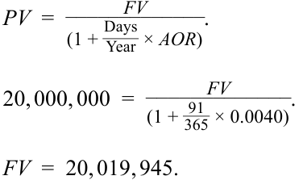

<!-- Picture Text: PV  =  _____________ FV . (1 +  _DaysYear ×  AOR ) _____________ FV  20, 000, 000 = _ (1 +  365 91 × 0.0040). FV  = 20, 019, 945.  -->
$$PV = \frac{FV}{1 + \frac{\text{Days}}{\text{Year}} \times AOR}$$
$$20,000,000 = \frac{FV}{1 + \frac{91}{365} \times 0.0040}$$
$$FV = 20,019,945$$

8. Giả sử rằng sau 31 ngày, công ty bảo hiểm bán CD đó. Tại thời điểm bán, lãi suất cộng thêm yết giá cho một CD kỳ hạn 60 ngày là 0,21%. Hãy tính giá bán của CD. 

###### **Lời giải:** 

Sau 31 ngày, giá bán của chứng chỉ tiền gửi cũng được tính bằng cách sử dụng Phương trình 4: 

$$PV = \frac{FV}{1 + \frac{\text{Days}}{\text{Year}} \times AOR}$$
$$PV = \frac{20,019,945}{1 + \frac{60}{365} \times 0.0021}$$

<!-- PDF Page 215 -->

$$PV = 20,013,036$$

<!-- PDF Page 216 -->

## **BÀI TẬP THỰC HÀNH (*PRACTICE PROBLEMS*)** 

**1.** Một trái phiếu lãi suất thả nổi kỳ hạn 2 năm được phát hành bởi một tập đoàn của Pháp trả lãi MRR 3 tháng ở mức –0,55% cộng 160 bps. Trái phiếu lãi suất thả nổi này được định giá ở mức 101,20 trên mỗi 100 đơn vị mệnh giá. Giả định quy ước đếm ngày 30/360 và 90 ngày mỗi kỳ, biên độ chiết khấu (*discount margin*) của trái phiếu lãi suất thả nổi này gần nhất với mức: 

   - **A.** 25 bps. 

   - **B.** 50 bps. 

   - **C.** 110 bps. 

**2.** Những thay đổi trong biên độ yêu cầu (*required margin*) đối với một trái phiếu lãi suất thả nổi thường xuất phát từ: 

   - **A.** những dịch chuyển trong đường cong lợi suất (*shifts in the yield curve*). 

   - **B.** những thay đổi trong rủi ro tín dụng (*changes in credit risk*). 

   - **C.** sự gia tăng hoặc sụt giảm của lạm phát (*increases or decrease in inflation*). 

### **Thông tin sau đây liên quan đến câu hỏi 3-4** 

Một nhà quản lý danh mục đầu tư thu nhập cố định đang tìm cách định giá một trái phiếu lãi suất thả nổi định danh bằng đô la Mỹ kỳ hạn 1 năm có các khoản thanh toán hàng quý dựa trên MRR 90 ngày cộng 80 bps. Giả sử thông tin sau: 

- MRR 90 ngày (*90-Day MRR*): 2,5%
- Biên độ yết giá (*Quoted Margin*): 80 bps
- Biên độ chiết khấu (*Discount Margin*): 100 bps
- Mệnh giá (*Face Value*): 100 USD 

**3.** Không cần thực hiện bất kỳ phép tính nào, trái phiếu lãi suất thả nổi này được định giá ở mức: 

   - **A.** phần trội (*a premium*). 

   - **B.** chiết khấu (*a discount*). 

   - **C.** ngang mệnh giá (*par*). 

**4.** Giá của FRN này gần nhất với mức: 

   - **A.** 98,804. 

   - **B.** 99,804. 

   - **C.** 100,804. 

**5.** Lợi suất tương đương trái phiếu (*bond equivalent yield*) của một chứng chỉ tiền gửi ngân hàng châu Âu kỳ hạn 90 ngày được yết ở mức lãi suất chiết khấu 0,55% cho một năm 360 ngày gần nhất với mức: 

   - **A.** 0,21%. 

<!-- PDF Page 217 -->

   - **B.** 0,24%.
   - **C.** 0,56%. 

**6.** Một tín phiếu Kho bạc Vương quốc Anh (*UK gilt / Treasury bill*) kỳ hạn 91 ngày có mệnh giá 2 triệu GBP, lãi suất chiết khấu 0,25%, và mức giá 1,9 triệu GBP. Nếu một năm có 366 ngày, lãi suất chiết khấu của tín phiếu Kho bạc Vương quốc Anh này gần nhất với mức: 

   - **A.** 0,1821. 

   - **B.** 0,2011. 

   - **C.** 0,2134. 

**7.** Giải thích tại sao một mức lãi suất chiết khấu thị trường tiền tệ lớn hơn không lại đánh giá thấp (*understates*) tỷ suất sinh lợi của nhà đầu tư và đánh giá thấp chi phí vốn vay đối với tổ chức phát hành. 

<!-- PDF Page 218 -->

## **LỜI GIẢI (*SOLUTIONS*)** 

1. B là đáp án đúng. 

Sử dụng thông tin được cung cấp, khoản thanh toán định kỳ $PMT$ bằng: 

$$\frac{(MRR + QM) \times FV}{m} = \frac{(-0.0055 + 0.016) \times 100}{4} = 0.2625$$

Sử dụng hàm RATE trong Microsoft Excel, Google Sheets, hoặc máy tính tài chính và sử dụng $PV = -101.20$, $FV = 100$, $PMT = 0.2625$ (bản gốc ghi 0.275), và $N = 8$, chúng ta giải tìm được lãi suất chiết khấu mỗi kỳ là 0,124161% (bản gốc in nhầm vị trí dấu thập phân là 12,4161%). Biên độ chiết khấu sau đó có thể được ước tính bằng cách giải tìm $DM$: 

$$r = \frac{MRR + DM}{m}$$

$$0.00124161 = \frac{-0.0055 + DM}{4}$$

$$DM = 0.004525 \text{ (hay } 45.25\text{ bps)}$$

Biên độ chiết khấu ước tính là 45,25 bps. 

2. B là đáp án đúng. Biên độ yêu cầu là mức chênh lệch lợi suất cao hơn hoặc thấp hơn lãi suất tham chiếu, phản ánh rủi ro tín dụng của tổ chức phát hành. Những thay đổi trong biên độ yêu cầu thường xuất phát từ sự thay đổi trong rủi ro tín dụng của tổ chức phát hành. A và C không đúng. Cả hai loại rủi ro này, với tư cách là rủi ro “từ trên xuống” (*“top-down”*) hay rủi ro kinh tế vĩ mô, sẽ được phản ánh vào những thay đổi trong MRR, chứ không phải trong một mức chênh lệch như biên độ yêu cầu. 

3. B là đáp án đúng. FRN này được định giá ở mức chiết khấu, bởi vì biên độ yết giá nhỏ hơn biên độ chiết khấu (biên độ yêu cầu). 

4. B là đáp án đúng. FRN được định giá ở mức 99,804 trên mỗi 100 đơn vị mệnh giá. Sử dụng thông tin được cung cấp, khoản thanh toán định kỳ $PMT$ bằng: 

$$\frac{(MRR + QM) \times FV}{m} = \frac{(0.025 + 0.008) \times 100}{4} = 0.825$$

Lãi suất chiết khấu giả định mỗi kỳ bằng 0,875%. 

$$r = \frac{MRR + DM}{m}$$

$$r = \frac{0.025 + 0.01}{4}$$

$$r = 0.00875$$

Để định giá FRN này, hãy lấy giá trị hiện tại của từng dòng tiền bằng cách sử dụng lãi suất chiết khấu mỗi kỳ. FRN được định giá ở mức 99,804 trên mỗi 100 đơn vị mệnh giá. 

$$PV = \frac{0.825}{(1 + 0.00875)^1} + \frac{0.825}{(1 + 0.00875)^2} + \frac{0.825}{(1 + 0.00875)^3} + \frac{100.825}{(1 + 0.00875)^4}$$

$$PV = 99.804$$

5. C là đáp án đúng. Lợi suất tương đương trái phiếu gần nhất với mức 0,56%. Giá trị hiện tại của chứng chỉ tiền gửi ngân hàng được tính như sau: 

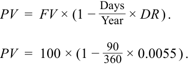

<!-- Formula Text: PV  =  FV × (1 − Days _ Year  × DR ) . PV  =  100 × (1 −  90 _ 360  × 0.0055 ) . -->
$$PV = FV \times \left(1 - \frac{\text{Days}}{\text{Year}} \times DR\right)$$
$$PV = 100 \times \left(1 - \frac{90}{360} \times 0.0055\right)$$

<!-- PDF Page 219 -->

$PV = 99.8625$ (bản gốc ghi 99.865 ở dòng đầu nhưng dùng 99.8625 trong phép tính). Lợi suất tương đương trái phiếu (AOR sử dụng một năm 365 ngày) được tính ra xấp xỉ 0,56%:

$$AOR = \frac{\text{Year}}{\text{Days}} \times \frac{FV - PV}{PV}$$
$$AOR = \frac{365}{90} \times \frac{100 - 99.8625}{99.8625}$$
$$AOR = 0.0056$$

6. B là đáp án đúng. Lãi suất chiết khấu gần nhất với mức 0,2011.

$$DR = \frac{\text{Year}}{\text{Days}} \times \frac{FV - PV}{FV}$$
$$DR = \frac{366}{91} \times \frac{2,000,000 - 1,900,000}{2,000,000}$$
$$DR = 0.2011$$

7. Đối với một công cụ thị trường tiền tệ, lãi suất chiết khấu được tính như sau: 

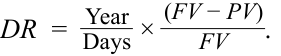

<!-- Formula Text: DR  =   Year _ Days  ×  (FV − PV) _ FV . -->
$$DR = \frac{\text{Year}}{\text{Days}} \times \frac{FV - PV}{FV}$$

Mẫu số của số hạng thứ hai là $FV$, chứ không phải $PV$. Về mặt lý thuyết, lãi suất là số tiền kiếm được chia cho số tiền đầu tư ($PV$), chứ không phải giá trị đáo hạn ($FV$) vốn đã bao gồm cả khoản tiền kiếm được đó. Miễn là $DR$ lớn hơn không, $FV$ sẽ cao hơn $PV$. Do đó, về mặt thiết kế, lãi suất chiết khấu thị trường tiền tệ _đánh giá thấp_ (*understates*) tỷ suất sinh lợi của nhà đầu tư, và nó _đánh giá thấp_ chi phí vốn vay đối với tổ chức phát hành. 

<!-- PDF Page 220 -->
