# Tập 6: Chứng khoán Thu nhập Cố định (Fixed Income)
## Learning Module 9 The Term Structure of Interest Rates: Spot, Par, and Forward Curves (Trang PDF 221–248)

---

# Tập 6: Thu nhập Cố định (Fixed Income)
## Học phần 9: Cấu trúc Kỳ hạn của Lãi suất: Đường cong Lãi suất Giao ngay, Đường cong Lãi suất Ngang giá và Đường cong Lãi suất Kỳ hạn (The Term Structure of Interest Rates: Spot, Par, and Forward Curves)
### Phần 1/3: Giới thiệu (Trang PDF 221–230)

---

<!-- PDF Page 221 -->

#### H Ọ C P H Ầ N 

# **<mark>9</mark>** 

### **Cấu trúc Kỳ hạn của Lãi suất: Đường cong Lãi suất Giao ngay, Đường cong Lãi suất Ngang giá và Đường cong Lãi suất Kỳ hạn (*The Term Structure of Interest Rates: Spot, Par, and Forward Curves*)** 

###### **<mark>MỤC TIÊU HỌC TẬP (*LEARNING OUTCOMES*)</mark>** 

|**_Mức độ thành thạo_**|**_Ứng viên cần có khả năng:_**|
|---|---|
||định nghĩa lãi suất giao ngay (*spot rates*) và đường cong lãi suất giao ngay (*spot curve*), đồng thời tính giá của một trái phiếu bằng cách sử dụng lãi suất giao ngay|
||định nghĩa lãi suất ngang giá (*par rates*) và lãi suất kỳ hạn (*forward rates*), đồng thời tính lãi suất ngang giá, lãi suất kỳ hạn từ lãi suất giao ngay, lãi suất giao ngay từ lãi suất kỳ hạn, và giá của một trái phiếu bằng cách sử dụng lãi suất kỳ hạn|
||so sánh đường cong lãi suất giao ngay (*spot curve*), đường cong lãi suất ngang giá (*par curve*), và đường cong lãi suất kỳ hạn (*forward curve*)|

##### **GIỚI THIỆU (*INTRODUCTION*)** 

**<mark>1</mark>** 

Các bài học trước đã định giá các công cụ thu nhập cố định bằng cách chiết khấu tất cả các dòng tiền tương lai theo một mức lãi suất duy nhất, chẳng hạn như lợi suất đáo hạn (*yield-to-maturity*) hoặc lãi suất tham chiếu thị trường (*market reference rate* – MRR) cộng với biên độ chiết khấu (*discount margin*). Ba bài học tiếp theo sẽ nới lỏng giả định này bằng cách giới thiệu **cấu trúc kỳ hạn của lãi suất (*term structure of interest rates*)**, hay thực tế là lãi suất thay đổi theo thời gian đáo hạn. Dữ liệu lý tưởng để sử dụng cho việc phân tích cấu trúc kỳ hạn là các trái phiếu không trả lãi định kỳ (*zero-coupon bonds*) phi rủi ro vỡ nợ, được gọi là **lãi suất giao ngay (*spot rates*)** hoặc **đường cong lãi suất giao ngay (*spot curve*)**. Vì những dữ liệu này nhìn chung không thể quan sát trực tiếp được, nên nhiều kỹ thuật ước tính khác nhau được sử dụng. Đường cong lãi suất giao ngay được sử dụng để suy ra hai đường cong lợi suất quan trọng khác: **đường cong lãi suất ngang giá (*par curve*)** và **đường cong lãi suất kỳ hạn (*forward curve*)**. Đường cong lãi suất ngang giá liên quan đến lợi suất trái phiếu của các chứng khoán chuẩn giả định được định giá ngang mệnh giá (*at par*), trong khi đường cong lãi suất kỳ hạn liên quan đến lãi suất cho các kỳ tính lãi bắt đầu trong tương lai. Cả ba đường cong này đều là nền tảng cho phân tích thu nhập cố định và các ứng dụng khác bởi vì chúng đại diện cho các tỷ suất sinh lợi phi rủi ro vỡ nợ cho các khoảng thời gian bắt đầu từ ngày hôm nay và trong tương lai. Chúng tôi sẽ trình bày việc định giá trái phiếu bằng cách sử dụng các mức lãi suất khác nhau này và thiết lập mối quan hệ giữa chúng. 

Hầu hết các ví dụ và bảng biểu được sử dụng xuyên suốt bài đọc có thể được tải xuống dưới dạng sổ làm việc Microsoft Excel. Mỗi trang tính trong sổ làm việc được gắn nhãn với số ví dụ hoặc số bảng biểu tương ứng trong văn bản. 

<!-- PDF Page 222 -->

###### **TỔNG QUAN HỌC PHẦN (*LEARNING MODULE OVERVIEW*)** 

- **Lãi suất giao ngay (*spot rates*)** là lãi suất chiết khấu thị trường trên các trái phiếu không trả lãi định kỳ (*zero-coupon bonds*) phi rủi ro vỡ nợ, đôi khi được gọi là **lãi suất zero (*zero rates*)**. Bằng cách sử dụng một chuỗi các lãi suất giao ngay trong việc tính giá trái phiếu, ta thu được mức giá trái phiếu không có chênh lệch giá (*no-arbitrage bond price*). 

- **Lãi suất ngang giá (*par rate*)** là lãi suất chiết khấu thị trường cho một kỳ hạn cụ thể dẫn đến việc một trái phiếu được định giá ngang mệnh giá (*at par*). Lãi suất ngang giá được suy ra từ các lãi suất giao ngay tính đến và bao gồm cả ngày đáo hạn. 

- **Lãi suất kỳ hạn hàm ý (*implied forward rates*)** được tính bằng cách sử dụng lãi suất giao ngay và có thể được diễn giải là tỷ suất sinh lợi tăng thêm, hay cận biên (*incremental, or marginal, return*), cho việc kéo dài thời gian đáo hạn thêm một kỳ nữa. Do đó, chúng phản ánh một **lãi suất tái đầu tư hòa vốn (*breakeven reinvestment rate*)**. 

- Vì lãi suất ngang giá và lãi suất kỳ hạn có thể được suy ra từ lãi suất giao ngay, nên hình dạng của đường cong lãi suất giao ngay có mối liên hệ chặt chẽ với hình dạng của đường cong lãi suất ngang giá và đường cong lãi suất kỳ hạn. 

- Trong các cấu trúc kỳ hạn dốc lên (*upward-sloping term structures*), lãi suất ngang giá sẽ thấp hơn lãi suất giao ngay tương ứng của chúng và lãi suất kỳ hạn sẽ lớn hơn lãi suất giao ngay. Trong các cấu trúc kỳ hạn dốc xuống (*downward-sloping term structures*), lãi suất ngang giá sẽ lớn hơn lãi suất giao ngay và lãi suất kỳ hạn sẽ thấp hơn lãi suất giao ngay. 

###### **TỰ ĐÁNH GIÁ HỌC PHẦN (*LEARNING MODULE SELF-ASSESSMENT*)** 

Các câu hỏi ban đầu này nhằm giúp bạn tự đánh giá mức độ hiểu biết hiện tại của mình về học phần này. 

1. Tính giá và lợi suất đáo hạn (YTM) của một trái phiếu kỳ hạn 3 năm, lãi suất coupon 1% có mệnh giá là 100 với các lãi suất giao ngay sau đây: 

|1 năm|1,0%|
|---|---|
|2 năm|1,5%|
|3 năm|2,0%|

###### **Lời giải:** 

Mức giá là 97,135: 

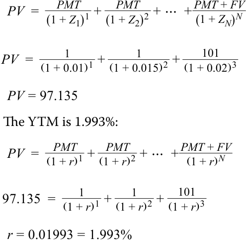

<!-- Formula Text: PV  =    PMT _ (1 + Z 1) 1  +   PMT _ (1 + Z 2) 2  + ⋯  +  PMT + FV _ (1 + Z N) N PV  = 1 _ (1 + 0.01) 1  + 1 _ (1 + 0.015) 2  + 101 _ (1 + 0.02) 3 PV = 97.135 The YTM is 1.993%: PV  =    PMT _ (1 + r) 1  +   PMT _ (1 + r) 2  + ⋯  +  PMT + FV _ (1 + r) N 97.135  = 1 _ (1 + r) 1  + 1 _ (1 + r) 2  +   101 _ (1 + r) 3 r = 0.01993 = 1.993% -->
$$PV = \frac{PMT}{(1 + Z_1)^1} + \frac{PMT}{(1 + Z_2)^2} + \dots + \frac{PMT + FV}{(1 + Z_N)^N}$$
$$PV = \frac{1}{(1 + 0.01)^1} + \frac{1}{(1 + 0.015)^2} + \frac{101}{(1 + 0.02)^3}$$
$$PV = 97.135$$

YTM là 1,993%:

$$PV = \frac{PMT}{(1 + r)^1} + \frac{PMT}{(1 + r)^2} + \dots + \frac{PMT + FV}{(1 + r)^N}$$
$$97.135 = \frac{1}{(1 + r)^1} + \frac{1}{(1 + r)^2} + \frac{101}{(1 + r)^3}$$
$$r = 0.01993 = 1.993\%$$

<!-- PDF Page 223 -->

2. Định nghĩa những gì mà lãi suất ngang giá (*par rate*) đại diện trong bối cảnh định giá trái phiếu. 

###### **Lời giải:** 

   - Lãi suất ngang giá là lợi suất đáo hạn làm cho giá trị hiện tại của các dòng tiền của một trái phiếu (tức là giá của nó) bằng với mệnh giá (*par or face value*) của nó. 

3. Tính lãi suất kỳ hạn 1 năm hàm ý sau hai năm kể từ bây giờ (tức là 2y1y) với các lãi suất giao ngay sau đây, giả định ghép lãi hàng năm: 

|1 năm|1,0%|
|---|---|
|2 năm|1,5%|
|3 năm|2,0%|

###### **Lời giải:** 

- $$(1 + Z_A)^A \times (1 + IFR_{A,B-A})^{B-A} = (1 + Z_B)^B$$

$$(1 + 0.015)^2 \times (1 + IFR_{2,1})^1 = (1 + 0.02)^3 \implies IFR_{2,1} = 3.01\%$$
*(Lưu ý: Bản gốc ở câu 3 viết nhầm phép tính của 1y2y: $(1 + 0.01)^1 \times (1 + IFR_{2,1})^2 = (1 + 0.02)^3 \implies IFR_{2,1} = 2.50\%$, trong khi Câu 4 ngay bên dưới sử dụng kết quả đúng của 2y1y là $3.01\%$).*

4. Giải thích ý nghĩa kinh tế của kết quả lãi suất kỳ hạn được tính trong Câu hỏi 3. 

###### **Lời giải:** 

Lãi suất kỳ hạn 1 năm sau hai năm kể từ bây giờ (2y1y) ở mức 3,01% ngụ ý rằng các nhà đầu tư kỳ vọng lãi suất 1 năm sẽ là 3,01% vào cuối năm thứ hai. Điều này phản ánh mức lãi suất mà tại đó việc tái đầu tư sẽ mang lại kết quả như nhau trong thời hạn đầu tư 3 năm bất kể nhà đầu tư ban đầu mua một trái phiếu kỳ hạn 2 năm hay một trái phiếu kỳ hạn 3 năm. 

5. Đối chiếu lãi suất giao ngay (*spot rates*) và lãi suất kỳ hạn (*forward rates*). 

###### **Lời giải:** 

Lãi suất giao ngay phản ánh lãi suất đi vay và đầu tư đối với nguồn vốn ngay lập tức (hoặc trong vài ngày tới) trong kỳ hạn đã xác định, trong khi lãi suất kỳ hạn phản ánh lãi suất áp dụng cho các thỏa thuận đi vay hoặc đầu tư bắt đầu vào một ngày trong tương lai cho một kỳ hạn đã xác định. 

6. Đúng hay sai: Lãi suất kỳ hạn 1 năm cao hơn so với lãi suất giao ngay tương ứng của chúng khi đường cong lãi suất giao ngay dốc xuống (*downward sloping*). 

   - **A.** Đúng (*True*) 

   - **B.** Sai (*False*) 

###### **Lời giải:** 

Sai (*False*). Khi đường cong lãi suất giao ngay dốc xuống, đường cong lãi suất kỳ hạn 1 năm sẽ nằm bên dưới đường cong lãi suất giao ngay. Lãi suất giao ngay giảm dần đối với các kỳ hạn dài hơn ngụ ý rằng các nhà đầu tư nên kỳ vọng mức lãi suất tái đầu tư thấp hơn trong những năm tương lai, và đường cong lãi suất kỳ hạn phản ánh những kỳ vọng này. 

<!-- PDF Page 224 -->

## **<mark>2</mark>** 

##### **CẤU TRÚC KỲ HẠN CỦA LÃI SUẤT VÀ LÃI SUẤT GIAO NGAY (*MATURITY STRUCTURE OF INTEREST RATES AND SPOT RATES*)** 

định nghĩa lãi suất giao ngay và đường cong lãi suất giao ngay, đồng thời tính giá của một trái phiếu bằng cách sử dụng lãi suất giao ngay 

###### **Cấu trúc Kỳ hạn của Lãi suất (*Maturity Structure of Interest Rates*)** 

Giả sử lợi suất đáo hạn của một trái phiếu cao hơn so với một trái phiếu khác. Có một số lý do khả dĩ giải thích cho sự khác biệt này, bao gồm rủi ro tín dụng, các đồng tiền khác nhau, tính thanh khoản, sự khác biệt về thuế, và giả định về định kỳ (*periodicity*) được sử dụng trong phép tính lợi suất. Sự khác biệt về rủi ro tín dụng và tiền tệ đã được chứng minh trong các bài học trước, nơi các trái phiếu định danh bằng đồng euro kỳ hạn 30 năm của Romania (Bộ Tài chính) được phát hành ở mức lợi suất đáo hạn 4,657%, tức mức chênh lệch 411 bp so với trái phiếu của Cộng hòa Liên bang Đức. Một lý do khác khiến các trái phiếu có thể có lợi suất đáo hạn khác nhau là chúng có thời gian đáo hạn khác nhau. Nhân tố giải thích sự khác biệt về lợi suất này được gọi là **cấu trúc đáo hạn của lãi suất (*maturity structure of interest rates*)** hay **cấu trúc kỳ hạn của lãi suất (*term structure of interest rates*)**. 

Cấu trúc kỳ hạn được phân tích tốt nhất bằng cách sử dụng các trái phiếu có tất cả các đặc tính giống nhau _ngoại trừ_ thời gian đáo hạn; nghĩa là, các trái phiếu phải được định danh bằng cùng một đồng tiền và có cùng rủi ro tín dụng, tính thanh khoản, tình trạng thuế, và giả định về định kỳ, đồng thời chúng phải có cùng lãi suất coupon để mỗi trái phiếu có cùng mức độ rủi ro tái đầu tư coupon (*coupon reinvestment risk*). Bộ dữ liệu lý tưởng này sẽ là lợi suất đáo hạn trên một chuỗi các trái phiếu _không trả lãi định kỳ_ (*zero-coupon bonds*) phi rủi ro vỡ nợ, được gọi là **lãi suất giao ngay (*spot rates*)**, cho đầy đủ các kỳ hạn. Trái phiếu chính phủ của các thị trường phát triển thường được sử dụng cho mục đích này, bởi vì chúng đại diện cho mức rủi ro vỡ nợ thấp nhất trong số các tổ chức phát hành trên một thị trường nhất định. Tập hợp lại, bộ dữ liệu này là **đường cong lãi suất giao ngay (*spot curve*)** của trái phiếu chính phủ, đôi khi được gọi là đường cong zero hoặc đường cong “strip” (bởi vì các khoản thanh toán coupon bị “tách” – *“stripped”* – ra khỏi trái phiếu). 

Đường cong lãi suất giao ngay của trái phiếu chính phủ là lý tưởng để phân tích cấu trúc đáo hạn bởi vì nó đáp ứng tốt nhất giả định “các yếu tố khác không đổi” (*“other things being equal”*). Các trái phiếu chính phủ này được cho là có cùng đồng tiền, rủi ro tín dụng, tính thanh khoản, và tình trạng thuế. Quan trọng nhất, với tư cách là trái phiếu không trả lãi định kỳ, chúng không có rủi ro tái đầu tư coupon. Đường cong lãi suất giao ngay của trái phiếu chính phủ được minh họa trong Bảng 1 cho các kỳ hạn từ 1 đến 30 năm. Lợi suất hàng năm được biểu thị trên cơ sở trái phiếu trả lãi nửa năm một lần (*semiannual bond basis*), giúp thuận tiện cho việc so sánh với các trái phiếu trả coupon thực hiện thanh toán nửa năm một lần, giống như trái phiếu doanh nghiệp ở nhiều thị trường. 

<!-- PDF Page 225 -->

**Bảng 1: Đường cong Lãi suất Giao ngay (Zero) của Trái phiếu Chính phủ (*Exhibit 1: Government Bond Spot (Zero) Curve*)** 

<!-- Picture Text: Yield-to-Maturity (%) 6 5 4 3 2 1 0 0 5 10 15 20 25 30 Time-to-Maturity (years)  -->
> **Chú thích hình ảnh:**
> - **Trục tung:** Lợi suất đáo hạn (*Yield-to-Maturity*) (%) (từ 0 đến 6)
> - **Trục hoành:** Thời gian đáo hạn (*Time-to-Maturity*) (năm) (từ 0 đến 30)

Đường cong lãi suất giao ngay trong Bảng 1 dốc lên và phẳng dần ở các thời gian đáo hạn dài hơn, có nghĩa là các trái phiếu chính phủ dài hạn hơn có lợi suất cao hơn so với các trái phiếu ngắn hạn hơn. Mô hình này là điển hình trong các điều kiện thị trường bình thường. Đôi khi, đường cong lãi suất giao ngay lại dốc xuống ở chỗ lợi suất ngắn hạn hơn lại cao hơn lợi suất dài hạn hơn. Những đường cong lãi suất giao ngay dốc xuống như vậy được gọi là **đường cong lợi suất đảo ngược (*inverted yield curves*)**. Các lý thuyết tìm cách giải thích hình dạng của đường cong lợi suất và những hàm ý của nó đối với các điều kiện thị trường tài chính trong tương lai sẽ được đề cập sau. 

Mặc dù một đường cong lãi suất giao ngay bao gồm các trái phiếu chính phủ không trả lãi định kỳ là lý tưởng cho việc phân tích, nhưng có một số vấn đề thực tiễn cần phải giải quyết. Thứ nhất, hầu hết các trái phiếu chính phủ được giao dịch sôi động đều thực hiện thanh toán coupon. Các trái phiếu trả coupon này có thể không có cùng tính thanh khoản và tình trạng thuế. Các trái phiếu cũ hơn (đã lưu hành lâu – *“seasoned”*) có xu hướng kém thanh khoản hơn so với các khoản nợ mới phát hành bởi vì chúng thuộc sở hữu của các nhà đầu tư tổ chức và cá nhân theo chiến lược “mua và nắm giữ” (*“buy-and-hold”*). Các chính phủ phát hành nợ mới cho các thời gian đáo hạn định kỳ—chẳng hạn, trái phiếu kỳ hạn 5 năm và 10 năm. Trái phiếu kỳ hạn 6 năm hiện tại có thể là một trái phiếu kỳ hạn 10 năm đã được phát hành cách đây 4 năm. Ngoài ra, bởi vì lãi suất biến động, các trái phiếu cũ hơn có thể được định giá ở mức chiết khấu hoặc phần trội so với mệnh giá, điều này có thể dẫn đến sự khác biệt về thuế bởi vì một số khu vực tài phán thuế phân biệt giữa lãi và lỗ vốn (*capital gains and losses*) với thu nhập tiền lãi (*interest income*). 

Do đó, trên thực tế, chỉ những trái phiếu chính phủ mới được phát hành gần đây nhất và được giao dịch sôi động nhất mới được sử dụng để xây dựng đường cong lợi suất. Những trái phiếu này có tính thanh khoản tương tự nhau, và bởi vì chúng được định giá gần với mệnh giá hơn, nên chúng có ít tác động về thuế hơn. Thêm vào đó, bởi vì có dữ liệu hạn chế cho đầy đủ các kỳ hạn, phương pháp nội suy (*interpolation*) được sử dụng để hoàn thiện đường cong. Bảng 2 minh họa một đường cong lợi suất cho một chính phủ phát hành các trái phiếu kỳ hạn 2 năm, 3 năm, 5 năm, 7 năm, 10 năm, và 30 năm thực hiện thanh toán coupon nửa năm một lần. Phương pháp nội suy tuyến tính (*straight-line interpolation*) được sử dụng giữa các điểm đó trên đường cong lợi suất. 

<!-- PDF Page 226 -->

**Bảng 2: Đường cong Lợi suất Trái phiếu Chính phủ Trả lãi Coupon (*Exhibit 2: Government Coupon Bond Yield Curve*)** 

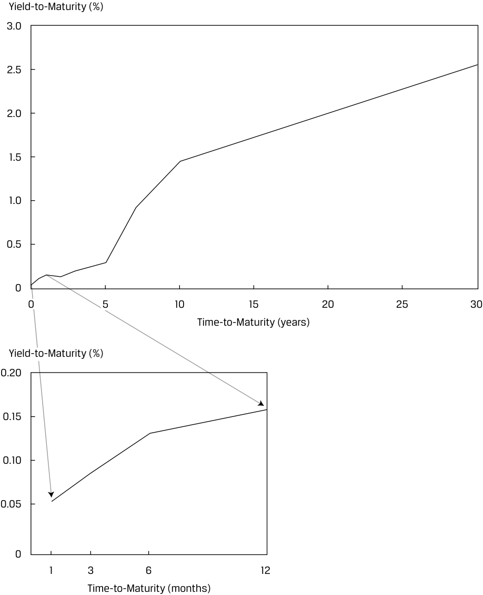

<!-- Picture Text: Yield-to-Maturity (%) 3.0 2.5 2.0 1.5 1.0 0.5 0 0 5 10 15 20 25 30 Time-to-Maturity (years) Yield-to-Maturity (%) 0.20 0.15 0.10 0.05 0 1 3 6 12 Time-to-Maturity (months)  -->
> **Chú thích hình ảnh:**
> - **Biểu đồ chính:** Trục tung: Lợi suất đáo hạn (*Yield-to-Maturity*) (%) (0 đến 3,0); Trục hoành: Thời gian đáo hạn (*Time-to-Maturity*) (năm) (0 đến 30).
> - **Biểu đồ phóng to (góc dưới):** Trục tung: Lợi suất đáo hạn (*Yield-to-Maturity*) (%) (0 đến 0,20); Trục hoành: Thời gian đáo hạn (*Time-to-Maturity*) (tháng) (1, 3, 6, 12).

Bảng 2 cũng bao gồm lợi suất cho các chứng khoán chính phủ ngắn hạn có thời gian đáo hạn là 1 tháng, 3 tháng, 6 tháng, và 12 tháng. Mặc dù các công cụ thị trường tiền tệ này được phát hành và giao dịch trên cơ sở lãi suất chiết khấu, nhưng chúng được chuyển đổi sang lợi suất tương đương trái phiếu (*bond equivalent yields* – tức là lãi suất cộng thêm với một năm 365 ngày). Tất cả các trái phiếu trên đường cong lợi suất cũng cần được chuyển đổi sang cùng một định kỳ (*periodicity*) nhằm tạo thuận lợi cho việc so sánh giữa các thời gian đáo hạn khác nhau. Việc chuyển đổi từ lãi suất chiết khấu sang lợi suất tương đương trái phiếu và giữa các định kỳ đã được trình bày trong các bài học trước. 

###### **Định giá Trái phiếu Sử dụng Lãi suất Giao ngay (*Bond Pricing Using Spot Rates*)** 

Vì lãi suất thay đổi theo kỳ hạn và có cấu trúc kỳ hạn, chúng ta có thể định giá trái phiếu bằng cách sử dụng một chuỗi các lãi suất chiết khấu tương ứng với các ngày phát sinh dòng tiền. Một chuỗi như vậy, đại diện cho các mức lãi suất phi rủi ro vỡ nợ, chính là đường cong lãi suất giao ngay (*spot curve*). Giá trái phiếu được xác định bằng cách sử dụng lãi suất giao ngay sẽ thiết lập các mức giá “không có chênh lệch giá” (*“no-arbitrage” prices*); nếu giá của một trái phiếu khác với giá trị không có chênh lệch giá của nó, một cơ hội kinh doanh chênh lệch giá (*arbitrage opportunity*) sẽ tồn tại trong điều kiện không có chi phí giao dịch. 

<!-- PDF Page 227 -->

Giả sử lãi suất giao ngay 1 năm là 2%, lãi suất giao ngay 2 năm là 3%, và lãi suất giao ngay 3 năm là 4%. Khi đó, giá của một trái phiếu kỳ hạn 3 năm thanh toán coupon hàng năm ở mức 5% là 102,960: 

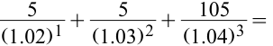

<!-- Formula Text: 5 _ (1.02) 1  + 5 _ (1.03) 2  +   105 _ (1.04) 3  = -->
$$\frac{5}{(1.02)^1} + \frac{5}{(1.03)^2} + \frac{105}{(1.04)^3} =$$

###### $4.902 + 4.713 + 93.345 = 102.960$. 

Trái phiếu kỳ hạn 3 năm này được định giá ở mức phần trội (*at a premium*), vì vậy lợi suất đáo hạn của nó phải thấp hơn mức lãi suất coupon 5% của nó. Sử dụng công thức định giá trái phiếu cơ bản, lợi suất đáo hạn là 3,935%: 

<!-- Formula Text: 102.960  = 5 _ (1 + r) 1  + 5 _ (1 + r) 2  +   105 _ (1 + r) 3 ; r  =  0.03935. -->
$$102.960 = \frac{5}{(1 + r)^1} + \frac{5}{(1 + r)^2} + \frac{105}{(1 + r)^3}; \quad r = 0.03935$$

Nếu các dòng tiền được chiết khấu bằng cách sử dụng lợi suất đáo hạn, ta cũng thu được mức giá tương tự: 

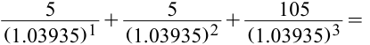

<!-- Formula Text: 5 _ (1.03935) 1  + 5 _ (1.03935) 2  + 105 _ (1.03935) 3  = -->
$$\frac{5}{(1.03935)^1} + \frac{5}{(1.03935)^2} + \frac{105}{(1.03935)^3} =$$

$4.811 + 4.629 + 93.520 = 102.960$. 

Hãy chú ý rằng giá trị hiện tại của từng dòng tiền riêng lẻ được chiết khấu bằng lãi suất giao ngay khác với khi được chiết khấu bằng lợi suất đáo hạn. Giá trị hiện tại của khoản thanh toán coupon đầu tiên là 4,902 khi được chiết khấu ở mức 2%, nhưng là 4,811 khi được chiết khấu ở mức 3,935%. Giá trị hiện tại của dòng tiền cuối cùng, bao gồm cả khoản hoàn trả tiền gốc, là 93,345 ở mức 4% và 93,520 ở mức 3,935%. Tuy nhiên, tổng giá trị hiện tại khi sử dụng một trong hai phương pháp đều là 102,960. 

Phương trình 1 là một công thức tổng quát để tính giá trái phiếu khi biết chuỗi các lãi suất giao ngay. Lưu ý rằng để định giá một trái phiếu có hồ sơ rủi ro khác với đường cong lãi suất giao ngay (chẳng hạn như rủi ro tín dụng, ví dụ như đối với trái phiếu doanh nghiệp), một mức chênh lệch (*spread*) sẽ phải được cộng thêm vào các lãi suất giao ngay. 

<!-- Formula Text: PV  =    PMT _ (1 + Z 1) 1  +   PMT _ (1 + Z 2) 2  + ⋯  +  PMT + FV _ (1 + Z N) N , (1) -->
$$PV = \frac{PMT}{(1 + Z_1)^1} + \frac{PMT}{(1 + Z_2)^2} + \dots + \frac{PMT + FV}{(1 + Z_N)^N} \tag{1}$$

trong đó: 

- $Z_1$ là lãi suất giao ngay (*spot rate*), hay lợi suất trái phiếu không trả lãi định kỳ (*zero-coupon yield*) hoặc lãi suất zero (*zero rate*), cho kỳ 1 

- $Z_2$ là lãi suất giao ngay, hay lợi suất trái phiếu không trả lãi định kỳ hoặc lãi suất zero, cho kỳ 2 

- $Z_N$ là lãi suất giao ngay, hay lợi suất trái phiếu không trả lãi định kỳ hoặc lãi suất zero, cho kỳ $N$ 

Chúng ta sẽ sử dụng lãi suất giao ngay trên trái phiếu chính phủ Canada và Úc để minh họa việc định giá trái phiếu bằng lãi suất giao ngay. 

<!-- PDF Page 228 -->

**Bảng 3: Lãi suất Giao ngay của Trái phiếu Chính phủ: Canada và Úc (*Exhibit 3: Government Bond Spot Rates: Canada and Australia*)** 

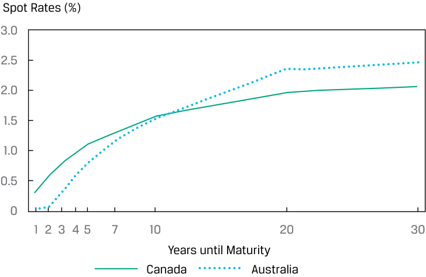

<!-- Picture Text: Spot Rates (%) 3.0 2.5 2.0 1.5 1.0 0.5 0 1 2 3 4 5 7 10 20 30 Years until Maturity Canada Australia  -->
> **Chú thích hình ảnh:**
> - **Trục tung:** Lãi suất giao ngay (*Spot Rates*) (%) (từ 0 đến 3,0)
> - **Trục hoành:** Số năm cho đến khi đáo hạn (*Years until Maturity*) (1, 2, 3, 4, 5, 7, 10, 20, 30)
> - **Đường biểu diễn:** Canada và Úc (*Australia*)

<!-- Picture Text: Maturity (Years) 1 2 3 4 5 7 10 20 30 Canada 0.31% 0.57% 0.80% 0.96% 1.11% 1.30% 1.58% 1.98% 2.06% Australia 0.03% 0.07% 0.30% 0.59% 0.81% 1.17% 1.52% 2.35% 2.47%  -->

| Kỳ hạn (*Maturity*) (Năm) | 1 | 2 | 3 | 4 | 5 | 7 | 10 | 20 | 30 |
|---|---|---|---|---|---|---|---|---|---|
| **Canada** | 0,31% | 0,57% | 0,80% | 0,96% | 1,11% | 1,30% | 1,58% | 1,98% | 2,06% |
| **Úc (*Australia*)** | 0,03% | 0,07% | 0,30% | 0,59% | 0,81% | 1,17% | 1,52% | 2,35% | 2,47% |

###### **VÍ DỤ 1** 

###### **Giá Trái phiếu và Lợi suất Đáo hạn Dựa trên Lãi suất Giao ngay (*Bond Prices and Yields-to-Maturity Based on Spot Rates*)** 

1. Tính giá (trên mỗi 100 đơn vị mệnh giá) của một trái phiếu chính phủ Canada kỳ hạn 5 năm có lãi suất coupon 1,00% với các lãi suất giao ngay được hiển thị trong Bảng 3. 

###### **Lời giải:** 

99,50. Để tính giá của trái phiếu, chúng ta sử dụng Phương trình 1 và các lãi suất giao ngay được cung cấp cho từng dòng tiền. 

<!-- Formula Text: PV  =    PMT _ (1 + Z 1) 1  +   PMT _ (1 + Z 2) 2  + ⋯  +  PMT + FV _ (1 + Z N) N . PV  = 1 _ (1 + 0.0031) 1  + 1 _ (1 + 0.0057) 2  + 1 _ (1 + 0.0080) 3  + 1 _ (1 + 0.0096) 4  + 101 _ (1 + 0.0111) 5 . PV = 99.50. -->
$$PV = \frac{PMT}{(1 + Z_1)^1} + \frac{PMT}{(1 + Z_2)^2} + \dots + \frac{PMT + FV}{(1 + Z_N)^N}$$
$$PV = \frac{1}{(1 + 0.0031)^1} + \frac{1}{(1 + 0.0057)^2} + \frac{1}{(1 + 0.0080)^3} + \frac{1}{(1 + 0.0096)^4} + \frac{101}{(1 + 0.0111)^5}$$
$$PV = 99.50$$

2. Tính giá (trên mỗi 100 đơn vị mệnh giá) của một trái phiếu chính phủ Úc kỳ hạn 5 năm có lãi suất coupon 0,80% với các lãi suất giao ngay được hiển thị trong Bảng 3. 

###### **Lời giải:** 

99,99. Để tính giá của trái phiếu, chúng ta sử dụng Phương trình 1 và các lãi suất giao ngay được cung cấp cho từng dòng tiền. 

<!-- Formula Text: PV  =    PMT _ (1 + Z 1) 1  +   PMT _ (1 + Z 2) 2  + ⋯  +  PMT + FV _ (1 + Z N) N . PV  = 0.80 _ (1 + 0.0003) 1  + 0.80 _ (1 + 0.0007) 2  + 0.80 _ (1 + 0.0030) 3  + 0.80 _ (1 + 0.0059) 4  + 100.80 _ (1 + 0.0081) 5 . -->
$$PV = \frac{PMT}{(1 + Z_1)^1} + \frac{PMT}{(1 + Z_2)^2} + \dots + \frac{PMT + FV}{(1 + Z_N)^N}$$
$$PV = \frac{0.80}{(1 + 0.0003)^1} + \frac{0.80}{(1 + 0.0007)^2} + \frac{0.80}{(1 + 0.0030)^3} + \frac{0.80}{(1 + 0.0059)^4} + \frac{100.80}{(1 + 0.0081)^5}$$

<!-- PDF Page 229 -->

###### $PV = 99.99$ 

3. Tính YTM của trái phiếu chính phủ Canada kỳ hạn 5 năm, sử dụng mức giá thu được trong Câu hỏi 1. 

###### **Lời giải:** 

1,104%. Thay vì giải tìm giá, chúng ta sử dụng Phương trình 1 để giải tìm YTM, tức IRR làm cân bằng mức giá được tính trong Câu hỏi 1 với giá trị hiện tại của các dòng tiền tương lai. Trong Microsoft Excel hoặc Google Sheets, hàm RATE hoặc IRR có thể được sử dụng để giải tìm $r$. 

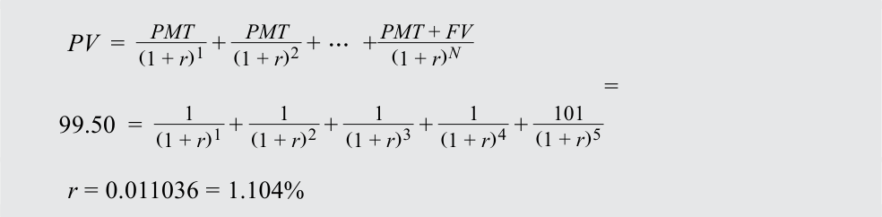

<!-- Formula Text: PV  =    PMT _ (1 + r) 1  +   PMT _ (1 + r) 2  + ⋯  +  PMT + FV _ (1 + r) N 99.50  = 1 _ (1 + r) 1  + 1 _ (1 + r) 2  + 1 _ (1 + r) 3  + 1 _ (1 + r) 4  +   101 _ (1 + r) 5 = r = 0.011036 = 1.104% -->
$$PV = \frac{PMT}{(1 + r)^1} + \frac{PMT}{(1 + r)^2} + \dots + \frac{PMT + FV}{(1 + r)^N}$$
$$99.50 = \frac{1}{(1 + r)^1} + \frac{1}{(1 + r)^2} + \frac{1}{(1 + r)^3} + \frac{1}{(1 + r)^4} + \frac{101}{(1 + r)^5}$$
$$r = 0.011036 = 1.104\%$$

Hãy chú ý rằng lợi suất của trái phiếu trả coupon thấp hơn một chút so với lãi suất giao ngay 5 năm. 

###### **BỘ CÂU HỎI (*QUESTION SET*)** 

1. Đúng hay sai: Trên thực tế, đường cong lãi suất giao ngay (*spot curve*) được tạo ra bằng cách tính lợi suất đáo hạn trên các trái phiếu chính phủ trả coupon mới được phát hành gần đây có các kỳ hạn khác nhau. 

   - **A.** Đúng (*True*) 

   - **B.** Sai (*False*) 

###### **Lời giải:** 

Đúng (*True*). Mặc dù các trái phiếu chính phủ phi rủi ro không trả lãi định kỳ sẽ được ưu tiên hơn, nhưng trên thực tế, đường cong lãi suất giao ngay được tạo ra bằng cách sử dụng lợi suất trên các trái phiếu chính phủ trả coupon mới được phát hành gần đây và phương pháp nội suy tuyến tính. Những trái phiếu này thỏa mãn tốt nhất các điều kiện cho việc phân tích cấu trúc kỳ hạn. 

2. Xác định từ còn thiếu trong câu sau: Bởi vì thường có dữ liệu hạn chế để tính lợi suất cho đầy đủ các kỳ hạn, nên thông thường cần phải __________ giữa các lợi suất quan sát được để hoàn thiện dữ liệu đường cong. 

###### **Lời giải:** 

Bởi vì thường có dữ liệu hạn chế để tính lợi suất cho đầy đủ các kỳ hạn, nên thông thường cần phải **nội suy (*interpolate*)** giữa các lợi suất quan sát được để hoàn thiện dữ liệu đường cong. 

3. Tính giá và lợi suất đáo hạn của một trái phiếu kỳ hạn 5 năm, lãi suất coupon 2,5% với các lãi suất giao ngay sau đây. Giả định ghép lãi hàng năm. 

|1 năm|3,000%|
|---|---|
|2 năm|2,800%|
|3 năm|2,600%|

<!-- PDF Page 230 -->

<!-- Picture Text: 4-year                   2.400% 5-year                   2.200% Solution:  -->

|4 năm|2,400%|
|---|---|
|5 năm|2,200%|

###### **Lời giải:**

Mức giá là 101,314 (hoặc 101,34 theo làm tròn bên dưới). 

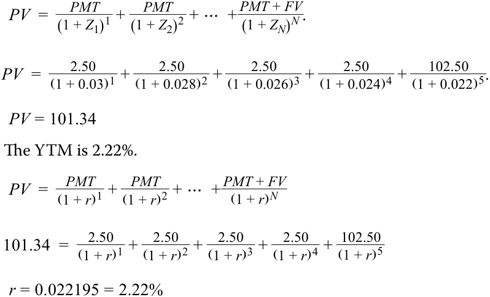

<!-- Formula Text: PV  =    PMT _ (1 + Z 1) 1  +   PMT _ (1 + Z 2) 2  + ⋯  +  PMT + FV _ (1 + Z N) N . PV  = 2.50 _ (1 + 0.03) 1  + 2.50 _ (1 + 0.028) 2  + 2.50 _ (1 + 0.026) 3  + 2.50 _ (1 + 0.024) 4  + 102.50 _ (1 + 0.022) 5 . PV = 101.34 The YTM is 2.22%. PV  =    PMT _ (1 + r) 1  +   PMT _ (1 + r) 2  + ⋯  +  PMT + FV _ (1 + r) N 101.34  =    2.50 _ (1 + r) 1  +   2.50 _ (1 + r) 2  +   2.50 _ (1 + r) 3  +   2.50 _ (1 + r) 4  +  102.50 _ (1 + r) 5 r = 0.022195 = 2.22% -->
$$PV = \frac{PMT}{(1 + Z_1)^1} + \frac{PMT}{(1 + Z_2)^2} + \dots + \frac{PMT + FV}{(1 + Z_N)^N}$$
$$PV = \frac{2.50}{(1 + 0.03)^1} + \frac{2.50}{(1 + 0.028)^2} + \frac{2.50}{(1 + 0.026)^3} + \frac{2.50}{(1 + 0.024)^4} + \frac{102.50}{(1 + 0.022)^5}$$
$$PV = 101.34$$

YTM là 2,22%.

$$PV = \frac{PMT}{(1 + r)^1} + \frac{PMT}{(1 + r)^2} + \dots + \frac{PMT + FV}{(1 + r)^N}$$
$$101.34 = \frac{2.50}{(1 + r)^1} + \frac{2.50}{(1 + r)^2} + \frac{2.50}{(1 + r)^3} + \frac{2.50}{(1 + r)^4} + \frac{102.50}{(1 + r)^5}$$
$$r = 0.022195 = 2.22\%$$

4. Giả sử chúng ta quan sát thấy cấu trúc kỳ hạn sau đây đối với trái phiếu chính phủ Canada. Hãy tính giá của một trái phiếu chính phủ Canada kỳ hạn 3 năm, lãi suất coupon 0,50%. 

|**Kỳ hạn (*Maturity*)**|**Lợi suất đáo hạn (*Yield-to-maturity*)**|
|---|---|
|1 năm (*1-Year*)|1,1000%|
|2 năm (*2-Year*)|0,9500%|
|3 năm (*3-Year*)|0,7951%|
|4 năm (*4-Year*)|0,5700%|
|5 năm (*5-Year*)|0,3100%|

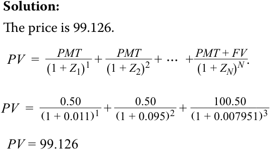

<!-- Formula Text: Solution: The price is 99.126. PV  =    PMT _ (1 + Z 1) 1  +   PMT _ (1 + Z 2) 2  + ⋯  +  PMT + FV _ (1 + Z N) N . PV  = 0.50 _ (1 + 0.011) 1  + 0.50 _ (1 + 0.095) 2  + 100.50 ____________ (1 + 0.007951) 3 PV = 99.126 -->
###### **Lời giải:**

Mức giá là 99,126.

$$PV = \frac{PMT}{(1 + Z_1)^1} + \frac{PMT}{(1 + Z_2)^2} + \dots + \frac{PMT + FV}{(1 + Z_N)^N}$$
$$PV = \frac{0.50}{(1 + 0.011)^1} + \frac{0.50}{(1 + 0.0095)^2} + \frac{100.50}{(1 + 0.007951)^3}$$
$$PV = 99.126$$

5. Ví dụ 1 (trong sổ làm việc Excel đi kèm) có bao gồm một câu hỏi cho một trái phiếu chính phủ Canada kỳ hạn 3 năm, lãi suất coupon 0,50%, trong đó giá của trái phiếu cũng giống như mức giá 99,126 trong Câu hỏi 4 ở trên. Hãy đối chiếu các đường cong lãi suất giao ngay của Canada trong Ví dụ 1 và Câu hỏi 4, đồng thời giải thích tại sao hai đường cong lợi suất khác nhau này lại tạo ra cùng một kết quả định giá. 

###### **Lời giải:** 

Ví dụ 1 có một cấu trúc kỳ hạn dốc lên (*upward-sloping*), trong khi ở Câu hỏi 4, cấu trúc kỳ hạn lại dốc xuống (*downward sloping*). Một điểm tương đồng quan trọng là, bất chấp sự khác biệt rất lớn về <u>điểm xuất phát (tức là lãi suất giao ngay 1 năm)</u> 

---

# Tập 6: Thu nhập Cố định (Fixed Income)
## Học phần 9: Cấu trúc Kỳ hạn của Lãi suất: Đường cong Lãi suất Giao ngay, Đường cong Lãi suất Ngang giá và Đường cong Lãi suất Kỳ hạn (The Term Structure of Interest Rates: Spot, Par, and Forward Curves)
### Phần 2/3: Lãi suất Ngang giá và Lãi suất Kỳ hạn (Trang PDF 231–246)

---

<!-- PDF Page 231 -->

giữa hai ví dụ, lãi suất giao ngay 3 năm lại tương tự nhau. Trong Ví dụ 1, lãi suất 3 năm là 0,7977%, và lãi suất 3 năm trong Câu hỏi 4 là 0,7951%. Do sự tương đồng của lãi suất giao ngay trong các ví dụ về cấu trúc kỳ hạn dốc lên và dốc xuống, nên có thể xuất hiện cùng một mức giá (và YTM) trong cả môi trường cấu trúc kỳ hạn dốc lên và dốc xuống. 

#### **LÃI SUẤT NGANG GIÁ VÀ LÃI SUẤT KỲ HẠN (*PAR AND FORWARD RATES*)** 

# **<mark>3</mark>** 

định nghĩa lãi suất ngang giá và lãi suất kỳ hạn, đồng thời tính lãi suất ngang giá, lãi suất kỳ hạn từ lãi suất giao ngay, lãi suất giao ngay từ lãi suất kỳ hạn, và giá của một trái phiếu bằng cách sử dụng lãi suất kỳ hạn 

##### **Lãi suất Ngang giá từ Lãi suất Giao ngay (*Par Rates from Spot Rates*)** 

Một ứng dụng quan trọng của lãi suất giao ngay là xác định lãi suất ngang giá. **Lãi suất ngang giá (*par rate*)** là một lợi suất đáo hạn làm cho giá trị hiện tại của các dòng tiền của một trái phiếu bằng với mệnh giá (100% mệnh giá – *par / face value*). Các mức lãi suất ngang giá được suy ra cho các trái phiếu chính phủ _giả định_ (*hypothetical*) có thời gian đáo hạn khác nhau thường được sử dụng để phân tích cấu trúc kỳ hạn bởi vì chúng kiểm soát được các yếu tố về thuế, giao dịch và các biến dạng tiềm ẩn khác gắn liền với các trái phiếu thực tế được định giá ở mức chiết khấu hoặc phần trội. Chẳng hạn, đường cong lợi suất Kho bạc Hoa Kỳ được trích dẫn rộng rãi do Bộ Tài chính Hoa Kỳ công bố hàng ngày được cấu thành từ các mức lãi suất ngang giá. Tuy nhiên, các chứng khoán chính phủ mới được phát hành gần đây nhất hay chứng khoán đang lưu hành mới nhất (*on-the-run*) đã được giới thiệu trong một bài học trước là các trái phiếu _thực tế_ có lợi suất đáo hạn gần với nhưng không bằng với lãi suất ngang giá. 

Vào một ngày thanh toán coupon, phương trình sau đây có thể được sử dụng để tính lãi suất ngang giá bằng cách giải tìm $PMT$ khi biết một chuỗi các lãi suất giao ngay $Z_1, Z_2, \dots, Z_n$. Giữa các ngày trả coupon, chúng ta đặt giá tịnh (*flat price*), thay vì giá toàn phần (*full price*), bằng 100. 

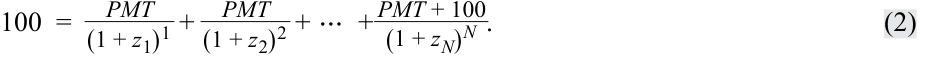

<!-- Formula Text: 100  =    PMT _ (1 + z 1) 1  +   PMT _ (1 + z 2) 2  + ⋯  +  PMT + 100 _ (1 + z N) N . (2) -->
$$100 = \frac{PMT}{(1 + z_1)^1} + \frac{PMT}{(1 + z_2)^2} + \dots + \frac{PMT + 100}{(1 + z_N)^N} \tag{2}$$

Phương trình này rất giống với Phương trình 1, ngoại trừ việc $PV = FV = 100$. Hãy nhớ lại rằng để một trái phiếu giao dịch ngang mệnh giá, lãi suất coupon và lợi suất đáo hạn của nó phải bằng nhau. Vì vậy, bằng cách giải tìm $PMT$, chúng ta cũng giải tìm được lợi suất đáo hạn để trái phiếu đó giao dịch ngang mệnh giá. Mức lãi suất duy nhất này, chia cho 100, chính là lãi suất ngang giá _mỗi kỳ_ (*par rate per period*). 

Một ví dụ sẽ minh họa việc tính toán lãi suất ngang giá khi biết lãi suất giao ngay. Giả sử lãi suất giao ngay 1 năm, 2 năm, 3 năm và 4 năm hiện tại trên trái phiếu chính phủ lần lượt là 5,263%, 5,616%, 6,359% và 7,008%. Đây là các mức lãi suất thực hàng năm (*effective annual rates*). Lãi suất ngang giá 1 năm là 5,263%: 

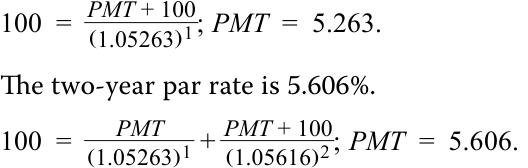

<!-- Formula Text: 100  =   PMT + 100 _ (1.05263) 1 ; PMT  =  5.263. The two-year par rate is 5.606%. 100  = PMT _ (1.05263) 1  +  PMT + 100 _ (1.05616) 2 ; PMT  =  5.606. -->
$$100 = \frac{PMT + 100}{(1.05263)^1}; \quad PMT = 5.263$$

Lãi suất ngang giá 2 năm là 5,606%:

$$100 = \frac{PMT}{(1.05263)^1} + \frac{PMT + 100}{(1.05616)^2}; \quad PMT = 5.606$$

Lãi suất ngang giá 3 năm và 4 năm lần lượt là 6,306% và 6,899%: 

<!-- Formula Text: 100  = PMT _ (1.05263) 1  + PMT _ (1.05616) 2  +  PMT + 100 _ (1.06359) 3 ; PMT  =  6.306. 100  = PMT _ (1.05263) 1  + PMT _ (1.05616) 2  + PMT _ (1.06359) 3  +  PMT + 100 _ (1.07008) 4 ; PMT  =  6.899. -->
$$100 = \frac{PMT}{(1.05263)^1} + \frac{PMT}{(1.05616)^2} + \frac{PMT + 100}{(1.06359)^3}; \quad PMT = 6.306$$
$$100 = \frac{PMT}{(1.05263)^1} + \frac{PMT}{(1.05616)^2} + \frac{PMT}{(1.06359)^3} + \frac{PMT + 100}{(1.07008)^4}; \quad PMT = 6.899$$

<!-- PDF Page 232 -->

Chúng ta có thể xác nhận rằng đây là các mức lãi suất ngang giá thông qua công thức định giá. Sử dụng các mức lãi suất ngang giá này làm lãi suất coupon và lợi suất đáo hạn, giá của trái phiếu kỳ hạn 2 năm là 100:

$$\frac{5.606}{(1.05606)^1} + \frac{105.606}{(1.05606)^2} = 100$$

Tương tự, giá của trái phiếu kỳ hạn 4 năm cũng là 100: 

- $$\frac{6.899}{(1.06899)^1} + \frac{6.899}{(1.06899)^2} + \frac{6.899}{(1.06899)^3} + \frac{106.899}{(1.06899)^4} = 100$$

###### **VÍ DỤ 2** 

##### **Giá Trái phiếu và Lợi suất Đáo hạn Dựa trên Lãi suất Ngang giá (*Bond Prices and Yields-to-Maturity Based on Par Rates*)** 

1. Lãi suất ngang giá của một trái phiếu có thể được tính từ tập hợp các lãi suất giao ngay phản ánh các kỳ hạn tính đến và bao gồm cả kỳ hạn của lãi suất ngang giá mong muốn. Sử dụng dữ liệu lãi suất giao ngay của Canada, hãy tính lãi suất ngang giá cho một trái phiếu chính phủ Canada kỳ hạn 3 năm. Trong ví dụ này (và các ví dụ tiếp theo), giả định thanh toán và ghép lãi hàng năm.

**Lời giải:** Sử dụng Phương trình 2 để giải tìm $PMT$, như sau:

$$100 = \frac{PMT}{(1 + z_1)^1} + \frac{PMT}{(1 + z_2)^2} + \dots + \frac{PMT + 100}{(1 + z_N)^N}$$
$$100 = \frac{PMT}{(1 + 0.003117)^1} + \frac{PMT}{(1 + 0.00568)^2} + \frac{PMT + 100}{(1 + 0.007977)^3}$$

Chúng ta có thể đặt $PMT$ làm nhân tử chung và sau đó giải tìm nó:

$$100 = PMT \times \left(\frac{1}{(1 + 0.003117)^1} + \frac{1}{(1 + 0.00568)^2} + \frac{1}{(1 + 0.007977)^3}\right) + \frac{100}{(1 + 0.007977)^3}$$
$$PMT = 0.7952$$

Để chuyển đổi khoản thanh toán coupon sang lãi suất ngang giá mỗi kỳ, chúng ta chia cho 100 (tức là $0.7952/100$). Như vậy, lãi suất ngang giá bằng 0,7952%. 

##### **Lãi suất Kỳ hạn từ Lãi suất Giao ngay (*Forward Rates from Spot Rates*)** 

Lãi suất giao ngay cũng có thể được sử dụng để tính **lãi suất kỳ hạn hàm ý (*implied forward rates*)** (còn được gọi là **lợi suất kỳ hạn – *forward yields***), vốn là các mức lãi suất tái đầu tư hòa vốn (*breakeven reinvestment rates*). Chúng liên kết tỷ suất sinh lợi trên một khoản đầu tư vào một trái phiếu không trả lãi định kỳ ngắn hạn hơn với tỷ suất sinh lợi trên một khoản đầu tư vào một trái phiếu không trả lãi định kỳ dài hạn hơn. 

Giả sử lợi suất đáo hạn trên các trái phiếu không trả lãi định kỳ kỳ hạn 3 năm và 4 năm lần lượt là 3,65% và 4,18%. Một chuyên viên phân tích muốn biết mức tỷ suất sinh lợi tăng thêm được hàm ý bởi các mức lãi suất này cho việc đầu tư trong 4 năm thay vì 3 năm (tức là thêm một năm tăng thêm) là bao nhiêu. Đây sẽ là lợi suất kỳ hạn 1 năm hàm ý tại thời điểm 3 năm trong tương lai, được mô tả trong Bảng 4. 

<!-- PDF Page 233 -->

**Bảng 4: Lãi suất Hàm ý 1 năm, Ba năm Kể từ Hôm nay (*Exhibit 4: The One-Year Implied Rate, Three Years from Today*)** 

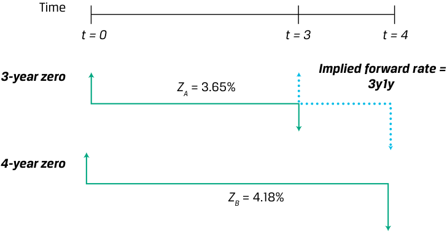

<!-- Picture Text: Time t = 0 t = 3 t = 4 Implied forward rate = 3-year zero ZA = 3.65% 3y1y 4-year zero ZB = 4.18%  -->
> **Chú thích hình ảnh:**
> - **Thời gian (*Time*):** $t = 0$, $t = 3$, $t = 4$
> - **Từ $t = 0$ đến $t = 3$:** Trái phiếu zero 3 năm ($Z_A = 3.65\%$)
> - **Từ $t = 3$ đến $t = 4$:** Lãi suất kỳ hạn hàm ý (*Implied forward rate*) = `3y1y`
> - **Từ $t = 0$ đến $t = 4$:** Trái phiếu zero 4 năm ($Z_B = 4.18\%$)

Thông lệ thị trường phổ biến nhất là đặt tên cho lãi suất kỳ hạn này là “3y1y”, phát âm là “lãi suất 3 năm vào 1 năm” (*“three-year into one-year rate”*), hoặc đơn giản là “3’s, 1’s”. Con số đầu tiên đề cập đến độ dài của giai đoạn kỳ hạn tính bằng năm kể từ ngày hôm nay, và con số thứ hai đề cập đến **kỳ hạn (*tenor*)** của trái phiếu cơ sở, hay thời gian đáo hạn còn lại của nó. Trên thị trường tiền tệ, lãi suất kỳ hạn thường được biểu thị bằng tháng. 

Nếu quan điểm của nhà đầu tư về lợi suất trái phiếu trong tương lai là lợi suất 1 năm tại thời điểm 3 năm tới có khả năng thấp hơn mức 3y1y, thì có lẽ tốt hơn là chỉ cần đầu tư vào trái phiếu không trả lãi định kỳ kỳ hạn 4 năm. Tuy nhiên, nếu quan điểm của nhà đầu tư là lợi suất 1 năm sẽ cao hơn lãi suất kỳ hạn hàm ý, nhà đầu tư có thể ưu tiên trái phiếu kỳ hạn 3 năm và sau đó tái đầu tư ở mức lãi suất kỳ vọng cao hơn đó trong một năm tiếp theo. Điều đó giải thích tại sao lãi suất kỳ hạn hàm ý lại là _lãi suất tái đầu tư hòa vốn_ (*breakeven reinvestment rate*). 

Phương trình 3 là công thức tổng quát cho lãi suất kỳ hạn hàm ý, $IFR_{A,B-A}$, đối với một chứng khoán bắt đầu tại $t = A$ và đáo hạn tại $t = B$ (kỳ hạn $B - A$). Để giải tìm nó, chúng ta cần lãi suất giao ngay $z_A$, và lãi suất giao ngay dài hạn hơn $z_B$. Điều này được minh họa trong Bảng 5. 

$$(1 + Z_A)^A \times (1 + IFR_{A,B-A})^{B-A} = (1 + Z_B)^B \tag{3}$$

**Bảng 5: Lãi suất Kỳ hạn Hàm ý (*Exhibit 5: Implied Forward Rates*)** 

<!-- Picture Text: Time t = 0 t = A t = B Shorter-term bond A ZA Implied forward rate IFR A,B – A Longer-term bond B ZB  -->
> **Chú thích hình ảnh:**
> - **Thời gian (*Time*):** $t = 0$, $t = A$, $t = B$
> - **Từ $t = 0$ đến $t = A$:** Trái phiếu ngắn hạn hơn $A$ ($Z_A$)
> - **Từ $t = A$ đến $t = B$:** Lãi suất kỳ hạn hàm ý ($IFR_{A,B-A}$)
> - **Từ $t = 0$ đến $t = B$:** Trái phiếu dài hạn hơn $B$ ($Z_B$)

Sử dụng Phương trình 3, hãy giải tìm mức 3y1y vì chúng ta biết rằng lợi suất đáo hạn trên các trái phiếu không trả lãi định kỳ kỳ hạn 3 năm và 4 năm lần lượt là 3,65% và 4,18%: 

$$(1 + Z_A)^A \times (1 + IFR_{A,B-A})^{B-A} = (1 + Z_B)^B$$

$$(1 + 0.0365)^3 \times (1 + IFR_{3,1})^1 = (1 + 0.0418)^4$$

<!-- PDF Page 234 -->

###### $IFR_{3,1} = 0.057863 = 5.79\%$ 

Lợi suất kỳ hạn hàm ý “3y1y” là 5,79%. Nếu nhà đầu tư tin rằng lợi suất 1 năm sẽ cao hơn mức đó sau 3 năm nữa, cô ấy nên đầu tư vào trái phiếu kỳ hạn 3 năm thay vì trái phiếu kỳ hạn 4 năm (và ngược lại). 

###### **VÍ DỤ 3** 

##### **Suy ra Lãi suất Kỳ hạn từ Lãi suất Giao ngay (*Deriving Forward Rates from Spot Rates*)** 

1. Hãy quay lại với các lãi suất giao ngay của Canada. Trong ví dụ sau đây, chúng ta sẽ giả định ghép lãi hàng năm (tức là định kỳ bằng 1). Hãy tính lãi suất kỳ hạn hàm ý 2y1y trên trái phiếu chính phủ Canada. 

###### **Lời giải:** 

Để tính lãi suất kỳ hạn hàm ý 2y1y, chúng ta nhận thấy rằng chúng ta đang ước tính lãi suất 1 năm tại một thời điểm cách Thời điểm 0 là 2 năm. Do đó, $A = 2$, $B = 3$, $Z_A$ là lãi suất giao ngay 2 năm ($0.00568$), và $Z_B$ là lãi suất giao ngay 3 năm ($0.007977$): 

- $$(1 + Z_A)^A \times (1 + IFR_{A,B-A})^{B-A} = (1 + Z_B)^B$$

$$(1 + 0.00568)^2 \times (1 + IFR_{2,1})^1 = (1 + 0.007977)^3$$
*(Lưu ý: Bản gốc in nhầm dòng trung gian là $(1 + 0.0188) \times (1 + 0.0277) = (1 + Z_2)^2$ từ ví dụ tiếp theo, nhưng kết quả $IFR_{2,1}$ bên dưới là tính từ $Z_2 = 0.5680\%$ và $Z_3 = 0.7977\%$ của Canada).*

$$IFR_{2,1} = 0.0126$$

Như vậy, lãi suất kỳ hạn hàm ý cho một trái phiếu kỳ hạn 1 năm sau hai năm kể từ bây giờ là 1,26%. 

##### **Lãi suất Giao ngay từ Lãi suất Kỳ hạn và Định giá Trái phiếu bằng Lãi suất Kỳ hạn (*Spot Rates from Forward Rates and Bond Pricing with Forward Rates*)** 

Trong khi lãi suất kỳ hạn có thể được tính từ lãi suất giao ngay, thì lãi suất giao ngay cũng có thể được tính từ lãi suất kỳ hạn, và có thể sử dụng một trong hai loại lãi suất này để định giá bởi vì chúng có mối liên hệ qua lại với nhau. Một ví dụ sẽ minh họa quá trình này. 

Giả sử chuỗi lãi suất 1 năm hiện tại vào ngày hôm nay và lãi suất 1 năm tại thời điểm một, hai và ba năm kể từ bây giờ như sau: 

|**Khoảng thời gian (*Time Period*)**|**Lãi suất kỳ hạn (*Forward Rate*)**|
|---|---|
|0y1y|1,88%|
|1y1y|2,77%|
|2y1y|3,54%|
|3y1y|4,12%|

Đây là các mức lãi suất hàng năm được biểu thị cho định kỳ bằng 1. Chúng là các mức lãi suất thực hàng năm (*effective annual rates*). Mức lãi suất đầu tiên, 0y1y, là lãi suất giao ngay 1 năm. Các mức lãi suất còn lại là lãi suất kỳ hạn 1 năm. Lãi suất giao ngay có thể được tính bằng cách sử dụng Phương trình 3. Lãi suất giao ngay 2 năm hàm ý là 2,324%: 

- $$(1 + Z_A)^A \times (1 + IFR_{A,B-A})^{B-A} = (1 + Z_B)^B$$

- $$(1 + 0.0188)^1 \times (1 + 0.0277)^1 = (1 + Z_2)^2$$
*(Lưu ý: Bản gốc in nhầm số mũ là 2 và 3, nhưng kết quả $Z_2 = 0.023240$ là căn bậc 2).*

$$Z_2 = 0.023240 = 2.324\%$$

<!-- PDF Page 235 -->

Hãy chú ý cách tích của 0y1y và 1y1y tạo ra lãi suất giao ngay 2 năm. Tính chất này đúng trong trường hợp tổng quát, bởi vì đường cong lãi suất giao ngay có thể được tính bằng cách lấy trung bình nhân (*geometric average*) của các lãi suất kỳ hạn. Điều này thể hiện rõ nếu chúng ta giải tìm các lãi suất giao ngay 3 năm và 4 năm hàm ý. Sử dụng Phương trình 3, chúng ta có thể sử dụng lãi suất giao ngay 2 năm hàm ý vừa tìm được để giải tìm lãi suất giao ngay 3 năm: 

<!-- Formula Text: (1 + ZA)A × (1 + IFRA,B – A)B – A= (1 + ZB)B. (1 + 0.023240)2 × (1 + 0.0277)1 = (1 + Z3)3. Z3 = 0.027278 = 2.73% -->
$$(1 + Z_A)^A \times (1 + IFR_{A,B-A})^{B-A} = (1 + Z_B)^B$$
$$(1 + 0.023240)^2 \times (1 + 0.0354)^1 = (1 + Z_3)^3 \quad (\text{bản gốc in nhầm } 0.0277 \text{ thay vì } 0.0354)$$
$$Z_3 = 0.027278 = 2.73\%$$

Hoặc vì lãi suất giao ngay 2 năm là tích của lãi suất 0y1y và 1y1y, chúng ta có thể chỉ cần nhân dọc theo đường cong lãi suất kỳ hạn để tìm lãi suất giao ngay 3 năm và 4 năm: 

$$(1.0188 \times 1.0277 \times 1.0354) = (1 + Z_3)^3; \quad Z_3 = 0.027278 \text{ (bản gốc in nhầm } 0.27278)$$

$$(1.0188 \times 1.0277 \times 1.0354 \times 1.0412) = (1 + Z_4)^4; \quad Z_4 = 0.030741$$

Giả sử một chuyên viên phân tích cần định giá một trái phiếu trả coupon hàng năm ở mức 3,75%, kỳ hạn 4 năm có cùng rủi ro với các trái phiếu được sử dụng để thu được đường cong lãi suất kỳ hạn. Sử dụng các lãi suất giao ngay hàm ý, giá trị của trái phiếu là 102,637 trên mỗi 100 đơn vị mệnh giá: 

$$\frac{3.75}{(1.0188)^1} + \frac{3.75}{(1.023240)^2} + \frac{3.75}{(1.027278)^3} + \frac{103.75}{(1.030741)^4} = 102.637$$

Trái phiếu này cũng có thể được định giá bằng cách sử dụng các lãi suất kỳ hạn như sau: 

$$\frac{3.75}{(1.0188)} + \frac{3.75}{(1.0188 \times 1.0277)} + \frac{3.75}{(1.0188 \times 1.0277 \times 1.0354)} + \frac{103.75}{(1.0188 \times 1.0277 \times 1.0354 \times 1.0412)} = 102.637$$

###### **VÍ DỤ 4** 

##### **Suy ra Lãi suất Giao ngay từ Lãi suất Kỳ hạn và Định giá Trái phiếu Sử dụng Lãi suất Kỳ hạn (*Deriving Spot Rates from Forward Rates and Pricing Bonds Using Forward Rates*)** 

Giả sử chúng ta có các lãi suất kỳ hạn sau đây đối với trái phiếu chính phủ Canada: 

|**Kỳ hạn kỳ hạn (*Forward tenor*)**|**Lãi suất (*Rates*)**|
|---|---|
|0y1y|0,3117%|
|1y1y|0,8250%|
|2y1y|1,2587%|
|1y2y|1,0416%|

1. Tính lãi suất giao ngay 3 năm trên trái phiếu chính phủ Canada bằng cách sử dụng thông tin lãi suất kỳ hạn. 

###### **Lời giải:** 

Lãi suất giao ngay 3 năm được tính bằng cách sử dụng ba trong số các lãi suất kỳ hạn 1 năm ở trên: 0y1y, 1y1y, và 2y1y. 

- $$(1.003117 \times 1.008250 \times 1.012587) = (1 + z_3)^3$$

$$z_3 = 0.7977\%$$

<!-- PDF Page 236 -->

2. Tính giá trị của một trái phiếu chính phủ Canada kỳ hạn 3 năm trả coupon 0,50% bằng cách sử dụng lãi suất kỳ hạn. 

###### **Lời giải:** 

<!-- Formula Text: PV  = 0.5 _ 1.003117  + 0.5 ________________ (1.003117 × 1.008250)  + 100.50 _________________________ (1.003117 × 1.008250 × 1.0012587) -->
$$PV = \frac{0.5}{1.003117} + \frac{0.5}{(1.003117 \times 1.008250)} + \frac{100.50}{(1.003117 \times 1.008250 \times 1.012587)}$$

$PV = 99.126$ 

Ví dụ này tương ứng với Câu hỏi 4 trong Bộ Câu hỏi Bài học trước đó. Việc xem lại lời giải cho bài toán đó cho thấy chúng ta đã chứng minh được rằng giá trị của trái phiếu chính phủ Canada kỳ hạn 3 năm, lãi suất coupon 0,50% bằng 99,126 bất kể chúng ta sử dụng lãi suất giao ngay hay lãi suất kỳ hạn. 

###### **BỘ CÂU HỎI (*QUESTION SET*)** 

1. Đối chiếu lãi suất ngang giá (*par rate*) và lợi suất đáo hạn (*yield-to-maturity*). 

   - **Lời giải:** 

Lãi suất ngang giá là YTM và lãi suất coupon với giả định một trái phiếu được định giá ngang mệnh giá và các dòng tiền được chiết khấu bằng cách sử dụng lãi suất giao ngay, trong khi lợi suất đáo hạn là tỷ suất hoàn vốn nội bộ (*internal rate of return*) trên các dòng tiền của một trái phiếu bằng cách sử dụng mức giá hiện tại của trái phiếu đó. 

2. Tính lãi suất ngang giá 3 năm khi biết các lãi suất giao ngay sau đây. Giả định ghép lãi hàng năm: 

|1 năm: 3,0000%|
|---|
|2 năm: 2,8000%|
|3 năm: 2,6000%|

###### **Lời giải:** 

- 2,607%. 

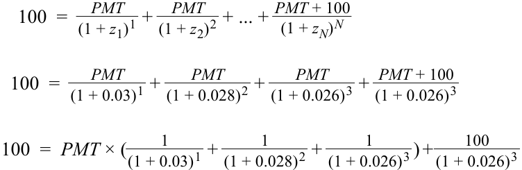

<!-- Formula Text: 100  =    PMT _ (1 + z 1) 1  +   PMT _ (1 + z 2) 2  + ... +  PMT + 100 _ (1 + z N) N 100  = PMT _ (1 + 0.03) 1  + PMT _ (1 + 0.028) 2  + PMT _ (1 + 0.026) 3  +  PMT + 100 _ (1 + 0.026) 3 100  =  PMT × ( 1 _ (1 + 0.03) 1  + 1 _ (1 + 0.028) 2  + 1 _ (1 + 0.026) 3  ) + 100 _ (1 + 0.026) 3 -->
$$100 = \frac{PMT}{(1 + z_1)^1} + \frac{PMT}{(1 + z_2)^2} + \dots + \frac{PMT + 100}{(1 + z_N)^N}$$
$$100 = \frac{PMT}{(1 + 0.03)^1} + \frac{PMT}{(1 + 0.028)^2} + \frac{PMT + 100}{(1 + 0.026)^3}$$
$$100 = PMT \times \left(\frac{1}{(1 + 0.03)^1} + \frac{1}{(1 + 0.028)^2} + \frac{1}{(1 + 0.026)^3}\right) + \frac{100}{(1 + 0.026)^3}$$

   - $PMT = 2.607\%$ 

3. Ghép nối lãi suất kỳ hạn hàm ý với các lãi suất giao ngay cần thiết để tính nó. 

|1. 1y2y|A. Lãi suất giao ngay 3 năm và 2 năm|
|---|---|
|2. 3y2y|B. Lãi suất giao ngay 3 năm và 1 năm|
|3. 2y1y|C. Lãi suất giao ngay 5 năm và 3 năm|

###### **Lời giải:** 

1. B. 1y2y là lãi suất kỳ hạn 2 năm tại thời điểm sau 1 năm. Do đó, chúng ta bắt đầu với lãi suất giao ngay 3 năm và sử dụng lãi suất giao ngay 1 năm để tìm lãi suất kỳ hạn <u>2 năm hàm ý.</u> 

<!-- PDF Page 237 -->

   2. C. 3y2y là lãi suất kỳ hạn 2 năm tại thời điểm sau 3 năm. Do đó, chúng ta bắt đầu với lãi suất giao ngay 5 năm và sử dụng lãi suất giao ngay 3 năm để tìm lãi suất kỳ hạn 2 năm hàm ý. 

   3. A. 2y1y là lãi suất kỳ hạn 1 năm tại thời điểm sau 2 năm. Do đó, chúng ta bắt đầu với lãi suất giao ngay 3 năm và sử dụng lãi suất giao ngay 2 năm để tìm lãi suất kỳ hạn 1 năm hàm ý. 

4. Xác định từ còn thiếu trong câu sau: Lãi suất kỳ hạn hàm ý đại diện cho một lãi suất tái đầu tư ____________ sao cho không tồn tại cơ hội kinh doanh chênh lệch giá (*arbitrage opportunities*) giữa lãi suất giao ngay và lãi suất kỳ hạn. 

   - **Lời giải:** 

Lãi suất kỳ hạn hàm ý đại diện cho một lãi suất tái đầu tư **hòa vốn (*breakeven*)** sao cho không tồn tại cơ hội kinh doanh chênh lệch giá giữa lãi suất giao ngay và lãi suất kỳ hạn. 

5. Tính lãi suất kỳ hạn hàm ý 2y3y khi biết các lãi suất giao ngay sau đây. Giả định ghép lãi hàng năm. 

|**Kỳ hạn (*Tenor*) — Lãi suất giao ngay (*Spot Rate*)**|
|---|
|1 năm: 2,0%|
|2 năm: 2,3%|
|3 năm: 2,5%|
|4 năm: 2,6%|
|5 năm: 2,4%|

###### **Lời giải:** 

2,467%. 

$$(1 + Z_A)^A \times (1 + IFR_{A,B-A})^{B-A} = (1 + Z_B)^B$$

$$(1 + 0.023)^2 \times (1 + IFR_{2,3})^3 = (1 + 0.024)^5 \implies IFR_{2,3} = 2.467\%$$

6. Tính giá của một trái phiếu coupon 2% có mệnh giá 100 đáo hạn sau 3 năm khi biết các lãi suất kỳ hạn sau đây, và chứng minh rằng mức giá này là tương đương bất kể lãi suất giao ngay hay lãi suất kỳ hạn được sử dụng làm lãi suất chiết khấu. Giả định ghép lãi hàng năm và các lãi suất kỳ hạn sau đây. 

|**Kỳ hạn (*Tenor*) — Lãi suất kỳ hạn (*Forward Rate*)**|
|---|
|0y1y: 1,5%|
|1y1y: 2,5%|
|2y1y: 3,5%|

###### **Lời giải:** 

Mức giá là 98,619. Phương pháp lãi suất kỳ hạn: 

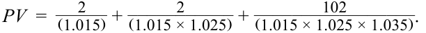

<!-- Formula Text: PV  = 2 _ (1.015)  + 2 ___________ (1.015 × 1.025)  + 102 _________________ (1.015 × 1.025 × 1.035) . -->
$$PV = \frac{2}{(1.015)} + \frac{2}{(1.015 \times 1.025)} + \frac{102}{(1.015 \times 1.025 \times 1.035)}$$

<!-- PDF Page 238 -->

$PV = 98.6190$. 

Các lãi suất giao ngay 1 năm, 2 năm và 3 năm hàm ý như sau:
- 1 năm = 1,5%. 
- 2 năm = $(1.015 \times 1.025)^{(1/2)} - 1 = 1.999\%$.
- 3 năm = $(1.015 \times 1.025 \times 1.035)^{(1/3)} - 1 = 2.4967\%$.

Sử dụng các lãi suất giao ngay để định giá trái phiếu cho kết quả sau: 

$$PV = \frac{2}{(1.015)^1} + \frac{2}{(1.01999)^2} + \frac{102}{(1.024967)^3}$$
$$PV = 98.6190$$

7. Chứng minh cách một nhà đầu tư có thời hạn đầu tư 5 năm sẽ quyết định tối ưu giữa hai chiến lược sau đây: 

   - Mua một trái phiếu chính phủ kỳ hạn 3 năm ở mức lãi suất giao ngay 3%, và sau đó tái đầu tư trong 2 năm ở mức lãi suất 2 năm dự kiến trong tương lai. 

   - Mua một trái phiếu chính phủ kỳ hạn 5 năm ở mức lãi suất giao ngay 4%. 

###### **Lời giải:** 

Tính lãi suất kỳ hạn 2 năm hàm ý tại thời điểm sau 3 năm: 

- $$(1 + Z_A)^A \times (1 + IFR_{A,B-A})^{B-A} = (1 + Z_B)^B$$

- $$(1 + 0.03)^3 \times (1 + IFR_{3,2})^2 = (1 + 0.04)^5$$

$$IFR_{3,2} = 5.52\%$$

Nếu nhà đầu tư tin rằng lãi suất 2 năm sau 3 năm nữa sẽ lớn hơn 5,52%, thì chiến lược tốt hơn là mua trái phiếu chính phủ kỳ hạn 3 năm và tái đầu tư ở mức lãi suất cao hơn. Nếu nhà đầu tư tin rằng lãi suất 2 năm sau 3 năm nữa sẽ nhỏ hơn 5,52%, thì nên mua trái phiếu kỳ hạn 5 năm. Lãi suất kỳ hạn hàm ý đại diện cho lãi suất tái đầu tư hòa vốn. 

# **<mark>4</mark>** 

#### **ĐƯỜNG CONG LỢI SUẤT GIAO NGAY, NGANG GIÁ VÀ KỲ HẠN CŨNG NHƯ DIỄN GIẢI MỐI QUAN HỆ GIỮA CHÚNG (*SPOT, PAR, AND FORWARD YIELD CURVES AND INTERPRETING THEIR RELATIONSHIP*)** 

so sánh đường cong lãi suất giao ngay, đường cong lãi suất ngang giá, và đường cong lãi suất kỳ hạn 

Bởi vì lãi suất giao ngay, lãi suất ngang giá và lãi suất kỳ hạn có mối liên hệ qua lại với nhau, nên hình dạng của đường cong lãi suất giao ngay, đường cong lãi suất ngang giá và đường cong lãi suất kỳ hạn cũng vậy. Phân tích này được minh họa tốt nhất thông qua một ví dụ. Trong một bài học trước, chúng ta đã sử dụng lãi suất giao ngay để tính lãi suất ngang giá và lãi suất kỳ hạn cho trái phiếu chính phủ Canada và Úc. Chúng ta có thể sử dụng các mức lãi suất này để xây dựng các đường cong lợi suất trên một dải các kỳ hạn, được hiển thị bên dưới. 

<!-- PDF Page 239 -->

###### **Đường cong Lãi suất Giao ngay, Ngang giá và Kỳ hạn (Canada và Úc) (*Spot, Par, and Forward Curves (Canada and Australia)*)** 

###### **A. Đường cong Lãi suất Giao ngay, Ngang giá và Kỳ hạn: Trái phiếu Chính phủ Canada (*Spot, Par, and Forward Curves: Canadian Government Bonds*)** 

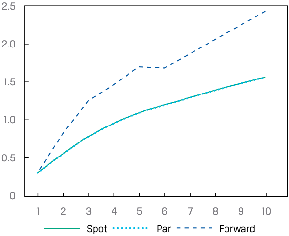

<!-- Picture Text: 2.5 2.0 1.5 1.0 0.5 0 1 2 3 4 5 6 7 8 9 10 Spot Par Forward  -->
> **Chú thích hình ảnh:**
> - **Trục tung:** Lãi suất (%) (từ 0 đến 2,5)
> - **Trục hoành:** Kỳ hạn (năm) (từ 1 đến 10)
> - **Các đường biểu diễn:** Lãi suất giao ngay (*Spot*), Lãi suất ngang giá (*Par*), Lãi suất kỳ hạn (*Forward*)

###### **B. Đường cong Lãi suất Giao ngay, Ngang giá và Kỳ hạn: Trái phiếu Chính phủ Úc (*Spot, Par, and Forward Curves: Australian Government Bonds*)** 

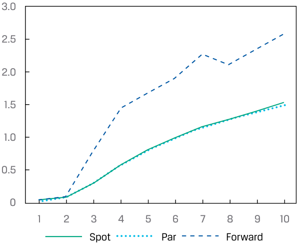

<!-- Picture Text: 3.0 2.5 2.0 1.5 1.0 0.5 0 1 2 3 4 5 6 7 8 9 10 Spot Par Forward  -->
> **Chú thích hình ảnh:**
> - **Trục tung:** Lãi suất (%) (từ 0 đến 3,0)
> - **Trục hoành:** Kỳ hạn (năm) (từ 1 đến 10)
> - **Các đường biểu diễn:** Lãi suất giao ngay (*Spot*), Lãi suất ngang giá (*Par*), Lãi suất kỳ hạn (*Forward*)

Chúng ta có thể đưa ra các nhận xét tổng quát sau đây: 

**1.** Lãi suất giao ngay đều dương, và đường cong lãi suất giao ngay dốc lên (*upward sloping*). 

**2.** Đường cong lãi suất giao ngay và đường cong lãi suất ngang giá gần như trùng nhau; lãi suất ngang giá thấp hơn một chút so với lãi suất giao ngay, và mức chênh lệch (nhỏ) giữa đường cong lãi suất giao ngay và đường cong lãi suất ngang giá lớn hơn ở các kỳ hạn dài hơn. 

**3.** Lãi suất kỳ hạn lớn hơn lãi suất giao ngay và lãi suất ngang giá. 

Những nhận xét này bắt nguồn từ các mối quan hệ tổng quát giữa hình dạng của các đường cong. Nếu đường cong lãi suất giao ngay dốc lên, lãi suất ngang giá sẽ nằm gần—nhưng thấp hơn—lãi suất giao ngay, đặc biệt là ở đầu dài hạn của đường cong. Điều này là do các mức lãi suất giao ngay ngắn hạn thấp dẫn đến giá trái phiếu cao hơn, đặc biệt là đối với các trái phiếu dài hạn hơn, từ đó dẫn đến lãi suất ngang giá thấp khi chúng ta thực hiện phép tính giả định mức giá bằng 100% mệnh giá. Việc lãi suất kỳ hạn nằm trên lãi suất giao ngay, nếu đường cong lãi suất giao ngay dốc lên, xuất phát từ bài học trước, vốn đã xác lập lãi suất kỳ hạn là các tỷ suất sinh lợi tăng thêm (*incremental rates of return*). 

<!-- PDF Page 240 -->

Bảng 6 hiển thị các đường cong lãi suất giao ngay, ngang giá và kỳ hạn nếu đường cong lãi suất giao ngay nằm ngang (*flat*), được giả định ở mức 2,50% cho tất cả các kỳ hạn. Khi lãi suất giao ngay không đổi qua tất cả các kỳ hạn, lãi suất ngang giá và lãi suất kỳ hạn cũng sẽ bằng với lãi suất giao ngay qua tất cả các kỳ hạn. Tóm lại, một đường cong lãi suất giao ngay nằm ngang phản ánh việc không có kỳ vọng về sự thay đổi trong lãi suất tương lai; do đó lãi suất kỳ hạn bằng lãi suất giao ngay. Trong ví dụ cụ thể này, trái phiếu chính phủ sẽ trả lãi suất coupon 2,5%, và các trái phiếu sẽ được định giá ngang mệnh giá (do đó, lãi suất ngang giá cũng là 2,5%). 

**Bảng 6: Cấu trúc Kỳ hạn Nằm ngang (*Exhibit 6: Flat Term Structure*)** 

<!-- Picture Text: 3.0 2.5 2.0 1.5 1.0 0.5 0 1 2 3 4 5 6 7 8 9 10 Spot Par Forward  -->
> **Chú thích hình ảnh:**
> - **Trục tung:** Lãi suất (%) (từ 0 đến 3,0)
> - **Trục hoành:** Kỳ hạn (năm) (từ 1 đến 10)
> - **Các đường biểu diễn:** Lãi suất giao ngay (*Spot*), Lãi suất ngang giá (*Par*), Lãi suất kỳ hạn (*Forward*) trùng nhau ở mức 2,5%

Bảng 7 hiển thị các đường cong lãi suất giao ngay, ngang giá và kỳ hạn đối với một đường cong lãi suất giao ngay dốc xuống (đảo ngược – *downward-sloping / inverted*) hay lãi suất giao ngay giảm dần khi kỳ hạn dài ra. Bắt đầu từ mức lãi suất giao ngay 1 năm là 4%, lãi suất giảm xuống 1,90% cho kỳ hạn 10 năm. Giống như trong các ví dụ trước, lãi suất ngang giá tương tự như lãi suất giao ngay. Cấu trúc kỳ hạn đảo ngược của lãi suất giao ngay phản ánh kỳ vọng về các mức lãi suất 1 năm thấp hơn đáng kể trong những năm tương lai, và điều này được thể hiện qua đường cong lãi suất kỳ hạn. Trong ví dụ này, cấu trúc kỳ hạn của lãi suất giao ngay ngụ ý mức lãi suất 1 năm là 0,1175% được kỳ vọng sau 9 năm nữa. 

<!-- PDF Page 241 -->

**Bảng 7: Cấu trúc Kỳ hạn Đảo ngược (*Exhibit 7: Inverted Term Structure*)** 

<!-- Picture Text: 4.5 4.0 3.5 3.0 2.5 2.0 1.5 1.0 0.5 0 1 2 3 4 5 6 7 8 9 10 Spot Par Forward  -->
> **Chú thích hình ảnh:**
> - **Trục tung:** Lãi suất (%) (từ 0 đến 4,5)
> - **Trục hoành:** Kỳ hạn (năm) (từ 1 đến 10)
> - **Các đường biểu diễn:** Lãi suất giao ngay (*Spot*), Lãi suất ngang giá (*Par*), Lãi suất kỳ hạn (*Forward*)

Chúng ta kết thúc với Bảng 8, tóm tắt mối quan hệ tổng quát giữa các đường cong lãi suất giao ngay, ngang giá và kỳ hạn đối với các hình dạng đường cong lãi suất giao ngay khác nhau. 

**Bảng 8: Mối quan hệ giữa Đường cong Lãi suất Giao ngay, Ngang giá và Kỳ hạn (*Exhibit 8: Spot, Par, and Forward Curve Relationship*)** 

|**Hình dạng đường cong lãi suất giao ngay (*Spot Curve Shape*)**|**Đường cong lãi suất ngang giá (*Par Curve*)**|**Đường cong lãi suất kỳ hạn (*Forward Curve*)**|
|---|---|---|
|Dốc lên (*Upward Sloping*)|Nằm dưới đường cong lãi suất giao ngay (*Below spot curve*)|Nằm trên đường cong lãi suất giao ngay (*Above spot curve*)|
|Nằm ngang (*Flat*)|Bằng đường cong lãi suất giao ngay (*Equal to spot curve*)|Bằng đường cong lãi suất giao ngay (*Equal to spot curve*)|
|Dốc xuống / Đảo ngược (*Downward Sloping / Inverted*)|Nằm trên đường cong lãi suất giao ngay (*Above spot curve*)|Nằm dưới đường cong lãi suất giao ngay (*Below spot curve*)|

<!-- PDF Page 242 -->

###### **BỘ CÂU HỎI (*QUESTION SET*)** 

1. Biểu đồ bên dưới hiển thị một đường cong lãi suất giao ngay và đường cong lãi suất kỳ hạn hàm ý của nó. Hãy xác định đường cong lãi suất kỳ hạn, và giải thích sự lựa chọn của bạn. 

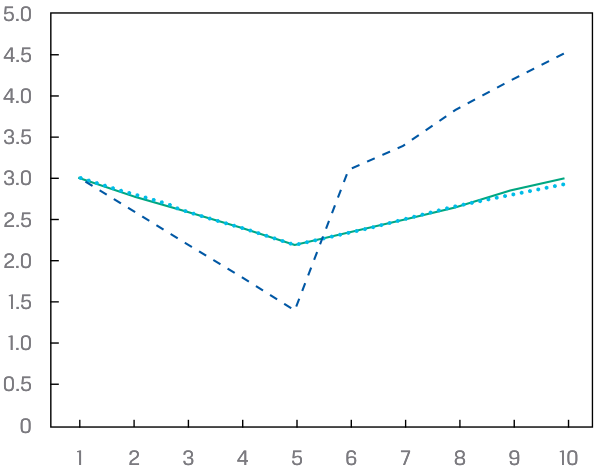

<!-- Picture Text: 5.0 4.5 4.0 3.5 3.0 2.5 2.0 1.5 1.0 0.5 0 1 2 3 4 5 6 7 8 9 10  -->
> **Chú thích hình ảnh:**
> - **Trục tung:** Lãi suất (%) (từ 0 đến 5,0)
> - **Trục hoành:** Kỳ hạn (năm) (từ 1 đến 10)

###### **Lời giải:** 

Đường cong lãi suất kỳ hạn được đại diện bởi đường đi từ 3,0% xuống xấp xỉ 1,5% ở Năm 5 và sau đó dốc mạnh lên từ Năm 5 đến Năm 6, kết thúc ở mức khoảng 4,5% ở Năm 10. 

Khi đường cong lãi suất giao ngay dốc xuống (Năm 1–5), lãi suất kỳ hạn sẽ nằm bên dưới lãi suất giao ngay. Khi đường cong lãi suất giao ngay dốc lên (Năm 6–10), lãi suất kỳ hạn sẽ nằm bên trên lãi suất giao ngay. 

Đối với Câu hỏi 2 và 3, hãy tham khảo dữ liệu lãi suất giao ngay được hiển thị trong Bảng 9. Điều quan trọng cần lưu ý là một số trái phiếu sẽ giao dịch ở mức lợi suất âm. Điều này từng phổ biến trong số các trái phiếu chính phủ của thị trường phát triển sau cuộc khủng hoảng tài chính khi các ngân hàng trung ương theo đuổi chính sách tiền tệ nới lỏng để đối phó với mức lạm phát dưới mục tiêu. Lãi suất âm không làm thay đổi toán học cơ bản được sử dụng trong định giá trái phiếu. 

**Bảng 9: Lãi suất Giao ngay Âm (Đức và Thụy Sĩ) (*Exhibit 9: Negative Spot Rates (Germany and Switzerland)*)** 

|**Kỳ hạn (*Maturity*)**|**Đức (*Germany*)**|**Thụy Sĩ (*Switzerland*)**|
|---|---|---|
|1 năm|–0,6965%|–0,7882%|
|2 năm|–0,7034%|–0,7133%|
|3 năm|–0,7021%|–0,6435%|
|4 năm|–0,6418%|–0,5615%|
|5 năm|–0,5578%|–0,4757%|
|6 năm|–0,4796%|–0,4080%|
|7 năm|–0,4014%|–0,3402%|
|8 năm|–0,3269%|–0,2673%|
|9 năm|–0,2524%|–0,1945%|
|10 năm|–0,1779%|–0,1216%|

<!-- PDF Page 243 -->

2. Tính lãi suất kỳ hạn 1 năm hàm ý tại thời điểm sau 9 năm ở Thụy Sĩ.

**Lời giải:** 

Câu hỏi đang yêu cầu tính lãi suất kỳ hạn 9y1y. Lãi suất này được tính từ lãi suất giao ngay 10 năm và 9 năm, như sau: 

- $$(1 + Z_A)^A \times (1 + IFR_{A,B-A})^{B-A} = (1 + Z_B)^B$$

$$(1 - 0.001945)^9 \times (1 + IFR_{9,1})^1 = (1 - 0.001216)^{10}$$

$$IFR_{9,1} = 0.537\%$$

Như vậy, lãi suất kỳ hạn 1 năm hàm ý tại thời điểm sau 9 năm đối với trái phiếu chính phủ Thụy Sĩ là 0,537%. 

3. Giải thích tại sao một quốc gia có lãi suất giao ngay âm, chẳng hạn như Thụy Sĩ, lại có thể có lãi suất kỳ hạn dương. 

###### **Lời giải:** 

Như đã chỉ ra trong các ví dụ trước, một đường cong lãi suất giao ngay dốc lên (mà Thụy Sĩ đang có) sẽ được đặc trưng bởi các mức lãi suất kỳ hạn lớn hơn lãi suất giao ngay. Khi các mức lãi suất âm trở nên bớt âm hơn và tiến gần hơn về mức không, khả năng lãi suất kỳ hạn mang giá trị dương với một đường cong lãi suất giao ngay dốc lên sẽ càng cao. 

4. Biểu đồ sau đây hiển thị đường cong lãi suất giao ngay và đường cong lãi suất kỳ hạn đối với trái phiếu chính phủ Đức. Hãy giải thích tại sao đường cong lãi suất kỳ hạn lại gần như trùng khớp với đường cong lãi suất giao ngay ở các kỳ hạn 2 năm và 3 năm. 

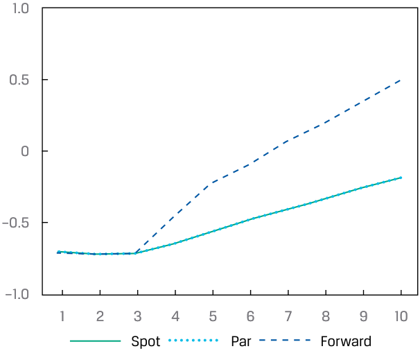

<!-- Picture Text: 1.0 0.5 0 –0.5 –1.0 1 2 3 4 5 6 7 8 9 10 Spot Par Forward  -->
> **Chú thích hình ảnh:**
> - **Trục tung:** Lãi suất (%) (từ –1,0 đến 1,0)
> - **Trục hoành:** Kỳ hạn (năm) (từ 1 đến 10)
> - **Các đường biểu diễn:** Lãi suất giao ngay (*Spot*), Lãi suất ngang giá (*Par*), Lãi suất kỳ hạn (*Forward*)

###### **Lời giải:** 

Trong các môi trường cấu trúc kỳ hạn nằm ngang (*flat term structure*), lãi suất kỳ hạn bằng lãi suất giao ngay. Lãi suất giao ngay ở Đức cho các kỳ hạn 2 năm và 3 năm dường như xấp xỉ tương đương với lãi suất giao ngay 1 năm. Như vậy, cấu trúc kỳ hạn của Đức nằm ngang trong 3 năm đầu tiên, và lãi suất kỳ hạn sẽ xấp xỉ bằng lãi suất giao ngay. 

<!-- PDF Page 244 -->

## **BÀI TẬP THỰC HÀNH (*PRACTICE PROBLEMS*)** 

### **Thông tin sau đây liên quan đến câu hỏi 1-9** 

Sử dụng các lãi suất giao ngay được cung cấp để trả lời các câu hỏi sau đây. 

###### **Lãi suất Giao ngay của Trái phiếu Chính phủ (*Government Bond Spot Rates*)** 

|**Kỳ hạn (*Maturity*)**|**Canada**|**Úc (*Australia*)**|**Đức (*Germany*)**|**Thụy Sĩ (*Switzerland*)**|
|---|---|---|---|---|
|1 năm|0,3117%|0,0272%|–0,6965%|–0,7882%|
|2 năm|0,5680%|0,0675%|–0,7034%|–0,7133%|
|3 năm|0,7977%|0,3003%|–0,7021%|–0,6435%|
|4 năm|0,9640%|0,5853%|–0,6418%|–0,5615%|
|5 năm|1,1105%|0,8052%|–0,5578%|–0,4757%|
|6 năm|1,2052%|0,9877%|–0,4796%|–0,4080%|
|7 năm|1,2998%|1,1702%|–0,4014%|–0,3402%|
|8 năm|1,3935%|1,2878%|–0,3269%|–0,2673%|
|9 năm|1,4872%|1,4054%|–0,2524%|–0,1945%|
|10 năm|1,5809%|1,5230%|–0,1779%|–0,1216%|

**1.** Chính phủ Thụy Sĩ sẽ chọn mức coupon nào nếu mục tiêu của họ là tối thiểu hóa khoản phần trội (*premium*) so với mệnh giá đối với một đợt phát hành nợ kỳ hạn 5 năm? 

   - **A.** 1,0% 

   - **B.** 0,5% 

   - **C.** 0,0% 

**2.** Chính phủ Úc đang cân nhắc phát hành trái phiếu kỳ hạn 3 năm với lãi suất coupon 3,0% thanh toán hàng năm. Với các lãi suất giao ngay ở Úc, mức giá _gần nhất_ với: 

   - **A.** 108,05. 

   - **B.** 108,07. 

   - **C.** 108,69. 

**3.** Giả sử lãi suất giao ngay 1 năm và 2 năm ở Canada dịch chuyển tăng lên 20 bps nhưng lãi suất giao ngay 3 năm của Canada vẫn không đổi. Câu nào sau đây phản ánh đúng nhất lãi suất ngang giá 3 năm cập nhật của Canada? 

   - **A.** Tăng khoảng 13 bps 

   - **B.** Tăng khoảng 7 bps 

   - **C.** Tăng khoảng 0,16 bps 

<!-- PDF Page 245 -->

**4.** Ghép nối các lãi suất giao ngay cần thiết để tính các lãi suất kỳ hạn hàm ý tương ứng. 

|1. Lãi suất giao ngay 2 năm và 5 năm|A. Lãi suất kỳ hạn hàm ý 2 năm tại thời điểm sau 5 năm|
|---|---|
|2. Lãi suất giao ngay 2 năm và 7 năm|B. Lãi suất kỳ hạn hàm ý 3 năm tại thời điểm sau 2 năm|
|3. Lãi suất giao ngay 5 năm và 7 năm|C. Lãi suất kỳ hạn hàm ý 5 năm tại thời điểm sau 2 năm|

**5.** Lựa chọn nào sau đây gần nhất với lãi suất kỳ hạn 5 năm hàm ý tại thời điểm sau 2 năm đối với trái phiếu chính phủ Thụy Sĩ? 

   - **A.** –0,191% 

   - **B.** –0,001% 

   - **C.** –0,317% 

**6.** Ghép nối chuỗi các lãi suất kỳ hạn và lãi suất giao ngay tương ứng mà các lãi suất kỳ hạn đó sẽ tính ra. 

|**Lãi suất kỳ hạn (*Forward rates*)**|**Phép tính lãi suất giao ngay (*Spot rate calculation*)**|
|---|---|
|1. $0y1y \times 1y1y \times 2y1y$|A. Lãi suất giao ngay 4 năm|
|2. $0y1y \times 1y2y \times 3y3y$|B. Lãi suất giao ngay 3 năm|
|3. $0y1y \times 1y1y \times 2y1y \times 3y1y$|C. Lãi suất giao ngay 6 năm|

**7.** Phát biểu nào sau đây về các đường cong lợi suất là đúng? 

   - **A.** Đường cong lãi suất giao ngay được suy ra từ lãi suất ngang giá. 

   - **B.** Đường cong lãi suất ngang giá được suy ra từ lãi suất kỳ hạn. 

   - **C.** Đường cong lãi suất kỳ hạn được suy ra từ lãi suất giao ngay. 

**8.** Ghép nối các phát biểu sau đây về đường cong lãi suất kỳ hạn với các phát biểu tương ứng về đường cong lãi suất giao ngay. 

|1. Đường cong lãi suất kỳ hạn nằm trên đường cong lãi suất giao ngay.|A. Đường cong lãi suất giao ngay dốc xuống (tức là đảo ngược – *inverted*).|
|---|---|
|2. Đường cong lãi suất kỳ hạn nằm dưới đường cong lãi suất giao ngay.|B. Đường cong lãi suất giao ngay dốc lên (tức là bình thường – *normal*).|
|3. Đường cong lãi suất kỳ hạn tương đương với đường cong lãi suất giao ngay.|C. Đường cong lãi suất giao ngay nằm ngang (*flat*) qua tất cả các kỳ hạn.|

**9.** Ghép nối các phát biểu sau đây về đường cong lãi suất ngang giá với các phát biểu tương ứng 

<!-- PDF Page 246 -->

về đường cong lãi suất giao ngay. 

|1. Đường cong lãi suất ngang giá nằm trên đường cong lãi suất giao ngay.|A. Đường cong lãi suất giao ngay dốc lên (tức là bình thường), và lãi suất giao ngay mang giá trị âm.|
|---|---|
|2. Đường cong lãi suất ngang giá nằm dưới đường cong lãi suất giao ngay.|B. Đường cong lãi suất giao ngay dốc lên (tức là bình thường), và lãi suất giao ngay mang giá trị dương.|
|3. Đường cong lãi suất ngang giá tương đương với đường cong lãi suất giao ngay.|C. Đường cong lãi suất giao ngay nằm ngang qua tất cả các kỳ hạn.|

---

# Tập 6: Thu nhập Cố định (Fixed Income)
## Học phần 9: Cấu trúc Kỳ hạn của Lãi suất: Đường cong Lãi suất Giao ngay, Đường cong Lãi suất Ngang giá và Đường cong Lãi suất Kỳ hạn (The Term Structure of Interest Rates: Spot, Par, and Forward Curves)
### Phần 3/3: Lời giải (Trang PDF 247–248)

---

<!-- PDF Page 247 -->

# **LỜI GIẢI (*SOLUTIONS*)** 

1. C là đáp án đúng. Với việc lãi suất giao ngay (và lãi suất ngang giá) kỳ hạn 5 năm hiện tại của Thụy Sĩ là âm, bất kỳ mức coupon không âm nào cũng sẽ khiến chính phủ Thụy Sĩ phát hành nợ ở mức phần trội (*at a premium*) so với mệnh giá. Việc phát hành nợ không có coupon (0,0%) sẽ tối thiểu hóa quy mô của khoản phần trội đó. 

2. B là đáp án đúng. 

<!-- Formula Text: PV  =    PMT _ (1 + Z 1) 1  +   PMT _ (1 + Z 2) 2  + ⋯  +  PMT + FV _ (1 + Z N) N . PV  = 3 ____________ (1 + 0.000272) 1  + 3 ____________ (1 + 0.000675) 2  + 103 ____________ (1 + 0.003003) 3 . -->
$$PV = \frac{PMT}{(1 + Z_1)^1} + \frac{PMT}{(1 + Z_2)^2} + \dots + \frac{PMT + FV}{(1 + Z_N)^N}$$
$$PV = \frac{3}{(1 + 0.000272)^1} + \frac{3}{(1 + 0.000675)^2} + \frac{103}{(1 + 0.003003)^3}$$

$PV = 108.07$. 

3. C là đáp án đúng. Trong Ví dụ 2, chúng ta đã tính lãi suất ngang giá 3 năm của Canada. Lãi suất ngang giá 0,7952% xấp xỉ lãi suất giao ngay 0,7977%, vì vậy sự thay đổi quan trọng nhất ảnh hưởng đến lãi suất ngang giá 3 năm là sự thay đổi trong lãi suất giao ngay 3 năm. Bởi vì nó không thay đổi, sự thay đổi duy nhất sẽ là một sự dịch chuyển nhỏ trong lãi suất ngang giá về phía lãi suất giao ngay (lên mức xấp xỉ 0,7968%, tức tăng khoảng 0,16 bps). 

4. 
   1. B. Bằng cách sử dụng lãi suất 2 năm và 5 năm, phần chênh lệch đại diện cho kỳ hạn (*tenor*) của lãi suất kỳ hạn hàm ý là 3 năm, và lãi suất có kỳ hạn ngắn hơn phản ánh thời điểm bắt đầu của giai đoạn kỳ hạn là sau 2 năm. 

   2. C. Bằng cách sử dụng lãi suất 2 năm và 7 năm, phần chênh lệch đại diện cho kỳ hạn của lãi suất kỳ hạn hàm ý là 5 năm, và lãi suất có kỳ hạn ngắn hơn phản ánh thời điểm bắt đầu của giai đoạn kỳ hạn là sau 2 năm. 

   3. A. Bằng cách sử dụng lãi suất 5 năm và 7 năm, phần chênh lệch đại diện cho kỳ hạn của lãi suất kỳ hạn hàm ý là 2 năm, và lãi suất có kỳ hạn ngắn hơn phản ánh thời điểm bắt đầu của giai đoạn kỳ hạn là sau 5 năm. 

5. Đáp án đúng là A. Lãi suất kỳ hạn 5 năm hàm ý tại thời điểm sau 2 năm là lãi suất 2y5y. Để tính toán, chúng ta sử dụng lãi suất chính phủ Thụy Sĩ 7 năm và lãi suất chính phủ Thụy Sĩ 2 năm, như sau: 

$$\text{2y5y IFR} = \left[\frac{(1 - 0.003402)^7}{(1 - 0.007133)^2}\right]^{(1/5)} - 1 = -0.191\% \text{ (bản gốc thiếu dấu trừ trước } 0.191\% \text{ ở dòng công thức)}$$

Lựa chọn B đại diện cho lãi suất kỳ hạn hàm ý 5y2y, và Lựa chọn C đại diện cho lãi suất kỳ hạn hàm ý 2y3y. 

6. 
   1. B. Đây là một chuỗi gồm ba lãi suất kỳ hạn 1 năm, do đó cung cấp thông tin cho lãi suất giao ngay 3 năm. 

   2. C. Chuỗi này là một lãi suất giao ngay 1 năm, tiếp theo là một lãi suất kỳ hạn 2 năm tại thời điểm sau 1 năm, tiếp theo là một lãi suất kỳ hạn 3 năm tại thời điểm sau 3 năm (tổng cộng 6 năm). 

   3. A. Chuỗi này là một chuỗi gồm bốn lãi suất kỳ hạn 1 năm (tổng cộng 4 năm). 

7. Đáp án đúng là C. Các mức lãi suất kỳ hạn được sử dụng để xây dựng đường cong lãi suất kỳ hạn được suy ra từ lãi suất giao ngay. Phát biểu A không đúng, bởi vì lãi suất ngang giá được suy ra từ lãi suất giao ngay. Phát biểu B không đúng, bởi vì đường cong lãi suất ngang giá được suy ra từ lãi suất giao ngay. 

8. 
   1. B. Trong môi trường lãi suất bình thường với đường cong lợi suất dốc lên, lãi suất kỳ hạn sẽ lớn hơn lãi suất giao ngay tương ứng của chúng qua 

<!-- PDF Page 248 -->

tất cả các kỳ hạn. 

   2. A. Trong môi trường lãi suất giao ngay đảo ngược (*inverted*), lãi suất kỳ hạn sẽ nằm bên dưới lãi suất giao ngay tương ứng của chúng. 

   3. C. Cấu trúc đáo hạn nằm ngang của lãi suất đôi khi được giả định. Trong một môi trường như vậy, khi lãi suất giao ngay không đổi, điều này ngụ ý rằng kỳ vọng trong tương lai là lãi suất sẽ duy trì ở một mức không đổi. Do đó, lãi suất kỳ hạn bằng lãi suất giao ngay trong môi trường cấu trúc kỳ hạn nằm ngang. 

9. 
   1. A. Tình huống này được minh họa trong dữ liệu lãi suất chính phủ Đức và Thụy Sĩ, trong đó lãi suất giao ngay mang giá trị âm trong khi đường cong lãi suất giao ngay dốc lên. Trong những trường hợp như vậy (hoặc khi đường cong lãi suất giao ngay dương và dốc xuống), lãi suất ngang giá nằm trên lãi suất giao ngay. 

   2. B. Tình huống này được minh họa trong dữ liệu lãi suất chính phủ Canada và Úc, trong đó lãi suất giao ngay mang giá trị dương và đường cong lãi suất giao ngay có dạng bình thường (dốc lên). 

   3. C. Đây là một trường hợp giả định nhưng có thể được nhìn thấy bằng cách tạo ra một đường cong lãi suất giao ngay nằm ngang. 
