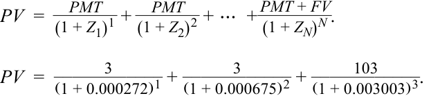

# Tập 6: Thu nhập Cố định (Fixed Income)
## Học phần 9: Cấu trúc Kỳ hạn của Lãi suất: Đường cong Lãi suất Giao ngay, Đường cong Lãi suất Ngang giá và Đường cong Lãi suất Kỳ hạn (The Term Structure of Interest Rates: Spot, Par, and Forward Curves)
### Phần 3/3: Lời giải (Trang PDF 247–248)

---

<!-- PDF Page 247 -->

# **LỜI GIẢI (*SOLUTIONS*)** 

1. C là đáp án đúng. Với việc lãi suất giao ngay (và lãi suất ngang giá) kỳ hạn 5 năm hiện tại của Thụy Sĩ là âm, bất kỳ mức coupon không âm nào cũng sẽ khiến chính phủ Thụy Sĩ phát hành nợ ở mức phần trội (*at a premium*) so với mệnh giá. Việc phát hành nợ không có coupon (0,0%) sẽ tối thiểu hóa quy mô của khoản phần trội đó. 

2. B là đáp án đúng. 

<!-- Formula Text: PV  =    PMT _ (1 + Z 1) 1  +   PMT _ (1 + Z 2) 2  + ⋯  +  PMT + FV _ (1 + Z N) N . PV  = 3 ____________ (1 + 0.000272) 1  + 3 ____________ (1 + 0.000675) 2  + 103 ____________ (1 + 0.003003) 3 . -->
$$PV = \frac{PMT}{(1 + Z_1)^1} + \frac{PMT}{(1 + Z_2)^2} + \dots + \frac{PMT + FV}{(1 + Z_N)^N}$$
$$PV = \frac{3}{(1 + 0.000272)^1} + \frac{3}{(1 + 0.000675)^2} + \frac{103}{(1 + 0.003003)^3}$$

$PV = 108.07$. 

3. C là đáp án đúng. Trong Ví dụ 2, chúng ta đã tính lãi suất ngang giá 3 năm của Canada. Lãi suất ngang giá 0,7952% xấp xỉ lãi suất giao ngay 0,7977%, vì vậy sự thay đổi quan trọng nhất ảnh hưởng đến lãi suất ngang giá 3 năm là sự thay đổi trong lãi suất giao ngay 3 năm. Bởi vì nó không thay đổi, sự thay đổi duy nhất sẽ là một sự dịch chuyển nhỏ trong lãi suất ngang giá về phía lãi suất giao ngay (lên mức xấp xỉ 0,7968%, tức tăng khoảng 0,16 bps). 

4. 
   1. B. Bằng cách sử dụng lãi suất 2 năm và 5 năm, phần chênh lệch đại diện cho kỳ hạn (*tenor*) của lãi suất kỳ hạn hàm ý là 3 năm, và lãi suất có kỳ hạn ngắn hơn phản ánh thời điểm bắt đầu của giai đoạn kỳ hạn là sau 2 năm. 

   2. C. Bằng cách sử dụng lãi suất 2 năm và 7 năm, phần chênh lệch đại diện cho kỳ hạn của lãi suất kỳ hạn hàm ý là 5 năm, và lãi suất có kỳ hạn ngắn hơn phản ánh thời điểm bắt đầu của giai đoạn kỳ hạn là sau 2 năm. 

   3. A. Bằng cách sử dụng lãi suất 5 năm và 7 năm, phần chênh lệch đại diện cho kỳ hạn của lãi suất kỳ hạn hàm ý là 2 năm, và lãi suất có kỳ hạn ngắn hơn phản ánh thời điểm bắt đầu của giai đoạn kỳ hạn là sau 5 năm. 

5. Đáp án đúng là A. Lãi suất kỳ hạn 5 năm hàm ý tại thời điểm sau 2 năm là lãi suất 2y5y. Để tính toán, chúng ta sử dụng lãi suất chính phủ Thụy Sĩ 7 năm và lãi suất chính phủ Thụy Sĩ 2 năm, như sau: 

$$\text{2y5y IFR} = \left[\frac{(1 - 0.003402)^7}{(1 - 0.007133)^2}\right]^{(1/5)} - 1 = -0.191\% \text{ (bản gốc thiếu dấu trừ trước } 0.191\% \text{ ở dòng công thức)}$$

Lựa chọn B đại diện cho lãi suất kỳ hạn hàm ý 5y2y, và Lựa chọn C đại diện cho lãi suất kỳ hạn hàm ý 2y3y. 

6. 
   1. B. Đây là một chuỗi gồm ba lãi suất kỳ hạn 1 năm, do đó cung cấp thông tin cho lãi suất giao ngay 3 năm. 

   2. C. Chuỗi này là một lãi suất giao ngay 1 năm, tiếp theo là một lãi suất kỳ hạn 2 năm tại thời điểm sau 1 năm, tiếp theo là một lãi suất kỳ hạn 3 năm tại thời điểm sau 3 năm (tổng cộng 6 năm). 

   3. A. Chuỗi này là một chuỗi gồm bốn lãi suất kỳ hạn 1 năm (tổng cộng 4 năm). 

7. Đáp án đúng là C. Các mức lãi suất kỳ hạn được sử dụng để xây dựng đường cong lãi suất kỳ hạn được suy ra từ lãi suất giao ngay. Phát biểu A không đúng, bởi vì lãi suất ngang giá được suy ra từ lãi suất giao ngay. Phát biểu B không đúng, bởi vì đường cong lãi suất ngang giá được suy ra từ lãi suất giao ngay. 

8. 
   1. B. Trong môi trường lãi suất bình thường với đường cong lợi suất dốc lên, lãi suất kỳ hạn sẽ lớn hơn lãi suất giao ngay tương ứng của chúng qua 

<!-- PDF Page 248 -->

tất cả các kỳ hạn. 

   2. A. Trong môi trường lãi suất giao ngay đảo ngược (*inverted*), lãi suất kỳ hạn sẽ nằm bên dưới lãi suất giao ngay tương ứng của chúng. 

   3. C. Cấu trúc đáo hạn nằm ngang của lãi suất đôi khi được giả định. Trong một môi trường như vậy, khi lãi suất giao ngay không đổi, điều này ngụ ý rằng kỳ vọng trong tương lai là lãi suất sẽ duy trì ở một mức không đổi. Do đó, lãi suất kỳ hạn bằng lãi suất giao ngay trong môi trường cấu trúc kỳ hạn nằm ngang. 

9. 
   1. A. Tình huống này được minh họa trong dữ liệu lãi suất chính phủ Đức và Thụy Sĩ, trong đó lãi suất giao ngay mang giá trị âm trong khi đường cong lãi suất giao ngay dốc lên. Trong những trường hợp như vậy (hoặc khi đường cong lãi suất giao ngay dương và dốc xuống), lãi suất ngang giá nằm trên lãi suất giao ngay. 

   2. B. Tình huống này được minh họa trong dữ liệu lãi suất chính phủ Canada và Úc, trong đó lãi suất giao ngay mang giá trị dương và đường cong lãi suất giao ngay có dạng bình thường (dốc lên). 

   3. C. Đây là một trường hợp giả định nhưng có thể được nhìn thấy bằng cách tạo ra một đường cong lãi suất giao ngay nằm ngang. 
