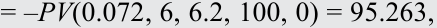
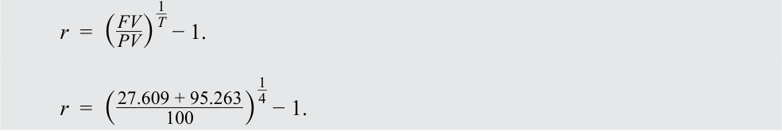
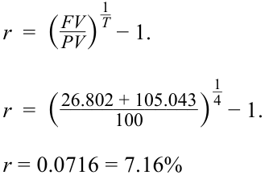
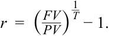
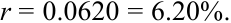
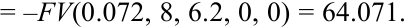
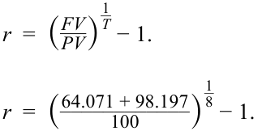
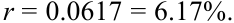
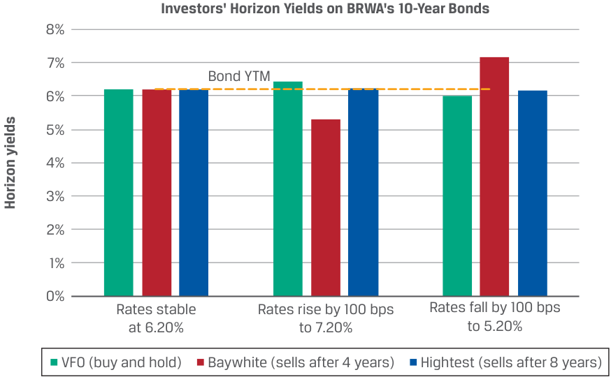

# Tập 6: Thu nhập Cố định (Fixed Income)
## Học phần 10: Rủi ro Lãi suất và Tỷ suất Sinh lợi (Interest Rate Risk and Return)
### Phần 1/2: Giới thiệu (Trang PDF 249–264)

---

<!-- PDF Page 249 -->

# H Ọ C P H Ầ N **<mark>10</mark>** 

### **Rủi ro Lãi suất và Tỷ suất Sinh lợi (*Interest Rate Risk and Return*)** 

##### **<mark>MỤC TIÊU HỌC TẬP (*LEARNING OUTCOMES*)</mark>** 

|**_Mức độ thành thạo_**|**_Ứng viên cần có khả năng:_**|
|---|---|
||tính toán và diễn giải các nguồn tỷ suất sinh lợi (*sources of return*) từ việc đầu tư vào một trái phiếu lãi suất cố định (*fixed-rate bond*);|
||mô tả mối quan hệ giữa tỷ suất sinh lợi thời kỳ nắm giữ của một trái phiếu (*holding period return*), thời lượng Macaulay (*Macaulay duration*) của nó, và thời hạn đầu tư (*investment horizon*);|
||định nghĩa, tính toán và diễn giải thời lượng Macaulay (*Macaulay duration*).|

#### **GIỚI THIỆU (*INTRODUCTION*)** 

## **<mark>1</mark>** 

Các bài học trước về các thước đo lợi suất đã xác lập rằng tỷ suất sinh lợi của một nhà đầu tư thu nhập cố định sẽ bằng với lợi suất đáo hạn (*yield-to-maturity* – YTM) của trái phiếu dưới một số giả định nhất định. Trong các bài học này, chúng ta sẽ khám phá các nguồn tỷ suất sinh lợi đối với các khoản đầu tư thu nhập cố định và minh họa tỷ suất sinh lợi đầu tư trong các kịch bản khác nhau, bao gồm cả kịch bản được hàm chứa trong các phép tính YTM. Các bài học trước cũng đã xác lập rủi ro lãi suất (*interest rate risk*). Chúng tôi sẽ chỉ ra cách **thời hạn đầu tư (*investment horizon*)**, trong mối tương quan với các đặc điểm của trái phiếu, là một yếu tố quyết định chính đối với rủi ro lãi suất của các nhà đầu tư và cách các nhà đầu tư khác nhau trong cùng một khoản đầu tư thu nhập cố định có thể có tỷ suất sinh lợi và quan điểm về rủi ro khác nhau. Cuối cùng, chúng tôi giới thiệu **thời lượng Macaulay (*Macaulay duration*)**, một thước đo trung bình có trọng số của thời gian cho đến khi nhận được các dòng tiền của trái phiếu, và chứng minh cách thức nắm giữ một trái phiếu trong khoảng thời gian bằng thời lượng Macaulay của nó giúp cân bằng giữa rủi ro tái đầu tư (*reinvestment risk*) và rủi ro giá (*price risk*). 

###### **TỔNG QUAN HỌC PHẦN (*LEARNING MODULE OVERVIEW*)** 

- Có ba nguồn tỷ suất sinh lợi đối với các nhà đầu tư trái phiếu lãi suất cố định: (1) các khoản thanh toán coupon và tiền gốc, (2) tái đầu tư các khoản coupon, và (3) lãi hoặc lỗ khi bán trái phiếu nếu trái phiếu được bán trước khi đáo hạn. 

- Tỷ suất sinh lợi trên một khoản đầu tư trái phiếu lãi suất cố định được tìm bằng cách sử dụng thời kỳ nắm giữ (*holding period*), giá trị tương lai của các khoản coupon nhận được, giá bán, và giá mua để tính tỷ suất sinh lợi chuẩn hóa theo năm có ghép lãi (*compounded, annualized rate of return*). 

<!-- PDF Page 250 -->

- Nếu tất cả các dòng tiền đều nhận được vào các ngày theo lịch trình, các khoản coupon được tái đầu tư ở cùng mức lãi suất với YTM của trái phiếu, và trái phiếu được nắm giữ cho đến khi đáo hạn, thì tỷ suất sinh lợi chuẩn hóa theo năm có ghép lãi của nhà đầu tư sẽ bằng với YTM của trái phiếu. Nếu bất kỳ giả định nào trong số đó không được giữ vững, tỷ suất sinh lợi của nhà đầu tư sẽ thay đổi. 

- **Rủi ro tái đầu tư (*reinvestment risk*)** và **rủi ro giá (*price risk*)** là các loại rủi ro lãi suất và có mối quan hệ ngược chiều nhau. Rủi ro tái đầu tư là rủi ro giảm tỷ suất sinh lợi tái đầu tư trên các dòng tiền, xảy ra khi lãi suất giảm. Rủi ro giá đề cập đến việc giá sụt giảm và xảy ra khi lãi suất tăng. 

- Thời hạn đầu tư (*investment horizon*) càng dài, rủi ro tái đầu tư càng quan trọng hơn so với rủi ro giá. Nếu thời hạn đầu tư của một nhà đầu tư bằng với thời lượng Macaulay (*Macaulay duration*) của một trái phiếu, hai loại rủi ro này sẽ bù trừ tương đương cho nhau. 

- **Thời lượng Macaulay (*Macaulay duration*)** là thời gian trung bình có trọng số cho đến khi nhận được các dòng tiền của trái phiếu, trong đó trọng số của mỗi dòng tiền trong phép tính là tỷ trọng của mỗi dòng tiền trong giá toàn phần (*full price* – tức là giá trị hiện tại) của trái phiếu. 

- Khi thời hạn đầu tư lớn hơn (nhỏ hơn, bằng) thời lượng Macaulay của một trái phiếu, rủi ro tái đầu tư coupon sẽ cao hơn (thấp hơn, bằng) rủi ro giá của trái phiếu đó. 

###### **TỰ ĐÁNH GIÁ HỌC PHẦN (*LEARNING MODULE SELF-ASSESSMENT*)** 

Các câu hỏi ban đầu này nhằm giúp bạn tự đánh giá mức độ hiểu biết hiện tại của mình về học phần này. 

1. Một nguồn rủi ro đối với một nhà đầu tư thu nhập cố định theo chiến lược mua và nắm giữ (*buy-and-hold*), bỏ qua rủi ro tín dụng, xuất phát từ: 

   - **A.** chỉ lãi/lỗ vốn (*capital gain/loss*) khi bán. 

   - **B.** chỉ việc tái đầu tư coupon (*coupon reinvestment*). 

   - **C.** không phải từ lãi/lỗ vốn khi bán cũng không phải từ việc tái đầu tư coupon. 

   - **Lời giải:** 

B là đáp án đúng. Những thay đổi về lãi suất trong thời kỳ nắm giữ trái phiếu sẽ tác động đến tỷ suất sinh lợi từ việc tái đầu tư các khoản coupon. 

A không đúng bởi vì đối với một nhà đầu tư mua và nắm giữ, không có rủi ro lãi hoặc lỗ vốn vì nhà đầu tư không bán trái phiếu trước khi đáo hạn và sẽ nhận được mệnh giá của trái phiếu vào ngày đáo hạn. 

C không đúng bởi vì tỷ suất sinh lợi của nhà đầu tư mua và nắm giữ chịu tác động bởi mức lãi suất kiếm được từ việc tái đầu tư các khoản coupon, hay rủi ro tái đầu tư. 

2. Một văn phòng quản lý gia sản (*family office*) mua một trái phiếu eurobond kỳ hạn 6 năm, trả coupon hàng năm 5,8% được định giá ngang mệnh giá để thanh toán vào ngày 15 tháng 12 năm 2031. Trái phiếu đáo hạn vào ngày 15 tháng 12 năm 2037. Ngay sau khi mua trái phiếu, lãi suất tăng lên 6,5%. Văn phòng quản lý gia sản bán trái phiếu sau 3 năm. Tổng tỷ suất sinh lợi chuẩn hóa theo năm của văn phòng quản lý gia sản trên khoản đầu tư này _gần nhất_ với mức: 

   - **A.** 5,28%. 

   - **B.** 5,80%. 

<!-- PDF Page 251 -->

   - **C.** 6,50%.

**Lời giải:**

A là đáp án đúng. Tổng tỷ suất sinh lợi chuẩn hóa theo năm bao gồm (1) các khoản thanh toán coupon, (2) tái đầu tư các khoản coupon, và (3) lãi/lỗ khi bán. Con số này bằng 5,28%, như được trình bày dưới đây.

Giá trị tương lai của các khoản coupon bao gồm cả tái đầu tư là:
`= -FV(0.065, 3, 5.8, 0, 0) = 18.556`.

Giá bán của trái phiếu sau 3 năm là:
`= -PV(0.065, 3, 5.8, 100, 0) = 98.146`.

Tỷ suất sinh lợi thực hiện (*realized return*), $r$, là:

$$r = \left(\frac{FV}{PV}\right)^{\frac{1}{T}} - 1$$
$$r = \left(\frac{18.556 + 98.146}{100}\right)^{\frac{1}{3}} - 1$$
$$r = 0.0528 = 5.28\%$$

B không đúng bởi vì đó sẽ là tỷ suất sinh lợi nếu lãi suất vẫn giữ ở mức 5,8%.

C không đúng bởi vì 6,5% là mức lãi suất mà tại đó các khoản coupon sẽ được tái đầu tư, chứ không phải tỷ suất sinh lợi của văn phòng quản lý gia sản trên khoản đầu tư.

3. Rủi ro đối với một nhà đầu tư mua một trái phiếu ngang mệnh giá và dự định bán nó trước khi nhận được khoản thanh toán coupon đầu tiên, bỏ qua rủi ro tín dụng, _nhiều khả năng nhất_ xuất phát từ:

   - **A.** rủi ro giá (*price risk*).
   - **B.** rủi ro tái đầu tư (*reinvestment risk*).
   - **C.** không phải rủi ro giá cũng không phải rủi ro tái đầu tư.

**Lời giải:**

A là đáp án đúng. Những thay đổi về lãi suất có thể ảnh hưởng đến giá của trái phiếu và do đó ảnh hưởng đến tỷ suất sinh lợi của nhà đầu tư.

B không đúng bởi vì nếu nhà đầu tư dự định bán trái phiếu trước khi nhận được khoản coupon đầu tiên, thì rủi ro tái đầu tư không liên quan bởi vì sẽ không có khoản coupon nào được tái đầu tư.

C không đúng bởi vì nhà đầu tư phải đối mặt với rủi ro giá.

4. Rủi ro tái đầu tư và rủi ro giá của một trái phiếu bù trừ lẫn nhau nếu thời hạn đầu tư (*investment horizon*) của nhà đầu tư:

   - **A.** bằng với thời gian đáo hạn (*time-to-maturity*) của trái phiếu.
   - **B.** bằng với thời lượng Macaulay (*Macaulay duration*) của trái phiếu.
   - **C.** nhỏ hơn thời lượng Macaulay của trái phiếu.

**Lời giải:**

B là đáp án đúng. Khi thời hạn đầu tư bằng với thời lượng Macaulay, khoản lãi (lỗ) từ việc tái đầu tư coupon được bù trừ bởi khoản lỗ (lãi) trong giá của trái phiếu do những thay đổi về lãi suất. 

<!-- PDF Page 252 -->

A không đúng bởi vì nếu một nhà đầu tư nắm giữ trái phiếu cho đến khi đáo hạn (bỏ qua rủi ro tín dụng), nhà đầu tư đó không phải đối mặt với rủi ro giá nhưng phải đối mặt với rủi ro tái đầu tư. Do đó, rủi ro tái đầu tư sẽ lấn át rủi ro giá. 

C không đúng bởi vì nếu thời hạn đầu tư nhỏ hơn thời lượng Macaulay, rủi ro giá sẽ lấn át rủi ro tái đầu tư. 

5. Hightest Capital mua một trái phiếu kỳ hạn 15 năm, trả coupon hàng năm 6,8% và có thời hạn đầu tư là 7,0 năm. Thời lượng Macaulay của trái phiếu là 9,85 năm. Chênh lệch thời lượng (*duration gap*) tại thời điểm mua _gần nhất_ với mức: 

   - **A.** 2,85. 

   - **B.** 5,15. 

   - **C.** 8,00. 

###### **Lời giải:** 

A là đáp án đúng. Chênh lệch thời lượng (*duration gap*) của một trái phiếu là hiệu số giữa thời lượng Macaulay của nó và thời hạn đầu tư của nhà đầu tư: $9.85 - 7.0 = 2.85$. 

B không đúng bởi vì đó là hiệu số giữa kỳ hạn của trái phiếu và thời lượng Macaulay của nó ($15 - 9.85 = 5.15$). 

C không đúng bởi vì đó là hiệu số giữa kỳ hạn của trái phiếu và thời hạn đầu tư của nhà đầu tư ($15 - 7 = 8.00$). 

6. Xét một trái phiếu còn 2 năm nữa là đáo hạn, lãi suất coupon 4% trả nửa năm một lần, và lợi suất đáo hạn là 4,60%. Giả sử đã qua 63 ngày trong kỳ coupon đầu tiên và tính theo cơ sở 30/360, thời lượng Macaulay chuẩn hóa theo năm của trái phiếu _gần nhất_ với mức: 

   - **A.** 0,9419 năm. 

   - **B.** 1,7666 năm. 

   - **C.** 1,9416 năm. 

**Lời giải:** 

B là đáp án đúng. 

|**Kỳ (*Period*)**|**Thời gian cho đến khi nhận (*Time to Receipt*)**|**Dòng tiền (*Cash Flow*)**|**$PV$**|**Trọng số (*Weight*)**|**Thời gian nhận $\times$ Trọng số (*Time to Receipt $\times$ Weight*)**|
|---|---|---|---|---|---|
|1,0000|0,6500|2,0000|1,9707|0,0198|0,0129|
|2,0000|1,6500|2,0000|1,9264|0,0193|0,0319|
|3,0000|2,6500|2,0000|1,8830|0,0189|0,0501|
|4,0000|3,6500|102,0000|93,8759|0,9420|3,4383|
||||99,6559|1,0000|3,5331|
|||||**MacDur chuẩn hóa theo năm (*Annualized MacDur*)**|**1,7666**|

Thời gian cho đến khi nhận được dòng tiền đầu tiên là $(180 - 63)/180 = 0.65$ kỳ kể từ bây giờ vì đã qua 63 ngày trong kỳ. Mỗi dòng tiền tiếp theo nhận được muộn hơn một kỳ sau dòng tiền đầu tiên, vì vậy thời gian cho đến khi nhận = $0.65 + 1$, $0.65 + 2$, v.v. 

7. Xét một trái phiếu còn 5 năm nữa là đáo hạn, lãi suất coupon 0% <u>trả hàng năm, và lợi suất đáo hạn là –0,38%. Giả sử đây là ngày phát hành</u> 

<!-- PDF Page 253 -->

và tính theo cơ sở 30/360, thời lượng Macaulay chuẩn hóa theo năm của trái phiếu _gần nhất_ với mức: 

- **A.** 3,5361 năm.
- **B.** 5,0000 năm.
- **C.** 6,3412 năm.

**Lời giải:** 

B là đáp án đúng. Không cần thực hiện phép tính nào, bởi vì thời lượng Macaulay của một trái phiếu không trả lãi định kỳ (*zero-coupon bond*) chính là thời gian đáo hạn của nó trừ khi đang ở giữa các ngày trả coupon. Tuy nhiên, để minh họa, hãy xem bảng sau: 

|**Kỳ (*Period*)**|**Thời gian cho đến khi nhận (*Time to Receipt*)**|**Dòng tiền (*Cash Flow*)**|**$PV$**|**Trọng số (*Weight*)**|**Thời gian nhận $\times$ Trọng số (*Time to Receipt $\times$ Weight*)**|
|---|---|---|---|---|---|
|1,0000|1,0000|0,0000|0,0000|0,0000|0,0000|
|2,0000|2,0000|0,0000|0,0000|0,0000|0,0000|
|3,0000|3,0000|0,0000|0,0000|0,0000|0,0000|
|4,0000|4,0000|0,0000|0,0000|0,0000|0,0000|
|5,0000|5,0000|100,0000|100,9554|1,0000|5,0000|
||||100,9554|1,0000|5,0000|

#### **CÁC NGUỒN TỶ SUẤT SINH LỢI TỪ VIỆC ĐẦU TƯ VÀO MỘT TRÁI PHIẾU LÃI SUẤT CỐ ĐỊNH (*SOURCES OF RETURN FROM INVESTING IN A FIXED-RATE BOND*)** 

**<mark>2</mark>** 

tính toán và diễn giải các nguồn tỷ suất sinh lợi từ việc đầu tư vào một trái phiếu lãi suất cố định; 

Các nhà đầu tư trái phiếu lãi suất cố định có ba nguồn tỷ suất sinh lợi: (1) nhận các khoản thanh toán coupon và tiền gốc đã cam kết vào các ngày theo lịch trình, (2) tái đầu tư các khoản thanh toán coupon, và (3) lãi hoặc lỗ vốn tiềm năng khi bán trái phiếu trước khi đáo hạn. Bây giờ chúng ta tập trung vào cách thức những thay đổi của lãi suất ảnh hưởng đến việc tái đầu tư các khoản thanh toán coupon và giá thị trường của trái phiếu nếu được bán _trước khi_ đáo hạn. 

Chúng ta bắt đầu với hai nhà đầu tư cùng mua trái phiếu eurobond kỳ hạn 10 năm, trả coupon 6,2% (hàng năm) mới của BRWA, nhưng mỗi nhà đầu tư có một thời hạn nắm giữ khác nhau. Ban đầu, lãi suất không đổi. Sau đó, chúng tôi minh họa tác động của lãi suất cao hơn đối với tổng tỷ suất sinh lợi của các nhà đầu tư. Cuối cùng, chúng tôi chỉ ra tác động của lãi suất thấp hơn. 

###### **VÍ DỤ 1** 

Nhà đầu tư đầu tiên, Viswan Family Office (VFO), là một nhà đầu tư “mua và nắm giữ” (*“buy-and-hold”*), mua trái phiếu eurobond kỳ hạn 10 năm, trả coupon 6,2% (hàng năm) mới của BRWA được định giá ngang mệnh giá (ngày thanh toán: 15 tháng 10 năm 2025; ngày đáo hạn: 15 tháng 10 năm 2035) và nắm giữ nó cho đến khi đáo hạn. Nếu các khoản thanh toán coupon được tái đầu tư ở mức 6,2%, bằng với lợi suất đáo hạn, thì giá trị tương lai của các khoản coupon vào ngày đáo hạn của trái phiếu được tìm bằng cách sử dụng hàm FV của Microsoft Excel: 

`= -FV(Rate, Nper, Pmt, Pv, Type)`, 

<!-- PDF Page 254 -->

trong đó _Type_ cho biết việc thanh toán vào cuối kỳ (0) hay đầu kỳ (1). Đối với trái phiếu này, 

`= -FV(0.062, 10, 6.2, 0, 0) = 82.493` trên mỗi 100 đơn vị mệnh giá. 

Mặc dù tổng cộng 62 ($= 6.2 \times 10$) tiền coupon được nhận về, nhưng khoản vượt trội, 20,493 ($= 82.493 - 62$), là khoản lợi nhuận “lãi mẹ đẻ lãi con” (*“interest-on-interest” gain*) từ việc tái đầu tư và ghép lãi. Tỷ suất sinh lợi của nhà đầu tư, được biểu thị dưới dạng tốc độ tăng trưởng kép hàng năm (*compound annual growth rate*), là 6,20%. 

<!-- Formula Text: r  =  ( FV _ PV ) 1 _ T − 1. r  =  ( 82.493 + 100 _ 100 ) 1 _ 10 − 1. r = 0.0620 = 6.20%. -->
$$r = \left(\frac{FV}{PV}\right)^{\frac{1}{T}} - 1$$
$$r = \left(\frac{82.493 + 100}{100}\right)^{\frac{1}{10}} - 1$$
$$r = 0.0620 = 6.20\%$$

Ví dụ 1 chứng minh rằng lợi suất đáo hạn tại thời điểm mua bằng với tỷ suất sinh lợi của nhà đầu tư dưới ba giả định: (1) nhà đầu tư nắm giữ trái phiếu cho đến khi đáo hạn, (2) không có sự vỡ nợ của tổ chức phát hành, và (3) các khoản thanh toán tiền lãi coupon được tái đầu tư ở cùng mức lãi suất đó. 

Ví dụ 2 xem xét nhà đầu tư thứ hai, Baywhite Financial (Baywhite), cũng mua trái phiếu kỳ hạn 10 năm, thanh toán coupon hàng năm 6,2% đó và trả cùng một mức giá. Tuy nhiên, Baywhite có thời hạn đầu tư là 4 năm, vì vậy tiền lãi coupon được tái đầu tư trong 4 năm, và trái phiếu được bán ngay sau khi nhận được khoản thanh toán coupon thứ tư. 

###### **VÍ DỤ 2** 

Baywhite mua trái phiếu eurobond kỳ hạn 10 năm, lãi suất 6,2% của BRWA nhưng bán sau 4 năm. Nếu các khoản thanh toán coupon được tái đầu tư ở mức 6,2% trong 4 năm, giá trị tương lai của các khoản coupon được tái đầu tư là 27,20321 trên mỗi 100 đơn vị mệnh giá. 

`= -FV(0.062, 4, 6.2, 0, 0) = 27.203`. 

Khoản lợi nhuận lãi mẹ đẻ lãi con từ việc tái đầu tư và ghép lãi là 2,403 ($= 27.203 - 24.800$). Khi trái phiếu được bán, nó còn 6 năm nữa là đáo hạn. Giả sử lợi suất đáo hạn vẫn giữ ở mức 6,2%, giá bán vẫn là 100% mệnh giá. 

Tỷ suất sinh lợi chuẩn hóa theo năm của Baywhite là 6,20%: 

<!-- Formula Text: r  =  ( FV _ PV ) 1 _ T − 1. r  =  ( 27.203 + 100 _ 100 ) 1 _ 4 − 1. r = 0.0620 = 6.20%. -->
$$r = \left(\frac{FV}{PV}\right)^{\frac{1}{T}} - 1$$
$$r = \left(\frac{27.203 + 100}{100}\right)^{\frac{1}{4}} - 1$$
$$r = 0.0620 = 6.20\%$$

**Lợi suất theo thời hạn đầu tư (*horizon yield*)** là IRR của một nhà đầu tư dựa trên tổng tỷ suất sinh lợi (các khoản thanh toán coupon được tái đầu tư cộng với giá bán hoặc số tiền hoàn trả) và giá mua của trái phiếu. Lợi suất theo thời hạn đầu tư trên một khoản đầu tư trái phiếu chính là tỷ suất sinh lợi thời kỳ nắm giữ đã được chuẩn hóa theo năm (*annualized holding-period rate of return*). 

Trong Ví dụ 2, lợi suất theo thời hạn đầu tư của Baywhite là 6,2%, khớp với lợi suất đáo hạn ban đầu mặc dù Baywhite đã không nắm giữ trái phiếu cho đến khi đáo hạn. Ví dụ này cho thấy lợi suất theo thời hạn đầu tư thực hiện khớp với lợi suất đáo hạn ban đầu nếu (1) các khoản thanh toán coupon được tái đầu tư ở cùng mức lãi suất với lợi suất đáo hạn ban đầu và (2) trái phiếu được bán ở một mức giá nằm trên quỹ đạo giá lợi suất không đổi (*constant-yield price trajectory*), 

<!-- PDF Page 255 -->

ngụ ý rằng không có lãi hoặc lỗ vốn khi trái phiếu được bán. Điều quan trọng là, lãi (lỗ) vốn phát sinh nếu một trái phiếu được bán ở mức giá cao hơn (thấp hơn) quỹ đạo giá lợi suất không đổi của nó, như đã chỉ ra trong một bài học trước. 

Một điểm trên quỹ đạo đại diện cho **giá trị ghi sổ (*carrying value*)** của trái phiếu tại thời điểm đó. Giá trị ghi sổ là giá mua cộng (trừ) khoản phân bổ chiết khấu (phần trội) nếu trái phiếu được mua ở mức giá thấp hơn (cao hơn) mệnh giá. Quỹ đạo giá lợi suất không đổi đối với các nhà đầu tư trong Ví dụ 1 và Ví dụ 2 là một đường cong nằm ngang ở mức giá 100 vì các trái phiếu được mua và bán ngang mệnh giá. 

Bây giờ chúng tôi minh họa tác động của lãi suất _cao hơn_ đối với VFO và Baywhite bằng cách tăng lãi suất thêm 100 điểm cơ bản (bps) ngay sau khi đầu tư. Lợi suất trên trái phiếu tăng từ 6,20% lên 7,20%, và lãi suất tái đầu tư coupon cũng tăng thêm 100 bps. 

###### **VÍ DỤ 3** 

VFO, nhà đầu tư mua và nắm giữ, mua trái phiếu eurobond kỳ hạn 10 năm, trả coupon 6,2% (hàng năm) mới của BRWA ngang mệnh giá, và sau đó lãi suất ngay lập tức tăng lên 7,20%. Giá trị tương lai của các khoản coupon được tái đầu tư ở mức 7,20% trong 10 năm là: 

<!-- Formula Text: = −FV(0.072, 10, 6.2, 0, 0) = 86.475. -->
$$= -\text{FV}(0.072, 10, 6.2, 0, 0) = 86.475$$

Và tỷ suất sinh lợi thực hiện (lợi suất theo thời hạn đầu tư) của VFO là 6,43%: 

<!-- Formula Text: r  =  ( FV _ PV ) 1 _ T − 1. r  =  ( 86.475 + 100 _ 100 ) 1 _ 10 − 1. r = 0.0643 = 6.43%. -->
$$r = \left(\frac{FV}{PV}\right)^{\frac{1}{T}} - 1$$
$$r = \left(\frac{86.475 + 100}{100}\right)^{\frac{1}{10}} - 1$$
$$r = 0.0643 = 6.43\%$$

VFO hưởng lợi từ mức lãi suất tái đầu tư coupon cao hơn. Lợi suất theo thời hạn đầu tư thực hiện là 6,43%, cao hơn 23 bps so với kết quả trong Ví dụ 1, khi lãi suất không đổi. Điều quan trọng là, VFO không gánh chịu lãi hay lỗ vốn bởi vì họ nắm giữ trái phiếu cho đến khi đáo hạn. 

###### **VÍ DỤ 4** 

Baywhite mua cùng trái phiếu eurobond của BRWA ngang mệnh giá, lãi suất ngay lập tức tăng lên 7,2%, và họ bán trái phiếu sau đó 4 năm. Giá trị tương lai của các khoản coupon được tái đầu tư ở mức 7,2% là: 

`= -FV(0.072, 4, 6.2, 0, 0) = 27.609`. 

Chúng ta cũng phải tính giá bán của trái phiếu bởi vì sự thay đổi của lãi suất ảnh hưởng đến giá của trái phiếu và, không giống như VFO, Baywhite bán nó trước khi đáo hạn. Chúng ta tính giá bán sau 4 năm như sau: 

<!-- Formula Text: = –PV(0.072, 6, 6.2, 100, 0) = 95.263, -->
$$= -\text{PV}(0.072, 6, 6.2, 100, 0) = 95.263$$

dẫn đến lợi suất theo thời hạn đầu tư 4 năm thực hiện là 5,28%: 

<!-- Formula Text: r  =  ( FV _ PV ) 1 _ T − 1. r  =  ( 27.609 + 95.263 ____________ 100 ) 1 _ 4 − 1. -->
$$r = \left(\frac{FV}{PV}\right)^{\frac{1}{T}} - 1$$
$$r = \left(\frac{27.609 + 95.263}{100}\right)^{\frac{1}{4}} - 1$$

<!-- PDF Page 256 -->

$r = 0.0528 = 5.28\%$. 

Mặc dù Baywhite cũng hưởng lợi từ mức lãi suất tái đầu tư coupon cao hơn, nhưng khoản lợi đó bị lấn át hoàn toàn bởi khoản lỗ vốn từ việc bán trái phiếu ở mức lợi suất cao hơn (giá thấp hơn). Do đó, tỷ suất sinh lợi của Baywhite thấp hơn so với trong Ví dụ 2, nơi lãi suất vẫn giữ ở mức 6,2%. 

Bây giờ chúng ta xem xét tỷ suất sinh lợi cho hai nhà đầu tư này nếu lãi suất _giảm_ 100 bps; lợi suất trên trái phiếu BRWA giảm từ 6,20% xuống 5,20% ngay sau khi chúng được mua. 

###### **KIỂM TRA KIẾN THỨC (*KNOWLEDGE CHECK*)** 

Ngay sau khi VFO, nhà đầu tư mua và nắm giữ, mua trái phiếu eurobond kỳ hạn 10 năm của BRWA ngang mệnh giá, lãi suất giảm xuống 5,20%. 

1. Tính giá trị tương lai của các khoản coupon được tái đầu tư.

**Lời giải:** 

Giá trị tương lai của việc tái đầu tư các khoản thanh toán coupon ở mức 5,20% trong 10 năm là:
`= -FV(0.052, 10, 6.2, 0, 0) = 78.715`. 

2. Tính lợi suất theo thời hạn đầu tư (tỷ suất sinh lợi thực hiện) của VFO. 

###### **Lời giải:** 

Lợi suất theo thời hạn đầu tư của VFO là 5,98%: 

<!-- Formula Text: r  =  ( FV _ PV ) 1 _ T − 1. r  =  ( 78.715 + 100 _ 100 ) 1 _ 10 − 1. -->
$$r = \left(\frac{FV}{PV}\right)^{\frac{1}{T}} - 1$$
$$r = \left(\frac{78.715 + 100}{100}\right)^{\frac{1}{10}} - 1$$

$r = 0.0598 = 5.98\%$. 

3. Đối chiếu kết quả đầu tư của VFO trong kịch bản này với Ví dụ 1 và Ví dụ 3. 

   - **Lời giải:** 

VFO chịu thiệt hại từ mức lãi suất tái đầu tư coupon thấp hơn. Lợi suất theo thời hạn đầu tư thực hiện ở mức 5,98% thấp hơn 22 bps so với kết quả trong Ví dụ 1, khi lãi suất không đổi, và thấp hơn 45 bps so với kết quả trong Ví dụ 3. Không có lãi hay lỗ vốn, bởi vì các trái phiếu được nắm giữ cho đến khi đáo hạn. Trải nghiệm của VFO cho thấy rủi ro lãi suất đối với một nhà đầu tư mua và nắm giữ phát sinh hoàn toàn từ rủi ro tái đầu tư. 

Baywhite mua trái phiếu Eurobond kỳ hạn 10 năm của BRWA ngang mệnh giá, và lãi suất ngay lập tức giảm xuống 5,20%. Baywhite bán trái phiếu sau 4 năm. 

4. Tính giá trị tương lai của các khoản coupon được tái đầu tư. 

###### **Lời giải:** 

Giá trị tương lai của các khoản coupon được tái đầu tư là: 

`= -FV(0.052, 4, 6.2, 0, 0) = 26.802`. 

<!-- PDF Page 257 -->

5. Tính lợi suất theo thời hạn đầu tư (tỷ suất sinh lợi thực hiện) của Baywhite.

**Lời giải:** 

Giá bán của trái phiếu sau 4 năm là: 

- `= -PV(0.052, 6, 6.2, 100, 0) = 105.043`, 

dẫn đến lợi suất theo thời hạn đầu tư 4 năm thực hiện là 7,16%: 

<!-- Formula Text: r  =  ( FV _ PV ) 1 _ T − 1. r  =  ( 26.802 + 105.043 _____________ 100 ) 1 _ 4 − 1. r = 0.0716 = 7.16% -->
$$r = \left(\frac{FV}{PV}\right)^{\frac{1}{T}} - 1$$
$$r = \left(\frac{26.802 + 105.043}{100}\right)^{\frac{1}{4}} - 1$$
$$r = 0.0716 = 7.16\%$$

6. Đối chiếu kết quả đầu tư của Baywhite trong kịch bản này với Ví dụ 2 và Ví dụ 4. 

###### **Lời giải:** 

Sự sụt giảm trong giá trị tương lai của các khoản coupon được bù đắp hơn cả mức đủ bởi khoản lãi vốn của Baywhite từ việc bán trái phiếu. Do đó, lợi suất theo thời hạn đầu tư của Baywhite cao hơn so với cả trong Ví dụ 2 và Ví dụ 4. 

Như vừa chứng minh, thu nhập tiền lãi (*interest income*) là tỷ suất sinh lợi gắn liền với _sự trôi qua của thời gian_ (*passage of time*), vì vậy nó bao gồm việc nhận tiền lãi coupon, việc tái đầu tư các khoản coupon đó, và việc phân bổ khoản chiết khấu (hoặc phần trội) từ việc mua ở mức giá thấp hơn (hoặc cao hơn) mệnh giá để điều chỉnh lại tỷ suất sinh lợi cho phù hợp với lãi suất chiết khấu thị trường. Lãi hoặc lỗ vốn (*capital gain or loss*) là tỷ suất sinh lợi của nhà đầu tư gắn liền với _sự thay đổi trong giá trị_ (*change in the value*) của chứng khoán, mà đối với một trái phiếu lãi suất cố định thì phát sinh từ sự thay đổi trong lợi suất đáo hạn (tức là lãi suất chiết khấu thị trường hàm ý). 

Chuỗi các ví dụ này minh họa một điểm quan trọng về trái phiếu lãi suất cố định: _thời hạn đầu tư_ (*investment horizon*) của nhà đầu tư là trọng tâm của việc thấu hiểu rủi ro lãi suất và tỷ suất sinh lợi. Có hai loại rủi ro lãi suất bù trừ nhau ảnh hưởng đến nhà đầu tư trái phiếu: rủi ro tái đầu tư (*reinvestment risk*) và rủi ro giá (*price risk*). Giá trị tương lai của các khoản thanh toán coupon được tái đầu tư _tăng lên_ khi lãi suất tăng và _giảm xuống_ khi lãi suất giảm. Giá bán của một trái phiếu đáo hạn sau ngày kết thúc thời hạn đầu tư _giảm xuống_ khi lãi suất tăng và _tăng lên_ khi lãi suất giảm. 

Rủi ro tái đầu tư có ý nghĩa quan trọng hơn khi nhà đầu tư có thời hạn đầu tư dài hạn. Một nhà đầu tư mua và nắm giữ chỉ có rủi ro tái đầu tư. Rủi ro giá có ý nghĩa quan trọng hơn khi nhà đầu tư có thời hạn đầu tư ngắn hạn. Một nhà đầu tư bán trước khi nhận được khoản coupon đầu tiên chỉ có rủi ro giá. Như vậy, hai nhà đầu tư nắm giữ cùng một trái phiếu có thể có mức độ phơi nhiễm với rủi ro lãi suất khác nhau nếu họ có thời hạn đầu tư khác nhau. 

###### **BỘ CÂU HỎI (*QUESTION SET*)** 

1. _Điền vào chỗ trống bằng cách sử dụng hai cụm từ dưới đây:_ 

Rủi ro tái đầu tư (*Reinvestment risk*) 

Rủi ro giá (*Price risk*) 

<!-- PDF Page 258 -->

Một nhà đầu tư có thời hạn đầu tư dài hạn sẽ quan tâm nhiều hơn đến _____________, trong khi nhà đầu tư có thời hạn đầu tư ngắn hạn sẽ quan tâm nhiều hơn đến ____________. 

###### **Lời giải:** 

Một nhà đầu tư có thời hạn đầu tư dài hạn sẽ quan tâm nhiều hơn đến **rủi ro tái đầu tư (*reinvestment risk*)**, trong khi nhà đầu tư có thời hạn đầu tư ngắn hạn sẽ quan tâm nhiều hơn đến **rủi ro giá (*price risk*)**. 

2. Giá trị ghi sổ (*carrying value*) của một trái phiếu là gì? 

###### **Lời giải:** 

Giá trị ghi sổ của một trái phiếu là tổng giá trị của mức giá mà tại đó trái phiếu đã được mua cộng (trừ) khoản điều chỉnh cho việc phân bổ chiết khấu (phần trội) nếu trái phiếu được mua ở mức giá thấp hơn (cao hơn) mệnh giá. 

3. _Ghép nối các nội dung sau_ 

|**Giá trị tương lai của các khoản coupon (*Future value of coupons*)**|**Lãi suất (*Interest rates*)**|
|---|---|
|A. Tăng (*Increase*)|Giảm (*Decrease*)|
|B. Giảm (*Decrease*)|Tăng (*Increase*)|

###### **Lời giải:** 

Đáp án cho A là tăng (*increase*). Giá trị tương lai của các khoản coupon có mối quan hệ thuận chiều với lãi suất. Lãi suất tăng có nghĩa là các khoản coupon được tái đầu tư ở mức lãi suất cao hơn, làm tăng giá trị tương lai của chúng. 

Đáp án cho B là giảm (*decrease*). Giá trị tương lai của các khoản coupon có mối quan hệ thuận chiều với lãi suất. Lãi suất giảm có nghĩa là các khoản coupon được tái đầu tư ở mức lãi suất thấp hơn, làm giảm giá trị tương lai của chúng. 

4. Một nhà đầu tư mua một trái phiếu kỳ hạn 5 năm, trả coupon 5,6% (hàng năm) được định giá ngang mệnh giá (ngày thanh toán: 15 tháng 12 năm 2031; ngày đáo hạn: 15 tháng 12 năm 2036) và bán nó sau 2 năm. Ngay sau khi mua trái phiếu, lãi suất tăng lên 5,9%. Tổng tỷ suất sinh lợi của nhà đầu tư vào cuối năm thứ hai _gần nhất_ với mức: 

   - **A.** 5,23%. 

   - **B.** 5,60%. 

   - **C.** 5,75%. 

###### **Lời giải:** 

A là đáp án đúng. Tổng tỷ suất sinh lợi của nhà đầu tư bao gồm (1) các khoản coupon, (2) tái đầu tư các khoản coupon, và (3) lãi/lỗ khi bán trước khi đáo hạn. Giá trị tương lai của các khoản coupon giả định tái đầu tư ở mức 5,90% là: 

- `= -FV(0.059, 2, 5.6, 0, 0) = 11.5304`. 

Giá bán của trái phiếu sau 2 năm, khi còn 3 năm nữa là đáo hạn, là: 

- `= -PV(0.059, 3, 5.6, 100, 0) = 99.1966`. 

Tỷ suất sinh lợi thực hiện là 5,23%: 

<!-- Formula Text: r  =  ( FV _ PV ) 1 _ T − 1. -->
$$r = \left(\frac{FV}{PV}\right)^{\frac{1}{T}} - 1$$

<!-- PDF Page 259 -->

$$r = \left(\frac{11.530 + 99.197}{100}\right)^{\frac{1}{2}} - 1$$
$$r = 0.0523 = 5.23\%$$

B không đúng bởi vì đó là tỷ suất sinh lợi nếu lãi suất vẫn giữ ở mức 5,60%.

C không đúng bởi vì đó là trung bình cộng của hai mức lãi suất (tức là lãi suất coupon 5,6% và mức lãi suất mới cao hơn là 5,9%). 

<!-- Formula Text: 5.	 An investor purchases a seven-year, 6.7% (annual) coupon eurobond priced at par (settlement: 15 December 2031; maturity: 15 December 2038) and sells it after four years. Immediately after the purchase of the bond, interest rates fall to 6.3%. The investor’s annualized rate of return at the end of four years is closest to: A.	 6.50%. B.	 6.66%. C.	 6.89%. Solution: C is correct. The future value of the coupon and its reinvestment at 6.30% is = –FV(0.063, 4, 6.7, 0, 0) = 29.441. The sale price of the bond after four years is = –PV(0.063, 3, 6.7, 100, 0) = 101.063. The investor’s rate of return is 6.89%: r  =  ( FV _ PV ) 1 _ T − 1. r  =  ( 29.441 + 101.063 _____________ 100 ) 1 _ 4 − 1. r= 0.0689 = 6.89%. -->
5. Một nhà đầu tư mua một trái phiếu eurobond kỳ hạn 7 năm, trả coupon 6,7% (hàng năm) được định giá ngang mệnh giá (ngày thanh toán: 15 tháng 12 năm 2031; ngày đáo hạn: 15 tháng 12 năm 2038) và bán nó sau 4 năm. Ngay sau khi mua trái phiếu, lãi suất giảm xuống 6,3%. Tỷ suất sinh lợi chuẩn hóa theo năm của nhà đầu tư vào cuối năm thứ tư _gần nhất_ với mức:
   - **A.** 6,50%.
   - **B.** 6,66%.
   - **C.** 6,89%.

**Lời giải:**

C là đáp án đúng. Giá trị tương lai của khoản coupon và việc tái đầu tư nó ở mức 6,30% là:
`= -FV(0.063, 4, 6.7, 0, 0) = 29.441`.

Giá bán của trái phiếu sau 4 năm là:
`= -PV(0.063, 3, 6.7, 100, 0) = 101.063`.

Tỷ suất sinh lợi của nhà đầu tư là 6,89%:

$$r = \left(\frac{FV}{PV}\right)^{\frac{1}{T}} - 1$$
$$r = \left(\frac{29.441 + 101.063}{100}\right)^{\frac{1}{4}} - 1$$
$$r = 0.0689 = 6.89\%$$

A không đúng bởi vì đây là trung bình cộng của lãi suất coupon hàng năm và lãi suất hiện hành. 

B không đúng bởi vì phép tính này không tính đến sự tăng giá của trái phiếu sau khi lãi suất giảm. 

## **THỜI HẠN ĐẦU TƯ VÀ RỦI RO LÃI SUẤT (*INVESTMENT HORIZON AND INTEREST RATE RISK*)** **<mark>3</mark>** 

mô tả mối quan hệ giữa tỷ suất sinh lợi thời kỳ nắm giữ của một trái phiếu, thời lượng Macaulay của nó, và thời hạn đầu tư; định nghĩa, tính toán và diễn giải thời lượng Macaulay. 

Bây giờ chúng ta mở rộng cuộc thảo luận trước đó bằng cách giới thiệu một nhà đầu tư thứ ba vào trái phiếu eurobond kỳ hạn 10 năm, trả lãi hàng năm 6,2% của BRWA: Hightest Capital, có thời hạn đầu tư là 8 năm. Nếu lãi suất vẫn giữ ở mức 6,20%, giá trị tương lai của tiền lãi coupon được tái đầu tư là: 

`= -FV(0.062, 8, 6.2, 0, 0) = 61.807`. 

<!-- PDF Page 260 -->

Khi trái phiếu được bán, nó còn 2 năm nữa là đáo hạn. Giả sử lợi suất đáo hạn vẫn giữ ở mức 6,2% và giá bán là 100, lợi suất theo thời hạn đầu tư (tỷ suất sinh lợi thực hiện) của Hightest là 6,20%: 

<!-- Formula Text: r  =  ( FV _ PV ) 1 _ T − 1. r  =  ( 61.807 + 100 _ 100 ) 1 _ 8 − 1. -->
$$r = \left(\frac{FV}{PV}\right)^{\frac{1}{T}} - 1$$
$$r = \left(\frac{61.807 + 100}{100}\right)^{\frac{1}{8}} - 1$$

<!-- Formula Text: r = 0.0620 = 6.20%. -->
$$r = 0.0620 = 6.20\%$$

Nếu lãi suất ngay lập tức tăng lên 7,20% sau khi mua, giá trị tương lai của các khoản coupon sẽ tăng lên: 

<!-- Formula Text: = –FV(0.072, 8, 6.2, 0, 0) = 64.071. -->
$$= -\text{FV}(0.072, 8, 6.2, 0, 0) = 64.071$$

Và giá của trái phiếu tại thời điểm bán sẽ giảm xuống: 

<!-- Formula Text: = –PV(0.072, 2, 6.2, 100, 0) = 98.197. -->
$$= -\text{PV}(0.072, 2, 6.2, 100, 0) = 98.197$$

Lợi suất theo thời hạn đầu tư 8 năm thực hiện của Hightest hiện là 6,24%: 

<!-- Formula Text: r  =  ( FV _ PV ) 1 _ T − 1. r  =  ( 64.071 + 98.197 ____________ 100 ) 1 _ 8 − 1. -->
$$r = \left(\frac{FV}{PV}\right)^{\frac{1}{T}} - 1$$
$$r = \left(\frac{64.071 + 98.197}{100}\right)^{\frac{1}{8}} - 1$$

<!-- Formula Text: r = 0.0624 = 6.24%. -->
$$r = 0.0624 = 6.24\%$$

Hãy chú ý rằng khoản lỗ vốn từ việc bán trái phiếu là 1,803 ($= 98.197 - 100.00$) gần như được cân bằng bởi khoản thu nhập tái đầu tư coupon bổ sung là 2,265 từ việc tăng lãi suất. Do đó, tổng tỷ suất sinh lợi của Hightest gần như giống hệt với trong kịch bản lãi suất ổn định (6,24%, so với 6,20%). 

Bây giờ giả sử ngược lại rằng lãi suất thị trường _giảm_ 100 bps, xuống còn 5,20%. Giá trị tương lai của các khoản coupon giảm xuống trong khi giá của trái phiếu tại thời điểm bán tăng lên:
`= -FV(0.052, 8, 6.2, 0, 0) = 59.630`. 

<!-- Formula Text: = –PV(0.052, 2, 6.2, 100, 0) = 101.854. -->
$$= -\text{PV}(0.052, 2, 6.2, 100, 0) = 101.854$$

Lợi suất theo thời hạn đầu tư 8 năm thực hiện của Hightest hiện là 6,17%: 

<!-- Formula Text: r  =  ( FV _ PV ) 1 _ T − 1. r  =  ( 59.630 + 101.854 _____________ 100 ) 1 _ 8 − 1. -->
$$r = \left(\frac{FV}{PV}\right)^{\frac{1}{T}} - 1$$
$$r = \left(\frac{59.630 + 101.854}{100}\right)^{\frac{1}{8}} - 1$$

<!-- Formula Text: r = 0.0617 = 6.17%. -->
$$r = 0.0617 = 6.17\%$$

Hãy chú ý rằng khoản lãi vốn từ việc bán trái phiếu là 1,854 gần như được cân bằng bởi sự sụt giảm trong thu nhập tái đầu tư coupon. Một lần nữa, tổng tỷ suất sinh lợi của Hightest gần như giống hệt với trong kịch bản lãi suất ổn định (6,17%, so với 6,20%). 

Kết quả đầu tư của Hightest, cùng với kết quả của VFO và Baywhite, được tóm tắt trong Bảng 1. Chúng cho thấy một kết quả quan trọng đối với Hightest có thời hạn đầu tư 8 năm: _Tổng tỷ suất sinh lợi và lợi suất theo thời hạn đầu tư gần như giống nhau bất kể lãi suất thay đổi như thế nào_. 

<!-- PDF Page 261 -->

###### **Bảng 1 (*Exhibit 1*)** 

<!-- Picture Text: Investors' Horizon Yields on BRWA's 10-Year Bonds 8% 7% Bond YTM 6% 5% 4% 3% 2% 1% 0% Rates stable Rates rise by 100 bps Rates fall by 100 bps at 6.20% to 7.20% to 5.20% VFO (buy and hold) Baywhite (sells after 4 years) Hightest (sells after 8 years) Horizon yields  -->
> **Chú thích hình ảnh:**
> - **Tiêu đề:** Lợi suất theo thời hạn đầu tư của các nhà đầu tư trên Trái phiếu kỳ hạn 10 năm của BRWA (*Investors' Horizon Yields on BRWA's 10-Year Bonds*)
> - **Trục tung:** Lợi suất theo thời hạn đầu tư (*Horizon yields*) (%) (từ 0% đến 8%), đường nét đứt tại YTM của trái phiếu (*Bond YTM*) = 6,20%
> - **Trục hoành (3 kịch bản):** Lãi suất ổn định ở mức 6,20% (*Rates stable at 6.20%*), Lãi suất tăng 100 bps lên 7,20% (*Rates rise by 100 bps to 7.20%*), Lãi suất giảm 100 bps xuống 5,20% (*Rates fall by 100 bps to 5.20%*)
> - **Các nhóm cột:** VFO (mua và nắm giữ), Baywhite (bán sau 4 năm), Hightest (bán sau 8 năm)

Thời hạn đầu tư 8 năm của Hightest đã được chọn để minh họa một đại lượng quan trọng đối với trái phiếu BRWA và các công cụ thu nhập cố định nói chung: **thời lượng Macaulay (*Macaulay duration*)**, một thời kỳ nắm giữ đối với một trái phiếu giúp cân bằng giữa khoản lãi (lỗ) tái đầu tư coupon và khoản lỗ (lãi) về giá trước một sự dịch chuyển “song song” tức thời một lần duy nhất (*one-time instantaneous “parallel” shift*) trong đường cong lợi suất ngay sau khi giao dịch mua trái phiếu được thanh toán. Đại lượng này được đặt theo tên của Frederick Macaulay, nhà kinh tế học người Canada đã giới thiệu khái niệm này vào năm 1938. Dựa trên kết quả của Hightest, chúng ta biết rằng thời lượng Macaulay của trái phiếu BRWA này gần bằng 8 năm. 

Bảng 2 minh họa thời lượng Macaulay cho một trái phiếu ban đầu được định giá ngang mệnh giá. 

<!-- PDF Page 262 -->

###### **Bảng 2: Rủi ro Lãi suất, Thời lượng Macaulay và Thời hạn Đầu tư (*Exhibit 2: Interest Rate Risk, Macaulay Duration, and Investment Horizon*)** 

<!-- Picture Text: A. Interest rates rise Gain on the future value Gains of reinvested coupons Initial date Macaulay duration Losses Maturity date Loss on the sale of the bond B. Interest rates fall Gain on the sale of the bond Gains Loss on the future value of reinvested coupons Losses Macaulay duration  -->
> **Chú thích hình ảnh:**
> - **Hình A. Lãi suất tăng (*Interest rates rise*):** Khoản lãi trên giá trị tương lai của các khoản coupon tái đầu tư (*Gain on the future value of reinvested coupons*) tăng dần theo thời gian; Khoản lỗ khi bán trái phiếu (*Loss on the sale of the bond*) giảm dần về 0 tại ngày đáo hạn (*Maturity date*). Tại điểm **Thời lượng Macaulay (*Macaulay duration*)**, hai hiệu ứng lãi và lỗ cân bằng nhau.
> - **Hình B. Lãi suất giảm (*Interest rates fall*):** Khoản lãi khi bán trái phiếu (*Gain on the sale of the bond*) giảm dần về 0 tại ngày đáo hạn; Khoản lỗ trên giá trị tương lai của các khoản coupon tái đầu tư (*Loss on the future value of reinvested coupons*) tăng dần theo thời gian. Tại điểm **Thời lượng Macaulay (*Macaulay duration*)**, hai hiệu ứng lãi và lỗ cân bằng nhau.

Như được hiển thị trong Hình A, khi lãi suất tăng, giá ngay lập tức sụt giảm. Sau đó, khi thời gian trôi qua, giá trái phiếu được “kéo về mệnh giá” (*“pulled to par”*). Sự gia tăng trong giá trị tương lai của các khoản coupon được tái đầu tư bắt đầu ở mức nhỏ nhưng tích lũy dần theo thời gian, và đường cong cho biết giá trị tương lai tăng thêm của các khoản coupon được tái đầu tư nhờ mức lãi suất cao hơn. Tại thời lượng Macaulay, hai hiệu ứng này bù trừ lẫn nhau: khoản lãi trên các khoản coupon được tái đầu tư bằng với khoản lỗ từ việc tăng lãi suất. 

Mô hình tương tự được hiển thị trong Hình B, khi lãi suất giảm. Giá ngay lập tức tăng lên, nhưng sau đó hiệu ứng “kéo về mệnh giá” sẽ đưa mức giá giảm dần xuống khi thời gian trôi qua. Tác động từ việc tái đầu tư ở mức lãi suất thấp hơn bắt đầu ở mức nhỏ nhưng trở nên đáng kể theo thời gian. Một lần nữa, thời lượng Macaulay chỉ ra thời điểm khi hai hiệu ứng bù trừ lẫn nhau, vì vậy khoản lãi từ việc giảm lãi suất bù trừ tương đương với khoản lỗ từ việc tái đầu tư coupon ở mức lãi suất thấp hơn. 

Cuộc thảo luận vừa rồi cho phép đưa ra các phát biểu về mối quan hệ tổng quát giữa rủi ro lãi suất, thời lượng Macaulay, và thời hạn đầu tư được hiển thị trong Bảng 3: 

<!-- PDF Page 263 -->

**Bảng 3: Thời lượng Macaulay, Thời hạn Đầu tư và Rủi ro Lãi suất (*Exhibit 3: Macaulay Duration, Investment Horizon, and Interest Rate Risk*)** 

|**Mối quan hệ**|**Rủi ro chi phối (*Dominant Risk*)**|**Nguồn rủi ro lãi suất (*Source of Interest Rate Risk*)**|
|---|---|---|
|Thời hạn đầu tư > Thời lượng Macaulay (*Investment Horizon > Macaulay Duration*)|Rủi ro tái đầu tư (*Reinvestment Risk*)|Lãi suất giảm (*Falling Interest Rates*)|
|Thời hạn đầu tư = Thời lượng Macaulay (*Investment Horizon = Macaulay Duration*)|Rủi ro giá = Rủi ro tái đầu tư (*Price Risk = Reinvestment Risk*)|—|
|Thời hạn đầu tư < Thời lượng Macaulay (*Investment Horizon < Macaulay Duration*)|Rủi ro giá (*Price Risk*)|Lãi suất tăng (*Rising Interest Rates*)|

Thời lượng Macaulay của trái phiếu BRWA là 7,7429 năm (phép tính sẽ được trình bày trong bài học tiếp theo). Vì vậy, Phát biểu 1 phản ánh tình huống của VFO với thời hạn đầu tư 10 năm; Phát biểu 2 phản ánh Hightest, nhà đầu tư có thời hạn đầu tư 8 năm; và Phát biểu 3 phản ánh Baywhite, nhà đầu tư có thời hạn đầu tư 4 năm. 

Như được hiển thị trong Phương trình 1, **chênh lệch thời lượng (*duration gap*)** của một trái phiếu là hiệu số giữa thời lượng Macaulay của nó và thời hạn đầu tư của nhà đầu tư. 

$$\text{Duration gap} = \text{Macaulay duration} - \text{Investment horizon} \tag{1}$$

VFO, với thời hạn đầu tư 10 năm, có chênh lệch thời lượng âm (*negative duration gap*). Do đó, rủi ro chính mà họ phải đối mặt là lãi suất thấp hơn. Hightest, với thời hạn đầu tư 8 năm, có chênh lệch thời lượng xấp xỉ bằng không, vì vậy họ gần như được phòng vệ trước rủi ro lãi suất. Baywhite, với thời hạn đầu tư 4 năm, có chênh lệch thời lượng dương (*positive duration gap*) và chịu rủi ro lãi suất cao hơn. Điều quan trọng là, khi thời gian trôi qua, thời hạn đầu tư sẽ giảm đi và thời lượng Macaulay của trái phiếu cũng giảm xuống. 

###### **KIỂM TRA KIẾN THỨC (*KNOWLEDGE CHECK*)** 

Ba nhà đầu tư, Rook Point Investors, Fyleton Investments, và Amy Investments, mua một trái phiếu eurobond của Romania kỳ hạn 30 năm, lãi suất 5,61% ngang mệnh giá. Thời lượng Macaulay của trái phiếu là 15,16 năm. Thời hạn đầu tư của Rook Point là 5 năm, trong khi Fyleton và Amy có thời hạn đầu tư lần lượt là 15 năm và 30 năm. 

1. Tính tỷ suất sinh lợi cho ba nhà đầu tư trong ba kịch bản: 

- Kịch bản 1: Lãi suất giảm 50 bps ngay sau khi mua. 
- Kịch bản 2: Lãi suất giữ ổn định ở mức 5,61%. 
- Kịch bản 3: Lãi suất tăng 50 bps ngay sau khi mua. 

###### **Lời giải:** 

Tổng tỷ suất sinh lợi theo các kịch bản khác nhau cho mỗi nhà đầu tư được hiển thị trong bảng dưới đây. 

Điểm mấu chốt cần lưu ý là khi thời hạn đầu tư của một nhà đầu tư gần bằng với thời lượng Macaulay của trái phiếu, tỷ suất sinh lợi theo các kịch bản lãi suất khác nhau vẫn giữ nguyên như nhau. Khoản lãi (lỗ) từ rủi ro tái đầu tư coupon được bù trừ bởi khoản lỗ (lãi) từ rủi ro giá. 

<!-- PDF Page 264 -->

| **Chỉ tiêu** | **Lãi suất ổn định ở 5,61% — Rook Point** | **Lãi suất ổn định ở 5,61% — Fyleton** | **Lãi suất ổn định ở 5,61% — Amy** | **Lãi suất tăng lên 6,11% — Rook Point** | **Lãi suất tăng lên 6,11% — Fyleton** | **Lãi suất tăng lên 6,11% — Amy** | **Lãi suất giảm xuống 5,11% — Rook Point** | **Lãi suất giảm xuống 5,11% — Fyleton** | **Lãi suất giảm xuống 5,11% — Amy** |
|---|---|---|---|---|---|---|---|---|---|
| **Thời hạn đầu tư (*Investment Horizon*)** | 5 | 15 | 30 | 5 | 15 | 30 | 5 | 15 | 30 |
| **So sánh MacDur** | MacDur > Horizon | MacDur $\cong$ Horizon | MacDur < Horizon | MacDur > Horizon | MacDur $\cong$ Horizon | MacDur < Horizon | MacDur > Horizon | MacDur $\cong$ Horizon | MacDur < Horizon |
| **Giá trị tương lai của Coupon (*Future Value of Coupons*)** | 31,379 | 126,765 | 414,223 | 31,694 | 131,678 | 452,199 | 31,067 | 122,063 | 379,840 |
| **Giá trị hoàn trả hoặc Giá bán (*Redemption Value or Sale Price*)** | 100,000 | 100,000 | 100,000 | 93,675 | 95,179 | 100,000 | 106,970 | 105,152 | 100,000 |
| **Lợi suất theo thời hạn đầu tư (*Horizon Yield*)** | **5,610%** | **5,610%** | **5,610%** | **4,626%** | **5,613%** | **5,861%** | **6,659%** | **5,624%** | **5,367%** |

###### **BỘ CÂU HỎI (*QUESTION SET*)** 

1. Ghép nối các nội dung sau: 

|**Chênh lệch thời lượng (*Duration Gap*)**|**Nguồn rủi ro (*Risk Source*)**|
|---|---|
|A. Âm (*Negative*)|Lãi suất tăng (*Rising interest rates*)|
|B. Dương (*Positive*)|Lãi suất giảm (*Falling interest rates*)|

###### **Lời giải:** 

Đáp án cho A là lãi suất giảm (*falling interest rates*). Chênh lệch thời lượng âm có nghĩa là thời lượng Macaulay của trái phiếu thấp hơn thời hạn đầu tư của nhà đầu tư, điều này có nghĩa là rủi ro tái đầu tư là nguồn rủi ro lãi suất chi phối, xuất phát từ việc lãi suất giảm. 

Đáp án cho B là lãi suất tăng (*rising interest rates*). Chênh lệch thời lượng dương có nghĩa là thời lượng Macaulay của trái phiếu cao hơn thời hạn đầu tư của nhà đầu tư, điều này có nghĩa là rủi ro giá là nguồn rủi ro lãi suất chi phối, xuất phát từ việc lãi suất tăng. 

2. Hoàn thành phương trình bên dưới với các thuật ngữ sau: 

- Thời lượng Macaulay (*Macaulay duration*) 
- Thời hạn đầu tư (*Investment horizon*) 
- Thời gian đáo hạn (*Time-to-maturity*) 

Chênh lệch thời lượng (*Duration gap*) = __________ – __________. 

<!-- Picture Text: Solution:  -->
###### **Lời giải:**

Chênh lệch thời lượng (*Duration gap*) = Thời lượng Macaulay (*Macaulay duration*) – Thời hạn đầu tư (*Investment horizon*). 

3. Một nhà đầu tư dự định nắm giữ một trái phiếu còn 8 năm nữa là đáo hạn trong vòng 8 năm. Thời lượng Macaulay của trái phiếu là 6,841. Nhà đầu tư này _chủ yếu_ chịu rủi ro lãi suất nào sau đây: 

   - **A.** Rủi ro giá (*Price risk*) 

   - **B.** Rủi ro tái đầu tư (*Reinvestment risk*) 
