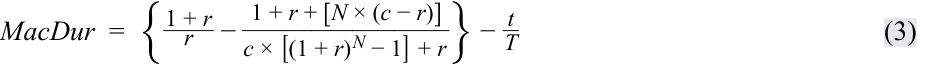
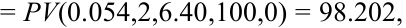

# Tập 6: Thu nhập Cố định (Fixed Income)
## Học phần 10: Rủi ro Lãi suất và Tỷ suất Sinh lợi (Interest Rate Risk and Return)
### Phần 2/2: Thời lượng Macaulay (Trang PDF 265–276)

---

<!-- PDF Page 265 -->

   - **C.** Không phải rủi ro giá cũng không phải rủi ro tái đầu tư

**Lời giải:** 

B là đáp án đúng. Một nhà đầu tư mua và nắm giữ không chịu rủi ro giá, bởi vì cô ấy không có ý định bán trái phiếu trước khi đáo hạn. Tuy nhiên, tỷ suất sinh lợi của cô ấy chịu tác động bởi mức lãi suất mà tại đó cô ấy có thể tái đầu tư các khoản coupon. 

Theo cách giải thích khác, thời hạn đầu tư của nhà đầu tư là 8 năm, trong khi thời lượng Macaulay của trái phiếu là 6,841. Khi thời hạn đầu tư vượt quá thời lượng Macaulay, rủi ro tái đầu tư sẽ chi phối. 

### **THỜI LƯỢNG MACAULAY (*MACAULAY DURATION*)** 

# **<mark>4</mark>** 

định nghĩa, tính toán và diễn giải thời lượng Macaulay. 

Bài học trước đã xác lập thời lượng Macaulay là một thời kỳ nắm giữ đối với một trái phiếu giúp cân bằng giữa rủi ro tái đầu tư và rủi ro giá. Bây giờ chúng ta chuyển sang cách tính toán đại lượng này. 

Cách trực tiếp nhất để hiểu **thời lượng Macaulay (*Macaulay duration*)** của một trái phiếu lãi suất cố định truyền thống là nó là trung bình có trọng số của _thời gian cho đến khi nhận được_ (*time to receipt*) các dòng tiền của trái phiếu, trong đó trọng số của mỗi dòng tiền trong phép tính là tỷ trọng của mỗi dòng tiền trong giá toàn phần (*full price* – tức là giá trị hiện tại) của trái phiếu. Trước khi chúng tôi giới thiệu phương trình tổng quát, hãy lấy một ví dụ cụ thể để minh họa phép tính thời lượng Macaulay: trái phiếu eurobond kỳ hạn 10 năm, trả coupon 6,2% (hàng năm) của BRWA được sử dụng trong các bài học trước. 

Bảng 4 minh họa phép tính thời lượng Macaulay tại thời điểm phát hành, giả sử trái phiếu được phát hành ngang mệnh giá, thanh toán vào ngày 15 tháng 10 năm 2025, và đáo hạn vào ngày 15 tháng 10 năm 2035. Bởi vì đây là một trái phiếu doanh nghiệp, chúng ta giả định cơ sở đếm ngày 30/360. 

**Bảng 4: Thời lượng Macaulay của Trái phiếu Eurobond Hàng năm 6,2%, Kỳ hạn 10 năm của BRWA Corp. tại Thời điểm Phát hành (*Exhibit 4: Macaulay Duration of BRWA Corp. 10-Year, 6.2% Annual Eurobond at Issuance*)** 

|Coupon|6,20%|
|---|---|
|Tần suất trả coupon mỗi năm (*Coupon frequency per year*)|1|
|Giá trên mỗi 100 đơn vị mệnh giá (*Price per 100 par value*)|100|
|Lợi suất đáo hạn (*Yield-to-maturity*)|6,20%|
|Ngày thanh toán (*Settlement date*)|15 tháng 10 năm 2025|
|Ngày đáo hạn (*Maturity*)|15 tháng 10 năm 2035|
|Số năm cho đến khi đáo hạn (*Years to maturity*)|10|

<!-- PDF Page 266 -->

|(1)|(2)|(3)|(4)|(5) = (4) $\div$ Tổng giá trị hiện tại|(6) = (2) $\times$ (5)|
|---|---|---|---|---|---|
|**Kỳ (*Period*)**|**Thời gian cho đến khi nhận (*Time to receipt*)**|**Dòng tiền (*Cash flow*)**|**Giá trị hiện tại (*Present value*)**|**Trọng số (*Weight*)**|**Thời gian nhận $\times$ trọng số (*Time to receipt $\times$ weight*)**|
|1|1|6,2|5,8380|0,0584|0,0584|
|2|2|6,2|5,4972|0,0550|0,1099|
|3|3|6,2|5,1763|0,0518|0,1553|
|4|4|6,2|4,8741|0,0487|0,1950|
|5|5|6,2|4,5895|0,0459|0,2295|
|6|6|6,2|4,3216|0,0432|0,2593|
|7|7|6,2|4,0693|0,0407|0,2849|
|8|8|6,2|3,8317|0,0383|0,3065|
|9|9|6,2|3,6080|0,0361|0,3247|
|10|10|106,2|58,1942|0,5819|5,8194|
||||**100,0000**|**1,0000**|**7,7429**|

- Cột 1 và Cột 2 hiển thị tương ứng số kỳ và thời gian cho đến khi nhận được dòng tiền. Nếu phép tính được thực hiện tại thời điểm phát hành hoặc vào một ngày trả coupon, chúng sẽ bằng nhau. 

- Cột 3 là dòng tiền trên mỗi 100 đơn vị mệnh giá, và Cột 4 là giá trị hiện tại của dòng tiền đó. 

- Cột thứ năm là trọng số, hay tỷ trọng của mỗi dòng tiền trong tổng $PV$. Hãy chú ý rằng khoản thanh toán cuối cùng, $PMT_N + FV_N$, ở mức 106,2 chiếm 58% $PV$ của trái phiếu. 

- Cột thứ sáu là thời gian cho đến khi nhận được dòng tiền (Cột 2) nhân với trọng số (Cột 5). Tổng của cột này chính là thời lượng Macaulay, 7,7429. Con số này gần với thời hạn đầu tư 8 năm của Hightest Capital từ bài học trước, điều đó có nghĩa là Hightest đã cân bằng được rủi ro tái đầu tư và rủi ro giá của mình. 

Thời lượng Macaulay thường được yết dưới dạng một số liệu thống kê chuẩn hóa theo năm (*annualized statistic*). Vì trái phiếu này trả coupon hàng năm, nên không cần điều chỉnh gì thêm. Nếu trái phiếu là một trái phiếu trả coupon nửa năm một lần, chúng ta sẽ chia thời lượng Macaulay cho 2 (hai kỳ nửa năm trong mỗi năm) để thu được thời lượng Macaulay chuẩn hóa theo năm. Khi được yết dưới dạng một số liệu thống kê chuẩn hóa theo năm, đơn vị của thời lượng Macaulay là năm (*years*). 

Hãy chú ý cách con số 7,7429 năm nhỏ hơn 10, tức thời gian đáo hạn của trái phiếu. Điều này là do thời lượng Macaulay là trung bình có trọng số theo giá trị hiện tại của thời gian cho đến khi nhận được các dòng tiền, trong khi thời gian đáo hạn là thời gian cho đến khi nhận được dòng tiền cuối cùng. 

<!-- Formula Text: lil The general calculation of Macaulay duration, MacDur, that also accounts for partial coupon periods if the calculation is done between coupon dates is shown in Equation 2. MacDur  = ⎧ ⎪ ⎨ ⎪ ⎩ (1 − t / T)[ PMT _ (1 + r) 1−t/T _ P V Full  ] + (2 − t / T)[ PMT _ (1 + r) 2−t/T _ P V Full  ] + ⋯  + (N − t / T)[ PMT + FV _ (1 + r) N−t/T _ P V Full  ] ⎫ ⎪ ⎬ ⎪ ⎭ , (2) -->
Phép tính tổng quát của thời lượng Macaulay, $\text{MacDur}$, có tính đến cả các kỳ coupon lẻ nếu phép tính được thực hiện giữa các ngày trả coupon được hiển thị trong Phương trình 2:

$$\text{MacDur} = \left\{ (1 - t/T)\left[\frac{\frac{PMT}{(1 + r)^{1 - t/T}}}{PV_{\text{Full}}}\right] + (2 - t/T)\left[\frac{\frac{PMT}{(1 + r)^{2 - t/T}}}{PV_{\text{Full}}}\right] + \dots + (N - t/T)\left[\frac{\frac{PMT + FV}{(1 + r)^{N - t/T}}}{PV_{\text{Full}}}\right] \right\} \tag{2}$$

<!-- PDF Page 267 -->

##### trong đó: 

- $t$ là số ngày từ lần thanh toán coupon gần nhất cho đến ngày thanh toán giao dịch (*settlement date*); 

- $T$ là số ngày trong kỳ coupon; 

- $t/T$ là phân số của kỳ coupon đã trôi qua kể từ lần thanh toán gần nhất; 

- $PMT$ là khoản thanh toán coupon mỗi kỳ; 

- $FV$ là giá trị tương lai được trả khi đáo hạn, hay mệnh giá của trái phiếu; 

- $r$ là lợi suất đáo hạn mỗi kỳ; và 

- $N$ là số kỳ cách đều nhau cho đến khi đáo hạn tính tại thời điểm bắt đầu của kỳ hiện tại. 

##### **VÍ DỤ 5** 

#### **Thời lượng Macaulay Giữa các Ngày trả Coupon (*Macaulay Duration between Coupon Dates*)** 

Bây giờ hãy tính thời lượng Macaulay cho trái phiếu BRWA _giữa_ các ngày trả coupon—cụ thể là vào ngày 11 tháng 12 năm 2025, tức 57 ngày sau khi phát hành. Điểm khác biệt duy nhất so với ví dụ trước là chúng ta đang ở thời điểm 57 ngày trong tương lai, vì vậy thay vì $t/T = 0$ như tại thời điểm phát hành, $t/T = 57/360$, và thời gian cho đến khi nhận được mỗi dòng tiền sớm hơn 57 ngày. 

##### **Thời lượng Macaulay của Trái phiếu Eurobond Hàng năm 6,2%, Kỳ hạn 10 năm của BRWA Corp. Thanh toán 57 Ngày sau khi Phát hành (*Macaulay Duration of BRWA Corp. 10-Year, 6.2% Annual Eurobond Settling 57 Days after Issuance*)** 

|Coupon|6,20%|
|---|---|
|Tần suất trả coupon mỗi năm (*Coupon frequency per year*)|1|
|Giá trên mỗi 100 đơn vị mệnh giá (*Price per 100 par value*)|100|
|Lợi suất đáo hạn (*Yield-to-maturity*)|6,20%|
|Ngày thanh toán (*Settlement date*)|11 tháng 12 năm 2025|
|Ngày đáo hạn (*Maturity*)|15 tháng 10 năm 2035|
|Số năm cho đến khi đáo hạn (*Years to maturity*)|10|

|(1)|(2)|(3)|(4)|(5) = (4) $\div$ Tổng giá trị hiện tại|(6) = (2) $\times$ (5)|
|---|---|---|---|---|---|
|**Kỳ (*Period*)**|**Thời gian cho đến khi nhận (*Time to receipt*)**|**Dòng tiền (*Cash flow*)**|**Giá trị hiện tại (*Present value*)**|**Trọng số (*Weight*)**|**Thời gian nhận $\times$ trọng số (*Time to receipt $\times$ weight*)**|
|1|0,8417|6,2|5,8939|0,0584|0,0491|
|2|1,8417|6,2|5,5498|0,0550|0,1012|
|3|2,8417|6,2|5,2258|0,0518|0,1471|
|4|3,8417|6,2|4,9207|0,0487|0,1872|
|5|4,8417|6,2|4,6335|0,0459|0,2222|
|6|5,8417|6,2|4,3630|0,0432|0,2525|
|7|6,8417|6,2|4,1082|0,0407|0,2784|
|8|7,8417|6,2|3,8684|0,0383|0,3005|

<!-- PDF Page 268 -->

|**Kỳ (*Period*)**|**Thời gian cho đến khi nhận (*Time to receipt*)**|**Dòng tiền (*Cash flow*)**|**Giá trị hiện tại (*Present value*)**|**Trọng số (*Weight*)**|**Thời gian nhận $\times$ trọng số (*Time to receipt $\times$ weight*)**|
|---|---|---|---|---|---|
|9|8,8417|6,2|3,6426|0,0361|0,3190|
|10|9,8417|106,2|58,7511|0,5819|5,7273|
||||**100,9570**|**1,0000**|**7,5845**|

So sánh ví dụ này với ví dụ trước, chúng ta thấy rằng thời gian cho đến khi nhận được mỗi dòng tiền đều thấp hơn, phản ánh thực tế là chúng ta đang ở thời điểm muộn hơn 57 ngày, điều này làm tăng giá trị hiện tại của mỗi dòng tiền. Tuy nhiên, trọng số giá trị hiện tại của mỗi dòng tiền vẫn giữ nguyên như cũ. Thời lượng Macaulay (7,5845) thấp hơn so với trong ví dụ trước (7,7429), phản ánh thời gian cho đến khi nhận được dòng tiền thấp hơn. 

Ví dụ này chứng minh một tính chất quan trọng của thời lượng Macaulay: nó không tĩnh (*not static*); nó giảm xuống khi thời gian trôi qua và thời gian cho đến khi nhận được mỗi dòng tiền giảm xuống. 

Bên cạnh bảng tính, thời lượng Macaulay cũng có thể được tính bằng cách sử dụng hàm DURATION trong Microsoft Excel hoặc Google Sheets: 

`=DURATION(Settlement, Maturity, Coupon, Yld, Frequency, [Basis])` 

trong đó: 

- _Settlement_ là ngày thanh toán giao dịch, ở định dạng DATE 

- _Maturity_ là ngày đáo hạn, ở định dạng DATE 

- _Coupon_ là lãi suất coupon hàng năm 

- _Yld_ là lợi suất đáo hạn chuẩn hóa theo năm 

- _Frequency_ là định kỳ (*periodicity*), thường là số lần thanh toán coupon mỗi năm; bằng 1 đối với hàng năm, 2 đối với nửa năm một lần, 4 đối với hàng quý 

- [_Basis_] là quy ước đếm ngày; 0 hoặc bỏ trống là 30/360, 1 là thực tế/thực tế (*act/act*), 2 là thực tế/360 (*act/360*), 3 là thực tế/365 (*act/365*) 

Cuối cùng, một phương pháp khác để tính thời lượng Macaulay là sử dụng một phương trình dạng đóng (*closed-form equation*) được suy ra bằng giải tích và đại số, được hiển thị dưới dạng Phương trình 3: 

<!-- Formula Text: MacDur  =  { 1 + r _ r   − 1 + r + [N × (c − r)] _______________ c × [(1 + r) N − 1] + r } −  t _ T (3) -->
$$\text{MacDur} = \left\{ \frac{1 + r}{r} - \frac{1 + r + [N \times (c - r)]}{c \times [(1 + r)^N - 1] + r} \right\} - \frac{t}{T} \tag{3}$$

trong đó: 

- $r$ là lợi suất đáo hạn mỗi kỳ; 

- $N$ là số kỳ cách đều nhau cho đến khi đáo hạn tính tại thời điểm bắt đầu của kỳ hiện tại; 

- $c$ là lãi suất coupon mỗi kỳ; 

- $t$ là số ngày từ lần thanh toán coupon gần nhất cho đến ngày thanh toán giao dịch; 

và 

- $T$ là số ngày trong kỳ coupon. 

<!-- PDF Page 269 -->

##### **BỘ CÂU HỎI (*QUESTION SET*)** 

1. Xét một trái phiếu còn 3 năm nữa là đáo hạn và có lãi suất coupon 4% trả nửa năm một lần và được định giá ở mức 100. Thời lượng Macaulay chuẩn hóa theo năm của trái phiếu _gần nhất_ với mức: 

- **A.** 2,801 năm. 

- **B.** 2,857 năm. 

- **C.** 3,000 năm. 

**Lời giải:** 

B là đáp án đúng. 

|**Kỳ (*Period*)**|**Thời gian cho đến khi nhận (*Time to receipt*)**|**Dòng tiền (*Cash flow*)**|**Giá trị hiện tại (*Present value*)**|**Trọng số (*Weight*)**|**Thời gian nhận $\times$ trọng số (*Time to receipt $\times$ weight*)**|
|---|---|---|---|---|---|
|1|1|2|1,961|0,0196|0,01961|
|2|2|2|1,922|0,0192|0,03845|
|3|3|2|1,885|0,0189|0,05654|
|4|4|2|1,848|0,0185|0,07391|
|5|5|2|1,811|0,0181|0,09057|
|6|6|102|90,573|0,9057|5,43438|
||||100,00000|1,00000|5,71346|
|**Thời lượng Macaulay chuẩn hóa theo năm (năm) (*Annualized Macaulay duration (years)*)**|||||**2,857**|

2. Một nhà đầu tư có thời hạn đầu tư 3 năm mua một trái phiếu còn 4 năm nữa là đáo hạn, lãi suất coupon 1% trả nửa năm một lần, và lợi suất đáo hạn là 0,90%. Xét về rủi ro lãi suất, nhà đầu tư này _chủ yếu_ lo ngại về: 

   - **A.** lãi suất tăng (*rising interest rates*). 

   - **B.** lãi suất giảm (*falling interest rates*). 

   - **C.** không lo ngại về lãi suất tăng cũng không lo ngại về lãi suất giảm. 

   - **Lời giải:** 

A là đáp án đúng. Thời lượng Macaulay của trái phiếu là 3,9312 năm. 

|**Kỳ (*Period*)**|**Thời gian cho đến khi nhận (*Time to Receipt*)**|**Dòng tiền (*Cash Flow*)**|**PV**|**Trọng số (*Weight*)**|**Thời gian nhận $\times$ Trọng số (*Time to Receipt $\times$ Weight*)**|
|---|---|---|---|---|---|
|1,0000|1,0000|0,5000|0,4978|0,0050|0,0050|
|2,0000|2,0000|0,5000|0,4955|0,0049|0,0099|
|3,0000|3,0000|0,5000|0,4933|0,0049|0,0147|
|4,0000|4,0000|0,5000|0,4911|0,0049|0,0196|
|5,0000|5,0000|0,5000|0,4889|0,0049|0,0243|
|6,0000|6,0000|0,5000|0,4867|0,0048|0,0291|
|7,0000|7,0000|0,5000|0,4845|0,0048|0,0338|
|8,0000|8,0000|100,5000|96,9542|0,9658|7,7260|

<!-- PDF Page 270 -->

|**Kỳ (*Period*)**|**Thời gian cho đến khi nhận (*Time to Receipt*)**|**Dòng tiền (*Cash Flow*)**|**PV**|**Trọng số (*Weight*)**|**Thời gian nhận $\times$ Trọng số (*Time to Receipt $\times$ Weight*)**|
|---|---|---|---|---|---|
||||100,3920|1,0000|7,8624|
||||**MacDur chuẩn hóa theo năm (năm) (*Annualized MacDur (years)*)**||**3,9312**|

Khi thời lượng Macaulay của một trái phiếu dài hơn thời hạn đầu tư của nhà đầu tư (3 năm), rủi ro giá sẽ chi phối và mối lo ngại rủi ro giảm giá (*downside concern*) chính của nhà đầu tư là lãi suất tăng. 

3. Xét một trái phiếu còn 5 năm nữa là đáo hạn, lãi suất coupon 0,5% trả hàng năm, và lợi suất đáo hạn là –0,20%. Thời lượng Macaulay chuẩn hóa theo năm của trái phiếu _gần nhất_ với mức: 

- **A.** 2,4758. 

- **B.** 4,9515. 

- **C.** 5,3130. 

**Lời giải:** 

B là đáp án đúng. 

|**Kỳ (*Period*)**|**Thời gian cho đến khi nhận (*Time to Receipt*)**|**CF**|**PV**|**Trọng số (*Weight*)**|**Thời gian nhận $\times$ Trọng số (*Time to Receipt $\times$ Weight*)**|
|---|---|---|---|---|---|
|1,0000|1,0000|0,5000|0,5010|0,0048|0,0048|
|2,0000|2,0000|0,5000|0,5020|0,0048|0,0097|
|3,0000|3,0000|0,5000|0,5030|0,0049|0,0146|
|4,0000|4,0000|0,5000|0,5040|0,0049|0,0195|
|5,0000|5,0000|100,5000|101,5111|0,9806|4,9029|
||||103,5211|1,0000|**4,9515**|

4. Xét một trái phiếu còn 5 năm nữa là đáo hạn, lãi suất coupon 0,5% trả hàng năm, và lợi suất đáo hạn là –0,20%. Giả sử đã qua 91 ngày trong kỳ coupon đầu tiên và tính theo cơ sở 30/360. Thời lượng Macaulay chuẩn hóa theo năm của trái phiếu _gần nhất_ với mức: 

   - **A.** 4,2371. 

   - **B.** 4,5054. 

   - **C.** 4,6987. 

**Lời giải:** 

C là đáp án đúng. 

|**Kỳ (*Period*)**|**Thời gian cho đến khi nhận (*Time to Receipt*)**|**Dòng tiền (*Cash Flow*)**|**PV**|**Trọng số (*Weight*)**|**Thời gian nhận $\times$ Trọng số (*Time to Receipt $\times$ Weight*)**|
|---|---|---|---|---|---|
|1,0000|0,7472|0,5000|0,5007|0,0048|0,0036|
|2,0000|1,7472|0,5000|0,5018|0,0048|0,0085|
|3,0000|2,7472|0,5000|0,5028|0,0049|0,0133|
|4,0000|3,7472|0,5000|0,5038|0,0049|0,0182|

<!-- PDF Page 271 -->

|**Kỳ (*Period*)**|**Thời gian cho đến khi nhận (*Time to Receipt*)**|**Dòng tiền (*Cash Flow*)**|**PV**|**Trọng số (*Weight*)**|**Thời gian nhận $\times$ Trọng số (*Time to Receipt $\times$ Weight*)**|
|---|---|---|---|---|---|
|5,0000|4,7472|100,5000|101,4597|0,9806|4,6550|
||||103,4687|1,0000|**4,6987**|

Lưu ý rằng một cách trực tiếp để tính thời lượng Macaulay bằng bảng tính giữa các kỳ coupon là đặt thời gian cho đến khi nhận được dòng tiền đầu tiên bằng $1 - t/T$ (ở đây $= 1 - 91/360$) và thời gian cho đến khi nhận được các dòng tiền tiếp theo bằng thời gian của kỳ trước đó cộng thêm 1. 

<!-- PDF Page 272 -->

## **BÀI TẬP THỰC HÀNH (*PRACTICE PROBLEMS*)** 

**1.** Giả sử không có lãi hoặc lỗ vốn khi trái phiếu được bán, lợi suất theo thời hạn đầu tư (*horizon yield*) của một nhà đầu tư bằng với lợi suất đáo hạn của trái phiếu tại thời điểm đầu tư nếu các khoản coupon được tái đầu tư ở mức lãi suất: 

   - **A.** thấp hơn lợi suất đáo hạn của trái phiếu tại thời điểm đầu tư. 

   - **B.** bằng với lợi suất đáo hạn của trái phiếu tại thời điểm đầu tư. 

   - **C.** cao hơn lợi suất đáo hạn của trái phiếu tại thời điểm đầu tư. 

**2.** Một nhà đầu tư mua một trái phiếu eurobond kỳ hạn 8 năm, trả coupon hàng năm 6,4% được định giá ngang mệnh giá (ngày thanh toán: 15 tháng 6 năm 2031; ngày đáo hạn: 15 tháng 12 năm 2039) và bán nó sau 6 năm. Giả sử lãi suất tăng 100 bps ngay sau khi mua, tỷ suất sinh lợi của nhà đầu tư vào cuối năm thứ sáu sẽ: 

   - **A.** thấp hơn 6,4%. 

   - **B.** bằng 6,4%. 

   - **C.** cao hơn 6,4%. 

**3.** Giá trị ghi sổ (*carrying value*) của một trái phiếu được mua ở mức giá dưới mệnh giá bằng với giá mua ban đầu: 

   - **A.** trừ đi khoản phân bổ phần trội tích lũy (*accumulated premium amortization*). 

   - **B.** trừ đi khoản phân bổ chiết khấu tích lũy (*accumulated discount amortization*). 

   - **C.** cộng với khoản phân bổ chiết khấu tích lũy (*accumulated discount amortization*). 

**4.** Chênh lệch thời lượng (*duration gap*) mà tại đó rủi ro tái đầu tư và rủi ro giá bằng nhau là: 

   - **A.** nhỏ hơn không. 

   - **B.** bằng không. 

   - **C.** lớn hơn không. 

**5.** Khi thời hạn đầu tư của một nhà đầu tư nhỏ hơn thời lượng Macaulay của trái phiếu, nhà đầu tư phải đối mặt với rủi ro giảm giá trị (*downside risk*) nếu, sau khi mua trái phiếu, lãi suất: 

   - **A.** giảm. 

   - **B.** tăng. 

   - **C.** giảm hoặc tăng. 

**6.** Một nhà đầu tư mua một trái phiếu trả lãi hàng năm 5,8%, kỳ hạn 12 năm và dự định bán nó sau 10 năm. Thời lượng Macaulay của trái phiếu là 8,97 năm. Nếu lãi suất giảm 75 bps ngay sau khi mua trái phiếu, nhà đầu tư phải đối mặt với: 

   - **A.** rủi ro tái đầu tư âm (*negative reinvestment risk*). 

   - **B.** không có rủi ro tái đầu tư. 

   - **C.** rủi ro tái đầu tư dương (*positive reinvestment risk*). 

<!-- PDF Page 273 -->

**7.** Xét một trái phiếu còn 3 năm nữa là đáo hạn, lãi suất coupon 4% trả nửa năm một lần, và lợi suất đáo hạn là 4,60%. Giả sử đã qua 12 ngày trong kỳ coupon đầu tiên và tính theo cơ sở 30/360, thời lượng Macaulay chuẩn hóa theo năm của trái phiếu _gần nhất_ với mức: 

   - **A.** 1,8764 năm. 

   - **B.** 2,8386 năm. 

   - **C.** 2,8553 năm. 

**8.** Hightest Capital mua một trái phiếu kỳ hạn 7 năm, lãi suất coupon 6,4% và có thời hạn đầu tư dự kiến là 4 năm. Thời lượng Macaulay của trái phiếu là 5,86 năm. Nếu lãi suất tăng 50 bps ngay sau khi mua trái phiếu, Hightest Capital phải đối mặt với: 

   - **A.** rủi ro giá âm (*negative price risk*). 

   - **B.** rủi ro tái đầu tư âm (*negative reinvestment risk*). 

   - **C.** rủi ro giá dương (*positive price risk*). 

<!-- PDF Page 274 -->

## **LỜI GIẢI (*SOLUTIONS*)** 

1. B là đáp án đúng. Để lợi suất theo thời hạn đầu tư khớp với lợi suất đáo hạn ban đầu của trái phiếu, hai điều kiện phải được đáp ứng: 

   - (1) Các khoản thanh toán coupon được tái đầu tư ở mức lợi suất đáo hạn ban đầu. 

   - (2) Trái phiếu được bán tại quỹ đạo giá lợi suất không đổi (*constant-yield price trajectory*), ngụ ý không có lãi hoặc lỗ vốn khi trái phiếu được bán. 

Vì không có lãi hoặc lỗ khi trái phiếu được bán, lợi suất theo thời hạn đầu tư sẽ bằng với lợi suất đáo hạn nếu điều kiện thứ nhất được đáp ứng (tức là các khoản coupon được tái đầu tư ở mức lợi suất đáo hạn ban đầu). 

A không đúng bởi vì lợi suất theo thời hạn đầu tư sẽ thấp hơn lợi suất đáo hạn nếu các khoản coupon được tái đầu tư ở mức lãi suất thấp hơn lợi suất đáo hạn ban đầu, giả sử không có lãi hoặc lỗ vốn khi bán trái phiếu. 

C không đúng bởi vì lợi suất theo thời hạn đầu tư sẽ cao hơn lợi suất đáo hạn nếu các khoản coupon được tái đầu tư ở mức lãi suất cao hơn lợi suất đáo hạn ban đầu, giả sử không có lãi hoặc lỗ vốn khi bán trái phiếu. 

2. A là đáp án đúng. Giá trị tương lai của tiền lãi coupon được tái đầu tư là: 

   - `= -FV(0.074, 6, 6.4, 0, 0) = 46.245`. 

Giá bán của trái phiếu vào cuối năm thứ sáu là: 

<!-- Formula Text: = PV(0.054,2,6.40,100,0) = 98.202, -->
$$= -\text{PV}(0.074, 2, 6.40, 100, 0) = 98.202 \quad (\text{bản gốc in nhầm } 0.054 \text{ thay vì } 0.074)$$

dẫn đến lợi suất theo thời hạn đầu tư 6 năm là 6,32%, thấp hơn mức 6,40%: 

<!-- Formula Text: r  =  ( FV _ PV ) 1 _ T − 1. r  =  ( 46.245 + 98.202 ____________ 100 ) 1 _ 6 − 1. -->
$$r = \left(\frac{FV}{PV}\right)^{\frac{1}{T}} - 1$$
$$r = \left(\frac{46.245 + 98.202}{100}\right)^{\frac{1}{6}} - 1$$

$r = 0.0632 = 6.32\%$. 

B và C không đúng, bởi vì lãi suất đã tăng lên và thời hạn đầu tư của nhà đầu tư không đủ dài để bù đắp cho sự sụt giảm giá bằng tỷ suất sinh lợi tái đầu tư bổ sung. 

3. C là đáp án đúng. Một trái phiếu được mua ở mức chiết khấu sẽ có mức giá được “kéo về mệnh giá” khi tiến gần đến ngày đáo hạn. Giá trị ghi sổ (*carrying value*) của nó tại thời điểm $t$ bằng với giá mua của nó cộng với khoản phân bổ chiết khấu tích lũy. 

A không đúng bởi vì một trái phiếu được mua dưới mệnh giá là được mua ở mức chiết khấu, chứ không phải phần trội. 

B không đúng bởi vì khoản phân bổ chiết khấu tích lũy được cộng vào, chứ không phải trừ đi khỏi giá mua để tính giá trị ghi sổ. 

4. B là đáp án đúng. Rủi ro tái đầu tư và rủi ro giá bù trừ tương đương cho nhau khi thời hạn đầu tư của nhà đầu tư bằng với thời lượng Macaulay của trái phiếu. Đây là khi chênh lệch thời lượng (*duration gap*) bằng không. 

   - A không đúng bởi vì chênh lệch thời lượng nhỏ hơn không có nghĩa là thời lượng Macaulay nhỏ hơn thời hạn đầu tư của nhà đầu tư và rủi ro tái đầu tư cao hơn rủi ro giá. 

   - C không đúng bởi vì khi chênh lệch thời lượng lớn hơn không, thời lượng Macaulay lớn hơn thời hạn đầu tư của nhà đầu tư, vì vậy rủi ro giá cao hơn rủi ro tái đầu tư. 

<!-- PDF Page 275 -->

5. B là đáp án đúng. Nếu thời hạn đầu tư nhỏ hơn thời lượng Macaulay của trái phiếu, thì rủi ro của nhà đầu tư là lãi suất cao hơn. Đối với một nhà đầu tư như vậy, rủi ro giá thị trường sẽ chi phối rủi ro tái đầu tư coupon. 

   - A không đúng bởi vì một nhà đầu tư phải đối mặt với rủi ro do lãi suất thấp hơn khi thời hạn đầu tư lớn hơn thời lượng Macaulay của trái phiếu. 

   - C không đúng bởi vì khi thời hạn đầu tư nhỏ hơn thời lượng Macaulay, nhà đầu tư phải đối mặt với rủi ro do lãi suất cao hơn, chứ không phải lãi suất thấp hơn. 

6. A là đáp án đúng. Nhà đầu tư có thời hạn đầu tư là 10 năm, lớn hơn thời lượng Macaulay là 8,97 năm. Do đó, rủi ro tái đầu tư chi phối rủi ro giá. 

   - B không đúng bởi vì nhà đầu tư phải đối mặt với rủi ro tái đầu tư do thời hạn đầu tư cao hơn thời lượng Macaulay. 

   - C không đúng bởi vì nhà đầu tư phải đối mặt với tác động tiêu cực từ rủi ro tái đầu tư coupon (*negative coupon reinvestment risk*), chứ không phải tác động tích cực (*positive coupon reinvestment risk*), vì các khoản coupon sẽ được tái đầu tư ở mức lãi suất thấp hơn. 

7. B là đáp án đúng (gần nhất với 2,8220 năm). 

|**Kỳ (*Period*)**|**Thời gian cho đến khi nhận (*Time to Receipt*)**|**Dòng tiền (*Cash Flow*)**|**PV**|**Trọng số (*Weight*)**|**Thời gian nhận $\times$ Trọng số (*Time to Receipt $\times$ Weight*)**|
|---|---|---|---|---|---|
|1,0000|0,9333|2,0000|1,9580|0,0199|0,0186|
|2,0000|1,9333|2,0000|1,9140|0,0194|0,0376|
|3,0000|2,9333|2,0000|1,8709|0,0190|0,0557|
|4,0000|3,9333|2,0000|1,8289|0,0186|0,0730|
|5,0000|4,9333|2,0000|1,7878|0,0182|0,0896|
|6,0000|5,9333|102,0000|89,1261|0,9050|5,3695|
||||98,4856|1,0000|5,6439|
||||**MacDur chuẩn hóa theo năm (*Annualized MacDur*)**||**2,8220**|

8. A là đáp án đúng. Thời hạn đầu tư của Hightest Capital là 4 năm, nhỏ hơn thời lượng Macaulay của trái phiếu là 5,86 năm. Do đó, rủi ro giá chi phối rủi ro tái đầu tư và Hightest Capital phải đối mặt với rủi ro giá từ việc lãi suất tăng. B không đúng bởi vì việc tăng lãi suất có lợi cho việc tái đầu tư coupon. Do đó, Hightest Capital có rủi ro tái đầu tư dương. C không đúng bởi vì Hightest Capital phải đối mặt với rủi ro giá của trái phiếu sẽ giảm xuống do sự gia tăng 50 bp trong lãi suất và do đó có rủi ro giá âm (*negative price risk*). 

<!-- PDF Page 276 -->
