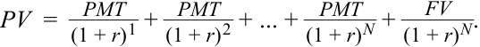
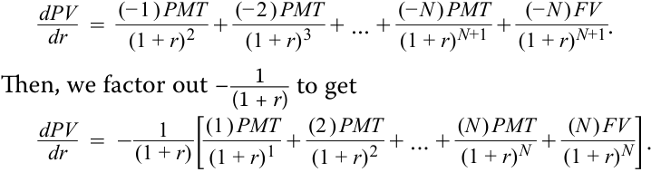
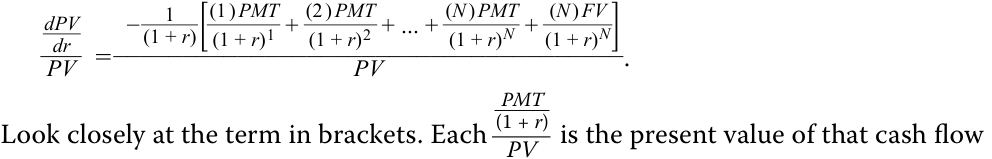
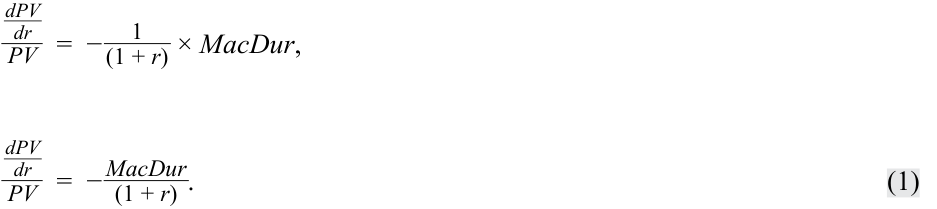
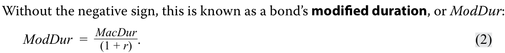
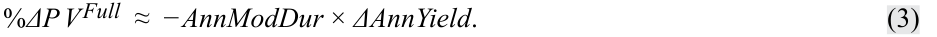
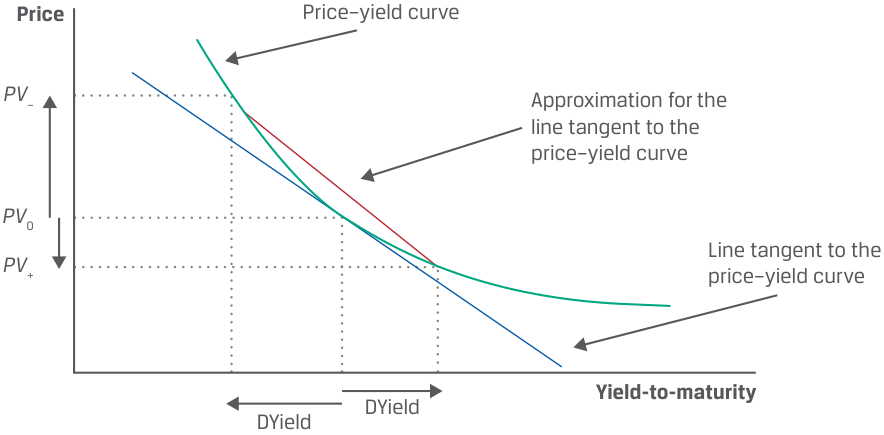
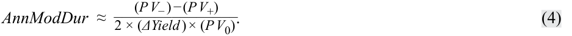
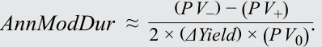

# Tập 6: Thu nhập Cố định (Fixed Income)
## Học phần 11: Các Thước đo và Đặc tính Thời lượng Trái phiếu Dựa trên Lợi suất (Yield-Based Bond Duration Measures and Properties)
### Phần 1/2: Giới thiệu (Trang PDF 277–290)

---

<!-- PDF Page 277 -->

# H Ọ C P H Ầ N **<mark>11</mark>** 

### **Các Thước đo và Đặc tính Thời lượng Trái phiếu Dựa trên Lợi suất (Yield-Based Bond Duration Measures and Properties)** 

##### **<mark>MỤC TIÊU HỌC TẬP (LEARNING OUTCOMES)</mark>** 

###### **_Làm chủ kiến thức – Ứng viên cần có khả năng:_** 

- định nghĩa, tính toán và diễn giải thời lượng điều chỉnh (*modified duration*), thời lượng tiền tệ (*money duration*), và giá trị giá của một điểm cơ bản (*price value of a basis point* – PVBP)
- giải thích cách thức kỳ hạn (*maturity*), lãi suất coupon (*coupon*) và mức lợi suất (*yield level*) của trái phiếu ảnh hưởng đến rủi ro lãi suất (*interest rate risk*) của nó 

#### **GIỚI THIỆU (INTRODUCTION)** 

**<mark>1</mark>** 

Các bài học trước đã khám phá hai nguồn rủi ro lãi suất—rủi ro tái đầu tư (*reinvestment risk*) và rủi ro giá (*price risk*)—đồng thời chứng minh việc nắm giữ trái phiếu trong khoảng thời gian bằng thời lượng Macaulay (*Macaulay duration*) giúp cân bằng hai rủi ro này như thế nào. Bài học này và các bài học tiếp theo mở rộng cuộc thảo luận đó bằng cách giới thiệu các thước đo rủi ro giá. Có hai nhóm thước đo rộng như vậy: những thước đo giả định dòng tiền cơ sở của trái phiếu là chắc chắn và đo lường độ nhạy của giá đối với những thay đổi trong _lợi suất của chính trái phiếu đó_ (*own yield*), được trình bày trong các bài học này, và những thước đo đưa vào khả năng vỡ nợ của trái phiếu và đo lường độ nhạy của giá đối với những thay đổi trong đường cong lợi suất _chuẩn_ (*benchmark yield curve*), được trình bày trong các bài học sau. Bài học này sẽ minh họa cách rủi ro lãi suất của một trái phiếu là một hàm số phụ thuộc vào các đặc điểm của nó, bao gồm thời gian đáo hạn (*time-to-maturity*), lãi suất coupon (*coupon rate*) và lợi suất (*yield*). 

Hầu hết các ví dụ và bảng biểu được sử dụng xuyên suốt bài đọc có thể được tải xuống dưới dạng sổ làm việc Microsoft Excel. Mỗi trang tính trong sổ làm việc được gắn nhãn với số ví dụ hoặc bảng biểu tương ứng trong văn bản. 

###### **TỔNG QUAN HỌC PHẦN (LEARNING MODULE OVERVIEW)** 

- Thời lượng (*Duration*) là một thước đo định lượng về rủi ro lãi suất (*interest rate risk*). Có một số thước đo thời lượng, bao gồm những thước đo đo lường độ nhạy giá của trái phiếu đối với những thay đổi trong chính lợi suất đáo hạn của nó và giả định dòng tiền cơ sở là chắc chắn (thời lượng lợi suất – *yield duration*) và những thước đo đo lường những thay đổi trong đường cong lợi suất chuẩn, với dòng tiền cơ sở ít chắc chắn hơn (thời lượng đường cong – *curve duration*). 

<!-- PDF Page 278 -->

- Thời lượng Macaulay (*Macaulay duration*), thời lượng điều chỉnh (*modified duration*), thời lượng tiền tệ (*money duration*), và giá trị giá của một điểm cơ bản (*price value of a basis point* – PVBP) là các thước đo thời lượng lợi suất (*yield duration measures*). 

- Thời lượng điều chỉnh (*Modified duration*) là độ dốc (*slope*) hay đạo hàm bậc nhất (*first derivative*) của giá trái phiếu theo lợi suất đáo hạn (*yield-to-maturity*), đo lường độ nhạy của giá trái phiếu đối với những thay đổi trong lợi suất đáo hạn của nó. Thời lượng điều chỉnh có thể được tính bằng cách sử dụng thời lượng Macaulay và lợi suất của trái phiếu hoặc thông qua phương pháp xấp xỉ (*approximation*). 

- Thời lượng tiền tệ (*Money duration*) là sự mở rộng của thời lượng điều chỉnh và kết hợp quy mô của vị thế trái phiếu tính theo đơn vị tiền tệ. Liên quan đến thước đo này là giá trị giá của một điểm cơ bản (*price value of a basis point* – PVBP), là ước tính mức thay đổi trong giá của một trái phiếu khi lợi suất của trái phiếu thay đổi 1 điểm cơ bản (1 bp). 

- Thời lượng có thể được sử dụng để ước tính mức thay đổi trong giá của một trái phiếu trước một sự thay đổi trong lợi suất, nhưng nó giả định mối quan hệ tuyến tính (*linear relationship*) giữa giá và lợi suất mặc dù trên thực tế, mối quan hệ này là phi tuyến tính (*nonlinear*). Điều này thể hiện rõ nhất khi ước tính những thay đổi về giá cho những biến động lớn về lợi suất và đối với những trái phiếu có các đặc tính nhất định. 

- Các đặc điểm của trái phiếu, bao gồm thời gian đáo hạn (*time-to-maturity*), lãi suất coupon (*coupon rate*), và lợi suất đáo hạn (*yield-to-maturity*), quyết định thời lượng của nó. Thời lượng đối với một trái phiếu nhất định không phải là tĩnh mà giảm dần khi trái phiếu tiến gần đến ngày đáo hạn. 

- Khi các yếu tố khác không đổi (*all else equal*), thời gian đáo hạn dài hơn (ngắn hơn), lãi suất coupon thấp hơn (cao hơn), hoặc lợi suất đáo hạn thấp hơn (cao hơn) sẽ dẫn đến thời lượng cao hơn (thấp hơn) hoặc rủi ro lãi suất cao hơn (thấp hơn). 

###### **TỰ ĐÁNH GIÁ HỌC PHẦN (LEARNING MODULE SELF-ASSESSMENT)** 

Những câu hỏi ban đầu này nhằm giúp bạn đánh giá mức độ hiểu biết hiện tại của mình về học phần. 

1. Hãy ghép mỗi mô tả sau đây với thuật ngữ thích hợp: 

|**Mô tả (Description)**|**Thuật ngữ (Term)**|
|---|---|
|Thời gian nhận dòng tiền trung bình có trọng số giá trị hiện tại của một trái phiếu (*Present-value-weighted average time-to-receipt of a bond’s cash flows*)|i. Thời lượng tiền tệ (*Money duration*)|
|Được sử dụng để ước tính phần trăm thay đổi trong giá của một trái phiếu đối với một mức thay đổi nhất định trong lợi suất đáo hạn của trái phiếu (*Used to estimate the percentage change in a bond’s price for a given change in the bond’s yield-to-maturity*)|ii. Giá trị giá trên mỗi điểm cơ bản (*Price value per basis point*)|
|Tích số giữa thời lượng điều chỉnh năm hóa và giá toàn phần của một trái phiếu (*The product of the annualized modified duration and the full price of a bond*)|iii. Thời lượng Macaulay (*Macaulay duration*)|
|Mức thay đổi trong giá toàn phần của một trái phiếu đối với mức thay đổi 1 bp trong lợi suất (*Change in the full price of a bond for a 1 bp change in yield*)|iv. Thời lượng điều chỉnh (*Modified duration*)|

###### **Lời giải:** 

Thời gian nhận dòng tiền trung bình có trọng số giá trị hiện tại của một trái phiếu ghép với iii. Thời lượng Macaulay (*Macaulay duration*). 

Được sử dụng để ước tính phần trăm thay đổi trong giá của một trái phiếu đối với một mức thay đổi nhất định trong lợi suất đáo hạn của trái phiếu ghép với iv. Thời lượng điều chỉnh (*Modified duration*). 

Tích số giữa thời lượng điều chỉnh năm hóa và giá toàn phần của một trái phiếu ghép với i. Thời lượng tiền tệ (*Money duration*). 

Mức thay đổi trong giá toàn phần của một trái phiếu đối với mức thay đổi 1 bp trong lợi suất ghép với ii. Giá trị giá trên mỗi điểm cơ bản (*Price value per basis point*). 

<!-- PDF Page 279 -->

2. Nếu tất cả các đặc điểm khác của một trái phiếu được giữ không đổi, sự gia tăng trong lợi suất đáo hạn của trái phiếu đó _nhiều khả năng nhất_ sẽ dẫn đến:
   - **A.** sự sụt giảm trong thời lượng điều chỉnh của trái phiếu.
   - **B.** không có sự thay đổi trong thời lượng điều chỉnh của trái phiếu.
   - **C.** sự gia tăng trong thời lượng điều chỉnh của trái phiếu.

###### **Lời giải:**
A là đáp án đúng. Sự gia tăng trong lợi suất đáo hạn của trái phiếu sẽ dẫn đến thời lượng điều chỉnh thấp hơn bởi vì các dòng tiền trong tương lai được chiết khấu ở mức lãi suất cao hơn, làm giảm mức trung bình có trọng số giá trị hiện tại của thời gian nhận dòng tiền của chúng. B không đúng vì thời lượng bị ảnh hưởng bởi giá trị hiện tại của các dòng tiền trái phiếu, mà đến lượt nó lại bị ảnh hưởng bởi lợi suất của trái phiếu. C không đúng vì sự gia tăng trong lợi suất đáo hạn của trái phiếu làm giảm giá trị hiện tại của mỗi dòng tiền và do đó làm giảm thời lượng của trái phiếu.

3. Xét một trái phiếu có thời lượng điều chỉnh năm hóa (*annualized modified duration*) là 4, lãi suất coupon là 5%, và giá là 95. Mức thay đổi kỳ vọng trong giá của trái phiếu, tính trên mỗi 100 mệnh giá, đối với mức tăng 50 bp trong lợi suất đáo hạn của trái phiếu _gần nhất_ với:
   - **A.** 4.75.
   - **B.** 3.80.
   - **C.** 1.90.

###### **Lời giải:**
C là đáp án đúng. Thời lượng tiền tệ (*money duration*) là 380:
$$\text{MoneyDur} = \text{AnnModDur} \times PV^{\text{Full}}$$
$$\text{MoneyDur} = 4.0 \times 95 = 380$$
Điều này dẫn đến mức thay đổi về giá là $-1.90$ đối với mức tăng 50 bp trong lợi suất của trái phiếu:
$$\Delta PV^{\text{Full}} \approx -\text{MoneyDur} \times \Delta \text{Yield}$$
$$\Delta PV^{\text{Full}} \approx -380 \times 0.005 = -1.90$$

Mức thay đổi về giá mang dấu âm khi lợi suất đáo hạn tăng lên. 

4. Hai trái phiếu, Trái phiếu X và Trái phiếu Y, giống hệt nhau ngoại trừ việc Trái phiếu X có lãi suất coupon thấp hơn Trái phiếu Y. Do đó:
   - **A.** hai trái phiếu sẽ có thời lượng điều chỉnh giống hệt nhau.
   - **B.** Trái phiếu X sẽ có thời lượng điều chỉnh thấp hơn so với Trái phiếu Y.
   - **C.** Trái phiếu Y sẽ có thời lượng điều chỉnh thấp hơn so với Trái phiếu X. 

###### **Lời giải:**
C là đáp án đúng. Nếu hai trái phiếu giống hệt nhau về mọi phương diện khác (ví dụ: thời gian đáo hạn, lợi suất, v.v.), trái phiếu có lãi suất coupon thấp hơn sẽ có thời lượng điều chỉnh cao hơn. Điều này là do, so với Trái phiếu Y, giá trị hiện tại của mỗi dòng tiền coupon của Trái phiếu X sẽ chiếm tỷ trọng nhỏ hơn trong giá trái phiếu, 

<!-- PDF Page 280 -->

trong khi phần đóng góp vào giá trái phiếu từ mệnh giá (*face value*) sẽ lớn hơn. 

5. Việc ước tính giá trị giá trên mỗi điểm cơ bản (*price value per basis point*) bằng cách lấy chênh lệch giá của một trái phiếu khi lợi suất giảm 0.0001 và tăng 0.0001 chia cho 2 đã bỏ qua: 

   - **A.** độ lồi (*convexity*) của mối quan hệ giá – lợi suất của trái phiếu. 

   - **B.** độ lõm (*concavity*) của mối quan hệ giá – lợi suất của trái phiếu. 

   - **C.** tính đối xứng (*symmetry*) trong mối quan hệ giá – lợi suất của trái phiếu. 

   - **Lời giải:** 

A là đáp án đúng. Công thức tính giá trị giá của một điểm cơ bản này không bao gồm phần điều chỉnh cho độ lồi (*convexity*). Điều này rất quan trọng vì mức thay đổi giá khi lợi suất tăng và giảm là bất đối xứng (*asymmetric*), do mối quan hệ lồi giữa giá và lợi suất. 

6. Mức thay đổi trong giá của một trái phiếu khi lợi suất của nó tăng 100 bps được mô tả đúng nhất là: 

   - **A.** nhỏ hơn mức thay đổi về giá khi lợi suất của nó giảm 100 bps. 

   - **B.** bằng với mức thay đổi về giá khi lợi suất của nó giảm 100 bps. 

   - **C.** lớn hơn mức thay đổi về giá khi lợi suất của nó giảm 100 bps. 

   - **Lời giải:** 

A là đáp án đúng. Mối quan hệ giá – lợi suất của hầu hết các trái phiếu đều là hàm lồi (*convex*), sao cho mức tăng giá của một trái phiếu khi lợi suất giảm sẽ lớn hơn mức giảm giá đối với cùng một mức tăng lợi suất. 

## **<mark>2</mark> THỜI LƯỢNG ĐIỀU CHỈNH (MODIFIED DURATION)** 

- định nghĩa, tính toán và diễn giải thời lượng điều chỉnh (*modified duration*), thời lượng tiền tệ (*money duration*), và giá trị giá của một điểm cơ bản (*price value of a basis point* – PVBP) 

Hãy nhớ lại từ các bài học trước rằng giá của một trái phiếu biến động ngược chiều với lợi suất của nó. Chúng ta có thể minh họa điều này bằng cách định giá các trái phiếu ở các mức lợi suất đáo hạn khác nhau. Bảng 1 cho thấy giá của ba trái phiếu đã được giới thiệu trong các bài học trước ở các mức lợi suất từ 0% đến 10%. Giả sử tất cả các trái phiếu đều được định danh bằng cùng một đồng tiền. 

- Trái phiếu chính phủ Úc kỳ hạn 1 năm, không trả lãi định kỳ (*zero-coupon*), 

- Trái phiếu Tập đoàn Ô tô Bright Wheels (BRWA) kỳ hạn 5 năm, trả coupon bán niên 3.2%, và 

- Trái phiếu chính phủ Romania kỳ hạn 30 năm, trả coupon hàng năm 4.625%. 

<!-- PDF Page 281 -->

###### **Bảng 1: Giá của Ba Trái phiếu ở Các Mức Lợi suất Đáo hạn Khác nhau (Exhibit 1: Three Bond Prices at Varying Yields-to-Maturity)** 

<!-- Picture Text: 300 250 4.625% Coupon, 30-year Romanian bond 200 150 3.2% Coupon, 5-year BRWA bond 100 0% Coupon, 1-year Australian bond 50 0 0% 1% 2% 3% 4% 5% 6% 7% 8% 9% 10% Yield-to-maturity Notice how each line shows a different price–yield relationship. The line for the zero-coupon, 1-year Australian government bond is nearly flat, while the line for the 30-year Romanian bond is steep and downward sloping. If an investor held all three bonds and each bond’s yield increased from 2% to 3%, the changes in price for each would be starkly different: Price of 1-Year  Price of 5-Year BRWA  Price of 30-Year Roma- YTM Australian Bond Bond nian Bond 2% 98.039 105.683 158.791 3% 97.087 100.922 131.851 Change in  −1% −5% −17% Price as YTM 2% → 3% Bond price (percent of par)  -->

> **Chú thích hình ảnh:**
> - **Trục tung:** Giá trái phiếu (phần trăm mệnh giá) (*Bond price (percent of par)*) từ 0 đến 300.
> - **Trục hoành:** Lợi suất đáo hạn (*Yield-to-maturity*) từ 0% đến 10%.
> - **Các đường biểu diễn:** Trái phiếu Romania 30 năm coupon 4.625% (đường dốc nhất); Trái phiếu BRWA 5 năm coupon 3.2% (đường có độ dốc trung bình); Trái phiếu Úc 1 năm coupon 0% (đường gần như nằm ngang).
> - **Bảng tóm tắt trong hình:**
>
> | YTM | Giá Trái phiếu Úc 1 năm | Giá Trái phiếu BRWA 5 năm | Giá Trái phiếu Romania 30 năm |
> |---|---|---|---|
> | 2% | 98.039 | 105.683 | 158.791 |
> | 3% | 97.087 | 100.922 | 131.851 |
> | Thay đổi giá khi YTM 2% $\rightarrow$ 3% | $-1\%$ | $-5\%$ | $-17\%$ |

Hãy lưu ý cách mỗi đường thể hiện một mối quan hệ giá – lợi suất khác nhau. Đường biểu diễn của trái phiếu chính phủ Úc kỳ hạn 1 năm, không trả lãi định kỳ gần như nằm ngang, trong khi đường biểu diễn của trái phiếu Romania kỳ hạn 30 năm rất dốc và dốc xuống. Nếu một nhà đầu tư nắm giữ cả ba trái phiếu và lợi suất của mỗi trái phiếu tăng từ 2% lên 3%, sự thay đổi về giá của mỗi trái phiếu sẽ khác biệt rõ rệt: 

Mặc dù đồ thị về mối quan hệ giá – lợi suất có thể giúp hình dung rủi ro lãi suất của các trái phiếu khác nhau, nhưng các con số lại hữu ích hơn để các nhà đầu tư có thể xếp hạng các trái phiếu theo độ nhạy giá của chúng đối với những thay đổi về lợi suất. 

Một biểu thức số học hợp lý cho rủi ro lãi suất của trái phiếu là độ dốc (*slope*), hay đạo hàm bậc nhất (*first derivative*), của đường giá – lợi suất của nó. Chẳng hạn, chúng ta kỳ vọng độ dốc của đường biểu diễn trái phiếu Úc kỳ hạn một năm sẽ tương đối thấp, vì đường này gần như phẳng. Nhưng chúng ta kỳ vọng độ dốc của đường biểu diễn trái phiếu Romania kỳ hạn 30 năm sẽ cao vì đường đó tương đối dốc. Mặc dù ứng viên không cần chịu trách nhiệm về việc sử dụng phép tính vi phân (*calculus*), chúng tôi vẫn trình bày các bước cần thiết để tìm đạo hàm bậc nhất của đường giá – lợi suất nhằm minh họa logic đằng sau các phương trình. 

Hãy nhớ lại rằng giá, $PV$, của một trái phiếu không kèm quyền chọn (*option-free bond*) là giá trị hiện tại của các dòng tiền của trái phiếu đó. 

<!-- Formula Text: PV  =    PMT _ (1 + r) 1  +   PMT _ (1 + r) 2  + ... +   PMT _ (1 + r) N  +   FV _ (1 + r) N . -->

$$PV = \frac{PMT}{(1 + r)^1} + \frac{PMT}{(1 + r)^2} + \dots + \frac{PMT}{(1 + r)^N} + \frac{FV}{(1 + r)^N}$$

Đầu tiên, chúng ta lấy đạo hàm theo $r$, lợi suất đáo hạn: 

<!-- Formula Text: dPV _ dr    =   (− 1 ) PMT _ (1 + r) 2   +  (− 2 ) PMT _ (1 + r) 3   + ... +  (− N ) PMT _ (1 + r) N+1  +  (− N ) FV _ (1 + r) N+1 . Then, we factor out − 1 _ (1 + r)  to get dPV _ dr    =  − 1 _ (1 + r) [ (1 ) PMT _ (1 + r) 1  +  (2 ) PMT _ (1 + r) 2  + ... +  (N ) PMT _ (1 + r) N  +  (N ) FV _ (1 + r) N ]. -->

$$\frac{dPV}{dr} = \frac{(-1)PMT}{(1 + r)^2} + \frac{(-2)PMT}{(1 + r)^3} + \dots + \frac{(-N)PMT}{(1 + r)^{N+1}} + \frac{(-N)FV}{(1 + r)^{N+1}}$$

Sau đó, chúng ta đặt nhân tử chung $-\frac{1}{(1 + r)}$ ra ngoài để có được:

$$\frac{dPV}{dr} = -\frac{1}{(1 + r)} \left[ \frac{(1)PMT}{(1 + r)^1} + \frac{(2)PMT}{(1 + r)^2} + \dots + \frac{(N)PMT}{(1 + r)^N} + \frac{(N)FV}{(1 + r)^N} \right]$$

<!-- PDF Page 282 -->

Mặc dù điều này cho chúng ta biết mức thay đổi trong giá của một trái phiếu đối với một sự thay đổi trong lợi suất, nhưng nó lại thể hiện theo đơn vị của $PV$, trong khi mức thay đổi tính theo _phần trăm_ của giá sẽ hữu ích hơn. Để có được mức thay đổi phần trăm, chúng ta chia cho $PV$ (giá): 

<!-- Formula Text: dPV _ dr _ PV   = − 1 _ (1 + r) [ (1 ) PMT _ (1 + r) 1  +  (2 ) PMT _ (1 + r) 2  + ... +  (N ) PMT _ (1 + r) N  +  (N ) FV _ (1 + r) N ] _____________________________________ PV . Look closely at the term in brackets. Each PMT _ (1 + r) _ PV   is the present value of that cash flow -->

$$\frac{\frac{dPV}{dr}}{PV} = -\frac{1}{(1 + r)} \frac{\left[ \frac{(1)PMT}{(1 + r)^1} + \frac{(2)PMT}{(1 + r)^2} + \dots + \frac{(N)PMT}{(1 + r)^N} + \frac{(N)FV}{(1 + r)^N} \right]}{PV}$$

Hãy nhìn kỹ vào biểu thức trong ngoặc vuông. Mỗi $\frac{PMT / (1 + r)^t}{PV}$ là giá trị hiện tại của dòng tiền đó được biểu thị dưới dạng phần trăm của giá trái phiếu, sau đó được nhân với thời gian nhận dòng tiền đó. Nói cách khác, biểu thức trong ngoặc vuông chia cho $PV$ chính là thời lượng Macaulay (*Macaulay duration*), $\text{MacDur}$, đã được giới thiệu trong các bài học trước. Chúng ta có thể thay thế $\text{MacDur}$ vào phương trình để thu được 

hoặc 

<!-- Formula Text: dPV _ dr _ PV   =  − 1 _ (1 + r)  × MacDur, dPV _ dr _ PV   =  −  MacDur _ (1 + r) . (1) -->

$$\frac{\frac{dPV}{dr}}{PV} = -\frac{1}{(1 + r)} \times \text{MacDur}$$

$$\frac{\frac{dPV}{dr}}{PV} = -\frac{\text{MacDur}}{(1 + r)} \tag{1}$$

<!-- Formula Text: Without the negative sign, this is known as a bond’s modified duration, or ModDur: ModDur  =   MacDur _ (1 + r) . (2) -->

Nếu bỏ dấu âm đi, đại lượng này được gọi là thời lượng điều chỉnh (*modified duration*) của trái phiếu, hay $\text{ModDur}$:

$$\text{ModDur} = \frac{\text{MacDur}}{(1 + r)} \tag{2}$$

$\text{ModDur}$ có thể được năm hóa (*annualized*), giống như thời lượng Macaulay, bằng cách chia cho số kỳ coupon mỗi năm của trái phiếu. 

Vì $\text{ModDur}$ nắm bắt mối quan hệ giữa giá trái phiếu và lợi suất của nó, chúng ta có thể sử dụng nó để ước tính phần trăm thay đổi giá của một trái phiếu khi biết mức thay đổi trong lợi suất đáo hạn của nó, nếu chúng ta thay thế $-\text{AnnModDur}$ cho vế phải của Phương trình 1 và nhân cả hai vế với $dr$, hay mức thay đổi trong lợi suất đáo hạn năm hóa: 

<!-- Formula Text: %ΔP V Full  ≈  − AnnModDur × ΔAnnYield. (3) -->

$$\%\Delta PV^{\text{Full}} \approx -\text{AnnModDur} \times \Delta \text{AnnYield} \tag{3}$$

Ví dụ, nếu thời lượng điều chỉnh của một trái phiếu là 5, giá của nó sẽ giảm ước tính 5% khi lợi suất tăng 100 bp: $-5 \times 0.01 = -5\%$. Do đó, thời lượng điều chỉnh của một trái phiếu càng cao, đường quan hệ giá – lợi suất của nó càng dốc và giá của nó càng nhạy cảm với những thay đổi trong lợi suất. 

Phần trăm thay đổi giá đề cập đến giá toàn phần (*full price*), đã bao gồm lãi tích lũy (*accrued interest*). Ký hiệu $\approx$ cho biết phép tính này là một ước tính vì nó là một phép xấp xỉ tuyến tính (*linear approximation*) của mối quan hệ phi tuyến tính (*nonlinear relationship*) giữa giá và lợi suất, sẽ được trình bày chi tiết trong một bài học sau. Dấu âm chỉ ra rằng giá trái phiếu và lợi suất đáo hạn biến động ngược chiều với nhau. 

Thời lượng điều chỉnh cũng có thể thu được trực tiếp bằng cách sử dụng hàm `MDURATION` trong Microsoft Excel hoặc Google Sheets. Các thông số đầu vào giống như hàm `DURATION` dùng để tính thời lượng Macaulay: 

`= MDURATION(Settlement, Maturity, Coupon, Yld, Frequency, [Basis])`. 

###### **VÍ DỤ 1 (EXAMPLE 1)** 

##### **Thời lượng Điều chỉnh cho Trái phiếu BRWA (Modified Duration for the BRWA Bond)** 

Chúng ta có thể sử dụng Phương trình 2 để tính thời lượng điều chỉnh cho trái phiếu BRWA kỳ hạn 5 năm đối với việc thanh toán tại ngày phát hành và 57 ngày sau khi phát hành. 

|Đặc điểm|Giá trị|
|---|---|
|Lãi suất coupon (*Coupon*)|3.20%|
|Tần suất trả coupon mỗi năm (*Coupon frequency per year*)|2|

<!-- PDF Page 283 -->

|Đặc điểm|Giá trị|
|---|---|
|Giá trên mỗi 100 mệnh giá (*Price per 100 par value*)|100|
|Lợi suất đáo hạn (*Yield-to-maturity*)|3.20%|
|Ngày phát hành (*Issuance date*)|15 Tháng 10, 2025|
|Ngày đáo hạn (*Maturity*)|15 Tháng 10, 2030|
|Số năm đến khi đáo hạn (*Years to maturity*)|5|

|**Kỳ (Period)**|**Thời gian nhận (Time to receipt)**|**Dòng tiền (Cash flow)**|**_PV_**|**Trọng số (Weight)**|**Thời gian × Trọng số (Time × Weight)**|
|---|---|---|---|---|---|
|1|1.0000|1.6|1.5748|0.0157|0.0157|
|2|2.0000|1.6|1.5500|0.0155|0.0310|
|3|3.0000|1.6|1.5256|0.0153|0.0458|
|4|4.0000|1.6|1.5016|0.0150|0.0601|
|5|5.0000|1.6|1.4779|0.0148|0.0739|
|6|6.0000|1.6|1.4546|0.0145|0.0873|
|7|7.0000|1.6|1.4317|0.0143|0.1002|
|8|8.0000|1.6|1.4092|0.0141|0.1127|
|9|9.0000|1.6|1.3870|0.0139|0.1248|
|10|10.0000|101.6|86.6875|0.8669|8.6688|
||||100.0000|1.0000|9.3203|

Tại thời điểm phát hành, thời lượng Macaulay là 9.3203. Để tìm thời lượng điều chỉnh, chúng ta sử dụng Phương trình 2: 

<!-- Formula Text: ModDur  =   MacDur _ (1 + r) . ModDur  = 9.3203 _ 1 + ( 0.032 _ 2  ) . -->

$$\text{ModDur} = \frac{\text{MacDur}}{(1 + r)}$$

$$\text{ModDur} = \frac{9.3203}{1 + \left(\frac{0.032}{2}\right)}$$

$\text{ModDur} = 9.17351$; $\text{AnnModDur} = 4.58676$. Đối với việc thanh toán 57 ngày sau khi phát hành, thời lượng Macaulay là 9.0036. 

|Đặc điểm|Giá trị|
|---|---|
|Lãi suất coupon (*Coupon*)|3.20%|
|Tần suất trả coupon mỗi năm (*Coupon frequency per year*)|1|
|Giá trên mỗi 100 mệnh giá (*Price per 100 par value*)|100|
|Lợi suất đáo hạn (*Yield-to-maturity*)|3.20%|
|Ngày thanh toán (*Settlement date*)|11 Tháng 12, 2025|
|Ngày đáo hạn (*Maturity*)|15 Tháng 10, 2030|
|Số kỳ đến khi đáo hạn (*Years/Periods to maturity*)|10|

|**Kỳ (Period)**|**Thời gian nhận (Time to receipt)**|**Dòng tiền (Cash flow)**|**_PV_**|**Trọng số (Weight)**|**Thời gian × Trọng số (Time × Weight)**|
|---|---|---|---|---|---|
|1|0.6833|1.6|1.5827|0.0157|0.0108|
|2|1.6833|1.6|1.5578|0.0155|0.0261|
|3|2.6833|1.6|1.5333|0.0153|0.0409|
|4|3.6833|1.6|1.5091|0.0150|0.0553|

<!-- PDF Page 284 -->

|**Kỳ (Period)**|**Thời gian nhận (Time to receipt)**|**Dòng tiền (Cash flow)**|**_PV_**|**Trọng số (Weight)**|**Thời gian × Trọng số (Time × Weight)**|
|---|---|---|---|---|---|
|5|4.6833|1.6|1.4854|0.0148|0.0692|
|6|5.6833|1.6|1.4620|0.0145|0.0827|
|7|6.6833|1.6|1.4390|0.0143|0.0957|
|8|7.6833|1.6|1.4163|0.0141|0.1083|
|9|8.6833|1.6|1.3940|0.0139|0.1204|
|10|9.6833|101.6|87.1244|0.8669|8.3942|
||||100.5039|1.0000|9.0036|

Để tìm thời lượng điều chỉnh, chúng ta sử dụng Phương trình 2: 

<!-- Formula Text: ModDur  =   MacDur _ (1 + r) . ModDur  = 9.0036 _ 1 + ( 0.032 _ 2  ) . -->

$$\text{ModDur} = \frac{\text{MacDur}}{(1 + r)}$$

$$\text{ModDur} = \frac{9.0036}{1 + \left(\frac{0.032}{2}\right)}$$

$\text{ModDur} = 8.86184$; $\text{AnnModDur} = 4.43092$. 

Nếu lợi suất hàng năm của trái phiếu BRWA kỳ hạn 5 năm, trả coupon bán niên 3.2%, thanh toán vào ngày 15 tháng 10 năm 2025 và đáo hạn vào ngày 15 tháng 10 năm 2030, ngay lập tức (ngay sau khi phát hành) _tăng_ 80 bps, lên mức 4.00%, thì mức thay đổi giá ước tính sẽ là $-3.67\%$. 

$$\%\Delta PV^{\text{Full}} \approx -4.58676 \times 0.0080 = -0.0366941$$

Nếu lợi suất đáo hạn ngay lập tức (ngay sau khi phát hành) _giảm_ 80 bps, xuống mức 2.40%, thì mức thay đổi giá ước tính sẽ là $+3.67\%$. 

$$\%\Delta PV^{\text{Full}} \approx -4.58676 \times (-0.0080) = 0.0366941$$

Hãy lưu ý rằng các ước tính về mức thay đổi giá là bằng nhau (về giá trị tuyệt đối) cho cả trường hợp tăng và giảm lợi suất đáo hạn. Tuy nhiên, như chúng ta đã thấy trong Bảng 1, mối quan hệ giá – lợi suất không phải là một đường thẳng mà là một đường cong hay đường “lồi” (*convex*). Trong một bài học sau, chúng ta sẽ thêm một “điều chỉnh độ lồi” (*convexity adjustment*) để tính đến điều này và cải thiện độ chính xác của các ước tính thay đổi giá. 

##### **Thời lượng Điều chỉnh Xấp xỉ (Approximate Modified Duration)** 

Mặc dù thời lượng điều chỉnh cho một trái phiếu lãi suất cố định có thể dễ dàng thu được nếu đã biết thời lượng Macaulay, một phương pháp thay thế khác là _xấp xỉ_ thời lượng điều chỉnh bằng cách ước tính độ dốc của đường tiếp tuyến (*tangent line*) với đường cong giá – lợi suất của trái phiếu, như được minh họa trong Bảng 2. Phương pháp này hữu ích đối với các trái phiếu chưa biết thời lượng Macaulay do có các điều khoản dự phòng (*contingency features*) hoặc rủi ro vỡ nợ (*default risk*), sẽ được trình bày trong các bài học sau. 

<!-- PDF Page 285 -->

**Bảng 2: Xấp xỉ Thời lượng Điều chỉnh (Exhibit 2: Approximating Modified Duration)** 

<!-- Picture Text: Price Price–yield curve PV – Approximation for the line tangent to the price–yield curve PV 0 Line tangent to the PV + price–yield curve Yield-to-maturity DYield DYield  -->

> **Chú thích hình ảnh:**
> - **Trục tung:** Giá (*Price*) với các mức giá $PV_-$, $PV_0$, $PV_+$.
> - **Trục hoành:** Lợi suất đáo hạn (*Yield-to-maturity*) với hai khoảng thay đổi $\Delta \text{Yield}$ về hai phía.
> - **Các đường biểu diễn:** Đường cong giá – lợi suất (*Price–yield curve*), Đường tiếp tuyến với đường cong giá – lợi suất tại $PV_0$ (*Line tangent to the price–yield curve*), và Đường xấp xỉ cho đường tiếp tuyến đi qua $PV_-$ và $PV_+$ (*Approximation for the line tangent to the price–yield curve*).

Giá toàn phần niêm yết của trái phiếu được ký hiệu là $PV_0$. Để ước tính độ dốc, lợi suất đáo hạn được điều chỉnh tăng và giảm một lượng bằng nhau—$\Delta \text{Yield}$—và được sử dụng để tính giá trái phiếu tương ứng $PV_+$ và $PV_-$. Chúng ta có thể sử dụng các biến số này để tìm độ dốc của đường tiếp tuyến với đường cong giá – lợi suất: chênh lệch giữa $PV_+$ và $PV_-$ chia cho hai lần mức thay đổi giả định trong lợi suất đáo hạn. Để tìm độ dốc tính theo phần trăm thay đổi của $PV_0$, chúng ta chia tiếp cho $PV_0$. Công thức này được thể hiện ở Phương trình 4. 

<!-- Formula Text: AnnModDur  ≈ (P V − ) − (P V +) _______________ 2 × (ΔYield ) × (P V 0) . (4) -->

$$\text{AnnModDur} \approx \frac{(PV_-) - (PV_+)}{2 \times (\Delta \text{Yield}) \times (PV_0)} \tag{4}$$

Phương trình này xấp xỉ thời lượng điều chỉnh _năm hóa_ (*annualized modified duration*); tần suất thanh toán coupon và định kỳ (*periodicity*) của lợi suất đáo hạn đã được đưa vào trong các phép tính giá trái phiếu. Ví dụ sau đây minh họa độ chính xác của phép xấp xỉ này. 

###### **VÍ DỤ 2 (EXAMPLE 2)** 

##### **Thời lượng Điều chỉnh Xấp xỉ cho Trái phiếu BRWA (Approximate Modified Duration for the BRWA Bond)** 

Xét trái phiếu trả coupon bán niên 3.2% của BRWA thanh toán vào ngày 15 tháng 10 năm 2025, đáo hạn ngày 15 tháng 10 năm 2030 và có lợi suất 3.2%. Giá toàn phần ($PV_0$) bằng mệnh giá hay 100.00. 

Chúng ta có thể tăng lợi suất đáo hạn hàng năm thêm 5 bps, từ 3.20% lên 3.25% (ký hiệu là $r_+$), để thu được $PV_+$ bằng 99.771. 

<!-- Formula Text: P V +  =    PMT _ (1 + r +) 1  +   PMT _ (1 + r +) 2  + ... +   PMT _ (1 + r +) N  + FV _ (1 + r +) N . P V +  = 1.6 ___________ (1 + 0.01625) 1  + 1.6 ___________ (1 + 0.01625) 2  + ... + 1.6 ____________ (1 + 0.01625) 10  + 100 ____________ (1 + 0.01625) 10 . PV+ = 99.771. -->

$$PV_+ = \frac{PMT}{(1 + r_+)^1} + \frac{PMT}{(1 + r_+)^2} + \dots + \frac{PMT}{(1 + r_+)^N} + \frac{FV}{(1 + r_+)^N}$$

$$PV_+ = \frac{1.6}{(1 + 0.01625)^1} + \frac{1.6}{(1 + 0.01625)^2} + \dots + \frac{1.6}{(1 + 0.01625)^{10}} + \frac{100}{(1 + 0.01625)^{10}}$$

$$PV_+ = 99.771$$

Và chúng ta có thể giảm lợi suất đáo hạn hàng năm đi 5 bps, từ 3.20% xuống 3.15% (ký hiệu là $r_-$), để thu được $PV_-$ bằng 100.230. 

<!-- Formula Text: P V −  =    PMT _ (1 + r −) 1  +   PMT _ (1 + r −) 2  + ... +   PMT _ (1 + r −) N  + FV _ (1 + r −) N . P V −  = 1.6 ___________ (1 + 0.01575) 1  + 1.6 ___________ (1 + 0.01575) 2  + ... + 1.6 ____________ (1 + 0.01575) 10  + 100 ____________ (1 + 0.01575) 10 . -->

$$PV_- = \frac{PMT}{(1 + r_-)^1} + \frac{PMT}{(1 + r_-)^2} + \dots + \frac{PMT}{(1 + r_-)^N} + \frac{FV}{(1 + r_-)^N}$$

$$PV_- = \frac{1.6}{(1 + 0.01575)^1} + \frac{1.6}{(1 + 0.01575)^2} + \dots + \frac{1.6}{(1 + 0.01575)^{10}} + \frac{100}{(1 + 0.01575)^{10}}$$

<!-- PDF Page 286 -->

$$PV_- = 100.230$$

Chúng ta có thể thay thế các kết quả này vào Phương trình 4 cho mức thay đổi 5 bp trong lợi suất đáo hạn hàng năm, hay $\Delta \text{Yield} = 0.0005$: 

<!-- Formula Text: AnnModDur  ≈ (P V −) − (P V +) _______________ 2 × (ΔYield) × (P V 0) . -->

$$\text{AnnModDur} \approx \frac{(PV_-) - (PV_+)}{2 \times (\Delta \text{Yield}) \times (PV_0)}$$

<!-- Formula Text: AnnModDur  ≈   100.230 − 99.771 _____________ 2 × 0.0005 × 100 . -->

$$\text{AnnModDur} \approx \frac{100.230 - 99.771}{2 \times 0.0005 \times 100}$$

$$\text{AnnModDur} \approx 4.587$$

Thời lượng điều chỉnh hàng năm “chính xác” mà chúng ta đã tính cho trái phiếu BRWA này là 4.58675, và giá trị “xấp xỉ” là 4.586765—kết quả gần như giống hệt nhau. Do đó, mặc dù thời lượng có thể được tính bằng phương pháp thời lượng Macaulay, nhưng nó cũng có thể được ước tính khá chính xác. 

Thời lượng Macaulay cũng có thể được xấp xỉ bằng cách nhân thời lượng điều chỉnh xấp xỉ với 1 cộng lợi suất mỗi kỳ. 

$$\text{AnnMacDur} \approx \text{AnnModDur} \times (1 + r) \tag{5}$$

###### **BỘ CÂU HỎI (QUESTION SET)** 

1. Giả sử một trái phiếu trả coupon bán niên 4% có thời lượng Macaulay năm hóa là 3.589. Phần trăm thay đổi dự kiến trong giá toàn phần của trái phiếu nếu lợi suất của trái phiếu tăng từ 5% lên 6% _gần nhất_ với: 

   - **A.** 3.485%. 

   - **B.** 3.502%. 

   - **C.** 3.589%. 

###### **Lời giải:** 

B là đáp án đúng. Thời lượng Macaulay tính theo năm là 3.589; do đó, thời lượng điều chỉnh năm hóa là 3.502: 

$$\text{ModDur} = \frac{\text{MacDur}}{(1 + r)}$$

$$\text{ModDur} = \frac{3.589}{(1 + 0.025)}$$

$$\text{ModDur} = 3.502$$

Điều này dẫn đến phần trăm thay đổi giá ước tính đối với mức tăng 100 bp trong lợi suất là $-3.502\%$: 

$$\%\Delta PV^{\text{Full}} \approx -\text{AnnModDur} \times \Delta \text{AnnYield}$$

$$\%\Delta PV^{\text{Full}} \approx -3.502 \times 0.01$$

$$\%\Delta PV^{\text{Full}} \approx -3.502\%$$

2. Đúng hay sai: Các thước đo thời lượng được sử dụng để đo lường độ nhạy của giá tịnh (*flat bond prices*) đối với những thay đổi trong lợi suất. 

   - **A.** Đúng (*True*) 

<!-- PDF Page 287 -->

   - **B.** Sai (*False*) 

   - **Lời giải:** 

B là đáp án đúng. Các thước đo thời lượng được sử dụng để đo lường độ nhạy của giá toàn phần (*full prices*) đối với những thay đổi trong lợi suất. Còn được gọi là giá gộp (*dirty price*) của trái phiếu, giá toàn phần bao gồm giá trị thời gian thích hợp của mỗi dòng tiền, trong khi giá tịnh (*flat price*) không bao gồm lãi tích lũy (*accrued interest*). 

3. Trái phiếu C có lãi suất coupon là 1%, trả bán niên, và đáo hạn sau 5 năm. Nếu lợi suất đáo hạn của nó là $-0.5\%$, thời lượng Macaulay của nó _nhiều khả năng nhất_ là: 

   - **A.** nhỏ hơn thời lượng điều chỉnh của nó. 

   - **B.** bằng với thời lượng điều chỉnh của nó. 

   - **C.** lớn hơn thời lượng điều chỉnh của nó. 

   - **Lời giải:** 

A là đáp án đúng. Hãy nhớ lại rằng thời lượng điều chỉnh của một trái phiếu bằng thời lượng Macaulay của nó chia cho 1 cộng với lợi suất đáo hạn định kỳ của nó: 

$$\text{ModDur} = \frac{\text{MacDur}}{(1 + r)}$$

Nếu lợi suất, $r$, mang dấu âm, mẫu số sẽ nhỏ hơn 1, dẫn đến $\text{MacDur}$ nhỏ hơn thời lượng điều chỉnh. 

4. Xét một trái phiếu không trả lãi định kỳ (*zero-coupon bond*) đáo hạn sau 5 năm và được định giá để đạt lợi suất 3%. Thời lượng điều chỉnh của trái phiếu này là: 

   - **A.** nhỏ hơn 5 năm. 

   - **B.** 5 năm. 

   - **C.** lớn hơn 5 năm.

   - **Lời giải:** 

A là đáp án đúng. Thời lượng Macaulay của một trái phiếu không trả lãi định kỳ chính là thời gian đáo hạn của nó, bởi vì trái phiếu không trả lãi định kỳ chỉ có một dòng tiền duy nhất với trọng số giá trị hiện tại là 1.0. Thời lượng điều chỉnh của trái phiếu không trả lãi định kỳ này nhỏ hơn thời lượng Macaulay của nó vì lợi suất của nó là số dương. 

###### **Các câu hỏi 5–7 liên quan đến thông tin sau đây.** 

Deepak Chowdhury, một chuyên viên phân tích trái phiếu, đang đánh giá trái phiếu BRWA, trái phiếu chính phủ Úc kỳ hạn 1 năm, và trái phiếu chính phủ Romania kỳ hạn 30 năm. Giả sử cả ba trái phiếu đều được phát hành vào ngày 15 tháng 10 năm 2025 và hiện tại là ngày 15 tháng 1 năm 2026, tức là đã qua 92 ngày trong kỳ coupon đầu tiên, Chowdhury đã tổng hợp dữ liệu sau: 

|Đặc điểm|**BRWA**|**Úc (Australian)**|**Romania (Romanian)**|
|---|---|---|---|
|Lãi suất coupon (*Coupon*)|3.200%|0.000%|4.625%|
|Tần suất trả coupon (*Coupon frequency*)|2|1|1|
|Lợi suất đáo hạn (*Yield-to-maturity*)|3.200%|1.000%|4.250%|
|Ngày đáo hạn (*Maturity*)|15 Tháng 10, 2030|15 Tháng 10, 2026|15 Tháng 10, 2055|

###### 5. Hoàn thành bảng sau: 

|Chỉ tiêu|**BRWA**|**Úc (Australian)**|**Romania (Romanian)**|
|---|---|---|---|
|Giá toàn phần (trên 100 mệnh giá) (*Full price per 100 of par value*)||||
|Thời lượng Macaulay (*Macaulay duration*)||||

<!-- PDF Page 288 -->

|Chỉ tiêu|**BRWA**|**Úc (Australian)**|**Romania (Romanian)**|
|---|---|---|---|
|Thời lượng điều chỉnh (*Modified duration*)||||
|Giá toàn phần, giả sử YTM tăng 5 bp (*Full price, assuming 5 bp YTM increase*)||||
|Giá toàn phần, giả sử YTM giảm 5 bp (*Full price, assuming 5 bp YTM decrease*)||||
|Thời lượng điều chỉnh xấp xỉ (*Approx. modified duration*)||||

###### **Lời giải:** 

|Chỉ tiêu|**BRWA**|**Úc (Australian)**|**Romania (Romanian)**|
|---|---|---|---|
|Giá toàn phần (trên 100 mệnh giá) (*Full price per 100 of par value*)|100.815|99.262|107.429|
|Thời lượng Macaulay năm hóa (*Annualized Macaulay duration*)|4.405|0.744|16.939|
|Thời lượng điều chỉnh năm hóa (*Annualized modified duration*)|4.335|0.737|16.248|
|Giá toàn phần, giả sử YTM tăng 5 bp (*Full price, assuming 5 bp YTM increase*)|100.596|99.225|106.561|
|Giá toàn phần, giả sử YTM giảm 5 bp (*Full price, assuming 5 bp YTM decrease*)|101.033|99.299|108.307|
|Thời lượng điều chỉnh năm hóa xấp xỉ (*Approx. annualized modified duration*)|4.335|0.737|16.249|

Các phép tính được trình bày dưới dạng bảng. Vui lòng tham khảo hệ sinh thái học tập dành cho ứng viên trực tuyến (*candidate learning ecosystem*) để xem bảng tính trong sổ làm việc Microsoft Excel có thể tải xuống. Lưu ý rằng mặc dù kết quả được làm tròn đến ba chữ số thập phân, các đại lượng khác không được làm tròn khi tính toán mà chỉ hiển thị đến ba chữ số thập phân cho mục đích trình bày. 

**Trái phiếu BRWA: Giá Toàn phần và Thời lượng (BRWA Bond: Full Price and Duration)** 

**YTM (định kỳ – periodic):** 0.01600

|**Kỳ (Period)**|**Thời gian nhận (Time to Receipt)**|**Dòng tiền (Cash Flow)**|**PV**|**Trọng số (Weight)**|**Thời gian × Trọng số (Time × Weight)**|
|---|---|---|---|---|---|
|1|0.489|1.600|1.588|0.016|0.008|
|2|1.489|1.600|1.563|0.016|0.023|
|3|2.489|1.600|1.538|0.015|0.038|
|4|3.489|1.600|1.514|0.015|0.052|
|5|4.489|1.600|1.490|0.015|0.066|
|6|5.489|1.600|1.466|0.015|0.080|
|7|6.489|1.600|1.443|0.014|0.093|
|8|7.489|1.600|1.421|0.014|0.106|
|9|8.489|1.600|1.398|0.014|0.118|
|10|9.489|101.600|87.394|0.867|8.226|
||||100.815|1.000|8.809|
|||||Thời lượng Macaulay năm hóa (*Annualized Macaulay Duration*)|4.405|
|||||Thời lượng điều chỉnh (*Modified Duration*)|8.670|
|||||Thời lượng điều chỉnh năm hóa (*Annualized Modified Duration*)|4.335|

**Trái phiếu BRWA: Giá toàn phần, giả sử YTM tăng 5 bp** | **Trái phiếu BRWA: Giá toàn phần, giả sử YTM giảm 5 bp** 

**YTM (định kỳ):** 0.01625 | **YTM (định kỳ):** 0.01575 

<!-- PDF Page 289 -->

|**Kỳ (Period)**|**Thời gian nhận (Time to Receipt)**|**Dòng tiền (Cash Flow)**|**PV+**|**Kỳ (Period)**|**Thời gian nhận (Time to Receipt)**|**Dòng tiền (Cash Flow)**|**PV-**|
|---|---|---|---|---|---|---|---|
|1|0.489|1.600|1.587|1|0.489|1.600|1.588|
|2|1.489|1.600|1.562|2|1.489|1.600|1.563|
|3|2.489|1.600|1.537|3|2.489|1.600|1.539|
|4|3.489|1.600|1.513|4|3.489|1.600|1.515|
|5|4.489|1.600|1.488|5|4.489|1.600|1.492|
|6|5.489|1.600|1.465|6|5.489|1.600|1.468|
|7|6.489|1.600|1.441|7|6.489|1.600|1.446|
|8|7.489|1.600|1.418|8|7.489|1.600|1.423|
|9|8.489|1.600|1.395|9|8.489|1.600|1.401|
|10|9.489|101.600|87.190|10|9.489|101.600|87.598|
||||100.596||||101.033|

|**Trái phiếu BRWA: Thời lượng Điều chỉnh Năm hóa Xấp xỉ (Approx. Ann. Modified Duration)**|Giá trị|
|---|---|
|PV0|100.815|
|PV+|100.596|
|PV-|101.033|
|Thời lượng điều chỉnh năm hóa xấp xỉ (*Approximate Ann. ModDur*)|4.335|

**Trái phiếu Úc: Giá Toàn phần và Thời lượng (Australian Bond: Full Price and Duration)**

**YTM (định kỳ – periodic):** 0.010

|**Kỳ (Period)**|**Thời gian nhận (Time to Receipt)**|**Dòng tiền (Cash Flow)**|**PV**|**Trọng số (Weight)**|**Thời gian × Trọng số (Time × Weight)**|
|---|---|---|---|---|---|
|1|0.744|100.000|99.262|1.000|0.744|
||||99.262|1.000|0.744|
|||||Thời lượng Macaulay năm hóa (*Annualized Macaulay Duration*)|0.744|
|||||Thời lượng điều chỉnh (*Modified Duration*)|0.737|
|||||Thời lượng điều chỉnh năm hóa (*Annualized Modified Duration*)|0.737|

**Trái phiếu Úc: Giá toàn phần, giả sử YTM tăng 5 bp** (`YTM (periodic) = 0.0105`) | **Trái phiếu Úc: Giá toàn phần, giả sử YTM giảm 5 bp** (`YTM (periodic) = 0.0095`)

<!-- PDF Page 290 -->

|**Kỳ (Period)**|**Thời gian nhận (Time to Receipt)**|**Dòng tiền (Cash Flow)**|**PV+**|**Kỳ (Period)**|**Thời gian nhận (Time to Receipt)**|**Dòng tiền (Cash Flow)**|**PV-**|
|---|---|---|---|---|---|---|---|
|1|0.744|100.000|99.225|1|0.744|100.000|99.299|
||||99.225||||99.299|

|**Trái phiếu Úc: Thời lượng Điều chỉnh Năm hóa Xấp xỉ (Approx. Ann. Modified Duration)**|Giá trị|
|---|---|
|PV0|99.262|
|PV+|99.225|
|PV-|99.299|
|Thời lượng điều chỉnh năm hóa xấp xỉ (*Approximate Ann. ModDur*)|0.737|

###### **Trái phiếu Romania: Giá Toàn phần và Thời lượng (Romanian Bond: Full Price and Duration) — YTM (định kỳ):** 0.0425 

|**Kỳ (Period)**|**Thời gian nhận (Time to Receipt)**|**Dòng tiền (Cash Flow)**|**PV**|**Trọng số (Weight)**|**Thời gian × Trọng số (Time × Weight)**|
|---|---|---|---|---|---|
|1|0.744|4.625|4.484|0.042|0.031|
|2|1.744|4.625|4.301|0.040|0.070|
|3|2.744|4.625|4.126|0.038|0.105|
|4|3.744|4.625|3.958|0.037|0.138|
|5|4.744|4.625|3.796|0.035|0.168|
|…|…|…|…|…|…|
|29|28.744|4.625|1.398|0.013|0.374|
|30|29.744|104.625|30.337|0.282|8.400|
||||107.429|1.000|16.939|
|||||Thời lượng Macaulay năm hóa (*Annualized Macaulay Duration*)|16.939|
|||||Thời lượng điều chỉnh (*Modified Duration*)|16.248|
|||||Thời lượng điều chỉnh năm hóa (*Annualized Modified Duration*)|16.248|

**Trái phiếu Romania: Giá toàn phần, giả sử YTM tăng 5 bp** (`YTM (periodic) = 0.0430`) | **Trái phiếu Romania: Giá toàn phần, giả sử YTM giảm 5 bp** (`YTM (periodic) = 0.0420`)

|**Kỳ (Period)**|**Thời gian nhận (Time to Receipt)**|**Dòng tiền (Cash Flow)**|**PV+**|**Kỳ (Period)**|**Thời gian nhận (Time to Receipt)**|**Dòng tiền (Cash Flow)**|**PV-**|
|---|---|---|---|---|---|---|---|
|1|0.744|4.625|4.482|1|0.744|4.625|4.485|
|2|1.744|4.625|4.297|2|1.744|4.625|4.305|
