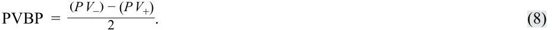
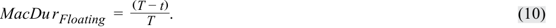
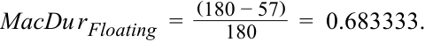

# Tập 6: Thu nhập Cố định (Fixed Income)
## Học phần 11: Các Thước đo và Đặc tính Thời lượng Trái phiếu Dựa trên Lợi suất (Yield-Based Bond Duration Measures and Properties)
### Phần 2/2: Thời lượng Tiền tệ và Giá trị Giá của một Điểm Cơ bản (Trang PDF 291–306)

---

<!-- PDF Page 291 -->

|**Kỳ (Period)**|**Thời gian nhận (Time to Receipt)**|**Dòng tiền (Cash Flow)**|**PV+**|**Kỳ (Period)**|**Thời gian nhận (Time to Receipt)**|**Dòng tiền (Cash Flow)**|**PV-**|
|---|---|---|---|---|---|---|---|
|3|2.744|4.625|4.120|3|2.744|4.625|4.131|
|4|3.744|4.625|3.950|4|3.744|4.625|3.965|
|5|4.744|4.625|3.788|5|4.744|4.625|3.805|
|…|…|…|…|…|…|…|…|
|29|28.744|4.625|1.379|29|28.744|4.625|1.417|
|30|29.744|104.625|29.907|30|29.744|104.625|30.773|
||||106.561||||108.307|

|**Trái phiếu Romania: Thời lượng Điều chỉnh Năm hóa Xấp xỉ (Approx. Ann. Modified Duration)**|Giá trị|
|---|---|
|PV0|107.429|
|PV+|106.561|
|PV-|108.307|
|Thời lượng điều chỉnh xấp xỉ (*Approx. ModDur*)|16.249|

6. Trong số ba trái phiếu này, hãy xác định trái phiếu nào có rủi ro lãi suất cao nhất và thấp nhất. Hãy giải thích câu trả lời của bạn. 

###### **Lời giải:** 

Trái phiếu Romania có rủi ro lãi suất cao nhất, được phản ánh qua thời lượng Macaulay và thời lượng điều chỉnh của trái phiếu này, cao gấp gần bốn lần so với trái phiếu BRWA. 

Trái phiếu Úc có rủi ro lãi suất thấp nhất, bởi vì thời lượng Macaulay và thời lượng điều chỉnh của nó chưa đến một phần tư so với trái phiếu BRWA. 

7. Nhà quản lý danh mục đầu tư của Chowdhury kỳ vọng lãi suất sẽ giảm từ mức hiện tại. Trong số ba trái phiếu này, trái phiếu nào _nhiều khả năng nhất_ sẽ có thành quả hoạt động tốt nhất trong môi trường đó, khi các yếu tố khác không đổi? Hãy giải thích câu trả lời của bạn. 

###### **Lời giải:** 

Trái phiếu Romania sẽ hoạt động tốt nhất. Việc lãi suất giảm sẽ làm tăng giá trái phiếu, trong đó những trái phiếu có rủi ro lãi suất hoặc thời lượng lớn nhất sẽ có mức tăng giá cao nhất. 

#### **THỜI LƯỢNG TIỀN TỆ VÀ GIÁ TRỊ GIÁ CỦA MỘT ĐIỂM CƠ BẢN (MONEY DURATION AND PRICE VALUE OF A BASIS POINT)** 

# **<mark>3</mark>** 

- định nghĩa, tính toán và diễn giải thời lượng điều chỉnh (*modified duration*), thời lượng tiền tệ (*money duration*), và giá trị giá của một điểm cơ bản (*price value of a basis point* – PVBP) 

<!-- PDF Page 292 -->

Thời lượng điều chỉnh được sử dụng để đo lường _phần trăm thay đổi giá_ của một trái phiếu khi có một sự thay đổi trong lợi suất đáo hạn của nó. Một số liệu thống kê có liên quan là **thời lượng tiền tệ (*money duration*)**. Thời lượng tiền tệ của một trái phiếu là thước đo mức thay đổi giá tính bằng _đơn vị tiền tệ_ (*currency units*). Thời lượng tiền tệ có thể được biểu thị trên mỗi 100 mệnh giá hoặc theo quy mô vị thế thực tế. Tại Hoa Kỳ, thời lượng tiền tệ thường được gọi là “thời lượng đô la” (*dollar duration*). 

Thời lượng tiền tệ ($\text{MoneyDur}$) là tích số của thời lượng điều chỉnh năm hóa và giá toàn phần ($PV^{\text{Full}}$) của trái phiếu, tính theo phần trăm mệnh giá hoặc giá trị tiền tệ của vị thế. 

$$\text{MoneyDur} = \text{AnnModDur} \times PV^{\text{Full}} \tag{6}$$

Mức thay đổi ước tính trong giá trái phiếu tính bằng đơn vị tiền tệ rất giống với Phương trình 4. Sự khác biệt là đối với một mức thay đổi nhất định trong lợi suất đáo hạn hàng năm ($\Delta \text{Yield}$), thời lượng điều chỉnh ước tính phần trăm thay đổi giá trong khi thời lượng tiền tệ ước tính mức thay đổi tính bằng đơn vị tiền tệ. 

$$\Delta PV^{\text{Full}} \approx -\text{MoneyDur} \times \Delta \text{Yield} \tag{7}$$

Trái phiếu trả coupon bán niên 3.2%, kỳ hạn 5 năm của BRWA, đáo hạn vào ngày 15 tháng 10 năm 2030, được định giá để đạt lợi suất 3.2%. Giả sử nó được một nhà đầu tư định chế mua với ngày thanh toán là 11 tháng 12 năm 2025, tức là đã qua 57 ngày trong kỳ coupon đầu tiên ($t / T = 57/180$). 

Giá toàn phần của trái phiếu là 100.504 trên mỗi 100 mệnh giá, và thời lượng điều chỉnh năm hóa là 4.43092. Giả sử nhà đầu tư nắm giữ một vị thế trái phiếu có mệnh giá là 100,000,000 USD. Do đó, 

- giá trị thị trường của khoản đầu tư là 100,503,921 USD, và 

- thời lượng tiền tệ của khoản đầu tư là 445,324,719 USD ($= 4.43092 \times \text{100,503,921 USD}$). 

Do đó, nếu lợi suất đáo hạn tăng 100 bps—từ 3.20% lên 4.20%—khoản lỗ kỳ vọng xấp xỉ bằng 4,453,247 USD ($= -\text{445,324,719 USD} \times 0.0100$). 

Một thước đo tương tự là **giá trị giá của một điểm cơ bản (*price value of a basis point* – PVBP)**, là ước tính mức thay đổi trong giá toàn phần của một trái phiếu khi lợi suất đáo hạn của nó thay đổi 1 bp. PVBP có thể được tính bằng một công thức giống như công thức xấp xỉ thời lượng điều chỉnh. Phương trình 8 là công thức tính PVBP. $PV_-$ và $PV_+$ là các mức giá toàn phần được tính bằng cách giảm và tăng lợi suất đáo hạn đi 1 bp. 

<!-- Formula Text: PVBP  = (P V −) − (P V +) ___________ 2 . (8) -->

$$\text{PVBP} = \frac{(PV_-) - (PV_+)}{2} \tag{8}$$

PVBP còn được gọi là “PV01”, viết tắt của “giá trị giá của một 01” (*price value of an 01*) hoặc “giá trị hiện tại của một 01” (*present value of an 01*), trong đó “01” có nghĩa là 1 bp. Tại Hoa Kỳ, nó thường được gọi là “DV01” viết tắt của “giá trị đô la” (*dollar value*) của 1 bp. PVBP đặc biệt hữu ích đối với những trái phiếu có dòng tiền tương lai không chắc chắn, chẳng hạn như trái phiếu có thể mua lại (*callable bonds*). Một số liệu thống kê liên quan được gọi là “giá trị điểm cơ bản” (*basis point value* – BPV) đơn giản là thời lượng tiền tệ nhân với 0.0001 (1 bp). 

Để có một ví dụ bằng số về phép tính PVBP, hãy xét lại trái phiếu trả coupon bán niên 3.2%, kỳ hạn 5 năm của BRWA, đáo hạn ngày 15 tháng 10 năm 2030 và được định giá để đạt lợi suất 3.2%, được nhà đầu tư định chế mua với ngày thanh toán là 11 tháng 12 năm 2025, tức là đã qua 57 ngày trong kỳ coupon đầu tiên ($t / T = 57/180$). 

<!-- PDF Page 293 -->

<!-- Formula Text: To determine the PVBP of this bond, calculate the new prices by increasing and decreasing the yield-to-maturity. First, increase the yield by 1 bp (0.01%), from 3.20% to 3.21%, to solve for a PV+ of 100.459400. P V +  =  [ 1.60 _ (1.01605) 1  + ... +   101.60 _ (1.01605) 10 ] × (1.01605) 57/180  =  100.459400. Then, decrease the yield-to-maturity by 1 bp, from 3.20% to 3.19%, to solve for a PV– of 100.548465. P V −  =  [ 1.60 _ (1.01595) 1  + ... +   101.60 _ (1.01595) 10 ] × (1.01595) 57/180  =  100.548465. The PVBP is obtained by substituting these results into Equation 8. PVBP  =   100.548465 − 100.459400 ___________________ 2 =  0.044532. -->

Để xác định PVBP của trái phiếu này, hãy tính các mức giá mới bằng cách tăng và giảm lợi suất đáo hạn. Đầu tiên, tăng lợi suất thêm 1 bp (0.01%), từ 3.20% lên 3.21%, để tìm ra $PV_+$ bằng 100.459400:

$$PV_+ = \left[ \frac{1.60}{(1.01605)^1} + \dots + \frac{101.60}{(1.01605)^{10}} \right] \times (1.01605)^{57/180} = 100.459400$$

Sau đó, giảm lợi suất đáo hạn đi 1 bp, từ 3.20% xuống 3.19%, để tìm ra $PV_-$ bằng 100.548465:

$$PV_- = \left[ \frac{1.60}{(1.01595)^1} + \dots + \frac{101.60}{(1.01595)^{10}} \right] \times (1.01595)^{57/180} = 100.548465$$

PVBP thu được bằng cách thay các kết quả này vào Phương trình 8:

$$\text{PVBP} = \frac{100.548465 - 100.459400}{2} = 0.044532$$

Bảng 3 cung cấp tóm tắt về các số liệu thống kê thời lượng lợi suất (*yield duration*) khác nhau. Để tóm tắt lại, chúng đo lường sự thay đổi tức thời trong giá của một trái phiếu đối với một sự thay đổi nhất định trong chính lợi suất đáo hạn của nó, giả định tất cả các biến số khác (đặc biệt là thời gian đáo hạn) không thay đổi và các dòng tiền cơ sở là chắc chắn. 

**Bảng 3: Tóm tắt Các Số liệu Thống kê Thời lượng Dựa trên Lợi suất (Exhibit 3: Summary of Yield-Based Duration Statistics)** 

|**Thước đo (Measure)**|**Cách tính (Calculation)**|**Công dụng (Use)**|
|---|---|---|
|**Thời lượng Macaulay (*Macaulay duration*)**|Thời gian trung bình để nhận các dòng tiền cam kết, có trọng số là tỷ trọng của giá toàn phần tương ứng với mỗi dòng tiền cam kết trong tương lai|Thời kỳ nắm giữ (*holding period*) giúp cân bằng rủi ro tái đầu tư và rủi ro giá cho nhà đầu tư|
|**Thời lượng điều chỉnh (*Modified duration*)**|Đạo hàm bậc nhất của giá theo lợi suất; Thời lượng Macaulay chia cho $1 + \text{lợi suất mỗi kỳ}$|Ước tính phần trăm thay đổi giá của một trái phiếu đối với một sự thay đổi trong lợi suất đáo hạn của nó|
|**Thời lượng tiền tệ (*Money duration*)**|Thời lượng điều chỉnh nhân với giá toàn phần của trái phiếu hoặc vị thế trái phiếu|Ước tính mức thay đổi giá trong khoản đầu tư trái phiếu đối với một mức thay đổi lợi suất nhất định|
|**Giá trị giá của một điểm cơ bản (*Price value of a basis point*)**|Chênh lệch giá khi lợi suất giảm 1 bp và tăng 1 bp, chia cho 2|Ước tính mức thay đổi trong giá trái phiếu khi lợi suất đáo hạn thay đổi 1 bp|

##### **Thời lượng Lợi suất của Trái phiếu Không trả lãi Định kỳ và Trái phiếu Vĩnh cửu (Yield Duration of Zero-Coupon and Perpetual Bonds)** 

Bởi vì trái phiếu không trả lãi định kỳ (*zero-coupon bonds*) chỉ có một khoản thanh toán duy nhất là mệnh giá khi đáo hạn, nên thời gian trung bình có trọng số giá trị hiện tại để nhận các dòng tiền cũng chính là thời gian đáo hạn vì dòng tiền duy nhất đó có trọng số giá trị hiện tại là 1.0. Do đó, thời lượng Macaulay của một trái phiếu không trả lãi định kỳ chính là thời gian đáo hạn của nó, và thời lượng điều chỉnh là thời gian đáo hạn chia cho 1 cộng với lợi suất của nó. 

Một công cụ nợ vĩnh cửu (*perpetuity*) hay trái phiếu vĩnh cửu (*perpetual bond*) là một trái phiếu không bao giờ đáo hạn, vì vậy không có mệnh giá hay giá trị đáo hạn nào được nhận tại thời điểm $T$. Nhà đầu tư nhận được một khoản thanh toán coupon cố định mãi mãi trừ khi trái phiếu bị mua lại. Các trái phiếu vĩnh cửu không thể mua lại (*non-callable perpetuities*) rất hiếm, nhưng chúng có một thời lượng Macaulay rất thú vị: 

$$\text{MacDur} = \frac{1 + r}{r}$$

<!-- PDF Page 294 -->

##### **Thời lượng của Trái phiếu và Khoản vay Lãi suất Thả nổi (Duration of Floating-Rate Notes and Loans)** 

Như đã mô tả trong một bài học trước, tiền lãi trên các công cụ lãi suất thả nổi thay đổi tùy thuộc vào mức lãi suất tham chiếu thị trường (*market reference rate* – MRR) cộng với một biên độ niêm yết (*quoted margin*). Vào các ngày đã định trước, số tiền thanh toán được đặt lại (*reset*) để phản ánh những thay đổi trong MRR. Do đó, rủi ro lãi suất chỉ phát sinh _giữa_ các ngày đặt lại lãi suất, bởi vì vào ngày đặt lại tiếp theo, các khoản thanh toán coupon sẽ điều chỉnh theo mức MRR mới. Vì vậy, thời lượng Macaulay đối với một trái phiếu hoặc kỳ phiếu lãi suất thả nổi đơn giản là phần kỳ hạn còn lại cho đến ngày đặt lại lãi suất tiếp theo: 

<!-- Formula Text: MacDu r Floating  =   (T − t) _ T  . (10) -->

$$\text{MacDur}_{\text{Floating}} = \frac{(T - t)}{T} \tag{10}$$

Nếu có 180 ngày trong kỳ coupon và 57 ngày đã trôi qua kể từ lần trả coupon gần nhất, thời lượng Macaulay là 

<!-- Formula Text: MacDu r Floating  =   (180 − 57) _ 180 =  0.683333. -->

$$\text{MacDur}_{\text{Floating}} = \frac{(180 - 57)}{180} = 0.683333$$

Các công cụ lãi suất thả nổi thường có thời lượng rất thấp bởi vì các kỳ coupon thường ngắn hơn sáu tháng. Do đó, chúng thường được các nhà đầu tư sử dụng để giảm thời lượng trong các danh mục đầu tư thu nhập cố định. 

###### **KIỂM TRA KIẾN THỨC (KNOWLEDGE CHECK)** 

Một chuyên viên phân tích đang so sánh rủi ro lãi suất của trái phiếu BRWA 3.2% đáo hạn ngày 15 tháng 10 năm 2030 với một trái phiếu lãi suất thả nổi (*floating-rate note* – FRN) cũng đáo hạn ngày 15 tháng 10 năm 2030 và có lãi suất coupon được đặt lại mỗi nửa năm. 

Tại lần đặt lại gần nhất, ngày 15 tháng 10 năm 2027, lãi suất coupon của FRN là 3.2%. Trái phiếu BRWA được định giá để đạt lợi suất 3.2% vào cùng ngày đó. 

1. Tại sao bạn lại kỳ vọng FRN có thời lượng thấp hơn trái phiếu lãi suất cố định BRWA? 

###### **Lời giải:** 

Một công cụ lãi suất thả nổi có thời lượng Macaulay phản ánh thời gian cho đến ngày đặt lại coupon tiếp theo, trong khi một công cụ lãi suất cố định có thời lượng Macaulay chủ yếu phản ánh thời gian đáo hạn nhưng cũng phụ thuộc vào lãi suất coupon, lợi suất và phần kỳ coupon đã trôi qua. Thời lượng Macaulay tối đa mà FRN có thể có là sáu tháng, trong khi trái phiếu BRWA có thời lượng Macaulay thấp hơn một chút so với kỳ hạn của nó (5 năm). 

2. Hoàn thành bảng sau: 

|Ngày|**Thời lượng Macaulay (BRWA)**|**Thời lượng Macaulay (FRN)**|
|---|---|---|
|15-Th10-2027|||
|15-Th11-2027|||
|15-Th12-2027|||
|15-Th1-2028|||
|15-Th2-2028|||
|15-Th3-2028|||
|15-Th4-2028|||

**Lời giải:** 

<!-- PDF Page 295 -->

|Ngày|**Thời lượng Macaulay (BRWA)**|**Thời lượng Macaulay (FRN)**|
|---|---|---|
|15-Th10-2027|2.8843|0.0000|
|15-Th11-2027|2.8002|0.8306|
|15-Th12-2027|2.7169|0.6667|
|15-Th1-2028|2.6336|0.4973|
|15-Th2-2028|2.5502|0.3279|
|15-Th3-2028|2.4669|0.1694|
|15-Th4-2028|2.4221|0.0000|

Ví dụ, đối với ngày 15 tháng 12 năm 2027, số ngày đã qua kể từ kỳ trả coupon trước là 61 ngày. Số ngày trong kỳ coupon là 183, được tính bằng Microsoft Excel hoặc Google Sheets như sau: 

- `= COUPDAYS(DATE(2027,12,15),DATE(2028,4,15),2,1)`. 

Do đó, thời lượng Macaulay là $(183 - 61) \div 183 = 0.6667$. 

###### **BỘ CÂU HỎI (QUESTION SET)** 

Deepak Chowdhury đang đánh giá một khoản đầu tư trị giá 30 triệu USD tính theo mệnh giá vào các trái phiếu BRWA, Úc và Romania. Giả sử tất cả các trái phiếu đều được định danh bằng cùng một đồng tiền và cả ba trái phiếu đều được phát hành vào ngày 15 tháng 10 năm 2025. 

Chowdhury đang đánh giá các trái phiếu vào ngày 15 tháng 1 năm 2026, tức là đã qua 92 ngày trong kỳ coupon đầu tiên. Chowdhury đã tổng hợp dữ liệu sau. 

|**Đặc điểm (Characteristic)**|**BRWA**|**Úc (Australian)**|**Romania (Romanian)**|
|---|---|---|---|
|Lãi suất coupon (*Coupon*)|3.200%|0.000%|4.625%|
|Tần suất trả coupon (*Coupon frequency*)|2|1|1|
|Lợi suất đáo hạn (*Yield-to-maturity*)|3.200%|1.000%|4.250%|
|Ngày đáo hạn (*Maturity*)|15 Tháng 10, 2030|15 Tháng 10, 2026|15 Tháng 10, 2055|
|Giá toàn phần (*Full price*)|100.815|99.262|107.429|
|Thời lượng Macaulay năm hóa (*Ann. Macaulay duration*)|4.405|0.744|16.939|
|Thời lượng điều chỉnh năm hóa (*Ann. modified duration*)|4.335|0.737|16.248|

Là một phần trong phân tích của mình, Chowdhury đang đánh giá mức thay đổi tiềm năng trong giá của các khoản đầu tư trái phiếu đối với các mức thay đổi 1 bp và 100 bp trong lợi suất. 

1. Hoàn thành bảng sau: 

|**Tác động lên khoản đầu tư 30 triệu USD (Effect on a USD30 million investment)**|**BRWA**|**Úc (Australian)**|**Romania (Romanian)**|
|---|---|---|---|
|Giá trị giá trên mỗi điểm cơ bản (*Price value per basis point*)||||
|Giá trị thị trường của khoản đầu tư (USD) (*Market value of investment*)||||

<!-- PDF Page 296 -->

|**Tác động lên khoản đầu tư 30 triệu USD (Effect on a USD30 million investment)**|**BRWA**|**Úc (Australian)**|**Romania (Romanian)**|
|---|---|---|---|
|Thời lượng tiền tệ (phần trăm mệnh giá) (*Money duration - percent of par*)||||
|Khoản lỗ kỳ vọng khi YTM tăng 100 bp (USD) (*Expected loss from a 100 bp YTM increase*)||||

###### **Lời giải:** 

|**Tác động lên khoản đầu tư 30 triệu USD (Effect on a USD30 million investment)**|**BRWA**|**Úc (Australia)**|**Romania**|
|---|---|---|---|
|Giá trị giá trên mỗi điểm cơ bản (*Price value per basis point*)|0.044|0.007|0.175|
|Giá trị thị trường của khoản đầu tư (USD) (*Market value of investment*)|30,244,381|29,778,597|32,228,627|
|Thời lượng tiền tệ (phần trăm mệnh giá) (*Money duration - percent of par*)|437.054|73.163|1745.518|
|Khoản lỗ kỳ vọng khi YTM tăng 100 bp (USD) (*Expected loss from a 100 bp YTM increase*)|–1,311,163|–219,490|–5,236,553|

Các phép tính được trình bày dưới dạng bảng. Vui lòng tham khảo hệ sinh thái học tập dành cho ứng viên trực tuyến để xem bảng tính trong sổ làm việc Microsoft Excel có thể tải xuống. Lưu ý rằng mặc dù các lời giải được làm tròn đến ba chữ số thập phân, các đại lượng khác không được làm tròn khi tính toán mà chỉ hiển thị đến ba chữ số thập phân cho mục đích trình bày. 

**Trái phiếu BRWA: Giá toàn phần, giả sử YTM tăng 1 bp** (`YTM (periodic) = 0.01605`) | **Trái phiếu BRWA: Giá toàn phần, giả sử YTM giảm 1 bp** (`YTM (periodic) = 0.01595`)

|**Kỳ (Period)**|**Thời gian nhận (Time to Receipt)**|**Dòng tiền (Cash Flow)**|**PV+**|**Kỳ (Period)**|**Thời gian nhận (Time to Receipt)**|**Dòng tiền (Cash Flow)**|**PV-**|
|---|---|---|---|---|---|---|---|
|1|0.489|1.600|1.588|1|0.489|1.600|1.588|
|2|1.489|1.600|1.563|2|1.489|1.600|1.563|
|3|2.489|1.600|1.538|3|2.489|1.600|1.538|
|4|3.489|1.600|1.514|4|3.489|1.600|1.514|
|5|4.489|1.600|1.490|5|4.489|1.600|1.490|
|6|5.489|1.600|1.466|6|5.489|1.600|1.467|
|7|6.489|1.600|1.443|7|6.489|1.600|1.444|
|8|7.489|1.600|1.420|8|7.489|1.600|1.421|
|9|8.489|1.600|1.398|9|8.489|1.600|1.399|
|10|9.489|101.600|87.353|10|9.489|101.600|87.435|
||||100.771||||100.858|

|**Trái phiếu BRWA (BRWA Bond)**|Giá trị|Chỉ tiêu|Giá trị|
|---|---|---|---|
|PV+|100.771|Giá toàn phần (*Full price*)|100.815|
|PV-|100.858|Mệnh giá (*Par*)|30,000,000|
|PVBP|0.044|Giá trị thị trường (*Market value*)|30,244,381|
|AnnModDur|4.335|MoneyDur|437.054|

<!-- PDF Page 297 -->

|**Trái phiếu BRWA (BRWA Bond)**|Giá trị|Chỉ tiêu|Giá trị|
|---|---|---|---|
|Giá toàn phần (*Full price*)|100.815|MV|30,244,381|
|MoneyDur|437.054|Thay đổi lợi suất (*ChgYield*)|0.01|
|||Khoản lỗ kỳ vọng (*Exp. Loss*)|(1,311,163)|

**Trái phiếu Úc: Giá toàn phần, giả sử YTM tăng 1 bp** (`YTM (periodic) = 0.0101`) | **Trái phiếu Úc: Giá toàn phần, giả sử YTM giảm 1 bp** (`YTM (periodic) = 0.0099`)

|**Kỳ (Period)**|**Thời gian nhận (Time to Receipt)**|**Dòng tiền (Cash Flow)**|**PV+**|**Kỳ (Period)**|**Thời gian nhận (Time to Receipt)**|**Dòng tiền (Cash Flow)**|**PV-**|
|---|---|---|---|---|---|---|---|
|1|0.744|100.000|99.255|1|0.744|100.000|99.269|
||||99.255||||99.269|

###### **Trái phiếu Úc (Australian Bond)** 

|Chỉ tiêu|Giá trị|Chỉ tiêu|Giá trị|
|---|---|---|---|
|PV+|99.255|Giá toàn phần (*Full price*)|99.262|
|PV-|99.269|Mệnh giá (*Par*)|30,000,000|
|PVBP|0.007|Giá trị thị trường (*Market value*)|29,778,597|
|AnnModDur|0.737|MoneyDur|73.163|
|Giá toàn phần (*Full price*)|99.262|MV|29,778,597|
|MoneyDur|73.163|Thay đổi lợi suất (*ChgYield*)|0.01|
|||Khoản lỗ kỳ vọng (*Exp. Loss*)|(219,490)|

**Trái phiếu Romania: Giá toàn phần, giả sử YTM tăng 1 bp** (`YTM (periodic) = 0.0426`) | **Trái phiếu Romania: Giá toàn phần, giả sử YTM giảm 1 bp** (`YTM (periodic) = 0.0424`)

|**Kỳ (Period)**|**Thời gian nhận (Time to Receipt)**|**Dòng tiền (Cash Flow)**|**PV+**|**Kỳ (Period)**|**Thời gian nhận (Time to Receipt)**|**Dòng tiền (Cash Flow)**|**PV-**|
|---|---|---|---|---|---|---|---|
|1|0.744|4.625|4.484|1|0.744|4.625|4.484|
|2|1.744|4.625|4.300|2|1.744|4.625|4.302|
|3|2.744|4.625|4.125|3|2.744|4.625|4.127|
|4|3.744|4.625|3.956|4|3.744|4.625|3.959|
|5|4.744|4.625|3.794|5|4.744|4.625|3.798|
|…|…|…|…|…|…|…|…|
|29|28.744|4.625|1.394|29|28.744|4.625|1.402|
|30|29.744|104.625|30.251|30|29.744|104.625|30.424|
||||107.254||||107.604|

<!-- PDF Page 298 -->

<!-- Picture Text: Romanian Bond PV+ 107.254 Full price 107.429 PV- 107.604 Par 30,000,000 PVBP 0.175 MV 32,228,627 AnnModDur 16.248 MoneyDur 1745.518 Full price 107.429 MV 32,228,627 MoneyDur 1745.518 ChgYield 0.01 Exp. Loss (5,236,553)  -->

> **Chú thích hình ảnh – Trái phiếu Romania (Romanian Bond):**
>
> | Chỉ tiêu | Giá trị | Chỉ tiêu | Giá trị |
> |---|---|---|---|
> | PV+ | 107.254 | Giá toàn phần (*Full price*) | 107.429 |
> | PV- | 107.604 | Mệnh giá (*Par*) | 30,000,000 |
> | PVBP | 0.175 | MV | 32,228,627 |
> | AnnModDur | 16.248 | MoneyDur | 1745.518 |
> | Giá toàn phần (*Full price*) | 107.429 | MV | 32,228,627 |
> | MoneyDur | 1745.518 | Thay đổi lợi suất (*ChgYield*) | 0.01 |
> | | | Khoản lỗ kỳ vọng (*Exp. Loss*) | (5,236,553) |

2. Nếu khách hàng tin rằng lãi suất sẽ tăng trong tương lai, với tất cả các yếu tố khác không đổi, khoản đầu tư trái phiếu nào _nhiều khả năng nhất_ sẽ hoạt động tốt nhất?

###### **Lời giải:** 

Trái phiếu Úc sẽ hoạt động tốt nhất. Vì nó có thời lượng và PVBP thấp nhất, khoản lỗ kỳ vọng đối với khoản đầu tư khi lợi suất tăng sẽ thấp hơn so với trái phiếu BRWA và Romania. Khoản lỗ kỳ vọng khi lợi suất tăng 100 bp đối với trái phiếu BRWA, chẳng hạn, gần gấp sáu lần so với trái phiếu Úc (219,490 USD so với 1.3 triệu USD). 

# **<mark>4</mark>** 

#### **CÁC ĐẶC TÍNH CỦA THỜI LƯỢNG (PROPERTIES OF DURATION)** 

- giải thích cách thức kỳ hạn (*maturity*), lãi suất coupon (*coupon*) và mức lợi suất (*yield level*) của trái phiếu ảnh hưởng đến rủi ro lãi suất (*interest rate risk*) của nó 

Các số liệu thống kê thời lượng lợi suất Macaulay và điều chỉnh đối với một trái phiếu lãi suất cố định truyền thống chủ yếu là các hàm số phụ thuộc vào các đặc điểm của trái phiếu: thời gian đáo hạn (*time-to-maturity*), lãi suất coupon (*coupon rate*), lợi suất đáo hạn (*yield-to-maturity*), và phần kỳ coupon hiện tại đã trôi qua (*fraction of the current coupon period that has elapsed*). Công thức dạng đóng (*closed-form formula*) cho thời lượng Macaulay, đã được trình bày trong một bài học trước và nhắc lại tại đây, rất hữu ích trong việc chứng minh các đặc điểm của thời lượng (các đặc điểm tương tự cũng đúng đối với thời lượng điều chỉnh, thời lượng tiền tệ và giá trị giá của một điểm cơ bản). 

<!-- Formula Text: MacDur  =  { 1 + r _ r   − 1 + r + [N × (c − r)] _______________ c × [(1 + r) N − 1] + r } −  t _ T -->

$$\text{MacDur} = \left\{ \frac{1 + r}{r} - \frac{1 + r + [N \times (c - r)]}{c \times [(1 + r)^N - 1] + r} \right\} - \frac{t}{T}$$

Mối quan hệ giữa thời lượng của trái phiếu và các đặc điểm của nó ($r$, $c$, $N$, và $t / T$) được tóm tắt trong Bảng 4. 

**Bảng 4: Các Đặc tính của Số liệu Thống kê Thời lượng Lợi suất (Exhibit 4: Properties of Yield Duration Statistics)** 

|Đặc điểm|**Tác động lên thời lượng (rủi ro lãi suất) từ sự _gia tăng_ của đặc điểm (Effect on duration from an _increase_ in feature)**|
|---|---|
|Lãi suất coupon (*Coupon rate*), $c$|$\downarrow$ (Mối quan hệ nghịch biến – *Inverse relationship*)|
|Lợi suất đáo hạn (*Yield to maturity*), $r$|$\downarrow$ (Mối quan hệ nghịch biến – *Inverse relationship*)|

<!-- PDF Page 299 -->

|Đặc điểm|**Tác động lên thời lượng (rủi ro lãi suất) từ sự _gia tăng_ của đặc điểm (Effect on duration from an _increase_ in feature)**|
|---|---|
|Thời gian đáo hạn (*Time-to-maturity*), $T$|$\uparrow$ (Mối quan hệ đồng biến – *Direct relationship*)|
|Phần kỳ coupon hiện tại đã trôi qua (*Fraction of current coupon period that has elapsed*), $t/T$|$\downarrow$ (Mối quan hệ nghịch biến – *Inverse relationship*)|

Bảng 5 minh họa mối quan hệ giữa thời lượng Macaulay và thời gian đáo hạn đối với trái phiếu có giá cao hơn mệnh giá (*premium*), trái phiếu chiết khấu (*discount*), trái phiếu không trả lãi định kỳ (*zero-coupon*), và trái phiếu vĩnh cửu (*perpetual*) (các đặc điểm tương tự cũng đúng đối với thời lượng điều chỉnh, thời lượng tiền tệ và giá trị giá của một điểm cơ bản). 

**Bảng 5: Các Đặc tính của Thời lượng Macaulay (Exhibit 5: Properties of Macaulay Duration)** 

<!-- Picture Text: Time-to-maturity Premium bond Discount bond Zero-coupon Perpetuity Macaulay duration  -->

> **Chú thích hình ảnh:**
> - **Trục tung:** Thời lượng Macaulay (*Macaulay duration*).
> - **Trục hoành:** Thời gian đáo hạn (*Time-to-maturity*).
> - **Các đường biểu diễn:** Trái phiếu không trả lãi định kỳ (*Zero-coupon* – đường thẳng chéo góc $45^\circ$), Trái phiếu vĩnh cửu (*Perpetuity* – đường tiệm cận ngang tại $(1 + r)/r$), Trái phiếu có giá cao hơn mệnh giá (*Premium bond* – tăng dần và tiệm cận mức $(1 + r)/r$ từ phía dưới), và Trái phiếu chiết khấu (*Discount bond* – vượt qua mức $(1 + r)/r$, đạt cực đại rồi giảm dần về đường tiệm cận $(1 + r)/r$).

Khi các yếu tố khác không đổi (*all else being equal*), 

- _trái phiếu có lãi suất coupon thấp hơn sẽ có thời lượng cao hơn và rủi ro lãi suất lớn hơn so với trái phiếu có lãi suất coupon cao hơn._ 

Mô hình tương tự cũng đúng đối với lợi suất đáo hạn, do đó, 

- _lợi suất đáo hạn thấp hơn làm tăng mức trung bình có trọng số của thời gian nhận dòng tiền và do đó làm tăng thời lượng_. 

Lý do là lãi suất coupon thấp hơn và lợi suất thấp hơn làm tăng trọng số của giá trị đáo hạn hay dòng tiền cuối cùng và làm giảm trọng số của các dòng tiền ngắn hạn hơn trong giá trái phiếu. 

- _Thời gian đáo hạn dài hơn thường tương ứng với thời lượng cao hơn_. 

Mô hình này luôn đúng đối với các trái phiếu giao dịch ngang mệnh giá (*at par*) hoặc cao hơn mệnh giá (*at a premium*). Trong công thức dạng đóng, biểu thức thứ hai trong ngoặc nhọn mang dấu dương đối với trái phiếu có giá cao hơn mệnh giá và ngang mệnh giá, bởi vì lãi suất coupon ($c$) lớn hơn hoặc bằng lợi suất đáo hạn ($r$), nên $(c - r) \ge 0$, trong khi mẫu số luôn dương. Do đó, thời lượng Macaulay luôn nhỏ hơn $(1 + r)/r$, và nó tiệm cận ngưỡng đó từ phía dưới khi thời gian đáo hạn tăng lên. 

Một kết quả khá thú vị được minh họa trong Bảng 5 đối với _trái phiếu chiết khấu_ (*discount bonds*): tại một thời điểm nào đó, khi thời gian đáo hạn đủ dài, thời lượng Macaulay sẽ vượt quá $(1 + r)/r$, đạt mức tối đa, và sau đó giảm xuống. Mô hình này xuất hiện khi số kỳ ($N$) lớn và lãi suất coupon thấp hơn lợi suất đáo hạn, tức là $(c - r) < 0$. Khi đó, tử số của biểu thức thứ hai trong ngoặc nhọn có thể trở thành số âm. Hàm ý ở đây là đối với các trái phiếu kỳ hạn dài giao dịch ở mức chiết khấu so với mệnh giá, rủi ro lãi suất có thể thấp hơn so với một trái phiếu có kỳ hạn ngắn hơn. 

<!-- PDF Page 300 -->

Với mức lợi suất đáo hạn ($r$) không đổi, biểu thức trong ngoặc nhọn của công thức dạng đóng không thay đổi khi thời gian trôi qua _trong kỳ_. Do đó, thời lượng Macaulay giảm dần một cách trơn tru khi thời gian trôi qua và sau đó bật tăng lên sau khi khoản coupon được thanh toán, tạo ra hình dạng “răng cưa” (*saw-tooth pattern*). Mô hình này đối với trái phiếu BRWA có lợi suất đáo hạn không đổi được minh họa trong Bảng 6. Khi thời gian trôi qua, thời lượng Macaulay giảm dần một cách trơn tru nhưng bật tăng lên một lượng nhỏ vào các ngày trả coupon. 

**Bảng 6: Thời lượng Macaulay giữa Các Kỳ Thanh toán Coupon với Lợi suất Đáo hạn Không đổi đối với Trái phiếu BRWA 3.2% (Exhibit 6: Macaulay Duration between Coupon Payments with Constant Yield-to-Maturity for the BRWA 3.2% Bond)** 

<!-- Picture Text: 4.900 4.700 4.500 4.300 4.100 3.900 3.700 3.500 Date of measurement Macaulay duration 10/15/2025 11/5/2025 11/26/2025 12/17/2025 1/7/2026 1/28/2026 2/18/2026 3/11/2026 4/1/2026 4/22/2026 5/13/2026 6/3/2026 6/24/2026 7/15/2026 8/5/2026 8/26/2026 9/16/2026 10/7/2026 10/28/2026 11/18/2026 12/9/2026 12/30/2026 1/20/2027 2/10/2027  -->

> **Chú thích hình ảnh:**
> - **Trục tung:** Thời lượng Macaulay (*Macaulay duration*) từ 3.500 đến 4.900.
> - **Trục hoành:** Ngày đo lường (*Date of measurement*) từ 10/15/2025 đến 2/10/2027, thể hiện hình răng cưa giảm dần rồi nhảy bậc nhẹ tại các ngày trả coupon bán niên (15/04/2026 và 15/10/2026).

###### **BỘ CÂU HỎI (QUESTION SET)** 

1. Đối với mỗi cặp trái phiếu, hãy chỉ ra trái phiếu nào _nhiều khả năng nhất_ có rủi ro lãi suất lớn hơn: 

|**Trái phiếu thứ nhất (First bond)**|**Trái phiếu thứ hai (Second bond)**|**Trái phiếu nào có rủi ro lãi suất lớn hơn? (Which has greater interest rate risk?)**|
|---|---|---|
|Coupon 4%, trả bán niên, và 5 năm đến khi đáo hạn, được định giá để đạt lợi suất 6%|Coupon 5%, trả bán niên, và 5 năm đến khi đáo hạn, được định giá để đạt lợi suất 6%||
|Coupon 4%, trả bán niên, và 5 năm đến khi đáo hạn, được định giá để đạt lợi suất 6%|Coupon 4%, trả bán niên, và 6 năm đến khi đáo hạn, được định giá để đạt lợi suất 6%||
|Coupon 4%, trả bán niên, và 5 năm đến khi đáo hạn, được định giá để đạt lợi suất 6%|Coupon 5%, trả bán niên, và 5 năm đến khi đáo hạn, được định giá để đạt lợi suất 8%||
|Coupon 4%, trả bán niên, và 5 năm đến khi đáo hạn, được định giá để đạt lợi suất 6%|Coupon 4%, trả bán niên, và 5 năm đến khi đáo hạn, được định giá để đạt lợi suất 8%||

**Lời giải:** 

<!-- PDF Page 301 -->

|**Trái phiếu thứ nhất (First bond)**|**Trái phiếu thứ hai (Second bond)**|**Trái phiếu nào có rủi ro lãi suất lớn hơn? (Which has greater interest rate risk?)**|
|---|---|---|
|Coupon 4%, trả bán niên, và 5 năm đến khi đáo hạn, được định giá để đạt lợi suất 6%|Coupon 5%, trả bán niên, và 5 năm đến khi đáo hạn, được định giá để đạt lợi suất 6%|Trái phiếu thứ nhất (*First bond*)|
|Coupon 4%, trả bán niên, và 5 năm đến khi đáo hạn, được định giá để đạt lợi suất 6%|Coupon 4%, trả bán niên, và 6 năm đến khi đáo hạn, được định giá để đạt lợi suất 6%|Trái phiếu thứ hai (*Second bond*)|
|Coupon 4%, trả bán niên, và 5 năm đến khi đáo hạn, được định giá để đạt lợi suất 6%|Coupon 5%, trả bán niên, và 5 năm đến khi đáo hạn, được định giá để đạt lợi suất 8%|Trái phiếu thứ nhất (*First bond*)|
|Coupon 4%, trả bán niên, và 5 năm đến khi đáo hạn, được định giá để đạt lợi suất 6%|Coupon 4%, trả bán niên, và 5 năm đến khi đáo hạn, được định giá để đạt lợi suất 8%|Trái phiếu thứ nhất (*First bond*)|

2. Một chuyên viên phân tích trái phiếu đang so sánh Trái phiếu D, một trái phiếu vĩnh cửu có lãi suất coupon 5%, với Trái phiếu E, một trái phiếu không trả lãi định kỳ đáo hạn sau 5 năm. Nếu cả hai trái phiếu đều được định giá để đạt lợi suất 6%, Trái phiếu D có: 

   - **A.** rủi ro lãi suất thấp hơn. 

   - **B.** rủi ro lãi suất bằng nhau. 

   - **C.** rủi ro lãi suất cao hơn. 

   - **Lời giải:** 

C là đáp án đúng. Thời lượng Macaulay đối với Trái phiếu D là $1.06/0.06 = 17.667$. Thời lượng Macaulay đối với Trái phiếu E là 5 năm. Trái phiếu vĩnh cửu, Trái phiếu D, có rủi ro lãi suất cao hơn. 

3. Đồ thị dưới đây mô tả mối quan hệ giá – lợi suất cho ba trái phiếu: Trái phiếu X, Trái phiếu Y và Trái phiếu Z. Cả ba trái phiếu đều có cùng mức lãi suất coupon là 5%. 

<!-- Picture Text: 200 180 160 140 120 100 80 60 40 20 0 1.0% 2.0% 3.0% 4.0% 5.0% 6.0% 7.0% 8.0% 9.0% 10.0% Yield-to-maturity Bond X Bond Z Bond Y Price  -->

> **Chú thích hình ảnh:**
> - **Trục tung:** Giá (*Price*) từ 0 đến 200.
> - **Trục hoành:** Lợi suất đáo hạn (*Yield-to-maturity*) từ 1.0% đến 10.0%.
> - **Các đường biểu diễn:** Trái phiếu Y (*Bond Y* – dốc nhất), Trái phiếu Z (*Bond Z* – độ dốc trung bình), và Trái phiếu X (*Bond X* – thoải nhất); cả ba đường cắt nhau tại mức giá 100 khi lợi suất bằng 5.0%.

Trong số ba trái phiếu, trái phiếu nào _nhiều khả năng nhất_ có thời gian đáo hạn dài nhất? 

   - **A.** Trái phiếu X 

   - **B.** Trái phiếu Y 

<!-- PDF Page 302 -->

   - **C.** Trái phiếu Z

   - **Lời giải:** 

B là đáp án đúng. Trái phiếu Y có đường giá – lợi suất dốc nhất, cho thấy nó có thời lượng điều chỉnh lớn nhất và nhiều khả năng nhất là có thời gian đáo hạn dài nhất. 

4. Giữa các kỳ thanh toán coupon, nếu lợi suất đáo hạn không thay đổi, thời lượng Macaulay của một trái phiếu: 

   - **A.** giảm trong suốt kỳ coupon. 

   - **B.** không đổi trong suốt kỳ coupon. 

   - **C.** tăng trong suốt kỳ coupon. 

   - **Lời giải:** 

A là đáp án đúng. Trong suốt kỳ coupon, thời lượng Macaulay giảm dần một cách trơn tru cho đến kỳ coupon tiếp theo, tại thời điểm đó nó sẽ bật tăng lên. Điều này được minh họa trong Bảng 6. 

5. Hai trái phiếu có cùng thời gian đáo hạn và lợi suất đáo hạn, nhưng một trái phiếu đang giao dịch ở mức giá cao hơn mệnh giá (*at a premium to par*) và trái phiếu kia giao dịch ở mức giá chiết khấu (*at a discount*). Thời lượng Macaulay của trái phiếu có giá cao hơn mệnh giá _nhiều khả năng nhất_ là _________ so với thời lượng Macaulay của trái phiếu chiết khấu. 

   - **A.** thấp hơn 

   - **B.** bằng với 

   - **C.** cao hơn 

   - **Lời giải:** 

A là đáp án đúng. Nếu hai trái phiếu có cùng kỳ hạn và cùng lợi suất đáo hạn nhưng một trái phiếu giao dịch ở mức giá cao hơn mệnh giá và một trái phiếu giao dịch ở mức chiết khấu so với mệnh giá, thì trái phiếu có giá cao hơn mệnh giá phải có lãi suất coupon cao hơn. Do đó, trái phiếu có giá cao hơn mệnh giá sẽ có thời lượng Macaulay thấp hơn. 

<!-- PDF Page 303 -->

## **BÀI TẬP THỰC HÀNH (PRACTICE PROBLEMS)** 

**1.** _Đúng hay sai:_ Thời lượng đường cong (*Curve duration*) là một loại thời lượng lợi suất (*yield duration*). 

   - **A.** Đúng (*True*) 

   - **B.** Sai (*False*) 

### **Thông tin sau đây liên quan đến các câu hỏi 2–7** 

Một nhà quản lý danh mục đầu tư đang đánh giá rủi ro lãi suất của ba trái phiếu khi cô cân nhắc thực hiện một khoản đầu tư trị giá 50 triệu USD. Cả ba trái phiếu đều được phát hành vào ngày 1 tháng 6 năm 2026 và đáo hạn vào ngày 1 tháng 6 năm 2030, và chúng có các đặc điểm sau: 

|**Đặc điểm (Characteristic)**|**Trái phiếu Một (Bond One)**|**Trái phiếu Hai (Bond Two)**|**Trái phiếu Ba (Bond Three)**|
|---|---|---|---|
|Lãi suất coupon (bán niên) (*Coupon - semiannual*)|7%|3%|5%|
|Lợi suất đáo hạn (*Yield-to-maturity*)|3%|7%|5%|

**2.** Thời lượng Macaulay, tính bằng năm, đối với Trái phiếu Một _gần nhất_ với: 

   - **A.** 3.54. 

   - **B.** 3.59. 

   - **C.** 3.78. 

**3.** Thời lượng điều chỉnh đối với Trái phiếu Hai _gần nhất_ với: 

   - **A.** 3.59. 

   - **B.** 3.65. 

   - **C.** 3.78. 

**4.** So với một trái phiếu không trả lãi định kỳ kỳ hạn 5 năm được định giá để đạt lợi suất 5%, Trái phiếu Ba có thời lượng điều chỉnh được mô tả _đúng nhất_ là: 

   - **A.** thấp hơn thời lượng điều chỉnh của trái phiếu không trả lãi định kỳ. 

   - **B.** bằng với thời lượng điều chỉnh của trái phiếu không trả lãi định kỳ. 

   - **C.** lớn hơn thời lượng điều chỉnh của trái phiếu không trả lãi định kỳ. 

**5.** Nếu lợi suất đáo hạn của cả ba trái phiếu đều tăng 100 bps, trái phiếu nào có mức giảm giá dự kiến lớn nhất? 

   - **A.** Trái phiếu Một (*Bond One*) 

   - **B.** Trái phiếu Hai (*Bond Two*) 

   - **C.** Trái phiếu Ba (*Bond Three*) 

<!-- PDF Page 304 -->

**6.** Trái phiếu nào có giá trị giá của một điểm cơ bản (*price value of a basis point* – PVBP) cao nhất? 

   - **A.** Trái phiếu Một (*Bond One*) 

   - **B.** Trái phiếu Hai (*Bond Two*) 

   - **C.** Trái phiếu Ba (*Bond Three*) 

**7.** Nhà quản lý danh mục đầu tư quan tâm đến việc so sánh rủi ro lãi suất của Trái phiếu Ba với rủi ro lãi suất của Trái phiếu Bốn, một trái phiếu lãi suất thả nổi được đặt lại lãi suất mỗi sáu tháng. Vào ngày 1 tháng 6 năm 2026, cả hai trái phiếu đều được định giá để đạt lợi suất 5%. Nếu lợi suất thay đổi từ 5% lên 5.25% vào giữa kỳ coupon đầu tiên, trái phiếu nào có thời lượng Macaulay lớn hơn? 

   - **A.** Trái phiếu Ba (*Bond Three*) 

   - **B.** Trái phiếu Bốn (*Bond Four*) 

   - **C.** Không trái phiếu nào: Thời lượng Macaulay của cả hai trái phiếu là như nhau. 

<!-- PDF Page 305 -->

## **LỜI GIẢI (SOLUTIONS)** 

1. B là đáp án đúng. Các thước đo thời lượng Macaulay, thời lượng điều chỉnh và thời lượng tiền tệ, cũng như giá trị giá của một điểm cơ bản, đều là các loại thời lượng lợi suất (*yield duration*). Thời lượng đường cong (*curve duration*) không được phân loại là một dạng thời lượng lợi suất. 

###### 2. B là đáp án đúng. 

|**Kỳ (Period)**|**Thời gian nhận (Time to receipt)**|**Dòng tiền (Cash flow)**|**Giá trị hiện tại (Present value)**|**Trọng số (Weight)**|**Thời gian nhận × trọng số (Time to receipt × weight)**|
|---|---|---|---|---|---|
|1|1.0000|3.5|3.44828|0.02999|0.02999|
|2|2.0000|3.5|3.39732|0.02955|0.05910|
|3|3.0000|3.5|3.34711|0.02911|0.08734|
|4|4.0000|3.5|3.29764|0.02868|0.11473|
|5|5.0000|3.5|3.24891|0.02826|0.14129|
|6|6.0000|3.5|3.20090|0.02784|0.16704|
|7|7.0000|3.5|3.15359|0.02743|0.19200|
|8|8.0000|103.5|91.87810|0.79914|6.39308|
||||114.97185|1.00000|7.18458|
|Thời lượng Macaulay năm hóa (*Annualized Macaulay duration*)|||||3.59229|

###### 3. B là đáp án đúng. 

|**Kỳ (Period)**|**Thời gian nhận (Time to receipt)**|**Dòng tiền (Cash flow)**|**Giá trị hiện tại (Present value)**|**Trọng số (Weight)**|**Thời gian nhận × trọng số (Time to receipt × weight)**|
|---|---|---|---|---|---|
|1|1.0000|1.5|1.44928|0.01680|0.01680|
|2|2.0000|1.5|1.40027|0.01623|0.03247|
|3|3.0000|1.5|1.35291|0.01569|0.04706|
|4|4.0000|1.5|1.30716|0.01516|0.06062|
|5|5.0000|1.5|1.26296|0.01464|0.07321|
|6|6.0000|1.5|1.22025|0.01415|0.08488|
|7|7.0000|1.5|1.17899|0.01367|0.09568|
|8|8.0000|101.5|77.08027|0.89366|7.14930|
||||86.25209|1.00000|7.56003|
|Thời lượng Macaulay năm hóa (*Annualized Macaulay duration*)|||||3.780016|
|Thời lượng điều chỉnh (*Modified duration*)|||||3.652190|

4. A là đáp án đúng. Không cần tính toán, vì chúng ta biết rằng một trái phiếu không trả lãi định kỳ kỳ hạn 5 năm có thời lượng Macaulay là 5, lớn hơn so với thời lượng của một trái phiếu trả lãi định kỳ như Trái phiếu Ba. Vì chúng có cùng mức lợi suất, thời lượng điều chỉnh của hai trái phiếu sẽ có cùng mối quan hệ như thời lượng Macaulay của chúng. Ngoài ra, chúng ta có thể tính thời lượng điều chỉnh của Trái phiếu Ba là 3.585: 

<!-- PDF Page 306 -->

|**Kỳ (Period)**|**Thời gian nhận (Time to receipt)**|**Dòng tiền (Cash flow)**|**Giá trị hiện tại (Present value)**|**Trọng số (Weight)**|**Thời gian nhận × trọng số (Time to receipt × weight)**|
|---|---|---|---|---|---|
|1|1.0000|2.5|2.43902|0.02439|0.02439|
|2|2.0000|2.5|2.37954|0.02380|0.04759|
|3|3.0000|2.5|2.32150|0.02321|0.06964|
|4|4.0000|2.5|2.26488|0.02265|0.09060|
|5|5.0000|2.5|2.20964|0.02210|0.11048|
|6|6.0000|2.5|2.15574|0.02156|0.12934|
|7|7.0000|2.5|2.10316|0.02103|0.14722|
|8|8.0000|102.5|84.12652|0.84127|6.73012|
||||100.00000|1.00000|7.34939|
|||||Thời lượng Macaulay năm hóa (*Annualized Macaulay duration*)|3.6747|
|||||Thời lượng điều chỉnh (*Modified duration*)|3.5851|

Thời lượng điều chỉnh của trái phiếu không trả lãi định kỳ là $5/(1 + 0.05) = 4.7619$. 

###### 5. B là đáp án đúng. 

|Chỉ tiêu|**Trái phiếu Một (Bond One)**|**Trái phiếu Hai (Bond Two)**|**Trái phiếu Ba (Bond Three)**|
|---|---|---|---|
|Giá toàn phần (phần trăm mệnh giá) (*Full price - percent of par*)|114.972|86.252|100.000|
|Thời lượng điều chỉnh (*Modified duration*)|3.539|3.652|3.585|
|Khoản đầu tư (triệu USD) (*Investment in USD millions*)|50|50|50|
|Thời lượng tiền tệ (*Money duration*)|176.960|182.609|179.253|
|Thay đổi giá trị (triệu USD) (*Change in value in USD millions*)|–1.770|–1.826|–1.793|

###### 6. A là đáp án đúng. 

|Chỉ tiêu|**Trái phiếu Một (Bond One)**|**Trái phiếu Hai (Bond Two)**|**Trái phiếu Ba (Bond Three)**|
|---|---|---|---|
|Giá (*Price*)|114.972|86.252|100.000|
|Giá khi tăng 1 bp (*Price + 1 bp*)|114.931|86.221|99.964|
|Giá khi giảm 1 bp (*Price – 1 bp*)|115.013|86.284|100.036|
|PVBP|0.04069|0.03150|0.03585|

7. A là đáp án đúng. Thời lượng Macaulay đối với Trái phiếu Ba là 3.6747. Thời lượng Macaulay đối với Trái phiếu Bốn là 0.5 bởi vì mức độ tiếp xúc với biến động lãi suất chỉ kéo dài trong một nửa kỳ coupon. 
