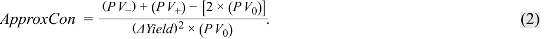
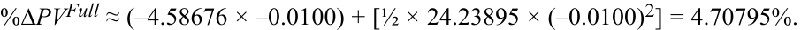
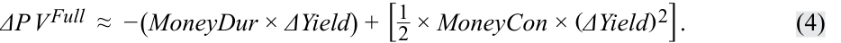
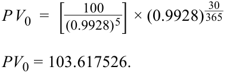
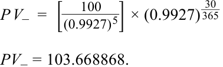
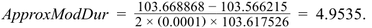
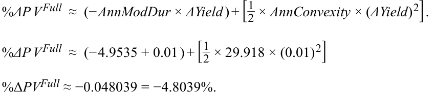
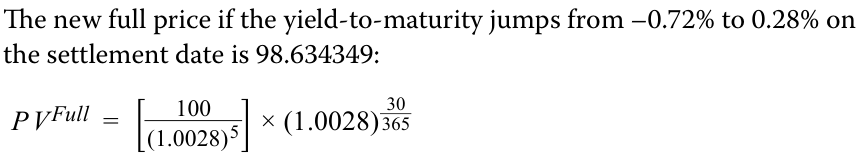

# Tập 6: Chứng khoán Thu nhập Cố định (Fixed Income)
## Learning Module 12 Yield-Based Bond Convexity and Portfolio Properties (Trang PDF 307–330)

---

# Tập 6: Thu nhập Cố định (Fixed Income)
## Học phần 12: Độ lồi Trái phiếu Dựa trên Lợi suất và Các Đặc tính Danh mục Đầu tư (Yield-Based Bond Convexity and Portfolio Properties)
### Phần 1/2: Giới thiệu (Trang PDF 307–320)

---

<!-- PDF Page 307 -->

# H Ọ C P H Ầ N **<mark>12</mark>** 

### **Độ lồi Trái phiếu Dựa trên Lợi suất và Các Đặc tính Danh mục Đầu tư (Yield-Based Bond Convexity and Portfolio Properties)** 

##### **<mark>MỤC TIÊU HỌC TẬP (LEARNING OUTCOMES)</mark>** 

###### **_Làm chủ kiến thức – Ứng viên cần có khả năng:_**
- tính toán và diễn giải độ lồi (*convexity*) và mô tả phần điều chỉnh độ lồi (*convexity adjustment*)
- tính toán phần trăm thay đổi giá của một trái phiếu đối với một mức thay đổi xác định trong lợi suất, khi biết thời lượng (*duration*) và độ lồi (*convexity*) của trái phiếu đó
- tính toán thời lượng và độ lồi của danh mục đầu tư (*portfolio duration and convexity*) và giải thích những hạn chế của các thước đo này 

#### **GIỚI THIỆU (INTRODUCTION)** 

## **<mark>1</mark>** 

Mặc dù thời lượng (*duration*) là một phép xấp xỉ tuyến tính (*linear approximation*) về độ nhạy của giá trái phiếu đối với những thay đổi trong lợi suất, mối quan hệ thực sự giữa giá của một trái phiếu và lợi suất đáo hạn của nó là một đường cong (lồi – *convex*). Chúng ta giới thiệu độ lồi (*convexity*) như một thước đo rủi ro bổ sung nhằm cải thiện các ước tính thay đổi giá trái phiếu vốn chỉ dựa trên thời lượng điều chỉnh (*modified duration*) để tính đến mối quan hệ phi tuyến tính này. Phần điều chỉnh độ lồi (*convexity adjustment*) trở nên quan trọng hơn khi xem xét những biến động lớn hơn trong lợi suất đáo hạn và các trái phiếu có kỳ hạn dài hơn. Các bài học này cũng sẽ chỉ ra cách ước tính thời lượng và độ lồi cho một danh mục đầu tư trái phiếu, đồng thời nêu bật những hạn chế do các giả định cơ sở. 

Hầu hết các ví dụ và bảng biểu được sử dụng xuyên suốt bài đọc có thể được tải xuống dưới dạng sổ làm việc Microsoft Excel. Mỗi trang tính trong sổ làm việc được gắn nhãn với số ví dụ hoặc bảng biểu tương ứng trong văn bản. 

###### **TỔNG QUAN HỌC PHẦN (LEARNING MODULE OVERVIEW)** 

- Độ lồi (*Convexity*) là một thước đo rủi ro bổ sung đo lường tác động bậc hai (phi tuyến tính – *second-order non-linear effect*) của những thay đổi lợi suất lên giá đối với một trái phiếu lãi suất cố định không kèm quyền chọn (*option-free fixed-rate bond*). Phần điều chỉnh độ lồi được cộng thêm vào ước tính giá tuyến tính được cung cấp bởi thời lượng điều chỉnh. 

<!-- PDF Page 308 -->

- Độ lồi luôn mang giá trị dương đối với một trái phiếu lãi suất cố định không kèm quyền chọn, sao cho mức tăng giá ước tính khi lợi suất giảm sẽ cao hơn mức mà chỉ riêng thời lượng gợi ý, và mức giảm giá ước tính khi lợi suất tăng sẽ thấp hơn mức mà chỉ riêng thời lượng gợi ý. Do đó, độ lồi có giá trị đối với các nhà đầu tư. 

- Độ lồi có cùng mối quan hệ với các đặc điểm của trái phiếu giống như thời lượng: một trái phiếu lãi suất cố định sẽ có độ lồi lớn hơn khi thời gian đáo hạn càng dài, lãi suất coupon càng thấp, và lợi suất đáo hạn càng thấp. 

- Độ lồi tiền tệ (*Money convexity*) biểu thị độ lồi tính theo đơn vị tiền tệ hoặc phần trăm mệnh giá cho một vị thế trái phiếu vì nó là tích số giữa độ lồi hàng năm (*annual convexity*) của trái phiếu và giá toàn phần (*full price*) của nó. 

- Thời lượng và độ lồi của danh mục đầu tư (*Portfolio duration and convexity*) có thể được tính (1) bằng trung bình có trọng số của thời gian nhận các dòng tiền gộp (*aggregate cash flows*) hoặc (2) bằng cách sử dụng trung bình có trọng số của thời lượng và độ lồi của từng trái phiếu riêng lẻ cấu thành nên danh mục đầu tư. 

- Mặc dù phương pháp thứ nhất đúng về mặt lý thuyết, nhưng nó rất khó sử dụng trong thực tế. Phương pháp thứ hai thường được các nhà quản lý danh mục đầu tư sử dụng nhưng ngầm giả định sự dịch chuyển song song (*parallel shifts*) của đường cong lợi suất, điều vốn rất hiếm gặp. 

###### **TỰ ĐÁNH GIÁ HỌC PHẦN (LEARNING MODULE SELF-ASSESSMENT)** 

Những câu hỏi ban đầu này nhằm giúp bạn đánh giá mức độ hiểu biết hiện tại của mình về học phần. 

1. Độ lồi năm hóa (*annualized convexity*) của một trái phiếu trả lãi coupon 2.8% (bán niên), kỳ hạn 4 năm, được định giá ngang mệnh giá khi phát hành vào ngày 1 tháng 8 năm 2035 và đáo hạn vào ngày 1 tháng 8 năm 2039 _gần nhất_ với: 

   - **A.** 7.624. 

   - **B.** 16.413. 

   - **C.** 65.651.

###### **Lời giải:** 

B là đáp án đúng. 

###### **Trái phiếu Bán niên 2.8%, Kỳ hạn 4 Năm tại Ngày Phát hành (Four-Year, 2.8% Semiannual Bond at Issuance)** 

|Đặc điểm|Giá trị|
|---|---|
|**Lãi suất Coupon Cố định (%) (Fixed Coupon %)**|2.80|
|**Số kỳ mỗi năm (Periods p.a.)**|2|
|**Giá (trên 100 Mệnh giá) (Price per 100 Par Value)**|100|
|**Lợi suất Đáo hạn (%) (Yield-to-Maturity %)**|2.8000|

<!-- PDF Page 309 -->

|**(1) Kỳ (Period)**|**(2) Thời gian nhận (Time to Receipt)**|**(3) Dòng tiền (Cash Flow)**|**(4) Giá trị hiện tại (Present Value)**|**(5) Trọng số (Weight)**|**(6) = (2) × (5) Thời gian nhận × Trọng số**|**(7) = Cột 2 × (Cột 2 + 1) × Cột 5 × (1 + YTM/2)⁻² Độ lồi của Dòng tiền (Convexity of Cash Flows)**|
|---|---|---|---|---|---|---|
|1|1.0|1.4|1.380671|0.01381|0.01381|0.02686|
|2|2.0|1.4|1.361608|0.01362|0.02723|0.07946|
|3|3.0|1.4|1.342809|0.01343|0.04028|0.15672|
|4|4.0|1.4|1.324269|0.01324|0.05297|0.25759|
|5|5.0|1.4|1.305985|0.01306|0.06530|0.38105|
|6|6.0|1.4|1.287954|0.01288|0.07728|0.52611|
|7|7.0|1.4|1.270171|0.01270|0.08891|0.69179|
|8|8.0|101.4|90.726533|0.90727|7.25812|63.53176|
||||**100.0000**|**1.00000**|**7.62391**|**65.65133**|
|**Thời lượng Macaulay và Độ lồi Năm hóa (Annualized Macaulay Duration and Convexity)**|||||**3.81195**|**16.41283**|

Độ lồi năm hóa là 16.41283 và được tính từ tổng của Cột 7 (65.65133) chia cho bình phương số kỳ mỗi năm (hai kỳ mỗi năm: $2^2 = 4$).

2. Hãy xác định phát biểu nào sau đây là đúng. Phần điều chỉnh độ lồi (*convexity adjustment*):
   - **A.** luôn mang giá trị âm đối với một trái phiếu lãi suất cố định không kèm quyền chọn.
   - **B.** tính đến tác động bậc nhất (*first-order effect*) của những thay đổi lợi suất lên một trái phiếu.
   - **C.** được cộng vào ước tính thay đổi giá trái phiếu được cung cấp bởi thời lượng điều chỉnh.

###### **Lời giải:**
C là đáp án đúng. Phần điều chỉnh độ lồi được cộng thêm vào ước tính thay đổi giá được cung cấp bởi thời lượng điều chỉnh đối với một mức thay đổi nhất định trong lợi suất đáo hạn:
$$\%\Delta PV^{\text{Full}} \approx (-\text{AnnModDur} \times \Delta \text{Yield}) + \left[ \frac{1}{2} \times \text{AnnConvexity} \times (\Delta \text{Yield})^2 \right]$$
A không đúng vì độ lồi luôn dương đối với một trái phiếu lãi suất cố định không kèm quyền chọn.
B không đúng vì độ lồi tính đến tác động bậc hai (*second-order effect*) của những thay đổi lợi suất lên giá trái phiếu, còn thời lượng tính đến tác động bậc nhất (*first-order effect*).

###### **Các câu hỏi 3 và 4 liên quan đến thông tin sau đây.**
Một nhà đầu tư nắm giữ vị thế 50,000,000 GBP trong một trái phiếu trả lãi coupon cố định 3.50% (bán niên), kỳ hạn 10 năm đang giao dịch ngang mệnh giá. Thời lượng điều chỉnh năm hóa là 8.376, và độ lồi năm hóa là 81.701. Nhà đầu tư kỳ vọng lãi suất sẽ giảm 100 bps.

3. Phần trăm thay đổi kỳ vọng trong giá của trái phiếu _gần nhất_ với:
   - **A.** 7.97%.
   - **B.** 8.01%.
   - **C.** 8.78%.

###### **Lời giải:**
C là đáp án đúng. Mức thay đổi giá kỳ vọng được tính như sau:

<!-- PDF Page 310 -->

<!-- Formula Text: %ΔP V Full  ≈  (− AnnModDur × ΔYield) + [ 1 _ 2  × AnnConvexity × (ΔYield) 2]. %ΔP V Full  ≈  (− 8.376 × − 0.01) + [ 1 _ 2  × 81.701 × (− 0.01) 2]. -->

$$\%\Delta PV^{\text{Full}} \approx (-\text{AnnModDur} \times \Delta \text{Yield}) + \left[ \frac{1}{2} \times \text{AnnConvexity} \times (\Delta \text{Yield})^2 \right]$$

$$\%\Delta PV^{\text{Full}} \approx (-8.376 \times -0.01) + \left[ \frac{1}{2} \times 81.701 \times (-0.01)^2 \right]$$

$$\%\Delta PV^{\text{Full}} \approx 0.0878 = 8.78\%$$

4. Phần cộng thêm của độ lồi tiền tệ (*money convexity*) vào mức thay đổi ước tính trong giá trị của vị thế trái phiếu khi chỉ sử dụng thời lượng tiền tệ _gần nhất_ với: 

   - **A.** 204,252 GBP. 

   - **B.** 408,503 GBP. 

   - **C.** 4,188,220 GBP. 

###### **Lời giải:** 

A là đáp án đúng. Câu hỏi này yêu cầu tính phần điều chỉnh độ lồi tiền tệ (*money convexity adjustment*). Đầu tiên, chúng ta tính độ lồi tiền tệ: 

$$\text{MoneyCon} = \text{AnnConvexity} \times PV^{\text{Full}}$$

$$\text{MoneyCon} = 81.701 \times \text{50,000,000 GBP}$$

$$\text{MoneyCon} = \text{4,085,033,604 GBP}$$

Sau đó, chúng ta tính phần điều chỉnh độ lồi tiền tệ: 

<!-- Formula Text: MoneyConv . Adjustment  ≈  [ 1 _ 2  × MoneyConvexity × (ΔYield) 2]. -->

$$\text{MoneyConv.Adjustment} \approx \left[ \frac{1}{2} \times \text{MoneyConvexity} \times (\Delta \text{Yield})^2 \right]$$

<!-- Formula Text: MoneyConv . Adjustment  ≈  [ 1 _ 2  × GBP4, 085, 033, 604 × (− 0.01) 2]. -->

$$\text{MoneyConv.Adjustment} \approx \left[ \frac{1}{2} \times \text{4,085,033,604 GBP} \times (-0.01)^2 \right]$$

$$\text{MoneyConv.Adjustment} \approx \text{204,252 GBP}$$

5. Một danh mục đầu tư trái phiếu trị giá 100 triệu EUR bao gồm các trái phiếu sau: 

|**Trái phiếu (Bond)**|**Kỳ hạn (năm) (Maturity - yrs.)**|**YTM (%)**|**Giá trị Thị trường (Market Value)**|**Thời lượng Điều chỉnh Năm hóa (Annualized Modified Duration)**|**Độ lồi Năm hóa (Annualized Convexity)**|
|---|---|---|---|---|---|
|A|3|2.80%|40,000,000 EUR|2.858|9.752|
|B|10|3.50%|60,000,000 EUR|8.376|81.701|

Phần trăm thay đổi giá kỳ vọng của danh mục đầu tư trái phiếu khi lợi suất đáo hạn tăng 50 bp _gần nhất_ với: 

   - **A.** 3.018%. 

   - **B.** 3.085%. 

   - **C.** 3.151%. 

###### **Lời giải:** 

A là đáp án đúng. Trọng số của Trái phiếu A và Trái phiếu B lần lượt là 40% và 60%. Do đó, các thước đo thời lượng và độ lồi trung bình có trọng số của danh mục đầu tư lần lượt là 6.169 và 52.921. Phần trăm thay đổi giá kỳ vọng của danh mục đầu tư khi YTM tăng 50 bp được tính như sau: 

<!-- Formula Text: %ΔP V Full  ≈  (− AnnModDur × ΔYield) + [ 1 _ 2  × AnnConvexity × (ΔYield) 2]. -->

$$\%\Delta PV^{\text{Full}} \approx (-\text{AnnModDur} \times \Delta \text{Yield}) + \left[ \frac{1}{2} \times \text{AnnConvexity} \times (\Delta \text{Yield})^2 \right]$$

<!-- PDF Page 311 -->

$$\%\Delta PV^{\text{Full}} \approx (-6.169 \times 0.005) + \left[ \frac{1}{2} \times 52.921 \times (0.005)^2 \right]$$

$$\%\Delta PV^{\text{Full}} \approx -3.018\%$$

6. Việc sử dụng các thước đo thời lượng và độ lồi trung bình có trọng số để ước tính rủi ro lãi suất của danh mục đầu tư trái phiếu: 

   - **A.** rất khó thực hiện trong thực tế. 

   - **B.** là phương pháp đúng về mặt lý thuyết. 

   - **C.** giả định một sự dịch chuyển song song (*parallel shift*) trong đường cong lợi suất. 

   - **Lời giải:** 

C là đáp án đúng. Việc sử dụng các thước đo thời lượng và độ lồi trung bình có trọng số để ước tính rủi ro lãi suất của danh mục đầu tư trái phiếu rất dễ thực hiện trong thực tế, nhưng đó không phải là phương pháp đúng về mặt lý thuyết (việc sử dụng trung bình có trọng số của thời gian nhận các dòng tiền gộp mới là đúng về mặt lý thuyết). Tuy nhiên, phương pháp này ngầm giả định một sự dịch chuyển song song trong đường cong lợi suất. 

#### **ĐỘ LỒI CỦA TRÁI PHIẾU VÀ ĐIỀU CHỈNH ĐỘ LỒI (BOND CONVEXITY AND CONVEXITY ADJUSTMENT)** 

## **<mark>2</mark>** 

- tính toán và diễn giải độ lồi (*convexity*) và mô tả phần điều chỉnh độ lồi (*convexity adjustment*) 

Rủi ro lãi suất, hay độ nhạy của giá trái phiếu đối với những thay đổi trong lợi suất, là một khái niệm quan trọng được sử dụng để phân tích mức độ tiếp xúc rủi ro thu nhập cố định. Là một thước đo rủi ro chính, thời lượng điều chỉnh đo lường tác động bậc nhất (tuyến tính – *first-order linear*) lên mức thay đổi giá của trái phiếu khi có một sự thay đổi trong lợi suất đáo hạn. **Độ lồi (*Convexity*)** là một thước đo rủi ro bổ sung đo lường tác động bậc hai (phi tuyến tính – *second-order non-linear*) của những thay đổi lợi suất lên giá đối với một trái phiếu lãi suất cố định không kèm quyền chọn, như được thể hiện trong Bảng 1. 

###### **Bảng 1: Độ lồi của một Trái phiếu Lãi suất Cố định Không kèm Quyền chọn (Exhibit 1: Convexity of an Option-Free Fixed-Rate Bond)** 

<!-- Picture Text: Convex price–yield curve Price Estimated change due to convexity Estimated change due to duration Line tangent to the price–yield curve Yield-to-maturity  -->

> **Chú thích hình ảnh:**
> - **Trục tung:** Giá (*Price*).
> - **Trục hoành:** Lợi suất đáo hạn (*Yield-to-maturity*).
> - **Các thành phần trên đồ thị:** Đường cong giá – lợi suất lồi (*Convex price–yield curve*), Đường tiếp tuyến với đường cong giá – lợi suất (*Line tangent to the price–yield curve*), Mức thay đổi ước tính do thời lượng (*Estimated change due to duration*), và Mức thay đổi ước tính do độ lồi (*Estimated change due to convexity* – khoảng cách giữa đường cong lồi và đường tiếp tuyến).

<!-- PDF Page 312 -->

Mối quan hệ thực sự giữa giá của một trái phiếu và lợi suất đáo hạn của nó là đường cong (lồi) thể hiện giá trái phiếu thực tế tại một mức lãi suất chiết khấu thị trường nhất định. Thời lượng (tức là thời lượng tiền tệ) ước tính mức thay đổi trong giá trái phiếu dọc theo đường thẳng tiếp tuyến với đường cong. Đối với những thay đổi nhỏ trong lợi suất đáo hạn, có rất ít sự khác biệt giữa hai đường này. 

Tuy nhiên, đối với những thay đổi lớn hơn về lợi suất, sự khác biệt trở nên đáng kể và chỉ riêng thời lượng là một thước đo rủi ro không đầy đủ. Trong những trường hợp như vậy, một sự đánh giá thỏa đáng đòi hỏi phải nắm bắt được hiệu ứng giá phi tuyến tính của độ lồi. Bằng cách xem xét kết hợp cả hai thước đo thời lượng và độ lồi đối với những thay đổi lợi suất tương đối lớn, giá trái phiếu ước tính sẽ sát với giá trái phiếu thực tế hơn đáng kể. Nghĩa là, khi tính thêm độ lồi, giá trái phiếu tăng nhiều hơn khi lợi suất giảm và giảm ít hơn khi lợi suất tăng so với khi chỉ ước tính bằng thời lượng. 

Như được thể hiện trong Phương trình 1, độ lồi bổ sung vào ước tính phần trăm thay đổi giá (toàn phần) có được khi chỉ sử dụng thời lượng điều chỉnh, vốn đã được sử dụng trong các bài học trước.

$$\%\Delta PV^{\text{Full}} \approx (-\text{AnnModDur} \times \Delta \text{Yield}) + \left[ \frac{1}{2} \times \text{AnnConvexity} \times (\Delta \text{Yield})^2 \right] \tag{1}$$

Biểu thức đầu tiên trong dấu ngoặc đơn là tác động từ thời lượng điều chỉnh. Biểu thức trong dấu ngoặc vuông là **phần điều chỉnh độ lồi (*convexity adjustment*)**: số liệu thống kê độ lồi hàng năm, $\text{AnnConvexity}$, nhân với một phần hai nhân với mức thay đổi trong lợi suất đáo hạn _bình phương_. Số hạng này luôn mang giá trị dương đối với một trái phiếu lãi suất cố định không kèm quyền chọn, vì vậy, như đã lưu ý, giá trái phiếu ước tính sẽ cao hơn đối với cả trường hợp tăng hoặc giảm lợi suất (xem Bảng 1). 

Tương tự như thời lượng Macaulay và thời lượng điều chỉnh, $\text{AnnConvexity}$ có thể được tính theo nhiều cách: (1) sử dụng bảng tính Microsoft Excel, (2) sử dụng phương pháp xấp xỉ, và (3) sử dụng phương trình dạng đóng được suy ra từ phép tính vi phân. Bây giờ chúng ta sẽ minh họa phương pháp 1 và 2. 

Hãy xét lại một lần nữa trái phiếu trả coupon 3.2% (bán niên), kỳ hạn 5 năm của BRWA được định giá ngang mệnh giá để thanh toán vào ngày 15 tháng 10 năm 2025 và đáo hạn vào ngày 15 tháng 10 năm 2030. Bảng 2 là một bảng tính tương tác trong sổ làm việc Microsoft Excel có thể tải xuống, cho thấy phép tính $\text{AnnConvexity}$ cho trái phiếu này; hãy lưu ý rằng nó rất giống với bảng tính được sử dụng để tính thời lượng. Sự khác biệt là việc đưa thêm một cột mới (Cột 7) cho phép tính sau đây (trong đó $CF$ có nghĩa là dòng tiền) để tính độ lồi: 

$$(\text{Thời gian nhận } CF) \times (\text{Thời gian nhận } CF + 1) \times (\text{Trọng số của } CF) \times (1 + \text{YTM định kỳ})^{(-\text{Số kỳ mỗi năm})}$$

Lưu ý rằng kết quả trung gian của việc nhân hai số hạng đầu tiên tạo ra tính phi tuyến tính ($\text{Thời gian nhận } CF^2$). Chia tổng của Cột 7 (96.95578) cho bình phương số kỳ mỗi năm ($2^2 = 4$) sẽ cho ra số liệu thống kê độ lồi năm hóa ($\text{AnnConvexity}$) là 24.2389. 

**Bảng 2: Tính toán Độ lồi cho một Trái phiếu Lãi suất Cố định Không kèm Quyền chọn (Exhibit 2: Convexity Calculation for an Option-Free Fixed-Rate Bond)** 

|**Trái phiếu Bán niên 3.2%, Kỳ hạn 5 Năm của Tập đoàn BRWA tại Ngày Phát hành**|Giá trị|
|---|---|
|**Vốn gốc (Principal)**|$300,000,000|
|**Lãi suất Coupon Cố định (%) (Fixed Coupon %)**|3.20|
|**Số kỳ mỗi năm (Periods p.a.)**|2|
|**Giá (trên 100 Mệnh giá) (Price per 100 Par Value)**|100|
|**Lợi suất Đáo hạn (%) (Yield-to-Maturity %)**|3.20|

<!-- PDF Page 313 -->

|**Cột 1**|**Cột 2**|**Cột 3**|**Cột 4**|**Cột 5**|**Cột 6 = Cột 2 × Cột 5**|**Cột 7 = Cột 2 × (Cột 2 + 1) × Cột 5 × (1 + YTM/2)⁻²**|
|---|---|---|---|---|---|---|
|**Kỳ (Period)**|**Thời gian nhận (Time to Receipt)**|**Dòng tiền (Cash Flow)**|**Giá trị hiện tại (Present Value)**|**Trọng số (Weight)**|**Thời gian nhận × Trọng số (Time to Receipt × Weight)**|**Độ lồi của Dòng tiền (Convexity of Cash Flows)**|
|1|1.0|1.6|1.5748|0.0157|0.0157|0.0305|
|2|2.0|1.6|1.5500|0.0155|0.0310|0.0901|
|3|3.0|1.6|1.5256|0.0153|0.0458|0.1774|
|4|4.0|1.6|1.5016|0.0150|0.0601|0.2909|
|5|5.0|1.6|1.4779|0.0148|0.0739|0.4295|
|6|6.0|1.6|1.4546|0.0145|0.0873|0.5919|
|7|7.0|1.6|1.4317|0.0143|0.1002|0.7767|
|8|8.0|1.6|1.4092|0.0141|0.1127|0.9829|
|9|9.0|1.6|1.3870|0.0139|0.1248|1.2093|
|10|10.0|101.6|86.6875|0.8669|8.6688|92.3766|
||||**100.0000**|**1.0000**|**9.3203**|**96.9558**|
|**Thời lượng Macaulay và Độ lồi Năm hóa (Annualized Macaulay Duration and Convexity)**|||||**4.6601**|**24.2389**|

Bảng 2 cũng có thể được xem dưới dạng bảng tính trên hệ sinh thái học tập dành cho ứng viên trực tuyến trong sổ làm việc Microsoft Excel có thể tải xuống. 

Ngoài ra, Phương trình 2 có thể được sử dụng để xấp xỉ độ lồi năm hóa ($\text{ApproxCon}$). Phương pháp này hữu ích đối với các trái phiếu có dòng tiền không chắc chắn, chẳng hạn như những trái phiếu có điều khoản dự phòng và rủi ro vỡ nợ, sẽ được khám phá trong các bài học sau. Lưu ý rằng phương trình này sử dụng cùng các thông số đầu vào như khi xấp xỉ thời lượng điều chỉnh. 

<!-- Formula Text: ApproxCon  = (P V −) + (P V +) − [2 × (P V 0)] _____________________ (ΔYield) 2 × (P V 0) . (2) -->

$$\text{ApproxCon} = \frac{(PV_-) + (PV_+) - [2 \times (PV_0)]}{(\Delta \text{Yield})^2 \times (PV_0)} \tag{2}$$

Đối với trái phiếu của BRWA, đầu tiên hãy tăng lợi suất đáo hạn hàng năm thêm 5 bps, từ 3.20% lên 3.25%, và xác định $PV_+$. Tiếp theo, giảm lợi suất đi 5 bps, xuống 3.15%, và xác định $PV_-$. Đây là các mức giá toàn phần mới (giá ban đầu là $PV_0 = 100.00$). Sử dụng hàm `PRICE` của Excel, 

`PRICE(settlement, maturity, rate, yield, redemption, frequency, [basis])`, 

chúng ta có như sau: 

$$PV_+ = \text{PRICE(DATE(2025,10,15),DATE(2030,10,15),0.032,0.0325,100,2,0)} = 99.770965$$

$$PV_- = \text{PRICE(DATE(2025,10,15),DATE(2030,10,15),0.032,0.0315,100,2,0)} = 100.229641$$

Áp dụng Phương trình 2, $\text{ApproxCon}$ được ước tính là 24.23896, là một giá trị xấp xỉ rất sát với $\text{AnnConvexity}$ của trái phiếu là 24.23895 mà chúng ta đã tính trong Bảng 2. 

<!-- Formula Text: ApproxCon  =   100.229641 + 99.770965 − (2 × 100.00) ____________________________ (0.0005) 2 × 100.00 =  24.23896. -->

$$\text{ApproxCon} = \frac{100.229641 + 99.770965 - (2 \times 100.00)}{(0.0005)^2 \times 100.00} = 24.23896$$

Các đặc điểm của trái phiếu dẫn đến độ lồi lớn hơn cũng giống như đối với thời lượng. Một trái phiếu lãi suất cố định sẽ có độ lồi lớn hơn khi: 

- thời gian đáo hạn càng _dài_, 

<!-- PDF Page 314 -->

- lãi suất coupon càng _thấp_, và 

- lợi suất đáo hạn càng _thấp_. 

Một yếu tố khác là độ phân tán của các dòng tiền (*dispersion of cash flows*), nghĩa là mức độ mà các khoản thanh toán được trải rộng theo thời gian. Đối với hai trái phiếu có cùng thời lượng, trái phiếu nào có độ phân tán dòng tiền lớn hơn sẽ có độ lồi lớn hơn. Các thuộc tính tích cực của độ lồi đối với một nhà đầu tư được thể hiện trong Bảng 3. 

**Bảng 3: Các Thuộc tính Tích cực của Độ lồi Trái phiếu đối với một Trái phiếu Không kèm Quyền chọn (Exhibit 3: Positive Attributes of Bond Convexity on an Option-Free Bond)** 

<!-- Picture Text: Price More convex bond Less convex bond Line tangent to the price–yield curve Yield-to-maturity  -->

> **Chú thích hình ảnh:**
> - **Trục tung:** Giá (*Price*).
> - **Trục hoành:** Lợi suất đáo hạn (*Yield-to-maturity*).
> - **Các đường biểu diễn:** Trái phiếu có độ lồi lớn hơn (*More convex bond* – nằm phía trên), Trái phiếu có độ lồi nhỏ hơn (*Less convex bond* – nằm ở giữa), và Đường tiếp tuyến với đường cong giá – lợi suất (*Line tangent to the price–yield curve* – nằm phía dưới cùng).

Hai trái phiếu được mô tả trong Bảng 3 được giả định là có cùng mức giá, kỳ hạn, lợi suất đáo hạn và thời lượng điều chỉnh, do đó chúng có chung đường tiếp tuyến với đường cong giá – lợi suất của mình. Lợi ích của độ lồi lớn hơn phát sinh khi lợi suất của chúng thay đổi đáng kể. Đối với cùng một mức giảm trong lợi suất đáo hạn, trái phiếu có độ lồi lớn hơn _tăng giá nhiều hơn_, trong khi đối với cùng một mức tăng trong lợi suất đáo hạn, trái phiếu có độ lồi lớn hơn _giảm giá ít hơn_. Do đó, trái phiếu có độ lồi lớn hơn có thành quả vượt trội hơn so với trái phiếu có độ lồi nhỏ hơn trong cả môi trường lợi suất giảm lẫn môi trường lợi suất tăng, vì vậy nó ít rủi ro hơn đối với các nhà đầu tư. 

Kết luận này giả định rằng sự khác biệt về độ lồi chưa được phản ánh vào giá của trái phiếu có độ lồi lớn hơn. Nếu nó đã được định giá vào trong giá (*priced in*), trái phiếu có độ lồi lớn hơn sẽ có mức giá cao hơn (và lợi suất đáo hạn thấp hơn). Điểm mấu chốt là độ lồi có giá trị đối với các nhà đầu tư trong việc giảm thiểu rủi ro, vì vậy họ phải trả giá cho nó. 

###### **VÍ DỤ 1 (EXAMPLE 1)** 

##### **Thời lượng và Độ lồi của Trái phiếu Romania Kỳ hạn 30 Năm (Duration and Convexity of 30-Year Romanian Bond)** 

Một trái phiếu kỳ hạn 30 năm do chính phủ Romania phát hành có lãi suất coupon là 4.625% (trả hàng năm) và hiện đang giao dịch ở mức lợi suất đáo hạn là 4.75% vào ngày 15 tháng 10 năm 2025, với ngày đáo hạn là 15 tháng 10 năm 2055. 

**1.** Sử dụng hàm `PRICE` của Excel để tính $\text{ApproxModDur}$ và $\text{ApproxCon}$ bằng cách sử dụng mức tăng và giảm 5 bp trong lợi suất đáo hạn. 

**2.** So sánh và diễn giải các thước đo thời lượng và độ lồi của trái phiếu Romania kỳ hạn 30 năm và trái phiếu kỳ hạn 5 năm của BRWA. 

Để tìm $\text{ApproxModDur}$ và $\text{ApproxCon}$, trước tiên chúng ta phải tính $PV_0$ và sau đó, sử dụng mức tăng và giảm 5 bp trong YTM, tính $PV_+$ và $PV_-$: 

$$PV_0 = \text{PRICE(DATE(2025,10,15),DATE(2055,10,15),0.04625,0.0475,100,1,0)}$$

<!-- PDF Page 315 -->

$$= 98.022448$$

$$PV_+ = \text{PRICE(DATE(2025,10,15),DATE(2055,10,15),0.04625,0.0480,100,1,0)} = 97.247386$$

$$PV_- = \text{PRICE(DATE(2025,10,15),DATE(2055,10,15),0.04625,0.0470,100,1,0)} = 98.806567$$

$$\text{ApproxModDur} = \frac{98.806567 - 97.247386}{2 \times (0.0005) \times 98.022448} = 15.90637$$

$$\text{ApproxCon} = \frac{98.806567 + 97.247386 - (2 \times 98.022448)}{(0.0005)^2 \times 98.022448} = 369.58881$$

###### **So sánh Thời lượng và Độ lồi: Trái phiếu Romania và BRWA (Duration and Convexity Comparison: Romanian and BRWA Bonds)** 

|**Trái phiếu (Bond)**|**Kỳ hạn (Năm) (Maturity - Years)**|**Lãi suất Coupon (%) (Coupon %)**|**YTM (%)**|**_ApproxModDur_**|**_ApproxCon_**|
|---|---|---|---|---|---|
|Romania|30|4.625 (Trả hàng năm – *Annual Pay*)|4.75|15.90637|369.64203|
|BRWA|5|3.20 (Bán niên – *Semi-Annual*)|3.20|4.58676|24.23896|

Thời lượng và độ lồi của trái phiếu Romania cao hơn đáng kể so với trái phiếu của BRWA chủ yếu là do thời gian đáo hạn dài hơn rất nhiều (30 năm so với 5 năm), yếu tố này lấn át cả mức lãi suất coupon và YTM cao hơn của trái phiếu Romania (những đặc điểm vốn làm giảm thời lượng và độ lồi). 

###### **BỘ CÂU HỎI (QUESTION SET)** 

Các câu hỏi 1–5 liên quan đến thông tin sau đây. 

|**Trái phiếu (Bond)**|**Ngày Phát hành (Issuance Date)**|**Ngày Đáo hạn (Maturity)**|**Lãi suất Coupon Trả Hàng năm (%) (Annual Pay Coupon %)**|**YTM (%)**|
|---|---|---|---|---|
|Trái phiếu X|7/15/25|7/15/34|2.25|2.25|
|Trái phiếu Y|7/15/25|7/15/35|5.33|2.34|

1. Tính thời lượng điều chỉnh và độ lồi cho Trái phiếu X tại thời điểm phát hành. 

###### **Lời giải:** 

|Đặc điểm|**Trái phiếu X (Bond X)**|
|---|---|
|**Lãi suất Coupon Cố định (%) (Fixed Coupon %)**|2.25|
|**Số kỳ mỗi năm (Periods p.a.)**|1|
|**Giá (trên 100 Mệnh giá) (Price per 100 Par Value)**|100|
|**Lợi suất Đáo hạn (%) (Yield-to-Maturity %)**|2.25|

<!-- PDF Page 316 -->

|**Cột 1**|**Cột 2**|**Cột 3**|**Cột 4**|**Cột 5**|**Cột 6 = Cột 2 × Cột 5**|**Cột 7 = Cột 2 × (Cột 2 + 1) × Cột 5 × (1 + YTM)⁻¹**|
|---|---|---|---|---|---|---|
|**Kỳ (Period)**|**Thời gian nhận (Time to Receipt)**|**Dòng tiền (Cash Flow)**|**Giá trị hiện tại (Present Value)**|**Trọng số (Weight)**|**Thời gian nhận × Trọng số (Time to Receipt × Weight)**|**Độ lồi của Dòng tiền (Convexity of Cash Flows)**|
|1|1.0|2.25|2.200489|0.02200|0.02200|0.04304|
|2|2.0|2.25|2.152067|0.02152|0.04304|0.12628|
|3|3.0|2.25|2.104711|0.02105|0.06314|0.24701|
|4|4.0|2.25|2.058398|0.02058|0.08234|0.40262|
|5|5.0|2.25|2.013103|0.02013|0.10066|0.59064|
|6|6.0|2.25|1.968805|0.01969|0.11813|0.80870|
|7|7.0|2.25|1.925481|0.01925|0.13478|1.05454|
|8|8.0|2.25|1.883111|0.01883|0.15065|1.32601|
|9|9.0|102.25|83.693835|0.83694|7.53245|73.66694|
||||**100.0000**|**1.00000**|**8.24718**|**78.26579**|
|**Thời lượng Macaulay và Độ lồi Năm hóa (Annualized Macaulay Duration and Convexity)**|||||**8.24718**|**78.26579**|
|**Thời lượng Điều chỉnh (Modified Duration)**|||||**8.06571**|**—**|

2. Tính $\text{ApproxModDur}$ và $\text{ApproxCon}$ cho Trái phiếu Y bằng cách sử dụng mức tăng và giảm 5 bp trong lợi suất đáo hạn. 

###### **Lời giải:** 

Để tìm $\text{ApproxModDur}$ và $\text{ApproxCon}$ cho Trái phiếu Y, trước tiên chúng ta phải tính $PV_0$, $PV_+$, và $PV_-$. 

$$PV_0 = \text{PRICE(DATE(2025,7,15),DATE(2035,7,15),0.0533,0.0234,100,1,0)} = 126.386358$$

$$PV_+ = \text{PRICE(DATE(2025,7,15),DATE(2035,7,15),0.0533,0.0239,100,1,0)} = 125.877943$$

$$PV_- = \text{PRICE(DATE(2025,7,15),DATE(2035,7,15),0.0533,0.0229,100,1,0)} = 126.897325$$

<!-- Formula Text: ApproxModDur  =   126.897325 − 125.877943 ___________________ 2 × (0.0005) × 126.386358   =  8.06560. -->

$$\text{ApproxModDur} = \frac{126.897325 - 125.877943}{2 \times (0.0005) \times 126.386358} = 8.06560$$

$$\text{ApproxCon} = \frac{126.897325 + 125.877943 - (2 \times 126.386358)}{(0.0005)^2 \times 126.386358} = 80.76704$$

3. So sánh và diễn giải các thước đo rủi ro từ Câu hỏi 1 và 2 đối với một sự thay đổi nhỏ dự kiến trong lợi suất đáo hạn. 

###### **Lời giải:** 

Đối với một sự thay đổi nhỏ trong YTM, thời lượng điều chỉnh là một ước tính hợp lý về rủi ro thay đổi giá của một trái phiếu. Vì giá trị thời lượng điều chỉnh (hoặc $\text{ApproxModDur}$) của Trái phiếu X và Trái phiếu Y gần như giống hệt nhau (lần lượt là 8.06571 và 8.06560), mức thay đổi giá ước tính dựa trên một sự thay đổi nhỏ trong YTM (dù dương hay âm) sẽ gần như giống hệt nhau đối với mỗi trái phiếu. 

<!-- PDF Page 317 -->

4. So sánh và diễn giải các thước đo rủi ro từ Câu hỏi 1 và 2 đối với một sự thay đổi lớn dự kiến trong lợi suất đáo hạn. 

###### **Lời giải:** 

   - Đối với một sự thay đổi lớn trong YTM, chỉ riêng thời lượng không nắm bắt được mức thay đổi giá kỳ vọng của một trái phiếu. Phần điều chỉnh độ lồi tính đến bản chất phi tuyến tính của mối quan hệ giữa giá và YTM. Vì cả hai trái phiếu có thời lượng gần như bằng nhau, độ lồi cao hơn của Trái phiếu Y sẽ dẫn đến mức sụt giảm phần trăm nhỏ hơn khi có một mức tăng lớn trong YTM và mức tăng phần trăm lớn hơn khi có một mức giảm lớn trong YTM. Trong cả hai trường hợp, Trái phiếu Y đều sẽ hoạt động tốt hơn Trái phiếu X đối với một sự thay đổi lớn trong YTM. 

5. So sánh và diễn giải từng đặc điểm sau đây về tác động của nó lên độ lồi của Trái phiếu X so với Trái phiếu Y: 

   - a. Kỳ hạn (*Maturity*) 

   - b. Lãi suất coupon (*Coupon rate*) 

   - c. YTM 

###### **Lời giải:** 

- a. Trái phiếu Y có kỳ hạn dài hơn Trái phiếu X (10 năm so với 9 năm), điều này sẽ làm tăng độ lồi của Trái phiếu Y so với Trái phiếu X. 

- b. Trái phiếu X có lãi suất coupon thấp hơn so với Trái phiếu Y (2.25% so với 5.33%), điều này sẽ làm tăng độ lồi của Trái phiếu X so với Trái phiếu Y. 

- c. Trái phiếu X có YTM thấp hơn so với Trái phiếu Y (2.25% so với 2.34%), điều này sẽ làm tăng độ lồi của Trái phiếu X so với Trái phiếu Y. 

#### **RỦI RO VÀ TỶ SUẤT SINH LỢI CỦA TRÁI PHIẾU SỬ DỤNG THỜI LƯỢNG VÀ ĐỘ LỒI (BOND RISK AND RETURN USING DURATION AND CONVEXITY)** 

<!-- Picture Text: 3  -->

- tính toán phần trăm thay đổi giá của một trái phiếu đối với một mức thay đổi xác định trong lợi suất, khi biết thời lượng (*duration*) và độ lồi (*convexity*) của trái phiếu đó 

Bây giờ chúng ta sẽ chỉ ra cách ước tính phần trăm thay đổi giá của một trái phiếu đối với một mức thay đổi lợi suất xác định, khi biết thời lượng và độ lồi của trái phiếu đó. Như chúng ta sẽ thấy, một ước tính như vậy sát với mức thay đổi giá thực tế của trái phiếu hơn đáng kể so với khi chỉ ước tính bằng thời lượng, cho phép quản lý rủi ro hiệu quả hơn. 

Tiếp tục tập trung vào trái phiếu trả coupon 3.2% (bán niên), kỳ hạn 5 năm của BRWA được định giá ngang mệnh giá để thanh toán vào ngày 15 tháng 10 năm 2025 và đáo hạn vào ngày 15 tháng 10 năm 2030, nếu lợi suất đáo hạn của nó thay đổi $\pm 100\text{ bps}$ từ mức 3.20%, thì các mức giá thực tế, sử dụng hàm `PRICE` của Excel, sẽ như sau: 

$$PV_+ = \text{PRICE(DATE(2025,10,15),DATE(2030,10,15),0.032,0.0420,100,2,0)} = 95.53212$$

$$PV_- = \text{PRICE(DATE(2025,10,15),DATE(2030,10,15),0.032,0.0220,100,2,0)} = 104.71035$$

<!-- PDF Page 318 -->

Do đó, mối quan hệ giá – lợi suất thực tế của trái phiếu này như sau: 

- Lợi suất tăng 100 bp (4.20%): Giá $= 95.53212$; $\%\Delta PV^{\text{Full}} = -4.46788\%$. 

- Lợi suất giảm 100 bp (2.20%): Giá $= 104.71035$; $\%\Delta PV^{\text{Full}} = 4.71035\%$. 

Thời lượng điều chỉnh của trái phiếu này trước đây đã được tìm ra là 4.58676, vì vậy mức tăng (giảm) 100 bp trong lợi suất đáo hạn dẫn đến $\%\Delta PV^{\text{Full}} \approx -4.58676\%$ ($4.58676\%$). 

Bây giờ chúng ta sẽ cho thấy độ chính xác được nâng cao và sự giảm thiểu rủi ro đạt được bằng cách cộng thêm phần điều chỉnh độ lồi vào ước tính thời lượng khi xác định phần trăm thay đổi giá của trái phiếu BRWA. Sử dụng Phương trình 1 và thước đo $\text{AnnConvexity}$, đối với các mức thay đổi $\pm 100\text{ bp}$ trong lợi suất đáo hạn (từ mức 3.20%), chúng ta có như sau: 

$$\%\Delta PV^{\text{Full}} \approx (-4.58676 \times 0.0100) + \left[ \frac{1}{2} \times 24.23895 \times (0.0100)^2 \right] = -4.46556\%$$

<!-- Formula Text: %∆PVFull ≈ (–4.58676 × –0.0100) + [½ × 24.23895 × (–0.0100)2] = 4.70795%. -->

$$\%\Delta PV^{\text{Full}} \approx (-4.58676 \times -0.0100) + \left[ \frac{1}{2} \times 24.23895 \times (-0.0100)^2 \right] = 4.70795\%$$

Bảng 4 so sánh phần trăm thay đổi ước tính trong giá trái phiếu của BRWA đối với các mức thay đổi $\pm 100\text{ bp}$ trong lợi suất khi chỉ sử dụng thời lượng và khi sử dụng thời lượng cộng với độ lồi so với các mức thay đổi chính xác từ hàm `PRICE` của Excel. Rõ ràng là độ chính xác đã được nâng cao khi cộng thêm phần điều chỉnh độ lồi, bởi vì chênh lệch phần trăm giá chỉ chưa đến $1/4$ điểm cơ bản khi cộng thêm độ lồi so với khoảng 12 bps khi chỉ dùng thời lượng. Lưu ý rằng sự khác biệt này sẽ lớn hơn đáng kể đối với những thay đổi lớn hơn về lợi suất hoặc đối với các trái phiếu có kỳ hạn dài hơn hoặc lãi suất coupon thấp hơn. 

**Bảng 4: Sử dụng Thời lượng và Độ lồi để Ước tính Thay đổi Giá Trái phiếu (Exhibit 4: Using Duration and Convexity to Estimate Bond Price Changes)** 

|**Thay đổi trong Lợi suất Trái phiếu (Change in Bond Yield)**|**Thực tế (Actual) %∆_PV__Full_**|**Ước tính %∆_PV__Full_ Sử dụng _ModDur_**|**Chênh lệch so với Thay đổi Thực tế (Difference from Actual Change)**|**Ước tính %∆_PV__Full_ Sử dụng _ModDur_ + Độ lồi (Convexity)**|**Chênh lệch so với Thay đổi Thực tế (Difference from Actual Change)**|
|---|---|---|---|---|---|
|+ 100 bps|–4.46788|–4.58676|–0.11887|–4.46556|0.00232|
|– 100 bps|4.71035|4.58676|–0.12359|4.70795|–0.00239|

Hãy nhớ lại rằng thời lượng tiền tệ cho biết tác động bậc nhất lên giá toàn phần của một trái phiếu tính bằng đơn vị tiền tệ khi có sự thay đổi trong lợi suất đáo hạn. **Độ lồi tiền tệ (*Money convexity* – $\text{MoneyCon}$)** nắm bắt tác động bậc hai tính theo đơn vị tiền tệ và bằng độ lồi hàng năm nhân với giá toàn phần, như trong Phương trình 3. 

$$\text{MoneyCon} = \text{AnnConvexity} \times PV^{\text{Full}} \tag{3}$$

Tương tự như việc ước tính phần trăm thay đổi trong giá toàn phần của trái phiếu, $\text{MoneyDur}$ và $\text{MoneyCon}$ được kết hợp với nhau để đạt được ước tính chính xác hơn, và do đó ít rủi ro hơn, về mức thay đổi trong giá toàn phần của trái phiếu, như được thể hiện trong Phương trình 4. 

<!-- Formula Text: ΔP V Full  ≈  − (MoneyDur × ΔYield) + [ 1 _ 2  × MoneyCon × (ΔYield) 2]. (4) -->

$$\Delta PV^{\text{Full}} \approx -(\text{MoneyDur} \times \Delta \text{Yield}) + \left[ \frac{1}{2} \times \text{MoneyCon} \times (\Delta \text{Yield})^2 \right] \tag{4}$$

Để lấy ví dụ về độ lồi tiền tệ, hãy xét lại trái phiếu trả coupon bán niên 3.2%, kỳ hạn 5 năm của BRWA, thanh toán ngày 15 tháng 10 năm 2025, đáo hạn ngày 15 tháng 10 năm 2030, và có lợi suất 3.2%—do đó được định giá ngang mệnh giá. Trước đây chúng ta đã thấy rằng thời lượng điều chỉnh hàng năm và độ lồi hàng năm của trái phiếu này lần lượt là 4.58676 và 24.23895. 

Giả sử nhà đầu tư nắm giữ một vị thế trái phiếu có mệnh giá là 100 triệu USD và lợi suất đáo hạn tăng 100 bps. Trước đó chúng ta đã thấy rằng giá của trái phiếu giảm xuống 95.53212, vì vậy giá trị thị trường của vị thế giảm xuống còn $\$95,532,116$ ($= \$100,000,000 \times 0.9553212$), tức là giảm $\$4,467,884$. 

Việc ước tính mức thay đổi giá trị thị trường chỉ bằng $\text{MoneyDur}$ dẫn đến mức giảm lớn hơn, $\$4,586,759$ ($= \$458,675,875 \times 0.0100$), chênh lệch $\$118,875$. 

<!-- PDF Page 319 -->

Tuy nhiên, sử dụng Phương trình 3, $\text{MoneyCon}$ cho vị thế này là $\$2,423,894,503$ ($= 24.23895 \times \$100,000,000$), và nếu chúng ta áp dụng Phương trình 4, sử dụng cả $\text{MoneyDur}$ và $\text{MoneyCon}$, để ước tính mức thay đổi giá trị thị trường, kết quả là mức giảm $-\$4,465,564$, như sau: 

<!-- Formula Text: − $4, 465, 564  ≈  − ($458, 675, 875 × 0.01) + [ 1 _ 2  × 2, 423, 894, 503 × (0.01) 2]. -->

$$-\$4,465,564 \approx -(\$458,675,875 \times 0.01) + \left[ \frac{1}{2} \times 2,423,894,503 \times (0.01)^2 \right]$$

Bằng cách sử dụng cả $\text{MoneyDur}$ và $\text{MoneyCon}$, sự khác biệt giữa mức thay đổi ước tính và thực tế trong giá trị vị thế trái phiếu chỉ là $\$2,320$. Bảng 5 tóm tắt các kết quả này và cho thấy các mức thay đổi ước tính và thực tế trong giá trị vị thế đối với mức giảm 100 bp trong lợi suất. 

**Bảng 5: Sử dụng Thời lượng Tiền tệ và Độ lồi Tiền tệ để Ước tính Thay đổi Giá Trái phiếu (Exhibit 5: Using Money Duration and Money Convexity to Estimate Bond Price Changes)** 

|**Thay đổi trong Lợi suất Trái phiếu (Change in Bond Yield)**|**Thực tế (Actual) ∆_PV__Full_**|**Ước tính ∆_PV__Full_ Sử dụng _MoneyDur_**|**Chênh lệch so với Thay đổi Thực tế (Difference from Actual Change)**|**Ước tính ∆_PV__Full_ Sử dụng _MoneyDur_ + _MoneyCon_**|**Chênh lệch so với Thay đổi Thực tế (Difference from Actual Change)**|
|---|---|---|---|---|---|
|+ 100 BPS|–$4,467,884|–$4,586,759|$118,875|–$4,465,564|–$2,320|
|– 100 BPS|$4,710,348|$4,586,759|–$123,590|$4,707,953|–$2,395|

###### **KIỂM TRA KIẾN THỨC (KNOWLEDGE CHECK)** 

Một nhà đầu tư nắm giữ một vị thế trái phiếu Cộng hòa Liên bang Đức kỳ hạn 5 năm, không trả lãi định kỳ, thanh toán vào ngày 11 tháng 5 năm 2025 và đáo hạn vào ngày 11 tháng 4 năm 2030. Lợi suất đáo hạn là $-0.72\%$, được công bố dưới dạng lãi suất hiệu dụng hàng năm (*effective annual rate*) trên cơ sở Act/Act. Có 5 kỳ hàng năm, và ngày thanh toán là 30 ngày đã trôi qua trong năm có 365 ngày. 

1. Tính giá toàn phần của trái phiếu trên mỗi 100 mệnh giá. 

###### **Lời giải:** 

Bởi vì hàm `PRICE` của Excel không hoạt động đối với lợi suất âm, phương trình tính $PV$ của một trái phiếu không trả lãi định kỳ phải được sử dụng. Có 5 kỳ hàng năm, ngày thanh toán là 30 ngày trong năm 365 ngày, và bởi vì $1 + r = 1 + (-0.0072) = 0.9928$, giá toàn phần của trái phiếu là 103.6175 trên mỗi 100 mệnh giá: 

<!-- Formula Text: P V 0  =  [ 100 _ (0.9928) 5 ] × (0.9928)  30 _ 365 PV0 = 103.617526. -->

$$PV_0 = \left[ \frac{100}{(0.9928)^5} \right] \times (0.9928)^{\frac{30}{365}}$$

$$PV_0 = 103.617526$$

2. Tính $\text{ApproxModDur}$ và $\text{ApproxCon}$ bằng cách sử dụng mức tăng và giảm 1 bp trong lợi suất đáo hạn. 

###### **Lời giải:** 

<!-- Formula Text: PV+ = 103.566215, and PV– = 103.668868: P V +  =  [ 100 _ (0.9929) 5 ] × (0.9929)  30 _ 365 -->

$PV_+ = 103.566215$, và $PV_- = 103.668868$:

$$PV_+ = \left[ \frac{100}{(0.9929)^5} \right] \times (0.9929)^{\frac{30}{365}}$$

$$PV_+ = 103.566215$$

<!-- PDF Page 320 -->

<!-- Formula Text: P V −  =  [ 100 _ (0.9927) 5 ] × (0.9927)  30 _ 365 PV− = 103.668868. -->

$$PV_- = \left[ \frac{100}{(0.9927)^5} \right] \times (0.9927)^{\frac{30}{365}}$$

$$PV_- = 103.668868$$

Thời lượng điều chỉnh xấp xỉ là 4.9535: 

<!-- Formula Text: ApproxModDur  =   103.668868 − 103.566215 ___________________ 2 × (0.0001) × 103.617526   =  4.9535. -->

$$\text{ApproxModDur} = \frac{103.668868 - 103.566215}{2 \times (0.0001) \times 103.617526} = 4.9535$$

Độ lồi xấp xỉ là 29.918: 

$$\text{ApproxCon} = \frac{103.668868 + 103.566215 - (2 \times 103.617526)}{(0.0001)^2 \times 103.617526} = 29.918$$

3. Tính phần trăm thay đổi giá ước tính đã điều chỉnh theo độ lồi do mức tăng 100 bp trong lợi suất đáo hạn. 

   - **Lời giải:** 

Phần trăm thay đổi giá đã điều chỉnh theo độ lồi khi lợi suất đáo hạn tăng 100 bp được ước tính là $-4.80391\%$. Nếu chỉ dùng riêng thời lượng điều chỉnh thì mức thay đổi ước tính là $-4.9535\%$. Phần điều chỉnh độ lồi cộng thêm 14.96 bps. 

<!-- Formula Text: %ΔP V Full  ≈  (− AnnModDur × ΔYield ) + [ 1 _ 2  × AnnConvexity × (ΔYield) 2]. %ΔP V Full  ≈  (− 4.9535 + 0.01 ) + [ 1 _ 2  × 29.918 × (0.01) 2] %ΔPVFull ≈ −0.048039 = −4.8039%. -->

$$\%\Delta PV^{\text{Full}} \approx (-\text{AnnModDur} \times \Delta \text{Yield}) + \left[ \frac{1}{2} \times \text{AnnConvexity} \times (\Delta \text{Yield})^2 \right]$$

$$\%\Delta PV^{\text{Full}} \approx (-4.9535 \times 0.01) + \left[ \frac{1}{2} \times 29.918 \times (0.01)^2 \right]$$

$$\%\Delta PV^{\text{Full}} \approx -0.048039 = -4.8039\%$$

4. So sánh phần trăm thay đổi giá ước tính với mức thay đổi thực tế, giả sử lợi suất đáo hạn tăng vọt 100 bps, lên mức 0.28%, vào ngày thanh toán. 

###### **Lời giải:** 

<!-- Formula Text: The new full price if the yield-to-maturity jumps from –0.72% to 0.28% on the settlement date is 98.634349: P V Full  =  [ 100 _ (1.0028) 5 ] × (1.0028)  30 _ 365 -->

Giá toàn phần mới nếu lợi suất đáo hạn tăng vọt từ $-0.72\%$ lên $0.28\%$ vào ngày thanh toán là 98.634349:

$$PV^{\text{Full}} = \left[ \frac{100}{(1.0028)^5} \right] \times (1.0028)^{\frac{30}{365}}$$

$$PV^{\text{Full}} = 98.634349$$

Phần trăm thay đổi thực tế trong giá trái phiếu là $-4.80920\%$ ($98.634349/103.617526 - 1$). Ước tính đã điều chỉnh theo độ lồi là $-4.80391\%$, trong khi mức thay đổi ước tính chỉ sử dụng thời lượng điều chỉnh là $-4.95350\%$. 

###### **BỘ CÂU HỎI (QUESTION SET)** 

Các câu hỏi 1–4 liên quan đến thông tin sau đây. 

Một nhà đầu tư mua một trái phiếu trị giá 10 triệu EUR trả lãi coupon bán niên 2.95% với lợi suất đáo hạn là 2.95%, thanh toán vào ngày 30 tháng 6 năm 2025 và đáo hạn vào ngày 30 tháng 6 năm 2032. 

1. Tính $\text{ApproxModDur}$ và $\text{ApproxCon}$ cho trái phiếu bằng cách sử dụng mức tăng và giảm 1 bp trong lợi suất đáo hạn. 

###### **Lời giải:** 

$$PV_+ = \text{PRICE(DATE(2025,6,30),DATE(2032,6,30),0.0295,0.0296,100,2,0)}$$

---

# Tập 6: Thu nhập Cố định (Fixed Income)
## Học phần 12: Độ lồi Trái phiếu Dựa trên Lợi suất và Các Đặc tính Danh mục Đầu tư (Yield-Based Bond Convexity and Portfolio Properties)
### Phần 2/2: Thời lượng và Độ lồi của Danh mục Đầu tư (Trang PDF 321–330)

---

<!-- PDF Page 321 -->

$$= 99.937$$

$$PV_- = \text{PRICE(DATE(2025,6,30),DATE(2032,6,30),0.0295,0.0294,100,2,0)} = 100.063$$

$$\text{ApproxModDur} = \frac{100.063 - 99.937}{2 \times (0.0001) \times 100} = 6.283$$

$$\text{ApproxCon} = \frac{100.063 + 99.937 - (2 \times 100)}{(0.0001)^2 \times 100} = 44.965$$

2. Tính $\text{MoneyDur}$ và $\text{MoneyCon}$ cho vị thế trái phiếu bằng cách sử dụng các kết quả từ Câu hỏi 1.

###### **Lời giải:**

$$\text{MoneyDur} \approx 6.283 \times \text{10,000,000 EUR} = \text{62,829,180 EUR}$$

$$\text{MoneyCon} \approx 44.965 \times \text{10,000,000 EUR} = \text{449,647,660 EUR}$$

3. Tính mức thay đổi giá ước tính trong vị thế trái phiếu của nhà đầu tư bằng cách sử dụng $\text{MoneyDur}$ và $\text{MoneyCon}$ đối với mức giảm 50 bp trong lợi suất đáo hạn.

###### **Lời giải:**

$$\Delta PV^{\text{Full}} \approx -(\text{62,829,180 EUR} \times -0.005) + \left[ \frac{1}{2} \times \text{449,647,660 EUR} \times (-0.005)^2 \right] = \text{319,767 EUR}$$

4. Tính chênh lệch giữa mức thay đổi giá ước tính và mức thay đổi giá thực tế khi lợi suất đáo hạn giảm 50 bp.

###### **Lời giải:**

$$PV^{\text{Full}} = \text{PRICE(DATE(2025,6,30),DATE(2032,6,30),0.0295,0.0245,100,2,0)} = 103.198$$

*(Lưu ý: trong bản gốc ghi `0.0345` do lỗi đánh máy của giáo trình khi tính cho mức giảm 50 bp từ `0.0295`, giá kết quả là `103.198`)*

Mức tăng thực tế trong giá trái phiếu là 3.1984%:

$$\Delta PV^{\text{Full}} = 3.1984\% \times \text{10,000,000 EUR} = \text{319,840 EUR}$$

Chênh lệch giữa mức thay đổi giá thực tế và ước tính là 73 EUR ($= 319,840 - 319,767$).

# **THỜI LƯỢNG VÀ ĐỘ LỒI CỦA DANH MỤC ĐẦU TƯ (PORTFOLIO DURATION AND CONVEXITY)** **<mark>4</mark>** 

- tính toán thời lượng và độ lồi của danh mục đầu tư (*portfolio duration and convexity*) và giải thích những hạn chế của các thước đo này 

Cũng giống như thời lượng và độ lồi cung cấp các thước đo về rủi ro lãi suất của một trái phiếu đơn lẻ, các thước đo này cũng có thể được sử dụng để đo lường rủi ro lãi suất của một danh mục đầu tư trái phiếu. Có hai cách để tính thời lượng và độ lồi của một danh mục đầu tư trái phiếu: 

**1.** Sử dụng trung bình có trọng số của thời gian nhận các dòng tiền _gộp_ (*aggregate cash flows*) 

<!-- PDF Page 322 -->

**2.** Sử dụng trung bình có trọng số của thời lượng và độ lồi của từng trái phiếu riêng lẻ cấu thành nên danh mục đầu tư 

Phương pháp thứ nhất là phương pháp đúng về mặt lý thuyết, nhưng rất khó sử dụng trong thực tế. Trọng tâm của chúng ta sẽ là phương pháp thứ hai vì nó thường được các nhà quản lý danh mục đầu tư thu nhập cố định sử dụng. Chúng ta cũng sẽ làm nổi bật những hạn chế của nó. 

Giả sử một nhà đầu tư định chế nắm giữ một danh mục đầu tư gồm hai trái phiếu với mệnh giá 50 triệu USD mỗi loại của trái phiếu BRWA kỳ hạn 5 năm và trái phiếu chính phủ Romania kỳ hạn 30 năm, với thông tin chi tiết như trong Bảng 6. Giả sử cả hai trái phiếu đều được định danh bằng đô la Mỹ (USD). 

**Bảng 6: Các Thông số Đầu vào để Xác định Thời lượng và Độ lồi của Danh mục Đầu tư (Exhibit 6: Inputs for Determining Portfolio Duration and Convexity)** 

|**Trái phiếu (Bond)**|**Kỳ hạn (Năm) (Maturity - Years)**|**Coupon (%)**|**Giá (Price)**|**Lợi suất (%) (Yield %)**|**Thời lượng (Duration)**|**Độ lồi (Convexity)**|
|---|---|---|---|---|---|---|
|BRWA|5|3.200|100.000|3.200|4.58676|24.23896|
|Romania|30|4.625|98.022|4.750|15.90637|369.64203|

|**Trái phiếu (Bond)**|**Mệnh giá (Par Value)**|**Giá trị Thị trường (Market Value)**|**Trọng số Danh mục (Portfolio Weight)**|
|---|---|---|---|
|BRWA|50,000,000|50,000,000|0.5050|
|Romania (*Romanian*)|50,000,000|49,011,224|0.4950|

Tổng giá trị thị trường của danh mục đầu tư là $\$99,011,224$, và danh mục đầu tư được phân bổ trọng số gần như ngang nhau xét theo giá trị thị trường giữa hai trái phiếu. Như đã lưu ý trước đó, thời lượng và độ lồi của một danh mục đầu tư được tính bằng trung bình có trọng số của các số liệu thống kê của từng trái phiếu riêng lẻ, với tỷ trọng giá trị thị trường trong tổng danh mục đầu tư làm trọng số. Trung bình có trọng số này xấp xỉ với thời lượng và độ lồi của danh mục đầu tư đúng về mặt lý thuyết và trở nên chính xác hơn khi sự khác biệt về lợi suất đáo hạn giữa các trái phiếu nhỏ hơn và khi đường cong lợi suất phẳng (*flat*). 

Với các trọng số danh mục đầu tư trong ví dụ đơn giản này, thời lượng và độ lồi của danh mục đầu tư được tính như sau: 

$$\text{Thời lượng điều chỉnh trung bình có trọng số} = (4.58676 \times 0.5050) + (15.90637 \times 0.4950) = 10.19004$$

$$\text{Độ lồi trung bình có trọng số} = (24.23896 \times 0.5050) + (369.64203 \times 0.4950) = 195.21581$$

Ưu điểm chính của phương pháp trung bình có trọng số này là nó dễ dàng được sử dụng làm thước đo rủi ro lãi suất. Chẳng hạn, nếu lợi suất đáo hạn của mỗi trái phiếu trong danh mục đầu tư tăng 100 bps, thì mức sụt giảm ước tính trong giá trị danh mục đầu tư là 9.214%. 

$$\%\Delta PV^{\text{Full}} \approx (-10.19004 \times 0.0100) + \left[ \frac{1}{2} \times 195.21581 \times (0.0100)^2 \right] = -9.21396\%$$

Tuy nhiên, phương pháp này cũng đi kèm với một hạn chế: Các thước đo thời lượng và độ lồi của danh mục đầu tư này ngầm giả định rằng lợi suất của tất cả các kỳ hạn đều thay đổi cùng một lượng theo cùng một chiều, tức là một **sự dịch chuyển song song (*parallel shift*)** trong đường cong lợi suất. Trên thực tế, những sự dịch chuyển song song thuần túy rất hiếm khi xảy ra; thay vào đó, chúng ta thường xuyên quan sát thấy đường cong lợi suất dốc lên (*steepening*), phẳng ra (*flattening*), hoặc thậm chí xoắn lại (*twisting*). 

<!-- PDF Page 323 -->

##### **VÍ DỤ 2 (EXAMPLE 2)** 

#### **Thời lượng và Độ lồi của Danh mục Đầu tư (Portfolio Duration and Convexity)** 

Một nhà đầu tư định chế cân nhắc việc bổ sung một vị thế mới có mệnh giá 50 triệu USD bằng trái phiếu Kho bạc Hoa Kỳ (*US Treasury bond*) kỳ hạn 10 năm vào danh mục đầu tư hiện tại gồm trái phiếu BRWA và trái phiếu chính phủ Romania. Dữ liệu liên quan được thể hiện trong Bảng 7. 

**Bảng 7: Các Thông số Đầu vào để Xác định Thời lượng và Độ lồi của Danh mục Đầu tư (Exhibit 7: Inputs for Determining Portfolio Duration and Convexity)** 

|**Trái phiếu (Bond)**|**Kỳ hạn (Năm) (Maturity - Years)**|**Coupon (%)**|**Giá (Price)**|**Lợi suất (%) (Yield %)**|**Thời lượng (Duration)**|**Độ lồi (Convexity)**|
|---|---|---|---|---|---|---|
|BRWA|5|3.200|100.000|3.200|4.58676|24.23896|
|Romania (*Romanian*)|30|4.625|98.022|4.750|15.90637|369.64203|
|Kho bạc Hoa Kỳ (*US Treasury*)|10|1.500|98.168|1.700|9.23693|93.87376|

|**Trái phiếu (Bond)**|**Mệnh giá (USD) (Par Value)**|**Giá trị Thị trường (USD) (Market Value)**|**Trọng số Danh mục (Portfolio Weight)**|
|---|---|---|---|
|BRWA|50,000,000|50,000,000|0.33762|
|Romania|50,000,000|49,011,224|0.33094|
|Kho bạc Hoa Kỳ (*US Treasury*)|50,000,000|49,083,948|0.33144|

1. Tính thời lượng và độ lồi trung bình có trọng số cho danh mục đầu tư đề xuất. 

##### **Lời giải:** 

Với dữ liệu trong Bảng 7, thời lượng điều chỉnh và độ lồi trung bình có trọng số được tính như sau: 

$$\text{Thời lượng điều chỉnh trung bình có trọng số} = (4.58676 \times 0.33762) + (15.90637 \times 0.33094) + (9.23693 \times 0.33144)$$

$$= 9.87415$$

$$\text{Độ lồi trung bình có trọng số} = (24.23896 \times 0.33762) + (369.64203 \times 0.33094) + (93.87376 \times 0.33144)$$

$$= 161.62749$$

2. So sánh và diễn giải thời lượng và độ lồi của danh mục đầu tư đề xuất so với danh mục đầu tư hiện tại. 

##### **Lời giải:** 

Việc bổ sung vị thế trái phiếu Kho bạc Hoa Kỳ sẽ làm _giảm_ cả thời lượng của danh mục đầu tư (từ 10.19004 xuống 9.87415) và độ lồi (từ 195.21581 xuống 161.62749). Việc giảm thời lượng sẽ làm giảm rủi ro giá của danh mục đầu tư trước sự dịch chuyển song song đi lên của đường cong lợi suất, nhưng do độ lồi thấp hơn, mức giảm rủi ro này sẽ bị thu hẹp đối với những dịch chuyển lớn. 

<!-- PDF Page 324 -->

3. Khuyến nghị xem có nên bổ sung vị thế trái phiếu Kho bạc Hoa Kỳ hay không nếu nhà đầu tư kỳ vọng lợi suất dịch chuyển song song đi xuống 100 bp. 

##### **Lời giải:** 

Với kỳ vọng lợi suất dịch chuyển song song đi xuống 100 bp, nhà đầu tư không nên bổ sung vị thế trái phiếu Kho bạc Hoa Kỳ. Việc bổ sung vị thế này làm giảm cả thời lượng và độ lồi của danh mục đầu tư, điều này cũng sẽ làm giảm mức tăng kỳ vọng trong giá trị của danh mục đầu tư. Với quan điểm về đường cong lợi suất của nhà đầu tư, họ nên tìm cách tăng cả thời lượng và độ lồi của danh mục đầu tư. 

##### **BỘ CÂU HỎI (QUESTION SET)** 

Các câu hỏi 1–4 liên quan đến thông tin sau đây. 

Một nhà đầu tư mua 10 triệu EUR mệnh giá của mỗi loại gồm một trái phiếu không trả lãi định kỳ kỳ hạn 5 năm và một trái phiếu trả lãi coupon bán niên cố định kỳ hạn 10 năm. Chi tiết về các trái phiếu được thể hiện dưới đây. 

##### **Danh mục Đầu tư Hai Trái phiếu (Two-Bond Portfolio)** 

|**Trái phiếu (Bond)**|**Kỳ hạn (Năm) (Maturity - Years)**|**Coupon (%)**|**Giá (Price)**|**YTM (%)**|**Thời lượng (Duration)**|**Độ lồi (Convexity)**|
|---|---|---|---|---|---|---|
|Không trả lãi định kỳ (*Zero*)|5|0.00|83.18777|3.750|4.81928|27.87052|
|Bán niên (*Semi-annual*)|10|5.50|105.91556|4.750|7.71210|72.54897|

1. Tính thời lượng điều chỉnh trung bình có trọng số cho danh mục đầu tư. 

##### **Lời giải:** 

Giá trị thị trường của các trái phiếu như sau: 

- Trái phiếu không trả lãi định kỳ (*Zero-coupon*): $€10,000,000 \times 83.18777/100 = €8,318,777$. 

- Trái phiếu bán niên (*Semi-annual*): $€10,000,000 \times 105.91556/100 = €10,591,556$. 

Do đó, trọng số là 43.991% đối với trái phiếu không trả lãi định kỳ và 56.009% đối với trái phiếu bán niên. Kết quả là, thời lượng điều chỉnh trung bình có trọng số là 

$$(4.81928 \times 0.43991) + (7.71210 \times 0.56009) = 6.43953$$

2. Tính độ lồi trung bình có trọng số cho danh mục đầu tư. 

**Lời giải:** 

Sử dụng các trọng số đã tính trước đó, 

$$\text{Độ lồi trung bình có trọng số} = (27.87052 \times 0.43991) + (72.54897 \times 0.56009)$$

$$= 52.89463$$

3. Tính phần trăm thay đổi giá ước tính của danh mục đầu tư khi lợi suất đáo hạn của mỗi trái phiếu tăng 100 bp. 

   - **Lời giải:** 

$$\%\Delta PV^{\text{Full}} \approx (-6.43953 \times 0.0100) + \left[ \frac{1}{2} \times 52.89463 \times (0.0100)^2 \right] = -6.1751\%$$

<!-- PDF Page 325 -->

4. Dựa trên lạm phát gia tăng và chính sách tiền tệ thắt chặt, nhà đầu tư kỳ vọng lãi suất sẽ tăng. Với quan điểm đó, nhà đầu tư nên cân nhắc thay thế trái phiếu kỳ hạn 10 năm bằng trái phiếu nào? 

   - **A.** Một trái phiếu kỳ hạn 20 năm
   - **B.** Một trái phiếu lãi suất thả nổi kỳ hạn 15 năm 
   - **C.** Một trái phiếu kỳ hạn 10 năm có lãi suất coupon thấp hơn 

   - **Lời giải:** 

B là đáp án đúng. Khi lãi suất được kỳ vọng sẽ tăng, nhà đầu tư nên chọn một trái phiếu có rủi ro lãi suất thấp hơn. Cả trái phiếu kỳ hạn 20 năm và trái phiếu kỳ hạn 10 năm có lãi suất coupon thấp hơn đều sẽ có thời lượng cao hơn so với trái phiếu kỳ hạn 10 năm hiện tại, khi các yếu tố khác không đổi, và dự kiến sẽ chịu mức sụt giảm phần trăm giá lớn hơn nếu lãi suất tăng. Tuy nhiên, trái phiếu lãi suất thả nổi lại có rủi ro lãi suất thấp vì các khoản thanh toán coupon sẽ điều chỉnh theo sự thay đổi của lãi suất. 

<!-- PDF Page 326 -->

## **BÀI TẬP THỰC HÀNH (PRACTICE PROBLEMS)** 

**1.** Một trái phiếu trả lãi coupon cố định bán niên 5.5% được phát hành ngang mệnh giá vào ngày 1 tháng 5 năm 2025 và đáo hạn vào ngày 1 tháng 5 năm 2029. Đối với mức tăng và giảm 50 bps trong lợi suất đáo hạn, $PV_+$ và $PV_-$ lần lượt là 99.82283 và 100.177546. Độ lồi xấp xỉ _gần nhất_ với: 

   - **A.** 3.548. 

   - **B.** 15.045. 

   - **C.** 101.793. 

**2.** Một trái phiếu trả lãi coupon cố định bán niên là 4.70%. Nó giao dịch ngang mệnh giá vào ngày trả coupon là ngày 16 tháng 12 năm 2025 và đáo hạn vào ngày 16 tháng 12 năm 2033. Số liệu thống kê độ lồi năm hóa của trái phiếu _gần nhất_ với: 

   - **A.** 51.670. 

   - **B.** 53.231. 

   - **C.** 206.681. 

**3.** Đối với những thay đổi trong lợi suất đáo hạn, phần điều chỉnh độ lồi là _cần thiết nhất_ để tính đến: 

   - **A.** tác động bậc nhất lên giá trái phiếu. 

   - **B.** rủi ro giá trái phiếu do những thay đổi nhỏ trong lợi suất đáo hạn. 

   - **C.** mối quan hệ phi tuyến tính giữa giá trái phiếu và lợi suất đáo hạn. 

### **Thông tin sau đây liên quan đến các câu hỏi 4–9** 

Một danh mục đầu tư trái phiếu bao gồm ba trái phiếu lãi suất cố định, không kèm quyền chọn sau đây: 

|**Trái phiếu (Bond)**|**Giá trị Thị trường (£) (Market Value)**|**Thời lượng Điều chỉnh Hàng năm (Annual Modified Duration)**|**Độ lồi Hàng năm (Annual Convexity)**|
|---|---|---|---|
|X|5,000,000|3.6239|16.2513|
|Y|5,000,000|9.0036|91.0278|
|Z|10,000,000|12.7512|179.8591|

**4.** Nếu lợi suất đáo hạn của Trái phiếu X tăng 50 bps, phần trăm thay đổi giá kỳ vọng của Trái phiếu X _gần nhất_ với: 

   - **A.** 1.792%. 

   - **B.** 1.812%. 

   - **C.** 1.832%. 

**5.** Với mức thay đổi 75 bps trong lợi suất đáo hạn của Trái phiếu Y và Z, phần điều chỉnh độ lồi của Trái phiếu Z sẽ lớn hơn phần điều chỉnh độ lồi của Trái phiếu 

<!-- PDF Page 327 -->

Y: 

   - **A.** nếu mức thay đổi YTM là số dương. 

   - **B.** nếu mức thay đổi YTM là số âm. 

   - **C.** bất kể chiều hướng thay đổi của YTM. 

**6.** Đối với mức tăng 100 bps trong lợi suất đáo hạn và sử dụng thời lượng tiền tệ cùng độ lồi tiền tệ, mức thay đổi ước tính trong giá toàn phần của Trái phiếu Y _gần nhất_ với: 

   - **A.** 472,937 GBP. 

   - **B.** 450,180 GBP. 

   - **C.** 427,423 GBP. 

**7.** Đối với mức tăng 100 bps trong lợi suất đáo hạn và sử dụng thời lượng và độ lồi trung bình có trọng số, phần trăm thay đổi giá kỳ vọng của danh mục đầu tư trái phiếu _gần nhất_ với: 

   - **A.** 7.981%. 

   - **B.** 8.949%. 

   - **C.** 9.533%. 

**8.** Chuẩn tham chiếu (*benchmark*) của danh mục đầu tư trái phiếu là một chỉ số thu nhập cố định có thời lượng là 9.5325 và độ lồi là 103.0677. Dựa trên thời lượng và độ lồi trung bình có trọng số của danh mục đầu tư, danh mục đầu tư sẽ có thành quả vượt trội hơn chuẩn tham chiếu của nó trong kịch bản nào sau đây? 

   - **A.** Chỉ khi lãi suất đang tăng 

   - **B.** Chỉ khi lãi suất đang giảm 

   - **C.** Cả khi lãi suất đang tăng và đang giảm 

**9.** Phương pháp sử dụng các thước đo thời lượng và độ lồi trung bình có trọng số của danh mục đầu tư để đánh giá rủi ro giá của một danh mục đầu tư trái phiếu được mô tả _đúng nhất_ là: 

   - **A.** đúng về mặt lý thuyết. 

   - **B.** thường được sử dụng bởi các nhà quản lý danh mục đầu tư. 

   - **C.** tính đến được những sự dịch chuyển không song song (*non-parallel shifts*) trong đường cong lợi suất. 

<!-- PDF Page 328 -->

## **LỜI GIẢI (SOLUTIONS)** 

<!-- Formula Text: 1.	 B is correct. ApproxCon  =   100.177546 + 99.82283 − (2 × 100) _________________________ (0.005) 2 × 100 =  15.04. -->

1. B là đáp án đúng.

$$\text{ApproxCon} = \frac{100.177546 + 99.82283 - (2 \times 100)}{(0.005)^2 \times 100} = 15.04$$

2. A là đáp án đúng. 

##### **Trái phiếu Bán niên 4.70%, Kỳ hạn 8 Năm (Eight-Year, 4.70% Semiannual Bond)** 

|Đặc điểm|Giá trị|
|---|---|
|**Lãi suất Coupon Cố định (%) (Fixed Coupon %)**|4.70|
|**Số kỳ mỗi năm (Periods p.a.)**|2|
|**Giá (trên 100 Mệnh giá) (Price per 100 Par Value)**|100|
|**Lợi suất Đáo hạn (%) (Yield-to-Maturity %)**|4.70|

|**Cột 1**|**Cột 2**|**Cột 3**|**Cột 4**|**Cột 5**|**Cột 6 = Cột 2 × Cột 5**|**Cột 7 = Cột 2 × (Cột 2 + 1) × Cột 5 × (1 + YTM/2)⁻²**|
|---|---|---|---|---|---|---|
|**Kỳ (Period)**|**Thời gian nhận (Time to Receipt)**|**Dòng tiền (Cash Flow)**|**Giá trị hiện tại (Present Value)**|**Trọng số (Weight)**|**Thời gian nhận × Trọng số (Time to Receipt × Weight)**|**Độ lồi của Dòng tiền (Convexity of Cash Flows)**|
|1|1.0|2.35|2.296043|0.02296|0.02296|0.04384|
|2|2.0|2.35|2.243325|0.02243|0.04487|0.12849|
|3|3.0|2.35|2.191817|0.02192|0.06575|0.25108|
|4|4.0|2.35|2.141492|0.02141|0.08566|0.40886|
|5|5.0|2.35|2.092323|0.02092|0.10462|0.59920|
|6|6.0|2.35|2.044282|0.02044|0.12266|0.81962|
|7|7.0|2.35|1.997344|0.01997|0.13981|1.06774|
|8|8.0|2.35|1.951484|0.01951|0.15612|1.34129|
|9|9.0|2.35|1.906677|0.01907|0.17160|1.63811|
|10|10.0|2.35|1.862899|0.01863|0.18629|1.95617|
|11|11.0|2.35|1.820126|0.01820|0.20021|2.29351|
|12|12.0|2.35|1.778336|0.01778|0.21340|2.64827|
|13|13.0|2.35|1.737504|0.01738|0.22588|3.01871|
|14|14.0|2.35|1.697610|0.01698|0.23767|3.40315|
|15|15.0|2.35|1.658632|0.01659|0.24879|3.80002|
|16|16.0|102.35|70.580104|0.70580|11.29282|183.26330|
||||**100.0000**|**1.00000**|**13.51910**|**206.68136**|
|**Độ lồi Năm hóa (Annualized Convexity)**||||||**51.67034**|

3. C là đáp án đúng. Phần điều chỉnh độ lồi là một thước đo rủi ro bổ sung cho thời lượng. Nó tính đến tác động bậc hai (phi tuyến tính) của những thay đổi lợi suất lên giá. Nó hữu ích nhất đối với những thay đổi lợi suất lớn, bởi vì thời lượng đã cung cấp một phép xấp xỉ tốt cho những thay đổi lợi suất nhỏ. 

4. A là đáp án đúng. Mức thay đổi giá kỳ vọng được tính như sau: 

$$\%\Delta PV^{\text{Full}} \approx (-3.6239 \times 0.005) + \left[ \frac{1}{2} \times 16.2513 \times (0.005)^2 \right]$$

<!-- PDF Page 329 -->

$$= -1.79164\% \approx -1.792\%$$

5. C là đáp án đúng. Vì phần điều chỉnh độ lồi sử dụng bình phương của mức thay đổi lợi suất, nên nó luôn mang giá trị dương bất kể chiều hướng thay đổi của lợi suất đáo hạn. Do đó, phần điều chỉnh độ lồi của Trái phiếu Z sẽ luôn lớn hơn phần điều chỉnh độ lồi của Trái phiếu Y, khi có cùng một mức thay đổi trong lợi suất đáo hạn. 

6. C là đáp án đúng. 

$$\text{MoneyDur} \approx 9.0036 \times 5,000,000 = 45,018,000$$

$$\text{MoneyCon} \approx 91.0278 \times 5,000,000 = 455,139,000$$

$$\Delta PV^{\text{Full}} \approx -(45,018,000 \times 0.01) + \left[ \frac{1}{2} \times 455,139,000 \times (0.01)^2 \right] = -\text{427,423 GBP}$$

7. B là đáp án đúng. Trọng số danh mục đầu tư cho các Trái phiếu X, Y và Z lần lượt là 0.25, 0.25 và 0.50. Các thước đo thời lượng và độ lồi trung bình có trọng số được tính như sau: 

$$\text{Thời lượng trung bình có trọng số} = (0.25 \times 3.6239) + (0.25 \times 9.0036) + (0.50 \times 12.7512) = 9.5325$$

$$\text{Độ lồi trung bình có trọng số} = (0.25 \times 16.2513) + (0.25 \times 91.0278) + (0.50 \times 179.8591)$$

$$= 116.7493$$

$$\%\Delta PV^{\text{Full}} \approx (-9.5325 \times 0.01) + \left[ \frac{1}{2} \times 116.7493 \times (0.01)^2 \right] = -8.9487\% \approx -8.949\%$$

8. C là đáp án đúng. Danh mục đầu tư có thời lượng trung bình có trọng số là 9.5325, giống hệt với thời lượng của chuẩn tham chiếu. Tuy nhiên, danh mục đầu tư có độ lồi cao hơn (116.7493) so với chuẩn tham chiếu (103.0677). Khi các yếu tố khác không đổi, danh mục đầu tư sẽ có thành quả vượt trội hơn danh mục chuẩn tham chiếu có độ lồi thấp hơn trong cả môi trường lãi suất tăng và giảm. 

9. B là đáp án đúng. Phương pháp thời lượng và độ lồi trung bình có trọng số của danh mục đầu tư rất dễ tính toán và áp dụng trong thực tế và thường được các nhà quản lý danh mục đầu tư sử dụng để đánh giá rủi ro giá của danh mục đầu tư trái phiếu. Tuy nhiên, phương pháp này ngầm giả định sự dịch chuyển song song trong đường cong lợi suất. Việc sử dụng trung bình có trọng số của thời gian nhận các dòng tiền gộp là phương pháp đúng về mặt lý thuyết để tính thời lượng và độ lồi của danh mục đầu tư, nhưng rất khó sử dụng trong thực tế. 

<!-- PDF Page 330 -->
