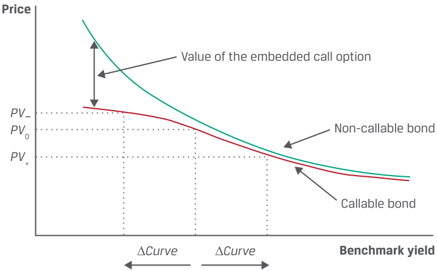
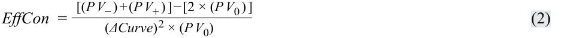
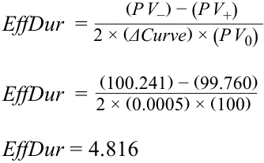
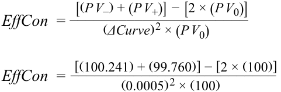
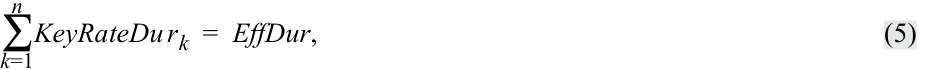
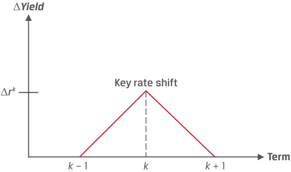

# Tập 6: Chứng khoán Thu nhập Cố định (Fixed Income)
## Learning Module 13 Curve-Based and Empirical Fixed-Income Risk Measures (Trang PDF 331–354)

---

# Tập 6: Thu nhập Cố định (Fixed Income)
## Học phần 13: Các Thước đo Rủi ro Thu nhập Cố định Thực nghiệm và Dựa trên Đường cong Lợi suất (Curve-Based and Empirical Fixed-Income Risk Measures)
### Phần 1/2: Giới thiệu (Trang PDF 331–346)

---

<!-- PDF Page 331 -->

# H Ọ C P H Ầ N **<mark>13</mark>** 

### **Các Thước đo Rủi ro Thu nhập Cố định Thực nghiệm và Dựa trên Đường cong Lợi suất (Curve-Based and Empirical Fixed-Income Risk Measures)** 

##### **<mark>MỤC TIÊU HỌC TẬP (LEARNING OUTCOMES)</mark>**

###### **_Làm chủ kiến thức – Ứng viên cần có khả năng:_**

- giải thích tại sao thời lượng hiệu dụng (*effective duration*) và độ lồi hiệu dụng (*effective convexity*) là những thước đo rủi ro lãi suất thích hợp nhất đối với các trái phiếu có quyền chọn đi kèm (*bonds with embedded options*)
- tính toán phần trăm thay đổi giá của một trái phiếu đối với một mức thay đổi xác định trong lợi suất chuẩn (*benchmark yield*), khi biết thời lượng hiệu dụng và độ lồi hiệu dụng của trái phiếu đó
- định nghĩa thời lượng lãi suất chủ chốt (*key rate duration*) và mô tả việc sử dụng nó để đo lường độ nhạy giá của các công cụ thu nhập cố định trước những thay đổi của đường cong lợi suất chuẩn
- mô tả sự khác biệt giữa thời lượng thực nghiệm (*empirical duration*) và thời lượng giải tích (*analytical duration*)

<!-- Picture Text: 1  -->

#### **GIỚI THIỆU (INTRODUCTION)** 

Sau khi đã tìm hiểu các thước đo thời lượng và độ lồi dựa trên lợi suất, bây giờ chúng ta giới thiệu các thước đo dựa trên đường cong lợi suất (*curve-based measures*) về độ nhạy giá của một trái phiếu trước những thay đổi trong đường cong lợi suất chuẩn và khi các dòng tiền là không chắc chắn. Chúng tôi chỉ ra cách ước tính mức thay đổi trong giá toàn phần của trái phiếu bằng cách kết hợp các thước đo độ nhạy thời lượng và độ lồi dựa trên đường cong lợi suất, thảo luận về việc sử dụng các thước đo xấp xỉ này bởi các tổ chức phát hành và nhà đầu tư, đồng thời giải thích những lợi ích và hạn chế của chúng. Chúng tôi cũng giới thiệu thời lượng lãi suất chủ chốt (*key rate duration*) như một thước đo rủi ro lãi suất dọc theo cấu trúc kỳ hạn (*term structure*). Cuối cùng, chúng tôi chỉ ra rằng những thay đổi trong lợi suất chuẩn và chênh lệch tín dụng (*credit spreads*) đối với các tổ chức phát hành có chất lượng tín dụng thấp hơn có tương quan nghịch, đặc biệt là trong các giai đoạn thị trường căng thẳng, qua đó khẳng định lợi ích của phương pháp tiếp cận thực nghiệm (*empirical approach*) so với phương pháp tiếp cận giải tích (*analytical approach*). 

<!-- PDF Page 332 -->

###### **TỔNG QUAN HỌC PHẦN (LEARNING MODULE OVERVIEW)** 

- Các ước tính thời lượng và độ lồi lợi suất (*yield duration and convexity*) về rủi ro lãi suất chỉ hữu ích đối với những thay đổi nhỏ trong lợi suất. Thời lượng hiệu dụng (*effective duration*) và độ lồi hiệu dụng (*effective convexity*) có giá trị đối với cả những thay đổi nhỏ và lớn trong lợi suất. 

- Thời lượng hiệu dụng và độ lồi hiệu dụng rất hữu ích để đánh giá rủi ro lãi suất của những trái phiếu có dòng tiền tương lai không chắc chắn. 

- Thời lượng hiệu dụng và độ lồi hiệu dụng có thể được sử dụng để ước tính phần trăm thay đổi trong giá toàn phần của trái phiếu đối với một mức dịch chuyển nhất định trong đường cong lợi suất chuẩn. 

- Thời lượng lãi suất chủ chốt (*key rate duration* hay thời lượng từng phần – *partial duration*) là thước đo độ nhạy của một trái phiếu đối với một sự thay đổi trong lợi suất chuẩn tại một kỳ hạn cụ thể. Dữ liệu về thời lượng lãi suất chủ chốt, cùng với các dịch chuyển dự báo trong đường cong chuẩn, cho phép tái cân bằng danh mục đầu tư để cải thiện tỷ suất sinh lợi của nó. 

- Tổng các thời lượng lãi suất chủ chốt có trọng số của các trái phiếu trong một danh mục đầu tư bằng với thời lượng hiệu dụng của toàn bộ danh mục đầu tư đó. 

- Thời lượng và độ lồi giải tích (*analytical duration and convexity*) là các số liệu thống kê thời lượng và độ lồi được ước tính bằng cách sử dụng các công thức toán học. Thời lượng và độ lồi thực nghiệm (*empirical duration and convexity*) được ước tính bằng cách sử dụng dữ liệu lịch sử kết hợp nhiều yếu tố khác nhau ảnh hưởng đến giá trái phiếu. 

- Khi quyết định có nên sử dụng thước đo thực nghiệm hay giải tích, mối tương quan giữa lợi suất chuẩn và chênh lệch tín dụng (*credit spreads*) phải được xem xét. 

###### **TỰ ĐÁNH GIÁ HỌC PHẦN (LEARNING MODULE SELF-ASSESSMENT)** 

Những câu hỏi ban đầu này nhằm giúp bạn đánh giá mức độ hiểu biết hiện tại của mình về học phần. 

1. Đối với công cụ thu nhập cố định nào sau đây, nhà đầu tư _nhiều khả năng nhất_ sẽ sử dụng thời lượng và độ lồi lợi suất để đo lường rủi ro lãi suất thay vì thời lượng hiệu dụng và độ lồi hiệu dụng? 

   - **A.** Trái phiếu lãi suất cố định kỳ hạn 30 năm (*30-year fixed-rate bond*) 

   - **B.** Trái phiếu có thể mua lại (*Callable bond*) 

   - **C.** Chứng khoán đảm bảo bằng thế chấp (*Mortgage-backed security*) 

   - **Lời giải:** 

A là đáp án đúng. Trái phiếu có thể mua lại và chứng khoán đảm bảo bằng thế chấp có các quyền chọn đi kèm (*embedded options*), mà thời lượng và độ lồi lợi suất không thể tính đến được. Trái phiếu lãi suất cố định kỳ hạn 30 năm thì không có quyền chọn đi kèm, vì vậy có thể áp dụng bất kỳ phương pháp nào trong hai phương pháp. 

2. Tính thời lượng hiệu dụng của một trái phiếu khi biết các thông tin sau: 

   - $PV_0 = 102.208$. 

   - Giá khi đường cong lợi suất chuẩn dịch chuyển lên 25 bps: $PV_+ = 100.004$. 

   - Giá khi đường cong lợi suất chuẩn dịch chuyển xuống 25 bps: $PV_- = 103.891$. 

###### **Lời giải:** 

<!-- PDF Page 333 -->

<!-- Formula Text: EffDur  = (P V −) − (P V +) ________________ 2 × (ΔCurve) × (P V 0) EffDur  =    (103.891) − (100.004) __________________ 2 × (0.0025) × (102.208) EffDur = 7.606 -->

$$\text{EffDur} = \frac{(PV_-) - (PV_+)}{2 \times (\Delta \text{Curve}) \times (PV_0)}$$

$$\text{EffDur} = \frac{(103.891) - (100.004)}{2 \times (0.0025) \times (102.208)}$$

$$\text{EffDur} = 7.606$$

3. Tính độ lồi hiệu dụng của một trái phiếu khi biết các thông tin sau:
   - $PV_0 = 102.208$.
   - Giá khi đường cong lợi suất chuẩn dịch chuyển lên 25 bps: $PV_+ = 100.004$. 
   - Giá khi đường cong lợi suất chuẩn dịch chuyển xuống 25 bps: $PV_- = 103.891$. 

**Lời giải:**

$$\text{EffCon} = \frac{[(PV_-) + (PV_+)] - [2 \times (PV_0)]}{(\Delta \text{Curve})^2 \times (PV_0)}$$

$$\text{EffCon} = \frac{[(103.891) + (100.004)] - [2 \times (102.208)]}{(0.0025)^2 \times (102.208)}$$

$$\text{EffCon} = -815.592$$

4. Nếu đường cong lợi suất chuẩn dịch chuyển tăng 50 bps, phần trăm thay đổi trong giá toàn phần của một trái phiếu sẽ là bao nhiêu nếu thời lượng hiệu dụng của nó là 6.094 và độ lồi hiệu dụng của nó là $-230.097$?

**Lời giải:**

$$\%\Delta PV^{\text{Full}} \approx (-\text{EffDur} \times \Delta \text{Curve}) + \left[ \frac{1}{2} \times \text{EffCon} \times (\Delta \text{Curve})^2 \right]$$

$$\%\Delta PV^{\text{Full}} \approx (-6.094 \times 0.005) + \left[ \frac{1}{2} \times -230.097 \times (0.005)^2 \right]$$

$$\%\Delta PV^{\text{Full}} \approx -3.33\%$$

*(Lưu ý: Bản gốc hiển thị `3.33%` đại diện cho mức giảm giá `3.33%`)*

5. Bảng dưới đây chứa các dự báo về những thay đổi kỳ vọng trong đường cong lợi suất chuẩn theo kỳ hạn (*tenor*).

|**Kỳ hạn (Maturity)**|**1 năm (1 year)**|**5 năm (5 years)**|**10 năm (10 years)**|**20 năm (20 years)**|**30 năm (30 years)**|
|---|---|---|---|---|---|
|Mức dịch chuyển đường cong tại kỳ hạn (*Curve shift at maturity*)|+100 bps|+150 bps|+200 bps|+250 bps|+300 bps|

Danh mục đầu tư của bạn chứa các vị thế có quy mô bằng nhau ở Trái phiếu A và Trái phiếu B, có các thời lượng lãi suất chủ chốt như sau. 

<!-- PDF Page 334 -->

|Trái phiếu|**Kỳ hạn (Tenor)**|**Thời lượng Lãi suất Chủ chốt (Key Rate Duration)**|
|---|---|---|
|Trái phiếu A|5 năm|1.706|
|Trái phiếu B|10 năm|3.195|

Với thông tin đã cho và những thay đổi kỳ vọng trong lợi suất, hãy xác định trái phiếu nào có thể được bán đi để cải thiện tỷ suất sinh lợi. 

###### **Lời giải:** 

Trái phiếu B, bởi vì mức giảm giá kỳ vọng của nó từ sự thay đổi kỳ vọng trong lợi suất chuẩn cao gấp hơn hai lần so với Trái phiếu A. 

Đối với Trái phiếu A, $\Delta PV / PV = -1.706 \times 0.015 = -2.56\%$. 

Đối với Trái phiếu B, $\Delta PV / PV = -3.195 \times 0.020 = -6.39\%$. 

6. Giải thích tại sao thời lượng và độ lồi lợi suất lại kém hữu ích hơn đối với các trái phiếu có điều khoản dự phòng (*contingency features*), chẳng hạn như trái phiếu có thể mua lại (*callable bonds*). 

###### **Lời giải:** 

Thời lượng và độ lồi lợi suất giả định rằng các dòng tiền được nhận vào những ngày đã lên lịch. Các dòng tiền từ những trái phiếu có điều khoản dự phòng có thể _không_ được nhận vào những ngày đã lên lịch—ví dụ, nếu một trái phiếu có thể mua lại bị tổ chức phát hành mua lại sau khi lãi suất giảm. Do đó, thời lượng và độ lồi lợi suất sẽ không đo lường chính xác độ nhạy của giá đối với lãi suất. 

7. Khi so sánh thời lượng giải tích (*analytical duration*) với thời lượng thực nghiệm (*empirical duration*), phát biểu nào sau đây là đúng? 

   - **A.** Thời lượng và độ lồi giải tích là các số liệu thống kê thời lượng và độ lồi được ước tính bằng cách sử dụng các công thức toán học. 

   - **B.** Thời lượng và độ lồi thực nghiệm được ước tính bằng cách sử dụng dữ liệu lịch sử trong các mô hình phi thống kê (*non-statistical models*) kết hợp nhiều yếu tố khác nhau ảnh hưởng đến giá trái phiếu. 

   - **C.** Cả A và B 

###### **Lời giải:** 

A là đáp án đúng. Thời lượng và độ lồi giải tích là các số liệu thống kê thời lượng và độ lồi được ước tính bằng cách sử dụng các công thức toán học. 

B không đúng vì các mô hình thống kê (*statistical models*) chủ yếu được sử dụng để xác định thời lượng và độ lồi thực nghiệm. 

C không đúng vì B không đúng. 

8. Đúng hay sai: Thời lượng giải tích ưu việt hơn thời lượng thực nghiệm đối với các trái phiếu có rủi ro tín dụng (*credit risk*). 

###### **Lời giải:** 

Sai (*False*). Nếu lợi suất trái phiếu chính phủ bị đẩy xuống thấp hơn trong một kịch bản thị trường căng thẳng, “xu hướng tìm nơi trú ẩn an toàn” (*flight to safety*) cũng sẽ khiến chênh lệch tín dụng (*credit spreads*) nới rộng ra do sự gia tăng rủi ro vỡ nợ kỳ vọng. Vì chênh lệch tín dụng và lợi suất chuẩn có tương quan nghịch trong kịch bản này, chênh lệch tín dụng rộng hơn sẽ bù trừ một phần hoặc toàn bộ cho sự sụt giảm trong lợi suất chuẩn của chính phủ, dẫn đến ước tính thời lượng thực nghiệm thấp hơn ước tính thời lượng giải tích. Do đó, các ước tính thời lượng thực nghiệm là phương pháp dự báo thay đổi giá trái phiếu chính xác hơn đối với các trái phiếu có rủi ro tín dụng. 

<!-- PDF Page 335 -->

#### **CÁC THƯỚC ĐO RỦI RO LÃI SUẤT DỰA TRÊN ĐƯỜNG CONG LỢI SUẤT (CURVE-BASED INTEREST RATE RISK MEASURES)** 

## **<mark>2</mark>** 

- giải thích tại sao thời lượng hiệu dụng (*effective duration*) và độ lồi hiệu dụng (*effective convexity*) là những thước đo rủi ro lãi suất thích hợp nhất đối với các trái phiếu có quyền chọn đi kèm (*bonds with embedded options*) 

Thời lượng và độ lồi lợi suất giả định rằng các dòng tiền của trái phiếu là chắc chắn. Tuy nhiên, nếu một trái phiếu có các điều khoản dự phòng, chẳng hạn như các quyền chọn đi kèm (*embedded options*), như đối với trái phiếu có thể mua lại (*callable bond*) (hoặc có thể bán lại – *putable bond*), thì các dòng tiền trong tương lai là _không chắc chắn_ vì việc thực hiện quyền chọn phụ thuộc vào mức lãi suất thị trường so với lãi suất coupon đang được thanh toán (hoặc nhận được). Ví dụ, thời lượng của một trái phiếu có thể mua lại _không_ phản ánh độ nhạy của giá trái phiếu đối với sự thay đổi trong lợi suất thấp nhất có thể (*yield-to-worst*), vì điều này chỉ đại diện cho một trong nhiều kết quả có thể xảy ra dựa trên lãi suất trong tương lai. 

Do đó, các trái phiếu có quyền chọn đi kèm không có lợi suất đáo hạn được xác định rõ ràng, nên thời lượng Macaulay và thời lượng điều chỉnh không phải là các thước đo rủi ro lãi suất thích hợp cho những trái phiếu như vậy. Thay vào đó, thước đo rủi ro lãi suất thích hợp là độ nhạy của giá trái phiếu đối với một sự thay đổi trong _đường cong lợi suất chuẩn_ (*benchmark yield curve*)—ví dụ, đường cong lợi suất ngang giá của chính phủ (*government par curve*)—được gọi là **thời lượng hiệu dụng (*effective duration*)**, một số liệu thống kê thời lượng _đường cong_ (*curve duration*) thay vì thời lượng _lợi suất_ (*yield duration*). 

Bảng 1 cho thấy tác động của một sự thay đổi tức thời trong đường cong lợi suất chuẩn ($\Delta \text{Curve}$) lên giá của một trái phiếu có thể mua lại so với tác động lên một trái phiếu không thể mua lại tương đương. Hai trái phiếu có cùng các đặc điểm (tức là lãi suất coupon, tần suất thanh toán, thời gian đáo hạn và rủi ro tín dụng). Lưu ý rằng trục hoành là lợi suất chuẩn—một điểm trên đường cong ngang giá đối với trái phiếu chính phủ. 

###### **Bảng 1: Các Đặc tính Rủi ro Lãi suất của một Trái phiếu Có thể Mua lại (Exhibit 1: Interest Rate Risk Characteristics of a Callable Bond)** 

<!-- Picture Text: Price Value of the embedded call option PV _ PV 0 Non-callable bond PV + Callable bond ∆ Curve ∆ Curve Benchmark yield  -->

> **Chú thích hình ảnh:**
> - **Trục tung:** Giá (*Price*) với các mức giá $PV_-$, $PV_0$, $PV_+$.
> - **Trục hoành:** Lợi suất chuẩn (*Benchmark yield*) với hai khoảng dịch chuyển $\Delta \text{Curve}$.
> - **Các đường biểu diễn:** Trái phiếu không thể mua lại (*Non-callable bond* – nằm phía trên) và Trái phiếu có thể mua lại (*Callable bond* – nằm phía dưới, bị uốn cong xuống khi lợi suất giảm thấp); khoảng cách giữa hai đường là Giá trị của quyền chọn mua đi kèm (*Value of the embedded call option*).

Giá của trái phiếu không thể mua lại luôn lớn hơn giá của trái phiếu có thể mua lại tương đương. Khoảng chênh lệch chính là giá trị của quyền chọn mua đi kèm (*embedded call option*), được nắm giữ bởi tổ chức phát hành trái phiếu (chứ không phải nhà đầu tư). Khi lãi suất cao so với lãi suất coupon, giá trị của quyền chọn mua thấp. Khi lãi suất thấp, giá trị của quyền chọn mua cao vì tổ chức phát hành có nhiều khả năng thực hiện quyền chọn để tái tài trợ khoản nợ ở mức lãi suất hiện hành thấp hơn. Nhà đầu tư gánh chịu “rủi ro bị mua lại” (*call risk*) vì nếu trái phiếu bị mua lại, nhà đầu tư phải tái đầu tư số tiền thu được ở mức lãi suất thấp hơn. 

<!-- PDF Page 336 -->

Bảng 1 cho thấy rằng, với những dịch chuyển song song trong đường cong lợi suất chuẩn, khi lợi suất chuẩn ở mức cao ($\Delta \text{Curve}$ dương), _thời lượng hiệu dụng_ của trái phiếu có thể mua lại và không thể mua lại là rất giống nhau. Nhưng khi lãi suất ở mức thấp ($\Delta \text{Curve}$ âm), thời lượng hiệu dụng của trái phiếu có thể mua lại thấp hơn so với trái phiếu không thể mua lại có các đặc điểm khác tương đương, vì giá trái phiếu có thể mua lại không tăng nhiều khi lợi suất chuẩn giảm; sự hiện diện của quyền chọn mua giới hạn mức tăng giá (*price appreciation*). Như vậy, quyền chọn mua đi kèm làm giảm thời lượng hiệu dụng của trái phiếu, đặc biệt là khi lãi suất đang giảm và trái phiếu có nhiều khả năng bị mua lại hơn. Thời lượng hiệu dụng thấp hơn có thể được diễn giải là vòng đời kỳ vọng ngắn hơn—mức trung bình có trọng số của thời gian nhận dòng tiền bị giảm xuống. 

Tương tự như thời lượng hiệu dụng, tác động bậc hai của một sự dịch chuyển song song trong đường cong lợi suất chuẩn được đo lường bằng **độ lồi hiệu dụng (*effective convexity*)**, một số liệu thống kê _độ lồi đường cong_ (*curve convexity*). Trong Bảng 1, khi lợi suất chuẩn giảm, độ dốc của đường tiếp tuyến với đường cong của trái phiếu không thể mua lại trở nên dốc hơn, cho thấy độ lồi dương (*positive convexity*). Nhưng độ dốc của đường tiếp tuyến với trái phiếu có thể mua lại trở nên phẳng hơn khi lợi suất chuẩn giảm và đạt đến một điểm uốn (*inflection point*), sau điểm đó độ lồi hiệu dụng trở nên âm (*negative convexity*). 

Khi lợi suất chuẩn cao và giá trị của quyền chọn mua đi kèm thấp, trái phiếu có thể mua lại và trái phiếu không thể mua lại chịu những tác động rất giống nhau từ sự thay đổi lãi suất và cả hai đều có độ lồi dương. Nhưng khi lợi suất chuẩn giảm xuống, hai đường cong phân kỳ, và tại một điểm nào đó, trái phiếu có thể mua lại đi vào vùng có độ lồi âm, vì quyền chọn mua đi kèm có nhiều giá trị hơn đối với tổ chức phát hành và có nhiều khả năng được thực hiện hơn. Tình huống này càng giới hạn thêm tiềm năng tăng giá của trái phiếu phát sinh từ mức lợi suất chuẩn thấp hơn. 

Bảng 2 cho thấy các đặc điểm của một trái phiếu có quyền chọn bán đi kèm (*embedded put option*). 

**Bảng 2: Các Đặc tính Rủi ro Lãi suất của một Trái phiếu Có thể Bán lại (Exhibit 2: Interest Rate Risk Characteristics of a Putable Bond)** 

<!-- Picture Text: Price Putable bond Value of the embedded put option PV – PV 0 PV + Non-putable bond ∆ Curve ∆ Curve Benchmark yield  -->

> **Chú thích hình ảnh:**
> - **Trục tung:** Giá (*Price*) với các mức giá $PV_-$, $PV_0$, $PV_+$.
> - **Trục hoành:** Lợi suất chuẩn (*Benchmark yield*) với hai khoảng dịch chuyển $\Delta \text{Curve}$.
> - **Các đường biểu diễn:** Trái phiếu có thể bán lại (*Putable bond* – nằm phía trên, có sàn giá khi lợi suất tăng cao) và Trái phiếu không thể bán lại (*Non-putable bond* – nằm phía dưới); khoảng cách giữa hai đường khi lợi suất cao là Giá trị của quyền chọn bán đi kèm (*Value of the embedded put option*).

Trái phiếu có thể bán lại (*putable bond*) cho phép nhà đầu tư bán lại trái phiếu cho tổ chức phát hành trước khi đáo hạn, thường là ở mức mệnh giá, bảo vệ nhà đầu tư khỏi mức lợi suất chuẩn cao hơn mà nếu không có quyền chọn này sẽ đẩy giá trái phiếu xuống dưới mệnh giá. Vì vậy, giá của một trái phiếu có thể bán lại luôn cao hơn giá của một trái phiếu không thể bán lại có các đặc điểm khác tương đương, phần chênh lệch giá chính là giá trị của quyền chọn bán đi kèm. 

Quyền chọn bán đi kèm làm giảm thời lượng hiệu dụng của trái phiếu, đặc biệt là khi lãi suất đang tăng. Với sự dịch chuyển song song trong đường cong lợi suất chuẩn, nếu lãi suất thấp so với lãi suất coupon, giá trị của quyền chọn bán sẽ thấp và tác động của sự thay đổi trong lợi suất chuẩn lên giá trái phiếu rất giống với trái phiếu không thể bán lại. Nhưng khi lãi suất chuẩn tăng lên, quyền chọn bán 

<!-- PDF Page 337 -->

trở nên có giá trị hơn đối với nhà đầu tư, vì khả năng bán lại trái phiếu cho tổ chức phát hành ở mức mệnh giá giúp giới hạn mức giảm giá khi lãi suất tăng. Điều quan trọng là trái phiếu có thể bán lại luôn có độ lồi hiệu dụng dương. 

Thời lượng hiệu dụng và độ lồi hiệu dụng cũng rất phù hợp đối với chứng khoán đảm bảo bằng thế chấp (*mortgage-backed securities* – MBSs), phát sinh từ việc chứng khoán hóa danh mục cho vay mua nhà ở (hoặc bất động sản thương mại) và sẽ được trình bày trong các bài học sau. Các dòng tiền của MBS phụ thuộc vào khả năng tái cấp vốn (*refinance*) hoặc trả hết khoản vay thế chấp hiện có của người sở hữu nhà bằng số tiền thu được từ một khoản thế chấp mới. Tái cấp vốn là một tính năng phổ biến của các khoản thế chấp tại Hoa Kỳ và một số khu vực pháp lý khác mà người đi vay có xu hướng thực hiện nếu lãi suất giảm. 

Cách tính thời lượng hiệu dụng ($\text{EffDur}$) rất giống với cách tính thời lượng điều chỉnh xấp xỉ, như được thể hiện trong Phương trình 1. 

<!-- Formula Text: EffDur  = (P V − ) − (P V +) ________________ 2 × (ΔCurve ) × (P V 0) (1) -->

$$\text{EffDur} = \frac{(PV_-) - (PV_+)}{2 \times (\Delta \text{Curve}) \times (PV_0)} \tag{1}$$

Công thức tính độ lồi hiệu dụng ($\text{EffCon}$) cũng rất giống với công thức tính độ lồi xấp xỉ, như được thể hiện trong Phương trình 2. 

<!-- Formula Text: EffCon  = [(P V − ) + (P V + ) ] − [2 × (P V 0 ) ] ______________________ (ΔCurve) 2 × (P V 0) (2) -->

$$\text{EffCon} = \frac{[(PV_-) + (PV_+)] - [2 \times (PV_0)]}{(\Delta \text{Curve})^2 \times (PV_0)} \tag{2}$$

Điểm khác biệt là $\Delta \text{Curve}$ nằm ở mẫu số—vì thời lượng hiệu dụng là một số liệu thống kê _thời lượng đường cong_, nó đo lường rủi ro lãi suất theo sự dịch chuyển song song trong đường cong lợi suất chuẩn—và $PV_-$ cùng $PV_+$ được tính bằng cách sử dụng các mô hình định giá quyền chọn (*option pricing models*). Các mô hình này được trình bày chi tiết hơn trong các học phần sau nhưng bao gồm các thông số đầu vào như (1) độ dài của thời gian bảo vệ khỏi việc bị mua lại (*call protection period*), (2) lịch trình giá mua lại và ngày mua lại, (3) giả định về chênh lệch tín dụng so với lợi suất chuẩn (cũng bao gồm bất kỳ mức chênh lệch thanh khoản nào), (4) giả định về biến động lãi suất trong tương lai (*interest rate volatility*), và (5) mức lãi suất thị trường (ví dụ: đường cong ngang giá của chính phủ). Chuyên viên phân tích giữ nguyên bốn thông số đầu vào đầu tiên rồi tăng và giảm thông số đầu vào thứ năm (tức là dịch chuyển song song) để suy ra $PV_+$ và $PV_-$ tương ứng. 

Mặc dù thời lượng hiệu dụng và độ lồi hiệu dụng là thước đo rủi ro lãi suất thích hợp đối với các trái phiếu có quyền chọn đi kèm, chúng cũng có thể hữu ích đối với các trái phiếu không kèm quyền chọn nhằm bổ sung cho thời lượng lợi suất. Điều quan trọng là có thể phát sinh những khác biệt nhỏ giữa thời lượng hiệu dụng và thời lượng điều chỉnh của một trái phiếu bởi vì khi đường cong ngang giá của chính phủ được dịch chuyển trong mô hình, đường cong lãi suất giao ngay (*spot/zero curve*) của chính phủ cũng dịch chuyển theo, nhưng không theo cùng một cách thức song song như vậy. Do đó, mức thay đổi trong giá trái phiếu không giống như khi lợi suất đáo hạn của chính nó thay đổi cùng một lượng bằng với mức thay đổi trong đường cong ngang giá. 

Nhìn chung, thời lượng điều chỉnh và thời lượng hiệu dụng của một trái phiếu không kèm quyền chọn không hoàn toàn giống hệt nhau. Tuy nhiên, sự khác biệt thu hẹp lại khi đường cong lợi suất phẳng hơn, thời gian đáo hạn ngắn hơn và trái phiếu được định giá gần với mệnh giá hơn; sự khác biệt chỉ biến mất trong trường hợp hiếm hoi khi đường cong lợi suất hoàn toàn phẳng. 

Ví dụ, hãy xét trái phiếu trả coupon 3.2% (bán niên), kỳ hạn 5 năm của BRWA được định giá ngang mệnh giá để thanh toán vào ngày 15 tháng 10 năm 2025 và đáo hạn vào ngày 15 tháng 10 năm 2030. Sử dụng $PV_0 = 100.00$ và $\Delta \text{Yield} = 0.0005$, trong một bài học trước, chúng ta đã tìm ra 

$$PV_+ = 99.771 \text{ và } PV_- = 100.230$$

dẫn đến các số liệu thống kê thời lượng và độ lồi lợi suất như sau: 

$$\text{ApproxModDur} = 4.587 \text{ và } \text{ApproxCon} = 24.239$$

Thay vì một sự thay đổi trong lợi suất đáo hạn của trái phiếu, hãy giả sử có một sự dịch chuyển lên và xuống của đường cong ngang giá chuẩn của chính phủ ($\Delta \text{Curve}$) ở mức 5 bps, khiến lãi suất giao ngay biến động theo cách thức hơi không song song một chút. Sử dụng $PV_0 = 100.00$ và $\Delta \text{Curve} = 0.0005$ đồng thời giả định các mức giá mới sau đây, 

$$PV_+ = 99.760 \text{ và } PV_- = 100.241$$

<!-- PDF Page 338 -->

khi đó sử dụng Phương trình 1, thời lượng hiệu dụng là 4.816: 

<!-- Formula Text: EffDur  = (P V −) − (P V +) ________________ 2 × (ΔCurve) × (P V 0) EffDur  =   (100.241) − (99.760) _______________ 2 × (0.0005) × (100) EffDur = 4.816 -->

$$\text{EffDur} = \frac{(PV_-) - (PV_+)}{2 \times (\Delta \text{Curve}) \times (PV_0)}$$

$$\text{EffDur} = \frac{(100.241) - (99.760)}{2 \times (0.0005) \times (100)}$$

$$\text{EffDur} = 4.816$$

Sử dụng cùng các thông số đầu vào trong Phương trình 2, độ lồi hiệu dụng là 40.000: 

<!-- Formula Text: EffCon  = [(P V −) + (P V +)] − [2 × (P V 0)] ______________________ (ΔCurve) 2 × (P V 0) EffCon  =   [(100.241) + (99.760)] − [2 × (100)] __________________________ (0.0005) 2 × (100) -->

$$\text{EffCon} = \frac{[(PV_-) + (PV_+)] - [2 \times (PV_0)]}{(\Delta \text{Curve})^2 \times (PV_0)}$$

$$\text{EffCon} = \frac{[(100.241) + (99.760)] - [2 \times (100)]}{(0.0005)^2 \times (100)}$$

$$\text{EffCon} = 40.000$$

###### **VÍ DỤ 1 (EXAMPLE 1)** 

##### **Thời lượng và Độ lồi Hiệu dụng (Effective Duration and Convexity)** 

Nhà quản lý danh mục đầu tư yêu cầu bạn, chuyên viên phân tích trong nhóm thu nhập cố định, xác định độ nhạy lãi suất của một trái phiếu có thể mua lại mà cô đang cân nhắc. Nhà quản lý danh mục đầu tư đang tìm cách đầu tư vào một trái phiếu có thời lượng từ 7.0 đến 8.0 và có độ lồi dương. 

Giả sử giá toàn phần của trái phiếu có thể mua lại là 101.060 trên mỗi 100 mệnh giá. Khi đường cong ngang giá của chính phủ được nâng lên và hạ xuống 25 bps, các mức giá toàn phần mới cho trái phiếu có thể mua lại này từ mô hình định giá quyền chọn của bạn lần lượt là 99.050 và 102.891. Do đó, 

- $PV_0 = 101.060$, 

- $PV_+ = 99.050$, 

- $PV_- = 102.891$, và 

- $\Delta \text{Curve} = 0.0025$. 

Bạn xác định thời lượng hiệu dụng và độ lồi hiệu dụng cho trái phiếu có thể mua lại này như sau:

$$\text{EffDur} = \frac{(PV_-) - (PV_+)}{2 \times (\Delta \text{Curve}) \times (PV_0)}$$

$$\text{EffDur} = \frac{(102.891) - (99.050)}{2 \times (0.0025) \times (101.060)}$$

$$\text{EffDur} = 7.601$$

$$\text{EffCon} = \frac{[(PV_-) + (PV_+)] - [2 \times (PV_0)]}{(\Delta \text{Curve})^2 \times (PV_0)}$$

$$\text{EffCon} = \frac{[(102.891) + (99.050)] - [2 \times (101.060)]}{(0.0025)^2 \times (101.060)}$$

$$\text{EffCon} = -283$$

Bạn khuyến nghị nhà quản lý danh mục đầu tư không mua trái phiếu có thể mua lại này. Mặc dù thời lượng hiệu dụng của nó đáp ứng tiêu chí của cô ấy, nhưng trái phiếu lại có độ lồi hiệu dụng âm. 

<!-- PDF Page 339 -->

###### **BỘ CÂU HỎI (QUESTION SET)** 

###### 1. Hãy ghép mỗi kịch bản với các thước đo rủi ro lãi suất dưới đây. 

|**Kịch bản (Scenario)**|**Thước đo rủi ro lãi suất (Interest rate risk measure)**|
|---|---|
|A. Phần trăm thay đổi giá của trái phiếu khi có một sự thay đổi trong lợi suất đáo hạn của nó|Thời lượng tiền tệ (*Money duration*)|
|B. Phép xấp xỉ tuyến tính về mức thay đổi giá của trái phiếu tính bằng tiền tệ, khi lợi suất thay đổi 1%|Thời lượng điều chỉnh (*Modified duration*)|
|C. Trái phiếu có thể mua lại (*Callable bond*)|Thời lượng hiệu dụng (*Effective duration*)|

###### **Lời giải:** 

Kịch bản A ghép với thời lượng điều chỉnh (*modified duration*). Thời lượng điều chỉnh được sử dụng để ước tính phần trăm thay đổi giá khi có sự thay đổi trong lợi suất đáo hạn. Kịch bản B ghép với thời lượng tiền tệ (*money duration*). Thời lượng tiền tệ biểu thị thời lượng điều chỉnh theo đơn vị tiền tệ, có thể được sử dụng để ước tính mức thay đổi tính bằng đơn vị tiền tệ trong vị thế của một trái phiếu. 

Kịch bản C ghép với thời lượng hiệu dụng (*effective duration*). Trái phiếu có thể mua lại có các dòng tiền tương lai không chắc chắn đối với lãi suất trong tương lai. Do đó, một số liệu thống kê thời lượng đường cong, chẳng hạn như thời lượng hiệu dụng, sẽ là tốt nhất để đo lường rủi ro lãi suất. 

Các câu hỏi 2–5 liên quan đến thông tin sau đây: 

Là thành viên của nhóm thu nhập cố định, bạn được yêu cầu kiểm tra dữ liệu định giá cho một trái phiếu có thể mua lại của Viviyu Inc. Giá toàn phần hiện tại, giá giả định đường cong lợi suất chuẩn dịch chuyển lên 25 bps, và giá giả định đường cong lợi suất chuẩn dịch chuyển xuống 25 bps, như sau: 

- $PV_0 = 102.208$, 

- $PV_+ = 100.004$, và 

- $PV_- = 103.891$. 

2. Tính thời lượng hiệu dụng của trái phiếu có thể mua lại của Viviyu Inc. 

###### **Lời giải:** 

$$\text{EffDur} = \frac{(PV_-) - (PV_+)}{2 \times (\Delta \text{Curve}) \times (PV_0)}$$

$$\text{EffDur} = \frac{(103.891) - (100.004)}{2 \times (0.0025) \times (102.208)}$$

$$\text{EffDur} = 7.6061$$

3. Trong một cuộc kiểm toán dữ liệu, người ta xác định rằng $PV_+$ bị sai và giá trị đúng của $PV_+$ là 100.50426. Tất cả các giá trị dữ liệu khác đều đúng. 

<!-- PDF Page 340 -->

Hãy giải thích xem dữ liệu cập nhật sẽ làm tăng hay giảm giá trị của thời lượng hiệu dụng. 

###### **Lời giải:** 

Không cần phải tính lại thời lượng hiệu dụng. Vì giá trị $PV_+$ cập nhật lớn hơn giá trị trước đó, khi tất cả các yếu tố khác không đổi, tử số sẽ nhỏ hơn; do đó, thời lượng hiệu dụng sẽ giảm xuống. 

4. Tính độ lồi hiệu dụng của trái phiếu có thể mua lại của Viviyu Inc. bằng cách sử dụng các thông tin sau: 

   - $PV_0 = 102.208$, 

   - $PV_+ = 98.504$, 

   - $PV_- = 103.891$, và 

   - $\Delta \text{Curve} = 0.0025$. 

###### **Lời giải:** 

$$\text{EffCon} = \frac{[(PV_-) + (PV_+)] - [2 \times (PV_0)]}{(\Delta \text{Curve})^2 \times (PV_0)}$$

$$\text{EffCon} = \frac{[(103.891) + (98.504)] - [2 \times (102.208)]}{(0.0025)^2 \times (102.208)}$$

$$\text{EffCon} = -3,164$$

5. Trong Câu hỏi 4, độ lồi hiệu dụng mang dấu âm, chứ không phải dương như thời lượng hiệu dụng. Hãy giải thích độ lồi hiệu dụng âm hàm ý điều gì.

###### **Lời giải:** 

Độ lồi hiệu dụng âm hàm ý rằng giá trái phiếu sẽ giảm một lượng lớn hơn khi đường cong lợi suất chuẩn dịch chuyển đi lên so với mức tăng giá khi lợi suất chuẩn giảm xuống. 

## **<mark>3</mark>** 

#### **RỦI RO VÀ TỶ SUẤT SINH LỢI CỦA TRÁI PHIẾU SỬ DỤNG THỜI LƯỢNG VÀ ĐỘ LỒI DỰA TRÊN ĐƯỜNG CONG LỢI SUẤT (BOND RISK AND RETURN USING CURVE-BASED DURATION AND CONVEXITY)** 

- tính toán phần trăm thay đổi giá của một trái phiếu đối với một mức thay đổi xác định trong lợi suất chuẩn (*benchmark yield*), khi biết thời lượng hiệu dụng và độ lồi hiệu dụng của trái phiếu đó 

Như chúng ta đã thấy, thời lượng hiệu dụng và độ lồi hiệu dụng là các thước đo dựa trên đường cong lợi suất rất hữu ích để đánh giá rủi ro lãi suất của các công cụ phức tạp—chẳng hạn như những công cụ có các điều khoản dự phòng đi kèm—vốn có các dòng tiền tương lai không chắc chắn. Các thước đo này thường được xác định từ giá trái phiếu suy ra bằng cách sử dụng mô hình định giá quyền chọn, ứng với những thay đổi (song song) cụ thể trong đường cong lợi suất chính phủ chuẩn cơ sở. 

Cũng giống như các thước đo rủi ro lãi suất dựa trên lợi suất, thời lượng hiệu dụng và độ lồi hiệu dụng có thể được sử dụng để ước tính phần trăm thay đổi trong giá toàn phần của một trái phiếu đối với một mức dịch chuyển nhất định trong đường cong lợi suất chuẩn ($\Delta \text{Curve}$), như được thể hiện trong Phương trình 3. 

<!-- PDF Page 341 -->

<!-- Formula Text: %ΔP V Full  ≈  (− EffDur × ΔCurve ) + [ 1 _ 2  × EffCon × (ΔCurve) 2]. (3) -->

$$\%\Delta PV^{\text{Full}} \approx (-\text{EffDur} \times \Delta \text{Curve}) + \left[ \frac{1}{2} \times \text{EffCon} \times (\Delta \text{Curve})^2 \right] \tag{3}$$

Hãy quay lại với trái phiếu trả coupon 3.2% (bán niên), kỳ hạn 5 năm của BRWA được định giá ngang mệnh giá để thanh toán vào ngày 15 tháng 10 năm 2025 và đáo hạn vào ngày 15 tháng 10 năm 2030. Sử dụng Phương trình 3 cùng với thời lượng hiệu dụng và độ lồi hiệu dụng đã suy ra trước đó, 

$$\text{EffDur} = 4.816 \text{ và } \text{EffCon} = 26.723$$

phần trăm thay đổi trong giá toàn phần của trái phiếu đối với các mức dịch chuyển $\pm 100\text{ bp}$ trong đường cong ngang giá chuẩn của chính phủ được ước tính như sau: 

$$\%\Delta PV^{\text{Full}} \approx (-4.816 \times 0.01) + \left[ \frac{1}{2} \times 26.723 \times (0.01)^2 \right] = -4.68\%$$

$$\%\Delta PV^{\text{Full}} \approx (-4.816 \times -0.01) + \left[ \frac{1}{2} \times 26.723 \times (-0.01)^2 \right] = 4.95\%$$

Những mức thay đổi giá trái phiếu này được so sánh với các ước tính đã suy ra trước đó là $-4.47\%$ và $4.71\%$ cho trái phiếu BRWA này khi sử dụng $\text{ApproxModDur}$ và $\text{ApproxCon}$ tương ứng với mức thay đổi lợi suất đáo hạn là $\pm 100\text{ bps}$. 

Như đã lưu ý trước đó, sự khác biệt trong kết quả khi sử dụng các thước đo dựa trên đường cong lợi suất so với các thước đo rủi ro lãi suất dựa trên lợi suất là do các mức giá trái phiếu ($PV_+$ và $PV_-$) hơi khác nhau một chút và do đó các thước đo $\text{EffDur}$ và $\text{EffCon}$ (so với các thước đo $\text{ApproxModDur}$ và $\text{ApproxCon}$) cũng khác nhau, vì một sự dịch chuyển song song trong đường cong ngang giá của chính phủ tạo ra một sự dịch chuyển không song song trong lãi suất giao ngay (*spot/zero rates*) và lãi suất kỳ hạn một năm (*one-year forward rates*). 

Các thước đo rủi ro lãi suất dựa trên đường cong lợi suất rất quan trọng đối với cả tổ chức phát hành lẫn nhà đầu tư. Ví dụ, như đã lưu ý trước đó, đối với một trái phiếu có thể mua lại, khi đường cong chuẩn dịch chuyển đi xuống và lãi suất thấp so với lãi suất coupon của trái phiếu, thời lượng hiệu dụng sẽ giảm và độ lồi hiệu dụng thậm chí có thể chuyển từ dương sang âm. Từ góc độ của nhà đầu tư, những kết quả này hạn chế nghiêm trọng khả năng tăng giá của trái phiếu trong môi trường lãi suất giảm. Từ góc độ của tổ chức phát hành, các trái phiếu có thể được mua lại ở mức giá mua lại (*call price*) và được tái tài trợ ở mức lãi suất thị trường thấp hơn. 

Đối với một trái phiếu có thể bán lại, khi đường cong chuẩn dịch chuyển đi lên và lãi suất cao so với lãi suất coupon của trái phiếu, cả thời lượng hiệu dụng và độ lồi hiệu dụng đều giảm (nhưng độ lồi hiệu dụng luôn duy trì ở mức dương), điều này, từ góc độ của nhà đầu tư, giúp hạn chế mức giảm giá của trái phiếu trong môi trường lãi suất tăng. Điều này là do nhà đầu tư có thể bán lại trái phiếu cho tổ chức phát hành ở mức giá bán lại (*put price* – thường là ngang mệnh giá), thay vì ở mức giá chiết khấu, và tái đầu tư số tiền thu được ở mức lãi suất thị trường hiện hành cao hơn. 

Một điểm cần cân nhắc thực tế khi sử dụng thời lượng hiệu dụng và độ lồi hiệu dụng là việc thiết lập mức thay đổi trong đường cong lợi suất chuẩn. Với thời lượng điều chỉnh xấp xỉ, độ chính xác được cải thiện bằng cách chọn một mức thay đổi lợi suất đáo hạn nhỏ hơn. Các mô hình định giá được sử dụng cho các chứng khoán phức tạp hơn, chẳng hạn như trái phiếu có thể mua lại do các doanh nghiệp phát hành và chứng khoán đảm bảo bằng tài sản (*asset-backed securities* – ABSs), bao gồm các giả định về hành vi của các tổ chức phát hành doanh nghiệp hoặc những người đi vay mà các khoản vay của họ cấu thành nên tài sản ABS cơ sở dưới các kịch bản lãi suất khác nhau. Ví dụ, quyết định mua lại trái phiếu và tái tài trợ của một tổ chức phát hành doanh nghiệp phụ thuộc một phần vào chênh lệch tín dụng đặc thù của tổ chức phát hành đó (*issuer-specific credit spreads*). Đối với những người vay thế chấp, những thay đổi trong giá trị của tài sản cơ sở được tài trợ sẽ ảnh hưởng đến quyết định tái cấp vốn khoản thế chấp và do đó mua lại trái phiếu MBS. Vì vậy, các ước tính rủi ro lãi suất sử dụng thời lượng hiệu dụng và độ lồi hiệu dụng không nhất thiết được cải thiện bằng cách chọn một mức thay đổi nhỏ hơn trong lãi suất chuẩn. Các thước đo rủi ro lãi suất dựa trên đường cong lợi suất đã trở thành một công cụ quan trọng trong phân tích tài chính không chỉ đối với các trái phiếu truyền thống mà còn đối với các khoản nợ tài chính (*financial liabilities*). 

<!-- PDF Page 342 -->

###### **VÍ DỤ 2 (EXAMPLE 2)** 

##### **Sử dụng Thời lượng và Độ lồi Hiệu dụng để Ước tính Thay đổi Giá Trái phiếu Khi Lãi suất Chuẩn Thay đổi (Using Effective Duration and Convexity to Estimate Bonds’ Price Changes Given Benchmark Rate Changes)** 

Tiếp tục từ Ví dụ 1, để củng cố khuyến nghị của bạn rằng nhà quản lý danh mục đầu tư (PM) không nên mua trái phiếu có thể mua lại đang giao dịch ở mức giá 101.060, bạn muốn chứng minh tác động về giá của độ lồi hiệu dụng âm của trái phiếu. Bạn giả định đường cong ngang giá chuẩn của chính phủ tăng và giảm 100 bps và sử dụng Phương trình 3, với các ước tính $\text{EffDur}$ và $\text{EffCon}$ dựa trên giá trái phiếu từ mô hình định giá quyền chọn của bạn, để suy ra các kết quả sau: 

- $\%\Delta PV^{\text{Full}} \approx (-7.601 \times 0.01) + \left[ \frac{1}{2} \times -285.168 \times (0.0100)^2 \right] = -9.03\%$. 

- $\%\Delta PV^{\text{Full}} \approx (-7.601 \times -0.01) + \left[ \frac{1}{2} \times -285.168 \times (-0.0100)^2 \right] = 6.17\%$. 

Khi thảo luận các kết quả này với PM, bạn kết luận rằng độ lồi hiệu dụng âm làm gia tăng mức giảm giá của trái phiếu khi lãi suất chuẩn tăng và làm suy giảm mức tăng giá của trái phiếu khi lãi suất chuẩn giảm. Nếu dự báo của PM là xác suất tăng hoặc giảm của đường cong ngang giá chuẩn ngang nhau, PM sẽ không đầu tư. Tuy nhiên, nếu dự báo của PM là xác suất đường cong chuẩn giảm xuống lớn hơn, sao cho mức lợi nhuận kỳ vọng lớn hơn 0, cô ấy có thể quyết định đầu tư vào trái phiếu này. 

###### **BỘ CÂU HỎI (QUESTION SET)** 

Các câu hỏi 1–5 liên quan đến thông tin sau đây: 

Là một chuyên viên phân tích thu nhập cố định, bạn được yêu cầu xem xét tác động của việc đường cong ngang giá chuẩn của chính phủ dịch chuyển đi lên 200 bps đối với hai trái phiếu, như một phần của kịch bản kiểm tra sức chịu đựng nội bộ (*internal stress scenario*). Từ mô hình định giá trái phiếu, thông tin sau đây về thời lượng hiệu dụng và độ lồi hiệu dụng đã được thu thập. 

- Trái phiếu A: Thời lượng hiệu dụng $= 9.369$; Độ lồi hiệu dụng $= -353.752$.
- Trái phiếu B: Thời lượng hiệu dụng $= 8.517$; Độ lồi hiệu dụng $= -321.756$. 

1. Tính phần trăm thay đổi ước tính trong giá toàn phần của Trái phiếu A đối với mức dịch chuyển đường cong 200 bps. 

**Lời giải:** 

$$\%\Delta PV^{\text{Full}} \approx (-\text{EffDur} \times \Delta \text{Curve}) + \left[ \frac{1}{2} \times \text{EffCon} \times (\Delta \text{Curve})^2 \right]$$

$$\%\Delta PV^{\text{Full}} \approx (-9.369 \times 0.02) + \left[ \frac{1}{2} \times -353.752 \times (0.02)^2 \right]$$

$$\%\Delta PV^{\text{Full}} \approx -25.81\%$$

2. Tính phần trăm thay đổi ước tính trong giá toàn phần của Trái phiếu B đối với mức dịch chuyển đường cong 200 bps.

**Lời giải:** 

$$\%\Delta PV^{\text{Full}} \approx (-\text{EffDur} \times \Delta \text{Curve}) + \left[ \frac{1}{2} \times \text{EffCon} \times (\Delta \text{Curve})^2 \right]$$

$$\%\Delta PV^{\text{Full}} \approx (-8.517 \times 0.02) + \left[ \frac{1}{2} \times -321.756 \times (0.02)^2 \right]$$

$$\%\Delta PV^{\text{Full}} \approx -23.47\%$$

<!-- PDF Page 343 -->

3. Dựa trên Câu hỏi 1 và 2, nếu cả hai trái phiếu đều nằm trong một danh mục đầu tư và phải đưa ra quyết định bán một trong hai trái phiếu trước dự báo lãi suất tăng mạnh, hãy khuyến nghị bán Trái phiếu A hay Trái phiếu B. Hãy giải thích câu trả lời của bạn.

**Lời giải:**

Bán Trái phiếu A vì nó có phần trăm thay đổi âm lớn hơn trong giá toàn phần của trái phiếu. Cứ mỗi 200 bps tăng lên trong đường cong chuẩn, giá toàn phần của trái phiếu giảm 25.81%.

4. Nếu bạn đang dự báo đường cong lợi suất chuẩn dịch chuyển đi xuống 200 điểm cơ bản, hãy khuyến nghị bổ sung Trái phiếu A hay Trái phiếu B vào danh mục đầu tư để đón đầu sự dịch chuyển đường cong đó. Hãy giải thích câu trả lời của bạn.

**Lời giải:**

Bổ sung Trái phiếu A, vì khi bạn tính phần trăm thay đổi trong giá toàn phần cho Trái phiếu A và B, Trái phiếu A có phần trăm thay đổi dương cao hơn.

$$\%\Delta PV^{\text{Full}} \text{ Trái phiếu A} \approx (-9.369 \times -0.02) + \left[ \frac{1}{2} \times -353.752 \times (-0.0200)^2 \right] = 11.66\%$$

$$\%\Delta PV^{\text{Full}} \text{ Trái phiếu B} \approx (-8.517 \times -0.02) + \left[ \frac{1}{2} \times -321.756 \times (-0.0200)^2 \right] = 10.60\%$$

5. Giải thích tại sao phần trăm thay đổi ước tính trong giá trái phiếu từ mức dịch chuyển đi lên 200 bps của đường cong lợi suất chuẩn lại lớn hơn gấp đôi so với phần trăm thay đổi ước tính trong giá trái phiếu từ mức dịch chuyển đi xuống 200 bps của đường cong lợi suất.

**Lời giải:**

Bởi vì độ lồi hiệu dụng mang dấu âm, sự dịch chuyển đi lên trong đường cong lợi suất dẫn đến mức thay đổi giá tuyệt đối cao hơn so với sự dịch chuyển đi xuống trong đường cong lợi suất. Đối với sự dịch chuyển đi xuống (lưu ý: bản gốc ghi nhầm là *upward shift* ở câu giải thích cuối), phần đóng góp của thời lượng là dương và phần đóng góp của độ lồi là âm, triệt tiêu lẫn nhau một phần (trong khi với dịch chuyển đi lên, cả phần đóng góp của thời lượng và độ lồi đều âm nên cộng hưởng làm giá giảm sâu hơn).

#### **THỜI LƯỢNG LÃI SUẤT CHỦ CHỐT NHƯ MỘT THƯỚC ĐO RỦI RO ĐƯỜNG CONG LỢI SUẤT (KEY RATE DURATION AS A MEASURE OF YIELD CURVE RISK)** 

## **<mark>4</mark>** 

- định nghĩa thời lượng lãi suất chủ chốt (*key rate duration*) và mô tả việc sử dụng nó để đo lường độ nhạy giá của các công cụ thu nhập cố định trước những thay đổi của đường cong lợi suất chuẩn 

Như chúng ta đã thấy, thời lượng hiệu dụng đo lường độ nhạy của một trái phiếu đối với những thay đổi trong đường cong lợi suất chuẩn nếu tất cả các mức lợi suất đều thay đổi cùng một lượng. Thời lượng lãi suất chủ chốt cung cấp cái nhìn sâu sắc hơn về độ nhạy của trái phiếu đối với những thay đổi _không song song_ (*non-parallel*) của đường cong lợi suất chuẩn. **Thời lượng lãi suất chủ chốt (*Key rate duration*)** (hay thời lượng từng phần – *partial duration*) là một thước đo độ nhạy của trái phiếu đối với sự thay đổi trong lợi suất chuẩn tại một kỳ hạn cụ thể. Một thước đo như vậy rất quan trọng để tách biệt các phản ứng về giá của trái phiếu đối với những thay đổi trong lãi suất của các kỳ hạn chủ chốt trên đường cong lợi suất chuẩn. 

<!-- PDF Page 344 -->

Các thời lượng lãi suất chủ chốt xác định độ nhạy giá của một chứng khoán trên một tập hợp các kỳ hạn dọc theo đường cong lợi suất, với tổng các thời lượng lãi suất chủ chốt bằng với thời lượng hiệu dụng, như được thể hiện trong Phương trình 4 và Phương trình 5: 

<!-- Formula Text: KeyRateDu r k  =  −  1 _ PV  ×  ΔPV _ Δ r k   ; (4) -->

$$\text{KeyRateDur}_k = -\frac{1}{PV} \times \frac{\Delta PV}{\Delta r_k} \tag{4}$$

<!-- Formula Text: ∑ k=1 n KeyRateDu r k  =  EffDur, (5) -->

$$\sum_{k=1}^{n} \text{KeyRateDur}_k = \text{EffDur} \tag{5}$$

trong đó $r_k$ đại diện cho lãi suất chủ chốt thứ $k$. Ngược lại với thời lượng hiệu dụng, các thời lượng lãi suất chủ chốt giúp xác định “rủi ro hình dạng đường cong” (*shaping risk*) đối với một trái phiếu—nghĩa là, độ nhạy của trái phiếu đối với những thay đổi trong hình dạng của đường cong lợi suất chuẩn (ví dụ: đường cong lợi suất trở nên dốc hơn, phẳng hơn hoặc xoắn lại). 

Quy trình tính toán các thời lượng lãi suất chủ chốt tương tự như quy trình được sử dụng trong tính toán thời lượng hiệu dụng, nhưng thay vì dịch chuyển toàn bộ đường cong lợi suất chuẩn, chỉ những điểm chủ chốt trên đường cong mới được dịch chuyển, từng điểm một tại mỗi thời điểm, như được thể hiện trong Bảng 3. Lãi suất chủ chốt thứ $k$, có thể là lãi suất kỳ hạn 0.5, 2, 5, 10, 20 hoặc 30 năm, được dịch chuyển lên (như trong Bảng 3) và xuống 1 bp, sau đó các mức giá trái phiếu mới được tạo ra ($PV_+$ và $PV_-$) và thời lượng lãi suất chủ chốt tại kỳ hạn cụ thể đó được tính bằng Phương trình 4. Như vậy, thời lượng hiệu dụng cho mỗi sự dịch chuyển điểm kỳ hạn được tính toán một cách biệt lập. 

**Bảng 3: Dịch chuyển Lãi suất Chủ chốt (Exhibit 3: Key Rate Shift)** 

<!-- Picture Text: Δ Yield Key rate shift Δ r k Term k  – 1 k k  + 1  -->

> **Chú thích hình ảnh:**
> - **Trục tung:** Thay đổi lợi suất ($\Delta \text{Yield}$) với đỉnh dịch chuyển $\Delta r_k$.
> - **Trục hoành:** Kỳ hạn (*Term*) tại các điểm $k - 1$, $k$, $k + 1$.
> - **Biểu diễn:** Dịch chuyển lãi suất chủ chốt (*Key rate shift*) tạo thành hình tam giác nhọn tại kỳ hạn $k$ và giảm tuyến tính về 0 tại $k - 1$ và $k + 1$.

Bảng 4 mô tả quá trình dịch chuyển liên tiếp lãi suất chuẩn lên và xuống tại mỗi kỳ hạn chủ chốt dọc theo đường cong lợi suất chuẩn để tạo ra thời lượng lãi suất chủ chốt tại kỳ hạn đó. 

<!-- PDF Page 345 -->

**Bảng 4: Các Dịch chuyển Lãi suất Chủ chốt Dọc theo Đường cong Lợi suất Chuẩn (Exhibit 4: Key Rate Shifts across the Benchmark Yield Curve)** 

<!-- Picture Text: Yield Term 0.5 2 5 10 20 30  -->

> **Chú thích hình ảnh:**
> - **Trục tung:** Lợi suất (*Yield*).
> - **Trục hoành:** Kỳ hạn (*Term*) tại các mốc 0.5, 2, 5, 10, 20 và 30 năm, thể hiện các dịch chuyển lên/xuống tại từng mốc kỳ hạn chủ chốt dọc theo đường cong lợi suất.

Về các ứng dụng thực tế của thời lượng lãi suất chủ chốt, chuyên viên phân tích có thể muốn biết giá của một trái phiếu có thể mua lại dự kiến sẽ thay đổi như thế nào nếu lãi suất chuẩn ngắn hạn—ví dụ, lãi suất trái phiếu Kho bạc kỳ hạn 2 năm, với thời lượng điều chỉnh là 1.99—tăng 25 bps nhưng lãi suất chuẩn kỳ hạn dài hơn vẫn không đổi. Với giả định rằng đường cong lợi suất đang dốc lên, kịch bản này thể hiện sự phẳng ra của đường cong (*flattening of the curve*). 

Phương trình 6 sắp xếp lại các số hạng từ Phương trình 4 để giải tìm $\Delta PV / PV$ (hay $\%\Delta PV^{\text{Full}}$): 

$$\frac{\Delta PV}{PV} = -\text{KeyRateDur}_k \times \Delta r_k \tag{6}$$

Sử dụng Phương trình 6, mức thay đổi giá ước tính kỳ vọng sẽ là $-0.4975\%$: $\Delta PV / PV = -1.99 \times 0.0025$. 

Bây giờ, hãy xét danh mục đầu tư trái phiếu chính phủ đơn giản được thể hiện trong Bảng 5. 

**Bảng 5: Danh mục Đầu tư Trái phiếu Chính phủ Đơn giản (Exhibit 5: Simple Government Bond Portfolio)** 

|**Kỳ hạn (Năm) (Tenor - Years)**|**Coupon**|**Lợi suất Năm hóa (%) (Annualized Yield %)**|**Giá (Price)**|**Quy mô Vị thế (Position Size)**|**Thời lượng Điều chỉnh (Modified Duration)**|**Thời lượng Lãi suất Chủ chốt (Key Rate Duration)**|
|---|---|---|---|---|---|---|
|2|0.00|0.50|99.006|$99,006,219|1.990|0.711|
|5|0.00|1.25|93.960|$93,959,580|4.938|1.675|
|10|0.00|1.75|84.010|$84,009,625|9.828|2.981|
|||||$276,975,424|5.368|5.368|

Giả sử danh mục đầu tư được tính trọng số theo giá của các trái phiếu kỳ hạn 2, 5 và 10 năm tương ứng với tổng giá trị danh mục đầu tư là 277 triệu USD, hay $\$1\text{ triệu} \times (99.006 + 93.96 + 84.01)$ *(lưu ý: bản gốc ghi `81.01` do lỗi đánh máy của giáo trình)*. Thời lượng điều chỉnh của danh mục đầu tư được tính bằng 

$$5.368 = [1.990 \times (99.006/277)] + [4.938 \times (93.96/277)] + [9.828 \times (84.01/277)]$$

Ngoài ra, chúng ta có thể tính từng thời lượng lãi suất chủ chốt theo kỳ hạn. Ví dụ, thời lượng lãi suất chủ chốt kỳ hạn 2 năm ($\text{KeyRateDur}_2$) là 

$$0.711 = 1.990 \times (99.006/277)$$

Lưu ý rằng tổng của ba giá trị thời lượng lãi suất chủ chốt đúng bằng giá trị thời lượng của danh mục đầu tư là 5.368. 

Nếu chúng ta giả định danh mục đầu tư này đại diện cho một “chỉ số” (*index*), thì một nhà quản lý đang cố gắng đạt thành quả vượt trội so với chỉ số có thể thay đổi (hoặc nghiêng tỷ trọng – *tilt*) các thời lượng lãi suất chủ chốt nhằm tận dụng quan điểm của mình về những thay đổi kỳ vọng trong hình dạng của đường cong lợi suất chuẩn, như được minh họa trong ví dụ sau đây. 

<!-- PDF Page 346 -->

###### **VÍ DỤ 3 (EXAMPLE 3)** 

##### **Sử dụng Thời lượng Lãi suất Chủ chốt để Ước tính Rủi ro Lãi suất cho các Trái phiếu trong một Danh mục Đầu tư (Using Key Rate Duration Estimate Interest Rate Risk for Bonds in a Portfolio)** 

Tiếp tục từ Ví dụ 2, nhà quản lý danh mục đầu tư yêu cầu bạn xác định xem danh mục đầu tư trái phiếu có cần tái cân bằng để cải thiện tổng tỷ suất sinh lợi hay không, khi biết kỳ hạn của các trái phiếu trong danh mục đầu tư, thông tin về thời lượng lãi suất chủ chốt, và các dịch chuyển dự báo của đường cong ngang giá chuẩn của chính phủ tại các kỳ hạn khác nhau. Cả bốn trái phiếu đều có cùng đường cong ngang giá chuẩn của chính phủ. Thông tin hiện tại của các trái phiếu như sau: 

|**Trái phiếu (Bond)**|**Kỳ hạn (Tenor)**|**Quy mô Vị thế (Position Size)**|**Thời lượng Lãi suất Chủ chốt (Key Rate Duration)**|
|---|---|---|---|
|A|1 năm|$200,565,245|0.645|
|B|5 năm|$201,042,132|1.483|
|C|10 năm|$202,673,298|2.158|
|D|20 năm|$202,588,801|2.982|

Thông tin về những thay đổi dự báo của đường cong ngang giá chuẩn của chính phủ tại các kỳ hạn khác nhau như sau: 

|**Kỳ hạn (Maturity)**|**1 năm (1 year)**|**5 năm (5 years)**|**10 năm (10 years)**|**20 năm (20 years)**|
|---|---|---|---|---|
|Thay đổi kỳ vọng (*Expected change*)|–23 bps|–25 bps|–18 bps|–10 bps|

Nếu chúng ta lấy tích số giữa thời lượng lãi suất chủ chốt và mức dịch chuyển đường cong tại một kỳ hạn nhất định, chúng ta có thể dự báo mức thay đổi trong giá của trái phiếu. Ví dụ, đối với kỳ hạn một năm, giá trị này sẽ là $-0.645 \times -0.0023 = 0.148\%$. Phép tính cho tất cả các trái phiếu được thể hiện dưới đây: 

|**Kỳ hạn (Maturities)**|**1 năm (Trái phiếu A)**|**5 năm (Trái phiếu B)**|**10 năm (Trái phiếu C)**|**20 năm (Trái phiếu D)**|
|---|---|---|---|---|
|% thay đổi trong giá trái phiếu (*% change in bond price*)|0.148%|0.371%|0.388%|0.298%|

Do đó, vì mức thay đổi giá dự báo của các trái phiếu nghiêng lợi thế về Trái phiếu B và C, nên việc tăng tỷ trọng cho các trái phiếu này là điều nên làm, bằng cách rút bớt từ vị thế Trái phiếu A nhiều hơn so với vị thế Trái phiếu D, vì Trái phiếu A được dự báo sẽ mang lại mức lãi thấp nhất trong tất cả các trái phiếu. 

###### **BỘ CÂU HỎI (QUESTION SET)** 

Các câu hỏi 1–3 liên quan đến thông tin sau đây. 

Phân tích mà bạn đã thực hiện trước đó về việc xem xét tác động của đường cong ngang giá chuẩn của chính phủ tăng 200 bps đối với hai trái phiếu hiện đã được mở rộng cho một kịch bản phức tạp hơn. Bạn được yêu cầu xem xét kịch bản dịch chuyển không song song trong đường cong ngang giá chuẩn của chính phủ, trong đó hiện tượng đường cong dốc lên (*steepening of the curve*) đang xảy ra ở các kỳ hạn dài hơn. Dưới đây là chi tiết về những dịch chuyển không song song đối với đường cong ngang giá chuẩn của chính phủ: 

---

# Tập 6: Thu nhập Cố định (Fixed Income)
## Học phần 13: Các Thước đo Rủi ro Thu nhập Cố định Thực nghiệm và Dựa trên Đường cong Lợi suất (Curve-Based and Empirical Fixed-Income Risk Measures)
### Phần 2/2: Thời lượng Thực nghiệm (Trang PDF 347–354)

---

<!-- PDF Page 347 -->

|**Kỳ hạn (Maturity)**|**1 năm (1 year)**|**5 năm (5 years)**|**10 năm (10 years)**|**20 năm (20 years)**|**30 năm (30 years)**|
|---|---|---|---|---|---|
|Thay đổi kỳ vọng (*Expected change*)|+100 bps|+150 bps|+200 bps|+250 bps|+300 bps|

##### Chi tiết liên quan về hai trái phiếu như sau: 

|Trái phiếu|**Kỳ hạn (Tenor)**|**Thời lượng Lãi suất Chủ chốt (Key Rate Duration)**|
|---|---|---|
|Trái phiếu A|5 năm|2.702|
|Trái phiếu B|10 năm|3.953|

1. Dựa trên thông tin trên, hãy xác định trái phiếu nào sẽ có phần trăm thay đổi giá lớn hơn do sự dịch chuyển của đường cong ngang giá chuẩn.

**Lời giải:**
Trái phiếu B. Đối với Trái phiếu A, $\Delta PV / PV = -2.702 \times 0.015 = -4.05\%$. Đối với Trái phiếu B, $\Delta PV / PV = -3.953 \times 0.020 = -7.91\%$. 

2. Nếu các giá trị trong bảng trên về sự dịch chuyển đường cong lợi suất không song song là các dự báo và danh mục đầu tư của bạn chứa các vị thế bằng nhau ở hai trái phiếu này, hành động nào sau đây sẽ là tốt nhất? 

   - **A.** Bán Trái phiếu A.
   - **B.** Bán Trái phiếu B.
   - **C.** Bán cả Trái phiếu A và Trái phiếu B. 

   - **Lời giải:**
C là đáp án đúng. Bán cả hai Trái phiếu A và B, vì cả hai đều được kỳ vọng sẽ giảm giá. 

3. Giải thích tại sao thời lượng lãi suất chủ chốt có thể hữu ích cho một nhà quản lý danh mục đầu tư mặc dù tổng các giá trị thời lượng lãi suất chủ chốt của các trái phiếu trong danh mục đầu tư bằng với thời lượng của danh mục đầu tư. 

##### **Lời giải:** 

- Việc biết được thời lượng của danh mục đầu tư và biến động chung của đường cong lợi suất chuẩn có thể cung cấp ước tính nhanh chóng về các khoản lãi hoặc lỗ; tuy nhiên, bằng cách sử dụng các thời lượng lãi suất chủ chốt, nhà quản lý danh mục đầu tư có thể tăng tỷ trọng (*overweight*) hoặc giảm tỷ trọng (*underweight*) ở các kỳ hạn cụ thể để tối đa hóa tỷ suất sinh lợi đã điều chỉnh theo rủi ro (*risk-adjusted return*). 

# **THỜI LƯỢNG THỰC NGHIỆM (EMPIRICAL DURATION)** **<mark>5</mark>** 

- mô tả sự khác biệt giữa thời lượng thực nghiệm (*empirical duration*) và thời lượng giải tích (*analytical duration*) 

Các phương pháp tiếp cận được thực hiện cho đến nay để ước tính các số liệu thống kê thời lượng và độ lồi bằng cách sử dụng các công thức toán học thường được gọi là **thời lượng giải tích (*analytical duration*)**; các thước đo mà chúng ta đã tìm hiểu được tóm tắt trong Bảng 6. Điều quan trọng là các ước tính về tác động của những thay đổi lợi suất chuẩn lên giá trái phiếu bằng cách sử dụng thời lượng giải tích ngầm giả định rằng 

<!-- PDF Page 348 -->

lợi suất trái phiếu chính phủ và mức chênh lệch lợi suất (*spreads*) là các biến số độc lập và không tương quan với nhau. Thời lượng giải tích cung cấp một phép xấp xỉ hợp lý về mối quan hệ giá – lợi suất trong nhiều tình huống. 

**Bảng 6: Các Thước đo Thời lượng Thực nghiệm và Dựa trên Đường cong Lợi suất (Exhibit 6: Curve-Based and Empirical Duration Measures)** 

|**Thước đo (Measure)**|**Định nghĩa (Definition)**|**Diễn giải (Interpretation)**|
|---|---|---|
|Thời lượng Điều chỉnh Xấp xỉ (*Approximate Modified Duration*)|Ước tính độ dốc của đường tiếp tuyến với đường cong giá – lợi suất của trái phiếu|Phương pháp dựa trên lợi suất để ước tính thời lượng điều chỉnh|
|Thời lượng Hiệu dụng (*Effective Duration*)|Độ nhạy của giá trái phiếu đối với một sự thay đổi trong đường cong lợi suất chuẩn|Phương pháp dựa trên đường cong lợi suất để ước tính thời lượng điều chỉnh cho các trái phiếu phức tạp có dòng tiền không chắc chắn|
|Thời lượng Lãi suất Chủ chốt (*Key Rate Duration*)|Đo lường độ nhạy của trái phiếu đối với sự thay đổi lợi suất chuẩn cho một kỳ hạn cụ thể|Số liệu thống kê thời lượng từng phần đánh giá độ nhạy của trái phiếu đối với những thay đổi không song song của đường cong lợi suất chuẩn|
|Thời lượng Thực nghiệm (*Empirical Duration*)|Thước đo sử dụng dữ liệu lịch sử trong các mô hình thống kê và kết hợp các yếu tố ảnh hưởng đến giá trái phiếu để xác định mối quan hệ giá – lợi suất|Ước tính thống kê tính đến mối tương quan giữa chênh lệch lợi suất (*yield spreads*) và những thay đổi của lợi suất đáo hạn chuẩn dưới các kịch bản kinh tế khác nhau|

Tuy nhiên, trên thực tế, có một loại thời lượng quan trọng khác: Các chuyên gia thu nhập cố định thường sử dụng dữ liệu lịch sử trong các mô hình thống kê kết hợp nhiều yếu tố khác nhau ảnh hưởng đến giá trái phiếu để tính toán các ước tính **thời lượng thực nghiệm (*empirical duration*)** (xem Bảng 6). Các ước tính này được tính toán theo thời gian và trong các môi trường lãi suất khác nhau để cung cấp thông tin cho quá trình ra quyết định danh mục đầu tư thu nhập cố định. 

Chẳng hạn, trong các cuộc khủng hoảng, các nhà đầu tư thường bán các tài sản rủi ro và mua trái phiếu chính phủ. Một “xu hướng tìm kiếm chất lượng” (*flight to quality*) như vậy có thể khiến lợi suất chuẩn của chính phủ giảm xuống trong khi chênh lệch tín dụng (*credit spreads*) nới rộng ra. Bảng 7 mô tả xu hướng tìm kiếm chất lượng trong giai đoạn khởi phát đại dịch COVID-19 vào cuối tháng 2 năm 2020. 

##### **Bảng 7: Lợi suất Trái phiếu Kho bạc Hoa Kỳ Kỳ hạn 10 Năm so với Chênh lệch Tín dụng Doanh nghiệp Hạng BB của Hoa Kỳ, Quý 1 Năm 2020 (Exhibit 7: 10-Year US Treasury Yield vs. US Corporate BB Credit Spread, Q1 2020)** 

<!-- Picture Text: 8% 7% 6% 5% 4% 3% 2% 1% 0% 12/31/19 1/14/20 1/28/20 2/11/20 2/25/20 3/10/20 3/24/20 10-year treasury BB yield spread  -->

> **Chú thích hình ảnh:**
> - **Trục tung:** Mức lãi suất / chênh lệch lợi suất từ 0% đến 8%.
> - **Trục hoành:** Thời gian từ 12/31/19 đến 3/24/20.
> - **Các đường biểu diễn:** Lợi suất trái phiếu Kho bạc kỳ hạn 10 năm (*10-year treasury* – giảm từ khoảng 2% xuống dưới 1% vào tháng 3/2020) và Chênh lệch lợi suất trái phiếu hạng BB (*BB yield spread* – tăng vọt từ khoảng 2% lên trên 7% vào tháng 3/2020).

<!-- PDF Page 349 -->

Trong những giai đoạn như vậy, chúng ta có thể kỳ vọng các ước tính thời lượng giải tích và thực nghiệm sẽ khác nhau. Đối với một trái phiếu chính phủ có rất ít hoặc không có rủi ro tín dụng, chúng ta kỳ vọng thời lượng giải tích và thực nghiệm sẽ tương tự nhau bởi vì những thay đổi trong lợi suất chuẩn phần lớn chi phối giá trái phiếu. Ngược lại, chênh lệch tín dụng (và chênh lệch thanh khoản) sẽ nới rộng ra do sự gia tăng rủi ro vỡ nợ kỳ vọng. Vì chênh lệch tín dụng và lợi suất chuẩn có tương quan nghịch trong kịch bản này, chênh lệch tín dụng rộng hơn sẽ bù trừ một phần hoặc toàn bộ cho sự sụt giảm trong lợi suất chuẩn của chính phủ, dẫn đến ước tính thời lượng thực nghiệm thấp hơn ước tính thời lượng giải tích (nói cách khác, mức _tăng_ kỳ vọng trong giá trái phiếu từ việc lợi suất chuẩn của chính phủ giảm xuống bị bù trừ bởi mức _giảm_ giá từ việc chênh lệch tín dụng nới rộng ra). Các chuyên viên phân tích phải xem xét mối tương quan giữa lợi suất chuẩn và chênh lệch tín dụng khi quyết định có nên sử dụng các ước tính thời lượng thực nghiệm hay giải tích. 

##### **VÍ DỤ 4 (EXAMPLE 4)** 

#### **Danh mục Đầu tư Trái phiếu Doanh nghiệp của Văn phòng Quản lý Gia sản Viswan — Thời lượng Thực nghiệm so với Giải tích (Viswan Family Office’s Corporate Bond Portfolio—Empirical vs. Analytical Duration)** 

Ngoài việc nắm giữ cổ phiếu, Văn phòng Quản lý Gia sản Viswan (*Viswan Family Office* – VFO) còn quản lý một danh mục đầu tư trái phiếu chính phủ và một danh mục đầu tư trái phiếu doanh nghiệp. Các vị thế trong danh mục đầu tư trái phiếu chính phủ chủ yếu là chứng khoán Kho bạc Hoa Kỳ trung hạn nhưng cũng bao gồm nợ của các tổ chức phát hành chính phủ tại các thị trường phát triển được xếp hạng tín nhiệm cao khác. Khoảng một nửa danh mục đầu tư trái phiếu doanh nghiệp được đầu tư vào các đợt phát hành hạng đầu tư (*investment-grade issues*), và nửa còn lại bao gồm các đợt phát hành lợi suất cao (*high-yield issues*), với sự kết hợp của nhiều kỳ hạn và sự pha trộn giữa các công ty Bắc Mỹ, Châu Âu và Châu Á. 

Hãy giải thích tại sao thời lượng thực nghiệm có nhiều khả năng là một thước đo rủi ro lãi suất phù hợp hơn đối với danh mục đầu tư trái phiếu doanh nghiệp của VFO so với danh mục đầu tư trái phiếu chính phủ của họ. 

##### **Lời giải:** 

Danh mục đầu tư trái phiếu chính phủ bao gồm các chứng khoán nợ của chính phủ Hoa Kỳ và các tổ chức phát hành chính phủ tại các thị trường phát triển được xếp hạng cao khác. Vì lợi suất chuẩn là động lực chính tạo ra những thay đổi trong tổng lợi suất trái phiếu của danh mục đầu tư này, nên kết quả của thời lượng giải tích và thời lượng thực nghiệm sẽ nhìn chung tương tự nhau. 

Danh mục đầu tư trái phiếu doanh nghiệp bao gồm nhiều loại chứng khoán nợ với các mức độ chất lượng tín dụng và rủi ro thanh khoản khác nhau và do đó có mức chênh lệch tín dụng và thanh khoản khác nhau. 

Mối tương quan giữa những thay đổi của lợi suất chuẩn và quy mô của chênh lệch tín dụng cùng thanh khoản là tương quan nghịch, đặc biệt là trong các điều kiện thị trường căng thẳng, sao cho trong những thời điểm đó, mức lợi suất chuẩn thấp hơn bị lấn át hoàn toàn bởi mức chênh lệch tín dụng và thanh khoản cao hơn. Vì vậy, đối với các trái phiếu doanh nghiệp có chất lượng thấp hơn, lợi suất tăng lên, khiến cho thời lượng thực nghiệm của chúng thấp hơn đáng kể so với thời lượng giải tích. 

Do đó, thời lượng thực nghiệm, chứ không phải thời lượng giải tích, là thước đo rủi ro lãi suất chính xác hơn đối với danh mục đầu tư trái phiếu doanh nghiệp. 

##### **BỘ CÂU HỎI (QUESTION SET)** 

1. Khi so sánh thời lượng giải tích và thời lượng thực nghiệm, phát biểu nào sau đây là đúng? 

   - **A.** Thời lượng và độ lồi thực nghiệm là các số liệu thống kê thời lượng và độ lồi được ước tính bằng cách sử dụng các công thức toán học. 

<!-- PDF Page 350 -->

   - **B.** Thời lượng và độ lồi giải tích được ước tính bằng cách sử dụng dữ liệu lịch sử trong các mô hình phi thống kê kết hợp nhiều yếu tố khác nhau ảnh hưởng đến giá trái phiếu. 

   - **C.** Không phải A cũng không phải B 

##### **Lời giải:** 

C là đáp án đúng. 

A không đúng vì thời lượng và độ lồi _giải tích_, chứ không phải thực nghiệm, mới được đo lường bằng cách sử dụng các công thức toán học. 

B không đúng vì thời lượng và độ lồi _thực nghiệm_, chứ không phải giải tích, mới được ước tính bằng cách sử dụng dữ liệu lịch sử trong các mô hình thống kê kết hợp nhiều yếu tố khác nhau ảnh hưởng đến giá trái phiếu. 

2. Đúng hay sai: Các ước tính thời lượng thực nghiệm cung cấp ước tính tốt hơn so với các ước tính thời lượng giải tích đối với những trái phiếu có rủi ro tín dụng. 

##### **Lời giải:** 

Đúng (*True*). Các yếu tố kinh tế vĩ mô đẩy lợi suất trái phiếu chính phủ xuống thấp hơn trong một kịch bản thị trường căng thẳng, và xu hướng tìm nơi trú ẩn an toàn (*flight to safety*) sẽ khiến chênh lệch tín dụng của trái phiếu lợi suất cao nới rộng ra do sự gia tăng rủi ro vỡ nợ kỳ vọng. Vì chênh lệch tín dụng và lợi suất chuẩn có tương quan nghịch trong kịch bản này, chênh lệch tín dụng rộng hơn sẽ bù trừ một phần hoặc toàn bộ cho sự sụt giảm trong lợi suất chuẩn của chính phủ. Tuy nhiên, thời lượng giải tích lại giả định rằng lợi suất chuẩn và chênh lệch lợi suất không tương quan với nhau. Các ước tính thời lượng thực nghiệm là phương pháp dự báo chính xác hơn đối với các trái phiếu có rủi ro tín dụng. 

3. Xác định một số thách thức có thể gặp phải khi ước tính thời lượng thực nghiệm. 

##### **Lời giải:** 

Việc ước tính thời lượng thực nghiệm sử dụng dữ liệu lịch sử dựa trên nhiều yếu tố. Việc sử dụng và không sử dụng những yếu tố nào, gán trọng số nào cho các yếu tố đó, và cách tính trọng số cho dữ liệu hiện tại so với dữ liệu cũ hơn (ví dụ: khoảng thời gian để đo lường thời lượng) là một số thách thức. 

<!-- PDF Page 351 -->

## **BÀI TẬP THỰC HÀNH (PRACTICE PROBLEMS)** 

### **Thông tin sau đây liên quan đến các câu hỏi 1–8** 

Danh mục đầu tư được đa dạng hóa tốt của một nhà đầu tư có $\$200,000$ tiền mặt. Nhà đầu tư dự định đầu tư vào trái phiếu ngắn hạn, kỳ hạn 1 năm của Công ty Vốn hóa Lớn (*Large-Cap Company*), trước khi sử dụng số tiền mặt này để đầu tư vào một đợt IPO sắp tới. Hiện có hai trái phiếu của Công ty Vốn hóa Lớn trên thị trường để mua, cả hai đều có kỳ hạn 1 năm. Một trong hai trái phiếu, Trái phiếu A, là trái phiếu không thể mua lại (*non-callable bond*), trong khi Trái phiếu B là trái phiếu có thể mua lại (*callable bond*). Là một chuyên viên phân tích thu nhập cố định, bạn được yêu cầu thực hiện một phân tích. 

**1.** Đối với hai trái phiếu được chào bán bởi Công ty Vốn hóa Lớn, phép tính thời lượng nào sẽ _thích hợp nhất_ để sử dụng nhằm đo lường rủi ro lãi suất? 

   - **A.** Thời lượng điều chỉnh (*Modified duration*) 

   - **B.** Thời lượng Macaulay (*Macaulay duration*) 

   - **C.** Thời lượng hiệu dụng (*Effective duration*) 

**2.** Đối với Trái phiếu B, khi đường cong lợi suất chuẩn giảm xuống, độ dốc của đường tiếp tuyến với trái phiếu trở nên phẳng hơn khi lợi suất chuẩn giảm và đạt đến một điểm uốn, sau điểm đó độ lồi hiệu dụng trở thành: 

   - **A.** dương (*positive*). 

   - **B.** âm (*negative*). 

   - **C.** không dương cũng không âm. 

**3.** Thông tin sau đây về Trái phiếu A và B đã được thu thập: 

|**Trái phiếu (Bond)**|**Thời lượng Hiệu dụng (Effective Duration)**|**Độ lồi Hiệu dụng (Effective Convexity)**|
|---|---|---|
|A|7.48621|29.35972|
|B|7.23852|–321.75618|

Hãy so sánh rủi ro lãi suất của Trái phiếu A và Trái phiếu B. 

   - **A.** Trái phiếu A rủi ro hơn Trái phiếu B. 

   - **B.** Trái phiếu B rủi ro hơn Trái phiếu A. 

   - **C.** Trái phiếu A và Trái phiếu B có rủi ro lãi suất xấp xỉ như nhau. 

**4.** Đối với phần trăm thay đổi giá của Trái phiếu A, khi lợi suất chuẩn tăng 200 bp, phần nào của sự thay đổi giá là đáng quan tâm nhất? 

   - **A.** Thời lượng (*Duration*) 

   - **B.** Độ lồi (*Convexity*) 

   - **C.** Không thể xác định với thông tin đã cho 

<!-- PDF Page 352 -->

**5.** Một đồng nghiệp hỏi liệu bạn có cân nhắc việc xem xét các thời lượng lãi suất chủ chốt khi so sánh rủi ro lãi suất của Trái phiếu A và Trái phiếu B hay không. Việc nghiên cứu các thời lượng lãi suất chủ chốt cho Trái phiếu A và Trái phiếu B có giúp bạn đưa ra quyết định tốt hơn về rủi ro lãi suất của hai trái phiếu không? 

   - **A.** Có (*Yes*) 

   - **B.** Không (*No*) 

   - **C.** Chưa thể kết luận (*Inconclusive*) 

**6.** Danh mục đầu tư của nhà đầu tư đã được đa dạng hóa, và hợp phần thu nhập cố định của danh mục đầu tư có các trái phiếu với nhiều kỳ hạn khác nhau, có thời lượng là 7.48621. Điều gì sẽ xảy ra với thời lượng hiệu dụng của hợp phần thu nhập cố định trong danh mục đầu tư của nhà đầu tư nếu Trái phiếu A được bổ sung vào danh mục đầu tư? 

   - **A.** Nó sẽ tăng lên. 

   - **B.** Nó sẽ giảm xuống. 

   - **C.** Nó sẽ giữ nguyên không đổi. 

**7.** Đối với hai trái phiếu đang được xem xét, các ước tính thời lượng giải tích hay các ước tính thời lượng thực nghiệm sẽ _thích hợp nhất_ khi thực hiện phân tích của bạn? 

   - **A.** Các ước tính thời lượng giải tích (*Analytical duration estimates*) 

   - **B.** Các ước tính thời lượng thực nghiệm (*Empirical duration estimates*) 

   - **C.** Bất kỳ loại ước tính nào trong hai loại đều thích hợp. 

**8.** Hiện tượng “tìm nơi trú ẩn an toàn” (*flight to safety* – tức là lợi suất trái phiếu chính phủ giảm và chênh lệch tín dụng nới rộng ra) sẽ có tác động gì lên ước tính thời lượng giải tích của Trái phiếu A? 

   - **A.** Làm giảm thời lượng 

   - **B.** Làm tăng thời lượng 

   - **C.** Không có tác động 

<!-- PDF Page 353 -->

## **LỜI GIẢI (SOLUTIONS)** 

1. C là đáp án đúng. Vì Trái phiếu B có thể mua lại, nó có một quyền chọn đi kèm, và thời lượng hiệu dụng là thước đo thời lượng thích hợp nhất. Thời lượng hiệu dụng cũng áp dụng được cho các trái phiếu không có quyền chọn đi kèm và sẽ cho phép chuyên viên phân tích so sánh rủi ro lãi suất của hai trái phiếu. 

2. B là đáp án đúng. Vì trái phiếu có thể mua lại, sau một điểm nhất định trên đường cong lợi suất, tổ chức phát hành sẽ thực hiện quyền chọn mua lại và người sở hữu sẽ không thể hiện thực hóa thêm các khoản lãi từ sự sụt giảm trong đường cong lợi suất chuẩn. 

3. B là đáp án đúng. Trái phiếu B rủi ro hơn vì sự dịch chuyển đi lên 100 bps (hoặc 200 bps) trong đường cong lợi suất dẫn đến mức sụt giảm phần trăm giá lớn hơn, do độ lồi hiệu dụng âm của nó: 

   - $\%\Delta PV^{\text{Full}} \text{ Trái phiếu A} \approx (-7.48621 \times 0.0100) + \left[ \frac{1}{2} \times 29.35972 \times (0.0100)^2 \right] = -7.33941\%$ *(Lưu ý: Bản gốc viết `0.0200` trong công thức nhưng kết quả `-7.33941%` và `-8.84730%` được tính với mức dịch chuyển 100 bps = `0.0100`)*. 

   - $\%\Delta PV^{\text{Full}} \text{ Trái phiếu B} \approx (-7.23853 \times 0.0100) + \left[ \frac{1}{2} \times -321.75618 \times (0.0100)^2 \right] = -8.84730\%$. 

4. A là đáp án đúng. Thông thường, tác động của thời lượng lớn hơn rất nhiều so với tác động của độ lồi. 

$$\%\Delta PV^{\text{Full}} \text{ Trái phiếu A, Thời lượng} \approx -7.48621 \times 0.0200 = -14.97242\%$$

$$\%\Delta PV^{\text{Full}} \text{ Trái phiếu A, Điều chỉnh Độ lồi} \approx \frac{1}{2} \times 29.35972 \times (-0.0200)^2 = +0.58719\%$$

5. B là đáp án đúng. Vì cả hai trái phiếu đều đáo hạn sau một năm, phân tích thời lượng lãi suất chủ chốt sẽ không cung cấp thêm cho bạn bất kỳ thông tin chi tiết nào, vì cả hai trái phiếu sẽ chịu cùng một mức dịch chuyển trên đường cong. 

6. C là đáp án đúng. Trái phiếu A có cùng thời lượng hiệu dụng với thời lượng hiệu dụng của danh mục đầu tư. 

7. B là đáp án đúng. Vì cả Trái phiếu A và Trái phiếu B đều là trái phiếu doanh nghiệp, chúng có rủi ro tín dụng, và do đó, thời lượng thực nghiệm sẽ là thích hợp nhất bởi vì lợi suất chuẩn và chênh lệch tín dụng có thể không có tương quan thuận. 

8. C là đáp án đúng. Sẽ không có tác động nào lên ước tính thời lượng giải tích. Tuy nhiên, ước tính thời lượng thực nghiệm sẽ bị ảnh hưởng. Xu hướng tìm nơi trú ẩn an toàn sẽ dẫn đến việc mức tăng giá trái phiếu do lợi suất chuẩn giảm bị bù trừ bởi mức chênh lệch tín dụng nới rộng ra. Điều này sẽ dẫn đến thời lượng thực nghiệm thấp hơn thời lượng giải tích. 

<!-- PDF Page 354 -->
