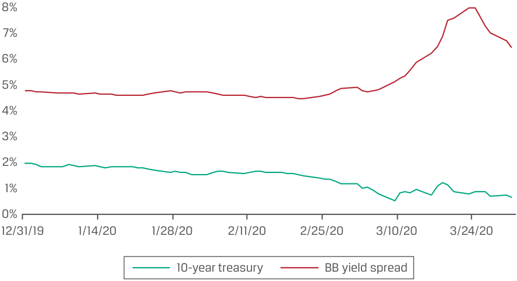

# Tập 6: Thu nhập Cố định (Fixed Income)
## Học phần 13: Các Thước đo Rủi ro Thu nhập Cố định Thực nghiệm và Dựa trên Đường cong Lợi suất (Curve-Based and Empirical Fixed-Income Risk Measures)
### Phần 2/2: Thời lượng Thực nghiệm (Trang PDF 347–354)

---

<!-- PDF Page 347 -->

|**Kỳ hạn (Maturity)**|**1 năm (1 year)**|**5 năm (5 years)**|**10 năm (10 years)**|**20 năm (20 years)**|**30 năm (30 years)**|
|---|---|---|---|---|---|
|Thay đổi kỳ vọng (*Expected change*)|+100 bps|+150 bps|+200 bps|+250 bps|+300 bps|

##### Chi tiết liên quan về hai trái phiếu như sau: 

|Trái phiếu|**Kỳ hạn (Tenor)**|**Thời lượng Lãi suất Chủ chốt (Key Rate Duration)**|
|---|---|---|
|Trái phiếu A|5 năm|2.702|
|Trái phiếu B|10 năm|3.953|

1. Dựa trên thông tin trên, hãy xác định trái phiếu nào sẽ có phần trăm thay đổi giá lớn hơn do sự dịch chuyển của đường cong ngang giá chuẩn.

**Lời giải:**
Trái phiếu B. Đối với Trái phiếu A, $\Delta PV / PV = -2.702 \times 0.015 = -4.05\%$. Đối với Trái phiếu B, $\Delta PV / PV = -3.953 \times 0.020 = -7.91\%$. 

2. Nếu các giá trị trong bảng trên về sự dịch chuyển đường cong lợi suất không song song là các dự báo và danh mục đầu tư của bạn chứa các vị thế bằng nhau ở hai trái phiếu này, hành động nào sau đây sẽ là tốt nhất? 

   - **A.** Bán Trái phiếu A.
   - **B.** Bán Trái phiếu B.
   - **C.** Bán cả Trái phiếu A và Trái phiếu B. 

   - **Lời giải:**
C là đáp án đúng. Bán cả hai Trái phiếu A và B, vì cả hai đều được kỳ vọng sẽ giảm giá. 

3. Giải thích tại sao thời lượng lãi suất chủ chốt có thể hữu ích cho một nhà quản lý danh mục đầu tư mặc dù tổng các giá trị thời lượng lãi suất chủ chốt của các trái phiếu trong danh mục đầu tư bằng với thời lượng của danh mục đầu tư. 

##### **Lời giải:** 

- Việc biết được thời lượng của danh mục đầu tư và biến động chung của đường cong lợi suất chuẩn có thể cung cấp ước tính nhanh chóng về các khoản lãi hoặc lỗ; tuy nhiên, bằng cách sử dụng các thời lượng lãi suất chủ chốt, nhà quản lý danh mục đầu tư có thể tăng tỷ trọng (*overweight*) hoặc giảm tỷ trọng (*underweight*) ở các kỳ hạn cụ thể để tối đa hóa tỷ suất sinh lợi đã điều chỉnh theo rủi ro (*risk-adjusted return*). 

# **THỜI LƯỢNG THỰC NGHIỆM (EMPIRICAL DURATION)** **<mark>5</mark>** 

- mô tả sự khác biệt giữa thời lượng thực nghiệm (*empirical duration*) và thời lượng giải tích (*analytical duration*) 

Các phương pháp tiếp cận được thực hiện cho đến nay để ước tính các số liệu thống kê thời lượng và độ lồi bằng cách sử dụng các công thức toán học thường được gọi là **thời lượng giải tích (*analytical duration*)**; các thước đo mà chúng ta đã tìm hiểu được tóm tắt trong Bảng 6. Điều quan trọng là các ước tính về tác động của những thay đổi lợi suất chuẩn lên giá trái phiếu bằng cách sử dụng thời lượng giải tích ngầm giả định rằng 

<!-- PDF Page 348 -->

lợi suất trái phiếu chính phủ và mức chênh lệch lợi suất (*spreads*) là các biến số độc lập và không tương quan với nhau. Thời lượng giải tích cung cấp một phép xấp xỉ hợp lý về mối quan hệ giá – lợi suất trong nhiều tình huống. 

**Bảng 6: Các Thước đo Thời lượng Thực nghiệm và Dựa trên Đường cong Lợi suất (Exhibit 6: Curve-Based and Empirical Duration Measures)** 

|**Thước đo (Measure)**|**Định nghĩa (Definition)**|**Diễn giải (Interpretation)**|
|---|---|---|
|Thời lượng Điều chỉnh Xấp xỉ (*Approximate Modified Duration*)|Ước tính độ dốc của đường tiếp tuyến với đường cong giá – lợi suất của trái phiếu|Phương pháp dựa trên lợi suất để ước tính thời lượng điều chỉnh|
|Thời lượng Hiệu dụng (*Effective Duration*)|Độ nhạy của giá trái phiếu đối với một sự thay đổi trong đường cong lợi suất chuẩn|Phương pháp dựa trên đường cong lợi suất để ước tính thời lượng điều chỉnh cho các trái phiếu phức tạp có dòng tiền không chắc chắn|
|Thời lượng Lãi suất Chủ chốt (*Key Rate Duration*)|Đo lường độ nhạy của trái phiếu đối với sự thay đổi lợi suất chuẩn cho một kỳ hạn cụ thể|Số liệu thống kê thời lượng từng phần đánh giá độ nhạy của trái phiếu đối với những thay đổi không song song của đường cong lợi suất chuẩn|
|Thời lượng Thực nghiệm (*Empirical Duration*)|Thước đo sử dụng dữ liệu lịch sử trong các mô hình thống kê và kết hợp các yếu tố ảnh hưởng đến giá trái phiếu để xác định mối quan hệ giá – lợi suất|Ước tính thống kê tính đến mối tương quan giữa chênh lệch lợi suất (*yield spreads*) và những thay đổi của lợi suất đáo hạn chuẩn dưới các kịch bản kinh tế khác nhau|

Tuy nhiên, trên thực tế, có một loại thời lượng quan trọng khác: Các chuyên gia thu nhập cố định thường sử dụng dữ liệu lịch sử trong các mô hình thống kê kết hợp nhiều yếu tố khác nhau ảnh hưởng đến giá trái phiếu để tính toán các ước tính **thời lượng thực nghiệm (*empirical duration*)** (xem Bảng 6). Các ước tính này được tính toán theo thời gian và trong các môi trường lãi suất khác nhau để cung cấp thông tin cho quá trình ra quyết định danh mục đầu tư thu nhập cố định. 

Chẳng hạn, trong các cuộc khủng hoảng, các nhà đầu tư thường bán các tài sản rủi ro và mua trái phiếu chính phủ. Một “xu hướng tìm kiếm chất lượng” (*flight to quality*) như vậy có thể khiến lợi suất chuẩn của chính phủ giảm xuống trong khi chênh lệch tín dụng (*credit spreads*) nới rộng ra. Bảng 7 mô tả xu hướng tìm kiếm chất lượng trong giai đoạn khởi phát đại dịch COVID-19 vào cuối tháng 2 năm 2020. 

##### **Bảng 7: Lợi suất Trái phiếu Kho bạc Hoa Kỳ Kỳ hạn 10 Năm so với Chênh lệch Tín dụng Doanh nghiệp Hạng BB của Hoa Kỳ, Quý 1 Năm 2020 (Exhibit 7: 10-Year US Treasury Yield vs. US Corporate BB Credit Spread, Q1 2020)** 

<!-- Picture Text: 8% 7% 6% 5% 4% 3% 2% 1% 0% 12/31/19 1/14/20 1/28/20 2/11/20 2/25/20 3/10/20 3/24/20 10-year treasury BB yield spread  -->

> **Chú thích hình ảnh:**
> - **Trục tung:** Mức lãi suất / chênh lệch lợi suất từ 0% đến 8%.
> - **Trục hoành:** Thời gian từ 12/31/19 đến 3/24/20.
> - **Các đường biểu diễn:** Lợi suất trái phiếu Kho bạc kỳ hạn 10 năm (*10-year treasury* – giảm từ khoảng 2% xuống dưới 1% vào tháng 3/2020) và Chênh lệch lợi suất trái phiếu hạng BB (*BB yield spread* – tăng vọt từ khoảng 2% lên trên 7% vào tháng 3/2020).

<!-- PDF Page 349 -->

Trong những giai đoạn như vậy, chúng ta có thể kỳ vọng các ước tính thời lượng giải tích và thực nghiệm sẽ khác nhau. Đối với một trái phiếu chính phủ có rất ít hoặc không có rủi ro tín dụng, chúng ta kỳ vọng thời lượng giải tích và thực nghiệm sẽ tương tự nhau bởi vì những thay đổi trong lợi suất chuẩn phần lớn chi phối giá trái phiếu. Ngược lại, chênh lệch tín dụng (và chênh lệch thanh khoản) sẽ nới rộng ra do sự gia tăng rủi ro vỡ nợ kỳ vọng. Vì chênh lệch tín dụng và lợi suất chuẩn có tương quan nghịch trong kịch bản này, chênh lệch tín dụng rộng hơn sẽ bù trừ một phần hoặc toàn bộ cho sự sụt giảm trong lợi suất chuẩn của chính phủ, dẫn đến ước tính thời lượng thực nghiệm thấp hơn ước tính thời lượng giải tích (nói cách khác, mức _tăng_ kỳ vọng trong giá trái phiếu từ việc lợi suất chuẩn của chính phủ giảm xuống bị bù trừ bởi mức _giảm_ giá từ việc chênh lệch tín dụng nới rộng ra). Các chuyên viên phân tích phải xem xét mối tương quan giữa lợi suất chuẩn và chênh lệch tín dụng khi quyết định có nên sử dụng các ước tính thời lượng thực nghiệm hay giải tích. 

##### **VÍ DỤ 4 (EXAMPLE 4)** 

#### **Danh mục Đầu tư Trái phiếu Doanh nghiệp của Văn phòng Quản lý Gia sản Viswan — Thời lượng Thực nghiệm so với Giải tích (Viswan Family Office’s Corporate Bond Portfolio—Empirical vs. Analytical Duration)** 

Ngoài việc nắm giữ cổ phiếu, Văn phòng Quản lý Gia sản Viswan (*Viswan Family Office* – VFO) còn quản lý một danh mục đầu tư trái phiếu chính phủ và một danh mục đầu tư trái phiếu doanh nghiệp. Các vị thế trong danh mục đầu tư trái phiếu chính phủ chủ yếu là chứng khoán Kho bạc Hoa Kỳ trung hạn nhưng cũng bao gồm nợ của các tổ chức phát hành chính phủ tại các thị trường phát triển được xếp hạng tín nhiệm cao khác. Khoảng một nửa danh mục đầu tư trái phiếu doanh nghiệp được đầu tư vào các đợt phát hành hạng đầu tư (*investment-grade issues*), và nửa còn lại bao gồm các đợt phát hành lợi suất cao (*high-yield issues*), với sự kết hợp của nhiều kỳ hạn và sự pha trộn giữa các công ty Bắc Mỹ, Châu Âu và Châu Á. 

Hãy giải thích tại sao thời lượng thực nghiệm có nhiều khả năng là một thước đo rủi ro lãi suất phù hợp hơn đối với danh mục đầu tư trái phiếu doanh nghiệp của VFO so với danh mục đầu tư trái phiếu chính phủ của họ. 

##### **Lời giải:** 

Danh mục đầu tư trái phiếu chính phủ bao gồm các chứng khoán nợ của chính phủ Hoa Kỳ và các tổ chức phát hành chính phủ tại các thị trường phát triển được xếp hạng cao khác. Vì lợi suất chuẩn là động lực chính tạo ra những thay đổi trong tổng lợi suất trái phiếu của danh mục đầu tư này, nên kết quả của thời lượng giải tích và thời lượng thực nghiệm sẽ nhìn chung tương tự nhau. 

Danh mục đầu tư trái phiếu doanh nghiệp bao gồm nhiều loại chứng khoán nợ với các mức độ chất lượng tín dụng và rủi ro thanh khoản khác nhau và do đó có mức chênh lệch tín dụng và thanh khoản khác nhau. 

Mối tương quan giữa những thay đổi của lợi suất chuẩn và quy mô của chênh lệch tín dụng cùng thanh khoản là tương quan nghịch, đặc biệt là trong các điều kiện thị trường căng thẳng, sao cho trong những thời điểm đó, mức lợi suất chuẩn thấp hơn bị lấn át hoàn toàn bởi mức chênh lệch tín dụng và thanh khoản cao hơn. Vì vậy, đối với các trái phiếu doanh nghiệp có chất lượng thấp hơn, lợi suất tăng lên, khiến cho thời lượng thực nghiệm của chúng thấp hơn đáng kể so với thời lượng giải tích. 

Do đó, thời lượng thực nghiệm, chứ không phải thời lượng giải tích, là thước đo rủi ro lãi suất chính xác hơn đối với danh mục đầu tư trái phiếu doanh nghiệp. 

##### **BỘ CÂU HỎI (QUESTION SET)** 

1. Khi so sánh thời lượng giải tích và thời lượng thực nghiệm, phát biểu nào sau đây là đúng? 

   - **A.** Thời lượng và độ lồi thực nghiệm là các số liệu thống kê thời lượng và độ lồi được ước tính bằng cách sử dụng các công thức toán học. 

<!-- PDF Page 350 -->

   - **B.** Thời lượng và độ lồi giải tích được ước tính bằng cách sử dụng dữ liệu lịch sử trong các mô hình phi thống kê kết hợp nhiều yếu tố khác nhau ảnh hưởng đến giá trái phiếu. 

   - **C.** Không phải A cũng không phải B 

##### **Lời giải:** 

C là đáp án đúng. 

A không đúng vì thời lượng và độ lồi _giải tích_, chứ không phải thực nghiệm, mới được đo lường bằng cách sử dụng các công thức toán học. 

B không đúng vì thời lượng và độ lồi _thực nghiệm_, chứ không phải giải tích, mới được ước tính bằng cách sử dụng dữ liệu lịch sử trong các mô hình thống kê kết hợp nhiều yếu tố khác nhau ảnh hưởng đến giá trái phiếu. 

2. Đúng hay sai: Các ước tính thời lượng thực nghiệm cung cấp ước tính tốt hơn so với các ước tính thời lượng giải tích đối với những trái phiếu có rủi ro tín dụng. 

##### **Lời giải:** 

Đúng (*True*). Các yếu tố kinh tế vĩ mô đẩy lợi suất trái phiếu chính phủ xuống thấp hơn trong một kịch bản thị trường căng thẳng, và xu hướng tìm nơi trú ẩn an toàn (*flight to safety*) sẽ khiến chênh lệch tín dụng của trái phiếu lợi suất cao nới rộng ra do sự gia tăng rủi ro vỡ nợ kỳ vọng. Vì chênh lệch tín dụng và lợi suất chuẩn có tương quan nghịch trong kịch bản này, chênh lệch tín dụng rộng hơn sẽ bù trừ một phần hoặc toàn bộ cho sự sụt giảm trong lợi suất chuẩn của chính phủ. Tuy nhiên, thời lượng giải tích lại giả định rằng lợi suất chuẩn và chênh lệch lợi suất không tương quan với nhau. Các ước tính thời lượng thực nghiệm là phương pháp dự báo chính xác hơn đối với các trái phiếu có rủi ro tín dụng. 

3. Xác định một số thách thức có thể gặp phải khi ước tính thời lượng thực nghiệm. 

##### **Lời giải:** 

Việc ước tính thời lượng thực nghiệm sử dụng dữ liệu lịch sử dựa trên nhiều yếu tố. Việc sử dụng và không sử dụng những yếu tố nào, gán trọng số nào cho các yếu tố đó, và cách tính trọng số cho dữ liệu hiện tại so với dữ liệu cũ hơn (ví dụ: khoảng thời gian để đo lường thời lượng) là một số thách thức. 

<!-- PDF Page 351 -->

## **BÀI TẬP THỰC HÀNH (PRACTICE PROBLEMS)** 

### **Thông tin sau đây liên quan đến các câu hỏi 1–8** 

Danh mục đầu tư được đa dạng hóa tốt của một nhà đầu tư có $\$200,000$ tiền mặt. Nhà đầu tư dự định đầu tư vào trái phiếu ngắn hạn, kỳ hạn 1 năm của Công ty Vốn hóa Lớn (*Large-Cap Company*), trước khi sử dụng số tiền mặt này để đầu tư vào một đợt IPO sắp tới. Hiện có hai trái phiếu của Công ty Vốn hóa Lớn trên thị trường để mua, cả hai đều có kỳ hạn 1 năm. Một trong hai trái phiếu, Trái phiếu A, là trái phiếu không thể mua lại (*non-callable bond*), trong khi Trái phiếu B là trái phiếu có thể mua lại (*callable bond*). Là một chuyên viên phân tích thu nhập cố định, bạn được yêu cầu thực hiện một phân tích. 

**1.** Đối với hai trái phiếu được chào bán bởi Công ty Vốn hóa Lớn, phép tính thời lượng nào sẽ _thích hợp nhất_ để sử dụng nhằm đo lường rủi ro lãi suất? 

   - **A.** Thời lượng điều chỉnh (*Modified duration*) 

   - **B.** Thời lượng Macaulay (*Macaulay duration*) 

   - **C.** Thời lượng hiệu dụng (*Effective duration*) 

**2.** Đối với Trái phiếu B, khi đường cong lợi suất chuẩn giảm xuống, độ dốc của đường tiếp tuyến với trái phiếu trở nên phẳng hơn khi lợi suất chuẩn giảm và đạt đến một điểm uốn, sau điểm đó độ lồi hiệu dụng trở thành: 

   - **A.** dương (*positive*). 

   - **B.** âm (*negative*). 

   - **C.** không dương cũng không âm. 

**3.** Thông tin sau đây về Trái phiếu A và B đã được thu thập: 

|**Trái phiếu (Bond)**|**Thời lượng Hiệu dụng (Effective Duration)**|**Độ lồi Hiệu dụng (Effective Convexity)**|
|---|---|---|
|A|7.48621|29.35972|
|B|7.23852|–321.75618|

Hãy so sánh rủi ro lãi suất của Trái phiếu A và Trái phiếu B. 

   - **A.** Trái phiếu A rủi ro hơn Trái phiếu B. 

   - **B.** Trái phiếu B rủi ro hơn Trái phiếu A. 

   - **C.** Trái phiếu A và Trái phiếu B có rủi ro lãi suất xấp xỉ như nhau. 

**4.** Đối với phần trăm thay đổi giá của Trái phiếu A, khi lợi suất chuẩn tăng 200 bp, phần nào của sự thay đổi giá là đáng quan tâm nhất? 

   - **A.** Thời lượng (*Duration*) 

   - **B.** Độ lồi (*Convexity*) 

   - **C.** Không thể xác định với thông tin đã cho 

<!-- PDF Page 352 -->

**5.** Một đồng nghiệp hỏi liệu bạn có cân nhắc việc xem xét các thời lượng lãi suất chủ chốt khi so sánh rủi ro lãi suất của Trái phiếu A và Trái phiếu B hay không. Việc nghiên cứu các thời lượng lãi suất chủ chốt cho Trái phiếu A và Trái phiếu B có giúp bạn đưa ra quyết định tốt hơn về rủi ro lãi suất của hai trái phiếu không? 

   - **A.** Có (*Yes*) 

   - **B.** Không (*No*) 

   - **C.** Chưa thể kết luận (*Inconclusive*) 

**6.** Danh mục đầu tư của nhà đầu tư đã được đa dạng hóa, và hợp phần thu nhập cố định của danh mục đầu tư có các trái phiếu với nhiều kỳ hạn khác nhau, có thời lượng là 7.48621. Điều gì sẽ xảy ra với thời lượng hiệu dụng của hợp phần thu nhập cố định trong danh mục đầu tư của nhà đầu tư nếu Trái phiếu A được bổ sung vào danh mục đầu tư? 

   - **A.** Nó sẽ tăng lên. 

   - **B.** Nó sẽ giảm xuống. 

   - **C.** Nó sẽ giữ nguyên không đổi. 

**7.** Đối với hai trái phiếu đang được xem xét, các ước tính thời lượng giải tích hay các ước tính thời lượng thực nghiệm sẽ _thích hợp nhất_ khi thực hiện phân tích của bạn? 

   - **A.** Các ước tính thời lượng giải tích (*Analytical duration estimates*) 

   - **B.** Các ước tính thời lượng thực nghiệm (*Empirical duration estimates*) 

   - **C.** Bất kỳ loại ước tính nào trong hai loại đều thích hợp. 

**8.** Hiện tượng “tìm nơi trú ẩn an toàn” (*flight to safety* – tức là lợi suất trái phiếu chính phủ giảm và chênh lệch tín dụng nới rộng ra) sẽ có tác động gì lên ước tính thời lượng giải tích của Trái phiếu A? 

   - **A.** Làm giảm thời lượng 

   - **B.** Làm tăng thời lượng 

   - **C.** Không có tác động 

<!-- PDF Page 353 -->

## **LỜI GIẢI (SOLUTIONS)** 

1. C là đáp án đúng. Vì Trái phiếu B có thể mua lại, nó có một quyền chọn đi kèm, và thời lượng hiệu dụng là thước đo thời lượng thích hợp nhất. Thời lượng hiệu dụng cũng áp dụng được cho các trái phiếu không có quyền chọn đi kèm và sẽ cho phép chuyên viên phân tích so sánh rủi ro lãi suất của hai trái phiếu. 

2. B là đáp án đúng. Vì trái phiếu có thể mua lại, sau một điểm nhất định trên đường cong lợi suất, tổ chức phát hành sẽ thực hiện quyền chọn mua lại và người sở hữu sẽ không thể hiện thực hóa thêm các khoản lãi từ sự sụt giảm trong đường cong lợi suất chuẩn. 

3. B là đáp án đúng. Trái phiếu B rủi ro hơn vì sự dịch chuyển đi lên 100 bps (hoặc 200 bps) trong đường cong lợi suất dẫn đến mức sụt giảm phần trăm giá lớn hơn, do độ lồi hiệu dụng âm của nó: 

   - $\%\Delta PV^{\text{Full}} \text{ Trái phiếu A} \approx (-7.48621 \times 0.0100) + \left[ \frac{1}{2} \times 29.35972 \times (0.0100)^2 \right] = -7.33941\%$ *(Lưu ý: Bản gốc viết `0.0200` trong công thức nhưng kết quả `-7.33941%` và `-8.84730%` được tính với mức dịch chuyển 100 bps = `0.0100`)*. 

   - $\%\Delta PV^{\text{Full}} \text{ Trái phiếu B} \approx (-7.23853 \times 0.0100) + \left[ \frac{1}{2} \times -321.75618 \times (0.0100)^2 \right] = -8.84730\%$. 

4. A là đáp án đúng. Thông thường, tác động của thời lượng lớn hơn rất nhiều so với tác động của độ lồi. 

$$\%\Delta PV^{\text{Full}} \text{ Trái phiếu A, Thời lượng} \approx -7.48621 \times 0.0200 = -14.97242\%$$

$$\%\Delta PV^{\text{Full}} \text{ Trái phiếu A, Điều chỉnh Độ lồi} \approx \frac{1}{2} \times 29.35972 \times (-0.0200)^2 = +0.58719\%$$

5. B là đáp án đúng. Vì cả hai trái phiếu đều đáo hạn sau một năm, phân tích thời lượng lãi suất chủ chốt sẽ không cung cấp thêm cho bạn bất kỳ thông tin chi tiết nào, vì cả hai trái phiếu sẽ chịu cùng một mức dịch chuyển trên đường cong. 

6. C là đáp án đúng. Trái phiếu A có cùng thời lượng hiệu dụng với thời lượng hiệu dụng của danh mục đầu tư. 

7. B là đáp án đúng. Vì cả Trái phiếu A và Trái phiếu B đều là trái phiếu doanh nghiệp, chúng có rủi ro tín dụng, và do đó, thời lượng thực nghiệm sẽ là thích hợp nhất bởi vì lợi suất chuẩn và chênh lệch tín dụng có thể không có tương quan thuận. 

8. C là đáp án đúng. Sẽ không có tác động nào lên ước tính thời lượng giải tích. Tuy nhiên, ước tính thời lượng thực nghiệm sẽ bị ảnh hưởng. Xu hướng tìm nơi trú ẩn an toàn sẽ dẫn đến việc mức tăng giá trái phiếu do lợi suất chuẩn giảm bị bù trừ bởi mức chênh lệch tín dụng nới rộng ra. Điều này sẽ dẫn đến thời lượng thực nghiệm thấp hơn thời lượng giải tích. 

<!-- PDF Page 354 -->
