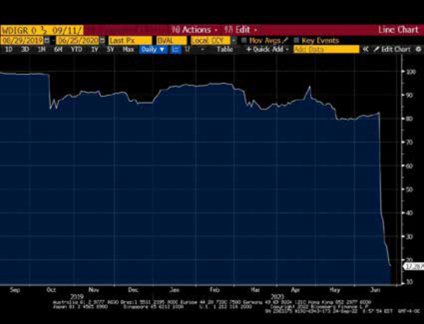
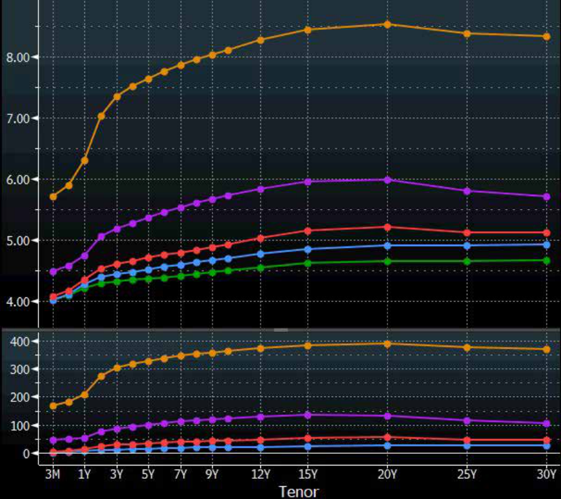
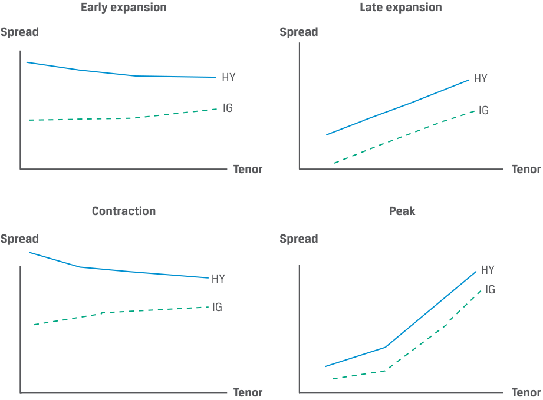
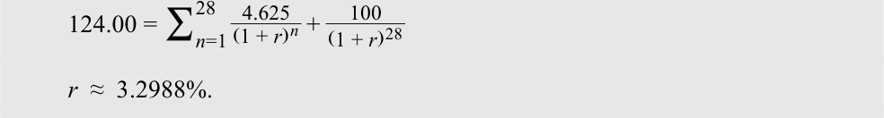
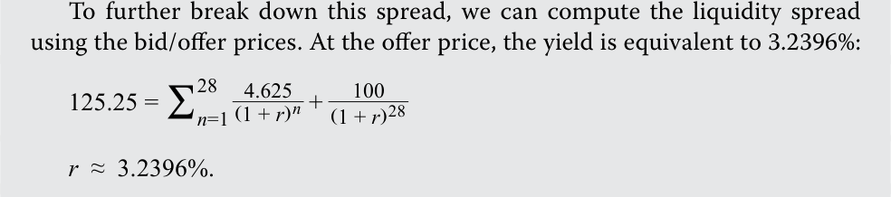
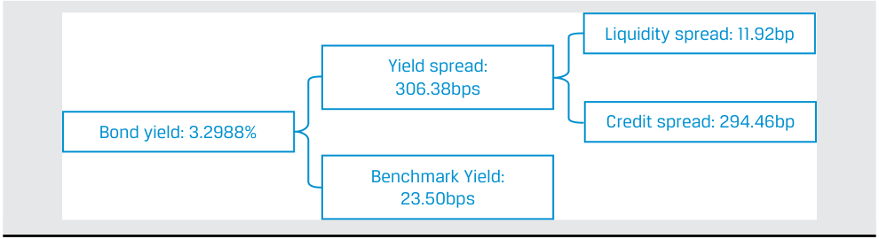
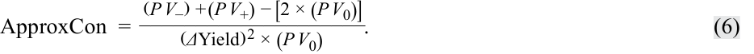

# Tập 6: Chứng khoán Thu nhập Cố định (Fixed Income)
## Learning Module 14 Credit Risk (Trang PDF 355–392)

---

# Tập 6: Thu nhập Cố định (Fixed Income)
## Học phần 14: Rủi ro Tín dụng (Credit Risk)
### Phần 1/4: Giới thiệu (Trang PDF 355–368)

---

<!-- PDF Page 355 -->

#### H Ọ C P H Ầ N

# **<mark>14</mark>**

### **Rủi ro Tín dụng (Credit Risk)**

###### **<mark>KẾT QUẢ HỌC TẬP (LEARNING OUTCOMES)</mark>**

**_Thành thạo – Ứng viên cần có khả năng:_**
- mô tả rủi ro tín dụng (*credit risk*) và các cấu phần của nó, bao gồm xác suất vỡ nợ (*probability of default*) và mức tổn thất khi vỡ nợ (*loss given default*)
- mô tả công dụng của xếp hạng tín nhiệm (*credit ratings*) từ các tổ chức xếp hạng tín nhiệm (*credit rating agencies*) và những hạn chế của chúng
- mô tả các yếu tố kinh tế vĩ mô, thị trường và đặc thù của tổ chức phát hành có ảnh hưởng đến mức độ và sự biến động của phần bù lợi suất (*yield spreads*)

##### **GIỚI THIỆU (INTRODUCTION)**

## **<mark>1</mark>**

Phân tích tín dụng (*credit analysis*) đóng một vai trò quan trọng trên các thị trường thu nhập cố định. Việc đánh giá và định giá hợp lý rủi ro tín dụng tạo điều kiện thuận lợi cho việc phân bổ vốn hiệu quả. Đây là một quá trình năng động vì các cấu phần của rủi ro tín dụng liên tục được đánh giá lại và các công cụ thu nhập cố định được định giá lại theo điều kiện thị trường. Học phần này đề cập đến các nguyên tắc cơ bản của phân tích tín dụng. Trước hết, chúng ta giới thiệu các khái niệm về rủi ro tín dụng và tổn thất kỳ vọng (*expected loss*), đồng thời giải thích ý nghĩa của xếp hạng tín nhiệm. Chúng ta so sánh mức độ tín nhiệm (*creditworthiness*) của tổ chức phát hành trái phiếu trong cùng một ngành cũng như giữa các ngành với nhau, và khám phá cách các thị trường tài chính định giá rủi ro tín dụng. Bài học này tập trung chủ yếu vào việc phân tích rủi ro tín dụng, trong khi các bài học tiếp theo sẽ thảo luận về phân tích tín dụng đối với các tổ chức phát hành chính phủ có chủ quyền (*sovereign*) và phi chủ quyền (*non-sovereign*) cũng như nợ doanh nghiệp (*corporate debt*).

###### **TỔNG QUAN HỌC PHẦN (LEARNING MODULE OVERVIEW)**

- Rủi ro tín dụng (*credit risk*) là rủi ro tổn thất kinh tế phát sinh do bên đi vay không thực hiện thanh toán đầy đủ và đúng hạn tiền lãi và nợ gốc. Các cấu phần chính của rủi ro tín dụng là xác suất vỡ nợ (*probability of default*) và mức tổn thất khi vỡ nợ (*loss given default*), và tích số của chúng là tổn thất kỳ vọng (*expected loss*).

- Các nguồn phát sinh rủi ro tín dụng chính bao gồm các điều kiện kinh tế vĩ mô bất lợi, sự lệch pha tài trợ (*financing mismatch*) giữa các nguồn lực và nghĩa vụ nợ, và các yếu tố đặc thù của tổ chức phát hành trên thị trường nợ doanh nghiệp và nợ chính phủ.

<!-- PDF Page 356 -->

- Hầu như mọi đợt phát hành trái phiếu tại các thị trường nợ phát triển đều có xếp hạng tín nhiệm (*credit ratings*) nhằm phân loại mức độ tín nhiệm. Xếp hạng tín nhiệm cho phép so sánh rủi ro tín dụng của các đợt phát hành nợ và các tổ chức phát hành trong cùng một ngành và giữa các ngành với nhau.

- Các trái phiếu hoặc tổ chức phát hành có xếp hạng tín nhiệm hạng đầu tư (*investment-grade* – IG) mang rủi ro vỡ nợ thấp nhất và được Moody’s xếp hạng từ Baa3 trở lên, hoặc được S&P và Fitch xếp hạng từ BBB– trở lên. Ngược lại, các trái phiếu hoặc tổ chức phát hành phi hạng đầu tư (*non-investment-grade*) hay lợi suất cao (*high-yield* – HY) được S&P/Fitch xếp hạng từ BB+ trở xuống và Moody’s xếp hạng từ Ba1 trở xuống, thể hiện rủi ro tín dụng từ mức đáng kể đến rất cao.

- Những cạm bẫy của việc chỉ dựa vào xếp hạng tín nhiệm khi đưa ra quyết định đầu tư bao gồm việc quyết định của tổ chức xếp hạng có thể đi sau (*lag*) mức định giá rủi ro tín dụng của thị trường, bỏ sót các rủi ro tài chính trọng yếu, và/hoặc bao hàm các tính toán sai lệch hoặc những thay đổi không lường trước chưa được phản ánh đầy đủ trong phân tích hướng tới tương lai (*forward-looking analysis*) của tổ chức xếp hạng.

- Phần bù (*premium*), hay phần bù lợi suất (*yield spread*), mà tại đó trái phiếu doanh nghiệp giao dịch so với các tài sản phi rủi ro vỡ nợ (*default risk-free assets*) sẽ nới rộng (*widens*) khi rủi ro tín dụng tăng lên và thu hẹp (*narrows*) nếu rủi ro tín dụng giảm xuống.

- Những thay đổi của phần bù tín dụng (*credit spread*) tác động đến tỷ suất sinh lợi thời kỳ nắm giữ (*holding period returns*) thông qua hai yếu tố chính: a) mức thay đổi phần bù tính bằng điểm cơ bản (*basis point spread change*) và b) độ nhạy của giá đối với lợi suất được phản ánh qua thời lượng điều chỉnh (*modified duration*) và độ lồi (*convexity*) cuối kỳ. Phần bù thu hẹp làm tăng tỷ suất sinh lợi thời kỳ nắm giữ.

###### **TỰ ĐÁNH GIÁ HỌC PHẦN (LEARNING MODULE SELF-ASSESSMENT)**

Các câu hỏi mở đầu này nhằm giúp bạn tự đánh giá mức độ hiểu biết hiện tại của mình về học phần này.

1. Rủi ro tín dụng (*credit risk*) là:

   - **A.** được kích hoạt khi bên đi vay vỡ nợ.

   - **B.** phần bù (*spread*) mà nhà đầu tư nhận được cao hơn lãi suất phi rủi ro.

   - **C.** được bên cho vay trải nghiệm theo nhiều cách khác nhau.

   - **Lời giải:**

Đáp án đúng là C. Bên cho vay chịu tác động bởi rủi ro tín dụng theo nhiều cách khác nhau, bao gồm việc không nhận được các khoản thanh toán gốc và lãi đúng hạn, không có khả năng bán tài sản thế chấp (*collateral*) ở mức giá thị trường đủ để đáp ứng các nghĩa vụ của tổ chức phát hành trong trường hợp nợ có bảo đảm (*secured debt*), hoặc khả năng phát sinh các chi phí pháp lý hay chi phí khác để thu hồi nợ. A sai vì mặc dù việc bên đi vay vỡ nợ làm phát sinh khoản tổn thất thực tế (*realized loss*), nhưng tổn thất kỳ vọng (*expected loss*) đã tồn tại trước khi xảy ra bất kỳ tổn thất thực tế nào. B sai vì điều đó đề cập đến phần bù tín dụng (*credit spread*), tức phần đền bù cho nhà đầu tư khi gánh chịu rủi ro tín dụng.

2. Một khoản vay trị giá EUR500,000 có các đặc điểm sau:

   - Xác suất vỡ nợ (*Probability of default*): 5%

   - Tỷ lệ thu hồi (*Recovery rate*): 90%

   - Dư nợ rủi ro kỳ vọng (*Expected exposure*): EUR400,000

Tổn thất kỳ vọng (*expected loss*) của khoản vay này là:

   - **A.** EUR1,500

<!-- PDF Page 357 -->

   - **B.** EUR2,000

   - **C.** EUR20,000

   - **Lời giải:**

Đáp án đúng là B. Chúng ta giải tìm tổn thất kỳ vọng ($\text{EL}$) như sau:

$$\text{EL} = \text{POD} \times \text{LGD} = \text{POD} \times \text{EE} \times (1 - \text{RR})$$

Vì xác suất vỡ nợ ($\text{POD}$) là 5%, dư nợ rủi ro kỳ vọng ($\text{EE}$) là EUR400,000, và tỷ lệ thu hồi ($\text{RR}$) là 90%:

$$\text{EL} = \text{EUR}2,000 = 0.05 \times (400,000) \times (1 - 0.9)$$

A sai vì không giảm dư nợ rủi ro kỳ vọng theo tài sản thế chấp, trong khi C sai vì chỉ đơn thuần nhân $\text{EE}$ với $\text{POD}$.

3. Xếp hạng tín nhiệm (*credit ratings*) là:

   - **A.** được xây dựng thay mặt cho các nhà đầu tư.

   - **B.** một thước đo dựa trên ký hiệu về rủi ro vỡ nợ tiềm tàng của một đợt phát hành trái phiếu hoặc tổ chức phát hành.

   - **C.** các thước đo rủi ro tín dụng được sử dụng để xác định giá trái phiếu trên thị trường.

   - **Lời giải:**

Đáp án đúng là B: Xếp hạng tín nhiệm là một thước đo dựa trên ký hiệu về rủi ro vỡ nợ tiềm tàng của một đợt phát hành trái phiếu hoặc tổ chức phát hành. A sai vì xếp hạng tín nhiệm được xây dựng thay mặt cho tổ chức phát hành (*issuer*). C sai vì xếp hạng tín nhiệm không được sử dụng để xác định giá trái phiếu.

4. Phát biểu nào sau đây mô tả đúng nhất các rủi ro khó nắm bắt trong xếp hạng tín nhiệm?

   - **A.** Rủi ro môi trường được nắm bắt bởi xếp hạng ESG thay vì xếp hạng tín nhiệm.

   - **B.** Các thương vụ mua lại tài trợ bằng nợ (*debt-financed acquisitions*) thường được nắm bắt trong xếp hạng tín nhiệm.

   - **C.** Xếp hạng phân hóa (*split ratings*) chứng tỏ rằng các tổ chức xếp hạng tín nhiệm có thể nhìn nhận các rủi ro phức tạp theo những cách rất khác nhau.

   - **Lời giải:**

Đáp án đúng là C. A sai vì các rủi ro môi trường có thể ảnh hưởng đến xếp hạng tín nhiệm. B sai vì các thương vụ mua lại tài trợ bằng nợ rất khó lường trước.

5. _Xác định các câu trả lời đúng để điền vào chỗ trống:_ Phần bù tín dụng (*spreads*) ở mức __________ tại hoặc gần đỉnh của chu kỳ tín dụng (*credit cycle*), khi những người tham gia thị trường nhận thấy rủi ro tín dụng ở mức thấp nhất; chúng ở mức __________ tại hoặc gần đáy của chu kỳ tín dụng, khi các thị trường tài chính tin rằng rủi ro tín dụng đã đạt đỉnh.

   - **Lời giải:**

Phần bù tín dụng ở mức **hẹp nhất (hoặc thấp nhất) (*narrowest / lowest*)** tại hoặc gần đỉnh của chu kỳ tín dụng, khi những người tham gia thị trường nhận thấy rủi ro tín dụng ở mức thấp nhất; chúng ở mức **rộng nhất (hoặc cao nhất) (*widest / highest*)** tại hoặc gần đáy của chu kỳ tín dụng, khi các thị trường tài chính tin rằng rủi ro tín dụng đã đạt đỉnh.

6. Một nhà quản lý danh mục đầu tư đang đánh giá một kịch bản bất lợi (*downside case*) tin rằng phần bù trái phiếu lợi suất cao (HY) sẽ tăng 100 bps trong một cuộc suy thoái. Nếu một trái phiếu HY quan sát được có thời lượng điều chỉnh (*modified duration*)

<!-- PDF Page 358 -->

là 4.5 và độ lồi được báo cáo (*reported convexity*) là 0.23, mức thay đổi kỳ vọng trong giá của trái phiếu HY theo kịch bản này sẽ _gần nhất với_:

**A.** 4.5%.

**B.** 4.385%.

**C.** 4.615%.

###### **Lời giải:**

Đáp án đúng là B. Thay đổi giá trái phiếu dựa trên thời lượng điều chỉnh, độ lồi và mức thay đổi phần bù được tính như sau:

$$\%\Delta\text{PV}^{\text{Full}} = -(\text{AnnModDur} \times \Delta\text{Spread}) + \frac{1}{2}\text{AnnConvexity} \times (\Delta\text{Spread})^2$$

Với $\text{AnnModDur} = 4.5$ và độ lồi báo cáo là 0.23, quy đổi lại thang đo (*rescaling*) độ lồi thành 23 và thay các giá trị vào để giải theo phần bù ta được:

$$\Delta\text{PV}^{\text{Full}} = -(4.5 \times 1.00\%) + \frac{1}{2}(23) \times (1.00\%)^2$$

$$\Delta\text{PV}^{\text{Full}} = -4.385\%$$

## **<mark>2</mark>**

##### **CÁC NGUỒN PHÁT SINH RỦI RO TÍN DỤNG (SOURCES OF CREDIT RISK)**

mô tả rủi ro tín dụng (*credit risk*) và các cấu phần của nó, bao gồm xác suất vỡ nợ (*probability of default*) và mức tổn thất khi vỡ nợ (*loss given default*)

Các nhà đầu tư thu nhập cố định phải đối mặt với rủi ro tín dụng (*credit risk*), một dạng rủi ro thực hiện nghĩa vụ (*performance risk*) trong mối quan hệ hợp đồng. Một bên đi vay không thực hiện được các nghĩa vụ thanh toán tiền lãi và/hoặc nợ gốc đã cam kết theo hợp đồng trái phiếu hoặc khoản vay được gọi là bị **vỡ nợ (*default*)**. Nhà đầu tư thu nhập cố định tìm kiếm phần đền bù cho tổn thất kinh tế kỳ vọng khi bên đi vay có khả năng vỡ nợ trong suốt vòng đời của hợp đồng, được gọi là **rủi ro tín dụng (*credit risk*)**.

Rủi ro tín dụng phụ thuộc vào các yếu tố cụ thể liên quan đến chính bên đi vay cũng như các điều kiện kinh tế chung và có thể thay đổi trong suốt vòng đời của hợp đồng. Rủi ro tín dụng khiến bên cho vay hoặc nhà đầu tư phải đối mặt với các khoản tổn thất tiềm tàng và hiệu quả đầu tư kém.

Theo truyền thống, nhiều nhà phân tích đánh giá mức độ tín nhiệm dựa trên những tiêu chí thường được gọi là “Các chữ C trong phân tích tín dụng (*Cs of credit analysis*)”, như được trình bày trong Bảng minh họa 1:

<!-- PDF Page 359 -->

**Bảng minh họa 1: Các chữ C trong Phân tích Tín dụng (The Cs of Credit Analysis)**

<!-- Picture Text: Top-Down Factors Conditions Country Currency Cs of Capacity Collateral Credit Capital Covenants Character Bottom-Up Factors  -->

> **Chú thích hình ảnh:**
> - **Các chữ C của Tín dụng (*Cs of Credit*)**:
>   - **Các yếu tố từ trên xuống (*Top-Down Factors*)**: Điều kiện môi trường (*Conditions*), Quốc gia (*Country*), Tiền tệ (*Currency*)
>   - **Các yếu tố từ dưới lên (*Bottom-Up Factors*)**: Năng lực trả nợ (*Capacity*), Tài sản thế chấp (*Collateral*), Nguồn vốn (*Capital*), Các điều khoản ràng buộc (*Covenants*), Tư cách/Uy tín (*Character*)

Năm trong số các tiêu chí này — năng lực trả nợ (*capacity*), nguồn vốn (*capital*), tài sản thế chấp (*collateral*), các điều khoản ràng buộc (*covenants*), và tư cách/uy tín (*character*) — liên quan đến các yếu tố đặc thù từ dưới lên (*bottom-up factors*) áp dụng cho từng bên đi vay riêng lẻ. **Năng lực trả nợ (*Capacity*)** đề cập đến khả năng của bên đi vay trong việc thực hiện các khoản thanh toán nợ đúng hạn. **Nguồn vốn (*Capital*)** đề cập đến các nguồn lực khác sẵn có của công ty giúp giảm sự phụ thuộc vào nợ vay. **Tài sản thế chấp (*Collateral*)** đề cập đến chất lượng và giá trị của các tài sản hỗ trợ cho khoản nợ của tổ chức phát hành, trong khi **các điều khoản ràng buộc (*covenants*)** là các điều khoản pháp lý của thỏa thuận nợ mà tổ chức phát hành phải tuân thủ. **Tư cách/Uy tín (*Character*)** đề cập đến chất lượng của ban lãnh đạo và thiện chí hoàn trả các khoản nợ.

Trong khi năng lực trả nợ và nguồn vốn nhìn chung là các thước đo định lượng dựa trên báo cáo tài chính, thì tài sản thế chấp, các điều khoản ràng buộc và tư cách/uy tín chủ yếu là các thước đo định tính mà các nhà phân tích đánh giá dựa trên kết quả hoạt động lịch sử của công ty, các mối quan hệ tín dụng và danh tiếng của ban lãnh đạo hiện tại.

Ba tiêu chí còn lại — điều kiện môi trường (*conditions*), quốc gia (*country*), và tiền tệ (*currency*) — liên quan đến các yếu tố chung từ trên xuống (*top-down factors*) áp dụng cho tất cả các bên đi vay ở mức độ nhiều hay ít. **Điều kiện môi trường (*Conditions*)** đề cập đến môi trường kinh tế, cạnh tranh và kinh doanh chung mà tất cả các bên đi vay phải đối mặt, có thể ảnh hưởng đến khả năng trả nợ hoặc tái cấp vốn nợ của họ. **Quốc gia (*Country*)** liên quan đến môi trường địa chính trị cũng như hệ thống pháp lý và chính trị mà tất cả các tổ chức phát hành trong một khu vực tài phán phải đối mặt, có thể ảnh hưởng đến việc thanh toán nợ. **Tiền tệ (*Currency*)** ảnh hưởng đến các tổ chức phát hành có dòng tiền chịu tác động bởi biến động tỷ giá hối đoái hoặc những tổ chức đi vay bằng đồng tiền bên ngoài khu vực tài phán của họ, chẳng hạn như các tổ chức phát hành chính phủ có nợ bằng ngoại tệ.

Việc bên đi vay không có khả năng thanh toán đúng hạn có thể do một số yếu tố cơ bản và góp phần gây ra, nhưng suy cho cùng là xuất phát từ việc thiếu lượng tiền mặt đủ để thực hiện khoản thanh toán nợ hiện hành. Bên cho vay, với tư cách là các nhà đầu tư thu nhập cố định, chịu tác động bởi rủi ro tín dụng. Họ có thể mất một phần hoặc toàn bộ tiền gốc và lãi đến hạn, gánh chịu lỗ vốn (*capital loss*) hoặc thiếu hụt thu nhập (*income shortfall*). Sự gián đoạn đối với dòng tiền của họ có thể ảnh hưởng đến chính khả năng trả nợ của họ, và sự chậm trễ thanh toán cũng như chi phí pháp lý và thu hồi nợ gia tăng có thể làm giảm thêm thu nhập và biên lợi nhuận của họ.

<!-- PDF Page 360 -->

###### **Các nguồn phát sinh Rủi ro Tín dụng (Sources of Credit Risk)**

Những thay đổi trong rủi ro tín dụng do điều kiện của tổ chức phát hành hoặc điều kiện kinh tế tổng thể đều chịu ảnh hưởng bởi nguồn trả nợ (*source of repayment*), vốn khác nhau giữa các loại hình tổ chức phát hành. Bảng minh họa 2 cho thấy các nguồn trả nợ chính đối với trái phiếu doanh nghiệp và trái phiếu chính phủ.

**Bảng minh họa 2: Các nguồn Trả nợ của Trái phiếu Chính phủ và Trái phiếu Doanh nghiệp (Sovereign and Corporate Bond Sources of Repayment)**

<!-- Picture Text: Operating Cash Flows Secured Bond Corporate Bond Investor Collateral Cash Flows or Sale Operating Unsecured Bond Cash Flows Corporate Bond Investor Tax Sovereign Bond Revenues Bond Investor  -->

> **Chú thích hình ảnh:**
> - **Nhà đầu tư Trái phiếu Doanh nghiệp có bảo đảm (*Secured Bond Corporate Bond Investor*)** $\leftarrow$ Dòng tiền hoạt động (*Operating Cash Flows*) + Dòng tiền hoặc tiền bán Tài sản thế chấp (*Collateral Cash Flows or Sale*)
> - **Nhà đầu tư Trái phiếu Doanh nghiệp không có bảo đảm (*Unsecured Bond Corporate Bond Investor*)** $\leftarrow$ Dòng tiền hoạt động (*Operating Cash Flows*)
> - **Nhà đầu tư Trái phiếu Chính phủ (*Sovereign Bond Investor*)** $\leftarrow$ Nguồn thu thuế (*Tax Revenues*)

Một doanh nghiệp có thể không tạo ra đủ dòng tiền từ hoạt động kinh doanh, hoạt động tài chính và hoạt động đầu tư của mình để thực hiện thanh toán đúng hạn cho khoản nợ, làm tăng rủi ro vỡ nợ. Tương tự, một bên đi vay là chính phủ có chủ quyền có thể không tạo ra đủ doanh thu thông qua thuế, thu nhập và phí để thực hiện thanh toán đúng hạn.

Những bên đi vay thiếu nguồn lực để đáp ứng các nghĩa vụ nợ khi đến hạn thường được mô tả là kém thanh khoản (*illiquid*). Một bên đi vay mất thanh khoản không có khả năng huy động các nguồn vốn cần thiết để thực hiện nghĩa vụ nợ. Họ có thể không tiếp cận được các hạn mức tín dụng (*credit lines*), không bán được tài sản, hoặc không huy động được vốn bằng cách khác để thanh toán nợ đúng hạn. Điều đó khác với một bên đi vay _mất khả năng thanh toán_ (*insolvent*) có giá trị tài sản thấp hơn nợ phải trả. Một bên đi vay mất thanh khoản chỉ đơn giản là không có, hoặc không thể đảm bảo được, lượng thanh khoản cần thiết để thanh toán đúng hạn.

Phân tích rủi ro tín dụng tập trung vào việc tìm hiểu cách thức một bên đi vay tạo ra tiền mặt, cách thức và thời điểm tiền mặt được sử dụng, cũng như những sự kiện và rủi ro nào có thể cản trở khả năng hoàn trả khoản nợ của bên đi vay. Trong các bài học trước, chúng ta đã gặp nợ _không có bảo đảm_ (*unsecured debt*), trong đó nguồn trả nợ chính là dòng tiền được tạo ra từ hoạt động kinh doanh. Trong trường hợp nợ _có bảo đảm_ (*secured debt*), nguồn trả nợ chính vẫn là dòng tiền của doanh nghiệp, nhưng nó còn được hỗ trợ thêm bởi tài sản thế chấp (*collateral*) do công ty cầm cố. Ví dụ sau đây liên quan đến một nhà đầu tư đang cân nhắc giữa một trái phiếu không có bảo đảm và một trái phiếu có bảo đảm.

###### **VÍ DỤ 1**

###### **So sánh Rủi ro giữa Trái phiếu BRWA và VIVU**

Nhà sản xuất ô tô giả định Bright Wheel Automotive (BRWA) là một tổ chức phát hành hạng đầu tư (IG) có khả năng tiếp cận dễ dàng với nợ không có bảo đảm, trong khi Vivivyu Inc. (VIVU) là một tổ chức phát hành lợi suất cao (HY) giả định đi vay trên cơ sở có bảo đảm. Chúng ta hãy so sánh trái phiếu trung hạn (*notes*) BRWA cấp cao không có bảo đảm và không thứ cấp (*senior unsecured and unsubordinated*) lãi suất 3.2% với trái phiếu trung hạn VIVU có bảo đảm không thứ cấp (*secured unsubordinated*) lãi suất 6.5%. Hãy xem xét hồ sơ nợ (*debt profile*) của BRWA:

<!-- PDF Page 361 -->

<!-- Picture Text: BRWA Corporation Debt Profile  -->

<!-- Picture Text: Debt Outstanding/ Availability 0.12% BRWA 150-day Commercial Paper Unsecured 364 Day Facility Unsecured 3.2% BRWA 3-year Five-Year Revolving Notes Credit Facility 3.95% BRWA Fifteen-Year Notes Years to 1 2 5 10 30 Maturity  -->

> **Chú thích hình ảnh: Hồ sơ nợ của Tập đoàn BRWA (*BRWA Corporation Debt Profile*)**
> - Trục tung: Dư nợ / Hạn mức khả dụng (*Debt Outstanding / Availability*)
> - Trục hoành: Số năm đến khi đáo hạn (*Years to Maturity*: 1, 2, 5, 10, 30)
> - Các khoản nợ: Thương phiếu 150 ngày lãi suất 0.12% của BRWA (*0.12% BRWA 150-day Commercial Paper*); Hạn mức tín dụng 364 ngày không bảo đảm (*Unsecured 364 Day Facility*); Hạn mức tín dụng tuần hoàn 3 năm không bảo đảm (*Unsecured 3-year Revolving Credit Facility*); Trái phiếu 5 năm lãi suất 3.2% của BRWA (*3.2% BRWA Five-Year Notes*); Trái phiếu 15 năm lãi suất 3.95% của BRWA (*3.95% BRWA Fifteen-Year Notes*).

Nếu BRWA không thực hiện thanh toán lãi hoặc gốc cho trái phiếu này, BRWA sẽ bị vỡ nợ. Vì các trái phiếu của công ty là nghĩa vụ nợ không có bảo đảm và không thứ cấp có điều khoản ngang hàng (*pari passu*) và vỡ nợ chéo (*cross-default*) trong khế ước trái phiếu (*bond indenture*), việc không hoàn trả được khoản nợ không có bảo đảm đồng nghĩa với việc tất cả các nghĩa vụ nợ của công ty đều bị vỡ nợ và các nhà đầu tư phải dựa vào khối tài sản chung (*general asset pool*) của BRWA để đáp ứng các nghĩa vụ của họ, như minh họa dưới đây.

<!-- Picture Text: Unsecured claims (pari passu) Other 0.12% BRWA Unsecured 150-Day Claims  Commercial Paper Unsecured Unsecured 3.2% BRWA 3.95% BRWA 364 Day 3-Year Five-Year Fifteen-Year Facility  Revolver Notes   Notes BRWA General Assets  -->

> **Chú thích hình ảnh:**
> - **Các quyền đòi nợ không có bảo đảm (ngang hàng - *pari passu*)**: Các quyền đòi nợ không bảo đảm khác (*Other Unsecured Claims*), Hạn mức 364 ngày không bảo đảm, Hạn mức tuần hoàn 3 năm không bảo đảm, Thương phiếu 150 ngày 0.12% BRWA, Trái phiếu 5 năm 3.2% BRWA, Trái phiếu 15 năm 3.95% BRWA $\rightarrow$ Cùng dựa vào **Tài sản chung của BRWA (*BRWA General Assets*)**.

Mặt khác, với tư cách là một tổ chức phát hành HY, VIVU bị giới hạn trong việc tiếp cận thị trường nợ có bảo đảm, như được thể hiện trong hồ sơ nợ của công ty.

<!-- PDF Page 362 -->

###### **Hồ sơ nợ của VIVU (VIVU Debt Profile)**

<!-- Picture Text: Debt Outstanding/ Availability Secured 2-year Credit 6.5% VIVU Facility Seven-Year Callable Notes Five-Year Term Loan A MRR + 200 bp Secured Working Capital Facility Years to 1 2 5 10 30 Maturity  -->

> **Chú thích hình ảnh: Hồ sơ nợ của VIVU (*VIVU Debt Profile*)**
> - Trục tung: Dư nợ / Hạn mức khả dụng (*Debt Outstanding / Availability*)
> - Trục hoành: Số năm đến khi đáo hạn (*Years to Maturity*: 1, 2, 5, 10, 30)
> - Các khoản nợ: Hạn mức vốn lưu động có bảo đảm (*Secured Working Capital Facility*); Hạn mức tín dụng 2 năm có bảo đảm (*Secured 2-year Credit Facility*); Khoản vay có kỳ hạn A 5 năm lãi suất MRR + 200 bp (*Five-Year Term Loan A MRR + 200 bp*); Trái phiếu có thể mua lại 7 năm lãi suất 6.5% của VIVU (*6.5% VIVU Seven-Year Callable Notes*).

_Lưu ý:_ MRR viết tắt của lãi suất tham chiếu thị trường (*market reference rate*).

Việc VIVU không thực hiện thanh toán đúng hạn cho trái phiếu cũng sẽ dẫn đến vỡ nợ. Điều khoản ngang hàng (*pari passu*) và điều khoản vỡ nợ chéo (*cross-default*) trong khế ước trái phiếu của công ty đối với các khoản nợ không có bảo đảm khác cũng đẩy tất cả các nghĩa vụ nợ của VIVU vào tình trạng vỡ nợ. Mặc dù _tất cả_ các nhà đầu tư nợ của VIVU đều có quyền tiếp cận bất kỳ tài sản chưa cầm cố (*unpledged assets*) nào, các tài sản cầm cố cụ thể (*specific pledged assets*) đóng vai trò là nguồn trả nợ thứ cấp cho từng khoản nợ cụ thể, như minh họa dưới đây.

<!-- Picture Text: VIVU Unpledged Assets Secured claims (pari passu) Five-Year 6.5% VIVU Secured Working Secured 2-Year Term Loan A Seven-Year Capital Facility Credit Facility MRR + 200 bp Callable Notes Pledged Pledged Inventory Assets  -->

> **Chú thích hình ảnh:**
> - **Tài sản chưa cầm cố của VIVU (*VIVU Unpledged Assets*)** nằm ở phía trên.
> - **Các quyền đòi nợ có bảo đảm (ngang hàng - *pari passu*)**:
>   - Hạn mức vốn lưu động có bảo đảm (*Secured Working Capital Facility*) $\rightarrow$ Hàng tồn kho cầm cố (*Pledged Inventory*).
>   - Hạn mức tín dụng 2 năm có bảo đảm (*Secured 2-Year Credit Facility*), Khoản vay có kỳ hạn A 5 năm MRR + 200 bp (*Five-Year Term Loan A*), Trái phiếu có thể mua lại 7 năm 6.5% VIVU (*6.5% VIVU Seven-Year Callable Notes*) $\rightarrow$ Tài sản cầm cố (*Pledged Assets*).

Trong ví dụ này, các quyền đòi nợ có bảo đảm của VIVU bao gồm hạn mức vốn lưu động được bảo đảm bằng tài sản ngắn hạn (trong trường hợp này là hàng tồn kho), trong khi khoản nợ dài hạn có bảo đảm bao gồm cả trái phiếu có thể mua lại được bảo đảm bằng quyền đòi nợ đối với các tài sản dài hạn cụ thể đã cầm cố. Với tư cách là nguồn trả nợ thứ cấp, chỉ khi giá trị của các tài sản cầm cố giảm xuống dưới tổng giá trị của khoản nợ có bảo đảm ngang hàng (*pari passu*) thì các trái chủ của VIVU mới bắt đầu gánh chịu tổn thất tín dụng.

Mặc dù _khả năng xảy ra vỡ nợ_ (*likelihood of default*) đối với các bên đi vay hạng đầu tư, chẳng hạn như BRWA, thường thấp hơn nhiều so với một tổ chức phát hành lợi suất cao như VIVU, nhưng _mức tổn thất của nhà đầu tư trong trường hợp vỡ nợ_ (*loss in the event of a default*) đối với nợ có bảo đảm thường thấp hơn so với nợ không có bảo đảm nhờ có nguồn trả nợ thứ cấp của trái phiếu có bảo đảm.

Chúng ta đã bắt gặp đợt phát hành nợ kỳ hạn 30 năm trị giá 1.95 tỷ EUR của Chính phủ Romania trong một bài học trước. Đối với một chính phủ có chủ quyền, quyền đánh thuế lên các hoạt động kinh tế trong phạm vi biên giới quốc gia đồng nghĩa với việc các nguồn trả nợ là thuế thu nhập cá nhân và doanh nghiệp, thuế doanh thu (*sales taxes*), và các khoản thu khác do chính phủ tạo ra. Trong

<!-- PDF Page 363 -->

trường hợp cụ thể của khoản nợ định danh bằng đồng EUR của Romania, khả năng tạo ra dòng tiền bằng đồng tiền dự trữ (*reserve currency*) của chính phủ dựa trên hồ sơ thể chế và kinh tế, việc sử dụng chính sách tiền tệ và tài khóa, và chế độ tỷ giá hối đoái là những yếu tố cần xem xét bổ sung. Các loại hình bên đi vay chính cùng nguồn trả nợ chính và nguồn rủi ro tín dụng của họ được liệt kê trong Bảng minh họa 3.

**Bảng minh họa 3: Các loại hình Bên đi vay, Nguồn Trả nợ và Nguồn Rủi ro Tín dụng (Borrower Types, Sources of Repayment, and Sources of Credit Risk)**

|**Loại hình Bên đi vay (Borrower Type)**|**Nguồn tạo Dòng tiền Chính (Primary Source of Cash Flow Generation)**|**Nguồn tạo Dòng tiền Thứ cấp (Secondary Source of Cash Flow Generation)**|**Các nguồn Rủi ro Tín dụng (Sources of Credit Risk)**|
|---|---|---|---|
|Doanh nghiệp (*Corporate*)|■ Hoạt động kinh doanh (*Business operations*) ■ Hoạt động đầu tư và tài chính (*Investment and financing activities*)|■ Bán tài sản (*Asset sales*) ■ Thoái vốn (*Divestitures*) ■ Phát hành thêm nợ (*Additional debt issuance*) ■ Phát hành cổ phần (*Equity issuance*)|■ Suy giảm kinh tế (*Economic contraction*) ■ Thay đổi chiến lược trong môi trường kinh doanh và thị trường (*Strategic shifts in the business and market environment*) ■ Cạnh tranh gia tăng (*Increased competition*) ■ Giảm quyền định giá (*Reduced pricing power*) ■ Biên lợi nhuận hoạt động thu hẹp, thua lỗ gia tăng (*Shrinking operating margins, increased losses*) ■ Nhu cầu trả nợ quá mức (*Excessive debt service needs*)|
|Chính phủ có chủ quyền hoặc tổ chức công (*Sovereign or public entity*)|■ Thuế thu nhập doanh nghiệp và cá nhân, thuế doanh thu và doanh thu thuế GTGT (VAT), thuế lãi vốn và thuế tài sản (*Corporate and personal income taxes, sales tax and VAT revenue, capital gains and wealth-based taxes*) ■ Thuế quan, phí và doanh thu khác của chính phủ (*Tariffs, fees, and other government revenue*)|■ Nợ mới phát hành (*Newly issued debt*) ■ Bán tài sản công, tư nhân hóa (*Sale of public assets, privatization*)|■ Suy giảm kinh tế (*Economic contraction*) ■ Bất ổn chính trị (*Political uncertainty*) ■ Nhu cầu trả nợ quá mức (*Excessive debt service needs*) ■ Các chính sách kinh tế mở rộng (*Expansionary economic policies*) ■ Thâm hụt ngân sách (*Budget deficits*) ■ Cắt giảm thuế (*Tax cuts*) ■ Khả năng thu thuế hạn chế (*Limited ability to collect taxes*)|

Mặc dù có nhiều yếu tố ảnh hưởng đến nguồn trả nợ chính và thứ cấp của các tổ chức phát hành thu nhập cố định khác nhau, các nhà đầu tư luôn tìm cách đo lường và so sánh rủi ro tín dụng giữa các bên đi vay khác nhau có cùng kỳ hạn cũng như giữa các kỳ hạn khác nhau của cùng một bên đi vay.

Ví dụ, hãy xem xét phép so sánh giữa trái phiếu BRWA và VIVU trong Ví dụ 1. Nếu tạm thời chúng ta bỏ qua cả sự khác biệt về kỳ hạn lẫn tính năng mua lại (*call feature*) của VIVU (tính năng mà tổ chức phát hành có thể thực hiện bất kỳ lúc nào từ năm thứ ba cho đến khi đáo hạn vào năm thứ bảy) bằng cách giả định kỳ hạn kỳ vọng tương tự như trái phiếu BRWA, hãy so sánh mức lãi suất coupon 6.5% của khoản nợ VIVU với mức lãi suất cố định 3.2% của trái phiếu BRWA. Làm thế nào chúng ta có thể đánh giá liệu mức lãi tăng thêm 3.3% ($= 6.5\% - 3.2\%$) có đền bù thỏa đáng cho nhà đầu tư đối với phần rủi ro tăng thêm hay không? Chúng ta sẽ chuyển sang các thước đo rủi ro tín dụng để giúp trả lời câu hỏi này trong phần tiếp theo.

###### **Đo lường Rủi ro Tín dụng (Measuring Credit Risk)**

Các nhà đầu tư thu nhập cố định phải đối mặt với rủi ro tín dụng, hay rủi ro tổ chức phát hành không thực hiện các khoản thanh toán tiền lãi và nợ gốc đã cam kết. Khoản thiếu hụt có trọng số xác suất này được gọi là **tổn thất kỳ vọng (*expected loss* – EL)** cho một giai đoạn nhất định và có hai cấu phần, như được trình bày trong Bảng minh họa 4.

<!-- PDF Page 364 -->

**Bảng minh họa 4: Các cấu phần của Rủi ro Tín dụng (Components of Credit Risk)**

<!-- Picture Text: Expected Total projected exposure Exposure (EE) under event of default Recovery Percentage of loss Rate (RR) recovered in default Loss Given Amount of loss EE × (1– RR) = LGD Default (LGD) if a default occurs Probability of Conditional probability of borrower Default (POD) default (assuming no prior default) Expected Probability-weighted LGD × POD = EL Loss (EL) amount of loss  -->

> **Chú thích hình ảnh:**
> - **Dư nợ rủi ro kỳ vọng (*Expected Exposure* – EE)**: Tổng dư nợ rủi ro dự phóng khi xảy ra sự kiện vỡ nợ $\rightarrow$ Kết hợp với **Tỷ lệ thu hồi (*Recovery Rate* – RR)**: Tỷ lệ phần trăm tổn thất thu hồi được khi vỡ nợ $\rightarrow$ $\text{EE} \times (1 - \text{RR}) = \text{LGD}$.
> - **Mức tổn thất khi vỡ nợ (*Loss Given Default* – LGD)**: Giá trị tổn thất nếu xảy ra vỡ nợ $\rightarrow$ Kết hợp với **Xác suất vỡ nợ (*Probability of Default* – POD)**: Xác suất có điều kiện bên đi vay vỡ nợ (giả định chưa vỡ nợ trước đó) $\rightarrow$ $\text{LGD} \times \text{POD} = \text{EL}$.
> - **Tổn thất kỳ vọng (*Expected Loss* – EL)**: Giá trị tổn thất có trọng số xác suất.

Cấu phần thứ nhất được gọi là **xác suất vỡ nợ (*probability of default* – POD)**, là khả năng một tổ chức phát hành không thực hiện thanh toán đầy đủ và đúng hạn nợ gốc và tiền lãi. Xác suất vỡ nợ thường là một thước đo được chuẩn hóa theo năm (*annualized measure*).

Cấu phần thứ hai là **mức tổn thất khi vỡ nợ (*loss given default* – LGD)**, hay khoản tổn thất của nhà đầu tư với điều kiện xảy ra sự kiện vỡ nợ của tổ chức phát hành. Mức tổn thất khi vỡ nợ kết hợp mức độ nghiêm trọng của tổn thất (*severity of loss*) trong kịch bản vỡ nợ với quy mô quyền đòi nợ của nhà đầu tư tại thời điểm vỡ nợ. **Tỷ lệ thu hồi (*recovery rate* – RR)** thể hiện tỷ lệ phần trăm của quyền đòi nợ đang lưu hành được thu hồi khi tổ chức phát hành vỡ nợ, trong khi **mức độ nghiêm trọng của tổn thất (*loss severity*)** bằng $(1 - \text{RR})$ thể hiện phần không thu hồi được của quyền đòi nợ. Quy mô quyền đòi nợ của nhà đầu tư tại thời điểm vỡ nợ được gọi là **dư nợ rủi ro kỳ vọng (*expected exposure* – EE)** hoặc **dư nợ tại thời điểm vỡ nợ (*exposure at default* – EAD)**. Đây là số tiền mà nhà đầu tư có thể kỳ vọng bị mất trong trường hợp vỡ nợ, thường bằng mệnh giá khoản vay hoặc trái phiếu cộng với lãi tích lũy trừ đi giá trị thị trường hiện tại của tài sản thế chấp hiện có. Trong hầu hết các trường hợp, khi xảy ra vỡ nợ, các trái chủ thường sẽ thu hồi được một tỷ lệ nhất định trong khoản đầu tư của mình.

Tổn thất kỳ vọng được trình bày trong Phương trình 1:

$$\text{EL} = \text{POD} \times \text{LGD} \tag{1}$$

trong đó $\text{LGD} = \text{EE} \times (1 - \text{RR})$.

$\text{LGD}$ có thể được biểu thị bằng đơn vị tiền tệ (ví dụ: EUR450,000) hoặc dưới dạng tỷ lệ phần trăm của nợ gốc (ví dụ: 45%). Cách biểu thị thứ hai hữu ích hơn cho việc phân tích vì nó cho phép so sánh giữa các bên đi vay và các khoản đầu tư có quy mô khác nhau.

Một cách để diễn giải tổn thất kỳ vọng trên một chứng khoán thu nhập cố định trong một giai đoạn nhất định là so sánh nó với mức đền bù mà nhà đầu tư kỳ vọng nhận được khi gánh chịu rủi ro tín dụng của bên đi vay trong giai đoạn đó, chính là phần bù tín dụng (*credit spread*). Hãy nhớ lại từ bài học trước rằng phần bù G (*G-spread*) bằng phần bù lợi suất tính bằng điểm cơ bản so với một trái phiếu chính phủ thực tế hoặc nội suy. Phép xấp xỉ này có thể được biểu diễn như sau:

$$\text{Credit Spread} \approx \text{POD} \times \text{LGD} \tag{2}$$

Do đó, chúng ta có thể nói rằng nhà đầu tư được đền bù thỏa đáng (*fairly compensated*) nếu tổn thất kỳ vọng bằng với phần bù tín dụng trong một giai đoạn nhất định. Ví dụ sau đây sử dụng thông tin này để đánh giá tổn thất kỳ vọng so với mức đền bù đối với trái phiếu BRWA và VIVU từ Ví dụ 1.

<!-- PDF Page 365 -->

###### **VÍ DỤ 2**

###### **So sánh Tổn thất Kỳ vọng và Phần bù Tín dụng**

Hãy nhớ lại từ Ví dụ 1 rằng Bright Wheel Automotive (BRWA) đã phát hành một trái phiếu không có bảo đảm kỳ hạn 5 năm với lãi suất coupon cố định 3.2%. Chênh lệch lợi suất đáo hạn (*yield-to-maturity*) giữa trái phiếu kỳ hạn 5 năm của BRWA và trái phiếu Kho bạc Mỹ tương đương là 90 bps ($= 3.2\% - 2.3\%$), phản ánh phần bù tín dụng của BRWA so với trái phiếu Kho bạc, được gọi là G-spread. Vivivyu Inc. (VIVU) đã phát hành một trái phiếu lãi suất cố định 6.5%, mà tổ chức phát hành có quyền mua lại ở một mức giá cố định bất kỳ lúc nào kể từ 3 năm sau ngày phát hành cho đến khi đáo hạn cuối cùng vào năm thứ 7.

1. Giả sử trái phiếu BRWA có xác suất vỡ nợ là 1% và mức tổn thất khi vỡ nợ là 80%, hãy ước tính xem các nhà đầu tư trái phiếu BRWA có được đền bù thỏa đáng khi gánh chịu rủi ro tín dụng của BRWA hay không.

###### **Lời giải:**

Sử dụng Phương trình 1, chúng ta có thể giải tìm tổn thất kỳ vọng của BRWA dưới dạng phần trăm như sau:

$$\text{EL} = \text{POD} \times \text{LGD}, \text{ hay } 0.8\% = [0.01 \times 80\%]$$

Với phần bù tín dụng của BRWA là 0.9%, chúng ta có thể kết luận dựa trên phép xấp xỉ trong Phương trình 2 rằng các nhà đầu tư vào BRWA được đền bù thỏa đáng khi gánh chịu rủi ro tín dụng vì:

$$\text{Credit Spread} > \text{POD} \times \text{LGD}$$

Nhà đầu tư hưởng phần bù 90 bps mỗi năm và có mức tổn thất kỳ vọng là 80 bps mỗi năm.

2. Nếu chúng ta giả định rằng VIVU đã phát hành một trái phiếu không thể mua lại kỳ hạn 5 năm, giống như trường hợp của BRWA, với xác suất vỡ nợ là 6% và mức tổn thất khi vỡ nợ là 50%, hãy so sánh mức đền bù cho nhà đầu tư khi gánh chịu rủi ro tín dụng của trái phiếu VIVU lãi suất coupon 6.5% với mức lãi suất cố định 3.2% của trái phiếu BRWA.

###### **Lời giải:**

Sử dụng Phương trình 1, chúng ta có thể giải tìm tổn thất kỳ vọng của VIVU dưới dạng phần trăm như sau:

$$\text{EL} = \text{POD} \times \text{LGD}, \text{ hay } 3.0\% = [0.06 \times 50\%]$$

Chúng ta có thể tính phần bù tín dụng 5 năm của VIVU bằng cách lấy lãi suất coupon 6.5% trừ đi mức lợi suất 2.3% của trái phiếu Kho bạc Mỹ kỳ hạn 5 năm để tìm ra G-spread là 4.2%. Dựa trên phép xấp xỉ trong Phương trình 2, chúng ta có thể kết luận rằng các nhà đầu tư vào VIVU được đền bù thỏa đáng khi gánh chịu rủi ro tín dụng vì:

$$\text{Credit Spread} > \text{POD} \times \text{LGD}$$

Nhà đầu tư hưởng phần bù 420 bps mỗi năm và có mức tổn thất kỳ vọng là 300 bps mỗi năm.

3. Việc xác định phần bù cũng như quan điểm của nhà đầu tư về rủi ro so với mức đền bù đối với trái phiếu VIVU sẽ thay đổi như thế nào so với Câu hỏi 2 nếu chúng ta

<!-- PDF Page 366 -->

xem xét kỳ hạn _thực tế_ và tính năng mua lại (*call feature*) của trái phiếu VIVU với mức coupon 6.5% ban đầu?

###### **Lời giải:**

Các nhà đầu tư vào VIVU phải đối mặt với cả rủi ro bị mua lại trước hạn (*call risk*) và rủi ro kỳ hạn (*maturity risk*) lớn hơn theo các điều khoản trái phiếu ban đầu so với một trái phiếu kỳ hạn 5 năm không thể mua lại. Như đã mô tả trong các bài học trước, trái phiếu có thể mua lại ở mức giá cố định trước khi đáo hạn mang lại lợi thế cho tổ chức phát hành và bất lợi cho nhà đầu tư, do đó nhà đầu tư kỳ vọng được đền bù thông qua mức lợi suất cao hơn so với một trái phiếu không thể mua lại tương tự do sự không chắc chắn về kỳ hạn và khả năng tăng giá bị giới hạn, được gọi là rủi ro mua lại (*call risk*). Lợi suất điều chỉnh theo quyền chọn (*option-adjusted yield*) này là lãi suất chiết khấu thị trường yêu cầu mà tại đó giá của trái phiếu được điều chỉnh theo giá trị của quyền chọn gắn kèm (*embedded option*). Các nhà đầu tư cũng sẽ kỳ vọng được đền bù cho thời gian đáo hạn dài hơn bằng một phần bù tín dụng cao hơn.

Chúng ta có thể xem xét sâu hơn các yếu tố thúc đẩy tổn thất kỳ vọng đối với khoản nợ hạng đầu tư không có bảo đảm của BRWA so với khoản nợ lợi suất cao có bảo đảm của VIVU trong Ví dụ 2. $\text{POD}$ được thúc đẩy bởi khả năng trả nợ của tổ chức phát hành dựa trên cả các yếu tố định tính và định lượng, bao gồm:

- Khả năng sinh lời (*Profitability*): Dòng tiền và lợi nhuận ổn định, có thể dự báo được;

- Khả năng thanh toán lãi vay/trang trải nợ (*Coverage*): Đủ dòng tiền/lợi nhuận để thực hiện các khoản thanh toán nợ; và

- Đòn bẩy tài chính (*Leverage*): Mức độ phụ thuộc tương đối vào tài trợ bằng nợ vay.

Khả năng sinh lời cao hơn (được đo lường, ví dụ, bằng biên EBIT – *EBIT margin*) và khả năng trang trải nợ cao hơn (tỷ số EBIT trên chi phí lãi vay – *EBIT to interest expense*) kết hợp với đòn bẩy thấp hơn (các tỷ số nợ trên thu nhập hoặc dòng tiền, chẳng hạn như Nợ/EBITDA hoặc dòng tiền trên nợ ròng – *cash flow to net debt*) gắn liền với $\text{POD}$ thấp hơn và chất lượng tín dụng cao hơn. Mặc dù các tỷ số tài chính là một trong số nhiều yếu tố được sử dụng để đánh giá rủi ro tín dụng, và mức độ tương đối của chúng theo từng bậc xếp hạng rất khác nhau giữa các ngành và theo thời gian, Bảng minh họa 5 cung cấp một ví dụ tổng quát về các mối quan hệ này.

<!-- PDF Page 367 -->

###### **Bảng minh họa 5: Các Tỷ số Tài chính Chính đối với Rủi ro Tín dụng và Xếp hạng Doanh nghiệp (Key Financial Ratios for Corporate Credit Risk and Ratings)**

<!-- Picture Text: EBIT Margin EBIT to Interest Expense 30% Aaa Aa 20 Aaa 20% A Aa Baa 10 A Ba Baa Ba 10% B B 0 Caa Ca 0% Debt to EBITDA Cash Flow to Net Debt Ca 8x Caa 100% Aaa 6x B 4x Aa Ba 50% 3x A Baa 2x Baa A Ba 1x B Caa Aa 0% Aaa 0  -->

> **Chú thích hình ảnh:**
> - **Biên EBIT (*EBIT Margin*)**: Giảm dần từ hạng `Aaa` (~30%), `Aa`, `A`, `Baa`, `Ba`, `B`, `Caa` đến `Ca` (~0%).
> - **Tỷ số EBIT trên Chi phí lãi vay (*EBIT to Interest Expense*)**: Giảm dần từ hạng `Aaa` (~20x), `Aa`, `A`, `Baa`, `Ba`, `B` đến `Caa`, `Ca` (< 0).
> - **Tỷ số Nợ trên EBITDA (*Debt to EBITDA*)**: Tăng dần từ hạng `Aaa`, `Aa` (< 1x), `A`, `Baa`, `Ba`, `B`, `Caa` đến `Ca` (> 8x).
> - **Tỷ số Dòng tiền trên Nợ ròng (*Cash Flow to Net Debt*)**: Giảm dần từ hạng `Aaa` (~100%), `Aa`, `A`, `Baa`, `Ba`, `B`, `Caa` đến `Ca` (< 0%).

Như Bảng minh họa 5 cho thấy, những thay đổi trong các tỷ số về khả năng sinh lời (biên EBIT), khả năng trang trải nợ (EBIT trên chi phí lãi vay), và đòn bẩy (Nợ/EBITDA và dòng tiền trên nợ ròng) theo thời gian có thể dẫn đến việc nâng hạng (*upgrades*) hoặc hạ hạng (*downgrades*) tín nhiệm cũng như làm thay đổi phần bù tín dụng. Mặt khác, $\text{LGD}$ đối với một dư nợ rủi ro nhất định phần lớn là một hàm số phụ thuộc vào bản chất và thứ tự ưu tiên thanh toán (*seniority*) của quyền đòi nợ của chủ nợ trong kịch bản vỡ nợ, như được trình bày trong Bảng minh họa 6:

<!-- PDF Page 368 -->

###### **Bảng minh họa 6: Thứ tự Ưu tiên Thanh toán và LGD (Seniority and LGD)**

<!-- Picture Text: Seniority Highest Ranking Secured Debt Lower LGD Unsecured Debt Higher LGD Lowest Ranking  -->

> **Chú thích hình ảnh:**
> - **Thứ tự ưu tiên (*Seniority*)**: Từ Thứ hạng cao nhất (*Highest Ranking*) đến Thứ hạng thấp nhất (*Lowest Ranking*).
> - **Nợ có bảo đảm (*Secured Debt*)** $\rightarrow$ **LGD thấp hơn (*Lower LGD*)**.
> - **Nợ không có bảo đảm (*Unsecured Debt*)** $\rightarrow$ **LGD cao hơn (*Higher LGD*)**.

Đối với các nhà đầu tư vào trái phiếu hoặc khoản vay hạng đầu tư không có bảo đảm có $\text{LGD}$ cao, rủi ro tổn thất kỳ vọng lớn nhất phát sinh do sự gia tăng của $\text{POD}$. Mặt khác, các nhà đầu tư lợi suất cao (HY) vốn kỳ vọng khả năng xảy ra vỡ nợ lớn hơn sẽ tìm cách giảm thiểu $\text{EL}$ bằng cách yêu cầu các hạn chế trong điều khoản ràng buộc (*covenant restrictions*) và/hoặc tài sản bảo đảm để hạ thấp $\text{LGD}$.

###### **BỘ CÂU HỎI (QUESTION SET)**

1. _Xác định các câu trả lời đúng để điền vào chỗ trống:_ Hai cấu phần của rủi ro tín dụng là _________________, thường được đo lường trong khung thời gian 12 tháng, và _________________, yếu tố mà cùng với tỷ lệ thu hồi sẽ xác định _________________.

###### **Lời giải:**

Hai cấu phần của rủi ro tín dụng là **xác suất vỡ nợ (*probability of default*)**, thường được đo lường trong khung thời gian 12 tháng, và **dư nợ tại thời điểm vỡ nợ (hoặc dư nợ rủi ro kỳ vọng) (*exposure at default / expected exposure*)**, yếu tố mà cùng với tỷ lệ thu hồi sẽ xác định **mức tổn thất khi vỡ nợ (*loss given default*)**.

2. Phát biểu nào sau đây mô tả đúng nhất sự khác biệt giữa nghĩa vụ nợ không có bảo đảm và nghĩa vụ nợ có bảo đảm trong trường hợp tổ chức phát hành vỡ nợ?

   - **A.** Các chủ nợ không có bảo đảm chỉ có quyền tiếp cận dòng tiền của tổ chức phát hành, trong khi các chủ nợ có bảo đảm chỉ có quyền tiếp cận các tài sản cầm cố cụ thể.

   - **B.** Cả chủ nợ không có bảo đảm và chủ nợ có bảo đảm đều có quyền tiếp cận các tài sản chưa cầm cố (*unpledged assets*), trong khi chỉ các chủ nợ có bảo đảm mới có quyền tiếp cận các tài sản cầm cố cụ thể như một nguồn trả nợ thứ cấp.

   - **C.** Chỉ các chủ nợ không có bảo đảm mới có quyền tiếp cận các tài sản cầm cố, trong khi chỉ các chủ nợ có bảo đảm mới có quyền tiếp cận các tài sản cầm cố cụ thể.

   - **Lời giải:**

B là đáp án đúng. Mặc dù tất cả các chủ nợ đều nhận các khoản thanh toán tiền lãi và nợ gốc từ dòng tiền của tổ chức phát hành, nhưng khi xảy ra sự kiện vỡ nợ thì cả chủ nợ không có bảo đảm và có bảo đảm

---

# Tập 6: Thu nhập Cố định (Fixed Income)
## Học phần 14: Rủi ro Tín dụng (Credit Risk)
### Phần 2/4: Các Tổ chức Xếp hạng Tín nhiệm và Xếp hạng Tín nhiệm (Trang PDF 369–374)

---

<!-- PDF Page 369 -->

đều có quyền tiếp cận các tài sản chưa cầm cố (*unpledged assets*), trong khi chỉ các chủ nợ có bảo đảm mới có quyền tiếp cận các tài sản cầm cố cụ thể (*specific pledged assets*) như một nguồn trả nợ bổ sung.

3. Những yếu tố nào sau đây gắn liền với xác suất vỡ nợ thấp hơn và chất lượng tín dụng cao hơn đối với một tổ chức phát hành doanh nghiệp?

   - **A.** Khả năng sinh lời cao hơn, khả năng trang trải nợ (*coverage*) cao hơn, và đòn bẩy cao hơn

   - **B.** Khả năng sinh lời cao hơn, khả năng trang trải nợ thấp hơn, và đòn bẩy thấp hơn

   - **C.** Khả năng sinh lời cao hơn, khả năng trang trải nợ cao hơn, và đòn bẩy thấp hơn

   - **Lời giải:**

C là đáp án đúng. Khả năng sinh lời cao hơn, khả năng trang trải nợ cao hơn và đòn bẩy thấp hơn gắn liền với xác suất vỡ nợ thấp hơn và chất lượng tín dụng cao hơn đối với một tổ chức phát hành doanh nghiệp.

4. Một nhà đầu tư trái phiếu phân tích khoản nợ không có bảo đảm của Tập đoàn Broadvue ước tính $\text{POD}$ là 2% và $\text{LGD}$ là 80%. Sử dụng thông tin này để xấp xỉ phần bù tín dụng hàng năm và quan sát thấy phần bù tín dụng thực tế là 200 bps mỗi năm, phát biểu nào sau đây là đúng?

   - **A.** Nhà đầu tư sẽ được đền bù thỏa đáng (*fairly compensated*) khi gánh chịu rủi ro tín dụng của Broadvue.

   - **B.** Nhà đầu tư sẽ được đền bù thấp hơn mức thỏa đáng (*less than fairly compensated*) khi gánh chịu rủi ro tín dụng của Broadvue.

   - **C.** Nhà đầu tư sẽ được đền bù cao hơn mức thỏa đáng (*more than fairly compensated*) khi gánh chịu rủi ro tín dụng của Broadvue.

   - **Lời giải:**

C là đáp án đúng. Vì $\text{POD} \times \text{LGD} = 1.60\%$ và phần bù tín dụng là $2.00\%$, ta có $\text{Credit Spread} > \text{POD} \times \text{LGD}$ và nhà đầu tư có thể kỳ vọng được đền bù cao hơn mức thỏa đáng khi gánh chịu rủi ro tín dụng của Broadvue.

---

# **CÁC TỔ CHỨC XẾP HẠNG TÍN NHIỆM VÀ XẾP HẠNG TÍN NHIỆM (CREDIT RATING AGENCIES AND CREDIT RATINGS)**

<!-- Picture Text: 3  -->

mô tả công dụng của xếp hạng tín nhiệm (*credit ratings*) từ các tổ chức xếp hạng tín nhiệm (*credit rating agencies*) và những hạn chế của chúng

Ba tổ chức xếp hạng tín nhiệm lớn — Moody’s Investors Service (“Moody’s”), Standard & Poor’s (“S&P”), và Fitch Ratings (“Fitch”) — đóng vai trò trung tâm trên các thị trường tín dụng. Các tổ chức xếp hạng độc lập đánh giá rủi ro tín dụng của tổ chức phát hành trên cơ sở hướng tới tương lai (*forward-looking basis*) bằng cách sử dụng phân tích định lượng và định tính. Đối với hầu hết các trái phiếu doanh nghiệp và trái phiếu chính phủ đang lưu hành, ít nhất hai trong số các tổ chức này cung cấp **xếp hạng tín nhiệm (*credit ratings*)**, một thước đo dựa trên ký hiệu về rủi ro vỡ nợ tiềm tàng của một trái phiếu hoặc một tổ chức phát hành nợ cụ thể.

Nhiều nhà đầu tư trái phiếu sử dụng xếp hạng tín nhiệm để có sự so sánh trực tiếp và dễ dàng về mức độ tín nhiệm tương đối của tất cả các tổ chức phát hành trái phiếu, trong cùng một ngành và giữa các ngành cũng như các loại trái phiếu khác nhau, mặc dù vẫn có một số tranh luận về khả năng so sánh của các mức xếp hạng giữa các loại hình trái phiếu khác nhau. Những thay đổi trong xếp hạng tín nhiệm cung cấp một cái nhìn tổng quan rộng lớn về các điều kiện thị trường tín dụng đang thay đổi. Trong các trường hợp trái phiếu hoặc tổ chức phát hành riêng lẻ, chúng có thể kích hoạt các điều khoản ràng buộc (*covenants*), làm thay đổi mức định giá nợ đối với trái phiếu có lãi suất bậc thang (*step-up bonds*), hoặc các điều khoản hợp đồng khác. **Rủi ro dịch chuyển tín dụng (*Credit migration risk*)**, hay rủi ro bị hạ bậc tín nhiệm (*downgrade risk*), là rủi ro mức độ tín nhiệm của tổ chức phát hành trái phiếu bị suy giảm, hay

<!-- PDF Page 370 -->

dịch chuyển xuống một mức xếp hạng thấp hơn, khiến các nhà đầu tư tin rằng rủi ro vỡ nợ đã cao hơn. Xếp hạng tín nhiệm cũng được sử dụng rộng rãi để đáp ứng các yêu cầu của cơ quan quản lý, theo luật định và theo hợp đồng.

Xếp hạng được ban hành thay mặt cho tổ chức phát hành. Để ban hành một mức xếp hạng, các tổ chức xếp hạng thường gặp gỡ tổ chức phát hành và trong một số trường hợp được quyền tiếp cận thông tin trọng yếu chưa công bố (*material non-public information*), chẳng hạn như các dự phóng tài chính không phổ biến cho các nhà đầu tư đại chúng. Các tổ chức xếp hạng theo dõi hoạt động liên tục của các tổ chức phát hành nợ sau khi xếp hạng được ban hành, điều chỉnh tăng xếp hạng khi rủi ro tín dụng giảm xuống hoặc hạ xếp hạng nếu khả năng vỡ nợ được đánh giá là cao hơn. Ngoài ra, các tổ chức tín nhiệm có thể đưa ra triển vọng tích cực hoặc tiêu cực (*positive or negative outlook*) khi mức độ tín nhiệm cải thiện hoặc suy giảm nhưng chưa đủ cơ sở để thay đổi mức xếp hạng.

Phân tích hướng tới tương lai của một tổ chức xếp hạng có thể bỏ sót hoặc đánh giá thấp các rủi ro tài chính trọng yếu. Ví dụ, các tổ chức xếp hạng đã bị chỉ trích rộng rãi vì góp phần gây ra Cuộc khủng hoảng Tài chính Toàn cầu năm 2008–2009 do những gì sau đó được nhìn nhận là các mức xếp hạng quá lạc quan đối với các chứng khoán đảm bảo bằng thế chấp dưới chuẩn (*subprime mortgage-backed securities*) sau đợt sụt giảm mạnh của giá nhà đất. Điều này dẫn đến các nỗ lực từ phía cơ quan quản lý nhằm giảm bớt vai trò thống trị của các tổ chức xếp hạng tín nhiệm lớn. Kết quả của những quy tắc, quy định và đạo luật mới này là các tổ chức xếp hạng tín nhiệm đã trở nên minh bạch hơn và giảm thiểu các xung đột lợi ích (*conflicts of interest*). Nhiều tổ chức xếp hạng tín nhiệm bổ sung đã xuất hiện cả trên phạm vi toàn cầu và tại từng địa phương. Một số tổ chức xếp hạng tín nhiệm có vị thế vững chắc tại thị trường nội địa của họ nhưng ít được biết đến hơn trên toàn cầu, chẳng hạn như Dominion Bond Rating Service (DBRS) tại Canada và Japan Credit Rating Agency (JCR) tại Nhật Bản. Tuy nhiên, vị thế thống lĩnh thị trường của các tổ chức xếp hạng tín nhiệm lớn nhất và sự phổ biến của mô hình “tổ chức phát hành trả phí” (*“issuer pay” model*) nhìn chung vẫn còn nguyên vẹn và chưa bị thách thức.

## **Xếp hạng Tín nhiệm (Credit Ratings)**

Ba tổ chức xếp hạng tín nhiệm toàn cầu lớn sử dụng các mức xếp hạng dựa trên ký hiệu tương tự nhau để đánh giá rủi ro vỡ nợ của một đợt phát hành trái phiếu và khoản tổn thất tiềm tàng mà nhà đầu tư có thể phải gánh chịu. Bảng minh họa 7 so sánh thang xếp hạng dài hạn của họ được sắp xếp từ cao nhất đến thấp nhất. Đây là các mức xếp hạng dành cho trái phiếu có kỳ hạn trên một năm. Xếp hạng đối với nợ ngắn hạn cũng tuân theo một logic tương tự nhưng không được trình bày tại đây.

**Bảng minh họa 7: Ma trận Xếp hạng Dài hạn: Hạng Đầu tư so với Phi Hạng Đầu tư (Long-Term Rating Matrix: Investment Grade vs. Non-Investment Grade)**

|**Phân nhóm**|**Cấp độ Chất lượng**|**Moody’s**|**S&P**|**Fitch**|**Mô tả Bậc Xếp hạng (Rating Grade Description)**|
|---|---|---|---|---|---|
|Hạng Đầu tư (*Investment Grade*)|Cấp chất lượng cao (*High-Quality Grade*)|Aaa|AAA|AAA|Chất lượng tín dụng cao nhất, mức rủi ro tín dụng thấp nhất (*Highest credit quality, lowest level of credit risk*)|
|||Aa1|AA+|AA+|Chất lượng tín dụng rất cao với mức rủi ro tín dụng rất thấp (*Very high credit quality with very low level of credit risk*)|
|||Aa2|AA|AA||
|||Aa3|AA–|AA–||
||Cấp trung bình cao (*Upper-Medium Grade*)|A1|A+|A+|Chất lượng tín dụng cao với mức rủi ro tín dụng thấp (*High credit quality with low level of credit risk*)|
|||A2|A|A||
|||A3|A–|A–||
||Cấp trung bình thấp (*Low-Medium Grade*)|Baa1|BBB+|BBB+|Chất lượng tín dụng tốt với mức rủi ro tín dụng vừa phải (*Good credit quality with moderate level of credit risk*)|
|||Baa2|BBB|BBB||
|||Baa3|BBB–|BBB–||

<!-- PDF Page 371 -->

|**Phân nhóm**|**Cấp độ Chất lượng**|**Moody’s**|**S&P**|**Fitch**|**Mô tả Bậc Xếp hạng (Rating Grade Description)**|
|---|---|---|---|---|---|
|Phi Hạng Đầu tư (*Non-Investment Grade* – Trái phiếu “Rác” / *“Junk”* hoặc “Lợi suất cao” / *“High Yield”*)|Cấp thấp hoặc Cấp đầu cơ (*Low Grade or Speculative Grade*)|Ba1|BB+|BB+|Mang tính đầu cơ với rủi ro tín dụng đáng kể (*Speculative with substantial credit risk*)|
|||Ba2|BB|BB||
|||Ba3|BB–|BB–||
|||B1|B+|B+|Mang tính đầu cơ cao với rủi ro tín dụng cao (*Highly speculative with high credit risk*)|
|||B2|B|B||
|||B3|B–|B–||
|||Caa1|CCC+||Rủi ro tín dụng đáng kể với khả năng thực sự xảy ra vỡ nợ (*Substantial credit risk with default as a real possibility*)|
|||Caa2|CCC|CCC||
|||Caa3|CCC–|||
|||Ca|CC|CC|Mức rủi ro tín dụng rất cao với việc vỡ nợ đang xảy ra hoặc sắp xảy ra (*Very high levels of credit risk with default either occurring or about to occur*)|
|||Ca|C|C|Vỡ nợ hoặc quy trình tương tự vỡ nợ đã bắt đầu (*Default or default-like process has begun*)|
||Vỡ nợ (*Default*)|C|D|D|Đang vỡ nợ (đã nộp đơn phá sản, quản trị tài sản, tiếp quản tài sản, thanh lý, hoặc thủ tục giải thể chính thức khác) với rất ít triển vọng thu hồi gốc hoặc lãi (*In default with little prospect for recovery of principal or interest*)|

Các trái phiếu được xếp hạng Aaa hoặc AAA được gọi là hạng ba chữ A (*triple-A*) và “có chất lượng cao nhất, chịu mức rủi ro tín dụng thấp nhất.” Các trái phiếu được xếp hạng từ Baa3/BBB– trở lên được gọi là “hạng đầu tư” (*“investment grade”*). Các trái phiếu được Moody’s xếp hạng từ Ba1 trở xuống và được S&P cùng Fitch xếp hạng từ BB+ trở xuống được coi là tín dụng mang tính đầu cơ (*speculative credit*) và có rủi ro vỡ nợ ngày càng cao hơn. Những loại trái phiếu này cũng được gọi là: “hạng thấp” (*“low grade”*), “hạng đầu cơ” (*“speculative grade”*), “phi hạng đầu tư” (*“non-investment grade”*), “dưới hạng đầu tư” (*“below investment grade”*), “lợi suất cao” (*“high yield”*), và thông tục hơn nhằm nhấn mạnh cụ thể tính rủi ro cố hữu của chúng là “trái phiếu rác” (*“junk bonds”*). Hạng D được dành riêng cho các chứng khoán đã rơi vào tình trạng vỡ nợ trong thang đo của S&P và Fitch. Đối với Moody’s, các trái phiếu được xếp hạng C có nhiều khả năng, nhưng không nhất thiết, đang ở trong tình trạng vỡ nợ. Các tổ chức phát hành có trái phiếu được xếp hạng đầu tư nhìn chung có khả năng phát hành nợ đều đặn hơn và có thể vay vốn với mức lãi suất thấp hơn so với những tổ chức được xếp hạng dưới mức đầu tư.

So với trái phiếu lợi suất cao, trái phiếu hạng đầu tư có hồ sơ rủi ro (*risk profile*) thấp hơn, ít bị ảnh hưởng tiêu cực hơn bởi các điều kiện kinh tế và thị trường bất lợi, và phù hợp hơn cho các danh mục đầu tư của định chế tài chính vốn phải tuân thủ các hạn chế về chất lượng tín dụng.

## **Các Lưu ý về Xếp hạng Tín nhiệm (Credit Rating Considerations)**

Mặc dù các tổ chức xếp hạng tín nhiệm thực hiện một chức năng thị trường hữu ích bằng cách phân loại trái phiếu dựa trên rủi ro tín dụng tương đối, những người tham gia thị trường thường tự thực hiện phân tích của riêng mình thay vì chỉ phụ thuộc hoàn toàn vào xếp hạng khi lựa chọn các khoản đầu tư. Việc chỉ dựa vào xếp hạng tín nhiệm khi đưa ra quyết định đầu tư tiềm ẩn nhiều cạm bẫy, chẳng hạn như khả năng quyết định của tổ chức xếp hạng đi sau mức định giá rủi ro tín dụng của thị trường, bỏ sót các rủi ro tài chính có liên quan, hoặc bao hàm các tính toán sai lệch hay những thay đổi không lường trước chưa được phản ánh đầy đủ trong phân tích hướng tới tương lai của tổ chức xếp hạng. Điều quan trọng là các nhà đầu tư phải tự thực hiện nghiên cứu và rút ra kết luận của riêng mình về rủi ro tín dụng của một đợt phát hành nợ hoặc một tổ chức phát hành cụ thể, đặc biệt là đối với các nhà đầu tư vào trái phiếu lợi suất cao hoặc trái phiếu đứng trước khả năng bị hạ bậc tín nhiệm.

<!-- PDF Page 372 -->

### **Xếp hạng tín nhiệm có xu hướng cứng nhắc (sticky) và đi sau mức định giá rủi ro tín dụng của thị trường.**

- Giá trái phiếu và phần bù tín dụng thường biến động nhanh hơn tốc độ các tổ chức xếp hạng thay đổi mức xếp hạng (hoặc triển vọng xếp hạng) của họ để phản ứng với những thay đổi trong nhận thức về mức độ tín nhiệm. Phần bù tín dụng thay đổi hàng ngày, trong khi xếp hạng trái phiếu, một cách hợp lý, lại thay đổi ít thường xuyên hơn. Tuy nhiên, ngay cả trong những khoảng thời gian dài, xếp hạng tín nhiệm vẫn có thể đi sau những thay đổi của giá trái phiếu. Hơn nữa, đặc biệt đối với một số khoản tín dụng hạng đầu cơ nhất định, hai trái phiếu có mức xếp hạng tương tự nhau có thể giao dịch ở các mức phần bù tín dụng rất khác nhau. Điều này có thể bắt nguồn từ thực tế là xếp hạng tín nhiệm chủ yếu tìm cách đánh giá tổn thất kỳ vọng (*expected loss*), trong khi đối với các khoản nợ kiệt quệ tài chính (*distressed debt*), việc định giá lại tập trung nhiều hơn vào thời điểm vỡ nợ (*default timing*) và tỷ lệ thu hồi kỳ vọng (*expected recovery rates*).

- Mặc dù triển vọng xếp hạng (*ratings outlooks*) gợi ý về khả năng nâng hạng hoặc hạ hạng trong tương lai có sự đồng bộ chặt chẽ hơn với điều kiện thị trường, các nhà đầu tư trái phiếu chờ đợi sự thay đổi xếp hạng trước khi đưa ra quyết định mua và bán có thể đạt hiệu quả kém hơn so với các nhà đầu tư khác vốn đưa ra quyết định danh mục đầu tư trước khi có các thay đổi từ tổ chức xếp hạng.

### **Một số rủi ro rất khó nắm bắt trong xếp hạng tín nhiệm.**

- Các ví dụ bao gồm rủi ro kiện tụng (*litigation risk*), rủi ro môi trường (*environmental risk*), và thiên tai. Các giao dịch sử dụng đòn bẩy (*leveraged transactions*), chẳng hạn như các thương vụ mua lại tài trợ bằng nợ (tức là những thay đổi trong cấu trúc vốn thông qua việc mua lại cổ phiếu quỹ quy mô lớn), thường rất khó dự đoán và do đó khó nắm bắt trong xếp hạng tín nhiệm. Các tổ chức xếp hạng có thể nhìn nhận các rủi ro phức tạp theo những cách rất khác nhau, dẫn đến sự bất đồng hay **xếp hạng phân hóa (*split ratings*)** giữa các tổ chức. Ví dụ, khi WeWork Inc., một công ty khởi nghiệp tư nhân trong lĩnh vực bất động sản có trụ sở tại Hoa Kỳ với mô hình kinh doanh ít tài sản (*asset-light*) và dòng tiền âm, phát hành nợ không có bảo đảm lần đầu tiên vào năm 2018, công ty này được Fitch xếp hạng BB–, S&P xếp hạng B+, và Moody’s xếp hạng Caa1.

### **Xếp hạng có thể bao hàm các tính toán sai lệch hoặc những thay đổi không lường trước chưa được phản ánh đầy đủ trong phân tích hướng tới tương lai của tổ chức xếp hạng.**

- Như đã đề cập trước đó, phân tích của các tổ chức xếp hạng tín nhiệm đã không lường trước được đợt sụt giảm mạnh của giá nhà đất dẫn đến sự vỡ nợ của các trái phiếu thế chấp dưới chuẩn được xếp hạng cao trong Cuộc khủng hoảng Tài chính Toàn cầu năm 2008–2009. Các ví dụ lịch sử về gian lận kế toán phức tạp từng hỗ trợ cho mức xếp hạng tín nhiệm cao của tổ chức phát hành đối với các công ty mà sau đó đã vỡ nợ bao gồm Enron và WorldCom tại Hoa Kỳ và Wirecard AG tại Đức.

Ví dụ 3 làm nổi bật những lưu ý này thông qua trường hợp của Wirecard AG.

### **VÍ DỤ 3**

## **Xếp hạng và Giá Trái phiếu của Wirecard AG**

Wirecard AG là một công ty thanh toán của Đức đã phát hành nợ không có bảo đảm vào năm 2019 và sau đó bị tuyên bố mất khả năng thanh toán (*insolvent*) vào tháng 6 năm 2020 do gian lận kế toán phức tạp sẽ được mô tả chi tiết ở phần sau của chương trình học. Giá trái phiếu của Wirecard từ khi phát hành cho đến khi mất khả năng thanh toán được thể hiện dưới đây:

<!-- PDF Page 373 -->

### **Giá Trái phiếu Wirecard Lãi suất Coupon 0.5% Đáo hạn năm 2024 (% Mệnh giá)**

_Nguồn:_ Bloomberg.

> **Chú thích hình ảnh:** Biểu đồ thể hiện giá trái phiếu Wirecard (0.5% Coupon, đáo hạn 2024) tính theo % mệnh giá từ tháng 9/2019 đến tháng 6/2020:
> - **10/2019**: Báo cáo của *Financial Times* cáo buộc gian lận kế toán (*FT report alleges accounting fraud*) $\rightarrow$ giá giảm xuống dưới 85% mệnh giá.
> - **04/2020**: Báo cáo kiểm toán độc lập chỉ trích công ty được công bố (*Critical independent audit released*).
> - **02/06/2020**: Moody’s đưa xếp hạng Baa3 vào diện xem xét hạ bậc (*Moody’s places Baa3 rating under review*).
> - **19/06/2020**: Hạ 6 bậc xuống B3, triển vọng tiêu cực (*Six-notch downgrade to B3, negative outlook*) $\rightarrow$ giá lao dốc xuống khoảng 40% rồi dưới 20% mệnh giá khi nộp đơn xin phá sản.

Moody’s bắt đầu đưa Wirecard AG vào diện theo dõi bằng việc ban hành mức xếp hạng tổ chức phát hành dài hạn là Baa3 vào tháng 8 năm 2019. Đợt chào bán trái phiếu ra công chúng đầu tiên của công ty trị giá 500 triệu EUR dưới dạng nợ cấp cao không có bảo đảm kỳ hạn 5 năm với lãi suất coupon cố định hàng năm là 0.5% được định giá ngay dưới mệnh giá vào đầu tháng 9 năm 2019.

Vào ngày 15 tháng 10 năm 2019, giá trái phiếu của Wirecard đã giảm xuống dưới 85% mệnh giá sau một bài báo của tờ _Financial Times_ cáo buộc gian lận và các thông lệ kế toán sai trái tại công ty. Mặc dù Wirecard phủ nhận các cáo buộc và sau đó đã thuê một công ty kiểm toán độc lập, sự nghi ngờ vẫn tồn tại trong giới đầu tư nợ và cổ phiếu. Bất chấp những thay đổi tại ban kiểm soát (*supervisory board*) của công ty và các thông tin về khoản đầu tư chiến lược từ công ty đầu tư Nhật Bản Softbank, việc công bố kết quả kiểm toán độc lập mang tính chỉ trích vào tháng 4 năm 2020, sự chậm trễ trong việc báo cáo kết quả tài chính đã kiểm toán, và các sai phạm khác đã góp phần làm dấy lên mối lo ngại dai dẳng của các nhà đầu tư.

Khi trái phiếu của Wirecard AG giao dịch ở mức giá gần 80, Moody’s đã đưa công ty vào diện xem xét hạ bậc tín nhiệm vào ngày 2 tháng 6 năm 2020, viện dẫn những lo ngại này nhưng vẫn giữ nguyên mức xếp hạng tổ chức phát hành ở hạng đầu tư (IG). Hai tuần sau, giá trái phiếu của Wirecard AG lao dốc xuống mức 40 khi các cáo buộc gian lận và số dư tiền mặt bị thất thoát được xác nhận vào giữa tháng 6. Vào ngày 19 tháng 6 năm 2020, Moody’s đã hạ bậc tín nhiệm của tổ chức phát hành xuống mức dưới hạng đầu tư là B3 với triển vọng tiêu cực và rút lại hoàn toàn xếp hạng tín nhiệm ba ngày sau đó, với lý do không đủ thông tin để hỗ trợ việc duy trì mức xếp hạng. Công ty đã nộp đơn xin phá sản do mất khả năng thanh toán vào ngày 25 tháng 6 năm 2020, và giá trái phiếu của công ty đã rơi xuống dưới 20% mệnh giá.

Các nhà đầu tư mua và nắm giữ trái phiếu Wirecard AG cho đến ngày 19 tháng 6 năm 2020 chỉ dựa trên cơ sở xếp hạng tín nhiệm IG của công ty đã phải gánh chịu một khoản tổn thất nặng nề. Ví dụ về Wirecard làm nổi bật những thách thức mà các tổ chức xếp hạng tín nhiệm phải đối mặt trong việc đánh giá tổn thất kỳ vọng và điều chỉnh xếp hạng tín nhiệm trước một chuỗi các sự kiện diễn biến nhanh chóng.

<!-- PDF Page 374 -->

### **BỘ CÂU HỎI (QUESTION SET)**

1. Lựa chọn nào sau đây sắp xếp đúng thứ tự các mức xếp hạng từ ba tổ chức xếp hạng tín nhiệm lớn theo rủi ro tín dụng từ thấp nhất đến cao nhất?

   - **A.** B1, Ba2, Baa3

   - **B.** BBB+, Ba3, B–

   - **C.** Baa1, BB, Baa3

   - **Lời giải:**

B là đáp án đúng.

2. _Xác định các câu trả lời đúng để điền vào chỗ trống:_ So với trái phiếu lợi suất cao, trái phiếu hạng đầu tư có hồ sơ rủi ro __________ và __________ bị ảnh hưởng tiêu cực hơn bởi các điều kiện kinh tế và thị trường bất lợi.

### **Lời giải:**

So với trái phiếu lợi suất cao, trái phiếu hạng đầu tư có hồ sơ rủi ro **thấp hơn (*lower*)** và **ít (*less*)** bị ảnh hưởng tiêu cực hơn bởi các điều kiện kinh tế và thị trường bất lợi.

3. Phát biểu nào sau đây mô tả chính xác nhất các thông lệ tốt nhất (*best practices*) trong việc sử dụng xếp hạng tín nhiệm của các nhà phân tích?

   - **A.** Các nhà phân tích nhìn chung có thể dựa vào xếp hạng tín nhiệm và triển vọng xếp hạng để dự đoán giá thị trường của rủi ro tín dụng.

   - **B.** Các nhà phân tích phải kết hợp xếp hạng tín nhiệm vào phân tích của mình để đáp ứng các yêu cầu quản lý.

   - **C.** Các nhà phân tích nên tự thực hiện phân tích tín dụng của riêng mình, vì việc chỉ dựa vào xếp hạng tín nhiệm để đưa ra quyết định đầu tư tiềm ẩn nhiều cạm bẫy.

   - **Lời giải:**

C là đáp án đúng. A sai vì xếp hạng tín nhiệm có xu hướng đi sau thay vì dự đoán giá thị trường của rủi ro tín dụng.

4. Phát biểu nào sau đây mô tả đúng nhất mối quan hệ giữa xếp hạng tín nhiệm và việc định giá rủi ro tín dụng của thị trường?

   - **A.** Xếp hạng tín nhiệm chủ yếu tìm cách đánh giá tổn thất kỳ vọng, trong khi việc định giá rủi ro tín dụng của thị trường đối với trái phiếu hạng đầu tư chủ yếu tập trung vào thời điểm vỡ nợ và tỷ lệ thu hồi kỳ vọng.

   - **B.** Triển vọng xếp hạng tín nhiệm có xu hướng đồng bộ chặt chẽ với các điều kiện thị trường hơn là bản thân xếp hạng tín nhiệm.

   - **C.** Xếp hạng tín nhiệm thường nắm bắt được mức định giá rủi ro tín dụng của thị trường liên quan đến các thương vụ mua lại tài trợ bằng nợ.

   - **Lời giải:**

Đáp án đúng là B. A sai, vì mặc dù xếp hạng tín nhiệm chủ yếu tìm cách đánh giá tổn thất kỳ vọng, việc định giá rủi ro tín dụng của thị trường đối với trái phiếu kiệt quệ tài chính (*distressed bonds*) mới chủ yếu tập trung vào thời điểm vỡ nợ và tỷ lệ thu hồi kỳ vọng.

---

# Tập 6: Thu nhập Cố định (Fixed Income)
## Học phần 14: Rủi ro Tín dụng (Credit Risk)
### Phần 3/4: Các Yếu tố Tác động đến Phần bù Lợi suất (Trang PDF 375–390)

---

<!-- PDF Page 375 -->

### **CÁC YẾU TỐ TÁC ĐỘNG ĐẾN PHẦN BÙ LỢI SUẤT (FACTORS IMPACTING YIELD SPREADS)**

# **<mark>4</mark>**

mô tả các yếu tố kinh tế vĩ mô, thị trường và đặc thù của tổ chức phát hành có ảnh hưởng đến mức độ và sự biến động của phần bù lợi suất (*yield spreads*)

Trái phiếu doanh nghiệp và các công cụ nợ “có rủi ro tín dụng” (*credit-risky*) khác thường giao dịch ở một mức phần bù lợi suất (*yield premium* hay *spread*) cao hơn so với các trái phiếu được coi là “phi rủi ro vỡ nợ” (*default-risk free*), chẳng hạn như trái phiếu Kho bạc Hoa Kỳ hoặc trái phiếu chính phủ Đức. Phần bù tín dụng (*credit spreads*), được biểu thị bằng điểm cơ bản (*basis points*), sẽ nới rộng dựa trên các yếu tố đặc thù của tổ chức phát hành, chẳng hạn như sự suy giảm mức độ tín nhiệm — đôi khi được gọi là rủi ro dịch chuyển tín dụng (*credit migration*) hay rủi ro bị hạ bậc tín nhiệm (*downgrade risk*) — hoặc các yếu tố dựa trên thị trường, chẳng hạn như mức độ ngại rủi ro (*risk aversion*) lớn hơn trong các giai đoạn căng thẳng tài chính. **Rủi ro phần bù tín dụng (*Credit spread risk*)** là rủi ro tổn thất kỳ vọng lớn hơn do những thay đổi trong điều kiện tín dụng bắt nguồn từ các yếu tố kinh tế vĩ mô, thị trường và/hoặc liên quan đến tổ chức phát hành.

#### **Các Yếu tố Kinh tế Vĩ mô (Macroeconomic Factors)**

Các điều kiện kinh tế vĩ mô thay đổi và những biến động trong chu kỳ tín dụng (*credit cycle*) thường song hành chặt chẽ với nhau: Khi chu kỳ kinh doanh (*business cycle*) cải thiện, phần bù tín dụng thu hẹp lại và các nhà đầu tư sẵn sàng gánh chịu nhiều rủi ro tín dụng hơn. Một chu kỳ tín dụng suy thoái sẽ khiến phần bù tín dụng nới rộng ra. Phần bù ở mức hẹp nhất tại hoặc gần đỉnh của chu kỳ tín dụng, khi những người tham gia thị trường nhận thấy rủi ro tín dụng ở mức thấp nhất; chúng ở mức rộng nhất tại hoặc gần đáy của chu kỳ tín dụng, khi các thị trường tài chính tin rằng rủi ro tín dụng đã đạt đỉnh. Ngoài mức lãi suất coupon cao hơn thường được cung cấp bởi trái phiếu lợi suất cao (HY) nhằm đền bù cho mức rủi ro lớn hơn của chúng, các lý do để đầu tư vào trái phiếu HY bao gồm:

- _Đa dạng hóa danh mục đầu tư (Portfolio diversification)_ – Trái phiếu HY thường có mức tương quan thấp hơn với trái phiếu hạng đầu tư (IG) và lãi suất phi rủi ro vỡ nợ. Do đó, việc đưa chúng vào danh mục đầu tư thu nhập cố định có thể làm tăng tính đa dạng hóa và tỷ suất sinh lợi điều chỉnh theo rủi ro (*risk-adjusted return*).

- _Tăng giá vốn (Capital appreciation)_ – Sự phục hồi kinh tế, hoặc kết quả hoạt động đặc thù của tổ chức phát hành được cải thiện, thường có tác động tích cực đáng kể hơn đối với giá trái phiếu HY so với giá trái phiếu IG. Ngoài dòng tiền được cải thiện, các sự kiện đặc thù khác của tổ chức phát hành có thể thúc đẩy sự tăng giá vốn bao gồm việc nâng bậc xếp hạng tín nhiệm, sáp nhập hoặc mua lại (M&A), hay những thay đổi thuận lợi trong ban lãnh đạo.

- _Tỷ suất sinh lợi tương tự cổ phiếu với độ biến động thấp hơn (Equity-like return with lower volatility)_ – Mặc dù giá trái phiếu HY và giá cổ phiếu có xu hướng biến động theo cách tương tự nhau qua chu kỳ kinh tế, tỷ suất sinh lợi của trái phiếu HY thường thể hiện tính ổn định cao hơn nhờ có cấu phần thu nhập (*income component*) lớn hơn so với cổ phiếu. Một số nghiên cứu thực nghiệm cho thấy trái phiếu HY mang lại hồ sơ rủi ro – tỷ suất sinh lợi (*risk–return profile*) hấp dẫn hơn cổ phiếu trong dài hạn. Chúng cũng có thể được ưa chuộng hơn đối với các nhà đầu tư tìm kiếm lợi suất nhưng có khả năng hạn chế trong việc gánh chịu sự biến động của cổ phiếu.

Xếp hạng tín nhiệm ước tính tổn thất kỳ vọng bằng cách xem xét không chỉ $\text{POD}$ mà còn cả $\text{LGD}$, qua đó thiết lập một mối quan hệ rõ ràng giữa xếp hạng tín nhiệm và lợi suất trái phiếu. Mối quan hệ giữa xếp hạng tín nhiệm và lợi suất trái phiếu tổng hợp (*composite bond yields*) của các mức xếp hạng và kỳ hạn khác nhau được trình bày trong Bảng minh họa 8.

<!-- PDF Page 376 -->

**Bảng minh họa 8: Lợi suất Trái phiếu Tổng hợp Hoa Kỳ theo Xếp hạng và Kỳ hạn (U.S. Composite Bond Yields by Rating and Tenor)**

_Nguồn:_ Bloomberg tính đến ngày 23 tháng 9 năm 2022.

> **Chú thích hình ảnh:** Biểu đồ đường cong lợi suất (*Yield (%) vs. Maturity*) tính đến ngày 23/09/2022 của Trái phiếu Kho bạc Mỹ (*US Treasury*) và các nhóm xếp hạng tín nhiệm doanh nghiệp từ `AAA/AA`, `A`, `BBB` (nhóm IG) đến `BB`, `B` (nhóm HY) qua các kỳ hạn từ 1 năm đến 30 năm. Đường lợi suất dịch chuyển lên trên rõ rệt khi xếp hạng tín nhiệm giảm dần, đặc biệt khoảng cách chênh lệch lợi suất nhảy vọt khi chuyển từ nhóm IG (`BBB`) sang nhóm HY (`BB` và `B`).

Bảng minh họa 8 cho thấy ba mối quan hệ quan trọng. Thứ nhất, xếp hạng tín nhiệm càng cao thì lợi suất càng thấp đối với một kỳ hạn nhất định. Nhà đầu tư yêu cầu mức đền bù thấp hơn cho rủi ro của các trái phiếu được xếp hạng cao hơn vốn có rủi ro vỡ nợ thấp hơn. Thứ hai, nhìn chung, kỳ hạn càng dài thì lợi suất càng cao, vì rủi ro vỡ nợ có xu hướng tăng lên đối với các kỳ hạn dài hơn. Thứ ba, chênh lệch phần bù lợi suất giữa các mức xếp hạng trái phiếu IG nhìn chung hẹp hơn so với sự khác biệt giữa nhóm IG và nhóm HY.

Qua chu kỳ kinh tế, phần bù trái phiếu HY dễ bị nới rộng hơn trong các điều kiện thị trường bất lợi khi các nhà đầu tư có xu hướng bán các tài sản rủi ro hơn và mua các tài sản phi rủi ro vỡ nợ, hiện tượng được gọi là “chạy tìm nơi trú ẩn an toàn” (*“flight to quality”*). Ngoài ra, trái phiếu HY có thể phải đối mặt với rủi ro thanh khoản (*liquidity risk*), yếu tố cũng làm nới rộng chênh lệch giá chào mua – chào bán (*bid–offer spreads*) trong những thời điểm căng thẳng tài chính. Những lợi ích và lưu ý khi bổ sung trái phiếu HY vào danh mục đầu tư được đề cập trong Ví dụ 4.

##### **VÍ DỤ 4**

#### **Lợi ích và Lưu ý khi Đầu tư Trái phiếu Lợi suất cao (High-Yield Bond)**

Một nhà quản lý quỹ hưu trí đã đưa ra các dự báo kinh tế cho năm tới như sau:

|**Chỉ tiêu**|**Năm ngoái (Thực tế)**|**Năm nay (Dự báo)**|
|---|---|---|
|Tăng trưởng kinh tế (*Economic growth*)|2.5%|3.2%|
|Lãi suất dài hạn (*Long-term interest rate*)|1.5%|2.0%|

<!-- PDF Page 377 -->

|**Chỉ tiêu**|**Năm ngoái (Thực tế)**|**Năm nay (Dự báo)**|
|---|---|---|
|Tỷ lệ vỡ nợ trái phiếu lợi suất cao (*High-yield default rate*)|3.3%|2.1% (Mức thấp lịch sử)|
|Độ biến động thị trường tài chính (*Financial market volatility*)|16.5%|20.0%|

Mặc dù các điều kiện kinh tế và thị trường đang cải thiện, độ biến động của thị trường tài chính dự kiến sẽ gia tăng.

1. Hãy mô tả những lợi ích và lưu ý của việc bổ sung trái phiếu lợi suất cao vào danh mục đầu tư theo kịch bản này.

##### **Lời giải:**

_Lợi ích (Benefits):_ Đầu tư vào trái phiếu lợi suất cao sẽ cải thiện tỷ suất sinh lợi điều chỉnh theo rủi ro của tổng thể danh mục đầu tư trong một môi trường kỳ vọng có:

- tăng trưởng kinh tế tăng tốc,

- lãi suất tăng, và

- rủi ro vỡ nợ của trái phiếu HY giảm xuống mức thấp lịch sử.

_Lưu ý (Considerations):_ Rủi ro thị trường gia tăng phát sinh từ độ biến động thị trường kỳ vọng cao hơn có thể làm giảm bớt lợi ích đa dạng hóa. Trong những thời điểm biến động dâng cao, trái phiếu HY cũng có thể phải đối mặt với rủi ro thanh khoản thị trường (*market liquidity risk*) khi danh mục đầu tư cần tiền mặt (ví dụ: để đáp ứng các khoản chi trả lương hưu định kỳ).

Bảng minh họa 9 trình bày một góc nhìn khái quát về những thay đổi của mức độ và hình dạng đường cong phần bù tín dụng (*credit spread curve*) đối với các tổ chức phát hành hạng đầu tư (IG) và lợi suất cao (HY) qua chu kỳ kinh tế theo chiều kim đồng hồ đi qua bốn kịch bản được hiển thị. Mức thay đổi phần bù đối với trái phiếu IG hẹp hơn so với trái phiếu HY. Trái phiếu HY nhạy cảm hơn với các điều kiện kinh tế vĩ mô và tín dụng đang thay đổi.

<!-- PDF Page 378 -->

**Bảng minh họa 9: Đường cong Phần bù Tín dụng qua Chu kỳ Kinh tế (Credit Spread Curves over the Economic Cycle)**

<!-- Picture Text: Early expansion Late expansion Spread Spread HY HY IG IG Tenor Tenor Contraction Peak Spread Spread HY HY IG IG Tenor Tenor  -->

> **Chú thích hình ảnh: Đường cong Phần bù Tín dụng (*Spread vs. Tenor*) qua 4 giai đoạn của Chu kỳ Kinh tế (theo chiều kim đồng hồ):**
> 1. **Đầu giai đoạn mở rộng (*Early expansion*)**: Phần bù (`Spread`) bắt đầu giảm xuống từ mức cao cho cả `HY` và `IG`.
> 2. **Cuối giai đoạn mở rộng (*Late expansion*)**: Phần bù tiếp tục thu hẹp mạnh, đặc biệt là đường cong `HY` hạ thấp xuống.
> 3. **Đỉnh chu kỳ (*Peak*)**: Phần bù ở mức thấp nhất/hẹp nhất và đường cong dốc lên nhẹ theo kỳ hạn (`Tenor`).
> 4. **Suy giảm/Thu hẹp (*Contraction*)**: Phần bù tăng vọt đối với cả `IG` và `HY`, trong đó đường cong `HY` dịch chuyển lên rất cao và có thể dốc xuống (đảo ngược) ở các kỳ hạn ngắn do rủi ro vỡ nợ cận kề.

Có thể có những lý do mang tính hệ thống khác giải thích tại sao phần bù thay đổi. Trái phiếu doanh nghiệp giao dịch chủ yếu trên thị trường phi tập trung (OTC) thông qua các nhà môi giới – tự doanh (*broker–dealers*), những người phải cam kết vốn tự có của mình cho mục đích tạo lập thị trường (*market-making*). Các quy định tài chính chặt chẽ hơn làm tăng chi phí nắm giữ vốn để giao dịch các trái phiếu có rủi ro tín dụng, đặc biệt đối với các ngân hàng toàn cầu lớn vốn là những người tham gia thị trường chiếm ưu thế nhất. Những căng thẳng về nguồn vốn tài trợ (*funding stresses*) cũng tự nhiên chuyển hóa thành phần bù tín dụng rộng hơn. Sự sẵn có của nguồn vốn tài trợ có liên quan đến các điều kiện kinh tế vĩ mô và chu kỳ tín dụng tổng thể nhưng cũng có thể được thúc đẩy bởi tâm lý thị trường (*market sentiment*), chẳng hạn như sự sẵn lòng chấp nhận rủi ro. Ngoài ra, trong những giai đoạn nguồn cung phát hành mới dồi dào, phần bù tín dụng sẽ nới rộng nếu không có đủ lực cầu. Trong những giai đoạn nhu cầu đối với trái phiếu ở mức cao, phần bù sẽ thu hẹp lại (*move tighter*).

#### **Các Yếu tố Thị trường (Market Factors)**

Đối với các trái phiếu có tính thanh khoản cao nhất với rủi ro vỡ nợ thấp nhất, chẳng hạn như nợ chính phủ tại các thị trường phát triển, lợi suất cho một kỳ hạn nhất định là sự kết hợp của lãi suất thực cộng với phần bù tỷ lệ lạm phát kỳ vọng. Phần bù lợi suất trên trái phiếu doanh nghiệp bao gồm một phần bù rủi ro bổ sung nhằm đền bù cho nhà đầu tư đối với rủi ro tín dụng và rủi ro thanh khoản cũng như tác động thuế tiềm tàng của việc đầu tư vào một trái phiếu cụ thể. Những thay đổi trong bất kỳ cấu phần nào trong số này sẽ làm thay đổi lợi suất, giá và tỷ suất sinh lợi của trái phiếu. Tổng phần bù lợi suất so với trái phiếu chính phủ chuẩn (*government benchmark bond*) nắm bắt các cấu phần rủi ro này.

Rủi ro thanh khoản thị trường (*market liquidity risk*) đề cập đến các chi phí giao dịch liên quan đến việc bán một trái phiếu. Đây là rủi ro mà mức giá các nhà đầu tư thực sự có thể giao dịch có thể khác với mức giá được chỉ báo trên thị trường thông qua chênh lệch giá chào mua – chào bán (*bid–ask spreads*). Khả năng và sự sẵn lòng tạo lập thị trường của các nhà môi giới – tự doanh, như được phản ánh qua chênh lệch giá chào mua – chào bán, là một yếu tố quyết định quan trọng đối với thanh khoản thị trường và các rủi ro liên quan khi giao dịch trên thị trường.

Hai yếu tố chính đặc thù của tổ chức phát hành có ảnh hưởng đến rủi ro thanh khoản thị trường. Thứ nhất, quy mô của tổ chức phát hành (*issuer size*), hay cụ thể hơn là tổng giá trị khoản nợ được giao dịch công khai mà tổ chức phát hành đang lưu hành, là một yếu tố thanh khoản quan trọng. Thứ hai, chất lượng tín dụng của tổ chức phát hành (*issuer’s credit quality*) đóng vai trò then chốt. Nhìn chung, tổ chức phát hành càng có ít nợ đang lưu hành và khoản nợ của họ giao dịch càng ít thường xuyên thì

<!-- PDF Page 379 -->

rủi ro thanh khoản thị trường và chênh lệch giá chào mua – chào bán càng cao. Chất lượng tín dụng của tổ chức phát hành càng thấp thì rủi ro thanh khoản thị trường càng cao. Để đền bù cho các nhà đầu tư đối với rủi ro có thể không có đủ thanh khoản thị trường để họ mua hoặc bán trái phiếu với số lượng mong muốn, phần bù hay phần bù lợi suất trên trái phiếu doanh nghiệp bao gồm cả cấu phần thanh khoản thị trường và cấu phần rủi ro tín dụng.

Thông thường, một trái phiếu giao dịch thường xuyên hơn và với khối lượng cao hơn sẽ mang lại cho các nhà đầu tư nhiều cơ hội để mua hoặc bán chứng khoán đó hơn và do vậy có ít rủi ro thanh khoản hơn. Sự khác biệt giữa giá _chào mua_ (*bid* – giá khách bán/nhà tạo lập mua) và giá _chào bán_ (*offer* – giá khách mua/nhà tạo lập bán) phụ thuộc vào loại trái phiếu, quy mô giao dịch và thời điểm thực hiện, cùng với các yếu tố khác. Chẳng hạn, các trái phiếu chính phủ có tính thanh khoản cao nhất thường giao dịch với chênh lệch chỉ bằng một phần nhỏ của điểm cơ bản giữa giá mua và giá bán, trong khi các trái phiếu doanh nghiệp kém thanh khoản hơn có thể có mức chênh lệch lớn hơn nhiều giữa giá chào mua và giá chào bán.

Trong những thời điểm căng thẳng hoặc khủng hoảng tài chính, thanh khoản thị trường có thể sụt giảm mạnh, khiến giá trái phiếu giảm và phần bù lợi suất trên trái phiếu doanh nghiệp cùng các khoản nợ dựa trên phần bù khác nới rộng đáng kể. Trong hầu hết các cuộc khủng hoảng, sự suy giảm tín dụng không chỉ dẫn đến chênh lệch giá chào mua – chào bán rộng hơn mà còn có thể gây ra hiệu ứng lan tỏa (*spillover effects*) từ phân khúc thị trường thu nhập cố định này sang các phân khúc khác. Ví dụ, tâm lý ngại rủi ro trong giới đầu tư trái phiếu HY cũng có thể dẫn đến sự nới rộng phần bù đáng kể ở các trái phiếu IG được xếp hạng thấp hơn.

#### **Các Yếu tố Đặc thù của Tổ chức Phát hành (Issuer-Specific Factors)**

Ngoài các yếu tố kinh tế vĩ mô và thị trường, kết quả hoạt động tài chính kỳ vọng của từng tổ chức phát hành riêng lẻ có tác động đáng kể đến cả mức độ và độ biến động của lợi suất cũng như phần bù lợi suất.

Cụ thể, các yếu tố chung đối với tất cả các tổ chức phát hành bao gồm khả năng trang trải nợ (*debt coverage*) và đòn bẩy (*leverage*). Khả năng trang trải nợ đề cập đến sự đầy đủ về nguồn lực hoặc dòng tiền của bên đi vay để thực hiện các khoản thanh toán tiền lãi và nợ gốc cần thiết, trong khi đòn bẩy đo lường mức độ phụ thuộc tương đối của bên đi vay vào nợ vay so với các nguồn tài trợ khác. Nguồn trả nợ và mục đích sử dụng vốn thu được khác nhau giữa các loại hình tổ chức phát hành. Các tổ chức phát hành doanh nghiệp thường đầu tư vào tài sản dài hạn và trả nợ từ dòng tiền hoạt động, trong khi các bên đi vay là chính phủ có chủ quyền thực hiện chính sách tài khóa và cung cấp hàng hóa công cộng đồng thời thu thuế làm nguồn trả nợ chính. Những yếu tố này sẽ được đánh giá chi tiết đối với các tổ chức phát hành chính phủ có chủ quyền và phi chủ quyền cũng như doanh nghiệp trong các bài học sau.

Các nhà đầu tư thường đánh giá lợi suất và phần bù lợi suất của trái phiếu do một tổ chức phát hành cụ thể phát hành bằng cách sử dụng phép so sánh với các trái phiếu trong cùng bậc xếp hạng tín nhiệm, trong cùng lĩnh vực kinh doanh do có các động lực hoạt động tương tự nhau, hoặc với các công ty có mô hình kinh doanh tương tự hay các đặc điểm chung khác. Ví dụ 5 minh họa việc sử dụng phép so sánh như vậy để cho phép nhà đầu tư phân biệt giữa các yếu tố kinh tế vĩ mô và các yếu tố đặc thù của tổ chức phát hành.

##### **VÍ DỤ 5**

#### **Lợi suất Trái phiếu WeWork so với Trái phiếu Doanh nghiệp Xếp hạng B**

WeWork là một công ty bất động sản có trụ sở tại Hoa Kỳ chuyên thuê các bất động sản thương mại để cung cấp không gian làm việc chung (*co-working spaces*) cho các doanh nghiệp và cá nhân. Công ty đã có sự trỗi dậy thần tốc trong vài năm đầu tồn tại với tư cách là bên đi thuê không gian văn phòng mở rộng nhanh chóng được tài trợ bởi nguồn vốn cổ phần tư nhân (*private equity capital*). Bất chấp mô hình kinh doanh ít tài sản (*asset-light*) và dòng tiền âm, WeWork đã phát hành nợ vào tháng 4 năm 2018, một đợt phát hành riêng lẻ (*privately placed*) trái phiếu cấp cao không có bảo đảm kỳ hạn 7 năm trị giá 700 triệu USD với lãi suất coupon cố định 7.875% được định giá ngang mệnh giá và được Moody’s xếp hạng Caa1, S&P xếp hạng B+, và Fitch xếp hạng BB–. Biểu đồ dưới đây cho thấy mối quan hệ giữa lợi suất kỳ hạn 5 năm trung bình của các trái phiếu doanh nghiệp có rủi ro tín dụng cao với kỳ hạn tương tự và lợi suất trái phiếu của WeWork sau đợt phát hành.

<!-- PDF Page 380 -->

**Lợi suất Trái phiếu WeWork 7.875% Đáo hạn 2025 so với Lợi suất Trái phiếu Doanh nghiệp Hạng B Kỳ hạn 5 năm**

_Nguồn:_ Bloomberg, Lợi suất được chuẩn hóa với Tháng 4 năm 2018 = 100.

> **Chú thích hình ảnh:** Biểu đồ so sánh lợi suất chuẩn hóa (*Normalized Yield*, Tháng 4/2018 = 100) của trái phiếu WeWork 7.875% 2025 và lợi suất trung bình trái phiếu doanh nghiệp hạng B kỳ hạn 5 năm từ tháng 4/2018 đến tháng 2/2022, đánh dấu 3 sự kiện chính:
> 1. **Thương vụ IPO thất bại của WeWork (09/2019)**: Lợi suất trái phiếu WeWork tăng gần gấp đôi.
> 2. **Đại dịch COVID-19 (03/2020)**: Lợi suất trái phiếu WeWork tăng vọt lên gần 500 (gấp 5 lần mức tháng 4/2018).
> 3. **Sự phục hồi và IPO của WeWork (10/2021)**: Lợi suất trái phiếu WeWork giảm mạnh về gần mức của trái phiếu doanh nghiệp hạng B.

Chúng ta thấy rằng lợi suất trái phiếu doanh nghiệp xếp hạng B dao động trong khoảng từ 75% đến 150% mức tháng 4 năm 2018 của chúng trong suốt giai đoạn này, nhưng lợi suất trái phiếu của WeWork lại thể hiện độ biến động lớn hơn rất nhiều, đạt mức lợi suất gần gấp năm lần mức tháng 4 năm 2018 vào đầu năm 2020. Mặc dù việc phân tích chi tiết nằm ngoài phạm vi của ví dụ này, ba sự kiện đáng chú ý đặc thù của tổ chức phát hành có thể được sử dụng để giải thích mối quan hệ lợi suất tương đối trong giai đoạn trên:

_Thương vụ IPO thất bại của WeWork (Tháng 9 năm 2019):_ Sự thất bại của đợt phát hành cổ phiếu lần đầu ra công chúng (IPO) được mong đợi rộng rãi của WeWork xuất phát từ quản trị yếu kém cùng kỳ vọng tăng trưởng và thu nhập bị thổi phồng, vốn đã dẫn đến mức định giá công ty lên tới 50 tỷ USD. Vì sự thất bại này làm tăng mức độ phụ thuộc tương đối của WeWork vào khoản nợ hiện hữu so với nguồn vốn cổ phần mới dự kiến, lợi suất trái phiếu của công ty đã tăng gần gấp đôi, trong khi lợi suất trung bình của trái phiếu doanh nghiệp xếp hạng B lại giảm xuống trong bối cảnh kinh tế vĩ mô thuận lợi xuyên suốt năm 2019.

_Đại dịch COVID-19 (Tháng 3 năm 2020):_ Việc đóng cửa nền kinh tế và các chính sách làm việc tại nhà (*work-from-home*) đã gây ra tác động tiêu cực nặng nề không tương xứng lên mô hình kinh doanh không gian làm việc chung và dòng tiền kỳ vọng của WeWork so với các tổ chức phát hành HY khác. Trái phiếu của công ty đã giao dịch ở mức giá kiệt quệ tài chính (*distressed prices*) thấp tới 35% mệnh giá và bị hạ bậc tín nhiệm xuống CCC+ (triển vọng tiêu cực) bởi S&P, tổ chức xếp hạng tín nhiệm duy nhất còn duy trì mức xếp hạng B cho WeWork tính đến thời điểm đó.

_Sự phục hồi và Thương vụ IPO của WeWork (Tháng 10 năm 2021):_ Mức sụt giảm lợi suất trái phiếu của WeWork là lớn một cách không tương xứng vào năm 2021 so với lợi suất doanh nghiệp xếp hạng B khi nền kinh tế mở cửa trở lại và người lao động quay lại văn phòng làm việc. Triển vọng được cải thiện này đã cho phép công ty xem xét lại kế hoạch phát hành cổ phần ở mức định giá thực tế hơn. Tin tức về nỗ lực IPO lần thứ hai có thể diễn ra vào giữa năm 2021 đã khiến lợi suất trái phiếu WeWork giảm xuống. Trái phiếu của công ty đã giao dịch ở mức giá cao hơn mệnh giá (*at a premium*) khi thương vụ IPO được hoàn tất thông qua việc sáp nhập với công ty mua lại có mục đích đặc biệt

<!-- PDF Page 381 -->

(SPAC) BowX, qua đó định giá WeWork ở mức 9 tỷ USD và huy động được 1.3 tỷ USD tiền mặt. Sự phụ thuộc giảm bớt vào nợ vay và dòng tiền được cải thiện của WeWork đã khiến lợi suất trái phiếu của công ty giao dịch gần với mức lợi suất của các trái phiếu xếp hạng B, bất chấp mức xếp hạng thấp hơn của nó.

Ví dụ giản lược về WeWork này bỏ qua sự khác biệt về thời lượng (*duration*) và so sánh các trái phiếu giữa các ngành khác nhau trong cùng một hạng mục xếp hạng thay vì trong nội bộ ngành bất động sản thương mại hoặc giữa các công ty ít tài sản, có dòng tiền âm tương đồng như Uber. Các bài học thu nhập cố định sau này sẽ giới thiệu chi tiết hơn về việc so sánh các yếu tố đặc thù của tổ chức phát hành, kinh tế vĩ mô và thị trường.

#### **Tác động Giá của những Thay đổi Phần bù (The Price Impact of Spread Changes)**

Trong một học phần trước, chúng ta đã giải thích cách thức thời lượng (*duration*) và độ lồi (*convexity*) của trái phiếu được sử dụng để xấp xỉ mức thay đổi giá của trái phiếu khi có sự thay đổi trong lợi suất đáo hạn (*yield-to-maturity*). Bây giờ chúng ta sẽ đề cập đến _nguồn gốc_ của sự thay đổi lợi suất đáo hạn. Vì lợi suất đáo hạn trên một trái phiếu doanh nghiệp bao gồm lợi suất _chuẩn_ (*benchmark*) của chính phủ và một _phần bù_ (*spread*), sự thay đổi trong lợi suất đáo hạn của trái phiếu có thể bắt nguồn từ một trong hai cấu phần hoặc sự kết hợp của cả hai. Điểm mấu chốt là đối với một trái phiếu lãi suất cố định không kèm quyền chọn (*option-free fixed-rate bond*), cùng các thống kê thời lượng và độ lồi áp dụng cho sự thay đổi lợi suất chuẩn cũng được áp dụng cho sự thay đổi phần bù.

Điều quan trọng là các thước đo thời lượng điều chỉnh (*modified duration*) và độ lồi (*convexity*) đưa ra mức thay đổi xấp xỉ trong giá đầy đủ (*full price*) của một trái phiếu đối với một sự thay đổi trong lợi suất đáo hạn, bất kể _nguồn gốc_ của sự thay đổi đó là gì. Tuy nhiên, những thay đổi trong các cấu phần của lợi suất đáo hạn không diễn ra một cách biệt lập. Trên thực tế, nhà phân tích quan tâm đến _sự tương tác_ giữa những thay đổi của lợi suất chuẩn và phần bù, giữa những thay đổi của lạm phát kỳ vọng và lãi suất thực kỳ vọng, cũng như giữa những thay đổi của rủi ro tín dụng và rủi ro thanh khoản. Ví dụ, hiện tượng “chạy tìm nơi trú ẩn an toàn” (*“flight to quality”*) được mô tả trước đó có thể khiến lợi suất chuẩn của chính phủ giảm xuống khi phần bù tín dụng nới rộng và thanh khoản sụt giảm đối với trái phiếu của các tổ chức phát hành có chất lượng tín dụng thấp.

Ví dụ 6 cho thấy các cấu phần rủi ro/tỷ suất sinh lợi của một trái phiếu thông qua việc phân rã phần bù giả định (*spread decomposition*).

##### **VÍ DỤ 6**

#### **Phân rã Lợi suất Trái phiếu Châu Âu (Eurobond) của Romania**

Vào năm 2019, Chính phủ Romania đã phát hành trái phiếu Eurobond kỳ hạn 30 năm lãi suất 4.625% đầu tiên trong lịch sử của mình, được định giá ở mức phần bù 411.4 bps cao hơn trái phiếu Cộng hòa Liên bang Đức lãi suất 1.25% đáo hạn ngày 15 tháng 8 năm 2048. Phần bù lợi suất ban đầu biểu thị rủi ro tín dụng và rủi ro thanh khoản kết hợp của trái phiếu. Trái phiếu Romania lãi suất 4.625% sau đó đã giao dịch trong một biên độ giá rộng, phản ánh đánh giá hiện hành của thị trường về rủi ro tín dụng và phần bù lợi suất của nó cũng như lợi suất chuẩn của Đức, như thể hiện trong biểu đồ dưới đây:

<!-- PDF Page 382 -->

_Nguồn:_ Bloomberg.

> **Chú thích hình ảnh:** Biểu đồ biến động giá Trái phiếu Chính phủ Romania 4.625% đáo hạn năm 2049 (*Romanian Gov't 4.625% '49 Bond Price, % of Par*) từ năm 2019 đến năm 2022, dao động mạnh trong khoảng từ dưới 80% đến trên 135% mệnh giá.

Giả sử hai năm sau khi phát hành, trái phiếu này được giao dịch ở mức 122.25/125.75 (giá chào mua/chào bán – *bid/offer*). Điều này có nghĩa là người mua sẽ phải trả mức giá chào bán là 125.75 cho trái phiếu và người bán sẽ nhận được mức giá chào mua là 122.25.

Giá trung bình thị trường của trái phiếu (*Bond mid-market price*) $= (122.25 + 125.75)/2 = 124.00$.

Với 28 năm còn lại cho đến khi đáo hạn, lợi suất trái phiếu Romania dựa trên giá trung bình thị trường tương đương với 3.2988%:

<!-- Formula Text: 124.00 = ∑ n=1 28     4.625 _ (1 + r) n  +   100 _ (1 + r) 28 r  ≈  3.2988%. -->

$$124.00 = \sum_{n=1}^{28} \frac{4.625}{(1 + r)^n} + \frac{100}{(1 + r)^{28}} \implies r \approx 3.2988\%$$

Giả sử chúng ta quan sát thấy lợi suất trái phiếu chính phủ Đức (*bund*) chuẩn là 0.2350% vào cùng ngày hôm đó. Phần bù hiện tại của trái phiếu Romania có thể được tính như sau:

<!-- Formula Text: = 3.2988% − 0.2350% = 3.0638% or 306.38 bps. -->

$$\text{Yield Spread} = 3.2988\% - 0.2350\% = 3.0638\% \text{ hay } 306.38 \text{ bps}$$

<!-- Formula Text: To further break down this spread, we can compute the liquidity spread using the bid/offer prices. At the offer price, the yield is equivalent to 3.2396%: 125.25 = ∑ n=1 28     4.625 _ (1 + r) n  +   100 _ (1 + r) 28 r  ≈  3.2396%. -->

Để phân rã sâu hơn phần bù này, chúng ta có thể tính toán phần bù thanh khoản (*liquidity spread*) bằng cách sử dụng giá chào mua/chào bán. Tại mức giá chào bán (*offer price*), lợi suất tương đương với 3.2396%:

$$125.25 = \sum_{n=1}^{28} \frac{4.625}{(1 + r)^n} + \frac{100}{(1 + r)^{28}} \implies r \approx 3.2396\%$$

Tại mức giá chào mua (*bid price*), lợi suất tương đương với 3.3588%:

<!-- Formula Text: 122.75 = ∑ n=1 28     4.625 _ (1 + r) n  +   100 _ (1 + r) 28 r  ≈  3.3588%. -->

$$122.75 = \sum_{n=1}^{28} \frac{4.625}{(1 + r)^n} + \frac{100}{(1 + r)^{28}} \implies r \approx 3.3588\%$$

Do đó:
- Phần bù thanh khoản (*Liquidity spread*) $= 3.3588\% - 3.2396\% = 0.1192\%$ hay $11.92 \text{ bps}$.
- Phần bù tín dụng (*Credit spread*) $= 306.38 \text{ bps} - 11.92 \text{ bps} = 294.46 \text{ bps}$.

Các “khối cấu thành” (*building blocks*) này của lợi suất trái phiếu Romania được tóm tắt dưới đây:

<!-- PDF Page 383 -->

<!-- Picture Text: Liquidity spread: 11.92bp Yield spread: 306.38bps Credit spread: 294.46bp Bond yield: 3.2988% Benchmark Yield: 23.50bps  -->

> **Chú thích hình ảnh:**
> - **Lợi suất trái phiếu (*Bond yield*)**: $3.2988\%$ bao gồm:
>   - **Lợi suất chuẩn (*Benchmark Yield*)**: $23.50\text{ bps}$ ($0.2350\%$)
>   - **Phần bù lợi suất (*Yield spread*)**: $306.38\text{ bps}$ ($3.0638\%$), được chia thành:
>     - **Phần bù tín dụng (*Credit spread*)**: $294.46\text{ bp}$
>     - **Phần bù thanh khoản (*Liquidity spread*)**: $11.92\text{ bp}$

Mặc dù các nhà đầu tư nợ IG ít có khả năng chịu tác động bởi vỡ nợ hơn, họ lại tập trung nhiều hơn vào **rủi ro phần bù (*spread risk*)** — tức là tác động lên giá và tỷ suất sinh lợi từ những thay đổi trong phần bù. Tác động giá từ những thay đổi phần bù được thúc đẩy bởi hai yếu tố chính: (1) thời lượng điều chỉnh (*modified duration*) của trái phiếu và (2) độ lớn của mức thay đổi phần bù. Tác động lên tỷ suất sinh lợi đối với trái chủ phụ thuộc vào thời kỳ nắm giữ (*holding period*) được sử dụng để tính toán tỷ suất sinh lợi.

Trong trường hợp có một sự thay đổi nhỏ, tức thời trong phần bù lợi suất, tác động giá có thể được xấp xỉ, như trình bày trong Phương trình 3, bằng:

$$\%\Delta\text{PV}^{\text{Full}} = -\text{AnnModDur} \times \Delta\text{Spread} \tag{3}$$

trong đó $\text{AnnModDur}$ là thời lượng điều chỉnh chuẩn hóa theo năm và $\text{PV}^{\text{Full}}$ là giá đầy đủ của trái phiếu. Lưu ý rằng phần bù thấp hơn (cao hơn) có tác động tích cực (tiêu cực) lên giá trái phiếu và do đó lên tỷ suất sinh lợi.

Đối với những thay đổi phần bù lớn hơn, tác động của độ lồi (*convexity*) cần được kết hợp vào phép xấp xỉ, như thấy trong Phương trình 4:

$$\%\Delta\text{PV}^{\text{Full}} = -(\text{AnnModDur} \times \Delta\text{Spread}) + \frac{1}{2}\text{AnnConvexity} \times (\Delta\text{Spread})^2 \tag{4}$$

trong đó $\text{AnnConvexity}$ là độ lồi chuẩn hóa theo năm. Cần cẩn trọng để đảm bảo độ lồi được quy đổi thang đo (*scaled*) phù hợp nhằm nhất quán với cách biểu thị mức thay đổi phần bù. Đối với trái phiếu không kèm quyền chọn, độ lồi cần được quy đổi thang đo sao cho có cùng bậc độ lớn với bình phương thời lượng và mức thay đổi phần bù được biểu thị dưới dạng số thập phân. Ví dụ, nếu một trái phiếu có thời lượng là 5.0 và độ lồi được báo cáo là 0.235, thì trước hết hãy quy đổi lại thang đo độ lồi thành 23.5, rồi sau đó mới áp dụng công thức. Đối với mức tăng 1% trong phần bù, kết quả sẽ là:

$$\%\Delta\text{PV}^{\text{Full}} = (-5.0 \times 0.01) + \frac{1}{2} \times 23.5 \times (0.01)^2 = -0.048825 \text{ hay } -4.8825\%$$

Tác động giá của những thay đổi phần bù tức thời được minh họa trong Bảng minh họa 10 bằng cách sử dụng hai trái phiếu BRWA trả coupon nửa năm một lần có mức giá ngang mệnh giá đã được nêu bật trong các bài học trước:

**Bảng minh họa 10: Tác động Giá của những Thay đổi Phần bù Tức thời (Price Impact of Instantaneous Spread Changes)**

|**Kỳ hạn và Lãi suất Coupon (Tenor and Coupon)**|**Ngày Thanh toán (Settlement)**|**Ngày Đáo hạn (Maturity)**|**Thời lượng Điều chỉnh (Modified Duration)**|**Độ lồi (Convexity)**|
|---|---|---|---|---|
|5 năm, 3.20%|15/10/2025|15/10/2030|4.58676|24.23895|
|10 năm, 6.20%|15/10/2025|15/10/2035|7.29085|68.74440|

Từ mức phần bù ban đầu, theo từng bước nhảy 50 bps cho cả phần bù rộng hơn và hẹp hơn, mức giá mới và tỷ suất sinh lợi thực tế cho từng mức thay đổi phần bù được tính toán. Hơn nữa, tỷ suất sinh lợi ước tính khi không có và sau đó là khi có số hạng độ lồi cũng được trình bày. Như đã thể hiện, phép xấp xỉ chỉ sử dụng thời lượng có độ chính xác hợp lý đối với những thay đổi phần bù nhỏ, nhưng đối với những thay đổi lớn hơn, số hạng độ lồi nhìn chung mang lại sự cải thiện đáng kể, như trong Bảng minh họa 11.

<!-- PDF Page 384 -->

**Bảng minh họa 11: Tác động Giá của Thời lượng & Độ lồi đối với Mức Thay đổi Phần bù Nhất định (Price Impact of Duration & Convexity for Given Spread Change)**

|**Trái phiếu BRWA 5 Năm (5-Year BRWA Bond)**|**Các kịch bản (Scenarios)**|||||
|---|---|---|---|---|---|
|Thay đổi phần bù – Spread (bps)|−100|−50|0|50|100|
|Phần bù so với UST 5 năm (bps)|0|50|100|150|200|
|Lợi suất trái phiếu (*Bond yield*)|2.20%|2.70%|3.20%|3.70%|4.20%|
|Giá trái phiếu thực tế (*Actual bond price*)|104.71|102.32|100.00|97.73|95.53|
|Tỷ suất sinh lợi thực tế (*Actual return*)|4.71%|2.32%|—|−2.26%|−4.46%|
|Tỷ suất sinh lợi xấp xỉ: chỉ dùng thời lượng (*duration only*)|4.58%|2.29%|—|−2.29%|−4.59%|
|Tỷ suất sinh lợi xấp xỉ: thời lượng & độ lồi (*duration & convexity*)|4.70%|2.32%|—|−2.26%|−4.46%|

|**Trái phiếu BRWA 10 Năm (10-Year BRWA Bond)**|**Các kịch bản (Scenarios)**|||||
|---|---|---|---|---|---|
|Thay đổi phần bù – Spread (bps)|−100|−50|0|50|100|
|Phần bù so với UST 10 năm (bps)|100|150|200|250|300|
|Lợi suất trái phiếu (*Bond yield*)|5.20%|5.70%|6.20%|6.70%|7.20%|
|Giá trái phiếu thực tế (*Actual bond price*)|107.72|103.77|100.00|96.39|92.95|
|Tỷ suất sinh lợi thực tế (*Actual return*)|7.72%|3.77%|—|−3.60%|−7.04%|
|Tỷ suất sinh lợi xấp xỉ: chỉ dùng thời lượng (*duration only*)|7.29%|3.64%|—|−3.64%|−7.29%|
|Tỷ suất sinh lợi xấp xỉ: thời lượng & độ lồi (*duration & convexity*)|7.63%|3.73%|—|−3.55%|−6.94%|

_(Lưu ý:_ Giả sử trái phiếu Kho bạc Mỹ – UST 5 năm: 2.20%, UST 10 năm: 4.20% vào ngày thanh toán trái phiếu.)

Lưu ý rằng mức thay đổi giá đối với một mức thay đổi phần bù nhất định của trái phiếu có thời lượng dài hơn sẽ cao hơn so với trái phiếu có thời lượng ngắn hơn. Cũng giống như khi lợi suất thay đổi, các trái phiếu doanh nghiệp có thời lượng dài hơn có “độ nhạy phần bù cao hơn” (*“higher spread sensitivity”*), nghĩa là giá và tỷ suất sinh lợi của chúng biến động mạnh hơn trước những thay đổi của phần bù.

Ngoài ra, các nhà đầu tư phải được đền bù cho sự không chắc chắn lớn hơn về mức độ tín nhiệm trong tương lai của tổ chức phát hành đối với các trái phiếu có kỳ hạn dài hơn. Một nhà đầu tư có thể tự tin khi đánh giá rủi ro vỡ nợ của tổ chức phát hành trong ngắn hạn; tuy nhiên, sự không chắc chắn của nhà đầu tư tăng lên theo thời gian do các yếu tố ngày càng khó dự báo (ví dụ: chiến lược hoặc việc thực thi yếu kém của ban lãnh đạo, sự lỗi thời về công nghệ, thảm họa tự nhiên hoặc do con người gây ra, các sự kiện gia tăng đòn bẩy của doanh nghiệp).

Ví dụ 7 cho thấy tác động lên giá của một trái phiếu do những thay đổi về chất lượng tín dụng hoặc tính thanh khoản. Tại đây chúng ta áp dụng phương pháp luận từ một bài học trước để xấp xỉ thời lượng điều chỉnh và độ lồi. Chúng ta đã ước tính thời lượng điều chỉnh bằng cách tăng và giảm lợi suất đáo hạn cùng một lượng ($\Delta\text{Yield}$) để tính toán các mức giá trái phiếu tương ứng $\text{PV}_+$ và $\text{PV}_-$ đối với một mức giá ban đầu cho trước ($\text{PV}_0$), như trình bày trong Phương trình 5:

<!-- Formula Text: Annualized ModDur  ≈ (P V −) − (P V +) _______________ 2 × (ΔYield) × (P V 0) . (5) -->

$$\text{Annualized ModDur} \approx \frac{(\text{PV}_-) - (\text{PV}_+)}{2 \times (\Delta\text{Yield}) \times (\text{PV}_0)} \tag{5}$$

Thời lượng điều chỉnh _chuẩn hóa theo năm_ xấp xỉ này (hay $\text{ApproxModDur}$) bao gồm tần suất thanh toán coupon và định kỳ (*periodicity*) của lợi suất đáo hạn trong các phép tính giá trái phiếu. Hãy nhớ lại rằng độ lồi chuẩn hóa theo năm xấp xỉ ($\text{ApproxCon}$) sử dụng các đầu vào tương tự và có thể được tính như sau:

<!-- Formula Text: ApproxCon  = (P V −) + (P V +) − [2 × (P V 0)] ____________________ (ΔYield) 2 × (P V 0) . (6) -->

$$\text{ApproxCon} = \frac{(\text{PV}_-) + (\text{PV}_+) - [2 \times (\text{PV}_0)]}{(\Delta\text{Yield})^2 \times (\text{PV}_0)} \tag{6}$$

<!-- PDF Page 385 -->

##### **VÍ DỤ 7**

#### **Độ nhạy Giá Trái phiếu đối với những Thay đổi Phần bù**

Hãy chỉ ra tác động giá lên trái phiếu Eurobond Romania kỳ hạn 30 năm lãi suất 4.625% so với một trái phiếu Romania kỳ hạn ngắn hơn mới phát hành (chi tiết bên dưới) nếu phần bù thay đổi do những biến động về chất lượng tín dụng và/hoặc tính thanh khoản. Hãy trình bày các mức thay đổi giá và tỷ suất sinh lợi ước tính (sử dụng thời lượng điều chỉnh và độ lồi), thời lượng điều chỉnh và độ lồi xấp xỉ so với mức thay đổi giá và tỷ suất sinh lợi thực tế (sử dụng hàm `PRICE` trong Excel), và thảo luận kết quả.

Vào ngày 13 tháng 7 năm 2021, Romania đã phát hành thêm một đợt trái phiếu Eurobond lãi suất 1.75% trị giá 2 tỷ EUR:

- Lãi suất coupon: 1.75% (trả hàng năm)

- Được định giá ở mức 99.95% mệnh giá

- Lợi suất: 1.756%

- Ngày đáo hạn: 13 tháng 7 năm 2030

- Ngày thanh toán: 13 tháng 7 năm 2021

- Lợi suất trái phiếu chính phủ Đức (*bund*) chuẩn kỳ hạn 10 năm: –0.292%

( _Lưu ý:_ $\text{ApproxModDur}: 8.2600$; $\text{ApproxCon}: 79.2963$.)

Thời lượng điều chỉnh và độ lồi của trái phiếu này được tính toán bằng cách sử dụng phép xấp xỉ trình bày ở trên. Độ nhạy phần bù trước những thay đổi về chất lượng tín dụng và/hoặc thanh khoản trái phiếu vào ngày thanh toán được liệt kê trong bảng dưới đây:

|**Trái phiếu Đáo hạn 2030 (2030 Bond)**|**Các kịch bản (Scenarios)**|||||
|---|---|---|---|---|---|
|Thay đổi phần bù – Spread change (bps)|–100|–50|0|50|100|
|Phần bù – Spread (bps)|105|155|205|255|305|
|Lợi suất (*Yield*)|0.7561%|1.2561%|1.7561%|2.2561%|2.7561%|
|Giá sạch thực tế (*Actual clean price*)|108.617|104.179|99.950|95.919|92.077|
|Tỷ suất sinh lợi thực tế (*Actual return*)|8.67%|4.23%|0.00%|–4.03%|–7.88%|
|Giá ước tính: $\text{ApproxModDur}$ & $\text{ApproxCon}$|108.602|104.177|99.950|95.921|92.090|
|Tỷ suất sinh lợi ước tính: $\text{ApproxModDur}$ & $\text{ApproxCon}$|8.66%|4.23%|0.00%|–4.03%|–7.86%|

Ngược lại, trái phiếu Eurobond kỳ hạn 30 năm lãi suất 4.625% có độ nhạy phần bù lớn hơn như được phản ánh qua thời lượng điều chỉnh và độ lồi cao hơn của nó:

- Lãi suất coupon: 4.625% (trả hàng năm)

- Giao dịch ở mức 125.13% mệnh giá

- Lợi suất: 3.2373%

- Ngày đáo hạn: 3 tháng 4 năm 2049

- Ngày thanh toán: 13 tháng 7 năm 2021

- Lợi suất trái phiếu chính phủ Đức (*bund*) chuẩn kỳ hạn 30 năm: 0.206%

- ( _Lưu ý:_ $\text{ApproxModDur}: 17.2569$; $\text{ApproxCon}: 389.1376$.)

<!-- PDF Page 386 -->

|**Trái phiếu Đáo hạn 2049 (2049 Bond)**|**Các kịch bản (Scenarios)**|||||
|---|---|---|---|---|---|
|Thay đổi phần bù – Spread change (bps)|–100|–50|0|50|100|
|Phần bù – Spread (bps)|203|253|303|353|403|
|Lợi suất (*Yield*)|2.2373%|2.7373%|3.2373%|3.7373%|4.2373%|
|Giá sạch thực tế (*Actual clean price*)|148.923|136.332|125.130|115.147|106.236|
|Tỷ suất sinh lợi thực tế (*Actual return*)|19.01%|8.95%|0.00%|–7.98%|–15.10%|
|Giá ước tính: $\text{ApproxModDur}$ & $\text{ApproxCon}$|149.158|136.535|125.130|114.942|105.971|
|Tỷ suất sinh lợi ước tính: $\text{ApproxModDur}$ & $\text{ApproxCon}$|19.20%|9.11%|0.00%|–8.14%|–15.31%|

Có hai nhận xét chính từ các bảng trên:

- **a.** Các mức thay đổi giá và tỷ suất sinh lợi ước tính sử dụng thời lượng điều chỉnh và độ lồi khá sát với các mức thay đổi giá và tỷ suất sinh lợi thực tế, đặc biệt là đối với trái phiếu đáo hạn năm 2030 có thời lượng ngắn hơn. _Thời lượng của một trái phiếu càng dài thì độ lệch giữa thay đổi giá ước tính và thực tế càng lớn._

- **b.** Trái phiếu đáo hạn năm 2049 nhạy cảm với những thay đổi phần bù hơn nhiều so với trái phiếu đáo hạn năm 2030. _Thời lượng càng dài thì giá của trái phiếu càng nhạy cảm với những thay đổi về chất lượng tín dụng và thanh khoản trái phiếu._

> **Chú thích biểu đồ đi kèm trên trang 386 (Thay đổi Giá / Tỷ suất sinh lợi Thực tế theo Thay đổi Phần bù):**
> - Trục tung: Thay đổi Giá / Tỷ suất sinh lợi Thực tế (*Price Change / Actual Return*, từ `–20%` đến `25%`).
> - Trục hoành: Thay đổi Phần bù tính bằng bps (*Spread Change (bps)*: `–100`, `–50`, `0`, `50`, `100`).
> - Đường biểu diễn trái phiếu `2049s` có độ dốc lớn hơn hẳn (biến động từ `+19.01%` đến `–15.10%`) so với đường biểu diễn trái phiếu `2030s` (biến động từ `+8.67%` đến `–7.88%`).

Việc chấp nhận rủi ro vỡ nợ nhiều hơn trong đầu tư thu nhập cố định mang lại tỷ suất sinh lợi tiềm năng cao hơn nhưng phải trả giá bằng độ biến động cao hơn và sự kém chắc chắn hơn trong việc đạt được tỷ suất sinh lợi đó. Chất lượng tín dụng càng thấp thì lợi suất niêm yết (*quoted yield*) càng cao. Lợi suất thực hiện (*realized yield*), hay tỷ suất sinh lợi thực tế, hầu như sẽ luôn khác biệt do những thay đổi về lãi suất, lãi suất tái đầu tư coupon, những thay đổi về thời kỳ nắm giữ, và các rủi ro liên quan đến tín dụng đã thảo luận trước đó. Ngoài ra, độ biến động của tỷ suất sinh lợi sẽ khác nhau tùy theo mức xếp hạng. Ví dụ 8 cho thấy tác động lên giá trái phiếu do việc bị hạ bậc tín nhiệm (*credit downgrade*).

<!-- PDF Page 387 -->

##### **VÍ DỤ 8**

#### **Những Thay đổi trong Giá Trái phiếu BRWA sau khi bị Hạ bậc Tín nhiệm**

Trái phiếu trung hạn 5 năm cấp cao không có bảo đảm lãi suất 3.2% của BRWA ban đầu được chào bán với rất ít điều khoản ràng buộc (*covenants*). Giả sử BRWA bị các tổ chức xếp hạng hạ một bậc tín nhiệm (*one notch*) do rủi ro công nghệ và môi trường gia tăng cùng việc BRWA tập trung vào công nghệ động cơ đốt trong truyền thống. Dựa trên môi trường thị trường hiện tại, mức chênh lệch phần bù tín dụng trong cùng ngành do xếp hạng thấp hơn một bậc, áp dụng cho các kỳ hạn trái phiếu đáo hạn năm 2030 và 2035, được quan sát thấy lần lượt là 1.0% và 2.2%.

Giả sử khi việc hạ bậc tín nhiệm xảy ra:

|**Trái phiếu**|**Thời lượng Điều chỉnh (Modified Duration)**|**Độ lồi (Convexity)**|
|---|---|---|
|3.20% 2030s|3.82250|20.22640|
|6.20% 2035s|6.57882|58.43082|

Sử dụng Phương trình 4 (kết hợp thời lượng và độ lồi), tác động giá lên trái phiếu BRWA 3.20% đáo hạn năm 2030 có thể được ước tính như sau:

$$\%\Delta\text{PV}^{\text{Full}} = -(\text{AnnModDur} \times \Delta\text{Spread}) + \frac{1}{2}\text{AnnConvexity} \times (\Delta\text{Spread})^2$$

$$= -(3.82250 \times 0.01) + \frac{1}{2}(20.2264) \times (0.01)^2$$

$$= -0.037214 \text{ hay } -3.7214\%$$

Đối với trái phiếu BRWA 6.20% đáo hạn năm 2035, tác động giá được ước tính như sau:

$$\%\Delta\text{PV}^{\text{Full}} = -(6.57882 \times 0.022) + \frac{1}{2}(58.43082) \times (0.0220)^2$$

$$= -0.130594 \text{ hay } -13.0594\%$$

Giống như trong các ví dụ trước, tác động giá tiêu cực lên trái phiếu có thời lượng dài hơn được kỳ vọng sẽ lớn hơn nhiều do sự dịch chuyển tín dụng (*credit migration*).

##### **BỘ CÂU HỎI (QUESTION SET)**

1. Phát biểu nào sau đây mô tả đúng nhất hiệu quả hoạt động tương đối của trái phiếu HY qua chu kỳ kinh tế?

   - **A.** Trái phiếu HY thường có mức tương quan thấp hơn với trái phiếu IG và lãi suất phi rủi ro vỡ nợ.

   - **B.** Giá trái phiếu HY và giá cổ phiếu có xu hướng biến động tương tự nhau qua chu kỳ kinh tế, nhưng tỷ suất sinh lợi của trái phiếu HY thể hiện tính ổn định cao hơn do có cấu phần thu nhập nhỏ hơn so với cổ phiếu.

   - **C.** Sự phục hồi kinh tế hoặc kết quả hoạt động đặc thù của tổ chức phát hành được cải thiện thường có tác động tích cực tương tự nhau lên giá trái phiếu HY và IG.

##### **Lời giải:**

A là đáp án đúng. B sai vì trái phiếu HY thể hiện tính ổn định cao hơn nhờ có cấu phần thu nhập cao hơn so với cổ phiếu. C sai vì sự phục hồi kinh tế hoặc kết quả hoạt động đặc thù của tổ chức phát hành được cải thiện thường có tác động tích cực lớn hơn lên giá trái phiếu HY so với giá trái phiếu IG.

<!-- PDF Page 388 -->

2. Một nhà đầu tư trái phiếu quan sát thấy yết giá chào mua/chào bán (*bid/offer quote*) đối với một trái phiếu chính phủ Pháp không trả lãi định kỳ (*zero-coupon bond*) kỳ hạn 5 năm là 93.75/93.775. Phần bù thanh khoản (*liquidity spread*) của trái phiếu này gần nhất với:

   - **A.** 25 bps.

   - **B.** 5 bps.

   - **C.** 0.54 bps.

   - **Lời giải:**

C là đáp án đúng. Trước tiên chúng ta tính lợi suất chào mua và lợi suất chào bán tương ứng như sau:

- Lợi suất chào mua (*Bid yield*):

$$93.75 = \frac{100}{(1 + r)^5} \implies r_{\text{bid}} = 1.2991\%$$

- Lợi suất chào bán (*Offer yield*):

$$93.775 = \frac{100}{(1 + r)^5} \implies r_{\text{offer}} = 1.2937\%$$

Phần bù thanh khoản 0.54 bps ($0.0054\%$) bằng chênh lệch giữa lợi suất chào mua và lợi suất chào bán ($= 1.2991\% - 1.2937\%$).

3. _Xác định các câu trả lời đúng để điền vào chỗ trống:_ Thời lượng của một trái phiếu càng dài thì độ lệch giữa thay đổi giá ước tính và thực tế càng __________ và giá của trái phiếu càng __________ nhạy cảm với những thay đổi về chất lượng tín dụng và thanh khoản trái phiếu.

##### **Lời giải:**

Thời lượng của một trái phiếu càng dài thì độ lệch giữa thay đổi giá ước tính và thực tế càng **lớn hơn (*greater*)** và giá của trái phiếu càng **nhiều (*more*)** nhạy cảm với những thay đổi về chất lượng tín dụng và thanh khoản trái phiếu.

4. Đối với một trái phiếu có thời lượng điều chỉnh là 4 và độ lồi là 0.25, mức thay đổi nào sau đây trong phần bù tín dụng sẽ dẫn đến mức giảm giá gần nhất với 7.5%?

   - **A.** Giảm 1%

   - **B.** Tăng 1%

   - **C.** Tăng 2%

##### **Lời giải:**

Đáp án đúng là C, như được thể hiện bằng cách giải theo $\Delta\text{Spread}$ trong Phương trình 4:

$$\%\Delta\text{PV}^{\text{Full}} = -(\text{AnnModDur} \times \Delta\text{Spread}) + \frac{1}{2}\text{AnnConvexity} \times (\Delta\text{Spread})^2$$

$$-(4 \times 0.02) + \frac{1}{2}(25) \times (0.02)^2 = -0.075 \text{ hay } -7.5\%$$

Thay đổi phần bù có mối quan hệ nghịch chiều với tác động giá, trong đó việc tăng phần bù dẫn đến sự sụt giảm giá trái phiếu. Lưu ý rằng vì thời lượng là 4, chúng ta đã phải quy đổi lại thang đo độ lồi từ 0.25 thành 25.

<!-- PDF Page 389 -->

## **BÀI TẬP THỰC HÀNH (PRACTICE PROBLEMS)**

**1.** _Xác định các câu trả lời đúng để điền vào chỗ trống:_ ____________ là rủi ro mức độ tín nhiệm của tổ chức phát hành trái phiếu bị suy giảm, khiến các nhà đầu tư tin rằng rủi ro vỡ nợ ở mức __________ và làm cho phần bù lợi suất trên trái phiếu của tổ chức phát hành _________ và giá trái phiếu của họ _______.

**2.** Một trái phiếu trung hạn không có tài sản thế chấp trị giá USD200,000 có các đặc điểm sau:
- Tỷ lệ thu hồi (*Recovery rate*): 95%
- Dư nợ tại thời điểm vỡ nợ (*Exposure at default*): USD150,000

Nếu tổn thất kỳ vọng của trái phiếu trong trường hợp vỡ nợ là USD2,500, xác suất vỡ nợ của nó _gần nhất với:_

   - **A.** 15%.

   - **B.** 25%.

   - **C.** 33%.

**3.** _Xác định các câu trả lời đúng để điền vào chỗ trống:_ Mặc dù khả năng xảy ra vỡ nợ đối với các bên đi vay IG thường __________ so với một tổ chức phát hành HY, nhưng mức tổn thất của nhà đầu tư trong trường hợp vỡ nợ đối với nợ có bảo đảm thường __________ so với nợ không có bảo đảm nhờ có nguồn trả nợ thứ cấp.

**4.** Một nhà đầu tư trái phiếu đang xem xét các cấu phần rủi ro tín dụng và phần bù lợi suất quan sát được đối với hai trái phiếu IG có kỳ hạn và tính thanh khoản tương tự nhau:

|**Trái phiếu**|**POD**|**LGD**|**Phần bù Lợi suất (Yield Spread)**|
|---|---|---|---|
|**Trái phiếu 1**|1.25%|75%|100 bps|
|**Trái phiếu 2**|1.1%|85%|95 bps|

Kết luận nào sau đây về mối quan hệ giữa hai trái phiếu này là đúng nhất?

   - **A.** Nhà đầu tư nên bàng quan (*indifferent*) giữa việc mua Trái phiếu 1 và Trái phiếu 2, vì phần bù cao hơn của Trái phiếu 1 là mức đền bù vừa đủ cho $\text{POD}$ cao hơn so với Trái phiếu 2.

   - **B.** Nhà đầu tư nên ưa thích Trái phiếu 2 hơn Trái phiếu 1, vì họ có thể hưởng một phần bù cao hơn mức đủ để gánh chịu rủi ro tín dụng.

   - **C.** Nhà đầu tư nên ưa thích Trái phiếu 1 hơn Trái phiếu 2, vì nó mang lại phần bù cao nhất so với mức tổn thất kỳ vọng.

**5.** Những cạm bẫy của việc chỉ dựa hoàn toàn vào xếp hạng tín nhiệm khi đưa ra quyết định đầu tư trái phiếu có thể được mô tả đúng nhất là:

   - **A.** Các tổ chức xếp hạng có thể thay đổi mức xếp hạng của họ để phản ứng với các điều kiện thị trường và tín dụng đang thay đổi đối với một tổ chức phát hành nhất định.

   - **B.** Các tổ chức tín nhiệm có thể đưa ra triển vọng tích cực hoặc tiêu cực cho một tổ chức phát hành khi rủi ro tín dụng tăng hoặc giảm, nhưng chưa đủ cơ sở để thay đổi mức xếp hạng.

   - **C.** Xếp hạng có thể bao hàm các tính toán sai lệch hoặc những thay đổi không lường trước chưa được phản ánh đầy đủ trong phân tích hướng tới tương lai của tổ chức xếp hạng.

<!-- PDF Page 390 -->

**6.** Một trái phiếu hạng đầu tư có thời lượng điều chỉnh là 7 và độ lồi được báo cáo là 0.51 tăng giá thêm 9.93% sau một sự thay đổi phần bù lợi suất. Giá trị của mức thay đổi phần bù sẽ _gần nhất với:_

   - **A.** −1.5%.

   - **B.** 0.15%.

   - **C.** 1.5%.

---

# Tập 6: Thu nhập Cố định (Fixed Income)
## Học phần 14: Rủi ro Tín dụng (Credit Risk)
### Phần 4/4: Lời giải (Trang PDF 391–392)

---

<!-- PDF Page 391 -->

# **LỜI GIẢI (SOLUTIONS)**

1. **Rủi ro dịch chuyển tín dụng (*Credit migration risk*)** (hay **rủi ro bị hạ bậc tín nhiệm (*downgrade risk*)**) là rủi ro mức độ tín nhiệm của tổ chức phát hành trái phiếu bị suy giảm, khiến các nhà đầu tư tin rằng rủi ro vỡ nợ ở mức **cao hơn (*higher*)** và làm cho phần bù lợi suất trên trái phiếu của tổ chức phát hành **nới rộng (*widen*)** và giá trái phiếu của họ **giảm xuống (*fall*)**.

2. Đáp án đúng là C. Tại đây chúng ta có thể sử dụng Phương trình 1 để giải tìm $\text{POD}$:

$$\text{EL} = \text{POD} \times (\text{EE} - \text{Collateral}) \times (1 - \text{RR})$$

Thay các giá trị đã cho vào phương trình:

$$\text{USD}2,500 = \text{POD} \times (\text{USD}150,000) \times (1 - 0.95)$$

$$\text{POD} = \frac{\text{USD}2,500}{\text{USD}150,000 \times 0.05} = 0.33 = 33\%$$

3. Mặc dù khả năng xảy ra vỡ nợ đối với các bên đi vay IG thường **thấp hơn (*below*)** so với một tổ chức phát hành HY, nhưng mức tổn thất của nhà đầu tư trong trường hợp vỡ nợ đối với nợ có bảo đảm thường **thấp hơn (*lower*)** so với nợ không có bảo đảm nhờ có nguồn trả nợ thứ cấp.

4. C là đáp án đúng. Chúng ta có thể so sánh Trái phiếu 1 và Trái phiếu 2 bằng cách tính tổn thất kỳ vọng cho từng trái phiếu và so sánh với phần bù hàng năm:

$$\text{EL} = \text{POD} \times \text{LGD}$$

$$\text{Credit Spread} \approx \text{POD} \times \text{LGD}$$

_Trái phiếu 1:_ $\text{EL} = 0.938\% \ (= 1.25\% \times 75\%)$

$$\text{Spread} - \text{EL} = 6.2 \text{ bps } (= 1.00\% - 0.938\%)$$

_Trái phiếu 2:_ $\text{EL} = 0.935\% \ (= 1.1\% \times 85\%)$

$$\text{Spread} - \text{EL} = 1.5 \text{ bps } (= 0.95\% - 0.935\%)$$

Do đó, nhà đầu tư nên chọn Trái phiếu 1 vì có tỷ suất sinh lợi kỳ vọng so với rủi ro tín dụng cao hơn. A sai vì không tính đến $\text{LGD}$. B sai vì mặc dù Trái phiếu 2 hưởng phần bù cao hơn 1.5 bps so với tổn thất kỳ vọng hàng năm, nhưng mức này vẫn thấp hơn phần bù tăng thêm 6.2 bps cao hơn tổn thất kỳ vọng đạt được khi mua Trái phiếu 1.

5. Đáp án đúng là C. Mặc dù cả hai phương án A và B đều đúng, nhưng chúng không phải là cạm bẫy của việc chỉ dựa hoàn toàn vào xếp hạng tín nhiệm khi thực hiện đầu tư trái phiếu.

6. Đáp án đúng là A. Phương trình 4 ước tính những thay đổi của giá trái phiếu dựa trên thời lượng, độ lồi và những thay đổi trong phần bù:

$$\%\Delta\text{PV}^{\text{Full}} = -(\text{AnnModDur} \times \Delta\text{Spread}) + \frac{1}{2}\text{AnnConvexity} \times (\Delta\text{Spread})^2$$

Với $\text{ModDur} = 7$ và độ lồi được báo cáo là 0.51, thực hiện việc quy đổi lại thang đo độ lồi cần thiết (thành 51) và thay các giá trị vào để giải tìm phần bù ta được:

$$0.0993 = -(7 \times \Delta\text{Spread}) + \frac{1}{2}(51)(\Delta\text{Spread})^2$$

$$\Delta\text{Spread} = -0.0135 = -1.35\%$$

Phần bù thấp hơn làm cho biểu thức thứ nhất trong phương trình mang giá trị dương, cùng với số hạng thứ hai dựa trên độ lồi của phương trình. Do đó, câu trả lời phải bao hàm sự sụt giảm trong phần bù như ở phương án A (và gần nhất với $-1.5\%$).

<!-- PDF Page 392 -->

**382 Học phần 14**
