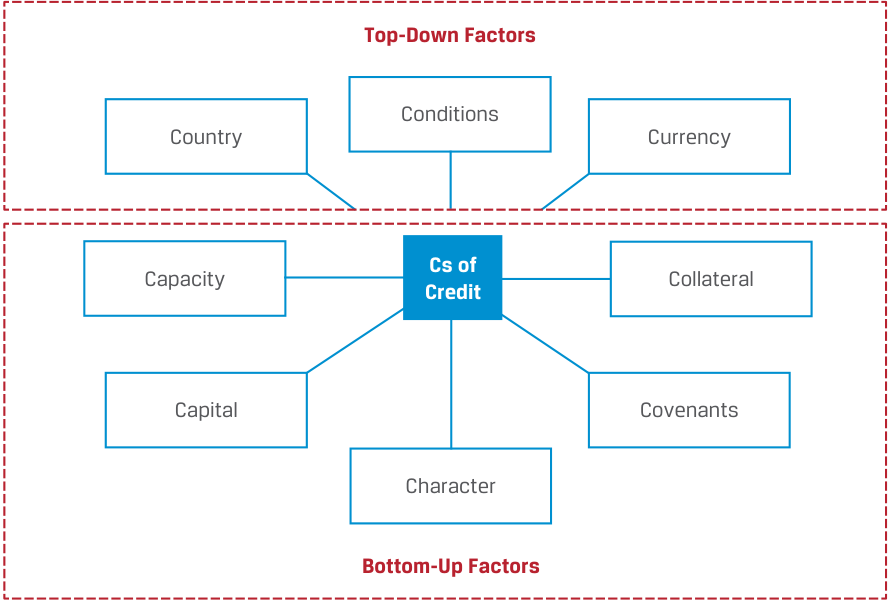
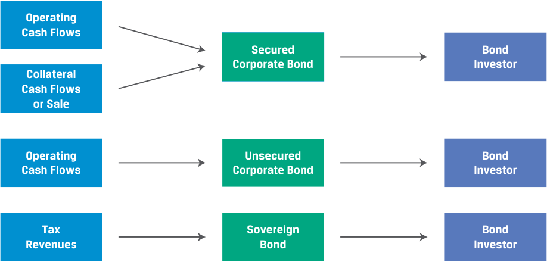
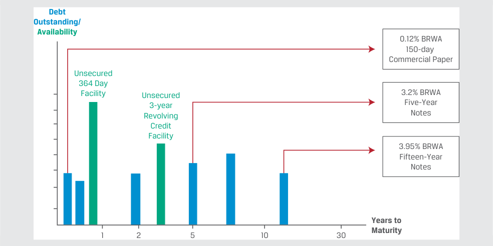
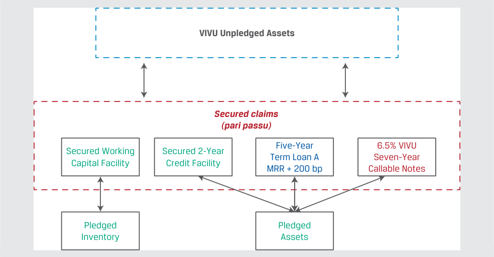

# Tập 6: Thu nhập Cố định (Fixed Income)
## Học phần 14: Rủi ro Tín dụng (Credit Risk)
### Phần 1/4: Giới thiệu (Trang PDF 355–368)

---

<!-- PDF Page 355 -->

#### H Ọ C P H Ầ N

# **<mark>14</mark>**

### **Rủi ro Tín dụng (Credit Risk)**

###### **<mark>KẾT QUẢ HỌC TẬP (LEARNING OUTCOMES)</mark>**

**_Thành thạo – Ứng viên cần có khả năng:_**
- mô tả rủi ro tín dụng (*credit risk*) và các cấu phần của nó, bao gồm xác suất vỡ nợ (*probability of default*) và mức tổn thất khi vỡ nợ (*loss given default*)
- mô tả công dụng của xếp hạng tín nhiệm (*credit ratings*) từ các tổ chức xếp hạng tín nhiệm (*credit rating agencies*) và những hạn chế của chúng
- mô tả các yếu tố kinh tế vĩ mô, thị trường và đặc thù của tổ chức phát hành có ảnh hưởng đến mức độ và sự biến động của phần bù lợi suất (*yield spreads*)

##### **GIỚI THIỆU (INTRODUCTION)**

## **<mark>1</mark>**

Phân tích tín dụng (*credit analysis*) đóng một vai trò quan trọng trên các thị trường thu nhập cố định. Việc đánh giá và định giá hợp lý rủi ro tín dụng tạo điều kiện thuận lợi cho việc phân bổ vốn hiệu quả. Đây là một quá trình năng động vì các cấu phần của rủi ro tín dụng liên tục được đánh giá lại và các công cụ thu nhập cố định được định giá lại theo điều kiện thị trường. Học phần này đề cập đến các nguyên tắc cơ bản của phân tích tín dụng. Trước hết, chúng ta giới thiệu các khái niệm về rủi ro tín dụng và tổn thất kỳ vọng (*expected loss*), đồng thời giải thích ý nghĩa của xếp hạng tín nhiệm. Chúng ta so sánh mức độ tín nhiệm (*creditworthiness*) của tổ chức phát hành trái phiếu trong cùng một ngành cũng như giữa các ngành với nhau, và khám phá cách các thị trường tài chính định giá rủi ro tín dụng. Bài học này tập trung chủ yếu vào việc phân tích rủi ro tín dụng, trong khi các bài học tiếp theo sẽ thảo luận về phân tích tín dụng đối với các tổ chức phát hành chính phủ có chủ quyền (*sovereign*) và phi chủ quyền (*non-sovereign*) cũng như nợ doanh nghiệp (*corporate debt*).

###### **TỔNG QUAN HỌC PHẦN (LEARNING MODULE OVERVIEW)**

- Rủi ro tín dụng (*credit risk*) là rủi ro tổn thất kinh tế phát sinh do bên đi vay không thực hiện thanh toán đầy đủ và đúng hạn tiền lãi và nợ gốc. Các cấu phần chính của rủi ro tín dụng là xác suất vỡ nợ (*probability of default*) và mức tổn thất khi vỡ nợ (*loss given default*), và tích số của chúng là tổn thất kỳ vọng (*expected loss*).

- Các nguồn phát sinh rủi ro tín dụng chính bao gồm các điều kiện kinh tế vĩ mô bất lợi, sự lệch pha tài trợ (*financing mismatch*) giữa các nguồn lực và nghĩa vụ nợ, và các yếu tố đặc thù của tổ chức phát hành trên thị trường nợ doanh nghiệp và nợ chính phủ.

<!-- PDF Page 356 -->

- Hầu như mọi đợt phát hành trái phiếu tại các thị trường nợ phát triển đều có xếp hạng tín nhiệm (*credit ratings*) nhằm phân loại mức độ tín nhiệm. Xếp hạng tín nhiệm cho phép so sánh rủi ro tín dụng của các đợt phát hành nợ và các tổ chức phát hành trong cùng một ngành và giữa các ngành với nhau.

- Các trái phiếu hoặc tổ chức phát hành có xếp hạng tín nhiệm hạng đầu tư (*investment-grade* – IG) mang rủi ro vỡ nợ thấp nhất và được Moody’s xếp hạng từ Baa3 trở lên, hoặc được S&P và Fitch xếp hạng từ BBB– trở lên. Ngược lại, các trái phiếu hoặc tổ chức phát hành phi hạng đầu tư (*non-investment-grade*) hay lợi suất cao (*high-yield* – HY) được S&P/Fitch xếp hạng từ BB+ trở xuống và Moody’s xếp hạng từ Ba1 trở xuống, thể hiện rủi ro tín dụng từ mức đáng kể đến rất cao.

- Những cạm bẫy của việc chỉ dựa vào xếp hạng tín nhiệm khi đưa ra quyết định đầu tư bao gồm việc quyết định của tổ chức xếp hạng có thể đi sau (*lag*) mức định giá rủi ro tín dụng của thị trường, bỏ sót các rủi ro tài chính trọng yếu, và/hoặc bao hàm các tính toán sai lệch hoặc những thay đổi không lường trước chưa được phản ánh đầy đủ trong phân tích hướng tới tương lai (*forward-looking analysis*) của tổ chức xếp hạng.

- Phần bù (*premium*), hay phần bù lợi suất (*yield spread*), mà tại đó trái phiếu doanh nghiệp giao dịch so với các tài sản phi rủi ro vỡ nợ (*default risk-free assets*) sẽ nới rộng (*widens*) khi rủi ro tín dụng tăng lên và thu hẹp (*narrows*) nếu rủi ro tín dụng giảm xuống.

- Những thay đổi của phần bù tín dụng (*credit spread*) tác động đến tỷ suất sinh lợi thời kỳ nắm giữ (*holding period returns*) thông qua hai yếu tố chính: a) mức thay đổi phần bù tính bằng điểm cơ bản (*basis point spread change*) và b) độ nhạy của giá đối với lợi suất được phản ánh qua thời lượng điều chỉnh (*modified duration*) và độ lồi (*convexity*) cuối kỳ. Phần bù thu hẹp làm tăng tỷ suất sinh lợi thời kỳ nắm giữ.

###### **TỰ ĐÁNH GIÁ HỌC PHẦN (LEARNING MODULE SELF-ASSESSMENT)**

Các câu hỏi mở đầu này nhằm giúp bạn tự đánh giá mức độ hiểu biết hiện tại của mình về học phần này.

1. Rủi ro tín dụng (*credit risk*) là:

   - **A.** được kích hoạt khi bên đi vay vỡ nợ.

   - **B.** phần bù (*spread*) mà nhà đầu tư nhận được cao hơn lãi suất phi rủi ro.

   - **C.** được bên cho vay trải nghiệm theo nhiều cách khác nhau.

   - **Lời giải:**

Đáp án đúng là C. Bên cho vay chịu tác động bởi rủi ro tín dụng theo nhiều cách khác nhau, bao gồm việc không nhận được các khoản thanh toán gốc và lãi đúng hạn, không có khả năng bán tài sản thế chấp (*collateral*) ở mức giá thị trường đủ để đáp ứng các nghĩa vụ của tổ chức phát hành trong trường hợp nợ có bảo đảm (*secured debt*), hoặc khả năng phát sinh các chi phí pháp lý hay chi phí khác để thu hồi nợ. A sai vì mặc dù việc bên đi vay vỡ nợ làm phát sinh khoản tổn thất thực tế (*realized loss*), nhưng tổn thất kỳ vọng (*expected loss*) đã tồn tại trước khi xảy ra bất kỳ tổn thất thực tế nào. B sai vì điều đó đề cập đến phần bù tín dụng (*credit spread*), tức phần đền bù cho nhà đầu tư khi gánh chịu rủi ro tín dụng.

2. Một khoản vay trị giá EUR500,000 có các đặc điểm sau:

   - Xác suất vỡ nợ (*Probability of default*): 5%

   - Tỷ lệ thu hồi (*Recovery rate*): 90%

   - Dư nợ rủi ro kỳ vọng (*Expected exposure*): EUR400,000

Tổn thất kỳ vọng (*expected loss*) của khoản vay này là:

   - **A.** EUR1,500

<!-- PDF Page 357 -->

   - **B.** EUR2,000

   - **C.** EUR20,000

   - **Lời giải:**

Đáp án đúng là B. Chúng ta giải tìm tổn thất kỳ vọng ($\text{EL}$) như sau:

$$\text{EL} = \text{POD} \times \text{LGD} = \text{POD} \times \text{EE} \times (1 - \text{RR})$$

Vì xác suất vỡ nợ ($\text{POD}$) là 5%, dư nợ rủi ro kỳ vọng ($\text{EE}$) là EUR400,000, và tỷ lệ thu hồi ($\text{RR}$) là 90%:

$$\text{EL} = \text{EUR}2,000 = 0.05 \times (400,000) \times (1 - 0.9)$$

A sai vì không giảm dư nợ rủi ro kỳ vọng theo tài sản thế chấp, trong khi C sai vì chỉ đơn thuần nhân $\text{EE}$ với $\text{POD}$.

3. Xếp hạng tín nhiệm (*credit ratings*) là:

   - **A.** được xây dựng thay mặt cho các nhà đầu tư.

   - **B.** một thước đo dựa trên ký hiệu về rủi ro vỡ nợ tiềm tàng của một đợt phát hành trái phiếu hoặc tổ chức phát hành.

   - **C.** các thước đo rủi ro tín dụng được sử dụng để xác định giá trái phiếu trên thị trường.

   - **Lời giải:**

Đáp án đúng là B: Xếp hạng tín nhiệm là một thước đo dựa trên ký hiệu về rủi ro vỡ nợ tiềm tàng của một đợt phát hành trái phiếu hoặc tổ chức phát hành. A sai vì xếp hạng tín nhiệm được xây dựng thay mặt cho tổ chức phát hành (*issuer*). C sai vì xếp hạng tín nhiệm không được sử dụng để xác định giá trái phiếu.

4. Phát biểu nào sau đây mô tả đúng nhất các rủi ro khó nắm bắt trong xếp hạng tín nhiệm?

   - **A.** Rủi ro môi trường được nắm bắt bởi xếp hạng ESG thay vì xếp hạng tín nhiệm.

   - **B.** Các thương vụ mua lại tài trợ bằng nợ (*debt-financed acquisitions*) thường được nắm bắt trong xếp hạng tín nhiệm.

   - **C.** Xếp hạng phân hóa (*split ratings*) chứng tỏ rằng các tổ chức xếp hạng tín nhiệm có thể nhìn nhận các rủi ro phức tạp theo những cách rất khác nhau.

   - **Lời giải:**

Đáp án đúng là C. A sai vì các rủi ro môi trường có thể ảnh hưởng đến xếp hạng tín nhiệm. B sai vì các thương vụ mua lại tài trợ bằng nợ rất khó lường trước.

5. _Xác định các câu trả lời đúng để điền vào chỗ trống:_ Phần bù tín dụng (*spreads*) ở mức __________ tại hoặc gần đỉnh của chu kỳ tín dụng (*credit cycle*), khi những người tham gia thị trường nhận thấy rủi ro tín dụng ở mức thấp nhất; chúng ở mức __________ tại hoặc gần đáy của chu kỳ tín dụng, khi các thị trường tài chính tin rằng rủi ro tín dụng đã đạt đỉnh.

   - **Lời giải:**

Phần bù tín dụng ở mức **hẹp nhất (hoặc thấp nhất) (*narrowest / lowest*)** tại hoặc gần đỉnh của chu kỳ tín dụng, khi những người tham gia thị trường nhận thấy rủi ro tín dụng ở mức thấp nhất; chúng ở mức **rộng nhất (hoặc cao nhất) (*widest / highest*)** tại hoặc gần đáy của chu kỳ tín dụng, khi các thị trường tài chính tin rằng rủi ro tín dụng đã đạt đỉnh.

6. Một nhà quản lý danh mục đầu tư đang đánh giá một kịch bản bất lợi (*downside case*) tin rằng phần bù trái phiếu lợi suất cao (HY) sẽ tăng 100 bps trong một cuộc suy thoái. Nếu một trái phiếu HY quan sát được có thời lượng điều chỉnh (*modified duration*)

<!-- PDF Page 358 -->

là 4.5 và độ lồi được báo cáo (*reported convexity*) là 0.23, mức thay đổi kỳ vọng trong giá của trái phiếu HY theo kịch bản này sẽ _gần nhất với_:

**A.** 4.5%.

**B.** 4.385%.

**C.** 4.615%.

###### **Lời giải:**

Đáp án đúng là B. Thay đổi giá trái phiếu dựa trên thời lượng điều chỉnh, độ lồi và mức thay đổi phần bù được tính như sau:

$$\%\Delta\text{PV}^{\text{Full}} = -(\text{AnnModDur} \times \Delta\text{Spread}) + \frac{1}{2}\text{AnnConvexity} \times (\Delta\text{Spread})^2$$

Với $\text{AnnModDur} = 4.5$ và độ lồi báo cáo là 0.23, quy đổi lại thang đo (*rescaling*) độ lồi thành 23 và thay các giá trị vào để giải theo phần bù ta được:

$$\Delta\text{PV}^{\text{Full}} = -(4.5 \times 1.00\%) + \frac{1}{2}(23) \times (1.00\%)^2$$

$$\Delta\text{PV}^{\text{Full}} = -4.385\%$$

## **<mark>2</mark>**

##### **CÁC NGUỒN PHÁT SINH RỦI RO TÍN DỤNG (SOURCES OF CREDIT RISK)**

mô tả rủi ro tín dụng (*credit risk*) và các cấu phần của nó, bao gồm xác suất vỡ nợ (*probability of default*) và mức tổn thất khi vỡ nợ (*loss given default*)

Các nhà đầu tư thu nhập cố định phải đối mặt với rủi ro tín dụng (*credit risk*), một dạng rủi ro thực hiện nghĩa vụ (*performance risk*) trong mối quan hệ hợp đồng. Một bên đi vay không thực hiện được các nghĩa vụ thanh toán tiền lãi và/hoặc nợ gốc đã cam kết theo hợp đồng trái phiếu hoặc khoản vay được gọi là bị **vỡ nợ (*default*)**. Nhà đầu tư thu nhập cố định tìm kiếm phần đền bù cho tổn thất kinh tế kỳ vọng khi bên đi vay có khả năng vỡ nợ trong suốt vòng đời của hợp đồng, được gọi là **rủi ro tín dụng (*credit risk*)**.

Rủi ro tín dụng phụ thuộc vào các yếu tố cụ thể liên quan đến chính bên đi vay cũng như các điều kiện kinh tế chung và có thể thay đổi trong suốt vòng đời của hợp đồng. Rủi ro tín dụng khiến bên cho vay hoặc nhà đầu tư phải đối mặt với các khoản tổn thất tiềm tàng và hiệu quả đầu tư kém.

Theo truyền thống, nhiều nhà phân tích đánh giá mức độ tín nhiệm dựa trên những tiêu chí thường được gọi là “Các chữ C trong phân tích tín dụng (*Cs of credit analysis*)”, như được trình bày trong Bảng minh họa 1:

<!-- PDF Page 359 -->

**Bảng minh họa 1: Các chữ C trong Phân tích Tín dụng (The Cs of Credit Analysis)**

<!-- Picture Text: Top-Down Factors Conditions Country Currency Cs of Capacity Collateral Credit Capital Covenants Character Bottom-Up Factors  -->

> **Chú thích hình ảnh:**
> - **Các chữ C của Tín dụng (*Cs of Credit*)**:
>   - **Các yếu tố từ trên xuống (*Top-Down Factors*)**: Điều kiện môi trường (*Conditions*), Quốc gia (*Country*), Tiền tệ (*Currency*)
>   - **Các yếu tố từ dưới lên (*Bottom-Up Factors*)**: Năng lực trả nợ (*Capacity*), Tài sản thế chấp (*Collateral*), Nguồn vốn (*Capital*), Các điều khoản ràng buộc (*Covenants*), Tư cách/Uy tín (*Character*)

Năm trong số các tiêu chí này — năng lực trả nợ (*capacity*), nguồn vốn (*capital*), tài sản thế chấp (*collateral*), các điều khoản ràng buộc (*covenants*), và tư cách/uy tín (*character*) — liên quan đến các yếu tố đặc thù từ dưới lên (*bottom-up factors*) áp dụng cho từng bên đi vay riêng lẻ. **Năng lực trả nợ (*Capacity*)** đề cập đến khả năng của bên đi vay trong việc thực hiện các khoản thanh toán nợ đúng hạn. **Nguồn vốn (*Capital*)** đề cập đến các nguồn lực khác sẵn có của công ty giúp giảm sự phụ thuộc vào nợ vay. **Tài sản thế chấp (*Collateral*)** đề cập đến chất lượng và giá trị của các tài sản hỗ trợ cho khoản nợ của tổ chức phát hành, trong khi **các điều khoản ràng buộc (*covenants*)** là các điều khoản pháp lý của thỏa thuận nợ mà tổ chức phát hành phải tuân thủ. **Tư cách/Uy tín (*Character*)** đề cập đến chất lượng của ban lãnh đạo và thiện chí hoàn trả các khoản nợ.

Trong khi năng lực trả nợ và nguồn vốn nhìn chung là các thước đo định lượng dựa trên báo cáo tài chính, thì tài sản thế chấp, các điều khoản ràng buộc và tư cách/uy tín chủ yếu là các thước đo định tính mà các nhà phân tích đánh giá dựa trên kết quả hoạt động lịch sử của công ty, các mối quan hệ tín dụng và danh tiếng của ban lãnh đạo hiện tại.

Ba tiêu chí còn lại — điều kiện môi trường (*conditions*), quốc gia (*country*), và tiền tệ (*currency*) — liên quan đến các yếu tố chung từ trên xuống (*top-down factors*) áp dụng cho tất cả các bên đi vay ở mức độ nhiều hay ít. **Điều kiện môi trường (*Conditions*)** đề cập đến môi trường kinh tế, cạnh tranh và kinh doanh chung mà tất cả các bên đi vay phải đối mặt, có thể ảnh hưởng đến khả năng trả nợ hoặc tái cấp vốn nợ của họ. **Quốc gia (*Country*)** liên quan đến môi trường địa chính trị cũng như hệ thống pháp lý và chính trị mà tất cả các tổ chức phát hành trong một khu vực tài phán phải đối mặt, có thể ảnh hưởng đến việc thanh toán nợ. **Tiền tệ (*Currency*)** ảnh hưởng đến các tổ chức phát hành có dòng tiền chịu tác động bởi biến động tỷ giá hối đoái hoặc những tổ chức đi vay bằng đồng tiền bên ngoài khu vực tài phán của họ, chẳng hạn như các tổ chức phát hành chính phủ có nợ bằng ngoại tệ.

Việc bên đi vay không có khả năng thanh toán đúng hạn có thể do một số yếu tố cơ bản và góp phần gây ra, nhưng suy cho cùng là xuất phát từ việc thiếu lượng tiền mặt đủ để thực hiện khoản thanh toán nợ hiện hành. Bên cho vay, với tư cách là các nhà đầu tư thu nhập cố định, chịu tác động bởi rủi ro tín dụng. Họ có thể mất một phần hoặc toàn bộ tiền gốc và lãi đến hạn, gánh chịu lỗ vốn (*capital loss*) hoặc thiếu hụt thu nhập (*income shortfall*). Sự gián đoạn đối với dòng tiền của họ có thể ảnh hưởng đến chính khả năng trả nợ của họ, và sự chậm trễ thanh toán cũng như chi phí pháp lý và thu hồi nợ gia tăng có thể làm giảm thêm thu nhập và biên lợi nhuận của họ.

<!-- PDF Page 360 -->

###### **Các nguồn phát sinh Rủi ro Tín dụng (Sources of Credit Risk)**

Những thay đổi trong rủi ro tín dụng do điều kiện của tổ chức phát hành hoặc điều kiện kinh tế tổng thể đều chịu ảnh hưởng bởi nguồn trả nợ (*source of repayment*), vốn khác nhau giữa các loại hình tổ chức phát hành. Bảng minh họa 2 cho thấy các nguồn trả nợ chính đối với trái phiếu doanh nghiệp và trái phiếu chính phủ.

**Bảng minh họa 2: Các nguồn Trả nợ của Trái phiếu Chính phủ và Trái phiếu Doanh nghiệp (Sovereign and Corporate Bond Sources of Repayment)**

<!-- Picture Text: Operating Cash Flows Secured Bond Corporate Bond Investor Collateral Cash Flows or Sale Operating Unsecured Bond Cash Flows Corporate Bond Investor Tax Sovereign Bond Revenues Bond Investor  -->

> **Chú thích hình ảnh:**
> - **Nhà đầu tư Trái phiếu Doanh nghiệp có bảo đảm (*Secured Bond Corporate Bond Investor*)** $\leftarrow$ Dòng tiền hoạt động (*Operating Cash Flows*) + Dòng tiền hoặc tiền bán Tài sản thế chấp (*Collateral Cash Flows or Sale*)
> - **Nhà đầu tư Trái phiếu Doanh nghiệp không có bảo đảm (*Unsecured Bond Corporate Bond Investor*)** $\leftarrow$ Dòng tiền hoạt động (*Operating Cash Flows*)
> - **Nhà đầu tư Trái phiếu Chính phủ (*Sovereign Bond Investor*)** $\leftarrow$ Nguồn thu thuế (*Tax Revenues*)

Một doanh nghiệp có thể không tạo ra đủ dòng tiền từ hoạt động kinh doanh, hoạt động tài chính và hoạt động đầu tư của mình để thực hiện thanh toán đúng hạn cho khoản nợ, làm tăng rủi ro vỡ nợ. Tương tự, một bên đi vay là chính phủ có chủ quyền có thể không tạo ra đủ doanh thu thông qua thuế, thu nhập và phí để thực hiện thanh toán đúng hạn.

Những bên đi vay thiếu nguồn lực để đáp ứng các nghĩa vụ nợ khi đến hạn thường được mô tả là kém thanh khoản (*illiquid*). Một bên đi vay mất thanh khoản không có khả năng huy động các nguồn vốn cần thiết để thực hiện nghĩa vụ nợ. Họ có thể không tiếp cận được các hạn mức tín dụng (*credit lines*), không bán được tài sản, hoặc không huy động được vốn bằng cách khác để thanh toán nợ đúng hạn. Điều đó khác với một bên đi vay _mất khả năng thanh toán_ (*insolvent*) có giá trị tài sản thấp hơn nợ phải trả. Một bên đi vay mất thanh khoản chỉ đơn giản là không có, hoặc không thể đảm bảo được, lượng thanh khoản cần thiết để thanh toán đúng hạn.

Phân tích rủi ro tín dụng tập trung vào việc tìm hiểu cách thức một bên đi vay tạo ra tiền mặt, cách thức và thời điểm tiền mặt được sử dụng, cũng như những sự kiện và rủi ro nào có thể cản trở khả năng hoàn trả khoản nợ của bên đi vay. Trong các bài học trước, chúng ta đã gặp nợ _không có bảo đảm_ (*unsecured debt*), trong đó nguồn trả nợ chính là dòng tiền được tạo ra từ hoạt động kinh doanh. Trong trường hợp nợ _có bảo đảm_ (*secured debt*), nguồn trả nợ chính vẫn là dòng tiền của doanh nghiệp, nhưng nó còn được hỗ trợ thêm bởi tài sản thế chấp (*collateral*) do công ty cầm cố. Ví dụ sau đây liên quan đến một nhà đầu tư đang cân nhắc giữa một trái phiếu không có bảo đảm và một trái phiếu có bảo đảm.

###### **VÍ DỤ 1**

###### **So sánh Rủi ro giữa Trái phiếu BRWA và VIVU**

Nhà sản xuất ô tô giả định Bright Wheel Automotive (BRWA) là một tổ chức phát hành hạng đầu tư (IG) có khả năng tiếp cận dễ dàng với nợ không có bảo đảm, trong khi Vivivyu Inc. (VIVU) là một tổ chức phát hành lợi suất cao (HY) giả định đi vay trên cơ sở có bảo đảm. Chúng ta hãy so sánh trái phiếu trung hạn (*notes*) BRWA cấp cao không có bảo đảm và không thứ cấp (*senior unsecured and unsubordinated*) lãi suất 3.2% với trái phiếu trung hạn VIVU có bảo đảm không thứ cấp (*secured unsubordinated*) lãi suất 6.5%. Hãy xem xét hồ sơ nợ (*debt profile*) của BRWA:

<!-- PDF Page 361 -->

<!-- Picture Text: BRWA Corporation Debt Profile  -->

<!-- Picture Text: Debt Outstanding/ Availability 0.12% BRWA 150-day Commercial Paper Unsecured 364 Day Facility Unsecured 3.2% BRWA 3-year Five-Year Revolving Notes Credit Facility 3.95% BRWA Fifteen-Year Notes Years to 1 2 5 10 30 Maturity  -->

> **Chú thích hình ảnh: Hồ sơ nợ của Tập đoàn BRWA (*BRWA Corporation Debt Profile*)**
> - Trục tung: Dư nợ / Hạn mức khả dụng (*Debt Outstanding / Availability*)
> - Trục hoành: Số năm đến khi đáo hạn (*Years to Maturity*: 1, 2, 5, 10, 30)
> - Các khoản nợ: Thương phiếu 150 ngày lãi suất 0.12% của BRWA (*0.12% BRWA 150-day Commercial Paper*); Hạn mức tín dụng 364 ngày không bảo đảm (*Unsecured 364 Day Facility*); Hạn mức tín dụng tuần hoàn 3 năm không bảo đảm (*Unsecured 3-year Revolving Credit Facility*); Trái phiếu 5 năm lãi suất 3.2% của BRWA (*3.2% BRWA Five-Year Notes*); Trái phiếu 15 năm lãi suất 3.95% của BRWA (*3.95% BRWA Fifteen-Year Notes*).

Nếu BRWA không thực hiện thanh toán lãi hoặc gốc cho trái phiếu này, BRWA sẽ bị vỡ nợ. Vì các trái phiếu của công ty là nghĩa vụ nợ không có bảo đảm và không thứ cấp có điều khoản ngang hàng (*pari passu*) và vỡ nợ chéo (*cross-default*) trong khế ước trái phiếu (*bond indenture*), việc không hoàn trả được khoản nợ không có bảo đảm đồng nghĩa với việc tất cả các nghĩa vụ nợ của công ty đều bị vỡ nợ và các nhà đầu tư phải dựa vào khối tài sản chung (*general asset pool*) của BRWA để đáp ứng các nghĩa vụ của họ, như minh họa dưới đây.

<!-- Picture Text: Unsecured claims (pari passu) Other 0.12% BRWA Unsecured 150-Day Claims  Commercial Paper Unsecured Unsecured 3.2% BRWA 3.95% BRWA 364 Day 3-Year Five-Year Fifteen-Year Facility  Revolver Notes   Notes BRWA General Assets  -->

> **Chú thích hình ảnh:**
> - **Các quyền đòi nợ không có bảo đảm (ngang hàng - *pari passu*)**: Các quyền đòi nợ không bảo đảm khác (*Other Unsecured Claims*), Hạn mức 364 ngày không bảo đảm, Hạn mức tuần hoàn 3 năm không bảo đảm, Thương phiếu 150 ngày 0.12% BRWA, Trái phiếu 5 năm 3.2% BRWA, Trái phiếu 15 năm 3.95% BRWA $\rightarrow$ Cùng dựa vào **Tài sản chung của BRWA (*BRWA General Assets*)**.

Mặt khác, với tư cách là một tổ chức phát hành HY, VIVU bị giới hạn trong việc tiếp cận thị trường nợ có bảo đảm, như được thể hiện trong hồ sơ nợ của công ty.

<!-- PDF Page 362 -->

###### **Hồ sơ nợ của VIVU (VIVU Debt Profile)**

<!-- Picture Text: Debt Outstanding/ Availability Secured 2-year Credit 6.5% VIVU Facility Seven-Year Callable Notes Five-Year Term Loan A MRR + 200 bp Secured Working Capital Facility Years to 1 2 5 10 30 Maturity  -->

> **Chú thích hình ảnh: Hồ sơ nợ của VIVU (*VIVU Debt Profile*)**
> - Trục tung: Dư nợ / Hạn mức khả dụng (*Debt Outstanding / Availability*)
> - Trục hoành: Số năm đến khi đáo hạn (*Years to Maturity*: 1, 2, 5, 10, 30)
> - Các khoản nợ: Hạn mức vốn lưu động có bảo đảm (*Secured Working Capital Facility*); Hạn mức tín dụng 2 năm có bảo đảm (*Secured 2-year Credit Facility*); Khoản vay có kỳ hạn A 5 năm lãi suất MRR + 200 bp (*Five-Year Term Loan A MRR + 200 bp*); Trái phiếu có thể mua lại 7 năm lãi suất 6.5% của VIVU (*6.5% VIVU Seven-Year Callable Notes*).

_Lưu ý:_ MRR viết tắt của lãi suất tham chiếu thị trường (*market reference rate*).

Việc VIVU không thực hiện thanh toán đúng hạn cho trái phiếu cũng sẽ dẫn đến vỡ nợ. Điều khoản ngang hàng (*pari passu*) và điều khoản vỡ nợ chéo (*cross-default*) trong khế ước trái phiếu của công ty đối với các khoản nợ không có bảo đảm khác cũng đẩy tất cả các nghĩa vụ nợ của VIVU vào tình trạng vỡ nợ. Mặc dù _tất cả_ các nhà đầu tư nợ của VIVU đều có quyền tiếp cận bất kỳ tài sản chưa cầm cố (*unpledged assets*) nào, các tài sản cầm cố cụ thể (*specific pledged assets*) đóng vai trò là nguồn trả nợ thứ cấp cho từng khoản nợ cụ thể, như minh họa dưới đây.

<!-- Picture Text: VIVU Unpledged Assets Secured claims (pari passu) Five-Year 6.5% VIVU Secured Working Secured 2-Year Term Loan A Seven-Year Capital Facility Credit Facility MRR + 200 bp Callable Notes Pledged Pledged Inventory Assets  -->

> **Chú thích hình ảnh:**
> - **Tài sản chưa cầm cố của VIVU (*VIVU Unpledged Assets*)** nằm ở phía trên.
> - **Các quyền đòi nợ có bảo đảm (ngang hàng - *pari passu*)**:
>   - Hạn mức vốn lưu động có bảo đảm (*Secured Working Capital Facility*) $\rightarrow$ Hàng tồn kho cầm cố (*Pledged Inventory*).
>   - Hạn mức tín dụng 2 năm có bảo đảm (*Secured 2-Year Credit Facility*), Khoản vay có kỳ hạn A 5 năm MRR + 200 bp (*Five-Year Term Loan A*), Trái phiếu có thể mua lại 7 năm 6.5% VIVU (*6.5% VIVU Seven-Year Callable Notes*) $\rightarrow$ Tài sản cầm cố (*Pledged Assets*).

Trong ví dụ này, các quyền đòi nợ có bảo đảm của VIVU bao gồm hạn mức vốn lưu động được bảo đảm bằng tài sản ngắn hạn (trong trường hợp này là hàng tồn kho), trong khi khoản nợ dài hạn có bảo đảm bao gồm cả trái phiếu có thể mua lại được bảo đảm bằng quyền đòi nợ đối với các tài sản dài hạn cụ thể đã cầm cố. Với tư cách là nguồn trả nợ thứ cấp, chỉ khi giá trị của các tài sản cầm cố giảm xuống dưới tổng giá trị của khoản nợ có bảo đảm ngang hàng (*pari passu*) thì các trái chủ của VIVU mới bắt đầu gánh chịu tổn thất tín dụng.

Mặc dù _khả năng xảy ra vỡ nợ_ (*likelihood of default*) đối với các bên đi vay hạng đầu tư, chẳng hạn như BRWA, thường thấp hơn nhiều so với một tổ chức phát hành lợi suất cao như VIVU, nhưng _mức tổn thất của nhà đầu tư trong trường hợp vỡ nợ_ (*loss in the event of a default*) đối với nợ có bảo đảm thường thấp hơn so với nợ không có bảo đảm nhờ có nguồn trả nợ thứ cấp của trái phiếu có bảo đảm.

Chúng ta đã bắt gặp đợt phát hành nợ kỳ hạn 30 năm trị giá 1.95 tỷ EUR của Chính phủ Romania trong một bài học trước. Đối với một chính phủ có chủ quyền, quyền đánh thuế lên các hoạt động kinh tế trong phạm vi biên giới quốc gia đồng nghĩa với việc các nguồn trả nợ là thuế thu nhập cá nhân và doanh nghiệp, thuế doanh thu (*sales taxes*), và các khoản thu khác do chính phủ tạo ra. Trong

<!-- PDF Page 363 -->

trường hợp cụ thể của khoản nợ định danh bằng đồng EUR của Romania, khả năng tạo ra dòng tiền bằng đồng tiền dự trữ (*reserve currency*) của chính phủ dựa trên hồ sơ thể chế và kinh tế, việc sử dụng chính sách tiền tệ và tài khóa, và chế độ tỷ giá hối đoái là những yếu tố cần xem xét bổ sung. Các loại hình bên đi vay chính cùng nguồn trả nợ chính và nguồn rủi ro tín dụng của họ được liệt kê trong Bảng minh họa 3.

**Bảng minh họa 3: Các loại hình Bên đi vay, Nguồn Trả nợ và Nguồn Rủi ro Tín dụng (Borrower Types, Sources of Repayment, and Sources of Credit Risk)**

|**Loại hình Bên đi vay (Borrower Type)**|**Nguồn tạo Dòng tiền Chính (Primary Source of Cash Flow Generation)**|**Nguồn tạo Dòng tiền Thứ cấp (Secondary Source of Cash Flow Generation)**|**Các nguồn Rủi ro Tín dụng (Sources of Credit Risk)**|
|---|---|---|---|
|Doanh nghiệp (*Corporate*)|■ Hoạt động kinh doanh (*Business operations*) ■ Hoạt động đầu tư và tài chính (*Investment and financing activities*)|■ Bán tài sản (*Asset sales*) ■ Thoái vốn (*Divestitures*) ■ Phát hành thêm nợ (*Additional debt issuance*) ■ Phát hành cổ phần (*Equity issuance*)|■ Suy giảm kinh tế (*Economic contraction*) ■ Thay đổi chiến lược trong môi trường kinh doanh và thị trường (*Strategic shifts in the business and market environment*) ■ Cạnh tranh gia tăng (*Increased competition*) ■ Giảm quyền định giá (*Reduced pricing power*) ■ Biên lợi nhuận hoạt động thu hẹp, thua lỗ gia tăng (*Shrinking operating margins, increased losses*) ■ Nhu cầu trả nợ quá mức (*Excessive debt service needs*)|
|Chính phủ có chủ quyền hoặc tổ chức công (*Sovereign or public entity*)|■ Thuế thu nhập doanh nghiệp và cá nhân, thuế doanh thu và doanh thu thuế GTGT (VAT), thuế lãi vốn và thuế tài sản (*Corporate and personal income taxes, sales tax and VAT revenue, capital gains and wealth-based taxes*) ■ Thuế quan, phí và doanh thu khác của chính phủ (*Tariffs, fees, and other government revenue*)|■ Nợ mới phát hành (*Newly issued debt*) ■ Bán tài sản công, tư nhân hóa (*Sale of public assets, privatization*)|■ Suy giảm kinh tế (*Economic contraction*) ■ Bất ổn chính trị (*Political uncertainty*) ■ Nhu cầu trả nợ quá mức (*Excessive debt service needs*) ■ Các chính sách kinh tế mở rộng (*Expansionary economic policies*) ■ Thâm hụt ngân sách (*Budget deficits*) ■ Cắt giảm thuế (*Tax cuts*) ■ Khả năng thu thuế hạn chế (*Limited ability to collect taxes*)|

Mặc dù có nhiều yếu tố ảnh hưởng đến nguồn trả nợ chính và thứ cấp của các tổ chức phát hành thu nhập cố định khác nhau, các nhà đầu tư luôn tìm cách đo lường và so sánh rủi ro tín dụng giữa các bên đi vay khác nhau có cùng kỳ hạn cũng như giữa các kỳ hạn khác nhau của cùng một bên đi vay.

Ví dụ, hãy xem xét phép so sánh giữa trái phiếu BRWA và VIVU trong Ví dụ 1. Nếu tạm thời chúng ta bỏ qua cả sự khác biệt về kỳ hạn lẫn tính năng mua lại (*call feature*) của VIVU (tính năng mà tổ chức phát hành có thể thực hiện bất kỳ lúc nào từ năm thứ ba cho đến khi đáo hạn vào năm thứ bảy) bằng cách giả định kỳ hạn kỳ vọng tương tự như trái phiếu BRWA, hãy so sánh mức lãi suất coupon 6.5% của khoản nợ VIVU với mức lãi suất cố định 3.2% của trái phiếu BRWA. Làm thế nào chúng ta có thể đánh giá liệu mức lãi tăng thêm 3.3% ($= 6.5\% - 3.2\%$) có đền bù thỏa đáng cho nhà đầu tư đối với phần rủi ro tăng thêm hay không? Chúng ta sẽ chuyển sang các thước đo rủi ro tín dụng để giúp trả lời câu hỏi này trong phần tiếp theo.

###### **Đo lường Rủi ro Tín dụng (Measuring Credit Risk)**

Các nhà đầu tư thu nhập cố định phải đối mặt với rủi ro tín dụng, hay rủi ro tổ chức phát hành không thực hiện các khoản thanh toán tiền lãi và nợ gốc đã cam kết. Khoản thiếu hụt có trọng số xác suất này được gọi là **tổn thất kỳ vọng (*expected loss* – EL)** cho một giai đoạn nhất định và có hai cấu phần, như được trình bày trong Bảng minh họa 4.

<!-- PDF Page 364 -->

**Bảng minh họa 4: Các cấu phần của Rủi ro Tín dụng (Components of Credit Risk)**

<!-- Picture Text: Expected Total projected exposure Exposure (EE) under event of default Recovery Percentage of loss Rate (RR) recovered in default Loss Given Amount of loss EE × (1– RR) = LGD Default (LGD) if a default occurs Probability of Conditional probability of borrower Default (POD) default (assuming no prior default) Expected Probability-weighted LGD × POD = EL Loss (EL) amount of loss  -->

> **Chú thích hình ảnh:**
> - **Dư nợ rủi ro kỳ vọng (*Expected Exposure* – EE)**: Tổng dư nợ rủi ro dự phóng khi xảy ra sự kiện vỡ nợ $\rightarrow$ Kết hợp với **Tỷ lệ thu hồi (*Recovery Rate* – RR)**: Tỷ lệ phần trăm tổn thất thu hồi được khi vỡ nợ $\rightarrow$ $\text{EE} \times (1 - \text{RR}) = \text{LGD}$.
> - **Mức tổn thất khi vỡ nợ (*Loss Given Default* – LGD)**: Giá trị tổn thất nếu xảy ra vỡ nợ $\rightarrow$ Kết hợp với **Xác suất vỡ nợ (*Probability of Default* – POD)**: Xác suất có điều kiện bên đi vay vỡ nợ (giả định chưa vỡ nợ trước đó) $\rightarrow$ $\text{LGD} \times \text{POD} = \text{EL}$.
> - **Tổn thất kỳ vọng (*Expected Loss* – EL)**: Giá trị tổn thất có trọng số xác suất.

Cấu phần thứ nhất được gọi là **xác suất vỡ nợ (*probability of default* – POD)**, là khả năng một tổ chức phát hành không thực hiện thanh toán đầy đủ và đúng hạn nợ gốc và tiền lãi. Xác suất vỡ nợ thường là một thước đo được chuẩn hóa theo năm (*annualized measure*).

Cấu phần thứ hai là **mức tổn thất khi vỡ nợ (*loss given default* – LGD)**, hay khoản tổn thất của nhà đầu tư với điều kiện xảy ra sự kiện vỡ nợ của tổ chức phát hành. Mức tổn thất khi vỡ nợ kết hợp mức độ nghiêm trọng của tổn thất (*severity of loss*) trong kịch bản vỡ nợ với quy mô quyền đòi nợ của nhà đầu tư tại thời điểm vỡ nợ. **Tỷ lệ thu hồi (*recovery rate* – RR)** thể hiện tỷ lệ phần trăm của quyền đòi nợ đang lưu hành được thu hồi khi tổ chức phát hành vỡ nợ, trong khi **mức độ nghiêm trọng của tổn thất (*loss severity*)** bằng $(1 - \text{RR})$ thể hiện phần không thu hồi được của quyền đòi nợ. Quy mô quyền đòi nợ của nhà đầu tư tại thời điểm vỡ nợ được gọi là **dư nợ rủi ro kỳ vọng (*expected exposure* – EE)** hoặc **dư nợ tại thời điểm vỡ nợ (*exposure at default* – EAD)**. Đây là số tiền mà nhà đầu tư có thể kỳ vọng bị mất trong trường hợp vỡ nợ, thường bằng mệnh giá khoản vay hoặc trái phiếu cộng với lãi tích lũy trừ đi giá trị thị trường hiện tại của tài sản thế chấp hiện có. Trong hầu hết các trường hợp, khi xảy ra vỡ nợ, các trái chủ thường sẽ thu hồi được một tỷ lệ nhất định trong khoản đầu tư của mình.

Tổn thất kỳ vọng được trình bày trong Phương trình 1:

$$\text{EL} = \text{POD} \times \text{LGD} \tag{1}$$

trong đó $\text{LGD} = \text{EE} \times (1 - \text{RR})$.

$\text{LGD}$ có thể được biểu thị bằng đơn vị tiền tệ (ví dụ: EUR450,000) hoặc dưới dạng tỷ lệ phần trăm của nợ gốc (ví dụ: 45%). Cách biểu thị thứ hai hữu ích hơn cho việc phân tích vì nó cho phép so sánh giữa các bên đi vay và các khoản đầu tư có quy mô khác nhau.

Một cách để diễn giải tổn thất kỳ vọng trên một chứng khoán thu nhập cố định trong một giai đoạn nhất định là so sánh nó với mức đền bù mà nhà đầu tư kỳ vọng nhận được khi gánh chịu rủi ro tín dụng của bên đi vay trong giai đoạn đó, chính là phần bù tín dụng (*credit spread*). Hãy nhớ lại từ bài học trước rằng phần bù G (*G-spread*) bằng phần bù lợi suất tính bằng điểm cơ bản so với một trái phiếu chính phủ thực tế hoặc nội suy. Phép xấp xỉ này có thể được biểu diễn như sau:

$$\text{Credit Spread} \approx \text{POD} \times \text{LGD} \tag{2}$$

Do đó, chúng ta có thể nói rằng nhà đầu tư được đền bù thỏa đáng (*fairly compensated*) nếu tổn thất kỳ vọng bằng với phần bù tín dụng trong một giai đoạn nhất định. Ví dụ sau đây sử dụng thông tin này để đánh giá tổn thất kỳ vọng so với mức đền bù đối với trái phiếu BRWA và VIVU từ Ví dụ 1.

<!-- PDF Page 365 -->

###### **VÍ DỤ 2**

###### **So sánh Tổn thất Kỳ vọng và Phần bù Tín dụng**

Hãy nhớ lại từ Ví dụ 1 rằng Bright Wheel Automotive (BRWA) đã phát hành một trái phiếu không có bảo đảm kỳ hạn 5 năm với lãi suất coupon cố định 3.2%. Chênh lệch lợi suất đáo hạn (*yield-to-maturity*) giữa trái phiếu kỳ hạn 5 năm của BRWA và trái phiếu Kho bạc Mỹ tương đương là 90 bps ($= 3.2\% - 2.3\%$), phản ánh phần bù tín dụng của BRWA so với trái phiếu Kho bạc, được gọi là G-spread. Vivivyu Inc. (VIVU) đã phát hành một trái phiếu lãi suất cố định 6.5%, mà tổ chức phát hành có quyền mua lại ở một mức giá cố định bất kỳ lúc nào kể từ 3 năm sau ngày phát hành cho đến khi đáo hạn cuối cùng vào năm thứ 7.

1. Giả sử trái phiếu BRWA có xác suất vỡ nợ là 1% và mức tổn thất khi vỡ nợ là 80%, hãy ước tính xem các nhà đầu tư trái phiếu BRWA có được đền bù thỏa đáng khi gánh chịu rủi ro tín dụng của BRWA hay không.

###### **Lời giải:**

Sử dụng Phương trình 1, chúng ta có thể giải tìm tổn thất kỳ vọng của BRWA dưới dạng phần trăm như sau:

$$\text{EL} = \text{POD} \times \text{LGD}, \text{ hay } 0.8\% = [0.01 \times 80\%]$$

Với phần bù tín dụng của BRWA là 0.9%, chúng ta có thể kết luận dựa trên phép xấp xỉ trong Phương trình 2 rằng các nhà đầu tư vào BRWA được đền bù thỏa đáng khi gánh chịu rủi ro tín dụng vì:

$$\text{Credit Spread} > \text{POD} \times \text{LGD}$$

Nhà đầu tư hưởng phần bù 90 bps mỗi năm và có mức tổn thất kỳ vọng là 80 bps mỗi năm.

2. Nếu chúng ta giả định rằng VIVU đã phát hành một trái phiếu không thể mua lại kỳ hạn 5 năm, giống như trường hợp của BRWA, với xác suất vỡ nợ là 6% và mức tổn thất khi vỡ nợ là 50%, hãy so sánh mức đền bù cho nhà đầu tư khi gánh chịu rủi ro tín dụng của trái phiếu VIVU lãi suất coupon 6.5% với mức lãi suất cố định 3.2% của trái phiếu BRWA.

###### **Lời giải:**

Sử dụng Phương trình 1, chúng ta có thể giải tìm tổn thất kỳ vọng của VIVU dưới dạng phần trăm như sau:

$$\text{EL} = \text{POD} \times \text{LGD}, \text{ hay } 3.0\% = [0.06 \times 50\%]$$

Chúng ta có thể tính phần bù tín dụng 5 năm của VIVU bằng cách lấy lãi suất coupon 6.5% trừ đi mức lợi suất 2.3% của trái phiếu Kho bạc Mỹ kỳ hạn 5 năm để tìm ra G-spread là 4.2%. Dựa trên phép xấp xỉ trong Phương trình 2, chúng ta có thể kết luận rằng các nhà đầu tư vào VIVU được đền bù thỏa đáng khi gánh chịu rủi ro tín dụng vì:

$$\text{Credit Spread} > \text{POD} \times \text{LGD}$$

Nhà đầu tư hưởng phần bù 420 bps mỗi năm và có mức tổn thất kỳ vọng là 300 bps mỗi năm.

3. Việc xác định phần bù cũng như quan điểm của nhà đầu tư về rủi ro so với mức đền bù đối với trái phiếu VIVU sẽ thay đổi như thế nào so với Câu hỏi 2 nếu chúng ta

<!-- PDF Page 366 -->

xem xét kỳ hạn _thực tế_ và tính năng mua lại (*call feature*) của trái phiếu VIVU với mức coupon 6.5% ban đầu?

###### **Lời giải:**

Các nhà đầu tư vào VIVU phải đối mặt với cả rủi ro bị mua lại trước hạn (*call risk*) và rủi ro kỳ hạn (*maturity risk*) lớn hơn theo các điều khoản trái phiếu ban đầu so với một trái phiếu kỳ hạn 5 năm không thể mua lại. Như đã mô tả trong các bài học trước, trái phiếu có thể mua lại ở mức giá cố định trước khi đáo hạn mang lại lợi thế cho tổ chức phát hành và bất lợi cho nhà đầu tư, do đó nhà đầu tư kỳ vọng được đền bù thông qua mức lợi suất cao hơn so với một trái phiếu không thể mua lại tương tự do sự không chắc chắn về kỳ hạn và khả năng tăng giá bị giới hạn, được gọi là rủi ro mua lại (*call risk*). Lợi suất điều chỉnh theo quyền chọn (*option-adjusted yield*) này là lãi suất chiết khấu thị trường yêu cầu mà tại đó giá của trái phiếu được điều chỉnh theo giá trị của quyền chọn gắn kèm (*embedded option*). Các nhà đầu tư cũng sẽ kỳ vọng được đền bù cho thời gian đáo hạn dài hơn bằng một phần bù tín dụng cao hơn.

Chúng ta có thể xem xét sâu hơn các yếu tố thúc đẩy tổn thất kỳ vọng đối với khoản nợ hạng đầu tư không có bảo đảm của BRWA so với khoản nợ lợi suất cao có bảo đảm của VIVU trong Ví dụ 2. $\text{POD}$ được thúc đẩy bởi khả năng trả nợ của tổ chức phát hành dựa trên cả các yếu tố định tính và định lượng, bao gồm:

- Khả năng sinh lời (*Profitability*): Dòng tiền và lợi nhuận ổn định, có thể dự báo được;

- Khả năng thanh toán lãi vay/trang trải nợ (*Coverage*): Đủ dòng tiền/lợi nhuận để thực hiện các khoản thanh toán nợ; và

- Đòn bẩy tài chính (*Leverage*): Mức độ phụ thuộc tương đối vào tài trợ bằng nợ vay.

Khả năng sinh lời cao hơn (được đo lường, ví dụ, bằng biên EBIT – *EBIT margin*) và khả năng trang trải nợ cao hơn (tỷ số EBIT trên chi phí lãi vay – *EBIT to interest expense*) kết hợp với đòn bẩy thấp hơn (các tỷ số nợ trên thu nhập hoặc dòng tiền, chẳng hạn như Nợ/EBITDA hoặc dòng tiền trên nợ ròng – *cash flow to net debt*) gắn liền với $\text{POD}$ thấp hơn và chất lượng tín dụng cao hơn. Mặc dù các tỷ số tài chính là một trong số nhiều yếu tố được sử dụng để đánh giá rủi ro tín dụng, và mức độ tương đối của chúng theo từng bậc xếp hạng rất khác nhau giữa các ngành và theo thời gian, Bảng minh họa 5 cung cấp một ví dụ tổng quát về các mối quan hệ này.

<!-- PDF Page 367 -->

###### **Bảng minh họa 5: Các Tỷ số Tài chính Chính đối với Rủi ro Tín dụng và Xếp hạng Doanh nghiệp (Key Financial Ratios for Corporate Credit Risk and Ratings)**

<!-- Picture Text: EBIT Margin EBIT to Interest Expense 30% Aaa Aa 20 Aaa 20% A Aa Baa 10 A Ba Baa Ba 10% B B 0 Caa Ca 0% Debt to EBITDA Cash Flow to Net Debt Ca 8x Caa 100% Aaa 6x B 4x Aa Ba 50% 3x A Baa 2x Baa A Ba 1x B Caa Aa 0% Aaa 0  -->

> **Chú thích hình ảnh:**
> - **Biên EBIT (*EBIT Margin*)**: Giảm dần từ hạng `Aaa` (~30%), `Aa`, `A`, `Baa`, `Ba`, `B`, `Caa` đến `Ca` (~0%).
> - **Tỷ số EBIT trên Chi phí lãi vay (*EBIT to Interest Expense*)**: Giảm dần từ hạng `Aaa` (~20x), `Aa`, `A`, `Baa`, `Ba`, `B` đến `Caa`, `Ca` (< 0).
> - **Tỷ số Nợ trên EBITDA (*Debt to EBITDA*)**: Tăng dần từ hạng `Aaa`, `Aa` (< 1x), `A`, `Baa`, `Ba`, `B`, `Caa` đến `Ca` (> 8x).
> - **Tỷ số Dòng tiền trên Nợ ròng (*Cash Flow to Net Debt*)**: Giảm dần từ hạng `Aaa` (~100%), `Aa`, `A`, `Baa`, `Ba`, `B`, `Caa` đến `Ca` (< 0%).

Như Bảng minh họa 5 cho thấy, những thay đổi trong các tỷ số về khả năng sinh lời (biên EBIT), khả năng trang trải nợ (EBIT trên chi phí lãi vay), và đòn bẩy (Nợ/EBITDA và dòng tiền trên nợ ròng) theo thời gian có thể dẫn đến việc nâng hạng (*upgrades*) hoặc hạ hạng (*downgrades*) tín nhiệm cũng như làm thay đổi phần bù tín dụng. Mặt khác, $\text{LGD}$ đối với một dư nợ rủi ro nhất định phần lớn là một hàm số phụ thuộc vào bản chất và thứ tự ưu tiên thanh toán (*seniority*) của quyền đòi nợ của chủ nợ trong kịch bản vỡ nợ, như được trình bày trong Bảng minh họa 6:

<!-- PDF Page 368 -->

###### **Bảng minh họa 6: Thứ tự Ưu tiên Thanh toán và LGD (Seniority and LGD)**

<!-- Picture Text: Seniority Highest Ranking Secured Debt Lower LGD Unsecured Debt Higher LGD Lowest Ranking  -->

> **Chú thích hình ảnh:**
> - **Thứ tự ưu tiên (*Seniority*)**: Từ Thứ hạng cao nhất (*Highest Ranking*) đến Thứ hạng thấp nhất (*Lowest Ranking*).
> - **Nợ có bảo đảm (*Secured Debt*)** $\rightarrow$ **LGD thấp hơn (*Lower LGD*)**.
> - **Nợ không có bảo đảm (*Unsecured Debt*)** $\rightarrow$ **LGD cao hơn (*Higher LGD*)**.

Đối với các nhà đầu tư vào trái phiếu hoặc khoản vay hạng đầu tư không có bảo đảm có $\text{LGD}$ cao, rủi ro tổn thất kỳ vọng lớn nhất phát sinh do sự gia tăng của $\text{POD}$. Mặt khác, các nhà đầu tư lợi suất cao (HY) vốn kỳ vọng khả năng xảy ra vỡ nợ lớn hơn sẽ tìm cách giảm thiểu $\text{EL}$ bằng cách yêu cầu các hạn chế trong điều khoản ràng buộc (*covenant restrictions*) và/hoặc tài sản bảo đảm để hạ thấp $\text{LGD}$.

###### **BỘ CÂU HỎI (QUESTION SET)**

1. _Xác định các câu trả lời đúng để điền vào chỗ trống:_ Hai cấu phần của rủi ro tín dụng là _________________, thường được đo lường trong khung thời gian 12 tháng, và _________________, yếu tố mà cùng với tỷ lệ thu hồi sẽ xác định _________________.

###### **Lời giải:**

Hai cấu phần của rủi ro tín dụng là **xác suất vỡ nợ (*probability of default*)**, thường được đo lường trong khung thời gian 12 tháng, và **dư nợ tại thời điểm vỡ nợ (hoặc dư nợ rủi ro kỳ vọng) (*exposure at default / expected exposure*)**, yếu tố mà cùng với tỷ lệ thu hồi sẽ xác định **mức tổn thất khi vỡ nợ (*loss given default*)**.

2. Phát biểu nào sau đây mô tả đúng nhất sự khác biệt giữa nghĩa vụ nợ không có bảo đảm và nghĩa vụ nợ có bảo đảm trong trường hợp tổ chức phát hành vỡ nợ?

   - **A.** Các chủ nợ không có bảo đảm chỉ có quyền tiếp cận dòng tiền của tổ chức phát hành, trong khi các chủ nợ có bảo đảm chỉ có quyền tiếp cận các tài sản cầm cố cụ thể.

   - **B.** Cả chủ nợ không có bảo đảm và chủ nợ có bảo đảm đều có quyền tiếp cận các tài sản chưa cầm cố (*unpledged assets*), trong khi chỉ các chủ nợ có bảo đảm mới có quyền tiếp cận các tài sản cầm cố cụ thể như một nguồn trả nợ thứ cấp.

   - **C.** Chỉ các chủ nợ không có bảo đảm mới có quyền tiếp cận các tài sản cầm cố, trong khi chỉ các chủ nợ có bảo đảm mới có quyền tiếp cận các tài sản cầm cố cụ thể.

   - **Lời giải:**

B là đáp án đúng. Mặc dù tất cả các chủ nợ đều nhận các khoản thanh toán tiền lãi và nợ gốc từ dòng tiền của tổ chức phát hành, nhưng khi xảy ra sự kiện vỡ nợ thì cả chủ nợ không có bảo đảm và có bảo đảm
