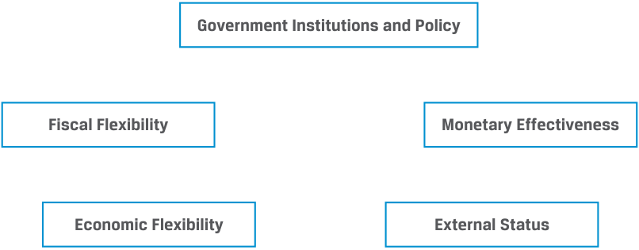
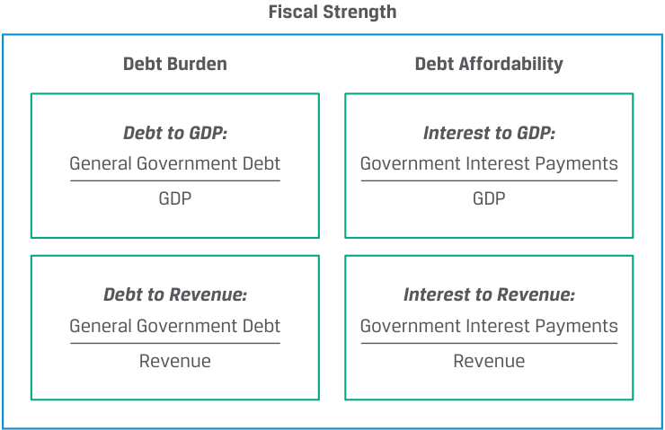
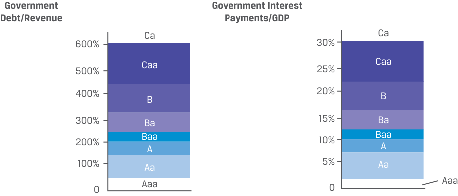
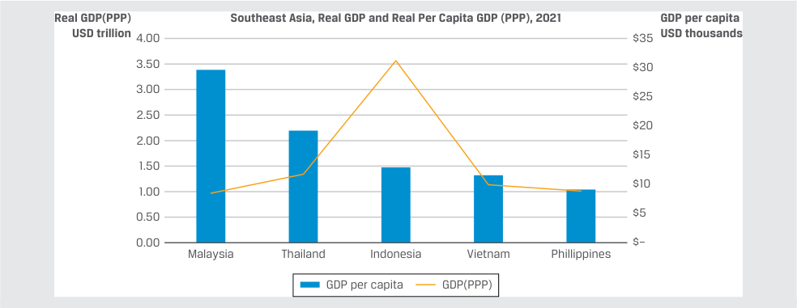
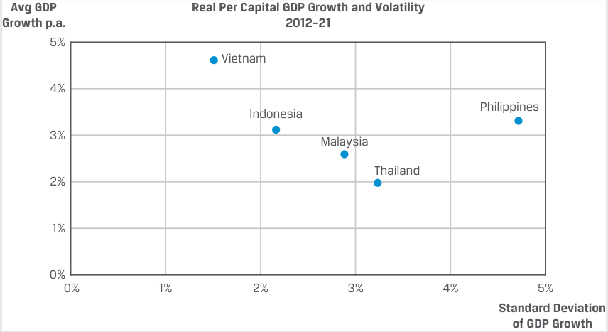

# Tập 6: Chứng khoán Thu nhập Cố định (Fixed Income)
## Learning Module 15 Credit Analysis for Government Issuers (Trang PDF 393–420)

---

# Tập 6: Thu nhập Cố định (Fixed Income)
## Học phần 15: Phân tích Tín dụng đối với Tổ chức Phát hành Chính phủ (Credit Analysis for Government Issuers)
### Phần 1/2: Giới thiệu (Trang PDF 393–408)

---

<!-- PDF Page 393 -->

#### H Ọ C P H Ầ N

# **<mark>15</mark>**

### **Phân tích Tín dụng đối với Tổ chức Phát hành Chính phủ (Credit Analysis for Government Issuers)**

###### **<mark>KẾT QUẢ HỌC TẬP (LEARNING OUTCOMES)</mark>**

**_Thành thạo – Ứng viên cần có khả năng:_**
- giải thích những lưu ý đặc biệt khi đánh giá tín dụng của các tổ chức phát hành và các đợt phát hành nợ chính phủ có chủ quyền (*sovereign*) và phi chủ quyền (*non-sovereign*)

##### **GIỚI THIỆU (INTRODUCTION)**

**<mark>1</mark>**

Học phần này khám phá những lưu ý đặc biệt đối với việc đánh giá tín dụng của các tổ chức phát hành chính phủ có chủ quyền (*sovereign*) và các tổ chức phát hành khu vực công khác thường xuyên tiếp cận thị trường thu nhập cố định để tài trợ cho các hoạt động của mình.

Sự khác biệt lớn giữa tổ chức phát hành doanh nghiệp và chính phủ có chủ quyền là mục đích sử dụng vốn thu được (*use of proceeds*) và nguồn trả nợ (*source of repayment*) đối với các nghĩa vụ nợ. Ngược lại với các doanh nghiệp vốn tài trợ cho vốn lưu động và tài sản cố định nhằm tạo ra lợi nhuận, các tổ chức phát hành chính phủ có chủ quyền và chính quyền các cấp khác sử dụng nợ để thực hiện chính sách tài khóa (*fiscal policy*), cung cấp hàng hóa và dịch vụ công cộng (*public goods and services*), và tài trợ cho các khoản chi tiêu khác của chính phủ. Trong khi các công ty chủ yếu dựa vào dòng tiền hoạt động để trả nợ, các chính phủ sử dụng nguồn thu thuế (*tax revenues*) và các khoản thu khác của chính phủ, chẳng hạn như thuế quan (*tariffs*) và phí (*fees*), để thanh toán tiền lãi và nợ gốc.

Chúng ta phân tích trái phiếu chính phủ bằng cách sử dụng sự kết hợp của các yếu tố định tính và định lượng nhằm đánh giá khả năng (*ability*) và thiện chí (*willingness*) trả nợ của họ. Các vụ vỡ nợ của chính phủ có chủ quyền (*sovereign defaults*) không phải là hiếm gặp, đặc biệt khi các quốc gia chuyển đổi từ nền kinh tế mới nổi sang nền kinh tế phát triển. Tuy nhiên, ngược lại với các tổ chức phát hành doanh nghiệp, các trái chủ nắm giữ trái phiếu chính phủ nhìn chung không thể buộc các chính phủ tuyên bố phá sản và thanh lý tài sản. Các tổ chức phát hành phi chủ quyền (*non-sovereign issuers*), chẳng hạn như một số chính quyền địa phương hoặc các tổ chức bán chính phủ (*quasi-government entities*), cũng phát hành nợ để tài trợ cho các khoản chi tiêu hoặc phát triển cơ sở hạ tầng của họ. Khoản nợ này được bảo đảm bằng khả năng đánh thuế địa phương hoặc tạo ra doanh thu từ dự án cụ thể của họ.

###### **TỔNG QUAN HỌC PHẦN (LEARNING MODULE OVERVIEW)**

- Các chính phủ vay vốn trên các thị trường đại chúng để thực hiện chính sách tài khóa và đáp ứng các nhu cầu ngân sách, chẳng hạn như việc cung cấp <u>hàng hóa công cộng (*public goods*).</u>

<!-- PDF Page 394 -->

- Khả năng đánh thuế lên các hoạt động kinh tế tư nhân của chính phủ có chủ quyền khiến cho các trái phiếu này thông thường có rủi ro tín dụng thấp nhất so với bất kỳ tổ chức phát hành nào trong một quốc gia cụ thể. Tại các nền kinh tế phát triển, nợ chính phủ thường được coi là phi rủi ro vỡ nợ (*default risk-free*).

- Sự kết hợp giữa các yếu tố định tính và định lượng được sử dụng để phân tích khả năng trả nợ (*ability to pay*) và thiện chí trả nợ (*willingness to pay*) của một tổ chức phát hành chính phủ có chủ quyền.

- Tính độc lập cao hơn của ngân hàng trung ương (*central bank independence*) khỏi tổ chức phát hành là chính phủ làm giảm khả năng chính phủ quốc gia sẽ chỉ đơn thuần tăng cung tiền bằng cách mua lại nợ trong nước (*monetize domestic debt*).

- Một điểm phân biệt then chốt đối với mức độ tín nhiệm của chính phủ có chủ quyền là liệu đồng nội tệ của quốc gia đó có được coi là một đồng tiền dự trữ (*reserve currency*) hay không, tức là một đồng tiền có khả năng chuyển đổi hoàn toàn (*fully convertible*) và được nắm giữ bởi các ngân hàng trung ương nước ngoài cùng các nhà đầu tư khác.

- Nợ chính phủ phi chủ quyền (*non-sovereign government debt*) được phát hành bởi các chính quyền địa phương hoặc các tổ chức bán chính phủ, được bảo đảm bằng nguồn thu thuế của họ hoặc doanh thu từ dự án cụ thể.

- Việc phân tích tín dụng đối với nợ phi chủ quyền được bảo đảm bằng nguồn thu thuế có những lưu ý tương tự như trái phiếu chính phủ có chủ quyền, trong khi trái phiếu doanh thu dựa trên dự án (*project-based revenue bonds*) thường được đánh giá dựa trên các dòng tiền gắn liền với dự án cơ sở đó.

###### **TỰ ĐÁNH GIÁ HỌC PHẦN (LEARNING MODULE SELF-ASSESSMENT)**

Các câu hỏi mở đầu này nhằm giúp bạn tự đánh giá mức độ hiểu biết hiện tại của mình về học phần này.

1. Xác định loại nợ tương ứng với ví dụ đúng:

- A) nợ chính phủ có chủ quyền (*sovereign debt*), B) nợ phi chủ quyền (*non-sovereign debt*), C) nợ doanh nghiệp (*corporate debt*)

1. Được phát hành bởi một đơn vị và được bảo đảm bằng dòng tiền từ hoạt động kinh doanh của đơn vị đó
2. Được phát hành bởi chính phủ của một quốc gia, được bảo đảm bằng khả năng và thiện chí đánh thuế của chính phủ đó
3. Được phát hành bởi một chính quyền hoặc tổ chức địa phương, được bảo đảm bằng khả năng và thiện chí đánh thuế của họ, hoặc doanh thu từ một dự án công cụ thể

###### **Lời giải:**

1. C là đáp án đúng. Nợ doanh nghiệp (*corporate debt*) được phát hành bởi các doanh nghiệp phi chính phủ để tài trợ cho hoạt động kinh doanh, và các khoản thanh toán được thực hiện từ dòng tiền hoạt động.

2. A là đáp án đúng. Nợ chính phủ có chủ quyền (*sovereign debt*) được phát hành bởi các chính phủ quốc gia để thực hiện chính sách tài khóa và tài trợ cho ngân sách của họ. Khoản nợ này được thanh toán dựa trên khả năng và thiện chí thu thuế của chính phủ trong phạm vi một khu vực tài phán.

3. B là đáp án đúng. Nợ phi chủ quyền (*non-sovereign debt*) được phát hành bởi các chính quyền cấp dưới quốc gia (*sub-sovereign*) hoặc địa phương và các tổ chức liên quan. Các trái phiếu này được hỗ trợ bởi thẩm quyền đánh thuế địa phương của tổ chức phát hành hoặc doanh thu từ dự án công cụ thể.

<!-- PDF Page 395 -->

2. Nguyên tắc miễn trừ chủ quyền (*principle of sovereign immunity*) có liên quan đến yếu tố nào của chính phủ có chủ quyền:

   - **A.** khả năng trả nợ (*ability to pay*).

   - **B.** khả năng đánh thuế (*ability to tax*).

   - **C.** thiện chí trả nợ (*willingness to pay*).

   - **Lời giải:**

C là đáp án đúng. Theo nguyên tắc miễn trừ chủ quyền (*sovereign immunity*), luật pháp quốc gia giới hạn khả năng của các nhà đầu tư trong việc buộc một chính phủ có chủ quyền phải phá sản hoặc thanh lý tài sản của mình để giải quyết các quyền đòi nợ như trường hợp đối với một tổ chức phát hành doanh nghiệp.

3. Mức độ tín nhiệm của các bên đi vay là chính phủ có chủ quyền và chính quyền khác dựa trên các yếu tố định tính và định lượng. Yếu tố nào sau đây _không phải_ là một yếu tố định lượng?

   - **A.** Sự ổn định đối ngoại (*External stability*)

   - **B.** Tăng trưởng và sự linh hoạt kinh tế (*Economic growth and flexibility*)

   - **C.** Sức mạnh tài khóa (*Fiscal strength*)

   - **Lời giải:**

B là đáp án đúng. Yếu tố định lượng thực chất là tăng trưởng và sự ổn định kinh tế (*economic growth and stability*), chứ không phải sự linh hoạt (*flexibility*).

4. Phát biểu nào sau đây mô tả đúng nhất các đặc điểm của sức mạnh đối ngoại (*external strength*) gắn liền với chất lượng tín dụng cao hơn?

   - **A.** Một chính phủ có khả năng áp đặt và thực thi các biện pháp kiểm soát vốn (*capital controls*)

   - **B.** Một chính phủ đã thiết lập các hiệp định thương mại tự do với các quốc gia láng giềng

   - **C.** Một chính phủ có ngân hàng trung ương phát hành đồng tiền dự trữ (*reserve currency*)

   - **Lời giải:**

C là đáp án đúng. Một điểm phân biệt then chốt đối với mức độ tín nhiệm của chính phủ có chủ quyền là liệu đồng nội tệ của quốc gia đó có được coi là một đồng tiền dự trữ hay không, tức có khả năng chuyển đổi hoàn toàn và thường xuyên được nắm giữ bởi các ngân hàng trung ương nước ngoài cùng các nhà đầu tư khác. A sai vì các biện pháp kiểm soát vốn có thể không hỗ trợ cho năng lực trả nợ. B sai vì thương mại tự do là điều kiện cần nhưng chưa phải là điều kiện đủ để thiết lập sức mạnh đối ngoại.

5. Hãy ghép nối các đợt phát hành nợ sau đây với đúng loại hình tổ chức phát hành:

A) trái phiếu cơ quan đại diện chính phủ (*agency bonds*), B) trái phiếu nghĩa vụ chung (*general obligation bonds*), C) trái phiếu doanh thu (*revenue bonds*)

|Đợt phát hành nợ|
|---|
|1. Trái phiếu được phát hành để xây dựng một tuyến đường cao tốc thu phí cấp vùng (*regional highway toll road*)|
|2. Trái phiếu được phát hành bởi tổng công ty tài chính thế chấp quốc gia (*national mortgage finance corporation*), theo luật quốc gia.|
|3. Trái phiếu được phát hành bởi chính quyền bang để tài trợ cho khoản thâm hụt quỹ hưu trí (*pension deficit*)|

###### **Lời giải:**

1. C là đáp án đúng. Trái phiếu doanh thu (*revenue bonds*) được phát hành để tài trợ cho một <u>dự án lợi ích công cộng cụ thể, chủ yếu được hỗ trợ bởi chính quyền địa phương/vùng. Doanh thu</u>

<!-- PDF Page 396 -->

từ dự án được hỗ trợ bởi nền tảng kinh tế cho việc khai thác sử dụng dự án đó sẽ quyết định mức độ tín nhiệm của nó.

2. A là đáp án đúng. Các cơ quan đại diện (*agencies*) là các tổ chức bán chính phủ (*quasi-government entities*) có hoạt động chính là thực hiện một sứ mệnh do chính phủ bảo trợ nhằm cung cấp các dịch vụ công vốn thường dựa trên một đạo luật hoặc quy chế quốc gia cụ thể. Trong nhiều trường hợp, đạo luật hoặc quy chế thành lập tổ chức đó cho phép nó tài trợ cho các hoạt động của mình bằng cách sử dụng nợ vay.

3. B là đáp án đúng. Trái phiếu nghĩa vụ chung (*General obligation – GO bonds*) là các trái phiếu không có bảo đảm được hậu thuẫn bởi các nguồn thu chung của chính quyền phi chủ quyền phát hành. Các trái phiếu này được hỗ trợ bởi thẩm quyền đánh thuế của tổ chức phát hành, thay vì doanh thu từ một dự án cụ thể.

6. Yếu tố nào sau đây là một yếu tố định tính có liên quan để đánh giá xếp hạng tín nhiệm chính phủ đối với đợt phát hành nợ của một quốc gia?

   - **A.** Tài nguyên thiên nhiên (*Natural resources*)

   - **B.** Quan hệ đối tác thương mại với một nền kinh tế mạnh (*Trading partnership with a strong economy*)

   - **C.** Sự đa dạng hóa kinh tế (*Economic diversification*)

   - **Lời giải:**

C là đáp án đúng. Một trong những yếu tố then chốt để đánh giá mức độ tín nhiệm đối với khoản nợ của một tổ chức phát hành chính phủ là mức độ đa dạng hóa kinh tế, cũng như tiềm năng tăng trưởng. Nền kinh tế tại các quốc gia có bên đi vay chính phủ được xếp hạng cao nhất thường có nền kinh tế trong nước tiên tiến và đa dạng hóa cao với triển vọng tăng trưởng mạnh mẽ, bền vững. Mặt khác, các nền kinh tế thị trường mới nổi hoặc cận biên (*emerging or frontier market economies*) thường phụ thuộc vào một ngành công nghiệp hoặc hàng hóa cơ bản duy nhất và/hoặc có ít đối tác thương mại hơn, khiến cho nguồn thu thuế sẵn có đối với các bên đi vay chính phủ này dễ bị tổn thương hơn trước suy thoái kinh tế, biến động giá hàng hóa cơ bản chủ chốt, và/hoặc sự gián đoạn thương mại.

## **<mark>2</mark>**

##### **PHÂN TÍCH TÍN DỤNG CHÍNH PHỦ CÓ CHỦ QUYỀN (SOVEREIGN CREDIT ANALYSIS)**

giải thích những lưu ý đặc biệt khi đánh giá tín dụng của các tổ chức phát hành và các đợt phát hành nợ chính phủ có chủ quyền (*sovereign*) và phi chủ quyền (*non-sovereign*)

Như đã phác thảo trong các bài học trước, cả chính phủ có chủ quyền và chính quyền phi chủ quyền đều phát hành nợ để tài trợ cho các hoạt động của mình. Ngược lại với nợ doanh nghiệp, khoản nợ này được sử dụng để thực hiện chính sách tài khóa và đáp ứng các nhu cầu ngân sách, chẳng hạn như cung cấp hàng hóa và dịch vụ công cộng bao gồm cơ sở hạ tầng, y tế và giáo dục. Nguồn trả nợ chính đối với nợ chính phủ có chủ quyền thường là thuế và các khoản thu khác của chính phủ, có thể bao gồm phí, thuế quan, và trong một số trường hợp là lợi nhuận của các doanh nghiệp nhà nước (*state-owned enterprises*). Khả năng đánh thuế lên tất cả các hoạt động kinh tế tư nhân thuộc khu vực tài phán của một chính phủ có chủ quyền là lý do chính giải thích tại sao những trái phiếu như vậy thường có rủi ro tín dụng thấp nhất so với bất kỳ tổ chức phát hành nào trong một quốc gia cụ thể. Mặc dù trái phiếu chính phủ tại các nền kinh tế tiên tiến nhất thường được coi là phi rủi ro vỡ nợ, nhưng những trái phiếu được phát hành bởi chính phủ tại các thị trường mới nổi và cận biên lại hàm chứa rủi ro vỡ nợ lớn hơn.

Các nhà đầu tư trái phiếu đánh giá mức độ tín nhiệm của cả tổ chức phát hành doanh nghiệp và khu vực công thông qua tính ổn định và khả năng dự báo của dòng tiền tổ chức phát hành, sự đầy đủ của các dòng tiền đó để đáp ứng các khoản thanh toán tiền lãi và nợ gốc bắt buộc, và mức độ phụ thuộc tương đối của tổ chức phát hành

<!-- PDF Page 397 -->

vào việc tài trợ bằng nợ so với các nguồn lực sẵn có khác. Mức độ tín nhiệm của các bên đi vay là chính phủ có chủ quyền và chính quyền khác dựa trên các yếu tố định tính và định lượng đặc thù của khu vực công, như được trình bày trong các phần tiếp theo.

###### **Các Yếu tố Định tính (Qualitative Factors)**

Các chính sách của chính phủ có chủ quyền ảnh hưởng đến nền kinh tế vĩ mô và các thị trường tài chính bao gồm các chính sách tiền tệ và tài khóa vốn thường tìm cách tạo ra một môi trường kinh tế có mức tăng trưởng dương, ổn định và lạm phát thấp, ổn định. Các nhà đầu tư trong và ngoài nước đánh giá mức độ tín nhiệm của một tổ chức phát hành chính phủ bằng cách xem xét các chính sách thuế và chi tiêu của chính phủ cũng như nền kinh tế cơ sở với tư cách là nguồn thu thuế chính để trả nợ. Các yếu tố định tính được đưa vào đánh giá này được trình bày trong Bảng minh họa 1.

###### **Bảng minh họa 1: Các Yếu tố Định tính trong Đánh giá Mức độ Tín nhiệm Chính phủ (Qualitative Factors in Sovereign Creditworthiness)**

<!-- Picture Text: Government Institutions and Policy Fiscal Flexibility Monetary Effectiveness Economic Flexibility External Status  -->

> **Chú thích hình ảnh:** 5 nhóm yếu tố định tính trong đánh giá mức độ tín nhiệm chính phủ:
> - **Thể chế và Chính sách Chính phủ (*Government Institutions and Policy*)**
> - **Sự linh hoạt Tài khóa (*Fiscal Flexibility*)**
> - **Tính hiệu quả Tiền tệ (*Monetary Effectiveness*)**
> - **Sự linh hoạt Kinh tế (*Economic Flexibility*)**
> - **Vị thế Đối ngoại (*External Status*)**

<u>Thể chế & Chính sách Chính phủ (Government Institutions & Policy):</u> Yếu tố này đề cập đến vai trò của các thể chế và chính sách của chính phủ có chủ quyền trong việc thúc đẩy sự ổn định chính trị và kinh tế. Dưới góc độ kinh tế, các chính sách này trải dài từ những sự bảo vệ pháp lý cơ bản, chẳng hạn như duy trì thượng tôn pháp luật (*rule of law*) và thực thi quyền sở hữu tài sản (*property rights*), cho đến việc thúc đẩy văn hóa trả nợ, tính minh bạch, tính nhất quán trong việc báo cáo dữ liệu tài chính, và mức độ thuận lợi tương đối trong kinh doanh (*ease of doing business*) trong một khu vực tài phán. Các yếu tố chính trị bao gồm sự ổn định của các thể chế chính trị trong nước và việc không có xung đột với các quốc gia láng giềng. Những yếu tố này thường được nắm bắt bằng cách sử dụng phương pháp xếp hạng hoặc chấm điểm tương đối.

Ngoài khả năng trả nợ (*ability to pay*) của một chính phủ có chủ quyền, chúng ta còn phải xem xét _thiện chí_ trả nợ (*willingness to pay*) của họ. Thiện chí trả nợ rất quan trọng đối với các tổ chức phát hành chính phủ vì nguyên tắc **miễn trừ chủ quyền (*sovereign immunity*)**, theo đó các nhà đầu tư gặp phải những hạn chế trong việc buộc một chính phủ có chủ quyền phải tuyên bố phá sản hoặc thanh lý tài sản để giải quyết các quyền đòi nợ như trường hợp đối với một tổ chức phát hành doanh nghiệp. Quyền miễn trừ chủ quyền giới hạn quyền truy đòi pháp lý (*legal recourse*) của các trái chủ trong nhiều trường hợp, ngăn cản các chủ nợ nước ngoài thực thi đầy đủ các quyền đòi nợ. Trong hầu hết các trường hợp, với sự tham gia của nhiều bên cho vay và các tổ chức đa phương như Quỹ Tiền tệ Quốc tế (IMF), các nhà đầu tư đồng ý tái cơ cấu nợ (*restructure debt*) nhằm gia hạn kỳ hạn và/hoặc áp dụng mức lãi suất ưu đãi trong một khoảng thời gian xác định để thu hồi khoản đầu tư của mình, như trong ví dụ sau đây.

<!-- PDF Page 398 -->

###### **VÍ DỤ 1**

###### **Đợt Hoán đổi Nợ Chính phủ năm 2003 của Uruguay (Uruguay’s 2003 Sovereign Debt Exchange)**

Sau nhiều năm trì trệ kinh tế trầm trọng hơn bởi cuộc khủng hoảng ngân hàng bắt nguồn từ các đợt rút tiền gửi quy mô lớn, ban đầu là của người dân nước láng giềng Argentina và sau đó là của chính cư dân trong nước, Uruguay đã buộc phải thả nổi đồng tiền của mình vào tháng 6 năm 2002. Điều này đã gây ra sự mất giá lớn của đồng peso Uruguay (UYI), kết hợp với chi phí tài khóa của cuộc khủng hoảng ngân hàng, đã dẫn đến sự gia tăng mạnh mẽ của nợ công và đẩy đất nước đến bờ vực vỡ nợ. Với sự hỗ trợ của IMF, vào tháng 3 năm 2003, các nhà chức trách đã công bố ý định thực hiện một đợt tái cơ cấu nợ thân thiện với thị trường (*market-friendly debt restructuring*) nhằm làm dịu áp lực thanh khoản ngắn hạn và cải thiện hồ sơ trả nợ trung hạn đối với các khoản nợ chính phủ định danh bằng ngoại tệ. Một đợt hoán đổi nợ (*debt exchange*) nhằm kéo dài kỳ hạn trái phiếu của Uruguay thêm 5 năm đã được thông qua thành công vào tháng 5 năm 2003 với sự đồng thuận của 90% trái chủ. Mặc dù giao dịch này mang tính tự nguyện, nó vẫn được các nhà phân tích coi là một vụ vỡ nợ về mặt bản chất (*default in substance*) do thiếu sự đền bù thỏa đáng cho trái chủ đối với việc trì hoãn thanh toán nợ cũng như việc hạ thứ tự ưu tiên thanh toán (*subordination*) đối với những trái chủ không tham gia vào đợt hoán đổi.

<u>Sự linh hoạt Tài khóa (Fiscal Flexibility):</u> Các chính phủ có chủ quyền cũng được đánh giá dựa trên mức độ họ thiết lập và duy trì kỷ luật tài khóa (*fiscal discipline*) tốt như thế nào theo thời gian và dưới các điều kiện kinh tế khác nhau. Việc quản lý tài chính công mở rộng từ khả năng thực thi việc thu thuế cho đến sự phân bổ thận trọng các khoản chi tiêu ngân sách chính phủ cho hàng hóa công cộng và quản lý dư nợ chính phủ đang lưu hành tương quan với hoạt động kinh tế. Đánh giá này dựa trên kinh nghiệm quá khứ trong việc điều chỉnh chi tiêu qua các chu kỳ kinh tế và tác động kỳ vọng của những thay đổi chính sách tài khóa, như trong ví dụ sau đây.

###### **VÍ DỤ 2**

###### **Triển vọng Xếp hạng Tín nhiệm được Cải thiện của Chính phủ Romania**

Vào tháng 10 năm 2021, Moody’s Investors Service đã thay đổi triển vọng xếp hạng đối với Chính phủ Romania từ tiêu cực sang ổn định với mức xếp hạng tổ chức phát hành và nợ cấp cao không có bảo đảm là Baa3. Ngoài triển vọng tăng trưởng kinh tế vững chắc, Moody’s còn viện dẫn kỳ vọng về sự củng cố tài khóa (*fiscal consolidation*) nhất quán và bền vững làm lý do cho triển vọng được cải thiện này. Là một phần trong mục tiêu trở thành quốc gia thành viên đầy đủ sau khi gia nhập EU vào năm 2007 của Romania, chính phủ được kỳ vọng sẽ chuẩn bị và thực hiện các cải cách tài khóa nhằm giảm thâm hụt hàng năm xuống dưới 3% GDP trong vòng 3 năm. Động lực giảm thâm hụt càng được củng cố bởi khả năng bị đình chỉ các khoản tài trợ cơ cấu và đầu tư của EU trong trường hợp không tuân thủ.

<u>Tính hiệu quả Tiền tệ (Monetary Effectiveness):</u> Chính sách tiền tệ liên quan đến hoạt động của ngân hàng trung ương hướng tới việc tác động đến lượng tiền và tín dụng trong một nền kinh tế. Các ngân hàng trung ương thiết lập lãi suất ngắn hạn và tỷ lệ dự trữ bắt buộc, đồng thời mua và bán trái phiếu chính phủ thông qua nghiệp vụ thị trường mở (*open market operations*) — tất cả nhằm khuyến khích sự tăng trưởng ổn định và bền vững trong bối cảnh mức giá cả tương đối ổn định. Ở một thái cực, các ngân hàng trung ương có thể thực thi chính sách gần như hoàn toàn độc lập với sự can thiệp và ảnh hưởng của chính phủ; ở thái cực ngược lại, họ có thể chỉ đơn thuần hoạt động như một đại lý của chính phủ. Tính độc lập của ngân hàng trung ương khỏi Kho bạc nhà nước làm giảm khả năng chính phủ có chủ quyền sẽ tiền tệ hóa khoản nợ trong nước (*monetize their domestic debt*), vốn sẽ đẩy lạm phát trong nước lên cao hơn và làm giảm giá trị đối ngoại của đồng nội tệ.

<!-- PDF Page 399 -->

<u>Sự linh hoạt Kinh tế (Economic Flexibility):</u> Hoạt động kinh tế thuộc khu vực tài phán của chính phủ có chủ quyền sẵn có để đánh thuế và trả nợ thường là nguồn trả nợ chính. Các yếu tố then chốt quan trọng trong việc đo lường mức độ tín nhiệm không chỉ bao gồm quy mô của nền kinh tế và mức thu nhập bình quân đầu người (*per capita income*), mà còn cả mức độ đa dạng hóa kinh tế và tiềm năng tăng trưởng.

Nền kinh tế tại các quốc gia có bên đi vay chính phủ được xếp hạng cao nhất thường có nền kinh tế trong nước tiên tiến và đa dạng hóa cao với triển vọng tăng trưởng mạnh mẽ, bền vững. Mặt khác, các nền kinh tế thị trường mới nổi hoặc cận biên thường phụ thuộc vào một ngành công nghiệp hoặc hàng hóa cơ bản duy nhất hoặc có ít đối tác thương mại hơn, khiến cho nguồn thu thuế sẵn có đối với các bên đi vay chính phủ này dễ bị tổn thương hơn trước suy thoái kinh tế, biến động giá hàng hóa cơ bản chủ chốt, và/hoặc sự gián đoạn thương mại. Trong nhiều trường hợp, những quốc gia như vậy có khu vực kinh tế phi chính thức (*informal economy*) khá lớn hoặc phải đối mặt với những thách thức trong việc thu thuế.

<u>Vị thế Đối ngoại (External Status):</u> Vị thế hay quản trị đối ngoại đề cập đến cách thức các chính sách thương mại quốc tế, vốn và ngoại hối của một chính phủ có chủ quyền ảnh hưởng đến khả năng hỗ trợ và thanh toán các khoản nợ đang lưu hành. Sự tín nhiệm của chính sách tiền tệ (*monetary policy credibility*) và chế độ tỷ giá hối đoái có tác động đáng kể đến các dòng vốn quốc tế. Một điểm phân biệt then chốt đối với mức độ tín nhiệm của một chính phủ có chủ quyền là liệu đồng nội tệ của quốc gia đó có được coi là một **đồng tiền dự trữ (*reserve currency*)** hay không, tức là một đồng tiền có khả năng chuyển đổi hoàn toàn và thường xuyên được nắm giữ bởi các ngân hàng trung ương nước ngoài cùng các nhà đầu tư khác như một phần dự trữ ngoại hối (*foreign exchange reserves*) của họ. Khi các nhà đầu tư nước ngoài có khả năng và sẵn lòng nắm giữ tài sản bằng đồng tiền của một quốc gia dưới dạng tiền mặt, trái phiếu chính phủ và các khoản đầu tư khác, điều đó mở rộng đáng kể khả năng của chính phủ trong việc tiếp cận các nhà đầu tư nước ngoài bằng cách sử dụng nợ định danh bằng nội tệ. Sự linh hoạt lớn hơn này giảm thiểu khả năng vỡ nợ chính phủ và làm tăng khả năng duy trì thâm hụt ngân sách mang tính cơ cấu (*structural budget deficits*) cũng như mức nợ cao hơn của chính phủ.

Ngược lại, nhiều quốc gia thị trường mới nổi và cận biên có các hạn chế về tỷ giá hối đoái, kiểm soát vốn (*capital controls*), và/hoặc thiếu khả năng chuyển đổi hoàn toàn, làm hạn chế khả năng vay vốn từ các tổ chức nước ngoài thông qua việc phát hành trái phiếu bằng ngoại tệ. Trong những trường hợp không thể tiếp cận các thị trường nợ như vậy, các quốc gia này có nhiều khả năng phải tiếp cận nguồn vốn tài trợ bằng ngoại tệ từ các tổ chức siêu quốc gia (*supranational organizations*), chẳng hạn như IMF, để đáp ứng nhu cầu phát triển hoặc thực hiện các cải cách kinh tế.

Mặc dù sức mạnh nội tại và đối ngoại của một quốc gia thường được quyết định bởi động lực tăng trưởng kinh tế, năng lực cạnh tranh và sự đa dạng hóa của quốc gia đó, rủi ro địa chính trị (*geopolitical risk*) cũng thường là một yếu tố cần xem xét, như trong ví dụ sau đây.

###### **VÍ DỤ 3**

###### **Hạn mức Tín dụng IMF của Moldova (Moldova’s IMF Credit Facility)**

Cuộc tấn công quân sự của Nga vào Ukraine vào tháng 2 năm 2022 đã gây ra sự suy giảm mức độ tín nhiệm của một số quốc gia Đông Âu do rủi ro chính trị và kinh tế leo thang. Do vị trí địa lý nằm gần khu vực xung đột và làn sóng người tị nạn đổ vào tính theo đầu người nhiều hơn hẳn so với các nước láng giềng, Cộng hòa Moldova đã phải đối mặt với tác động kinh tế bất lợi lớn nhất. Lạm phát gia tăng, tăng trưởng đình trệ, và thâm hụt tài khoản vãng lai (*current account deficit*) cao hơn do xuất khẩu sụt giảm và giá năng lượng tăng đã khiến các nhà chức trách Moldova phải yêu cầu và được IMF chấp thuận cho phép rút một phần hạn mức tín dụng mở rộng (*extended credit facility*) để đáp ứng các nghĩa vụ đối ngoại trước mắt, chẳng hạn như mua năng lượng, vào tháng 5 năm 2022. Chính phủ Moldova đã nhận được sự phê duyệt của IMF đối với khoản tài trợ tạm thời này bằng cách vừa đệ trình một ngân sách nhằm đáp ứng các nhu cầu tài khóa cấp bách do cuộc khủng hoảng, vừa củng cố cam kết theo đuổi các cải cách kinh tế mang tính cơ cấu để ngăn chặn tình trạng vỡ nợ.

<!-- PDF Page 400 -->

Sự kết hợp của các yếu tố định tính về thể chế (bao gồm chính sách tài khóa và tiền tệ), kinh tế và đối ngoại được sử dụng để đánh giá mức độ tín nhiệm của chính phủ có chủ quyền được trình bày chi tiết trong Bảng minh họa 2.

**Bảng minh họa 2: Chi tiết các Yếu tố Định tính trong Đánh giá Mức độ Tín nhiệm Chính phủ (Detailed Qualitative Factors in Sovereign Creditworthiness)**

<!-- Picture Text: Government Institutions and Policy Stable, Predictable Executive, Legislative and Judicial Institutions and Policies/ Willingness to Pay/Rule of Law Fiscal Flexibility Monetary Effectiveness Ability to Adjust Revenue and Policy Credibility/Exchange Rate Expenditures/Fiscal Discipline/ Regime/Financial System and Prudent Use of Debt Debt Market Development Economic Flexibility External Status Economic Diversification/ Global Currency Status/ Competitiveness/ Access to External Funding/ Adaptability to Shocks Geopolitical Risk  -->

> **Chú thích hình ảnh:**
> - **Thể chế và Chính sách Chính phủ (*Government Institutions and Policy*)**: Các thể chế và chính sách Hành pháp, Lập pháp và Tư pháp ổn định, có thể dự báo / Thiện chí trả nợ (*Willingness to Pay*) / Thượng tôn pháp luật (*Rule of Law*).
> - **Sự linh hoạt Tài khóa (*Fiscal Flexibility*)**: Khả năng điều chỉnh Thu và Chi / Kỷ luật tài khóa (*Fiscal Discipline*) / Sử dụng nợ thận trọng (*Prudent Use of Debt*).
> - **Tính hiệu quả Tiền tệ (*Monetary Effectiveness*)**: Sự tín nhiệm chính sách (*Policy Credibility*) / Chế độ tỷ giá hối đoái (*Exchange Rate Regime*) / Sự phát triển của Hệ thống tài chính và Thị trường nợ.
> - **Sự linh hoạt Kinh tế (*Economic Flexibility*)**: Đa dạng hóa kinh tế (*Economic Diversification*) / Năng lực cạnh tranh (*Competitiveness*) / Khả năng thích ứng với các cú sốc (*Adaptability to Shocks*).
> - **Vị thế Đối ngoại (*External Status*)**: Vị thế tiền tệ toàn cầu (*Global Currency Status*) / Khả năng tiếp cận nguồn vốn tài trợ bên ngoài (*Access to External Funding*) / Rủi ro địa chính trị (*Geopolitical Risk*).

Trên thực tế, nhiều yếu tố định tính trong số này có mối liên hệ qua lại với nhau; ví dụ, một hệ thống pháp lý yếu kém thường đi đôi với khả năng thu thuế đến hạn hoặc thực thi các hợp đồng nợ bị hạn chế. Việc sử dụng các yếu tố định tính này trong đánh giá mức độ tín nhiệm sẽ được hiểu rõ nhất thông qua một ví dụ, chẳng hạn như phép so sánh hai quốc gia dưới đây.

###### **VÍ DỤ 4**

###### **Moldova và Romania**

Ba thập kỷ sau khi chuyển đổi từ nền kinh tế kế hoạch hóa tập trung sang nền kinh tế thị trường, Romania và Moldova có chung mối liên hệ về ngôn ngữ, văn hóa và lịch sử cũng như đường biên giới chung, nhưng họ lại có hồ sơ rủi ro tín dụng chính phủ khác nhau. Romania là một tổ chức phát hành chính phủ hạng đầu tư (được Moody’s xếp hạng Baa3, và S&P cùng Fitch xếp hạng BBB–), trong khi Moldova là một tổ chức phát hành phi hạng đầu tư (được Moody’s xếp hạng B3, và S&P cùng Fitch xếp hạng B–) dựa một phần vào các yếu tố sau:

<u>Thể chế & Chính sách Chính phủ:</u> Mặc dù cả Romania và Moldova đều thiết lập nền dân chủ đại diện sau thời kỳ độc đảng dưới chế độ xã hội chủ nghĩa, Romania đã ký Hiệp định Liên kết (*Association Agreement*) với EU vào năm 1992 và chính thức gia nhập vào năm 2007, qua đó luật hóa quyền tiếp cận các thị trường châu Âu và hội nhập kinh tế của mình. Quá trình chuyển đổi chính trị của Moldova diễn ra chậm hơn, và chính phủ của nước này vẫn bị nhiều nhà phân tích coi là một nền dân chủ thiếu ổn định, với quản trị và thể chế yếu kém cùng tình trạng tham nhũng tràn lan. Moldova phải đối mặt với những rào cản kinh tế và chính trị trong việc gia nhập EU, bao gồm một cuộc xung đột chưa được giải quyết tại vùng Transnistria cũng như sự phản đối trong nội bộ đối với tư cách thành viên EU. Quốc gia này đã không chính thức nộp đơn xin gia nhập EU cho đến tận năm 2022.

Với nguyện vọng gia nhập khu vực đồng tiền chung châu Âu (*eurozone*), chính sách tài khóa và tiền tệ của Romania tập trung vào việc đáp ứng các tiêu chí hội tụ (*convergence criteria*) nghiêm ngặt của EU, bao gồm giới hạn thâm hụt tài khóa và dư nợ chính phủ đang lưu hành, ổn định tỷ giá hối đoái, và kiểm soát lạm phát cùng lãi suất dài hạn.

<!-- PDF Page 401 -->

Romania có một hệ thống tài chính và ngân hàng với thị trường trái phiếu chính phủ và doanh nghiệp bằng nội tệ hoạt động tích cực, dù quy mô còn nhỏ. Hệ thống tài chính của Moldova kém phát triển hơn, và nước này phải đối mặt với những thách thức tài khóa và tiền tệ trong ngắn hạn càng trở nên trầm trọng hơn bởi cuộc xung đột Ukraine như đã nêu ở trên. Việc phát hành nợ chính phủ bằng nội tệ của Moldova tập trung vào các kỳ hạn ngắn, và khả năng vay vốn của nước này bị hạn chế, trong khi lạm phát trong nước vượt xa mục tiêu của ngân hàng trung ương bất chấp các biện pháp thắt chặt tiền tệ.

<u>Kinh tế:</u> Romania có nền kinh tế công nghiệp lớn hơn nhiều, đa dạng hơn và có sức cạnh tranh cao hơn nhờ dòng vốn đầu tư trực tiếp nước ngoài (FDI) đổ vào từ các quốc gia EU kể từ khi chuyển đổi sang nền kinh tế thị trường cũng như nguồn tài nguyên thiên nhiên dồi dào. Ngược lại, Moldova chậm tư nhân hóa nền kinh tế hơn sau thời kỳ xã hội chủ nghĩa, phải đối mặt với khả năng thu hút vốn hạn chế trong suốt giai đoạn chuyển đổi cùng mức độ phụ thuộc cao vào Nga về nhập khẩu năng lượng. Nền kinh tế trong nước vẫn phụ thuộc vào nông nghiệp và chế biến thực phẩm (chiếm tới 40% GDP).

<u>Vị thế Đối ngoại:</u> Mặc dù cả hai quốc gia đều tăng cường khả năng tiếp cận các thị trường trái phiếu ngoại tệ sau khi thoát khỏi thời kỳ xã hội chủ nghĩa, Moldova đã phải cơ cấu lại thời hạn trả nợ (*rescheduled*) đối với khoản nợ ngoại tệ của mình vào năm 2002 để tránh vỡ nợ và vẫn phụ thuộc vào các hạn mức tín dụng của IMF như đã phác thảo trước đó. Ngược lại, Romania vẫn duy trì được quyền tiếp cận các thị trường vốn quốc tế, phát hành trái phiếu ngoại tệ (EUR và USD) cả trước và sau cuộc tấn công vào Ukraine năm 2022. Vì Moldova phụ thuộc nhiều hơn vào các đối tác thương mại trong khu vực, có cơ cấu xuất khẩu kém đa dạng hơn và ít đối tác thương mại hơn, nước này đã phải đối mặt với sự gián đoạn thương mại lớn hơn do cuộc chiến tại Ukraine.

###### **Các Yếu tố Định lượng (Quantitative Factors)**

Phân tích tín dụng định lượng tìm cách ước tính khả năng một tổ chức phát hành có thể đáp ứng các nghĩa vụ nợ cố định của mình. Không giống như các doanh nghiệp vốn phát hành báo cáo tài chính định kỳ dựa trên các nguyên tắc kế toán được chấp nhận chung (GAAP/IFRS), các nhà phân tích tín dụng chính phủ có chủ quyền phải dựa vào dữ liệu kinh tế của chính phủ, vốn khác nhau về chất lượng và thời điểm công bố, thiếu khả năng so sánh giữa các quốc gia và theo thời gian, đồng thời phải đối mặt với việc điều chỉnh định kỳ cũng như các cân nhắc về chính trị. Do đó, bảng cân đối kế toán tài chính chi tiết của khu vực công có xu hướng hạn chế về mặt công dụng trong việc dự báo mức độ tín nhiệm, khiến các nhà phân tích tập trung vào phương pháp tiếp cận kinh tế vĩ mô từ trên xuống (*top-down, macroeconomic approach*) dựa trên các yếu tố định lượng được trình bày trong Bảng minh họa 3.

**Bảng minh họa 3: Các Yếu tố Định lượng trong Đánh giá Mức độ Tín nhiệm Chính phủ (Quantitative Factors in Sovereign Creditworthiness)**

<!-- Picture Text: Fiscal Strength Economic Growth and Stability Economic Growth Debt Burden Cyclicality Debt Affordability Size and Income Level External Stability Balance of Payments External Debt Burden Currency Reserves  -->

> **Chú thích hình ảnh:**
> - **Sức mạnh Tài khóa (*Fiscal Strength*)**: Gánh nặng nợ (*Debt Burden*), Khả năng chi trả nợ (*Debt Affordability*).
> - **Tăng trưởng và Sự ổn định Kinh tế (*Economic Growth and Stability*)**: Tăng trưởng kinh tế (*Economic Growth*), Tính chu kỳ (*Cyclicality*), Quy mô và Mức thu nhập (*Size and Income Level*).
> - **Sự ổn định Đối ngoại (*External Stability*)**: Cán cân thanh toán (*Balance of Payments*), Gánh nặng nợ nước ngoài (*External Debt Burden*), Dự trữ ngoại tệ (*Currency Reserves*).

<!-- PDF Page 402 -->

Các tỷ số tài chính cho phép so sánh giữa các tổ chức phát hành chính phủ có chủ quyền và theo thời gian theo cách tương tự như đối với các tổ chức phát hành doanh nghiệp. Mặc dù tử số có liên quan của các tỷ số như vậy thường là quy mô nợ hoặc mức thanh toán cố định định kỳ giống như đối với các tổ chức phát hành doanh nghiệp, nhưng mẫu số không phải là tổng doanh thu bán hàng hay tổng tài sản mà thường là doanh thu của chính phủ (*government revenue*) hoặc GDP trong nước (*domestic GDP*) với tư cách là thước đo chính của hoạt động kinh tế chịu thuế.

<u>Sức mạnh Tài khóa (Fiscal Strength):</u> Việc đo lường sức mạnh tài khóa tương đối của một tổ chức phát hành chính phủ phụ thuộc vào cả gánh nặng nợ hiện tại và dự kiến trong tương lai, cũng như mức độ phụ thuộc tương đối vào nợ vay so với các nguồn lực tài chính khác. Một số tỷ số tài chính then chốt đo lường sức mạnh tài khóa của chính phủ được trình bày trong Bảng minh họa 4.

**Bảng minh họa 4: Các Tỷ số Tài chính Chính để Đo lường Sức mạnh Tài khóa (Key Financial Ratios to Measure Fiscal Strength)**

<!-- Picture Text: Fiscal Strength Debt Burden Debt Affordability Debt to GDP: Interest to GDP: General Government Debt Government Interest Payments GDP GDP Debt to Revenue: Interest to Revenue: General Government Debt Government Interest Payments Revenue Revenue  -->

$$\text{Debt to GDP (Nợ trên GDP)} = \frac{\text{General Government Debt (Tổng nợ chính phủ)}}{\text{GDP}}$$

$$\text{Debt to Revenue (Nợ trên Thu ngân sách)} = \frac{\text{General Government Debt (Tổng nợ chính phủ)}}{\text{Revenue (Thu ngân sách)}}$$

$$\text{Interest to GDP (Chi phí lãi vay trên GDP)} = \frac{\text{Government Interest Payments (Chi trả lãi vay của chính phủ)}}{\text{GDP}}$$

$$\text{Interest to Revenue (Chi phí lãi vay trên Thu ngân sách)} = \frac{\text{Government Interest Payments (Chi trả lãi vay của chính phủ)}}{\text{Revenue (Thu ngân sách)}}$$

Các thước đo gánh nặng nợ (*debt burden*) tương tự như đòn bẩy tài chính (*leverage*) và cung cấp một chỉ báo về khả năng thanh toán dài hạn (*solvency*) của chính phủ. Trong mỗi trường hợp, tỷ số gánh nặng nợ cao hơn gắn liền với chất lượng tín dụng thấp hơn. Ngoài ra, thặng dư hoặc thâm hụt tài khóa hàng năm tính theo tỷ lệ phần trăm của GDP thường được sử dụng để đo lường kỷ luật tài khóa và để xác định xem gánh nặng nợ của một quốc gia đang cải thiện hay suy giảm theo thời gian. Mặt khác, khả năng chi trả nợ (*debt affordability*) cung cấp một thước đo về khả năng trang trải nợ (*debt coverage*), với tỷ số cao hơn cũng là dấu hiệu của chất lượng tín dụng thấp hơn.

###### **VÍ DỤ 5**

###### **Thâm hụt Tài khóa và Tỷ lệ Nợ trên GDP trong Cuộc khủng hoảng Khu vực Đồng tiền chung Châu Âu (Eurozone Crisis)**

Cuộc khủng hoảng nợ châu Âu năm 2010 nổ ra khi một số quốc gia thành viên Liên minh Châu Âu (bao gồm Hy Lạp, Bồ Đào Nha, Ireland, Tây Ban Nha và Cộng hòa Síp) không còn khả năng đáp ứng các nghĩa vụ tài chính của mình nếu không có sự hỗ trợ của các quốc gia thành viên EU khác, Ngân hàng Trung ương Châu Âu (ECB), và/hoặc Quỹ Tiền tệ Quốc tế (IMF). Tình hình này bắt nguồn phần lớn từ hệ lụy của Cuộc khủng hoảng Tài chính Toàn cầu năm 2008–2009, khi các chính phủ cung cấp hỗ trợ tài chính cho các ngân hàng trong nước đang bên bờ vực sụp đổ trong khi nền kinh tế nội địa của họ bị đình trệ và nguồn thu thuế sụt giảm. Với tư cách là thành viên của khu vực đồng tiền chung châu Âu dưới sự điều hành của Ngân hàng Trung ương Châu Âu, các quốc gia này không thể sử dụng các công cụ chính sách tiền tệ, chẳng hạn như phá giá đồng nội tệ, để ứng phó với cuộc khủng hoảng. Như được thể hiện trong các biểu đồ sau đây, tỷ số nợ trên GDP vốn đã ở mức tương đối cao từ trước kết hợp với thâm hụt tài khóa gia tăng đã khiến phần bù tín dụng chính phủ của các quốc gia này so với Đức — thành viên lớn nhất và có mức độ tín nhiệm cao nhất của EU — nới rộng một cách kịch tính. Sau đó,

<!-- PDF Page 403 -->

một số thành viên EU này đã áp dụng các biện pháp thắt lưng buộc bụng (*austerity measures*) để cải thiện quản trị tài khóa của họ và nhận được sự hỗ trợ từ các quốc gia thành viên EU mạnh hơn, dẫn đến phần bù tín dụng chính phủ thu hẹp lại theo thời gian.

<!-- Picture Text: 10y Yield Spreads Over German Bonds 35 30 25 20 15 10 5 0 2007 2008 2009 2010 2011 2012 2013 2014 Italy Greece Portugal Ireland Spain Debt-to-GDP Ratio (%) 200 180 160 140 120 100 80 60 40 20 0 2007 2008 2009 2010 2011 2012 2013 2014 2015 Italy Greece Portugal Ireland Spain Germany Source:  Bloomberg.  -->

> **Chú thích hình ảnh:**
> - **Biểu đồ trái**: Phần bù lợi suất kỳ hạn 10 năm so với Trái phiếu Chính phủ Đức (*10y Yield Spreads Over German Bonds*, giai đoạn 2007–2014) của Ý (`Italy`), Hy Lạp (`Greece` – tăng vọt lên trên 30%), Bồ Đào Nha (`Portugal`), Ireland (`Ireland`) và Tây Ban Nha (`Spain`).
> - **Biểu đồ phải**: Tỷ lệ Nợ trên GDP (*Debt-to-GDP Ratio (%)*, giai đoạn 2007–2015) của Ý, Hy Lạp (vượt 170%), Bồ Đào Nha, Ireland, Tây Ban Nha so với Đức (`Germany`).
> - _Nguồn:_ Bloomberg.

Các tỷ số trong Bảng minh họa 4 được các tổ chức xếp hạng sử dụng để đo lường gánh nặng nợ và khả năng chi trả nợ tương đối của một quốc gia theo cách tương tự như các tỷ số tài chính doanh nghiệp. Ví dụ, Bảng minh họa 5 cho thấy cách các thước đo sức mạnh tài khóa này tương ứng với các mức xếp hạng chính phủ của Moody’s. Trong trường hợp của Moody’s và các tổ chức xếp hạng khác, những thước đo này và các chỉ tiêu tài chính khác không được xem xét một cách biệt lập mà được gắn trọng số và kết hợp với các yếu tố khác trong một phân tích tín dụng toàn diện.

<!-- PDF Page 404 -->

**Bảng minh họa 5: Gánh nặng Nợ và Khả năng Chi trả Nợ (Debt Burden and Debt Affordability)**

<!-- Picture Text: Government Government Interest Debt/Revenue Payments/GDP Ca Ca 600% 30% 500% Caa 25% Caa 400% B 20% B 300% Ba 15% Ba 200% BaaA 10% BaaA 100% Aa 5% Aa 0 Aaa 0 Aaa  -->

> **Chú thích hình ảnh:**
> - **Nợ Chính phủ / Thu ngân sách (*Government Debt/Revenue*)**: Tăng dần từ hạng `Aaa`, `Aa` (< 100–200%), `A`, `Baa`, `Ba`, `B`, `Caa` đến `Ca` (> 600%).
> - **Chi trả Lãi vay của Chính phủ / GDP (*Government Interest Payments/GDP*)**: Tăng dần từ hạng `Aaa`, `Aa` (< 5%), `A`, `Baa`, `Ba`, `B`, `Caa` đến `Ca` (> 30%).

<u>Tăng trưởng và Sự ổn định Kinh tế (Economic Growth and Stability):</u> Vì các nền kinh tế lớn hơn, giàu có hơn có vị thế tốt hơn để đạt được mức tăng trưởng bền vững và chống chịu trước các cú sốc kinh tế và chính trị, quy mô của nền kinh tế được đo lường bằng GDP cũng như thu nhập bình quân đầu người của nó là những yếu tố quan trọng trong việc đánh giá triển vọng kinh tế của một quốc gia. Các mức tăng trưởng kinh tế thực lịch sử và dự phóng trong tương lai cũng như mức độ biến động của chúng cũng là những thước đo định lượng then chốt, được tóm tắt trong Bảng minh họa 6.

**Bảng minh họa 6: Các Thước đo Tài chính Chính về Tăng trưởng và Sự ổn định Kinh tế (Key Financial Measures of Economic Growth and Stability)**

<!-- Picture Text: Economic Growth and Stability Growth and Volatility Size and Scale Average Real GDP Growth: Size of Economy: Real GDP t –1 – Real GDP t GDP in PPP terms Real GDP t Real GDP Growth Volatility: Per Capita GDP: Standard Deviation (Real GDP) GDP Population  -->

> **Chú thích hình ảnh & Công thức:**
> - **Tăng trưởng và Độ biến động (*Growth and Volatility*)**:
>   - Tăng trưởng GDP thực trung bình (*Average Real GDP Growth*): $\frac{\text{Real GDP}_t - \text{Real GDP}_{t-1}}{\text{Real GDP}_{t-1}}$ *(lưu ý: trong hình gốc in nhầm chỉ số $t-1$ và $t$)*
>   - Độ biến động tăng trưởng GDP thực (*Real GDP Growth Volatility*): Độ lệch chuẩn của tăng trưởng GDP thực – $\text{Standard Deviation (Real GDP)}$
> - **Quy mô và Tầm cỡ (*Size and Scale*)**:
>   - Quy mô nền kinh tế (*Size of Economy*): GDP tính theo ngang giá sức mua ($\text{GDP in PPP terms}$)
>   - GDP bình quân đầu người (*Per Capita GDP*): $\frac{\text{GDP}}{\text{Population (Dân số)}}$

###### **VÍ DỤ 6**

###### **Rủi ro Tín dụng Chính phủ của các Nền kinh tế Đông Nam Á**

Một chuyên viên phân tích sơ cấp đang thực hiện phân tích tín dụng so sánh đối với một số tổ chức phát hành chính phủ tại Đông Nam Á thuộc nhóm từ cấp trung bình cao đến phi hạng đầu tư (Malaysia, Thái Lan, Indonesia, Việt Nam và Philippines) sau đại dịch COVID-19. Ở bước đầu tiên, cô ấy so sánh quy mô tương đối của năm nền kinh tế này dựa trên GDP cũng như GDP bình quân đầu người:

<!-- PDF Page 405 -->

<!-- Picture Text: Real GDP(PPP) Southeast Asia, Real GDP and Real Per Capita GDP (PPP), 2021 GDP per capita USD trillion 4.00 $35 USD thousands 3.50 $30 3.00 $25 2.50 $20 2.00 $15 1.50 $10 1.00 0.50 $5 0.00 $– Malaysia Thailand Indonesia Vietnam Phillippines GDP per capita GDP(PPP)  -->

_Nguồn:_ Ngân hàng Thế giới (data.worldbank.org).

> **Chú thích hình ảnh:** Biểu đồ so sánh GDP thực (theo PPP, trục trái, nghìn tỷ USD) và GDP thực bình quân đầu người (theo PPP, trục phải, nghìn USD) năm 2021 của 5 quốc gia Đông Nam Á: Malaysia, Thái Lan, Indonesia, Việt Nam và Philippines.

Mặc dù Indonesia là nền kinh tế lớn nhất ở Đông Nam Á xét theo GDP trên cơ sở ngang giá sức mua (PPP), Malaysia có nền kinh tế nhỏ nhất nhưng lại có GDP bình quân đầu người cao nhất một cách vượt trội. Bất chấp quy mô của mình so với các nước láng giềng, nền kinh tế Malaysia là một nền kinh tế dựa vào xuất khẩu có tính cạnh tranh và tăng trưởng tương đối cao, tập trung vào các sản phẩm công nghệ cao như điện tử và chăm sóc sức khỏe. Tăng trưởng, năng lực cạnh tranh và sự ổn định của Malaysia nằm trong số các yếu tố kinh tế giúp quốc gia này đạt được mức xếp hạng tín nhiệm cao nhất trong số năm quốc gia (A3 từ Moody’s và A từ S&P).

Tốc độ tăng trưởng GDP trong thập kỷ qua và độ biến động là những chỉ báo then chốt phản ánh xu hướng tương đối giữa các nền kinh tế, như được thể hiện trong phép so sánh dưới đây trong thập kỷ qua:

<!-- Picture Text: Real Per Capita GDP Growth, 2012–21 8% 6% 4% 2% 0% –2% –4% –6% –8% –10% –12% Malaysia Thailand Indonesia Vietnam Phillippines  -->

_Nguồn:_ Ngân hàng Thế giới (data.worldbank.org).

> **Chú thích hình ảnh:** Biểu đồ Tăng trưởng GDP thực bình quân đầu người giai đoạn 2012–2021 (*Real Per Capita GDP Growth, 2012–21*) của Malaysia, Thái Lan, Indonesia, Việt Nam và Philippines. Việt Nam là quốc gia duy nhất duy trì mức tăng trưởng dương liên tục trong toàn bộ giai đoạn, kể cả năm 2020.

Mặc dù Việt Nam nằm trong số những nền kinh tế nhỏ nhất trong năm quốc gia với mức GDP bình quân đầu người thấp thứ hai, nhưng Việt Nam lại đạt tốc độ tăng trưởng cao nhất trong thập kỷ qua và là nền kinh tế Đông Nam Á duy nhất tăng trưởng dương vào năm 2020. Biểu đồ dưới đây tóm tắt mức tăng trưởng GDP trung bình và độ biến động (được đo bằng độ lệch chuẩn của các mức thay đổi GDP hàng năm):

<!-- PDF Page 406 -->

<!-- Picture Text: Avg GDP Real Per Capital GDP Growth and Volatility Growth p.a. 2012–21 5% Vietnam 4% Indonesia Philippines 3% Malaysia Thailand 2% 1% 0% 0% 1% 2% 3% 4% 5% Standard Deviation of GDP Growth  -->

> **Chú thích hình ảnh:** Biểu đồ phân tán Tăng trưởng GDP thực bình quân đầu người trung bình hàng năm (trục tung) và Độ lệch chuẩn tăng trưởng GDP (trục hoành) giai đoạn 2012–2021: Việt Nam đạt tăng trưởng trung bình cao nhất (~5%/năm) với độ lệch chuẩn thấp nhất (~1.5%).

Mặc dù là quốc gia có mức xếp hạng thấp nhất trong số năm quốc gia (được Moody’s xếp hạng Ba3 và Standard & Poor’s xếp hạng BB+), mức tăng trưởng cao và ổn định của Việt Nam so với các nước láng giềng đã góp phần mang lại triển vọng tích cực từ Moody’s và các đợt nâng bậc xếp hạng từ BB– lên BB+ trong thập kỷ qua từ S&P.

<u>Sự ổn định Đối ngoại (External Stability):</u> Sự ổn định đối ngoại của một quốc gia phụ thuộc rất lớn vào việc liệu các nhà đầu tư nước ngoài có khả năng và sẵn lòng nắm giữ tài sản bằng đồng tiền của quốc gia đó hay không. Các quốc gia có đồng tiền được giao dịch sôi động nơi các tổ chức nước ngoài là những nhà đầu tư đáng kể vào các tài sản bằng nội tệ hoặc những quốc gia có đồng nội tệ được các nước khác nắm giữ làm dự trữ có xu hướng thể hiện sự ổn định đối ngoại lớn hơn.

Các yếu tố then chốt ảnh hưởng đến việc liệu một chính phủ có chủ quyền không sở hữu đồng tiền dự trữ có thể đáp ứng các nghĩa vụ nợ nước ngoài hay không bao gồm thanh khoản và khả năng thanh toán đối ngoại (*external liquidity and solvency*) của quốc gia đó, tức là khả năng ngắn hạn và dài hạn trong việc tạo ra các dòng tiền ngoại tệ vào (*foreign currency cash inflows*) ổn định, đầy đủ để có thể sử dụng nhằm thanh toán tiền lãi và nợ gốc đối với nợ nước ngoài cũng như các nghĩa vụ khác đối với các nhà đầu tư nước ngoài.

**Bảng minh họa 7: Các Tỷ số Tài chính Chính để Đo lường Sự ổn định Đối ngoại (Key Financial Ratios to Measure External Stability)**

<!-- Picture Text: External Stability Currency Reserves External Debt FX Reserves to GDP: External Debt Burden: FX Reserves LT External Debt GDP GDP Reserve Ratio: External Debt Due: FX Reserves External Debt Due in 12m External Debt GDP  -->

$$\text{FX Reserves to GDP (Dự trữ ngoại hối trên GDP)} = \frac{\text{FX Reserves (Dự trữ ngoại hối)}}{\text{GDP}}$$

$$\text{Reserve Ratio (Tỷ số dự trữ)} = \frac{\text{FX Reserves (Dự trữ ngoại hối)}}{\text{External Debt (Nợ nước ngoài)}}$$

$$\text{External Debt Burden (Gánh nặng nợ nước ngoài)} = \frac{\text{LT External Debt (Nợ nước ngoài dài hạn)}}{\text{GDP}}$$

$$\text{External Debt Due (Nợ nước ngoài đến hạn)} = \frac{\text{External Debt Due in 12m (Nợ nước ngoài đến hạn trong 12 tháng)}}{\text{GDP}}$$

Các thước đo định lượng về sự ổn định đối ngoại tập trung vào quy mô tương đối của nợ nước ngoài so với các nguồn trả nợ sẵn có. Các nguồn này bao gồm những thước đo rộng như GDP, cũng như số dư ngoại tệ (tức dự trữ ngoại hối), hoặc các dòng tiền ngoại tệ, thường được đo lường bằng các khoản thu tài khoản vãng lai (*current account receipts*). Thâm hụt và thặng dư tài khoản vãng lai dựa trên thương mại quốc tế về hàng hóa và dịch vụ sẽ bù trừ với những thay đổi

<!-- PDF Page 407 -->

trong tài khoản vốn (*capital account*) của một quốc gia thông qua các dòng vốn chảy vào hoặc chảy ra từ nước ngoài. Nhiều quốc gia có dự trữ ngoại hối tích lũy số dư như vậy thông qua thặng dư tài khoản vãng lai với các nước phát triển, trong khi các quốc gia khác hưởng lợi từ lượng kiều hối bằng ngoại tệ (*foreign currency remittances*) từ công dân làm việc ở nước ngoài gửi về. Số dư hoặc dòng tiền ngoại tệ sụt giảm hay biến động mạnh làm giảm khả năng trả nợ ngoại tệ của bên đi vay là chính phủ có chủ quyền. Mặc dù các tỷ số định lượng cung cấp cơ sở để so sánh, điều quan trọng là phải xem xét một số yếu tố khác, như được phác thảo trong ví dụ sau đây.

###### **VÍ DỤ 7**

###### **Dự trữ Ngoại hối của các Nền kinh tế Đông Nam Á**

|**Quốc gia (Country)**|**Tỷ số Dự trữ (Reserve Ratio)**|**Dự trữ Ngoại hối trên GDP (FX Reserves to GDP)**|
|---|---|---|
|**Malaysia**|54%|11.9%|
|**Thái Lan**|102%|16.4%|
|**Indonesia**|31%|3.9%|
|**Việt Nam**|84%|9.9%|
|**Philippines**|96%|10.3%|

_Nguồn:_ Bloomberg, Cuối năm tài chính (FYE) 2020.

Một phép so sánh sơ bộ các tỷ số dựa trên dự trữ ngoại tệ giữa năm quốc gia Đông Nam Á được trình bày ở trên gợi ý rằng Thái Lan đáng lẽ phải có mức độ tín nhiệm đối ngoại cao nhất trong số năm quốc gia. Trên thực tế, năng lực cạnh tranh kinh tế lớn hơn và mức độ phụ thuộc thấp hơn vào nợ định danh bằng ngoại tệ của Malaysia mới thực sự mang lại mức độ tín nhiệm đối ngoại cao hơn theo đánh giá của các tổ chức xếp hạng (với mức xếp hạng ngoại tệ dài hạn đối ngoại của Moody’s là A3 so với Baa1 của Thái Lan). Mặc dù Thái Lan có tỷ lệ dự trữ ngoại hối trên GDP cao hơn, mức xếp hạng tín nhiệm ngoại tệ của nước này lại ngang bằng với Philippines. Điều này phần lớn là nhờ tỷ trọng lớn hơn nhiều của người lao động Philippines ở nước ngoài gửi ngoại tệ về nước, vốn vào năm 2020 chiếm gần 10% GDP tại Philippines so với mức dưới 2% tại Thái Lan.

Trong trường hợp của các quốc gia thị trường mới nổi và cận biên nơi hoạt động xuất khẩu hàng hóa cơ bản tạo ra phần lớn dự trữ ngoại tệ, nhu cầu và giá cả hàng hóa cơ bản có thể là những yếu tố chính thúc đẩy mức độ tín nhiệm của chính phủ. Mặc dù các quốc gia đứng trước nhu cầu hàng hóa cơ bản mạnh mẽ, ổn định — chẳng hạn như các quốc gia sản xuất dầu mỏ — thường tích lũy được lượng dự trữ đáng kể và thành lập các quỹ đầu tư quốc gia (*sovereign wealth funds*) để tăng cường đa dạng hóa kinh tế, nhưng những biến động bất lợi của giá hàng hóa cơ bản có thể góp phần dẫn đến vỡ nợ chính phủ, như trong trường hợp sau đây.

###### **VÍ DỤ 8**

###### **Vụ Vỡ nợ của Zambia vào năm 2020 (Zambia’s Default in 2020)**

Cộng hòa Zambia đã vỡ nợ đối với khoản thanh toán trái phiếu Eurobond trị giá 42.5 triệu USD vào tháng 11 năm 2020, trở thành vụ vỡ nợ chính phủ đầu tiên sau đại dịch COVID-19. Zambia là nhà sản xuất đồng lớn thứ hai của Châu Phi, mặt hàng chiếm tới 60% kim ngạch xuất khẩu của nước này. Sự suy giảm kinh tế do COVID-19 đã đẩy nhanh đà sụt giảm của giá đồng bắt đầu từ năm 2014. Đến tháng 11 năm 2020, tỷ lệ lạm phát hàng năm của Zambia đã leo lên mức 17.4%, mức cao nhất trong bốn năm. Ngoài ra, đồng tiền quốc gia là đồng kwacha (ZMK) đã mất giá 33% so với đồng đô la Mỹ vào năm 2020, gây thêm nhiều khó khăn cho người tiêu dùng Zambia. Tổng nợ nước ngoài của Zambia đã tăng hơn gấp đôi chỉ trong vòng 5 năm, tăng từ 4.8 tỷ USD, tương đương 18%

<!-- PDF Page 408 -->

tổng sản phẩm quốc nội (GDP) vào cuối năm 2014 lên 11.2 tỷ USD, tương đương 48% GDP vào năm 2019. Cùng lúc đó, dự trữ đối ngoại đã giảm từ mức hơn 50% nợ nước ngoài xuống chỉ còn 5% do giá xuất khẩu đồng sụt giảm. Điều này đã dẫn đến sự vỡ nợ không thể tránh khỏi đối với khoản nợ nước ngoài và quá trình tái cơ cấu nợ kéo theo sau đó.

###### **BỘ CÂU HỎI (QUESTION SET)**

1. Phát biểu nào sau đây mô tả đúng nhất các thước đo gánh nặng nợ (*debt burden*) so với các thước đo khả năng chi trả nợ (*debt affordability*)?

   - **A.** Các thước đo gánh nặng nợ tương tự như đòn bẩy tài chính, biểu thị khả năng thanh toán dài hạn tương đối của chính phủ, trong khi các thước đo khả năng chi trả nợ cung cấp một thước đo về khả năng trang trải nợ (*debt coverage*).

   - **B.** Thước đo chi phí lãi vay trên GDP cao hơn gắn liền với chất lượng tín dụng cao hơn, trong khi tỷ số nợ trên GDP thấp hơn báo hiệu ít rủi ro tín dụng hơn.

   - **C.** Tỷ số nợ trên thu ngân sách cao hơn gắn liền với rủi ro tín dụng lớn hơn, trong khi tỷ số chi phí lãi vay trên thu ngân sách cao hơn báo hiệu chất lượng tín dụng cao hơn.

   - **Lời giải:** A là đáp án đúng. B sai, vì thước đo chi phí lãi vay trên GDP cao hơn gắn liền với chất lượng tín dụng _thấp hơn_, trong khi tỷ số nợ trên GDP thấp hơn báo hiệu ít rủi ro tín dụng hơn. C sai, vì nợ trên thu ngân sách cao hơn gắn liền với rủi ro tín dụng lớn hơn, trong khi tỷ số chi phí lãi vay trên thu ngân sách cao hơn báo hiệu chất lượng tín dụng _thấp hơn_.

2. **Xác định các câu trả lời đúng để điền vào chỗ trống:** Một điểm phân biệt then chốt đối với mức độ tín nhiệm của một chính phủ có chủ quyền là liệu đồng nội tệ của quốc gia đó có được coi là một đồng tiền __________ hay không, tức là một đồng tiền có khả năng chuyển đổi hoàn toàn và được nắm giữ bởi các ngân hàng trung ương nước ngoài cùng các nhà đầu tư khác. Khi các nhà đầu tư nước ngoài có khả năng và sẵn lòng nắm giữ tài sản bằng đồng tiền của một quốc gia, điều đó ___________ đáng kể khả năng của chính phủ trong việc tiếp cận các nhà đầu tư nước ngoài bằng cách sử dụng nợ định danh bằng nội tệ.

   - **Lời giải:**

Một điểm phân biệt then chốt đối với mức độ tín nhiệm của một chính phủ có chủ quyền là liệu đồng nội tệ của quốc gia đó có được coi là một đồng tiền _dự trữ_ (*reserve*) hay không, tức là một đồng tiền có khả năng chuyển đổi hoàn toàn và được nắm giữ bởi các ngân hàng trung ương nước ngoài cùng các nhà đầu tư khác. Khi các nhà đầu tư nước ngoài có khả năng và sẵn lòng nắm giữ tài sản bằng đồng tiền của một quốc gia, điều đó _mở rộng_ (*expands*) đáng kể khả năng của chính phủ trong việc tiếp cận các nhà đầu tư nước ngoài bằng cách sử dụng nợ định danh bằng nội tệ.

3. Tỷ số nào sau đây là một tỷ số quan trọng để đo lường sức mạnh tài khóa của một chính phủ có chủ quyền?

   - **A.** Dự trữ ngoại hối trên GDP (*FX reserves to GDP*)

   - **B.** Chi trả lãi vay của chính phủ trên GDP (*Government interest payments to GDP*)

   - **C.** GDP trên quy mô dân số (*GDP to population*)

###### **Lời giải:**

B là đáp án đúng. Việc đo lường sức mạnh tài khóa tương đối của một tổ chức phát hành chính phủ phụ thuộc vào cả gánh nặng nợ hiện tại cũng như mức độ phụ thuộc tương đối vào nợ vay so với các nguồn lực tài chính khác. Các thước đo gánh nặng nợ và khả năng chi trả nợ cung cấp chỉ báo về khả năng thanh toán của chính phủ, một trong số đó là mức chi trả lãi vay của chính phủ tính theo tỷ lệ phần trăm của GDP.

---

# Tập 6: Thu nhập Cố định (Fixed Income)
## Học phần 15: Phân tích Tín dụng đối với Tổ chức Phát hành Chính phủ (Credit Analysis for Government Issuers)
### Phần 2/2: Rủi ro Tín dụng Phi Chủ quyền (Trang PDF 409–420)

---

<!-- PDF Page 409 -->

- A sai. Mặc dù tỷ số dự trữ ngoại hối trên GDP là một tỷ số quan trọng trong việc xác định mức độ tín nhiệm của một chính phủ có chủ quyền, nhưng đó là tỷ số về sự ổn định đối ngoại (*external stability ratio*), tức là thước đo lượng ngoại tệ sẵn có để thanh toán các khoản nợ bằng ngoại tệ.

- C sai. GDP trên quy mô dân số là một tỷ số quan trọng trong việc xác định mức độ tín nhiệm của một chính phủ có chủ quyền, nhưng nó liên quan đến tăng trưởng và sự ổn định kinh tế hơn là sức mạnh tài khóa.

4. Hãy ghép nối các chỉ báo sau đây với các yếu tố tương ứng trong đánh giá tín dụng chính phủ có chủ quyền:

- **A.** Quản trị tiền tệ (*Monetary governance*)

- **B.** Quản trị tài khóa (*Fiscal governance*)

- **C.** Quản trị đối ngoại (*External governance*)

- **D.** Quản trị kinh tế và chính trị (*Economic and political governance*)

1. Thâm hụt ngân sách chính phủ/GDP (*Government budget deficit/GDP*)
2. Nợ nước ngoài dài hạn/GDP (*Long-term external debt/GDP*)
3. Xếp hạng năng lực cạnh tranh quốc tế (*International competitiveness ranking*)
4. Chính sách của Ngân hàng Trung ương độc lập với <u>kho bạc nhà nước (*public treasury*)</u>

##### **Lời giải:**

<!-- Picture Text: 1. Government budget deficit/GDP B. Fiscal governance 2. Long-term external debt/GDP C. External governance 3. International competitiveness  D. Economic and political governance ranking 4. Central Bank policy independent of A. Monetary governance public treasury  -->

> **Chú thích hình ảnh (Kết quả ghép nối):**
> - `1. Thâm hụt ngân sách chính phủ/GDP` $\leftrightarrow$ `B. Quản trị tài khóa (Fiscal governance)`
> - `2. Nợ nước ngoài dài hạn/GDP` $\leftrightarrow$ `C. Quản trị đối ngoại (External governance)`
> - `3. Xếp hạng năng lực cạnh tranh quốc tế` $\leftrightarrow$ `D. Quản trị kinh tế và chính trị (Economic and political governance)`
> - `4. Chính sách của Ngân hàng Trung ương độc lập với kho bạc nhà nước` $\leftrightarrow$ `A. Quản trị tiền tệ (Monetary governance)`

### **RỦI RO TÍN DỤNG PHI CHỦ QUYỀN (NON-SOVEREIGN CREDIT RISK)**

# **<mark>3</mark>**

- giải thích những lưu ý đặc biệt khi đánh giá tín dụng của các tổ chức phát hành và các đợt phát hành nợ chính phủ có chủ quyền (*sovereign*) và phi chủ quyền (*non-sovereign*)

#### **Nợ Chính phủ Phi Chủ quyền (Non-Sovereign Government Debt)**

Mặc dù các tổ chức phát hành có chủ quyền chiếm tỷ trọng lớn nhất trong số các tổ chức phát hành nợ chính phủ, một số tổ chức phát hành chính phủ phi chủ quyền (*non-sovereign government issuers*), chẳng hạn như các cơ quan đại diện chính phủ (*government agencies*) hoặc chính quyền cấp vùng/địa phương (*regional governments*), cũng phát hành nợ để tài trợ cho các hoạt động của mình. Trong trường hợp các cơ quan đại diện chính phủ, nhà đầu tư thường phải đối mặt với rủi ro tín dụng rất giống với chính phủ có chủ quyền nhờ có sự hậu thuẫn ngầm định (*implicit government backing*) dưới hình thức một đạo luật quốc gia thành lập nên thực thể đó và trao cho nó quyền huy động nợ, hoặc sự hậu thuẫn minh thị (*explicit backing*) dưới hình thức bảo lãnh (*guarantee*). Trong trường hợp các tổ chức phát hành cấp dưới quốc gia (*sub-sovereign issuers*) có quyền đánh thuế và tạo thu nhập riêng,

<!-- PDF Page 410 -->

chẳng hạn như các tổ chức phát hành là chính quyền cấp vùng, họ được hưởng lợi từ quản trị kinh tế và chính trị cũng như các chính sách tiền tệ và tài khóa của chính phủ quốc gia vì họ nằm trong khu vực tài phán đó; tuy nhiên, họ vẫn có một số đặc điểm có thể khiến mức độ tín nhiệm của họ khác biệt đáng kể so với tổ chức phát hành chính phủ có chủ quyền.

Các loại hình tổ chức phát hành chính phủ phi chủ quyền chính bao gồm các cơ quan đại diện chính phủ (*agencies*), ngân hàng công (*public banks*), tổ chức siêu quốc gia (*supranationals*), và chính quyền cấp vùng/địa phương (*regional governments*).

#### **Các Cơ quan Đại diện Chính phủ (Agencies)**

Các cơ quan đại diện (*Agencies*) là những tổ chức bán chính phủ (*quasi-government entities*) có hoạt động chính là thực hiện một sứ mệnh do chính phủ bảo trợ nhằm cung cấp các dịch vụ công, thường dựa trên một đạo luật hoặc quy chế quốc gia cụ thể. Trong nhiều trường hợp, đạo luật hoặc quy chế thành lập nên thực thể đó cho phép nó tài trợ cho các hoạt động của mình bằng cách sử dụng nợ vay. Với tư cách là các tổ chức bán chính phủ, các nhà đầu tư thường giả định khả năng cao có sự hỗ trợ từ chính phủ có chủ quyền, và các tổ chức xếp hạng tín nhiệm thường cấp cùng một mức xếp hạng cho các thực thể này ngang bằng với chính phủ có chủ quyền.

Một ví dụ về trái phiếu vĩnh cửu (*perpetual bond*) được phát hành bởi một tổ chức thuộc chính phủ như sau:

##### **VÍ DỤ 9**

#### **Trái phiếu Vĩnh cửu của Cơ quan Quản lý Sân bay Đặc khu Hành chính Hồng Kông (AAHK)**

AAHK là một cơ quan theo luật định (*statutory body*) thuộc sở hữu của chính quyền Đặc khu Hành chính Hồng Kông (Hong Kong SAR), chịu trách nhiệm vận hành và phát triển Sân bay Quốc tế Hồng Kông (HKIA), một trong những sân bay hàng hóa nhộn nhịp nhất thế giới và là trung tâm hành khách lớn kết nối hơn 200 điểm đến toàn cầu. Vào cuối năm 2020, sau sự sụt giảm mạnh về lưu lượng hành khách trong đại dịch COVID-19, AAHK đã công bố đợt phát hành trái phiếu vĩnh cửu gồm hai phần trị giá 1.5 tỷ USD để tài trợ cho việc xây dựng đường băng thứ ba và phục vụ các mục đích chung của tổ chức. Đợt phát hành được chia đều giữa các trái phiếu có lãi suất coupon cố định 2.10% mà AAHK có quyền mua lại sau 5.5 năm, và các trái phiếu có lãi suất coupon cố định 2.40% mà AAHK có thể mua lại sau 7.5 năm. Các trái phiếu này được xếp hạng AA, thấp hơn một bậc (*one notch down*) so với mức xếp hạng tổ chức phát hành dài hạn của AAHK là AA+ do có quyền chọn mua lại. Mức xếp hạng tổ chức phát hành dài hạn của AAHK dựa trên sự ngang bằng (*equalization*) với mức xếp hạng chính phủ của Đặc khu Hành chính Hồng Kông là AA+. Giả định củng cố cho mức xếp hạng này là sự hỗ trợ ngầm định dành cho AAHK được kỳ vọng từ chính quyền Đặc khu Hành chính Hồng Kông trong trường hợp AAHK gặp bất kỳ tình trạng kiệt quệ tài chính nào.

#### **Các Ngân hàng Khu vực Chính phủ và Định chế Tài chính Phát triển (Government Sector Banks and Development Financing Institutions)**

Các chính phủ có chủ quyền thường bảo trợ cho việc thành lập các định chế trung gian tài chính chuyên biệt để hoạt động trong một thị trường cụ thể hoặc nhằm thúc đẩy các mục tiêu chính sách và tăng trưởng chính trị, kinh tế, xã hội cụ thể của quốc gia. Tương tự như các cơ quan đại diện chính phủ, những định chế này thường được thành lập hoặc hỗ trợ bởi chính phủ có chủ quyền và được hưởng mức xếp hạng tương tự, như trong ví dụ sau đây:

<!-- PDF Page 411 -->

##### **VÍ DỤ 10**

#### **Ngân hàng Tái thiết Đức – Kreditanstalt für Wiederaufbau (KfW)**

Được thành lập vào năm 1948 tại Cộng hòa Liên bang Đức, KfW là ngân hàng phát triển quốc gia lớn nhất (80% thuộc sở hữu của chính phủ liên bang Đức và 20% thuộc sở hữu của các bang liên bang). Ngân hàng này được hưởng lợi từ sự bảo lãnh theo luật định trực tiếp và minh thị cũng như trách nhiệm thể chế (*institutional liability*) của Cộng hòa Liên bang Đức. Ngân hàng được điều chỉnh bởi “Đạo luật về KfW”, được miễn thuế thu nhập doanh nghiệp, và chịu sự giám sát của Bộ Tài chính Liên bang Đức cùng Cơ quan Giám sát Tài chính Liên bang Đức, thường được biết đến với tên gọi “BaFin”. Trái phiếu KfW nhận hệ số rủi ro bằng 0 (*zero risk weighting*) theo các quy tắc về vốn ngân hàng. Trái phiếu của ngân hàng được xếp hạng AAA và đạt xếp hạng ESG ở mức “Hàng đầu” (*“Prime”*). Trong năm 2020, cam kết ESG của KfW là khởi tạo ít nhất 33% hoạt động kinh doanh mới trong các sáng kiến bảo vệ môi trường và khí hậu và 48% khối lượng kinh doanh nội địa mới từ các doanh nghiệp vừa và nhỏ (SME). Để tài trợ cho hoạt động này, KfW đã trở thành tổ chức phát hành Trái phiếu Xanh (*Green Bonds*) tích cực nhất trên các thị trường vốn quốc tế. KfW đã phát hành Trái phiếu Xanh đầu tiên vào năm 2013, và huy động 20% khoản nợ mới của mình thông qua Trái phiếu Xanh (16.2 tỷ EUR vào năm 2021), với tổng giá trị phát hành Trái phiếu Xanh đạt 47.1 tỷ EUR tính đến năm 2021. Số tiền thu được từ việc phát hành Trái phiếu Xanh được triển khai vào các dự án giảm thiểu biến đổi khí hậu thuộc các hạng mục năng lượng tái tạo và hiệu quả năng lượng.

#### **Các Tổ chức Phát hành Siêu quốc gia (Supranational Issuers)**

Các thực thể được gọi là siêu quốc gia (*supranational entities*) là những tổ chức được thành lập và sở hữu bởi các chính phủ có chủ quyền tham gia với tư cách thành viên nhằm theo đuổi một mục tiêu chung. Ví dụ, Ngân hàng Thế giới (*World Bank*) và các tổ chức trực thuộc, chẳng hạn như Ngân hàng Quốc tế Tái thiết và Phát triển (IBRD), phát hành nợ để hỗ trợ các quốc gia đang phát triển thực hiện các dự án nhằm xóa đói giảm nghèo và theo đuổi tăng trưởng kinh tế bền vững. Các ví dụ về thực thể siêu quốc gia có trọng tâm khu vực bao gồm Ngân hàng Phát triển Châu Á (ADB) và Ngân hàng Phát triển Mỹ Latinh (*Corporacion Andina de Fomento*, hay CAF) tại khu vực Mỹ Latinh. Một ví dụ khác về thực thể siêu quốc gia được cung cấp trong Ví dụ 11.

##### **VÍ DỤ 11**

#### **Công ty Tài chính Cơ sở Hạ tầng Indonesia – Indonesia Infrastructure Finance (IIF)**

Indonesia Infrastructure Finance (IIF) được thành lập bởi Chính phủ Cộng hòa Indonesia (nắm giữ 30% cổ phần) cùng với Ngân hàng Thế giới (nắm giữ 20% cổ phần), ADB (nắm giữ 20% cổ phần), và các định chế đa phương khác như KfW (nắm giữ 15% cổ phần) và Sumitomo Mitsui Banking Corporation (nắm giữ 15% cổ phần). IIF được thành lập vào tháng 1 năm 2010 nhằm giúp đẩy nhanh và cải thiện sự tham gia của khu vực tư nhân vào phát triển cơ sở hạ tầng tại Indonesia. IIF cung cấp các sản phẩm dựa trên vốn (*fund-based products*), chẳng hạn như các khoản vay dài hạn, và các sản phẩm phi vốn (*non-fund-based products*), chẳng hạn như bảo lãnh và các dịch vụ khác liên quan đến các dự án cơ sở hạ tầng. IIF áp dụng các tiêu chuẩn bảo vệ môi trường và xã hội quốc tế để đảm bảo tính bền vững của việc phát triển cơ sở hạ tầng tại Indonesia. Xếp hạng tín nhiệm của IIF là BBB, tương đương với mức xếp hạng chính phủ của Chính phủ Indonesia, dựa trên tầm quan trọng chiến lược cũng như sự hỗ trợ ngầm định và quyền sở hữu cổ phần của các định chế phát triển toàn cầu.

<!-- PDF Page 412 -->

#### **Các Tổ chức Phát hành Chính quyền Cấp vùng/Địa phương (Regional Government Issuers)**

Nhóm này bao gồm các chính quyền cấp tỉnh, tiểu bang và địa phương, được gọi là trái phiếu đô thị (*municipal bonds*) tại Hoa Kỳ và thường được gọi nhất là trái phiếu chính quyền địa phương (*local authority bonds*) ở những nơi khác, nằm trong một khu vực tài phán có chủ quyền cụ thể. Tài chính của chính quyền địa phương rất khác nhau giữa các quốc gia. Trong một số trường hợp, chẳng hạn như tại Hà Lan, chính phủ liên bang đã thành lập một định chế tài chính công chuyên cung cấp tài trợ cho các chính quyền đô thị đồng thời thiết lập một cấu trúc giúp trao cho họ cùng mức xếp hạng tín nhiệm với chính phủ liên bang. Các quốc gia khác sử dụng hệ thống chia sẻ nguồn thu thuế (*tax revenue sharing system*) giữa chính phủ trung ương và chính quyền địa phương để đảm bảo rằng các nhà chức trách địa phương có khả năng đáp ứng các nghĩa vụ của mình. Ngược lại, tại Hoa Kỳ, các tổ chức phát hành đô thị, chẳng hạn như chính quyền tiểu bang và địa phương, được xếp hạng riêng lẻ và thường phát hành trái phiếu nghĩa vụ chung (*general obligation bonds*) hoặc trái phiếu doanh thu (*revenue bonds*).

##### **_Trái phiếu Nghĩa vụ Chung (General Obligation Bonds)_**

**Trái phiếu nghĩa vụ chung (*General obligation – GO bonds*)** là các trái phiếu không có bảo đảm được hậu thuẫn bởi các nguồn thu chung của chính quyền phi chủ quyền phát hành. Các trái phiếu này được hỗ trợ bởi thẩm quyền đánh thuế của tổ chức phát hành. Trái phiếu doanh thu (*Revenue bonds*) được phát hành để tài trợ cho dự án cụ thể — ví dụ: tài trợ cho một hệ thống thoát nước mới, một tuyến đường thu phí, cầu, bệnh viện, hoặc nhà thi đấu thể thao.

Việc phân tích tín dụng đối với trái phiếu GO có một số điểm tương đồng với phân tích nợ chính phủ có chủ quyền (ví dụ: khả năng áp đặt và thu các loại thuế và phí để trả nợ) nhưng cũng có một số điểm khác biệt. Sức hấp dẫn của môi trường kinh doanh tại địa phương, sự hiện diện của các ngành công nghiệp và các nhà tuyển dụng lớn nhằm thiết lập một cơ sở thuế doanh nghiệp (*corporate tax base*) đa dạng, ổn định, sự hỗ trợ ngầm định của chính phủ quốc gia trong một số trường hợp, cũng như việc quản lý thận trọng ngân sách của chính quyền tiểu bang hoặc địa phương đều đóng vai trò quan trọng trong việc xác lập mức độ tín nhiệm tương đối của tổ chức phát hành. Tuy nhiên, các chính quyền phi chủ quyền có quyền hạn tài phán hạn chế và không có quyền kiểm soát đối với các thể chế kinh tế và tiền tệ quốc gia như trường hợp của các tổ chức phát hành chính phủ có chủ quyền. Các tổ chức phát hành phi chủ quyền có thể phải đối mặt với mức độ phơi nhiễm lớn hơn trước những thay đổi về công nghệ, chẳng hạn như các ngành công nghiệp đang suy tàn, và những thay đổi về nhân khẩu học (*demographic changes*), như trong trường hợp vụ nộp đơn xin phá sản đô thị lớn nhất tại Hoa Kỳ được trình bày trong Ví dụ 12.

##### **VÍ DỤ 12**

#### **Vụ Nộp đơn Xin Phá sản của Thành phố Detroit (City of Detroit Bankruptcy Filing)**

Thành phố Detroit đã trở thành vụ nộp đơn xin phá sản đô thị lớn nhất tại Hoa Kỳ vào năm 2013 sau sự sụt giảm kéo dài hàng thập kỷ về việc làm trong ngành công nghiệp ô tô và sự dịch chuyển các công việc sản xuất sang các tiểu bang miền Nam có mức lương thấp hơn. Hệ quả là một sự dịch chuyển nhân khẩu học — khiến dân số của thành phố giảm từ 2 triệu xuống còn 700,000 người — cùng những căng thẳng sắc tộc gia tăng càng thúc đẩy làn sóng di cư ra khỏi thành phố về các vùng ngoại ô. Sự sụt giảm kéo theo trong cơ sở thuế tài sản (*property tax*) và thuế thu nhập đã khiến Detroit rơi vào cảnh thiếu hụt ngân sách để đáp ứng các khoản thanh toán trên tổng dư nợ ước tính lên tới 18 tỷ USD của mình. Thành phố đã không thể đạt được thỏa thuận với các bên cho vay, các nghiệp đoàn và những người hưởng lương hưu, buộc thành phố phải nộp đơn xin bảo hộ phá sản theo Chương 9 (*Chapter 9 bankruptcy protection*). Sau giai đoạn đàm phán kéo dài 17 tháng với các chủ nợ, Detroit đã thoát khỏi tình trạng phá sản sau khi bán và cầm cố tài sản cũng như đưa ra các nhượng bộ, trong đó những người hưởng lương hưu giữ lại được khoảng 85% quyền lợi của họ và các trái chủ nắm giữ trái phiếu nghĩa vụ chung được bảo đảm bằng thuế không giới hạn (*unlimited tax GO bondholders*) thu hồi được 74 xu trên mỗi đô la đầu tư.

##### **_Trái phiếu Doanh thu (Revenue Bonds)_**

**Trái phiếu doanh thu (*Revenue bonds*)**, vốn được phát hành để tài trợ cho một dự án cụ thể, có mức độ rủi ro cao hơn trái phiếu GO bởi vì dòng tiền của chúng phụ thuộc vào một nguồn doanh thu duy nhất. Việc phân tích các trái phiếu này là sự kết hợp giữa phân tích bản thân dự án và

<!-- PDF Page 413 -->

các vấn đề tài chính xoay quanh dự án cụ thể đó. Phân tích dự án tập trung vào nhu cầu và mức độ khai thác sử dụng dự kiến của dự án, cũng như nền tảng kinh tế hỗ trợ cho dự án. Phân tích này có những điểm tương đồng với phân tích trái phiếu doanh nghiệp ở chỗ nó tập trung vào kết quả hoạt động, dòng tiền, thanh khoản, cấu trúc vốn, và khả năng trả lãi cũng như hoàn trả nợ gốc của tổ chức phát hành dựa trên các dự phóng dòng tiền. Tương tự như nợ doanh nghiệp, một thước đo tín dụng then chốt đối với trái phiếu chính quyền phi chủ quyền được bảo đảm bằng doanh thu là **tỷ số khả năng trả nợ (*debt service coverage ratio* – DSCR)**, một thước đo lượng doanh thu sẵn có để trang trải các khoản thanh toán nợ gốc và tiền lãi sau khi trừ đi chi phí hoạt động. Tỷ số trang trải nợ càng cao thì mức độ tín nhiệm càng mạnh. Các điều khoản ràng buộc về tỷ số trang trải nợ tối thiểu (*minimum coverage ratio covenants*) là một đặc điểm phổ biến của trái phiếu doanh thu. Các tỷ số trang trải nợ và các tỷ số tài chính khác sẽ được đề cập chi tiết hơn trong học phần tiếp theo về rủi ro tín dụng doanh nghiệp.

Khi phân tích các trái phiếu này, mức độ rủi ro cố hữu của các dòng tiền ngày càng trở nên quan trọng. Do đó, không chỉ năng lực cơ sở và khả năng huy động doanh thu thông qua thuế và phí là trọng yếu — vốn là điều quan trọng đối với việc đánh giá trái phiếu chính phủ có chủ quyền — mà việc hiểu rõ các nguồn trả nợ khác cũng rất cần thiết. Điều này trở nên đặc biệt trọng yếu đối với các loại trái phiếu cơ sở hạ tầng của chính quyền phi chủ quyền, vốn có thể được phát hành bởi các thực thể siêu quốc gia hoặc các tổ chức phát hành bán chính phủ khác, chẳng hạn như cơ quan quản lý sân bay hoặc các công ty tiện ích công cộng (đối với các đơn vị này, chính phủ quốc gia có thể là nguồn trả nợ thứ cấp ngầm định trong trường hợp thiếu hụt doanh thu). Một ví dụ về dự án cơ sở hạ tầng của chính phủ phi chủ quyền được mô tả dưới đây.

##### **VÍ DỤ 13**

#### **Lima Metro Line 2 Finance Limited**

Lima Metro Line 2 Finance Limited (Lima Metro 2) là một trong những đợt chào bán nợ cơ sở hạ tầng lớn nhất tại khu vực Mỹ Latinh và là đợt chào bán được bảo đảm bằng RPI-CAO lớn nhất tính đến nay. RPI-CAO (*Retribución por Inversión – Certificado de Avance de Obras*) là cơ chế thanh toán theo cột mốc tiến độ do chính phủ bảo trợ, mang tính đặc trưng của chương trình tài trợ cơ sở hạ tầng tại Peru.

Chế độ RPI-CAO là một cơ chế thanh toán theo đó đơn vị nhận nhượng quyền (*concessionaire*), Metro de Lima Línea 2 S.A., có được quyền nhận các khoản thanh toán có hệ thống như khoản đền bù cho các chi phí xây dựng phát sinh đối với một dự án. Các chứng chỉ RPI-CAO đạt được sau khi các cột mốc xây dựng hoàn thành và báo cáo tiến độ được đệ trình lên cũng như được phê duyệt bởi Bộ Giao thông Vận tải và Truyền thông Peru. Các quyền nhận đền bù định danh bằng đồng USD này được Bộ bảo lãnh và thanh toán cho đơn vị nhận nhượng quyền theo một lịch trình trả góp xác định. RPI-CAO không phải là nghĩa vụ nợ trực tiếp của chính phủ có chủ quyền, nhưng các nhà đầu tư có quyền truy đòi (*recourse*) đối với chính phủ Peru nếu Bộ không thực hiện các khoản thanh toán tiền lãi và nợ gốc.

Các trái phiếu này được phát hành để tài trợ cho việc xây dựng hai tuyến của hệ thống tàu điện ngầm tại thành phố Lima, Peru, cùng với các thiết bị cơ điện liên quan. Dự án bao gồm việc xây dựng 35 nhà ga tàu điện ngầm và khoảng 35 km đường hầm cùng các khu sân bãi. Vào tháng 4 năm 2014, Bộ đã ký kết thỏa thuận nhượng quyền với Metro de Lima Línea 2 S.A. (một liên danh bao gồm ACS Iridium, Vialia [FCC], Salini Impregilo, AnsaldoBreda, Ansaldo STS, và COSAPI, đồng thời là các nhà tài trợ vốn cổ phần của dự án) để xây dựng và vận hành hai tuyến đường sắt ngầm.

Vào tháng 6 năm 2015, Lima Metro 2 đã phát hành 1,150 triệu USD trái phiếu trung hạn cấp cao có bảo đảm theo quy định 144A/Reg S với mức lãi suất 5.875%. Trái phiếu kỳ hạn 19.1 năm này có thời gian sống trung bình (*average life*) tại thời điểm phát hành là 12.8 năm và được xếp hạng Baa1 (Moody’s); BBB (S&P); và BBB (Fitch). Đợt phát hành đã thu hút sự quan tâm đáng kể từ các công ty quản lý tài sản và các nhà đầu tư nội địa tại Peru, với việc các nhóm nhà đầu tư này chiếm phần lớn sổ lệnh đăng ký mua cuối cùng (*final order book*).

<!-- PDF Page 414 -->

|**Tóm tắt Ngắn gọn các Điều khoản của Trái phiếu 5.875% Lima Metro Line 2 Finance Limited**||
|---|---|
|**Tổ chức phát hành (*Issuer*):**|Lima Metro Line 2 Finance Limited|
|**Ngày phát hành (*Issuance Date*):**|Tháng 6 năm 2015|
|**Ngày đáo hạn (*Maturity Date*):**|Tháng 7 năm 2034|
|**Quy mô phát hành (*Issuance Amount*):**|USD1,150MM (1,150 triệu USD)|
|**Mục đích sử dụng vốn (*Use of Proceeds*):**|Tài trợ xây dựng dự án tuyến tàu điện ngầm tại thành phố Lima|
|**Xếp hạng tín nhiệm (*Credit Ratings*):**|Baa1 (Moody’s); BBB (S&P); BBB (Fitch)|
|**Quốc gia (*Country*):**|Peru|
|**Loại hình dự án (*Project Type*):**|Giao thông vận tải, Đường sắt (*Transportation, Rail*)|
|**Nhà tài trợ dự án (*Project Sponsor*):**|Một liên danh bao gồm ACS Iridium, Vialia (FCC), Salini Impregilo, AnsaldoBreda, Ansaldo STS, và COSAPI|
|**Nguồn thanh toán (*Source of Payment*):**|Cơ chế thanh toán RPI-CAO (*RPI-CAO payment regime*)|

##### **BỘ CÂU HỎI (QUESTION SET)**

1. Phát biểu nào sau đây mô tả đúng nhất mối quan hệ giữa mức độ tín nhiệm của chính quyền địa phương và chính phủ có chủ quyền?

   - **A.** Các chính quyền địa phương có quyền hạn tài phán hạn chế và không có quyền kiểm soát đối với các thể chế kinh tế và tiền tệ.

   - **B.** Tất cả các chính phủ có chủ quyền đều sử dụng hệ thống chia sẻ nguồn thu thuế giữa chính phủ trung ương và chính quyền địa phương để đảm bảo rằng các nhà chức trách địa phương có khả năng đáp ứng các nghĩa vụ của mình.

   - **C.** Các chính quyền địa phương có khả năng thu hút và giữ chân các ngành công nghiệp và các nhà tuyển dụng lớn thường có mức độ tín nhiệm cao hơn chính phủ có chủ quyền của họ.

##### **Lời giải:**

A là đáp án đúng. Các chính quyền địa phương có quyền tài phán hạn chế và không có quyền kiểm soát đối với chính sách tài khóa và tiền tệ quốc gia. B sai, vì chỉ một số chứ không phải tất cả các chính phủ có chủ quyền sử dụng cơ chế chia sẻ nguồn thu thuế. C sai. Vì các chính quyền địa phương phải tuân theo chính sách kinh tế và tiền tệ của chính phủ có chủ quyền, mức xếp hạng của họ thường ngang bằng hoặc thấp hơn mức xếp hạng của chính phủ có chủ quyền.

2. Ile-de-France, chính quyền vùng của Paris, đã phát hành một trái phiếu xanh (*green bond*), số tiền thu được sẽ được sử dụng cho các khoản đầu tư bao gồm xây dựng và cải tạo các tòa nhà thân thiện với môi trường, giao thông công cộng hỗ trợ di chuyển bền vững, và các dự án năng lượng tái tạo. Trái phiếu này được hậu thuẫn bởi nguồn thu thuế và các khoản thu khác của Ile-de-France. Trái phiếu này là một ví dụ về:

   - **A.** trái phiếu nghĩa vụ chung (*general obligation – GO bond*).

   - **B.** trái phiếu doanh thu (*revenue bond*).

   - **C.** trái phiếu cơ quan đại diện chính phủ (*agency bond*).

##### **Lời giải:**

A là đáp án đúng. Mặc dù số tiền thu được từ trái phiếu được sử dụng để phát triển cơ sở hạ tầng xanh cụ thể, nhưng các khoản thanh toán tiền lãi và nợ gốc được bảo đảm bằng

<!-- PDF Page 415 -->

nguồn thu thuế và các khoản thu khác của chính quyền địa phương thay vì bất kỳ doanh thu dự án cụ thể nào.

3. Danainfra Nasional Berhad, một tổ chức có mục đích đặc biệt (SPV) của Chính phủ Malaysia, đã phát hành trái phiếu bán lẻ nhằm mục đích tài trợ cho cơ sở hạ tầng giao thông công cộng tốc độ cao (*mass rapid transport* – MRT) tại Kuala Lumpur. Các khoản thanh toán tiền lãi và nợ gốc được hỗ trợ bởi dòng tiền của hệ thống giao thông công cộng tốc độ cao và sự bảo lãnh tín dụng của Chính phủ Malaysia. Trái phiếu này là một ví dụ về:

   - **A.** trái phiếu nghĩa vụ chung (*general obligation – GO bond*).

   - **B.** trái phiếu doanh thu (*revenue bond*).

   - **C.** trái phiếu cơ quan đại diện chính phủ (*agency bond*).

   - **Lời giải:**

B là đáp án đúng. Nguồn vốn tài trợ dành cho việc phát triển một dự án giao thông công cộng tốc độ cao cụ thể cho Kuala Lumpur, và việc hoàn trả nợ được hỗ trợ bởi doanh thu của tuyến giao thông công cộng tốc độ cao đó. Mặc dù các trái phiếu này cũng có bảo lãnh của chính phủ để tăng cường chất lượng tín dụng (*credit enhancement*), nhưng nguồn trả nợ chính vẫn là doanh thu từ hệ thống giao thông công cộng.

4. Một thước đo tín dụng then chốt đối với trái phiếu chính quyền phi chủ quyền được bảo đảm bằng doanh thu là:

   - **A.** tỷ số khả năng trả nợ (*debt service coverage ratio*).

   - **B.** mức độ thất nghiệp tại khu vực địa phương.

   - **C.** cơ sở thuế (*tax base* – chiều sâu, chiều rộng, sự đa dạng hóa, tính ổn định).

   - **Lời giải:**

A là đáp án đúng. Một thước đo tín dụng then chốt đối với trái phiếu chính quyền phi chủ quyền được bảo đảm bằng doanh thu là tỷ số khả năng trả nợ (*debt service coverage ratio*), đo lường lượng doanh thu sẵn có để trang trải các khoản thanh toán nợ (nợ gốc và tiền lãi) sau khi trừ chi phí hoạt động. Điều này là do khả năng trả nợ của trái phiếu gắn liền trực tiếp với doanh thu của dự án cơ sở cụ thể, thay vì nguồn thu thuế chung của tiểu bang/địa phương. Nhiều trái phiếu doanh thu có điều khoản ràng buộc về tỷ số tối thiểu; tỷ số khả năng trả nợ càng cao thì mức độ tín nhiệm càng mạnh.

<!-- PDF Page 416 -->

## **BÀI TẬP THỰC HÀNH (PRACTICE PROBLEMS)**

**1.** Phát biểu nào sau đây mô tả đúng nhất mức độ tín nhiệm cao hơn đối với một chính phủ có chủ quyền tại thị trường mới nổi không có đồng tiền dự trữ?

   - **A.** Một quốc gia có thặng dư ngân sách chính phủ, thặng dư tài khoản vãng lai đi kèm tăng trưởng kinh tế cao, và đồng tiền thả nổi tự do (*freely floating currency*).

   - **B.** Một quốc gia có thâm hụt ngân sách chính phủ, thâm hụt tài khoản vãng lai đi kèm tăng trưởng kinh tế vừa phải và chế độ tỷ giá hối đoái cố định (*fixed exchange rate regime*).

   - **C.** Một quốc gia có thâm hụt ngân sách chính phủ, thâm hụt tài khoản vãng lai, tăng trưởng kinh tế thấp, và chế độ tỷ giá hối đoái cố định.

**2.** Hãy ghép nối các chỉ báo dưới đây với tác động (tích cực hoặc tiêu cực) lên mức độ tín nhiệm của một trái phiếu nghĩa vụ chung (GO) do chính quyền tiểu bang phát hành:

   - Tích cực (*Positive*)

   - Tiêu cực (*Negative*)

|Chỉ báo|
|---|
|A. Tỷ lệ thất nghiệp thấp (*Low unemployment*)|
|B. Thu nhập bình quân đầu người thấp (*Low per capita income*)|
|C. Nợ bình quân đầu người thấp (*Low per capita debt*)|
|D. Cơ sở thuế thấp (*Low tax base*)|
|E. Phụ thuộc cao vào thuế doanh thu (*High dependence on sales tax*)|
|F. Nghĩa vụ chi trả chế độ sau nghỉ hưu cao (*High post-retirement obligations*)|

**3.** Dựa trên dữ liệu sau đây, quốc gia nào dự kiến sẽ được ấn định mức xếp hạng tín nhiệm chính phủ thấp nhất?

|**Các Thống kê Kinh tế (Economic Statistics)**|**Costa Rica**|**Cộng hòa Dominica (Dominican Republic)**|**El Salvador**|
|---|---|---|---|
|Nợ nước ngoài dài hạn/GDP – Long-term external debt/GDP (%)|39.6|35.7|57.0|
|Tăng trưởng GDP – GDP growth (%)|2.06|5.07|2.39|
|Dự trữ ngoại tệ – Currency reserves (% GDP)|13.9|8.1|12.4|

   - **A.** Costa Rica

   - **B.** Cộng hòa Dominica (*Dominican Republic*)

   - **C.** El Salvador

**4.** Gulf Investment Corporation (GIC) là một công ty đầu tư được thành lập tại Kuwait dưới hình thức Công ty Cổ phần Vùng Vịnh (*Gulf Shareholding Company*). GIC thuộc sở hữu ngang nhau của chính phủ sáu quốc gia thành viên Hội đồng Hợp tác Vùng Vịnh (GCC). GIC được thành lập nhằm thúc đẩy tăng trưởng kinh tế, đa dạng hóa kinh tế, và phát triển thị trường vốn trên toàn khu vực GCC. Xếp hạng tín nhiệm đối với GIC nên được đánh giá dựa trên tư cách của tổ chức này là một:

   - **A.** cơ quan đại diện chính phủ (*sovereign agency*).

<!-- PDF Page 417 -->

   - **B.** tổ chức phát hành siêu quốc gia (*supranational issuer*).

   - **C.** định chế trung gian tài chính chuyên biệt hoặc ngân hàng công (*specialized financial intermediary or public bank*).

**5.** Phát biểu nào sau đây mô tả đúng nhất sức mạnh đối ngoại (*external strength*) đối với một quốc gia có chủ quyền không sở hữu đồng tiền dự trữ?

   - **A.** Khả năng áp đặt và thực thi các biện pháp kiểm soát vốn nghiêm ngặt

   - **B.** Việc thiết lập chế độ tỷ giá hối đoái cố định

   - **C.** Khả năng tạo ra các dòng tiền ngoại tệ vào (*foreign currency cash inflows*) ổn định và đầy đủ

**6.** Agora là một nền kinh tế thị trường mới nổi bị hạn chế khả năng chuyển đổi vốn (việc chuyển đổi từ nội tệ sang ngoại tệ không được tự do). Quốc gia này phụ thuộc đáng kể vào thu nhập từ lĩnh vực du lịch và kiều hối (*repatriation of income*) của công dân đang sinh sống tại nước ngoài gửi về. Quốc gia này cũng có tỷ lệ nợ nước ngoài trên GDP ở mức cao. Yếu tố nào sau đây là yếu tố quan trọng nhất có thể mang lại sự cải thiện trong mức độ tín nhiệm chính phủ của Agora?

   - **A.** Đa dạng hóa các dòng tiền ngoại tệ vào (*foreign currency inflows*)

   - **B.** Giảm dự trữ ngoại tệ tính theo tỷ lệ phần trăm của GDP

   - **C.** Phá giá tỷ giá hối đoái của đồng nội tệ so với các đồng tiền dự trữ chính

<!-- PDF Page 418 -->

## **LỜI GIẢI (SOLUTIONS)**

1. A là đáp án đúng. Quốc gia này thể hiện sự ổn định tài khóa được minh chứng bằng thặng dư ngân sách chính phủ, tăng trưởng kinh tế cao, và sức mạnh đối ngoại nhờ có thặng dư tài khoản vãng lai và đồng tiền thả nổi tự do.

##### 2.

|**Chỉ báo**|**Tác động**|
|---|---|
|A. Tỷ lệ thất nghiệp thấp (*Low unemployment*)|Tích cực (*Positive*)|
|B. Thu nhập bình quân đầu người thấp (*Low per capita income*)|Tiêu cực (*Negative*)|
|C. Nợ bình quân đầu người thấp (*Low per capita debt*)|Tích cực (*Positive*)|
|D. Cơ sở thuế thấp (*Low tax base*)|Tiêu cực (*Negative*)|
|E. Phụ thuộc cao vào thuế doanh thu (*High dependence on sales tax*)|Tiêu cực (*Negative*)|
|F. Nghĩa vụ chi trả chế độ sau nghỉ hưu cao (*High post-retirement obligations*)|Tiêu cực (*Negative*)|

A. Tích cực (*Positive*), vì tỷ lệ thất nghiệp thấp biểu thị một bộ phận dân số có năng suất cao hơn và tạo ra thu nhập với tiềm năng mang lại nguồn thu thuế cao hơn.

B. Tiêu cực (*Negative*), vì thu nhập bình quân đầu người thấp làm giảm tiềm năng thu thuế và khả năng tăng thuế.

C. Tích cực (*Positive*), vì nợ bình quân đầu người thấp cho thấy tỷ số khả năng trả nợ cao hơn và dư địa lớn hơn để vay thêm nợ nếu cần thiết.

D. Tiêu cực (*Negative*), cơ sở thuế thấp làm hạn chế tiềm năng thu thuế và làm suy yếu đáng kể khả năng nguồn thu của tiểu bang có thể đáp ứng chi phí và trả nợ.

E. Tiêu cực (*Negative*), vì dòng doanh thu của tiểu bang càng đa dạng thì chất lượng tín dụng càng cao. Sự phụ thuộc quá mức vào một dòng doanh thu duy nhất tạo ra nguy cơ biến động trong trường hợp xảy ra bất kỳ sự gián đoạn kinh tế nào.

F. Tiêu cực (*Negative*), vì nghĩa vụ chi trả chế độ sau nghỉ hưu cao cho thấy mức độ mắc nợ gia tăng của tiểu bang, làm giảm khả năng trả nợ của chính quyền.

3. C là đáp án đúng. El Salvador dự kiến có mức xếp hạng tín nhiệm thấp nhất do tỷ số nợ nước ngoài dài hạn trên GDP ở mức cao. Mặc dù Cộng hòa Dominica có dự trữ ngoại tệ thấp hơn El Salvador, nhưng quốc gia này cũng có gánh nặng nợ nước ngoài thấp hơn và mức tăng trưởng kinh tế cao hơn.

4. B là đáp án đúng. GIC là một tổ chức phát hành siêu quốc gia (*supranational issuer*), vì tổ chức này được bảo trợ và sở hữu bởi nhiều chính phủ có chủ quyền. Xếp hạng tín nhiệm của GIC sẽ được đánh giá như một tổ chức siêu quốc gia dựa trên mức xếp hạng chính phủ có trọng số của các quốc gia bảo trợ và bản chất sự hỗ trợ ngầm định của họ trong trường hợp xảy ra kiệt quệ tài chính.

5. C là đáp án đúng. Một yếu tố then chốt ảnh hưởng đến việc liệu một chính phủ có chủ quyền không sở hữu đồng tiền dự trữ có thể đáp ứng các nghĩa vụ nợ nước ngoài hay không chính là thanh khoản và khả năng thanh toán đối ngoại (*external liquidity and solvency*), hay khả năng tạo ra các dòng tiền ngoại tệ vào ổn định, đầy đủ để thanh toán tiền lãi và nợ gốc đối với khoản nợ nước ngoài. A sai, vì kiểm soát vốn có thể hạn chế khả năng tạo ra dòng ngoại tệ vào. B sai, vì chế độ tỷ giá hối đoái cố định có thể gây ra sự mất ổn định trong trường hợp đồng tiền bị phá giá.

6. A là đáp án đúng. Vì Agora có tỷ lệ nợ nước ngoài trên GDP cao và phụ thuộc rất lớn vào các dòng tiền ngoại tệ vào, quốc gia này nên tìm cách đa dạng hóa các nguồn thu ngoại tệ để tránh rơi vào tình trạng kiệt quệ tài chính trong trường hợp xảy ra sự gián đoạn đối với doanh thu du lịch hoặc dòng kiều hối của người di cư. B sai, vì việc duy trì hoặc gia tăng dự trữ ngoại tệ mới là điều quan trọng để trả nợ thay vì giảm dự trữ ngoại hối. C sai. Mặc dù việc phá giá tỷ giá hối đoái của Agora so với các đồng tiền dự trữ nước ngoài có thể khiến quốc gia này trở thành một điểm đến du lịch có chi phí phải chăng hơn, nhưng điều đó cũng có thể

<!-- PDF Page 419 -->

làm giảm động cơ chuyển thu nhập về nước (*income repatriation*), dẫn đến dòng tiền nước ngoài chảy vào thấp hơn và làm giảm khả năng trả nợ nước ngoài.

<!-- PDF Page 420 -->
