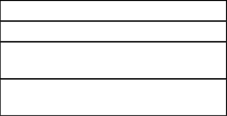
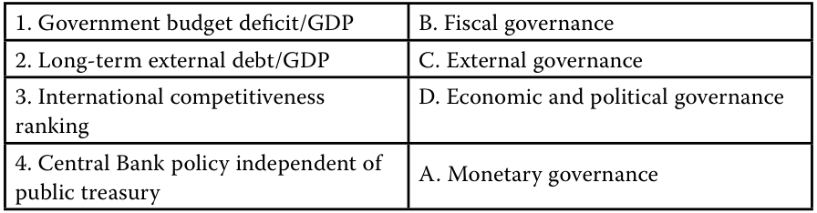
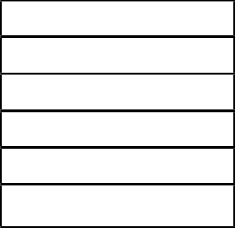

# Tập 6: Thu nhập Cố định (Fixed Income)
## Học phần 15: Phân tích Tín dụng đối với Tổ chức Phát hành Chính phủ (Credit Analysis for Government Issuers)
### Phần 2/2: Rủi ro Tín dụng Phi Chủ quyền (Trang PDF 409–420)

---

<!-- PDF Page 409 -->

- A sai. Mặc dù tỷ số dự trữ ngoại hối trên GDP là một tỷ số quan trọng trong việc xác định mức độ tín nhiệm của một chính phủ có chủ quyền, nhưng đó là tỷ số về sự ổn định đối ngoại (*external stability ratio*), tức là thước đo lượng ngoại tệ sẵn có để thanh toán các khoản nợ bằng ngoại tệ.

- C sai. GDP trên quy mô dân số là một tỷ số quan trọng trong việc xác định mức độ tín nhiệm của một chính phủ có chủ quyền, nhưng nó liên quan đến tăng trưởng và sự ổn định kinh tế hơn là sức mạnh tài khóa.

4. Hãy ghép nối các chỉ báo sau đây với các yếu tố tương ứng trong đánh giá tín dụng chính phủ có chủ quyền:

- **A.** Quản trị tiền tệ (*Monetary governance*)

- **B.** Quản trị tài khóa (*Fiscal governance*)

- **C.** Quản trị đối ngoại (*External governance*)

- **D.** Quản trị kinh tế và chính trị (*Economic and political governance*)

1. Thâm hụt ngân sách chính phủ/GDP (*Government budget deficit/GDP*)
2. Nợ nước ngoài dài hạn/GDP (*Long-term external debt/GDP*)
3. Xếp hạng năng lực cạnh tranh quốc tế (*International competitiveness ranking*)
4. Chính sách của Ngân hàng Trung ương độc lập với <u>kho bạc nhà nước (*public treasury*)</u>

##### **Lời giải:**

<!-- Picture Text: 1. Government budget deficit/GDP B. Fiscal governance 2. Long-term external debt/GDP C. External governance 3. International competitiveness  D. Economic and political governance ranking 4. Central Bank policy independent of A. Monetary governance public treasury  -->

> **Chú thích hình ảnh (Kết quả ghép nối):**
> - `1. Thâm hụt ngân sách chính phủ/GDP` $\leftrightarrow$ `B. Quản trị tài khóa (Fiscal governance)`
> - `2. Nợ nước ngoài dài hạn/GDP` $\leftrightarrow$ `C. Quản trị đối ngoại (External governance)`
> - `3. Xếp hạng năng lực cạnh tranh quốc tế` $\leftrightarrow$ `D. Quản trị kinh tế và chính trị (Economic and political governance)`
> - `4. Chính sách của Ngân hàng Trung ương độc lập với kho bạc nhà nước` $\leftrightarrow$ `A. Quản trị tiền tệ (Monetary governance)`

### **RỦI RO TÍN DỤNG PHI CHỦ QUYỀN (NON-SOVEREIGN CREDIT RISK)**

# **<mark>3</mark>**

- giải thích những lưu ý đặc biệt khi đánh giá tín dụng của các tổ chức phát hành và các đợt phát hành nợ chính phủ có chủ quyền (*sovereign*) và phi chủ quyền (*non-sovereign*)

#### **Nợ Chính phủ Phi Chủ quyền (Non-Sovereign Government Debt)**

Mặc dù các tổ chức phát hành có chủ quyền chiếm tỷ trọng lớn nhất trong số các tổ chức phát hành nợ chính phủ, một số tổ chức phát hành chính phủ phi chủ quyền (*non-sovereign government issuers*), chẳng hạn như các cơ quan đại diện chính phủ (*government agencies*) hoặc chính quyền cấp vùng/địa phương (*regional governments*), cũng phát hành nợ để tài trợ cho các hoạt động của mình. Trong trường hợp các cơ quan đại diện chính phủ, nhà đầu tư thường phải đối mặt với rủi ro tín dụng rất giống với chính phủ có chủ quyền nhờ có sự hậu thuẫn ngầm định (*implicit government backing*) dưới hình thức một đạo luật quốc gia thành lập nên thực thể đó và trao cho nó quyền huy động nợ, hoặc sự hậu thuẫn minh thị (*explicit backing*) dưới hình thức bảo lãnh (*guarantee*). Trong trường hợp các tổ chức phát hành cấp dưới quốc gia (*sub-sovereign issuers*) có quyền đánh thuế và tạo thu nhập riêng,

<!-- PDF Page 410 -->

chẳng hạn như các tổ chức phát hành là chính quyền cấp vùng, họ được hưởng lợi từ quản trị kinh tế và chính trị cũng như các chính sách tiền tệ và tài khóa của chính phủ quốc gia vì họ nằm trong khu vực tài phán đó; tuy nhiên, họ vẫn có một số đặc điểm có thể khiến mức độ tín nhiệm của họ khác biệt đáng kể so với tổ chức phát hành chính phủ có chủ quyền.

Các loại hình tổ chức phát hành chính phủ phi chủ quyền chính bao gồm các cơ quan đại diện chính phủ (*agencies*), ngân hàng công (*public banks*), tổ chức siêu quốc gia (*supranationals*), và chính quyền cấp vùng/địa phương (*regional governments*).

#### **Các Cơ quan Đại diện Chính phủ (Agencies)**

Các cơ quan đại diện (*Agencies*) là những tổ chức bán chính phủ (*quasi-government entities*) có hoạt động chính là thực hiện một sứ mệnh do chính phủ bảo trợ nhằm cung cấp các dịch vụ công, thường dựa trên một đạo luật hoặc quy chế quốc gia cụ thể. Trong nhiều trường hợp, đạo luật hoặc quy chế thành lập nên thực thể đó cho phép nó tài trợ cho các hoạt động của mình bằng cách sử dụng nợ vay. Với tư cách là các tổ chức bán chính phủ, các nhà đầu tư thường giả định khả năng cao có sự hỗ trợ từ chính phủ có chủ quyền, và các tổ chức xếp hạng tín nhiệm thường cấp cùng một mức xếp hạng cho các thực thể này ngang bằng với chính phủ có chủ quyền.

Một ví dụ về trái phiếu vĩnh cửu (*perpetual bond*) được phát hành bởi một tổ chức thuộc chính phủ như sau:

##### **VÍ DỤ 9**

#### **Trái phiếu Vĩnh cửu của Cơ quan Quản lý Sân bay Đặc khu Hành chính Hồng Kông (AAHK)**

AAHK là một cơ quan theo luật định (*statutory body*) thuộc sở hữu của chính quyền Đặc khu Hành chính Hồng Kông (Hong Kong SAR), chịu trách nhiệm vận hành và phát triển Sân bay Quốc tế Hồng Kông (HKIA), một trong những sân bay hàng hóa nhộn nhịp nhất thế giới và là trung tâm hành khách lớn kết nối hơn 200 điểm đến toàn cầu. Vào cuối năm 2020, sau sự sụt giảm mạnh về lưu lượng hành khách trong đại dịch COVID-19, AAHK đã công bố đợt phát hành trái phiếu vĩnh cửu gồm hai phần trị giá 1.5 tỷ USD để tài trợ cho việc xây dựng đường băng thứ ba và phục vụ các mục đích chung của tổ chức. Đợt phát hành được chia đều giữa các trái phiếu có lãi suất coupon cố định 2.10% mà AAHK có quyền mua lại sau 5.5 năm, và các trái phiếu có lãi suất coupon cố định 2.40% mà AAHK có thể mua lại sau 7.5 năm. Các trái phiếu này được xếp hạng AA, thấp hơn một bậc (*one notch down*) so với mức xếp hạng tổ chức phát hành dài hạn của AAHK là AA+ do có quyền chọn mua lại. Mức xếp hạng tổ chức phát hành dài hạn của AAHK dựa trên sự ngang bằng (*equalization*) với mức xếp hạng chính phủ của Đặc khu Hành chính Hồng Kông là AA+. Giả định củng cố cho mức xếp hạng này là sự hỗ trợ ngầm định dành cho AAHK được kỳ vọng từ chính quyền Đặc khu Hành chính Hồng Kông trong trường hợp AAHK gặp bất kỳ tình trạng kiệt quệ tài chính nào.

#### **Các Ngân hàng Khu vực Chính phủ và Định chế Tài chính Phát triển (Government Sector Banks and Development Financing Institutions)**

Các chính phủ có chủ quyền thường bảo trợ cho việc thành lập các định chế trung gian tài chính chuyên biệt để hoạt động trong một thị trường cụ thể hoặc nhằm thúc đẩy các mục tiêu chính sách và tăng trưởng chính trị, kinh tế, xã hội cụ thể của quốc gia. Tương tự như các cơ quan đại diện chính phủ, những định chế này thường được thành lập hoặc hỗ trợ bởi chính phủ có chủ quyền và được hưởng mức xếp hạng tương tự, như trong ví dụ sau đây:

<!-- PDF Page 411 -->

##### **VÍ DỤ 10**

#### **Ngân hàng Tái thiết Đức – Kreditanstalt für Wiederaufbau (KfW)**

Được thành lập vào năm 1948 tại Cộng hòa Liên bang Đức, KfW là ngân hàng phát triển quốc gia lớn nhất (80% thuộc sở hữu của chính phủ liên bang Đức và 20% thuộc sở hữu của các bang liên bang). Ngân hàng này được hưởng lợi từ sự bảo lãnh theo luật định trực tiếp và minh thị cũng như trách nhiệm thể chế (*institutional liability*) của Cộng hòa Liên bang Đức. Ngân hàng được điều chỉnh bởi “Đạo luật về KfW”, được miễn thuế thu nhập doanh nghiệp, và chịu sự giám sát của Bộ Tài chính Liên bang Đức cùng Cơ quan Giám sát Tài chính Liên bang Đức, thường được biết đến với tên gọi “BaFin”. Trái phiếu KfW nhận hệ số rủi ro bằng 0 (*zero risk weighting*) theo các quy tắc về vốn ngân hàng. Trái phiếu của ngân hàng được xếp hạng AAA và đạt xếp hạng ESG ở mức “Hàng đầu” (*“Prime”*). Trong năm 2020, cam kết ESG của KfW là khởi tạo ít nhất 33% hoạt động kinh doanh mới trong các sáng kiến bảo vệ môi trường và khí hậu và 48% khối lượng kinh doanh nội địa mới từ các doanh nghiệp vừa và nhỏ (SME). Để tài trợ cho hoạt động này, KfW đã trở thành tổ chức phát hành Trái phiếu Xanh (*Green Bonds*) tích cực nhất trên các thị trường vốn quốc tế. KfW đã phát hành Trái phiếu Xanh đầu tiên vào năm 2013, và huy động 20% khoản nợ mới của mình thông qua Trái phiếu Xanh (16.2 tỷ EUR vào năm 2021), với tổng giá trị phát hành Trái phiếu Xanh đạt 47.1 tỷ EUR tính đến năm 2021. Số tiền thu được từ việc phát hành Trái phiếu Xanh được triển khai vào các dự án giảm thiểu biến đổi khí hậu thuộc các hạng mục năng lượng tái tạo và hiệu quả năng lượng.

#### **Các Tổ chức Phát hành Siêu quốc gia (Supranational Issuers)**

Các thực thể được gọi là siêu quốc gia (*supranational entities*) là những tổ chức được thành lập và sở hữu bởi các chính phủ có chủ quyền tham gia với tư cách thành viên nhằm theo đuổi một mục tiêu chung. Ví dụ, Ngân hàng Thế giới (*World Bank*) và các tổ chức trực thuộc, chẳng hạn như Ngân hàng Quốc tế Tái thiết và Phát triển (IBRD), phát hành nợ để hỗ trợ các quốc gia đang phát triển thực hiện các dự án nhằm xóa đói giảm nghèo và theo đuổi tăng trưởng kinh tế bền vững. Các ví dụ về thực thể siêu quốc gia có trọng tâm khu vực bao gồm Ngân hàng Phát triển Châu Á (ADB) và Ngân hàng Phát triển Mỹ Latinh (*Corporacion Andina de Fomento*, hay CAF) tại khu vực Mỹ Latinh. Một ví dụ khác về thực thể siêu quốc gia được cung cấp trong Ví dụ 11.

##### **VÍ DỤ 11**

#### **Công ty Tài chính Cơ sở Hạ tầng Indonesia – Indonesia Infrastructure Finance (IIF)**

Indonesia Infrastructure Finance (IIF) được thành lập bởi Chính phủ Cộng hòa Indonesia (nắm giữ 30% cổ phần) cùng với Ngân hàng Thế giới (nắm giữ 20% cổ phần), ADB (nắm giữ 20% cổ phần), và các định chế đa phương khác như KfW (nắm giữ 15% cổ phần) và Sumitomo Mitsui Banking Corporation (nắm giữ 15% cổ phần). IIF được thành lập vào tháng 1 năm 2010 nhằm giúp đẩy nhanh và cải thiện sự tham gia của khu vực tư nhân vào phát triển cơ sở hạ tầng tại Indonesia. IIF cung cấp các sản phẩm dựa trên vốn (*fund-based products*), chẳng hạn như các khoản vay dài hạn, và các sản phẩm phi vốn (*non-fund-based products*), chẳng hạn như bảo lãnh và các dịch vụ khác liên quan đến các dự án cơ sở hạ tầng. IIF áp dụng các tiêu chuẩn bảo vệ môi trường và xã hội quốc tế để đảm bảo tính bền vững của việc phát triển cơ sở hạ tầng tại Indonesia. Xếp hạng tín nhiệm của IIF là BBB, tương đương với mức xếp hạng chính phủ của Chính phủ Indonesia, dựa trên tầm quan trọng chiến lược cũng như sự hỗ trợ ngầm định và quyền sở hữu cổ phần của các định chế phát triển toàn cầu.

<!-- PDF Page 412 -->

#### **Các Tổ chức Phát hành Chính quyền Cấp vùng/Địa phương (Regional Government Issuers)**

Nhóm này bao gồm các chính quyền cấp tỉnh, tiểu bang và địa phương, được gọi là trái phiếu đô thị (*municipal bonds*) tại Hoa Kỳ và thường được gọi nhất là trái phiếu chính quyền địa phương (*local authority bonds*) ở những nơi khác, nằm trong một khu vực tài phán có chủ quyền cụ thể. Tài chính của chính quyền địa phương rất khác nhau giữa các quốc gia. Trong một số trường hợp, chẳng hạn như tại Hà Lan, chính phủ liên bang đã thành lập một định chế tài chính công chuyên cung cấp tài trợ cho các chính quyền đô thị đồng thời thiết lập một cấu trúc giúp trao cho họ cùng mức xếp hạng tín nhiệm với chính phủ liên bang. Các quốc gia khác sử dụng hệ thống chia sẻ nguồn thu thuế (*tax revenue sharing system*) giữa chính phủ trung ương và chính quyền địa phương để đảm bảo rằng các nhà chức trách địa phương có khả năng đáp ứng các nghĩa vụ của mình. Ngược lại, tại Hoa Kỳ, các tổ chức phát hành đô thị, chẳng hạn như chính quyền tiểu bang và địa phương, được xếp hạng riêng lẻ và thường phát hành trái phiếu nghĩa vụ chung (*general obligation bonds*) hoặc trái phiếu doanh thu (*revenue bonds*).

##### **_Trái phiếu Nghĩa vụ Chung (General Obligation Bonds)_**

**Trái phiếu nghĩa vụ chung (*General obligation – GO bonds*)** là các trái phiếu không có bảo đảm được hậu thuẫn bởi các nguồn thu chung của chính quyền phi chủ quyền phát hành. Các trái phiếu này được hỗ trợ bởi thẩm quyền đánh thuế của tổ chức phát hành. Trái phiếu doanh thu (*Revenue bonds*) được phát hành để tài trợ cho dự án cụ thể — ví dụ: tài trợ cho một hệ thống thoát nước mới, một tuyến đường thu phí, cầu, bệnh viện, hoặc nhà thi đấu thể thao.

Việc phân tích tín dụng đối với trái phiếu GO có một số điểm tương đồng với phân tích nợ chính phủ có chủ quyền (ví dụ: khả năng áp đặt và thu các loại thuế và phí để trả nợ) nhưng cũng có một số điểm khác biệt. Sức hấp dẫn của môi trường kinh doanh tại địa phương, sự hiện diện của các ngành công nghiệp và các nhà tuyển dụng lớn nhằm thiết lập một cơ sở thuế doanh nghiệp (*corporate tax base*) đa dạng, ổn định, sự hỗ trợ ngầm định của chính phủ quốc gia trong một số trường hợp, cũng như việc quản lý thận trọng ngân sách của chính quyền tiểu bang hoặc địa phương đều đóng vai trò quan trọng trong việc xác lập mức độ tín nhiệm tương đối của tổ chức phát hành. Tuy nhiên, các chính quyền phi chủ quyền có quyền hạn tài phán hạn chế và không có quyền kiểm soát đối với các thể chế kinh tế và tiền tệ quốc gia như trường hợp của các tổ chức phát hành chính phủ có chủ quyền. Các tổ chức phát hành phi chủ quyền có thể phải đối mặt với mức độ phơi nhiễm lớn hơn trước những thay đổi về công nghệ, chẳng hạn như các ngành công nghiệp đang suy tàn, và những thay đổi về nhân khẩu học (*demographic changes*), như trong trường hợp vụ nộp đơn xin phá sản đô thị lớn nhất tại Hoa Kỳ được trình bày trong Ví dụ 12.

##### **VÍ DỤ 12**

#### **Vụ Nộp đơn Xin Phá sản của Thành phố Detroit (City of Detroit Bankruptcy Filing)**

Thành phố Detroit đã trở thành vụ nộp đơn xin phá sản đô thị lớn nhất tại Hoa Kỳ vào năm 2013 sau sự sụt giảm kéo dài hàng thập kỷ về việc làm trong ngành công nghiệp ô tô và sự dịch chuyển các công việc sản xuất sang các tiểu bang miền Nam có mức lương thấp hơn. Hệ quả là một sự dịch chuyển nhân khẩu học — khiến dân số của thành phố giảm từ 2 triệu xuống còn 700,000 người — cùng những căng thẳng sắc tộc gia tăng càng thúc đẩy làn sóng di cư ra khỏi thành phố về các vùng ngoại ô. Sự sụt giảm kéo theo trong cơ sở thuế tài sản (*property tax*) và thuế thu nhập đã khiến Detroit rơi vào cảnh thiếu hụt ngân sách để đáp ứng các khoản thanh toán trên tổng dư nợ ước tính lên tới 18 tỷ USD của mình. Thành phố đã không thể đạt được thỏa thuận với các bên cho vay, các nghiệp đoàn và những người hưởng lương hưu, buộc thành phố phải nộp đơn xin bảo hộ phá sản theo Chương 9 (*Chapter 9 bankruptcy protection*). Sau giai đoạn đàm phán kéo dài 17 tháng với các chủ nợ, Detroit đã thoát khỏi tình trạng phá sản sau khi bán và cầm cố tài sản cũng như đưa ra các nhượng bộ, trong đó những người hưởng lương hưu giữ lại được khoảng 85% quyền lợi của họ và các trái chủ nắm giữ trái phiếu nghĩa vụ chung được bảo đảm bằng thuế không giới hạn (*unlimited tax GO bondholders*) thu hồi được 74 xu trên mỗi đô la đầu tư.

##### **_Trái phiếu Doanh thu (Revenue Bonds)_**

**Trái phiếu doanh thu (*Revenue bonds*)**, vốn được phát hành để tài trợ cho một dự án cụ thể, có mức độ rủi ro cao hơn trái phiếu GO bởi vì dòng tiền của chúng phụ thuộc vào một nguồn doanh thu duy nhất. Việc phân tích các trái phiếu này là sự kết hợp giữa phân tích bản thân dự án và

<!-- PDF Page 413 -->

các vấn đề tài chính xoay quanh dự án cụ thể đó. Phân tích dự án tập trung vào nhu cầu và mức độ khai thác sử dụng dự kiến của dự án, cũng như nền tảng kinh tế hỗ trợ cho dự án. Phân tích này có những điểm tương đồng với phân tích trái phiếu doanh nghiệp ở chỗ nó tập trung vào kết quả hoạt động, dòng tiền, thanh khoản, cấu trúc vốn, và khả năng trả lãi cũng như hoàn trả nợ gốc của tổ chức phát hành dựa trên các dự phóng dòng tiền. Tương tự như nợ doanh nghiệp, một thước đo tín dụng then chốt đối với trái phiếu chính quyền phi chủ quyền được bảo đảm bằng doanh thu là **tỷ số khả năng trả nợ (*debt service coverage ratio* – DSCR)**, một thước đo lượng doanh thu sẵn có để trang trải các khoản thanh toán nợ gốc và tiền lãi sau khi trừ đi chi phí hoạt động. Tỷ số trang trải nợ càng cao thì mức độ tín nhiệm càng mạnh. Các điều khoản ràng buộc về tỷ số trang trải nợ tối thiểu (*minimum coverage ratio covenants*) là một đặc điểm phổ biến của trái phiếu doanh thu. Các tỷ số trang trải nợ và các tỷ số tài chính khác sẽ được đề cập chi tiết hơn trong học phần tiếp theo về rủi ro tín dụng doanh nghiệp.

Khi phân tích các trái phiếu này, mức độ rủi ro cố hữu của các dòng tiền ngày càng trở nên quan trọng. Do đó, không chỉ năng lực cơ sở và khả năng huy động doanh thu thông qua thuế và phí là trọng yếu — vốn là điều quan trọng đối với việc đánh giá trái phiếu chính phủ có chủ quyền — mà việc hiểu rõ các nguồn trả nợ khác cũng rất cần thiết. Điều này trở nên đặc biệt trọng yếu đối với các loại trái phiếu cơ sở hạ tầng của chính quyền phi chủ quyền, vốn có thể được phát hành bởi các thực thể siêu quốc gia hoặc các tổ chức phát hành bán chính phủ khác, chẳng hạn như cơ quan quản lý sân bay hoặc các công ty tiện ích công cộng (đối với các đơn vị này, chính phủ quốc gia có thể là nguồn trả nợ thứ cấp ngầm định trong trường hợp thiếu hụt doanh thu). Một ví dụ về dự án cơ sở hạ tầng của chính phủ phi chủ quyền được mô tả dưới đây.

##### **VÍ DỤ 13**

#### **Lima Metro Line 2 Finance Limited**

Lima Metro Line 2 Finance Limited (Lima Metro 2) là một trong những đợt chào bán nợ cơ sở hạ tầng lớn nhất tại khu vực Mỹ Latinh và là đợt chào bán được bảo đảm bằng RPI-CAO lớn nhất tính đến nay. RPI-CAO (*Retribución por Inversión – Certificado de Avance de Obras*) là cơ chế thanh toán theo cột mốc tiến độ do chính phủ bảo trợ, mang tính đặc trưng của chương trình tài trợ cơ sở hạ tầng tại Peru.

Chế độ RPI-CAO là một cơ chế thanh toán theo đó đơn vị nhận nhượng quyền (*concessionaire*), Metro de Lima Línea 2 S.A., có được quyền nhận các khoản thanh toán có hệ thống như khoản đền bù cho các chi phí xây dựng phát sinh đối với một dự án. Các chứng chỉ RPI-CAO đạt được sau khi các cột mốc xây dựng hoàn thành và báo cáo tiến độ được đệ trình lên cũng như được phê duyệt bởi Bộ Giao thông Vận tải và Truyền thông Peru. Các quyền nhận đền bù định danh bằng đồng USD này được Bộ bảo lãnh và thanh toán cho đơn vị nhận nhượng quyền theo một lịch trình trả góp xác định. RPI-CAO không phải là nghĩa vụ nợ trực tiếp của chính phủ có chủ quyền, nhưng các nhà đầu tư có quyền truy đòi (*recourse*) đối với chính phủ Peru nếu Bộ không thực hiện các khoản thanh toán tiền lãi và nợ gốc.

Các trái phiếu này được phát hành để tài trợ cho việc xây dựng hai tuyến của hệ thống tàu điện ngầm tại thành phố Lima, Peru, cùng với các thiết bị cơ điện liên quan. Dự án bao gồm việc xây dựng 35 nhà ga tàu điện ngầm và khoảng 35 km đường hầm cùng các khu sân bãi. Vào tháng 4 năm 2014, Bộ đã ký kết thỏa thuận nhượng quyền với Metro de Lima Línea 2 S.A. (một liên danh bao gồm ACS Iridium, Vialia [FCC], Salini Impregilo, AnsaldoBreda, Ansaldo STS, và COSAPI, đồng thời là các nhà tài trợ vốn cổ phần của dự án) để xây dựng và vận hành hai tuyến đường sắt ngầm.

Vào tháng 6 năm 2015, Lima Metro 2 đã phát hành 1,150 triệu USD trái phiếu trung hạn cấp cao có bảo đảm theo quy định 144A/Reg S với mức lãi suất 5.875%. Trái phiếu kỳ hạn 19.1 năm này có thời gian sống trung bình (*average life*) tại thời điểm phát hành là 12.8 năm và được xếp hạng Baa1 (Moody’s); BBB (S&P); và BBB (Fitch). Đợt phát hành đã thu hút sự quan tâm đáng kể từ các công ty quản lý tài sản và các nhà đầu tư nội địa tại Peru, với việc các nhóm nhà đầu tư này chiếm phần lớn sổ lệnh đăng ký mua cuối cùng (*final order book*).

<!-- PDF Page 414 -->

|**Tóm tắt Ngắn gọn các Điều khoản của Trái phiếu 5.875% Lima Metro Line 2 Finance Limited**||
|---|---|
|**Tổ chức phát hành (*Issuer*):**|Lima Metro Line 2 Finance Limited|
|**Ngày phát hành (*Issuance Date*):**|Tháng 6 năm 2015|
|**Ngày đáo hạn (*Maturity Date*):**|Tháng 7 năm 2034|
|**Quy mô phát hành (*Issuance Amount*):**|USD1,150MM (1,150 triệu USD)|
|**Mục đích sử dụng vốn (*Use of Proceeds*):**|Tài trợ xây dựng dự án tuyến tàu điện ngầm tại thành phố Lima|
|**Xếp hạng tín nhiệm (*Credit Ratings*):**|Baa1 (Moody’s); BBB (S&P); BBB (Fitch)|
|**Quốc gia (*Country*):**|Peru|
|**Loại hình dự án (*Project Type*):**|Giao thông vận tải, Đường sắt (*Transportation, Rail*)|
|**Nhà tài trợ dự án (*Project Sponsor*):**|Một liên danh bao gồm ACS Iridium, Vialia (FCC), Salini Impregilo, AnsaldoBreda, Ansaldo STS, và COSAPI|
|**Nguồn thanh toán (*Source of Payment*):**|Cơ chế thanh toán RPI-CAO (*RPI-CAO payment regime*)|

##### **BỘ CÂU HỎI (QUESTION SET)**

1. Phát biểu nào sau đây mô tả đúng nhất mối quan hệ giữa mức độ tín nhiệm của chính quyền địa phương và chính phủ có chủ quyền?

   - **A.** Các chính quyền địa phương có quyền hạn tài phán hạn chế và không có quyền kiểm soát đối với các thể chế kinh tế và tiền tệ.

   - **B.** Tất cả các chính phủ có chủ quyền đều sử dụng hệ thống chia sẻ nguồn thu thuế giữa chính phủ trung ương và chính quyền địa phương để đảm bảo rằng các nhà chức trách địa phương có khả năng đáp ứng các nghĩa vụ của mình.

   - **C.** Các chính quyền địa phương có khả năng thu hút và giữ chân các ngành công nghiệp và các nhà tuyển dụng lớn thường có mức độ tín nhiệm cao hơn chính phủ có chủ quyền của họ.

##### **Lời giải:**

A là đáp án đúng. Các chính quyền địa phương có quyền tài phán hạn chế và không có quyền kiểm soát đối với chính sách tài khóa và tiền tệ quốc gia. B sai, vì chỉ một số chứ không phải tất cả các chính phủ có chủ quyền sử dụng cơ chế chia sẻ nguồn thu thuế. C sai. Vì các chính quyền địa phương phải tuân theo chính sách kinh tế và tiền tệ của chính phủ có chủ quyền, mức xếp hạng của họ thường ngang bằng hoặc thấp hơn mức xếp hạng của chính phủ có chủ quyền.

2. Ile-de-France, chính quyền vùng của Paris, đã phát hành một trái phiếu xanh (*green bond*), số tiền thu được sẽ được sử dụng cho các khoản đầu tư bao gồm xây dựng và cải tạo các tòa nhà thân thiện với môi trường, giao thông công cộng hỗ trợ di chuyển bền vững, và các dự án năng lượng tái tạo. Trái phiếu này được hậu thuẫn bởi nguồn thu thuế và các khoản thu khác của Ile-de-France. Trái phiếu này là một ví dụ về:

   - **A.** trái phiếu nghĩa vụ chung (*general obligation – GO bond*).

   - **B.** trái phiếu doanh thu (*revenue bond*).

   - **C.** trái phiếu cơ quan đại diện chính phủ (*agency bond*).

##### **Lời giải:**

A là đáp án đúng. Mặc dù số tiền thu được từ trái phiếu được sử dụng để phát triển cơ sở hạ tầng xanh cụ thể, nhưng các khoản thanh toán tiền lãi và nợ gốc được bảo đảm bằng

<!-- PDF Page 415 -->

nguồn thu thuế và các khoản thu khác của chính quyền địa phương thay vì bất kỳ doanh thu dự án cụ thể nào.

3. Danainfra Nasional Berhad, một tổ chức có mục đích đặc biệt (SPV) của Chính phủ Malaysia, đã phát hành trái phiếu bán lẻ nhằm mục đích tài trợ cho cơ sở hạ tầng giao thông công cộng tốc độ cao (*mass rapid transport* – MRT) tại Kuala Lumpur. Các khoản thanh toán tiền lãi và nợ gốc được hỗ trợ bởi dòng tiền của hệ thống giao thông công cộng tốc độ cao và sự bảo lãnh tín dụng của Chính phủ Malaysia. Trái phiếu này là một ví dụ về:

   - **A.** trái phiếu nghĩa vụ chung (*general obligation – GO bond*).

   - **B.** trái phiếu doanh thu (*revenue bond*).

   - **C.** trái phiếu cơ quan đại diện chính phủ (*agency bond*).

   - **Lời giải:**

B là đáp án đúng. Nguồn vốn tài trợ dành cho việc phát triển một dự án giao thông công cộng tốc độ cao cụ thể cho Kuala Lumpur, và việc hoàn trả nợ được hỗ trợ bởi doanh thu của tuyến giao thông công cộng tốc độ cao đó. Mặc dù các trái phiếu này cũng có bảo lãnh của chính phủ để tăng cường chất lượng tín dụng (*credit enhancement*), nhưng nguồn trả nợ chính vẫn là doanh thu từ hệ thống giao thông công cộng.

4. Một thước đo tín dụng then chốt đối với trái phiếu chính quyền phi chủ quyền được bảo đảm bằng doanh thu là:

   - **A.** tỷ số khả năng trả nợ (*debt service coverage ratio*).

   - **B.** mức độ thất nghiệp tại khu vực địa phương.

   - **C.** cơ sở thuế (*tax base* – chiều sâu, chiều rộng, sự đa dạng hóa, tính ổn định).

   - **Lời giải:**

A là đáp án đúng. Một thước đo tín dụng then chốt đối với trái phiếu chính quyền phi chủ quyền được bảo đảm bằng doanh thu là tỷ số khả năng trả nợ (*debt service coverage ratio*), đo lường lượng doanh thu sẵn có để trang trải các khoản thanh toán nợ (nợ gốc và tiền lãi) sau khi trừ chi phí hoạt động. Điều này là do khả năng trả nợ của trái phiếu gắn liền trực tiếp với doanh thu của dự án cơ sở cụ thể, thay vì nguồn thu thuế chung của tiểu bang/địa phương. Nhiều trái phiếu doanh thu có điều khoản ràng buộc về tỷ số tối thiểu; tỷ số khả năng trả nợ càng cao thì mức độ tín nhiệm càng mạnh.

<!-- PDF Page 416 -->

## **BÀI TẬP THỰC HÀNH (PRACTICE PROBLEMS)**

**1.** Phát biểu nào sau đây mô tả đúng nhất mức độ tín nhiệm cao hơn đối với một chính phủ có chủ quyền tại thị trường mới nổi không có đồng tiền dự trữ?

   - **A.** Một quốc gia có thặng dư ngân sách chính phủ, thặng dư tài khoản vãng lai đi kèm tăng trưởng kinh tế cao, và đồng tiền thả nổi tự do (*freely floating currency*).

   - **B.** Một quốc gia có thâm hụt ngân sách chính phủ, thâm hụt tài khoản vãng lai đi kèm tăng trưởng kinh tế vừa phải và chế độ tỷ giá hối đoái cố định (*fixed exchange rate regime*).

   - **C.** Một quốc gia có thâm hụt ngân sách chính phủ, thâm hụt tài khoản vãng lai, tăng trưởng kinh tế thấp, và chế độ tỷ giá hối đoái cố định.

**2.** Hãy ghép nối các chỉ báo dưới đây với tác động (tích cực hoặc tiêu cực) lên mức độ tín nhiệm của một trái phiếu nghĩa vụ chung (GO) do chính quyền tiểu bang phát hành:

   - Tích cực (*Positive*)

   - Tiêu cực (*Negative*)

|Chỉ báo|
|---|
|A. Tỷ lệ thất nghiệp thấp (*Low unemployment*)|
|B. Thu nhập bình quân đầu người thấp (*Low per capita income*)|
|C. Nợ bình quân đầu người thấp (*Low per capita debt*)|
|D. Cơ sở thuế thấp (*Low tax base*)|
|E. Phụ thuộc cao vào thuế doanh thu (*High dependence on sales tax*)|
|F. Nghĩa vụ chi trả chế độ sau nghỉ hưu cao (*High post-retirement obligations*)|

**3.** Dựa trên dữ liệu sau đây, quốc gia nào dự kiến sẽ được ấn định mức xếp hạng tín nhiệm chính phủ thấp nhất?

|**Các Thống kê Kinh tế (Economic Statistics)**|**Costa Rica**|**Cộng hòa Dominica (Dominican Republic)**|**El Salvador**|
|---|---|---|---|
|Nợ nước ngoài dài hạn/GDP – Long-term external debt/GDP (%)|39.6|35.7|57.0|
|Tăng trưởng GDP – GDP growth (%)|2.06|5.07|2.39|
|Dự trữ ngoại tệ – Currency reserves (% GDP)|13.9|8.1|12.4|

   - **A.** Costa Rica

   - **B.** Cộng hòa Dominica (*Dominican Republic*)

   - **C.** El Salvador

**4.** Gulf Investment Corporation (GIC) là một công ty đầu tư được thành lập tại Kuwait dưới hình thức Công ty Cổ phần Vùng Vịnh (*Gulf Shareholding Company*). GIC thuộc sở hữu ngang nhau của chính phủ sáu quốc gia thành viên Hội đồng Hợp tác Vùng Vịnh (GCC). GIC được thành lập nhằm thúc đẩy tăng trưởng kinh tế, đa dạng hóa kinh tế, và phát triển thị trường vốn trên toàn khu vực GCC. Xếp hạng tín nhiệm đối với GIC nên được đánh giá dựa trên tư cách của tổ chức này là một:

   - **A.** cơ quan đại diện chính phủ (*sovereign agency*).

<!-- PDF Page 417 -->

   - **B.** tổ chức phát hành siêu quốc gia (*supranational issuer*).

   - **C.** định chế trung gian tài chính chuyên biệt hoặc ngân hàng công (*specialized financial intermediary or public bank*).

**5.** Phát biểu nào sau đây mô tả đúng nhất sức mạnh đối ngoại (*external strength*) đối với một quốc gia có chủ quyền không sở hữu đồng tiền dự trữ?

   - **A.** Khả năng áp đặt và thực thi các biện pháp kiểm soát vốn nghiêm ngặt

   - **B.** Việc thiết lập chế độ tỷ giá hối đoái cố định

   - **C.** Khả năng tạo ra các dòng tiền ngoại tệ vào (*foreign currency cash inflows*) ổn định và đầy đủ

**6.** Agora là một nền kinh tế thị trường mới nổi bị hạn chế khả năng chuyển đổi vốn (việc chuyển đổi từ nội tệ sang ngoại tệ không được tự do). Quốc gia này phụ thuộc đáng kể vào thu nhập từ lĩnh vực du lịch và kiều hối (*repatriation of income*) của công dân đang sinh sống tại nước ngoài gửi về. Quốc gia này cũng có tỷ lệ nợ nước ngoài trên GDP ở mức cao. Yếu tố nào sau đây là yếu tố quan trọng nhất có thể mang lại sự cải thiện trong mức độ tín nhiệm chính phủ của Agora?

   - **A.** Đa dạng hóa các dòng tiền ngoại tệ vào (*foreign currency inflows*)

   - **B.** Giảm dự trữ ngoại tệ tính theo tỷ lệ phần trăm của GDP

   - **C.** Phá giá tỷ giá hối đoái của đồng nội tệ so với các đồng tiền dự trữ chính

<!-- PDF Page 418 -->

## **LỜI GIẢI (SOLUTIONS)**

1. A là đáp án đúng. Quốc gia này thể hiện sự ổn định tài khóa được minh chứng bằng thặng dư ngân sách chính phủ, tăng trưởng kinh tế cao, và sức mạnh đối ngoại nhờ có thặng dư tài khoản vãng lai và đồng tiền thả nổi tự do.

##### 2.

|**Chỉ báo**|**Tác động**|
|---|---|
|A. Tỷ lệ thất nghiệp thấp (*Low unemployment*)|Tích cực (*Positive*)|
|B. Thu nhập bình quân đầu người thấp (*Low per capita income*)|Tiêu cực (*Negative*)|
|C. Nợ bình quân đầu người thấp (*Low per capita debt*)|Tích cực (*Positive*)|
|D. Cơ sở thuế thấp (*Low tax base*)|Tiêu cực (*Negative*)|
|E. Phụ thuộc cao vào thuế doanh thu (*High dependence on sales tax*)|Tiêu cực (*Negative*)|
|F. Nghĩa vụ chi trả chế độ sau nghỉ hưu cao (*High post-retirement obligations*)|Tiêu cực (*Negative*)|

A. Tích cực (*Positive*), vì tỷ lệ thất nghiệp thấp biểu thị một bộ phận dân số có năng suất cao hơn và tạo ra thu nhập với tiềm năng mang lại nguồn thu thuế cao hơn.

B. Tiêu cực (*Negative*), vì thu nhập bình quân đầu người thấp làm giảm tiềm năng thu thuế và khả năng tăng thuế.

C. Tích cực (*Positive*), vì nợ bình quân đầu người thấp cho thấy tỷ số khả năng trả nợ cao hơn và dư địa lớn hơn để vay thêm nợ nếu cần thiết.

D. Tiêu cực (*Negative*), cơ sở thuế thấp làm hạn chế tiềm năng thu thuế và làm suy yếu đáng kể khả năng nguồn thu của tiểu bang có thể đáp ứng chi phí và trả nợ.

E. Tiêu cực (*Negative*), vì dòng doanh thu của tiểu bang càng đa dạng thì chất lượng tín dụng càng cao. Sự phụ thuộc quá mức vào một dòng doanh thu duy nhất tạo ra nguy cơ biến động trong trường hợp xảy ra bất kỳ sự gián đoạn kinh tế nào.

F. Tiêu cực (*Negative*), vì nghĩa vụ chi trả chế độ sau nghỉ hưu cao cho thấy mức độ mắc nợ gia tăng của tiểu bang, làm giảm khả năng trả nợ của chính quyền.

3. C là đáp án đúng. El Salvador dự kiến có mức xếp hạng tín nhiệm thấp nhất do tỷ số nợ nước ngoài dài hạn trên GDP ở mức cao. Mặc dù Cộng hòa Dominica có dự trữ ngoại tệ thấp hơn El Salvador, nhưng quốc gia này cũng có gánh nặng nợ nước ngoài thấp hơn và mức tăng trưởng kinh tế cao hơn.

4. B là đáp án đúng. GIC là một tổ chức phát hành siêu quốc gia (*supranational issuer*), vì tổ chức này được bảo trợ và sở hữu bởi nhiều chính phủ có chủ quyền. Xếp hạng tín nhiệm của GIC sẽ được đánh giá như một tổ chức siêu quốc gia dựa trên mức xếp hạng chính phủ có trọng số của các quốc gia bảo trợ và bản chất sự hỗ trợ ngầm định của họ trong trường hợp xảy ra kiệt quệ tài chính.

5. C là đáp án đúng. Một yếu tố then chốt ảnh hưởng đến việc liệu một chính phủ có chủ quyền không sở hữu đồng tiền dự trữ có thể đáp ứng các nghĩa vụ nợ nước ngoài hay không chính là thanh khoản và khả năng thanh toán đối ngoại (*external liquidity and solvency*), hay khả năng tạo ra các dòng tiền ngoại tệ vào ổn định, đầy đủ để thanh toán tiền lãi và nợ gốc đối với khoản nợ nước ngoài. A sai, vì kiểm soát vốn có thể hạn chế khả năng tạo ra dòng ngoại tệ vào. B sai, vì chế độ tỷ giá hối đoái cố định có thể gây ra sự mất ổn định trong trường hợp đồng tiền bị phá giá.

6. A là đáp án đúng. Vì Agora có tỷ lệ nợ nước ngoài trên GDP cao và phụ thuộc rất lớn vào các dòng tiền ngoại tệ vào, quốc gia này nên tìm cách đa dạng hóa các nguồn thu ngoại tệ để tránh rơi vào tình trạng kiệt quệ tài chính trong trường hợp xảy ra sự gián đoạn đối với doanh thu du lịch hoặc dòng kiều hối của người di cư. B sai, vì việc duy trì hoặc gia tăng dự trữ ngoại tệ mới là điều quan trọng để trả nợ thay vì giảm dự trữ ngoại hối. C sai. Mặc dù việc phá giá tỷ giá hối đoái của Agora so với các đồng tiền dự trữ nước ngoài có thể khiến quốc gia này trở thành một điểm đến du lịch có chi phí phải chăng hơn, nhưng điều đó cũng có thể

<!-- PDF Page 419 -->

làm giảm động cơ chuyển thu nhập về nước (*income repatriation*), dẫn đến dòng tiền nước ngoài chảy vào thấp hơn và làm giảm khả năng trả nợ nước ngoài.

<!-- PDF Page 420 -->
