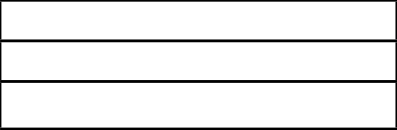
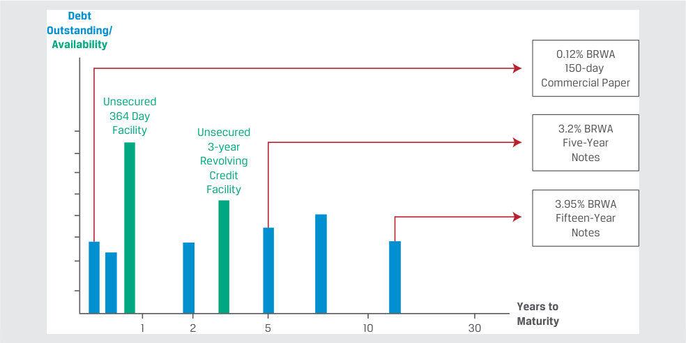

# Tập 6: Thu nhập Cố định (Fixed Income)
## Học phần 16: Phân tích Tín dụng đối với Tổ chức Phát hành Doanh nghiệp (Credit Analysis for Corporate Issuers)
### Phần 1/3: Giới thiệu (Trang PDF 421–430)

---

<!-- PDF Page 421 -->

# H Ọ C P H Ầ N **<mark>16</mark>**

### **Phân tích Tín dụng đối với Tổ chức Phát hành Doanh nghiệp (Credit Analysis for Corporate Issuers)**

##### **<mark>KẾT QUẢ HỌC TẬP (LEARNING OUTCOMES)</mark>**

- **_Thành thạo – Ứng viên cần có khả năng:_**
  - mô tả các yếu tố định tính và định lượng được sử dụng để đánh giá mức độ tín nhiệm (*creditworthiness*) của một bên đi vay là doanh nghiệp
  - tính toán và diễn giải các tỷ số tài chính được sử dụng trong phân tích tín dụng (*credit analysis*)
  - mô tả thứ tự ưu tiên thanh toán (*seniority rankings*) của nợ, nợ có bảo đảm (*secured debt*) so với nợ không có bảo đảm (*unsecured debt*) và thứ tự ưu tiên của các quyền đòi nợ khi phá sản (*priority of claims in bankruptcy*), cùng tác động của chúng lên xếp hạng tín nhiệm (*credit ratings*)

#### **GIỚI THIỆU (INTRODUCTION)**

**<mark>1</mark>**

Trong học phần này, chúng ta tập trung vào mức độ tín nhiệm tương đối của các bên đi vay là doanh nghiệp phi tài chính, dựa trên nền tảng các học phần trước đó về tổ chức phát hành doanh nghiệp cũng như học phần thu nhập cố định trước đó về rủi ro tín dụng và các cấu phần của nó.

Cụ thể, chúng ta đánh giá các hoạt động của một công ty, hay mô hình kinh doanh (*business model*) của nó, và cách thức điều này ảnh hưởng đến khả năng đáp ứng các nghĩa vụ nợ của công ty. Mặc dù xác suất vỡ nợ ($\text{POD}$) và mức tổn thất khi vỡ nợ ($\text{LGD}$) của một công ty không thể quan sát trực tiếp, trong bài học đầu tiên chúng ta xem xét các yếu tố định tính và định lượng tác động đến những cấu phần rủi ro tín dụng này. Phân tích báo cáo tài chính và dự phóng dòng tiền là những công cụ quan trọng được sử dụng để thực hiện phân tích tín dụng doanh nghiệp. Bài học thứ hai áp dụng các công cụ này để tính toán và diễn giải nhiều tỷ số tài chính khác nhau, bao gồm các thước đo về khả năng sinh lời (*profitability*), đòn bẩy tài chính (*leverage*), và khả năng trang trải nợ (*coverage*), nhằm đánh giá xác suất vỡ nợ của một tổ chức phát hành. Thứ tự ưu tiên thanh toán của các đợt phát hành nợ cụ thể và việc sử dụng tài sản thế chấp có tầm quan trọng đặc biệt trong việc xác định xếp hạng tín nhiệm cho một đợt phát hành của doanh nghiệp và đánh giá $\text{LGD}$ khi xảy ra sự kiện vỡ nợ, nội dung sẽ được đề cập trong bài học thứ ba và cũng là bài học cuối cùng.

###### **TỔNG QUAN HỌC PHẦN (LEARNING MODULE OVERVIEW)**

- Rủi ro tín dụng của một bên đi vay có thể được đánh giá bằng cách sử dụng các tiêu chí định tính và định lượng có ảnh hưởng đến khả năng xảy ra vỡ nợ của công ty và mức tổn thất của nhà đầu tư trong trường hợp vỡ nợ.

<!-- PDF Page 422 -->

- Các yếu tố định tính quan trọng trong việc đánh giá mức độ tín nhiệm bao gồm mô hình kinh doanh của công ty, ngành hoạt động, vị thế cạnh tranh và các rủi ro kinh doanh, cũng như quản trị doanh nghiệp (*corporate governance*).

- Các yếu tố định lượng trong việc đo lường mức độ tín nhiệm liên quan đến phân tích báo cáo tài chính và các dự báo, sử dụng các thước đo về khả năng sinh lời, thanh khoản, đòn bẩy tài chính và khả năng trang trải nợ để đánh giá năng lực của công ty trong việc đáp ứng các nghĩa vụ nợ cố định.

- Các tỷ số tài chính là một công cụ thiết yếu được sử dụng để đánh giá sức khỏe tài chính của một công ty, nhận diện các xu hướng theo thời gian, và so sánh các công ty trong cùng một ngành cũng như giữa các ngành với nhau.

- Thứ tự ưu tiên thanh toán (*seniority rankings*) xác định mức độ ưu tiên của các quyền đòi nợ đối với tài sản của tổ chức phát hành và là những yếu tố quyết định quan trọng đối với mức tổn thất khi vỡ nợ ($\text{LGD}$) cho một đợt phát hành cụ thể. Các tổ chức xếp hạng tín nhiệm thường cung cấp cả xếp hạng tổ chức phát hành (*issuer ratings*) và xếp hạng đợt phát hành (*issue ratings*) đối với tín dụng doanh nghiệp.

- Trong khi xếp hạng tín nhiệm tổ chức phát hành nắm bắt xác suất vỡ nợ hoặc tổn thất kỳ vọng đối với các trái phiếu cấp cao không có bảo đảm (*senior unsecured bonds*) của tổ chức phát hành, thì xếp hạng đợt phát hành đề cập đến các nghĩa vụ tài chính cụ thể của một tổ chức phát hành và có tính đến các yếu tố như thứ tự ưu tiên thanh toán.

###### **TỰ ĐÁNH GIÁ HỌC PHẦN (LEARNING MODULE SELF-ASSESSMENT)**

1. Yếu tố nào sau đây _<u>không phải</u>_ là đặc điểm của mức độ tín nhiệm doanh nghiệp cao hơn?

   - **A.** Đòn bẩy thấp hơn (*Lower leverage*)

   - **B.** Khả năng trang trải nợ cao hơn (*Higher coverage*)

   - **C.** Thanh khoản thấp hơn (*Lower liquidity*)

   - **Lời giải:**

Đáp án đúng là C. Khi các yếu tố khác không đổi, một công ty có thanh khoản cao hơn sẽ có khả năng lớn hơn trong việc đáp ứng các nghĩa vụ ngắn hạn của mình, bao gồm cả tiền lãi và nợ gốc.

2. Khi các yếu tố khác không đổi, một bên đi vay sẽ có năng lực trả nợ cao hơn trong một ngành mà tại đó:

   - **A.** rào cản gia nhập ngành cao hơn (*barriers to entry are higher*).

   - **B.** mối đe dọa từ sản phẩm thay thế cao hơn (*threat of substitutes is higher*).

   - **C.** quyền lực thương lượng của người mua cao hơn (*bargaining power of buyers is higher*).

   - **Lời giải:**

Đáp án đúng là A. Một ngành có rào cản gia nhập cao hơn có xu hướng ít chịu mối đe dọa từ các đối thủ mới gia nhập hơn và có mức độ cạnh tranh thấp hơn. Khi các yếu tố khác không đổi, một bên đi vay trong ngành như vậy có năng lực cao hơn để hỗ trợ cho khoản nợ của mình.

3. Xác định các thước đo tín dụng chính được sử dụng trong phân tích tín dụng:

- A. Biên EBIT (*EBIT margin*).
- B. Nợ/EBITDA (*Debt/EBITDA*).

<!-- PDF Page 423 -->

- C. EBIT/chi phí lãi vay (*EBIT/interest expense*).

|Loại thước đo|
|---|
|1. Thước đo khả năng trang trải nợ (*Coverage metric*)|
|2. Thước đo đòn bẩy (*Leverage metric*)|
|3. Thước đo khả năng sinh lời (*Profitability metric*)|

###### **Lời giải:**

|Loại thước đo|Chỉ tiêu tương ứng|
|---|---|
|1. Thước đo khả năng trang trải nợ (*Coverage metric*)|**C. EBIT/chi phí lãi vay (*EBIT/interest expense*)**|
|2. Thước đo đòn bẩy (*Leverage metric*)|**B. Nợ/EBITDA (*Debt/EBITDA*)**|
|3. Thước đo khả năng sinh lời (*Profitability metric*)|**A. Biên EBIT (*EBIT margin*)**|

4. Các công ty X, Y và Z thuộc cùng một ngành có các tỷ số tài chính như sau:

|**Chỉ tiêu**|**Công ty X**|**Công ty Y**|**Công ty Z**|
|---|---|---|---|
|Biên EBITDA (*EBITDA margin*)|15%|18%|18%|
|Dòng tiền tự do (FCF) sau cổ tức / nợ (*FCF after dividends/debt*)|10%|10%|8%|
|Nợ/EBITDA (*Debt/EBITDA*)|1.5|1.5|1.8|
|Nợ/vốn (*Debt/capital*)|35%|35%|38%|
|EBITDA/chi phí lãi vay (*EBITDA/interest*)|5.6|6.2|6.2|

Chỉ dựa vào các tỷ số tài chính trên, công ty nào có rủi ro tín dụng thấp nhất?

- **A.** Công ty X

- **B.** Công ty Y

- **C.** Công ty Z

###### **Lời giải:**

Đáp án đúng là B. So với Công ty X, Công ty Y có các thước đo đòn bẩy tương tự nhưng khả năng sinh lời và khả năng trang trải nợ tốt hơn. So với Công ty Z, Công ty Y có khả năng sinh lời và khả năng trang trải nợ tương tự nhưng các tỷ số đòn bẩy tốt hơn. Ngoài ra, khi xem xét tất cả các thước đo, Công ty Y đều có giá trị ngang bằng hoặc tốt hơn so với hai công ty còn lại. Do đó, Công ty Y có rủi ro tín dụng thấp nhất trong số ba công ty.

5. Hãy sắp xếp tỷ lệ thu hồi (*recovery rate*) của các trái phiếu sau đây trong cấu trúc vốn của một công ty đang phá sản theo thứ tự từ cao nhất đến thấp nhất:

   - Nợ thứ cấp cấp dưới (*Junior subordinated debt*)

   - Nợ cấp cao không có bảo đảm (*Senior unsecured debt*)

   - Nợ thứ cấp (*Subordinated debt*)

   - Nợ có quyền nắm giữ tài sản thế chấp ưu tiên thứ hai (*Second lien debt*)

   - Nợ có quyền nắm giữ tài sản thế chấp ưu tiên thứ nhất (*First lien debt*)

###### **Lời giải:**

**1.** Nợ có quyền nắm giữ tài sản thế chấp ưu tiên thứ nhất (*First lien debt*)

**2.** Nợ có quyền nắm giữ tài sản thế chấp ưu tiên thứ hai (*Second lien debt*)

**3.** Nợ cấp cao không có bảo đảm (*Senior unsecured debt*)

<!-- PDF Page 424 -->

   **4.** Nợ thứ cấp (*Subordinated debt*)

   **5.** Nợ thứ cấp cấp dưới (*Junior subordinated debt*)

6. Hai trái phiếu cấp cao không có bảo đảm của cùng một tổ chức phát hành nhưng có kỳ hạn khác nhau sẽ có cùng:

   - **A.** xếp hạng tín nhiệm đợt phát hành (*issue credit rating*) mà thôi.

   - **B.** xếp hạng tín nhiệm tổ chức phát hành (*issuer credit rating*) mà thôi.

   - **C.** cả xếp hạng tín nhiệm tổ chức phát hành và xếp hạng tín nhiệm đợt phát hành.

   - **Lời giải:**

Đáp án đúng là C. Xếp hạng tổ chức phát hành (*issuer rating*) thường áp dụng cho nợ cấp cao không có bảo đảm của tổ chức đó và nhằm phản ánh mức độ tín nhiệm tổng thể của bên có nghĩa vụ trả nợ (*obligor*). Tất cả các trái phiếu cấp cao không có bảo đảm đều được đối xử như cùng một hạng (*one class*) và xếp ngang hàng (*pari passu*) bất kể kỳ hạn. Do đó, cả xếp hạng tín nhiệm tổ chức phát hành và xếp hạng tín nhiệm đợt phát hành đều giống nhau.

## **<mark>2</mark>**

#### **ĐÁNH GIÁ MỨC ĐỘ TÍN NHIỆM DOANH NGHIỆP (ASSESSING CORPORATE CREDITWORTHINESS)**

mô tả các yếu tố định tính và định lượng được sử dụng để đánh giá mức độ tín nhiệm (*creditworthiness*) của một bên đi vay là doanh nghiệp

Mức độ tín nhiệm của một công ty phụ thuộc chủ yếu vào khả năng tạo ra lợi nhuận và dòng tiền đủ để đáp ứng các khoản thanh toán tiền lãi và nợ gốc. Các nhà phân tích dựa vào cả các yếu tố định tính và định lượng để đánh giá cả khả năng xảy ra vỡ nợ của doanh nghiệp cũng như mức tổn thất của nhà đầu tư trong trường hợp vỡ nợ. Mặc dù có một số mô hình phân tích khác nhau đo lường rủi ro tín dụng, tại đây chúng ta tập trung vào các yếu tố định tính và định lượng tổng quát.

##### **Các Yếu tố Định tính (Qualitative Factors)**

Các học phần trước về Tổ chức Phát hành Doanh nghiệp (*Corporate Issuers*) đã đề cập đến nhiều yếu tố định tính then chốt được sử dụng để đánh giá khả năng thực hiện các nghĩa vụ nợ của một công ty, bao gồm mô hình kinh doanh của công ty và ngành mà công ty hoạt động, cũng như các áp lực cạnh tranh và rủi ro kinh doanh mà công ty phải đối mặt. Những yếu tố này được tóm tắt trong Bảng minh họa 1.

<!-- PDF Page 425 -->

**Bảng minh họa 1: Các Yếu tố Định tính trong Đánh giá Mức độ Tín nhiệm Doanh nghiệp (Qualitative Factors in Corporate Creditworthiness)**

<!-- Picture Text: Corporate Governance Appropriate Use of Proceeds/Treatment of Debtholders/Legal, Tax, Accounting and Covenant Compliance Business Model Industry and Competition Demand/Revenue/Margin Structure/Concentration/ Stability and Predictability Competitive Forces/Long-Term Growth Asset Quality  and Demand Business Risk Deviations from Expected Demand/Revenue/Margin Issuer-Specific Industry-Specific External Macroeconomy/Technology/ Demand/Revenue/Margin Cyclicality/Intra-Industry Rivalry/ Demographic/Government/ Stability and Predictability  Life Cycle Geopolitics/ESG  -->

> **Chú thích hình ảnh:**
> - **Quản trị Doanh nghiệp (*Corporate Governance*)**: Sử dụng vốn thu được phù hợp / Đối xử với chủ nợ / Tuân thủ pháp luật, thuế, kế toán và các điều khoản ràng buộc.
> - **Mô hình Kinh doanh (*Business Model*)**: Tính ổn định và khả năng dự báo của Nhu cầu/Doanh thu/Biên lợi nhuận; Chất lượng tài sản (*Asset Quality*).
> - **Ngành và Cạnh tranh (*Industry and Competition*)**: Cấu trúc/Mức độ tập trung / Các áp lực cạnh tranh / Tăng trưởng và nhu cầu dài hạn.
> - **Rủi ro Kinh doanh (*Business Risk*)** – Độ lệch so với Nhu cầu/Doanh thu/Biên lợi nhuận kỳ vọng, bao gồm:
>   - *Đặc thù của tổ chức phát hành (Issuer-Specific)*: Tính ổn định và khả năng dự báo của Nhu cầu/Doanh thu/Biên lợi nhuận.
>   - *Đặc thù ngành (Industry-Specific)*: Tính chu kỳ / Cạnh tranh nội ngành / Vòng đời ngành.
>   - *Bên ngoài (External)*: Kinh tế vĩ mô / Công nghệ / Nhân khẩu học / Chính phủ / Địa chính trị / ESG.

Các nhà phân tích tài chính đánh giá mô hình kinh doanh, ngành hoạt động, vị thế cạnh tranh và rủi ro kinh doanh của một công ty dưới góc nhìn của chủ nợ không chỉ phải xem xét liệu doanh nghiệp có tạo ra mức tỷ suất sinh lợi chấp nhận được cao hơn chi phí vốn hay không, mà còn phải xem xét liệu thời điểm và quy mô của các dòng tiền có đủ để trang trải thỏa đáng các nghĩa vụ nợ hay không.

Các doanh nghiệp có vị thế vững chắc với mô hình kinh doanh được đặc trưng bởi dòng tiền ổn định và có thể dự báo được, rủi ro kinh doanh thấp, và ít áp lực cạnh tranh sẽ có năng lực cao hơn trong việc sử dụng nợ vay trong cấu trúc vốn của mình và có khả năng xảy ra vỡ nợ thấp hơn so với những doanh nghiệp có dòng tiền thấp hơn và kém ổn định hơn, rủi ro kinh doanh cao hơn, và/hoặc mức độ cạnh tranh gay gắt hơn. Ngược lại với việc định giá tất cả các dòng tiền tương lai của nhà phân tích cổ phiếu, các nhà phân tích thu nhập cố định thường tập trung vào việc mức độ tín nhiệm của một công ty có thể thay đổi như thế nào theo thời gian do bản chất hữu hạn của các quyền đòi nợ ngắn hạn và dài hạn, như được thể hiện trong ví dụ sau đây.

###### **VÍ DỤ 1**

##### **Các Yếu tố Định tính Ảnh hưởng đến Mức độ Tín nhiệm của BRWA**

Bright Wheel Automotive (BRWA), một công ty sản xuất ô tô giả định đã được đề cập trong bài học trước, có dòng sản phẩm dựa trên công nghệ động cơ đốt trong truyền thống (“ICE”). Sau khi giới thiệu mẫu xe điện (EV) đầu tiên của mình cách đây hai năm, hiện chiếm 5% doanh thu hiện tại, ban lãnh đạo của BRWA có kế hoạch đầy tham vọng nhằm chuyển đổi hơn một nửa số mẫu xe của mình sang thuần điện trong thập kỷ tới, đồng thời áp dụng công nghệ lai (*hybrid* – kết hợp ICE và điện) cho đội xe còn lại trong cùng giai đoạn đó. Hồ sơ nợ của BRWA với tư cách là một tổ chức phát hành doanh nghiệp hạng đầu tư như sau:

<!-- PDF Page 426 -->

<!-- Picture Text: Debt Outstanding/ Availability 0.12% BRWA 150-day Commercial Paper Unsecured 364 Day Facility Unsecured 3.2% BRWA 3-year Five-Year Revolving Notes Credit Facility 3.95% BRWA Fifteen-Year Notes Years to 1 2 5 10 30 Maturity  -->

> **Chú thích hình ảnh:** Hồ sơ nợ của BRWA theo Số năm đến khi đáo hạn (*Years to Maturity*): Thương phiếu 150 ngày lãi suất 0.12%, Hạn mức 364 ngày không bảo đảm, Hạn mức tín dụng tuần hoàn 3 năm không bảo đảm, Trái phiếu 5 năm lãi suất 3.2%, và Trái phiếu 15 năm lãi suất 3.95%.

Các yếu tố định tính, bao gồm mô hình kinh doanh, ngành, sự cạnh tranh và rủi ro kinh doanh của BRWA, ảnh hưởng đến mức độ tín nhiệm của thương phiếu 150 ngày, trái phiếu 5 năm và trái phiếu 15 năm đang lưu hành của công ty.

Sự dịch chuyển theo kế hoạch của BRWA sang dòng sản phẩm chủ yếu dựa trên xe điện (EV) trong thập kỷ tới phản ánh những thay đổi đã được công bố bởi các nhà sản xuất ô tô toàn cầu khác khi các nhà hoạch định chính sách tìm cách giảm khí thải phương tiện trước tình trạng biến đổi khí hậu. Tác động của mô hình kinh doanh, ngành, các áp lực cạnh tranh và rủi ro kinh doanh của BRWA lên các khoản nợ đang lưu hành có thể được mô tả như sau:

_Mô hình Kinh doanh (Business Model):_ Tệp khách hàng vững chắc và dòng xe ICE được đánh giá cao của BRWA đã giúp công ty duy trì mức tăng trưởng doanh thu và khả năng sinh lời ổn định cho đến nay, nhưng công nghệ và sản phẩm của công ty phải phát triển theo thời gian để đáp ứng nhu cầu thị trường xe điện. Sự thay đổi mô hình kinh doanh này dẫn đến rủi ro kinh doanh cao hơn.

_Ngành và Môi trường Cạnh tranh (Industry and Competitive Environment):_ BRWA phải đối mặt với sự cạnh tranh ngày càng tăng trong ngành công nghiệp ô tô toàn cầu vốn bị phân mảnh, với việc một số đối thủ cạnh tranh đang hành động nhanh hơn trong việc xác lập thị phần EV. Cạnh tranh sẽ ngày càng gay gắt khi các nhà sản xuất ICE truyền thống khác theo đuổi chiến lược EV tương tự trong bối cảnh rào cản gia nhập ngành có khả năng thấp hơn đối với các công ty thuần xe điện, chẳng hạn như Tesla và các công ty công nghệ phần mềm.

_Rủi ro Kinh doanh (Business Risk):_ Rủi ro thực thi (*execution risk*) của chiến lược EV làm tăng đáng kể rủi ro kinh doanh của BRWA. Điều này là do nền tảng công nghệ EV không dựa trên công nghệ ICE, mà dựa trên sự tích hợp giữa pin, phần cứng và phần mềm, làm tăng quyền lực thương lượng của nhóm nhà cung cấp cho BRWA.

Hãy xem xét các khoản nợ đang lưu hành của BRWA như sau:

_Thương phiếu (Commercial Paper):_ Các nhà đầu tư thương phiếu hầu như không phải chịu mức độ phơi nhiễm nào trước chiến lược kinh doanh dài hạn của BRWA do kỳ hạn rất ngắn của khoản nợ này. Các nhà đầu tư sẽ chủ yếu tập trung vào vị thế thanh khoản của công ty dựa trên cơ sở doanh thu ICE hiện hữu khi đánh giá rủi ro tín dụng.

_Trái phiếu Kỳ hạn 5 Năm (Five-Year Notes):_ Các nhà đầu tư vào trái phiếu trung hạn của BRWA phải đối mặt với mức độ phơi nhiễm ngày càng tăng trước các áp lực cạnh tranh lớn hơn và rủi ro kinh doanh gắn liền với chiến lược EV của BRWA, nhưng công ty vẫn kỳ vọng tạo ra phần lớn doanh thu từ tệp khách hàng ICE truyền thống khi trái phiếu này đáo hạn.

<!-- PDF Page 427 -->

_Trái phiếu Kỳ hạn 15 Năm (Fifteen-Year Notes):_ Các nhà đầu tư vào trái phiếu dài hạn của BRWA phải đối mặt với rủi ro lớn nhất đối với chiến lược EV của công ty cùng các áp lực cạnh tranh đi kèm và rủi ro kinh doanh gia tăng, vì công ty sẽ thực hiện các khoản thanh toán tiền lãi và nợ gốc về sau từ các dòng tiền phụ thuộc vào quá trình chuyển đổi sang EV thành công.

Các đợt phát hành nợ của BRWA được nêu bật trong Ví dụ 1 là các quyền đòi nợ chung, không có bảo đảm, trong đó dòng tiền của công ty là nguồn trả nợ chính. Mặt khác, nợ có bảo đảm chỉ định các tài sản cụ thể của công ty làm tài sản thế chấp đóng vai trò là nguồn thanh toán tiền lãi và nợ gốc thứ cấp. Mặc dù chất lượng tài sản của một công ty là yếu tố quan trọng đối với cả nợ không có bảo đảm và nợ có bảo đảm, những bên cho vay có bảo đảm ưa thích việc được cam kết hoặc cầm cố bằng các tài sản hữu hình (hay tài sản thế chấp cứng – *hard collateral*) hơn là các tài sản vô hình (hay tài sản thế chấp mềm – *soft collateral*) để bảo đảm cho khoản nợ. Giá trị của tài sản thế chấp có ý nghĩa liên quan nhất đối với các công ty có chất lượng tín dụng thấp hơn và có tầm quan trọng lớn nhất đối với mức độ tín nhiệm khi $\text{POD}$ của bên đi vay tăng đến mức cần phải có tài sản thế chấp để bảo vệ dư nợ rủi ro. Tài sản hữu hình (*tangible assets*) là các tài sản vật chất có thể xác định được như bất động sản, nhà xưởng và thiết bị (PP&E), hàng tồn kho, tiền mặt và chứng khoán khả mại (*marketable securities*), trong khi tài sản vô hình (*intangible assets*) bao gồm bằng sáng chế, quyền sở hữu trí tuệ và lợi thế thương mại (*goodwill*). Việc sử dụng tài sản thế chấp và nợ có bảo đảm có thể làm giảm chi phí đi vay so với các phương án không có bảo đảm hoặc mang lại cho các tổ chức phát hành doanh nghiệp quyền tiếp cận các thị trường nợ mà nếu không có tài sản thế chấp thì họ hoàn toàn không thể tiếp cận được, như trong trường hợp của ví dụ sau đây.

###### **VÍ DỤ 2**

##### **Khoản Nợ Có Bảo đảm của Royal Caribbean Cruise Lines**

Sau khi đại dịch COVID-19 bùng phát, Royal Caribbean Cruises Ltd. (RCL) đã đình chỉ hoạt động du thuyền của mình vào tháng 3 năm 2020. Trước sự không chắc chắn xoay quanh thời gian kéo dài và mức độ nghiêm trọng của cuộc khủng hoảng y tế, RCL đã thực hiện các bước đi tức thời nhằm tăng cường thanh khoản, bảo toàn tiền mặt và huy động thêm nguồn tài trợ.

Đợt tài trợ đầu tiên trong số nhiều đợt tài trợ của RCL trong năm đó đã diễn ra vào tháng 5 năm 2020, khi công ty khởi xướng đợt chào bán riêng lẻ (*private offering*) trị giá 3.3 tỷ USD trái phiếu trung hạn cấp cao có bảo đảm đáo hạn vào năm 2023 và 2025. Các trái phiếu này được bảo đảm bằng 28 tàu trong đội tàu hơn 60 chiếc của Royal Caribbean và cũng bao gồm cả tài sản sở hữu trí tuệ trọng yếu của công ty. RCL đã sử dụng số tiền thu được từ trái phiếu để hoàn trả thỏa thuận khoản vay có kỳ hạn 364 ngày cấp cao có bảo đảm trị giá 2.35 tỷ USD, với phần tiền thu được còn lại từ trái phiếu sẵn sàng cho các mục đích chung của doanh nghiệp. Mặc dù việc tiếp tục đình chỉ các chuyến du thuyền do đại dịch kéo dài đã dẫn đến các đợt phát hành trái phiếu chuyển đổi và cổ phần tiếp theo của RCL vào cuối năm đó, nhưng đợt phát hành nợ có bảo đảm ban đầu ngay khi bắt đầu cuộc khủng hoảng COVID-19 đã thể hiện một giải pháp thay thế hiệu quả về chi phí để công ty bảo toàn thanh khoản và sự linh hoạt tài chính trong ngắn hạn bằng cách cầm cố các tài sản hữu hình của mình làm tài sản thế chấp. Bất chấp sự gia tăng trong $\text{POD}$ của RCL do đại dịch, các nhà đầu tư vẫn sẵn lòng cung cấp tài trợ nợ một phần là nhờ $\text{LGD}$ đã được giảm thiểu của các trái phiếu có bảo đảm này.

Quản trị doanh nghiệp (*corporate governance*) là một yếu tố định tính quan trọng cần xem xét khi đánh giá mức độ tín nhiệm của doanh nghiệp. Mặc dù việc đánh giá tư cách/uy tín (*character*) của một bên đi vay cá nhân là yếu tố phổ biến của phân tích tín dụng tiêu dùng, nhưng trên thực tế lại khó khăn hơn trong việc đánh giá tư cách của ban lãnh đạo và cách đối xử kỳ vọng đối với các chủ nợ của một công ty đại chúng hoặc một công ty tư nhân thuộc sở hữu của các nhà đầu tư và các quỹ vốn cổ phần tư nhân (*private equity firms*). Không giống như các nhà đầu tư cổ phần có quyền biểu quyết đối với các vấn đề quan trọng của công ty, các chủ nợ tìm cách quy định cụ thể mục đích sử dụng số tiền thu được từ phát hành nợ cũng như bất kỳ hạn chế nào đối với bên đi vay ngay tại thời điểm phát hành.

<!-- PDF Page 428 -->

Các tổ chức phát hành nợ không có bảo đảm được xếp hạng cao thường có khả năng huy động tiền từ phát hành nợ cho các mục đích chung của doanh nghiệp với rất ít hạn chế, vốn thường chỉ bao gồm các điều khoản ràng buộc khẳng định (*affirmative covenants*), chẳng hạn như tuân thủ luật pháp và các quy định hiện hành, duy trì các lĩnh vực kinh doanh hiện tại, mua bảo hiểm và bảo dưỡng tài sản công ty, và nộp thuế. Các nhà phân tích tín dụng phải đánh giá các tín hiệu từ ban lãnh đạo để đưa ra những phán đoán phù hợp về cách đối xử đối với chủ nợ so với cổ đông và nguy cơ pha loãng.

Đối với các tổ chức phát hành nợ có bảo đảm thuộc nhóm lợi suất cao (HY), các nhà đầu tư thường áp đặt các hạn chế bổ sung nhằm bảo vệ trái chủ nếu tình hình tài chính của tổ chức phát hành bị suy giảm, bao gồm các điều khoản ràng buộc hạn chế chi trả cổ tức hoặc vay thêm nợ cũng như các điều khoản ràng buộc tài chính (*financial covenants*). Hồ sơ quá khứ của ban lãnh đạo trong cách đối xử với các trái chủ là một lưu ý quan trọng. Ví dụ, nếu ban lãnh đạo từng theo đuổi các chiến lược kinh doanh hoặc tài chính dẫn đến việc bị hạ bậc xếp hạng tín nhiệm nghiêm trọng — chẳng hạn như một thương vụ mua lại tài trợ bằng nợ với đòn bẩy quá mức, một khoản cổ tức đặc biệt quy mô lớn trả cho cổ đông được tài trợ bằng nợ, hoặc một chương trình mua lại cổ phiếu quỹ quy mô lớn được tài trợ bằng nợ — các nhà phân tích tín dụng nên xem xét kỹ lưỡng tư cách của bên đi vay.

Giống như trường hợp của các nhà phân tích cổ phiếu, các nhà phân tích tín dụng cũng nên đánh giá các chính sách kế toán. Các chính sách kế toán thiếu thận trọng/hiếu chiến (*aggressive accounting policies*) che giấu kết quả hoạt động và rủi ro của hoạt động kinh doanh cơ sở, đồng thời là những cờ cảnh báo (*warning flags*) tiềm tàng về bản chất thực sự của doanh nghiệp và những người lãnh đạo doanh nghiệp đó. Các ví dụ có thể bao gồm việc sử dụng đáng kể tài trợ ngoài bảng cân đối kế toán (*off-balance-sheet financing*), sự ưu tiên vốn hóa (*capitalizing*) thay vì hạch toán ngay vào chi phí trong kỳ (*immediately expensing*) đối với các khoản mục, và việc ghi nhận doanh thu sớm hoặc khi chưa đủ điều kiện (*premature revenue recognition*). Có lẽ dấu hiệu cảnh báo đỏ (*red flag*) quan trọng nhất là việc thay đổi công ty kiểm toán hoặc Giám đốc Tài chính (CFO) thường xuyên. Những cờ cảnh báo tiềm tàng này, cũng như bất kỳ bằng chứng nào về gian lận hoặc hành vi sai trái, có thể báo hiệu những hành vi hoặc hành động khác có nguy cơ tác động bất lợi đến mức độ tín nhiệm của tổ chức phát hành. Một ví dụ nổi tiếng về gian lận kế toán được trình bày dưới đây trong Ví dụ 3.

###### **VÍ DỤ 3**

##### **Gian lận Kế toán của Wirecard AG (Wirecard AG’s Accounting Fraud)**

Wirecard AG, một công ty thanh toán của Đức chuyên xử lý thẻ tín dụng và thanh toán trực tuyến, đã có sự trỗi dậy thần tốc sau khi niêm yết vào năm 2005 trên Sở Giao dịch Chứng khoán Frankfurt. Công ty đã gia nhập chỉ số DAX gồm 30 công ty giá trị nhất nước Đức và đạt mức vốn hóa thị trường đỉnh điểm hơn 27 tỷ EUR vào năm 2018 trước khi nộp đơn xin phá sản do mất khả năng thanh toán vào tháng 6 năm 2020.

Một phân tích định tính về chiến lược quản lý và chính sách kế toán của công ty trong những năm trước khi mất khả năng thanh toán làm dấy lên các dấu hiệu cảnh báo đỏ (*red flags*) sau đây về tư cách của công ty:

Sau khi Wirecard nhận được giấy phép ngân hàng vào năm 2006, công ty đã cho thấy mức tăng trưởng doanh thu đáng kể và sự mở rộng quốc tế nhanh chóng thông qua việc mua lại các doanh nghiệp hợp pháp đang hoạt động, chẳng hạn như mảng xử lý thẻ tín dụng khu vực Châu Á – Thái Bình Dương của Citibank.

Mô hình kinh doanh thiếu minh bạch và phức tạp thái quá của Wirecard đã che đậy các con số doanh thu và lợi nhuận tăng nhanh, làm dấy lên những tin đồn trên thị trường về các giao dịch đáng ngờ và hoạt động rửa tiền.

Mặc dù công ty tuyên bố có hàng ngàn khách hàng doanh nghiệp vừa và nhỏ cùng hàng chục đối tác trên toàn cầu là nguồn tăng trưởng doanh thu, nhưng chỉ riêng ba công ty đối tác bên thứ ba đã mang lại một tỷ trọng lớn trong doanh thu báo cáo và phần lớn lợi nhuận của Wirecard. Ngoài ra, nhiều tài sản của công ty được nắm giữ thông qua các tài khoản tín thác ở nước ngoài (*external offshore trust accounts*).

Wirecard đã sử dụng công ty con là ngân hàng của mình làm bên cho vay đối với các công ty đối tác công nghệ tài chính (*fintech*), như được minh chứng qua đoạn trích sau đây từ báo cáo tài chính bán niên đề ngày 30 tháng 6 năm 2019 của công ty:

<!-- PDF Page 429 -->

“Wirecard không chỉ cung cấp các dịch vụ quản lý rủi ro, công nghệ và ngân hàng (cho các công ty đối tác fintech của mình) mà đôi khi còn cung cấp nguồn tài trợ dựa trên các đánh giá chi tiết từng trường hợp và các biện pháp bảo đảm phù hợp – thường dưới hình thức chứng khoán tiền mặt (*cash securities*). Điều này cho phép Tập đoàn, một mặt, gia tăng giá trị cộng thêm từ sự hợp tác với các công ty FinTech và, mặt khác, cũng làm tăng đáng kể thu nhập lãi.”

Công ty đã nộp đơn xin phá sản vào tháng 6 năm 2020 khi các kiểm toán viên không thể xác nhận sự tồn tại của khoản tiền mặt trị giá 1.9 tỷ EUR, vốn chiếm phần lớn lợi nhuận của Wirecard. Sau đó, người ta phát hiện ra rằng doanh thu của Wirecard được gửi vào các tài khoản ký quỹ (*escrow accounts*) do các bên nhận tín thác thứ ba nắm giữ, thay vì được thanh toán cho chính công ty.

Sau khi Wirecard bị tuyên bố mất khả năng thanh toán với các khoản nợ lên tới 3.2 tỷ EUR, giá cổ phiếu của công ty lập tức sụt giảm hơn 70% và giá trái phiếu không có bảo đảm của công ty rơi xuống mức 20 xu trên mỗi EUR mệnh giá. Tổng giám đốc điều hành (CEO) Markus Braun đã bị bắt giữ và sau đó bị buộc tội gian lận, lạm dụng tín nhiệm và thao túng kế toán sau một cuộc điều tra hình sự. Đây là vụ gian lận kế toán và phá sản lớn nhất trong lịch sử doanh nghiệp của nước Đức kể từ sau Thế chiến thứ hai.

###### **_Các Yếu tố Định lượng (Quantitative Factors)_**

Việc lập mô hình và dự báo báo cáo tài chính là sự biểu đạt định lượng cho những kỳ vọng của nhà phân tích về kết quả hoạt động tương lai của một công ty. Các đầu vào của mô hình dựa trên sự hiểu biết về các động lực kinh doanh cơ bản của công ty và đánh giá về các rủi ro cũng như cơ hội trong tương lai. Những đầu vào này được xây dựng bằng cách sử dụng phương pháp tiếp cận kinh tế vĩ mô từ trên xuống (*top-down, macroeconomic*) hoặc phương pháp tiếp cận đặc thù của tổ chức phát hành từ dưới lên (*bottom-up, issuer-specific*) ở cấp độ công ty. Ngược lại với các mô hình cổ phiếu vốn tìm cách định giá cổ phiếu của doanh nghiệp dựa trên tất cả các dòng tiền thuộc về cổ đông, phân tích tín dụng định lượng nhằm mục đích ước tính khả năng một công ty có thể đáp ứng các nghĩa vụ nợ của mình trong tương lai. Bảng minh họa 2 tóm tắt các yếu tố định lượng then chốt được sử dụng để đo lường rủi ro tín dụng của một tổ chức phát hành doanh nghiệp.

###### **Bảng minh họa 2: Các Phương pháp Tiếp cận Định lượng trong Đánh giá Rủi ro Tín dụng Doanh nghiệp (Quantitative Approaches in Corporate Credit Risk Assessment)**

<!-- Picture Text: Macro (Top Down) Approach Macroeconomy Industry Event Risk GDP Growth Addressable Market Scenario Analysis Cyclicality Market Share External Shocks Hybrid Approach Liquidity Leverage Revenue Growth Debt Service Coverage Profitability Operating Profit Interest Coverage Balance Sheet Income Statement Cash Flow Statement Issuer-Specific (Bottom Up) Approach  -->

> **Chú thích hình ảnh:**
> - **Phương pháp Tiếp cận Vĩ mô (Từ trên xuống – *Macro / Top Down Approach*)**:
>   - *Kinh tế vĩ mô (Macroeconomy)*: Tăng trưởng GDP, Tính chu kỳ.
>   - *Ngành (Industry)*: Quy mô thị trường tiềm năng (*Addressable Market*), Thị phần (*Market Share*).
>   - *Rủi ro sự kiện (Event Risk)*: Phân tích kịch bản (*Scenario Analysis*), Các cú sốc bên ngoài (*External Shocks*).
> - **Phương pháp Tiếp cận Kết hợp (*Hybrid Approach*)** $\updownarrow$
> - **Phương pháp Tiếp cận Đặc thù của Tổ chức Phát hành (Từ dưới lên – *Issuer-Specific / Bottom Up Approach*)**:
>   - *Bảng cân đối kế toán (Balance Sheet)*: Thanh khoản (*Liquidity*), Đòn bẩy (*Leverage*).
>   - *Báo cáo kết quả hoạt động kinh doanh (Income Statement)*: Tăng trưởng doanh thu (*Revenue Growth*), Lợi nhuận hoạt động (*Operating Profit*), Khả năng sinh lời (*Profitability*).
>   - *Báo cáo lưu chuyển tiền tệ (Cash Flow Statement)*: Khả năng trả nợ (*Debt Service Coverage*), Khả năng thanh toán lãi vay (*Interest Coverage*).

<!-- PDF Page 430 -->

Phân tích từ trên xuống (*top-down analysis*) thường bắt đầu bằng một dự báo kinh tế vĩ mô, đánh giá mức tăng trưởng của công ty so với GDP, xem xét quy mô thị trường tiềm năng và thị phần của doanh nghiệp, đồng thời đánh giá khả năng xảy ra và tác động của các sự kiện bất lợi có thể được đưa vào phân tích kịch bản. Ví dụ, chu kỳ kinh tế có mối quan hệ với thời điểm và mức độ nghiêm trọng của chu kỳ tín dụng; do đó, tác động kỳ vọng của chu kỳ tín dụng lên một công ty hoặc một ngành cụ thể thường được sử dụng để đánh giá rủi ro tín dụng ở cấp độ vĩ mô. Phân tích từ dưới lên (*bottom-up analysis*) bao gồm việc dự báo các động lực doanh thu chính và các khoản mục trên bảng cân đối kế toán, trong khi phương pháp tiếp cận kết hợp (*hybrid approach*) có thể kết hợp tính chu kỳ kỳ vọng với các đặc điểm thay đổi từ dưới lên để dự báo dòng tiền của công ty. Mục tiêu của phân tích định lượng là xác định các yếu tố chính thúc đẩy $\text{POD}$ của một tổ chức phát hành doanh nghiệp và cách chúng thay đổi qua chu kỳ tín dụng. Chúng bao gồm các yếu tố sau:

_Khả năng sinh lời (Profitability):_ Thu nhập mạnh mẽ và ổn định có vai trò quan trọng trong việc tạo ra các dòng tiền vốn là nguồn trả nợ chính. Các nhà phân tích đánh giá khả năng thực hiện các khoản thanh toán nợ cố định định kỳ của một công ty thường tập trung vào lợi nhuận hoạt động (*operating profits*) và doanh thu định kỳ (*recurring revenues*) thay vì các khoản lãi không thường xuyên hoặc phát sinh một lần (*non-recurring or one-time gains*). Các yếu tố vĩ mô, chẳng hạn như suy thoái kinh tế dự kiến đối với các công ty mang tính chu kỳ hoặc thị phần sụt giảm, có thể tác động bất lợi đến khả năng sinh lời trong tương lai.

_Đòn bẩy tài chính (Leverage):_ Đòn bẩy tài chính đo lường mức độ phụ thuộc tương đối của một công ty vào việc tài trợ bằng nợ vay trong hoạt động của mình. Các thước đo đòn bẩy thường so sánh tổng mức nợ với các nguồn lực của doanh nghiệp được đo bằng tài sản, nguồn vốn, hoặc một thước đo về khả năng sinh lời hay dòng tiền. Do bản chất cố định của các quyền đòi nợ, các nhà đầu tư nợ ưa thích đòn bẩy thấp hơn — tức là có nhiều nguồn lực hơn trên mỗi đơn vị nợ — trong khi các nhà đầu tư cổ phần thường hưởng lợi từ việc vay nợ nhiều hơn và đòn bẩy tài chính cao hơn.

_Khả năng trang trải nợ (Coverage):_ Bên cho vay đánh giá mức độ tín nhiệm bằng cách so sánh các thước đo thu nhập hoặc dòng tiền định kỳ với nghĩa vụ trả nợ (*debt service* – gồm cả lãi và gốc), chi phí lãi vay, hoặc các khoản thanh toán tương tự nợ bao gồm cả tiền thuê tài sản (*leases*). Khả năng trang trải nợ lớn hơn có nghĩa là các nhà đầu tư nợ được hưởng lợi từ thu nhập hoặc dòng tiền cao hơn để từ đó thanh toán các nghĩa vụ nợ cố định.

_Thanh khoản (Liquidity):_ Các chủ nợ khi đánh giá các nghĩa vụ nợ ngắn hạn đối với những tổ chức phát hành có dòng tiền kém ổn định hơn thường xem xét sự sẵn có của các nguồn lực ngắn hạn để thanh toán tiền lãi hoặc nợ gốc. Mặc dù một doanh nghiệp có thể có khả năng thanh toán dài hạn (*solvent* – tức là có tài sản vượt quá nợ phải trả và vốn chủ sở hữu), nhưng doanh nghiệp đó vẫn có thể không đáp ứng được các nghĩa vụ cố định của mình nếu thiếu tiền mặt hoặc các tài sản có thể dễ dàng chuyển đổi thành tiền mặt, chẳng hạn như chứng khoán khả mại. Các thước đo thanh khoản cũng bao gồm các hạn mức tín dụng ngân hàng đã cam kết (*committed bank facilities*) nếu bên đi vay là doanh nghiệp có quyền theo hợp đồng để rút tiền mặt trong giai đoạn đang xét.

Việc tính toán và diễn giải các yếu tố định lượng này bằng cách sử dụng các tỷ số tài chính sẽ được đề cập trong bài học tiếp theo. Trong khi các nhà đầu tư vào nợ cấp cao không có bảo đảm thuộc hạng đầu tư (IG) gần như chỉ tập trung duy nhất vào $\text{POD}$, thì các nhà đầu tư lợi suất cao (HY) vào những công ty có sử dụng sự phân tầng thứ cấp (*subordination*) trong cấu trúc nợ và/hoặc tài sản thế chấp làm nguồn trả nợ thứ cấp còn xem xét thêm tỷ lệ $\text{LGD}$ lịch sử và các yếu tố khác khi đánh giá rủi ro tín dụng, vốn là chủ đề của bài học thứ ba.

###### **BỘ CÂU HỎI (QUESTION SET)**

1. Hãy ghép nối các yếu tố định lượng chính:

   - Khả năng trang trải nợ (*Coverage*)

   - Đòn bẩy tài chính (*Leverage*)

   - ■ Thanh khoản (*Liquidity*)
