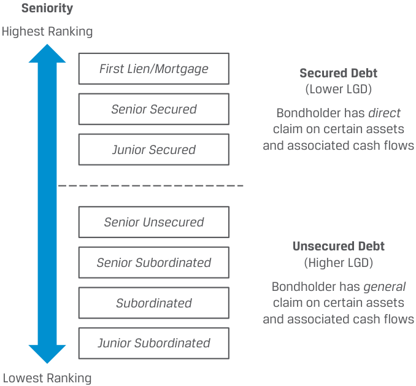

# Tập 6: Thu nhập Cố định (Fixed Income)
## Học phần 16: Phân tích Tín dụng đối với Tổ chức Phát hành Doanh nghiệp (Credit Analysis for Corporate Issuers)
### Phần 2/3: Các Tỷ số Tài chính trong Phân tích Tín dụng Doanh nghiệp (Trang PDF 431–446)

---

<!-- PDF Page 431 -->

- Mức độ phụ thuộc tương đối vào nợ vay để tài trợ cho hoạt động (*Relative reliance on debt to finance operations*)
- Khả năng của bên đi vay trong việc đáp ứng các nghĩa vụ ngắn hạn (*Borrower ability to meet short-term obligations*)
- So sánh thu nhập hoặc dòng tiền định kỳ với nghĩa vụ trả nợ (*Comparison of periodic earnings or cash flow to debt service*)

**Lời giải:**

- Mức độ phụ thuộc tương đối vào nợ vay để tài trợ cho hoạt động $\rightarrow$ **Đòn bẩy tài chính (*Leverage*)**
- Khả năng của bên đi vay trong việc đáp ứng các nghĩa vụ ngắn hạn $\rightarrow$ **Thanh khoản (*Liquidity*)**
- So sánh thu nhập hoặc dòng tiền định kỳ với nghĩa vụ trả nợ $\rightarrow$ **Khả năng trang trải nợ (*Coverage*)**

- 2. **Xác định các câu trả lời đúng để điền vào chỗ trống:** Những bên cho vay có bảo đảm ưa thích việc được cam kết hoặc cầm cố bằng các tài sản _______ (hay tài sản thế chấp _____) hơn là các tài sản _______ (hay tài sản thế chấp _____) để bảo đảm cho khoản nợ.

**Lời giải:** Những bên cho vay có bảo đảm ưa thích việc được cam kết hoặc cầm cố bằng các tài sản _hữu hình_ (*tangible*) (hay tài sản thế chấp _cứng_ – *hard*) hơn là các tài sản _vô hình_ (*intangible*) (hay tài sản thế chấp _mềm_ – *soft*) để bảo đảm cho khoản nợ.

- 3. Phát biểu nào sau đây về cổ đông và chủ nợ là <u>không đúng?</u>
  - **A.** Cả cổ đông và chủ nợ đều hưởng lợi từ khả năng sinh lời cao hơn.
  - **B.** Cổ đông nhìn chung hưởng lợi từ đòn bẩy cao hơn, trong khi chủ nợ ưa thích đòn bẩy thấp hơn.
  - **C.** Cả cổ đông và chủ nợ đều hưởng lợi từ khả năng trang trải nợ (*coverage*) thấp hơn.

- **Lời giải:** Đáp án đúng là C. Cả cổ đông và chủ nợ đều hưởng lợi từ <u>khả năng trang trải nợ cao hơn, vốn là thu nhập hoặc dòng tiền sẵn có để thanh toán nghĩa vụ trả nợ.</u>

- 4. **Xác định các câu trả lời đúng để điền vào chỗ trống:** Các doanh nghiệp có mô hình kinh doanh được đặc trưng bởi dòng tiền ổn định và có thể dự báo được, rủi ro kinh doanh _____, và áp lực cạnh tranh _____ sẽ có năng lực cao hơn trong việc sử dụng nợ vay trong cấu trúc vốn của mình và có khả năng xảy ra vỡ nợ thấp hơn.

**Lời giải:** Các doanh nghiệp có mô hình kinh doanh được đặc trưng bởi dòng tiền ổn định và có thể dự báo được, rủi ro kinh doanh _thấp_ (*low*), và áp lực cạnh tranh _ít hơn_ (*less*) sẽ có năng lực cao hơn trong việc sử dụng nợ vay trong cấu trúc vốn của mình và có khả năng xảy ra vỡ nợ thấp hơn.

---

# **<mark>3</mark>**

## **CÁC TỶ SỐ TÀI CHÍNH TRONG PHÂN TÍCH TÍN DỤNG DOANH NGHIỆP (FINANCIAL RATIOS IN CORPORATE CREDIT ANALYSIS)**

tính toán và diễn giải các tỷ số tài chính được sử dụng trong phân tích tín dụng (*credit analysis*)

<!-- PDF Page 432 -->

Việc sử dụng các tỷ số tài chính dựa trên những yếu tố định lượng đã phác thảo trong bài học trước cho phép các nhà phân tích tín dụng đánh giá sức khỏe tài chính tương đối của một công ty, nhận diện các xu hướng theo thời gian, và so sánh các công ty trong cùng một ngành cũng như giữa các ngành với nhau với trọng tâm là khả năng sinh lời (*profitability*), khả năng trang trải nợ (*coverage*), và đòn bẩy tài chính (*leverage*). Các tỷ số tài chính phổ biến được sử dụng để đánh giá rủi ro tín dụng của một tổ chức phát hành doanh nghiệp được trình bày trong Bảng minh họa 3.

**Bảng minh họa 3: Các Tỷ số Tài chính Chính đối với Mức độ Tín nhiệm Doanh nghiệp (Key Financial Ratios for Corporate Creditworthiness)**

<!-- Picture Text: Profitability Coverage EBIT Margin: EBIT to Interest Expense: Operating Income Operating Income Revenue Interest Expense Leverage Debt to EBITDA: RCF to Net Debt: Debt Retained Cash Flow (RCF) EBITDA Debt – Cash and Marketable Securities  -->

$$\text{EBIT Margin (Biên EBIT)} = \frac{\text{Operating Income (Lợi nhuận hoạt động)}}{\text{Revenue (Doanh thu)}}$$

$$\text{EBIT to Interest Expense (EBIT trên Chi phí lãi vay)} = \frac{\text{Operating Income (Lợi nhuận hoạt động)}}{\text{Interest Expense (Chi phí lãi vay)}}$$

$$\text{Debt to EBITDA (Nợ trên EBITDA)} = \frac{\text{Debt (Tổng nợ)}}{\text{EBITDA}}$$

$$\text{RCF to Net Debt (RCF trên Nợ ròng)} = \frac{\text{Retained Cash Flow (Dòng tiền giữ lại – RCF)}}{\text{Debt} - \text{Cash and Marketable Securities (Nợ} - \text{Tiền mặt và Chứng khoán khả mại)}}$$

Nhìn chung, phân tích rủi ro tín dụng sử dụng các tỷ số về khả năng sinh lời, khả năng trang trải nợ và đòn bẩy tìm cách xác lập khả năng trả nợ của doanh nghiệp bằng các dòng tiền từ hoạt động kinh doanh, thay vì từ việc thanh lý tài sản hay hoạt động tài chính. Các thước đo dòng tiền được sử dụng trong phân tích tín dụng, chẳng hạn như dòng tiền tự do ($\text{FCF}$, hay lợi nhuận ròng trừ đi mức tăng vốn lưu động, đầu tư vào tài sản cố định, và chi phí lãi vay ròng đã trả), dòng tiền từ hoạt động kinh doanh ($\text{FFO}$ – *funds from operations*, hay lợi nhuận ròng từ hoạt động kinh doanh liên tục cộng khấu hao tài sản cố định và hao mòn tài sản vô hình, thuế thu nhập hoãn lại, và các khoản mục phi tiền mặt khác), hoặc dòng tiền giữ lại ($\text{RCF}$ – *retained cash flow*, hay dòng tiền ròng từ hoạt động kinh doanh trừ đi cổ tức đã trả) mang tính thận trọng hơn so với các thước đo khác bởi vì chúng thực hiện một số điều chỉnh nhất định đối với lượng tiền mặt được sử dụng trong việc quản lý và duy trì doanh nghiệp hoặc được phân phối cho các cổ đông. Các thước đo nợ và chi phí lãi vay được sử dụng trong phân tích tín dụng cũng có thể được điều chỉnh cho các khoản thuê hoạt động (*operating leases*), các khoản thanh toán tiền thuê cố định tương tự nợ, và/hoặc các nghĩa vụ cố định khác ngoài bảng cân đối kế toán có ảnh hưởng đến khả năng trả nợ của công ty.

Những thước đo này và các tỷ số được xây dựng dựa trên chúng là các chỉ tiêu phi chuẩn mực IFRS (*non-IFRS*) theo nghĩa là chúng không có định nghĩa chính thức theo IFRS; các khái niệm, tên gọi và định nghĩa được đưa ra nên được xem là một cách sử dụng phổ biến trong số nhiều cách có thể có trong hầu hết các trường hợp.

_Biên EBIT (EBIT Margin):_ Các nhà phân tích tín dụng tập trung vào EBIT (thu nhập trước lãi vay và thuế) để xác định kết quả hoạt động kinh doanh của công ty trước chi phí vốn và thuế, bởi vì chi phí lãi vay được thanh toán trước khi tính thuế thu nhập. Trong một số trường hợp, EBITDA (hay thu nhập trước lãi vay, thuế, khấu hao tài sản cố định và hao mòn tài sản vô hình) được sử dụng như một thước đo rộng hơn bằng cách cộng ngược trở lại chi phí khấu hao và hao mòn (phi tiền mặt). Biên EBIT cao hơn làm tăng lợi nhuận sẵn có để trả nợ.

_EBIT trên Chi phí lãi vay (EBIT to Interest Expense):_ Chỉ số này đo lường mức độ mà lợi nhuận hoạt động trang trải cho các khoản thanh toán lãi vay định kỳ, với tỷ số trang trải cao hơn thể hiện rủi ro tín dụng thấp hơn. Trong một số trường hợp, tử số được thay đổi để bao gồm cả chi phí khấu hao và hao mòn (EBITDA) cũng như chi phí thuê tài sản (EBITDAR), trong khi mẫu số có thể được tăng lên để bao gồm các khoản thanh toán tiền thuê hoặc được giảm bớt đi phần tiền lãi thu được từ chứng khoán khả mại và tiền mặt.

_Nợ trên EBITDA (Debt to EBITDA):_ Các tỷ số đòn bẩy thường được biểu thị với khoản mục nợ nằm ở tử số hoặc mẫu số, do đó cần cẩn trọng để phản ánh chính xác việc con số lớn hơn hay nhỏ hơn biểu thị đòn bẩy gia tăng. Ví dụ, tỷ số nợ trên EBITDA cao hơn thể hiện đòn bẩy cao hơn, và khoản mục nợ có thể được điều chỉnh để phản ánh các hợp đồng thuê hoạt động hoặc các cam kết ngoài bảng cân đối kế toán. Các tổ chức xếp hạng tín nhiệm thường sử dụng tỷ số này làm ngưỡng kích hoạt (*trigger*) cho các hành động xếp hạng

<!-- PDF Page 433 -->

và các ngân hàng viện dẫn nó trong các điều khoản ràng buộc của khoản vay (*loan covenants*). Tỷ số cao hơn cho thấy đòn bẩy nhiều hơn và do đó rủi ro tín dụng cao hơn. Lưu ý rằng tỷ số này có thể biến động rất mạnh đối với các công ty có mức độ biến thiên dòng tiền cao, chẳng hạn như các công ty trong những ngành mang tính chu kỳ và có đòn bẩy hoạt động (*operating leverage* – chi phí cố định) cao.

_Dòng tiền Giữ lại (RCF) trên Nợ ròng (Retained Cash Flow to Net Debt):_ Việc sử dụng các thước đo dòng tiền thay vì thu nhập cũng rất phổ biến trong việc đo lường đòn bẩy, đồng thời tại đây thước đo nợ được giảm trừ đi lượng tiền mặt sẵn có. Thước đo RCF trên nợ ròng cao hơn hàm ý đòn bẩy thấp hơn.

Mặc dù các tỷ số tài chính được sử dụng trong phân tích tín dụng khác nhau giữa các ngành, bản thân giá trị của các tỷ số tài chính đối với một mức xếp hạng hoặc mức chất lượng tín dụng nhất định cũng có thể dao động rất rộng giữa các ngành do sự khác biệt về mô hình kinh doanh, áp lực cạnh tranh và các yếu tố khác.

Các nhà phân tích tín dụng sử dụng mô hình tài chính để đánh giá xem các tỷ số này có thể thay đổi như thế nào theo thời gian khi các động lực doanh thu thay đổi, như trong ví dụ sau đây:

#### **VÍ DỤ 4**

### **Đánh giá Rủi ro Tín dụng của Tập đoàn Bowstream (Bowstream Corporation Credit Risk Assessment)**

Một nhà phân tích tín dụng đã xây dựng mô hình báo cáo tài chính để đánh giá rủi ro tín dụng của Tập đoàn Bowstream, một công ty hàng tiêu dùng lâu bền (*consumer durables*) quy mô vừa thuộc hạng đầu tư. Mặc dù kết quả tài chính gần đây nhất của Bowstream cho thấy mức tăng trưởng doanh thu vững chắc 10% và biên lợi nhuận hoạt động mạnh mẽ ở mức 35%, nhà phân tích muốn đánh giá kết quả hoạt động của Bowstream theo một kịch bản bất lợi (*downside scenario*) trong đó chi phí sản xuất và chi phí lãi vay của công ty tăng lên do lạm phát giữa bối cảnh tăng trưởng doanh thu chậm lại. Các giả định của mô hình được sử dụng cho tốc độ tăng trưởng doanh thu, giá vốn hàng bán tính theo tỷ lệ phần trăm doanh thu, lãi suất và tốc độ tăng trưởng nợ của Bowstream trong 5 năm tới như sau:

|**Các Giả định**|**Năm 0 (Báo cáo)**|**Năm 1 (Dự phóng)**|**Năm 2**|**Năm 3**|**Năm 4**|**Năm 5**|
|---|---|---|---|---|---|---|
|Tăng trưởng doanh thu (*Sales growth*)|10%|5%|5%|5%|5%|5%|
|Giá vốn hàng bán/Doanh thu (*Cost of goods sold/Sales*)|65%|70%|75%|80%|85%|85%|
|Lãi suất nợ vay (*Interest rate on debt*)|6%|7%|7%|7%|8%|8%|
|Tốc độ tăng trưởng nợ (*Debt growth rate*)|10%|10%|10%|10%|10%|10%|

Dữ liệu tài chính chọn lọc và các dự phóng từ kết quả mô hình ba báo cáo tài chính (*three-statement model*) dựa trên các giả định này cùng tỷ lệ ổn định của các khoản mục trên bảng cân đối kế toán và các khoản mục khác so với doanh thu như sau:

|**Báo cáo Kết quả Hoạt động Kinh doanh (Income Statement)**|**Năm 0**|**Năm 1**|**Năm 2**|**Năm 3**|**Năm 4**|**Năm 5**|
|---|---|---|---|---|---|---|
|**Doanh thu (Sales)**|**5,225**|**5,486**|**5,761**|**6,049**|**6,351**|**6,669**|
|Giá vốn hàng bán (*Cost of goods sold*)|(3,396)|(3,840)|(4,320)|(4,839)|(5,398)|(5,668)|
|**Lợi nhuận gộp (Gross profit)**|**1,829**|**1,646**|**1,440**|**1,210**|**953**|**1,000**|
|_Biên lợi nhuận gộp – Gross profit (%)_|35%|30%|25%|20%|15%|15%|
|Chi phí bán hàng, chung và quản lý (*SG&A*)|(499)|(524)|(550)|(577)|(606)|(637)|
|Chi trả lãi vay (*Interest payments on debt*)|(38)|(46)|(51)|(56)|(72)|(83)|
|Lãi thu được từ tiền mặt và chứng khoán khả mại (*Interest earned on cash and mktable sec*)|12|12|12|12|12|12|
|Khấu hao (*Depreciation*)|(400)|(467)|(517)|(547)|(559)|(552)|

<!-- PDF Page 434 -->

|**Báo cáo Kết quả Hoạt động Kinh doanh (Income Statement)**|**Năm 0**|**Năm 1**|**Năm 2**|**Năm 3**|**Năm 4**|**Năm 5**|
|---|---|---|---|---|---|---|
|**Lợi nhuận trước thuế (Profit before tax)**|**905**|**621**|**335**|**41**|**(273)**|**(259)**|
|Thuế (*Taxes*)|(317)|(217)|(117)|(14)|95|90|
|**Lợi nhuận ròng (Net income)**|**588**|**404**|**218**|**27**|**(177)**|**(168)**|
|_Lợi nhuận ròng (% doanh thu)_|11%|7%|4%|0%|−3%|−3%|
|Cổ tức (*Dividends*)|(118)|(81)|(44)|(5)|—|—|
|**Lợi nhuận giữ lại (Retained earnings)**|**470**|**323**|**174**|**21**|**(177)**|**(168)**|
|**Bảng Cân đối Kế toán (Balance Sheet)**|**Năm 0**|**Năm 1**|**Năm 2**|**Năm 3**|**Năm 4**|**Năm 5**|
|**Tiền mặt và chứng khoán khả mại (*Cash and marketable securities*)**|400|400|400|400|400|400|
|**Tài sản ngắn hạn (*Current assets*)**|627|658|691|726|762|800|
|Tài sản cố định (*Fixed assets*)|||||||
|Nguyên giá (*Cost basis*)|5,993|6,840|7,594|8,233|8,735|9,256|
|Khấu hao lũy kế (*Accumulated depreciation*)|(2,400)|(2,867)|(3,383)|(3,931)|(4,490)|(5,042)|
|**Tài sản cố định ròng (Net fixed assets)**|3,593|3,973|4,211|4,303|4,244|4,214|
|**Tổng tài sản (Total assets):**|**4,620**|**5,032**|**5,302**|**5,428**|**5,407**|**5,414**|
|**Nợ ngắn hạn (*Current liabilities*)**|523|549|576|605|635|667|
|**Nợ vay (*Debt*)**|627|690|759|835|960|1,104|
|**Vốn cổ phần (225 cổ phiếu phát hành @ 10) (*Stock*)**|2,250|2,250|2,250|2,250|2,250|2,250|
|**Lợi nhuận giữ lại lũy kế (*Accumulated retained earnings*)**|1,220|1,543|1,718|1,739|1,562|1,394|
|**Tổng nợ phải trả và vốn chủ sở hữu (Total liabilities and equity)**|**4,620**|**5,032**|**5,302**|**5,428**|**5,407**|**5,414**|
|**Báo cáo Lưu chuyển Tiền tệ Hợp nhất (Consolidated Statement of Cash Flows)**|**Năm 0**|**Năm 1**|**Năm 2**|**Năm 3**|**Năm 4**|**Năm 5**|
|Lưu chuyển tiền thuần từ hoạt động kinh doanh (*Net cash from operating activities*)|978|866|729|568|376|377|
|Lưu chuyển tiền thuần sử dụng trong hoạt động đầu tư (*Net cash used in investing activities*)|(918)|(847)|(754)|(639)|(501)|(521)|
|Lưu chuyển tiền thuần từ hoạt động tài chính (*Net cash from financing activities*)|(61)|(18)|25|71|125|144|

Nhà phân tích sử dụng dữ liệu từ kết quả mô hình ba báo cáo tài chính này để giải tìm các tỷ số về khả năng sinh lời, khả năng trang trải nợ và đòn bẩy gần đây cũng như dự phóng theo Bảng minh họa 3:

|**Chỉ tiêu**|**Năm 0**|**Năm 1**|**Năm 2**|**Năm 3**|**Năm 4**|**Năm 5**|
|---|---|---|---|---|---|---|
|EBIT|1,330|1,122|890|632|346|364|
|EBITDA|1,730|1,589|1,407|1,180|906|916|
|FFO (Tiền thuần từ hoạt động kinh doanh)|978|866|729|568|376|377|
|RCF ($\text{FFO} - \text{Cổ tức}$)|861|785|685|563|376|377|
|Biên EBIT (*EBIT margin*)|25%|20%|15%|10%|5%|5%|
|EBIT trên Chi phí lãi vay ròng (*EBIT to Interest expense*)|51.9|32.9|23.0|14.4|5.8|5.2|

<!-- PDF Page 435 -->

|**Chỉ tiêu**|**Năm 0**|**Năm 1**|**Năm 2**|**Năm 3**|**Năm 4**|**Năm 5**|
|---|---|---|---|---|---|---|
|Nợ trên EBITDA (*Debt to EBITDA*)|0.36|0.43|0.54|0.71|1.06|1.21|
|RCF trên Nợ ròng (*RCF to Net debt*)|379%|271%|191%|130%|67%|54%|

Theo kịch bản này, Bowstream phải đối mặt với khả năng sinh lời sụt giảm (khi biên EBIT giảm xuống), khả năng trang trải nợ suy yếu (tỷ số EBIT trên chi phí lãi vay thấp hơn), và đòn bẩy gia tăng (tỷ số nợ trên EBITDA cao hơn và RCF trên nợ ròng thấp hơn), những điều nhiều khả năng sẽ dẫn đến phần bù tín dụng nới rộng hơn và nguy cơ bị hạ bậc xếp hạng tín nhiệm.

Để đo lường những thay đổi này, các nhà phân tích thường so sánh các tỷ số hiện tại và dự phóng với các công ty cùng ngành và cùng bậc xếp hạng tín nhiệm nhằm xác định những thay đổi dự kiến về chất lượng tín dụng trong tương lai được phân loại theo mức xếp hạng kỳ vọng. Ví dụ, hãy xem xét các phép so sánh sau đây dựa trên phương pháp luận xếp hạng của Moody’s và các tỷ số này đối với ngành hàng tiêu dùng lâu bền:

<!-- PDF Page 436 -->

<!-- Picture Text: EBIT Margin Profitability 30% Aa 20% A Baa Ba 10% B 0% t t + 1 t + 2 t + 3 t + 4 t + 5 Time EBIT to Interest Expense Coverage 50 40 30 20 Aaa Aa 10 A Baa Ba B 0 t t + 1 t + 2 t + 3 t + 4 t + 5 Time Retained Cash Flow (RCF) to Net Debt Leverage 300% 200% 100% Aaa Aa A Baa Ba B 0% t t + 1 t + 2 t + 3 t + 4 t + 5 Time  -->

> **Chú thích hình ảnh (Dự phóng của Bowstream từ $t$ đến $t+5$ so với các dải xếp hạng của Moody's):**
> - **Khả năng sinh lời – Biên EBIT (*Profitability – EBIT Margin*)**: Giảm từ mức hạng `Aa` (25% tại $t$) xuống mức hạng `B` (5% tại $t+4, t+5$).
> - **Khả năng trang trải nợ – EBIT trên Chi phí lãi vay (*Coverage – EBIT to Interest Expense*)**: Giảm từ mức trên `Aaa` (51.9x tại $t$) xuống mức hạng `Baa`/`Ba` (5.2x tại $t+5$).
> - **Đòn bẩy – Dòng tiền giữ lại (RCF) trên Nợ ròng (*Leverage – RCF to Net Debt*)**: Giảm từ mức trên `Aaa` (379% tại $t$) xuống mức hạng `A`/`Baa` (54% tại $t+5$).

<!-- PDF Page 437 -->

> - **Đòn bẩy – Nợ trên EBITDA (*Leverage – Debt to EBITDA*)**: Tăng dần từ $0.36\text{x}$ tại $t$ (hạng `Aaa`) lên $1.21\text{x}$ tại $t+5$ (vẫn nằm trong vùng `Aa`/`A`).

_Nguồn:_ Moody’s Investors Service, “Methodology Announcement: Moody’s Updates Its Methodology for Rating Consumer Durables Companies” (Ngày 10 tháng 9 năm 2021).

#### **BỘ CÂU HỎI (QUESTION SET)**

1. Xác định các tỷ số phân tích tín dụng chính tương ứng với từng loại thước đo:

   - **A.** RCF/Nợ (*RCF/Debt*)
   - **B.** EBITDA/Chi phí lãi vay (*EBITDA/Interest Expense*)
   - **C.** Nợ/Vốn (*Debt/Capital*)
   - **D.** EBITDA
   - **E.** Nợ/EBITDA (*Debt/EBITDA*)
   - **F.** FCF
   - **G.** EBIT/Chi phí lãi vay (*EBIT/Interest Expense*)

   - **1.** Các thước đo khả năng sinh lời và dòng tiền (*Profitability and cash flow metrics*)
   - **2.** Các thước đo đòn bẩy (*Leverage metrics*)
   - **3.** Các thước đo khả năng trang trải nợ (*Coverage metrics*)

**Lời giải:**

- **1.** Các thước đo khả năng sinh lời và dòng tiền: **D, F**
- **2.** Các thước đo đòn bẩy: **A, C, E**
- **3.** Các thước đo khả năng trang trải nợ: **B, G**

2. Hãy cho biết phát biểu sau đây là đúng hay sai và giải thích lý do của bạn: Tỷ số khả năng trang trải nợ (*coverage ratios*) càng cao thì rủi ro tín dụng của bên đi vay càng cao.

**Lời giải:**

Sai (*False*). Các tỷ số khả năng trang trải nợ đo lường năng lực của tổ chức phát hành trong việc trang trải các khoản thanh toán lãi vay của mình. Tỷ số khả năng trang trải nợ càng cao thì rủi ro tín dụng của bên đi vay càng _thấp_ (*lower*).

<!-- PDF Page 438 -->

3. Hãy tính tỷ số $\text{FFO/Debt}$ dựa trên thông tin tài chính sau đây:

|**Khoản mục**|**Giá trị**|
|---|---|
|Lợi nhuận ròng từ hoạt động kinh doanh liên tục (*Net income from continuing operations*)|180|
|Khấu hao và hao mòn (*Depreciation & amortization*)|30|
|Thuế thu nhập hoãn lại (*Deferred income taxes*)|18|
|Các khoản mục phi tiền mặt khác (*Other non-cash items*)|28|
|Tăng vốn lưu động (*Increase in working capital*)|(52)|
|Cổ tức đã trả (*Dividend paid*)|(60)|
|Chi tiêu vốn (*Capital expenditure*)|(100)|
|Nợ vay (*Debt*)|1,280|

#### **Lời giải:**

$$\text{FFO} = \text{Net income from continuing operations} + \text{Depreciation \& amortization} + \text{Deferred income taxes} + \text{Other non-cash items} = 180 + 30 + 18 + 28 = 256$$

$$\text{FFO/Debt} = \frac{256}{1,280} = 0.2 \text{ hay } 20\%$$

4. Công ty X và Công ty Y hoạt động trong cùng một ngành. Dựa trên thông tin tài chính dưới đây, công ty nào có rủi ro tín dụng thấp hơn?

|**Chỉ tiêu**|**Công ty X**|**Công ty Y**|
|---|---|---|
|Biên EBITDA (*EBITDA margin*)|15%|15%|
|FCF|(20)|20|
|FCF trước cổ tức (*FCF before dividends*)|(45)|18|
|Nợ/EBITDA (*Debt/EBITDA*)|2.5|1.6|
|EBITDA/chi phí lãi vay (*EBITDA/interest expense*)|3.0|3.5|

#### **Lời giải:**

Công ty Y có rủi ro tín dụng thấp hơn. Mặc dù Công ty X và Công ty Y có cùng biên EBITDA, nhưng Công ty Y có FCF và FCF trước cổ tức mang giá trị dương, tỷ số đòn bẩy thấp hơn, và tỷ số khả năng trang trải nợ cao hơn so với Công ty X.

# **<mark>4</mark>**

## **THỨ TỰ ƯU TIÊN THANH TOÁN, TỶ LỆ THU HỒI VÀ XẾP HẠNG TÍN NHIỆM (SENIORITY RANKINGS, RECOVERY RATES, AND CREDIT RATINGS)**

- mô tả thứ tự ưu tiên thanh toán (*seniority rankings*) của nợ, nợ có bảo đảm (*secured debt*) so với nợ không có bảo đảm (*unsecured debt*) và thứ tự ưu tiên của các quyền đòi nợ khi phá sản (*priority of claims in bankruptcy*), cùng tác động của chúng lên xếp hạng tín nhiệm (*credit ratings*)

Các nghĩa vụ nợ của một bên đi vay là doanh nghiệp thường có thứ tự ưu tiên thanh toán khác nhau. Một số công ty và ngành có cấu trúc vốn đơn giản, với tất cả các khoản nợ được xếp hạng ngang nhau và được phát hành bởi một công ty hoạt động chính duy nhất. Các công ty và ngành khác, do hoạt động mua lại và thoái vốn (ví dụ: các công ty truyền thông hoặc tập đoàn đa ngành) hoặc do quy định quản lý (ví dụ: các ngân hàng và công ty tiện ích công cộng), có cấu trúc nợ phức tạp hơn. Các doanh nghiệp

<!-- PDF Page 439 -->

trong những ngành này thường có nhiều công ty con, hay các công ty hoạt động (*operating companies*), có các khoản nợ đang lưu hành của riêng mình và các công ty mẹ nắm giữ vốn (*parent holding companies*) cũng phát hành nợ với các mức độ ưu tiên thanh toán khác nhau.

### **Thứ tự Ưu tiên Thanh toán (Seniority Rankings)**

Thứ tự ưu tiên thanh toán (*seniority ranking*) đề cập đến mức độ ưu tiên chi trả, trong đó khoản nợ cấp cao nhất (*most senior*) hay có thứ hạng cao nhất (*highest-ranking*) có quyền đòi nợ đầu tiên đối với các dòng tiền và tài sản của tổ chức phát hành. Mức độ ưu tiên thanh toán ảnh hưởng đến giá trị quyền đòi nợ của nhà đầu tư trong trường hợp vỡ nợ và tái cơ cấu. Nợ có bảo đảm (*secured debt*) bao hàm một quyền đòi nợ của chủ nợ — một cam kết cầm cố từ tổ chức phát hành — đối với một số tài sản nhất định và các dòng tiền gắn liền với chúng. Tài sản thế chấp này làm giảm khoản tổn thất tiềm tàng của bên cho vay trong trường hợp vỡ nợ, vì bên cho vay có thể tiếp quản quyền sở hữu và bán các tài sản này để bù đắp tổn thất của mình. Thứ tự ưu tiên thanh toán bao gồm nợ có bảo đảm và nợ không có bảo đảm được trình bày trong Bảng minh họa 4.

**Bảng minh họa 4: Thứ tự Ưu tiên Thanh toán (Seniority Rankings)**

<!-- Picture Text: Seniority Highest Ranking First Lien/Mortgage Secured Debt (Lower LGD) Senior Secured Bondholder has  direct claim on certain assets Junior Secured and associated cash flows Senior Unsecured Unsecured Debt Senior Subordinated (Higher LGD) Bondholder has  general Subordinated claim on certain assets and associated cash flows Junior Subordinated Lowest Ranking  -->

> **Chú thích hình ảnh: Thứ tự Ưu tiên Thanh toán (*Seniority*) từ Thứ hạng Cao nhất (*Highest Ranking*) đến Thứ hạng Thấp nhất (*Lowest Ranking*):**
> - **Nợ Có Bảo đảm (*Secured Debt* – LGD thấp hơn):** Trái chủ có quyền đòi nợ trực tiếp (*direct claim*) đối với một số tài sản nhất định và dòng tiền đi kèm:
>   1. Quyền nắm giữ tài sản thế chấp ưu tiên thứ nhất / Thế chấp thứ nhất (*First Lien/Mortgage*)
>   2. Nợ cấp cao có bảo đảm (*Senior Secured*)
>   3. Nợ cấp dưới có bảo đảm (*Junior Secured*)
> - **Nợ Không Có Bảo đảm (*Unsecured Debt* – LGD cao hơn):** Trái chủ có quyền đòi nợ chung (*general claim*) đối với tài sản và dòng tiền đi kèm:
>   4. Nợ cấp cao không có bảo đảm (*Senior Unsecured*)
>   5. Nợ thứ cấp cấp cao (*Senior Subordinated*)
>   6. Nợ thứ cấp (*Subordinated*)
>   7. Nợ thứ cấp cấp dưới (*Junior Subordinated*)

### **Nợ Có Bảo đảm so với Nợ Không Có Bảo đảm (Secured versus Unsecured Debt)**

Nợ thế chấp thứ nhất (*first mortgage*) và nợ có quyền nắm giữ tài sản thế chấp ưu tiên thứ nhất (*first lien debt*) được xếp hạng cao nhất trong số các chủ nợ có bảo đảm xét về mức độ ưu tiên hoàn trả. **Nợ thế chấp thứ nhất (*First mortgage debt*)** hay khoản vay thế chấp thứ nhất đề cập đến việc cầm cố một bất động sản cụ thể (ví dụ: một nhà máy điện của công ty tiện ích). **Nợ có quyền nắm giữ tài sản thế chấp ưu tiên thứ nhất (*First lien debt*)** đề cập đến việc cầm cố một số tài sản nhất định có thể bao gồm các tòa nhà nhưng cũng có thể bao gồm bất động sản và thiết bị, giấy phép, bằng sáng chế, thương hiệu hoặc hàng tồn kho. Đúng như tên gọi, nợ có bảo đảm có _quyền nắm giữ tài sản thế chấp ưu tiên thứ hai_ (*second lien*) có lợi ích được bảo đảm trong các tài sản cầm cố xếp sau nợ *first lien* về cả mức độ bảo vệ bằng tài sản thế chấp lẫn thứ tự ưu tiên thanh toán. Hầu hết các khoản vay *second lien* là nghĩa vụ nợ cấp cao có bảo đảm của bên đi vay, xếp trên các nghĩa vụ nợ cấp dưới có bảo đảm (*junior secured obligations*).

Các trái chủ không có bảo đảm chỉ có quyền đòi nợ chung (*general claim*) đối với tài sản và dòng tiền của tổ chức phát hành. Trong trường hợp vỡ nợ, quyền đòi nợ của các chủ nợ không có bảo đảm xếp sau (tức là được thanh toán sau) quyền đòi nợ của các chủ nợ có bảo đảm theo nguyên tắc được gọi là **thứ tự ưu tiên của các quyền đòi nợ (*priority of claims*)**.

<!-- PDF Page 440 -->

Khoản nợ không có bảo đảm có thứ hạng cao nhất là **nợ cấp cao không có bảo đảm (*senior unsecured debt*)**. Đây là loại trái phiếu doanh nghiệp phổ biến nhất, xếp dưới nợ cấp cao có bảo đảm nhưng xếp trên nợ thứ cấp. Các khoản nợ khác có thứ hạng thấp hơn bao gồm **nợ thứ cấp (*subordinated debt*)** và nợ thứ cấp cấp dưới (*junior subordinated debt*). Trong số các hạng chủ nợ khác nhau, những nghĩa vụ nợ này có mức độ ưu tiên đòi nợ thấp nhất và thường chỉ thu hồi được rất ít hoặc không thu hồi được gì trong trường hợp vỡ nợ (tức là có $\text{LGD}$ bằng 100%).

Các thứ tự ưu tiên thanh toán khác nhau đáp ứng nhu cầu và đòi hỏi của cả tổ chức phát hành lẫn nhà đầu tư. Các tổ chức phát hành tìm cách tối ưu hóa chi phí vốn của mình — trong một số trường hợp chào bán nợ có bảo đảm để đáp ứng yêu cầu của nhà đầu tư, như trong ví dụ về Royal Caribbean trước đó, và trong các trường hợp khác chào bán nợ thứ cấp, vốn ít tốn kém hơn vốn cổ phần và không gây pha loãng (*non-dilutive*). Thứ tự ưu tiên của nợ dẫn dắt các quyết định trong trường hợp phá sản hoặc thanh lý. Các chủ nợ cấp cao có quyền đòi nợ có bảo đảm có quyền hưởng giá trị của các tài sản cụ thể trước bất kỳ quyền đòi nợ nào khác. Nếu giá trị của tài sản cầm cố thấp hơn giá trị của quyền đòi nợ, thì phần chênh lệch thiếu hụt đó sẽ trở thành một quyền đòi nợ cấp cao không có bảo đảm (*senior unsecured claim*). Các chủ nợ cấp cao không có bảo đảm được ưu tiên hơn tất cả các chủ nợ thứ cấp, và đến lượt các chủ nợ thứ cấp có quyền được thanh toán đầy đủ trước khi các cổ đông nhận được bất kỳ khoản đền bù nào. Ví dụ 5 cho thấy sự khác biệt về thứ tự ưu tiên hoàn trả.

#### **VÍ DỤ 5**

### **Trái phiếu VIVU (VIVU Bond)**

Trái phiếu trung hạn có thể mua lại kỳ hạn 7 năm lãi suất 6.5% của VIVU đã được giới thiệu ở phần trước của chương trình học.

|**Trái phiếu Có thể Mua lại Kỳ hạn 7 Năm Lãi suất 6.5% của Vivivyu Inc. (VIVU)**||
|---|---|
|**Tổ chức phát hành (*Issuer*):**|Vivivyu Incorporated|
|**Thời hạn đáo hạn (*Maturity Date*):**|7 Năm|
|**Giá trị nợ gốc (*Principal Amount*):**|USD400 triệu|
|**Tiền lãi (*Interest*):**|Lãi suất coupon cố định 6.5%|
|**Thanh toán lãi (*Interest Payment*):**|Nửa năm một lần (*Semi-annual*)|
|**Thứ tự ưu tiên (*Seniority*):**|Trái phiếu là nghĩa vụ nợ có bảo đảm và không thứ cấp của VIVU và xếp ngang hàng (*pari passu*) với tất cả các khoản nợ có bảo đảm và không thứ cấp khác.|
|**Bảo đảm (*Security*):**|Trái phiếu được bảo đảm bằng việc cầm cố một số tài sản nhất định như được xác định trong Khế ước trái phiếu (*Indenture*).|

Giả sử VIVU cũng có một trái phiếu thứ cấp kỳ hạn 10 năm đang lưu hành với các điều khoản sau:

|**Trái phiếu Thứ cấp Kỳ hạn 10 Năm Lãi suất 10.0% của Vivivyu Inc. (VIVU)**||
|---|---|
|**Tổ chức phát hành (*Issuer*):**|Vivivyu Incorporated|
|**Thời hạn đáo hạn (*Maturity Date*):**|10 năm|
|**Giá trị nợ gốc (*Principal Amount*):**|USD300 triệu|
|**Tiền lãi (*Interest*):**|Lãi suất coupon cố định 10.0%|
|**Thanh toán lãi (*Interest Payment*):**|Nửa năm một lần (*Semi-annual*)|
|**Thứ tự ưu tiên (*Seniority*):**|Trái phiếu sẽ cấu thành các nghĩa vụ nợ trực tiếp, không có bảo đảm và thứ cấp của Tổ chức phát hành và sẽ xếp ngang hàng (*pari passu*) mà không có bất kỳ sự ưu tiên nào giữa chúng với nhau.|
|**Bảo đảm (*Security*):**|Không có (*None*)|

<!-- PDF Page 441 -->

Trong khi trái phiếu lãi suất 6.5% là nợ cấp cao có bảo đảm, thì trái phiếu lãi suất 10.0% là nợ thứ cấp không có bảo đảm.

Trong trường hợp mất khả năng thanh toán hoặc tái cơ cấu, trái phiếu 6.5% xếp cao nhất trong thứ tự ưu tiên thanh toán vì chúng được bảo đảm bằng một số tài sản xác định đóng vai trò là nguồn trả nợ thứ cấp. Nếu giá trị của tài sản thế chấp thấp hơn tổng giá trị của khoản nợ có bảo đảm ngang hàng (*pari passu*), phần số dư còn thiếu sẽ xếp ngang hàng với các chủ nợ cấp cao không có bảo đảm khi giải quyết mất khả năng thanh toán hoặc tái cơ cấu.

Trái phiếu thứ cấp 10.0% xếp dưới nợ cấp cao có bảo đảm và nợ cấp cao không có bảo đảm trong thứ tự ưu tiên của các quyền đòi nợ, nhưng xếp trên các khoản nợ thứ cấp cấp dưới (nếu có) và các cổ đông. Những trái phiếu này nằm trong nhóm có thứ tự ưu tiên đòi nợ thấp nhất khi xảy ra sự kiện vỡ nợ và thường có tỷ lệ thu hồi thấp nhất.

### **Tỷ lệ Thu hồi (Recovery Rates)**

Tất cả các chủ nợ ở cùng một cấp độ ưu tiên nợ đều được đối xử như cùng một hạng (*one class*); do đó, một trái chủ nắm giữ trái phiếu cấp cao không có bảo đảm có khoản nợ đáo hạn sau 30 năm sẽ có cùng quyền đòi nợ theo tỷ lệ (*pro rata / pari passu*) khi phá sản giống như một trái chủ có khoản nợ đáo hạn sau sáu tháng. Khoản nợ đã vỡ nợ thường tiếp tục giao dịch gần với mức tỷ lệ thu hồi kỳ vọng đối với các trái phiếu dự kiến bước vào thủ tục phá sản hoặc thanh lý. Tỷ lệ thu hồi khác nhau theo thứ tự ưu tiên thanh toán dựa trên thứ tự ưu tiên của các quyền đòi nợ.

Dữ liệu vỡ nợ lịch sử cung cấp các tỷ lệ thu hồi có ý nghĩa thống kê theo thứ tự ưu tiên thanh toán. Bảng minh họa 5 cho thấy tỷ lệ thu hồi theo thứ tự ưu tiên thanh toán đối với các công ty phi tài chính tại Bắc Mỹ. Ví dụ, như được trình bày trong Bảng minh họa 5, các nhà đầu tư đã thu hồi được 45.9% giá trị của khoản nợ cấp cao có bảo đảm bị vỡ nợ vào năm 2019 nhưng chỉ thu hồi được 31.3% đối với các đợt phát hành cấp cao không có bảo đảm bị vỡ nợ trong năm đó.

**Bảng minh họa 5: Tỷ lệ Thu hồi Nợ Doanh nghiệp Trung bình (%) (Average Corporate Debt Recovery Rates)**

|**Vị thế Ưu tiên (Priority Position)**|**Năm Thoát Phá sản (Emergence Year) – 2020**|**Năm Thoát Phá sản – 2019**|**Năm Thoát Phá sản – 1987–2020**|**Năm Vỡ nợ (Default Year) – 2020**|**Năm Vỡ nợ – 2019**|**Năm Vỡ nợ – 1987–2020**|
|---|---|---|---|---|---|---|
|**Các khoản vay có kỳ hạn (*Term Loans*)***|48.5|58.1|72.6|50.1|52.7|86.3|
|**Trái phiếu Cấp cao Có bảo đảm (*Senior Secured Bonds*)**|34.8|45.9|61.4|34.8|44.6|61.4|
|**Trái phiếu Cấp cao Không có bảo đảm (*Senior Unsecured Bonds*)**|8.6|31.3|46.9|8.6|40.5|46.9|
|**Trái phiếu Thứ cấp (*Subordinated Bonds*)**|0.9|24.7|27.9|0.9|24.7|27.9|

_* Bao gồm tất cả các loại khoản vay có kỳ hạn:_ *first-lien*, *second-lien*, không có bảo đảm. _Lưu ý:_ Năm thoát phá sản (*Emergence year*) thường là năm công ty bị vỡ nợ thoát khỏi tình trạng phá sản. Dữ liệu năm vỡ nợ (*Default year*) đề cập đến tỷ lệ thu hồi của khoản nợ đã vỡ nợ trong năm đó (tức năm 2019 và 2020) hoặc khoảng các năm (tức giai đoạn 1987–2020). Dữ liệu dành cho các công ty phi tài chính tại Bắc Mỹ. _Nguồn:_ Moody’s Investors Service, “Default Trends — Global: Annual Default Study: Following a Sharp Rise in 2020, Corporate Defaults Will Drop in 2021” (Ngày 28 tháng 1 năm 2021).

Tỷ lệ thu hồi (*Recovery rates*):

**1.** rất khác nhau tùy theo từng ngành,

**2.** thay đổi tùy thuộc vào thời điểm xảy ra trong chu kỳ tín dụng, và

**3.** thể hiện mức trung bình qua các ngành và các công ty.

<!-- PDF Page 442 -->

Các công ty bước vào tình trạng phá sản trong những ngành đang suy thoái dài hạn mang tính cấu trúc (*secular decline*) thường có tỷ lệ thu hồi thấp hơn so với những công ty chỉ đơn thuần đối mặt với suy thoái kinh tế mang tính chu kỳ (*cyclical economic downturn*). Bảng minh họa 6 cho thấy phân phối của các tỷ lệ thu hồi chọn lọc trong giai đoạn từ năm 1983 đến năm 2020 qua các ngành và các cấp độ ưu tiên nợ khác nhau.

**Bảng minh họa 6: Tỷ lệ Thu hồi qua một số Ngành Chọn lọc, 1983–2020, Đo lường bằng Giá Giao dịch trước khi Vỡ nợ (%)**

|**Các Nhóm Ngành (Industry Groups)**|**Trái phiếu Ưu tiên Thứ nhất (1st Lien Bond)**|**Trái phiếu Cấp cao Không có bảo đảm (Senior Unsecured Bond)**|**Trái phiếu Thứ cấp (Subordinated Bond)**|
|---|---|---|---|
|Ô tô (*Automotive*)|57.94|46.08|49.46|
|Thiết bị vốn (*Capital Equipment*)|62.34|36.69|45.48|
|Năng lượng: Điện (*Energy: Electricity*)|81.48|58.24|39.45|
|Năng lượng: Dầu & Khí đốt (*Energy: Oil & Gas*)|56.55|36.33|39.10|
|Môi trường (*Environmental*)|13.00|29.73|5.44|
|Tài chính (*Finance*)|47.60|45.68|27.80|
|Công nghiệp Công nghệ cao (*High-Tech Industries*)|53.51|33.08|23.71|
|Bán lẻ (*Retail*)|57.78|36.30|21.68|
|Dịch vụ: Kinh doanh (*Services: Business*)|71.14|46.83|46.22|
|Viễn thông (*Telecommunications*)|56.80|26.22|31.61|
|Tỷ lệ thu hồi trung bình* (*Average recovery rate*)|53.04|41.80|34.69|
|Tỷ lệ thu hồi cao nhất* (*Highest recovery rate*)|96.25|92.00|63.56|
|Tỷ lệ thu hồi thấp nhất* (*Lowest recovery rate*)|7.00|22.18|1.47|

_* Được tính toán cho tất cả 33 ngành do Moody’s xác định. Lưu ý:_ Mức thu hồi trung bình của trái phiếu và khoản vay doanh nghiệp bị vỡ nợ theo một số ngành chọn lọc, giai đoạn 1983–2020. _Nguồn:_ Moody’s Investors Service, “Default Trends — Global: Annual Default Study: Following a Sharp Rise in 2020, Corporate Defaults Will Drop in 2021” (Ngày 28 tháng 1 năm 2021).

Tỷ lệ thu hồi cũng thay đổi tùy thuộc vào thời điểm chúng xảy ra trong chu kỳ tín dụng. Khi nền kinh tế mạnh mẽ hoặc đang cải thiện, luôn tồn tại các thị trường sôi động cho việc bán lại tài sản thế chấp và do đó tỷ lệ thu hồi sẽ cao hơn. Ngược lại, khi nền kinh tế yếu kém hoặc đang suy yếu, khả năng thanh lý tài sản của bên cho vay ở mức bằng hoặc gần bằng giá trị ban đầu bị suy giảm và tỷ lệ thu hồi giảm xuống.

Điều quan trọng là các tỷ lệ thu hồi này chỉ là mức trung bình, với sự biến thiên cao giữa các ngành và giữa các công ty trong cùng một ngành nhất định. Các yếu tố ảnh hưởng bao gồm thành phần và tỷ trọng của nợ trong cấu trúc vốn của tổ chức phát hành. Sự hiện diện quá nhiều của nợ có bảo đảm sẽ dẫn đến tỷ lệ thu hồi nhỏ hơn đối với các khoản nợ có thứ hạng thấp hơn. Việc hiểu rõ tỷ lệ thu hồi là rất quan trọng vì chúng là một cấu phần then chốt của phân tích và rủi ro tín dụng, như được thể hiện trong phần kiểm tra kiến thức sau đây.

<!-- PDF Page 443 -->

#### **KIỂM TRA KIẾN THỨC: TỔN THẤT KỲ VỌNG (KNOWLEDGE CHECK: EXPECTED LOSS)**

|1. Tỷ lệ vỡ nợ dự phóng một năm đối với một tổ chức phát hành trong ngành công nghiệp ô tô dự kiến là 0.8%. Tỷ lệ phần trăm tổn thất tín dụng kỳ vọng đối với các trái phiếu của tổ chức phát hành này theo các giả định tỷ lệ thu hồi lịch sử là bao nhiêu?|
|---|
|Trái phiếu cấp cao có bảo đảm (*Senior secured bond*): 58%|
|Trái phiếu cấp cao không có bảo đảm (*Senior unsecured bond*): 46%|
|Trái phiếu thứ cấp (*Subordinated bond*): 23%|

**Lời giải:** Hãy nhớ lại từ bài học trước rằng: Tổn thất kỳ vọng ($\text{EL}$) $= \text{POD} \times \text{LGD}$
- Trái phiếu cấp cao có bảo đảm: $\text{EL} = 0.008 \times (1 - 0.58) = 0.00336 = 0.336\%$
- Trái phiếu cấp cao không có bảo đảm: $\text{EL} = 0.008 \times (1 - 0.46) = 0.00432 = 0.432\%$
- Trái phiếu thứ cấp: $\text{EL} = 0.008 \times (1 - 0.23) = 0.00616 = 0.616\%$

Thứ tự ưu tiên của các quyền đòi nợ khi phá sản (*priority of claims in bankruptcy*) theo đó các chủ nợ có thứ hạng cao nhất được thanh toán trước tiên, tiếp theo là cấp độ kế tiếp, v.v., là một chuẩn mực pháp lý đã được xác lập vững chắc. Tuy nhiên, các chủ nợ có thứ tự ưu tiên thấp hơn và thậm chí cả các cổ đông vẫn có thể nhận được khoản đền bù ngay cả khi các chủ nợ cấp cao hơn chưa được thanh toán đầy đủ, bởi vì quá trình giải quyết phá sản cần nhiều thời gian. Bằng cách đền bù cho các chủ nợ thứ cấp, các chủ nợ cấp cao có thể đẩy nhanh quá trình giải quyết phá sản.

Trong quá trình phá sản, các khoản phí pháp lý và kế toán có thể rất lớn, và giá trị của công ty có thể sụt giảm khi những nhân sự chủ chốt và khách hàng rời đi còn các đối thủ cạnh tranh tích cực giành lấy thị phần. Do đó, các bên có quyền đòi nợ có động lực để đàm phán và thỏa hiệp, dẫn đến việc các chủ nợ có thứ tự ưu tiên thấp hơn và các bên có quyền đòi nợ khác nhận được nhiều sự đền bù hơn so với những gì họ được hưởng về mặt pháp lý.

Trong khi tại Hoa Kỳ tồn tại thiên hướng nghiêng về việc tái tổ chức và phục hồi (*reorganization and recovery*) các công ty bị phá sản, thì ở những nơi khác việc thanh lý (*liquidate*) các công ty bị phá sản và tối đa hóa giá trị cho các ngân hàng cho vay cùng các chủ nợ cấp cao khác lại phổ biến hơn. Vì phá sản và luật phá sản rất phức tạp và có thể rất khác nhau tùy theo quốc gia, nên rất khó để khái quát hóa kết cục của các chủ nợ trong một kịch bản vỡ nợ.

### **Xếp hạng Tổ chức Phát hành và Xếp hạng Đợt Phát hành (Issuer and Issue Ratings)**

Các tổ chức xếp hạng tín nhiệm thường cung cấp cả xếp hạng tổ chức phát hành (*issuer ratings*) và xếp hạng đợt phát hành (*issue ratings*) đối với nợ doanh nghiệp. Thuật ngữ được sử dụng để phân biệt giữa xếp hạng tổ chức phát hành và xếp hạng đợt phát hành bao gồm xếp hạng tập đoàn (*corporate family rating* – CFR) và xếp hạng tín dụng doanh nghiệp (*corporate credit rating* – CCR), hoặc xếp hạng tín nhiệm tổ chức phát hành (*issuer credit rating*) và xếp hạng tín nhiệm đợt phát hành riêng lẻ (*individual issue credit rating*). **Xếp hạng tổ chức phát hành (*issuer rating*)** thường áp dụng cho nợ cấp cao không có bảo đảm của tổ chức đó và đề cập đến mức độ tín nhiệm tổng thể của bên có nghĩa vụ trả nợ (*obligor*). Mặt khác, **xếp hạng đợt phát hành (*issue rating*)** riêng lẻ đề cập đến các nghĩa vụ tài chính cụ thể của một tổ chức phát hành và có tính đến các yếu tố như thứ tự ưu tiên thanh toán. Mặc dù xác suất vỡ nợ ($\text{POD}$) đối với một tổ chức phát hành và các đợt phát hành của nó có thể giống nhau do các điều khoản vỡ nợ chéo (*cross-default provisions*), nhưng xếp hạng của các đợt phát hành có thể khác nhau do sự khác biệt về mức tổn thất khi vỡ nợ ($\text{LGD}$) bắt nguồn từ thứ tự ưu tiên, sự phân tầng thứ cấp và các nguồn trả nợ. Phương pháp luận điều chỉnh mức xếp hạng này được gọi là **điều chỉnh bậc xếp hạng (*notching*)**.

<!-- PDF Page 444 -->

#### **VÍ DỤ 6**

### **Khoản Nợ Không Có Bảo đảm của Royal Caribbean**

Khi đại dịch COVID-19 bắt đầu lắng xuống và Royal Caribbean (RCL) thông báo nối lại hoạt động du thuyền vào năm 2021, công ty một lần nữa đã tiếp cận thị trường nợ vào tháng 3, lần này là với đợt phát hành trái phiếu trung hạn không có bảo đảm kỳ hạn 7 năm trị giá 1.5 tỷ USD được sử dụng chủ yếu để hoàn trả khoản nợ hiện hữu và huy động tiền mặt cho các khoản nợ đáo hạn khác. Tại thời điểm phát hành, RCL có xếp hạng tập đoàn (CFR) của Moody’s là B1, trong khi đợt phát hành nợ không có bảo đảm mới được xếp hạng B2. Mặt khác, các trái phiếu trung hạn cấp cao có bảo đảm của công ty được xếp hạng cao hơn ba bậc (*three notches higher*), tức là Ba2, nhờ có đội tàu và tài sản sở hữu trí tuệ được sử dụng làm tài sản thế chấp, như đã mô tả trong Ví dụ 2.

Mặc dù $\text{POD}$ và $\text{LGD}$ là những yếu tố chính trong việc ấn định xếp hạng, một yếu tố khác được các tổ chức xếp hạng tín nhiệm xem xét là **sự phân tầng thứ cấp về mặt cấu trúc (*structural subordination*)**, có thể phát sinh khi một tập đoàn có cấu trúc công ty mẹ – con (*holding company structure*) có nợ vay tại cả công ty mẹ nắm giữ vốn và các công ty con trực tiếp hoạt động (*operating subsidiaries*). Khoản nợ của công ty con hoạt động được chi trả bởi dòng tiền và tài sản của chính các công ty con đó trước khi nguồn vốn có thể được chuyển lên (*“upstreamed”*) cho công ty mẹ để trả khoản nợ ở cấp độ công ty mẹ.

Thứ tự ưu tiên thanh toán khác nhau và mức $\text{LGD}$ có thể cao hơn (hoặc thấp hơn) làm phát sinh quy trình điều chỉnh bậc xếp hạng (*notching process*) của tổ chức xếp hạng tín nhiệm, trong đó xếp hạng tín nhiệm của đợt phát hành được dịch chuyển lên hoặc xuống so với xếp hạng của tổ chức phát hành. Nhìn chung, mức xếp hạng cấp cao không có bảo đảm càng cao thì mức điều chỉnh bậc xếp hạng càng nhỏ do rủi ro vỡ nợ được nhận thức ở mức thấp hơn. Nói cách khác, nhu cầu phải “điều chỉnh bậc” (*“notch”*) xếp hạng để nắm bắt sự khác biệt tiềm tàng về mức độ nghiêm trọng của tổn thất đã giảm đi đáng kể. Tuy nhiên, đối với các khoản tín dụng được xếp hạng thấp hơn, rủi ro vỡ nợ là lớn hơn và do đó sự khác biệt tiềm tàng của $\text{LGD}$ về mức tổn thất từ thứ hạng ưu tiên thấp hơn (hoặc cao hơn) mang trọng số lớn hơn trong việc đánh giá mức độ rủi ro tín dụng của một đợt phát hành. Do vậy, các tổ chức xếp hạng tín nhiệm thường sẽ áp dụng các mức điều chỉnh xếp hạng lớn hơn. Các tổ chức xếp hạng tín nhiệm có sự khác biệt trong phương pháp tiếp cận của mình, như được thảo luận trong Ví dụ 7 dưới đây.

#### **VÍ DỤ 7**

### **Các Phương pháp Tiếp cận Khác nhau đối với Xếp hạng Tín nhiệm**

Mặc dù tất cả các tổ chức xếp hạng lớn đều xem xét $\text{POD}$ và $\text{EL}$ khi ấn định xếp hạng tín nhiệm của mình — vốn suy cho cùng phản ánh quan điểm hướng tới tương lai của các tổ chức này về mức độ rủi ro tín dụng tương đối — nhưng vẫn tồn tại những khác biệt tinh tế giữa các tổ chức xếp hạng tín nhiệm.

Ví dụ, Moody’s định nghĩa rủi ro tín dụng là “rủi ro một thực thể có thể không đáp ứng được các nghĩa vụ tài chính theo hợp đồng khi đến hạn và bất kỳ khoản tổn thất tài chính ước tính nào trong trường hợp vỡ nợ hoặc suy giảm giá trị (*impairment*).” Khi làm như vậy, tổ chức xếp hạng này xem xét khả năng thu hồi (*recovery*) như một yếu tố xếp hạng trong việc đánh giá mức độ tín nhiệm của khoản nợ (đặc biệt là đối với nợ hạng đầu cơ). Nói cách khác, thang xếp hạng của Moody’s chủ yếu phản ánh $\text{EL}$.

Mặt khác, S&P Global Ratings ấn định các mức xếp hạng tín nhiệm phản ánh chủ yếu $\text{POD}$. Tổ chức này ban hành các mức xếp hạng thu hồi (*recovery ratings*) riêng biệt bên cạnh việc xếp hạng các đợt phát hành nợ cụ thể. Những xếp hạng thu hồi này xem xét thứ tự ưu tiên tương đối và mức độ nghiêm trọng của tổn thất đối với các đợt phát hành cụ thể trong trường hợp vỡ nợ. S&P cũng có thể xem xét xếp hạng thu hồi khi thực hiện các điều chỉnh bậc xếp hạng (*notching adjustments*) của mình.

<!-- PDF Page 445 -->

Fitch Ratings thực hiện phương pháp tiếp cận tương tự như S&P. Fitch ấn định Xếp hạng Vỡ nợ Tổ chức Phát hành (*Issuer Default Ratings* – “IDRs”) phản ánh góc nhìn về $\text{POD}$. Các điều chỉnh bậc xếp hạng sau đó được áp dụng cho xếp hạng đợt phát hành bằng cách xem xét kỳ vọng thu hồi đối với từng đợt phát hành cụ thể.

_(Nguồn:_ Moody’s, S&P, và Fitch.)

#### **BỘ CÂU HỎI (QUESTION SET)**

1. Một công ty có bảng cân đối kế toán giản lược sau đây phải đối mặt với khoản suy giảm giá trị (*impairment*) trên tài sản ngắn hạn ròng (ngoài tiền mặt) là USD90. Hãy xác định khả năng thu hồi tiềm tàng đối với các khoản nợ của công ty theo thứ tự ưu tiên của các quyền đòi nợ khi xảy ra sự kiện vỡ nợ:

|**Tài sản (Assets)**|**USD**|**Nợ phải trả & Vốn chủ sở hữu (Liabilities & Equity)**|**USD**|
|---|---|---|---|
|Tiền mặt (*Cash*)|40|Khoản vay ngân hàng có bảo đảm (được bảo đảm bằng tài sản thế chấp tiền mặt)|30|
|Tài sản ngắn hạn ròng (ngoài Tiền mặt)|100|Trái phiếu không có bảo đảm (*Unsecured bonds*)|90|
|Tài sản cố định ròng (*Net Fixed Assets*)|60|Trái phiếu thứ cấp (*Subordinated bonds*)|10|
|||Cổ phần phổ thông (*Common shares*)|40|
|||Lợi nhuận giữ lại (*Retained earnings*)|30|
|**Tổng Tài sản (Total Assets)**|**200**|**Tổng Nợ phải trả & Vốn chủ sở hữu (Total Liabilities & Equity)**|**200**|

- **A.** Các cổ đông và các chủ nợ thứ cấp nhận mức thu hồi bằng 0, trong khi các trái chủ không có bảo đảm nhận được sự thu hồi một phần (*partial recovery*).

- **B.** Các chủ nợ không có bảo đảm nhận mức thu hồi bằng 0 vì khoản suy giảm giá trị bằng đúng giá trị nợ không có bảo đảm đang lưu hành.

- **C.** Các trái chủ thứ cấp và trái chủ không có bảo đảm đều phải đối mặt với việc thu hồi một phần, vì khoản suy giảm giá trị lớn hơn tổng giá trị của các trái phiếu đang lưu hành này.

#### **Lời giải:**

A là đáp án đúng. Thứ tự ưu tiên thanh toán của cấu trúc vốn như sau:
$$\text{Khoản vay ngân hàng có bảo đảm} > \text{Trái phiếu không có bảo đảm} > \text{Trái phiếu thứ cấp} > \text{Vốn chủ sở hữu}$$

Khoản suy giảm giá trị USD90 ban đầu sẽ được hấp thụ bởi quyền đòi nợ có thứ hạng thấp nhất của công ty là vốn chủ sở hữu (bao gồm cổ phần phổ thông và lợi nhuận giữ lại), với tổng giá trị vốn chủ sở hữu là $\text{USD}70 \ (40 + 30 = 70)$.

Phần số dư suy giảm giá trị còn lại là $\text{USD}20 \ (\text{USD}90 - \text{USD}70)$ sẽ do quyền đòi nợ cấp thấp tiếp theo gánh chịu, đó là trái phiếu thứ cấp. Vì tổng giá trị trái phiếu thứ cấp chỉ là USD10, chúng có mức thu hồi bằng 0.

Khoản suy giảm giá trị USD10 còn lại được phân bổ cho các trái phiếu không có bảo đảm. Khoản suy giảm giá trị USD10 này làm giảm mức thu hồi xuống còn $\text{USD}80 \ (\text{USD}90 - \text{USD}10)$. Khoản vay ngân hàng USD30 được bảo đảm bằng tài sản thế chấp tiền mặt không bị ảnh hưởng, vì giá trị tài sản thế chấp tiền mặt là USD40 bảo đảm đầy đủ cho khoản vay này.

2. Hãy cho biết phát biểu sau đây là đúng hay sai và giải thích lý do của bạn: Điều chỉnh bậc xếp hạng (*Notching*) là quy trình điều chỉnh xếp hạng theo đó xếp hạng tín nhiệm của một tổ chức phát hành doanh nghiệp có thể được dịch chuyển lên hoặc xuống so với xếp hạng tín nhiệm của chính phủ có chủ quyền.

**Lời giải:**

Sai (*False*). Điều chỉnh bậc xếp hạng (*Notching*) là quy trình điều chỉnh xếp hạng theo đó xếp hạng tín nhiệm của một _trái phiếu (đợt phát hành)_ (*bond*) có thể được dịch chuyển lên hoặc xuống so với xếp hạng tín nhiệm của _tổ chức phát hành_ (*issuer*).

<!-- PDF Page 446 -->

3. Tại sao xác suất vỡ nợ nhiều khả năng là giống nhau đối với tất cả các trái phiếu không thứ cấp (*unsubordinated bonds*) của một tổ chức phát hành?

#### **Lời giải:**

Các điều khoản vỡ nợ chéo (*cross-default provisions*) tồn tại trong đó một sự kiện vỡ nợ xảy ra trên một trái phiếu sẽ kích hoạt tình trạng vỡ nợ đối với tất cả các khoản nợ đang lưu hành, hàm ý cùng một xác suất vỡ nợ cho tất cả các đợt phát hành. Tuy nhiên, xếp hạng của từng đợt phát hành có thể khác nhau do sự khác biệt về $\text{LGD}$.

4. Xếp hạng tín nhiệm tổ chức phát hành (*issuer credit rating*) do các tổ chức xếp hạng tín nhiệm ấn định phản ánh:

   - **A.** tỷ lệ thu hồi của một khoản nợ cụ thể của tổ chức phát hành.

   - **B.** tổn thất tín dụng kỳ vọng của tất cả các khoản nợ đang lưu hành của tổ chức phát hành.

   - **C.** xác suất vỡ nợ đối với nợ cấp cao không có bảo đảm của tổ chức phát hành.

   - **Lời giải:**

Đáp án đúng là C. Xếp hạng tín nhiệm tổ chức phát hành thường áp dụng cho nợ cấp cao không có bảo đảm của tổ chức phát hành đó và nhằm phản ánh mức độ tín nhiệm tổng thể của tổ chức phát hành dưới hình thức xác suất vỡ nợ (và đối với một số tổ chức xếp hạng tín nhiệm là cả xác suất vỡ nợ lẫn mức thu hồi kỳ vọng).
