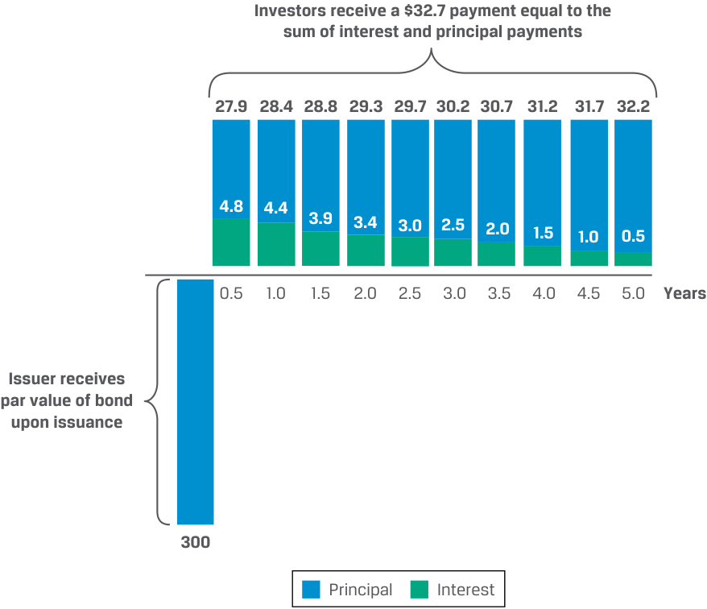
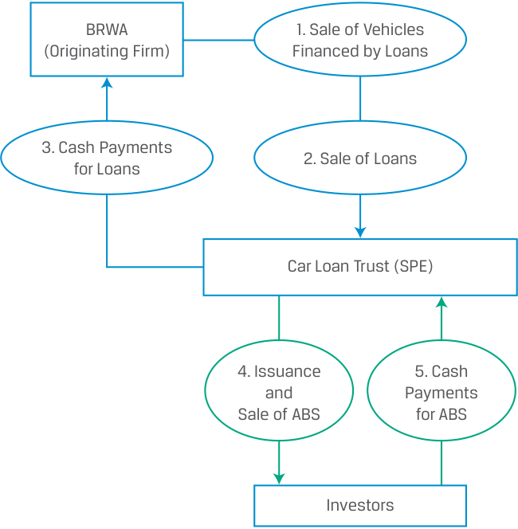
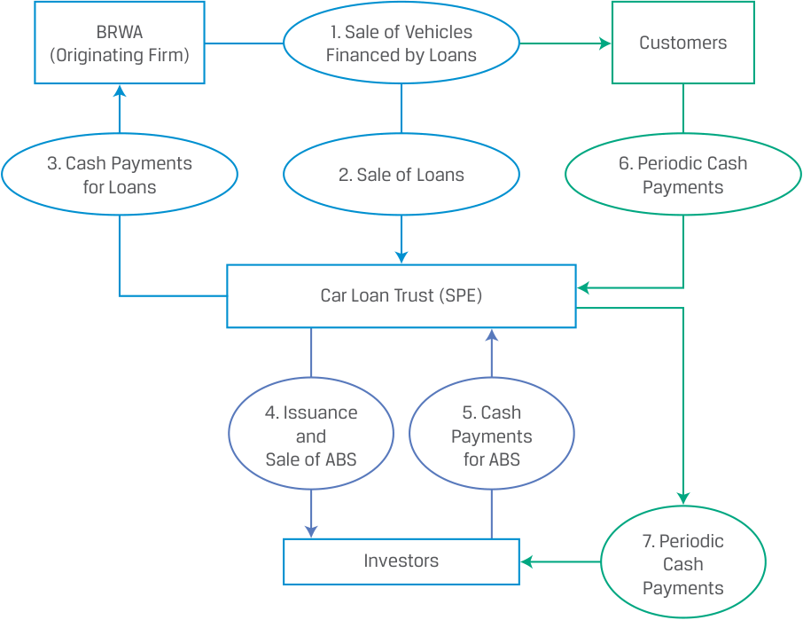
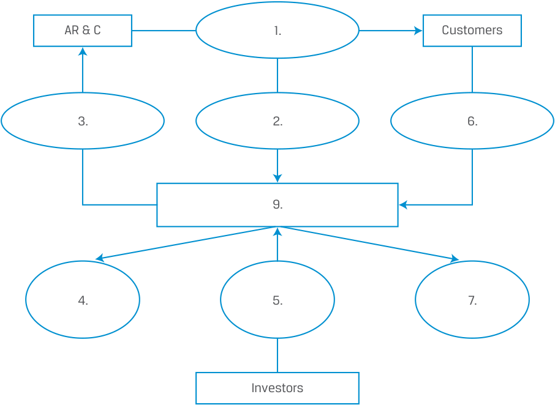
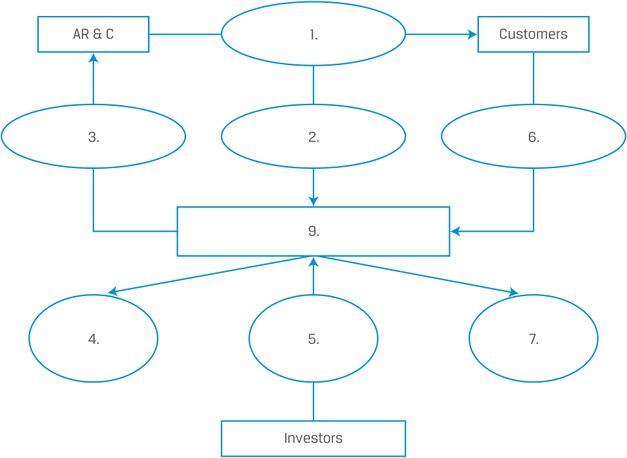

# Tập 6: Chứng khoán Thu nhập Cố định (Fixed Income)
## Learning Module 17 Fixed-Income Securitization (Trang PDF 453–474)

---

# Tập 6: Chứng Khoán Thu Nhập Cố Định (Fixed Income)
## Học phần 17: Chứng Khoán Hóa Thu Nhập Cố Định (Fixed-Income Securitization)
### Phần 1/2: Giới thiệu (Trang PDF 453–461)

---

<!-- PDF Page 453 -->

# H Ọ C P H Ầ N **<mark>17</mark>** 

### **Chứng Khoán Hóa Thu Nhập Cố Định (Fixed-Income Securitization)** 

##### **<mark>MỤC TIÊU HỌC TẬP (LEARNING OUTCOMES)</mark>** 

**_Mức độ thành thạo – Ứng viên cần có khả năng:_**
- Giải thích lợi ích của chứng khoán hóa (*securitization*) đối với tổ chức phát hành (*issuers*), nhà đầu tư (*investors*), nền kinh tế và các thị trường tài chính.
- Mô tả quy trình chứng khoán hóa, bao gồm các bên tham gia và vai trò của họ.

#### **GIỚI THIỆU (INTRODUCTION)** 

## **<mark>1</mark>** 

**Chứng khoán đảm bảo bằng tài sản (*Asset-backed securities* – ABS)** là các chứng khoán được đảm bảo và hoàn trả từ một nhóm tập hợp (*pooled group*) các khoản vay hoặc khoản phải thu (*loans or receivables*). Việc tạo ra các chứng khoán được hoàn trả từ các loại khoản vay hoặc khoản phải thu cụ thể giúp chuyển giao rủi ro, mang lại sự linh hoạt cho tổ chức phát hành và nhà đầu tư, đồng thời phân bổ vốn một cách hiệu quả. Trong một giao dịch chứng khoán hóa, dòng tiền từ một danh mục tài sản được chỉ định sẽ được phân phối lại bởi một tổ chức phát hành có mục đích đặc biệt (*special purpose issuer*) để thanh toán tiền lãi và nợ gốc cho các nhà đầu tư theo một phương thức đã được xác định trước. Do đó, các giao dịch ABS tạo ra một cấu trúc phân tầng thứ bậc ưu tiên (*subordination structure*) hoàn toàn mới trên danh mục tài sản được chỉ định. Chứng khoán hóa diễn ra trên khắp thế giới — tại châu Mỹ, châu Á và châu Âu. Học phần đầu tiên trong chuỗi ba Học phần về Thu nhập Cố định này mô tả những lợi ích của chứng khoán hóa, quy trình chứng khoán hóa và các cấu trúc chứng khoán hóa điển hình.

###### **TỔNG QUAN HỌC PHẦN (LEARNING MODULE OVERVIEW)** 

- Chứng khoán hóa mang lại lợi ích cho nhà đầu tư thông qua việc phân phối lại rủi ro thanh toán, nâng cao khả năng dự báo của các khoản thanh toán, giảm thiểu tác động của những thay đổi bất ngờ trong mô hình thanh toán (chẳng hạn như vỡ nợ (*defaults*), trả nợ trước hạn (*prepayments*) hoặc gia hạn thanh toán (*payment extensions*)), giúp nhà đầu tư kết hợp phù hợp nhu cầu về rủi ro, tỷ suất sinh lợi và kỳ hạn, đồng thời giảm thiểu rủi ro thông qua các biện pháp tăng cường tín dụng (*credit enhancements*) khác nhau.

- Chứng khoán hóa cho phép các tổ chức phát hành hoạt động hiệu quả hơn trên cơ sở điều chỉnh theo rủi ro (*risk-adjusted basis*) bằng cách loại bỏ tài sản và rủi ro cho vay khỏi bảng cân đối kế toán của họ (từ đó làm giảm đòn bẩy tài chính), mở rộng năng lực khởi tạo khoản vay (*originate loans*) và tiếp cận chi phí huy động vốn thấp hơn.

- Chứng khoán hóa nâng cao tính hiệu quả của thị trường tài chính, cải thiện thanh khoản tổng thể trong hệ thống tài chính và giảm thiểu rủi ro thanh khoản (*liquidity risk*).

<!-- PDF Page 454 -->

- Nhiều bên tham gia vào một giao dịch chứng khoán hóa, bao gồm các tổ chức phát hành doanh nghiệp ban đầu của các tài sản (ví dụ: các khoản vay, khoản phải thu, hợp đồng thuê hoặc khoản nợ) sẽ được chứng khoán hóa; một **pháp nhân có mục đích đặc biệt (*Special Purpose Entity* – SPE)** được thành lập để mua/sở hữu các tài sản doanh nghiệp này, tạo ra các tài sản mới từ chúng và bán các tài sản mới đó cho nhà đầu tư; **tổ chức quản lý dịch vụ thu hộ khoản vay (*servicer*)** của các khoản vay hoặc khoản nợ cơ sở; và các tổ chức (bên thứ ba) khác (ví dụ: kế toán viên, luật sư và tổ chức bảo lãnh phát hành (*underwriters*)).

- Khi một tổ chức phát hành ban đầu quyết định chứng khoán hóa tài sản, trước tiên họ thành lập một SPE để bán tài sản cho pháp nhân đó. Sau đó, SPE phát hành và bán cho các nhà đầu tư các chứng khoán được đảm bảo bằng những tài sản này. Các khoản thanh toán lãi và gốc từ các tài sản cơ sở được sử dụng để chi trả cho các nhà đầu tư nắm giữ chứng khoán mới.

- Cấu trúc pháp nhân độc lập của SPE được thiết kế nhằm bảo vệ các tài sản cơ sở khỏi bất kỳ quyền đòi nợ nào từ các chủ nợ của tổ chức phát hành trong trường hợp tổ chức phát hành rơi vào tình trạng kiệt quệ tài chính (*financial distress*). Tuy nhiên, các nhà đầu tư ABS cần đánh giá các khía cạnh pháp lý tại khu vực tài phán thực tế nơi họ mua ABS, vì khuôn khổ pháp lý có sự khác biệt giữa các quốc gia.

###### **TỰ ĐÁNH GIÁ HỌC PHẦN (LEARNING MODULE SELF-ASSESSMENT)** 

Các câu hỏi ban đầu này nhằm giúp bạn tự đánh giá mức độ hiểu biết hiện tại của mình về học phần này.

1. Loại chứng khoán đảm bảo bằng tài sản (*Asset-backed securities* – ABS) nào sau đây là _phức tạp nhất_?

   - **A.** Trái phiếu có bảo đảm (*Covered bonds*)

   - **B.** Chứng khoán chuyển tiếp dòng tiền (*Pass-through securities*)

   - **C.** Nghĩa vụ nợ thế chấp có tài sản đảm bảo (*Collateralized mortgage obligations* – CMO)

   - **Lời giải (Solution)**

C là đáp án đúng. Nghĩa vụ nợ thế chấp có tài sản đảm bảo (*Collateralized mortgage obligations* – CMO) nâng cao khả năng dự báo của mô hình thanh toán ở chứng khoán chuyển tiếp dòng tiền (*pass-through securities*) bằng cách phân phối lại dòng tiền trong danh mục qua các phần/lớp chứng khoán (*tranches*) khác nhau theo một lịch trình thiết lập trước. A không đúng vì trái phiếu có bảo đảm (*covered bonds*) là cấu trúc chứng khoán hóa đơn giản nhất. Tổ chức phát hành tách biệt (nhưng vẫn giữ lại) các khoản vay/tài sản cơ sở và sau đó sử dụng các khoản vay/tài sản được tách biệt đó làm tài sản thế chấp (*collateral*) cho các trái phiếu có bảo đảm mà họ phát hành. B không đúng vì chứng khoán chuyển tiếp dòng tiền (*pass-through securities*), mặc dù là chứng khoán hóa thực sự (nghĩa là danh mục tài sản được loại bỏ khỏi bảng cân đối kế toán và chuyển giao sang một pháp nhân độc lập và tách biệt), vẫn không phức tạp bằng nghĩa vụ nợ thế chấp có tài sản đảm bảo (CMO).

2. Tài liệu pháp lý nào sau đây trong quy trình chứng khoán hóa mô tả cấu trúc của giao dịch chứng khoán hóa, bao gồm thứ tự ưu tiên thanh toán (*priority of payments*) và các biện pháp tăng cường tín dụng (*credit enhancements*) sẽ được sử dụng?

   - **A.** Bản cáo bạch (*Prospectus*)

   - **B.** Trái phiếu/kỳ phiếu do SPE phát hành (*Notes issued by the SPE*)

   - **C.** Hợp đồng mua bán (*Purchase agreement*) giữa bên bán tài sản thế chấp và SPE

   - **Lời giải (Solution)**

Đáp án đúng là A. Bản cáo bạch (*prospectus*) mô tả cấu trúc của giao dịch chứng khoán hóa, bao gồm thứ tự ưu tiên và số tiền thanh toán sẽ được chi trả cho tổ chức quản lý dịch vụ thu hộ (*servicer*), các nhà quản trị (*administrators*), và những người nắm giữ ABS, cũng như các biện pháp tăng cường tín dụng được sử dụng trong giao dịch chứng khoán hóa. B không đúng vì các trái phiếu/kỳ phiếu do SPE phát hành chính là các chứng khoán đảm bảo bằng tài sản (ABS) thực tế, chứ không phải là tài liệu pháp lý

<!-- PDF Page 455 -->

hỗ trợ cho quy trình chứng khoán hóa. C không đúng vì hợp đồng mua bán (*purchase agreement*) giữa bên bán tài sản thế chấp và SPE nêu rõ các cam đoan và bảo đảm (*representations and warranties*) mà bên bán đưa ra về các tài sản được bán.

3. Xác định vai trò tương ứng với từng bên tham gia sau đây trong một giao dịch chứng khoán hóa:

| Bên tham gia | Vai trò |
|---|---|
| 1. Bên bán (*Seller*) | A. Pháp nhân phát hành ABS |
| 2. Tổ chức quản lý dịch vụ thu hộ (*Servicer*) | B. Pháp nhân mong muốn tăng thanh khoản, giảm chi phí huy động vốn và hoạt động hiệu quả hơn trên cơ sở điều chỉnh theo rủi ro |
| 3. Pháp nhân có mục đích đặc biệt (*SPE*) | C. Pháp nhân thu tiền thanh toán từ những người đi vay |

###### **Lời giải (Solution)** 

   **1.** B là đáp án đúng. Bằng cách loại bỏ tài sản và rủi ro cho vay khỏi bảng cân đối kế toán, bên bán (*seller*) có thể hoạt động hiệu quả hơn trên cơ sở điều chỉnh theo rủi ro. Đồng thời, bằng cách bán tài sản cho một SPE, các nhà đầu tư có thể dựa vào rủi ro vỡ nợ gắn liền với việc thu tiền thanh toán từ khách hàng, thay vì chất lượng tín dụng và rủi ro vỡ nợ của chính bên bán. Kết quả là, xét trên tổng thể, chi phí huy động vốn của một giao dịch chứng khoán hóa có thể thấp hơn so với việc phát hành trái phiếu doanh nghiệp.

   **2.** C là đáp án đúng. Dịch vụ quản lý khoản vay (*loan servicing*) đề cập đến việc quản trị mọi khía cạnh của khoản vay, bao gồm thu tiền thanh toán từ người đi vay, thông báo cho những người đi vay có thể bị quá hạn thanh toán (*delinquent*), cũng như thu hồi và thanh lý tài sản cơ sở nếu người đi vay không thực hiện thanh toán theo đúng lịch trình.

   **3.** A là đáp án đúng. SPE mua lại các tài sản từ bên bán và sau đó phát hành cũng như bán ABS được đảm bảo bằng danh mục tài sản đã được chứng khoán hóa.

4. Xác định lợi ích của chứng khoán hóa tương ứng gần nhất với từng bên sau đây: (A. Nền kinh tế và Thị trường Tài chính (*Economies and Financial Markets*), B. Tổ chức phát hành (*Issuers*), C. Nhà đầu tư (*Investors*)):

| Mô tả lợi ích |
|---|
| 1. Bằng cách loại bỏ tài sản và rủi ro cho vay khỏi bảng cân đối kế toán, _________ có thể hoạt động hiệu quả hơn trên cơ sở điều chỉnh theo rủi ro. Cuối cùng, chứng khoán hóa cho phép ___________ mở rộng hoạt động khởi tạo cho vay vượt ra ngoài quy mô bảng cân đối kế toán của họ. |
| 2. Chứng khoán hóa cho phép __________ tùy chỉnh mức độ tiếp xúc rủi ro lãi suất và rủi ro tín dụng sao cho phù hợp với nhu cầu cụ thể về rủi ro, tỷ suất sinh lợi và kỳ hạn của họ. |
| 3. Chứng khoán hóa tạo ra các chứng khoán có thể giao dịch với tính thanh khoản cao hơn so với tài sản gốc ban đầu, qua đó làm cho ___________ hiệu quả hơn, cải thiện thanh khoản tổng thể và giảm thiểu rủi ro thanh khoản. |

###### **Lời giải (Solution)** 

<!-- PDF Page 456 -->

<!-- Picture Text: 1. By removing assets and lending risks from their bal- B. Issuers ance sheet, _________ can operate more efficiently on a risk adjusted basis. Ultimately, securitization enables ___________ to expand lending origination beyond their balance sheets. 2. Securitization allows __________ to tailor interest rate  C. Investors and credit risk exposures to suit their specific risk, return, and maturity needs. 3. Securitization creates tradable securities with higher  A. Economies and liquidity than that of the original, thereby making  Financial Markets ___________ more efficient, improving overall liquidity and reducing liquidity risk  -->

> **Chú thích hình ảnh:**
> 1. Bằng cách loại bỏ tài sản và rủi ro cho vay khỏi bảng cân đối kế toán... → **B. Tổ chức phát hành (*Issuers*)**
> 2. Chứng khoán hóa cho phép tùy chỉnh mức độ tiếp xúc rủi ro lãi suất và rủi ro tín dụng... → **C. Nhà đầu tư (*Investors*)**
> 3. Chứng khoán hóa tạo ra các chứng khoán có thể giao dịch với tính thanh khoản cao hơn... → **A. Nền kinh tế và Thị trường Tài chính (*Economies and Financial Markets*)**

**1.** B là đáp án đúng. Bằng cách loại bỏ tài sản và rủi ro cho vay khỏi bảng cân đối kế toán, _các tổ chức phát hành (issuers)_ có thể hoạt động hiệu quả hơn trên cơ sở điều chỉnh theo rủi ro. Cuối cùng, chứng khoán hóa cho phép _các tổ chức phát hành_ mở rộng hoạt động khởi tạo cho vay vượt ra ngoài quy mô bảng cân đối kế toán của họ.

**2.** C là đáp án đúng. Chứng khoán hóa cho phép _các nhà đầu tư (investors)_ tùy chỉnh mức độ tiếp xúc rủi ro lãi suất và rủi ro tín dụng sao cho phù hợp với nhu cầu cụ thể về rủi ro, tỷ suất sinh lợi và kỳ hạn của họ.

**3.** A là đáp án đúng. Chứng khoán hóa tạo ra các chứng khoán có thể giao dịch với tính thanh khoản cao hơn so với tài sản gốc ban đầu, qua đó làm cho _các nền kinh tế và thị trường tài chính (economies and financial markets)_ hiệu quả hơn, cải thiện thanh khoản tổng thể và giảm thiểu rủi ro thanh khoản.

## **<mark>2</mark>** 

#### **LỢI ÍCH CỦA CHỨNG KHOÁN HÓA (THE BENEFITS OF SECURITIZATION)** 

**Mục tiêu học tập:** Giải thích lợi ích của chứng khoán hóa đối với tổ chức phát hành, nhà đầu tư, nền kinh tế và các thị trường tài chính.

Quy trình chứng khoán hóa tập hợp (*pools*) và chuyển giao quyền sở hữu các tài sản tạo ra dòng tiền (*cash flow generating assets*), chẳng hạn như các khoản vay hoặc khoản phải thu, từ bên cho vay ban đầu sang một pháp nhân được thành lập đặc biệt. Danh mục tập hợp các tài sản này được gọi là **tài sản chứng khoán hóa (*securitized assets*)**, hay còn gọi là **danh mục tham chiếu (*reference portfolio*)** hoặc **tài sản thế chấp (*collateral*)**. Đến lượt mình, pháp nhân đó phát hành các chứng khoán được đảm bảo bằng các tài sản tập hợp này cho nhà đầu tư và sử dụng dòng tiền thu được để thanh toán tiền lãi và hoàn trả nợ gốc cho nhà đầu tư. Chứng khoán hóa tạo ra mối liên kết trực tiếp giữa nhà đầu tư và người đi vay đối với nhiều loại khoản vay và khoản phải thu khác nhau, đồng thời mang lại lợi ích cho tổ chức phát hành, nhà đầu tư cũng như các nền kinh tế và thị trường tài chính. Các bước của quy trình chứng khoán hóa được phác thảo trong Bảng minh họa 1 (*Exhibit 1*).

<!-- PDF Page 457 -->

###### **Bảng minh họa 1: Quy trình Chứng khoán hóa (Exhibit 1: The Securitization Process)** 

<!-- Picture Text: Pooled assets Original source with similar Special purpose Asset-backed ABS investors of assets features entity (SPE) securities (ABS) Asset transfer from originator to SPE SPE issues ABS to investors  -->

> **Chú thích hình ảnh:**
> - **Original source of assets**: Nguồn tài sản ban đầu → **Pooled assets with similar features**: Các tài sản có đặc điểm tương đồng được tập hợp lại → *(Chuyển giao tài sản từ tổ chức khởi tạo sang SPE)* → **Special purpose entity (SPE)**: Pháp nhân có mục đích đặc biệt (SPE) → *(SPE phát hành ABS cho nhà đầu tư)* → **Asset-backed securities (ABS)**: Chứng khoán đảm bảo bằng tài sản (ABS) → **ABS investors**: Nhà đầu tư ABS.

Có nhiều loại sản phẩm chứng khoán hóa khác nhau. Theo thứ tự mức độ phức tạp tăng dần, các sản phẩm sau đây là những ví dụ về ABS:

- **Trái phiếu có bảo đảm (*Covered bonds*)** là cấu trúc chứng khoán hóa đơn giản nhất. Các tổ chức phát hành, chủ yếu là các ngân hàng châu Âu, tạo ra một danh mục cụ thể gồm các khoản vay thế chấp trên bảng cân đối kế toán của ngân hàng và tách biệt (*segregate*) nó khỏi các tài sản khác của ngân hàng. Danh mục này sau đó đóng vai trò là tài sản thế chấp ("bảo đảm" – *cover*) cho các trái phiếu do ngân hàng phát hành. Trong trường hợp ngân hàng phát hành vỡ nợ đối với đợt phát hành trái phiếu có bảo đảm, các nhà đầu tư có thể sử dụng tài sản thế chấp cơ sở của danh mục này để nhận thanh toán. Trái phiếu có bảo đảm không được coi là chứng khoán hóa toàn phần (*full securitizations*) bởi vì các tài sản cơ sở không được chuyển giao sang một SPE độc lập tách biệt mà vẫn nằm trên bảng cân đối kế toán của ngân hàng phát hành. Hơn nữa, nhà đầu tư trái phiếu có bảo đảm nhận thanh toán trực tiếp từ ngân hàng chứ không phải từ dòng tiền tạo ra bởi danh mục các khoản vay thế chấp cụ thể đó.

- **Chứng khoán chuyển tiếp dòng tiền (*Pass-through securities*)** là các giao dịch chứng khoán hóa thực sự (*true securitizations*): Danh mục tài sản cụ thể được loại bỏ khỏi bảng cân đối kế toán và chuyển giao sang một pháp nhân độc lập và tách biệt. Pháp nhân đó sau đó phát hành các chứng khoán được đảm bảo bằng các tài sản tập hợp này. Các nhà đầu tư vào những chứng khoán này nhận các khoản thanh toán gốc và lãi từ các tài sản (thường là các khoản vay) trong danh mục khi chúng được "chuyển tiếp" (*passed through*) qua pháp nhân đó. Chứng khoán chuyển tiếp dòng tiền chuyển tiếp các khoản thanh toán theo tỷ lệ tương ứng qua các lớp chứng khoán (*tranches*) khác nhau và phân phối lại rủi ro thanh toán cho các nhà đầu tư đang tìm kiếm các mức độ tiếp xúc rủi ro khác nhau. Các khoản thanh toán mà nhà đầu tư nhận được sẽ biến đổi và phụ thuộc trực tiếp vào rủi ro tín dụng tổng thể của danh mục cũng như mô hình thanh toán.

- **Trái phiếu có tăng cường cấu trúc (*Bonds with structural enhancements*)** nâng cao khả năng dự báo của mô hình thanh toán ở chứng khoán chuyển tiếp dòng tiền bằng cách phân phối lại dòng tiền trong danh mục qua các lớp chứng khoán (*tranches*) được chỉ định theo một lịch trình thiết lập trước. Lịch trình thanh toán cố định này làm giảm thiểu tác động của những thay đổi bất ngờ trong mô hình thanh toán, chẳng hạn như vỡ nợ (*defaults*), trả nợ trước hạn (*prepayments*), hoặc kéo dài thời gian trả nợ (*extended repayment periods*). Ngoài ra, các lớp chứng khoán được phân tầng thứ bậc ưu tiên (*subordinated*), trong đó các lớp cấp thấp hơn (*lower tranches*) gánh chịu rủi ro vỡ nợ và rủi ro thay đổi mô hình trả nợ lớn hơn so với các lớp cấp cao hơn (*higher tranches*). Chúng có thể tiếp tục giảm thiểu và phân phối lại rủi ro tín dụng tiềm ẩn của một danh mục các khoản vay chứng khoán hóa nhiều rủi ro bằng cách bổ sung nhiều hình thức tăng cường tín dụng (*credit enhancements*) khác nhau nhằm giảm hơn nữa rủi ro mà nhà đầu tư phải đối mặt.

- **Chứng khoán đảm bảo bằng thế chấp (*Mortgage-backed securities* – MBS)** là các chứng khoán ABS được đảm bảo bằng một danh mục các khoản vay thế chấp bất động sản (*mortgages*). Đôi khi người ta phân biệt giữa MBS và ABS được đảm bảo bằng các tài sản phi thế chấp (*non-mortgage assets*). Sự phân biệt này rất phổ biến tại Hoa Kỳ và được thể hiện trong Bảng minh họa 2 (*Exhibit 2*).

<!-- PDF Page 458 -->

**Bảng minh họa 2: Chứng khoán chuyển tiếp dòng tiền (Exhibit 2: Pass-Through Securities)** 

<!-- Picture Text: Pass-Through Securities Subgroup Mortgage-backed securities ■ Residential Mortgage-Backed Securities (RMBS) ■ Commercial Mortgage-Backed Securities (CMBS) ■ Collateralized Mortgage Obligation (CMO) Non-Mortgage-backed securities ■ Collateralized Debt Obligation (CDO) ■ Collateralized Loan Obligation (CLO) ■ Collateralized Bond Obligation (CBO) ■ Collateralized Debt Obligation Squared (CDO Squared)  -->

> **Chú thích hình ảnh:**
> - **Pass-Through Securities (Chứng khoán chuyển tiếp dòng tiền)** vs. **Subgroup (Phân nhóm)**:
>   - **Mortgage-backed securities (Chứng khoán đảm bảo bằng thế chấp – MBS)**:
>     - Chứng khoán đảm bảo bằng thế chấp nhà ở (*Residential Mortgage-Backed Securities* – RMBS)
>     - Chứng khoán đảm bảo bằng thế chấp thương mại (*Commercial Mortgage-Backed Securities* – CMBS)
>     - Nghĩa vụ nợ thế chấp có tài sản đảm bảo (*Collateralized Mortgage Obligation* – CMO)
>   - **Non-Mortgage-backed securities (Chứng khoán đảm bảo bằng tài sản phi thế chấp)**:
>     - Nghĩa vụ nợ có tài sản đảm bảo (*Collateralized Debt Obligation* – CDO)
>     - Nghĩa vụ khoản vay có tài sản đảm bảo (*Collateralized Loan Obligation* – CLO)
>     - Nghĩa vụ trái phiếu có tài sản đảm bảo (*Collateralized Bond Obligation* – CBO)
>     - Nghĩa vụ nợ có tài sản đảm bảo bậc hai (*Collateralized Debt Obligation Squared* – CDO Squared)

**Bảng minh họa 3: Cấu trúc Chứng khoán hóa và Dòng tiền của các Lớp chứng khoán (Exhibit 3: Securitization Structure and Tranche Cash Flows)** 

<!-- Picture Text: Bonds with Structural Enhancements Example—SPV (Trust) Assets Many Assets ($100) (purchased by SPV) Yield = MRR + 250 Cash flows Liabilities Aaa/AAA Senior ($70) (securities issued by SPV) MRR + 40 Baa/BBB Mezzanine ($20) MRR + 250 Residual cash Equity ($10) flows  -->

> **Chú thích hình ảnh:**
> - **Bonds with Structural Enhancements (Trái phiếu có tăng cường cấu trúc) — Ví dụ: SPV (Quỹ tín thác – Trust)**:
>   - **Tài sản (Assets – được mua bởi SPV)**: Nhiều tài sản (\$100), Lợi suất (*Yield*) = MRR + 250 bps → *Dòng tiền (Cash flows)* →
>   - **Nợ phải trả (Liabilities – chứng khoán phát hành bởi SPV)**:
>     - Lớp ưu tiên cấp cao (*Senior* – \$70): Xếp hạng Aaa/AAA, lãi suất MRR + 40 bps
>     - Lớp trung gian (*Mezzanine* – \$20): Xếp hạng Baa/BBB, lãi suất MRR + 250 bps
>     - Lớp vốn cổ phần (*Equity* – \$10): Hưởng dòng tiền còn lại (*Residual cash flows*)

**Sự phân tầng thứ bậc ưu tiên (*Subordination*)**, hay **phân lớp chứng khoán (*tranching*)**, trong giao dịch chứng khoán hóa bao gồm việc tạo ra nhiều hơn một hạng trái phiếu (*bond class*) hay lớp chứng khoán (*tranche*), và các hạng trái phiếu này khác nhau ở cách thức chúng nhận dòng tiền từ danh mục tài sản cơ sở. Các hạng trái phiếu được phân loại thành các hạng trái phiếu cấp cao (*senior bond classes*) hoặc các hạng trái phiếu cấp thấp (*subordinated bond classes*), và cấu trúc này còn được gọi là **cấu trúc cấp cao/cấp thấp (*senior/subordinated structure*)** như được thấy trong Bảng minh họa 3. Các hạng trái phiếu cấp thấp đôi khi được gọi là "các hạng trái phiếu không ưu tiên (*non-senior bond classes*)" hoặc "các hạng trái phiếu thứ cấp (*junior bond classes*)". Vì tất cả các nhà đầu tư trong một giao dịch chứng khoán hóa đều được thanh toán từ cùng một danh mục dòng tiền cơ sở, nên việc phân lớp chứng khoán (*tranching*) sẽ quy định thứ tự thanh toán cho các nhà đầu tư cũng như thứ tự mà các khoản lỗ được hấp thụ bởi các nhà đầu tư.

##### **Lợi ích đối với Tổ chức phát hành (Benefits to Issuers)** 

Theo truyền thống, các ngân hàng thẩm định và cấp các khoản vay (*underwrite loans*) để cho phép người đi vay tài trợ cho các giao dịch mua sắm và đầu tư trực tiếp khác nhau. Các khoản vay ngân hàng này, vốn thường nằm lại trên bảng cân đối kế toán của ngân hàng cho đến khi được hoàn trả đầy đủ, có tính thanh khoản tương đối thấp (*illiquid*).

Ngân hàng đóng vai trò là trung gian giữa người đi vay và nhà đầu tư. Nếu có thể tách rời hoạt động khởi tạo khoản vay (*loan origination*) khỏi hoạt động tài trợ khoản vay (*loan financing*), ngân hàng có thể cải thiện khả năng sinh lời, thu phí khởi tạo khoản vay (*origination fees*) và giảm yêu cầu vốn pháp định (*capital requirements*) đối với các khoản vay đã được bán cho nhà đầu tư, như thể hiện trong Bảng minh họa 4. Như chúng ta đã tìm hiểu trong ví dụ về thương phiếu đảm bảo bằng tài sản (*Asset-backed commercial paper* – ABCP) ở học phần trước, bằng cách loại bỏ tài sản và rủi ro cho vay

<!-- PDF Page 459 -->

khỏi bảng cân đối kế toán của mình, các ngân hàng bán đi những tài sản kém thanh khoản và hoạt động hiệu quả hơn trên cơ sở điều chỉnh theo rủi ro. Việc bán tài sản cũng tạo ra thu nhập từ phí (*fee income*). Cuối cùng, chứng khoán hóa cho phép các ngân hàng mở rộng hoạt động khởi tạo cho vay vượt ra ngoài quy mô bảng cân đối kế toán của mình.

**Bảng minh họa 4: Ngân hàng và Chứng khoán hóa (Exhibit 4: Banks and Securitization)** 

<!-- Picture Text: Bank Special Purpose Entity Assets Liabilities Assets Liabilities Investors pay cash Cash Deposits for the ABS Loans Debt Loans ABS issued issued by the SPE Oth er assets Equity Bank sells loans to the Special Purpose Entity and receives cash  -->

> **Chú thích hình ảnh:**
> - **Ngân hàng (Bank)**: Tài sản (*Assets*: Tiền mặt – *Cash*, Khoản vay – *Loans*, Tài sản khác – *Other assets*) | Nguồn vốn (*Liabilities*: Tiền gửi – *Deposits*, Nợ – *Debt*, Vốn chủ sở hữu – *Equity*).
> - *(Ngân hàng bán các khoản vay cho Pháp nhân có mục đích đặc biệt (SPE) và nhận tiền mặt)*
> - **Pháp nhân có mục đích đặc biệt (Special Purpose Entity – SPE)**: Tài sản (*Assets*: Các khoản vay – *Loans*) | Nợ phải trả (*Liabilities*: ABS được phát hành – *ABS issued*).
> - *(Các nhà đầu tư trả tiền mặt để mua ABS do SPE phát hành)*

Nếu không có ABS làm công cụ đầu tư, các nhà đầu tư muốn tiếp xúc với các khoản nợ tư nhân sẽ phải trực tiếp thẩm định và cấp khoản vay, nắm giữ một sự kết hợp nào đó giữa nợ ngân hàng và cổ phiếu phổ thông của ngân hàng, hoặc mua đứt các khoản vay trực tiếp từ ngân hàng. Việc trực tiếp thẩm định cho vay đòi hỏi các kỹ năng chuyên môn về đánh giá tín dụng, khởi tạo, thẩm định bảo lãnh và quản lý dịch vụ thu hộ khoản vay, đồng thời phải gánh chịu các chi phí hoạt động và rủi ro kinh doanh của ngành ngân hàng. Đầu tư vào ABS giúp phân tách phạm vi rộng lớn các kỹ năng và rủi ro này, rồi phân phối lại chúng cho các bên phù hợp.

##### **Lợi ích đối với Nhà đầu tư (Benefits to Investors)** 

Chứng khoán hóa cung cấp một kênh dẫn truyền trực tiếp (*direct conduit*) giữa người đi vay và nhà đầu tư, cho phép nhà đầu tư tùy chỉnh mức độ tiếp xúc rủi ro lãi suất và rủi ro tín dụng sao cho phù hợp với nhu cầu cụ thể về rủi ro, tỷ suất sinh lợi và kỳ hạn của họ. Các giao dịch chứng khoán hóa cho phép tổ chức phát hành thiết kế các đặc tính rủi ro – tỷ suất sinh lợi nhằm đáp ứng mức độ chấp nhận rủi ro (*risk tolerance*) của các nhà đầu tư.

Mặc dù rất ít nhà đầu tư tổ chức hoặc cá nhân có đủ nguồn lực chuyên biệt và chuyên môn cần thiết để khởi tạo, giám sát và thu hồi các khoản thanh toán từ các khoản vay và khoản phải thu cơ sở, nhưng nhiều nhà đầu tư có thể đầu tư vào các chứng khoán được đảm bảo bằng các khoản vay hoặc khoản phải thu đó. Các chứng khoán ABS được tạo ra bằng cách tập hợp các khoản vay và khoản phải thu này có những đặc điểm tương tự như một trái phiếu tiêu chuẩn.

Ví dụ, một quỹ hưu trí (*pension fund*) với tầm nhìn đầu tư dài hạn có thể sử dụng nợ chứng khoán hóa để đạt được tỷ suất sinh lợi cao hơn, khớp kỳ hạn tài sản với các ngày chi trả nghĩa vụ nợ dự kiến, và tăng tính đa dạng hóa trong danh mục tài sản của mình trong khi vẫn duy trì quyền chọn điều chỉnh danh mục nắm giữ một cách nhanh chóng và tiết kiệm chi phí. Do đó, việc nắm giữ nợ chứng khoán hóa giúp các nhà đầu tư quỹ hưu trí gia tăng mức độ tiếp xúc với các đặc tính rủi ro – tỷ suất sinh lợi của một phạm vi tài sản cơ sở rộng lớn hơn.

###### **VÍ DỤ 1 (EXAMPLE 1)** 

##### **Lợi ích của Nợ Chứng khoán hóa đối với Nhà đầu tư Dài hạn (Benefits of Securitized Debt for Long-term Investors)** 

Pawas Singhvi, nhà quản lý đầu tư cho một quỹ hưu trí có mức hưởng xác định (*defined benefit pension fund*) tại một công ty sản xuất lớn, đang thảo luận về các lựa chọn và kỳ vọng đầu tư với một cộng sự mới, Kevin Epstein. Epstein hỏi tại sao Singhvi lại nắm giữ một tỷ trọng đáng kể tài sản của quỹ dưới dạng nợ chứng khoán hóa. Singhvi giải thích rằng có một số tham số và kỳ vọng ảnh hưởng đến các khoản đầu tư được lựa chọn cho quỹ hưu trí, bắt đầu từ việc đa dạng hóa tài sản và thu nhập. Quỹ tìm kiếm các tài sản và dòng thu nhập an toàn, đa dạng hóa với mức rủi ro thấp. Các khoản chi trả lương hưu dự kiến hoặc dòng tiền chi ra

<!-- PDF Page 460 -->

từ quỹ thúc đẩy nhu cầu đối với các khoản đầu tư có tính thanh khoản cao và ổn định, có kỳ hạn đáo hạn hoặc có thể bán đi dễ dàng để khớp với thời điểm của các dòng tiền chi ra bắt buộc. Bất kỳ khoản đầu tư nào của quỹ cũng phải có xếp hạng tín nhiệm cao (*highly rated*).

Bởi vì các khoản chi trả lương hưu diễn ra trong nhiều năm tới trong tương lai, nên tài sản của quỹ hưu trí cũng phải được đầu tư trong dài hạn. Và tài sản của quỹ phải tăng trưởng theo thời gian để tạo ra các khoản chi trả lương hưu đã cam kết ở mức độ yêu cầu trong tương lai. Mặc dù nợ công do chính phủ phát hành có xếp hạng tín nhiệm cao và thường an toàn, nhưng chỉ riêng công cụ này có thể không tạo ra đủ tỷ suất sinh lợi để đáp ứng các nghĩa vụ trong tương lai. Ngược lại, việc nắm giữ nợ chứng khoán hóa thuộc nhóm đầu tư (*investment-grade*), được giao dịch công khai và có thể mua bán trên thị trường, cho phép chúng ta thu được tỷ suất sinh lợi cao hơn và phản ứng nhanh chóng trước những thay đổi trong tâm lý thị trường, mức độ nhạy cảm với rủi ro, hoặc nhu cầu thanh toán với chi phí giao dịch thấp.

##### **Lợi ích đối với Nền kinh tế và Thị trường Tài chính (Benefits to Economies and Financial Markets)** 

Chứng khoán hóa tạo ra các chứng khoán có thể giao dịch với tính thanh khoản cao hơn so với các khoản vay gốc ban đầu nằm trên bảng cân đối kế toán của ngân hàng, và việc giao dịch chứng khoán trên thị trường thứ cấp cho phép các nhà đầu tư xác định mức giá cân bằng (*equilibrium prices*) — qua đó làm cho các thị trường tài chính trở nên hiệu quả hơn. Chứng khoán hóa cũng cải thiện thanh khoản tổng thể trong hệ thống tài chính và làm giảm rủi ro thanh khoản.

Một lợi ích quan trọng của chứng khoán hóa là nó cung cấp một phương thức thay thế để tài trợ cho các hoạt động kinh doanh ngoài các công cụ tài trợ truyền thống như trái phiếu, cổ phiếu ưu đãi và cổ phiếu phổ thông. Các công ty có thể sử dụng chứng khoán hóa để giảm chi phí huy động vốn bằng cách tập hợp các tài sản có thể chứng khoán hóa (thường là các khoản phải thu và khoản vay), giúp làm tăng tỷ suất sinh lợi trên vốn (*return on capital*) so với việc đi vay thông qua các phương thức tài trợ truyền thống.

Chứng khoán hóa mang lại lợi ích cho các thị trường tài chính. Các tổ chức phát hành doanh nghiệp có thể thúc đẩy quá trình bán sản phẩm của mình bằng cách cấp tín dụng cho khách hàng, thường là thông qua công ty con tài chính (*financing subsidiary*) của họ. Các công ty con này chuyên về tài trợ và cho thuê tài chính (*leasing*) và thường phát hành phần lớn nợ hợp nhất của tập đoàn, bán các khoản phải thu cho một ngân hàng hoặc bán trực tiếp cho một SPE. Sau đó, công ty có thể chứng khoán hóa các khoản vay này, nhận tiền mặt từ SPE — tổ chức sau đó sẽ bán chứng khoán cho các nhà đầu tư. Một công ty có thể sử dụng số tiền thu được này để cấp vốn tài trợ cho các khách hàng mới và bán được nhiều sản phẩm hơn nữa. Nếu thay vào đó công ty giữ lại các khoản vay cấp cho khách hàng này trên bảng cân đối kế toán của chính mình, họ sẽ phải phát hành thêm nợ. Điều đó sẽ làm tăng đòn bẩy tài chính, làm tăng tổng chi phí tài trợ và huy động vốn, đồng thời làm giảm chất lượng tín dụng của công ty. Việc chứng khoán hóa các khoản vay mua sản phẩm cho phép các công ty tiếp cận trực tiếp các thị trường tài chính và đưa các khoản vay ra khỏi bảng cân đối kế toán. Nhờ vậy, họ có thể nắm bắt được lợi ích của một nguồn huy động vốn rẻ hơn mà không làm giảm chất lượng tín dụng tổng thể của công ty.

Các giao dịch chứng khoán hóa có thể liên quan đến bất kỳ số lượng tài sản tạo doanh thu nào thuộc sở hữu của các công ty từ nhiều ngành công nghiệp khác nhau. Chứng khoán hóa mang lại hiệu quả cho toàn bộ hệ thống, đem lại lợi ích cho nhiều bên. Các nhà sản xuất có thể thuê ngoài (*outsource*) dịch vụ quản lý thu hồi nợ, người tiêu dùng được hưởng lợi từ chi phí giảm xuống, và các nhà đầu tư được hưởng lợi từ các cơ hội đầu tư đa dạng hóa. Dưới đây là một số ví dụ thú vị về chứng khoán hóa.

###### **VÍ DỤ 2 (EXAMPLE 2)** 

##### **Các Ví dụ về Chứng khoán hóa (Examples of Securitizations)** 

Các trái phiếu/kỳ phiếu được chứng khoán hóa bằng tiền bản quyền âm nhạc (*music royalties*) và các hợp đồng cấp phép (*licensing agreements* – cho phép những nơi như nhà hàng hoặc cửa hàng bán lẻ phát nhạc đại chúng) đã được phát hành. Năm 2019, công ty quản lý quyền biểu diễn SESAC đã phát hành trái phiếu chứng khoán hóa được đảm bảo bằng tiền bản quyền âm nhạc và các hợp đồng cấp phép của mình với hơn 30.000 nghệ sĩ, bao gồm Adele, Bob Dylan, Kesha, Gabriel Mann và R.E.M. Phần lớn nhất của giao dịch chứng khoán hóa này là một kỳ phiếu lãi suất cố định (*fixed-rate note*), trị giá 530 triệu USD với thời gian đáo hạn bình quân gia quyền

<!-- PDF Page 461 -->

(*weighted average life*) là 6,7 năm. Kỳ phiếu này mang lại mức lợi suất 5,25%. Phần nhỏ hơn của thương vụ là một kỳ phiếu lãi suất thả nổi (*floating-rate note*), trị giá 30 triệu USD với thời gian đáo hạn bình quân gia quyền là 4,9 năm, không được chào bán ra công chúng. Loại hình chào bán này được gọi là **"chứng khoán hóa toàn bộ hoạt động kinh doanh" (*whole-business securitization*)**. Loại trái phiếu này thường được đảm bảo bằng các tài sản như hợp đồng nhượng quyền thương mại nhà hàng (*restaurant franchise agreements*) hoặc các tài sản đặc thù khác và thường trả lãi suất cao hơn so với các chứng khoán ABS truyền thống gắn liền với nợ tiêu dùng.

Năm 2021, Yum! Brands, công ty mẹ của các chuỗi thức ăn nhanh như KFC, Pizza Hut và Taco Bell, đã phát hành 2,3 tỷ USD kỳ phiếu được chứng khoán hóa bằng dòng tiền từ các cửa hàng Taco Bell nhượng quyền thông qua một công ty con có mục đích đặc biệt là Taco Bell Funding.

Mặc dù chứng khoán hóa mang lại nhiều lợi ích cho nền kinh tế, nhưng nó không phải là không có rủi ro. Nhìn chung, những rủi ro này rơi vào hai nhóm chính: các rủi ro liên quan chủ yếu đến thời điểm nhận dòng tiền của ABS, chẳng hạn như **rủi ro thu hẹp kỳ hạn (*contraction risk*)** và **rủi ro kéo dài kỳ hạn (*extension risk*)**, và các rủi ro liên quan đến rủi ro tín dụng vốn có của các khoản vay và khoản phải thu đảm bảo cho ABS. Các học phần sau sẽ đề cập đến cách thức các cấu trúc chứng khoán hóa giảm thiểu những rủi ro này. Một số rủi ro trong số này được cho là nguyên nhân rộng khắp đã châm ngòi cho sự hỗn loạn trên các thị trường tài chính trong giai đoạn 2007–2009.

###### **BỘ CÂU HỎI (QUESTION SET)** 

1. Xác định ba lợi ích của chứng khoán hóa đối với các tổ chức phát hành ABS.

   **Lời giải (Solution)**

   **1.** Bằng cách loại bỏ tài sản và rủi ro cho vay khỏi bảng cân đối kế toán, các ngân hàng có thể bán đi các tài sản kém thanh khoản và _hoạt động hiệu quả hơn_ trên cơ sở điều chỉnh theo rủi ro.

   **2.** Việc bán tài sản cũng _tạo ra thu nhập từ phí (fee income)_.

   **3.** Cuối cùng, chứng khoán hóa cho phép các ngân hàng _mở rộng hoạt động khởi tạo cho vay vượt ra ngoài quy mô bảng cân đối kế toán của họ_.

2. Xác định hai lợi ích của chứng khoán hóa đối với các nhà đầu tư.

   **Lời giải (Solution)**

   **1.** Chứng khoán hóa cho phép các nhà đầu tư tùy chỉnh mức độ tiếp xúc rủi ro lãi suất và rủi ro tín dụng sao cho phù hợp với nhu cầu cụ thể về rủi ro, tỷ suất sinh lợi và kỳ hạn của họ.

   **2.** Chứng khoán hóa cho phép các nhà đầu tư tiếp cận một phạm vi rộng hơn các tài sản có tương quan không hoàn hảo (*imperfectly correlated assets*) để xây dựng các danh mục đầu tư hiệu quả và đa dạng hóa hơn.

3. Việc khớp kỳ hạn của tài sản với các ngày chi trả nghĩa vụ nợ dự kiến và tăng tính đa dạng hóa trong danh mục tài sản trong khi vẫn duy trì quyền chọn điều chỉnh danh mục nắm giữ một cách nhanh chóng và tiết kiệm chi phí _nhiều khả năng nhất_ là một lợi ích đối với:

   - **A.** các tổ chức phát hành (*issuers*).

   - **B.** các nhà đầu tư (*investors*).

   - **C.** các nền kinh tế và thị trường tài chính (*economies and financial markets*).

   - **Lời giải (Solution)**

Đáp án đúng là B. Việc khớp kỳ hạn của tài sản với các ngày chi trả nghĩa vụ nợ dự kiến và tăng tính đa dạng hóa trong danh mục tài sản trong khi vẫn duy trì quyền chọn điều chỉnh danh mục nắm giữ một cách nhanh chóng và tiết kiệm chi phí nhiều khả năng nhất là một lợi ích đối với các nhà đầu tư. Ví dụ, một quỹ hưu trí có tầm nhìn đầu tư dài hạn có thể sử dụng lợi ích từ nợ chứng khoán hóa để đạt được tỷ suất sinh lợi cao hơn, khớp kỳ hạn tài sản với

---

# Tập 6: Chứng Khoán Thu Nhập Cố Định (Fixed Income)
## Học phần 17: Chứng Khoán Hóa Thu Nhập Cố Định (Fixed-Income Securitization)
### Phần 2/2: Quy Trình Chứng Khoán Hóa (Trang PDF 462–474)

---

<!-- PDF Page 462 -->

các ngày chi trả nghĩa vụ nợ dự kiến, và tăng tính đa dạng hóa trong danh mục tài sản của mình trong khi vẫn duy trì quyền chọn điều chỉnh danh mục nắm giữ một cách nhanh chóng và tiết kiệm chi phí.

4. Xác định xem các sự kiện sau đây liên quan đến một ABS _nhiều khả năng_ dẫn đến một lợi ích (*benefit*) hay một rủi ro (*risk*) và xác định đối tượng chịu tác động (tổ chức phát hành, nhà đầu tư, thị trường tài chính):

| **Sự kiện (Event)** | **Lợi ích hay Rủi ro (Benefit or Risk)** | **Đối với ai (For Whom)** |
|---|---|---|
| A. Thay đổi về thời điểm nhận dòng tiền (*Change in the timing of the cash flows*) | | |
| B. Thay đổi về mức độ tín nhiệm của các khoản vay cơ sở gắn với ABS (*Change in the credit worthiness of the associated ABS loans*) | | |
| C. Bán các tài sản kém thanh khoản (*Selling illiquid assets*) | | |
| D. Chứng khoán hóa tài sản (*Securitizing assets*) | | |

###### **Lời giải (Solution)** 

| **Sự kiện (Event)** | **Lợi ích hay Rủi ro (Benefit or Risk)** | **Đối với ai (For Whom)** |
|---|---|---|
| A. Thay đổi về thời điểm nhận dòng tiền (*Change in the timing of the cash flows*) | Rủi ro (*Risk*) | **Nhà đầu tư (*Investors*)** – Rủi ro trả nợ trước hạn (*prepayment risk*), tức sự bất định về việc dòng tiền sẽ khác biệt so với lịch trình đã quy định trong hợp đồng vay ban đầu, có thể xảy ra khi lãi suất giảm và người đi vay trả hết một phần hoặc toàn bộ khoản vay sớm hơn hạn, hoặc khi người đi vay gặp khó khăn tài chính và làm chậm tiến độ thanh toán khoản vay của họ. |
| B. Thay đổi về mức độ tín nhiệm của các khoản vay cơ sở gắn với ABS (*Change in the credit worthiness of the associated ABS loans*) | Rủi ro (*Risk*) | **Nhà đầu tư (*Investors*)** – Nếu những người đi vay vỡ nợ đối với khoản vay của họ, thì SPE có thể không đủ khả năng thực hiện các khoản thanh toán tiền mặt cho những người nắm giữ chứng khoán. Mặt khác, nếu mức độ tín nhiệm của người đi vay được cải thiện, cũng không có lợi ích trực tiếp nào tăng thêm cho các nhà đầu tư. |
| C. Bán các tài sản kém thanh khoản (*Selling illiquid assets*) | Lợi ích (*Benefit*) | **Tổ chức phát hành (*Issuer*)** |
| D. Chứng khoán hóa tài sản (*Securitizing assets*) | Lợi ích (*Benefit*) | **Tổ chức phát hành, Nhà đầu tư, Thị trường Tài chính (*Issuer, Investors, Financial Markets*)** |

# **<mark>3</mark>** 

#### **QUY TRÌNH CHỨNG KHOÁN HÓA (THE SECURITIZATION PROCESS)** 

**Mục tiêu học tập:** Mô tả quy trình chứng khoán hóa, bao gồm các bên tham gia và vai trò của họ.

<!-- PDF Page 463 -->

Chứng khoán hóa đòi hỏi phải thỏa mãn một số điều kiện pháp lý và quy định quản lý, đồng thời có sự tham gia của nhiều bên để hỗ trợ giao dịch và đảm bảo rằng các điều kiện này được đáp ứng. Phần này mô tả một quy trình chứng khoán hóa điển hình, các bên tham gia và vai trò của họ.

##### **Một Ví dụ về Chứng khoán hóa (An Example of a Securitization)** 

Hãy cùng xem lại Bright Wheel Automotive (BRWA), nhà sản xuất ô tô giả định đã được giới thiệu trước đó. Công ty con tài chính của BRWA cung cấp các khoản vay cho khách hàng của BRWA với chính những chiếc xe đóng vai trò là tài sản thế chấp (*collateral*). Các khoản vay lãi suất cố định này đại diện cho một tài sản của công ty với kỳ hạn trung bình là 4 năm. Chúng là các khoản vay trả góp khấu hao gốc đều toàn phần (*fully amortizing*) với nợ gốc được hoàn trả trong 48 kỳ thanh toán hàng tháng (12 tháng × 4 năm). Người đi vay thực hiện các khoản thanh toán bằng nhau mỗi tháng bao gồm phần thanh toán tiền lãi và phần hoàn trả nợ gốc, như được thể hiện trong Bảng minh họa 5 (*Exhibit 5*).

###### **Bảng minh họa 5: Giao dịch Chứng khoán hóa của Bright Wheel Automotive (Exhibit 5: Bright Wheel Automotive Securitization)** 

<!-- Picture Text: Investors receive a $32.7 payment equal to the sum of interest and principal payments 27.9 28.4 28.8 29.3 29.7 30.2 30.7 31.2 31.7 32.2 4.8 4.4 3.9 3.4 3.0 2.5 2.0 1.5 1.0 0.5 0.5 1.0 1.5 2.0 2.5 3.0 3.5 4.0 4.5 5.0 Years Issuer receives par value of bond upon issuance 300 Principal Interest  -->

> **Chú thích hình ảnh:**
> - **Khi phát hành (Năm 0)**: Tổ chức phát hành nhận mệnh giá trái phiếu khi phát hành (*Issuer receives par value of bond upon issuance*): 300.
> - **Qua các năm (0,5 đến 5,0 năm)**: Nhà đầu tư nhận khoản thanh toán \$32,7 bằng tổng tiền lãi và tiền gốc (*Investors receive a \$32.7 payment equal to the sum of interest and principal payments*), trong đó phần Gốc (*Principal*) tăng dần từ 27,9 lên 32,2 và phần Lãi (*Interest*) giảm dần từ 4,8 xuống 0,5.

Công ty con tài chính của BRWA quyết định việc có cấp tín dụng cho khách hàng hay không, và họ cũng trực tiếp thực hiện dịch vụ quản lý thu hộ các khoản vay (*services the loans*). **Dịch vụ quản lý khoản vay (*Loan servicing*)** đề cập đến việc quản trị mọi khía cạnh của một khoản vay, bao gồm thu tiền thanh toán từ người đi vay, thông báo cho những người đi vay có thể bị quá hạn thanh toán (*delinquent*), cũng như thu hồi và thanh lý chiếc xe nếu người đi vay không thực hiện thanh toán theo đúng lịch trình. Nếu một khách hàng vỡ nợ, BRWA có thể tịch thu chiếc xe và bán nó đi để thu hồi phần nợ gốc còn lại của khoản vay. Vai trò của tổ chức quản lý dịch vụ thu hộ (*servicer*) có thể khác nhau: Trong ví dụ này, tổ chức phát hành tiếp tục quản lý dịch vụ thu hộ khoản vay, nhưng trong những trường hợp khác, dịch vụ thu hộ có thể được cung cấp bởi một pháp nhân khác.

<!-- PDF Page 464 -->

Dưới đây là minh họa về cách thức các khoản vay này có thể được chứng khoán hóa. Trong ví dụ giản lược này, các chi phí và lệ phí liên quan đến giao dịch chứng khoán hóa được bỏ qua. Bảng minh họa 6 (*Exhibit 6*) trình bày tóm tắt các điều khoản cho một giao dịch chứng khoán hóa, trong đó BRWA bán các khoản vay mua ô tô cho một SPE giả định có tên là Car Loan Trust (CLT), và sau đó CLT sử dụng các khoản vay này làm tài sản thế chấp cho các chứng khoán ABS mà nó phát hành.

**Bảng minh họa 6: Kỳ phiếu Phát hành bởi Car Loan Trust Đảm bảo bằng Khoản vay Mua ô tô – Tóm tắt Ngắn gọn các Điều khoản (Exhibit 6: Notes Issued by Car Loan Trust Collateralized by Car Loans – Brief Summary of Terms)** 

| **Kỳ phiếu Đảm bảo bằng Tài sản Kỳ hạn 4 Năm — Car Loan Trust (Four-Year Asset-Backed Notes — Car Loan Trust)** | |
|---|---|
| **Tổ chức phát hành (*Issuer*):** | Car Loan Trust (CLT), một pháp nhân có mục đích đặc biệt (*special purpose entity*). |
| **Tài sản cơ sở / Tài sản thế chấp (*Underlying Assets / Collateral*):** | Danh mục các khoản vay tài trợ mua xe ô tô và phương tiện giao thông mới. |
| **Mô tả (*Description*):** | Các khoản phải thu tài trợ mua ô tô được khởi tạo bởi Bright Wheel Automotive (BRWA), được BRWA bán cho CLT, được CLT mua lại và chuyển giao toàn bộ từ BRWA sang CLT. Có 45.000 khoản vay trong danh mục đang lưu hành, với số dư trung bình là 22.222 EUR. |
| **Số dư Nợ gốc Đang lưu hành của Danh mục (*Outstanding Principal Balance of the Pool*):** | 1.000 triệu EUR |
| **Ngày thanh toán giao dịch (*Settlement Date*):** | [T + 3 Ngày làm việc (*Business Days*)] |
| **Ngày đáo hạn (*Maturity Date*):** | [Bốn năm kể từ Ngày thanh toán giao dịch] |
| **Bảo đảm (*Security*):** | Các Kỳ phiếu là nghĩa vụ nợ có bảo đảm (*secured obligations*) của CLT. |
| **Ngày làm việc (*Business Days*):** | Frankfurt. |

Giả sử BRWA muốn huy động 1.000 triệu EUR và đứng trước hai lựa chọn. Một là phát hành trái phiếu doanh nghiệp kỳ hạn 4 năm; hai là phát hành một ABS được đảm bảo bằng các khoản vay mua ô tô. BRWA tìm cách đạt được mức lãi suất thấp nhất có thể so với lãi suất chuẩn (*benchmark interest rate*) của mình, trong đó phần chênh lệch chính là **chênh lệch tín dụng (*credit spread*)**.

Không giống như các ngân hàng và công ty tài chính, các nhà sản xuất ô tô là ngành thâm dụng vốn (*capital-intensive*) hơn. Việc giam vốn trên bảng cân đối kế toán để tài trợ cho khách hàng mua xe có thể là cách sử dụng vốn chưa tối ưu. Việc bán đứt các khoản vay giúp giải phóng vốn và ghi nhận lợi nhuận để có thể tài trợ cho hoạt động kinh doanh cốt lõi.

Trước tiên, BRWA thành lập một pháp nhân độc lập có tên là Car Loan Trust (CLT), một **pháp nhân có mục đích đặc biệt (*Special Purpose Entity* – SPE)**, đôi khi còn được gọi là **tổ chức có mục đích đặc biệt (*Special Purpose Vehicle* – SPV)** hoặc công ty có mục đích đặc biệt (*special purpose company*), để bán số khoản vay mua ô tô trị giá 1.000 triệu EUR cho pháp nhân này. CLT, một pháp nhân độc lập về mặt pháp lý và **tách biệt rủi ro phá sản (*bankruptcy-remote entity*)** khỏi BRWA, mua lại các khoản vay này từ BRWA và trở thành chủ sở hữu tối hậu của các khoản vay đó. Cấu trúc pháp nhân độc lập đảm bảo rằng nếu BRWA, tổ chức khởi tạo (*originator*) các khoản vay, nộp đơn xin phá sản, thì các khoản vay đảm bảo cho ABS đã được chuyển giao từ BRWA vẫn được an toàn bên trong CLT (tức SPE), và các chủ nợ của BRWA không thể có bất kỳ quyền đòi nợ nào đối với những khoản vay đó. Việc tạo lập các cấu trúc pháp lý độc lập và tách biệt rủi ro phá sản theo yêu cầu cho SPE cũng như chuyển giao toàn bộ các khoản vay từ tổ chức phát hành sang SPE có thể là một quá trình phức tạp và khác nhau tùy theo khu vực tài phán.

Bảng minh họa 7 (*Exhibit 7*) phản ánh hoạt động kinh doanh của BRWA: (1) bán xe ô tô được tài trợ bằng các khoản vay, (2) BRWA bán cho CLT các khoản vay mua ô tô trị giá 1.000 triệu EUR, và (3) BRWA nhận từ CLT 1.000 triệu EUR tiền mặt.

<!-- PDF Page 465 -->

**Bảng minh họa 7: Thiết lập Danh mục Chứng khoán hóa (Exhibit 7: Setting up the Securitized Pool)** 

<!-- Picture Text: BRWA 1. Sale of Vehicles (Originating Firm) Financed by Loans 3. Cash Payments 2. Sale of Loans for Loans Car Loan Trust (SPE)  -->

> **Chú thích hình ảnh:**
> - **BRWA (Doanh nghiệp khởi tạo – Originating Firm)**: (1) Bán phương tiện được tài trợ bằng khoản vay (*Sale of Vehicles Financed by Loans*).
> - **Giữa BRWA và Car Loan Trust (SPE)**: (2) Bán các khoản vay (*Sale of Loans*) từ BRWA sang SPE; (3) Thanh toán tiền mặt cho các khoản vay (*Cash Payments for Loans*) từ SPE sang BRWA.

Bảng minh họa 8 (*Exhibit 8*) cho thấy cách CLT sau đó (4) phát hành và bán các chứng khoán được đảm bảo bằng danh mục các khoản vay đã chứng khoán hóa và (5) nhận tiền mặt từ các nhà đầu tư. Những chứng khoán này chính là các ABS đã đề cập ở trên với 1.000 triệu EUR các khoản vay mua ô tô đóng vai trò là tài sản thế chấp.

**Bảng minh họa 8: Phát hành ABS (Exhibit 8: Issuing the ABS)** 

<!-- Picture Text: BRWA 1. Sale of Vehicles (Originating Firm) Financed by Loans 3. Cash Payments 2. Sale of Loans for Loans Car Loan Trust (SPE) 4. Issuance 5. Cash and Payments Sale of ABS for ABS Investors  -->

> **Chú thích hình ảnh:**
> - Bổ sung tiếp vào sơ đồ: Giữa **Car Loan Trust (SPE)** và **Nhà đầu tư (Investors)**: (4) Phát hành và bán ABS (*Issuance and Sale of ABS*); (5) Thanh toán tiền mặt mua ABS (*Cash Payments for ABS*).

Bảng minh họa 9 (*Exhibit 9*) cho thấy (6) cách thức các khoản thanh toán hàng tháng do khách hàng của BRWA thực hiện — bao gồm cả thanh toán tiền lãi và hoàn trả nợ gốc — chuyển đến pháp nhân có mục đích đặc biệt CLT, và sau đó CLT (7) chuyển các khoản thanh toán tiền mặt định kỳ đã thỏa thuận cho các nhà đầu tư nắm giữ ABS. Bảng minh họa 9 cũng tóm tắt toàn bộ các bước trong một giao dịch chứng khoán hóa điển hình. Nó cho thấy vai trò của tất cả các bên, bao gồm công ty muốn chứng khoán hóa tài sản của mình, tổ chức phát hành (SPE), cũng như khách hàng và nhà đầu tư.

<!-- PDF Page 466 -->

**Bảng minh họa 9: Thanh toán Định kỳ đối với ABS (Exhibit 9: Periodic Payments on the ABS)** 

<!-- Picture Text: BRWA 1. Sale of Vehicles Customers (Originating Firm) Financed by Loans 3. Cash Payments 6. Periodic Cash 2. Sale of Loans for Loans Payments Car Loan Trust (SPE) 4. Issuance 5. Cash and Payments Sale of ABS for ABS 7. Periodic Investors Cash Payments  -->

> **Chú thích hình ảnh:**
> - Hoàn thiện toàn bộ quy trình từ bước 1 đến bước 7:
>   - (1) BRWA bán xe tài trợ bằng khoản vay cho **Khách hàng (*Customers*)**.
>   - (2) BRWA bán các khoản vay cho **Car Loan Trust (SPE)**.
>   - (3) SPE trả tiền mặt mua các khoản vay cho BRWA.
>   - (4) SPE phát hành và bán ABS cho **Nhà đầu tư (*Investors*)**.
>   - (5) Nhà đầu tư trả tiền mặt mua ABS cho SPE.
>   - (6) Khách hàng thực hiện các khoản thanh toán tiền mặt định kỳ (*Periodic Cash Payments*) cho SPE.
>   - (7) SPE thực hiện các khoản thanh toán tiền mặt định kỳ (*Periodic Cash Payments*) cho Nhà đầu tư.

##### **Các Bên Tham gia vào Giao dịch Chứng khoán hóa (Parties to a Securitization)** 

Ba bên chính tham gia vào một giao dịch chứng khoán hóa là:

- _bên bán (*seller*)_ tài sản thế chấp, đôi khi được gọi là bên gửi tài sản (*depositor*) (là BRWA trong ví dụ của chúng ta);

- _pháp nhân có mục đích đặc biệt (*SPE*)_ mua lại các khoản vay hoặc khoản phải thu và sử dụng chúng làm tài sản thế chấp để phát hành ABS, tức là CLT trong ví dụ của chúng ta (SPE thường được gọi là tổ chức phát hành (*issuer*) trong bản cáo bạch vì đây là pháp nhân trực tiếp phát hành chứng khoán); và

- _tổ chức quản lý dịch vụ thu hộ (*servicer*)_ của các khoản vay (công ty con tài chính của BRWA trong ví dụ của chúng ta).

Các bên khác, chẳng hạn như kế toán viên độc lập, luật sư/cố vấn pháp lý, tổ chức nhận ủy thác (*trustees*), tổ chức bảo lãnh phát hành (*underwriters*), các tổ chức xếp hạng tín nhiệm (*rating agencies*), và đôi khi cả các tổ chức bảo lãnh tài chính (*financial guarantors*), cũng tham gia vào những giao dịch này. Vì các bên này khác với bên bán tài sản thế chấp nên họ được gọi là các bên thứ ba (*third parties*) trong giao dịch chứng khoán hóa.

Bên cạnh hợp đồng phát hành trái phiếu tiêu chuẩn (*standard bond indenture*) và các điều khoản cam kết (*covenants*) đi kèm, hai tài liệu pháp lý bổ sung đóng vai trò quan trọng trong quy trình chứng khoán hóa. Một là **hợp đồng mua bán (*purchase agreement*)** giữa bên bán tài sản thế chấp (bên cho vay ban đầu) và SPE, trong đó nêu rõ các cam đoan và bảo đảm (*representations and warranties*) mà bên bán đưa ra về các tài sản được bán. Những cam đoan và bảo đảm này giúp nhà đầu tư yên tâm về chất lượng của tài sản — một yếu tố xem xét quan trọng khi đánh giá các rủi ro gắn liền với ABS. Tài liệu thứ hai là **bản cáo bạch (*prospectus*)**, mô tả cấu trúc của giao dịch chứng khoán hóa, bao gồm thứ tự ưu tiên và số tiền thanh toán sẽ được chi trả cho tổ chức quản lý dịch vụ thu hộ, các nhà quản trị, và những người nắm giữ ABS, cũng như các biện pháp tăng cường tín dụng được sử dụng trong giao dịch chứng khoán hóa.

Tổ chức nhận ủy thác (*trustee*) hoặc đại lý ủy thác (*trustee agent*) được biết đến như một "bên nhận ủy thác độc lập không có xung đột lợi ích (*disinterested trustee*)" và thường là một định chế tài chính có nhiệm vụ bảo vệ an toàn các tài sản sau khi chúng đã được bán cho SPE, nắm giữ các nguồn tiền thuộc về những người sở hữu ABS cho đến khi được chi trả, và cung cấp định kỳ

<!-- PDF Page 467 -->

các báo cáo dòng tiền cho những người nắm giữ ABS theo đúng thỏa thuận trong các điều khoản của bản cáo bạch. Những báo cáo này là nguồn thông tin duy nhất để các nhà đầu tư cập nhật vị thế tín dụng của ABS.

##### **Vai trò của SPE (The Role of the SPE)** 

Sự bảo vệ về mặt pháp lý mà SPE tạo ra cho tổ chức khởi tạo (hoặc tổ chức phát hành) và các nhà đầu tư trong một giao dịch ABS đóng vai trò then chốt trong chứng khoán hóa. Nếu không có SPE, các giao dịch chứng khoán hóa sẽ không thể thực hiện được. Chứng khoán hóa có thể là một phương thức huy động vốn rẻ hơn so với việc phát hành trái phiếu doanh nghiệp được đảm bảo bằng cùng một tài sản thế chấp bởi vì SPE không bị ảnh hưởng bởi sự phá sản của bên bán tài sản thế chấp.

Trong một giao dịch chứng khoán hóa, tòa án tại hầu hết các khu vực tài phán không có quyền tự quyết trong việc thay đổi thứ tự ưu tiên thanh toán (*seniority*) bởi vì sự phá sản của công ty khởi tạo không làm ảnh hưởng đến SPE. Do đó, việc loại bỏ tài sản khỏi bảng cân đối kế toán để đưa vào một SPE là một sự tách biệt (*decoupling*) quan trọng giữa rủi ro tín dụng của doanh nghiệp đang cần vốn với SPE và các hạng trái phiếu do SPE đó phát hành. Điều này giải thích tại sao SPE được cấu trúc như một **pháp nhân tách biệt rủi ro phá sản (*bankruptcy-remote entity*)** và tại sao sự tách biệt pháp lý giữa tổ chức phát hành và SPE lại mang tính sống còn.

Rủi ro tín dụng duy nhất mà các nhà đầu tư phải đối mặt là rủi ro những người đi vay có khoản vay nằm trong SPE bị vỡ nợ đối với khoản vay của họ. Khả năng thực hiện các khoản thanh toán tiền mặt của SPE cho những người nắm giữ chứng khoán vẫn được giữ nguyên vẹn nếu những người đi vay thực hiện thanh toán tiền lãi và/hoặc hoàn trả nợ gốc cho các khoản vay của mình.

Tại nhiều quốc gia, các chủ nợ được bảo vệ thông qua việc công nhận giao dịch chứng khoán hóa là một **giao dịch bán đứt thực sự (*true sale*)**, trong đó mọi quyền lợi của bên cho vay được chuyển giao không hủy ngang, vô điều kiện và toàn bộ cho SPE theo luật pháp của khu vực tài phán đó. SPE có toàn quyền sở hữu hợp pháp đối với các tài sản chứng khoán hóa, và các tài sản này được dừng ghi nhận (*de-recognized*) khỏi bảng cân đối kế toán của bên bán. Lưu ý rằng vẫn có khả năng các giao dịch chuyển nhượng thực hiện cho các tổ chức tách biệt rủi ro phá sản như SPE có thể bị khiếu kiện tại tòa án là các giao dịch gian lận hoặc chuyển nhượng tẩu tán tài sản (*fraudulent transactions or conveyances*), và nếu bị phán quyết như vậy, giao dịch có khả năng bị hủy bỏ và hoàn trả lại (*unwound*).

Cũng cần lưu ý rằng không phải tất cả các quốc gia đều có cùng một khuôn khổ pháp lý. Những trở ngại liên quan đến việc phát hành ABS đã phát sinh ở một số quốc gia nơi khái niệm về luật tín thác (*trust law*) chưa phát triển hoàn thiện. Do đó, các nhà đầu tư cần đánh giá các khía cạnh pháp lý được áp dụng tại các khu vực tài phán nơi họ mua ABS.

###### **BỘ CÂU HỎI (QUESTION SET)** 

Các câu hỏi từ 1 đến 4 dựa trên ví dụ sau đây:

Ahbaling Industries (Ahbaling), một nhà sản xuất máy công cụ công nghiệp có trụ sở tại Johor, Malaysia, đang có 500 triệu SGD trái phiếu doanh nghiệp đang lưu hành. Các trái phiếu này có xếp hạng tín nhiệm dưới mức đầu tư (*below investment grade*). Ahbaling có 400 triệu SGD các khoản phải thu trên bảng cân đối kế toán mà công ty muốn chứng khoán hóa. Các khoản phải thu này đại diện cho các khoản thanh toán mà Ahbaling dự kiến sẽ nhận được từ các máy công cụ mà công ty đã bán cho nhiều khách hàng khác nhau tại châu Âu. Công ty con tài chính của Ahbaling bán các khoản phải thu này cho Ahbaling Trust, một SPE. Ahbaling Trust sau đó phát hành ABS, được đảm bảo bằng danh mục các khoản phải thu, với cấu trúc như sau:

| **Hạng Trái phiếu (Bond Class)** | **Mệnh giá (Par Value – triệu SGD)** |
|---|---|
| A (cấp cao – *senior*) | 280 |
| B (cấp thấp – *subordinated*) | 60 |
| C (cấp thấp – *subordinated*) | 60 |
| Tổng cộng (*Total*) | 400 |

<!-- PDF Page 468 -->

1. Xác định thứ tự đúng cho các bước sau đây liên quan đến việc chứng khoán hóa các khoản phải thu của Ahbaling Industries:

| Các bước ngẫu nhiên |
|---|
| A. Các nhà đầu tư mua chứng khoán dựa trên mức độ rủi ro và tỷ suất sinh lợi ưa thích của họ. |
| B. Ahbaling tập hợp (*pools*) 400 triệu SGD các khoản phải thu. |
| C. Ahbaling bán máy công cụ theo hình thức trả chậm (bán chịu). |
| D. ABS được phát hành. |
| E. Các khoản phải thu đã được tách biệt được bán cho Ahbaling Trust. |

###### **Lời giải (Solution)** 

| Bước | Nội dung |
|---|---|
| Bước 1 | C. Ahbaling bán máy công cụ theo hình thức trả chậm (bán chịu). |
| Bước 2 | B. Ahbaling tập hợp (*pools*) 400 triệu SGD các khoản phải thu. |
| Bước 3 | E. Các khoản phải thu đã được tách biệt được bán cho Ahbaling Trust. |
| Bước 4 | D. ABS được phát hành. |
| Bước 5 | A. Các nhà đầu tư mua chứng khoán với mức độ rủi ro và tỷ suất sinh lợi ưa thích của họ. |

2. Nếu Ahbaling Industries phát hành 400 triệu SGD trái phiếu doanh nghiệp vào một năm tính từ bây giờ:

   - **A.** các trái phiếu mới sẽ có thứ tự ưu tiên cao hơn (*senior to*) so với ABS.

   - **B.** ABS sẽ có thứ tự ưu tiên cao hơn (*senior to*) so với các trái phiếu mới.

   - **C.** thứ tự ưu tiên thanh toán (*seniority*) sẽ không áp dụng giữa các trái phiếu mới và ABS.

   - **Lời giải (Solution)**

Đáp án đúng là C. Vì các trái phiếu mới được phát hành bởi Ahbaling Industries còn ABS được phát hành bởi Ahbaling Trust — hai pháp nhân hoàn toàn riêng biệt — nên thứ tự ưu tiên thanh toán sẽ không áp dụng giữa chúng.

3. Các nhà đầu tư đang cân nhắc việc mua trái phiếu ABS sẽ dựa nhiều nhất vào:

   - **A.** sức khỏe tài chính của Ahbaling Trust.

   - **B.** sức khỏe tài chính của Ahbaling Industries.

   - **C.** rủi ro vỡ nợ gắn liền với việc thu tiền thanh toán từ các khách hàng của Ahbaling.

###### **Lời giải (Solution)** 

Đáp án đúng là C. Miễn là khách hàng của Ahbaling thực hiện thanh toán tiền lãi và/hoặc hoàn trả nợ gốc cho các khoản nợ của họ, Ahbaling Trust sẽ có khả năng thực hiện các khoản thanh toán tiền mặt cho các nhà đầu tư ABS. Hệ quả pháp lý của việc thành lập Ahbaling Trust là các nhà đầu tư dự định mua bất kỳ ABS nào được đảm bảo bằng dòng tiền từ danh mục các khoản phải thu của Ahbaling sẽ đánh giá rủi ro vỡ nợ gắn liền với việc thu tiền thanh toán từ những khách hàng mua máy công cụ. Chất lượng tín dụng và rủi ro vỡ nợ của Ahbaling Industries không còn liên quan trực tiếp nữa.

4. Xác định lý do _quan trọng nhất_ giải thích tại sao ABS do Ahbaling Trust phát hành lại đưa ra mức lãi suất thấp hơn so với các trái phiếu doanh nghiệp đang lưu hành hiện tại của Ahbaling Industries.

   - **A.** Các trái phiếu hiện tại của Ahbaling Industries được xếp hạng dưới mức đầu tư (*below investment grade*).

<!-- PDF Page 469 -->

   - **B.** Ahbaling Trust sẽ không bị ảnh hưởng nếu Ahbaling Industries nộp đơn xin phá sản.

   - **C.** Các chứng khoán ABS do Ahbaling Trust phát hành được bảo đảm bằng tài sản thế chấp (*collateral*), chính là các khoản phải thu được mua lại từ Ahbaling Industries.

   **Lời giải (Solution)**

Đáp án đúng là C. Một trái phiếu có bảo đảm (*secured bond*) được đảm bảo bằng tài sản thế chấp và được coi là ít rủi ro hơn so với một trái phiếu không có bảo đảm (*unsecured bond*) không có tài sản thế chấp đứng sau, và do đó có mức chênh lệch tín dụng (*credit spread*) thấp hơn so với trái phiếu không có bảo đảm. A không đúng vì xếp hạng tín nhiệm đối với các trái phiếu hiện tại của Ahbaling Industries không quyết định mức lãi suất của ABS do Ahbaling Trust phát hành. B không đúng vì mặc dù Ahbaling Trust, với tư cách là một pháp nhân độc lập, sẽ không bị ảnh hưởng nếu Ahbaling Industries nộp đơn xin phá sản, nhưng đây không phải là lý do _quan trọng nhất_ khiến ABS yêu cầu mức lãi suất thấp hơn.

<!-- PDF Page 470 -->

## **BÀI TẬP THỰC HÀNH (PRACTICE PROBLEMS)** 

**1.** Lợi ích nào sau đây của chứng khoán hóa nhiều khả năng là quan trọng nhất đối với các nhà đầu tư?

   - **A.** Tăng tính hiệu quả (*Increased efficiency*)

   - **B.** Giảm rủi ro thanh khoản (*Reduced liquidity risk*)

   - **C.** Khả năng tùy chỉnh mức độ tiếp xúc rủi ro lãi suất và rủi ro tín dụng (*The ability to tailor interest rate and credit risk exposures*)

### **Thông tin sau đây liên quan đến các câu hỏi 2–4** 

AR&C Limited cho các tập đoàn tại Bắc Mỹ thuê máy bay phản lực tư nhân với thời hạn cố định là 5 năm. AR&C giữ quyền sở hữu đối với các máy bay phản lực này. Các tập đoàn thực hiện các khoản thanh toán tiền lãi bằng nhau mỗi tháng. Nếu một khách hàng vỡ nợ, AR&C có thể thu hồi lại máy bay phản lực. AR&C đã hoạt động kinh doanh được khoảng 15 năm và có xếp hạng tín nhiệm B3, nghĩa là nợ của công ty thuộc nhóm phi đầu tư (*non-investment grade*). AR&C có 500 triệu CAD các hợp đồng thuê (*leases*) trên bảng cân đối kế toán mà công ty muốn chứng khoán hóa thành ABS.

**2.** Xác định bước tiếp theo nào sau đây là _tốt nhất_ đối với AR&C.

   - **A.** AR&C phát hành và bán các chứng khoán được đảm bảo bằng danh mục các hợp đồng thuê.

   - **B.** AR&C thành lập một pháp nhân độc lập để bán 500 triệu CAD các hợp đồng thuê cho pháp nhân đó.

   - **C.** AR&C ngừng quản lý dịch vụ thu hộ các hợp đồng thuê và chuyển giao trách nhiệm này cho một công ty có mục đích đặc biệt.

**3.** Hình khối nào thể hiện _đúng nhất_ các khoản thanh toán tiền mặt để mua lại các Hợp đồng thuê (*cash payments for the Leases*)?

<!-- Picture Text: AR & C 1. Customers 3. 2. 6. 9. 4. 5. 7. Investors  -->

> **Chú thích hình ảnh:** Sơ đồ quy trình chứng khoán hóa của AR&C với Khách hàng (*Customers*), Thực thể số 9 ở giữa, Nhà đầu tư (*Investors*) ở dưới, và các mũi tên đánh số từ 1 đến 7.

<!-- PDF Page 471 -->

   - **A.** Hình 2 (*Shape 2*)

   - **B.** Hình 3 (*Shape 3*)

   - **C.** Hình 5 (*Shape 5*)

**4.** Phát biểu nào sau đây mô tả _đúng nhất_ pháp nhân được hiển thị trong hình số 9?

> **Chú thích hình ảnh:** Sơ đồ quy trình chứng khoán hóa của AR & C với các bước đánh số từ 1 đến 9 giữa Khách hàng (*Customers*), AR & C, pháp nhân tại vị trí số 9 (SPE), và các Nhà đầu tư (*Investors*).

<!-- Picture Text: AR & C 1. Customers 3. 2. 6. 9. 4. 5. 7. Investors  -->

Pháp nhân ở hình số 9 là:

   - **A.** bên bán tài sản thế chấp (*seller of the collateral*).

   - **B.** tổ chức quản lý dịch vụ thu hộ các hợp đồng thuê (*servicer of the leases*).

   - **C.** SPE mua lại các hợp đồng thuê và sử dụng chúng làm tài sản thế chấp cho ABS.

**5.** Phát biểu nào sau đây về tác động của chứng khoán hóa đối với các nền kinh tế và thị trường tài chính là đúng?

   - **A.** Chứng khoán hóa làm giảm thanh khoản tổng thể trong hệ thống tài chính.

   - **B.** Chứng khoán hóa cung cấp một phương thức thay thế để tài trợ cho các hoạt động kinh doanh ngoài các hình thức tài trợ truyền thống.

   - **C.** Chứng khoán hóa cho phép các công ty tiếp cận trực tiếp các thị trường tài chính và mua các khoản vay sẽ được nắm giữ trên bảng cân đối kế toán của họ.

**6.** Phát biểu nào sau đây về chứng khoán hóa là _không đúng_?

   - **A.** Các chứng khoán ABS được tạo ra từ chứng khoán hóa có những đặc điểm tương tự như các khoản đầu tư cổ phiếu (*equity investments*).

   - **B.** Việc mua nợ chứng khoán hóa giúp các nhà đầu tư gia tăng mức độ tiếp xúc với các đặc tính rủi ro – tỷ suất sinh lợi của một phạm vi tài sản cơ sở rộng lớn hơn.

   - **C.** Các giao dịch chứng khoán hóa cho phép các tổ chức phát hành tạo ra các đặc tính rủi ro – tỷ suất sinh lợi nhằm đáp ứng mức độ chấp nhận rủi ro của các nhà đầu tư khác nhau.

<!-- PDF Page 472 -->

**7.** Trong trường hợp tổ chức khởi tạo (*originator*) trong một giao dịch chứng khoán hóa khoản vay bị phá sản, các nhà đầu tư _nhiều khả năng nhất_ sẽ:

   - **A.** thu được lợi nhuận (*gains*).

   - **B.** chịu thua lỗ (*losses*).

   - **C.** không bị ảnh hưởng (*no impact*).

**8.** Trong một giao dịch chứng khoán hóa, bên mua lại các khoản vay hoặc khoản phải thu và sử dụng chúng làm tài sản thế chấp để phát hành ABS là:

   - **A.** pháp nhân có mục đích đặc biệt (*SPE*).

   - **B.** bên bán (*seller*).

   - **C.** tổ chức quản lý dịch vụ thu hộ (*servicer*).

<!-- PDF Page 473 -->

## **LỜI GIẢI (SOLUTIONS)** 

1. Đáp án đúng là C. Chứng khoán hóa cung cấp một kênh dẫn truyền trực tiếp giữa người đi vay và nhà đầu tư. Nó cũng cho phép các nhà đầu tư tùy chỉnh mức độ tiếp xúc rủi ro lãi suất và rủi ro tín dụng sao cho phù hợp với nhu cầu cụ thể về rủi ro, tỷ suất sinh lợi và kỳ hạn của họ. A không đúng vì chứng khoán hóa tạo ra tính hiệu quả trực tiếp cho các tổ chức phát hành và thị trường tài chính hơn là cho nhà đầu tư. Chứng khoán hóa cho phép các tổ chức phát hành bán các tài sản kém thanh khoản và hoạt động hiệu quả hơn trên cơ sở điều chỉnh theo rủi ro. Hơn nữa, bởi vì chứng khoán hóa tạo ra các chứng khoán có thể giao dịch với tính thanh khoản cao hơn so với các tài sản cơ sở ban đầu, nên nó làm cho các thị trường tài chính trở nên hiệu quả hơn. B không đúng vì chứng khoán hóa cải thiện thanh khoản tổng thể trong hệ thống tài chính và làm giảm rủi ro thanh khoản, điều này mang lại lợi ích chung cho các thành viên tham gia thị trường tài chính.

2. Đáp án đúng là B. Để các tài sản (hợp đồng thuê) này được chứng khoán hóa, chúng phải được nắm giữ trong một cấu trúc pháp nhân độc lập tách biệt khỏi AR&C. Cấu trúc pháp nhân độc lập đảm bảo rằng nếu AR&C, tổ chức khởi tạo các hợp đồng thuê, nộp đơn xin phá sản, thì các hợp đồng thuê đảm bảo cho ABS do pháp nhân độc lập đó phát hành vẫn được an toàn tại đó, do vậy các chủ nợ của AR&C không thể có bất kỳ quyền đòi nợ nào đối với chúng. A không đúng vì nếu chính AR&C phát hành chứng khoán, các hợp đồng thuê vẫn nằm trên bảng cân đối kế toán của AR&C và do đó các chủ nợ của AR&C vẫn có thể tiếp cận được chúng trong trường hợp phá sản. C không đúng vì việc quản lý dịch vụ thu hộ các hợp đồng thuê vẫn phải tiếp tục dù được thực hiện bởi AR&C hay một pháp nhân khác, nhưng hoạt động quản lý dịch vụ thu hộ hợp đồng thuê tách biệt với việc chứng khoán hóa chúng.

3. Đáp án đúng là B. Như được hiển thị trong sơ đồ bên dưới, SPE (trong hình chữ nhật số 9 ở trên) thanh toán tiền cho AR&C để mua các hợp đồng thuê (như được ghi chú ở hình số 3 ở trên). A không đúng vì hình số 2 ở trên đại diện cho việc bán các hợp đồng thuê (như hiển thị trong sơ đồ bên dưới) chứ không phải khoản thanh toán cho chúng, và C không đúng vì hình số 5 ở trên đại diện cho các khoản thanh toán từ nhà đầu tư để mua ABS do SPE bán ra (như hiển thị trong sơ đồ bên dưới).

<!-- Picture Text: AR & C Leasing of Jets Customers Cash Payments for Periodic Cash Sale of the Leases Leases Payments Special Purpose Entity Periodic Cash Issuance and Cash Payments Sale of ABS for ABS Payments to Investors Investors  -->

> **Chú thích hình ảnh:**
> - **AR&C** → *(1. Cho thuê máy bay phản lực – Leasing of Jets)* → **Khách hàng (*Customers*)**
> - **AR&C** → *(2. Bán các hợp đồng thuê – Sale of the Leases)* → **Pháp nhân có mục đích đặc biệt (*Special Purpose Entity*)**
> - **Special Purpose Entity** → *(3. Thanh toán tiền mặt cho các hợp đồng thuê – Cash Payments for Leases)* → **AR&C**
> - **Special Purpose Entity** → *(4. Phát hành và bán ABS – Issuance and Sale of ABS)* → **Nhà đầu tư (*Investors*)**
> - **Nhà đầu tư (*Investors*)** → *(5. Thanh toán tiền mặt mua ABS – Cash Payments for ABS)* → **Special Purpose Entity**
> - **Khách hàng (*Customers*)** → *(6. Thanh toán tiền mặt định kỳ – Periodic Cash Payments)* → **Special Purpose Entity**
> - **Special Purpose Entity** → *(7. Thanh toán tiền mặt định kỳ cho nhà đầu tư – Periodic Cash Payments to Investors)* → **Nhà đầu tư (*Investors*)**

4. Đáp án đúng là C. SPE mua lại các hợp đồng thuê từ AR&C và sử dụng chúng làm tài sản thế chấp cho các chứng khoán ABS mà nó phát hành và bán cho các nhà đầu tư. A không đúng vì AR&C là bên bán tài sản thế chấp chứ không phải SPE. B không đúng vì

<!-- PDF Page 474 -->

sơ đồ không thể hiện rõ ai là người quản lý dịch vụ thu hộ các hợp đồng thuê, nhưng nó thể hiện rõ rằng pháp nhân trong hình số 9 là SPE.

5. Đáp án đúng là B. Một lợi ích quan trọng của chứng khoán hóa là nó cung cấp một phương thức thay thế để tài trợ cho các hoạt động kinh doanh ngoài các công cụ tài trợ truyền thống như trái phiếu, cổ phiếu ưu đãi và cổ phiếu phổ thông. A không đúng vì chứng khoán hóa cải thiện thanh khoản tổng thể trong hệ thống tài chính và làm giảm rủi ro thanh khoản. C không đúng vì chứng khoán hóa cho phép các công ty tiếp cận trực tiếp các thị trường tài chính và đưa các khoản vay ra khỏi bảng cân đối kế toán của họ.

6. Đáp án đúng là A. Các chứng khoán ABS được tạo ra bằng cách tập hợp các khoản vay và khoản phải thu có những đặc điểm tương tự như một trái phiếu tiêu chuẩn (*standard bond*). B không đúng vì đây là một phát biểu đúng. Việc nắm giữ nợ chứng khoán hóa giúp các nhà đầu tư quỹ hưu trí gia tăng mức độ tiếp xúc với các đặc tính rủi ro – tỷ suất sinh lợi của một phạm vi tài sản cơ sở rộng lớn hơn. C không đúng vì đây là một phát biểu đúng. Các giao dịch chứng khoán hóa cho phép các tổ chức phát hành thiết kế các đặc tính rủi ro – tỷ suất sinh lợi nhằm đáp ứng mức độ chấp nhận rủi ro của các nhà đầu tư khác nhau.

7. Đáp án đúng là C. Vì SPE — pháp nhân sở hữu các khoản vay — được tách biệt rủi ro phá sản (*bankruptcy remote*) khỏi bên bán tài sản thế chấp, nên sự phá sản của bên bán tài sản thế chấp sẽ không ảnh hưởng đến những người nắm giữ chứng khoán do SPE phát hành và được đảm bảo bằng tài sản thế chấp đó. Rủi ro tín dụng duy nhất mà các nhà đầu tư phải đối mặt là rủi ro những người đi vay có khoản vay nằm trong SPE bị vỡ nợ đối với khoản vay của họ.

8. Đáp án đúng là A. SPE thường được gọi là tổ chức phát hành (*issuer*) trong bản cáo bạch vì đây là pháp nhân phát hành chứng khoán cho các nhà đầu tư. B không đúng vì bên bán tài sản thế chấp, còn gọi là bên gửi tài sản (*depositor*), là bên ban đầu tập hợp các tài sản và bán chúng cho SPE. C không đúng vì tổ chức quản lý dịch vụ thu hộ (*servicer*) có chức năng hành chính – quản trị và là pháp nhân thu tiền thanh toán từ những người đi vay.
