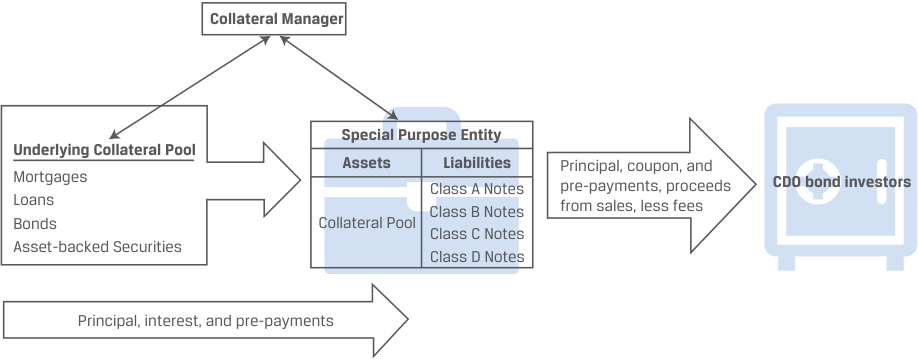
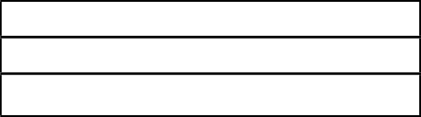

# Tập 6: Chứng Khoán Thu Nhập Cố Định (Fixed Income)
## Học phần 18: Đặc Điểm Công Cụ và Thị Trường Chứng Khoán Đảm Bảo Bằng Tài Sản (ABS)
### Phần 2/3: Chứng Khoán Đảm Bảo Bằng Tài Sản Phi Thế Chấp (Trang PDF 489–503)

---

<!-- PDF Page 489 -->

   - **C.** Xếp hạng rủi ro dựa trên rủi ro thị trường (*market risk*) của danh mục các khoản vay hoặc khoản phải thu được chứng khoán hóa cũng như thứ tự ưu tiên mà chúng hấp thụ các khoản lỗ.

##### **Lời giải (Solution):** 

Đáp án đúng là C. Xếp hạng rủi ro dựa trên rủi ro tín dụng (*credit risk* — chứ không phải rủi ro thị trường) của danh mục các khoản vay hoặc khoản phải thu được chứng khoán hóa cũng như thứ tự ưu tiên mà chúng hấp thụ các khoản lỗ.

A không đúng vì đây là một phát biểu đúng. Cấu trúc thác nước phân phối lại rủi ro tín dụng gắn liền với tài sản thế chấp. Việc tạo ra một tập hợp các hạng trái phiếu cho phép các nhà đầu tư lựa chọn mức độ rủi ro mà họ muốn gánh chịu và nhận về mức tỷ suất sinh lợi tương ứng. B không đúng vì đây là một phát biểu đúng. Mỗi hạng trái phiếu trong giao dịch nhận được một xếp hạng rủi ro phản ánh rủi ro tín dụng của nó, và một số hạng trái phiếu có thể có xếp hạng tín nhiệm tốt hơn cả chính công ty đang tìm cách huy động vốn nhờ vào việc thế chấp tài sản hoặc tăng cường tín dụng.

### **CHỨNG KHOÁN ĐẢM BẢO BẰNG TÀI SẢN PHI THẾ CHẤP (NON-MORTGAGE ASSET-BACKED SECURITIES)** 

**<mark>4</mark>** 

**Mục tiêu học tập:** Mô tả các loại hình và đặc điểm của chứng khoán đảm bảo bằng tài sản phi thế chấp (*non-mortgage asset-backed securities*), bao gồm dòng tiền và rủi ro của từng loại.

Như chúng ta đã thấy trước đó, các tài sản phi thế chấp (*non-mortgage assets*), chẳng hạn như các khoản vay mua ô tô (*auto loans*), đã được sử dụng làm tài sản thế chấp trong giao dịch chứng khoán hóa. Các giao dịch chứng khoán hóa cũng có thể bao gồm các khoản phải thu thẻ tín dụng (*credit card receivables*), các khoản vay cá nhân (*personal loans*), các khoản phải thu thương mại và các khoản vay thương mại.

ABS có thể được phân loại dựa trên việc tài sản thế chấp là có khấu hao gốc định kỳ (*amortizing*) hay không khấu hao gốc định kỳ (*non-amortizing*). Các khoản vay thế chấp mua nhà truyền thống và các khoản vay mua ô tô là những ví dụ về **khoản vay có khấu hao gốc định kỳ (*amortizing loans*)**, trong đó các khoản thanh toán định kỳ bao gồm cả tiền gốc và tiền lãi. Trong một ABS có khấu hao gốc (*amortizing ABS*), khi các khoản vay được trả dần, các nhà đầu tư nhận được các khoản hoàn trả nợ gốc theo lịch trình, và bất kỳ khoản trả nợ trước hạn nào cũng sẽ được phân phối cho các hạng trái phiếu dựa trên quy tắc thanh toán. Theo thời gian khi các khoản vay đáo hạn, số lượng các khoản vay và tổng giá trị của chúng sẽ thu hẹp lại.

Ngược lại, **các khoản vay không khấu hao gốc định kỳ (*non-amortizing loans*)**, chẳng hạn như nợ thẻ tín dụng, không bao gồm các khoản hoàn trả nợ gốc theo lịch trình cố định. Đối với một danh mục tài sản thế chấp không khấu hao gốc, tình huống sẽ khác đi. Theo thời gian, một số khoản vay này sẽ được hoàn trả trước ngày đáo hạn quy định của ABS. Nếu các khoản vay được trả hết trong **giai đoạn khóa hoặc giai đoạn quay vòng (*lockout or revolving period*)**, thì số tiền gốc được hoàn trả sẽ được tái đầu tư để mua thêm các khoản vay bổ sung có nợ gốc bằng với số tiền gốc đã được hoàn trả. Việc tái đầu tư này trong giai đoạn khóa sẽ làm đầy lại (*replenishes*) danh mục tài sản thế chấp. Khi kết thúc giai đoạn khóa, giai đoạn khấu hao hoàn trả gốc (*amortization period*) bắt đầu, và bất kỳ khoản tiền gốc nào được hoàn trả sẽ không được tái đầu tư vào các khoản vay mới nữa mà sẽ được phân phối cho những người nắm giữ ABS.

Một phạm vi rất đa dạng các tài sản có thể được chứng khoán hóa dưới dạng ABS phi thế chấp. Học phần này tập trung vào chứng khoán ABS đảm bảo bằng khoản phải thu thẻ tín dụng (*credit card receivable ABS*) và chứng khoán ABS điện mặt trời dân dụng (*residential solar ABS*).

#### **ABS Khoản phải thu Thẻ tín dụng (Credit Card Receivable ABS)** 

Thẻ tín dụng, được phát hành bởi các ngân hàng, công ty thẻ tín dụng, nhà bán lẻ và các công ty du lịch – giải trí, cung cấp một phương thức thanh toán và cấp tín dụng tiện lợi. Khi một giao dịch mua hàng được thực hiện bằng thẻ tín dụng, tổ chức phát hành thẻ tín dụng (bên cho vay) cấp tín dụng cho chủ thẻ (người đi vay). Chủ thẻ đồng ý hoàn trả số tiền

<!-- PDF Page 490 -->

đã vay cộng với bất kỳ khoản phí tài chính (*finance charges*) nào được áp dụng. Dưới góc độ của bên cho vay, số tiền cho vay đó là một khoản phải thu (*receivable*). Các khoản phải thu này có thể được tập hợp lại và sử dụng làm tài sản thế chấp cơ sở cho chứng khoán ABS khoản phải thu thẻ tín dụng.

Bản điều khoản tóm tắt (*term sheet*) cho một chứng khoán ABS thẻ tín dụng điển hình có thể được tìm thấy trong Bảng minh họa 5 (*Exhibit 5*). Trong giao dịch chứng khoán hóa cụ thể này, Commercial Finance Partners AG (CFP), một ngân hàng châu Âu, tập hợp các khoản phải thu thẻ tín dụng bằng đồng CHF. Các tổ chức phát hành thẻ tín dụng, chẳng hạn như CFP, được hưởng lợi từ việc chứng khoán hóa thẻ tín dụng. Thứ nhất, giao dịch này loại bỏ các khoản phải thu thẻ tín dụng khỏi bảng cân đối kế toán của họ, vừa mang lại hiệu quả sử dụng vốn vừa làm giảm chi phí huy động vốn. Thứ hai, nó làm giảm chi phí rủi ro vỡ nợ từ nợ thẻ tín dụng. Thứ ba, nó tạo ra thêm thu nhập từ phí (*fee income*).

Chứng khoán ABS cụ thể này có giai đoạn quay vòng (*revolving period*) kéo dài 3 năm — khi danh mục sử dụng các khoản hoàn trả số dư nợ gốc để mua các khoản phải thu thẻ tín dụng mới — và tiếp theo đó là giai đoạn khấu hao hoàn trả gốc (*amortization period*) kéo dài 6 năm.

| **Bảng minh họa 5: Tóm tắt Bản điều khoản ABS Thẻ tín dụng (Exhibit 5: Credit Card ABS Term Sheet Summary)** **Kỳ phiếu Đảm bảo bằng Thẻ tín dụng Kỳ hạn 9 Năm Phát hành bởi Commercial Finance Partners AG — Tóm tắt Bản cáo bạch** | |
|---|---|
| **Tổ chức phát hành (*Issuer*):** | Commercial Finance Partners AG |
| **Quy mô phát hành (*Issue Size*):** | 900.000.000 CHF |
| **Ngày đáo hạn (*Maturity Date*):** | [Chín năm kể từ Ngày thanh toán giao dịch] |
| **Giai đoạn quay vòng (*Revolving Period*):** | [Bắt đầu vào Ngày thanh toán giao dịch và Kết thúc Ba năm kể từ Ngày thanh toán giao dịch] |
| **Giai đoạn khấu hao hoàn trả gốc (*Amortization Period*):** | [Bắt đầu sau Ba năm và Một ngày làm việc kể từ Ngày thanh toán giao dịch và Kết thúc Chín năm kể từ Ngày thanh toán giao dịch] |
| **Tài sản thế chấp (*The Collateral*):** | Danh mục bao gồm các khoản phải thu dư nợ thẻ tín dụng được khởi tạo tại Thụy Sĩ và cấp cho các cá nhân tại Thụy Sĩ. Tổng các khoản phải thu là 925 triệu CHF, với số dư nợ gốc trung bình là 2.300 CHF, cùng mức lãi suất bình quân gia quyền là 12%. |
| **Các lớp chứng khoán (*Tranches*):** | **Kỳ phiếu Lớp A (*Tranche A Notes*)** - Mệnh giá (*Face value*): 400 triệu EUR - Lãi suất (*Interest rate*): 7,00% - Đặc điểm tăng cường tín dụng: Sự phân tầng xếp sau của Kỳ phiếu Hạng B, C & D  **Kỳ phiếu Lớp B (*Tranche B Notes*)** - Mệnh giá (*Face value*): 300 triệu EUR - Lãi suất (*Interest rate*): 8,00% - Đặc điểm tăng cường tín dụng: Sự phân tầng xếp sau của Kỳ phiếu Hạng C & D  **Kỳ phiếu Lớp C (*Tranche C Notes*)** - Mệnh giá (*Face value*): 150 triệu EUR - Lãi suất (*Interest rate*): 10,50% - Đặc điểm tăng cường tín dụng: Sự phân tầng xếp sau của Kỳ phiếu Hạng D  **Kỳ phiếu Lớp D (*Tranche D Notes*)** - Mệnh giá (*Face value*): 50 triệu EUR - Lãi suất (*Interest rate*): Biến đổi (*Variable*) |

<!-- PDF Page 491 -->

| **Kỳ phiếu Đảm bảo bằng Thẻ tín dụng Kỳ hạn 9 Năm Phát hành bởi Commercial Finance Partners AG — Tóm tắt Bản cáo bạch** | |
|---|---|
| *(Tiếp theo Kỳ phiếu Lớp D)* | - Đặc điểm tăng cường tín dụng: Không có (*None*) |
| **Thanh toán tiền lãi (*Interest Payment*):** | Hàng tháng, bắt đầu từ 30 ngày kể từ [Ngày thanh toán giao dịch], được trả mỗi tháng với khoản thanh toán cuối cùng vào [Ngày đáo hạn] |

Đối với một danh mục các khoản phải thu thẻ tín dụng, dòng tiền bao gồm phí tài chính thu được (*finance charges collected*), các loại phí dịch vụ (*fees*), và các khoản hoàn trả nợ gốc (*principal repayments*). Phí tài chính thu được là mức lãi suất định kỳ mà bên cho vay tính cho người đi vay trên số dư chưa thanh toán của thẻ tín dụng. Lãi suất đó có thể là cố định hoặc thả nổi. Thông thường, lãi suất thả nổi có mức trần (*capped*): Có một giới hạn trên đối với mức lãi suất tối đa mà bên cho vay có thể tính cho người đi vay. Các loại phí mà bên cho vay thu từ người đi vay bao gồm phí trả chậm (*late payment fees*) và bất kỳ khoản phí thường niên (*annual membership fees*) nào.

Vì thẻ tín dụng là các khoản vay không khấu hao gốc định kỳ (*non-amortizing loans*), nên trong suốt giai đoạn quay vòng — trong trường hợp này là 3 năm đầu tiên của cấu trúc — những người nắm giữ chứng khoán chỉ nhận được các khoản thanh toán từ phí tài chính (tiền lãi) và các loại phí mà bên cho vay thu được. Tác động của giai đoạn quay vòng và giai đoạn khấu hao hoàn trả gốc đối với dòng tiền mà những người nắm giữ kỳ phiếu nhận được từ ABS chứng khoán hóa các khoản phải thu được minh họa trong Bảng minh họa 6 (*Exhibit 6*).

**Bảng minh họa 6: Dòng tiền từ một ABS Thẻ tín dụng (Exhibit 6: Cash Flows from a Credit Card ABS)** 

<!-- Picture Text: Revolving period Amortizing period Tranche A Tranche B Principal repayments reinvested Tranche C Tranche D Finance charges and fees Principal (collateral) repayments, finance charges and fees Value of the collateral  -->

> **Chú thích hình ảnh:**
> - **Giai đoạn quay vòng (*Revolving period*)**: Các khoản hoàn trả nợ gốc được tái đầu tư (*Principal repayments reinvested*), giá trị của tài sản thế chấp (*Value of the collateral*) giữ nguyên đối với Lớp A, B, C, D; nhà đầu tư chỉ nhận Phí tài chính và các loại phí (*Finance charges and fees*).
> - **Giai đoạn khấu hao hoàn trả gốc (*Amortizing period*)**: Giá trị tài sản thế chấp giảm dần khi gốc được trả dần từ Lớp A xuống Lớp B, C, D; nhà đầu tư nhận Các khoản hoàn trả nợ gốc (tài sản thế chấp), phí tài chính và các loại phí (*Principal (collateral) repayments, finance charges and fees*).

Một số điều khoản trong ABS khoản phải thu thẻ tín dụng có thể yêu cầu khấu hao hoàn trả nợ gốc sớm nếu xảy ra các sự kiện cụ thể. Những điều khoản như vậy được gọi là **điều khoản khấu hao gốc sớm (*early amortization*)** hay **điều khoản khấu hao gốc nhanh (*rapid amortization provisions*)** và được đưa vào nhằm bảo vệ chất lượng tín dụng của đợt phát hành, đặc biệt là trong giai đoạn quay vòng. Nếu các khoản hoàn trả trong giai đoạn quay vòng không đủ để làm đầy lại danh mục, hoặc nếu các vụ vỡ nợ làm thay đổi đáng kể danh mục, thì tính kinh tế của giao dịch có thể không còn đảm bảo nữa. Điều này sẽ kích hoạt điều khoản khấu hao gốc nhanh làm đẩy nhanh tiến độ và thay đổi dòng tiền nợ gốc. Những người nắm giữ kỳ phiếu sẽ nhận lại vốn đầu tư của họ sớm hơn, để sau đó có thể tái phân bổ sang các khoản đầu tư khác mang lại đặc tính rủi ro/tỷ suất sinh lợi hấp dẫn hơn. Các điều khoản khấu hao gốc nhanh này có thể đặc biệt có lợi cho các nhà đầu tư trong những giai đoạn có sự bất định ngày càng gia tăng về môi trường kinh tế vĩ mô.

Hơn nữa, ABS thẻ tín dụng thường kết hợp nhiều nguồn tăng cường tín dụng khác nhau để hỗ trợ cho các lớp chứng khoán khác nhau. Các cấu trúc ABS thông thường cung cấp sự tăng cường tín dụng thông qua phân tầng thứ bậc ưu tiên (*subordination*). Chẳng hạn, trong ví dụ về CFP, có bốn lớp chứng khoán bên cạnh việc thế chấp vượt mức (25 triệu CHF), điều khoản khấu hao gốc nhanh, và các công cụ khác nhằm hỗ trợ khẩu vị của nhà đầu tư đối với sự đánh đổi rủi ro/tỷ suất sinh lợi phù hợp.

<!-- PDF Page 492 -->

Trong trường hợp cụ thể này, các khoản lỗ từ danh mục phải vượt quá 75 triệu CHF (gồm 25 triệu CHF thế chấp vượt mức + 50 triệu mệnh giá Lớp D), tương đương 8,33% mệnh giá của đợt phát hành ABS, trước khi những người nắm giữ Kỳ phiếu Lớp C bị ảnh hưởng bởi tổn thất tài sản thế chấp.

##### **VÍ DỤ 4 (EXAMPLE 4)** 

#### **Đối chiếu các ABS Phi thế chấp: ABS Khoản phải thu Thẻ tín dụng so với ABS Khoản vay Mua ô tô (Contrasting Non-Mortgage ABS: Credit Card Receivable ABS vs. Auto Loan ABS)** 

Đối với ABS khoản phải thu thẻ tín dụng, tài sản thế chấp là một danh mục các khoản vay không khấu hao gốc định kỳ (*non-amortizing loans*). Trong giai đoạn khóa (*lockout period*), số tiền mặt thu được từ việc hoàn trả nợ gốc được tái đầu tư vào các khoản phải thu thẻ tín dụng bổ sung. Trong giai đoạn này, không có rủi ro trả nợ trước hạn (*prepayment risk*) và rủi ro vỡ nợ tiềm ẩn nhìn chung được giới hạn hoặc được hấp thụ bởi các biện pháp tăng cường tín dụng. Khi giai đoạn khóa kết thúc, các khoản hoàn trả nợ gốc được sử dụng để thanh toán dư nợ gốc đang lưu hành của ABS.

Đối với các chứng khoán đảm bảo bằng khoản vay mua ô tô (*auto loan-backed securities*), tài sản thế chấp là một danh mục các khoản vay có khấu hao gốc định kỳ (*amortizing loans*) và đôi khi là các hợp đồng thuê (*leases*). Những người nắm giữ chứng khoán nhận được các khoản hoàn trả nợ gốc đều đặn. Kết quả là, số dư nợ gốc đang lưu hành giảm dần theo thời gian. Ngoài ra, các nhà đầu tư vào danh mục phải tiếp xúc với cả rủi ro trả nợ trước hạn và rủi ro vỡ nợ ngay từ khi bắt đầu thành lập danh mục.

Xếp hạng tín nhiệm của các chứng khoán ABS thẻ tín dụng tại Hoa Kỳ đã duy trì kết quả hoạt động rất mạnh mẽ qua cả cuộc Khủng hoảng Tài chính Toàn cầu 2008–09 (GFC) lẫn đại dịch COVID-19: Chưa đến 2% các xếp hạng liên quan bị hạ bậc trong suốt cuộc khủng hoảng GFC, và không có xếp hạng nào bị hạ bậc khi đại dịch bùng phát vào năm 2020. Hiệu quả hoạt động của ABS được củng cố bởi chất lượng ổn định của các tài sản được chứng khoán hóa và các đặc điểm cấu trúc giúp bảo vệ chống lại sự suy giảm hiệu quả hoạt động do môi trường căng thẳng gây ra.

_Nguồn:_ Fitch Ratings, "US Auto, Credit Card ABS Performed Well Through Crises," Fitch Wire (07/04/2021). https://www.fitchratings.com/research/structured-finance/us-auto-credit-card-abs-performed-well-through-crises-07-04-2021.

#### **ABS Điện mặt trời (Solar ABS)** 

Với số lượng ngày càng tăng các chủ sở hữu nhà lắp đặt hệ thống năng lượng mặt trời và thực hiện các cải tạo nâng cao hiệu quả năng lượng khác cho ngôi nhà, nhiều công ty tài chính chuyên biệt đã bắt đầu cung cấp các lựa chọn tài trợ cải tạo nhà ở chuyên dụng: các khoản vay điện mặt trời (*solar loans*) hoặc hợp đồng thuê điện mặt trời (*solar leases*). Khoản vay điện mặt trời cho phép người tiêu dùng vay tiền để trả chi phí mua và lắp đặt hệ thống từ một đơn vị lắp đặt. Hợp đồng thuê điện mặt trời bao gồm việc thuê thiết bị năng lượng mặt trời trực tiếp từ một công ty điện mặt trời.

Việc chuyển sang sử dụng năng lượng mặt trời không chỉ cải thiện tính bền vững về môi trường mà còn làm giảm tổng chi phí điện năng và tiện ích sinh hoạt của hộ gia đình. Bài toán kinh tế rất rõ ràng: Khoản tiết kiệm chi phí tiện ích từ việc chuyển sang năng lượng mặt trời thường được kỳ vọng sẽ vượt quá chi phí đầu tư vào hệ thống năng lượng mặt trời. Các nhà đầu tư tổ chức ngày càng quan tâm đến việc mua **ABS điện mặt trời (*solar ABS*)** vì những cấu trúc này mang lại cơ hội đóng góp cho sự phát triển bền vững đồng thời tạo ra mức lợi suất điều chỉnh theo rủi ro hấp dẫn.

Al-Shims Enterprises quyết định chứng khoán hóa các khoản vay lắp đặt hệ thống năng lượng mặt trời của mình thông qua công ty con tài chính bằng cách sử dụng một ABS điện mặt trời. ABS điện mặt trời này phát hành 300 triệu EUR kỳ phiếu được bảo đảm bằng 10.000 khoản vay cải tạo nhà ở dân dụng bền vững có tổng mệnh giá là 320 triệu EUR. Số dư khoản vay trung bình của các khoản vay cải tạo nhà ở là 32.500 EUR, trả mức lãi suất bình quân gia quyền là 7,5% với kỳ hạn bình quân gia quyền là 17 năm. Tất cả các khoản vay đều có khấu hao gốc định kỳ (*amortizing*). Số tiền thu thuần từ đợt chào bán sẽ được phân bổ, toàn bộ hoặc một phần, cho việc mua sắm và lắp đặt các hệ thống năng lượng mặt trời dân dụng — vốn là các dự án xanh đủ điều kiện (*eligible green projects*).

Dưới góc độ của Al-Shims, giao dịch chứng khoán hóa giúp loại bỏ các khoản phải thu khỏi bảng cân đối kế toán, làm tăng hiệu quả sử dụng vốn và tạo ra thu nhập từ phí.

<!-- PDF Page 493 -->

Một đặc điểm bổ sung của giao dịch ABS điện mặt trời là số tiền thu được sẽ được chuyển hướng vào việc tài trợ cho các dự án xanh hoặc thân thiện với môi trường. Bởi vì các khoản vay điện mặt trời thúc đẩy các lợi ích bền vững về môi trường thông qua việc lắp đặt nguồn năng lượng tái tạo và hiệu quả, nên chúng có thể đủ điều kiện được công nhận là **trái phiếu xanh (*green bonds*)**. Đối với các nhà đầu tư tổ chức đang tìm kiếm các lựa chọn đầu tư theo tiêu chí môi trường, xã hội và quản trị (*Environmental, Social, and Governance* – ESG) hoặc tài chính khí hậu (*climate finance*), ABS điện mặt trời có thể mang lại một lựa chọn đầu tư thay thế đầy hấp dẫn.

Cấu trúc pháp lý chính xác của giao dịch ABS điện mặt trời và tài sản thế chấp của nó phụ thuộc vào khu vực tài phán. Thông thường, ABS được thế chấp bằng khoản nợ cơ sở: các khoản thế chấp, khoản vay hoặc khoản phải thu. Các khoản vay này có thể được thế chấp bổ sung bằng quyền cầm cố/giữ tài sản (*lien*) đối với chính các hệ thống được lắp đặt, đối với bất động sản đó, hoặc cả hai. Khi các khoản vay hệ thống năng lượng mặt trời được cấu trúc dưới dạng các khoản vay cải tạo nhà ở dân dụng, ABS điện mặt trời thực chất đang chứng khoán hóa một khoản thế chấp cấp thấp/thứ cấp (*subordinated/junior mortgage*) trên bất động sản đó.

Đó là lý do tại sao các nhà đầu tư ABS điện mặt trời tìm kiếm loại nợ này: Thông thường, những người vay lắp đặt điện mặt trời là những người đi vay chất lượng cao (*prime borrowers*) sở hữu nhà riêng và có lịch sử thanh toán tốt. Ngoài ra, các nhà đầu tư ABS điện mặt trời thường được bảo vệ thông qua thế chấp vượt mức (*overcollateralization*), phân tầng thứ bậc ưu tiên (*subordination*) và chênh lệch lãi suất dư thừa (*excess spreads*). Tổng hợp lại, những đặc điểm này giúp giảm thiểu hơn nữa rủi ro vỡ nợ trong các giao dịch chứng khoán hóa này.

Cuối cùng, nhiều chứng khoán ABS điện mặt trời có chứa một **giai đoạn cấp vốn trước (*pre-funding period*)**, cho phép quỹ tín thác (*trust*) trong một khoảng thời gian nhất định sau khi đóng giao dịch được mua thêm các giao dịch đủ điều kiện đáp ứng các tiêu chí hợp lệ nhất định.

##### **VÍ DỤ 5 (EXAMPLE 5)** 

#### **Những Thế mạnh Đầu tư Tiềm năng của ABS Điện mặt trời (Potential Investment Strengths of Solar ABS)** 

ABS điện mặt trời có thể mang lại hồ sơ rủi ro/lợi nhuận hấp dẫn cho các nhà đầu tư thu nhập cố định. Các chứng khoán này thường được cấu trúc chặt chẽ, với mức độ thế chấp và tăng cường tín dụng cao, rủi ro vỡ nợ tương đối thấp và mức chênh lệch lãi suất (*spread*) hấp dẫn. ABS điện mặt trời được thế chấp bằng các hệ thống quang điện (PV) cơ sở, với sự tăng cường tín dụng bao gồm (i) thế chấp vượt mức (*overcollateralization*), (ii) trái phiếu cấp thấp (*subordinate bonds*), (iii) tài khoản dự trữ chung (*general reserve account*), (iv) tài khoản dự trữ thay thế bộ biến tần (*inverter replacement reserve account*), và (v) chênh lệch lãi suất dư thừa (*excess spread*). Ngoài ra, tính đến nay, tất cả các giao dịch ABS điện mặt trời cho đến hết năm 2019 đều bao gồm danh mục những người tiêu dùng có điểm tín dụng tiêu dùng FICO bình quân gia quyền trên 700.a

Các khoản thanh toán tiền thuê hoặc tiền vay điện mặt trời thường thay thế cho khoản thanh toán tiền điện trước đây của người tiêu dùng, do đó tổn thất trong lĩnh vực này nhiều khả năng sẽ duy trì ở mức thấp. Việc vỡ nợ đối với khoản vay điện mặt trời khó có thể làm giảm tổng nghĩa vụ thanh toán của người tiêu dùng vì họ vẫn cần phải mua năng lượng dưới một hình thức nào đó, và việc vỡ nợ khoản vay điện mặt trời có thể khiến họ phải quay lại trả chi phí năng lượng hàng tháng cao hơn. Mặc dù loại tài sản này chưa trải qua một chu kỳ tín dụng đầy đủ (chứng khoán ABS điện mặt trời đầu tiên được phát hành vào tháng 11 năm 2013 bởi SolarCity), sự kết hợp giữa người tiêu dùng có chất lượng tín dụng cao hơn và mong muốn có một nguồn điện năng tiết kiệm ngân sách có thể làm giảm rủi ro vỡ nợ/tổn thất đối với khoản thanh toán tiền vay/tiền thuê cơ sở.a

Với trọng tâm là chống biến đổi khí hậu, người tiêu dùng và các công ty tiện ích điện năng đang tiếp tục dịch chuyển khỏi nhiên liệu hóa thạch truyền thống và hướng tới các nguồn năng lượng tái tạo như năng lượng mặt trời, gió và địa nhiệt. Không giống như than đá, dầu mỏ và các nhiên liệu hóa thạch khác, năng lượng mặt trời đóng góp vào một môi trường bền vững hơn với tư cách là một dạng năng lượng xanh sạch, không phát thải carbon. ABS điện mặt trời trực tiếp hỗ trợ một tương lai bền vững bằng cách cung cấp cho các nhà cung cấp năng lượng mặt trời một nguồn vốn tài trợ có kỳ hạn. Các khoản thanh toán tiền vay/thuê điện mặt trời chủ yếu thay thế cho hóa đơn tiền điện trước đây của chủ nhà, với hệ thống trung bình thường được thiết kế quy mô để cung cấp hơn 90% mức sử dụng điện hiện tại của ngôi nhà.a

<!-- PDF Page 494 -->

ABS điện mặt trời có thể mang lại cơ hội cho các định chế nhằm đạt được mục tiêu đầu tư kép: vừa thúc đẩy tính bền vững như một phần trong các sáng kiến ESG của họ, vừa tạo ra mức lợi suất gia tăng (*incremental yield*).b

a _Institutional Investor, "Solar ABS: A Growing Sector Offered Sunny Side Up"_ (17/09/2019). https://www.institutionalinvestor.com/article/b1h4mybwwjy5p7/Solar-ABS-A-Growing-Sector-Offered-Sunny-Side-Up.

b _Tim Zawacki, "Solar Securitizations Present Yield, ESG Play for Institutional Investors," S&P Global Market Intelligence_ (16/12/2020). https://www.spglobal.com/marketintelligence/en/news-insights/latest-news-headlines/solar-securitizations-present-yield-esg-play-for-institutional-investors-61756315.

##### **BỘ CÂU HỎI (QUESTION SET)** 

1. _Xác định các câu trả lời đúng để điền vào chỗ trống:_ Trong suốt ___________ của một ABS khoản phải thu thẻ tín dụng, những người nắm giữ chứng khoán chỉ nhận được ________________________________.

##### **Lời giải (Solution):** 

Trong suốt **giai đoạn quay vòng (*revolving period*)** của một ABS khoản phải thu thẻ tín dụng, _những người nắm giữ chứng khoán_ chỉ nhận được _các khoản thanh toán từ phí tài chính và các loại phí mà bên cho vay thu được_.

2. Mô tả động cơ của các nhà đầu tư tổ chức khi đầu tư vào ABS điện mặt trời (*solar ABS*).

##### **Lời giải (Solution):** 

Các nhà đầu tư tổ chức ngày càng quan tâm đến việc mua ABS điện mặt trời vì những cấu trúc này mang lại cơ hội đóng góp cho sự phát triển bền vững đồng thời tạo ra mức lợi suất điều chỉnh theo rủi ro hấp dẫn. Các khoản vay điện mặt trời mang lại lợi ích bền vững rõ rệt về môi trường thông qua việc lắp đặt năng lượng tái tạo và nâng cao hiệu quả năng lượng, điều này làm cho chúng trở nên phù hợp với các nhà đầu tư đang tìm kiếm các lựa chọn đầu tư theo tiêu chí ESG hoặc tài chính khí hậu.

3. Giải thích lợi thế đầu tư tiềm năng từ việc đưa một giai đoạn cấp vốn trước (*pre-funding period*) vào cấu trúc của một ABS điện mặt trời.

##### **Lời giải (Solution):** 

Một chứng khoán ABS điện mặt trời bao gồm giai đoạn cấp vốn trước cho phép quỹ tín thác cơ sở của nó trong một khoảng thời gian nhất định sau khi đóng giao dịch được mua thêm các giao dịch đủ điều kiện đáp ứng các tiêu chí hợp lệ nhất định về đầu tư bền vững. Điều này làm tăng cường lợi ích môi trường tổng thể. Ngoài ra, còn có một lợi ích trực tiếp cho nhà đầu tư nhờ vào lợi ích đa dạng hóa từ một danh mục tài sản rộng lớn hơn.

4. Mô tả một điểm tương đồng giữa ABS điện mặt trời (*solar ABS*) và trái phiếu có bảo đảm xanh (*green covered bonds*).

##### **Lời giải (Solution):** 

Cả hai loại chứng khoán này đều là những phương tiện phổ biến để tài trợ cho các khoản đầu tư môi trường vào cơ sở hạ tầng. ABS điện mặt trời mang lại lợi ích bền vững rõ rệt về môi trường thông qua việc lắp đặt năng lượng tái tạo và nâng cao hiệu quả năng lượng. Danh mục bảo đảm (*cover pool*) cho trái phiếu có bảo đảm xanh chủ yếu được tạo thành từ các khoản vay thế chấp đối với các tòa nhà xanh, được xác định thông qua các tiêu chuẩn chứng nhận công trình xanh khác nhau.

<!-- PDF Page 495 -->

5. Phát biểu nào sau đây về chứng khoán hóa thẻ tín dụng là đúng?

   - **A.** Tạo ra thêm thu nhập từ phí cho tổ chức phát hành.

   - **B.** Các khoản phải thu thẻ tín dụng được giữ lại trên bảng cân đối kế toán của tổ chức phát hành.

   - **C.** Chi phí rủi ro vỡ nợ từ nợ thẻ tín dụng đối với tổ chức phát hành tăng lên.

   - **Lời giải (Solution):**

Đáp án đúng là A. Chứng khoán hóa thẻ tín dụng tạo ra thêm thu nhập từ phí cho tổ chức phát hành. B không đúng vì các khoản phải thu thẻ tín dụng được loại bỏ khỏi bảng cân đối kế toán của tổ chức phát hành, vừa mang lại hiệu quả sử dụng vốn vừa làm giảm chi phí huy động vốn. C không đúng vì chi phí rủi ro vỡ nợ từ nợ thẻ tín dụng được giảm xuống.

# **NGHĨA VỤ NỢ CÓ TÀI SẢN ĐẢM BẢO (COLLATERALIZED DEBT OBLIGATIONS – CDO)** **<mark>5</mark>** 

**Mục tiêu học tập:** Mô tả nghĩa vụ nợ có tài sản đảm bảo (*collateralized debt obligations* – CDO), bao gồm dòng tiền và rủi ro của chúng.

**Nghĩa vụ nợ có tài sản đảm bảo (*Collateralized debt obligations* – CDO)** phát hành các chứng khoán được đảm bảo bằng một danh mục đa dạng hóa gồm một hoặc nhiều nghĩa vụ nợ. CDO có thể được đảm bảo bằng một phạm vi rộng các khoản nợ. Các CDO được đảm bảo bằng trái phiếu doanh nghiệp và trái phiếu thị trường mới nổi được gọi là **nghĩa vụ trái phiếu có tài sản đảm bảo (*Collateralized bond obligations* – CBO)**; những CDO được đảm bảo bằng các khoản vay ngân hàng có đòn bẩy cao (*leveraged bank loans*) được gọi là **nghĩa vụ khoản vay có tài sản đảm bảo (*Collateralized loan obligations* – CLO)**; những CDO được đảm bảo bằng các CDO khác được gọi là **CDO tài chính có cấu trúc (*structured finance CDOs*)**; và những CDO được đảm bảo bằng một danh mục các hợp đồng hoán đổi rủi ro tín dụng (*credit default swaps* – CDS) đối với các chứng khoán có cấu trúc khác được gọi là **CDO tổng hợp (*synthetic CDOs*)**. Cấu trúc CDO thịnh hành nhất hiện nay là cấu trúc CLO, trong đó danh mục tài sản thế chấp được tạo thành từ các khoản vay ngân hàng có đòn bẩy cao.

Bảng minh họa 7 (*Exhibit 7*) tóm tắt các đặc điểm của CDO, trái phiếu có bảo đảm (*covered bonds*), chứng khoán đảm bảo bằng thế chấp (*MBS*) và ABS phi thế chấp (*non-mortgage ABS*):

**Bảng minh họa 7: Tổng quan về CDO và các Sản phẩm Chứng khoán hóa Khác (Exhibit 7: Overview of CDOs and Other Securitized Products)** 

| Đặc điểm | **Trái phiếu Có bảo đảm (Covered Bonds)** | **CDO** | **MBS** | **ABS Phi thế chấp (Non-Mortgage ABS)** |
|---|---|---|---|---|
| **Tài sản thế chấp (*Collateral*)** | Các khoản thế chấp thương mại hoặc nhà ở, hoặc tài sản khu vực công | Khoản vay ngân hàng có đòn bẩy cao (CLO) | Các khoản vay thế chấp bất động sản thương mại và nhà ở | Khoản phải thu thẻ tín dụng (không khấu hao gốc) và các khoản thanh toán tiền thuê/vay điện mặt trời |
| **Tác động lên Bảng cân đối kế toán của Tổ chức phát hành (*Impact on Issuer Balance Sheet*)** | Tài sản thế chấp vẫn nằm trên bảng cân đối kế toán và được khoanh vùng vào một danh mục bảo đảm riêng | Tài sản thế chấp được loại bỏ khỏi bảng cân đối kế toán | Tài sản thế chấp được loại bỏ khỏi bảng cân đối kế toán | Tài sản thế chấp được loại bỏ khỏi bảng cân đối kế toán |
| **Số lượng Hạng Trái phiếu (*Number of Bond Classes*)** | Một hạng trái phiếu duy nhất với mức tiếp xúc rủi ro vỡ nợ đi kèm trong danh mục bảo đảm của nó | Thường có nhiều hạng | Thường có nhiều hạng | Thường có nhiều hạng |

<!-- PDF Page 496 -->

| Đặc điểm | **Trái phiếu Có bảo đảm (Covered Bonds)** | **CDO** | **MBS** | **ABS Phi thế chấp (Non-Mortgage ABS)** |
|---|---|---|---|---|
| **Danh mục Tài sản thế chấp (*Collateral Pool*)** | Không cố định (*Unstable*) với việc quản lý tài sản thế chấp liên tục | Không cố định (*Unstable*) với việc quản lý tài sản thế chấp liên tục | Ổn định / Tĩnh (*Stable*) | Không cố định (*Unstable*) với việc quản lý tài sản thế chấp liên tục; giai đoạn cấp vốn trước được sử dụng bởi ABS điện mặt trời sau giao dịch |
| **Quyền truy đòi (*Recourse*)** | Bản chất quyền truy đòi kép (*Dual recourse*): thứ nhất đối với các khoản vay được khoanh vùng trong danh mục bảo đảm và thứ hai đối với các tài sản chưa bị cầm cố của định chế phát hành | Bản chất quyền truy đòi đơn (*Single recourse*) | Bản chất quyền truy đòi đơn (*Single recourse*) | Bản chất quyền truy đòi đơn (*Single recourse*) |

Tương tự như các cấu trúc ABS đã thảo luận ở trên, các cấu trúc CDO phân phối lại các dòng tiền do danh mục tài sản thế chấp cơ sở tạo ra và chuyển chúng tới các lớp chứng khoán (*tranches*). Đối với phần lớn các CDO, danh mục tài sản thế chấp không phải là tĩnh (*not static*), vì vậy cần có một **nhà quản lý tài sản thế chấp (*collateral manager*)** thực hiện việc mua và bán các nghĩa vụ nợ cho và từ danh mục tài sản thế chấp của CDO nhằm tạo ra đủ dòng tiền để đáp ứng các nghĩa vụ đối với những người nắm giữ trái phiếu CDO. Ngoài điểm này ra, các bước và cấu trúc của quy trình chứng khoán hóa về cơ bản là giống nhau. Cấu trúc của một giao dịch CDO điển hình được thể hiện trong Bảng minh họa 8 (*Exhibit 8*).

**Bảng minh họa 8: Cấu trúc của một Giao dịch CDO Điển hình (Exhibit 8: The Structure of a Generic CDO Transaction)** 

<!-- Picture Text: Collateral Manager Special Purpose Entity Underlying Collateral Pool Assets Liabilities Principal, coupon, and Mortgages Class A Notes pre-payments, proceeds CDO bond investors Loans Class B Notes from sales, less fees Bonds Collateral Pool Class C Notes Asset-backed Securities Class D Notes Principal, interest, and pre-payments  -->

> **Chú thích hình ảnh:**
> - **Danh mục Tài sản thế chấp Cơ sở (*Underlying Collateral Pool*)**: Các khoản thế chấp (*Mortgages*), Các khoản vay (*Loans*), Trái phiếu (*Bonds*), Chứng khoán đảm bảo bằng tài sản (*Asset-backed Securities*) → chuyển *Tiền gốc, tiền lãi và các khoản trả nợ trước hạn (Principal, interest, and pre-payments)* vào:
> - **Pháp nhân có mục đích đặc biệt (*Special Purpose Entity*)** dưới sự quản lý của **Nhà quản lý Tài sản thế chấp (*Collateral Manager*)**:
>   - Tài sản (*Assets*): Danh mục Tài sản thế chấp (*Collateral Pool*) | Nợ phải trả (*Liabilities*): Kỳ phiếu Hạng A, Hạng B, Hạng C, Hạng D (*Class A, B, C, D Notes*).
> - Chuyển *Tiền gốc, tiền lãi coupon, tiền trả trước hạn, tiền thu từ việc bán tài sản, trừ đi các khoản phí (Principal, coupon, and pre-payments, proceeds from sales, less fees)* cho **Các nhà đầu tư trái phiếu CDO (*CDO bond investors*)**.

Số tiền dùng để chi trả cho các hạng trái phiếu CDO có thể đến từ các khoản thanh toán tiền lãi của tài sản thế chấp, từ sự đáo hạn của tài sản thế chấp, và từ việc bán tài sản thế chấp. Nguyên lý kinh tế cơ bản của các giao dịch CDO này là đảm bảo rằng tỷ suất sinh lợi trên danh mục tài sản thế chấp cao hơn chi phí huy động vốn — tức tổng chi phí của các hạng trái phiếu được phát hành để tài trợ cho giao dịch. Những người nắm giữ trái phiếu cấp cao (*senior*) và trung gian (*mezzanine*) nhận được tỷ suất sinh lợi xác định, trong khi những người nắm giữ lớp vốn cổ phần (*equity tranche*) và nhà quản lý CDO nhận được tỷ suất sinh lợi mang tính chất giống cổ phiếu hơn. Về bản chất, một CDO là một giao dịch sử dụng đòn bẩy tài chính (*leveraged transaction*), trong đó những người nắm giữ lớp vốn cổ phần sử dụng vốn vay (các hạng trái phiếu được phát hành) để tạo ra mức tỷ suất sinh lợi cao hơn chi phí huy động vốn.

Thị trường CDO đã thay đổi đáng kể từ sau giai đoạn 2003–2007. Tài sản thế chấp ngày nay chủ yếu là các khoản vay ngân hàng có đòn bẩy cao (tức là các CLO), trong khi ở giai đoạn 2003–2007, nó bao gồm một phạm vi rộng lớn các sản phẩm, kể cả các loại nợ bất động sản khác nhau và chứng khoán đảm bảo bằng thế chấp thương mại (*Commercial mortgage-backed securities* – CMBS). Mặc dù những thay đổi về quy định quản lý và pháp lý sau đó đã làm cho việc thu xếp và đầu tư vào CDO kém hấp dẫn hơn, nhưng khuôn khổ chứng khoán hóa cơ bản vẫn tương tự như ngày nay. Khuôn khổ này có thể được tìm hiểu rõ nhất thông qua các CLO, được thế chấp bằng các khoản vay ngân hàng có bảo đảm ưu tiên cấp cao (*senior secured bank loans*) tạo nên một danh mục đa dạng hóa các khoản vay doanh nghiệp.

<!-- PDF Page 497 -->

#### **Cấu trúc CLO Điển hình (Generic CLO Structure)** 

Cấu trúc vốn của một giao dịch CLO điển hình được thể hiện trong Bảng minh họa 9 (*Exhibit 9*). Nguồn tiền để mua các tài sản thế chấp cho một CLO có được từ việc phát hành các nghĩa vụ nợ. Các lớp chứng khoán này bao gồm lớp cấp cao (*senior*), lớp trung gian (*mezzanine*), và lớp cấp thấp/thứ cấp/vốn cổ phần (*subordinated/junior/equity tranches*).

Các nhà đầu tư vào các hạng trái phiếu cấp cao hoặc trung gian nhận được mức lợi suất tiềm năng cao hơn so với các trái phiếu doanh nghiệp tương đương, hoặc họ tiếp cận được với các sản phẩm nợ mà nếu không qua CLO họ khó có thể mua được. Các nhà đầu tư vào lớp vốn cổ phần gánh chịu những rủi ro giống như cổ phiếu với tiềm năng kiếm được tỷ suất sinh lợi tương đương với cổ phiếu. Hơn nữa, lớp chứng khoán phần dư (*residual tranche*) đóng vai trò then chốt quyết định liệu một CLO có khả thi về mặt kinh tế hay không; cấu trúc CLO bắt buộc phải mang lại tỷ suất sinh lợi có tính cạnh tranh cho lớp chứng khoán này.

CLO có nhiều hình thức khác nhau. Dưới đây là những loại phổ biến nhất:

- **CLO Dòng tiền (*Cash Flow CLOs*)**, trong đó các dòng tiền từ thanh toán tiền lãi và hoàn trả nợ gốc được phân phối lại qua các lớp chứng khoán. Đây là cấu trúc CLO phổ biến nhất.

- **CLO Giá trị Thị trường (*Market Value CLOs*)**, trong đó giá trị tích lũy thuộc về các lớp chứng khoán phụ thuộc vào giá trị thị trường của danh mục đầu tư.

- **CLO Tổng hợp (*Synthetic CLOs*)**, trong đó danh mục tài sản thế chấp được tạo ra một cách tổng hợp thông qua các công cụ phái sinh tín dụng (*credit derivatives*).

**Bảng minh họa 9: Cấu trúc Vốn của một Giao dịch CLO Điển hình (Exhibit 9: The Capital Structure of a Generic CLO Transaction)** 

<!-- Picture Text: Highest claim on cash flows CLO Collateral AAA Tranche • Diversified Portfolio of Senior Secured Selected for CLO senior secured loans CLO Capital AA Tranche Loans Collateral Pool • Value of collateral exceeds Structure A Tranche CLO Debt  value of CLO debt Subordinated DebtUnsecured/ • Generally 100–225 Issuers BBB Tranche • Actively managed by collateral manager BB Tranche Equity Equity Tranche First Loss Lowest claim on cash flows  -->

> **Chú thích hình ảnh:**
> - **Bên trái (Cấu trúc vốn của Doanh nghiệp đi vay)**: Các khoản vay có bảo đảm ưu tiên cấp cao (*Senior Secured Loans*), Nợ không có bảo đảm/Nợ cấp thấp (*Unsecured/Subordinated Debt*), Vốn cổ phần (*Equity*). Từ phần *Senior Secured Loans* được chọn lọc đưa vào Danh mục Tài sản thế chấp CLO (*Selected for CLO Collateral Pool*).
> - **Ở giữa – Tài sản thế chấp của CLO (*CLO Collateral*)**:
>   - Danh mục đa dạng hóa các khoản vay có bảo đảm ưu tiên cấp cao (*Diversified Portfolio of senior secured loans*)
>   - Giá trị tài sản thế chấp vượt quá giá trị nợ của CLO (*Value of collateral exceeds value of CLO debt*)
>   - Thường bao gồm 100–225 tổ chức phát hành/đi vay (*Generally 100–225 Issuers*)
>   - Được quản lý chủ động bởi nhà quản lý tài sản thế chấp (*Actively managed by collateral manager*)
> - **Bên phải – Cấu trúc Vốn của CLO (*CLO Capital Structure*)**:
>   - Từ trên xuống dưới (từ quyền đòi hỏi dòng tiền cao nhất – *Highest claim on cash flows* đến quyền đòi hỏi dòng tiền thấp nhất – *Lowest claim on cash flows*):
>   - **Nợ CLO (*CLO Debt*)**: Lớp AAA (*AAA Tranche*) → Lớp AA (*AA Tranche*) → Lớp A (*A Tranche*) → Lớp BBB (*BBB Tranche*) → Lớp BB (*BB Tranche*).
>   - **Lớp Vốn cổ phần (*Equity Tranche*)**: Chịu lỗ đầu tiên (*First Loss*).

Khả năng thực hiện các khoản thanh toán tiền lãi và hoàn trả nợ gốc của nhà quản lý phụ thuộc vào hiệu quả hoạt động của tài sản thế chấp. Nhà quản lý tài sản thế chấp phải liên tục đáp ứng các bài kiểm tra hiệu quả hoạt động (*performance tests*) và các giới hạn tài sản thế chấp khác nhau đối với danh mục cơ sở. Nếu nhà quản lý không vượt qua được các bài kiểm tra đã quy định trước, một điều khoản sẽ bị kích hoạt yêu cầu phải hoàn trả nợ gốc cho hạng trái phiếu cấp cao cho đến khi các bài kiểm tra được đáp ứng trở lại. Quá trình này thực chất là **giảm đòn bẩy tài chính (*deleverages*)** của CLO bởi vì nguồn huy động vốn rẻ nhất của CLO — hạng trái phiếu cấp cao — bị cắt giảm quy mô.

Một đặc điểm điển hình của các giao dịch CLO là danh mục tài sản thế chấp vẫn chưa được hoàn tất tại thời điểm giao dịch đóng lại (*transaction closes*). Mặc dù nhà quản lý tài sản thế chấp mua phần lớn các khoản vay trước khi đóng giao dịch, nhưng vẫn có một **giai đoạn tích lũy tăng tốc (*ramp-up period*)** tiếp theo đó khi các tài sản bổ sung được đưa thêm vào danh mục tài sản thế chấp. Sau giai đoạn này, nhà quản lý có thể thay thế các khoản vay trong danh mục miễn là tài sản mới đáp ứng các tiêu chí lựa chọn danh mục. Giai đoạn cuối cùng của vòng đời CLO là khi các khoản vay cơ sở đáo hạn và nhà quản lý tài sản thế chấp sử dụng số tiền thu được để thanh toán hết cho các lớp chứng khoán theo thứ tự ưu tiên thanh toán. Quyền truy đòi thường chỉ giới hạn ở danh mục tài sản thế chấp, với quyền truy đòi tối thiểu đối với các tổ chức phát hành ban đầu.

<!-- PDF Page 498 -->

Cấu trúc dòng tiền thác nước (*cash flow waterfall*), kết hợp với các bài kiểm tra dựa trên hiệu quả hoạt động, cung cấp các mức độ bảo vệ khác nhau cho các lớp nợ của CLO. Lớp chứng khoán AAA có thứ tự ưu tiên cao nhất và được xếp hạng tín nhiệm cao nhất có mức lợi suất thấp nhất nhưng được hưởng quyền ưu tiên cao nhất đối với việc phân phối dòng tiền và ít có nguy cơ chịu lỗ nhất (*most loss-remote*). Các lớp chứng khoán trung gian (*mezzanine tranches*) trả lãi suất coupon cao hơn nhưng dễ bị tổn thất hơn và có xếp hạng thấp hơn. Lớp thứ cấp thấp nhất — lớp vốn cổ phần (*equity*) — là lớp rủi ro nhất, không được xếp hạng tín nhiệm và không có mức lãi suất coupon cố định. Thay vào đó, lớp vốn cổ phần đại diện cho quyền thụ hưởng toàn bộ dòng tiền dư thừa sau khi các nghĩa vụ đối với từng lớp nợ đã được đáp ứng đầy đủ.

Các CLO phải trải qua một loạt các **bài kiểm tra mức độ trang trải (*coverage tests*)** nhằm giúp đảm bảo rằng dòng tiền tạo ra từ tài sản thế chấp là các khoản vay ngân hàng cơ sở đáp ứng được các nghĩa vụ phân phối cho các lớp chứng khoán CLO khác nhau. Một bài kiểm tra như vậy là **bài kiểm tra mức độ thế chấp vượt mức (*overcollateralization test*)**, giúp giữ cho giá trị nợ gốc của danh mục khoản vay ngân hàng cơ sở của CLO luôn nằm trên tổng giá trị nợ gốc của các kỳ phiếu được phát hành bởi các lớp nợ CLO khác nhau chừng nào nợ CLO vẫn còn đang lưu hành. Nếu giá trị nợ gốc giảm xuống dưới ngưỡng kích hoạt của bài kiểm tra thế chấp vượt mức (*overcollateralization test trigger value*), tiền mặt sẽ bị chuyển hướng rời khỏi lớp vốn cổ phần và các lớp nợ CLO thứ cấp để ưu tiên trả cho các nhà đầu tư nắm giữ lớp nợ cấp cao.

Hãy xem xét một CLO giả định được thành lập với 700 triệu USD tiền gốc cam kết trả cho những người sở hữu các lớp nợ khác nhau của nó. Để đáp ứng nghĩa vụ 700 triệu USD này, các nhà đầu tư và các tổ chức xếp hạng tín nhiệm có thể yêu cầu nhà quản lý CLO sử dụng số vốn huy động được từ việc phát hành nợ và vốn cổ phần của CLO để mua 840 triệu USD các khoản vay ngân hàng. Điều này sẽ dẫn đến tỷ lệ thế chấp vượt mức (*overcollateralization ratio*) là $840 / 700 = 1,20$.

Mỗi lớp nợ CLO có tỷ lệ thế chấp vượt mức mục tiêu của riêng mình. Các tỷ lệ thế chấp vượt mức cho từng lớp chứng khoán hoạt động như các điều khoản cam kết bảo vệ (*covenants*) và, khi bị vi phạm (*tripped*), sẽ điều hướng lại dòng tiền để mua thêm tài sản thế chấp là các khoản vay ngân hàng hoặc hoàn trả bớt nợ cho lớp nợ CLO có thứ tự ưu tiên cao nhất.

Các CLO cũng phải tuân theo nhiều bài kiểm tra khác phối hợp cùng nhau nhằm nỗ lực bảo vệ các nhà đầu tư nợ khỏi bị thua lỗ. Ví dụ về những bài kiểm tra này bao gồm việc đo lường mức độ đa dạng hóa ngành nghề trong danh mục tài sản thế chấp là các khoản vay ngân hàng cơ sở và mức độ tiếp xúc của CLO đối với các khoản vay không phải là nợ có bảo đảm ưu tiên cấp cao (*non-senior secured loans*). Các bài kiểm tra khác xem xét mức độ đa dạng của những người đi vay cơ sở trong mỗi CLO và thiết lập giới hạn đối với một khách hàng vay đơn lẻ (*single obligor limits*). Ngoài ra còn có các giới hạn về số lượng nợ xếp hạng CCC được phép đưa vào danh mục tài sản thế chấp cơ sở, giúp kiềm chế sự suy giảm chất lượng tín dụng (*negative credit drift*).

Đối với các giao dịch CLO, vai trò của nhà quản lý tài sản thế chấp (*collateral manager*) là vô cùng quan trọng. Kỹ năng mà nhà quản lý thể hiện trong việc lựa chọn, quản lý và hoán đổi các tài sản trong danh mục tác động trực tiếp đến hiệu quả hoạt động của CLO. Theo một nghĩa nào đó, nhà quản lý tài sản thế chấp hoạt động như một nhà quản lý danh mục đầu tư trái phiếu chủ động bằng cách xác định cơ cấu tài sản cũng như rủi ro và mức độ tiếp xúc trong danh mục tài sản thế chấp.

##### **VÍ DỤ 6 (EXAMPLE 6)** 

#### **CLO và Rủi ro Hệ thống (CLOs and Systematic Risk)** 

Các nhà đầu tư tổ chức, chẳng hạn như các ngân hàng, công ty bảo hiểm, quỹ phòng hộ (*hedge funds*), quỹ tương hỗ (*mutual funds*) và các quỹ hưu trí, là những người mua chính trên thị trường CLO. Mỗi nhà đầu tư này nhắm mục tiêu vào các lớp chứng khoán CLO khác nhau. Do các quy định quản lý, nhiều ngân hàng gần như chỉ mua độc quyền lớp chứng khoán được xếp hạng AAA. Các nhà đầu tư khác, chẳng hạn như các quỹ phòng hộ và quỹ hiến tặng (*endowments*), có thể mang tính đầu cơ hơn và do đó chấp nhận nhiều rủi ro hơn để kiếm được tỷ suất sinh lợi cao hơn. Các cấu trúc CLO hiện nay thường đơn giản hơn so với các cấu trúc CDO từng đóng vai trò trung tâm trong cuộc khủng hoảng GFC. Các CDO tài chính có cấu trúc (*structured finance CDOs*) — vốn được tạo thành từ các CDO khác — không còn phổ biến nữa, và ngay cả các CLO tổng hợp (*synthetic CLOs*) sử dụng công cụ phái sinh cũng ít thịnh hành hơn.

Sau cuộc khủng hoảng GFC, chất lượng tài sản cơ sở của các CLO đã nhận được sự giám sát chặt chẽ hơn nhiều so với mức thông thường trước đây. Điều này phản ánh sự cần thiết phải thấu hiểu những đặc điểm độc thù của danh mục tài sản phức tạp trong một CLO.

<!-- PDF Page 499 -->

##### **BỘ CÂU HỎI (QUESTION SET)** 

1. Mô tả cách thức phân biệt một CDO với một CMO thông qua chức năng của nhà quản lý tài sản thế chấp (*collateral manager*) của CDO.

##### **Lời giải (Solution):** 

Mặc dù CDO tương tự như CMO ở chỗ cả hai đều phát hành các chứng khoán được đảm bảo bằng một danh mục đa dạng hóa gồm một hoặc nhiều nghĩa vụ nợ, nhưng danh mục tài sản thế chấp của CDO thường không phải là danh mục tĩnh (*not static*). Sự biến động của chúng làm phát sinh nhu cầu cần có một nhà quản lý tài sản thế chấp thực hiện việc mua và bán các nghĩa vụ nợ cho và từ danh mục tài sản thế chấp của CDO nhằm tạo ra đủ dòng tiền để đáp ứng các nghĩa vụ đối với những người nắm giữ trái phiếu CDO.

2. Xác định loại CLO tương ứng với đặc điểm đúng của nó:

   - **i.** Dựa trên các hợp đồng phi tập trung (*Relies on OTC contracts*)

   - **ii.** Cấu trúc CLO phổ biến nhất (*Most common CLO structure*)

   - **iii.** Quy mô của các lớp chứng khoán có sự biến động lớn nhất (*Sizes of tranches have greatest variability*)

| Loại CLO |
|---|
| A. CLO Dòng tiền (*Cash flow CLO*) |
| B. CLO Giá trị thị trường (*Market value CLO*) |
| C. CLO Tổng hợp (*Synthetic CLO*) |

##### **Lời giải (Solution):** 

| Loại CLO | Đặc điểm tương ứng |
|---|---|
| A. CLO Dòng tiền (*Cash flow CLO*) | ii. Cấu trúc CLO phổ biến nhất (*Most common CLO structure*) |
| B. CLO Giá trị thị trường (*Market value CLO*) | iii. Quy mô của các lớp chứng khoán có sự biến động lớn nhất (*Sizes of tranches have greatest variability*) |
| C. CLO Tổng hợp (*Synthetic CLO*) | i. Dựa trên các hợp đồng phi tập trung (*Relies on OTC contracts*) |

   - **A.** ii là đáp án đúng. CLO dòng tiền (*Cash flow CLOs*) là cấu trúc CLO phổ biến nhất.

   - **B.** iii là đáp án đúng. Đối với CLO giá trị thị trường (*market value CLOs*), giá trị tích lũy thuộc về các lớp chứng khoán phụ thuộc vào giá trị thị trường của danh mục đầu tư và do đó không thể được xác định trước một cách chắc chắn.

   - **C.** i là đáp án đúng. Danh mục tài sản thế chấp của CLO tổng hợp (*synthetic CLOs*) được tạo ra một cách tổng hợp thông qua các công cụ phái sinh tín dụng, vốn là các hợp đồng tài chính được giao dịch trên thị trường phi tập trung (OTC).

3. Giải thích tại sao những người nắm giữ lớp vốn cổ phần (*equity tranche*) của một CDO _nhiều khả năng nhất_ sẽ kiếm được tỷ suất sinh lợi cao nhất khi CDO hoạt động đúng như thiết kế.

##### **Lời giải (Solution):** 

Nguyên lý kinh tế cơ bản của các giao dịch CDO là đảm bảo tỷ suất sinh lợi trên danh mục tài sản thế chấp cao hơn chi phí huy động vốn — tức tổng chi phí của các hạng trái phiếu được phát hành để tài trợ cho giao dịch. Những người nắm giữ các lớp cấp cao và trung gian nhận được tỷ suất sinh lợi xác định, trong khi những người nắm giữ lớp vốn cổ phần và nhà quản lý CDO nhận được tỷ suất sinh lợi mang tính chất giống cổ phiếu hơn. Lớp vốn cổ phần đại diện cho quyền thụ hưởng toàn bộ dòng tiền dư thừa sau khi các nghĩa vụ đối với từng lớp nợ đã được đáp ứng, vì vậy đây là lớp rủi ro nhất và xứng đáng nhận được tỷ suất sinh lợi cao nhất. Về bản chất, một CDO là một giao dịch sử dụng đòn bẩy tài chính, trong đó những người nắm giữ lớp vốn cổ phần

<!-- PDF Page 500 -->

sử dụng vốn vay (các hạng trái phiếu được phát hành) để tạo ra mức tỷ suất sinh lợi cao hơn chi phí huy động vốn.

4. Mô tả tác động của việc không vượt qua bài kiểm tra hiệu quả hoạt động của tài sản thế chấp (*collateral performance test failure*) đối với cấu trúc tài chính của một CLO.

##### **Lời giải (Solution):** 

Khi thực hiện thanh toán tiền lãi và tiền gốc, nhà quản lý tài sản thế chấp của CLO phải liên tục đáp ứng các bài kiểm tra hiệu quả hoạt động và các giới hạn tài sản thế chấp khác nhau đối với danh mục cơ sở. Khi không vượt qua được một bài kiểm tra, một điều khoản sẽ bị kích hoạt yêu cầu phải hoàn trả nợ gốc cho hạng trái phiếu cấp cao cho đến khi các bài kiểm tra được đáp ứng trở lại. Điều này thực chất làm giảm đòn bẩy tài chính (*deleverages*) của CLO bởi vì nguồn huy động vốn rẻ nhất của CLO — hạng trái phiếu cấp cao — bị cắt giảm quy mô.

5. Trong một số CLO nhất định, động cơ là nhằm nắm bắt mức chênh lệch (*spread*) giữa tỷ suất sinh lợi tiềm năng của tài sản thế chấp và chi phí huy động vốn. Một rủi ro bổ sung của loại hình chứng khoán hóa này so với việc đầu tư vào một chứng khoán đảm bảo bằng tài sản (ABS) thông thường là:

   - **A.** rủi ro vỡ nợ đối với các tài sản thế chấp.

   - **B.** rủi ro nhà quản lý CLO không kiếm được mức tỷ suất sinh lợi đủ để thanh toán cho các nhà đầu tư ở các lớp cấp cao và trung gian.

   - **C.** rủi ro do sự lệch pha (*mismatch*) giữa tài sản thế chấp thực hiện thanh toán lãi suất cố định và các hạng trái phiếu thực hiện thanh toán lãi suất thả nổi.

##### **Lời giải (Solution):** 

B là đáp án đúng. Ngoài các rủi ro gắn liền với việc đầu tư vào ABS, chẳng hạn như rủi ro vỡ nợ đối với các tài sản thế chấp (đáp án A) và rủi ro do sự lệch pha tiềm ẩn giữa tài sản thế chấp thực hiện thanh toán lãi suất cố định và các hạng trái phiếu thực hiện thanh toán lãi suất thả nổi (đáp án C), các nhà đầu tư vào CLO còn phải đối mặt với rủi ro là nhà quản lý CLO sẽ không kiếm được mức tỷ suất sinh lợi đủ để thanh toán cho các nhà đầu tư ở các lớp cấp cao và trung gian. Với một ABS thông thường, dòng tiền từ tài sản thế chấp được sử dụng để thanh toán cho những người nắm giữ các hạng trái phiếu mà không có sự quản lý chủ động đối với tài sản thế chấp — nghĩa là không có một nhà quản lý làm thay đổi thành phần cấu tạo của các nghĩa vụ nợ trong danh mục đang đảm bảo cho giao dịch chứng khoán hóa. Ngược lại, trong một CLO, nhà quản lý thực hiện mua và bán các nghĩa vụ nợ với mục đích kép là không chỉ thanh toán cho những người nắm giữ các hạng trái phiếu nợ mà còn tạo ra mức tỷ suất sinh lợi hấp dẫn/cạnh tranh cho lớp vốn cổ phần và cho chính nhà quản lý.

6. Phát biểu nào sau đây về nghĩa vụ khoản vay có tài sản đảm bảo (CLO) là _không đúng_?

   - **A.** Quyền truy đòi chỉ giới hạn ở danh mục tài sản thế chấp, với quyền truy đòi tối thiểu đối với các tổ chức phát hành ban đầu.

   - **B.** Các nhà đầu tư vào các hạng trái phiếu cấp cao hoặc trung gian thường kiếm được mức lợi suất thấp hơn so với các trái phiếu doanh nghiệp tương đương.

   - **C.** Sau giai đoạn tích lũy tăng tốc (*ramp-up period*), nhà quản lý tài sản thế chấp có thể thay thế các khoản vay trong danh mục miễn là tài sản mới đáp ứng các tiêu chí lựa chọn danh mục.

##### **Lời giải (Solution):** 

Đáp án đúng là B. Các nhà đầu tư vào các hạng trái phiếu cấp cao hoặc trung gian kiếm được mức lợi suất tiềm năng _cao hơn_ so với mức mà các trái phiếu doanh nghiệp tương đương mang lại. A không đúng vì đây là một phát biểu đúng. Quyền truy đòi chỉ giới hạn ở danh mục tài sản thế chấp, với quyền truy đòi tối thiểu đối với các tổ chức phát hành ban đầu. C không đúng vì đây là một phát biểu đúng. Nhà quản lý tài sản thế chấp mua phần lớn các khoản vay

<!-- PDF Page 501 -->

trước khi giao dịch đóng lại. Trong giai đoạn tích lũy tăng tốc (*ramp-up period*) tiếp theo đó, các tài sản bổ sung được đưa thêm vào danh mục tài sản thế chấp. Sau giai đoạn tích lũy tăng tốc này, nhà quản lý có thể thay thế các khoản vay trong danh mục miễn là tài sản mới đáp ứng các tiêu chí lựa chọn danh mục.

<!-- PDF Page 502 -->

## **BÀI TẬP THỰC HÀNH (PRACTICE PROBLEMS)** 

**1.** Phát biểu nào sau đây liên quan đến các sản phẩm chứng khoán hóa là đúng?

   - **A.** Phân lớp tín dụng (*Credit tranching*) mang lại sự bảo vệ tín dụng cho lớp vốn cổ phần (*equity tranche*) trong một giao dịch chứng khoán hóa.

   - **B.** Chứng khoán chuyển tiếp dòng tiền (*Pass-through securities*) là cấu trúc chứng khoán hóa đơn giản nhất và bao gồm việc tổ chức phát hành giữ lại các tài sản cơ sở.

   - **C.** Trong một giao dịch chứng khoán hóa thực sự (*true securitization*), danh mục tài sản cơ sở được loại bỏ khỏi bảng cân đối kế toán và chuyển giao sang một pháp nhân độc lập — tổ chức sẽ phát hành các chứng khoán được đảm bảo bằng những tài sản này.

**2.** Khi xảy ra phá sản ảnh hưởng đến một trái phiếu có bảo đảm (*covered bond*), các biện pháp bảo vệ sẵn có đầu tiên để chống lại các khoản lỗ tiềm ẩn là:

   - **A.** các khoản vay đã được khoanh vùng tách biệt (*ringfenced loans*).

   - **B.** các tài sản chưa bị cầm cố/thế chấp (*unencumbered assets*) của tổ chức phát hành.

   - **C.** các tài sản được nhà quản lý tài sản thế chấp bổ sung thêm trong giai đoạn tích lũy tăng tốc (*ramp-up*).

**3.** Hãy xem xét các lý do tiềm năng sau đây nhằm giải thích tại sao trái phiếu có bảo đảm thường mang rủi ro tín dụng thấp hơn và có mức lợi suất thấp hơn so với các chứng khoán ABS tương tự:

   **1.** Các tiêu chí xét duyệt hợp lệ (*Eligibility criteria*)

   **2.** Danh mục bảo đảm linh hoạt (*Dynamic cover pool*)

   **3.** Cơ chế thanh toán hoàn trả gốc trong trường hợp tổ chức tài trợ vỡ nợ (*Redemption regime in event of sponsor default*)

   Yếu tố nào sau đây giải thích chính xác kết quả này?

   - **A.** Chỉ Lý do 1
   - **B.** Chỉ Lý do 1 và 2
   - **C.** Cả Lý do 1, 2 và 3

**4.** Hãy chọn biện pháp tăng cường tín dụng nội bộ (*internal credit enhancement*) tìm cách cải thiện chất lượng tín dụng tổng thể của một danh mục các khoản vay chứng khoán hóa nhiều rủi ro.
   - **A.** Thư tín dụng (*Letters of credit*)
   - **B.** Thế chấp vượt mức (*Overcollateralization*)
   - **C.** Tài khoản tiền mặt thế chấp (*Cash collateral accounts*)

**5.** Đối với một tổ chức phát hành, kết quả nào sau đây _nhiều khả năng xảy ra nhất_ sau khi chào bán một chứng khoán ABS thẻ tín dụng?
   - **A.** Tăng chi phí huy động vốn (*Increased cost of funding*)
   - **B.** Tăng thu nhập từ phí (*Increased income from fees*)
   - **C.** Tăng chi phí rủi ro vỡ nợ (*Increased cost of default risk*)

**6.** Một hành động làm ảnh hưởng đến dòng tiền nhận được bởi người nắm giữ ABS thẻ tín dụng trong suốt

<!-- PDF Page 503 -->

giai đoạn quay vòng (*revolving period*) của nó là:

   - **A.** việc chủ thẻ hoàn trả nợ gốc sớm.

   - **B.** mức trần lãi suất thả nổi của thẻ vượt quá mức lãi suất định kỳ hiện hành.

   - **C.** việc kích hoạt một điều khoản khấu hao gốc nhanh (*rapid amortization provision*) của ABS.

**7.** Một đặc điểm của các khoản vay điện mặt trời (*solar loans*) làm cho chúng trở nên hấp dẫn đối với các nhà đầu tư ABS điện mặt trời tiềm năng là:

   - **A.** khả năng tiếp cận phổ biến rộng rãi cho bất kỳ chủ sở hữu nhà nào.

   - **B.** khả năng kết hợp nhiều quyền cầm cố/giữ tài sản (*multiple liens*) để giảm thiểu rủi ro vỡ nợ.

   - **C.** tính linh hoạt trong việc cho phép mua đứt hoặc thuê hệ thống điện mặt trời.

**8.** Lớp chứng khoán nhà đầu tư nào đóng vai trò then chốt trong việc quyết định tính khả thi (*viability*) của một CLO?

   - **A.** Lớp cấp cao (*Senior*)

   - **B.** Lớp vốn cổ phần (*Equity*)

   - **C.** Lớp trung gian (*Mezzanine*)

**9.** Việc đưa các tài sản vào danh mục tài sản thế chấp của một CLO được hoàn tất:

   - **A.** trong suốt giai đoạn tích lũy tăng tốc (*ramp-up period*) tiếp theo sau đó.

   - **B.** trước khi đóng giao dịch CLO.

   - **C.** trong khoảng thời gian giữa giai đoạn tích lũy tăng tốc (*ramp-up*) và khi khoản vay đáo hạn khi đáp ứng một số yêu cầu nhất định.

**10.** Khi một giao dịch CLO gặp phải tình trạng vỡ nợ trong danh mục tài sản thế chấp:

   - **A.** những người nắm giữ lớp cấp cao (*senior tranche*) được bảo đảm hoàn trả đầy đủ.

   - **B.** các đặc tính quyền chọn mua lại (*call features*) gắn kèm trong trái phiếu nhiều khả năng sẽ gây ảnh hưởng đến các lớp thứ cấp (*junior tranches*).

   - **C.** các khoản lỗ được phân bổ theo tỷ lệ tương ứng (*proportionately*) qua tất cả các lớp chứng khoán.

**11.** Đặc điểm của một giao dịch trái phiếu có bảo đảm (*covered bond*) _nhiều khả năng nhất_ được chia sẻ chung với cả CDO và ABS phi thế chấp là:

   - **A.** ngưỡng giới hạn LTV (*LTV cutoff*) được quy định cụ thể.

   - **B.** có nhiều lớp chứng khoán (*multiple tranches*) cho danh mục bảo đảm.

   - **C.** có ngày đáo hạn và ngày thanh toán giao dịch riêng biệt (*distinct maturity and settlement dates*).

**12.** Phát biểu nào sau đây về CDO là đúng?

   - **A.** Danh mục tài sản thế chấp của các CDO là cố định tĩnh (*static*).

   - **B.** Số tiền dùng để chi trả cho các hạng trái phiếu CDO chỉ có thể đến từ các khoản thanh toán tiền lãi của tài sản thế chấp.

   - **C.** CDO là một giao dịch sử dụng đòn bẩy tài chính, trong đó những người nắm giữ lớp vốn cổ phần sử dụng vốn vay để tạo ra mức tỷ suất sinh lợi cao hơn chi phí huy động vốn.
