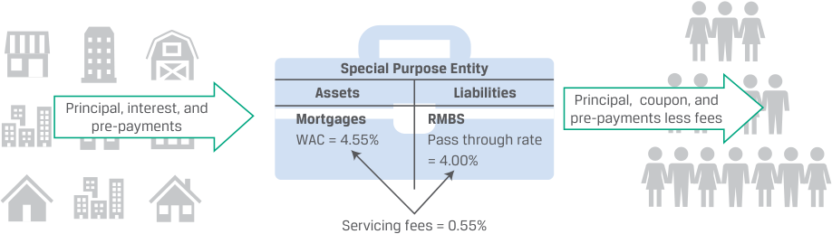
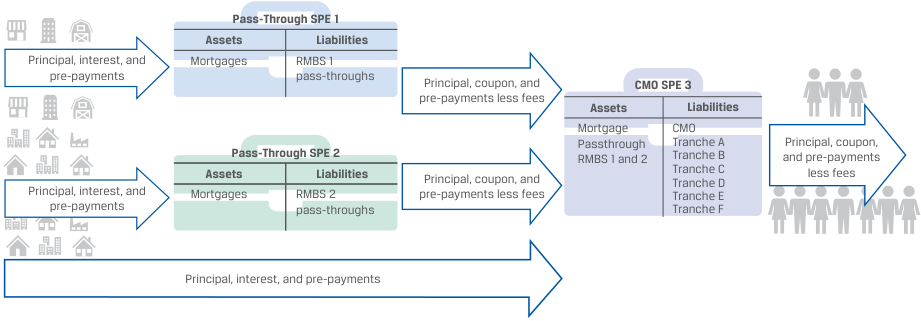
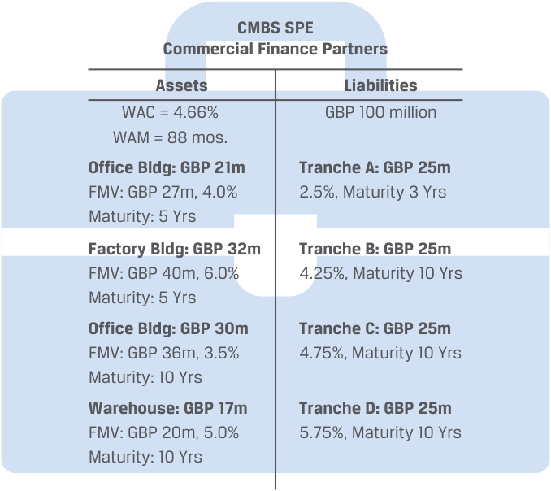
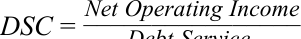
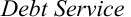

# Tập 6: Chứng khoán Thu nhập Cố định (Fixed Income)
## Learning Module 19 Mortgage-Backed Security (MBS) Instrument and Market Features (Trang PDF 507–546)

---

# Tập 6: Chứng Khoán Thu Nhập Cố Định (Fixed Income)
## Học phần 19: Đặc Điểm Công Cụ và Thị Trường Chứng Khoán Đảm Bảo Bằng Thế Chấp (MBS)
### Phần 1/3: Giới thiệu (Trang PDF 507–521)

---

<!-- PDF Page 507 -->

# H Ọ C P H Ầ N **<mark>19</mark>** 

### **Đặc Điểm Công Cụ và Thị Trường Chứng Khoán Đảm Bảo Bằng Thế Chấp (Mortgage-Backed Security (MBS) Instrument and Market Features)** 

| **MỤC TIÊU HỌC TẬP (LEARNING OUTCOMES)** | |
|---|---|
| **_Mức độ thành thạo_** | **_Ứng viên cần có khả năng:_** |
| | Định nghĩa rủi ro trả nợ trước hạn (*prepayment risk*) và mô tả các cấu trúc phân lớp theo thời gian (*time tranching structures*) trong các giao dịch chứng khoán hóa cùng mục đích của chúng |
| | Mô tả các đặc điểm nền tảng của các khoản vay thế chấp nhà ở (*residential mortgage loans*) được chứng khoán hóa |
| | Mô tả các loại hình và đặc điểm của chứng khoán đảm bảo bằng thế chấp nhà ở (*residential mortgage-backed securities* – RMBS), bao gồm chứng khoán chuyển tiếp dòng tiền thế chấp (*mortgage pass-through securities*) và nghĩa vụ nợ thế chấp có tài sản đảm bảo (*collateralized mortgage obligations* – CMO), đồng thời giải thích dòng tiền và rủi ro của từng loại |
| | Mô tả các đặc điểm và rủi ro của chứng khoán đảm bảo bằng thế chấp thương mại (*commercial mortgage-backed securities* – CMBS) |

<!-- Picture Text: 1  -->

#### **GIỚI THIỆU (INTRODUCTION)** 

Học phần này tiếp nối các học phần trước vốn đã cung cấp cái nhìn tổng quan về chứng khoán đảm bảo bằng tài sản (*Asset-backed securities* – ABS) và mô tả những lợi ích của chứng khoán hóa, quy trình chứng khoán hóa cũng như các cấu trúc chứng khoán hóa điển hình. Học phần này tập trung vào thị trường ABS lớn nhất thế giới: **chứng khoán đảm bảo bằng thế chấp (*Mortgage-backed securities* – MBS)**. Học phần giới thiệu các khoản vay thế chấp bất động sản (*mortgage loans*) và các đặc điểm đặc trưng của chúng; thảo luận về MBS nhà ở (*residential MBS* – RMBS), bao gồm chứng khoán chuyển tiếp dòng tiền thế chấp (*mortgage pass-through securities*) và nghĩa vụ nợ thế chấp có tài sản đảm bảo (*collateralized mortgage obligations* – CMO); và mô tả MBS thương mại (*commercial MBS* – CMBS). Học phần chỉ ra cách đo lường, giảm thiểu và chia sẻ các rủi ro liên quan đến chứng khoán hóa qua các lớp chứng khoán (*tranches*) khác nhau cùng đặc điểm của chúng, đồng thời xem xét dòng tiền và rủi ro của MBS.

<!-- PDF Page 508 -->

###### **TỔNG QUAN HỌC PHẦN (LEARNING MODULE OVERVIEW)** 

- **Rủi ro trả nợ trước hạn (*Prepayment risk*)** là rủi ro người đi vay không hoàn trả nợ gốc (hoặc một phần nợ gốc) theo đúng lịch trình đã định. **Rủi ro thu hẹp kỳ hạn (*Contraction risk*)** xảy ra khi người đi vay hoàn trả nợ gốc nhanh hơn dự kiến, trong khi **rủi ro kéo dài kỳ hạn (*Extension risk*)** xảy ra khi người đi vay hoàn trả nợ gốc chậm hơn so với kế hoạch.

- **Chứng khoán đảm bảo bằng thế chấp (*Mortgage-backed securities* – MBS)** là các trái phiếu được tạo ra từ việc chứng khoán hóa các khoản vay thế chấp bất động sản. Các khoản vay thế chấp cung cấp nguồn tiền cho người đi vay để mua bất động sản và yêu cầu người đi vay hoàn trả cho bên cho vay theo một lịch trình đã được hai bên thỏa thuận, nếu không bên cho vay có quyền tịch thu bất động sản đó.

- MBS có thể được tạo ra dựa trên các khoản thế chấp nhà ở hoặc thế chấp thương mại. Các trái phiếu được tạo ra từ việc chứng khoán hóa các khoản thế chấp được đảm bảo bằng bất động sản nhà ở được gọi là **chứng khoán đảm bảo bằng thế chấp nhà ở (*Residential mortgage-backed securities* – RMBS)**.

- Bởi vì cả các khoản hoàn trả nợ gốc theo lịch trình (*scheduled principal repayments*) và các khoản trả nợ trước hạn không theo lịch trình (*unscheduled prepayments*) đều được thực hiện trong suốt vòng đời của một MBS, nên kỳ hạn theo hợp đồng (*contractual maturity*) của một MBS không phản ánh đúng các khoản thanh toán và trả trước hạn thực tế của nó. **Thời gian đáo hạn bình quân gia quyền (*Weighted average life* – WAL)** là thước đo được sử dụng rộng rãi để đánh giá thời điểm mà một MBS dự kiến sẽ được hoàn trả hết.

- **Chứng khoán chuyển tiếp dòng tiền thế chấp (*Mortgage pass-through security*)** là một chứng khoán được tạo ra khi các tổ chức cho vay thế chấp tập hợp các khoản thế chấp lại với nhau và sử dụng chúng để đảm bảo cho các chứng khoán mà họ bán cho nhà đầu tư. Dòng tiền của một chứng khoán chuyển tiếp dòng tiền thế chấp phụ thuộc vào dòng tiền hàng tháng của danh mục các khoản thế chấp cơ sở.

- **Nghĩa vụ nợ thế chấp có tài sản đảm bảo (*Collateralized mortgage obligations* – CMO)** chứng khoán hóa các chứng khoán chuyển tiếp dòng tiền thế chấp hoặc nhiều danh mục khoản vay và được cấu trúc để phân phối lại dòng tiền cho các hạng trái phiếu hoặc lớp chứng khoán (*tranches*) khác nhau, qua đó tạo ra các chứng khoán có mức độ tiếp xúc khác nhau đối với rủi ro trả nợ trước hạn.

- Cấu trúc phân lớp (*tranching structure*) của một CMO có thể phân phối lại rủi ro trả nợ trước hạn qua các lớp chứng khoán khác nhau; một lớp chứng khoán càng có thứ tự ưu tiên cao (*more senior*), thì càng ít tiếp xúc với rủi ro trả nợ trước hạn và rủi ro vỡ nợ.

- **Chứng khoán đảm bảo bằng thế chấp thương mại (*Commercial mortgage-backed securities* – CMBS)** có thể chỉ bao gồm một vài khoản thế chấp thương mại cơ sở, và vì vậy chỉ một vụ vỡ nợ trong danh mục CMBS cũng có thể tác động đáng kể đến các nhà đầu tư CMBS. Các nhà đầu tư phải đánh giá **rủi ro tập trung (*concentration risk*)** đặc thù này bằng cách phân tích từng khoản vay và từng bất động sản riêng lẻ đảm bảo cho CMBS, bản thân những người sở hữu các bất động sản thương mại đó, cũng như cấu trúc của CMBS.

- Không giống như RMBS, CMBS mang lại cho các nhà đầu tư **sự bảo vệ trước rủi ro trả nợ trước hạn / thu hồi sớm (*call protection*)** ở cấp độ cấu trúc hoặc ở cấp độ từng khoản vay riêng lẻ và do đó được giao dịch giống với trái phiếu doanh nghiệp hơn là giống RMBS. Tuy nhiên, các khoản thế chấp thương mại thường bao gồm một khoản thanh toán gốc lớn một lần cuối kỳ (*balloon payment*) khi đáo hạn, làm cho CMBS dễ bị tổn thương hơn trước một dạng rủi ro kéo dài kỳ hạn gọi là **rủi ro thanh toán gốc lớn cuối kỳ (*balloon risk*)**.

<!-- PDF Page 509 -->

###### **TỰ ĐÁNH GIÁ (SELF-ASSESSMENT)** 

1. Phát biểu nào sau đây liên quan đến tỷ lệ khoản vay trên giá trị tài sản (*Loan-to-value ratio* – LTV) là _chính xác nhất_?

   - **A.** Tỷ lệ LTV của một khoản thế chấp nhất định giữ nguyên không đổi trong suốt vòng đời của khoản vay.

   - **B.** Tỷ lệ LTV càng cao thì bên cho vay càng được bảo vệ nhiều hơn trong trường hợp xảy ra vỡ nợ.

   - **C.** Tỷ lệ LTV đóng vai trò là một thước đo then chốt trong cả các khoản thế chấp nhà ở và thế chấp thương mại.

###### **Lời giải (Solution):** 

Đáp án đúng là C. Tỷ lệ LTV đóng vai trò là một thước đo then chốt trong cả các khoản thế chấp nhà ở và thế chấp thương mại. LTV được tính bằng tỷ lệ giữa quy mô của khoản vay thế chấp trên giá trị của bất động sản. A không đúng vì theo thời gian, tỷ lệ LTV sẽ thay đổi: Khi người đi vay thực hiện các khoản thanh toán thế chấp, bao gồm cả hoàn trả nợ gốc, số dư đang lưu hành của khoản vay sẽ giảm xuống và ngoài ra, những biến động trong giá trị thị trường của bất động sản cũng làm cho phần vốn chủ sở hữu (*equity*) của người đi vay thay đổi. B không đúng vì tỷ lệ LTV càng cao thì bên cho vay càng ít được bảo vệ hơn trong trường hợp xảy ra vỡ nợ.

2. Phát biểu nào sau đây liên quan đến chứng khoán đảm bảo bằng thế chấp (*Mortgage-backed securities* – MBS) là _chính xác nhất_? MBS:

   - **A.** bắt buộc phải được đảm bảo hoặc bảo lãnh bởi chính phủ hoặc một tổ chức bán chính phủ (*quasi-government entity*).

   - **B.** có thể được tạo ra bằng cách chứng khoán hóa các khoản thế chấp được đảm bảo bằng bất động sản nhà ở hoặc bất động sản thương mại.

   - **C.** sử dụng các biện pháp tăng cường tín dụng để giảm rủi ro tín dụng cho các chứng khoán đảm bảo bằng thế chấp nhà ở thường là các RMBS của tổ chức chính phủ (*agency RMBS*).

###### **Lời giải (Solution):** 

Đáp án đúng là B. Các khoản thế chấp trong MBS có thể là thế chấp nhà ở hoặc thế chấp thương mại. A không đúng vì MBS không bắt buộc phải được bảo lãnh bởi chính phủ hoặc một tổ chức bán chính phủ. Tuy nhiên, khi các khoản thế chấp này hoặc các chứng khoán phát hành được đảm bảo bằng các khoản thế chấp này được chính phủ bảo lãnh, sẽ có sự hỗ trợ về mặt tín dụng. Các MBS đảm bảo bằng thế chấp nhà ở được phát hành bởi các tổ chức tư nhân và không được bảo lãnh bởi một cơ quan liên bang hoặc một doanh nghiệp được chính phủ bảo trợ (*government-sponsored enterprise* – GSE) được gọi là **"RMBS phi chính phủ / tư nhân" (*"non-agency RMBS"*)**. C không đúng vì chính các RMBS tư nhân (*non-agency RMBS*), chứ không phải RMBS của tổ chức chính phủ (*agency RMBS*), mới thường sử dụng các biện pháp tăng cường tín dụng — chẳng hạn như bảo hiểm, thư tín dụng, bảo lãnh, hoặc quyền lợi phân tầng xếp sau (*subordinated interests*) — để giảm thiểu rủi ro tín dụng và cải thiện chất lượng tổng thể của danh mục thế chấp. Những chứng khoán này bao gồm các biện pháp tăng cường tín dụng bởi vì chúng không được bảo lãnh hoặc bảo hiểm bởi một cơ quan chính phủ hay bởi một GSE.

3. Khi một khoản vay thế chấp được sử dụng làm tài sản thế chấp cho một chứng khoán chuyển tiếp dòng tiền thế chấp (*mortgage pass-through security*), khoản thế chấp đó _nhiều khả năng nhất_ được gọi là đã được:

   - **A.** tăng cường tín dụng (*enhanced*).

   - **B.** chứng khoán hóa (*securitized*).

<!-- PDF Page 510 -->

   - **C.** phân tầng xếp sau (*subordinated*).

###### **Lời giải (Solution):** 

Đáp án đúng là B. Khi một khoản vay thế chấp được sử dụng làm tài sản thế chấp cho một chứng khoán chuyển tiếp dòng tiền thế chấp, khoản thế chấp đó được gọi là đã được chứng khoán hóa (*securitized*). A và C không đúng vì một khoản thế chấp được sử dụng làm tài sản thế chấp cho một chứng khoán chuyển tiếp dòng tiền thế chấp được gọi là _đã được chứng khoán hóa_, chứ không phải được tăng cường tín dụng hay phân tầng xếp sau.

4. Cấu trúc nào sau đây được tạo ra thông qua việc phân lớp theo thời gian (*time tranching*)?

   - **A.** Lớp chứng khoán tích lũy Z (*Z-tranches*)

   - **B.** Lớp chứng khoán lãi suất thả nổi (*Floating-rate tranches*)

   - **C.** Chứng khoán chỉ trả gốc (*Principal-only (PO) securities*)

###### **Lời giải (Solution):** 

Đáp án đúng là A. Lớp chứng khoán Z (*Z-tranches*) và lớp chứng khoán phần dư (*residual tranches*) được tạo ra thông qua việc phân lớp theo thời gian (*time tranching*), có nghĩa là chúng không chi trả các khoản thanh toán tiền lãi cho đến một ngày đã được thiết lập trước. B không đúng vì các lớp chứng khoán lãi suất thả nổi mang lãi suất được liên kết với một chỉ số hoặc một lãi suất tham chiếu thị trường (MRR) và được sử dụng để phòng vệ rủi ro lãi suất trong danh mục đầu tư. C không đúng vì chứng khoán chỉ trả gốc (PO) chỉ chi trả các khoản hoàn trả nợ gốc từ danh mục và có thể được tạo ra từ việc tách dòng tiền của chứng khoán chuyển tiếp dòng tiền thế chấp hoặc như một lớp chứng khoán trong một CMO.

5. Rủi ro nào sau đây _nhiều khả năng nhất_ giải thích tại sao kỳ hạn thực tế của một MBS lại giảm xuống khi lãi suất giảm?

   - **A.** Rủi ro thanh toán gốc lớn cuối kỳ (*Balloon risk*)

   - **B.** Rủi ro kéo dài kỳ hạn (*Extension risk*)

   - **C.** Rủi ro thu hẹp kỳ hạn (*Contraction risk*)

###### **Lời giải (Solution):** 

Đáp án đúng là C. Rủi ro thu hẹp kỳ hạn (*Contraction risk*) là rủi ro người đi vay có thể hoàn trả số tiền đã vay nhanh hơn so với dự kiến, làm giảm tổng số tiền thanh toán trong tương lai mà nhà đầu tư nhận được. Khi lãi suất giảm xuống, mức trả nợ trước hạn thực tế sẽ cao hơn dự báo bởi vì những người sở hữu nhà sẽ có xu hướng tái cấp vốn (*refinance*) cho các khoản vay thế chấp của họ. A không đúng vì rủi ro thanh toán gốc lớn cuối kỳ (*balloon risk*) xảy ra khi người đi vay không thực hiện được khoản thanh toán gốc lớn cuối kỳ khi đáo hạn của một khoản vay có cấu trúc trả gốc cuối kỳ; đó là một dạng của rủi ro kéo dài kỳ hạn. B không đúng vì rủi ro kéo dài kỳ hạn (*extension risk*) là rủi ro người đi vay có thể hoàn trả số tiền đã vay chậm hơn so với dự kiến, làm kéo dài thay vì rút ngắn thời gian hoàn trả và kỳ hạn của trái phiếu.

6. Phát biểu nào sau đây liên quan đến chứng khoán đảm bảo bằng thế chấp (MBS) là đúng?

   - **A.** Kỳ hạn theo hợp đồng (*contractual maturity*) của một MBS dự báo chính xác các khoản thanh toán và trả nợ trước hạn trong tương lai.

   - **B.** Một thước đo được những người tham gia thị trường sử dụng rộng rãi đối với MBS là thời gian đáo hạn bình quân gia quyền (*weighted average life*), hay đơn giản là thời gian sống trung bình (*average life*), của MBS đó.

<!-- PDF Page 511 -->

   - **C.** Một trái phiếu doanh nghiệp không có quyền chọn kỳ hạn 30 năm và một MBS có kỳ hạn pháp lý 30 năm với cùng mức lãi suất coupon có mức rủi ro lãi suất tương đương nhau.

###### **Lời giải (Solution):** 

Đáp án đúng là B. Một thước đo được những người tham gia thị trường sử dụng rộng rãi đối với MBS là thời gian đáo hạn bình quân gia quyền (*weighted average life*), hay đơn giản là thời gian sống trung bình (*average life*), của MBS. Thước đo này cung cấp cho các nhà đầu tư một chỉ báo về khoảng thời gian mà họ có thể kỳ vọng nắm giữ MBS trước khi nó được hoàn trả hết, với giả định lãi suất duy trì ở mức hiện tại và do đó mức trả nợ trước hạn dự kiến sẽ diễn ra đúng như kỳ vọng. A không đúng vì kỳ hạn theo hợp đồng của một MBS _không_ phản ánh đúng các khoản thanh toán và trả nợ trước hạn thực tế của nó. Các khoản hoàn trả nợ gốc không theo lịch trình sẽ làm rút ngắn kỳ hạn của một MBS, nhưng mô hình hoàn trả được thúc đẩy bởi những dịch chuyển của lãi suất vốn không thể biết trước một cách chắc chắn. C không đúng vì một trái phiếu doanh nghiệp không có quyền chọn kỳ hạn 30 năm sẽ không có các khoản trả nợ trước hạn / tốc độ trả nợ trước hạn giống như một MBS có kỳ hạn pháp lý 30 năm với cùng mức lãi suất coupon, và do đó sẽ không có rủi ro lãi suất tương đương.

7. Một sự khác biệt lớn giữa chứng khoán đảm bảo bằng thế chấp nhà ở (RMBS) và chứng khoán đảm bảo bằng thế chấp thương mại (CMBS) là:

   - **A.** CMBS chứng khoán hóa các khoản thế chấp đủ tiêu chuẩn (*conforming mortgages*) và được thế chấp bằng các bất động sản đồng nhất (*homogeneous properties*) so với các bất động sản đảm bảo cho một RMBS.

   - **B.** các nhà đầu tư phải đánh giá từng khoản vay và từng bất động sản riêng lẻ đảm bảo cho một CMBS cũng như bản thân những người sở hữu các bất động sản thương mại đó.

   - **C.** một danh mục CMBS có thể bao gồm hàng nghìn khoản thế chấp từ nhiều vùng khác nhau của một quốc gia, trong khi một RMBS có thể chỉ bao gồm một vài khoản thế chấp nhà ở đồng nhất.

###### **Lời giải (Solution):** 

Đáp án đúng là B. CMBS có thể chỉ bao gồm một vài khoản thế chấp thương mại cơ sở, trong khi một danh mục RMBS có thể bao gồm hàng nghìn khoản thế chấp từ nhiều vùng khác nhau của một quốc gia. Do đó, một vụ vỡ nợ trong danh mục CMBS có thể gây ra tác động đáng kể đối với các nhà đầu tư CMBS. Các nhà đầu tư vào CMBS phải xem xét một cách rõ ràng rủi ro tập trung (*concentration risk*) đặc thù này bằng cách không chỉ phân tích cấu trúc CMBS mà còn phân tích từng khoản vay và từng bất động sản riêng lẻ đảm bảo cho CMBS cũng như bản thân những người sở hữu các bất động sản thương mại đó. A không đúng vì RMBS, chứ không phải CMBS, mới chứng khoán hóa các khoản thế chấp đủ tiêu chuẩn và được thế chấp bằng các bất động sản nhà ở (dành cho một hộ gia đình) có tính chất đồng nhất. C không đúng vì một danh mục RMBS, chứ không phải danh mục CMBS, mới có thể bao gồm hàng nghìn khoản thế chấp từ nhiều vùng khác nhau của một quốc gia, trong khi CMBS có thể chỉ bao gồm một vài khoản thế chấp thương mại cơ sở.

8. Phát biểu nào sau đây liên quan đến **tỷ số khả năng trang trải nghĩa vụ nợ (*Debt service coverage ratio* – DSC)** — một chỉ báo then chốt về hiệu quả tín dụng tiềm năng trong cho vay bất động sản thương mại — là _chính xác nhất_? Tỷ số DSC:

   - **A.** bằng thu nhập hoạt động ròng (*Net operating income* – NOI) hàng năm của bất động sản chia cho tổng nghĩa vụ trả nợ (*debt service*) của nó.

   - **B.** được tính bằng tỷ lệ giữa quy mô của khoản vay trên giá trị của bất động sản cơ sở.

<!-- PDF Page 512 -->

   - **C.** lớn hơn 1,0 cho thấy rằng dòng tiền từ bất động sản không đủ để trang trải nghĩa vụ trả nợ trong khi vẫn duy trì bất động sản ở trạng thái bảo dưỡng ban đầu.

###### **Lời giải (Solution):** 

Đáp án đúng là A. Tỷ số DSC bằng thu nhập hoạt động ròng (NOI) hàng năm của bất động sản chia cho tổng nghĩa vụ trả nợ (*debt service*) của nó. NOI được định nghĩa là thu nhập cho thuê trừ đi chi phí hoạt động bằng tiền mặt và quỹ dự trữ thay thế tài sản (*replacement reserve*). Nghĩa vụ trả nợ (*debt service*) là tổng số tiền thanh toán lãi và hoàn trả nợ gốc hàng năm. B không đúng vì tỷ lệ giữa quy mô của khoản vay trên giá trị của bất động sản cơ sở là tỷ lệ LTV — một chỉ báo then chốt khác về hiệu quả tín dụng tiềm năng — chứ không phải DSC. C không đúng vì tỷ số DSC lớn hơn 1,0 cho thấy rằng dòng tiền từ bất động sản là _đủ_ (chứ không phải không đủ) để trang trải nghĩa vụ trả nợ trong khi vẫn duy trì bất động sản ở trạng thái bảo dưỡng ban đầu.

## **<mark>2</mark>** 

#### **PHÂN LỚP THEO THỜI GIAN (TIME TRANCHING)** 

**Mục tiêu học tập:** Định nghĩa rủi ro trả nợ trước hạn (*prepayment risk*) và mô tả các cấu trúc phân lớp theo thời gian (*time tranching structures*) trong các giao dịch chứng khoán hóa cùng mục đích của chúng.

Dòng tiền của các chứng khoán chuyển tiếp dòng tiền ABS và MBS mang tính bất định bởi vì các khoản thanh toán theo lịch trình và các khoản thanh toán thực tế thường xuyên khác biệt nhau. Hành vi của người đi vay, chẳng hạn như việc trả sớm tiền lãi và tiền gốc cũng như tình trạng quá hạn thanh toán (*payment delinquencies*) trong suốt vòng đời của khoản vay, phụ thuộc vào một số yếu tố, bao gồm thu nhập của người đi vay (thu nhập hộ gia đình hoặc dòng tiền đối với một doanh nghiệp), các điều khoản và điều kiện của khoản vay (chẳng hạn như lãi suất ban đầu so với lãi suất hiện hành và bất kỳ khoản phạt trả nợ trước hạn nào), và việc bán đi tài sản cơ sở đang được tài trợ. Để định giá chính xác các chứng khoán này, các nhà đầu tư phải đưa ra một số giả định nhất định về các khoản thanh toán theo hợp đồng dự kiến sau khi đã tính đến rủi ro trả nợ trước hạn. **Rủi ro trả nợ trước hạn (*Prepayment risk*)** là rủi ro tiền gốc hoặc một phần tiền gốc được người đi vay hoàn trả theo một tốc độ khác biệt so với kế hoạch thanh toán theo lịch trình đã thỏa thuận trong hợp đồng. Rủi ro trả nợ trước hạn có hai thành phần: rủi ro thu hẹp kỳ hạn (*contraction risk*) và rủi ro kéo dài kỳ hạn (*extension risk*), cả hai đều phản ánh những thay đổi trong mặt bằng lãi suất chung.

##### **Rủi ro Trả nợ trước hạn (Prepayment Risk)** 

Khi lãi suất giảm xuống, mức trả nợ trước hạn thực tế đối với các khoản vay thế chấp lãi suất cố định sẽ cao hơn dự báo bởi vì những người sở hữu nhà sẽ tái cấp vốn (*refinance*) ở mức lãi suất thấp hơn. Việc tái cấp vốn khoản vay thế chấp đặc biệt phổ biến tại Hoa Kỳ do không có các khoản phạt trả nợ trước hạn — điều vốn phổ biến hơn ở các quốc gia khác. Do đó, kỳ hạn thực tế của một MBS sẽ ngắn hơn so với những gì được dự kiến tại thời điểm mua. **Rủi ro thu hẹp kỳ hạn (*Contraction risk*)** là rủi ro người đi vay hoàn trả nợ gốc hoặc một phần nợ gốc trong khoảng thời gian ngắn hơn so với lịch trình thanh toán đã thỏa thuận trong hợp đồng, làm giảm tổng số tiền thanh toán trong tương lai mà nhà đầu tư nhận được. Đối với các nhà đầu tư, điều này gây ra hai hệ quả bất lợi. Thứ nhất, các nhà đầu tư buộc phải tái đầu tư số tiền thu hồi được ở mức lãi suất thấp hơn (rủi ro tái đầu tư). Thứ hai, quyền chọn trả nợ trước hạn làm hạn chế tiềm năng tăng giá (*price appreciation*) của trái phiếu.

Khi lãi suất tăng lên, mức trả nợ trước hạn thực tế sẽ thấp hơn dự báo bởi vì những người sở hữu nhà sẽ ít có khả năng tái cấp vốn cho khoản vay thế chấp của mình và thậm chí có thể trì hoãn việc mua nhà mới. Do đó, kỳ hạn thực tế của một MBS sẽ dài hơn so với những gì được dự kiến tại thời điểm mua. **Rủi ro kéo dài kỳ hạn (*Extension risk*)** là rủi ro người đi vay

<!-- PDF Page 513 -->

hoàn trả nợ gốc hoặc một phần nợ gốc trong khoảng thời gian dài hơn so với lịch trình thanh toán đã thỏa thuận trong hợp đồng. Đối với các nhà đầu tư, điều này gây ra những hệ quả bất lợi: Lãi suất cao hơn làm giảm giá trị hiện tại của các dòng tiền mà nhà đầu tư nhận được. Do đó, các khoản thanh toán mà nhà đầu tư nhận được sẽ bị chiết khấu ở mức lãi suất cao hơn, đồng thời sự kéo dài kỳ hạn làm dàn trải thời gian nhận các khoản thanh toán của nhà đầu tư ra xa hơn.

Cấu trúc của một giao dịch chứng khoán hóa cũng có thể cho phép phân phối lại "rủi ro trả nợ trước hạn" giữa các hạng trái phiếu. Một phương pháp để giảm thiểu rủi ro này là tạo ra các hạng trái phiếu sở hữu các kỳ hạn dự kiến (*expected maturities*) khác nhau. Điều này được gọi là **phân lớp theo thời gian (*time tranching*)**. Chẳng hạn, một danh mục chứng khoán hóa có thể bao gồm **phân lớp tuần tự (*sequential tranching*)**, trong đó các khoản hoàn trả nợ gốc chảy trước tiên vào một lớp chứng khoán cho đến khi nợ gốc của lớp đó được hoàn trả đầy đủ, rồi sau đó mới chảy sang lớp chứng khoán tuần tự tiếp theo cho đến khi nợ gốc của lớp đó được hoàn trả hết.

###### **VÍ DỤ 1 (EXAMPLE 1)** 

##### **Phân lớp theo Thời gian với Cấu trúc Thác nước đối với MBS của RLT (Time Tranching with Waterfall for RLT MBS)** 

Nếu Residential Loan Trust (RLT) phát hành các chứng khoán MBS với kỳ hạn dự kiến khác nhau theo từng hạng trái phiếu, thay vì tất cả các MBS đều đáo hạn sau 4 năm, thì các nhà đầu tư MBS cũng có thể lựa chọn trái phiếu dựa trên kỳ hạn dự kiến của chúng. Tuy nhiên, các nhà đầu tư vẫn có thể phải đối mặt với rủi ro trả nợ trước hạn hoặc rủi ro kéo dài kỳ hạn trong trường hợp này. Các ngày đáo hạn cụ thể được ghi nhận trong Bảng minh họa 1 (*Exhibit 1*).

**Bảng minh họa 1: Tổng quan các Kỳ phiếu Phát hành bởi Residential Loan Trust – Tóm tắt Ngắn gọn các Điều khoản Đáo hạn (Exhibit 1: Overview of Notes Issued by Residential Loan Trust – Brief Summary of Maturity Terms)** 

| **Kỳ hạn của các Kỳ phiếu Đảm bảo bằng Thế chấp Phát hành bởi Residential Loan Trust** | |
|---|---|
| **Tổ chức phát hành (*Issuer*):** | Residential Loan Trust (RLT) |
| **Vị thế và Thứ tự Ưu tiên Thanh toán (*Status and Ranking of Payments*)** | **Các lớp chứng khoán (*Tranches*)** |
| Kỳ phiếu Hạng A có thứ tự ưu tiên cao hơn (*rank senior to*) Kỳ phiếu Hạng B, C & D. | **Kỳ phiếu Lớp A (*Tranche A Notes*)** Mệnh giá: 825 triệu EUR Lãi suất: MRR + 0,50% Kỳ hạn (*Maturity*): Một năm |
| Kỳ phiếu Hạng B có thứ tự ưu tiên cao hơn Kỳ phiếu Hạng C & D và xếp sau (*rank junior to*) Kỳ phiếu Hạng A. | **Kỳ phiếu Lớp B (*Tranche B Notes*)** Mệnh giá: 100 triệu EUR Lãi suất: MRR + 1,50% Kỳ hạn (*Maturity*): Hai năm |
| Kỳ phiếu Hạng C có thứ tự ưu tiên cao hơn Kỳ phiếu Hạng D và xếp sau Kỳ phiếu Hạng A & B. | **Kỳ phiếu Lớp C (*Tranche C Notes*)** Mệnh giá: 50 triệu EUR Lãi suất: MRR + 2,50% Kỳ hạn (*Maturity*): Ba năm |
| Kỳ phiếu Hạng D sẽ xếp sau Kỳ phiếu Hạng A, B & C. | **Kỳ phiếu Lớp D (*Tranche D Notes*)** Mệnh giá: 25 triệu EUR Lãi suất: Biến đổi (*Variable*) Kỳ hạn (*Maturity*): Bốn năm |
| **Thanh toán Nợ gốc (*Principal Payment*):** | Được thanh toán vào [Ngày đáo hạn (*Maturity Date*)] |
| **Thứ tự ưu tiên (*Seniority*):** | Các Kỳ phiếu là nghĩa vụ nợ có bảo đảm của RLT. |
| **Ngày làm việc (*Business Days*):** | Frankfurt |

Đối với nhà đầu tư mua 5 triệu EUR phân bổ giữa kỳ phiếu Lớp B và Lớp C, việc trả nợ trước hạn của các khoản vay có thể tác động đến thời điểm hoàn trả nợ gốc như được ghi chú dưới đây:

<!-- PDF Page 514 -->

| **Khoản mua MBS RLT Ban đầu của Nhà đầu tư** | **Số tiền mua** | **Thời điểm Hoàn trả Nợ gốc nếu Không có Trả nợ trước hạn trong Danh mục Tài sản thế chấp RLT** | **Thời điểm Hoàn trả Nợ gốc nếu Lãi suất Giảm vào đầu Năm thứ hai, Thúc đẩy Trả nợ trước hạn Ngay lập tức trong Danh mục RLT** |
|---|---|---|---|
| Kỳ phiếu Hạng A (*Class A Notes*) | 0 triệu EUR | Một năm, theo điều khoản MBS | Một năm, theo điều khoản MBS |
| Kỳ phiếu Hạng B (*Class B Notes*) | 3 triệu EUR | Hai năm, theo điều khoản MBS | Ngắn hơn hai năm (*Less than two years*) |
| Kỳ phiếu Hạng C (*Class C Notes*) | 2 triệu EUR | Ba năm, theo điều khoản MBS | Ngắn hơn ba năm (*Less than three years*) |
| Kỳ phiếu Hạng D (*Class D Notes*) | 0 triệu EUR | Bốn năm, theo điều khoản MBS | Ngắn hơn bốn năm (*Less than four years*) |

Chúng ta sẽ cần thêm thông tin về giá trị của tất cả các khoản trả nợ trước hạn và thời điểm chính xác của chúng để xác định ngày hoàn trả nợ gốc chính xác. Như được thấy trong Bảng minh họa 1, một giao dịch chứng khoán hóa hoàn toàn có thể — và trên thực tế là khá phổ biến — có các cấu trúc kết hợp cả **phân lớp tín dụng (*credit tranching* — cấu trúc phân tầng thứ bậc ưu tiên)** và **phân lớp theo thời gian (*time tranching* — các kỳ hạn dự kiến khác nhau)**.

###### **VÍ DỤ 2 (EXAMPLE 2)** 

##### **Bê bối Khí thải của Volkswagen (Volkswagen Emissions Scandal)** 

Các nhà đầu tư phải tiếp xúc với một số loại rủi ro đặc thù (*idiosyncratic risks*) nhất định khi mua chứng khoán đảm bảo bằng tài sản (ABS). Đối với những người mua ABS khoản vay mua ô tô (*auto ABS*), các đợt triệu hồi xe lớn của nhà sản xuất ô tô là một rủi ro đã được biết đến đối với các nhà đầu tư trái phiếu. Năm 2015, Ủy ban Chứng khoán và Giao dịch Hoa Kỳ (SEC) đã cáo buộc Volkswagen (VW), một trong những nhà sản xuất ô tô lớn nhất thế giới, và Giám đốc điều hành (CEO) của hãng là Martin Winterkorn về hành vi lừa dối các nhà đầu tư Hoa Kỳ trong vụ bê bối khí thải (vụ bê bối "Dieselgate"). Volkswagen sau đó đã thừa nhận rằng hãng đã gian lận trong các bài kiểm tra khí thải động cơ diesel, và sự thừa nhận này đã thổi bay hàng tỷ euro khỏi giá trị vốn hóa thị trường của công ty cũng như dẫn đến việc từ chức của Winterkorn. Vụ bê bối khí thải làm rung chuyển Volkswagen cũng tác động mạnh đến các chứng khoán ABS gắn liền với các khoản vay và hợp đồng thuê ô tô. Doanh số phát hành ABS ô tô đã bùng nổ trong những năm ngay trước vụ bê bối khi các nhà đầu tư tìm kiếm các sản phẩm có lợi suất cao hơn trong bối cảnh môi trường lãi suất thấp.

Khoảng 5,6 tỷ USD chứng khoán ABS ô tô của VW đang lưu hành vào năm 2015, với 4,39 tỷ USD đến từ các trái phiếu được đảm bảo bằng các khoản vay và hợp đồng thuê xe của người tiêu dùng. Volkswagen, khi phải đối mặt với các khoản tiền phạt và kiện tụng tiềm ẩn, đã nhận thấy khả năng thu hút khách hàng mới của mình tạm thời bị sụt giảm, đẩy giá trị của những chiếc xe làm tài sản thế chấp cho các khoản vay đó đi xuống. Có 1,25 tỷ USD trái phiếu được đảm bảo bằng hàng tồn kho xe VW của các đại lý ô tô, được gọi là **ABS tài trợ tồn kho đại lý (*dealer floorplan ABS*)**. Đối với ABS tài trợ tồn kho đại lý, quỹ tín thác ABS được hưởng lợi từ sự hỗ trợ tài chính của VW, bao gồm nhưng không giới hạn ở cam kết của VW về việc mua lại các xe mới chưa bán được và hàng tồn kho. Các đại lý ô tô, khi bị yêu cầu dừng ngay lập tức việc bán các mẫu xe đời 2015 và 2016 phổ biến — bao gồm cả mẫu xe mui trần Jetta và Beetle của Volkswagen — đã bị mắc kẹt với lượng sản phẩm không thể bán được. Các đại lý tồn đọng một lượng lớn xe không thể tiêu thụ, vì vậy vòng quay hàng tồn kho không diễn ra nhanh như trước. Loại chứng khoán ABS chịu ảnh hưởng bất lợi nặng nề nhất bởi lệnh ngừng bán một số mẫu xe chạy dầu diesel đời 2015 và 2016 của VW chính là chứng khoán hóa tài trợ tồn kho đại lý (*dealer floorplan securitization*).

<!-- PDF Page 515 -->

Các nhà đầu tư nợ đã đòi hỏi mức đền bù rủi ro cao hơn từ Volkswagen sau khi công ty cho biết vụ bê bối gian lận khí thải sẽ tiêu tốn của hãng hơn 6,5 tỷ EUR. Volkswagen, một tổ chức phát hành thường xuyên trên thị trường chứng khoán đảm bảo bằng tài sản tại châu Âu, cho biết 2,6 tỷ EUR các khoản vay hoặc hợp đồng thuê đối với các phương tiện được chế tạo với động cơ sử dụng phần mềm gian lận đã được đóng gói vào trong các giao dịch chứng khoán hóa của hãng.

Cuối năm 2015, Volkswagen đã chào bán một đợt ABS ô tô mới với mức phần bù lợi suất (*yield premium*) lớn gấp ba lần so với một thương vụ tương tự vào đầu năm đó. Nhà sản xuất ô tô của Đức đã phải đề nghị trả cao hơn khoảng 60 bps đến 65 bps so với lãi suất chuẩn cho các kỳ phiếu xếp hạng cao nhất của giao dịch chứng khoán hóa hợp đồng thuê ô tô. Để so sánh, Volkswagen chỉ phải trả mức chênh lệch (*spread*) 20 bps trên lãi suất chào bán liên ngân hàng đồng euro kỳ hạn 1 tháng (Euribor) cho khoản nợ tương tự vào tháng 4 năm 2015.

###### **BỘ CÂU HỎI (QUESTION SET)** 

1. Việc tạo ra các hạng trái phiếu sở hữu các kỳ hạn dự kiến (*expected maturities*) khác nhau được gọi là:

   - **A.** phân tầng thứ bậc ưu tiên (*subordination*).

   - **B.** phân lớp theo thời gian (*time tranching*).

   - **C.** phân lớp tín dụng (*credit tranching*).

###### **Lời giải (Solution):** 

Đáp án đúng là B. Một phương pháp để giảm thiểu "rủi ro trả nợ trước hạn" hoặc "rủi ro kéo dài kỳ hạn" giữa các hạng trái phiếu là tạo ra các hạng trái phiếu sở hữu các kỳ hạn dự kiến khác nhau. Điều này được gọi là phân lớp theo thời gian (*time tranching*). A và C không đúng vì phân tầng thứ bậc ưu tiên (*subordination*), còn thường được gọi là cấu trúc "thác nước" (*waterfall structure*), bao gồm việc phân bổ các khoản lỗ vào các hạng trái phiếu cấp thấp trước các hạng trái phiếu cấp cao, chứ không phải tạo ra các hạng trái phiếu có kỳ hạn dự kiến khác nhau.

2. Xác định phát biểu nào sau đây liên quan đến các sản phẩm chứng khoán hóa là chính xác nhất:

   - **A.** Với việc phân lớp theo thời gian (*time tranching*), các lớp chứng khoán của một CMO khấu hao gốc dần theo thời gian và tất cả các lớp chứng khoán đều đáo hạn vào cùng một thời điểm.

   - **B.** Chứng khoán chuyển tiếp dòng tiền (*Pass-through securities*) là cấu trúc chứng khoán hóa đơn giản nhất và bao gồm việc tổ chức phát hành giữ lại các tài sản cơ sở.

   - **C.** Trong một giao dịch chứng khoán hóa thực sự (*true securitization*), danh mục tài sản cơ sở được loại bỏ khỏi bảng cân đối kế toán và chuyển giao sang một pháp nhân độc lập — tổ chức sẽ phát hành các chứng khoán được đảm bảo bằng những tài sản này.

###### **Lời giải (Solution):** 

Đáp án đúng là C. Trong một giao dịch chứng khoán hóa thực sự, danh mục tài sản cụ thể được loại bỏ khỏi bảng cân đối kế toán và chuyển giao sang một pháp nhân độc lập và tách biệt — pháp nhân sau đó sẽ phát hành các chứng khoán được đảm bảo bằng các tài sản tập hợp này. A không đúng vì phân lớp theo thời gian là một phương pháp nhằm giảm rủi ro trả nợ trước hạn hoặc rủi ro kéo dài kỳ hạn bằng cách tạo ra các hạng trái phiếu sở hữu các kỳ hạn dự kiến khác nhau. B không đúng vì trái phiếu có bảo đảm (*covered bonds*), chứ không phải chứng khoán chuyển tiếp dòng tiền, mới là cấu trúc chứng khoán hóa đơn giản nhất; chúng bao gồm việc tổ chức phát hành giữ lại các tài sản cơ sở trên bảng cân đối kế toán của mình.

<!-- PDF Page 516 -->

3. Việc phát hành các hạng trái phiếu có tài sản đảm bảo với các kỳ hạn dự kiến khác nhau _nhiều khả năng nhất_ được thiết kế để giảm thiểu:

   - **A.** rủi ro tín dụng (*credit risk*).

   - **B.** rủi ro vỡ nợ (*default risk*).

   - **C.** rủi ro trả nợ trước hạn (*prepayment risk*).

###### **Lời giải (Solution):** 

Đáp án đúng là C. Rủi ro trả nợ trước hạn là sự bất định về việc dòng tiền sẽ khác biệt so với dòng tiền theo lịch trình đã quy định trong hợp đồng thuê/vay do khả năng thay đổi tiến độ thanh toán của bên đi thuê/đi vay. Việc tạo ra các hạng trái phiếu có kỳ hạn dự kiến khác nhau, được gọi là phân lớp theo thời gian (*time tranching*), cho phép phân phối lại rủi ro trả nợ trước hạn giữa các hạng trái phiếu. A không đúng vì rủi ro tín dụng liên quan đến rủi ro vỡ nợ ở các tài sản đảm bảo cho trái phiếu chứ không phải thời điểm thanh toán, và B không đúng vì rủi ro vỡ nợ cũng lại liên quan đến rủi ro mất khả năng thanh toán ở các tài sản cơ sở.

4. _Xác định các câu trả lời đúng để hoàn thành các câu sau đây:_

_______ là rủi ro người đi vay có thể hoàn trả số tiền đã vay nhanh hơn dự kiến, làm giảm tổng số tiền thanh toán trong tương lai mà nhà đầu tư nhận được. _______ là rủi ro người đi vay có thể hoàn trả số tiền đã vay chậm hơn dự kiến, làm kéo dài thời gian hoàn trả và kỳ hạn của trái phiếu.

###### **Lời giải (Solution):** 

_Rủi ro thu hẹp kỳ hạn (Contraction risk)_ là rủi ro người đi vay có thể hoàn trả số tiền đã vay nhanh hơn dự kiến, làm giảm tổng số tiền thanh toán trong tương lai mà nhà đầu tư nhận được. _Rủi ro kéo dài kỳ hạn (Extension risk)_ là rủi ro người đi vay có thể hoàn trả số tiền đã vay chậm hơn dự kiến, làm kéo dài thời gian hoàn trả và kỳ hạn của trái phiếu.

## **<mark>3</mark>** 

#### **CÁC KHOẢN VAY THẾ CHẤP VÀ ĐẶC ĐIỂM ĐẶC TRƯNG CỦA CHÚNG (MORTGAGE LOANS AND THEIR CHARACTERISTIC FEATURES)** 

**Mục tiêu học tập:** Mô tả các đặc điểm nền tảng của các khoản vay thế chấp nhà ở (*residential mortgage loans*) được chứng khoán hóa.

Bài học này mô tả những đặc điểm nền tảng của các khoản vay thế chấp bất động sản — viên gạch xây dựng nên thị trường ABS lớn nhất thế giới: thị trường **chứng khoán đảm bảo bằng thế chấp (*Mortgage-backed securities* – MBS)**. **MBS** là các trái phiếu được tạo ra từ việc chứng khoán hóa các khoản vay thế chấp. Một **khoản vay thế chấp (*mortgage loan*)** được bảo đảm bằng tài sản thế chấp là một bất động sản xác định, buộc người đi vay phải thực hiện một chuỗi các khoản thanh toán đã được xác định trước cho bên cho vay. Bên cho vay thế chấp có **quyền ưu tiên cầm cố/thế chấp thứ nhất (*first lien*)** và quyền lợi bảo đảm (*security interest*) đối với bất động sản đó, trao cho bên cho vay quyền tịch thu tài sản thế chấp nếu người đi vay không thanh toán theo đúng thỏa thuận. Khi xảy ra **vỡ nợ (*default*)** đối với khoản vay thế chấp, bên cho vay có thể tiến hành tịch thu/xử lý tài sản thế chấp đối với bất động sản đó. **Việc tịch thu tài sản thế chấp (*Foreclosure*)** sẽ cho phép bên cho vay nắm quyền sở hữu bất động sản và cuối cùng bán bất động sản đó đi để thu hồi tiền nhằm thanh toán nghĩa vụ nợ đang lưu hành.

<!-- PDF Page 517 -->

Thông thường, số tiền vay được giải ngân để mua bất động sản nhỏ hơn giá mua bất động sản đó: Phần chênh lệch chính là **khoản trả trước / vốn tự có ban đầu (*down payment*)**. Tỷ lệ giữa số tiền của khoản vay thế chấp trên giá trị của bất động sản được gọi là **tỷ lệ khoản vay trên giá trị tài sản (*Loan-to-value ratio* – LTV)**. Tỷ lệ LTV càng thấp thì phần vốn chủ sở hữu (*borrower's equity*) của người đi vay càng cao. Dưới góc độ của bên cho vay, phần vốn chủ sở hữu của người đi vay càng cao thì người đi vay càng ít có khả năng bỏ cuộc/vỡ nợ. Hơn nữa, tỷ lệ LTV càng thấp thì bên cho vay càng được bảo vệ nhiều hơn nếu người đi vay thực sự vỡ nợ và bên cho vay phải thu hồi cũng như bán bất động sản đi. Khi khoản vay mới bắt đầu được giải ngân, phần vốn chủ sở hữu của người đi vay trong bất động sản đúng bằng khoản trả trước (*down payment*). Theo thời gian, tỷ lệ LTV sẽ thay đổi: Khi người đi vay thực hiện các khoản thanh toán thế chấp, bao gồm cả hoàn trả nợ gốc, số dư đang lưu hành của khoản vay sẽ giảm xuống và khi giá trị thị trường của bất động sản thay đổi, phần vốn chủ sở hữu của người đi vay cũng thay đổi theo. Tỷ lệ LTV đóng vai trò là một thước đo then chốt trong cả các khoản thế chấp nhà ở và thế chấp thương mại.

Khả năng duy trì việc thanh toán nợ là một yếu tố xem xét khác. Đối với hoạt động cho vay mua nhà ở, chỉ số đo lường là **tỷ lệ nợ trên thu nhập (*Debt-to-income ratio* – DTI)**, so sánh các khoản thanh toán nợ hàng tháng của một cá nhân với tổng thu nhập gộp trước thuế hàng tháng (*monthly pre-tax, gross income*) của họ. Các bên cho vay, bao gồm cả các tổ chức cho vay thế chấp, sử dụng tỷ lệ DTI để đo lường khả năng quản lý các khoản thanh toán hàng tháng và hoàn trả nợ của một cá nhân. Một tỷ lệ DTI thấp cho thấy sự cân bằng giữa thu nhập và nợ, đồng thời gợi ý rằng người đi vay có thể gánh vác thêm nợ. Một tỷ lệ DTI cao báo hiệu rằng người đi vay có thể đang mang quá nhiều nợ so với mức thu nhập kiếm được mỗi tháng. Thông thường, các bên cho vay muốn thấy tỷ lệ DTI thấp trước khi cấp khoản vay cho một người đi vay tiềm năng.

###### **VÍ DỤ 3 (EXAMPLE 3)** 

##### **Tính toán LTV và DTI (LTV and DTI Calculation)** 

Một người đi vay muốn vay một khoản thế chấp để mua một ngôi nhà. Thông tin liên quan đến ngôi nhà, khoản vay mong muốn và tình hình tài chính của người mua được trình bày dưới đây:

- Giá mua nhà (*House Price*): 800.000 EUR
- Số tiền vay mong muốn (*Desired Loan Amount*): 600.000 EUR
- Lãi suất hàng năm (*Annual interest rate*): 4,50%
- Thời hạn vay (*Loan term*): 20 năm / 240 tháng
- Tổng thu nhập gộp trước thuế hàng năm của người đi vay (*Borrower's annual pre-tax gross income*): 141.000 EUR

Tỷ lệ khoản vay trên giá trị tài sản (LTV) liên quan có thể được tính bằng cách sử dụng giá trị khoản vay mong muốn và giá nhà dự kiến, như được trình bày tại đây:

<!-- Formula Text: LTV =  Loan Amount _ House Price -->

$$\text{LTV} = \frac{\text{Loan Amount}}{\text{House Price}}$$

<!-- Formula Text: LTV =  EUR 600, 000 _ EUR 800, 000   =  75%. -->

$$\text{LTV} = \frac{\text{EUR } 600.000}{\text{EUR } 800.000} = 75\%$$

Để tính tỷ lệ nợ trên thu nhập (DTI), chúng ta sử dụng khoản thanh toán nợ hàng tháng và tổng thu nhập gộp trước thuế hàng tháng của người đi vay:

| **Tháng (Month)** | **Tổng Thanh toán Hàng tháng (Total Monthly Payment)** | **Thanh toán Tiền lãi Hàng tháng (Monthly Interest Payment)** | **Thanh toán Nợ gốc Hàng tháng (Monthly Principal Payment)** | **Nợ gốc Còn lại (Remaining Principal)** |
|---|---|---|---|---|
| 1 | 3.795,90 | 2.250,00 | 1.545,90 | 598.454,10 |
| 2 | 3.795,90 | 2.244,20 | 1.551,69 | 596.902,41 |
| 3 | 3.795,90 | 2.238,38 | 1.557,51 | 595.344,90 |
| 4 | 3.795,90 | 2.232,54 | 1.563,35 | 593.781,55 |
| 5 | 3.795,90 | 2.226,68 | 1.569,22 | 592.212,33 |
| 236 | 3.795,90 | 70,38 | 3.725,52 | 15.042,30 |

<!-- PDF Page 518 -->

| **Tháng (Month)** | **Tổng Thanh toán Hàng tháng (Total Monthly Payment)** | **Thanh toán Tiền lãi Hàng tháng (Monthly Interest Payment)** | **Thanh toán Nợ gốc Hàng tháng (Monthly Principal Payment)** | **Nợ gốc Còn lại (Remaining Principal)** |
|---|---|---|---|---|
| 237 | 3.795,90 | 56,41 | 3.739,49 | 11.302,81 |
| 238 | 3.795,90 | 42,39 | 3.753,51 | 7.549,30 |
| 239 | 3.795,90 | 28,31 | 3.767,59 | 3.781,71 |
| 240 | 3.795,90 | 14,18 | 3.781,71 | (0,00) |

Chúng ta tính toán khoản thanh toán nợ hàng tháng, với 5 kỳ thanh toán hàng tháng đầu tiên và 5 kỳ thanh toán hàng tháng cuối cùng của khoản vay thế chấp kỳ hạn 20 năm. Thay tổng thu nhập gộp trước thuế hàng tháng của người đi vay và khoản thanh toán thế chấp hàng tháng vào công thức DTI sẽ cho kết quả tỷ lệ DTI như sau:

<!-- Formula Text: DTI = Monthly Debt Payment _______________________ Monthly pre − tax gross income DTI =   EUR 3, 795.90 ______________ (EUR 141, 000 / 12)  = 32.31%. -->

$$\text{DTI} = \frac{\text{Monthly Debt Payment}}{\text{Monthly pre-tax gross income}}$$

$$\text{DTI} = \frac{\text{EUR } 3.795,90}{(\text{EUR } 141.000 / 12)} = 32,31\%$$

Tại Hoa Kỳ, những người tham gia thị trường thường xác định hai loại khoản vay thế chấp dựa trên chất lượng tín dụng của người đi vay: các khoản vay chuẩn/chất lượng cao (*prime loans*) và các khoản vay dưới chuẩn (*subprime loans*). **Khoản vay chất lượng cao (*Prime loans*)** có những người đi vay có chất lượng tín dụng cao với lịch sử việc làm và tín dụng vững chắc, tỷ lệ DTI thấp, có phần vốn chủ sở hữu đáng kể trong bất động sản cơ sở, và có quyền cầm cố/thế chấp ưu tiên thứ nhất (*first lien*) trên bất động sản thế chấp đóng vai trò là tài sản đảm bảo cho khoản vay. **Khoản vay dưới chuẩn (*Subprime loans*)** có những người đi vay với chất lượng tín dụng thấp hơn, tỷ lệ DTI cao, và/hoặc là các khoản vay có tỷ lệ LTV cao hơn, đồng thời bao gồm cả các khoản vay được bảo đảm bằng quyền thế chấp thứ hai (*second liens*) hoặc xếp thứ tự ưu tiên thấp hơn các khoản vay khác.

##### **RMBS của Tổ chức Chính phủ và RMBS Tư nhân (Agency and Non-Agency RMBS)** 

Các khoản thế chấp trong MBS có thể là các khoản thế chấp nhà ở hoặc thế chấp thương mại. Các trái phiếu được tạo ra từ việc chứng khoán hóa các khoản thế chấp được đảm bảo bằng bất động sản nhà ở là chứng khoán đảm bảo bằng thế chấp nhà ở (*Residential mortgage-backed securities* – RMBS).

Tại Hoa Kỳ, Canada, Nhật Bản và Hàn Quốc, có sự phân biệt giữa các RMBS được bảo lãnh bởi chính phủ hoặc một tổ chức bán chính phủ (*quasi-government entity*) và các RMBS không có sự bảo lãnh này. Tại Hoa Kỳ, các chứng khoán được đảm bảo bằng các khoản thế chấp nhà ở được chia thành ba khu vực:

**1.** Được bảo lãnh bởi một cơ quan liên bang (*federal agency*);

**2.** Được bảo lãnh bởi các doanh nghiệp được chính phủ bảo trợ (*government-sponsored enterprises* – GSEs); và

**3.** Được phát hành bởi các tổ chức tư nhân và do đó không được bảo lãnh bởi một cơ quan liên bang hay một GSE.

Hai khu vực đầu tiên được gọi là **RMBS của tổ chức chính phủ (*agency RMBS*)**, và khu vực thứ ba được gọi là **RMBS phi chính phủ / tư nhân (*non-agency RMBS*)**. Agency RMBS bao gồm các chứng khoán được phát hành bởi các cơ quan chính phủ. Những RMBS này mang sự cam kết và uy tín toàn diện (*full faith and credit*) của chính phủ, về bản chất là sự bảo lãnh đối với việc thanh toán tiền lãi và hoàn trả nợ gốc đúng hạn. Agency RMBS cũng bao gồm các RMBS được phát hành bởi các GSE. RMBS do các GSE phát hành không mang sự cam kết và uy tín toàn diện của chính phủ, mà thay vào đó là sự bảo lãnh của chính các GSE đối với việc thanh toán tiền lãi và tiền gốc đúng hạn cho các chứng khoán đó. Các GSE thu một khoản phí cho sự bảo lãnh này.

Do sự thay đổi trong định hướng quy định quản lý và sự giám sát ngày càng chặt chẽ, các chứng khoán RMBS tư nhân (*non-agency RMBS*) gần như đã biến mất sau cuộc khủng hoảng tài chính toàn cầu. Chúng từng được phát hành bởi các ngân hàng, định chế tài chính và các doanh nghiệp tư nhân khác và không được hưởng sự bảo lãnh của chính phủ. Những chứng khoán chuyển tiếp dòng tiền tư nhân hay **MBS nhãn tư nhân (*private label MBS*)** này có được sự tăng cường tín dụng thông qua bảo hiểm danh mục (*pool insurance*), thư tín dụng, bảo lãnh, hoặc phân tầng thứ bậc ưu tiên (*subordination*).

<!-- PDF Page 519 -->

Các khoản thế chấp được chứng khoán hóa trong non-agency RMBS từng được thế chấp bằng các khoản vay thế chấp không đủ tiêu chuẩn (*non-conforming mortgages*), hoặc bằng các khoản thế chấp dưới chuẩn (*subprime*) có độ rủi ro rất cao. Một số khoản vay cải tạo nhà ở dân dụng, chẳng hạn như ABS điện mặt trời đã thảo luận ở bài học trước — vốn có thứ tự ưu tiên xếp sau quyền thế chấp mua nhà chính thức thứ nhất — hiện đang được chứng khoán hóa với khối lượng ngày càng tăng.

##### **Các Đặc điểm Điều khoản Tùy thuộc của Khoản vay Thế chấp (Mortgage Contingency Features)** 

Các khoản vay thế chấp có chứa một số đặc điểm nhất định trao cho người đi vay và bên cho vay những quyền lợi nhất định trong suốt thời hạn hợp đồng. Quyền quan trọng nhất mà người đi vay có được là quyền chọn trả nợ trước hạn khoản vay thế chấp bằng cách thực hiện bất kỳ khoản thanh toán tiền gốc nào vượt quá mức hoàn trả nợ gốc theo lịch trình. **Quyền chọn trả nợ trước hạn (*prepayment option*)** hay **quyền chọn hoàn trả sớm (*early repayment option*)** có thể cho phép người đi vay trả trước toàn bộ hoặc một phần dư nợ gốc thế chấp đang lưu hành trước ngày đáo hạn. Điều này tạo ra một rủi ro dưới góc nhìn của bên cho vay hoặc nhà đầu tư: quy mô và thời điểm của dòng tiền không thể biết trước một cách chắc chắn. Rủi ro trả nợ trước hạn này ảnh hưởng đến tất cả các khoản thế chấp cho phép trả trước hạn, chứ không chỉ riêng các khoản thế chấp trả góp đều đặn, lãi suất cố định, khấu hao gốc toàn phần.

Các bên cho vay giảm thiểu rủi ro này bằng cách quy định một **khoản phạt bằng tiền khi trả nợ trước hạn (*prepayment penalty*)** nhằm đền bù cho bên cho vay phần chênh lệch giữa lãi suất hợp đồng và lãi suất thế chấp hiện hành nếu người đi vay trả nợ trước hạn khi lãi suất giảm xuống. Đây là một cơ chế hiệu quả mang lại sự chắc chắn nhất định cho bên cho vay và làm giảm động cơ trả nợ trước hạn một khoản thế chấp. Các khoản vay thế chấp có phạt trả nợ trước hạn khá phổ biến tại châu Âu, trong khi tại Hoa Kỳ rất ít khoản vay thế chấp có điều khoản phạt trả nợ trước hạn.

Khi người đi vay không thực hiện được các khoản thanh toán nợ theo hợp đồng như đã quy định trong khế ước và hồ sơ vay, điều đó có thể kích hoạt sự kiện vỡ nợ đối với khoản vay thế chấp, cho phép bên cho vay có thể tiến hành tịch thu bất động sản thế chấp (*foreclose*) và đem bán nó. Nhưng số tiền thu được từ việc bán bất động sản có thể không đủ để bù đắp khoản lỗ. Trong một **khoản vay có quyền truy đòi (*recourse loan*)**, bên cho vay có quyền đòi nợ đối với cá nhân người đi vay đối với phần thiếu hụt (*shortfall / deficiency*) giữa số dư nợ thế chấp đang lưu hành và số tiền thu được từ việc bán bất động sản. Trong một **khoản vay miễn truy đòi (*non-recourse loan*)**, bên cho vay không có quyền đòi nợ như vậy đối với cá nhân người đi vay và do đó chỉ có thể trông cậy duy nhất vào bất động sản thế chấp để thu hồi số dư nợ thế chấp đang lưu hành. Tại Hoa Kỳ, quyền truy đòi thường được quy định bởi luật của từng tiểu bang, và các khoản vay thế chấp nhà ở là các khoản vay miễn truy đòi tại nhiều tiểu bang. Ngược lại, các khoản vay thế chấp nhà ở tại hầu hết các quốc gia châu Âu là các khoản vay có quyền truy đòi.

Đặc điểm có quyền truy đòi / miễn truy đòi của một khoản vay thế chấp có những hàm ý quan trọng đối với việc dự báo xác suất vỡ nợ của người đi vay, đặc biệt là đối với các khoản thế chấp có tỷ lệ LTV vượt quá 100% — đôi khi được gọi là **"các khoản thế chấp âm vốn chủ sở hữu / dưới mặt nước" (*"underwater mortgages"*)**.

###### **VÍ DỤ 4 (EXAMPLE 4)** 

##### **Các Khoản Thế chấp Âm Vốn chủ sở hữu trong Cuộc Khủng hoảng Tài chính Toàn cầu 2008–09 (Underwater Mortgages during the 2008–09 Global Financial Crisis)** 

Một khoản vay thế chấp được gọi là rơi vào trạng thái âm vốn chủ sở hữu (*negative equity*), hay "dưới mặt nước" (*"underwater"*), khi một ngôi nhà được định giá thấp hơn số tiền mà chủ sở hữu của nó đang nợ các ngân hàng nắm giữ khoản vay thế chấp. Tình trạng âm vốn chủ sở hữu thường là dấu hiệu báo trước của việc tịch thu tài sản thế chấp (*foreclosure*).

Ví dụ cực đoan nhất về tình trạng các khoản thế chấp âm vốn chủ sở hữu lan rộng trên diện rộng đã xảy ra trong cuộc Khủng hoảng Tài chính Toàn cầu 2008–09 (GFC). Vào cuối năm 2009, gần 10,7 triệu — tương đương 23% — bất động sản nhà ở tại Hoa Kỳ rơi vào tình trạng âm vốn chủ sở hữu. Thêm 2,3 triệu khoản thế chấp khác đang tiến sát mức âm vốn chủ sở hữu, nghĩa là họ có ít hơn 5% vốn chủ sở hữu.

<!-- PDF Page 520 -->

Hiện tượng này tồn tại chủ yếu là do các tiêu chuẩn thẩm định tín dụng lỏng lẻo và giá nhà bị thổi phồng trong giai đoạn 2004–06, nối tiếp bởi sự sụt giảm giá nhà và mức đòn bẩy tài chính cao trên các khoản vay thế chấp miễn truy đòi (*non-recourse mortgage loans*) được cung cấp bởi các ngân hàng và các nhà cung cấp vốn nợ khác.

Sự phân bổ của tình trạng âm vốn chủ sở hữu tập trung nặng nề ở năm tiểu bang: Nevada (65%), tiếp theo là Arizona (48%), Florida (45%), Michigan (37%) và California (35%). Trong số năm tiểu bang đứng đầu này, tỷ lệ âm vốn chủ sở hữu trung bình là 40%, so với mức 14% ở các tiểu bang còn lại.

Sự gia tăng tình trạng âm vốn chủ sở hữu gắn liền mật thiết với sự gia tăng trong hoạt động tiền tịch thu tài sản thế chấp (*pre-foreclosure activity*). Ở một đầu của phổ phân bổ, những người đi vay có vốn chủ sở hữu dương thường có tỷ lệ vỡ nợ rất thấp. Ở đầu bên kia, các nhà đầu tư bất động sản có xu hướng dễ vỡ nợ đối với khoản vay thế chấp của mình hơn một khi đã rơi vào trạng thái âm vốn chủ sở hữu, khi tỷ lệ vỡ nợ của họ thường cao hơn từ 2% đến 3% so với những ngôi nhà do chính chủ sở hữu cư trú (*owner-occupied homes*) có cùng mức độ âm vốn chủ sở hữu. Đối với mức độ âm vốn chủ sở hữu trầm trọng nhất, các nhà đầu tư và người mua nhà để ở hành xử rất giống nhau và vỡ nợ ở tỷ lệ tương đương nhau. Hành vi **vỡ nợ có tính toán chiến lược (*strategic default*)** từ phía người mua nhà để ở trở nên có khả năng xảy ra cao hơn ở những mức âm vốn chủ sở hữu nghiêm trọng như vậy, đặc biệt là khi khoản vay thế chấp là miễn truy đòi (*non-recourse*).

Nếu khoản thế chấp là miễn truy đòi, người đi vay có thể có động cơ thực hiện vỡ nợ có tính toán chiến lược đối với một khoản thế chấp đang âm vốn chủ sở hữu và để mặc cho bên cho vay tịch thu bất động sản, ngay cả khi người đi vay vẫn có sẵn nguồn lực tài chính để tiếp tục thực hiện các khoản thanh toán thế chấp. Mặc dù có những hậu quả tiêu cực đối với việc "vỡ nợ có tính toán chiến lược", chẳng hạn như bị hạ điểm tín dụng và giảm khả năng đi vay trong tương lai, một số người đi vay vẫn có thể sử dụng cách tiếp cận này. Ở những nơi mà khoản vay thế chấp là khoản vay có quyền truy đòi (*recourse loans*), việc vỡ nợ có tính toán chiến lược ít có khả năng xảy ra hơn bởi vì bên cho vay có thể thu hồi phần thiếu hụt từ các tài sản khác và/hoặc thu nhập của người đi vay.

###### **BỘ CÂU HỎI (QUESTION SET)** 

1. _Xác định các câu trả lời đúng để hoàn thành các câu sau đây:_

___________ là các trái phiếu được tạo ra từ việc chứng khoán hóa các khoản thế chấp. Một ____________ được bảo đảm bằng tài sản thế chấp là một bất động sản xác định nào đó, buộc người đi vay phải thực hiện một chuỗi các khoản thanh toán đã được xác định trước cho bên cho vay.

###### **Lời giải (Solution):** 

_MBS_ là các trái phiếu được tạo ra từ việc chứng khoán hóa các khoản thế chấp. Một _khoản vay thế chấp (mortgage loan)_ được bảo đảm bằng tài sản thế chấp là một bất động sản xác định nào đó, buộc người đi vay phải thực hiện một chuỗi các khoản thanh toán đã được xác định trước cho bên cho vay.

2. Một người đi vay vay một khoản tiền 33.165.000 JPY để mua một ngôi nhà trị giá 36.850.000 JPY tại Tokyo. Hãy tính tỷ lệ LTV cho giao dịch này và giải thích tại sao bên cho vay lại sử dụng thước đo này.

###### **Lời giải (Solution):** 

Tỷ lệ LTV (*loan-to-value ratio*) là tỷ lệ giữa số tiền của khoản vay thế chấp trên giá trị của bất động sản.

$$\text{LTV} = \frac{\text{Amount of the mortgage}}{\text{Property's value}}$$

$$\text{LTV} = \frac{33.165.000}{36.850.000}$$

<!-- PDF Page 521 -->

$$\text{LTV} = 90,0\%$$

Bên cho vay sử dụng tỷ lệ LTV để đánh giá khả năng người đi vay sẽ vỡ nợ. Tỷ lệ LTV càng thấp thì phần vốn chủ sở hữu của người đi vay càng cao. Phần vốn chủ sở hữu của người đi vay càng cao thì khả năng xảy ra vỡ nợ càng thấp.

3. Xác định đặc điểm của khoản vay thế chấp dưới đây tương ứng với mô tả của nó. (Ghép cặp)

| Đặc điểm | Mô tả |
|---|---|
| 1. Kỳ hạn (*Maturity*) | A. Lãi suất hợp đồng hoặc lãi suất khế ước (*The contract or note rate*) |
| 2. Lãi suất Thế chấp (*Mortgage Interest Rate*) | B. Quyền của người đi vay được trả nhiều hơn mức nợ gốc theo lịch trình yêu cầu |
| 3. Khấu hao hoàn trả gốc (*Amortization*) | C. Các quyền của bên cho vay khi người đi vay không thực hiện được các khoản thanh toán nợ bắt buộc |
| 4. Quyền Trả nợ trước hạn (*Right to Prepay*) | D. Thời hạn điển hình của khoản vay |
| 5. Quyền khi Tịch thu tài sản thế chấp (*Rights in a Foreclosure*) | E. Lịch trình ấn định cho việc hoàn trả khoản vay thế chấp |

###### **Lời giải (Solution):** 

   **1.** D là đáp án đúng. Kỳ hạn (*Maturity*) là thời hạn điển hình hoặc số năm cho đến khi đáo hạn của một khoản vay thế chấp.

   **2.** A là đáp án đúng. Lãi suất của một khoản vay thế chấp được gọi là lãi suất thế chấp (*mortgage rate*), lãi suất hợp đồng (*contract rate*), hoặc lãi suất khế ước (*note rate*), và khác nhau giữa các quốc gia.

   **3.** E là đáp án đúng. Khấu hao hoàn trả gốc (*Amortization*) liên quan đến tốc độ mà số dư của một khoản vay được giảm dần theo thời gian dựa theo một lịch trình đã ấn định.

   **4.** B là đáp án đúng. Quyền chọn trả nợ trước hạn (*prepayment option* hay *early repayment option*) có thể cho phép người đi vay trả trước toàn bộ hoặc một phần dư nợ gốc đang lưu hành của khoản thế chấp trước khi đáo hạn.

   **5.** C là đáp án đúng. Khi một người đi vay không thực hiện được các khoản thanh toán nợ theo hợp đồng, các quyền của bên cho vay khi tịch thu tài sản thế chấp (*rights in a foreclosure*) cho phép tịch thu và bán bất động sản đó đi.

4. Một nhà đầu tư bất động sản đã vay một khoản thế chấp có quyền truy đòi (*recourse mortgage loan*) đối với một trung tâm mua sắm từ một ngân hàng. Khoản vay có số dư đang lưu hành là 7.000.000 USD, trong khi bất động sản chỉ được định giá ở mức 5.000.000 USD. Trong trường hợp xảy ra vỡ nợ đối với khoản vay, ngân hàng có quyền đòi nợ đối với:

   - **A.** bất động sản đó.

   - **B.** các tài sản cá nhân của người đi vay.

   - **C.** cả bất động sản đó lẫn các tài sản cá nhân của người đi vay.

###### **Lời giải (Solution):** 

Đáp án đúng là C. Trong một khoản vay có quyền truy đòi (*recourse loan*), bên cho vay có quyền đòi nợ đối với người đi vay cho phần thiếu hụt (*shortfall / deficiency*) giữa số dư nợ thế chấp đang lưu hành và số tiền thu được từ việc bán bất động sản. A không đúng vì trong một khoản vay miễn truy đòi (*non-recourse loan*), bên cho vay mới chỉ có quyền đòi nợ đối với duy nhất bất động sản cho bất kỳ phần thiếu hụt nào giữa số dư nợ thế chấp đang lưu hành và số tiền thu được từ việc bán bất động sản. B không đúng vì hoạt động cho vay thế chấp luôn bao hàm quyền cầm cố ưu tiên thứ nhất (*first lien*) và quyền lợi bảo đảm trên chính bất động sản đó — vốn là tài sản thế chấp của bên cho vay.

---

# Tập 6: Chứng Khoán Thu Nhập Cố Định (Fixed Income)
## Học phần 19: Đặc Điểm Công Cụ và Thị Trường Chứng Khoán Đảm Bảo Bằng Thế Chấp (MBS)
### Phần 2/3: Chứng Khoán Đảm Bảo Bằng Thế Chấp Nhà Ở (RMBS) (Trang PDF 522–536)

---

<!-- PDF Page 522 -->

# **<mark>4</mark>** 

## **CHỨNG KHOÁN ĐẢM BẢO BẰNG THẾ CHẤP NHÀ Ở (RESIDENTIAL MORTGAGE-BACKED SECURITIES – RMBS)** 

**Mục tiêu học tập:** Mô tả các loại hình và đặc điểm của chứng khoán đảm bảo bằng thế chấp nhà ở (*residential mortgage-backed securities* – RMBS), bao gồm chứng khoán chuyển tiếp dòng tiền thế chấp (*mortgage pass-through securities*) và nghĩa vụ nợ thế chấp có tài sản đảm bảo (*collateralized mortgage obligations* – CMO), đồng thời giải thích dòng tiền và rủi ro của từng loại.

Phần này bắt đầu bằng việc thảo luận về các loại RMBS khác nhau, tiếp tục với phần tổng quan về chứng khoán chuyển tiếp dòng tiền thế chấp và RMBS tư nhân (*non-agency RMBS*). Phần này kết thúc với nội dung về nghĩa vụ nợ thế chấp có tài sản đảm bảo (CMO).

Một **chứng khoán chuyển tiếp dòng tiền thế chấp (*mortgage pass-through security*)** là một chứng khoán được tạo ra khi các tổ chức cho vay thế chấp tập hợp các khoản vay thế chấp lại với nhau và bán chứng khoán cho các nhà đầu tư. Dòng tiền từ danh mục thế chấp — bao gồm các khoản thanh toán hàng tháng về tiền gốc, tiền lãi và các khoản trả nợ trước hạn — được "chuyển tiếp" (*"passed through"*) cho những người nắm giữ chứng khoán. Một danh mục có thể bao gồm vài nghìn hoặc chỉ một vài khoản vay thế chấp. Khi một khoản vay thế chấp được sử dụng làm tài sản thế chấp cho một chứng khoán chuyển tiếp dòng tiền thế chấp, khoản thế chấp đó được gọi là đã được chứng khoán hóa (*securitized*).

### **Chứng khoán Chuyển tiếp Dòng tiền Thế chấp (Mortgage Pass-Through Securities)** 

Dòng tiền của một chứng khoán chuyển tiếp dòng tiền thế chấp phụ thuộc vào dòng tiền hàng tháng của danh mục các khoản thế chấp cơ sở. Quy mô và thời điểm của các dòng tiền từ danh mục thế chấp trang trải cho cả dòng tiền được chuyển tiếp tới những người nắm giữ chứng khoán lẫn các chi phí hành chính để quản lý dịch vụ thu hộ cho danh mục (*servicing the pool*); cấu trúc này được minh họa trong Bảng minh họa 2 (*Exhibit 2*).

**Bảng minh họa 2: Chứng khoán Chuyển tiếp Dòng tiền Thế chấp (Exhibit 2: Mortgage Pass-Through)** 

<!-- Picture Text: Special Purpose Entity Assets Liabilities Principal,  coupon, and Principal, interest, and Mortgages RMBS pre-payments less fees pre-payments WAC = 4.55% Pass through rate = 4.00% Servicing fees = 0.55%  -->

_Lưu ý:_ WAC = Lãi suất coupon bình quân gia quyền (*weighted average coupon rate*).

> **Chú thích hình ảnh:**
> - Dòng tiền đầu vào: *Tiền gốc, tiền lãi và các khoản trả nợ trước hạn (Principal, interest, and pre-payments)* với lãi suất bình quân gia quyền $\text{WAC} = 4,55\%$.
> - **Pháp nhân có mục đích đặc biệt (*Special Purpose Entity*)**: Tài sản (*Assets*): Các khoản thế chấp (*Mortgages*) | Nợ phải trả (*Liabilities*): RMBS. Phí dịch vụ thu hộ (*Servicing fees*) = $0,55\%$.
> - Dòng tiền đầu ra cho nhà đầu tư: *Tiền gốc, tiền lãi coupon và các khoản trả nợ trước hạn trừ đi các khoản phí (Principal, coupon, and pre-payments less fees)* với Lãi suất chuyển tiếp (*Pass-through rate*) = $4,00\%$.

Các chi phí hành chính này bao gồm việc thu các khoản thanh toán hàng tháng từ người đi vay, chuyển tiền thu được cho những người sở hữu khoản vay, gửi thông báo thanh toán cho người đi vay, lưu trữ hồ sơ theo dõi số dư nợ thế chấp đang lưu hành, khởi xướng thủ tục tịch thu tài sản thế chấp nếu cần thiết, và cung cấp thông tin thuế cho người đi vay khi áp dụng. Ngoài ra, tổ chức phát hành hoặc tổ chức bảo lãnh tài chính của chứng khoán chuyển tiếp dòng tiền thế chấp có thể tính phí bảo lãnh cho đợt phát hành. Tất cả các khoản phí này thường được tính bằng một phần tỷ lệ cắt ra từ lãi suất thế chấp.

- Bảng so sánh giữa MBS và RMBS có thể được tìm thấy trong Bảng minh họa 3 (*Exhibit 3*).

<!-- PDF Page 523 -->

**Bảng minh họa 3: So sánh MBS và RMBS (Exhibit 3: Comparison of MBS and RMBS)** 

| Đặc điểm | **Chứng khoán Đảm bảo bằng Thế chấp (Mortgage-Backed Securities – MBS)** | **Chứng khoán Đảm bảo bằng Thế chấp Nhà ở (Residential Mortgage-Backed Securities – RMBS)** |
|---|---|---|
| **Tài sản thế chấp cơ sở (*Underlying collateral*)** | Các khoản thế chấp nhà ở hoặc thế chấp thương mại | Các khoản thế chấp nhà ở và/hoặc chứng khoán chuyển tiếp dòng tiền thế chấp |
| **Phân nhóm con (*Subtype*)** | ■ RMBS ■ CMBS | ■ Chứng khoán chuyển tiếp dòng tiền thế chấp (*Mortgage pass-through securities*) ■ Nghĩa vụ nợ thế chấp có tài sản đảm bảo (*Collateralized mortgage obligations* – CMO), bao gồm lớp trả gốc tuần tự (*sequential pay*), lớp khấu hao gốc theo kế hoạch (*planned amortization class* – PAC), và các lớp hỗ trợ (*support tranches*) ■ RMBS của tổ chức chính phủ (*Agency RMBS*) ■ RMBS tư nhân (*Non-Agency RMBS*) |

Lãi suất coupon của một chứng khoán chuyển tiếp dòng tiền thế chấp được gọi là **lãi suất chuyển tiếp (*pass-through rate*)** và thấp hơn mức lãi suất thế chấp bình quân gia quyền thu được từ danh mục các khoản thế chấp cơ sở do phải trừ đi các chi phí hành chính. Lãi suất chuyển tiếp mà nhà đầu tư nhận được còn được gọi là "lãi ròng (*net interest*)" hoặc "coupon ròng (*net coupon*)".

Các khoản thế chấp trong một danh mục chứng khoán hóa có tính chất không đồng nhất (*heterogeneous*): dư nợ gốc đang lưu hành, lãi suất và kỳ hạn đáo hạn khác nhau giữa các khoản thế chấp. Do đó, đối với mỗi chứng khoán chuyển tiếp dòng tiền thế chấp, một **lãi suất coupon bình quân gia quyền (*weighted average coupon rate* – WAC)** và một **kỳ hạn bình quân gia quyền (*weighted average maturity* – WAM)** sẽ được xác định. Chỉ số WAC được tính bằng cách lấy trọng số lãi suất thế chấp của từng khoản thế chấp trong danh mục theo tỷ lệ phần trăm của số dư nợ thế chấp đang lưu hành đó so với tổng số dư đang lưu hành của tất cả các khoản thế chấp trong danh mục. Tương tự, chỉ số WAM được tính bằng cách lấy trọng số số tháng còn lại cho đến khi đáo hạn của từng khoản thế chấp trong danh mục theo tỷ lệ số dư nợ thế chấp đang lưu hành đó so với tổng số dư đang lưu hành của tất cả các khoản thế chấp trong danh mục.

Bảng minh họa 4 (*Exhibit 4*) trình bày năm khoản thế chấp làm cơ sở cho một chứng khoán đảm bảo bằng thế chấp cụ thể.

**Bảng minh họa 4: Lãi suất Coupon Bình quân Gia quyền và Kỳ hạn Bình quân Gia quyền (Exhibit 4: Weighted Average Coupon Rate and Weighted Average Maturity)** 

| **Khoản thế chấp (Mortgage)** | **Lãi suất ($i$)** | **Số dư Ban đầu (Beginning Balance – BB)** | **Số dư Hiện tại (Current Balance – CB)** | **Thời hạn Ban đầu (Original Term – tháng)** | **Số Tháng Còn lại đến khi Đáo hạn (Number of Months to Maturity – MM)** |
|---|---|---|---|---|---|
| **A** | 2,50% | 300.000 EUR | 238.000 EUR | 240 | 180 |
| **B** | 3,30% | 420.000 EUR | 380.000 EUR | 600 | 480 |
| **C** | 2,80% | 100.000 EUR | 87.000 EUR | 288 | 240 |
| **D** | 4,00% | 280.000 EUR | 132.000 EUR | 360 | 120 |
| **E** | 3,70% | 350.000 EUR | 312.000 EUR | 384 | 312 |
| **Tổng cộng** | | **1.450.000 EUR** | **1.149.000 EUR** | | |

Lãi suất coupon bình quân gia quyền (WAC) cho MBS này được tính như sau:

<!-- Formula Text: The weighted average coupon rate for this MBS is calculated as follows: WAC  =  i A( C B A _ ∑ CB  ) + i B( C B B _ ∑ CB  ) + i C( C B C _ ∑ CB  ) + i D( C B D _ ∑ CB  ) + i E( C B E _ ∑ CB  ) -->

$$\text{WAC} = i_A \left(\frac{CB_A}{\sum CB}\right) + i_B \left(\frac{CB_B}{\sum CB}\right) + i_C \left(\frac{CB_C}{\sum CB}\right) + i_D \left(\frac{CB_D}{\sum CB}\right) + i_E \left(\frac{CB_E}{\sum CB}\right)$$

<!-- PDF Page 524 -->

<!-- Formula Text: WAC  =  2.50%(  238, 000 _ 1, 149, 000 ) + 3.30%(  380, 000 _ 1, 149, 000 ) + 2.80%(  87, 000 _ 1, 149, 000 ) + 4.00%(  132, 000 _ 1, 149, 000 ) + 3.70%(  312, 000 _ 1, 149, 000 ) -->

$$\text{WAC} = 2,50\% \left(\frac{238.000}{1.149.000}\right) + 3,30\% \left(\frac{380.000}{1.149.000}\right) + 2,80\% \left(\frac{87.000}{1.149.000}\right) + 4,00\% \left(\frac{132.000}{1.149.000}\right) + 3,70\% \left(\frac{312.000}{1.149.000}\right)$$

$$\text{WAC} = 3,29\%$$

Kỳ hạn bình quân gia quyền (WAM) cho MBS này được tính như sau:

<!-- Formula Text: WAM  =  M M A( C B A _ ∑ CB  ) + M M B( C B B _ ∑ CB  ) + M M C( C B C _ ∑ CB  ) + M M D( C B D _ ∑ CB  ) + M M E( C B E _ ∑ CB  ) WAM  =  180(  238, 000 _ 1, 149, 000 ) + 480(  380, 000 _ 1, 149, 000 ) + 240(  87, 000 _ 1, 149, 000 ) + 120(  132, 000 _ 1, 149, 000 ) + 312(  312, 000 _ 1, 149, 000 )month -->

$$\text{WAM} = MM_A \left(\frac{CB_A}{\sum CB}\right) + MM_B \left(\frac{CB_B}{\sum CB}\right) + MM_C \left(\frac{CB_C}{\sum CB}\right) + MM_D \left(\frac{CB_D}{\sum CB}\right) + MM_E \left(\frac{CB_E}{\sum CB}\right)$$

$$\text{WAM} = 180 \left(\frac{238.000}{1.149.000}\right) + 480 \left(\frac{380.000}{1.149.000}\right) + 240 \left(\frac{87.000}{1.149.000}\right) + 120 \left(\frac{132.000}{1.149.000}\right) + 312 \left(\frac{312.000}{1.149.000}\right) \text{ tháng}$$

$$\text{WAM} = 313 \text{ tháng}$$

### **Nghĩa vụ Nợ Thế chấp Có Tài sản Đảm bảo (Collateralized Mortgage Obligations – CMOs)** 

**Nghĩa vụ nợ thế chấp có tài sản đảm bảo (*Collateralized mortgage obligations* – CMO)** chứng khoán hóa các chứng khoán chuyển tiếp dòng tiền thế chấp hoặc nhiều danh mục khoản vay. Các CMO được cấu trúc nhằm phân phối lại dòng tiền cho các hạng trái phiếu hoặc lớp chứng khoán (*tranches*) khác nhau và tạo ra các chứng khoán có mức độ tiếp xúc khác nhau đối với rủi ro trả nợ trước hạn. Bảng minh họa 5 (*Exhibit 5*) mô tả một cấu trúc CMO giản lược trong đó các dòng tiền được tập hợp lại và phân phối lại qua các lớp chứng khoán khác nhau.

**Bảng minh họa 5: Nghĩa vụ Nợ Thế chấp Có Tài sản Đảm bảo (Exhibit 5: Collateralized Mortgage Obligation (CMO))** 

<!-- Picture Text: Pass-Through SPE 1 Assets Liabilities Principal, interest, and Mortgages RMBS 1 pre-payments pass-throughs Principal, coupon, and CMO SPE 3 pre-payments less fees Assets Liabilities Mortgage CMO Passthrough Tranche A Principal, coupon, Pass-Through SPE 2 RMBS 1 and 2 Tranche B and pre-payments Principal, interest, and Mortgages Assets RMBS 2 Liabilities pre-payments less feesPrincipal, coupon, and Tranche CTranche DTranche E less fees pre-payments pass-throughs Tranche F Principal, interest, and pre-payments  -->

> **Chú thích hình ảnh:**
> - **SPE Chuyển tiếp 1 (*Pass-Through SPE 1*)** & **SPE Chuyển tiếp 2 (*Pass-Through SPE 2*)**: Nhận tiền gốc, lãi và trả trước hạn từ các khoản thế chấp (*Mortgages*) và phát hành các chứng khoán chuyển tiếp dòng tiền *RMBS 1 pass-throughs* và *RMBS 2 pass-throughs*.
> - Chuyển dòng tiền gốc, coupon và trả trước hạn (sau khi trừ phí) vào **CMO SPE 3**:
>   - Tài sản (*Assets*): Các chứng khoán chuyển tiếp thế chấp RMBS 1 và 2 (*Mortgage Pass-through RMBS 1 and 2*).
>   - Nợ phải trả (*Liabilities*): CMO chia thành Lớp A, Lớp B, Lớp C, Lớp D, Lớp E, Lớp F (*Tranche A, B, C, D, E, F*) và phân phối tiền gốc, coupon, tiền trả trước hạn trừ đi phí cho nhà đầu tư từng lớp.

Cấu trúc phân lớp (*tranching structure*) trong các CMO không thể loại bỏ hoàn toàn rủi ro trả nợ trước hạn, nhưng nó có thể phân phối lại rủi ro trả nợ trước hạn qua các lớp chứng khoán khác nhau, giúp che chắn bảo vệ (*insulating*) một số lớp chứng khoán nhiều hơn so với các lớp khác. Các cấu trúc lớp chứng khoán của CMO làm giảm sự bất định về quy mô và thời điểm của các khoản thanh toán mà nhà đầu tư nhận được. Đặc điểm của các lớp chứng khoán này được thiết kế để đáp ứng cụ thể các nhu cầu đa dạng của các nhà đầu tư tổ chức. Xuyên suốt các cấu trúc CMO khác nhau, một lớp chứng khoán càng có thứ tự ưu tiên cao (*more senior*), thì càng ít phải tiếp xúc với rủi ro trả nợ trước hạn và rủi ro vỡ nợ.

<!-- PDF Page 525 -->

#### **_CMO Trả gốc Tuần tự (Sequential-Pay CMO)_** 

Trong các cấu trúc **CMO trả gốc tuần tự (*sequential-pay CMO*)**, mỗi lớp chứng khoán sẽ được tất toán hoàn trả gốc một cách tuần tự nối tiếp nhau. Đây là một ví dụ về phân lớp theo thời gian (*time tranching*). Một hạng trái phiếu chỉ bắt đầu nhận các khoản thanh toán nợ gốc từ các chứng khoán cơ sở sau khi toàn bộ nợ gốc của hạng đứng trước nó đã được thanh toán hết hoàn toàn và tất toán (*retired*). Tất cả các khoản thanh toán nợ gốc đều được chi trả cho Lớp A cho đến khi số dư nợ gốc của Lớp A bằng 0. Sau khi Lớp A đã được trả hết, các khoản thanh toán nợ gốc sẽ chuyển sang chi trả cho Lớp B cho đến khi số dư nợ gốc của Lớp B bằng 0. Quá trình này tiếp diễn cho đến khi tất cả các lớp chứng khoán đều được hoàn trả hết.

Để minh họa cho một CMO trả gốc tuần tự, chúng ta hãy sử dụng một giao dịch giả định với các điều khoản được phác thảo ở trên. Tài sản thế chấp cho CMO này là chứng khoán chuyển tiếp dòng tiền thế chấp được mô tả trong Bảng minh họa 2, trong đó tổng mệnh giá của tài sản thế chấp là 100 triệu USD, lãi suất coupon chuyển tiếp là 4%, WAC là 4,55%, và WAM là 360 tháng (khoảng 30 năm). Từ tài sản thế chấp này, ba lớp chứng khoán được tạo ra, như thể hiện trong Bảng minh họa 6 (*Exhibit 6*). Lãi suất coupon thay đổi tùy theo sự khác biệt về kỳ hạn và phản ánh cấu trúc kỳ hạn của lãi suất (*term structure of interest rates*), cùng các yếu tố khác. Bảng minh họa 6 cho thấy cấu trúc thu được.

**Bảng minh họa 6: CMO Trả gốc Tuần tự (Exhibit 6: Sequential-Pay CMO)** 

<!-- Picture Text: Special Purpose Entity Assets Liabilities 0–5 years 6–15 years 16–30 years CMO Tranche A Principal + interest $50m, 3.75% Mortgages Tranche B RMBS Interest Principal and interest $30m, 3.95% Tranche C Interest Interest Principal and interest $20m, 4.05%  -->

> **Chú thích hình ảnh:**
> - **Pháp nhân có mục đích đặc biệt (*Special Purpose Entity*)**:
>   - Tài sản (*Assets*): Các khoản thế chấp RMBS (*Mortgages RMBS*).
>   - Nợ phải trả (*Liabilities* – CMO) qua các giai đoạn **0–5 năm**, **6–15 năm**, **16–30 năm**:
>     - **Lớp A (*Tranche A*: \$50m, 3,75%)**: Nhận Tiền gốc + Tiền lãi (*Principal + interest*) trong giai đoạn 0–5 năm (sau đó tất toán hết).
>     - **Lớp B (*Tranche B*: \$30m, 3,95%)**: Chỉ nhận Tiền lãi (*Interest*) trong giai đoạn 0–5 năm; nhận Tiền gốc và Tiền lãi (*Principal and interest*) trong giai đoạn 6–15 năm.
>     - **Lớp C (*Tranche C*: \$20m, 4,05%)**: Chỉ nhận Tiền lãi (*Interest*) trong giai đoạn 0–5 năm và 6–15 năm; nhận Tiền gốc và Tiền lãi (*Principal and interest*) trong giai đoạn 16–30 năm.

Một mức độ bảo vệ nhất định trước rủi ro trả nợ trước hạn được cung cấp cho từng lớp chứng khoán. Sự bảo vệ này phát sinh bởi vì việc ưu tiên phân phối nợ gốc (nghĩa là thiết lập quy tắc thanh toán cho việc hoàn trả nợ gốc) thực chất giúp bảo vệ lớp chứng khoán có kỳ hạn ngắn hơn (Lớp A trong cấu trúc này) trước rủi ro kéo dài kỳ hạn (*extension risk*). Sự bảo vệ này đến từ các lớp có kỳ hạn dài hơn là Lớp B và C. Đồng thời, Lớp B và C cũng được hưởng lợi bởi vì chúng được Lớp A bảo vệ trước rủi ro thu hẹp kỳ hạn (*contraction risk*). Như vậy, cấu trúc CMO trả gốc tuần tự cho phép các nhà đầu tư lo ngại về rủi ro kéo dài kỳ hạn đầu tư vào Lớp A, và những nhà đầu tư lo ngại về rủi ro thu hẹp kỳ hạn đầu tư vào Lớp B và C.

Mặc dù các quy tắc thanh toán cho việc phân phối các khoản hoàn trả nợ gốc đã được biết trước, nhưng số tiền hoàn trả nợ gốc thực tế trong mỗi tháng thì chưa biết chắc chắn, vì nó phụ thuộc vào tốc độ trả nợ trước hạn thực tế của tài sản thế chấp. Trong cấu trúc CMO trả gốc tuần tự, các lớp chứng khoán có thời gian sống trung bình (*average lives*) ngắn hơn hoặc dài hơn so với tài sản thế chấp, qua đó thu hút các nhà đầu tư có sở thích về thời gian sống trung bình khác nhau. Một quỹ hưu trí dự kiến có sự gia tăng đáng kể về số lượng người nghỉ hưu sau vài năm nữa có thể chọn một lớp chứng khoán có thời gian sống trung bình dài hơn, chẳng hạn như Lớp B. Một quỹ hiến tặng (*endowment*) đang tìm cách tài trợ cho các dự án xây dựng lớn trong vài năm tới có thể chọn một lớp chứng khoán có thời gian sống trung bình ngắn hơn, chẳng hạn như Lớp A. Và các nhà đầu tư dài hạn sẵn sàng chấp nhận nhiều rủi ro hơn có thể lựa chọn Lớp C.

<!-- PDF Page 526 -->

#### **KIỂM TRA KIẾN THỨC (KNOWLEDGE CHECK)** 

1. Tham chiếu đến CMO trả gốc tuần tự trong Bảng minh họa 6, hãy ghép từng loại nhà đầu tư với lớp chứng khoán phù hợp _gần nhất_ với nhu cầu của họ.

#### **_Các Loại Nhà đầu tư (Investor Types):_** 

- **a.** Một quỹ hưu trí đang tìm kiếm tỷ suất sinh lợi cao hơn để đổi lấy việc chấp nhận nhiều rủi ro hơn.

- **b.** Một quỹ tương hỗ đang tìm kiếm tỷ suất sinh lợi an toàn cho một phần nhỏ trong danh mục đầu tư của mình.

- **c.** Một công ty bảo hiểm bán các hợp đồng niên kim (*annuities*) cho các khách hàng dự kiến bắt đầu nghỉ hưu sau khoảng 15 năm nữa.

| **Lớp chứng khoán (Tranche)** | **Loại Nhà đầu tư (Investor Type)** |
|---|---|
| _Kỳ phiếu Lớp A (Tranche A Notes)_ Số tiền gốc: 50 triệu USD Lãi suất Coupon: 3,75% Ngày đáo hạn: [Năm năm kể từ Ngày thanh toán giao dịch] | |
| _Kỳ phiếu Lớp B (Tranche B Notes)_ Số tiền gốc: 30 triệu USD Lãi suất Coupon: 3,95% Ngày đáo hạn: [Mười lăm năm kể từ Ngày thanh toán giao dịch] | |
| _Kỳ phiếu Lớp C (Tranche C Notes)_ Số tiền gốc: 20 triệu USD Lãi suất Coupon: 4,05% Ngày đáo hạn: [Ba mươi năm kể từ Ngày thanh toán giao dịch] | |

#### **Lời giải (Solution):** 

| **Lớp chứng khoán (Tranche)** | **Loại Nhà đầu tư (Investor Type)** |
|---|---|
| _Kỳ phiếu Lớp A (Tranche A Notes)_ Số tiền gốc: 50 triệu USD Lãi suất Coupon: 3,75% Ngày đáo hạn: [Năm năm kể từ Ngày thanh toán giao dịch] | b) Một quỹ tương hỗ đang tìm kiếm tỷ suất sinh lợi an toàn cho một phần nhỏ trong danh mục đầu tư của mình. |
| _Kỳ phiếu Lớp B (Tranche B Notes)_ Số tiền gốc: 30 triệu USD Lãi suất Coupon: 3,95% Ngày đáo hạn: [Mười lăm năm kể từ Ngày thanh toán giao dịch] | c) Một công ty bảo hiểm bán các hợp đồng niên kim cho các khách hàng dự kiến bắt đầu nghỉ hưu sau khoảng 15 năm nữa. |
| _Kỳ phiếu Lớp C (Tranche C Notes)_ Số tiền gốc: 20 triệu USD Lãi suất Coupon: 4,05% Ngày đáo hạn: [Ba mươi năm kể từ Ngày thanh toán giao dịch] | a) Một quỹ hưu trí đang tìm kiếm tỷ suất sinh lợi cao hơn để đổi lấy việc chấp nhận nhiều rủi ro hơn. |

<!-- PDF Page 527 -->

### **Các Cấu trúc CMO Khác (Other CMO Structures)** 

Dòng tiền từ một danh mục thế chấp cơ sở có thể được cấu trúc theo nhiều cách bổ sung khác. Các cấu trúc dưới đây mô tả các lớp chứng khoán khác nhau được tạo ra thông qua việc phân lớp theo thời gian (lớp chứng khoán Z và lớp chứng khoán phần dư) hoặc bằng cách phân tách dòng tiền từ danh mục.

- _Lớp chứng khoán Z (Z-Tranches)_ không chi trả các khoản thanh toán tiền lãi cho đến một ngày đã được thiết lập trước, khi cả việc thanh toán nợ gốc và tiền lãi tích lũy bắt đầu diễn ra. Trong suốt giai đoạn tích lũy (*accrual period*) tại mỗi ngày thanh toán, giá trị nợ gốc của lớp Z được cộng dồn thêm theo mức lãi suất coupon quy định. Thông thường, các lớp Z là lớp chứng khoán cuối cùng trong một chuỗi các lớp trả gốc tuần tự hoặc cấu trúc gồm lớp PAC và lớp đồng hành (*companion tranches*). Một lớp Z mang lại lợi ích cho các lớp chứng khoán khác bởi vì nó giải phóng dòng tiền tiền lãi để các lớp chứng khoán khác có thể dùng để phân phối gốc. Đồng thời, những người nắm giữ lớp Z không phải đối mặt với rủi ro tái đầu tư (*reinvestment risk*) khi lợi suất thị trường sụt giảm. Các lớp Z thường có thời gian sống trung bình trên 20 năm. Điều này làm cho các lớp chứng khoán này có độ rủi ro cao và khó định giá. Các lớp Z còn được gọi là **trái phiếu bồi tụ gốc (*accretion bonds*)** hoặc **trái phiếu tích lũy lãi (*accrual bonds*)**.

- _Chứng khoán Chỉ trả gốc (Principal-Only (PO) securities)_ chỉ chi trả các khoản hoàn trả nợ gốc từ danh mục. Những chứng khoán này có thể được tạo ra từ các chứng khoán chuyển tiếp dòng tiền thế chấp hoặc như một lớp chứng khoán trong một CMO. Bởi vì các nhà đầu tư PO nhận được mệnh giá chứng khoán của họ thông qua các khoản thanh toán nợ gốc theo lịch trình và các khoản trả nợ trước hạn, nên giá trị của những chứng khoán này rất nhạy cảm với tốc độ trả nợ trước hạn và lãi suất. Khi lãi suất giảm hoặc khi việc trả nợ trước hạn tăng tốc, giá trị của chứng khoán PO sẽ tăng lên (do nhận được tiền gốc cố định sớm hơn và chiết khấu ở lãi suất thấp hơn).

- _Chứng khoán Chỉ trả lãi (Interest-Only (IO) securities)_ chỉ chi trả cho người nắm giữ các khoản thanh toán tiền lãi từ danh mục. Chứng khoán IO là chứng khoán song hành (*companion*) với chứng khoán PO trong một giao dịch CMO. Những chứng khoán này không có mệnh giá (*no face or par value*). Khi việc trả nợ trước hạn gia tăng, dư nợ gốc giảm nhanh khiến dòng tiền lãi trả cho các nhà đầu tư IO sụt giảm. Đó là lý do tại sao các nhà đầu tư sử dụng chứng khoán IO để phòng vệ (*hedge*) danh mục đầu tư của mình trước rủi ro lãi suất tăng (vì khi lãi suất tăng, trả nợ trước hạn chậm lại làm tăng tổng dòng tiền lãi mà IO nhận được).

- _Các lớp chứng khoán Lãi suất thả nổi (Floating-Rate tranches)_ mang lãi suất được liên kết với một chỉ số hoặc một lãi suất tham chiếu thị trường (MRR). Lãi suất này biến đổi và thường chịu cả mức lãi suất trần (*cap*) và lãi suất sàn (*floor rate*). Các lớp chứng khoán này chịu tác động bởi cách thức biến động lãi suất ảnh hưởng đến tốc độ trả nợ trước hạn. Các lớp chứng khoán lãi suất thả nổi cũng có thể được cấu trúc dưới dạng **trái phiếu thả nổi ngược chiều (*inverse floaters*)**, trong đó tiền lãi chi trả thay đổi theo chiều ngược lại với chiều thay đổi của lãi suất thị trường. Chúng được sử dụng để phòng vệ rủi ro lãi suất trong các danh mục đầu tư.

- _Các lớp chứng khoán Phần dư (Residual tranches)_ thu nhận bất kỳ dòng tiền còn lại nào từ danh mục sau khi tất cả các nghĩa vụ đối với các lớp chứng khoán khác đã được đáp ứng. Những khoản đầu tư này phù hợp với các nhà đầu tư có khả năng gánh chịu rủi ro và phòng vệ nó. Những nhà đầu tư như vậy bao gồm các quỹ phòng hộ (*hedge funds*) và các nhà đầu tư tổ chức dài hạn. Các ngân hàng thường tránh những khoản đầu tư này do các yêu cầu về vốn pháp định.

- Một bước phát triển xa hơn của CMO trả gốc tuần tự là các CMO bao gồm **các lớp Khấu hao gốc theo Kế hoạch (*Planned Amortization Class* – PAC tranches)**, đi kèm với **các lớp hỗ trợ (*support tranches* / *companion tranches*)**. Các lớp PAC mang lại khả năng dự báo cao hơn và sự ổn định lớn hơn cho dòng tiền. Những lớp chứng khoán này thực hiện các khoản thanh toán nợ gốc cố định và theo lịch trình trong một khoảng thời gian đã được xác định trước cho các nhà đầu tư của chúng nếu mức độ trả nợ trước hạn trong danh mục nằm trong một biên độ tối đa và tối thiểu nhất định (*PAC collar*). Nếu tốc độ trả nợ trước hạn nằm trong biên độ đã quy định đó, toàn bộ rủi ro trả nợ trước hạn (cả rủi ro thu hẹp lẫn rủi ro kéo dài kỳ hạn) sẽ được hấp thụ hết bởi lớp hỗ trợ (*support tranche*).

Bảng sau đây được sử dụng cho các câu hỏi 1, 2 và 3:

<!-- PDF Page 528 -->

Dưới đây là năm khoản thế chấp cấu thành toàn bộ danh mục trong một chứng khoán đảm bảo bằng thế chấp.

| **Khoản thế chấp (Mortgage)** | **Lãi suất ($i$)** | **Số dư Ban đầu (Beginning Balance – BB)** | **Số dư Hiện tại (Current Balance – CB)** | **Thời hạn Ban đầu (Original Term – Tháng)** | **Số Tháng Còn lại đến khi Đáo hạn (Number of Months to Maturity)** |
|---|---|---|---|---|---|
| **A** | 2,00% | 200.000 CAD | 83.000 CAD | 420 | 140 |
| **B** | 3,00% | 300.000 CAD | 193.000 CAD | 360 | 192 |
| **C** | 4,00% | 400.000 CAD | 315.000 CAD | 360 | 240 |
| **D** | 5,00% | 500.000 CAD | 357.000 CAD | 240 | 144 |
| **E** | 6,00% | 600.000 CAD | 548.000 CAD | 420 | 324 |
| **Tổng cộng** | | **2.000.000 CAD** | **1.496.000 CAD** | | |

1. Chỉ số WAC của chứng khoán này _gần nhất_ với mức:

   - **A.** 4,00%.

   - **B.** 4,50%.

   - **C.** 4,73%.

#### **Lời giải (Solution):** 

Đáp án đúng là C. Lãi suất coupon bình quân gia quyền (WAC) được tính bằng cách lấy trọng số lãi suất thế chấp của từng khoản thế chấp trong danh mục theo tỷ lệ phần trăm của số dư nợ thế chấp đang lưu hành đó so với tổng số dư đang lưu hành của tất cả các khoản thế chấp trong danh mục, như thể hiện trong phương trình dưới đây:

<!-- Formula Text: WAC  =  i A( C B A _ ∑ CB  ) + i B( C B B _ ∑ CB  ) + i C( C B C _ ∑ CB  ) + i D( C B D _ ∑ CB  ) + i E( C B E _ ∑ CB  ) WAC  =  2.00%(  83, 000 _ 1, 496, 000 ) + 3.00%(  193, 000 _ 1, 496, 000 ) + 4.00%(  315, 000 _ 1, 496, 000 ) + 5.00%(  357, 000 _ 1, 496, 000 ) + 6.00%(  548, 000 _ 1, 496, 000 ) -->

$$\text{WAC} = i_A \left(\frac{CB_A}{\sum CB}\right) + i_B \left(\frac{CB_B}{\sum CB}\right) + i_C \left(\frac{CB_C}{\sum CB}\right) + i_D \left(\frac{CB_D}{\sum CB}\right) + i_E \left(\frac{CB_E}{\sum CB}\right)$$

$$\text{WAC} = 2,00\% \left(\frac{83.000}{1.496.000}\right) + 3,00\% \left(\frac{193.000}{1.496.000}\right) + 4,00\% \left(\frac{315.000}{1.496.000}\right) + 5,00\% \left(\frac{357.000}{1.496.000}\right) + 6,00\% \left(\frac{548.000}{1.496.000}\right)$$

$$\text{WAC} = 4,73\%$$

A không đúng vì nó được tính bằng trung bình cộng giản đơn của năm mức lãi suất của năm khoản thế chấp trong danh mục.

B không đúng vì nó được tính bằng cách lấy trọng số lãi suất thế chấp của từng khoản thế chấp trong danh mục theo tỷ lệ phần trăm của nó trên tổng <u>số dư thế chấp ban đầu</u> của danh mục, chứ không phải theo tỷ lệ phần trăm trên <u>số dư thế chấp hiện tại</u> của danh mục.

<!-- PDF Page 529 -->

2. Tham chiếu đến Tóm tắt các Điều khoản cho Cấu trúc CMO Trả gốc Tuần tự với Ba Lớp chứng khoán (Government Housing Trust, danh mục 917-37 / Bảng minh họa 6), hãy xác định nhà đầu tư _nhiều khả năng nhất_ sẽ lựa chọn từng lớp chứng khoán.

| **Nhà đầu tư (Investor)** | **Lớp chứng khoán (Tranche)** |
|---|---|
| 1. Một quỹ dự kiến bắt đầu chi trả quyền lợi hưu trí sau khoảng mười năm nữa | A. Lớp A (*Tranche A*) |
| 2. Một quỹ dài hạn đang tìm kiếm tỷ suất sinh lợi cao | B. Lớp B (*Tranche B*) |
| 3. Một quỹ từ thiện dự kiến trao các khoản tài trợ lớn cho nghiên cứu y học trong vòng vài năm tới và muốn tránh rủi ro kéo dài kỳ hạn (*extension risk*) | C. Lớp C (*Tranche C*) |

#### **Lời giải (Solution):** 

   **1.** B là đáp án đúng. Một quỹ dự kiến chi trả quyền lợi hưu trí sau khoảng 10 năm nữa có thể chọn một lớp chứng khoán trung hạn như Lớp B. (Trong cấu trúc CMO trả gốc tuần tự, các lớp chứng khoán có thời gian sống trung bình ngắn hơn hoặc dài hơn so với tài sản thế chấp cơ sở, qua đó thu hút các nhà đầu tư có sở thích về thời gian sống trung bình khác nhau.)

   **2.** C là đáp án đúng. Một quỹ dài hạn đang tìm kiếm tỷ suất sinh lợi cao _nhiều khả năng nhất_ sẽ sẵn sàng chấp nhận nhiều rủi ro hơn để đạt được mức tỷ suất sinh lợi cao hơn đó. Lớp C có kỳ hạn dài nhất và là lớp rủi ro nhất trong ba lớp chứng khoán.

   **3.** A là đáp án đúng. Một quỹ từ thiện cần nguồn tiền giải ngân trong vòng vài năm tới và do đó muốn tránh rủi ro kéo dài kỳ hạn (rủi ro người đi vay làm chậm tốc độ thanh toán và không đáp ứng các mốc thời gian thanh toán dự kiến) _nhiều khả năng nhất_ sẽ chọn Lớp A.

3. _Xác định các câu trả lời đúng để hoàn thành các câu sau đây:_

Cấu trúc phân lớp trong các CMO không thể loại bỏ hoàn toàn _________________ nhưng có thể phân phối lại nó qua các lớp chứng khoán khác nhau, giúp che chắn bảo vệ một số lớp nhiều hơn các lớp khác. Xuyên suốt các cấu trúc CMO khác nhau, một lớp chứng khoán càng có thứ tự ưu tiên cao (*more senior*), thì càng ít tiếp xúc với _____________________ và _________________.

#### **Lời giải (Solution):** 

Cấu trúc phân lớp trong các CMO không thể loại bỏ hoàn toàn _rủi ro trả nợ trước hạn (prepayment risk)_ nhưng có thể phân phối lại nó qua các lớp chứng khoán khác nhau, giúp che chắn bảo vệ một số lớp nhiều hơn các lớp khác. Xuyên suốt các cấu trúc CMO khác nhau, một lớp chứng khoán càng có thứ tự ưu tiên cao, thì càng ít tiếp xúc với _rủi ro trả nợ trước hạn (prepayment risk)_ và _rủi ro vỡ nợ (default risk)_.

<!-- PDF Page 530 -->

# **<mark>5</mark>** 

## **CHỨNG KHOÁN ĐẢM BẢO BẰNG THẾ CHẤP THƯƠNG MẠI (COMMERCIAL MORTGAGE-BACKED SECURITIES – CMBS)** 

**Mục tiêu học tập:** Mô tả các đặc điểm và rủi ro của chứng khoán đảm bảo bằng thế chấp thương mại (*commercial mortgage-backed securities* – CMBS).

**Chứng khoán đảm bảo bằng thế chấp thương mại (*Commercial mortgage-backed securities* – CMBS)** được đảm bảo bằng một danh mục các khoản vay thế chấp thương mại đối với các bất động sản tạo ra thu nhập (*income-producing property*), chẳng hạn như các bất động sản đa hộ gia đình (ví dụ: các tòa nhà chung cư cho thuê), các tòa nhà văn phòng, bất động sản công nghiệp (bao gồm cả nhà kho), trung tâm mua sắm, khách sạn, và các cơ sở chăm sóc sức khỏe (ví dụ: các cơ sở chăm sóc nhà ở cho người cao tuổi). Việc hoàn trả khoản vay có thể được thực hiện từ tiền cho thuê và các khoản doanh thu khác mà bất động sản đó tạo ra. Tài sản thế chấp là một danh mục các khoản vay thương mại được khởi tạo nhằm tài trợ cho việc mua lại một bất động sản thương mại hoặc để tái cấp vốn cho một nghĩa vụ nợ thế chấp trước đó. Bảng minh họa 7 (*Exhibit 7*) cung cấp một ví dụ về cấu trúc CMBS trong đó các khoản vay thế chấp trên một số bất động sản thuộc sở hữu của nhà sản xuất ô tô giả định Bright Wheel Automotive (BRWA) — đã sử dụng trong các bài học trước — được chứng khoán hóa.

**Bảng minh họa 7: CMBS Trả gốc Tuần tự, Tóm tắt các Điều khoản (Exhibit 7: Sequential Pay CMBS, Summary of Terms)** 

<!-- Picture Text: CMBS SPE Commercial Finance Partners Assets Liabilities WAC = 4.66% GBP 100 million WAM = 88 mos. Office Bldg: GBP 21m Tranche A: GBP 25m FMV: GBP 27m, 4.0% 2.5%, Maturity 3 Yrs Maturity: 5 Yrs Factory Bldg: GBP 32m Tranche B: GBP 25m FMV: GBP 40m, 6.0% 4.25%, Maturity 10 Yrs Maturity: 5 Yrs Office Bldg: GBP 30m Tranche C: GBP 25m FMV: GBP 36m, 3.5% 4.75%, Maturity 10 Yrs Maturity: 10 Yrs Warehouse: GBP 17m Tranche D: GBP 25m FMV: GBP 20m, 5.0% 5.75%, Maturity 10 Yrs Maturity: 10 Yrs  -->

> **Chú thích hình ảnh:**
> - **SPE phát hành CMBS – Commercial Finance Partners**:
>   - **Tài sản (*Assets*): $\text{WAC} = 4,66\%$, $\text{WAM} = 88$ tháng**:
>     - Tòa nhà văn phòng 1 (*Office Bldg*): Khoản vay 21 triệu GBP | Giá trị thị trường hợp lý (FMV): 27 triệu GBP, lãi suất 4,0%, Kỳ hạn: 5 năm.
>     - Tòa nhà nhà máy (*Factory Bldg*): Khoản vay 32 triệu GBP | FMV: 40 triệu GBP, lãi suất 6,0%, Kỳ hạn: 5 năm.
>     - Tòa nhà văn phòng 2 (*Office Bldg*): Khoản vay 30 triệu GBP | FMV: 36 triệu GBP, lãi suất 3,5%, Kỳ hạn: 10 năm.
>     - Nhà kho (*Warehouse*): Khoản vay 17 triệu GBP | FMV: 20 triệu GBP, lãi suất 5,0%, Kỳ hạn: 10 năm.
>   - **Nợ phải trả (*Liabilities*): Tổng cộng 100 triệu GBP**:
>     - Lớp A (*Tranche A*): 25 triệu GBP, lãi suất 2,5%, Kỳ hạn 3 năm.
>     - Lớp B (*Tranche B*): 25 triệu GBP, lãi suất 4,25%, Kỳ hạn 10 năm.
>     - Lớp C (*Tranche C*): 25 triệu GBP, lãi suất 4,75%, Kỳ hạn 10 năm.
>     - Lớp D (*Tranche D*): 25 triệu GBP, lãi suất 5,75%, Kỳ hạn 10 năm.

Trong giao dịch cụ thể này, các bất động sản được định giá ở mức 123 triệu GBP ($27 + 40 + 36 + 20$) đóng vai trò là tài sản thế chấp cho các khoản vay thế chấp trị giá 100 triệu GBP ($21 + 32 + 30 + 17$), mang lại tỷ lệ LTV là $100 / 123 = 81,3\%$, cung cấp 23 triệu GBP tài sản thế chấp vượt mức cho bên cho vay thế chấp. Bên cho vay sau đó chuyển giao 100 triệu GBP các khoản thế chấp này sang một pháp nhân độc lập, Commercial Finance Associates, và tổ chức này thông qua quy trình chứng khoán hóa sẽ phát hành các chứng khoán được đảm bảo bằng các khoản thế chấp đó. Về thực chất, **lãi suất thu được bình quân gia quyền từ các khoản thế chấp (*weighted average proceeds from the mortgages* – WAMP)** là 4,66% và **khoản thanh toán coupon bình quân gia quyền (*weighted coupon payment*)** trả cho các lớp chứng khoán là 4,075%, trong đó phần chênh lệch (*spread*) mang lại khoản thù lao cho việc thu xếp giao dịch chứng khoán hóa. Để đơn giản hóa, tất cả các khoản thế chấp trong ví dụ đều khấu hao gốc toàn phần (*fully amortizing*); trên thực tế, các khoản thế chấp thương mại thường là các khoản vay thanh toán gốc lớn một lần cuối kỳ (*balloon loans*) chứ không khấu hao gốc toàn phần.

<!-- PDF Page 531 -->

Một đặc điểm bổ sung của giao dịch này là các dòng tiền không khớp ngay lập tức qua các khung thời gian, bao gồm việc có một Lớp A được hoàn trả trong 3 năm và mang mức lãi suất thấp hơn bất kỳ khoản thế chấp đơn lẻ nào. Tuy nhiên, danh mục vẫn tạo ra đủ dòng tiền để thực hiện các khoản thanh toán này, và các khoản thế chấp không cho phép bất kỳ khoản trả nợ trước hạn nào trong suốt 5 năm đầu tiên của chúng.

Các giao dịch CMBS rất phổ biến ở nhiều thị trường. Tại Hoa Kỳ, các giao dịch CMBS tập hợp một số lượng lớn hơn các khoản thế chấp thương mại. Một số giao dịch tập trung vào các khoản thế chấp trên các loại hình bất động sản cụ thể (chẳng hạn như nhà kho và nhà ở đa hộ gia đình) hoặc các khu vực địa lý cụ thể (chẳng hạn như vùng Đông Bắc hoặc Tây Nam Hoa Kỳ). Những giao dịch khác tập hợp các khoản thế chấp thương mại từ một bên cho vay duy nhất. Một phần nhỏ nhưng có quy mô đáng kể của thị trường Hoa Kỳ tập trung vào việc chứng khoán hóa một khoản vay đơn lẻ duy nhất (*single loan*) thường được đảm bảo bằng một bất động sản danh tiếng, có giá trị cao tại một thành phố lớn. Tương tự với các thương vụ tài sản đơn lẻ này là các thương vụ người đi vay đơn lẻ (*single borrower deals*), trong đó giao dịch CMBS chứng khoán hóa nhiều khoản vay thế chấp thương mại của cùng một khách hàng vay duy nhất.

Bên ngoài Hoa Kỳ, khối lượng giao dịch CMBS đang ngày càng tăng trưởng, đặc biệt là tại châu Âu. Các giao dịch CMBS tại châu Âu có một số khác biệt về mặt cấu trúc phản ánh sự khác biệt trong tiêu chuẩn pháp lý, thông lệ tín dụng thương mại và luật phá sản. Chẳng hạn, nhiều CMBS châu Âu chỉ chứng khoán hóa một vài khoản vay trong mỗi giao dịch, nhưng những khoản vay này có thể được khởi tạo từ các quốc gia châu Âu khác nhau. Điều này đưa rủi ro pháp lý (*legal risk*) vào giao dịch bởi vì trong trường hợp tịch thu tài sản thế chấp hoặc phá sản, việc bán bất động sản phải tuân theo các quy tắc địa phương vốn có thể khác biệt rất lớn trên khắp châu Âu. Thông thường, các CMBS châu Âu mang lãi suất thả nổi, nhưng mức lãi suất đó có thể có trần (*capped*), trong khi các CMBS Hoa Kỳ thường trả lãi suất cố định và chỉ thỉnh thoảng mới chào bán lãi suất thả nổi. Nhìn chung, các thương vụ CMBS đòi hỏi sự hiểu biết trực tiếp và sâu sắc hơn về các cấu trúc pháp lý, tài chính và thương mại làm cơ sở cho từng khoản thế chấp trong giao dịch chứng khoán hóa.

### **Cấu trúc CMBS (CMBS Structure)** 

Cả quy trình chứng khoán hóa và cấu trúc chứng khoán hóa của CMBS và RMBS đều có tính tương đồng cao. Tuy nhiên, có hai đặc điểm đặc thù của cấu trúc CMBS rất đáng được nhắc tới: sự hiện diện của **cơ chế bảo vệ trước rủi ro trả nợ trước hạn (*call protection*)** và **điều khoản đáo hạn thanh toán gốc lớn cuối kỳ (*balloon maturity provision*)**.

#### **_Bảo vệ trước Rủi ro Trả nợ trước hạn / Thu hồi sớm (Call Protection)_** 

Một đặc điểm đầu tư quan trọng giúp phân biệt CMBS với RMBS là sự bảo vệ chống lại việc trả nợ trước hạn sớm. Cơ chế bảo vệ trước rủi ro trả nợ trước hạn (*Call protection*) luôn hiện hữu cho các nhà đầu tư vào CMBS, dẫn đến việc CMBS được giao dịch giống với trái phiếu doanh nghiệp hơn là giống RMBS. Sự bảo vệ này đến từ hai cấp độ: ở cấp độ cấu trúc (*structure level*) hoặc ở cấp độ khoản vay (*loan level*).

**Bảo vệ trước rủi ro trả nợ trước hạn ở cấp độ cấu trúc (*Structural call protection*)** đạt được thông qua các lớp chứng khoán trả gốc tuần tự (*sequential-pay tranches*) trong CMBS: Một lớp chứng khoán có xếp hạng thấp hơn không thể được trả bớt nợ gốc cho đến khi lớp chứng khoán có xếp hạng cao hơn đã được tất toán hoàn toàn. Các khoản lỗ nợ gốc luôn phải được gánh chịu bởi các lớp thứ cấp (*junior tranches*) trước tiên.

**Bảo vệ trước rủi ro trả nợ trước hạn ở cấp độ từng khoản vay riêng lẻ (*Call protection on the individual loan level*)** dựa trên ba cơ chế, thường thông qua các điều khoản cam kết (*covenants*):
- Thứ nhất là **khóa trả nợ trước hạn (*prepayment lockout*)**, một thỏa thuận hợp đồng nghiêm cấm bất kỳ hoạt động trả nợ trước hạn nào trong suốt một giai đoạn quy định cụ thể (thường từ 2 đến 5 năm).
- Thứ hai, hợp đồng vay cũng có thể quy định **điểm phạt trả nợ trước hạn (*prepayment penalty points*)**, là các mức phạt đã được xác định trước mà người đi vay muốn tái cấp vốn bắt buộc phải trả cho SPE của CMBS. Một điểm (*point*) bằng 1,00% số dư khoản vay đang lưu hành.
- Thứ ba, **giải trừ nghĩa vụ nợ bằng danh mục trái phiếu chính phủ thay thế (*defeasance*)** là một cơ chế cho phép trả nợ trước hạn, nhưng người đi vay bắt buộc phải mua một danh mục chứng khoán chính phủ sao cho dòng tiền từ danh mục đó mô phỏng chính xác toàn bộ dòng tiền của các khoản thanh toán gốc và lãi theo lịch trình còn lại — bao gồm cả số dư nợ gốc lớn cuối kỳ (*balloon loan balance*) — của khoản vay. Khi nghĩa vụ thanh toán cuối cùng được chi trả xong, giá trị của danh mục trái phiếu chính phủ đó sẽ bằng 0 (nghĩa là không còn tiền thừa). Chi phí để thiết lập một danh mục như vậy chính là chi phí thực hiện giải trừ khoản vay (*cost of defeasing the loan*) mà bên đi vay/phát hành phải chi trả.

<!-- PDF Page 532 -->

#### **_Điều khoản Đáo hạn Thanh toán Gốc lớn Cuối kỳ (Balloon Maturity Provision)_** 

Một sự khác biệt trọng yếu khác nằm ở cấu trúc của các khoản vay thế chấp thương mại. Không giống như hầu hết các khoản vay thế chấp nhà ở vốn tự khấu hao hết gốc (*self-amortizing*), các khoản vay bất động sản thương mại không khấu hao gốc toàn phần (*not fully amortizing*). Chúng thường chỉ thanh toán tiền lãi và một phần hoàn trả nợ gốc trong suốt thời hạn khoản vay, với phần dư nợ gốc chưa khấu hao hết sẽ được hoàn trả vào ngày đáo hạn thông qua một khoản thanh toán lớn một lần cuối kỳ gọi là **"thanh toán bóng bay / gốc lớn cuối kỳ" (*"balloon" payment*)**. Khi khoản vay đáo hạn (ví dụ: vào cuối năm thứ 5 hoặc năm thứ 10), người đi vay bắt buộc phải thực hiện khoản thanh toán gốc lớn cuối kỳ còn lại để trả dứt điểm nợ gốc.

Nhiều khoản vay thương mại đảm bảo cho CMBS là các khoản vay thanh toán gốc lớn cuối kỳ (*balloon loans*) đòi hỏi một khoản hoàn trả nợ gốc rất lớn tại thời điểm đáo hạn của khoản vay. Có một số lý do khiến người đi vay có thể không thực hiện được khoản thanh toán gốc lớn cuối kỳ khi đáo hạn. Thứ nhất, người đi vay có thể không đủ khả năng tái cấp vốn (*refinance*) cho khoản thế chấp hiện tại để đảo khoản vay đáo hạn sang một khoản vay mới do tỷ số khả năng trang trải nghĩa vụ nợ (DSCR) hoặc tỷ lệ LTV của người đi vay bị suy giảm. Các bên cho vay cũng có thể không thể gia hạn các điều khoản của khoản vay hiện tại do bối cảnh môi trường kinh tế không thuận lợi. Cuối cùng, người đi vay có thể không bán được bất động sản đó để tạo ra đủ tiền nhằm thanh toán số dư nợ gốc đang lưu hành.

**Rủi ro thanh toán gốc lớn cuối kỳ (*Balloon risk*)** là rủi ro người đi vay không thực hiện được khoản thanh toán gốc lớn cuối kỳ khi đáo hạn và bị rơi vào tình trạng vỡ nợ. Trong trường hợp này, bên cho vay có thể gia hạn khoản vay qua một giai đoạn được gọi là **"giai đoạn thương lượng tái cơ cấu nợ" (*"workout period"*)**, và sửa đổi các điều khoản ban đầu của khoản vay trong suốt giai đoạn tái cơ cấu này. Bởi vì thời gian sống của khoản vay bị bên cho vay kéo dài thêm trong giai đoạn thương lượng tái cơ cấu nợ, nên rủi ro thanh toán gốc lớn cuối kỳ (*balloon risk*) chính là một dạng của **rủi ro kéo dài kỳ hạn (*extension risk*)**.

### **Các Rủi ro của CMBS (CMBS Risks)** 

Một sự khác biệt đáng kể khác giữa RMBS và CMBS là một danh mục RMBS có thể bao gồm hàng nghìn khoản thế chấp từ nhiều vùng khác nhau của một quốc gia, trong khi CMBS có thể chỉ bao gồm một vài khoản thế chấp thương mại cơ sở. Với RMBS được thế chấp bằng các bất động sản nhà ở cho một hộ gia đình tương đối đồng nhất, các vụ vỡ nợ cá nhân riêng lẻ có thể xảy ra thường xuyên nhưng chỉ có tác động tối thiểu lên những người nắm giữ chứng khoán do quy mô rất nhỏ của bất kỳ một khoản thế chấp đơn lẻ nào trong danh mục RMBS. Ngược lại, chỉ một vụ vỡ nợ đơn lẻ trong một danh mục CMBS cũng có thể gây ra tác động vô cùng lớn đối với các nhà đầu tư CMBS. Các nhà đầu tư vào CMBS phải xem xét một cách rõ ràng **rủi ro tập trung (*concentration risk*)** đặc thù này bằng cách không chỉ phân tích cấu trúc CMBS mà còn phải phân tích từng khoản vay và từng bất động sản riêng lẻ đảm bảo cho CMBS cũng như bản thân những người sở hữu các bất động sản thương mại đó.

Trong hoạt động cho vay bất động sản thương mại, các chỉ báo then chốt về hiệu quả tín dụng tiềm năng là tỷ lệ khoản vay trên giá trị tài sản (LTV) — đã được thảo luận ở phần trước — và **tỷ số khả năng trang trải nghĩa vụ nợ (*debt service coverage ratio* – DSCR hay tỷ số DSC)**, đóng vai trò tương tự như tỷ lệ nợ trên thu nhập (DTI) ở cho vay cá nhân. **Tỷ số DSC (*DSC ratio*)** bằng thu nhập hoạt động ròng (*net operating income* – NOI) hàng năm của bất động sản chia cho tổng nghĩa vụ trả nợ (*debt service*).

<!-- Formula Text: DSC = Net Operating Income ________________ Debt Service -->

<!-- Formula Text: Debt Service -->

$$\text{DSC} = \frac{\text{Net Operating Income}}{\text{Debt Service}}$$

Thu nhập hoạt động ròng (NOI) được định nghĩa là thu nhập cho thuê trừ đi các chi phí hoạt động bằng tiền mặt và một khoản dự trữ thay thế tài sản phi tiền mặt (*non-cash replacement reserve*) phản ánh sự hao mòn của bất động sản theo thời gian:

$$\text{NOI} = (\text{Rental income} - \text{Cash operating expenses}) - \text{Replacement reserves}$$

NOI không bao gồm (tức là tính trước khi trừ) các khoản thanh toán gốc và lãi vay, chi phí vốn đầu tư tài sản cố định (*capital expenditures*), khấu hao tài sản cố định (*depreciation*) và khấu hao tài sản vô hình (*amortization*).

Lưu ý rằng nghĩa vụ trả nợ (*debt service*) là tổng số tiền thanh toán lãi và hoàn trả nợ gốc hàng năm. Một tỷ số DSC lớn hơn $1,0\times$ cho thấy rằng dòng tiền từ bất động sản đủ để trang trải nghĩa vụ trả nợ trong khi vẫn duy trì bất động sản ở trạng thái bảo dưỡng ban đầu. Tỷ số DSC càng cao thì càng có nhiều khả năng người đi vay sẽ đáp ứng được các yêu cầu trả nợ từ dòng tiền của bất động sản.

<!-- PDF Page 533 -->

#### **VÍ DỤ 5 (EXAMPLE 5)** 

### **Tính toán Tỷ số Khả năng Trang trải Nghĩa vụ Nợ (Debt Service Coverage Ratio Calculation)** 

Bất động sản đầu tiên được liệt kê trong Bảng minh họa 7 có giá trị thị trường hợp lý ước tính là 27 triệu GBP. Thu nhập hoạt động ròng (NOI) của nó là 7.590.000 GBP. Với nghĩa vụ trả nợ hàng năm là 4.717.169 GBP, tỷ số DSC của nó là $1,61\times$, như được trình bày dưới đây. Mức DSC này cho thấy dòng tiền của bất động sản hoàn toàn dư sức trang trải nghĩa vụ trả nợ trong khi vẫn duy trì bất động sản ở trạng thái bảo dưỡng ban đầu.

$$\text{DSC} = \frac{\text{GBP } 7.590.000}{\text{GBP } 4.717.169} = 1,61\times$$

Các bên cho vay phải đánh giá chặt chẽ khả năng tạo ra dòng tiền của bất động sản bởi vì các khoản vay thế chấp thương mại thường là các khoản vay miễn truy đòi (*non-recourse loans*), trong đó các bên cho vay chỉ có thể trông cậy duy nhất vào bất động sản tạo thu nhập đang đóng vai trò là tài sản thế chấp cho khoản vay để thu hồi nợ khi tịch thu tài sản thế chấp.

Bảng minh họa 8 (*Exhibit 8*) so sánh các khía cạnh tiêu biểu của CMBS và RMBS.

**Bảng minh họa 8: So sánh CMBS và RMBS (Exhibit 8: CMBS vs. RMBS)** 

| Đặc điểm | **CMBS** | **RMBS** |
|---|---|---|
| **Tài sản cơ sở (*Underlying assets*)** | Từ một khoản vay cho đến một danh mục các khoản thế chấp thương mại trên bất động sản tạo ra thu nhập | Một danh mục các khoản thế chấp được đảm bảo bằng bất động sản nhà ở hoặc một danh mục các RMBS |
| **Tổ chức phát hành (*Issuer*)** | ■ Các tổ chức cho vay, ngân hàng thương mại, ngân hàng đầu tư, hoặc các tổ hợp ngân hàng đồng tài trợ (*syndicates of banks*) | ■ Chính phủ hoặc một tổ chức bán chính phủ (*quasi-government entity*) hoặc bởi một ngân hàng, định chế tài chính, hay doanh nghiệp tư nhân khác |
| **Lãi suất của chứng khoán (*Rate for security*)** | ■ Châu Âu – Lãi suất thả nổi; có thể có trần (*capped*) ■ Hoa Kỳ – Thường là lãi suất cố định | ■ Lãi suất cố định hoặc lãi suất thả nổi |
| **Khía cạnh rủi ro: Rủi ro Tín dụng (*Credit Risk*)** | ■ Có thể cao, vì các tài sản đảm bảo cho CMBS có thể tập trung vào một khoản thế chấp hoặc một số lượng nhỏ các khoản thế chấp (so với số lượng lớn đảm bảo cho một RMBS) | ■ **Agency RMBS** – Được phát hành và bảo lãnh toàn bộ bởi chính phủ hoặc một tổ chức bán chính phủ ■ **Non-agency RMBS** – Được phát hành bởi các ngân hàng, định chế tài chính hoặc các doanh nghiệp tư nhân khác có sử dụng các biện pháp tăng cường tín dụng để giảm rủi ro tín dụng |

<!-- PDF Page 534 -->

| Đặc điểm | **CMBS** | **RMBS** |
|---|---|---|
| **Khía cạnh rủi ro: Rủi ro Trả nợ trước hạn (*Prepayment Risk*)** | ■ _Rủi ro thu hẹp kỳ hạn (contraction risk)_ – **Thấp**: Gần như không có rủi ro trả nợ sớm vì các khoản vay thương mại hoặc không cung cấp quyền chọn trả trước hạn hoặc làm cho việc trả trước hạn trở nên bất lợi về mặt kinh tế (nhờ *call protection*). ■ _Rủi ro kéo dài kỳ hạn (extension risk)_ – **Cao (Rủi ro thanh toán gốc lớn cuối kỳ – Balloon risk)**: Nhiều khoản vay thương mại đảm bảo cho CMBS là khoản vay *balloon*. Nếu khoản thanh toán *balloon* không được thực hiện, bên cho vay có thể gia hạn thời gian sống của khoản vay, dẫn đến rủi ro kéo dài kỳ hạn. | ■ _Rủi ro thu hẹp kỳ hạn (contraction risk)_ – **Cao**: Đặc biệt là trong những giai đoạn lãi suất đang giảm hoặc duy trì ở mức thấp kéo dài, hoặc khi giá trị của các bất động sản cơ sở tăng lên. ■ _Rủi ro kéo dài kỳ hạn (extension risk)_ – **Cao**: Đặc biệt là trong những giai đoạn lãi suất đang tăng hoặc lãi suất ở mức cao, hoặc khi giá trị của các bất động sản cơ sở giữ nguyên hoặc sụt giảm. |
| **Khía cạnh rủi ro: Rủi ro Vỡ nợ (*Default Risk*)** | Phụ thuộc vào: ■ Chứng khoán nắm giữ: Danh mục dựa trên một vài khoản thế chấp (rủi ro cao) so với danh mục RMBS (rủi ro thấp hơn) ■ Mức độ tập trung của danh mục: Danh mục có ít khoản thế chấp (rủi ro cao) so với danh mục đa dạng hóa (rủi ro thấp hơn) | ■ Rủi ro tổng thể có thể thấp hơn nhờ sự đa dạng hóa từ rất nhiều khoản thế chấp cơ sở nhỏ, đồng nhất. |

#### **BỘ CÂU HỎI (QUESTION SET)** 

1. _Xác định các câu trả lời đúng để hoàn thành các câu sau đây:_

   - Một đặc điểm đầu tư quan trọng giúp phân biệt CMBS với RMBS là sự bảo vệ chống lại việc trả nợ trước hạn sớm. Cơ chế bảo vệ trước rủi ro trả nợ trước hạn (*Call protection*) hiện hữu cho các nhà đầu tư vào _______, dẫn đến việc các chứng khoán này được giao dịch giống với trái phiếu doanh nghiệp hơn là giống _______.

#### **Lời giải (Solution):** 

Một đặc điểm đầu tư quan trọng giúp phân biệt CMBS với RMBS là sự bảo vệ chống lại việc trả nợ trước hạn sớm. Cơ chế bảo vệ trước rủi ro trả nợ trước hạn (*Call protection*) hiện hữu cho các nhà đầu tư vào _CMBS_, dẫn đến việc các chứng khoán này được giao dịch giống với trái phiếu doanh nghiệp hơn là giống _RMBS_.

2. Sử dụng thông tin dưới đây đối với một nhà kho rộng 3.000 foot vuông và khoản vay của nó, hãy xác định xem tỷ số khả năng trang trải nghĩa vụ nợ (DSC) vào năm thứ 5 _nhiều khả năng nhất_ là:

##### **Khoản vay 450.000 CAD Lãi suất 5,0%, Kỳ hạn 10 Năm với Lịch Khấu hao Gốc 20 Năm** 

| Hạng mục | Giá trị |
|---|---|
| Giá cho thuê (*Rental Rate*) | 20 USD / foot vuông / năm |
| Thu nhập cho thuê (*Rental Income*) | 60.000 USD |
| Chi phí Hoạt động bằng Tiền mặt (*Cash Operating Expenses*) | |
| ■ Thuế bất động sản (*Property Taxes*) | 6.000 USD |
| ■ Bảo hiểm (*Insurance*) | 2.000 USD |
| ■ Bảo trì bất động sản (*Property Maintenance*) | 1.500 USD |
| Khấu hao tài sản cố định (*Depreciation*) | 10.000 USD |

<!-- PDF Page 535 -->

| Hạng mục | Giá trị |
|---|---|
| Khoản thanh toán hàng năm (gốc & lãi) – các năm từ 1 đến 10 | 36.110 USD |

   - **A.** lớn hơn 1 (*above 1*).
   - **B.** bằng 1 (*1*).
   - **C.** nhỏ hơn 1 (*below 1*).

#### **Lời giải (Solution):** 

Đáp án đúng là A. Tỷ số khả năng trang trải nghĩa vụ nợ (DSC) được tính như sau:

$$\text{DSC} = \frac{\text{Net Operating Income}}{\text{Debt Service}}$$

$$\text{DSC} = \frac{\text{Rental Income} - \text{Cash Operating Expenses}}{\text{Annual Debt Service (principal + interest payments)}}$$

$$\text{DSC} = \frac{60.000 - (6.000 + 2.000 + 1.500)}{36.110} = \frac{60.000 - 9.500}{36.110}$$

$$\text{DSC} = \frac{\text{USD } 50.500}{36.110} = 1,3985\times$$

B và C không đúng vì tỷ số DSC tính được lớn hơn $1,0\times$, chứ không phải bằng hoặc nhỏ hơn 1. *(Lưu ý: Khấu hao tài sản cố định 10.000 USD không được trừ khi tính NOI).*

3. Cơ chế nào sau đây _ít có khả năng nhất_ mang lại cho các nhà đầu tư sự bảo vệ khỏi rủi ro ở cấp độ từng khoản vay riêng lẻ?
   - **A.** Giải trừ nghĩa vụ nợ bằng danh mục trái phiếu chính phủ thay thế (*Defeasance*)
   - **B.** Cấu trúc thanh toán gốc lớn cuối kỳ (*Balloon payment structure*)
   - **C.** Điểm phạt trả nợ trước hạn (*Prepayment penalty points*)

#### **Lời giải (Solution):** 

Đáp án đúng là B. Thông thường, các khoản vay bất động sản thương mại không khấu hao gốc toàn phần và do đó yêu cầu phần nợ gốc chưa khấu hao hết phải được hoàn trả khi đáo hạn thông qua một khoản thanh toán lớn một lần cuối kỳ (*"balloon" payment*). Nếu người đi vay không thực hiện được khoản thanh toán gốc lớn cuối kỳ khi đáo hạn và rơi vào tình trạng vỡ nợ, thì rủi ro thanh toán gốc lớn cuối kỳ (*balloon risk*) sẽ phát sinh. Do đó, cấu trúc thanh toán gốc lớn cuối kỳ làm tăng rủi ro cho các nhà đầu tư, thay vì bảo vệ chống lại rủi ro. A không đúng vì *defeasance* — một cơ chế yêu cầu người đi vay mua một danh mục chứng khoán chính phủ mô phỏng lại dòng tiền của các khoản thanh toán gốc và lãi theo lịch trình còn lại của khoản vay — giúp bảo vệ nhà đầu tư. C không đúng vì điểm phạt trả nợ trước hạn (tức các mức phạt xác định trước mà người đi vay muốn tái cấp vốn phải trả cho bên cho vay) mang lại cho các nhà đầu tư sự bảo vệ trước rủi ro trả nợ sớm (*call protection*) ở cấp độ từng khoản vay riêng lẻ.

4. So với các danh mục khoản vay RMBS, các danh mục khoản vay CMBS thể hiện mức độ thấp hơn ở:
   - **A.** rủi ro tín dụng (*credit risk*).
   - **B.** rủi ro trả nợ trước hạn (*prepayment risk*).
   - **C.** rủi ro tập trung (*concentration risk*).

#### **Lời giải (Solution):** 

Đáp án đúng là B. Các khoản vay CMBS thể hiện mức rủi ro trả nợ trước hạn thấp hơn bởi vì các khoản vay thương mại hoặc không cung cấp quyền chọn trả nợ trước hạn hoặc làm cho việc trả nợ trước hạn

<!-- PDF Page 536 -->

trở nên không có lợi về mặt kinh tế. Ngược lại, các khoản vay RMBS thường được tự do trả nợ trước hạn mà không bị phạt, do đó rủi ro trả nợ trước hạn cao hơn. A không đúng vì các khoản vay CMBS có rủi ro tín dụng cao hơn do các tài sản đảm bảo cho CMBS có thể tập trung vào một khoản thế chấp hoặc một số lượng nhỏ các khoản thế chấp (so với số lượng lớn đảm bảo cho một RMBS). Ngoài ra, agency RMBS được phát hành và bảo lãnh toàn bộ bởi chính phủ hoặc một tổ chức bán chính phủ, và non-agency RMBS được phát hành bởi các ngân hàng, định chế tài chính hoặc các doanh nghiệp tư nhân khác có sử dụng các biện pháp tăng cường tín dụng để giảm rủi ro tín dụng. C không đúng vì các danh mục khoản vay CMBS thể hiện rủi ro tập trung cao hơn so với các danh mục khoản vay RMBS. Các danh mục khoản vay CMBS có số lượng khoản vay ít hơn và sẽ có một số khoản vay quy mô lớn tạo ra rủi ro tập trung.

---

# Tập 6: Chứng Khoán Thu Nhập Cố Định (Fixed Income)
## Học phần 19: Đặc Điểm Công Cụ và Thị Trường Chứng Khoán Đảm Bảo Bằng Thế Chấp (MBS)
### Phần 3/3: Bài Tập Thực Hành (Trang PDF 537–546)

---

<!-- PDF Page 537 -->

# **BÀI TẬP THỰC HÀNH (PRACTICE PROBLEMS)** 

## **Thông tin sau đây liên quan đến các câu hỏi 1–2** 

Vui lòng tham khảo thông tin dưới đây để trả lời câu hỏi 1 và 2 liên quan đến các trái phiếu được chứng khoán hóa bằng các hợp đồng thuê của AR&C.

### **Giao dịch Chứng khoán hóa Hợp đồng Thuê Máy bay Phản lực Tư nhân của AR&C Limited** 

AR&C Limited cho các tập đoàn tại Bắc Mỹ thuê máy bay phản lực tư nhân với thời hạn cố định là 5 năm. AR&C giữ quyền sở hữu đối với các máy bay phản lực này. Các tập đoàn thực hiện các khoản thanh toán tiền lãi bằng nhau mỗi tháng. Nếu một khách hàng vỡ nợ, AR&C có thể thu hồi lại máy bay phản lực. AR&C đã hoạt động kinh doanh được khoảng 15 năm và có xếp hạng tín nhiệm B3, nghĩa là nợ của công ty thuộc nhóm phi đầu tư (*non-investment grade*). AR&C có 500 triệu CAD các hợp đồng thuê trên bảng cân đối kế toán mà công ty muốn chứng khoán hóa thành ABS.

<!-- Picture Text: AR&C Leasing of Jets Customers Cash Payments Periodic Cash Sale of the Leases for Leases Payments Special Purpose Entity Periodic Cash Issuance and Cash Payments Sale of ABS for ABS Payments to Investors Investors  -->

| **Hạng Trái phiếu (Bond Class)** | **Chi tiết các Lớp chứng khoán** |
|---|---|
| **A (cấp cao – *senior*)** | _Kỳ phiếu Lớp A (Tranche A Notes)_ Mệnh giá: 250 triệu CAD Lãi suất: MRR + 1,00% Kỳ hạn: Một năm |
| **B (cấp thấp – *subordinated*)** | _Kỳ phiếu Lớp B (Tranche B Notes)_ Mệnh giá: 100 triệu CAD Lãi suất: MRR + 2,00% Kỳ hạn: Hai năm |
| **C (cấp thấp – *subordinated*)** | _Kỳ phiếu Lớp C (Tranche C Notes)_ Mệnh giá: 100 triệu CAD Lãi suất: MRR + 3,00% Kỳ hạn: Ba năm |

<!-- PDF Page 538 -->

| **Hạng Trái phiếu (Bond Class)** | **Chi tiết các Lớp chứng khoán** |
|---|---|
| **D (cấp thấp – *subordinated*)** | _Kỳ phiếu Lớp D (Tranche D Notes)_ Mệnh giá: 50 triệu CAD Lãi suất: MRR + 4,00% Kỳ hạn: Bốn năm |
| **Tổng cộng (*Total*)** | **500 triệu CAD** |

**1.** So sánh xếp hạng tín nhiệm của trái phiếu Hạng A do SPE phát hành với các trái phiếu không có tài sản thế chấp (*uncollateralized bonds*) do chính AR&C trực tiếp phát hành. Trái phiếu Hạng A _nhiều khả năng nhất_ được xếp hạng:

   - **A.** thấp hơn trái phiếu của AR&C.

   - **B.** ngang bằng với trái phiếu của AR&C.

   - **C.** cao hơn trái phiếu của AR&C.

**2.** Chọn phát biểu nào sau đây liên quan đến các trái phiếu có tài sản đảm bảo do SPE trực tiếp phát hành là _chính xác nhất_.

   - **A.** Cấu trúc cấp cao/cấp thấp (*senior/subordinated structure*) này là một ví dụ về phân lớp theo thời gian (*time tranching*).

   - **B.** Các khoản lỗ được gánh chịu bởi các hạng trái phiếu cấp thấp trước khi bất kỳ khoản lỗ nào chạm tới trái phiếu Hạng A.

   - **C.** Trong một cấu trúc thác nước (*waterfall structure*) như cấu trúc này, các khoản lỗ được chia sẻ theo tỷ lệ tương ứng (*proportionally*) qua tất cả các hạng trái phiếu cấp thấp.

## **Thông tin sau đây liên quan đến các câu hỏi 3–4** 

Một người đi vay muốn vay một khoản thế chấp để mua một bất động sản. Thông tin liên quan đến bất động sản, khoản vay mong muốn và tình hình tài chính của người mua được trình bày dưới đây:

   - Giá bất động sản (*Property price*): 750.000 CAD
   - Số tiền vay mong muốn (*Desired loan amount*): 525.000 CAD
   - Lãi suất hàng năm (*Annual interest rate*): 5,00%
   - Thời hạn vay (*Loan term*): 30 năm / 360 tháng
   - Khoản thanh toán hàng tháng (*Monthly payment*): 2.818,31 CAD
   - Tổng thu nhập gộp trước thuế hàng năm của người đi vay (*Borrower's annual pre-tax gross income*): 210.000 CAD

**3.** Tỷ lệ khoản vay trên giá trị tài sản (LTV) _gần nhất_ với mức:

   - **A.** 54%.
   - **B.** 66%.
   - **C.** 70%.

<!-- PDF Page 539 -->

**4.** Tỷ lệ nợ trên thu nhập (DTI) _gần nhất_ với mức:

   - **A.** 1,30%.
   - **B.** 16,10%.
   - **C.** 250,00%.

**5.** Đối với một CMO bao gồm các lớp Khấu hao gốc theo Kế hoạch (*Planned Amortization Class* – PAC), nếu tốc độ trả nợ trước hạn nằm trong biên độ dự kiến, lớp chứng khoán nào sau đây _nhiều khả năng nhất_ bảo vệ các nhà đầu tư khỏi rủi ro trả nợ trước hạn?

   - **A.** Lớp PAC (*PAC tranche*)

   - **B.** Lớp cấp cao (*Senior tranche*)

   - **C.** Lớp hỗ trợ (*Support tranche*)

**6.** Phương pháp nào sau đây giúp phân phối lại rủi ro trả nợ trước hạn (*prepayment risk*)?

   - **A.** Phân lớp chứng khoán (*Tranching*)

   - **B.** Chênh lệch lãi suất dư thừa (*Excess spread*)

   - **C.** Thế chấp vượt mức (*Overcollateralization*)

**7.** Dưới đây là năm khoản thế chấp cấu thành toàn bộ danh mục trong một chứng khoán đảm bảo bằng thế chấp.

| **Khoản thế chấp (Mortgage)** | **Lãi suất ($i$)** | **Số dư Ban đầu (Beginning Balance – BB)** | **Số dư Hiện tại (Current Balance – CB)** | **Thời hạn Ban đầu (Original Term – tháng)** | **Số Tháng Còn lại đến khi Đáo hạn (Number of Months to Maturity)** |
|---|---|---|---|---|---|
| **A** | 2,00% | 200.000 CAD | 83.000 CAD | 420 | 140 |
| **B** | 3,00% | 300.000 CAD | 193.000 CAD | 360 | 192 |
| **C** | 4,00% | 400.000 CAD | 315.000 CAD | 360 | 240 |
| **D** | 5,00% | 500.000 CAD | 357.000 CAD | 240 | 144 |
| **E** | 6,00% | 600.000 CAD | 548.000 CAD | 420 | 324 |
| **Tổng cộng** | | **2.000.000 CAD** | **1.496.000 CAD** | | |

Chỉ số WAM của chứng khoán này _gần nhất_ với mức:

   - **A.** 208 tháng.

   - **B.** 224 tháng.

   - **C.** 236 tháng.

**8.** Hệ quả bất lợi nào sau đây nhiều khả năng nhất gắn liền với rủi ro kéo dài kỳ hạn (*extension risk*)?

   - **A.** Các nhà đầu tư phải tái đầu tư số tiền thu được ở mức lãi suất thấp hơn.

   - **B.** Lãi suất cao hơn làm giảm giá trị của các dòng tiền mà nhà đầu tư nhận được.

   - **C.** Quyền chọn trả nợ trước hạn làm giảm tiềm năng tăng giá của trái phiếu.

<!-- PDF Page 540 -->

## **Thông tin sau đây liên quan đến các câu hỏi 9–11** 

Sử dụng thông tin sau đây cho các câu hỏi 9, 10 và 11:

Dưới đây là ba bất động sản có các khoản thế chấp được chứng khoán hóa để tạo ra một CMBS trả gốc tuần tự và thông tin liên quan đến bốn lớp chứng khoán cấu thành CMBS đó.

| **Loại Bất động sản (Property Type)** | **Giá trị Thị trường Hợp lý (Fair Market Value)** | **Số tiền Thế chấp (Mortgaged Amount)** | **Lãi suất Coupon (Coupon Rate)** | **Kỳ hạn (Maturity)** | **Phương thức Hoàn trả (Repayment)** |
|---|---|---|---|---|---|
| Tòa nhà Văn phòng (*Office Building*) | 35.000.000 | 27.000.000 | 4,00% | Bốn năm kể từ ngày thanh toán giao dịch | Khấu hao gốc toàn phần (*Fully amortizing*) |
| Tòa nhà Văn phòng (*Office Building*) | 60.000.000 | 44.000.000 | 3,00% | Bốn năm kể từ ngày thanh toán giao dịch | Khấu hao gốc toàn phần (*Fully amortizing*) |
| Nhà kho (*Warehouse*) | 15.000.000 | 12.000.000 | 5,00% | Tám năm kể từ ngày thanh toán giao dịch | Khấu hao gốc toàn phần (*Fully amortizing*) |

Trả nợ trước hạn (*Prepayment*): Không cho phép trả nợ trước hạn đối với các khoản thế chấp cơ sở trong 5 năm đầu tiên.

| **Thông tin về các Lớp chứng khoán (Tranche Information)** | | |
|---|---|---|
| **Lớp chứng khoán (Tranche)** | **Lãi suất Coupon (Coupon Rate)** | **Giá trị Nợ gốc (Principal Value)** |
| **A** | 2,00% | 20.000.000 |
| **B** | 3,00% | 22.000.000 |
| **C** | 4,00% | 23.000.000 |
| **D** | 5,00% | 18.000.000 |

**9.** Tỷ lệ khoản vay trên giá trị tài sản (LTV) liên quan _gần nhất_ với mức:

   - **A.** 0,75.
   - **B.** 0,77.
   - **C.** 0,80.

**10.** Khoản thanh toán coupon bình quân gia quyền (*weighted average coupon payment*) trả cho các lớp chứng khoán _gần nhất_ với mức:

   - **A.** 3,47%.
   - **B.** 3,50%.
   - **C.** 3,61%.

**11.** Lãi suất thu được bình quân gia quyền từ các khoản thế chấp (*weighted average proceeds from the mortgages* – WAMP) _gần nhất_ với mức:

   - **A.** 3,47%.
   - **B.** 3,50%.

<!-- PDF Page 541 -->

   - **C.** 3,61%.

**12.** Yếu tố nào sau đây _nhiều khả năng nhất_ sẽ làm tăng rủi ro thanh toán gốc lớn cuối kỳ (*balloon risk*) đối với một khoản vay thế chấp thương mại sắp đáo hạn?

   - **A.** Tỷ số DSCR cao (*High DSCR*)

   - **B.** Tỷ lệ LTV thấp (*Low LTV ratio*)

   - **C.** Thiếu người mua bất động sản trên thị trường (*Lack of property buyers in market*)

**13.** Cơ chế nào sau đây mang lại sự bảo vệ trước rủi ro trả nợ trước hạn (*call protection*) cho các nhà đầu tư CMBS ở cấp độ cấu trúc (*structural level*)?

   - **A.** Giải trừ nghĩa vụ nợ bằng danh mục trái phiếu chính phủ thay thế (*Defeasance*)

   - **B.** Khóa trả nợ trước hạn (*Prepayment lockout*)

   - **C.** Các lớp chứng khoán trả gốc tuần tự (*Sequential-pay tranches*)

<!-- PDF Page 542 -->

# **LỜI GIẢI (SOLUTIONS)** 

1. Đáp án đúng là C. Trái phiếu Hạng A do SPE phát hành được đảm bảo bằng tài sản thế chấp — chính là các hợp đồng thuê được AR&C bán cho SPE — và chúng là những trái phiếu có thứ tự ưu tiên cao nhất (*most senior*) trong số các trái phiếu do SPE phát hành. Một trái phiếu có bảo đảm được thế chấp bằng tài sản bảo đảm và được coi là ít rủi ro hơn so với một trái phiếu không có tài sản thế chấp đứng sau. Trái phiếu Hạng A do SPE phát hành _nhiều khả năng nhất_ sẽ được xếp hạng tín nhiệm cao hơn bất kỳ trái phiếu doanh nghiệp không có bảo đảm nào do chính AR&C trực tiếp phát hành.

2. Đáp án đúng là B. Các khoản lỗ được gánh chịu bởi các hạng trái phiếu cấp thấp trước khi bất kỳ khoản lỗ nào chạm tới trái phiếu Hạng A cấp cao. A không đúng vì cấu trúc cấp cao/cấp thấp (*senior/subordinated structure*) này là một ví dụ về phân lớp tín dụng (*credit tranching*), chứ không phải phân lớp theo thời gian (*time tranching*). C không đúng vì trong một cấu trúc thác nước như cấu trúc này, lớp thứ cấp thấp nhất là Hạng D sẽ hấp thụ toàn bộ các khoản lỗ lên đến toàn bộ 50 triệu CAD mệnh giá của nó trước tiên. Sau đó, nếu tổn thất tín dụng vượt quá ngưỡng đó, Hạng Trái phiếu C sẽ hấp thụ toàn bộ các khoản lỗ tiếp theo lên đến toàn bộ 100 triệu CAD mệnh giá của nó. Các khoản lỗ không được chia sẻ theo tỷ lệ tương ứng qua tất cả các hạng trái phiếu cấp thấp; thay vào đó, chúng được hấp thụ bởi các hạng thứ cấp thấp nhất trước tiên rồi sau đó mới đến các hạng cao hơn tiếp theo cho đến hết giá trị khoản lỗ.

3. Đáp án đúng là C. Tỷ lệ khoản vay trên giá trị tài sản (LTV) là tỷ lệ giữa số tiền của khoản vay/thế chấp trên giá trị của bất động sản:

$$\text{LTV} = \frac{\text{Amount of the loan / mortgage}}{\text{Property's value}}$$

$$\text{LTV} = \frac{525.000}{750.000}$$

$$\text{LTV} = 70\%$$

A không đúng vì nó được tính bằng cách lấy khoản thanh toán hàng tháng chia cho giá trị khoản vay ban đầu, chứ không phải tỷ lệ khoản vay trên giá trị bất động sản, như sau:

$$\frac{2.818,31}{525.000} = 0,54\%$$

Lưu ý: Kết quả này là 0,54%, chứ không phải 54%. Lựa chọn A đã được điều chỉnh thành 54% để làm cho đáp án đúng bớt hiển nhiên hơn.

B không đúng vì nó được tính bằng khoản thanh toán hàng tháng cho khoản vay 20 năm (chứ không phải khoản vay 30 năm) chia cho giá trị khoản vay ban đầu, như sau:

$$\frac{3.464,77}{525.000} = 0,66\%$$

Lưu ý: Kết quả này là 0,66%, chứ không phải 66%. Lựa chọn B đã được điều chỉnh thành 66% để làm cho đáp án đúng bớt hiển nhiên hơn.

4. Đáp án đúng là B. Tỷ lệ DTI được tính bằng cách sử dụng khoản thanh toán nợ hàng tháng và tổng thu nhập gộp trước thuế hàng tháng của người đi vay, như sau:

$$\text{DTI} = \frac{\text{Monthly Debt Payment}}{\text{Monthly pre-tax gross income}}$$

$$\text{DTI} = \frac{\text{CAD } 2.818,31}{(\text{CAD } 210.000 / 12)} = 16,10\%$$

A không đúng vì nó được tính bằng cách lấy khoản thanh toán hàng tháng chia cho tổng thu nhập gộp trước thuế hàng năm, như sau:

<!-- PDF Page 543 -->

$$\frac{2.818,31}{210.000} = 1,30\%$$

C không đúng vì nó được tính bằng cách lấy giá trị khoản vay ban đầu chia cho tổng thu nhập gộp trước thuế hàng năm, như sau:

$$\frac{525.000}{210.000} = 250,00\%$$

5. Đáp án đúng là C. Nếu tốc độ trả nợ trước hạn nằm trong biên độ đã quy định, toàn bộ rủi ro trả nợ trước hạn sẽ được hấp thụ bởi lớp hỗ trợ (*support tranche*). Điều này mang lại khả năng dự báo cao hơn về quy mô và thời điểm của các dòng tiền chi trả cho các nhà đầu tư nắm giữ các lớp PAC.

A không đúng vì trong một CMO bao gồm lớp PAC, bản thân lớp PAC là bên _được bảo vệ_ khỏi rủi ro trả nợ trước hạn bởi vì toàn bộ rủi ro trả nợ trước hạn đã được hấp thụ bởi lớp hỗ trợ (*support tranche*).

B không đúng vì trong một CMO bao gồm lớp PAC, lớp cấp cao (PAC) được bảo vệ khỏi rủi ro trả nợ trước hạn bởi vì toàn bộ rủi ro trả nợ trước hạn đã được hấp thụ bởi lớp hỗ trợ.

6. Đáp án đúng là A. Cấu trúc phân lớp (*tranching structure*) trong các CMO không thể loại bỏ hoàn toàn rủi ro trả nợ trước hạn, nhưng nó có thể phân phối lại rủi ro trả nợ trước hạn qua các lớp chứng khoán khác nhau, giúp che chắn bảo vệ một số lớp chứng khoán nhiều hơn so với các lớp khác. Các cấu trúc lớp chứng khoán của CMO làm giảm sự bất định về quy mô và thời điểm của các khoản thanh toán mà nhà đầu tư nhận được. B và C không đúng vì chênh lệch lãi suất dư thừa (*excess spread*) và thế chấp vượt mức (*overcollateralization*) đều là các hình thức tăng cường tín dụng phổ biến, nhưng chúng không phân phối lại rủi ro trả nợ trước hạn.

7. Đáp án đúng là C. Kỳ hạn bình quân gia quyền (WAM) được tính bằng cách lấy trọng số số tháng còn lại đến khi đáo hạn của từng khoản thế chấp trong danh mục theo tỷ lệ phần trăm của số dư nợ thế chấp đang lưu hành đó so với tổng số dư đang lưu hành của tất cả các khoản thế chấp trong danh mục, như thể hiện trong phương trình sau đây:

<!-- Formula Text: WAM  =  M M A( C B A _ ∑ CB  ) + M M B( C B B _ ∑ CB  ) + M M C( C B C _ ∑ CB  ) + M M D( C B D _ ∑ CB  ) + M M E( C B E _ ∑ CB  ) WAM  =  140(  83, 000 _ 1, 496, 000 ) + 192(  193, 000 _ 1, 496, 000 ) + 240(  315, 000 _ 1, 496, 000 ) + 144(  357, 000 _ 1, 496, 000 ) + 324(  548, 000 _ 1, 496, 000 ) -->

$$\text{WAM} = MM_A \left(\frac{CB_A}{\sum CB}\right) + MM_B \left(\frac{CB_B}{\sum CB}\right) + MM_C \left(\frac{CB_C}{\sum CB}\right) + MM_D \left(\frac{CB_D}{\sum CB}\right) + MM_E \left(\frac{CB_E}{\sum CB}\right)$$

$$\text{WAM} = 140 \left(\frac{83.000}{1.496.000}\right) + 192 \left(\frac{193.000}{1.496.000}\right) + 240 \left(\frac{315.000}{1.496.000}\right) + 144 \left(\frac{357.000}{1.496.000}\right) + 324 \left(\frac{548.000}{1.496.000}\right)$$

$$\text{WAM} = 236 \text{ tháng}$$

A không đúng vì nó được tính bằng cách lấy trung bình cộng giản đơn số tháng còn lại đến khi đáo hạn của năm khoản thế chấp, thay vì tính trung bình gia quyền của chúng.

B không đúng vì nó được tính bằng cách lấy trọng số số tháng còn lại đến khi đáo hạn của từng khoản thế chấp trong danh mục theo tỷ lệ phần trăm của số dư thế chấp _ban đầu_ so với tổng số dư ban đầu của tất cả các khoản thế chấp trong danh mục, chứ không phải theo số dư _hiện tại_.

8. Đáp án đúng là B. Rủi ro kéo dài kỳ hạn (*Extension risk*) là rủi ro người đi vay có thể hoàn trả số tiền đã vay chậm hơn dự kiến, làm kéo dài thời gian hoàn trả và kỳ hạn của trái phiếu. Đối với các nhà đầu tư, điều này gây ra một hệ quả bất lợi: Lãi suất cao hơn làm giảm giá trị của các dòng tiền mà nhà đầu tư nhận được. Các khoản thanh toán mà nhà đầu tư nhận được sẽ bị chiết khấu ở mức lãi suất cao hơn,

<!-- PDF Page 544 -->

và sự kéo dài kỳ hạn làm dàn trải các khoản thanh toán mà nhà đầu tư nhận được ra xa hơn. A không đúng vì rủi ro thu hẹp kỳ hạn (*contraction risk* — rủi ro người đi vay có thể hoàn trả số tiền đã vay nhanh hơn dự kiến, làm giảm tổng số tiền thanh toán trong tương lai mà nhà đầu tư nhận được), chứ không phải rủi ro kéo dài kỳ hạn, mới có hệ quả bất lợi là nhà đầu tư phải tái đầu tư số tiền thu được ở mức lãi suất thấp hơn.

C không đúng vì rủi ro thu hẹp kỳ hạn (rủi ro người đi vay có thể hoàn trả số tiền đã vay nhanh hơn dự kiến, làm giảm tổng số tiền thanh toán trong tương lai mà nhà đầu tư nhận được), chứ không phải rủi ro kéo dài kỳ hạn, mới có hệ quả bất lợi là quyền chọn trả nợ trước hạn làm giảm tiềm năng tăng giá của trái phiếu.

9. Đáp án đúng là A. Tỷ lệ khoản vay trên giá trị tài sản (LTV) liên quan được tính bằng tổng giá trị của tất cả các khoản vay (thế chấp) chia cho tổng giá trị của các bất động sản gắn liền với các khoản thế chấp đó, như sau:

$$\text{LTV} = \frac{\text{Total value of all loans (mortgages)}}{\text{Total value of all properties mortgaged}}$$

<!-- Formula Text: LTV =  83, 000, 000 _ 110, 000, 000   =  0.75. -->

$$\text{LTV} = \frac{27.000.000 + 44.000.000 + 12.000.000}{35.000.000 + 60.000.000 + 15.000.000} = \frac{83.000.000}{110.000.000} = 0,75$$

B không đúng vì 0,77 là giá trị của riêng khoản thế chấp trên bất động sản đầu tiên (27.000.000) chia cho tổng giá trị của bất động sản đầu tiên (35.000.000).

C không đúng vì 0,80 là giá trị của riêng khoản thế chấp trên bất động sản thứ ba (12.000.000) chia cho tổng giá trị của bất động sản thứ ba (15.000.000).

10. Đáp án đúng là A. Khoản thanh toán coupon bình quân gia quyền (*weighted average coupon payment*) được tính bằng giá trị lãi suất coupon của từng lớp chứng khoán nhân với trọng số là giá trị nợ gốc của lớp chứng khoán đó tính theo tỷ lệ phần trăm trên tổng giá trị của tất cả các lớp chứng khoán:

<!-- Formula Text: WAC  =  i A( P V A _ ∑ PV  ) + i B( P V B _ ∑ PV  ) + i C( P V C _ ∑ PV  ) + i D( P V D _ ∑ PV  ) WAC  =  2.00%( 20, 000, 000 _ 83, 000, 000 ) + 3.00%( 22, 000, 000 _ 83, 000, 000 ) + 4.00%( 23, 000, 000 _ 83, 000, 000 ) + 5.00%( 18, 000, 000 _ 23, 000, 000 ) -->

$$\text{WAC} = i_A \left(\frac{PV_A}{\sum PV}\right) + i_B \left(\frac{PV_B}{\sum PV}\right) + i_C \left(\frac{PV_C}{\sum PV}\right) + i_D \left(\frac{PV_D}{\sum PV}\right)$$

$$\text{WAC} = 2,00\% \left(\frac{20.000.000}{83.000.000}\right) + 3,00\% \left(\frac{22.000.000}{83.000.000}\right) + 4,00\% \left(\frac{23.000.000}{83.000.000}\right) + 5,00\% \left(\frac{18.000.000}{83.000.000}\right)$$

$$\text{WAC} = 3,47\%$$

*(Lưu ý: Trong ảnh công thức gốc của sách có lỗi in ấn mẫu số hạng tử cuối là 23.000.000, giá trị đúng theo tổng nợ gốc các lớp là 83.000.000 để ra kết quả 3,47%).*

B không đúng vì 3,50% được tính bằng trung bình cộng giản đơn của bốn mức lãi suất coupon (của bốn lớp chứng khoán), thay vì trung bình gia quyền.

C không đúng vì 3,61% là lãi suất thu được bình quân gia quyền từ ba khoản thế chấp (WAMP), chứ không phải khoản thanh toán coupon bình quân gia quyền trả cho các lớp chứng khoán.

11. Đáp án đúng là C. Lãi suất thu được bình quân gia quyền từ các khoản thế chấp ($\text{WAMP}$ trình bày dưới đây) được tính bằng lãi suất coupon của từng khoản thế chấp nhân với trọng số là giá trị/số tiền của khoản thế chấp đó tính theo tỷ lệ phần trăm trên tổng giá trị của tất cả các khoản thế chấp:

<!-- Formula Text: WAMP  =  i A( M A A _ ∑ MA  ) + i B( M A B _ ∑ MA  ) + i C( M A C _ ∑ MA  ) -->

$$\text{WAMP} = i_A \left(\frac{MA_A}{\sum MA}\right) + i_B \left(\frac{MA_B}{\sum MA}\right) + i_C \left(\frac{MA_C}{\sum MA}\right)$$

<!-- PDF Page 545 -->

<!-- Formula Text: WAMP  =  4.00%( 27, 000, 000 _ 83, 000, 000 ) + 3.00%( 44, 000, 000 _ 83, 000, 000 ) + 5.00%( 12, 000, 000 _ 83, 000, 000 ) -->

$$\text{WAMP} = 4,00\% \left(\frac{27.000.000}{83.000.000}\right) + 3,00\% \left(\frac{44.000.000}{83.000.000}\right) + 5,00\% \left(\frac{12.000.000}{83.000.000}\right)$$

$$\text{WAMP} = 3,61\%$$

A không đúng vì 3,47% là khoản thanh toán coupon bình quân gia quyền cho bốn lớp chứng khoán, chứ không phải lãi suất thu được bình quân gia quyền từ các khoản thế chấp.

B không đúng vì 3,50% được tính bằng trung bình cộng giản đơn của bốn mức lãi suất coupon, chứ không phải lãi suất thu được bình quân gia quyền từ các khoản thế chấp.

12. Đáp án đúng là C. Việc thiếu người mua bất động sản trên thị trường sẽ gây khó khăn cho người đi vay trong việc bán bất động sản để tạo ra đủ tiền nhằm thanh toán số dư nợ gốc đang lưu hành. A không đúng vì tỷ số DSCR cao sẽ làm giảm rủi ro thanh toán gốc lớn cuối kỳ (*balloon risk*). B không đúng vì tỷ lệ LTV thấp cũng sẽ làm giảm rủi ro thanh toán gốc lớn cuối kỳ của một khoản vay sắp đáo hạn.

13. Đáp án đúng là C. Bảo vệ trước rủi ro trả nợ trước hạn ở cấp độ cấu trúc (*Structural call protection*) đạt được thông qua các lớp chứng khoán trả gốc tuần tự (*sequential-pay tranches*) trong CMBS vì một lớp chứng khoán có xếp hạng thấp hơn không thể được trả bớt nợ gốc cho đến khi lớp chứng khoán có xếp hạng cao hơn đã được tất toán hoàn toàn. A không đúng vì giải trừ nghĩa vụ nợ bằng danh mục trái phiếu chính phủ thay thế (*defeasance*) cung cấp sự bảo vệ ở cấp độ từng khoản vay riêng lẻ. *Defeasance* cho phép trả nợ trước hạn, nhưng người đi vay phải mua một danh mục chứng khoán chính phủ mô phỏng hoàn toàn dòng tiền của các khoản thanh toán gốc và lãi theo lịch trình còn lại, bao gồm cả số dư nợ gốc lớn cuối kỳ (*balloon loan balance*) của khoản vay. B không đúng vì khóa trả nợ trước hạn (*prepayment lockout*) cung cấp sự bảo vệ ở cấp độ từng khoản vay riêng lẻ. Khóa trả nợ trước hạn là một thỏa thuận hợp đồng nghiêm cấm bất kỳ khoản trả nợ trước hạn nào trong suốt một giai đoạn quy định cụ thể.

<!-- PDF Page 546 -->
