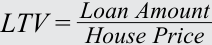

# Tập 6: Chứng Khoán Thu Nhập Cố Định (Fixed Income)
## Học phần 19: Đặc Điểm Công Cụ và Thị Trường Chứng Khoán Đảm Bảo Bằng Thế Chấp (MBS)
### Phần 1/3: Giới thiệu (Trang PDF 507–521)

---

<!-- PDF Page 507 -->

# H Ọ C P H Ầ N **<mark>19</mark>** 

### **Đặc Điểm Công Cụ và Thị Trường Chứng Khoán Đảm Bảo Bằng Thế Chấp (Mortgage-Backed Security (MBS) Instrument and Market Features)** 

| **MỤC TIÊU HỌC TẬP (LEARNING OUTCOMES)** | |
|---|---|
| **_Mức độ thành thạo_** | **_Ứng viên cần có khả năng:_** |
| | Định nghĩa rủi ro trả nợ trước hạn (*prepayment risk*) và mô tả các cấu trúc phân lớp theo thời gian (*time tranching structures*) trong các giao dịch chứng khoán hóa cùng mục đích của chúng |
| | Mô tả các đặc điểm nền tảng của các khoản vay thế chấp nhà ở (*residential mortgage loans*) được chứng khoán hóa |
| | Mô tả các loại hình và đặc điểm của chứng khoán đảm bảo bằng thế chấp nhà ở (*residential mortgage-backed securities* – RMBS), bao gồm chứng khoán chuyển tiếp dòng tiền thế chấp (*mortgage pass-through securities*) và nghĩa vụ nợ thế chấp có tài sản đảm bảo (*collateralized mortgage obligations* – CMO), đồng thời giải thích dòng tiền và rủi ro của từng loại |
| | Mô tả các đặc điểm và rủi ro của chứng khoán đảm bảo bằng thế chấp thương mại (*commercial mortgage-backed securities* – CMBS) |

<!-- Picture Text: 1  -->

#### **GIỚI THIỆU (INTRODUCTION)** 

Học phần này tiếp nối các học phần trước vốn đã cung cấp cái nhìn tổng quan về chứng khoán đảm bảo bằng tài sản (*Asset-backed securities* – ABS) và mô tả những lợi ích của chứng khoán hóa, quy trình chứng khoán hóa cũng như các cấu trúc chứng khoán hóa điển hình. Học phần này tập trung vào thị trường ABS lớn nhất thế giới: **chứng khoán đảm bảo bằng thế chấp (*Mortgage-backed securities* – MBS)**. Học phần giới thiệu các khoản vay thế chấp bất động sản (*mortgage loans*) và các đặc điểm đặc trưng của chúng; thảo luận về MBS nhà ở (*residential MBS* – RMBS), bao gồm chứng khoán chuyển tiếp dòng tiền thế chấp (*mortgage pass-through securities*) và nghĩa vụ nợ thế chấp có tài sản đảm bảo (*collateralized mortgage obligations* – CMO); và mô tả MBS thương mại (*commercial MBS* – CMBS). Học phần chỉ ra cách đo lường, giảm thiểu và chia sẻ các rủi ro liên quan đến chứng khoán hóa qua các lớp chứng khoán (*tranches*) khác nhau cùng đặc điểm của chúng, đồng thời xem xét dòng tiền và rủi ro của MBS.

<!-- PDF Page 508 -->

###### **TỔNG QUAN HỌC PHẦN (LEARNING MODULE OVERVIEW)** 

- **Rủi ro trả nợ trước hạn (*Prepayment risk*)** là rủi ro người đi vay không hoàn trả nợ gốc (hoặc một phần nợ gốc) theo đúng lịch trình đã định. **Rủi ro thu hẹp kỳ hạn (*Contraction risk*)** xảy ra khi người đi vay hoàn trả nợ gốc nhanh hơn dự kiến, trong khi **rủi ro kéo dài kỳ hạn (*Extension risk*)** xảy ra khi người đi vay hoàn trả nợ gốc chậm hơn so với kế hoạch.

- **Chứng khoán đảm bảo bằng thế chấp (*Mortgage-backed securities* – MBS)** là các trái phiếu được tạo ra từ việc chứng khoán hóa các khoản vay thế chấp bất động sản. Các khoản vay thế chấp cung cấp nguồn tiền cho người đi vay để mua bất động sản và yêu cầu người đi vay hoàn trả cho bên cho vay theo một lịch trình đã được hai bên thỏa thuận, nếu không bên cho vay có quyền tịch thu bất động sản đó.

- MBS có thể được tạo ra dựa trên các khoản thế chấp nhà ở hoặc thế chấp thương mại. Các trái phiếu được tạo ra từ việc chứng khoán hóa các khoản thế chấp được đảm bảo bằng bất động sản nhà ở được gọi là **chứng khoán đảm bảo bằng thế chấp nhà ở (*Residential mortgage-backed securities* – RMBS)**.

- Bởi vì cả các khoản hoàn trả nợ gốc theo lịch trình (*scheduled principal repayments*) và các khoản trả nợ trước hạn không theo lịch trình (*unscheduled prepayments*) đều được thực hiện trong suốt vòng đời của một MBS, nên kỳ hạn theo hợp đồng (*contractual maturity*) của một MBS không phản ánh đúng các khoản thanh toán và trả trước hạn thực tế của nó. **Thời gian đáo hạn bình quân gia quyền (*Weighted average life* – WAL)** là thước đo được sử dụng rộng rãi để đánh giá thời điểm mà một MBS dự kiến sẽ được hoàn trả hết.

- **Chứng khoán chuyển tiếp dòng tiền thế chấp (*Mortgage pass-through security*)** là một chứng khoán được tạo ra khi các tổ chức cho vay thế chấp tập hợp các khoản thế chấp lại với nhau và sử dụng chúng để đảm bảo cho các chứng khoán mà họ bán cho nhà đầu tư. Dòng tiền của một chứng khoán chuyển tiếp dòng tiền thế chấp phụ thuộc vào dòng tiền hàng tháng của danh mục các khoản thế chấp cơ sở.

- **Nghĩa vụ nợ thế chấp có tài sản đảm bảo (*Collateralized mortgage obligations* – CMO)** chứng khoán hóa các chứng khoán chuyển tiếp dòng tiền thế chấp hoặc nhiều danh mục khoản vay và được cấu trúc để phân phối lại dòng tiền cho các hạng trái phiếu hoặc lớp chứng khoán (*tranches*) khác nhau, qua đó tạo ra các chứng khoán có mức độ tiếp xúc khác nhau đối với rủi ro trả nợ trước hạn.

- Cấu trúc phân lớp (*tranching structure*) của một CMO có thể phân phối lại rủi ro trả nợ trước hạn qua các lớp chứng khoán khác nhau; một lớp chứng khoán càng có thứ tự ưu tiên cao (*more senior*), thì càng ít tiếp xúc với rủi ro trả nợ trước hạn và rủi ro vỡ nợ.

- **Chứng khoán đảm bảo bằng thế chấp thương mại (*Commercial mortgage-backed securities* – CMBS)** có thể chỉ bao gồm một vài khoản thế chấp thương mại cơ sở, và vì vậy chỉ một vụ vỡ nợ trong danh mục CMBS cũng có thể tác động đáng kể đến các nhà đầu tư CMBS. Các nhà đầu tư phải đánh giá **rủi ro tập trung (*concentration risk*)** đặc thù này bằng cách phân tích từng khoản vay và từng bất động sản riêng lẻ đảm bảo cho CMBS, bản thân những người sở hữu các bất động sản thương mại đó, cũng như cấu trúc của CMBS.

- Không giống như RMBS, CMBS mang lại cho các nhà đầu tư **sự bảo vệ trước rủi ro trả nợ trước hạn / thu hồi sớm (*call protection*)** ở cấp độ cấu trúc hoặc ở cấp độ từng khoản vay riêng lẻ và do đó được giao dịch giống với trái phiếu doanh nghiệp hơn là giống RMBS. Tuy nhiên, các khoản thế chấp thương mại thường bao gồm một khoản thanh toán gốc lớn một lần cuối kỳ (*balloon payment*) khi đáo hạn, làm cho CMBS dễ bị tổn thương hơn trước một dạng rủi ro kéo dài kỳ hạn gọi là **rủi ro thanh toán gốc lớn cuối kỳ (*balloon risk*)**.

<!-- PDF Page 509 -->

###### **TỰ ĐÁNH GIÁ (SELF-ASSESSMENT)** 

1. Phát biểu nào sau đây liên quan đến tỷ lệ khoản vay trên giá trị tài sản (*Loan-to-value ratio* – LTV) là _chính xác nhất_?

   - **A.** Tỷ lệ LTV của một khoản thế chấp nhất định giữ nguyên không đổi trong suốt vòng đời của khoản vay.

   - **B.** Tỷ lệ LTV càng cao thì bên cho vay càng được bảo vệ nhiều hơn trong trường hợp xảy ra vỡ nợ.

   - **C.** Tỷ lệ LTV đóng vai trò là một thước đo then chốt trong cả các khoản thế chấp nhà ở và thế chấp thương mại.

###### **Lời giải (Solution):** 

Đáp án đúng là C. Tỷ lệ LTV đóng vai trò là một thước đo then chốt trong cả các khoản thế chấp nhà ở và thế chấp thương mại. LTV được tính bằng tỷ lệ giữa quy mô của khoản vay thế chấp trên giá trị của bất động sản. A không đúng vì theo thời gian, tỷ lệ LTV sẽ thay đổi: Khi người đi vay thực hiện các khoản thanh toán thế chấp, bao gồm cả hoàn trả nợ gốc, số dư đang lưu hành của khoản vay sẽ giảm xuống và ngoài ra, những biến động trong giá trị thị trường của bất động sản cũng làm cho phần vốn chủ sở hữu (*equity*) của người đi vay thay đổi. B không đúng vì tỷ lệ LTV càng cao thì bên cho vay càng ít được bảo vệ hơn trong trường hợp xảy ra vỡ nợ.

2. Phát biểu nào sau đây liên quan đến chứng khoán đảm bảo bằng thế chấp (*Mortgage-backed securities* – MBS) là _chính xác nhất_? MBS:

   - **A.** bắt buộc phải được đảm bảo hoặc bảo lãnh bởi chính phủ hoặc một tổ chức bán chính phủ (*quasi-government entity*).

   - **B.** có thể được tạo ra bằng cách chứng khoán hóa các khoản thế chấp được đảm bảo bằng bất động sản nhà ở hoặc bất động sản thương mại.

   - **C.** sử dụng các biện pháp tăng cường tín dụng để giảm rủi ro tín dụng cho các chứng khoán đảm bảo bằng thế chấp nhà ở thường là các RMBS của tổ chức chính phủ (*agency RMBS*).

###### **Lời giải (Solution):** 

Đáp án đúng là B. Các khoản thế chấp trong MBS có thể là thế chấp nhà ở hoặc thế chấp thương mại. A không đúng vì MBS không bắt buộc phải được bảo lãnh bởi chính phủ hoặc một tổ chức bán chính phủ. Tuy nhiên, khi các khoản thế chấp này hoặc các chứng khoán phát hành được đảm bảo bằng các khoản thế chấp này được chính phủ bảo lãnh, sẽ có sự hỗ trợ về mặt tín dụng. Các MBS đảm bảo bằng thế chấp nhà ở được phát hành bởi các tổ chức tư nhân và không được bảo lãnh bởi một cơ quan liên bang hoặc một doanh nghiệp được chính phủ bảo trợ (*government-sponsored enterprise* – GSE) được gọi là **"RMBS phi chính phủ / tư nhân" (*"non-agency RMBS"*)**. C không đúng vì chính các RMBS tư nhân (*non-agency RMBS*), chứ không phải RMBS của tổ chức chính phủ (*agency RMBS*), mới thường sử dụng các biện pháp tăng cường tín dụng — chẳng hạn như bảo hiểm, thư tín dụng, bảo lãnh, hoặc quyền lợi phân tầng xếp sau (*subordinated interests*) — để giảm thiểu rủi ro tín dụng và cải thiện chất lượng tổng thể của danh mục thế chấp. Những chứng khoán này bao gồm các biện pháp tăng cường tín dụng bởi vì chúng không được bảo lãnh hoặc bảo hiểm bởi một cơ quan chính phủ hay bởi một GSE.

3. Khi một khoản vay thế chấp được sử dụng làm tài sản thế chấp cho một chứng khoán chuyển tiếp dòng tiền thế chấp (*mortgage pass-through security*), khoản thế chấp đó _nhiều khả năng nhất_ được gọi là đã được:

   - **A.** tăng cường tín dụng (*enhanced*).

   - **B.** chứng khoán hóa (*securitized*).

<!-- PDF Page 510 -->

   - **C.** phân tầng xếp sau (*subordinated*).

###### **Lời giải (Solution):** 

Đáp án đúng là B. Khi một khoản vay thế chấp được sử dụng làm tài sản thế chấp cho một chứng khoán chuyển tiếp dòng tiền thế chấp, khoản thế chấp đó được gọi là đã được chứng khoán hóa (*securitized*). A và C không đúng vì một khoản thế chấp được sử dụng làm tài sản thế chấp cho một chứng khoán chuyển tiếp dòng tiền thế chấp được gọi là _đã được chứng khoán hóa_, chứ không phải được tăng cường tín dụng hay phân tầng xếp sau.

4. Cấu trúc nào sau đây được tạo ra thông qua việc phân lớp theo thời gian (*time tranching*)?

   - **A.** Lớp chứng khoán tích lũy Z (*Z-tranches*)

   - **B.** Lớp chứng khoán lãi suất thả nổi (*Floating-rate tranches*)

   - **C.** Chứng khoán chỉ trả gốc (*Principal-only (PO) securities*)

###### **Lời giải (Solution):** 

Đáp án đúng là A. Lớp chứng khoán Z (*Z-tranches*) và lớp chứng khoán phần dư (*residual tranches*) được tạo ra thông qua việc phân lớp theo thời gian (*time tranching*), có nghĩa là chúng không chi trả các khoản thanh toán tiền lãi cho đến một ngày đã được thiết lập trước. B không đúng vì các lớp chứng khoán lãi suất thả nổi mang lãi suất được liên kết với một chỉ số hoặc một lãi suất tham chiếu thị trường (MRR) và được sử dụng để phòng vệ rủi ro lãi suất trong danh mục đầu tư. C không đúng vì chứng khoán chỉ trả gốc (PO) chỉ chi trả các khoản hoàn trả nợ gốc từ danh mục và có thể được tạo ra từ việc tách dòng tiền của chứng khoán chuyển tiếp dòng tiền thế chấp hoặc như một lớp chứng khoán trong một CMO.

5. Rủi ro nào sau đây _nhiều khả năng nhất_ giải thích tại sao kỳ hạn thực tế của một MBS lại giảm xuống khi lãi suất giảm?

   - **A.** Rủi ro thanh toán gốc lớn cuối kỳ (*Balloon risk*)

   - **B.** Rủi ro kéo dài kỳ hạn (*Extension risk*)

   - **C.** Rủi ro thu hẹp kỳ hạn (*Contraction risk*)

###### **Lời giải (Solution):** 

Đáp án đúng là C. Rủi ro thu hẹp kỳ hạn (*Contraction risk*) là rủi ro người đi vay có thể hoàn trả số tiền đã vay nhanh hơn so với dự kiến, làm giảm tổng số tiền thanh toán trong tương lai mà nhà đầu tư nhận được. Khi lãi suất giảm xuống, mức trả nợ trước hạn thực tế sẽ cao hơn dự báo bởi vì những người sở hữu nhà sẽ có xu hướng tái cấp vốn (*refinance*) cho các khoản vay thế chấp của họ. A không đúng vì rủi ro thanh toán gốc lớn cuối kỳ (*balloon risk*) xảy ra khi người đi vay không thực hiện được khoản thanh toán gốc lớn cuối kỳ khi đáo hạn của một khoản vay có cấu trúc trả gốc cuối kỳ; đó là một dạng của rủi ro kéo dài kỳ hạn. B không đúng vì rủi ro kéo dài kỳ hạn (*extension risk*) là rủi ro người đi vay có thể hoàn trả số tiền đã vay chậm hơn so với dự kiến, làm kéo dài thay vì rút ngắn thời gian hoàn trả và kỳ hạn của trái phiếu.

6. Phát biểu nào sau đây liên quan đến chứng khoán đảm bảo bằng thế chấp (MBS) là đúng?

   - **A.** Kỳ hạn theo hợp đồng (*contractual maturity*) của một MBS dự báo chính xác các khoản thanh toán và trả nợ trước hạn trong tương lai.

   - **B.** Một thước đo được những người tham gia thị trường sử dụng rộng rãi đối với MBS là thời gian đáo hạn bình quân gia quyền (*weighted average life*), hay đơn giản là thời gian sống trung bình (*average life*), của MBS đó.

<!-- PDF Page 511 -->

   - **C.** Một trái phiếu doanh nghiệp không có quyền chọn kỳ hạn 30 năm và một MBS có kỳ hạn pháp lý 30 năm với cùng mức lãi suất coupon có mức rủi ro lãi suất tương đương nhau.

###### **Lời giải (Solution):** 

Đáp án đúng là B. Một thước đo được những người tham gia thị trường sử dụng rộng rãi đối với MBS là thời gian đáo hạn bình quân gia quyền (*weighted average life*), hay đơn giản là thời gian sống trung bình (*average life*), của MBS. Thước đo này cung cấp cho các nhà đầu tư một chỉ báo về khoảng thời gian mà họ có thể kỳ vọng nắm giữ MBS trước khi nó được hoàn trả hết, với giả định lãi suất duy trì ở mức hiện tại và do đó mức trả nợ trước hạn dự kiến sẽ diễn ra đúng như kỳ vọng. A không đúng vì kỳ hạn theo hợp đồng của một MBS _không_ phản ánh đúng các khoản thanh toán và trả nợ trước hạn thực tế của nó. Các khoản hoàn trả nợ gốc không theo lịch trình sẽ làm rút ngắn kỳ hạn của một MBS, nhưng mô hình hoàn trả được thúc đẩy bởi những dịch chuyển của lãi suất vốn không thể biết trước một cách chắc chắn. C không đúng vì một trái phiếu doanh nghiệp không có quyền chọn kỳ hạn 30 năm sẽ không có các khoản trả nợ trước hạn / tốc độ trả nợ trước hạn giống như một MBS có kỳ hạn pháp lý 30 năm với cùng mức lãi suất coupon, và do đó sẽ không có rủi ro lãi suất tương đương.

7. Một sự khác biệt lớn giữa chứng khoán đảm bảo bằng thế chấp nhà ở (RMBS) và chứng khoán đảm bảo bằng thế chấp thương mại (CMBS) là:

   - **A.** CMBS chứng khoán hóa các khoản thế chấp đủ tiêu chuẩn (*conforming mortgages*) và được thế chấp bằng các bất động sản đồng nhất (*homogeneous properties*) so với các bất động sản đảm bảo cho một RMBS.

   - **B.** các nhà đầu tư phải đánh giá từng khoản vay và từng bất động sản riêng lẻ đảm bảo cho một CMBS cũng như bản thân những người sở hữu các bất động sản thương mại đó.

   - **C.** một danh mục CMBS có thể bao gồm hàng nghìn khoản thế chấp từ nhiều vùng khác nhau của một quốc gia, trong khi một RMBS có thể chỉ bao gồm một vài khoản thế chấp nhà ở đồng nhất.

###### **Lời giải (Solution):** 

Đáp án đúng là B. CMBS có thể chỉ bao gồm một vài khoản thế chấp thương mại cơ sở, trong khi một danh mục RMBS có thể bao gồm hàng nghìn khoản thế chấp từ nhiều vùng khác nhau của một quốc gia. Do đó, một vụ vỡ nợ trong danh mục CMBS có thể gây ra tác động đáng kể đối với các nhà đầu tư CMBS. Các nhà đầu tư vào CMBS phải xem xét một cách rõ ràng rủi ro tập trung (*concentration risk*) đặc thù này bằng cách không chỉ phân tích cấu trúc CMBS mà còn phân tích từng khoản vay và từng bất động sản riêng lẻ đảm bảo cho CMBS cũng như bản thân những người sở hữu các bất động sản thương mại đó. A không đúng vì RMBS, chứ không phải CMBS, mới chứng khoán hóa các khoản thế chấp đủ tiêu chuẩn và được thế chấp bằng các bất động sản nhà ở (dành cho một hộ gia đình) có tính chất đồng nhất. C không đúng vì một danh mục RMBS, chứ không phải danh mục CMBS, mới có thể bao gồm hàng nghìn khoản thế chấp từ nhiều vùng khác nhau của một quốc gia, trong khi CMBS có thể chỉ bao gồm một vài khoản thế chấp thương mại cơ sở.

8. Phát biểu nào sau đây liên quan đến **tỷ số khả năng trang trải nghĩa vụ nợ (*Debt service coverage ratio* – DSC)** — một chỉ báo then chốt về hiệu quả tín dụng tiềm năng trong cho vay bất động sản thương mại — là _chính xác nhất_? Tỷ số DSC:

   - **A.** bằng thu nhập hoạt động ròng (*Net operating income* – NOI) hàng năm của bất động sản chia cho tổng nghĩa vụ trả nợ (*debt service*) của nó.

   - **B.** được tính bằng tỷ lệ giữa quy mô của khoản vay trên giá trị của bất động sản cơ sở.

<!-- PDF Page 512 -->

   - **C.** lớn hơn 1,0 cho thấy rằng dòng tiền từ bất động sản không đủ để trang trải nghĩa vụ trả nợ trong khi vẫn duy trì bất động sản ở trạng thái bảo dưỡng ban đầu.

###### **Lời giải (Solution):** 

Đáp án đúng là A. Tỷ số DSC bằng thu nhập hoạt động ròng (NOI) hàng năm của bất động sản chia cho tổng nghĩa vụ trả nợ (*debt service*) của nó. NOI được định nghĩa là thu nhập cho thuê trừ đi chi phí hoạt động bằng tiền mặt và quỹ dự trữ thay thế tài sản (*replacement reserve*). Nghĩa vụ trả nợ (*debt service*) là tổng số tiền thanh toán lãi và hoàn trả nợ gốc hàng năm. B không đúng vì tỷ lệ giữa quy mô của khoản vay trên giá trị của bất động sản cơ sở là tỷ lệ LTV — một chỉ báo then chốt khác về hiệu quả tín dụng tiềm năng — chứ không phải DSC. C không đúng vì tỷ số DSC lớn hơn 1,0 cho thấy rằng dòng tiền từ bất động sản là _đủ_ (chứ không phải không đủ) để trang trải nghĩa vụ trả nợ trong khi vẫn duy trì bất động sản ở trạng thái bảo dưỡng ban đầu.

## **<mark>2</mark>** 

#### **PHÂN LỚP THEO THỜI GIAN (TIME TRANCHING)** 

**Mục tiêu học tập:** Định nghĩa rủi ro trả nợ trước hạn (*prepayment risk*) và mô tả các cấu trúc phân lớp theo thời gian (*time tranching structures*) trong các giao dịch chứng khoán hóa cùng mục đích của chúng.

Dòng tiền của các chứng khoán chuyển tiếp dòng tiền ABS và MBS mang tính bất định bởi vì các khoản thanh toán theo lịch trình và các khoản thanh toán thực tế thường xuyên khác biệt nhau. Hành vi của người đi vay, chẳng hạn như việc trả sớm tiền lãi và tiền gốc cũng như tình trạng quá hạn thanh toán (*payment delinquencies*) trong suốt vòng đời của khoản vay, phụ thuộc vào một số yếu tố, bao gồm thu nhập của người đi vay (thu nhập hộ gia đình hoặc dòng tiền đối với một doanh nghiệp), các điều khoản và điều kiện của khoản vay (chẳng hạn như lãi suất ban đầu so với lãi suất hiện hành và bất kỳ khoản phạt trả nợ trước hạn nào), và việc bán đi tài sản cơ sở đang được tài trợ. Để định giá chính xác các chứng khoán này, các nhà đầu tư phải đưa ra một số giả định nhất định về các khoản thanh toán theo hợp đồng dự kiến sau khi đã tính đến rủi ro trả nợ trước hạn. **Rủi ro trả nợ trước hạn (*Prepayment risk*)** là rủi ro tiền gốc hoặc một phần tiền gốc được người đi vay hoàn trả theo một tốc độ khác biệt so với kế hoạch thanh toán theo lịch trình đã thỏa thuận trong hợp đồng. Rủi ro trả nợ trước hạn có hai thành phần: rủi ro thu hẹp kỳ hạn (*contraction risk*) và rủi ro kéo dài kỳ hạn (*extension risk*), cả hai đều phản ánh những thay đổi trong mặt bằng lãi suất chung.

##### **Rủi ro Trả nợ trước hạn (Prepayment Risk)** 

Khi lãi suất giảm xuống, mức trả nợ trước hạn thực tế đối với các khoản vay thế chấp lãi suất cố định sẽ cao hơn dự báo bởi vì những người sở hữu nhà sẽ tái cấp vốn (*refinance*) ở mức lãi suất thấp hơn. Việc tái cấp vốn khoản vay thế chấp đặc biệt phổ biến tại Hoa Kỳ do không có các khoản phạt trả nợ trước hạn — điều vốn phổ biến hơn ở các quốc gia khác. Do đó, kỳ hạn thực tế của một MBS sẽ ngắn hơn so với những gì được dự kiến tại thời điểm mua. **Rủi ro thu hẹp kỳ hạn (*Contraction risk*)** là rủi ro người đi vay hoàn trả nợ gốc hoặc một phần nợ gốc trong khoảng thời gian ngắn hơn so với lịch trình thanh toán đã thỏa thuận trong hợp đồng, làm giảm tổng số tiền thanh toán trong tương lai mà nhà đầu tư nhận được. Đối với các nhà đầu tư, điều này gây ra hai hệ quả bất lợi. Thứ nhất, các nhà đầu tư buộc phải tái đầu tư số tiền thu hồi được ở mức lãi suất thấp hơn (rủi ro tái đầu tư). Thứ hai, quyền chọn trả nợ trước hạn làm hạn chế tiềm năng tăng giá (*price appreciation*) của trái phiếu.

Khi lãi suất tăng lên, mức trả nợ trước hạn thực tế sẽ thấp hơn dự báo bởi vì những người sở hữu nhà sẽ ít có khả năng tái cấp vốn cho khoản vay thế chấp của mình và thậm chí có thể trì hoãn việc mua nhà mới. Do đó, kỳ hạn thực tế của một MBS sẽ dài hơn so với những gì được dự kiến tại thời điểm mua. **Rủi ro kéo dài kỳ hạn (*Extension risk*)** là rủi ro người đi vay

<!-- PDF Page 513 -->

hoàn trả nợ gốc hoặc một phần nợ gốc trong khoảng thời gian dài hơn so với lịch trình thanh toán đã thỏa thuận trong hợp đồng. Đối với các nhà đầu tư, điều này gây ra những hệ quả bất lợi: Lãi suất cao hơn làm giảm giá trị hiện tại của các dòng tiền mà nhà đầu tư nhận được. Do đó, các khoản thanh toán mà nhà đầu tư nhận được sẽ bị chiết khấu ở mức lãi suất cao hơn, đồng thời sự kéo dài kỳ hạn làm dàn trải thời gian nhận các khoản thanh toán của nhà đầu tư ra xa hơn.

Cấu trúc của một giao dịch chứng khoán hóa cũng có thể cho phép phân phối lại "rủi ro trả nợ trước hạn" giữa các hạng trái phiếu. Một phương pháp để giảm thiểu rủi ro này là tạo ra các hạng trái phiếu sở hữu các kỳ hạn dự kiến (*expected maturities*) khác nhau. Điều này được gọi là **phân lớp theo thời gian (*time tranching*)**. Chẳng hạn, một danh mục chứng khoán hóa có thể bao gồm **phân lớp tuần tự (*sequential tranching*)**, trong đó các khoản hoàn trả nợ gốc chảy trước tiên vào một lớp chứng khoán cho đến khi nợ gốc của lớp đó được hoàn trả đầy đủ, rồi sau đó mới chảy sang lớp chứng khoán tuần tự tiếp theo cho đến khi nợ gốc của lớp đó được hoàn trả hết.

###### **VÍ DỤ 1 (EXAMPLE 1)** 

##### **Phân lớp theo Thời gian với Cấu trúc Thác nước đối với MBS của RLT (Time Tranching with Waterfall for RLT MBS)** 

Nếu Residential Loan Trust (RLT) phát hành các chứng khoán MBS với kỳ hạn dự kiến khác nhau theo từng hạng trái phiếu, thay vì tất cả các MBS đều đáo hạn sau 4 năm, thì các nhà đầu tư MBS cũng có thể lựa chọn trái phiếu dựa trên kỳ hạn dự kiến của chúng. Tuy nhiên, các nhà đầu tư vẫn có thể phải đối mặt với rủi ro trả nợ trước hạn hoặc rủi ro kéo dài kỳ hạn trong trường hợp này. Các ngày đáo hạn cụ thể được ghi nhận trong Bảng minh họa 1 (*Exhibit 1*).

**Bảng minh họa 1: Tổng quan các Kỳ phiếu Phát hành bởi Residential Loan Trust – Tóm tắt Ngắn gọn các Điều khoản Đáo hạn (Exhibit 1: Overview of Notes Issued by Residential Loan Trust – Brief Summary of Maturity Terms)** 

| **Kỳ hạn của các Kỳ phiếu Đảm bảo bằng Thế chấp Phát hành bởi Residential Loan Trust** | |
|---|---|
| **Tổ chức phát hành (*Issuer*):** | Residential Loan Trust (RLT) |
| **Vị thế và Thứ tự Ưu tiên Thanh toán (*Status and Ranking of Payments*)** | **Các lớp chứng khoán (*Tranches*)** |
| Kỳ phiếu Hạng A có thứ tự ưu tiên cao hơn (*rank senior to*) Kỳ phiếu Hạng B, C & D. | **Kỳ phiếu Lớp A (*Tranche A Notes*)** Mệnh giá: 825 triệu EUR Lãi suất: MRR + 0,50% Kỳ hạn (*Maturity*): Một năm |
| Kỳ phiếu Hạng B có thứ tự ưu tiên cao hơn Kỳ phiếu Hạng C & D và xếp sau (*rank junior to*) Kỳ phiếu Hạng A. | **Kỳ phiếu Lớp B (*Tranche B Notes*)** Mệnh giá: 100 triệu EUR Lãi suất: MRR + 1,50% Kỳ hạn (*Maturity*): Hai năm |
| Kỳ phiếu Hạng C có thứ tự ưu tiên cao hơn Kỳ phiếu Hạng D và xếp sau Kỳ phiếu Hạng A & B. | **Kỳ phiếu Lớp C (*Tranche C Notes*)** Mệnh giá: 50 triệu EUR Lãi suất: MRR + 2,50% Kỳ hạn (*Maturity*): Ba năm |
| Kỳ phiếu Hạng D sẽ xếp sau Kỳ phiếu Hạng A, B & C. | **Kỳ phiếu Lớp D (*Tranche D Notes*)** Mệnh giá: 25 triệu EUR Lãi suất: Biến đổi (*Variable*) Kỳ hạn (*Maturity*): Bốn năm |
| **Thanh toán Nợ gốc (*Principal Payment*):** | Được thanh toán vào [Ngày đáo hạn (*Maturity Date*)] |
| **Thứ tự ưu tiên (*Seniority*):** | Các Kỳ phiếu là nghĩa vụ nợ có bảo đảm của RLT. |
| **Ngày làm việc (*Business Days*):** | Frankfurt |

Đối với nhà đầu tư mua 5 triệu EUR phân bổ giữa kỳ phiếu Lớp B và Lớp C, việc trả nợ trước hạn của các khoản vay có thể tác động đến thời điểm hoàn trả nợ gốc như được ghi chú dưới đây:

<!-- PDF Page 514 -->

| **Khoản mua MBS RLT Ban đầu của Nhà đầu tư** | **Số tiền mua** | **Thời điểm Hoàn trả Nợ gốc nếu Không có Trả nợ trước hạn trong Danh mục Tài sản thế chấp RLT** | **Thời điểm Hoàn trả Nợ gốc nếu Lãi suất Giảm vào đầu Năm thứ hai, Thúc đẩy Trả nợ trước hạn Ngay lập tức trong Danh mục RLT** |
|---|---|---|---|
| Kỳ phiếu Hạng A (*Class A Notes*) | 0 triệu EUR | Một năm, theo điều khoản MBS | Một năm, theo điều khoản MBS |
| Kỳ phiếu Hạng B (*Class B Notes*) | 3 triệu EUR | Hai năm, theo điều khoản MBS | Ngắn hơn hai năm (*Less than two years*) |
| Kỳ phiếu Hạng C (*Class C Notes*) | 2 triệu EUR | Ba năm, theo điều khoản MBS | Ngắn hơn ba năm (*Less than three years*) |
| Kỳ phiếu Hạng D (*Class D Notes*) | 0 triệu EUR | Bốn năm, theo điều khoản MBS | Ngắn hơn bốn năm (*Less than four years*) |

Chúng ta sẽ cần thêm thông tin về giá trị của tất cả các khoản trả nợ trước hạn và thời điểm chính xác của chúng để xác định ngày hoàn trả nợ gốc chính xác. Như được thấy trong Bảng minh họa 1, một giao dịch chứng khoán hóa hoàn toàn có thể — và trên thực tế là khá phổ biến — có các cấu trúc kết hợp cả **phân lớp tín dụng (*credit tranching* — cấu trúc phân tầng thứ bậc ưu tiên)** và **phân lớp theo thời gian (*time tranching* — các kỳ hạn dự kiến khác nhau)**.

###### **VÍ DỤ 2 (EXAMPLE 2)** 

##### **Bê bối Khí thải của Volkswagen (Volkswagen Emissions Scandal)** 

Các nhà đầu tư phải tiếp xúc với một số loại rủi ro đặc thù (*idiosyncratic risks*) nhất định khi mua chứng khoán đảm bảo bằng tài sản (ABS). Đối với những người mua ABS khoản vay mua ô tô (*auto ABS*), các đợt triệu hồi xe lớn của nhà sản xuất ô tô là một rủi ro đã được biết đến đối với các nhà đầu tư trái phiếu. Năm 2015, Ủy ban Chứng khoán và Giao dịch Hoa Kỳ (SEC) đã cáo buộc Volkswagen (VW), một trong những nhà sản xuất ô tô lớn nhất thế giới, và Giám đốc điều hành (CEO) của hãng là Martin Winterkorn về hành vi lừa dối các nhà đầu tư Hoa Kỳ trong vụ bê bối khí thải (vụ bê bối "Dieselgate"). Volkswagen sau đó đã thừa nhận rằng hãng đã gian lận trong các bài kiểm tra khí thải động cơ diesel, và sự thừa nhận này đã thổi bay hàng tỷ euro khỏi giá trị vốn hóa thị trường của công ty cũng như dẫn đến việc từ chức của Winterkorn. Vụ bê bối khí thải làm rung chuyển Volkswagen cũng tác động mạnh đến các chứng khoán ABS gắn liền với các khoản vay và hợp đồng thuê ô tô. Doanh số phát hành ABS ô tô đã bùng nổ trong những năm ngay trước vụ bê bối khi các nhà đầu tư tìm kiếm các sản phẩm có lợi suất cao hơn trong bối cảnh môi trường lãi suất thấp.

Khoảng 5,6 tỷ USD chứng khoán ABS ô tô của VW đang lưu hành vào năm 2015, với 4,39 tỷ USD đến từ các trái phiếu được đảm bảo bằng các khoản vay và hợp đồng thuê xe của người tiêu dùng. Volkswagen, khi phải đối mặt với các khoản tiền phạt và kiện tụng tiềm ẩn, đã nhận thấy khả năng thu hút khách hàng mới của mình tạm thời bị sụt giảm, đẩy giá trị của những chiếc xe làm tài sản thế chấp cho các khoản vay đó đi xuống. Có 1,25 tỷ USD trái phiếu được đảm bảo bằng hàng tồn kho xe VW của các đại lý ô tô, được gọi là **ABS tài trợ tồn kho đại lý (*dealer floorplan ABS*)**. Đối với ABS tài trợ tồn kho đại lý, quỹ tín thác ABS được hưởng lợi từ sự hỗ trợ tài chính của VW, bao gồm nhưng không giới hạn ở cam kết của VW về việc mua lại các xe mới chưa bán được và hàng tồn kho. Các đại lý ô tô, khi bị yêu cầu dừng ngay lập tức việc bán các mẫu xe đời 2015 và 2016 phổ biến — bao gồm cả mẫu xe mui trần Jetta và Beetle của Volkswagen — đã bị mắc kẹt với lượng sản phẩm không thể bán được. Các đại lý tồn đọng một lượng lớn xe không thể tiêu thụ, vì vậy vòng quay hàng tồn kho không diễn ra nhanh như trước. Loại chứng khoán ABS chịu ảnh hưởng bất lợi nặng nề nhất bởi lệnh ngừng bán một số mẫu xe chạy dầu diesel đời 2015 và 2016 của VW chính là chứng khoán hóa tài trợ tồn kho đại lý (*dealer floorplan securitization*).

<!-- PDF Page 515 -->

Các nhà đầu tư nợ đã đòi hỏi mức đền bù rủi ro cao hơn từ Volkswagen sau khi công ty cho biết vụ bê bối gian lận khí thải sẽ tiêu tốn của hãng hơn 6,5 tỷ EUR. Volkswagen, một tổ chức phát hành thường xuyên trên thị trường chứng khoán đảm bảo bằng tài sản tại châu Âu, cho biết 2,6 tỷ EUR các khoản vay hoặc hợp đồng thuê đối với các phương tiện được chế tạo với động cơ sử dụng phần mềm gian lận đã được đóng gói vào trong các giao dịch chứng khoán hóa của hãng.

Cuối năm 2015, Volkswagen đã chào bán một đợt ABS ô tô mới với mức phần bù lợi suất (*yield premium*) lớn gấp ba lần so với một thương vụ tương tự vào đầu năm đó. Nhà sản xuất ô tô của Đức đã phải đề nghị trả cao hơn khoảng 60 bps đến 65 bps so với lãi suất chuẩn cho các kỳ phiếu xếp hạng cao nhất của giao dịch chứng khoán hóa hợp đồng thuê ô tô. Để so sánh, Volkswagen chỉ phải trả mức chênh lệch (*spread*) 20 bps trên lãi suất chào bán liên ngân hàng đồng euro kỳ hạn 1 tháng (Euribor) cho khoản nợ tương tự vào tháng 4 năm 2015.

###### **BỘ CÂU HỎI (QUESTION SET)** 

1. Việc tạo ra các hạng trái phiếu sở hữu các kỳ hạn dự kiến (*expected maturities*) khác nhau được gọi là:

   - **A.** phân tầng thứ bậc ưu tiên (*subordination*).

   - **B.** phân lớp theo thời gian (*time tranching*).

   - **C.** phân lớp tín dụng (*credit tranching*).

###### **Lời giải (Solution):** 

Đáp án đúng là B. Một phương pháp để giảm thiểu "rủi ro trả nợ trước hạn" hoặc "rủi ro kéo dài kỳ hạn" giữa các hạng trái phiếu là tạo ra các hạng trái phiếu sở hữu các kỳ hạn dự kiến khác nhau. Điều này được gọi là phân lớp theo thời gian (*time tranching*). A và C không đúng vì phân tầng thứ bậc ưu tiên (*subordination*), còn thường được gọi là cấu trúc "thác nước" (*waterfall structure*), bao gồm việc phân bổ các khoản lỗ vào các hạng trái phiếu cấp thấp trước các hạng trái phiếu cấp cao, chứ không phải tạo ra các hạng trái phiếu có kỳ hạn dự kiến khác nhau.

2. Xác định phát biểu nào sau đây liên quan đến các sản phẩm chứng khoán hóa là chính xác nhất:

   - **A.** Với việc phân lớp theo thời gian (*time tranching*), các lớp chứng khoán của một CMO khấu hao gốc dần theo thời gian và tất cả các lớp chứng khoán đều đáo hạn vào cùng một thời điểm.

   - **B.** Chứng khoán chuyển tiếp dòng tiền (*Pass-through securities*) là cấu trúc chứng khoán hóa đơn giản nhất và bao gồm việc tổ chức phát hành giữ lại các tài sản cơ sở.

   - **C.** Trong một giao dịch chứng khoán hóa thực sự (*true securitization*), danh mục tài sản cơ sở được loại bỏ khỏi bảng cân đối kế toán và chuyển giao sang một pháp nhân độc lập — tổ chức sẽ phát hành các chứng khoán được đảm bảo bằng những tài sản này.

###### **Lời giải (Solution):** 

Đáp án đúng là C. Trong một giao dịch chứng khoán hóa thực sự, danh mục tài sản cụ thể được loại bỏ khỏi bảng cân đối kế toán và chuyển giao sang một pháp nhân độc lập và tách biệt — pháp nhân sau đó sẽ phát hành các chứng khoán được đảm bảo bằng các tài sản tập hợp này. A không đúng vì phân lớp theo thời gian là một phương pháp nhằm giảm rủi ro trả nợ trước hạn hoặc rủi ro kéo dài kỳ hạn bằng cách tạo ra các hạng trái phiếu sở hữu các kỳ hạn dự kiến khác nhau. B không đúng vì trái phiếu có bảo đảm (*covered bonds*), chứ không phải chứng khoán chuyển tiếp dòng tiền, mới là cấu trúc chứng khoán hóa đơn giản nhất; chúng bao gồm việc tổ chức phát hành giữ lại các tài sản cơ sở trên bảng cân đối kế toán của mình.

<!-- PDF Page 516 -->

3. Việc phát hành các hạng trái phiếu có tài sản đảm bảo với các kỳ hạn dự kiến khác nhau _nhiều khả năng nhất_ được thiết kế để giảm thiểu:

   - **A.** rủi ro tín dụng (*credit risk*).

   - **B.** rủi ro vỡ nợ (*default risk*).

   - **C.** rủi ro trả nợ trước hạn (*prepayment risk*).

###### **Lời giải (Solution):** 

Đáp án đúng là C. Rủi ro trả nợ trước hạn là sự bất định về việc dòng tiền sẽ khác biệt so với dòng tiền theo lịch trình đã quy định trong hợp đồng thuê/vay do khả năng thay đổi tiến độ thanh toán của bên đi thuê/đi vay. Việc tạo ra các hạng trái phiếu có kỳ hạn dự kiến khác nhau, được gọi là phân lớp theo thời gian (*time tranching*), cho phép phân phối lại rủi ro trả nợ trước hạn giữa các hạng trái phiếu. A không đúng vì rủi ro tín dụng liên quan đến rủi ro vỡ nợ ở các tài sản đảm bảo cho trái phiếu chứ không phải thời điểm thanh toán, và B không đúng vì rủi ro vỡ nợ cũng lại liên quan đến rủi ro mất khả năng thanh toán ở các tài sản cơ sở.

4. _Xác định các câu trả lời đúng để hoàn thành các câu sau đây:_

_______ là rủi ro người đi vay có thể hoàn trả số tiền đã vay nhanh hơn dự kiến, làm giảm tổng số tiền thanh toán trong tương lai mà nhà đầu tư nhận được. _______ là rủi ro người đi vay có thể hoàn trả số tiền đã vay chậm hơn dự kiến, làm kéo dài thời gian hoàn trả và kỳ hạn của trái phiếu.

###### **Lời giải (Solution):** 

_Rủi ro thu hẹp kỳ hạn (Contraction risk)_ là rủi ro người đi vay có thể hoàn trả số tiền đã vay nhanh hơn dự kiến, làm giảm tổng số tiền thanh toán trong tương lai mà nhà đầu tư nhận được. _Rủi ro kéo dài kỳ hạn (Extension risk)_ là rủi ro người đi vay có thể hoàn trả số tiền đã vay chậm hơn dự kiến, làm kéo dài thời gian hoàn trả và kỳ hạn của trái phiếu.

## **<mark>3</mark>** 

#### **CÁC KHOẢN VAY THẾ CHẤP VÀ ĐẶC ĐIỂM ĐẶC TRƯNG CỦA CHÚNG (MORTGAGE LOANS AND THEIR CHARACTERISTIC FEATURES)** 

**Mục tiêu học tập:** Mô tả các đặc điểm nền tảng của các khoản vay thế chấp nhà ở (*residential mortgage loans*) được chứng khoán hóa.

Bài học này mô tả những đặc điểm nền tảng của các khoản vay thế chấp bất động sản — viên gạch xây dựng nên thị trường ABS lớn nhất thế giới: thị trường **chứng khoán đảm bảo bằng thế chấp (*Mortgage-backed securities* – MBS)**. **MBS** là các trái phiếu được tạo ra từ việc chứng khoán hóa các khoản vay thế chấp. Một **khoản vay thế chấp (*mortgage loan*)** được bảo đảm bằng tài sản thế chấp là một bất động sản xác định, buộc người đi vay phải thực hiện một chuỗi các khoản thanh toán đã được xác định trước cho bên cho vay. Bên cho vay thế chấp có **quyền ưu tiên cầm cố/thế chấp thứ nhất (*first lien*)** và quyền lợi bảo đảm (*security interest*) đối với bất động sản đó, trao cho bên cho vay quyền tịch thu tài sản thế chấp nếu người đi vay không thanh toán theo đúng thỏa thuận. Khi xảy ra **vỡ nợ (*default*)** đối với khoản vay thế chấp, bên cho vay có thể tiến hành tịch thu/xử lý tài sản thế chấp đối với bất động sản đó. **Việc tịch thu tài sản thế chấp (*Foreclosure*)** sẽ cho phép bên cho vay nắm quyền sở hữu bất động sản và cuối cùng bán bất động sản đó đi để thu hồi tiền nhằm thanh toán nghĩa vụ nợ đang lưu hành.

<!-- PDF Page 517 -->

Thông thường, số tiền vay được giải ngân để mua bất động sản nhỏ hơn giá mua bất động sản đó: Phần chênh lệch chính là **khoản trả trước / vốn tự có ban đầu (*down payment*)**. Tỷ lệ giữa số tiền của khoản vay thế chấp trên giá trị của bất động sản được gọi là **tỷ lệ khoản vay trên giá trị tài sản (*Loan-to-value ratio* – LTV)**. Tỷ lệ LTV càng thấp thì phần vốn chủ sở hữu (*borrower's equity*) của người đi vay càng cao. Dưới góc độ của bên cho vay, phần vốn chủ sở hữu của người đi vay càng cao thì người đi vay càng ít có khả năng bỏ cuộc/vỡ nợ. Hơn nữa, tỷ lệ LTV càng thấp thì bên cho vay càng được bảo vệ nhiều hơn nếu người đi vay thực sự vỡ nợ và bên cho vay phải thu hồi cũng như bán bất động sản đi. Khi khoản vay mới bắt đầu được giải ngân, phần vốn chủ sở hữu của người đi vay trong bất động sản đúng bằng khoản trả trước (*down payment*). Theo thời gian, tỷ lệ LTV sẽ thay đổi: Khi người đi vay thực hiện các khoản thanh toán thế chấp, bao gồm cả hoàn trả nợ gốc, số dư đang lưu hành của khoản vay sẽ giảm xuống và khi giá trị thị trường của bất động sản thay đổi, phần vốn chủ sở hữu của người đi vay cũng thay đổi theo. Tỷ lệ LTV đóng vai trò là một thước đo then chốt trong cả các khoản thế chấp nhà ở và thế chấp thương mại.

Khả năng duy trì việc thanh toán nợ là một yếu tố xem xét khác. Đối với hoạt động cho vay mua nhà ở, chỉ số đo lường là **tỷ lệ nợ trên thu nhập (*Debt-to-income ratio* – DTI)**, so sánh các khoản thanh toán nợ hàng tháng của một cá nhân với tổng thu nhập gộp trước thuế hàng tháng (*monthly pre-tax, gross income*) của họ. Các bên cho vay, bao gồm cả các tổ chức cho vay thế chấp, sử dụng tỷ lệ DTI để đo lường khả năng quản lý các khoản thanh toán hàng tháng và hoàn trả nợ của một cá nhân. Một tỷ lệ DTI thấp cho thấy sự cân bằng giữa thu nhập và nợ, đồng thời gợi ý rằng người đi vay có thể gánh vác thêm nợ. Một tỷ lệ DTI cao báo hiệu rằng người đi vay có thể đang mang quá nhiều nợ so với mức thu nhập kiếm được mỗi tháng. Thông thường, các bên cho vay muốn thấy tỷ lệ DTI thấp trước khi cấp khoản vay cho một người đi vay tiềm năng.

###### **VÍ DỤ 3 (EXAMPLE 3)** 

##### **Tính toán LTV và DTI (LTV and DTI Calculation)** 

Một người đi vay muốn vay một khoản thế chấp để mua một ngôi nhà. Thông tin liên quan đến ngôi nhà, khoản vay mong muốn và tình hình tài chính của người mua được trình bày dưới đây:

- Giá mua nhà (*House Price*): 800.000 EUR
- Số tiền vay mong muốn (*Desired Loan Amount*): 600.000 EUR
- Lãi suất hàng năm (*Annual interest rate*): 4,50%
- Thời hạn vay (*Loan term*): 20 năm / 240 tháng
- Tổng thu nhập gộp trước thuế hàng năm của người đi vay (*Borrower's annual pre-tax gross income*): 141.000 EUR

Tỷ lệ khoản vay trên giá trị tài sản (LTV) liên quan có thể được tính bằng cách sử dụng giá trị khoản vay mong muốn và giá nhà dự kiến, như được trình bày tại đây:

<!-- Formula Text: LTV =  Loan Amount _ House Price -->

$$\text{LTV} = \frac{\text{Loan Amount}}{\text{House Price}}$$

<!-- Formula Text: LTV =  EUR 600, 000 _ EUR 800, 000   =  75%. -->

$$\text{LTV} = \frac{\text{EUR } 600.000}{\text{EUR } 800.000} = 75\%$$

Để tính tỷ lệ nợ trên thu nhập (DTI), chúng ta sử dụng khoản thanh toán nợ hàng tháng và tổng thu nhập gộp trước thuế hàng tháng của người đi vay:

| **Tháng (Month)** | **Tổng Thanh toán Hàng tháng (Total Monthly Payment)** | **Thanh toán Tiền lãi Hàng tháng (Monthly Interest Payment)** | **Thanh toán Nợ gốc Hàng tháng (Monthly Principal Payment)** | **Nợ gốc Còn lại (Remaining Principal)** |
|---|---|---|---|---|
| 1 | 3.795,90 | 2.250,00 | 1.545,90 | 598.454,10 |
| 2 | 3.795,90 | 2.244,20 | 1.551,69 | 596.902,41 |
| 3 | 3.795,90 | 2.238,38 | 1.557,51 | 595.344,90 |
| 4 | 3.795,90 | 2.232,54 | 1.563,35 | 593.781,55 |
| 5 | 3.795,90 | 2.226,68 | 1.569,22 | 592.212,33 |
| 236 | 3.795,90 | 70,38 | 3.725,52 | 15.042,30 |

<!-- PDF Page 518 -->

| **Tháng (Month)** | **Tổng Thanh toán Hàng tháng (Total Monthly Payment)** | **Thanh toán Tiền lãi Hàng tháng (Monthly Interest Payment)** | **Thanh toán Nợ gốc Hàng tháng (Monthly Principal Payment)** | **Nợ gốc Còn lại (Remaining Principal)** |
|---|---|---|---|---|
| 237 | 3.795,90 | 56,41 | 3.739,49 | 11.302,81 |
| 238 | 3.795,90 | 42,39 | 3.753,51 | 7.549,30 |
| 239 | 3.795,90 | 28,31 | 3.767,59 | 3.781,71 |
| 240 | 3.795,90 | 14,18 | 3.781,71 | (0,00) |

Chúng ta tính toán khoản thanh toán nợ hàng tháng, với 5 kỳ thanh toán hàng tháng đầu tiên và 5 kỳ thanh toán hàng tháng cuối cùng của khoản vay thế chấp kỳ hạn 20 năm. Thay tổng thu nhập gộp trước thuế hàng tháng của người đi vay và khoản thanh toán thế chấp hàng tháng vào công thức DTI sẽ cho kết quả tỷ lệ DTI như sau:

<!-- Formula Text: DTI = Monthly Debt Payment _______________________ Monthly pre − tax gross income DTI =   EUR 3, 795.90 ______________ (EUR 141, 000 / 12)  = 32.31%. -->

$$\text{DTI} = \frac{\text{Monthly Debt Payment}}{\text{Monthly pre-tax gross income}}$$

$$\text{DTI} = \frac{\text{EUR } 3.795,90}{(\text{EUR } 141.000 / 12)} = 32,31\%$$

Tại Hoa Kỳ, những người tham gia thị trường thường xác định hai loại khoản vay thế chấp dựa trên chất lượng tín dụng của người đi vay: các khoản vay chuẩn/chất lượng cao (*prime loans*) và các khoản vay dưới chuẩn (*subprime loans*). **Khoản vay chất lượng cao (*Prime loans*)** có những người đi vay có chất lượng tín dụng cao với lịch sử việc làm và tín dụng vững chắc, tỷ lệ DTI thấp, có phần vốn chủ sở hữu đáng kể trong bất động sản cơ sở, và có quyền cầm cố/thế chấp ưu tiên thứ nhất (*first lien*) trên bất động sản thế chấp đóng vai trò là tài sản đảm bảo cho khoản vay. **Khoản vay dưới chuẩn (*Subprime loans*)** có những người đi vay với chất lượng tín dụng thấp hơn, tỷ lệ DTI cao, và/hoặc là các khoản vay có tỷ lệ LTV cao hơn, đồng thời bao gồm cả các khoản vay được bảo đảm bằng quyền thế chấp thứ hai (*second liens*) hoặc xếp thứ tự ưu tiên thấp hơn các khoản vay khác.

##### **RMBS của Tổ chức Chính phủ và RMBS Tư nhân (Agency and Non-Agency RMBS)** 

Các khoản thế chấp trong MBS có thể là các khoản thế chấp nhà ở hoặc thế chấp thương mại. Các trái phiếu được tạo ra từ việc chứng khoán hóa các khoản thế chấp được đảm bảo bằng bất động sản nhà ở là chứng khoán đảm bảo bằng thế chấp nhà ở (*Residential mortgage-backed securities* – RMBS).

Tại Hoa Kỳ, Canada, Nhật Bản và Hàn Quốc, có sự phân biệt giữa các RMBS được bảo lãnh bởi chính phủ hoặc một tổ chức bán chính phủ (*quasi-government entity*) và các RMBS không có sự bảo lãnh này. Tại Hoa Kỳ, các chứng khoán được đảm bảo bằng các khoản thế chấp nhà ở được chia thành ba khu vực:

**1.** Được bảo lãnh bởi một cơ quan liên bang (*federal agency*);

**2.** Được bảo lãnh bởi các doanh nghiệp được chính phủ bảo trợ (*government-sponsored enterprises* – GSEs); và

**3.** Được phát hành bởi các tổ chức tư nhân và do đó không được bảo lãnh bởi một cơ quan liên bang hay một GSE.

Hai khu vực đầu tiên được gọi là **RMBS của tổ chức chính phủ (*agency RMBS*)**, và khu vực thứ ba được gọi là **RMBS phi chính phủ / tư nhân (*non-agency RMBS*)**. Agency RMBS bao gồm các chứng khoán được phát hành bởi các cơ quan chính phủ. Những RMBS này mang sự cam kết và uy tín toàn diện (*full faith and credit*) của chính phủ, về bản chất là sự bảo lãnh đối với việc thanh toán tiền lãi và hoàn trả nợ gốc đúng hạn. Agency RMBS cũng bao gồm các RMBS được phát hành bởi các GSE. RMBS do các GSE phát hành không mang sự cam kết và uy tín toàn diện của chính phủ, mà thay vào đó là sự bảo lãnh của chính các GSE đối với việc thanh toán tiền lãi và tiền gốc đúng hạn cho các chứng khoán đó. Các GSE thu một khoản phí cho sự bảo lãnh này.

Do sự thay đổi trong định hướng quy định quản lý và sự giám sát ngày càng chặt chẽ, các chứng khoán RMBS tư nhân (*non-agency RMBS*) gần như đã biến mất sau cuộc khủng hoảng tài chính toàn cầu. Chúng từng được phát hành bởi các ngân hàng, định chế tài chính và các doanh nghiệp tư nhân khác và không được hưởng sự bảo lãnh của chính phủ. Những chứng khoán chuyển tiếp dòng tiền tư nhân hay **MBS nhãn tư nhân (*private label MBS*)** này có được sự tăng cường tín dụng thông qua bảo hiểm danh mục (*pool insurance*), thư tín dụng, bảo lãnh, hoặc phân tầng thứ bậc ưu tiên (*subordination*).

<!-- PDF Page 519 -->

Các khoản thế chấp được chứng khoán hóa trong non-agency RMBS từng được thế chấp bằng các khoản vay thế chấp không đủ tiêu chuẩn (*non-conforming mortgages*), hoặc bằng các khoản thế chấp dưới chuẩn (*subprime*) có độ rủi ro rất cao. Một số khoản vay cải tạo nhà ở dân dụng, chẳng hạn như ABS điện mặt trời đã thảo luận ở bài học trước — vốn có thứ tự ưu tiên xếp sau quyền thế chấp mua nhà chính thức thứ nhất — hiện đang được chứng khoán hóa với khối lượng ngày càng tăng.

##### **Các Đặc điểm Điều khoản Tùy thuộc của Khoản vay Thế chấp (Mortgage Contingency Features)** 

Các khoản vay thế chấp có chứa một số đặc điểm nhất định trao cho người đi vay và bên cho vay những quyền lợi nhất định trong suốt thời hạn hợp đồng. Quyền quan trọng nhất mà người đi vay có được là quyền chọn trả nợ trước hạn khoản vay thế chấp bằng cách thực hiện bất kỳ khoản thanh toán tiền gốc nào vượt quá mức hoàn trả nợ gốc theo lịch trình. **Quyền chọn trả nợ trước hạn (*prepayment option*)** hay **quyền chọn hoàn trả sớm (*early repayment option*)** có thể cho phép người đi vay trả trước toàn bộ hoặc một phần dư nợ gốc thế chấp đang lưu hành trước ngày đáo hạn. Điều này tạo ra một rủi ro dưới góc nhìn của bên cho vay hoặc nhà đầu tư: quy mô và thời điểm của dòng tiền không thể biết trước một cách chắc chắn. Rủi ro trả nợ trước hạn này ảnh hưởng đến tất cả các khoản thế chấp cho phép trả trước hạn, chứ không chỉ riêng các khoản thế chấp trả góp đều đặn, lãi suất cố định, khấu hao gốc toàn phần.

Các bên cho vay giảm thiểu rủi ro này bằng cách quy định một **khoản phạt bằng tiền khi trả nợ trước hạn (*prepayment penalty*)** nhằm đền bù cho bên cho vay phần chênh lệch giữa lãi suất hợp đồng và lãi suất thế chấp hiện hành nếu người đi vay trả nợ trước hạn khi lãi suất giảm xuống. Đây là một cơ chế hiệu quả mang lại sự chắc chắn nhất định cho bên cho vay và làm giảm động cơ trả nợ trước hạn một khoản thế chấp. Các khoản vay thế chấp có phạt trả nợ trước hạn khá phổ biến tại châu Âu, trong khi tại Hoa Kỳ rất ít khoản vay thế chấp có điều khoản phạt trả nợ trước hạn.

Khi người đi vay không thực hiện được các khoản thanh toán nợ theo hợp đồng như đã quy định trong khế ước và hồ sơ vay, điều đó có thể kích hoạt sự kiện vỡ nợ đối với khoản vay thế chấp, cho phép bên cho vay có thể tiến hành tịch thu bất động sản thế chấp (*foreclose*) và đem bán nó. Nhưng số tiền thu được từ việc bán bất động sản có thể không đủ để bù đắp khoản lỗ. Trong một **khoản vay có quyền truy đòi (*recourse loan*)**, bên cho vay có quyền đòi nợ đối với cá nhân người đi vay đối với phần thiếu hụt (*shortfall / deficiency*) giữa số dư nợ thế chấp đang lưu hành và số tiền thu được từ việc bán bất động sản. Trong một **khoản vay miễn truy đòi (*non-recourse loan*)**, bên cho vay không có quyền đòi nợ như vậy đối với cá nhân người đi vay và do đó chỉ có thể trông cậy duy nhất vào bất động sản thế chấp để thu hồi số dư nợ thế chấp đang lưu hành. Tại Hoa Kỳ, quyền truy đòi thường được quy định bởi luật của từng tiểu bang, và các khoản vay thế chấp nhà ở là các khoản vay miễn truy đòi tại nhiều tiểu bang. Ngược lại, các khoản vay thế chấp nhà ở tại hầu hết các quốc gia châu Âu là các khoản vay có quyền truy đòi.

Đặc điểm có quyền truy đòi / miễn truy đòi của một khoản vay thế chấp có những hàm ý quan trọng đối với việc dự báo xác suất vỡ nợ của người đi vay, đặc biệt là đối với các khoản thế chấp có tỷ lệ LTV vượt quá 100% — đôi khi được gọi là **"các khoản thế chấp âm vốn chủ sở hữu / dưới mặt nước" (*"underwater mortgages"*)**.

###### **VÍ DỤ 4 (EXAMPLE 4)** 

##### **Các Khoản Thế chấp Âm Vốn chủ sở hữu trong Cuộc Khủng hoảng Tài chính Toàn cầu 2008–09 (Underwater Mortgages during the 2008–09 Global Financial Crisis)** 

Một khoản vay thế chấp được gọi là rơi vào trạng thái âm vốn chủ sở hữu (*negative equity*), hay "dưới mặt nước" (*"underwater"*), khi một ngôi nhà được định giá thấp hơn số tiền mà chủ sở hữu của nó đang nợ các ngân hàng nắm giữ khoản vay thế chấp. Tình trạng âm vốn chủ sở hữu thường là dấu hiệu báo trước của việc tịch thu tài sản thế chấp (*foreclosure*).

Ví dụ cực đoan nhất về tình trạng các khoản thế chấp âm vốn chủ sở hữu lan rộng trên diện rộng đã xảy ra trong cuộc Khủng hoảng Tài chính Toàn cầu 2008–09 (GFC). Vào cuối năm 2009, gần 10,7 triệu — tương đương 23% — bất động sản nhà ở tại Hoa Kỳ rơi vào tình trạng âm vốn chủ sở hữu. Thêm 2,3 triệu khoản thế chấp khác đang tiến sát mức âm vốn chủ sở hữu, nghĩa là họ có ít hơn 5% vốn chủ sở hữu.

<!-- PDF Page 520 -->

Hiện tượng này tồn tại chủ yếu là do các tiêu chuẩn thẩm định tín dụng lỏng lẻo và giá nhà bị thổi phồng trong giai đoạn 2004–06, nối tiếp bởi sự sụt giảm giá nhà và mức đòn bẩy tài chính cao trên các khoản vay thế chấp miễn truy đòi (*non-recourse mortgage loans*) được cung cấp bởi các ngân hàng và các nhà cung cấp vốn nợ khác.

Sự phân bổ của tình trạng âm vốn chủ sở hữu tập trung nặng nề ở năm tiểu bang: Nevada (65%), tiếp theo là Arizona (48%), Florida (45%), Michigan (37%) và California (35%). Trong số năm tiểu bang đứng đầu này, tỷ lệ âm vốn chủ sở hữu trung bình là 40%, so với mức 14% ở các tiểu bang còn lại.

Sự gia tăng tình trạng âm vốn chủ sở hữu gắn liền mật thiết với sự gia tăng trong hoạt động tiền tịch thu tài sản thế chấp (*pre-foreclosure activity*). Ở một đầu của phổ phân bổ, những người đi vay có vốn chủ sở hữu dương thường có tỷ lệ vỡ nợ rất thấp. Ở đầu bên kia, các nhà đầu tư bất động sản có xu hướng dễ vỡ nợ đối với khoản vay thế chấp của mình hơn một khi đã rơi vào trạng thái âm vốn chủ sở hữu, khi tỷ lệ vỡ nợ của họ thường cao hơn từ 2% đến 3% so với những ngôi nhà do chính chủ sở hữu cư trú (*owner-occupied homes*) có cùng mức độ âm vốn chủ sở hữu. Đối với mức độ âm vốn chủ sở hữu trầm trọng nhất, các nhà đầu tư và người mua nhà để ở hành xử rất giống nhau và vỡ nợ ở tỷ lệ tương đương nhau. Hành vi **vỡ nợ có tính toán chiến lược (*strategic default*)** từ phía người mua nhà để ở trở nên có khả năng xảy ra cao hơn ở những mức âm vốn chủ sở hữu nghiêm trọng như vậy, đặc biệt là khi khoản vay thế chấp là miễn truy đòi (*non-recourse*).

Nếu khoản thế chấp là miễn truy đòi, người đi vay có thể có động cơ thực hiện vỡ nợ có tính toán chiến lược đối với một khoản thế chấp đang âm vốn chủ sở hữu và để mặc cho bên cho vay tịch thu bất động sản, ngay cả khi người đi vay vẫn có sẵn nguồn lực tài chính để tiếp tục thực hiện các khoản thanh toán thế chấp. Mặc dù có những hậu quả tiêu cực đối với việc "vỡ nợ có tính toán chiến lược", chẳng hạn như bị hạ điểm tín dụng và giảm khả năng đi vay trong tương lai, một số người đi vay vẫn có thể sử dụng cách tiếp cận này. Ở những nơi mà khoản vay thế chấp là khoản vay có quyền truy đòi (*recourse loans*), việc vỡ nợ có tính toán chiến lược ít có khả năng xảy ra hơn bởi vì bên cho vay có thể thu hồi phần thiếu hụt từ các tài sản khác và/hoặc thu nhập của người đi vay.

###### **BỘ CÂU HỎI (QUESTION SET)** 

1. _Xác định các câu trả lời đúng để hoàn thành các câu sau đây:_

___________ là các trái phiếu được tạo ra từ việc chứng khoán hóa các khoản thế chấp. Một ____________ được bảo đảm bằng tài sản thế chấp là một bất động sản xác định nào đó, buộc người đi vay phải thực hiện một chuỗi các khoản thanh toán đã được xác định trước cho bên cho vay.

###### **Lời giải (Solution):** 

_MBS_ là các trái phiếu được tạo ra từ việc chứng khoán hóa các khoản thế chấp. Một _khoản vay thế chấp (mortgage loan)_ được bảo đảm bằng tài sản thế chấp là một bất động sản xác định nào đó, buộc người đi vay phải thực hiện một chuỗi các khoản thanh toán đã được xác định trước cho bên cho vay.

2. Một người đi vay vay một khoản tiền 33.165.000 JPY để mua một ngôi nhà trị giá 36.850.000 JPY tại Tokyo. Hãy tính tỷ lệ LTV cho giao dịch này và giải thích tại sao bên cho vay lại sử dụng thước đo này.

###### **Lời giải (Solution):** 

Tỷ lệ LTV (*loan-to-value ratio*) là tỷ lệ giữa số tiền của khoản vay thế chấp trên giá trị của bất động sản.

$$\text{LTV} = \frac{\text{Amount of the mortgage}}{\text{Property's value}}$$

$$\text{LTV} = \frac{33.165.000}{36.850.000}$$

<!-- PDF Page 521 -->

$$\text{LTV} = 90,0\%$$

Bên cho vay sử dụng tỷ lệ LTV để đánh giá khả năng người đi vay sẽ vỡ nợ. Tỷ lệ LTV càng thấp thì phần vốn chủ sở hữu của người đi vay càng cao. Phần vốn chủ sở hữu của người đi vay càng cao thì khả năng xảy ra vỡ nợ càng thấp.

3. Xác định đặc điểm của khoản vay thế chấp dưới đây tương ứng với mô tả của nó. (Ghép cặp)

| Đặc điểm | Mô tả |
|---|---|
| 1. Kỳ hạn (*Maturity*) | A. Lãi suất hợp đồng hoặc lãi suất khế ước (*The contract or note rate*) |
| 2. Lãi suất Thế chấp (*Mortgage Interest Rate*) | B. Quyền của người đi vay được trả nhiều hơn mức nợ gốc theo lịch trình yêu cầu |
| 3. Khấu hao hoàn trả gốc (*Amortization*) | C. Các quyền của bên cho vay khi người đi vay không thực hiện được các khoản thanh toán nợ bắt buộc |
| 4. Quyền Trả nợ trước hạn (*Right to Prepay*) | D. Thời hạn điển hình của khoản vay |
| 5. Quyền khi Tịch thu tài sản thế chấp (*Rights in a Foreclosure*) | E. Lịch trình ấn định cho việc hoàn trả khoản vay thế chấp |

###### **Lời giải (Solution):** 

   **1.** D là đáp án đúng. Kỳ hạn (*Maturity*) là thời hạn điển hình hoặc số năm cho đến khi đáo hạn của một khoản vay thế chấp.

   **2.** A là đáp án đúng. Lãi suất của một khoản vay thế chấp được gọi là lãi suất thế chấp (*mortgage rate*), lãi suất hợp đồng (*contract rate*), hoặc lãi suất khế ước (*note rate*), và khác nhau giữa các quốc gia.

   **3.** E là đáp án đúng. Khấu hao hoàn trả gốc (*Amortization*) liên quan đến tốc độ mà số dư của một khoản vay được giảm dần theo thời gian dựa theo một lịch trình đã ấn định.

   **4.** B là đáp án đúng. Quyền chọn trả nợ trước hạn (*prepayment option* hay *early repayment option*) có thể cho phép người đi vay trả trước toàn bộ hoặc một phần dư nợ gốc đang lưu hành của khoản thế chấp trước khi đáo hạn.

   **5.** C là đáp án đúng. Khi một người đi vay không thực hiện được các khoản thanh toán nợ theo hợp đồng, các quyền của bên cho vay khi tịch thu tài sản thế chấp (*rights in a foreclosure*) cho phép tịch thu và bán bất động sản đó đi.

4. Một nhà đầu tư bất động sản đã vay một khoản thế chấp có quyền truy đòi (*recourse mortgage loan*) đối với một trung tâm mua sắm từ một ngân hàng. Khoản vay có số dư đang lưu hành là 7.000.000 USD, trong khi bất động sản chỉ được định giá ở mức 5.000.000 USD. Trong trường hợp xảy ra vỡ nợ đối với khoản vay, ngân hàng có quyền đòi nợ đối với:

   - **A.** bất động sản đó.

   - **B.** các tài sản cá nhân của người đi vay.

   - **C.** cả bất động sản đó lẫn các tài sản cá nhân của người đi vay.

###### **Lời giải (Solution):** 

Đáp án đúng là C. Trong một khoản vay có quyền truy đòi (*recourse loan*), bên cho vay có quyền đòi nợ đối với người đi vay cho phần thiếu hụt (*shortfall / deficiency*) giữa số dư nợ thế chấp đang lưu hành và số tiền thu được từ việc bán bất động sản. A không đúng vì trong một khoản vay miễn truy đòi (*non-recourse loan*), bên cho vay mới chỉ có quyền đòi nợ đối với duy nhất bất động sản cho bất kỳ phần thiếu hụt nào giữa số dư nợ thế chấp đang lưu hành và số tiền thu được từ việc bán bất động sản. B không đúng vì hoạt động cho vay thế chấp luôn bao hàm quyền cầm cố ưu tiên thứ nhất (*first lien*) và quyền lợi bảo đảm trên chính bất động sản đó — vốn là tài sản thế chấp của bên cho vay.
