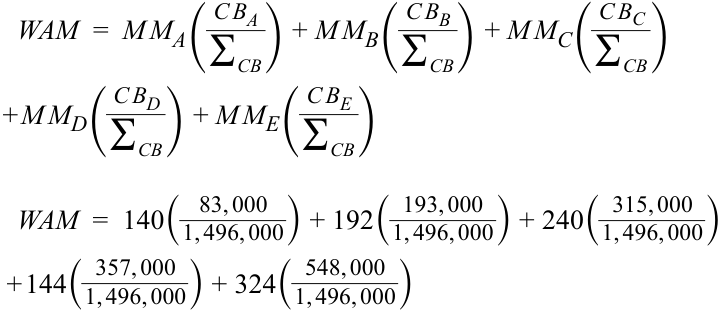
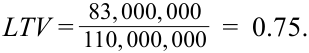
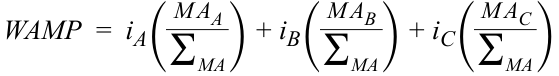

# Tập 6: Chứng Khoán Thu Nhập Cố Định (Fixed Income)
## Học phần 19: Đặc Điểm Công Cụ và Thị Trường Chứng Khoán Đảm Bảo Bằng Thế Chấp (MBS)
### Phần 3/3: Bài Tập Thực Hành (Trang PDF 537–546)

---

<!-- PDF Page 537 -->

# **BÀI TẬP THỰC HÀNH (PRACTICE PROBLEMS)** 

## **Thông tin sau đây liên quan đến các câu hỏi 1–2** 

Vui lòng tham khảo thông tin dưới đây để trả lời câu hỏi 1 và 2 liên quan đến các trái phiếu được chứng khoán hóa bằng các hợp đồng thuê của AR&C.

### **Giao dịch Chứng khoán hóa Hợp đồng Thuê Máy bay Phản lực Tư nhân của AR&C Limited** 

AR&C Limited cho các tập đoàn tại Bắc Mỹ thuê máy bay phản lực tư nhân với thời hạn cố định là 5 năm. AR&C giữ quyền sở hữu đối với các máy bay phản lực này. Các tập đoàn thực hiện các khoản thanh toán tiền lãi bằng nhau mỗi tháng. Nếu một khách hàng vỡ nợ, AR&C có thể thu hồi lại máy bay phản lực. AR&C đã hoạt động kinh doanh được khoảng 15 năm và có xếp hạng tín nhiệm B3, nghĩa là nợ của công ty thuộc nhóm phi đầu tư (*non-investment grade*). AR&C có 500 triệu CAD các hợp đồng thuê trên bảng cân đối kế toán mà công ty muốn chứng khoán hóa thành ABS.

<!-- Picture Text: AR&C Leasing of Jets Customers Cash Payments Periodic Cash Sale of the Leases for Leases Payments Special Purpose Entity Periodic Cash Issuance and Cash Payments Sale of ABS for ABS Payments to Investors Investors  -->

| **Hạng Trái phiếu (Bond Class)** | **Chi tiết các Lớp chứng khoán** |
|---|---|
| **A (cấp cao – *senior*)** | _Kỳ phiếu Lớp A (Tranche A Notes)_ Mệnh giá: 250 triệu CAD Lãi suất: MRR + 1,00% Kỳ hạn: Một năm |
| **B (cấp thấp – *subordinated*)** | _Kỳ phiếu Lớp B (Tranche B Notes)_ Mệnh giá: 100 triệu CAD Lãi suất: MRR + 2,00% Kỳ hạn: Hai năm |
| **C (cấp thấp – *subordinated*)** | _Kỳ phiếu Lớp C (Tranche C Notes)_ Mệnh giá: 100 triệu CAD Lãi suất: MRR + 3,00% Kỳ hạn: Ba năm |

<!-- PDF Page 538 -->

| **Hạng Trái phiếu (Bond Class)** | **Chi tiết các Lớp chứng khoán** |
|---|---|
| **D (cấp thấp – *subordinated*)** | _Kỳ phiếu Lớp D (Tranche D Notes)_ Mệnh giá: 50 triệu CAD Lãi suất: MRR + 4,00% Kỳ hạn: Bốn năm |
| **Tổng cộng (*Total*)** | **500 triệu CAD** |

**1.** So sánh xếp hạng tín nhiệm của trái phiếu Hạng A do SPE phát hành với các trái phiếu không có tài sản thế chấp (*uncollateralized bonds*) do chính AR&C trực tiếp phát hành. Trái phiếu Hạng A _nhiều khả năng nhất_ được xếp hạng:

   - **A.** thấp hơn trái phiếu của AR&C.

   - **B.** ngang bằng với trái phiếu của AR&C.

   - **C.** cao hơn trái phiếu của AR&C.

**2.** Chọn phát biểu nào sau đây liên quan đến các trái phiếu có tài sản đảm bảo do SPE trực tiếp phát hành là _chính xác nhất_.

   - **A.** Cấu trúc cấp cao/cấp thấp (*senior/subordinated structure*) này là một ví dụ về phân lớp theo thời gian (*time tranching*).

   - **B.** Các khoản lỗ được gánh chịu bởi các hạng trái phiếu cấp thấp trước khi bất kỳ khoản lỗ nào chạm tới trái phiếu Hạng A.

   - **C.** Trong một cấu trúc thác nước (*waterfall structure*) như cấu trúc này, các khoản lỗ được chia sẻ theo tỷ lệ tương ứng (*proportionally*) qua tất cả các hạng trái phiếu cấp thấp.

## **Thông tin sau đây liên quan đến các câu hỏi 3–4** 

Một người đi vay muốn vay một khoản thế chấp để mua một bất động sản. Thông tin liên quan đến bất động sản, khoản vay mong muốn và tình hình tài chính của người mua được trình bày dưới đây:

   - Giá bất động sản (*Property price*): 750.000 CAD
   - Số tiền vay mong muốn (*Desired loan amount*): 525.000 CAD
   - Lãi suất hàng năm (*Annual interest rate*): 5,00%
   - Thời hạn vay (*Loan term*): 30 năm / 360 tháng
   - Khoản thanh toán hàng tháng (*Monthly payment*): 2.818,31 CAD
   - Tổng thu nhập gộp trước thuế hàng năm của người đi vay (*Borrower's annual pre-tax gross income*): 210.000 CAD

**3.** Tỷ lệ khoản vay trên giá trị tài sản (LTV) _gần nhất_ với mức:

   - **A.** 54%.
   - **B.** 66%.
   - **C.** 70%.

<!-- PDF Page 539 -->

**4.** Tỷ lệ nợ trên thu nhập (DTI) _gần nhất_ với mức:

   - **A.** 1,30%.
   - **B.** 16,10%.
   - **C.** 250,00%.

**5.** Đối với một CMO bao gồm các lớp Khấu hao gốc theo Kế hoạch (*Planned Amortization Class* – PAC), nếu tốc độ trả nợ trước hạn nằm trong biên độ dự kiến, lớp chứng khoán nào sau đây _nhiều khả năng nhất_ bảo vệ các nhà đầu tư khỏi rủi ro trả nợ trước hạn?

   - **A.** Lớp PAC (*PAC tranche*)

   - **B.** Lớp cấp cao (*Senior tranche*)

   - **C.** Lớp hỗ trợ (*Support tranche*)

**6.** Phương pháp nào sau đây giúp phân phối lại rủi ro trả nợ trước hạn (*prepayment risk*)?

   - **A.** Phân lớp chứng khoán (*Tranching*)

   - **B.** Chênh lệch lãi suất dư thừa (*Excess spread*)

   - **C.** Thế chấp vượt mức (*Overcollateralization*)

**7.** Dưới đây là năm khoản thế chấp cấu thành toàn bộ danh mục trong một chứng khoán đảm bảo bằng thế chấp.

| **Khoản thế chấp (Mortgage)** | **Lãi suất ($i$)** | **Số dư Ban đầu (Beginning Balance – BB)** | **Số dư Hiện tại (Current Balance – CB)** | **Thời hạn Ban đầu (Original Term – tháng)** | **Số Tháng Còn lại đến khi Đáo hạn (Number of Months to Maturity)** |
|---|---|---|---|---|---|
| **A** | 2,00% | 200.000 CAD | 83.000 CAD | 420 | 140 |
| **B** | 3,00% | 300.000 CAD | 193.000 CAD | 360 | 192 |
| **C** | 4,00% | 400.000 CAD | 315.000 CAD | 360 | 240 |
| **D** | 5,00% | 500.000 CAD | 357.000 CAD | 240 | 144 |
| **E** | 6,00% | 600.000 CAD | 548.000 CAD | 420 | 324 |
| **Tổng cộng** | | **2.000.000 CAD** | **1.496.000 CAD** | | |

Chỉ số WAM của chứng khoán này _gần nhất_ với mức:

   - **A.** 208 tháng.

   - **B.** 224 tháng.

   - **C.** 236 tháng.

**8.** Hệ quả bất lợi nào sau đây nhiều khả năng nhất gắn liền với rủi ro kéo dài kỳ hạn (*extension risk*)?

   - **A.** Các nhà đầu tư phải tái đầu tư số tiền thu được ở mức lãi suất thấp hơn.

   - **B.** Lãi suất cao hơn làm giảm giá trị của các dòng tiền mà nhà đầu tư nhận được.

   - **C.** Quyền chọn trả nợ trước hạn làm giảm tiềm năng tăng giá của trái phiếu.

<!-- PDF Page 540 -->

## **Thông tin sau đây liên quan đến các câu hỏi 9–11** 

Sử dụng thông tin sau đây cho các câu hỏi 9, 10 và 11:

Dưới đây là ba bất động sản có các khoản thế chấp được chứng khoán hóa để tạo ra một CMBS trả gốc tuần tự và thông tin liên quan đến bốn lớp chứng khoán cấu thành CMBS đó.

| **Loại Bất động sản (Property Type)** | **Giá trị Thị trường Hợp lý (Fair Market Value)** | **Số tiền Thế chấp (Mortgaged Amount)** | **Lãi suất Coupon (Coupon Rate)** | **Kỳ hạn (Maturity)** | **Phương thức Hoàn trả (Repayment)** |
|---|---|---|---|---|---|
| Tòa nhà Văn phòng (*Office Building*) | 35.000.000 | 27.000.000 | 4,00% | Bốn năm kể từ ngày thanh toán giao dịch | Khấu hao gốc toàn phần (*Fully amortizing*) |
| Tòa nhà Văn phòng (*Office Building*) | 60.000.000 | 44.000.000 | 3,00% | Bốn năm kể từ ngày thanh toán giao dịch | Khấu hao gốc toàn phần (*Fully amortizing*) |
| Nhà kho (*Warehouse*) | 15.000.000 | 12.000.000 | 5,00% | Tám năm kể từ ngày thanh toán giao dịch | Khấu hao gốc toàn phần (*Fully amortizing*) |

Trả nợ trước hạn (*Prepayment*): Không cho phép trả nợ trước hạn đối với các khoản thế chấp cơ sở trong 5 năm đầu tiên.

| **Thông tin về các Lớp chứng khoán (Tranche Information)** | | |
|---|---|---|
| **Lớp chứng khoán (Tranche)** | **Lãi suất Coupon (Coupon Rate)** | **Giá trị Nợ gốc (Principal Value)** |
| **A** | 2,00% | 20.000.000 |
| **B** | 3,00% | 22.000.000 |
| **C** | 4,00% | 23.000.000 |
| **D** | 5,00% | 18.000.000 |

**9.** Tỷ lệ khoản vay trên giá trị tài sản (LTV) liên quan _gần nhất_ với mức:

   - **A.** 0,75.
   - **B.** 0,77.
   - **C.** 0,80.

**10.** Khoản thanh toán coupon bình quân gia quyền (*weighted average coupon payment*) trả cho các lớp chứng khoán _gần nhất_ với mức:

   - **A.** 3,47%.
   - **B.** 3,50%.
   - **C.** 3,61%.

**11.** Lãi suất thu được bình quân gia quyền từ các khoản thế chấp (*weighted average proceeds from the mortgages* – WAMP) _gần nhất_ với mức:

   - **A.** 3,47%.
   - **B.** 3,50%.

<!-- PDF Page 541 -->

   - **C.** 3,61%.

**12.** Yếu tố nào sau đây _nhiều khả năng nhất_ sẽ làm tăng rủi ro thanh toán gốc lớn cuối kỳ (*balloon risk*) đối với một khoản vay thế chấp thương mại sắp đáo hạn?

   - **A.** Tỷ số DSCR cao (*High DSCR*)

   - **B.** Tỷ lệ LTV thấp (*Low LTV ratio*)

   - **C.** Thiếu người mua bất động sản trên thị trường (*Lack of property buyers in market*)

**13.** Cơ chế nào sau đây mang lại sự bảo vệ trước rủi ro trả nợ trước hạn (*call protection*) cho các nhà đầu tư CMBS ở cấp độ cấu trúc (*structural level*)?

   - **A.** Giải trừ nghĩa vụ nợ bằng danh mục trái phiếu chính phủ thay thế (*Defeasance*)

   - **B.** Khóa trả nợ trước hạn (*Prepayment lockout*)

   - **C.** Các lớp chứng khoán trả gốc tuần tự (*Sequential-pay tranches*)

<!-- PDF Page 542 -->

# **LỜI GIẢI (SOLUTIONS)** 

1. Đáp án đúng là C. Trái phiếu Hạng A do SPE phát hành được đảm bảo bằng tài sản thế chấp — chính là các hợp đồng thuê được AR&C bán cho SPE — và chúng là những trái phiếu có thứ tự ưu tiên cao nhất (*most senior*) trong số các trái phiếu do SPE phát hành. Một trái phiếu có bảo đảm được thế chấp bằng tài sản bảo đảm và được coi là ít rủi ro hơn so với một trái phiếu không có tài sản thế chấp đứng sau. Trái phiếu Hạng A do SPE phát hành _nhiều khả năng nhất_ sẽ được xếp hạng tín nhiệm cao hơn bất kỳ trái phiếu doanh nghiệp không có bảo đảm nào do chính AR&C trực tiếp phát hành.

2. Đáp án đúng là B. Các khoản lỗ được gánh chịu bởi các hạng trái phiếu cấp thấp trước khi bất kỳ khoản lỗ nào chạm tới trái phiếu Hạng A cấp cao. A không đúng vì cấu trúc cấp cao/cấp thấp (*senior/subordinated structure*) này là một ví dụ về phân lớp tín dụng (*credit tranching*), chứ không phải phân lớp theo thời gian (*time tranching*). C không đúng vì trong một cấu trúc thác nước như cấu trúc này, lớp thứ cấp thấp nhất là Hạng D sẽ hấp thụ toàn bộ các khoản lỗ lên đến toàn bộ 50 triệu CAD mệnh giá của nó trước tiên. Sau đó, nếu tổn thất tín dụng vượt quá ngưỡng đó, Hạng Trái phiếu C sẽ hấp thụ toàn bộ các khoản lỗ tiếp theo lên đến toàn bộ 100 triệu CAD mệnh giá của nó. Các khoản lỗ không được chia sẻ theo tỷ lệ tương ứng qua tất cả các hạng trái phiếu cấp thấp; thay vào đó, chúng được hấp thụ bởi các hạng thứ cấp thấp nhất trước tiên rồi sau đó mới đến các hạng cao hơn tiếp theo cho đến hết giá trị khoản lỗ.

3. Đáp án đúng là C. Tỷ lệ khoản vay trên giá trị tài sản (LTV) là tỷ lệ giữa số tiền của khoản vay/thế chấp trên giá trị của bất động sản:

$$\text{LTV} = \frac{\text{Amount of the loan / mortgage}}{\text{Property's value}}$$

$$\text{LTV} = \frac{525.000}{750.000}$$

$$\text{LTV} = 70\%$$

A không đúng vì nó được tính bằng cách lấy khoản thanh toán hàng tháng chia cho giá trị khoản vay ban đầu, chứ không phải tỷ lệ khoản vay trên giá trị bất động sản, như sau:

$$\frac{2.818,31}{525.000} = 0,54\%$$

Lưu ý: Kết quả này là 0,54%, chứ không phải 54%. Lựa chọn A đã được điều chỉnh thành 54% để làm cho đáp án đúng bớt hiển nhiên hơn.

B không đúng vì nó được tính bằng khoản thanh toán hàng tháng cho khoản vay 20 năm (chứ không phải khoản vay 30 năm) chia cho giá trị khoản vay ban đầu, như sau:

$$\frac{3.464,77}{525.000} = 0,66\%$$

Lưu ý: Kết quả này là 0,66%, chứ không phải 66%. Lựa chọn B đã được điều chỉnh thành 66% để làm cho đáp án đúng bớt hiển nhiên hơn.

4. Đáp án đúng là B. Tỷ lệ DTI được tính bằng cách sử dụng khoản thanh toán nợ hàng tháng và tổng thu nhập gộp trước thuế hàng tháng của người đi vay, như sau:

$$\text{DTI} = \frac{\text{Monthly Debt Payment}}{\text{Monthly pre-tax gross income}}$$

$$\text{DTI} = \frac{\text{CAD } 2.818,31}{(\text{CAD } 210.000 / 12)} = 16,10\%$$

A không đúng vì nó được tính bằng cách lấy khoản thanh toán hàng tháng chia cho tổng thu nhập gộp trước thuế hàng năm, như sau:

<!-- PDF Page 543 -->

$$\frac{2.818,31}{210.000} = 1,30\%$$

C không đúng vì nó được tính bằng cách lấy giá trị khoản vay ban đầu chia cho tổng thu nhập gộp trước thuế hàng năm, như sau:

$$\frac{525.000}{210.000} = 250,00\%$$

5. Đáp án đúng là C. Nếu tốc độ trả nợ trước hạn nằm trong biên độ đã quy định, toàn bộ rủi ro trả nợ trước hạn sẽ được hấp thụ bởi lớp hỗ trợ (*support tranche*). Điều này mang lại khả năng dự báo cao hơn về quy mô và thời điểm của các dòng tiền chi trả cho các nhà đầu tư nắm giữ các lớp PAC.

A không đúng vì trong một CMO bao gồm lớp PAC, bản thân lớp PAC là bên _được bảo vệ_ khỏi rủi ro trả nợ trước hạn bởi vì toàn bộ rủi ro trả nợ trước hạn đã được hấp thụ bởi lớp hỗ trợ (*support tranche*).

B không đúng vì trong một CMO bao gồm lớp PAC, lớp cấp cao (PAC) được bảo vệ khỏi rủi ro trả nợ trước hạn bởi vì toàn bộ rủi ro trả nợ trước hạn đã được hấp thụ bởi lớp hỗ trợ.

6. Đáp án đúng là A. Cấu trúc phân lớp (*tranching structure*) trong các CMO không thể loại bỏ hoàn toàn rủi ro trả nợ trước hạn, nhưng nó có thể phân phối lại rủi ro trả nợ trước hạn qua các lớp chứng khoán khác nhau, giúp che chắn bảo vệ một số lớp chứng khoán nhiều hơn so với các lớp khác. Các cấu trúc lớp chứng khoán của CMO làm giảm sự bất định về quy mô và thời điểm của các khoản thanh toán mà nhà đầu tư nhận được. B và C không đúng vì chênh lệch lãi suất dư thừa (*excess spread*) và thế chấp vượt mức (*overcollateralization*) đều là các hình thức tăng cường tín dụng phổ biến, nhưng chúng không phân phối lại rủi ro trả nợ trước hạn.

7. Đáp án đúng là C. Kỳ hạn bình quân gia quyền (WAM) được tính bằng cách lấy trọng số số tháng còn lại đến khi đáo hạn của từng khoản thế chấp trong danh mục theo tỷ lệ phần trăm của số dư nợ thế chấp đang lưu hành đó so với tổng số dư đang lưu hành của tất cả các khoản thế chấp trong danh mục, như thể hiện trong phương trình sau đây:

<!-- Formula Text: WAM  =  M M A( C B A _ ∑ CB  ) + M M B( C B B _ ∑ CB  ) + M M C( C B C _ ∑ CB  ) + M M D( C B D _ ∑ CB  ) + M M E( C B E _ ∑ CB  ) WAM  =  140(  83, 000 _ 1, 496, 000 ) + 192(  193, 000 _ 1, 496, 000 ) + 240(  315, 000 _ 1, 496, 000 ) + 144(  357, 000 _ 1, 496, 000 ) + 324(  548, 000 _ 1, 496, 000 ) -->

$$\text{WAM} = MM_A \left(\frac{CB_A}{\sum CB}\right) + MM_B \left(\frac{CB_B}{\sum CB}\right) + MM_C \left(\frac{CB_C}{\sum CB}\right) + MM_D \left(\frac{CB_D}{\sum CB}\right) + MM_E \left(\frac{CB_E}{\sum CB}\right)$$

$$\text{WAM} = 140 \left(\frac{83.000}{1.496.000}\right) + 192 \left(\frac{193.000}{1.496.000}\right) + 240 \left(\frac{315.000}{1.496.000}\right) + 144 \left(\frac{357.000}{1.496.000}\right) + 324 \left(\frac{548.000}{1.496.000}\right)$$

$$\text{WAM} = 236 \text{ tháng}$$

A không đúng vì nó được tính bằng cách lấy trung bình cộng giản đơn số tháng còn lại đến khi đáo hạn của năm khoản thế chấp, thay vì tính trung bình gia quyền của chúng.

B không đúng vì nó được tính bằng cách lấy trọng số số tháng còn lại đến khi đáo hạn của từng khoản thế chấp trong danh mục theo tỷ lệ phần trăm của số dư thế chấp _ban đầu_ so với tổng số dư ban đầu của tất cả các khoản thế chấp trong danh mục, chứ không phải theo số dư _hiện tại_.

8. Đáp án đúng là B. Rủi ro kéo dài kỳ hạn (*Extension risk*) là rủi ro người đi vay có thể hoàn trả số tiền đã vay chậm hơn dự kiến, làm kéo dài thời gian hoàn trả và kỳ hạn của trái phiếu. Đối với các nhà đầu tư, điều này gây ra một hệ quả bất lợi: Lãi suất cao hơn làm giảm giá trị của các dòng tiền mà nhà đầu tư nhận được. Các khoản thanh toán mà nhà đầu tư nhận được sẽ bị chiết khấu ở mức lãi suất cao hơn,

<!-- PDF Page 544 -->

và sự kéo dài kỳ hạn làm dàn trải các khoản thanh toán mà nhà đầu tư nhận được ra xa hơn. A không đúng vì rủi ro thu hẹp kỳ hạn (*contraction risk* — rủi ro người đi vay có thể hoàn trả số tiền đã vay nhanh hơn dự kiến, làm giảm tổng số tiền thanh toán trong tương lai mà nhà đầu tư nhận được), chứ không phải rủi ro kéo dài kỳ hạn, mới có hệ quả bất lợi là nhà đầu tư phải tái đầu tư số tiền thu được ở mức lãi suất thấp hơn.

C không đúng vì rủi ro thu hẹp kỳ hạn (rủi ro người đi vay có thể hoàn trả số tiền đã vay nhanh hơn dự kiến, làm giảm tổng số tiền thanh toán trong tương lai mà nhà đầu tư nhận được), chứ không phải rủi ro kéo dài kỳ hạn, mới có hệ quả bất lợi là quyền chọn trả nợ trước hạn làm giảm tiềm năng tăng giá của trái phiếu.

9. Đáp án đúng là A. Tỷ lệ khoản vay trên giá trị tài sản (LTV) liên quan được tính bằng tổng giá trị của tất cả các khoản vay (thế chấp) chia cho tổng giá trị của các bất động sản gắn liền với các khoản thế chấp đó, như sau:

$$\text{LTV} = \frac{\text{Total value of all loans (mortgages)}}{\text{Total value of all properties mortgaged}}$$

<!-- Formula Text: LTV =  83, 000, 000 _ 110, 000, 000   =  0.75. -->

$$\text{LTV} = \frac{27.000.000 + 44.000.000 + 12.000.000}{35.000.000 + 60.000.000 + 15.000.000} = \frac{83.000.000}{110.000.000} = 0,75$$

B không đúng vì 0,77 là giá trị của riêng khoản thế chấp trên bất động sản đầu tiên (27.000.000) chia cho tổng giá trị của bất động sản đầu tiên (35.000.000).

C không đúng vì 0,80 là giá trị của riêng khoản thế chấp trên bất động sản thứ ba (12.000.000) chia cho tổng giá trị của bất động sản thứ ba (15.000.000).

10. Đáp án đúng là A. Khoản thanh toán coupon bình quân gia quyền (*weighted average coupon payment*) được tính bằng giá trị lãi suất coupon của từng lớp chứng khoán nhân với trọng số là giá trị nợ gốc của lớp chứng khoán đó tính theo tỷ lệ phần trăm trên tổng giá trị của tất cả các lớp chứng khoán:

<!-- Formula Text: WAC  =  i A( P V A _ ∑ PV  ) + i B( P V B _ ∑ PV  ) + i C( P V C _ ∑ PV  ) + i D( P V D _ ∑ PV  ) WAC  =  2.00%( 20, 000, 000 _ 83, 000, 000 ) + 3.00%( 22, 000, 000 _ 83, 000, 000 ) + 4.00%( 23, 000, 000 _ 83, 000, 000 ) + 5.00%( 18, 000, 000 _ 23, 000, 000 ) -->

$$\text{WAC} = i_A \left(\frac{PV_A}{\sum PV}\right) + i_B \left(\frac{PV_B}{\sum PV}\right) + i_C \left(\frac{PV_C}{\sum PV}\right) + i_D \left(\frac{PV_D}{\sum PV}\right)$$

$$\text{WAC} = 2,00\% \left(\frac{20.000.000}{83.000.000}\right) + 3,00\% \left(\frac{22.000.000}{83.000.000}\right) + 4,00\% \left(\frac{23.000.000}{83.000.000}\right) + 5,00\% \left(\frac{18.000.000}{83.000.000}\right)$$

$$\text{WAC} = 3,47\%$$

*(Lưu ý: Trong ảnh công thức gốc của sách có lỗi in ấn mẫu số hạng tử cuối là 23.000.000, giá trị đúng theo tổng nợ gốc các lớp là 83.000.000 để ra kết quả 3,47%).*

B không đúng vì 3,50% được tính bằng trung bình cộng giản đơn của bốn mức lãi suất coupon (của bốn lớp chứng khoán), thay vì trung bình gia quyền.

C không đúng vì 3,61% là lãi suất thu được bình quân gia quyền từ ba khoản thế chấp (WAMP), chứ không phải khoản thanh toán coupon bình quân gia quyền trả cho các lớp chứng khoán.

11. Đáp án đúng là C. Lãi suất thu được bình quân gia quyền từ các khoản thế chấp ($\text{WAMP}$ trình bày dưới đây) được tính bằng lãi suất coupon của từng khoản thế chấp nhân với trọng số là giá trị/số tiền của khoản thế chấp đó tính theo tỷ lệ phần trăm trên tổng giá trị của tất cả các khoản thế chấp:

<!-- Formula Text: WAMP  =  i A( M A A _ ∑ MA  ) + i B( M A B _ ∑ MA  ) + i C( M A C _ ∑ MA  ) -->

$$\text{WAMP} = i_A \left(\frac{MA_A}{\sum MA}\right) + i_B \left(\frac{MA_B}{\sum MA}\right) + i_C \left(\frac{MA_C}{\sum MA}\right)$$

<!-- PDF Page 545 -->

<!-- Formula Text: WAMP  =  4.00%( 27, 000, 000 _ 83, 000, 000 ) + 3.00%( 44, 000, 000 _ 83, 000, 000 ) + 5.00%( 12, 000, 000 _ 83, 000, 000 ) -->

$$\text{WAMP} = 4,00\% \left(\frac{27.000.000}{83.000.000}\right) + 3,00\% \left(\frac{44.000.000}{83.000.000}\right) + 5,00\% \left(\frac{12.000.000}{83.000.000}\right)$$

$$\text{WAMP} = 3,61\%$$

A không đúng vì 3,47% là khoản thanh toán coupon bình quân gia quyền cho bốn lớp chứng khoán, chứ không phải lãi suất thu được bình quân gia quyền từ các khoản thế chấp.

B không đúng vì 3,50% được tính bằng trung bình cộng giản đơn của bốn mức lãi suất coupon, chứ không phải lãi suất thu được bình quân gia quyền từ các khoản thế chấp.

12. Đáp án đúng là C. Việc thiếu người mua bất động sản trên thị trường sẽ gây khó khăn cho người đi vay trong việc bán bất động sản để tạo ra đủ tiền nhằm thanh toán số dư nợ gốc đang lưu hành. A không đúng vì tỷ số DSCR cao sẽ làm giảm rủi ro thanh toán gốc lớn cuối kỳ (*balloon risk*). B không đúng vì tỷ lệ LTV thấp cũng sẽ làm giảm rủi ro thanh toán gốc lớn cuối kỳ của một khoản vay sắp đáo hạn.

13. Đáp án đúng là C. Bảo vệ trước rủi ro trả nợ trước hạn ở cấp độ cấu trúc (*Structural call protection*) đạt được thông qua các lớp chứng khoán trả gốc tuần tự (*sequential-pay tranches*) trong CMBS vì một lớp chứng khoán có xếp hạng thấp hơn không thể được trả bớt nợ gốc cho đến khi lớp chứng khoán có xếp hạng cao hơn đã được tất toán hoàn toàn. A không đúng vì giải trừ nghĩa vụ nợ bằng danh mục trái phiếu chính phủ thay thế (*defeasance*) cung cấp sự bảo vệ ở cấp độ từng khoản vay riêng lẻ. *Defeasance* cho phép trả nợ trước hạn, nhưng người đi vay phải mua một danh mục chứng khoán chính phủ mô phỏng hoàn toàn dòng tiền của các khoản thanh toán gốc và lãi theo lịch trình còn lại, bao gồm cả số dư nợ gốc lớn cuối kỳ (*balloon loan balance*) của khoản vay. B không đúng vì khóa trả nợ trước hạn (*prepayment lockout*) cung cấp sự bảo vệ ở cấp độ từng khoản vay riêng lẻ. Khóa trả nợ trước hạn là một thỏa thuận hợp đồng nghiêm cấm bất kỳ khoản trả nợ trước hạn nào trong suốt một giai đoạn quy định cụ thể.

<!-- PDF Page 546 -->
