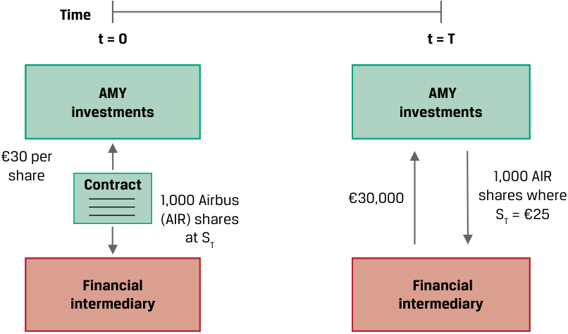
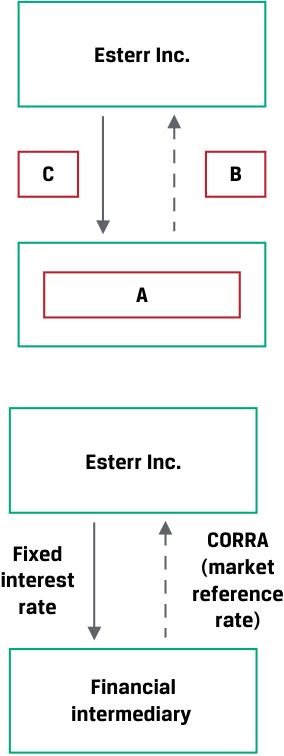
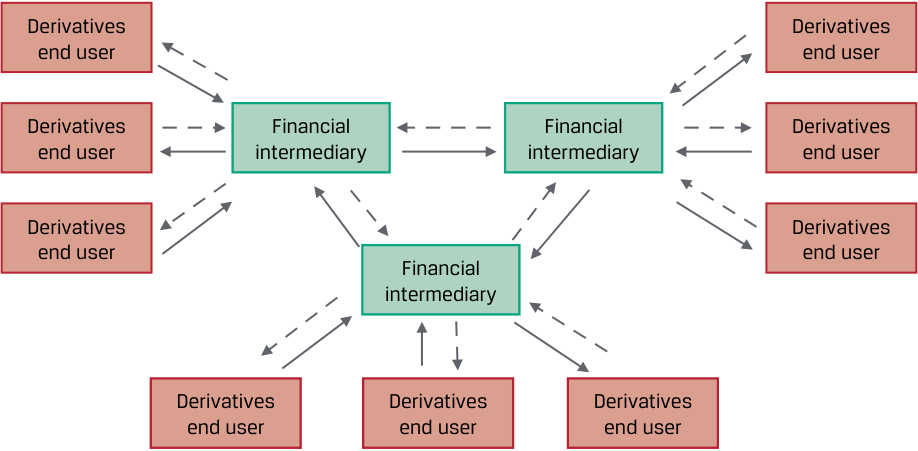
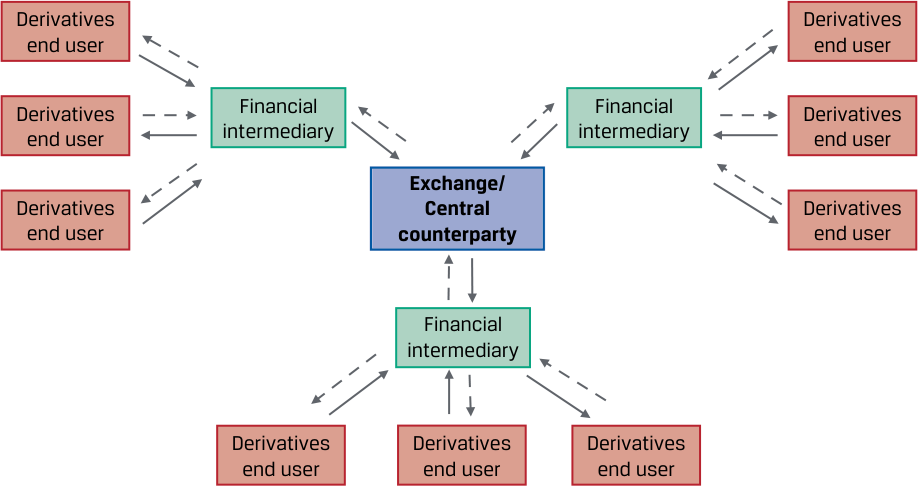
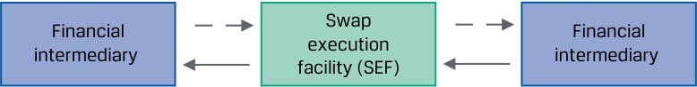
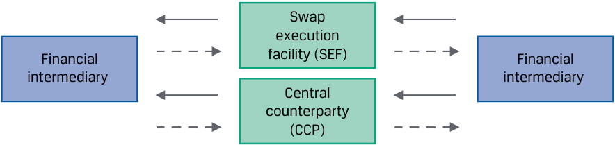

# Tập 7: Công cụ Phái sinh (*Derivatives*)
## Học phần 1: Đặc điểm của Công cụ Phái sinh và Thị trường Phái sinh (*Derivative Instrument and Derivative Market Features*)
### Phần 1/2: Giới thiệu (Trang PDF 11–26)

---

<!-- PDF Page 11 -->

# H Ọ C P H Ầ N **<mark>1</mark>** 

### **Đặc điểm của Công cụ Phái sinh và Thị trường Phái sinh (*Derivative Instrument and Derivative Market Features*)** 

##### **<mark>MỤC TIÊU HỌC TẬP (*LEARNING OUTCOMES*)</mark>** 

|**_Mức độ thành thạo_**|**_Ứng viên cần có khả năng:_**|
|---|---|
||định nghĩa công cụ phái sinh và mô tả các đặc điểm cơ bản của một công cụ phái sinh (*derivative instrument*)|
||mô tả các đặc điểm cơ bản của thị trường phái sinh, và đối chiếu giữa thị trường phái sinh phi tập trung (*over-the-counter* – OTC) và thị trường phái sinh giao dịch trên sở giao dịch (*exchange-traded derivative* – ETD)|

#### **GIỚI THIỆU (*INTRODUCTION*)** 

**<mark>1</mark>** 

Các bài học trước đã mô tả các thị trường dành cho tài sản tài chính liên quan đến cổ phiếu (*equities*), thu nhập cố định (*fixed income*), tiền tệ (*currencies*), và hàng hóa (*commodities*). Những thị trường này được gọi là **thị trường giao ngay (*cash markets* hoặc *spot markets*)**, nơi các tài sản cụ thể được trao đổi tại mức giá hiện hành được gọi là **giá tiền mặt (*cash prices*)** hoặc **giá giao ngay (*spot prices*)**. Các công cụ phái sinh (*derivatives*) liên quan đến việc trao đổi các dòng tiền trong tương lai mà giá trị của chúng bắt nguồn từ hoặc dựa trên một giá trị cơ sở (*underlying value*). Các bài học tiếp theo sẽ định nghĩa và mô tả các đặc điểm của công cụ phái sinh và thị trường phái sinh.

###### **TỔNG QUAN HỌC PHẦN (*LEARNING MODULE OVERVIEW*)** 

- Công cụ phái sinh (*derivative*) là một hợp đồng tài chính có giá trị bắt nguồn từ hiệu quả hoạt động của một tài sản cơ sở (*underlying asset*), có thể đại diện cho một cam kết chắc chắn (*firm commitment*) hoặc một quyền đòi hỏi có điều kiện (*contingent claim*).

- Thị trường phái sinh mở rộng tập hợp các cơ hội sẵn có cho những người tham gia thị trường vượt ra ngoài thị trường giao ngay để tạo lập hoặc điều chỉnh mức độ tiếp xúc rủi ro (*exposure*) đối với một tài sản cơ sở.

- Các tài sản cơ sở phổ biến nhất của công cụ phái sinh bao gồm cổ phiếu (*equities*), công cụ thu nhập cố định và lãi suất (*fixed income and interest rates*), tiền tệ (*currencies*), hàng hóa (*commodities*), và tín dụng (*credit*).

- Thị trường phái sinh phi tập trung (*Over-the-counter* – OTC) liên quan đến việc khởi tạo các hợp đồng tùy chỉnh, linh hoạt giữa người sử dụng cuối cùng của công cụ phái sinh (*derivatives end users*) và các định chế tài chính trung gian (*financial intermediaries*).

<!-- PDF Page 12 -->

- Công cụ phái sinh giao dịch trên sở giao dịch (*Exchange-traded derivatives* – ETDs) là các hợp đồng được tiêu chuẩn hóa giao dịch trên một sở giao dịch có tổ chức, nơi yêu cầu ký quỹ tài sản thế chấp (*collateral on deposit*) để bảo vệ trước rủi ro vỡ nợ của đối tác (*counterparty default*).

- Đối với các công cụ phái sinh được bù trừ tập trung (*centrally cleared*), một đối tác trung tâm (*central counterparty* – CCP) sẽ gánh chịu rủi ro tín dụng đối tác (*counterparty credit risk*) của các bên tham gia hợp đồng phái sinh và cung cấp dịch vụ bù trừ và thanh toán (*clearing and settlement services*).

###### **TỰ ĐÁNH GIÁ HỌC PHẦN (*LEARNING MODULE SELF-ASSESSMENT*)** 

Những câu hỏi ban đầu này nhằm giúp bạn đánh giá mức độ hiểu biết hiện tại của mình về học phần này.

1. Phát biểu nào sau đây **không** đưa ra lập luận ủng hộ việc sử dụng công cụ phái sinh?

   - **A.** Các tổ chức phát hành có thể bù đắp mức độ tiếp xúc rủi ro thị trường tài chính gắn liền với một giao dịch thương mại.

   - **B.** Công cụ phái sinh thường có chi phí giao dịch thấp hơn so với việc giao dịch trực tiếp trên tài sản cơ sở.

   - **C.** Có thể tạo ra mức độ tiếp xúc rủi ro lớn đối với tài sản cơ sở bằng công cụ phái sinh với một khoản chi tiền mặt tương đương.

###### **Lời giải:** 

C là đáp án đúng. Hợp đồng phái sinh tạo ra mức độ tiếp xúc rủi ro đối với tài sản cơ sở với một khoản chi tiền mặt *nhỏ*, do đó đây là phát biểu không đưa ra lập luận hợp lý cho việc sử dụng công cụ phái sinh. Các phát biểu A và B là những lập luận hợp lệ cho việc sử dụng công cụ phái sinh.

2. Từ nào sau đây làm cho phát biểu dưới đây trở nên chính xác? Những người tham gia thị trường sử dụng các thỏa thuận phái sinh để trao đổi các dòng tiền trong tương lai dựa trên một _________________.

   - **A.** Tài sản cơ sở (*Underlying*)

   - **B.** Quyền chọn (*Option*)

   - **C.** Phòng vệ giá (*Hedge*)

###### **Lời giải:** 

A là đáp án đúng. Những người tham gia thị trường sử dụng các thỏa thuận phái sinh để trao đổi các dòng tiền trong tương lai dựa trên một _tài sản cơ sở (underlying)_. B không đúng vì _quyền chọn (option)_ đề cập đến một loại hợp đồng phái sinh cụ thể. C không đúng vì _phòng vệ giá (hedge)_ đề cập đến một mục đích cụ thể của việc sử dụng hợp đồng phái sinh.

3. Đâu là sự khác biệt đáng kể giữa hợp đồng phái sinh giao dịch trên sở giao dịch (*exchange-traded derivative* – ETD) và hợp đồng phái sinh phi tập trung (*over-the-counter* – OTC)?

   - **A.** ETD tạo ra rủi ro tín dụng đối tác cho người sử dụng phái sinh, trong khi phái sinh OTC thì không.

   - **B.** ETD là các hợp đồng được tiêu chuẩn hóa, trong khi phái sinh OTC được tùy chỉnh theo yêu cầu.

   - **C.** ETD có chi phí giao dịch cao hơn so với phái sinh OTC.

###### **Lời giải:** 

B là đáp án đúng. Các sở giao dịch tiêu chuẩn hóa hợp đồng để tạo thuận lợi cho khối lượng giao dịch. Tuy nhiên, người dùng thường yêu cầu các tính năng tùy chỉnh cụ thể, và thị trường OTC có thể đáp ứng những nhu cầu này. A không đúng vì các sở giao dịch

<!-- PDF Page 13 -->

gánh chịu rủi ro tín dụng đối tác của các công cụ phái sinh. C không đúng vì ETD có chi phí giao dịch thấp hơn so với phái sinh OTC.

4. Nếu một tổ chức phát hành doanh nghiệp tham gia vào một hợp đồng phái sinh OTC được bù trừ tập trung (*centrally cleared OTC derivative contract*), rủi ro nào sau đây có khả năng là mối quan tâm lớn nhất đối với tổ chức phát hành và những người tham gia khác trên thị trường này?

   - **A.** Rủi ro lãi suất (*Interest rate risk*)

   - **B.** Rủi ro tín dụng đối tác (*Counterparty credit risk*)

   - **C.** Rủi ro hệ thống (*Systemic risk*)

###### **Lời giải:** 

C là đáp án đúng. Bởi vì toàn bộ rủi ro tín dụng được đảm nhận bởi đối tác trung tâm (CCP), tất cả những người tham gia trên thị trường này đều quan tâm nhất đến việc liệu CCP có khả năng đáp ứng các nghĩa vụ của mình đối với tất cả các hợp đồng hay không. A không đúng vì rủi ro lãi suất là một rủi ro cơ sở có thể được phòng vệ hoặc quản lý bằng một số hợp đồng phái sinh OTC nhất định. B không đúng vì CCP gánh chịu rủi ro tín dụng từ tất cả các bên tham gia hợp đồng.

#### **ĐẶC ĐIỂM CỦA CÔNG CỤ PHÁI SINH (*DERIVATIVE FEATURES*)** 

## **<mark>2</mark>** 

định nghĩa công cụ phái sinh và mô tả các đặc điểm cơ bản của một công cụ phái sinh

##### **Định nghĩa và Đặc điểm của một Công cụ Phái sinh (*Definition and Features of a Derivative*)** 

Một **công cụ phái sinh (*derivative*)** là một công cụ tài chính có giá trị bắt nguồn từ hiệu quả hoạt động của một tài sản cơ sở. Tài sản trong một công cụ phái sinh được gọi là **tài sản cơ sở (*underlying*)**. Tài sản cơ sở có thể không phải là một tài sản riêng lẻ mà là một nhóm các tài sản được tiêu chuẩn hóa hoặc các biến số, chẳng hạn như lãi suất hoặc một chỉ số tín dụng (*credit index*).

Những người tham gia thị trường sử dụng các thỏa thuận phái sinh để trao đổi các dòng tiền trong tương lai dựa trên một giá trị cơ sở. Ví dụ, Bảng minh họa 1 (*Exhibit 1*) cho thấy việc trao đổi một lần trong tương lai đối với các cổ phiếu được giao dịch đại chúng tại một mức giá cố định trong một công cụ phái sinh được gọi là **hợp đồng kỳ hạn (*forward contract*)**.

<!-- PDF Page 14 -->

**Bảng minh họa 1: Hợp đồng Kỳ hạn (*Exhibit 1: Forward Contract*)** 

<!-- Picture Text: Time t = 0 t = T AMY AMY investments investments €30 per share 1,000 AIR Contract 1,000 Airbus €30,000 shares where (AIR) shares ST = €25 at ST Financial Financial intermediary intermediary  -->

> **Chú thích hình ảnh:**
> - **Thời gian (*Time*):** Tại $t = 0$ (Khởi tạo hợp đồng): AMY Investments ký hợp đồng (*Contract*) với Định chế tài chính trung gian (*Financial intermediary*) cho 1.000 cổ phiếu Airbus (AIR) tại mức giá €30 mỗi cổ phiếu (so với giá giao ngay $S_T$).
> - Tại $t = T$ (Đáo hạn): AMY Investments giao 1.000 cổ phiếu AIR (khi giá giao ngay $S_T = €25$) và nhận về €30.000 từ Định chế tài chính trung gian.

Một công cụ phái sinh không chuyển giao trực tiếp tỷ suất sinh lợi của tài sản cơ sở mà biến đổi hiệu quả hoạt động của tài sản cơ sở đó. Trong Bảng minh họa 1, AMY Investments đồng ý ngày hôm nay ($t = 0$) sẽ giao 1.000 cổ phiếu của Airbus (AIR) tại mức giá cố định là €30 mỗi cổ phiếu vào một ngày trong tương lai ($t = T$), trong ví dụ của chúng ta là sau sáu tháng. Hợp đồng kỳ hạn cho phép AMY chuyển giao rủi ro giá của cổ phiếu AIR cơ sở sang một bên thứ hai, hay một **đối tác (*counterparty*)**, bằng cách tham gia vào hợp đồng phái sinh này. Nếu giá giao ngay của AIR ($S_T$) là €25 mỗi cổ phiếu tại thời điểm $T$ sau sáu tháng, AMY sẽ nhận được €30.000 từ đối tác của mình (một định chế tài chính trung gian) cho 1.000 cổ phiếu AIR hiện chỉ có giá trị €25.000, hoặc đơn giản là thanh toán với định chế trung gian khoản chênh lệch €5.000 bằng tiền mặt. Các giao dịch phái sinh thường có sự tham gia của ít nhất một định chế tài chính trung gian làm đối tác. Như chúng ta sẽ thấy sau này, **rủi ro tín dụng đối tác (*counterparty credit risk*)**, hay khả năng một đối tác không thể đáp ứng các nghĩa vụ tài chính của mình theo hợp đồng, là một yếu tố quan trọng cần cân nhắc đối với các công cụ này.

Một **hợp đồng phái sinh (*derivative contract*)** là một thỏa thuận pháp lý giữa các đối tác với một **kỳ hạn (*maturity*)** cụ thể, hay khoảng thời gian cho đến khi đóng giao dịch, hoặc **thanh toán (*settlement*)**. Người mua một công cụ phái sinh tham gia vào một hợp đồng có giá trị thay đổi theo cách tương tự như một vị thế **mua (*long position*)** đối với tài sản cơ sở, và người bán có mức độ tiếp xúc rủi ro tương tự như một vị thế **bán (*short position*)**. **Quy mô hợp đồng (*contract size*)** (đôi khi được gọi là vốn gốc danh nghĩa hay giá trị danh nghĩa – *notional principal or amount*) được thỏa thuận ngay từ đầu và có thể giữ nguyên không đổi hoặc thay đổi theo thời gian.

Bảng minh họa 1 là một ví dụ về **công cụ phái sinh độc lập (*stand-alone derivative*)**, một hợp đồng phái sinh riêng biệt, chẳng hạn như một công cụ phái sinh trên cổ phiếu hoặc trái phiếu. Một **công cụ phái sinh đi kèm (*embedded derivative*)** là một công cụ phái sinh nằm bên trong một tài sản cơ sở, chẳng hạn như trái phiếu có quyền mua lại (*callable bond*), trái phiếu có quyền bán lại (*puttable bond*), hoặc trái phiếu chuyển đổi (*convertible bond*). Bảng minh họa 2 cung cấp một bản tóm tắt điều khoản (*term sheet*) mẫu bao gồm các đặc điểm chính của hợp đồng kỳ hạn độc lập giữa AMY Investments với một định chế tài chính trung gian.

**Bảng minh họa 2: Bản tóm tắt điều khoản Hợp đồng Kỳ hạn mẫu (*Exhibit 2: Sample Forward Contract Term Sheet*)** 

|**Đặc điểm hợp đồng**|**Bản tóm tắt điều khoản Giao dịch Kỳ hạn (*Forward Transaction Term Sheet*)**||
|---|---|---|
|**Loại hợp đồng (*Contract Type*):** Cam kết chắc chắn (*firm commitment*) hoặc quyền đòi hỏi có điều kiện (*contingent right*) để trao đổi các dòng tiền trong tương lai|||
|**Kỳ hạn (*Maturity*):** Ngày cuối cùng mà việc chi trả hoặc thanh toán diễn ra|**Ngày bắt đầu (*Start Date*):**|[Bắt đầu giao ngay (*Spot start*)]|
||**Ngày đáo hạn (*Maturity Date*):**|[Sáu tháng kể từ Ngày bắt đầu]|

<!-- PDF Page 15 -->

|**Đặc điểm hợp đồng**|**Bản tóm tắt điều khoản Giao dịch Kỳ hạn (*Forward Transaction Term Sheet*)**||
|---|---|---|
|**Các đối tác (*Counterparties*):** Các pháp nhân tham gia vào hợp đồng phái sinh|**Bên mua kỳ hạn (*Forward Purchaser*):**|[Định chế tài chính trung gian (*Financial Intermediary*)]|
||**Bên bán kỳ hạn (*Forward Seller*):**|AMY Investments|
|**Tài sản cơ sở (*Underlying*):** Tài sản hoặc biến số tham chiếu được sử dụng làm nguồn xác định giá trị hợp đồng **Quy mô hợp đồng (*Contract Size*):** Số lượng/giá trị được sử dụng để tính toán định giá và xác định giá trị công cụ phái sinh|**Giao hàng kỳ hạn (*Forward Delivery*):**|1.000 cổ phiếu phổ thông của Airbus (AIR) được giao dịch trên Sở Giao dịch Chứng khoán Frankfurt (*Frankfurt Stock Exchange*)|
|**Giá cơ sở (*Underlying Price*):** Mức giá thỏa thuận trước để thanh toán cam kết chắc chắn hoặc quyền đòi hỏi có điều kiện|**Giá kỳ hạn (*Forward Price*):**|€30 mỗi cổ phiếu|
|**Chi tiết hợp đồng (*Contract Details*):**|**Ngày làm việc (*Business Days*):** **Hồ sơ pháp lý (*Documentation*):**|Frankfurt Thỏa thuận ISDA (*ISDA Agreement*) và các điều khoản tín dụng được cả hai bên chấp thuận|

Công cụ phái sinh giữa AMY và định chế tài chính trung gian là một **cam kết chắc chắn (*firm commitment*)**, trong đó một khoản tiền được xác định trước được thỏa thuận sẽ trao đổi khi thanh toán. Các cam kết chắc chắn bao gồm hợp đồng kỳ hạn (*forward contracts*), hợp đồng tương lai (*futures contracts*), và **hợp đồng hoán đổi (*swaps*)** liên quan đến việc trao đổi định kỳ các dòng tiền. Một loại công cụ phái sinh khác là **quyền đòi hỏi có điều kiện (*contingent claim*)**, trong đó một trong các đối tác sẽ quyết định liệu giao dịch có được thanh toán hay không và vào thời điểm nào. **Quyền chọn (*option*)** là quyền đòi hỏi có điều kiện chính yếu.

Thị trường phái sinh mở rộng tập hợp các cơ hội sẵn có cho những người tham gia thị trường để tạo lập hoặc điều chỉnh mức độ tiếp xúc rủi ro đối với một tài sản cơ sở theo nhiều cách:

- Các nhà đầu tư có thể bán khống (*sell short*) để hưởng lợi từ sự sụt giảm kỳ vọng trong giá trị của tài sản cơ sở.

- Các nhà đầu tư có thể sử dụng công cụ phái sinh như một công cụ để đa dạng hóa danh mục đầu tư (*portfolio diversification*).

- Các tổ chức phát hành có thể bù đắp mức độ tiếp xúc rủi ro thị trường tài chính gắn liền với một giao dịch thương mại.

- Những người tham gia thị trường có thể tạo ra mức độ tiếp xúc rủi ro lớn đối với một tài sản cơ sở với một khoản chi tiền mặt tương đối nhỏ.

- Các công cụ phái sinh thường có chi phí giao dịch thấp hơn và thường có tính thanh khoản cao hơn so với các giao dịch trên thị trường giao ngay của tài sản cơ sở.

Các tổ chức phát hành và nhà đầu tư sử dụng công cụ phái sinh để làm tăng hoặc giảm mức độ tiếp xúc rủi ro trên thị trường tài chính. Ví dụ, việc sử dụng một công cụ phái sinh để bù đắp hoặc trung hòa mức độ tiếp xúc rủi ro hiện có hoặc dự kiến đối với một tài sản cơ sở được gọi là **phòng vệ giá (*hedging*)**, với bản thân công cụ phái sinh đó thường được mô tả là một **công cụ phòng vệ (*hedge*)** cho giao dịch cơ sở.

###### **BỘ CÂU HỎI (*QUESTION SET*)** 

##### **Đặc điểm của Công cụ Phái sinh (*Derivative Features*)** 

1. Hãy xác định một lý do tại sao một tổ chức phát hành có thể sử dụng công cụ phái sinh.

**Lời giải:** 

Một tổ chức phát hành có thể sử dụng công cụ phái sinh để bù đắp mức độ tiếp xúc rủi ro thị trường tài chính gắn liền với một giao dịch thương mại. Tổ chức phát hành cũng có thể sử dụng công cụ phái sinh để bù đắp hoặc trung hòa mức độ tiếp xúc rủi ro hiện có hoặc dự kiến đối với một tài sản cơ sở.

<!-- PDF Page 16 -->

2. Hãy xác định ví dụ nào tương ứng với từng loại hợp đồng phái sinh độc lập (*stand-alone*) hoặc phái sinh đi kèm (*embedded*) sau đây:

| Loại hợp đồng | Ví dụ |
|---|---|
| A. Cam kết chắc chắn (*Firm commitment*) | 1. Trái phiếu có quyền mua lại (*Callable bond*) |
| B. Quyền đòi hỏi có điều kiện (*Contingent claim*) | 2. Hợp đồng giao khí đốt tự nhiên giá cố định (*Fixed-price natural gas delivery contract*) |
| C. Không phải cam kết chắc chắn cũng không phải quyền đòi hỏi có điều kiện | 3. Giao dịch mua chứng chỉ quỹ hoán đổi danh mục (*exchange-traded fund* – ETF) Chỉ số FTSE 100 |

###### **Lời giải:** 

1. B là đáp án đúng. Trái phiếu có quyền mua lại (*callable bond*) là một ví dụ về công cụ phái sinh đi kèm nằm bên trong một tài sản cơ sở, đây là một quyền đòi hỏi có điều kiện (*contingent claim*).

2. A là đáp án đúng. Hợp đồng giao khí đốt tự nhiên giá cố định là một ví dụ về hợp đồng cam kết chắc chắn (*firm commitment*) với khí đốt tự nhiên là tài sản cơ sở.

3. C là đáp án đúng. Quỹ hoán đổi danh mục (ETF) Chỉ số FTSE 100 không phải là cam kết chắc chắn cũng không phải là quyền đòi hỏi có điều kiện, mà là một ví dụ về giao dịch trên thị trường tiền mặt hoặc giao ngay (*cash or spot market transaction*).

3. Xác định các câu trả lời đúng để điền vào chỗ trống: Cổ phiếu là một ví dụ về ____________ của công cụ phái sinh, và một _______________ là một pháp nhân tham gia vào một hợp đồng phái sinh.

###### **Lời giải:** 

Cổ phiếu là một ví dụ về _tài sản cơ sở (underlying)_ của công cụ phái sinh, và một _đối tác (counterparty)_ là một pháp nhân tham gia vào một hợp đồng phái sinh.

4. Mô tả việc sử dụng một công cụ phái sinh cho mục đích phòng vệ giá (*hedging*).

###### **Lời giải:** 

Việc sử dụng một công cụ phái sinh cho mục đích phòng vệ giá liên quan đến việc bù đắp hoặc trung hòa một mức độ tiếp xúc rủi ro hiện có hoặc dự kiến đối với một tài sản cơ sở, được gọi là phòng vệ giá (*hedging*).

5. Giải thích việc thanh toán (*settlement*) của một hợp đồng kỳ hạn (*forward contract*).

###### **Lời giải:** 

Hợp đồng kỳ hạn là một cam kết chắc chắn (*firm commitment*). Hợp đồng này dẫn đến một khoản chi trả thanh toán vào ngày đáo hạn bằng với phần chênh lệch giữa giá thị trường hiện hành và mức giá kỳ hạn đã thỏa thuận trước.

## **<mark>3</mark> TÀI SẢN CƠ SỞ CỦA CÔNG CỤ PHÁI SINH (*DERIVATIVE UNDERLYINGS*)** 

định nghĩa công cụ phái sinh và mô tả các đặc điểm cơ bản của một công cụ phái sinh

Các công cụ phái sinh thường được phân nhóm theo tài sản cơ sở mà từ đó giá trị của chúng được hình thành. Một hợp đồng phái sinh có thể tham chiếu đến nhiều hơn một tài sản cơ sở. Các tài sản cơ sở phổ biến nhất của công cụ phái sinh bao gồm cổ phiếu (*equities*), công cụ thu nhập cố định và lãi suất (*fixed income and interest rates*), tiền tệ (*currencies*), hàng hóa (*commodities*), và tín dụng (*credit*).

<!-- PDF Page 17 -->

##### **Cổ phiếu (*Equities*)** 

Các công cụ phái sinh cổ phiếu (*equity derivatives*) thường tham chiếu đến một cổ phiếu riêng lẻ, một nhóm cổ phiếu, hoặc một chỉ số cổ phiếu (*stock index*), chẳng hạn như chỉ số FTSE 100. Quyền chọn (*options*) là các công cụ phái sinh phổ biến nhất trên các cổ phiếu riêng lẻ. Các công cụ phái sinh chỉ số (*index derivatives*) thường được giao dịch dưới dạng quyền chọn, hợp đồng kỳ hạn, hợp đồng tương lai, và hợp đồng hoán đổi.

Hợp đồng hoán đổi chỉ số (*index swaps*), hay hợp đồng hoán đổi cổ phiếu (*equity swaps*), cho phép nhà đầu tư trả tỷ suất sinh lợi trên một chỉ số cổ phiếu và nhận về tỷ suất sinh lợi trên một chỉ số khác hoặc một mức lãi suất. Nhà quản lý đầu tư có thể sử dụng hợp đồng hoán đổi chỉ số để tăng hoặc giảm mức độ tiếp xúc rủi ro đối với một thị trường cổ phiếu hoặc một nhóm ngành mà không cần giao dịch từng cổ phiếu riêng lẻ. Những hợp đồng hoán đổi này được sử dụng rộng rãi trong các chiến lược phân bổ tài sản từ trên xuống (*top-down asset allocation strategies*). Cuối cùng, các quyền chọn, hợp đồng tương lai, và hợp đồng hoán đổi cũng có sẵn dựa trên _độ biến động thực tế (realized volatility)_ của giá chỉ số cổ phiếu trong một khoảng thời gian nhất định. Các hợp đồng này cho phép những người tham gia thị trường quản lý rủi ro, hay độ phân tán (*dispersion*), của các biến động giá một cách tách biệt khỏi xu hướng biến động giá cổ phiếu.

Quyền chọn trên các cổ phiếu riêng lẻ được mua và bán bởi các nhà đầu tư và thường xuyên được các tổ chức phát hành sử dụng làm thù lao cho các giám đốc điều hành và nhân viên của họ. Quyền chọn cổ phiếu cho nhân viên (*stock options*) được cấp nhằm tạo động lực làm việc hướng tới hiệu quả hoạt động doanh nghiệp mạnh mẽ hơn với kỳ vọng giá cổ phiếu sẽ cao hơn. Quyền chọn cổ phiếu có thể giúp các công ty trả mức thù lao bằng tiền mặt thấp hơn. Các công ty cũng có thể phát hành chứng quyền (*warrants*), là các quyền chọn được cấp cho nhân viên hoặc bán cho công chúng cho phép người nắm giữ mua cổ phiếu tại một mức giá cố định trong tương lai trực tiếp từ tổ chức phát hành.

##### **Công cụ Thu nhập Cố định (*Fixed-Income Instruments*)** 

Trái phiếu là một tài sản cơ sở được sử dụng rộng rãi, và các công cụ phái sinh liên quan bao gồm quyền chọn, hợp đồng kỳ hạn, hợp đồng tương lai, và hợp đồng hoán đổi. Các tổ chức phát hành chính phủ, chẳng hạn như Bộ Tài chính Hoa Kỳ (*US Treasury*) hoặc Bộ Tài chính Nhật Bản (*Japanese Ministry of Finance*), thường có nhiều đợt phát hành trái phiếu đang lưu hành. Do đó, một hợp đồng tương lai được tiêu chuẩn hóa đơn lẻ gắn với các trái phiếu như vậy thường quy định các thông số cho phép nhiều hơn một đợt phát hành trái phiếu có thể được dùng để giao hàng nhằm thanh toán hợp đồng.

Lãi suất không phải là một tài sản mà là một biến số cơ sở thu nhập cố định (*fixed-income underlying*) được sử dụng trong nhiều công cụ phái sinh lãi suất, chẳng hạn như hợp đồng kỳ hạn, hợp đồng tương lai, và quyền chọn. Hợp đồng hoán đổi lãi suất (*interest rate swaps*) là một loại cam kết chắc chắn thường xuyên được những người tham gia thị trường sử dụng để chuyển đổi từ mức độ tiếp xúc rủi ro lãi suất cố định sang lãi suất thả nổi trong một khoảng thời gian nhất định. Ví dụ, một nhà quản lý đầu tư có thể sử dụng hợp đồng hoán đổi lãi suất để tăng hoặc giảm thời lượng (*duration*) của danh mục đầu tư mà không cần giao dịch trái phiếu. Mặt khác, một tổ chức phát hành có thể sử dụng hợp đồng hoán đổi lãi suất để thay đổi cấu trúc tiếp xúc rủi ro lãi suất của các khoản nợ phải trả của mình.

**Lãi suất tham chiếu thị trường (*market reference rate* – MRR)** là biến số cơ sở lãi suất phổ biến nhất được sử dụng trong các hợp đồng hoán đổi lãi suất. Các mức lãi suất này thường khớp với lãi suất của các khoản vay hoặc các nghĩa vụ nợ ngắn hạn khác. Lãi suất Libor dựa trên khảo sát được sử dụng làm lãi suất tham chiếu trong quá khứ đã được thay thế bằng các mức lãi suất dựa trên mức trung bình hàng ngày của các lãi suất giao dịch thị trường quan sát được. Ví dụ, Lãi suất Tài trợ Qua đêm Có bảo đảm (*Secured Overnight Financing Rate* – SOFR) là mức lãi suất vay tiền mặt qua đêm được thế chấp bằng Trái phiếu Kho bạc Hoa Kỳ. Các lãi suất MRR khác bao gồm lãi suất ngắn hạn đồng euro (*euro short-term rate* – €STR) và Lãi suất Trung bình Chỉ số Qua đêm Đồng Bảng Anh (*Sterling Overnight Index Average* – SONIA).

##### **Tiền tệ (*Currencies*)** 

Những người tham gia thị trường thường xuyên sử dụng các công cụ phái sinh để phòng vệ mức độ tiếp xúc rủi ro của các giao dịch thương mại và tài chính phát sinh do rủi ro tỷ giá hối đoái (*foreign exchange risk*). Ví dụ, các nhà xuất khẩu thường tham gia vào các hợp đồng kỳ hạn để bán ngoại tệ và mua nội tệ theo các điều khoản khớp với điều khoản của hợp đồng giao hàng hóa hoặc dịch vụ tại một quốc gia nước ngoài. Ngoài ra, một nhà đầu tư có thể bán hợp đồng tương lai trên một đồng tiền cụ thể trong khi vẫn giữ lại một danh mục chứng khoán được định giá bằng đồng tiền đó để hưởng lợi từ sự sụt giảm tạm thời trong giá trị của đồng tiền đó. Các quyền chọn, hợp đồng kỳ hạn, hợp đồng tương lai, và hợp đồng hoán đổi dựa trên trái phiếu chính phủ và tỷ giá hối đoái được sử dụng để quản lý rủi ro tiền tệ.

<!-- PDF Page 18 -->

##### **Hàng hóa (*Commodities*)** 

Thị trường tiền mặt hoặc giao ngay đối với hàng hóa mềm (*soft commodities*) và hàng hóa cứng (*hard commodities*) liên quan đến việc giao hàng vật chất (*physical delivery*) tài sản cơ sở khi thanh toán. **Hàng hóa mềm (*soft commodities*)** là các sản phẩm nông nghiệp, chẳng hạn như gia súc và ngô, còn **hàng hóa cứng (*hard commodities*)** là các tài nguyên thiên nhiên, chẳng hạn như dầu thô và kim loại. Các công cụ phái sinh hàng hóa được sử dụng rộng rãi để quản lý rủi ro giá của một loại hàng hóa riêng lẻ hoặc một chỉ số hàng hóa một cách tách biệt khỏi việc giao hàng vật chất. Ví dụ, một hãng hàng không, công ty vận tải biển, hoặc công ty vận chuyển hàng hóa có thể mua hợp đồng tương lai dầu mỏ để làm công cụ phòng vệ trước sự gia tăng chi phí hoạt động do chi phí nhiên liệu cao hơn. Một nhà đầu tư có thể mua một hợp đồng tương lai chỉ số hàng hóa để gia tăng mức độ tiếp xúc với giá hàng hóa mà không cần nhận giao hàng vật chất đối với tài sản cơ sở.

##### **Tín dụng (*Credit*)** 

Các hợp đồng phái sinh tín dụng (*credit derivative contracts*) dựa trên rủi ro vỡ nợ (*default risk*) của một tổ chức phát hành đơn lẻ hoặc một nhóm các tổ chức phát hành trong một chỉ số. Hợp đồng hoán đổi rủi ro tín dụng (*Credit default swaps* – CDS) cho phép nhà đầu tư quản lý rủi ro tổn thất từ việc người đi vay vỡ nợ một cách tách biệt khỏi thị trường trái phiếu. Các hợp đồng CDS được giao dịch dựa trên một mức chênh lệch (*spread*) đại diện cho khả năng xảy ra vỡ nợ. Ví dụ, một nhà đầu tư có thể mua hoặc bán một hợp đồng CDS trên một chỉ số trái phiếu lợi suất cao (*high-yield index*) để thay đổi mức độ tiếp xúc của danh mục đầu tư đối với tín dụng lợi suất cao mà không cần mua hoặc bán các trái phiếu cơ sở. Ngoài ra, một ngân hàng có thể mua một hợp đồng CDS để bù đắp mức độ tiếp xúc rủi ro tín dụng hiện có trước khả năng vỡ nợ tiềm tàng của một tổ chức phát hành.

##### **Các tài sản cơ sở khác (*Other*)** 

Các tài sản cơ sở phái sinh khác bao gồm thời tiết (*weather*), tiền mã hóa (*cryptocurrencies*), và tuổi thọ (*longevity*), tất cả đều có thể ảnh hưởng đến hiệu quả tài chính của nhiều đối tượng tham gia thị trường khác nhau. Ví dụ, rủi ro tuổi thọ (*longevity risk*) rất quan trọng đối với các công ty bảo hiểm và các quỹ hưu trí có mức hưởng xác định (*defined benefit pension plans*) vốn phải đối mặt với mức độ tiếp xúc rủi ro trước sự gia tăng kỳ vọng sống (*life expectancy*). Các công cụ phái sinh dựa trên những tài sản cơ sở này ít phổ biến hơn và khó định giá hơn. Bảng minh họa 3 cung cấp tóm tắt về các tài sản cơ sở phổ biến.

**Bảng minh họa 3: Các Tài sản Cơ sở Phổ biến của Công cụ Phái sinh (*Exhibit 3: Common Derivative Underlyings*)** 

|**Loại tài sản (*Asset Class*)**|**Ví dụ (*Examples*)**|**Ứng dụng mẫu (*Sample Uses*)**|
|---|---|---|
|**Cổ phiếu (*Equities*)**|Các cổ phiếu riêng lẻ (*Individual stocks*) Các chỉ số cổ phiếu (*Equity indexes*) Độ biến động giá cổ phiếu (*Equity price volatility*)|Thay đổi cấu trúc tiếp xúc rủi ro (Nhà đầu tư) Thù lao cho nhân viên (Tổ chức phát hành)|
|**Lãi suất (*Interest Rates*)**|Trái phiếu chính phủ nội địa (*Sovereign bonds - domestic*) Lãi suất tham chiếu thị trường (*Market reference rates*)|Thay đổi mức độ tiếp xúc thời lượng – *duration* (Nhà đầu tư) Thay đổi cấu trúc tiếp xúc rủi ro nợ (Tổ chức phát hành)|
|**Ngoại hối (*Foreign Exchange*)**|Trái phiếu chính phủ nước ngoài (*Sovereign bonds - foreign*) Tỷ giá hối đoái thị trường (*Market exchange rates*)|Quản lý rủi ro danh mục đầu tư toàn cầu (Nhà đầu tư) Quản lý rủi ro thương mại toàn cầu (Tổ chức phát hành)|
|**Hàng hóa (*Commodities*)**|Hàng hóa mềm và hàng hóa cứng (*Soft and hard commodities*) Các chỉ số hàng hóa (*Commodity indexes*)|Quản lý rủi ro hoạt động (Người tiêu dùng/Nhà sản xuất) Đa dạng hóa danh mục đầu tư (Nhà đầu tư)|

<!-- PDF Page 19 -->

|**Loại tài sản (*Asset Class*)**|**Ví dụ (*Examples*)**|**Ứng dụng mẫu (*Sample Uses*)**|
|---|---|---|
|**Tín dụng (*Credit*)**|Các thực thể tham chiếu riêng lẻ (*Individual reference entities*) Các chỉ số tín dụng (*Credit indexes*)|Đa dạng hóa danh mục đầu tư (Nhà đầu tư) Quản lý rủi ro tín dụng (Định chế tài chính trung gian)|
|**Khác (*Other*)**|Thời tiết (*Weather*) Tiền mã hóa (*Cryptocurrencies*) Tuổi thọ (*Longevity*)|Quản lý rủi ro hoạt động (Tổ chức phát hành) Quản lý rủi ro danh mục đầu tư (Nhà đầu tư)|

###### **HỢP ĐỒNG TƯƠNG LAI ĐẤT HIẾM VÀ HỢP ĐỒNG LITHIUM TRÊN SÀN LME (*RARE EARTH FUTURES AND THE LME LITHIUM CONTRACT*)** 

Các tài sản cơ sở của công cụ phái sinh tiếp tục thích ứng với tầm quan trọng ngày càng tăng của các yếu tố môi trường, xã hội và quản trị (*environmental, social, and governance* – ESG) đang tác động đến các thị trường thương mại và tài chính. Ví dụ, khi ngành công nghiệp ô tô chuyển dịch từ công nghệ động cơ đốt trong sang sản xuất xe điện (*electric vehicle* – EV) do các mối quan ngại về môi trường, nhu cầu đối với các kim loại đất hiếm và kim loại pin, chẳng hạn như lithium, làm nguyên liệu đầu vào cho quá trình sản xuất pin xe điện ngày càng trở nên quan trọng.

Để đáp ứng nhu cầu ngày càng tăng từ các nhà sản xuất hàng hóa và người sử dụng cuối cùng cũng như các nhà đầu tư, Sở Giao dịch Kim loại Luân Đôn (*London Metal Exchange* – LME) đã giới thiệu hợp đồng tương lai lithium vào năm 2021. Hợp đồng lithium LME được thanh toán bằng tiền mặt (*cash settled*) bằng đồng USD dựa trên mức giá giao ngay được công bố hàng tuần cho lithium hydroxide monohydrate cấp độ pin (*battery-grade*) có thể giao hàng tại Trung Quốc, Nhật Bản và Hàn Quốc với quy mô lô (*lot size*) là một tấn mét (*metric ton*) cho mỗi hợp đồng.

##### **Các Kịch bản Nhà đầu tư (*Investor Scenarios*)** 

Các kịch bản sau đây xem xét các mục tiêu cụ thể của hai bên và đánh giá hợp đồng phái sinh phù hợp nhất cho mỗi bên.

###### **_Kịch bản 1: Hightest Capital_** 

Hightest Capital là một quỹ đầu tư có trụ sở tại Hoa Kỳ với danh mục đầu tư cổ phiếu nội địa được đa dạng hóa tốt. Nhà quản lý danh mục đầu tư cấp cao của Hightest tin rằng các cổ phiếu ngành chăm sóc sức khỏe (*health care stocks*) sẽ có kết quả vượt trội đáng kể so với chỉ số chung trong sáu tháng tới. Ace Limited là một định chế tài chính trung gian và là thành viên của Sở Giao dịch Quyền chọn Chicago (*Chicago Board Options Exchange* – CBOE).

Hightest mua một quyền chọn (*option*) dựa trên một hợp đồng tiêu chuẩn hóa trên Chỉ số Ngành Chăm sóc Sức khỏe Chọn lọc S&P 500 (*S&P 500 Health Care Select Sector Index* – SIXV) với Ace là định chế tài chính trung gian và giá giao ngay của SIXV là tài sản cơ sở. SIXV bao gồm khoảng 60 cổ phiếu ngành chăm sóc sức khỏe nằm trong Chỉ số S&P 500. Hợp đồng này là một quyền đòi hỏi có điều kiện (*contingent claim*), cấp cho Hightest quyền mua SIXV tại mức giá cao hơn 5% so với giá thị trường hiện hành ($\text{giá giao ngay SIXV} \times 1,05$) sau sáu tháng.

###### **_Kịch bản 2: Esterr Inc._** 

Esterr Inc. là một công ty đại chúng có trụ sở tại Toronto với khoản vay có kỳ hạn lãi suất thả nổi (*floating-rate term loan*) trị giá 250 triệu CAD. Khoản vay có kỳ hạn còn lại là ba năm rưỡi và được định giá ở mức lãi suất MRR kỳ hạn ba tháng (tức là CORRA, hay Lãi suất Tham chiếu Qua đêm Trung bình của Canada – *Canadian Overnight Reference Rate Average*) cộng với 150 điểm cơ bản (*bps*). Giám đốc ngân quỹ của Esterr lo ngại về việc lãi suất tại Canada sẽ tăng cao hơn trong suốt thời gian còn lại của khoản vay và muốn cố định chi phí lãi vay của Esterr.

Esterr tham gia vào một hợp đồng hoán đổi lãi suất (*interest rate swap*) trị giá 250 triệu CAD với một định chế tài chính trung gian với lãi suất MRR là biến số cơ sở. Theo hợp đồng hoán đổi này, Esterr đồng ý trả một mức lãi suất cố định và nhận lãi suất MRR kỳ hạn ba tháng trên vốn gốc danh nghĩa (*notional principal*) là 250 triệu CAD trong ba năm rưỡi dựa trên các ngày thanh toán khớp với khoản vay có kỳ hạn. Hợp đồng hoán đổi này là một cam kết chắc chắn (*firm commitment*).

<!-- PDF Page 20 -->

###### **BỘ CÂU HỎI (*QUESTION SET*)** 

##### **Tài sản Cơ sở của Công cụ Phái sinh (*Derivative Underlyings*)** 

1. Mô tả cách thức và lý do tại sao một tài sản cơ sở có thể được sử dụng trong chế độ thù lao cho nhân viên.

   - **Lời giải:** 

Các công cụ phái sinh có tài sản cơ sở là cổ phiếu, đặc biệt là cổ phiếu của một tổ chức phát hành cụ thể, có thể được đưa vào gói thù lao cho nhân viên của công ty đó. Quyền chọn cổ phiếu (*stock options*) được cấp nhằm tạo động lực làm việc hướng tới hiệu quả hoạt động doanh nghiệp mạnh mẽ hơn với kỳ vọng giá cổ phiếu sẽ cao hơn, điều này sẽ làm cho các quyền chọn đó tăng giá trị.

2. Giải thích cách thức một nhà nhập khẩu hàng hóa có trụ sở tại Vương quốc Anh nhập hàng từ khu vực đồng euro (*euro zone*) có thể sử dụng một công cụ phái sinh có tài sản cơ sở là tiền tệ để giảm thiểu rủi ro.

   - **Lời giải:** 

Một nhà nhập khẩu hàng hóa có trụ sở tại Vương quốc Anh nhập hàng từ khu vực đồng euro nhiều khả năng sẽ phải thanh toán bằng đồng EUR cho số hàng hóa mà bà dự định bán thu về đồng GBP. Để giải quyết sự lệch pha tiền tệ (*currency mismatch*) này, bà có thể cân nhắc tham gia vào một cam kết chắc chắn để mua EUR đổi lấy GBP tại một mức giá xác định trước trong tương lai dựa trên các điều khoản khớp với hợp đồng nhập khẩu nhằm bù đắp rủi ro trước những biến động của tỷ giá hối đoái giao ngay cơ sở (tức là sự mất giá của đồng GBP so với đồng EUR).

3. Xác định A, B, và C trong sơ đồ sau đây, giống như trong Bảng minh họa 1, đối với hợp đồng hoán đổi lãi suất trong Kịch bản 2 của Esterr Inc.

###### **Lời giải:** 

<!-- Picture Text: Esterr Inc. C B A Esterr Inc. CORRA Fixed (market interest reference rate rate) Financial intermediary  -->

> **Chú thích hình ảnh:**
> - **A:** Định chế tài chính trung gian (*Financial intermediary*)
> - **B:** Lãi suất cố định (*Fixed interest rate*) (do Esterr Inc. trả cho Định chế tài chính trung gian)
> - **C:** Lãi suất CORRA (lãi suất tham chiếu thị trường – *market reference rate*) (do Định chế tài chính trung gian trả cho Esterr Inc.)

<!-- PDF Page 21 -->

4. Xác định và mô tả các đặc điểm của công cụ phái sinh đối với hợp đồng hoán đổi lãi suất của Esterr Inc. bằng cách sử dụng bản tóm tắt điều khoản sau đây, giống như trong Bảng minh họa 2.

###### **Bản tóm tắt điều khoản Hợp đồng Hoán đổi Lãi suất (*Interest Rate Swap Term Sheet*)** 

|**Ngày bắt đầu (*Start Date*):**|[Bắt đầu giao ngay (*Spot start*)]|
|---|---|
|**Ngày đáo hạn (*Maturity Date*):**|[Ba năm và sáu tháng kể từ Ngày bắt đầu]|
|**Vốn gốc danh nghĩa (*Notional Principal*):**|CAD250.000.000|
|**Bên trả lãi suất cố định (*Fixed-Rate Payer*):**|Esterr Inc.|
|**Lãi suất cố định (*Fixed Rate*):**|2,05% tính trên cơ sở bán niên, Thực tế/365 (*semiannual, Act/365 basis*)|
|**Bên trả lãi suất thả nổi (*Floating-Rate Payer*):**|[Định chế tài chính trung gian (*Financial Intermediary*)]|
|**Lãi suất thả nổi (*Floating Rate*):**|Lãi suất Repo Qua đêm Trung bình của Canada (*Canadian Overnight Repo Rate Average* – CORRA) kỳ hạn 3 tháng được công bố vào mỗi Ngày làm việc bởi Ngân hàng Trung ương Canada (*Bank of Canada*)|
|**Ngày thanh toán (*Payment Dates*):**|Trao đổi bán niên trên cơ sở bù trừ ròng (*net basis*)|
|**Ngày làm việc (*Business Days*):**|Toronto|
|**Hồ sơ pháp lý (*Documentation*):**|Thỏa thuận ISDA và các điều khoản tín dụng khớp với Khoản vay có kỳ hạn của Esterr Inc.|

- A. Tài sản cơ sở (*Underlying*): ___________________________ 
- B. Các đối tác (*Counterparties*): ___________________ và _____________________ 
- C. Quy mô hợp đồng (*Contract size*): ___________________________ 
- D. Loại hợp đồng (*Contract type*): __________________________ 

###### **Lời giải:** 

   - A. Tài sản cơ sở (*Underlying*): Lãi suất (Lãi suất tham chiếu thị trường của Canada, CORRA)

   - B. Các đối tác (*Counterparties*): Esterr Inc. và Định chế tài chính trung gian (*Financial Intermediary*)

   - C. Quy mô hợp đồng (*Contract size*): CAD250.000.000

   - D. Loại hợp đồng (*Contract type*): Cam kết chắc chắn (hợp đồng hoán đổi lãi suất – *interest rate swap*)

5. Xác định ví dụ nào tương ứng với từng loại tài sản cơ sở của công cụ phái sinh.

| Loại tài sản cơ sở | Ví dụ |
|---|---|
| A. Hàng hóa mềm (*Soft commodities*) | 1. Hợp đồng tương lai nhôm (*Aluminum futures*) |
| B. Hàng hóa cứng (*Hard commodities*) | 2. Hợp đồng tương lai lãi suất SOFR (*SOFR futures*) |
| C. Không phải hàng hóa mềm cũng không phải hàng hóa cứng | 3. Quyền chọn đậu tương (*Soybean options*) |

###### **Lời giải:** 

1. B là đáp án đúng. Hợp đồng tương lai nhôm là một ví dụ về hợp đồng kim loại, tức là một công cụ phái sinh có tài sản cơ sở là hàng hóa cứng (*hard commodity*).

2. C là đáp án đúng. Hợp đồng tương lai SOFR là một ví dụ về hợp đồng lãi suất, không phải là hợp đồng phái sinh dựa trên hàng hóa.

3. A là đáp án đúng. Quyền chọn đậu tương là một ví dụ về hợp đồng phái sinh có tài sản cơ sở là nông sản, hay hàng hóa mềm (*soft commodity*).

<!-- PDF Page 22 -->

## **<mark>4</mark>** 

#### **THỊ TRƯỜNG PHÁI SINH (*DERIVATIVE MARKETS*)** 

mô tả các đặc điểm cơ bản của thị trường phái sinh, và đối chiếu giữa thị trường phái sinh phi tập trung (*over-the-counter*) và thị trường phái sinh giao dịch trên sở giao dịch (*exchange-traded*)

Việc sử dụng các công cụ phái sinh trong lịch sử từng được thống trị bởi các thị trường hợp đồng tương lai giao dịch trên sở giao dịch đối với hàng hóa mềm và hàng hóa cứng. Các công cụ phái sinh sau đó đã được mở rộng sang các công cụ phái sinh tài chính **phi tập trung (*over-the-counter* – OTC)** về lãi suất và tiền tệ vào những năm 1980, rồi đến phái sinh tín dụng vào những năm 1990.

##### **Thị trường Phái sinh Phi tập trung (*Over-the-Counter (OTC) Derivative Markets*)** 

Các thị trường OTC có thể là các tổ chức chính thức, chẳng hạn như NASDAQ, hoặc các mạng lưới phi chính thức gồm các bên mua và bán với nhau, giống như trên thị trường thu nhập cố định tại Hoa Kỳ. Thị trường phái sinh OTC liên quan đến các hợp đồng được ký kết giữa những người sử dụng cuối cùng của công cụ phái sinh (*derivatives end users*) và các **nhà giao dịch tạo lập (*dealers*)**, hay các định chế tài chính trung gian (*financial intermediaries*), chẳng hạn như các ngân hàng thương mại hoặc ngân hàng đầu tư. Các nhà giao dịch OTC, được gọi là các **nhà tạo lập thị trường (*market makers*)**, thường tham gia vào các giao dịch song phương đối ứng (*offsetting bilateral transactions*) với nhau để chuyển giao rủi ro sang các bên khác. Các điều khoản của hợp đồng OTC có thể được tùy chỉnh để khớp với một cấu trúc tiếp xúc rủi ro mong muốn. Sự linh hoạt này rất quan trọng đối với những người sử dụng cuối cùng đang tìm cách phòng vệ một mức độ tiếp xúc rủi ro cơ sở hiện có hoặc dự kiến cụ thể dựa trên các điều khoản phi tiêu chuẩn. Cấu trúc của thị trường phái sinh OTC được thể hiện trong Bảng minh họa 4.

**Bảng minh họa 4: Thị trường Phái sinh Phi tập trung (*Exhibit 4: Over-the-Counter Derivative Markets*)** 

<!-- Picture Text: Derivatives Derivatives end user end user Derivatives Financial Financial Derivatives end user intermediary intermediary end user Derivatives Derivatives end user end user Financial intermediary Derivatives Derivatives Derivatives end user end user end user  -->

> **Chú thích hình ảnh:**
> - Các **Người sử dụng cuối cùng của công cụ phái sinh (*Derivatives end users*)** ở vòng ngoài giao dịch trực tiếp với các **Định chế tài chính trung gian (*Financial intermediaries*)** ở trung tâm; đồng thời các **Định chế tài chính trung gian** giao dịch song phương với nhau để chuyển giao và bù đắp rủi ro.

##### **Thị trường Phái sinh Giao dịch trên Sở giao dịch (*Exchange-Traded Derivative (ETD) Markets*)** 

Một **công cụ phái sinh giao dịch trên sở giao dịch (*exchange-traded derivative* – ETD)** bao gồm các hợp đồng tương lai, quyền chọn, và các hợp đồng tài chính khác có sẵn trên các sở giao dịch, chẳng hạn như Sở Giao dịch Chứng khoán Quốc gia (*National Stock Exchange* – NSE) tại Ấn Độ hoặc sở giao dịch Brasil, Bolsa, Balcão (B3) tại Brazil. Các hợp đồng ETD mang tính chính thức và được tiêu chuẩn hóa cao hơn, giúp tạo điều kiện cho một thị trường có tính thanh khoản và minh bạch hơn. Các điều khoản và điều kiện — chẳng hạn như quy mô của mỗi hợp đồng, chủng loại, chất lượng, và địa điểm giao tài sản cơ sở đối với hàng hóa cũng như ngày đáo hạn — đều do sở giao dịch quy định. Bảng minh họa 5 cho thấy các điều khoản chính của hợp đồng tương lai lithium trên Sở Giao dịch Kim loại Luân Đôn (LME) đã được mô tả trước đó.

<!-- PDF Page 23 -->

**Bảng minh họa 5: Đặc tả Hợp đồng Tương lai Lithium trên sàn LME (*Exhibit 5: LME Lithium Futures Contract Specifications*)** 

|**Các kỳ hạn hợp đồng (*Contract Maturities*):**|Hàng tháng [từ 1 tháng đến 15 tháng]|
|---|---|
|**Quy mô hợp đồng (*Contract Size*):**|Một tấn mét (*One metric ton*)|
|**Hình thức giao hàng (*Delivery Type*):**|Thanh toán bằng tiền mặt (*Cash settled*)|
|**Yết giá (*Price Quotation*):**|USD trên mỗi tấn mét (*USD per metric ton*)|
|**Đáo hạn cuối cùng (*Final Maturity*):**|Ngày làm việc cuối cùng của LME trong tháng hợp đồng|
|**Thanh toán hàng ngày (*Daily Settlement*):**|Bộ phận Vận hành Giao dịch của LME (*LME Trading Operations*) tính toán các giá trị thanh toán hàng ngày dựa trên các quy trình đã công bố của mình|
|**Thanh toán cuối cùng (*Final Settlement*):**|Dựa trên mức trung bình cộng hàng tháng được báo cáo của giá giao ngay lithium hydroxide monohydrate tối thiểu 56,5% $\text{LiOH}\cdot\text{H}_2\text{O}$ cấp độ pin từ Fastmarkets, giá CIF tại Trung Quốc, Nhật Bản và Hàn Quốc, tính theo USD/kg, có sẵn từ Fastmarkets kể từ 16:30 giờ Luân Đôn vào ngày giao dịch cuối cùng|

Quyền thành viên của sở giao dịch được nắm giữ bởi các nhà tạo lập thị trường (hoặc các *dealers*), những người luôn sẵn sàng mua ở một mức giá và bán ở một mức giá cao hơn. Với các điều khoản tiêu chuẩn và một thị trường sôi động, họ thường có thể mua và bán đồng thời, qua đó kiếm được một khoản chênh lệch giá mua – giá bán (*bid–offer spread*) nhỏ. Khi các *dealers* không thể tìm được đối tác, những người chấp nhận rủi ro (*risk takers*, đôi khi được gọi là các nhà đầu cơ – *speculators*) thường sẵn sàng gánh chịu mức độ tiếp xúc rủi ro trước những biến động trong giá của tài sản cơ sở.

Việc tiêu chuẩn hóa cũng dẫn đến một quy trình bù trừ và thanh toán hiệu quả. **Bù trừ (*Clearing*)** là quy trình của sở giao dịch nhằm xác minh việc thực hiện một giao dịch, trao đổi các khoản thanh toán, và ghi nhận các bên tham gia. **Thanh toán (*Settlement*)** liên quan đến việc chi trả các khoản tiền cuối cùng và/hoặc giao nhận chứng khoán hoặc hàng hóa vật chất giữa các đối tác dựa trên các quy tắc của sở giao dịch. Các sở giao dịch phái sinh yêu cầu phải có tài sản thế chấp ký quỹ (*collateral on deposit*) ngay khi khởi tạo và trong suốt vòng đời của giao dịch nhằm giảm thiểu tối đa rủi ro tín dụng đối tác. Khoản tiền ký quỹ này được mỗi đối tác chi trả thông qua một định chế tài chính trung gian cho sở giao dịch, nơi sau đó sẽ cung cấp sự bảo lãnh chống lại việc vỡ nợ của đối tác. Cuối cùng, các thị trường ETD có tính minh bạch (*transparency*), nghĩa là toàn bộ thông tin về tất cả các giao dịch đều được công bố cho các sở giao dịch và các cơ quan quản lý quốc gia.

Thị trường OTC và ETD khác nhau ở một số điểm. Các công cụ phái sinh OTC mang lại sự linh hoạt và khả năng tùy chỉnh cao hơn so với ETD. Tuy nhiên, các công cụ OTC có tính minh bạch thấp hơn, thường liên quan đến nhiều rủi ro đối tác hơn, và có thể kém thanh khoản hơn. Các hợp đồng ETD được tiêu chuẩn hóa nhiều hơn, có chi phí giao dịch và chi phí thực hiện thấp hơn, và có thể có tính thanh khoản cao hơn so với các hợp đồng trên thị trường OTC, nhưng tính minh bạch cao hơn và sự kém linh hoạt của chúng có thể là một bất lợi đối với một số người tham gia thị trường. Cấu trúc của thị trường ETD được thể hiện trong Bảng minh họa 6.

<!-- PDF Page 24 -->

###### **Bảng minh họa 6: Thị trường Phái sinh Giao dịch trên Sở giao dịch (*Exhibit 6: Exchange-Traded Derivative Markets*)** 

<!-- Picture Text: Derivatives Derivatives end user end user Derivatives Financial Financial Derivatives end user intermediary intermediary end user Exchange/ Derivatives Central Derivatives end user counterparty end user Financial intermediary Derivatives Derivatives Derivatives end user end user end user  -->

> **Chú thích hình ảnh:**
> - Các **Người sử dụng cuối cùng của công cụ phái sinh (*Derivatives end users*)** giao dịch thông qua các **Định chế tài chính trung gian (*Financial intermediaries*)**, và tất cả các định chế trung gian này đều kết nối tập trung với **Sở giao dịch / Đối tác trung tâm (*Exchange / Central counterparty*)** ở chính giữa.

##### **Bù trừ Tập trung (*Central Clearing*)** 

Sau cuộc khủng hoảng tài chính toàn cầu năm 2008, các cơ quan quản lý toàn cầu đã thiết lập một **quy định bắt buộc bù trừ tập trung (*central clearing mandate*)** đối với hầu hết các công cụ phái sinh OTC. Quy định này yêu cầu một **đối tác trung tâm (*central counterparty* – CCP)** phải gánh chịu rủi ro tín dụng giữa các đối tác tham gia hợp đồng phái sinh, mà một trong số đó thường là một định chế tài chính trung gian. Các CCP cung cấp dịch vụ bù trừ và thanh toán cho hầu hết các hợp đồng phái sinh. Các tổ chức phát hành và nhà đầu tư có thể duy trì sự linh hoạt và khả năng tùy chỉnh sẵn có trên thị trường OTC khi giao dịch với một định chế tài chính trung gian, trong khi việc quản lý rủi ro tín dụng, bù trừ và thanh toán các giao dịch giữa các định chế tài chính trung gian lại diễn ra theo cách tương tự như thị trường ETD. Cơ chế sắp xếp này tìm cách tận dụng các tính năng minh bạch, tiêu chuẩn hóa và giảm thiểu rủi ro của thị trường ETD. Tuy nhiên, việc chuyển giao rủi ro tín dụng hệ thống từ các định chế tài chính trung gian sang các CCP cũng dẫn đến sự tập trung hóa và tích tụ rủi ro (*centralization and concentration of risks*). Các biện pháp bảo vệ thích hợp phải được thiết lập để tránh việc rủi ro quá mức bị dồn vào các CCP.

Bảng minh họa 7 cho thấy quy trình bù trừ tập trung đối với các hợp đồng hoán đổi lãi suất, quy trình này cũng được áp dụng cho các hợp đồng hoán đổi và công cụ phái sinh khác. Theo cơ chế bù trừ tập trung, một giao dịch phái sinh được thực hiện ở Bước 1 trên một **hệ thống thực hiện hoán đổi (*swap execution facility* – SEF)**, vốn là một nền tảng giao dịch hoán đổi được truy cập bởi nhiều nhà tạo lập thị trường (*dealers*). Chi tiết giao dịch SEF ban đầu được chia sẻ với CCP ở Bước 2, và CCP sẽ thay thế giao dịch hiện tại ở Bước 3. **Quy trình thế quyền (*novation process*)** này thay thế hợp đồng SEF ban đầu bằng các giao dịch giống hệt nhau nhưng đối ứng trực tiếp với CCP. CCP đóng vai trò là đối tác cho cả hai định chế tài chính trung gian, loại bỏ rủi ro tín dụng đối tác song phương và cung cấp các dịch vụ bù trừ và thanh toán.

**Bảng minh họa 7: Bù trừ Tập trung đối với Hợp đồng Hoán đổi Lãi suất (*Exhibit 7: Central Clearing for Interest Rate Swaps*)** 

###### **Bước 1: Giao dịch được thực hiện trên một hệ thống SEF (*Step 1: Trade executed on an SEF*)** 

<!-- Picture Text: Financial Swap Financial execution intermediary  intermediary facility (SEF)  -->

> **Chú thích hình ảnh (Bước 1):** Hai **Định chế tài chính trung gian (*Financial intermediary*)** thực hiện giao dịch với nhau thông qua **Hệ thống thực hiện hoán đổi (*Swap execution facility* – SEF)**.

<!-- PDF Page 25 -->

###### **Bước 2: Thông tin giao dịch trên SEF được gửi tới CCP (*Step 2: SEF trade information submitted to CCP*)** 

<!-- Picture Text: Financial Financial intermediary  intermediary Central counterparty (CCP)  -->

> **Chú thích hình ảnh (Bước 2):** Thông tin giao dịch giữa hai **Định chế tài chính trung gian (*Financial intermediary*)** từ SEF được chuyển đến **Đối tác trung tâm (*Central counterparty* – CCP)**.

###### **Bước 3: CCP thay thế (thế quyền – *novates*) giao dịch hiện có, đóng vai trò là đối tác mới cho cả hai định chế tài chính trung gian (*Step 3: CCP replaces (novates) existing trade, acting as new counterparty to both financial intermediaries*)** 

<!-- Picture Text: Swap execution Financial facility (SEF) Financial intermediary  intermediary Central counterparty (CCP)  -->

> **Chú thích hình ảnh (Bước 3):** Giao dịch ban đầu trên **Hệ thống thực hiện hoán đổi (SEF)** được thay thế; giờ đây **Đối tác trung tâm (CCP)** đứng ở giữa làm đối tác trực tiếp cho từng **Định chế tài chính trung gian (*Financial intermediary*)**.

##### **Các Kịch bản Nhà đầu tư (*Investor Scenarios*)** 

Trong phần này, chúng ta đánh giá các thị trường phái sinh phù hợp nhất cho các kịch bản đã được trình bày ở bài học trước.

###### **_Kịch bản 1. Hightest Capital._** 

Hợp đồng quyền chọn chỉ số của Hightest nhiều khả năng sẽ được giao dịch trên thị trường phái sinh ETD. Giao dịch này có quy mô, giá thực hiện (*exercise price*), và ngày đáo hạn tiêu chuẩn.

###### **_Kịch bản 2. Esterr Inc._** 

Hợp đồng hoán đổi lãi suất của Esterr nhiều khả năng sẽ được giao dịch trên thị trường OTC. Các điều khoản của hợp đồng hoán đổi được thiết kế riêng để khớp với các ngày thanh toán và kỳ hạn còn lại của khoản vay có kỳ hạn của Esterr. Đối tác của Esterr sẽ là một định chế tài chính trung gian; định chế này sẽ thực hiện giao dịch phòng vệ đối ứng trên một hệ thống SEF và sau đó thế quyền (*novates*) giao dịch SEF ban đầu để đối ứng với một CCP, tổ chức đóng vai trò là trung gian rủi ro tín dụng giữa các *dealers*.

###### **BỘ CÂU HỎI (*QUESTION SET*)** 

##### **Thị trường Phái sinh (*Derivative Markets*)** 

1. Mô tả quy trình chuyển giao rủi ro trên thị trường phái sinh OTC.

###### **Lời giải:** 

Các nhà giao dịch OTC (*OTC dealers*), được gọi là các nhà tạo lập thị trường (*market makers*), thường tham gia vào các giao dịch đối ứng với nhau để chuyển giao rủi ro của các hợp đồng phái sinh đã ký kết với những người sử dụng cuối cùng.

<!-- PDF Page 26 -->

2. Xác định thị trường phái sinh nào sau đây tương ứng với các đặc điểm dưới đây.

| Thị trường | Đặc điểm |
|---|---|
| A. Thị trường ETD | 1. Các hợp đồng được tiêu chuẩn hóa (*Standardized contracts*) |
| B. Thị trường OTC | 2. Bao gồm các nhà tạo lập thị trường (*Includes market makers*) |
| C. Cả hai thị trường ETD và OTC | 3. Mức độ bảo mật thông tin cao hơn (*Greater confidentiality*) |

###### **Lời giải:** 

   **1.** A — Thị trường ETD sử dụng các hợp đồng được tiêu chuẩn hóa.

   **2.** C — Cả hai thị trường ETD và OTC đều sử dụng các nhà tạo lập thị trường.

   **3.** B — Thị trường OTC có quyền riêng tư/bảo mật cao hơn.

3. Xác định các câu trả lời đúng để điền vào chỗ trống: ____________ liên quan đến việc chi trả các khoản tiền cuối cùng và/hoặc giao nhận chứng khoán hoặc hàng hóa vật chất, trong khi __________ là quy trình xác minh việc thực hiện một giao dịch, trao đổi các khoản thanh toán, và ghi nhận các bên tham gia.

###### **Lời giải:** 

_<u>Thanh toán (Settlement)</u>_ liên quan đến việc chi trả các khoản tiền cuối cùng và/hoặc giao nhận chứng khoán hoặc hàng hóa vật chất, trong khi _<u>bù trừ (clearing)</u>_ là quy trình xác minh việc thực hiện một giao dịch, trao đổi các khoản thanh toán, và ghi nhận các bên tham gia.

4. Xác định một mối quan ngại rủi ro tiềm ẩn về việc bù trừ tập trung đối với các công cụ phái sinh.

###### **Lời giải:** 

Quy định bắt buộc bù trừ tập trung chuyển giao rủi ro hệ thống của các giao dịch phái sinh từ các đối tác (thường là các định chế tài chính trung gian) sang các đối tác trung tâm (CCP). Một mối quan ngại là sự tập trung hóa và tích tụ rủi ro tại các CCP. Cần phải có sự giám sát chặt chẽ để đảm bảo rằng những rủi ro này được quản lý một cách thỏa đáng.

5. Mô tả các bước để bù trừ một hợp đồng hoán đổi rủi ro tín dụng (*credit default swap* – CDS).

###### **Lời giải:** 

Các đối tác là những định chế tài chính trung gian trước tiên thực hiện giao dịch trên một hệ thống SEF (*swap execution facility*). Sau đó, chi tiết giao dịch được chia sẻ với một CCP; quy trình thế quyền (*novation process*) sẽ thay thế hợp đồng ban đầu bằng một hợp đồng khác trong đó CCP bước vào giao dịch và đóng vai trò là đối tác mới cho từng bên ban đầu. CCP sẽ thực hiện bù trừ và thanh toán cho giao dịch đó.
