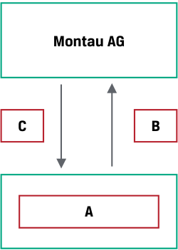

# Tập 7: Công cụ Phái sinh (*Derivatives*)
## Học phần 1: Đặc điểm của Công cụ Phái sinh và Thị trường Phái sinh (*Derivative Instrument and Derivative Market Features*)
### Phần 2/2: Bài tập Thực hành (*Practice Problems*) (Trang PDF 27–30)

---

<!-- PDF Page 27 -->

# **BÀI TẬP THỰC HÀNH (*PRACTICE PROBLEMS*)** 

## **Thông tin sau đây liên quan đến các câu hỏi từ 1 đến 5** 

Montau AG là một nhà sản xuất tư liệu sản xuất (*capital goods producer*) của Đức, chuyên sản xuất sản phẩm trong nước và giao sản phẩm cho khách hàng trên toàn cầu. Giám đốc bán hàng toàn cầu của Montau chia sẻ bản dự thảo hợp đồng thương mại sau đây với đội ngũ Quản lý Ngân quỹ (*Treasury team*) của mình:

### **Hợp đồng Xuất khẩu Thương mại của Montau AG (*Montau AG Commercial Export Contract*)** 

|**Ngày ký hợp đồng (*Contract Date*):**|[Hôm nay]|
|---|---|
|**Bên bán hàng (*Goods Seller*):**|Montau AG, Frankfurt, Đức|
|**Bên mua hàng (*Goods Buyer*):**|Jeon Inc., Seoul, Hàn Quốc|
|**Mô tả hàng hóa (*Description of Goods*):**|Máy cắt Laser dòng A (*A-Series Laser Cutting Machine*)|
|**Số lượng (*Quantity*):**|Một (01)|
|**Điều khoản giao hàng (*Delivery Terms*):**|Giao hàng lên tàu (*Freight on Board* – FOB), Busan, Hàn Quốc với toàn bộ chi phí vận chuyển, thuế và giao hàng do Bên mua hàng thanh toán|
|**Ngày giao hàng (*Delivery Date*):**|[75 ngày kể từ Ngày ký hợp đồng]|
|**Điều khoản thanh toán (*Payment Terms*):**|100% Giá hợp đồng do Bên mua hàng thanh toán cho Bên bán hàng vào Ngày giao hàng|
|**Giá hợp đồng (*Contract Price*):**|KRW650.000.000|

Giám đốc Ngân quỹ của Montau AG được giao nhiệm vụ xử lý rủi ro tài chính của giao dịch tiềm năng này.

**1.** Phát biểu nào sau đây mô tả đúng nhất lý do tại sao Montau AG nên cân nhắc sử dụng một công cụ phái sinh thay vì một giao dịch trên thị trường giao ngay (*spot market transaction*) để quản lý rủi ro tài chính của hợp đồng thương mại này?

   - **A.** Montau AG đang bán một cỗ máy tại mức giá hợp đồng tính bằng KRW và phát sinh các chi phí tính bằng EUR.

   - **B.** Montau AG phải đối mặt với khoảng chênh lệch thời gian 75 ngày giữa ngày ký hợp đồng thương mại và ngày giao hàng khi Montau AG được thanh toán tiền máy bằng KRW.

   - **C.** Montau AG không thể bán KRW ngày hôm nay để bù đắp cho giá hợp đồng của máy móc được giao cho Jeon Inc.

**2.** Loại công cụ phái sinh và tài sản cơ sở nào sau đây là phù hợp nhất để phòng vệ rủi ro tài chính của Montau theo giao dịch thương mại này?

   - **A.** Montau AG nên cân nhắc một công cụ phái sinh cam kết chắc chắn (*firm commitment derivative*) với tiền tệ là tài sản cơ sở, cụ thể là việc bán KRW tại một mức giá EUR cố định.

   - **B.** Montau AG nên cân nhắc một công cụ phái sinh quyền đòi hỏi có điều kiện (*contingent claim derivative*) với giá của cỗ máy là tài sản cơ sở, cụ thể là máy cắt laser dòng A.

<!-- PDF Page 28 -->

   - **C.** Montau AG nên cân nhắc một công cụ phái sinh quyền đòi hỏi có điều kiện (*contingent claim derivative*) với tiền tệ là tài sản cơ sở, cụ thể là việc bán EUR tại một mức giá KRW cố định.

**3.** Xác định A, B, và C theo đúng thứ tự trong sơ đồ sau đây, giống như trong Bảng minh họa 1 (*Exhibit 1*), đối với công cụ phái sinh nhằm phòng vệ rủi ro tài chính của Montau theo giao dịch thương mại này.

### **Bảng minh họa 1 (*Exhibit 1*)** 

<!-- Picture Text: Montau AG C B A  -->

> **Chú thích hình ảnh:**
> - Sơ đồ giao dịch giữa **Montau AG** và đối tác **A**, với dòng đi xuống **B** và dòng đi lên **C**.

   - **A.** A: Định chế tài chính trung gian (*Financial intermediary*), B: KRW650.000.000, C: Khoản tiền EUR cố định (*Fixed EUR amount*)

   - **B.** A: Jeon Inc., B: KRW650.000.000, C: Khoản tiền EUR cố định (*Fixed EUR amount*)

   - **C.** A: Định chế tài chính trung gian (*Financial intermediary*), B: Khoản tiền EUR cố định (*Fixed EUR amount*), C: KRW650.000.000.

**4.** Phát biểu nào sau đây về thị trường phái sinh phù hợp nhất để phòng vệ rủi ro tài chính của Montau AG theo hợp đồng thương mại là chính xác nhất?

   - **A.** Thị trường OTC là phù hợp nhất đối với Montau, vì công ty có thể tùy chỉnh hợp đồng để khớp với cấu trúc tiếp xúc rủi ro mong muốn của mình.

   - **B.** Thị trường ETD là phù hợp nhất đối với Montau, vì thị trường này cung cấp một hợp đồng được tiêu chuẩn hóa và minh bạch để khớp với cấu trúc tiếp xúc rủi ro mong muốn của công ty.

   - **C.** Cả hai thị trường ETD và OTC đều phù hợp để Montau AG phòng vệ rủi ro tài chính theo giao dịch này, vì vậy công ty nên chọn thị trường có mức giá tốt nhất.

**5.** Nếu Montau tham gia vào một hợp đồng phái sinh được bù trừ tập trung (*centrally cleared derivative contract*) trên thị trường OTC, phát biểu nào sau đây về rủi ro tín dụng gắn liền với công cụ phái sinh này là có khả năng đúng nhất?

   - **A.** Montau phải đối mặt với rủi ro tín dụng gắn liền với khả năng đối tác trong hợp đồng của mình có thể không thực hiện nghĩa vụ theo hợp đồng.

   - **B.** Montau tạo ra rủi ro tín dụng đối với đối tác của mình bởi vì công ty có thể không thực hiện được nghĩa vụ theo hợp đồng.

   - **C.** Montau tạo ra rủi ro tín dụng đối với một người sử dụng cuối cùng khác đang nắm giữ một hợp đồng phái sinh có các đặc điểm ngược lại với hợp đồng của Montau.

<!-- PDF Page 29 -->

# **LỜI GIẢI (*SOLUTIONS*)** 

1. B là đáp án đúng. Tồn tại một khoảng chênh lệch thời gian 75 ngày giữa ngày ký hợp đồng thương mại và ngày giao hàng khi Montau AG được thanh toán tiền máy bằng KRW. Phát biểu A là đúng nhưng không giải thích được tại sao việc sử dụng công cụ phái sinh lại được ưu tiên hơn so với giao dịch trên thị trường giao ngay. Nếu như trong câu C, Montau bán số KRW mà công ty nhận được và mua EUR trong một giao dịch trên thị trường giao ngay vào ngày giao hàng, công ty sẽ phải chịu rủi ro trước những biến động bất lợi của tỷ giá hối đoái KRW/EUR trong suốt khoảng thời gian 75 ngày đó. Một hợp đồng phái sinh trong đó tỷ giá kỳ hạn KRW/EUR cơ sở được thỏa thuận ngày hôm nay và được trao đổi vào ngày giao hàng cho phép Montau phòng vệ hoặc bù đắp giá trị tính bằng EUR của khoản thanh toán bằng KRW trong tương lai. Do đó, công cụ phái sinh là một hợp đồng phù hợp hơn để xử lý rủi ro tài chính của giao dịch thương mại này so với việc bán KRW trên thị trường giao ngay.

2. A là đáp án đúng. Công cụ phái sinh phù hợp nhất để phòng vệ rủi ro tài chính của Montau là một công cụ phái sinh cam kết chắc chắn (*firm commitment derivative*), trong đó một khoản tiền xác định trước được trao đổi khi thanh toán. Tài sản cơ sở của công cụ phái sinh nên là tiền tệ (*currencies*), cụ thể là việc bán KRW tại một mức giá EUR cố định trong tương lai để bù đắp hoặc phòng vệ rủi ro tài chính của hợp đồng thương mại. Giá cỗ máy được đề cập ở câu B không được coi là một tài sản cơ sở phái sinh, và câu C lại phòng vệ theo chiều ngược lại với mức độ tiếp xúc rủi ro cơ sở của Montau.

3. C là đáp án đúng theo sơ đồ dưới đây:

### **Bảng minh họa 1 (*Exhibit 1*)** 

<!-- Picture Text: Montau AG Fixed EUR amount KRW 650,000,000 [KRW/EUR forward rate] Financial intermediary  -->

> **Chú thích hình ảnh:**
> - **Montau AG** giao **KRW 650.000.000** (C - mũi tên đi lên từ góc nhìn thanh toán hoặc luồng trao đổi theo sơ đồ gốc) và nhận **Khoản tiền EUR cố định (*Fixed EUR amount*)** (B) theo **[Tỷ giá kỳ hạn KRW/EUR (*KRW/EUR forward rate*)]** với đối tác **Định chế tài chính trung gian (*Financial intermediary*)** (A).

4. A là đáp án đúng. Thị trường OTC là phù hợp nhất đối với Montau, vì các hợp đồng OTC có thể được tùy chỉnh để khớp với cấu trúc tiếp xúc rủi ro mong muốn của Montau. Điều này rất quan trọng đối với những người sử dụng cuối cùng đang tìm cách phòng vệ một mức độ tiếp xúc rủi ro cơ sở cụ thể dựa trên các điều khoản phi tiêu chuẩn. Montau sẽ khó có khả năng tìm thấy một hợp đồng ETD như ở câu B khớp chính xác với quy mô và ngày đáo hạn của giao dịch phòng vệ mà công ty mong muốn, điều này cũng làm cho câu C không chính xác.

5. B là đáp án đúng. Trong một hợp đồng phái sinh OTC được bù trừ tập trung, đối tác trung tâm (*central counterparty* – CCP) trở thành đối tác trong tất cả các hợp đồng và gánh chịu rủi ro tín dụng gắn liền với từng hợp đồng phái sinh riêng lẻ (tức là đối tác trực tiếp hoặc CCP vẫn phải chịu rủi ro nếu Montau không thực hiện nghĩa vụ của mình). A có khả năng không đúng vì CCP thực hiện các biện pháp để đảm bảo rằng họ có thể hoàn thành các nghĩa vụ của mình đối với các đối tác. C không đúng vì CCP đứng chèn vào giữa các bên có vị thế đối nghịch nhau.

<!-- PDF Page 30 -->
