# Tập 7: Công cụ Phái sinh (Derivatives)
## Learning Module 2 Forward Commitment and Contingent Claim Features and Instruments (Trang PDF 31–60)

---

# Tập 7: Công cụ Phái sinh (*Derivatives*)
## Học phần 2: Đặc điểm và Công cụ của Cam kết Kỳ hạn và Quyền đòi hỏi Có điều kiện (*Forward Commitment and Contingent Claim Features and Instruments*)
### Phần 1/2: Giới thiệu (Trang PDF 31–45)

---

<!-- PDF Page 31 -->

# H Ọ C P H Ầ N **<mark>2</mark>** 

### **Đặc điểm và Công cụ của Cam kết Kỳ hạn và Quyền đòi hỏi Có điều kiện (*Forward Commitment and Contingent Claim Features and Instruments*)** 

##### **<mark>MỤC TIÊU HỌC TẬP (*LEARNING OUTCOMES*)</mark>** 

|**_Mức độ thành thạo_**|**_Ứng viên cần có khả năng:_**|
|---|---|
||định nghĩa hợp đồng kỳ hạn (*forward contracts*), hợp đồng tương lai (*futures contracts*), hợp đồng hoán đổi (*swaps*), quyền chọn (*options* – quyền chọn mua *calls* và quyền chọn bán *puts*), và công cụ phái sinh tín dụng (*credit derivatives*) cũng như so sánh các đặc điểm cơ bản của chúng|
||xác định giá trị khi đáo hạn (*value at expiration*) và lợi nhuận (*profit*) từ một vị thế mua (*long position*) hoặc vị thế bán (*short position*) đối với quyền chọn mua (*call option*) hoặc quyền chọn bán (*put option*)|
||đối chiếu giữa các cam kết kỳ hạn (*forward commitments*) với các quyền đòi hỏi có điều kiện (*contingent claims*)|

#### **GIỚI THIỆU (*INTRODUCTION*)** 

## **<mark>1</mark>** 

Một bài học trước đây đã xác định công cụ phái sinh là một công cụ tài chính có hiệu quả hoạt động bắt nguồn từ một tài sản cơ sở (*underlying asset*), chỉ số (*index*), hoặc biến số tài chính khác, chẳng hạn như độ biến động giá cổ phiếu (*equity price volatility*). Các loại công cụ phái sinh chính bao gồm cam kết chắc chắn (*firm commitment* / *forward commitment*), trong đó một khoản tiền xác định trước được thỏa thuận sẽ trao đổi giữa các đối tác khi thanh toán, và quyền đòi hỏi có điều kiện (*contingent claim*), trong đó một trong các đối tác sẽ quyết định liệu giao dịch có được thanh toán hay không và vào thời điểm nào. Các bài học tiếp theo sẽ định nghĩa và so sánh các đặc điểm cơ bản của cam kết kỳ hạn và quyền đòi hỏi có điều kiện, đồng thời giải thích cách tính giá trị của chúng khi đáo hạn.

###### **TỔNG QUAN HỌC PHẦN (*LEARNING MODULE OVERVIEW*)** 

- Hợp đồng kỳ hạn (*forwards*), hợp đồng tương lai (*futures*), và hợp đồng hoán đổi (*swaps*) đại diện cho các cam kết chắc chắn (*firm commitments*), hay các hợp đồng phái sinh yêu cầu các đối tác phải trao đổi một tài sản cơ sở trong tương lai dựa trên một mức giá đã thỏa thuận.

- Hợp đồng kỳ hạn là một công cụ phái sinh phi tập trung (*over-the-counter* – OTC) linh hoạt, trong khi hợp đồng tương lai được tiêu chuẩn hóa và giao dịch trên sở giao dịch với việc thanh toán hàng ngày đối với các khoản lãi và lỗ của hợp đồng.

- Hợp đồng hoán đổi là một cam kết chắc chắn nhằm trao đổi một chuỗi các dòng tiền trong tương lai. Hợp đồng hoán đổi lãi suất (*interest rate swaps*) là loại phổ biến nhất và liên quan đến việc trao đổi các khoản thanh toán lãi cố định lấy các khoản thanh toán lãi thả nổi.

Viện CFA (*CFA Institute*) xin gửi lời cảm ơn tới Tiến sĩ Don Chance, CFA, vì những đóng góp của ông cho phần này, bao gồm tài liệu được trích xuất từ nội dung xuất hiện trong bài đọc _Derivative Markets and Instruments_ thuộc chương trình giảng dạy CFA® năm 2022.

<!-- PDF Page 32 -->

- Hợp đồng quyền chọn (*option contracts*) là các quyền đòi hỏi có điều kiện (*contingent claims*), trong đó một trong các đối tác quyết định liệu một giao dịch có được thanh toán hay không và khi nào sẽ thanh toán. Người mua quyền chọn trả một khoản phí quyền chọn (*premium*) cho người bán để có quyền giao dịch tài sản cơ sở trong tương lai tại một mức giá thực hiện (*exercise price*) đã thỏa thuận trước.

- Cấu trúc giá trị nhận được khi đáo hạn (*payoff*) và lợi nhuận (*profit*) của hợp đồng quyền chọn là phi tuyến tính (*non-linear*) khi giá tài sản cơ sở thay đổi, trái ngược với các cam kết chắc chắn như hợp đồng kỳ hạn, hợp đồng tương lai, và hợp đồng hoán đổi, vốn có tính tuyến tính (*linear*) theo các biến động giá của tài sản cơ sở.

- Những người tham gia thị trường thường tạo ra các mức độ tiếp xúc rủi ro tương tự nhau đối với một tài sản cơ sở bằng cách sử dụng các cam kết chắc chắn và các quyền đòi hỏi có điều kiện, mặc dù các loại công cụ phái sinh này có cấu trúc giá trị nhận được (*payoff*) và lợi nhuận (*profit*) khác nhau.

###### **TỰ ĐÁNH GIÁ HỌC PHẦN (*LEARNING MODULE SELF-ASSESSMENT*)** 

Những câu hỏi ban đầu này nhằm giúp bạn đánh giá mức độ hiểu biết hiện tại của mình về học phần này.

1. Phát biểu nào sau đây mô tả đúng sự khác biệt giữa hợp đồng kỳ hạn (*forward contract*) và hợp đồng tương lai (*futures contract*)?

   - **A.** Hợp đồng kỳ hạn ấn định một mức giá đã thỏa thuận cho người mua và người bán, trong khi hợp đồng tương lai thì không.

   - **B.** Hợp đồng kỳ hạn ấn định một ngày giao dịch đã thỏa thuận để người bán giao tài sản cơ sở cho người mua, trong khi hợp đồng tương lai thì không.

   - **C.** Hợp đồng kỳ hạn không yêu cầu thanh toán lãi và lỗ hàng ngày, trong khi hợp đồng tương lai có yêu cầu này.

###### **Lời giải:** 

C là đáp án đúng. Hợp đồng tương lai yêu cầu thanh toán hàng ngày (*daily settlement*) thông qua quy trình định giá theo thị trường (*mark-to-market* – MTM) của trung tâm bù trừ thuộc sở giao dịch. Hợp đồng kỳ hạn được thanh toán vào ngày đáo hạn của chúng, mặc dù hai bên tham gia hợp đồng có thể tùy chỉnh các thủ tục thanh toán thay thế khác. A không đúng vì cả hợp đồng kỳ hạn và hợp đồng tương lai đều ấn định một mức giá đã thỏa thuận cho một giao dịch trong tương lai. B không đúng vì cả hợp đồng kỳ hạn và hợp đồng tương lai đều bao gồm một ngày đáo hạn khi tài sản cơ sở sẽ được trao đổi.

2. Xác định ví dụ nào phù hợp với từng cam kết chắc chắn sau đây:

|**Bên tham gia**|**Đặc điểm mô tả**|
|---|---|
|A. Bên mua hợp đồng tương lai (*Futures contract purchaser*)|1. Đồng ý thực hiện một lần trao đổi duy nhất trong tương lai tại một mức giá thỏa thuận trước theo một hợp đồng OTC|
|B. Bên bán hợp đồng kỳ hạn (*Forward contract seller*)|2. Đồng ý thực hiện một lần trao đổi duy nhất trong tương lai dựa trên các điều khoản được tiêu chuẩn hóa do sở giao dịch quy định|
|C. Bên trả lãi suất cố định trong hợp đồng hoán đổi lãi suất (*Fixed-rate payer on an interest rate swap*)|3. Đồng ý thực hiện một chuỗi các lần trao đổi giữa các khoản thanh toán lãi cố định và lãi thả nổi|

###### **Lời giải:** 

1. B là đáp án đúng. Bên bán hợp đồng kỳ hạn đồng ý thực hiện một lần trao đổi duy nhất trong tương lai tại một mức giá thỏa thuận trước theo một hợp đồng OTC.

2. A là đáp án đúng. Bên mua hợp đồng tương lai đồng ý thực hiện một lần trao đổi duy nhất trong tương lai dựa trên các điều khoản được tiêu chuẩn hóa do một sở giao dịch quy định.

<!-- PDF Page 33 -->

3. C là đáp án đúng. Bên trả lãi suất cố định trong một hợp đồng hoán đổi lãi suất đồng ý thực hiện một chuỗi các lần trao đổi giữa các khoản thanh toán lãi cố định và lãi thả nổi.

3. Xác định ví dụ nào phù hợp với từng quyền đòi hỏi có điều kiện sau đây:

|**Bên tham gia**|**Đặc điểm mô tả**|
|---|---|
|A. Bên mua quyền chọn bán (*Put option purchaser*)|1. Tìm cách thu lợi từ sự gia tăng trong giá của tài sản cơ sở|
|B. Bên mua quyền chọn mua (*Call option purchaser*)|2. Để cho quyền chọn hết hạn vào ngày đáo hạn nếu giá tài sản cơ sở cao hơn giá thực hiện (*exercise price*)|
|C. Cả bên mua quyền chọn bán và bên mua quyền chọn mua|3. Trả một khoản phí quyền chọn (*option premium*) cho người bán quyền chọn khi hợp đồng được thỏa thuận|

###### **Lời giải:** 

1. B là đáp án đúng. Bên mua quyền chọn mua tìm cách thu lợi từ sự gia tăng trong giá của tài sản cơ sở.

2. A là đáp án đúng. Bên mua quyền chọn bán sẽ để quyền chọn hết hạn vào ngày đáo hạn mà không thực hiện quyền nếu giá tài sản cơ sở cao hơn giá thực hiện.

3. C là đáp án đúng. Cả bên mua quyền chọn bán và bên mua quyền chọn mua đều sẽ trả một khoản phí quyền chọn cho người bán quyền chọn khi hợp đồng quyền chọn được ký kết.

4. Một quyền chọn để mua một chứng khoán cơ sở tại mức giá thực hiện là 45 USD sau ba tháng được giao dịch với mức phí quyền chọn là 6 USD. Sau ba tháng, tài sản cơ sở được giao dịch ở mức 50 USD. Câu trả lời nào sau đây mô tả đúng vị thế lãi/lỗ (*profit/loss position*) của người mua và người bán quyền chọn?

   - **A.** Người mua quyền chọn thu được khoản lợi nhuận 5 USD, và người bán quyền chọn chịu khoản lỗ 5 USD.

   - **B.** Người mua quyền chọn chịu khoản lỗ 1 USD, và người bán quyền chọn thu được khoản lợi nhuận 1 USD.

   - **C.** Người mua quyền chọn thu được khoản lợi nhuận 5 USD, và người bán quyền chọn thu được 0 USD.

###### **Lời giải:** 

B là đáp án đúng. Vị thế của người mua quyền chọn tạo ra một giá trị nhận được khi đáo hạn (*payoff*) là 5 USD, bằng $\max(0, 50 - 45)$. Người mua quyền chọn đã trả 6 USD để mua vị thế quyền chọn này, và dòng tiền chi ra này lớn hơn phần giá trị nhận được dương. Do đó, tổng lợi nhuận của người mua quyền chọn là một khoản lỗ 1 USD (tức là $5 - 6 = -1$). Đối với người bán quyền chọn, vị thế quyền chọn tạo ra một dòng tiền thanh toán âm là $-5$ USD, bằng $-\max(0, 50 - 45)$. Tuy nhiên, người bán quyền chọn đã nhận được phí quyền chọn là 6 USD, vì vậy tổng lợi nhuận là 1 USD (tức là $6 - 5 = 1$). A không đúng vì số tiền 5 USD chỉ phản ánh giá trị nhận được khi đáo hạn (*payoff*) của quyền chọn chứ chưa phải là lợi nhuận và thua lỗ có tính đến phí quyền chọn. C không đúng vì lợi nhuận của người mua chỉ nêu sai thành giá trị nhận được của vị thế quyền chọn chứ không phải lợi nhuận ròng, còn lợi nhuận của người bán sẽ chỉ bằng 0 nếu tài sản cơ sở giao dịch ở mức 51 chứ không phải 50.

5. Người mua quyền chọn bán (*put option buyer*) kiếm được lợi nhuận dương trong điều kiện nào sau đây?

   - **A.** Giá của tài sản cơ sở khi quyền chọn đáo hạn thấp hơn giá thực hiện của quyền chọn.

   - **B.** Giá của tài sản cơ sở khi quyền chọn đáo hạn lớn hơn giá thực hiện của quyền chọn.

<!-- PDF Page 34 -->

   - **C.** Giá của tài sản cơ sở thấp hơn mức giá thực hiện của quyền chọn trừ đi phí quyền chọn.

###### **Lời giải:** 

C là đáp án đúng. Để người mua quyền chọn bán kiếm được lợi nhuận dương, giá tài sản cơ sở phải thấp hơn đủ sâu so với giá thực hiện của quyền chọn bán sao cho (1) quyền chọn bán có thể được thực hiện với giá trị nhận được (*payoff*) dương và (2) giá trị nhận được dương đó phải lớn hơn khoản phí quyền chọn đã trả. Do đó, điều này chỉ có thể xảy ra nếu giá tài sản cơ sở giảm xuống thấp hơn mức giá thực hiện trừ đi phí quyền chọn ($S_T < X - p_0$). A không đúng vì điều kiện này chỉ hàm ý một giá trị nhận được dương trên quyền chọn nhưng vẫn bao gồm cả những mức giá mà tại đó giá trị nhận được không lớn hơn phí quyền chọn. B không đúng vì khi đó quyền chọn bán sẽ ở trạng thái kiệt giá (*out of the money*) và tạo ra giá trị nhận được bằng không.

6. Những vị thế nào sau đây trên cùng một tài sản cơ sở sẽ hưởng lợi từ các biến động giá ngược chiều nhau của tài sản cơ sở đó?

   - **A.** Vị thế mua hợp đồng kỳ hạn (*long forward contract*), vị thế bán quyền chọn bán (*short put option*)

   - **B.** Vị thế bán hợp đồng kỳ hạn (*short forward contract*), vị thế mua quyền chọn bán (*long put option*)

   - **C.** Vị thế bán hợp đồng kỳ hạn (*short forward contract*), vị thế bán quyền chọn bán (*short put option*)

###### **Lời giải:** 

C là đáp án đúng. Vị thế bán hợp đồng kỳ hạn (*short forward*) hưởng lợi khi giá tài sản cơ sở giảm, trong khi vị thế bán quyền chọn bán (*short put*) chỉ hưởng lợi khi giá tài sản cơ sở tăng (hoặc giữ nguyên trên giá thực hiện). A không đúng vì cả vị thế mua hợp đồng kỳ hạn và vị thế bán quyền chọn bán đều hưởng lợi khi giá tài sản cơ sở tăng. B không đúng vì cả vị thế bán hợp đồng kỳ hạn và vị thế mua quyền chọn bán đều hưởng lợi khi giá tài sản cơ sở giảm.

## **<mark>2</mark>** 

#### **HỢP ĐỒNG KỲ HẠN, HỢP ĐỒNG TƯƠNG LAI VÀ HỢP ĐỒNG HOÁN ĐỔI (*FORWARDS, FUTURES, AND SWAPS*)** 

định nghĩa hợp đồng kỳ hạn, hợp đồng tương lai, hợp đồng hoán đổi, quyền chọn (quyền chọn mua và quyền chọn bán), và công cụ phái sinh tín dụng cũng như so sánh các đặc điểm cơ bản của chúng

Hợp đồng kỳ hạn (*forwards*), hợp đồng tương lai (*futures*), và hợp đồng hoán đổi (*swaps*) là những hợp đồng phái sinh phổ biến nhất đại diện cho một cam kết chắc chắn (*firm commitment*). Cam kết chắc chắn này là nghĩa vụ của cả hai đối tác phải thực hiện theo các điều khoản của hợp đồng phái sinh. Các đặc điểm chung chính của loại công cụ phái sinh này bao gồm:

- Một quy mô hợp đồng cụ thể (*specific contract size*)

- Một tài sản cơ sở cụ thể (*specific underlying*)

- Một hoặc nhiều lần trao đổi dòng tiền hoặc tài sản cơ sở vào một ngày hoặc các ngày cụ thể trong tương lai

- (Các) lần trao đổi dựa trên một mức giá đã thỏa thuận trước (*pre-agreed price*)

Mặc dù có những điểm tương đồng, hợp đồng kỳ hạn, hợp đồng tương lai, và hợp đồng hoán đổi đều có những đặc điểm khác nhau, và đó là chủ đề của bài học này.

Hợp đồng kỳ hạn (*forward contract*) là một công cụ phái sinh phi tập trung (*over-the-counter* – OTC) trong đó hai đối tác thỏa thuận rằng một đối tác (người mua – *buyer*) sẽ mua một tài sản cơ sở từ đối tác kia (người bán – *seller*) trong tương lai tại một mức giá cố định đã thỏa thuận trước. Như đã lưu ý trước đó, các công cụ phái sinh OTC mang lại sự linh hoạt và khả năng tùy chỉnh cao hơn so với các công cụ phái sinh giao dịch trên sở giao dịch (ETD), nhưng thường cũng liên quan đến nhiều rủi ro đối tác hơn. Hợp đồng kỳ hạn

<!-- PDF Page 35 -->

có lợi thế đối với những người sử dụng cuối cùng của công cụ phái sinh đang tìm cách phòng vệ một mức độ tiếp xúc rủi ro cơ sở hiện có hoặc được dự báo dựa trên các điều khoản cụ thể. Ví dụ, một nhà nhập khẩu có thể tham gia vào một hợp đồng kỳ hạn để mua số ngoại tệ cần thiết nhằm đáp ứng các điều khoản thương mại của một hợp đồng giao nhận hàng hóa trong tương lai. Hợp đồng kỳ hạn linh hoạt hơn về quy mô, chi tiết tài sản cơ sở, kỳ hạn, và/hoặc các điều khoản tín dụng so với một hợp đồng ETD tương tự. Người mua hợp đồng kỳ hạn có vị thế mua (*long position*) và do đó sẽ hưởng lợi từ sự tăng giá của tài sản cơ sở trong suốt vòng đời của hợp đồng.

Để hiểu rõ hơn về hợp đồng kỳ hạn, chúng ta phải xem xét cấu trúc giá trị nhận được khi đáo hạn (*payoff profile*) của chúng. Giả sử một hợp đồng kỳ hạn được thỏa thuận tại thời điểm $t = 0$ và đáo hạn tại thời điểm $T$. Tại thời điểm $t = 0$, các đối tác không trao đổi bất kỳ khoản thanh toán trả trước nào mà thay vào đó, đồng ý về việc giao tài sản cơ sở tại thời điểm $T$ với một mức **giá kỳ hạn (*forward price*)** là $F_0(T)$. Chỉ số dưới $0$ đề cập đến ngày mà mức giá tài sản cơ sở trong tương lai được ấn định ($t = 0$), và chữ $T$ trong ngoặc đơn đề cập đến ngày trao đổi ($t = T$). Giá giao ngay của tài sản cơ sở tại thời điểm $T$ là $S_T$. Bảng minh họa 1 cho thấy giá trị nhận được khi đáo hạn từ góc độ của người mua kỳ hạn, tức là một vị thế mua kỳ hạn (*long forward position*). Lưu ý rằng giá trị nhận được khi đáo hạn (*payoff*) bằng đúng với lợi nhuận (*profit*), vì không có khoản thanh toán trả trước nào được thực hiện.

**Bảng minh họa 1: Cấu trúc Giá trị nhận được của Vị thế Mua Kỳ hạn (*Exhibit 1: Long Forward (Forward Buyer) Payoff Profile*)** 

<!-- Picture Text: Payoff/ Profit Profit + 0 ST F0(T) –  -->

> **Chú thích hình ảnh:**
> - **Trục tung:** Giá trị nhận được / Lợi nhuận (*Payoff / Profit*) từ miền âm ($-$) qua $0$ lên miền dương ($+$).
> - **Trục hoành:** Giá giao ngay khi đáo hạn $S_T$, cắt đường biểu diễn lợi nhuận (*Profit*) tại điểm hòa vốn $F_0(T)$.

|**Kết quả (*Outcome*)**|**Giá trị nhận được của Người mua (*Buyer Payoff*)**|**Giá trị nhận được của Người bán (*Seller Payoff*)**|
|---|---|---|
|$S_T > F_0(T)$|$[S_T - F_0(T)] > 0$|$[F_0(T) - S_T] < 0$|
|$S_T < F_0(T)$|$[S_T - F_0(T)] < 0$|$[F_0(T) - S_T] > 0$|

Cấu trúc giá trị nhận được đối xứng (*symmetric payoff profile*) thể hiện trong Bảng minh họa 1 là một đặc điểm chung của các cam kết chắc chắn. Vì giá của công cụ phái sinh là một hàm tuyến tính của tài sản cơ sở, các cam kết chắc chắn còn được gọi là **công cụ phái sinh tuyến tính (*linear derivatives*)**. Tại thời điểm $T$, giao dịch được thanh toán dựa trên mức chênh lệch giữa giá kỳ hạn $F_0(T)$ và giá tài sản cơ sở $S_T$, hay $[S_T - F_0(T)]$ xét từ góc độ của người mua. Nghĩa là, người mua thực hiện được một khoản lãi nếu bà có thể nhận giao tài sản cơ sở đang có giá trị thị trường $S_T$ vượt quá mức giá đã thỏa thuận trước $F_0(T)$. Nếu giá kỳ hạn vượt quá giá trị thị trường hiện hành $[F_0(T) > S_T]$, người mua sẽ chịu một khoản lỗ và phải nhận giao một tài sản với mức lỗ là $[F_0(T) - S_T]$ hoặc trả cho người bán số tiền này bằng tiền mặt. Hợp đồng kỳ hạn thường liên quan đến một lần trao đổi duy nhất trong tương lai, như trong Ví dụ 1.

<!-- PDF Page 36 -->

###### **VÍ DỤ 1 (*EXAMPLE 1*)** 

##### **Giao dịch Mua Vàng Kỳ hạn (*Forward Gold Purchase*)** 

Một nhà đầu tư, Procam Investments, tham gia vào một hợp đồng kỳ hạn thanh toán bằng tiền mặt (*cash-settled forward contract*) với một định chế tài chính trung gian để mua 100 ounce vàng tại mức giá kỳ hạn $F_0(T)$ là $\$1.792,13$ mỗi ounce sau ba tháng.

**1.** Giá vàng giao ngay hôm nay ($S_0$) là $\$1.770$ mỗi ounce.

**2.** Khi hợp đồng đáo hạn, giá vàng ($S_T$) là $\$1.780,50$ mỗi ounce.

**3.** Giá trị nhận được khi đáo hạn (*payoff*), $S_T - F_0(T)$, là $-\$11,63 = \$1.780,50 - \$1.792,13$ mỗi ounce.

**4.** Procam (người mua) phải trả cho định chế tài chính trung gian (người bán) $\$1.163$ ($= 100 \times \$11,63$) để thanh toán hợp đồng kỳ hạn khi đáo hạn.

<!-- Picture Text: Agree at  t  = 0 to At time  t  =  T , exchange underlying for underlying is delivered F0 ( T ) at time  t  =  T at a price of  F0 ( T ) Time t  = 0 t  =  T Procam Procam investments investments 100 ounces of gold Contract 100 ounces of gold F0 ( T ) × 100 ounces ST  × 100 ounces = $179,213 $1,792.13 per = $178,050 ounce  F0 ( T ) Financial Financial intermediary intermediary  -->

> **Chú thích hình ảnh:**
> - **Tại thời điểm $t = 0$:** Thỏa thuận tại $t = 0$ để trao đổi tài sản cơ sở lấy mức giá $F_0(T)$ tại thời điểm $t = T$. Procam Investments ký hợp đồng (*Contract*) với Định chế tài chính trung gian cho 100 ounce vàng tại mức giá $F_0(T) = \$1.792,13/\text{ounce}$.
> - **Tại thời điểm $t = T$:** Tài sản cơ sở được giao (hoặc định giá thanh toán) tại mức giá $F_0(T)$. Procam Investments nhận giá trị 100 ounce vàng theo giá giao ngay $S_T \times 100\text{ ounce} = \$178.050$ và trả $F_0(T) \times 100\text{ ounce} = \$179.213$ cho Định chế tài chính trung gian (thanh toán ròng bằng tiền mặt là $\$1.163$).

Hợp đồng có thể quy định việc giao nhận thực tế tài sản cơ sở hoặc thanh toán bằng tiền mặt (*cash settlement*). Số tiền thanh toán bằng $[S_T - F_0(T)]$ từ góc độ của người mua và bằng $-[S_T - F_0(T)] = [F_0(T) - S_T]$ từ góc độ của người bán. Lưu ý rằng người mua sẽ phải trả $S_0$ tại thời điểm $t = 0$ và thực hiện được mức sinh lợi $(S_T - S_0)$ tại thời điểm $T$ để tạo ra một mức độ tiếp xúc rủi ro trên thị trường giao ngay tương tự như vị thế mua kỳ hạn.

###### **BỘ CÂU HỎI (*QUESTION SET*)** 

##### **Hợp đồng Kỳ hạn (*Forwards*)** 

1. Mô tả một kịch bản trong đó một hợp đồng kỳ hạn có giá trị thanh toán bằng tiền mặt bằng không khi đáo hạn và không có đối tác nào bị vỡ nợ.

###### **Lời giải:** 

   - Một hợp đồng kỳ hạn sẽ có giá trị thanh toán bằng tiền mặt bằng không khi đáo hạn nếu $S_T = F_0(T)$ hay giá trị nhận được từ góc độ của người mua là $[S_T - F_0(T)] = 0$. Điểm này thường được gọi là **điểm hòa vốn (*breakeven point*)** đối với hợp đồng kỳ hạn cho cả người mua và người bán trong trường hợp không có chi phí giao dịch, và được biểu diễn trực quan bằng giao điểm với trục hoành ($x$-axis) của đường lợi nhuận trong Bảng minh họa 1.

2. Xác định các câu trả lời đúng để điền vào chỗ trống: Một nhà sản xuất dầu mỏ ký một hợp đồng phái sinh với một nhà đầu tư để bán 1.000 thùng dầu sau hai tháng tại mức giá kỳ hạn là $\$64$ mỗi thùng. Nếu giá dầu giao ngay khi đáo hạn

<!-- PDF Page 37 -->

là $\$58,50$ mỗi thùng, nhà đầu tư sẽ thực hiện một __________ khi đáo hạn bằng __________.

###### **Lời giải:** 

Một nhà sản xuất dầu mỏ ký một hợp đồng phái sinh với một nhà đầu tư để bán 1.000 thùng dầu sau hai tháng tại mức giá kỳ hạn là $\$64$ mỗi thùng. Nếu giá dầu giao ngay khi đáo hạn là $\$58,50$ mỗi thùng, nhà đầu tư sẽ thực hiện một _khoản lỗ (loss)_ khi đáo hạn bằng _$\$5.500$_.

Giá dầu kỳ hạn, $F_0(T)$, theo hợp đồng bằng $\$64$ mỗi thùng. Khi hợp đồng đáo hạn, giá dầu giao ngay ($S_T$) là $\$58,50$ mỗi thùng.

- Giá trị nhận được của nhà đầu tư trên mỗi thùng dầu:

  $$[S_T - F_0(T)] = \$58,50 - \$64,00 = -\$5,50\text{ mỗi thùng}$$

- Tổng số tiền nhà đầu tư phải trả cho nhà sản xuất dầu mỏ để thanh toán hợp đồng kỳ hạn 1.000 thùng dầu khi đáo hạn:

  $$1.000 \times \$5,50 = \$5.500$$

3. Xác định những bên tham gia hợp đồng kỳ hạn có khả năng phù hợp nhất với các phát biểu sau đây:

|**Bên tham gia**|**Đặc điểm mô tả**|
|---|---|
|A. Bên mua hợp đồng kỳ hạn (*Forward contract purchaser*)|1. Tìm cách hưởng lợi từ sự giảm giá của tài sản cơ sở|
|B. Bên bán hợp đồng kỳ hạn (*Forward contract seller*)|2. Thực hiện được một khoản lãi nếu giá giao ngay ban đầu của tài sản cơ sở, $S_0$, vượt quá giá kỳ hạn $F_0(T)$|
|C. Không phải bên mua cũng không phải bên bán hợp đồng kỳ hạn|3. Nhận được giá trị đáo hạn (*payoff*) dương khi đáo hạn nếu giá giao ngay, $S_T$, vượt quá giá kỳ hạn $F_0(T)$|

###### **Lời giải:** 

1. Đáp án đúng là B. Bên bán kỳ hạn nhận $[F_0(T) - S_T]$ (hoặc trả $[S_T - F_0(T)]$) với bên mua hợp đồng kỳ hạn khi đáo hạn và do đó được hưởng lợi khi giá giao ngay của tài sản cơ sở $S_T$ giảm xuống theo thời gian.

2. Đáp án đúng là C. Cả người mua lẫn người bán hợp đồng kỳ hạn đều không thực hiện được khoản lãi nào nếu giá giao ngay ban đầu, $S_0$, vượt quá giá kỳ hạn $F_0(T)$, bởi vì việc thanh toán được dựa trên giá giao ngay trong tương lai, $S_T$.

3. Đáp án đúng là A. Bên mua hợp đồng kỳ hạn thực hiện được một khoản lãi khi đáo hạn nếu $S_T > F_0(T)$.

#### **HỢP ĐỒNG TƯƠNG LAI (*FUTURES*)** 

<!-- Picture Text: 3  -->

định nghĩa hợp đồng kỳ hạn, hợp đồng tương lai, hợp đồng hoán đổi, quyền chọn (quyền chọn mua và quyền chọn bán), và công cụ phái sinh tín dụng cũng như so sánh các đặc điểm cơ bản của chúng

**Hợp đồng tương lai (*Futures contracts*)** là các hợp đồng kỳ hạn có quy mô, ngày tháng, và tài sản cơ sở được tiêu chuẩn hóa được giao dịch trên các sở giao dịch hợp đồng tương lai (*futures exchanges*). Thị trường hợp đồng tương lai mang lại cả tính thanh khoản cao hơn lẫn sự bảo vệ chống lại tổn thất do vỡ nợ bằng cách kết hợp tính đồng nhất của hợp đồng với một thị trường có tổ chức gồm các quy tắc, quy định, và một cơ chế bù trừ tập trung.

<!-- PDF Page 38 -->

###### **Đặc điểm và Công cụ của Cam kết Kỳ hạn và Quyền đòi hỏi Có điều kiện (*Forward Commitment and Contingent Claim Features and Instruments*)** 

Người mua hợp đồng tương lai tạo ra một vị thế tiếp xúc mua (*long exposure*) đối với tài sản cơ sở bằng cách đồng ý mua tài sản cơ sở vào một ngày sau đó tại một mức giá đã thỏa thuận trước. Người bán thực hiện cam kết ngược lại, tạo ra một vị thế tiếp xúc bán (*short exposure*) đối với tài sản cơ sở bằng cách đồng ý bán tài sản cơ sở trong tương lai tại một mức giá đã thỏa thuận. Mức giá đã thỏa thuận này được gọi là **giá tương lai (*futures price*)**, $f_0(T)$. Tần suất các kỳ đáo hạn của hợp đồng tương lai, quy mô hợp đồng, và các chi tiết khác được sở giao dịch thiết lập dựa trên mối quan tâm của người mua và người bán.

Đặc điểm quan trọng nhất của hợp đồng tương lai là việc thanh toán hàng ngày (*daily settlement*) đối với các khoản lãi và lỗ cùng sự bảo lãnh tín dụng đi kèm được cung cấp bởi sở giao dịch thông qua trung tâm bù trừ (*clearinghouse*) của mình. Vào cuối mỗi ngày, trung tâm bù trừ thực hiện một nghiệp vụ gọi là **định giá theo thị trường (*mark to market* – MTM)**, còn được gọi là **thanh toán hàng ngày (*daily settlement*)**. Trung tâm bù trừ xác định một mức trung bình của các mức giá giao dịch hợp đồng tương lai cuối cùng trong ngày và chỉ định mức giá đó làm **giá thanh toán (*settlement price*)** cuối ngày. Khi đó, tất cả các hợp đồng được gọi là được định giá lại theo mức giá thanh toán cuối ngày.

Giống như hợp đồng kỳ hạn, không có khoản tiền mặt nào được trao đổi giữa hai bên khi một hợp đồng tương lai được khởi tạo bởi người mua hoặc người bán. Tuy nhiên, mỗi đối tác phải ký quỹ một khoản tiền tối thiểu bắt buộc (hay **ký quỹ ban đầu – *initial margin***) vào một **tài khoản ký quỹ hợp đồng tương lai (*futures margin account*)** được giữ tại sở giao dịch để trung tâm bù trừ sử dụng nhằm thanh toán khoản chênh lệch định giá theo thị trường (MTM) hàng ngày. Các hợp đồng tương lai phải được thực hiện thông qua các định chế tài chính trung gian chuyên biệt, những đơn vị đứng ra bù trừ và thanh toán các khoản chi trả tại sở giao dịch thay mặt cho các đối tác, như được thể hiện trong Ví dụ 2.

###### **VÍ DỤ 2 (*EXAMPLE 2*)** 

##### **Giao dịch Mua một Hợp đồng Tương lai Vàng (*Purchase of a Gold Futures Contract*)** 

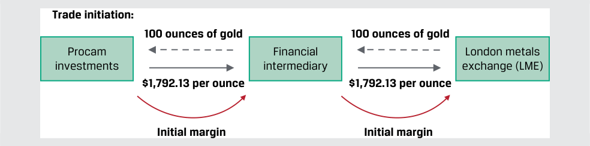

<!-- Picture Text: Trade initiation: 100 ounces of gold 100 ounces of gold Procam Financial London metals investments intermediary exchange (LME) $1,792.13 per ounce $1,792.13 per ounce Initial margin Initial margin  -->

> **Chú thích hình ảnh:**
> - **Khởi tạo giao dịch (*Trade initiation*):** **Procam Investments** ký hợp đồng tương lai 100 ounce vàng tại mức giá $\$1.792,13/\text{ounce}$ và nộp **Ký quỹ ban đầu (*Initial margin*)** cho **Định chế tài chính trung gian (*Financial intermediary*)**, đơn vị này tiếp tục chuyển giao lệnh 100 ounce vàng tại mức giá $\$1.792,13/\text{ounce}$ và **Ký quỹ ban đầu (*Initial margin*)** tới **Sở Giao dịch Kim loại Luân Đôn (*London Metals Exchange* – LME)**.

Giống như trong Ví dụ 1, Procam Investments tham gia vào một hợp đồng thanh toán bằng tiền mặt để mua 100 ounce vàng tại mức giá $\$1.792,13$ mỗi ounce sau ba tháng. Thay vì hợp đồng kỳ hạn như trong Ví dụ 1, Procam mua một hợp đồng tương lai $[f_0(T) = \$1.792,13]$ trên sở giao dịch thông qua một định chế tài chính trung gian. Quy tắc của Sở Giao dịch Kim loại Luân Đôn (LME) yêu cầu mức ký quỹ ban đầu bằng tiền mặt là $\$4.950$ cho mỗi hợp đồng vàng (100 ounce) được bán hoặc mua:

- Procam nộp $\$4.950$ tiền ký quỹ ban đầu bắt buộc tại sở giao dịch.

- Giá vàng giao ngay hôm nay ($S_0$) là $\$1.770$ mỗi ounce, và giá mở cửa hợp đồng tương lai vàng, $f_0(T)$, là $\$1.792,13$ mỗi ounce.

- Khi đóng cửa phiên hôm nay, giá hợp đồng tương lai vàng, $f_1(T)$, chốt thanh toán ở mức $\$1.797,13$ mỗi ounce.

- Procam thực hiện được một khoản lãi MTM là $\$500$, hay $\$5\text{ mỗi ounce} \times 100\text{ ounce}$. Công ty nhận được một khoản tiền cộng thêm $\$500$ vào tài khoản ký quỹ hợp đồng tương lai từ trung tâm bù trừ.

- Tài khoản ký quỹ hợp đồng tương lai của Procam có số dư cuối ngày là $\$5.450$, bằng $\$4.950$ ký quỹ ban đầu cộng với khoản lãi MTM $\$500$.

Mỗi hợp đồng tương lai quy định một mức **ký quỹ duy trì (*maintenance margin*)**, hay số dư tối thiểu được ấn định thấp hơn mức ký quỹ ban đầu, mà mỗi người mua và người bán hợp đồng phải duy trì trong tài khoản ký quỹ hợp đồng tương lai kể từ khi khởi tạo giao dịch cho đến khi thanh toán cuối cùng lúc đáo hạn.

<!-- PDF Page 39 -->

Trung tâm bù trừ luân chuyển tiền hàng ngày giữa các tài khoản ký quỹ của người mua và người bán, ghi có (*crediting*) vào tài khoản của những bên có lãi định giá theo thị trường (MTM) và ghi nợ (*charging*) vào tài khoản của những bên bị lỗ định giá theo thị trường.

Ví dụ, quy tắc của Sở Giao dịch Kim loại Luân Đôn yêu cầu mức ký quỹ duy trì là $\$4.500$ cho mỗi hợp đồng vàng 100 ounce được bán hoặc mua. Bây giờ hãy xét _người bán (seller)_ một hợp đồng tương lai có vị thế đối ứng với vị thế của Procam trong Ví dụ 2.

- Người bán nộp $\$4.950$ tiền ký quỹ ban đầu bắt buộc tại sở giao dịch.

- Giá mở cửa hợp đồng tương lai vàng hôm nay, $f_0(T)$, là $\$1.792,13$ mỗi ounce.

- Khi đóng cửa phiên, giá hợp đồng tương lai vàng, $f_1(T)$, chốt thanh toán ở mức $\$1.797,13$ mỗi ounce.

- Người bán chịu một khoản lỗ MTM là $\$500$, hay $\$5\text{ mỗi ounce} \times 100\text{ ounce}$; số tiền $\$500$ bị trung tâm bù trừ khấu trừ khỏi tài khoản ký quỹ hợp đồng tương lai của người bán.

- Tài khoản ký quỹ hợp đồng tương lai của người bán có số dư cuối ngày là $\$4.450$, bằng $\$4.950$ ký quỹ ban đầu trừ đi khoản lỗ MTM $\$500$.

- Tài khoản ký quỹ của người bán bị thấp hơn $\$50$ so với mức ký quỹ duy trì bắt buộc $(\$4.450 - \$4.500 = -\$50)$.

Người bán nhận được một **lệnh gọi ký quỹ (*margin call*)**, hay yêu cầu phải nộp tiền ngay lập tức để đưa số dư tài khoản quay trở lại mức _ký quỹ ban đầu (initial margin)_. Người bán phải nộp thêm $\$500$ để đưa tài khoản ký quỹ trở lại mức ký quỹ ban đầu $\$4.950$. Số tiền cần thiết để bổ sung vào tài khoản ký quỹ hợp đồng tương lai đôi khi được gọi là **ký quỹ biến đổi (*variation margin*)**. Nếu một đối tác không đáp ứng được lệnh gọi ký quỹ, bên đó phải đóng hợp đồng càng sớm càng tốt và bù đắp mọi khoản lỗ phát sinh thêm. Nếu đối tác không thể đáp ứng các nghĩa vụ của mình, trung tâm bù trừ cung cấp bảo lãnh rằng chính trung tâm sẽ tự bù đắp khoản lỗ đó bằng cách duy trì một quỹ bảo hiểm (*insurance fund*). Bảng minh họa 2 cho thấy quy trình ký quỹ và thanh toán hợp đồng tương lai, trong đó $f_0(T)$ là giá tương lai khi khởi tạo và $f_t(T)$ đại diện cho giá tương lai vào ngày $t$.

**Bảng minh họa 2: Quy trình Ký quỹ và Thanh toán Hợp đồng Tương lai (*Exhibit 2: Futures Margin and Settlement Process*)** 

<!-- Picture Text: Time t  = 0 Daily ( t ) t  =  T Long Long Long futures futures futures position position position Post initial Margin Settlement margin movement due totals to MTM change fT ( T ) –  f0 ( T ) = ft ( T ) –  ft –1( T )   ST –  f0 ( T ) Financial Financial Financial intermediary/ intermediary/ intermediary/ Exchange Exchange Exchange  -->

> **Chú thích hình ảnh:**
> - **Tại thời điểm $t = 0$:** Bên nắm giữ **Vị thế mua hợp đồng tương lai (*Long futures position*)** nộp ký quỹ ban đầu (*Post initial margin*) cho **Định chế tài chính trung gian / Sở giao dịch (*Financial intermediary / Exchange*)**.
> - **Hàng ngày (*Daily* – $t$):** Biến động số dư ký quỹ do thay đổi định giá theo thị trường (MTM): $f_t(T) - f_{t-1}(T)$.
> - **Tại thời điểm $t = T$:** Tổng thanh toán lũy kế: $f_T(T) - f_0(T) = S_T - f_0(T)$.

Các sở giao dịch bảo lưu quyền áp đặt các yêu cầu nghiêm ngặt hơn so với các quy tắc tài khoản ký quỹ hợp đồng tương lai tiêu chuẩn nhằm hạn chế những tổn thất tiềm tàng từ việc vỡ nợ của đối tác. Ví dụ, đối với các vị thế lớn hoặc khi có sự gia tăng đáng kể về độ biến động giá của tài sản cơ sở, sở giao dịch có thể tăng mức ký quỹ bắt buộc và/hoặc đưa ra các lệnh gọi ký quỹ ngay trong ngày giao dịch (*intraday basis*). Một số hợp đồng tương lai cũng giới hạn mức biến động giá hàng ngày. Các quy tắc này, được gọi là **biên độ dao động giá (*price limits*)**,

<!-- PDF Page 40 -->

thiết lập một dải biên độ so với giá thanh toán của ngày hôm trước mà tất cả các giao dịch phải diễn ra bên trong đó. Nếu những người tham gia thị trường muốn giao dịch ở một mức giá nằm ngoài các biên độ này, giao dịch sẽ tạm dừng cho đến khi hai bên đồng ý thực hiện một giao dịch tại một mức giá nằm trong phạm vi quy định. Trong các trường hợp khác, các sở giao dịch sử dụng cơ chế gọi là **ngắt mạch tự động (*circuit breaker*)** để tạm dừng giao dịch trong ngày trong một khoảng thời gian ngắn nếu chạm đến giới hạn giá.

Tương tự như hợp đồng kỳ hạn, việc thanh toán cuối cùng khi đáo hạn đối với hợp đồng tương lai được dựa trên mức chênh lệch giữa giá tương lai, $f_0(T)$, và giá tài sản cơ sở $S_T$, hay $[S_T - f_0(T)]$ xét từ góc độ của người mua. Bởi vì Procam đã đồng ý mua vàng hiện đang (tại $t = T$) được định giá ở mức $\$1.780,50$ mỗi ounce với mức giá mua là $\$1.792,13$ mỗi ounce, công ty nợ $\$11,63$ mỗi ounce, hay $\$1.163$ $[(\$1.780,50 - \$1.792,13) \times 100\text{ oz.}]$ theo cả hợp đồng kỳ hạn ở Ví dụ 1 lẫn hợp đồng tương lai này. Cấu trúc giá trị nhận được _ròng (net payoff profile)_ thể hiện trong Bảng minh họa 1 là giống hệt nhau đối với hợp đồng tương lai và hợp đồng kỳ hạn với giả định chúng có cùng ngày đáo hạn, điểm khác biệt duy nhất là _thời điểm (timing)_ của các dòng tiền do việc thanh toán định giá theo thị trường (MTM) hàng ngày của hợp đồng tương lai, như được thể hiện trong Ví dụ 3.

###### **VÍ DỤ 3 (*EXAMPLE 3*)** 

<!-- Picture Text: Final Settlement of a Gold Futures Contract  -->

##### **Thanh toán Cuối cùng của một Hợp đồng Tương lai Vàng (*Final Settlement of a Gold Futures Contract*)**

<!-- Picture Text: Final settlement: Return of Margin Return of Margin Plus/Minus: Plus/Minus: Final daily settlement Final daily settlement fT ( T ) –  fT –1( T ) fT ( T ) –  fT –1( T ) Procam Financial London Metals Investments Intermediary Exchange (LME)  -->

> **Chú thích hình ảnh:**
> - **Thanh toán cuối cùng (*Final settlement*):** Hoàn trả tiền ký quỹ (*Return of Margin*) Cộng/Trừ (*Plus/Minus*) Khoản thanh toán hàng ngày cuối cùng $f_T(T) - f_{T-1}(T)$ từ **Sở Giao dịch Kim loại Luân Đôn (LME)** qua **Định chế tài chính trung gian** về cho **Procam Investments**.

Để thuận tiện cho việc trình bày, chúng ta nén ba tháng biến động giá hợp đồng tương lai vàng từ Ví dụ 2 thành sáu ngày giao dịch trong bảng tính sau đây:

###### **Bảng minh họa 3 (*Exhibit 3*)** 

###### **Tài khoản Ký quỹ Hợp đồng Tương lai của Procam (*Procam’s Futures Margin Account*)** 

|Thông số hợp đồng|Giá trị|Đơn vị|
|---|---|---|
|Hợp đồng Vàng (*Gold Contract*)|100|ounce|
|Số lượng hợp đồng (*# of Contracts*)|1||
|Giá tương lai ban đầu $f_0(T)$ (*Initial Futures Price*)|$\$1.792,13$|mỗi ounce|
|Giá trị vị thế ban đầu (*Initial Position Value*)|$\$179.213$||
|Ký quỹ ban đầu (*Initial Margin*)|$\$4.950$||
|Ký quỹ duy trì (*Maintenance Margin*)|$\$4.500$||

|**Ngày (*Day*)**|**Giá tương lai (*Futures Price*)**|**Lãi (Lỗ) trong ngày (*Day Gain/Loss*)**|**Tổng Lãi (Lỗ) (*Total Gain/Loss*)**|**Số dư ký quỹ (*Margin Balance*)**|**Lệnh gọi ký quỹ (*Margin Call*)**|
|---|---|---|---|---|---|
|$T - 6$|$\$1.792,13$|||$\$4.950$||
|$T - 5$|$\$1.797,13$|$\$500$|$\$500$|$\$5.450$|—|
|$T - 4$|$\$1.786,25$|$(\$1.088)$|$(\$588)$|$\$4.362$|$\$588$|
|$T - 3$|$\$1.782,19$|$(\$406)$|$(\$994)$|$\$4.544$|—|
|$T - 2$|$\$1.777,45$|$(\$474)$|$(\$1.468)$|$\$4.070$|$\$880$|
|$T - 1$|$\$1.779,50$|$\$205$|$(\$1.263)$|$\$5.155$|—|
|$T$|$\$1.780,50$|$\$100$|**$(\$1.163)$**|$\$5.255$|$\$1.468$|

<!-- PDF Page 41 -->

|**Kết quả của Procam từ Hợp đồng Tương lai (*Procam’s Results from the Futures Contract*)**|**Giá trị**|
|---|---|
|Hợp đồng Vàng (*Gold Contract*)|100|
|Số lượng hợp đồng (*# of Contracts*)|1|
|Giá tương lai ban đầu $f_0(T)$ (*Initial Futures Price*)|$\$1.792,13$|
|Giá trị vị thế ban đầu (*Initial Position Value*)|$\$179.213$|
|Tổng Lãi (Lỗ) (*Total Gain (Loss)*)|$(\$1.163)$|
|Giá tương lai cuối cùng $F_T(T)$ (*Final Futures Price*)|$\$1.780,50$|
|Giá trị vị thế cuối cùng (*Final Position Value*)|$\$178.050$|
|Tổng các lệnh gọi ký quỹ (*Sum of Margin Calls*)|$\$1.468$|
|Số dư ký quỹ đầu kỳ trừ cuối kỳ (*Beginning less Ending Margin Balance*)|$(\$305)$|
|Tổng các khoản thanh toán ròng vào Tài khoản Ký quỹ (*Total Payments to Margin Account*)|$\$1.163$|

Khi giá hợp đồng tương lai vàng, $f_0(t)$, sụt giảm và số dư ký quỹ giảm xuống dưới mức tối thiểu của ký quỹ duy trì là $\$4.500$ theo thời gian, Procam phải ngay lập tức nộp bổ sung số dư của mình về lại mức ký quỹ ban đầu $\$4.950$ mỗi khi điều này xảy ra:

- Vào Ngày $T - 4$, hợp đồng tương lai vàng giảm $\$10,88$ mỗi ounce $(\$1.797,13 - \$1.786,25)$. Số dư của Procam giảm $\$1.088$ $(100 \times \$10,88)$ xuống còn $\$4.362$ $(\$5.450 - \$1.088)$. Procam phải đối mặt với một lệnh gọi ký quỹ là $\$588$ $(\$4.950 - \$4.362)$.

- Vào Ngày $T - 2$, hợp đồng tương lai vàng giảm $\$4,74$ mỗi ounce $(\$1.782,19 - \$1.777,45)$. Số dư của Procam giảm $\$474$ $(100 \times \$4,74)$ xuống còn $\$4.070$ $(\$4.544 - \$474)$. Procam phải đối mặt với một lệnh gọi ký quỹ là $\$880$ $(\$4.950 - \$4.070)$.

Vào ngày giao dịch cuối cùng, Procam đã nộp tổng cộng $\$1.468$ $(\$588 + \$880)$ theo các lệnh gọi ký quỹ và số dư tài khoản ký quỹ hợp đồng tương lai của công ty là $\$5.155$, hay cao hơn $\$205$ so với mức ký quỹ ban đầu $\$4.950$. Procam có mức lỗ MTM lũy kế là $\$1.263$ $(\$1.468 - \$205)$ vào đầu ngày giao dịch cuối cùng.

- Giá thanh toán hợp đồng tương lai vàng của ngày hôm trước, $f_{T-1}(T)$, là $\$1.779,50$.

- Hợp đồng tương lai vàng tăng $\$1$ mỗi ounce vào ngày giao dịch cuối cùng để chốt thanh toán ở mức $f_T(T) = \$1.780,50$ mỗi ounce, bằng đúng mức giá đối với hợp đồng kỳ hạn trong Ví dụ 1.

- Mức thay đổi hàng ngày trong tài khoản ký quỹ của Procam là một khoản tăng thêm $\$100$ $(\$1\text{ mỗi ounce} \times 100\text{ ounce})$, đưa tài khoản ký quỹ lên mức $\$5.255$.

- Số dư ký quỹ hợp đồng tương lai của Procam là $\$5.255$ được hoàn trả khi thanh toán, mang lại khoản thu hồi ròng về ký quỹ là $\$305$ $(\$5.255 - \$4.950)$.

- Procam nhận được khoản thu hồi ròng $\$305$ tiền ký quỹ khi thanh toán, tương ứng với mức lỗ lũy kế khi thanh toán là $\$1.163$ $(\$305 - \$1.468 = -\$1.163$).

Cả hợp đồng kỳ hạn và hợp đồng tương lai đều dẫn đến một khoản lỗ thanh toán là $\$1.163$, nhưng hợp đồng kỳ hạn được thanh toán toàn bộ một lần khi đáo hạn trong khi hợp đồng tương lai được thanh toán dựa trên định giá theo thị trường (MTM) hàng ngày. Nguyên lý giá trị thời gian của tiền tệ (*time value of money*) cho thấy rằng các khoản thanh toán của hợp đồng kỳ hạn và hợp đồng tương lai này không phải là những số tiền tương đương nhau hoàn toàn, nhưng sự khác biệt là rất nhỏ đối với các kỳ hạn ngắn và môi trường lãi suất thấp. Cũng cần lưu ý rằng theo hợp đồng kỳ hạn trong Ví dụ 1, định chế tài chính trung gian phải gánh chịu rủi ro đối tác đối với Procam cho khoản thanh toán kỳ hạn. Trên thực tế, các định chế tài chính trung gian thường sử dụng các thỏa thuận tài sản thế chấp (*collateral arrangements*) tương tự như cơ chế ký quỹ hợp đồng tương lai cho các hợp đồng kỳ hạn hoặc các công cụ phái sinh khác nhằm giảm thiểu rủi ro tín dụng đối tác.

Khi đáo hạn, số lượng các hợp đồng đang lưu hành, hay **khối lượng mở (*open interest*)**, được thanh toán thông qua tiền mặt hoặc giao hàng vật chất. Thay vào đó, một đối tác có thể lựa chọn tham gia vào một hợp đồng tương lai đối ứng (*offsetting futures contract*) trước khi hết hạn để đóng vị thế; ví dụ, một người mua hợp đồng tương lai

<!-- PDF Page 42 -->

có thể đơn giản là bán hợp đồng đang mở đó đi. Trung tâm bù trừ sẽ định giá lại hợp đồng theo mức giá hiện hành so với giá thanh toán trước đó và đóng vị thế của người tham gia.

Các hợp đồng tương lai quy định cụ thể liệu việc giao hàng vật chất đối với tài sản cơ sở hay thanh toán bằng tiền mặt sẽ diễn ra khi đáo hạn. Ví dụ, một hợp đồng tương lai hàng hóa có giao hàng vật chất bắt buộc người bán phải giao một tài sản cơ sở có chủng loại, số lượng, và chất lượng cụ thể tới một địa điểm được chỉ định. Người mua phải chấp nhận và trả tiền cho việc giao hàng đó, điều này đảm bảo rằng giá hợp đồng tương lai sẽ hội tụ (*converges*) về giá giao ngay khi đáo hạn.

###### **BỘ CÂU HỎI (*QUESTION SET*)** 

##### **Hợp đồng Tương lai (*Futures*)** 

1. Xác định các câu trả lời đúng để điền vào chỗ trống: Nếu tài khoản ký quỹ của người mua hợp đồng tương lai giảm xuống dưới mức __________ __________, hay số dư tối thiểu mà mỗi người mua và người bán hợp đồng phải duy trì trong tài khoản kể từ khi khởi tạo giao dịch cho đến khi thanh toán cuối cùng, người mua phải ngay lập tức nộp tiền vào để đưa số dư tài khoản quay trở lại mức __________ __________.

###### **Lời giải:** 

Nếu tài khoản ký quỹ của người mua hợp đồng tương lai giảm xuống dưới mức _ký quỹ duy trì (maintenance margin)_, hay số dư tối thiểu mà mỗi người mua và người bán hợp đồng phải duy trì trong tài khoản kể từ khi khởi tạo giao dịch cho đến khi thanh toán cuối cùng, người mua phải ngay lập tức nộp tiền vào để đưa số dư tài khoản quay trở lại mức _ký quỹ ban đầu (initial margin)_.

2. Mô tả quy trình định giá theo thị trường (*mark-to-market*) đối với một hợp đồng tương lai.

###### **Lời giải:** 

Trung tâm bù trừ của sở giao dịch xác định một mức trung bình của các mức giá hợp đồng tương lai cuối cùng trong ngày và chỉ định mức giá đó làm giá thanh toán cuối ngày (*end-of-day settlement price*). Việc thanh toán hàng ngày đối với các khoản lãi và lỗ diễn ra thông qua tài khoản ký quỹ hợp đồng tương lai của mỗi đối tác.

3. Xác định những bên tham gia hợp đồng tương lai tương ứng với các phát biểu sau đây:

|**Bên tham gia**|**Đặc điểm mô tả**|
|---|---|
|A. Bên mua hợp đồng tương lai (*Futures contract purchaser*)|1. Phải nộp một khoản tiền ký quỹ khi khởi tạo hợp đồng và duy trì một số dư tối thiểu cho đến khi đáo hạn|
|B. Bên bán hợp đồng tương lai (*Futures contract seller*)|2. Nhận được một khoản tiền cộng vào tài khoản ký quỹ nếu giá hợp đồng tương lai tăng lên vào bất kỳ ngày giao dịch nào|
|C. Cả bên mua và bên bán hợp đồng tương lai|3. Nhận được một giá trị đáo hạn (*payoff*) dương nếu giá giao ngay $S_T$ thấp hơn giá tương lai, $f_0(T)$, khi đáo hạn|

###### **Lời giải:** 

1. Đáp án đúng là C. Cả người mua và người bán hợp đồng tương lai đều phải nộp tiền ký quỹ và duy trì một số dư ký quỹ tối thiểu (ký quỹ duy trì) trong suốt vòng đời của hợp đồng.

2. Đáp án đúng là A. Người mua hợp đồng tương lai thực hiện được một khoản lãi định giá theo thị trường (MTM) vào bất kỳ ngày giao dịch nào khi giá hợp đồng tương lai tăng lên và nhận được một khoản tiền cộng thêm tương ứng vào tài khoản ký quỹ.

<!-- PDF Page 43 -->

3. Đáp án đúng là B. Người bán hợp đồng tương lai thực hiện được một giá trị đáo hạn dương khi đáo hạn nếu $S_T < f_0(T)$.

#### **HỢP ĐỒNG HOÁN ĐỔI (*SWAPS*)** 

## **<mark>4</mark>** 

định nghĩa hợp đồng kỳ hạn, hợp đồng tương lai, hợp đồng hoán đổi, quyền chọn (quyền chọn mua và quyền chọn bán), và công cụ phái sinh tín dụng cũng như so sánh các đặc điểm cơ bản của chúng

Hợp đồng hoán đổi (*swap*) là một cam kết chắc chắn theo đó hai đối tác trao đổi một chuỗi các dòng tiền trong tương lai. Một luồng dòng tiền thường biến đổi, hay thả nổi (*variable, or floating*), và được xác định bởi một lãi suất tham chiếu thị trường (*market reference rate*) được thiết lập lại (*resets*) vào mỗi kỳ. Luồng dòng tiền còn lại thường cố định (*fixed*) hoặc có thể thay đổi dựa trên một tài sản cơ sở hoặc một mức lãi suất khác. Trong trường hợp này, chúng ta gọi đối tác chi trả các dòng tiền biến đổi là **bên trả lãi suất thả nổi (*floating-rate payer*)** (hoặc bên nhận lãi suất cố định – *fixed-rate receiver*) và đối tác chi trả các dòng tiền cố định là **bên trả lãi suất cố định (*fixed-rate payer*)** (hoặc bên nhận lãi suất thả nổi – *floating-rate receiver*), như được thể hiện trong Bảng minh họa 4.

**Bảng minh họa 4: Cơ chế Hoạt động của Hợp đồng Hoán đổi (*Exhibit 4: Swap Mechanics*)** 

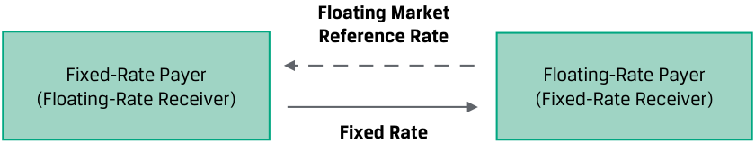

<!-- Picture Text: Floating Market Reference Rate Fixed-Rate Payer Floating-Rate Payer (Floating-Rate Receiver) (Fixed-Rate Receiver) Fixed Rate  -->

> **Chú thích hình ảnh:**
> - **Bên trả lãi suất cố định / Bên nhận lãi suất thả nổi (*Fixed-Rate Payer / Floating-Rate Receiver*)** trả **Lãi suất cố định (*Fixed Rate*)** cho **Bên trả lãi suất thả nổi / Bên nhận lãi suất cố định (*Floating-Rate Payer / Fixed-Rate Receiver*)**, và nhận lại **Lãi suất tham chiếu thị trường thả nổi (*Floating Market Reference Rate*)**.

Hợp đồng hoán đổi và hợp đồng kỳ hạn có các đặc điểm tương tự nhau, chẳng hạn như ngày bắt đầu, ngày đáo hạn, và một tài sản/biến số cơ sở được đàm phán giữa các đối tác và được quy định cụ thể trong hợp đồng. Hợp đồng hoán đổi lãi suất (*interest rate swaps*), trong đó một mức lãi suất cố định được trao đổi lấy một mức lãi suất thả nổi, là loại hợp đồng hoán đổi phổ biến nhất. Đối với mỗi kỳ trong tương lai, lãi suất tham chiếu thị trường (MRR) do bên trả lãi suất thả nổi chi trả sẽ được thiết lập lại, trong khi lãi suất cố định (được gọi là **lãi suất hoán đổi – *swap rate***) giữ nguyên không đổi, như được thể hiện trong Bảng minh họa 5.

<!-- PDF Page 44 -->

**Bảng minh họa 5: Hợp đồng Hoán đổi như một Chuỗi các Giao dịch Trao đổi Kỳ hạn (*Exhibit 5: Swap as a Series of Forward Exchanges*)** 

<!-- Picture Text: Time t  = 1 t  = 2 t  =  T Fixed-Rate Fixed-Rate Fixed-Rate Payer Payer Payer MRR1 × Fixed rate MRR2 × Fixed rate MRR T  × Fixed rate Notional × × Notional Notional × × Notional Notional × × Notional Period × Period Period × Period Period × Period Floating-Rate Floating-Rate Floating-Rate Payer Payer Payer  -->

> **Chú thích hình ảnh:**
> - Tại mỗi kỳ thanh toán $t = 1, t = 2, \dots, t = T$:
>   - **Bên trả lãi suất cố định (*Fixed-Rate Payer*)** trả cho **Bên trả lãi suất thả nổi (*Floating-Rate Payer*)** khoản tiền: $\text{Lãi suất cố định (Fixed rate)} \times \text{Vốn gốc danh nghĩa (Notional)} \times \text{Kỳ hạn (Period)}$.
>   - **Bên trả lãi suất thả nổi (*Floating-Rate Payer*)** trả cho **Bên trả lãi suất cố định (*Fixed-Rate Payer*)** khoản tiền: $\text{MRR}_t \times \text{Vốn gốc danh nghĩa (Notional)} \times \text{Kỳ hạn (Period)}$.

Các đối tác thường trao đổi một khoản thanh toán bù trừ ròng (*net payment*) giữa các khoản thanh toán lãi suất cố định và lãi suất thả nổi trên hợp đồng hoán đổi như trong Ví dụ 4.

###### **VÍ DỤ 4 (*EXAMPLE 4*)** 

##### **Hợp đồng Hoán đổi của Fyleton Investments (*Fyleton Investments Swap*)** 

Fyleton Investments đã tham gia vào một hợp đồng hoán đổi lãi suất nhận lãi cố định (*receive-fixed*) kỳ hạn năm năm trị giá 200 triệu GBP với một định chế tài chính trung gian nhằm làm tăng thời lượng (*duration*) cho danh mục đầu tư thu nhập cố định của mình. Theo các điều khoản của hợp đồng hoán đổi, Fyleton đã đồng ý nhận mức lãi suất cố định GBP bán niên là 2,25% và trả lãi suất MRR kỳ hạn sáu tháng.

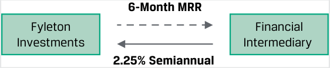

<!-- Picture Text: 6-Month MRR Fyleton Financial Investments Intermediary 2.25% Semiannual  -->

> **Chú thích hình ảnh:**
> - **Fyleton Investments** trả **Lãi suất MRR kỳ hạn 6 tháng (*6-Month MRR*)** cho **Định chế tài chính trung gian (*Financial Intermediary*)**, và nhận lại mức lãi cố định **2,25% bán niên (*2.25% Semiannual*)**.

Hãy tính toán lần trao đổi dòng tiền hoán đổi đầu tiên nếu lãi suất MRR kỳ hạn sáu tháng được ấn định ở mức 1,95%.

- Định chế tài chính trung gian nợ Fyleton một khoản thanh toán dòng tiền cố định là:

  $$\text{GBP } 2.250.000 = \text{GBP } 200\text{ triệu} \times \frac{0,0225}{2}$$

- Fyleton nợ định chế tài chính trung gian một khoản thanh toán dòng tiền thả nổi là:

  $$\text{GBP } 1.950.000 = \text{GBP } 200\text{ triệu} \times \frac{0,0195}{2}$$

- Các khoản thanh toán cố định và thả nổi được bù trừ ròng với nhau, và kết quả ròng là định chế tài chính trung gian trả cho Fyleton:

  $$\text{GBP } 300.000 = \text{GBP } 2.250.000 - \text{GBP } 1.950.000$$

Vốn gốc danh nghĩa (*notional principal*) thường không được trao đổi mà thay vào đó được sử dụng để tính toán các khoản thanh toán lãi cố định và thả nổi, như trong Ví dụ 4. Ví dụ này minh họa cách một nhà quản lý đầu tư có thể sử dụng hợp đồng hoán đổi lãi suất để thay đổi thời lượng (*duration*) của danh mục đầu tư mà không cần giao dịch trái phiếu. Các tổ chức phát hành thường sử dụng hợp đồng hoán đổi để thay đổi cấu trúc tiếp xúc rủi ro của một khoản nợ phải trả, chẳng hạn như một khoản vay có kỳ hạn.

Giống như hợp đồng tương lai và hợp đồng kỳ hạn, không có khoản tiền nào được trao đổi khi một hợp đồng hoán đổi được khởi tạo. Do đó, giá trị của một hợp đồng hoán đổi khi khởi tạo trên thực tế bằng không, nếu bỏ qua chi phí giao dịch. Trong một bài học về thu nhập cố định trước đây, chúng ta đã thấy rằng lãi suất kỳ hạn hàm ý (*implied forward rates*) có thể được suy ra từ lãi suất giao ngay (*spot rates*). Các mức lãi suất MRR kỳ hạn (*forward MRRs*) có thể được sử dụng để xác định các dòng tiền tương lai kỳ vọng cho nhánh thả nổi (*floating leg*) của một hợp đồng hoán đổi lãi suất. Lãi suất hoán đổi (*swap rate*) cho các khoản thanh toán của nhánh cố định (*fixed leg*) được xác định bằng cách giải tìm một mức lợi suất cố định không đổi giúp cân bằng giá trị hiện tại của các khoản thanh toán nhánh cố định và nhánh thả nổi.

<!-- PDF Page 45 -->

Khi điều kiện thị trường thay đổi và thời gian trôi qua, giá trị định giá theo thị trường (*mark-to-market value*) của một hợp đồng hoán đổi sẽ lệch khỏi mức không ($0$), dẫn đến một giá trị MTM dương cho một đối tác và một giá trị MTM âm đối ứng cho đối tác kia. Các điều khoản tín dụng của hợp đồng hoán đổi được đàm phán riêng tư giữa các đối tác trong một thỏa thuận phi tập trung (OTC) và có thể dao động từ việc tiếp xúc rủi ro không có tài sản thế chấp (*uncollateralized exposure*) — nơi mỗi đối tác chịu toàn bộ rủi ro vỡ nợ của bên kia — cho đến các điều khoản tương tự như cơ chế ký quỹ hợp đồng tương lai cho một hoặc cả hai đối tác. Một sự kiện vỡ nợ của đối tác thường kích hoạt việc chấm dứt hợp đồng hoán đổi (*swap termination*) và thanh toán theo giá trị MTM giống như bất kỳ khoản đòi nợ nào khác. Các hợp đồng hoán đổi được bù trừ tập trung giữa các định chế tài chính trung gian và một đối tác trung tâm (CCP) bao gồm các điều khoản ký quỹ tương tự như hợp đồng tương lai nhằm tiêu chuẩn hóa và giảm thiểu rủi ro đối tác.

###### **BỘ CÂU HỎI (*QUESTION SET*)** 

##### **Hợp đồng Hoán đổi (*Swaps*)** 

1. Mô tả một điểm tương đồng và một điểm khác biệt giữa hợp đồng kỳ hạn và hợp đồng hoán đổi.

###### **Lời giải:** 

**Điểm tương đồng:** Cả hợp đồng kỳ hạn và hợp đồng hoán đổi đều đại diện cho các cam kết chắc chắn có giá trị ban đầu bằng không, trong đó các dòng tiền được trao đổi trong tương lai tại một mức giá đã thỏa thuận trước.

**Điểm khác biệt:** Hợp đồng kỳ hạn thường liên quan đến một lần trao đổi dòng tiền duy nhất trong tương lai, trong khi một hợp đồng hoán đổi liên quan đến nhiều hơn một lần trao đổi các dòng tiền trong tương lai.

2. Xác định các câu trả lời đúng để điền vào chỗ trống: Theo một hợp đồng hoán đổi, chúng ta gọi đối tác chi trả các dòng tiền biến đổi là _______________ và đối tác chi trả các dòng tiền cố định là _______________.

###### **Lời giải:** 

Theo một hợp đồng hoán đổi, chúng ta gọi đối tác chi trả các dòng tiền biến đổi là _bên trả lãi suất thả nổi (floating-rate payer)_ (hoặc _bên nhận lãi suất cố định – fixed-rate receiver_) và đối tác chi trả các dòng tiền cố định là _bên trả lãi suất cố định (fixed-rate payer)_ (hoặc _bên nhận lãi suất thả nổi – floating-rate receiver_).

3. Xác định những bên tham gia hợp đồng hoán đổi lãi suất tương ứng với các phát biểu sau đây:

|**Bên tham gia**|**Đặc điểm mô tả**|
|---|---|
|A. Bên trả lãi suất cố định (*Fixed-rate payer*)|1. Thực hiện một khoản thanh toán vào mỗi kỳ tính lãi dựa trên một lãi suất tham chiếu thị trường|
|B. Bên trả lãi suất thả nổi (*Floating-rate payer*)|2. Có thể đối mặt với giá trị định giá theo thị trường (MTM) dương hoặc âm trong suốt vòng đời của một hợp đồng hoán đổi lãi suất|
|C. Cả bên trả lãi suất cố định và bên trả lãi suất thả nổi|3. Nhận được một khoản thanh toán ròng trên hợp đồng hoán đổi cho bất kỳ kỳ tính lãi nào mà lãi suất tham chiếu thị trường vượt quá lãi suất cố định|

###### **Lời giải:** 

1. Đáp án đúng là B. Bên trả lãi suất thả nổi trên một hợp đồng hoán đổi thực hiện một khoản thanh toán vào mỗi kỳ dựa trên một lãi suất tham chiếu thị trường.

2. Đáp án đúng là C. Cả bên trả lãi suất cố định và bên trả lãi suất thả nổi đều có thể đối mặt với giá trị MTM dương hoặc MTM âm trên một hợp đồng hoán đổi.

---

# Tập 7: Công cụ Phái sinh (*Derivatives*)
## Học phần 2: Đặc điểm và Công cụ của Cam kết Kỳ hạn và Quyền đòi hỏi Có điều kiện (*Forward Commitment and Contingent Claim Features and Instruments*)
### Phần 2/2: Quyền chọn (*Options*) (Trang PDF 46–60)

---

<!-- PDF Page 46 -->

3. Đáp án đúng là A. Bên trả lãi suất cố định (còn được gọi là bên nhận lãi suất thả nổi) nhận được một khoản thanh toán ròng nếu lãi suất tham chiếu thị trường vượt quá lãi suất cố định trong một kỳ nhất định.

# **<mark>5</mark>** 

#### **QUYỀN CHỌN (*OPTIONS*)** 

định nghĩa hợp đồng kỳ hạn, hợp đồng tương lai, hợp đồng hoán đổi, quyền chọn (quyền chọn mua và quyền chọn bán), và công cụ phái sinh tín dụng cũng như so sánh các đặc điểm cơ bản của chúng

xác định giá trị khi đáo hạn và lợi nhuận từ một vị thế mua hoặc vị thế bán đối với quyền chọn mua hoặc quyền chọn bán

đối chiếu giữa các cam kết kỳ hạn với các quyền đòi hỏi có điều kiện

Quyền đòi hỏi có điều kiện (*contingent claims*) là một loại hợp đồng phái sinh ETD hoặc OTC trong đó một trong các đối tác có quyền quyết định liệu một giao dịch có được thanh toán hay không dựa trên giá trị của tài sản cơ sở. Hợp đồng quyền chọn (*option contracts*) là quyền đòi hỏi có điều kiện phổ biến nhất. Tương tự như hợp đồng kỳ hạn và hợp đồng tương lai, quyền chọn là các hợp đồng phái sinh giữa người mua và người bán quy định rõ một tài sản cơ sở, quy mô hợp đồng, một mức giá thực hiện thỏa thuận trước, và một ngày đáo hạn. Người mua quyền chọn có quyền nhưng không có nghĩa vụ (*right but not the obligation*) thực hiện giao dịch, và người bán quyền chọn có nghĩa vụ phải thực hiện giao dịch theo sự lựa chọn của người mua quyền chọn. Hệ quả là, giá trị nhận được khi đáo hạn (*payoff*) của người mua quyền chọn luôn bằng không hoặc là một số dương. Giá trị này không bao giờ có thể âm.

Giả sử người mua quyền chọn trả một khoản phí quyền chọn ($c_0$) là $\$5$ tại thời điểm $t = 0$ để có quyền — nhưng không phải nghĩa vụ — mua cổ phiếu $S$ tại thời điểm $T$ ở một mức giá đã thỏa thuận trước ($X$) là $\$30$. Quyết định của người mua quyền chọn khi đáo hạn phụ thuộc vào giá cổ phiếu khi đáo hạn ($S_T$), như được thể hiện trong hai kịch bản sau đây:

##### **Kịch bản 1: Thực hiện giao dịch ($S_T > X$)** 

- Nếu $S_T = \$40$, người mua quyền chọn lựa chọn thực hiện quyền chọn (*exercise the option*) và mua cổ phiếu với giá $X = \$30$.

- Người mua quyền chọn thu được $\$10$ $[(S_T - X) = \$40 - \$30]$ trên giao dịch này.

- Người mua quyền chọn thực hiện được khoản lợi nhuận là $\$5$ $[(S_T - X) - c_0 = (\$40 - \$30) - \$5]$.

##### **Kịch bản 2: Không thực hiện giao dịch ($S_T < X$)** 

- Nếu $S_T = \$25$, người mua quyền chọn lựa chọn không thực hiện quyền chọn để mua cổ phiếu với giá $X = \$30$.

- Người mua quyền chọn chịu một khoản lỗ là $\$5$ ($c_0 = \$5$).

Bảng minh họa 6 cho thấy cơ chế hoạt động của quyền chọn đối với trường hợp người mua quyền chọn trả tiền để có quyền mua một cổ phiếu cơ sở $S$ tại mức giá thực hiện thỏa thuận trước là $X$ trong tương lai ($t = T$).

<!-- PDF Page 47 -->

**Bảng minh họa 6: Cơ chế Hoạt động của Quyền chọn Mua (*Exhibit 6: Call Option Mechanics*)** 

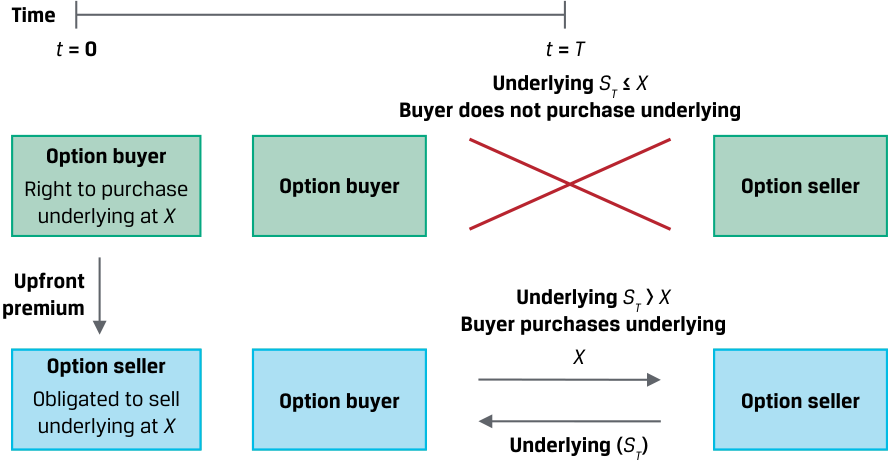

<!-- Picture Text: Time t  = 0 t  =  T Underlying  ST  ≤  X Buyer does not purchase underlying Option buyer Right to purchase Option buyer Option seller underlying at  X Upfront premium Underlying  ST  >  X Buyer purchases underlying X Option seller Obligated to sell Option buyer Option seller underlying at  X Underlying ( ST )  -->

> **Chú thích hình ảnh:**
> - **Tại thời điểm $t = 0$:** **Người mua quyền chọn (*Option buyer*)** (có quyền mua tài sản cơ sở tại giá $X$) trả **Phí quyền chọn trả trước (*Upfront premium*)** cho **Người bán quyền chọn (*Option seller*)** (có nghĩa vụ bán tài sản cơ sở tại giá $X$).
> - **Tại thời điểm $t = T$:**
>   - Nếu giá tài sản cơ sở $S_T \le X$: Người mua không mua tài sản cơ sở (không có giao dịch giữa Người mua và Người bán).
>   - Nếu giá tài sản cơ sở $S_T > X$: Người mua mua tài sản cơ sở — trả tiền $X$ cho Người bán và nhận về Tài sản cơ sở ($S_T$).

Quyết định giao dịch tài sản cơ sở được gọi là **thực hiện quyền (*exercise*)**, và mức giá thực hiện đã thỏa thuận trước được gọi là **giá thực hiện (*exercise price* hoặc *strike price*)**. Người mua quyền chọn có thể giao dịch tài sản cơ sở trong tương lai hoàn toàn theo quyết định riêng của họ tại mức giá thực hiện — một mức giá giao ngay tương lai thỏa thuận trước có thể cao hơn, bằng, hoặc thấp hơn giá kỳ hạn, như đã trình bày trong một bài học trước. Quyền được thực hiện giao dịch trong tương lai này có một giá trị được trả trước cho người bán quyền chọn dưới hình thức một khoản **phí quyền chọn (*option premium*)**.

Các điều khoản của hợp đồng quyền chọn, chẳng hạn như quyền mua hoặc quyền bán, giá thực hiện, kỳ hạn, và quy mô, có thể được thỏa thuận giữa các đối tác trong một giao dịch phi tập trung (OTC) hoặc được thực hiện trên một sở giao dịch dựa trên các điều khoản được tiêu chuẩn hóa. Bài học này tập trung vào **quyền chọn kiểu châu Âu (*European options*)**, hay các quyền chọn chỉ có thể được thực hiện vào ngày đáo hạn, mặc dù vẫn tồn tại các kiểu quyền chọn khác. Ví dụ, **quyền chọn kiểu Mỹ (*American options*)** có thể được thực hiện vào bất kỳ thời điểm nào kể từ khi khởi tạo hợp đồng cho đến khi đáo hạn. Lưu ý rằng tên gọi “châu Âu” và “Mỹ” không đề cập đến nơi các quyền chọn này được sử dụng, mà đề cập đến sự khác biệt về thời điểm chúng có thể được thực hiện.

Tồn tại hai loại quyền chọn chính — cụ thể là, (1) quyền mua một tài sản cơ sở được gọi là **quyền chọn mua (*call option*)** và (2) quyền bán tài sản cơ sở, hay **quyền chọn bán (*put option*)**. Người mua quyền chọn sẽ chỉ thực hiện quyền chọn mua hoặc quyền chọn bán nếu nó mang lại một giá trị nhận được (*payoff*) dương. Nếu không được thực hiện, quyền chọn sẽ hết hạn mà không có giá trị (*expires worthless*), và khoản lỗ của người mua quyền chọn bằng đúng khoản phí quyền chọn đã trả.

Một yếu tố cấu thành giá trị của quyền chọn trước khi đáo hạn ($t < T$) là giá trị thực hiện của quyền chọn tại thời điểm $t$, được gọi là **giá trị nội tại (*intrinsic value*)** của quyền chọn.

Chúng ta có thể nói một quyền chọn mua đang ở trạng thái **cao giá / có lời (*in-the-money*)** tại thời điểm $t$ nếu giá giao ngay, $S_t$, vượt quá $X$, với giá trị nội tại bằng $(S_t - X)$. Cả quyền chọn ở trạng thái **kiệt giá / lỗ (*out-of-the-money*)** (khi $S_t < X$) và quyền chọn ở trạng thái **ngang giá (*at-the-money*)** ($S_t = X$) đều có giá trị nội tại bằng không, do đó giá của chúng, $c_t$, chỉ bao gồm toàn bộ giá trị thời gian (*time value*).

Người mua quyền chọn mua sẽ hưởng lợi từ sự gia tăng trong giá của tài sản cơ sở. Bảng minh họa 7 cho thấy giá trị nhận được (*payoff*) và lợi nhuận (*profit*) khi đáo hạn đối với người mua quyền chọn mua.

<!-- PDF Page 48 -->

**Bảng minh họa 7: Cấu trúc Giá trị nhận được của Vị thế Mua Quyền chọn Mua (*Exhibit 7: Long Call Payoff Profile*)** 

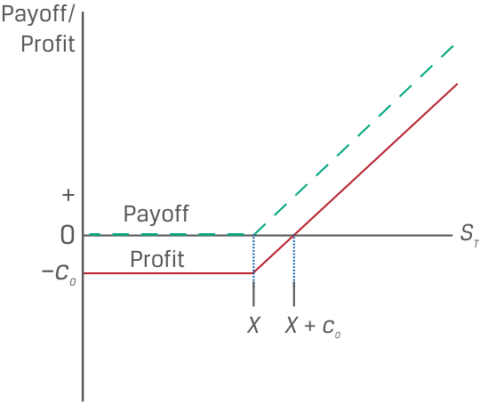

<!-- Picture Text: Payoff/ Profit + Payoff 0 ST Profit – c0 X X  +  c0  -->

> **Chú thích hình ảnh:**
> - **Trục tung:** Giá trị nhận được / Lợi nhuận (*Payoff / Profit*).
> - **Trục hoành:** Giá giao ngay khi đáo hạn $S_T$.
> - Đường **Giá trị nhận được (*Payoff*)** nằm ngang ở mức $0$ khi $S_T \le X$ và dốc lên tuyến tính khi $S_T > X$.
> - Đường **Lợi nhuận (*Profit*)** nằm ngang ở mức $-c_0$ khi $S_T \le X$, bắt đầu đi lên từ $X$, cắt trục hoành (hòa vốn) tại $X + c_0$.

Người mua quyền chọn trả một khoản phí quyền chọn mua, $c_0$, tại thời điểm $t = 0$ cho người bán quyền chọn và có quyền mua tài sản cơ sở, $S_T$, tại mức giá thực hiện $X$ vào thời điểm $t = T$. _Giá trị nhận được khi thực hiện quyền (exercise payoff)_ $(S_T - X)$ là số dương nếu $S_T > X$ và bằng không nếu $S_T \le X$. Giá trị của quyền chọn mua khi đáo hạn, $c_T$, có thể được biểu diễn như sau:

<!-- Formula Text: cT = max(0, ST – X). (1) -->
$$c_T = \max(0, S_T - X) \tag{1}$$

_Lợi nhuận (profit)_ của người mua quyền chọn mua bằng _giá trị nhận được khi đáo hạn (payoff)_ trừ đi phí quyền chọn mua, $c_0$ (bỏ qua giá trị thời gian của tiền tệ trong bài học này):

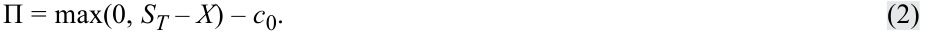

<!-- Formula Text: Π = max(0, ST – X) – c0. (2) -->
$$\Pi = \max(0, S_T - X) - c_0 \tag{2}$$

Cấu trúc giá trị nhận được bất đối xứng (*asymmetric payoff profile*) này là một đặc điểm chung của các quyền đòi hỏi có điều kiện, đôi khi được gọi là các **công cụ phái sinh phi tuyến tính (*non-linear derivatives*)**.

###### **VÍ DỤ 5 (*EXAMPLE 5*)** 

##### **Hightest Capital — Giao dịch Mua Quyền chọn Mua (*Call Option Purchase*)** 

Hightest Capital mua một quyền chọn mua trên Chỉ số Ngành Chăm sóc Sức khỏe Chọn lọc S&P 500 (*S&P 500 Health Care Select Sector Index* – SIXV). Hợp đồng quyền chọn giao dịch trên sở giao dịch có kỳ hạn sáu tháng này có quy mô là 100 đơn vị chỉ số và mức giá thực hiện là $\$1.240$ mỗi đơn vị so với mức giá giao ngay ban đầu của SIXV là $\$1.180,95$. Khoản phí quyền chọn trả trước là $\$24,85$ mỗi đơn vị, hay $\$2.485$ ($= \$24,85 \times 100$). Khi quyền chọn gần đến ngày đáo hạn, một chuyên viên phân tích của Hightest được yêu cầu xác định giá trị nhận được và lợi nhuận kỳ vọng của quyền chọn trên mỗi đơn vị khi đáo hạn theo các kịch bản khác nhau của giá giao ngay SIXV vào ngày thực hiện quyền. Cô lập bảng sau đây:

- $c_0 =$ Phí quyền chọn mua $= \$24,85$ mỗi đơn vị.

- $X =$ Giá thực hiện tại thời điểm $T = \$1.240$ mỗi đơn vị.

- $S_T =$ Giá giao ngay trên mỗi đơn vị tại thời điểm $T$.

|**Giá giao ngay SIXV ($S_T$)**|**Giá thực hiện ($X$)**|**Giá trị nhận được (*Payoff*) $\max(0, S_T - X)$**|**Lợi nhuận (*Profit*) $\max(0, S_T - X) - c_0$**|
|---|---|---|---|
|$\$1.280$|$\$1.240$|$\$40$|$\$15,15$|
|$\$1.260$|$\$1.240$|$\$20$|$-\$4,85$|

<!-- PDF Page 49 -->

|**Giá giao ngay SIXV ($S_T$)**|**Giá thực hiện ($X$)**|**Giá trị nhận được (*Payoff*) $\max(0, S_T - X)$**|**Lợi nhuận (*Profit*) $\max(0, S_T - X) - c_0$**|
|---|---|---|---|
|$\$1.240$|$\$1.240$|$\$0$|$-\$24,85$|
|$\$1.220$|$\$1.240$|$\$0$|$-\$24,85$|

Ví dụ 5 đặt ra một câu hỏi khác liên quan đến giá trị của một quyền chọn trước khi đáo hạn ($t < T$). Thời gian cho đến khi quyền chọn đáo hạn càng dài, khả năng xảy ra một biến động có lợi trong giá tài sản cơ sở làm tăng cả xác suất lẫn khả năng sinh lời của việc thực hiện quyền càng cao. **Giá trị thời gian (*time value*)** này của một quyền chọn luôn dương và giảm dần về không khi quyền chọn tiến đến ngày đáo hạn.

Trái ngược với người mua quyền chọn mua có tiềm năng sinh lời không giới hạn khi giá tăng và mức lỗ được giới hạn ở khoản phí quyền chọn đã trả, người bán quyền chọn mua nhận được mức lợi nhuận tối đa bằng khoản phí quyền chọn và phải đối mặt với rủi ro thua lỗ không giới hạn khi tài sản cơ sở tăng giá vượt lên trên mức giá thực hiện. Cấu trúc giá trị nhận được của vị thế bán quyền chọn mua (*short call*) trong Bảng minh họa 8 là hình ảnh phản chiếu qua gương của Bảng minh họa 7.

###### **Bảng minh họa 8: Cấu trúc Giá trị nhận được của Vị thế Bán Quyền chọn Mua (*Exhibit 8: Short Call Payoff Profile*)** 

<!-- Picture Text: Payoff/ Profit Profit c0 Payoff 0 ST – X X  +  c0  -->

> **Chú thích hình ảnh:**
> - **Trục tung:** Giá trị nhận được / Lợi nhuận (*Payoff / Profit*).
> - **Trục hoành:** Giá giao ngay khi đáo hạn $S_T$.
> - Đường **Giá trị nhận được (*Payoff*)** nằm ngang ở mức $0$ khi $S_T \le X$ và dốc xuống âm khi $S_T > X$.
> - Đường **Lợi nhuận (*Profit*)** nằm ngang ở mức $+c_0$ khi $S_T \le X$, đi xuống cắt trục hoành tại $X + c_0$, và lỗ không giới hạn khi $S_T$ tiếp tục tăng.

Cấu trúc giá trị nhận được của người mua và người bán quyền chọn minh họa cho bản chất một chiều (*one-sided nature*) của rủi ro tín dụng đối tác đối với các quyền đòi hỏi có điều kiện. Nghĩa là, người bán quyền chọn không có mức độ tiếp xúc rủi ro tín dụng nào đối với người mua quyền chọn một khi phí quyền chọn đã được thanh toán. Tuy nhiên, người mua quyền chọn phải đối mặt với rủi ro tín dụng đối tác từ phía người bán quyền chọn bằng đúng giá trị nhận được của quyền chọn khi đáo hạn.

Người mua quyền chọn bán (*put option buyers*) hưởng lợi từ mức giá tài sản cơ sở thấp hơn bằng cách bán tài sản cơ sở tại mức giá thực hiện đã thỏa thuận trước. Người mua quyền chọn bán sẽ thực hiện quyền khi giá tài sản cơ sở thấp hơn giá thực hiện ($S_T < X$), như được thể hiện trong Bảng minh họa 9.

<!-- PDF Page 50 -->

**Bảng minh họa 9: Cấu trúc Giá trị nhận được của Vị thế Mua Quyền chọn Bán (*Exhibit 9: Long Put Payoff Profile*)** 

<!-- Picture Text: Payoff/ Profit Payoff + Profit 0 ST – p0 X  –  p0 X  -->

> **Chú thích hình ảnh:**
> - **Trục tung:** Giá trị nhận được / Lợi nhuận (*Payoff / Profit*).
> - **Trục hoành:** Giá giao ngay khi đáo hạn $S_T$.
> - Đường **Giá trị nhận được (*Payoff*)** dốc xuống từ trái sang phải khi $S_T < X$ và nằm ngang ở mức $0$ khi $S_T \ge X$.
> - Đường **Lợi nhuận (*Profit*)** cắt trục hoành (hòa vốn) tại $X - p_0$ và nằm ngang ở mức lỗ tối đa $-p_0$ khi $S_T \ge X$.

Người mua quyền chọn bán trả một khoản phí quyền chọn là $p_0$ khi khởi tạo cho người bán quyền chọn và sẽ chỉ thực hiện quyền chọn nếu $(X - S_T) > 0$. Giống như trong Phương trình 1 và 2, chúng ta có thể biểu diễn _giá trị nhận được (payoff)_ và _lợi nhuận (profit)_, $\Pi$, của vị thế mua quyền chọn bán như sau:

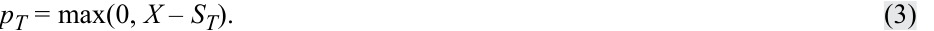

<!-- Formula Text: pT = max(0, X – ST). (3) -->
$$p_T = \max(0, X - S_T) \tag{3}$$

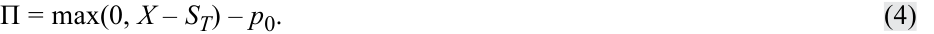

<!-- Formula Text: Π = max(0, X – ST) – p0. (4) -->
$$\Pi = \max(0, X - S_T) - p_0 \tag{4}$$

Giá trị nhận được hoặc lợi nhuận từ góc độ của người bán quyền chọn bán là ngược dấu với khoản lãi hoặc lỗ của người mua quyền chọn bán tại một mức giá tài sản cơ sở nhất định khi đáo hạn. Giống như trường hợp của người bán quyền chọn mua, người bán quyền chọn bán có mức lãi tối đa bằng khoản phí quyền chọn. Tuy nhiên, mặc dù người bán quyền chọn mua phải đối mặt với khoản lỗ tiềm tàng không giới hạn khi tài sản cơ sở tăng giá vượt quá giá thực hiện, khoản lỗ của người bán quyền chọn bán thường có giới hạn bởi vì giá tài sản cơ sở không thể giảm xuống dưới mức không ($0$). _Giá trị nhận được (payoff)_ và _lợi nhuận (profit)_ của vị thế bán quyền chọn bán (*short put*) như sau:

$$-p_T = -\max(0, X - S_T) \tag{5}$$

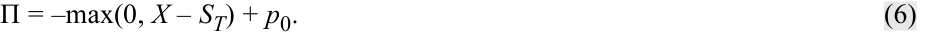

<!-- Formula Text: Π = –max(0, X – ST) + p0. (6) -->
$$\Pi = -\max(0, X - S_T) + p_0 \tag{6}$$

###### **BỘ CÂU HỎI (*QUESTION SET*)** 

##### **Quyền chọn (*Options*)** 

1. Hãy tính mức giá giao ngay SIXV khi đáo hạn từ Ví dụ 5 mà tại đó Hightest Capital sẽ đạt điểm hòa vốn (*breakeven point*) và có lợi nhuận bằng không.

###### **Lời giải:** 

Bên mua quyền chọn mua có mức lợi nhuận bằng $\max(0, S_T - X) - c_0$. Trong trường hợp của Hightest ở Ví dụ 5, giá thực hiện SIXV là $\$1.240$ và phí quyền chọn mua ban đầu là $\$24,85$. Do đó, điểm hòa vốn hay điểm có lợi nhuận bằng không sẽ bằng $\$1.240 + \$24,85$, hay $\$1.264,85$.

<!-- PDF Page 51 -->

2. Một người bán quyền chọn bán nhận được khoản phí quyền chọn $\$5$ cho một quyền chọn bán được bán trên một tài sản cơ sở có giá thực hiện là $\$30$. Lợi nhuận tối đa của người bán quyền chọn theo hợp đồng này là bao nhiêu? Mức lỗ tối đa theo hợp đồng là bao nhiêu?

###### **Lời giải:** 

Một người bán quyền chọn bán nhận được khoản phí quyền chọn $\$5$ ($p_0$) cho một quyền chọn bán được bán trên một tài sản cơ sở có giá thực hiện ($X$) là $\$30$. Lợi nhuận của người bán quyền chọn bán là $\Pi = -\max(0, X - S_T) + p_0$. Nếu quyền chọn không được thực hiện, $-\max(0, X - S_T) = 0$ và người bán quyền chọn bán thu được $p_0 = \$5$. Nếu quyền chọn được thực hiện và $S_T = 0$, khi đó $\Pi = -\max(0, 30 - 0) + 5 = -\$25$. Do đó, lợi nhuận tối đa của người bán quyền chọn theo hợp đồng là _$\$5$_ và mức lỗ tối đa theo hợp đồng là _$\$25$_.

3. Xác định những bên tham gia hợp đồng quyền chọn tương ứng với các phát biểu sau đây:

|**Bên tham gia**|**Đặc điểm mô tả**|
|---|---|
|A. Bên bán quyền chọn bán (*Put option seller*)|1. Không có rủi ro tín dụng đối tác đối với người mua quyền chọn một khi phí quyền chọn trả trước đã được thanh toán|
|B. Bên bán quyền chọn mua (*Call option seller*)|2. Thu được khoản lợi nhuận bằng với phí quyền chọn nếu giá tài sản cơ sở khi đáo hạn thấp hơn giá thực hiện|
|C. Cả bên bán quyền chọn bán và bên bán quyền chọn mua|3. Thu được khoản lợi nhuận bằng với phí quyền chọn nếu giá tài sản cơ sở khi đáo hạn vượt quá giá thực hiện|

###### **Lời giải:** 

1. Đáp án đúng là C. Người bán quyền chọn không có rủi ro tín dụng đối tác đối với người mua quyền chọn một khi phí quyền chọn trả trước đã được thanh toán.

2. Đáp án đúng là B. Người bán quyền chọn mua thu được khoản lợi nhuận bằng với phí quyền chọn nếu giá tài sản cơ sở khi đáo hạn thấp hơn giá thực hiện.

3. Đáp án đúng là A. Người bán quyền chọn bán thu được khoản lợi nhuận bằng với phí quyền chọn nếu giá tài sản cơ sở khi đáo hạn lớn hơn giá thực hiện.

#### **CÔNG CỤ PHÁI SINH TÍN DỤNG (*CREDIT DERIVATIVES*)** 

<!-- Picture Text: 6  -->

định nghĩa hợp đồng kỳ hạn, hợp đồng tương lai, hợp đồng hoán đổi, quyền chọn (quyền chọn mua và quyền chọn bán), và công cụ phái sinh tín dụng cũng như so sánh các đặc điểm cơ bản của chúng

Các hợp đồng phái sinh tín dụng (*credit derivative contracts*) dựa trên một biến số cơ sở tín dụng, hay rủi ro vỡ nợ (*default risk*) của một tổ chức phát hành nợ đơn lẻ hoặc một nhóm các tổ chức phát hành nợ trong một chỉ số. Hợp đồng phái sinh tín dụng phổ biến nhất là hợp đồng hoán đổi rủi ro tín dụng (*credit default swap* – CDS). Các hợp đồng CDS cho phép nhà đầu tư quản lý rủi ro tổn thất từ việc tổ chức phát hành vỡ nợ một cách tách biệt khỏi trái phiếu giao ngay (*cash bond*). Hợp đồng CDS được giao dịch dựa trên một mức chênh lệch tín dụng (**chênh lệch tín dụng CDS – *CDS credit spread***) tương tự như chênh lệch tín dụng của một trái phiếu giao ngay. Mức chênh lệch tín dụng phụ thuộc vào xác suất vỡ nợ (*probability of default* – POD) và mức tổn thất khi vỡ nợ (*loss given default* – LGD), như đã trình bày trong một bài học trước. Một mức chênh lệch tín dụng _cao hơn_ (hay khả năng kiệt quệ tài chính của tổ chức phát hành cao hơn) tương ứng với một mức giá trái phiếu giao ngay _thấp hơn_, và ngược lại.

<!-- PDF Page 52 -->

Mặc dù có tên gọi là hoán đổi (*swap*), các hợp đồng CDS thực chất là các quyền đòi hỏi có điều kiện (*contingent claims*) nhưng mang một số đặc điểm của các cam kết chắc chắn (*firm commitments*). Không giống như các quyền chọn mua và quyền chọn bán đã thảo luận trước đó, cả thời điểm thực hiện quyền lẫn khoản thanh toán khi thực hiện quyền theo một hợp đồng CDS đều thay đổi tùy thuộc vào (các) tổ chức phát hành cơ sở. Giống như trường hợp của một hợp đồng hoán đổi lãi suất tiêu chuẩn, một hợp đồng CDS được định giá tại mức chênh lệch ngang giá (*par spread*) có giá trị hiện tại ròng bằng không, và giá trị danh nghĩa (*notional amount*) không được trao đổi mà thay vào đó đóng vai trò làm cơ sở để tính toán mức phí chênh lệch (*spread*) và số tiền thanh toán.

Trong một hợp đồng CDS, bên mua bảo vệ tín dụng (*credit protection buyer*) trả phí cho bên bán bảo vệ tín dụng (*credit protection seller*) để bên bán gánh chịu rủi ro tổn thất từ việc vỡ nợ của một tổ chức phát hành thứ ba cơ sở. Nếu một **sự kiện tín dụng (*credit event*)** của tổ chức phát hành xảy ra — thường được định nghĩa là phá sản (*bankruptcy*), không thanh toán được một nghĩa vụ nợ (*failure to pay an obligation*), hoặc tái cơ cấu nợ bắt buộc (*involuntary debt restructuring*) — bên bán bảo vệ tín dụng sẽ chi trả cho bên mua bảo vệ tín dụng để thanh toán hợp đồng. Khoản thanh toán có điều kiện (*contingent payment*) này bằng đúng mức tổn thất khi vỡ nợ (LGD) của tổ chức phát hành tính trên giá trị danh nghĩa của hợp đồng CDS. Bảng minh họa 10 cho thấy các dòng tiền định kỳ theo một hợp đồng CDS.

**Bảng minh họa 10: Các Khoản Thanh toán Định kỳ theo Hợp đồng Hoán đổi Rủi ro Tín dụng (*Exhibit 10: Periodic Payments under a Credit Default Swap*)** 

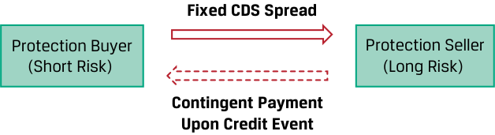

<!-- Picture Text: Fixed CDS Spread Protection Buyer Protection Seller (Short Risk)  (Long Risk) Contingent Payment Upon Credit Event  -->

> **Chú thích hình ảnh:**
> - **Bên mua bảo vệ / Vị thế bán rủi ro (*Protection Buyer / Short Risk*)** trả **Mức phí chênh lệch CDS cố định (*Fixed CDS Spread*)** định kỳ cho **Bên bán bảo vệ / Vị thế mua rủi ro (*Protection Seller / Long Risk*)**.
> - Ngược lại, **Bên bán bảo vệ** thực hiện **Khoản thanh toán có điều kiện khi xảy ra Sự kiện Tín dụng (*Contingent Payment Upon Credit Event*)** cho **Bên mua bảo vệ**.

Tài sản cơ sở có thể là một tổ chức phát hành doanh nghiệp hoặc chính phủ, một chỉ số gồm các tổ chức phát hành, hoặc một thực thể có mục đích đặc biệt (*special purpose entity* – SPE) nắm giữ một danh mục các khoản vay, khoản thế chấp, hoặc trái phiếu.

Người mua có thể sử dụng hợp đồng CDS làm công cụ phòng vệ (*hedge*) cho mức độ tiếp xúc rủi ro tín dụng hiện có đối với tổ chức phát hành cơ sở. Sự bảo vệ tín dụng mà một hợp đồng CDS mang lại tương tự như một hợp đồng bảo hiểm đối với một người mua đang có sẵn vị thế tiếp xúc thu nhập cố định đối với tổ chức phát hành thứ ba đó. Người mua có thể chịu một khoản lỗ về giá trị trên vị thế thu nhập cố định của mình do sự kiện tín dụng gây ra nhưng sẽ nhận được một khoản thanh toán từ hợp đồng CDS giúp bù đắp khoản lỗ đó.

Một người mua bảo vệ tín dụng không nắm giữ vị thế thu nhập cố định tương ứng nhưng vẫn mua một hợp đồng CDS là đang tìm cách thu lợi từ mức chênh lệch tín dụng cao hơn (vốn tương ứng với giá trái phiếu giao ngay thấp hơn) của một tổ chức phát hành cơ sở, và do đó đang ở vị thế bán khống rủi ro tín dụng (*short credit risk*).

Bên bán bảo vệ tín dụng nhận được một khoản thanh toán phí chênh lệch cố định định kỳ để đổi lấy việc gánh chịu rủi ro có điều kiện là phải chi trả cho bên mua bảo vệ tín dụng nhằm bù đắp tổn thất khi xảy ra một sự kiện tín dụng. Cấu trúc hợp đồng này tương tự như bảo hiểm, với khoản phí bảo hiểm định kỳ trong suốt vòng đời của hợp đồng được thỏa thuận trước và thời điểm cũng như quy mô của khoản tổn thất khi xảy ra sự kiện tín dụng là chưa biết trước. Do đó, vị thế của người bán bảo vệ tương tự như một vị thế mua rủi ro (*long risk position*) đối với trái phiếu cơ sở của tổ chức phát hành.

Ví dụ, Bảng minh họa 11 cho thấy hợp đồng CDS đối với một tổ chức phát hành cơ sở trải qua sự dịch chuyển chất lượng tín dụng (*credit migration*) tại $t = 1$, tiếp nối bởi một sự kiện tín dụng (*credit event*) tại $t = 2$.

<!-- PDF Page 53 -->

**Bảng minh họa 11: Hợp đồng CDS với Sự dịch chuyển Tín dụng và Sự kiện Tín dụng (*Exhibit 11: CDS Contract with Credit Migration and Credit Event*)** 

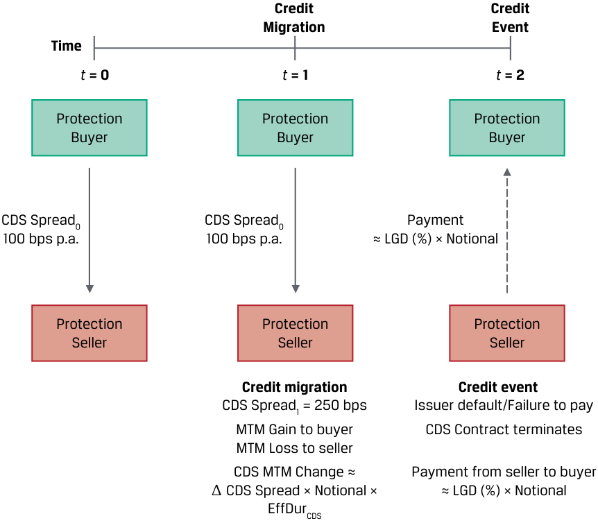

<!-- Picture Text: Credit Credit Migration Event Time t  = 0 t  = 1 t  = 2 Protection Protection Protection Buyer Buyer Buyer CDS Spread0 CDS Spread0 Payment 100 bps p.a. 100 bps p.a. ≈ LGD (%) × Notional Protection Protection Protection Seller Seller Seller Credit migration Credit event CDS Spread1 = 250 bps Issuer default/Failure to pay MTM Gain to buyer CDS Contract terminates MTM Loss to seller CDS MTM Change ≈ Payment from seller to buyer Δ CDS Spread × Notional × ≈ LGD (%) × Notional EffDurCDS  -->

> **Chú thích hình ảnh:**
> - **Tại $t = 0$:** Bên mua bảo vệ (*Protection Buyer*) trả phí $\text{CDS Spread}_0 = 100\text{ bps/năm}$ cho Bên bán bảo vệ (*Protection Seller*).
> - **Tại $t = 1$ (Sự dịch chuyển tín dụng – *Credit Migration*):** Chênh lệch tín dụng tăng lên $\text{CDS Spread}_1 = 250\text{ bps}$. Bên mua bảo vệ vẫn chỉ trả $100\text{ bps/năm}$ nên có Lãi định giá theo thị trường (*MTM Gain to buyer*), còn Bên bán bảo vệ chịu Lỗ định giá theo thị trường (*MTM Loss to seller*). Mức thay đổi MTM của CDS: $\text{CDS MTM Change} \approx \Delta\text{CDS Spread} \times \text{Notional} \times \text{EffDur}_{\text{CDS}}$.
> - **Tại $t = 2$ (Sự kiện tín dụng – *Credit Event*):** Tổ chức phát hành vỡ nợ / Không có khả năng thanh toán (*Issuer default/Failure to pay*). Hợp đồng CDS chấm dứt (*CDS Contract terminates*). Khoản thanh toán từ bên bán cho bên mua $\approx \text{LGD (\%)} \times \text{Notional}$.

Bên mua bảo vệ đồng ý trả một mức phí chênh lệch cố định là 100 bps/năm tại thời điểm $t = 0$ cho suốt thời hạn hợp đồng. Khi mức chênh lệch CDS của tổ chức phát hành nới rộng ra thành 250 bps/năm tại thời điểm $t = 1$, người mua có lãi trên hợp đồng CDS nhờ mức phí chênh lệch cố định thấp đang trả, trong khi người bán bị lỗ do mức phí chênh lệch cố định nhận được thấp hơn so với mức chênh lệch CDS thị trường hiện hành đang cao hơn. Giống như bất kỳ công cụ thu nhập cố định nào, thời lượng hiệu dụng (*effective duration* – $\text{EffDur}_{\text{CDS}}$) của thời hạn hợp đồng còn lại có thể được sử dụng để ước tính xấp xỉ mức thay đổi giá trị MTM. Một sự kiện tín dụng của tổ chức phát hành tại thời điểm $t = 2$ khiến hợp đồng chấm dứt, và người bán phải thực hiện một khoản thanh toán cho người mua bằng tỷ lệ phần trăm tổn thất khi vỡ nợ ($\text{LGD}$) nhân với giá trị danh nghĩa của hợp đồng CDS.

###### **BỘ CÂU HỎI (*QUESTION SET*)** 

##### **Công cụ Phái sinh Tín dụng (*Credit Derivatives*)** 

1. Xác định câu trả lời đúng để điền vào chỗ trống: Khoản thanh toán có điều kiện theo một hợp đồng hoán đổi rủi ro tín dụng bằng với ____________ tính trên giá trị danh nghĩa CDS được quy định trong hợp đồng.

###### **Lời giải:** 

Khoản thanh toán có điều kiện theo một hợp đồng hoán đổi rủi ro tín dụng bằng với _mức tổn thất khi vỡ nợ (loss given default – LGD)_ tính trên giá trị danh nghĩa CDS được quy định trong hợp đồng.

2. Mô tả tại sao vị thế của người bán bảo vệ tín dụng lại tương tự như vị thế của một khoản đầu tư trái phiếu giao ngay cơ sở.

###### **Lời giải:** 

Người bán bảo vệ tín dụng nhận được một khoản thanh toán phí chênh lệch CDS định kỳ để đổi lấy rủi ro có điều kiện phải thanh toán cho người mua khi xảy ra một sự kiện tín dụng của tổ chức phát hành. Nhà đầu tư trái phiếu giao ngay nhận được một khoản lãi coupon định kỳ có kết hợp

<!-- PDF Page 54 -->

mức chênh lệch tín dụng của tổ chức phát hành để đổi lấy một khoản tổn thất tiềm tàng nếu tổ chức phát hành vỡ nợ. Theo cả hợp đồng CDS và trái phiếu giao ngay, khoản thanh toán hoặc tổn thất tiềm tàng này đều bằng mức tổn thất khi vỡ nợ (LGD). Do đó, vị thế của người bán bảo vệ tín dụng tương tự như một vị thế mua rủi ro (*long risk position*) đối với trái phiếu cơ sở của tổ chức phát hành.

3. Xác định những bên tham gia hợp đồng CDS tương ứng với các phát biểu sau đây:

|**Bên tham gia**|**Đặc điểm mô tả**|
|---|---|
|A. Bên mua bảo vệ tín dụng (*Credit protection buyer*)|1. Tìm cách thu lợi từ mức chênh lệch tín dụng cao hơn của tổ chức phát hành|
|B. Bên bán bảo vệ tín dụng (*Credit protection seller*)|2. Tham gia vào một hợp đồng phái sinh giúp chuyển giao rủi ro tổn thất từ một sự kiện tín dụng của một tổ chức phát hành thứ ba cơ sở|
|C. Cả bên mua bảo vệ tín dụng và bên bán bảo vệ tín dụng|3. Đạt được một khoản lãi MTM trên hợp đồng CDS nếu mức chênh lệch CDS của tổ chức phát hành cơ sở giảm xuống|

###### **Lời giải:** 

1. Đáp án đúng là A. Bên mua bảo vệ tín dụng tìm cách thu lợi từ mức chênh lệch tín dụng cao hơn của tổ chức phát hành.

2. Đáp án đúng là C. Cả bên mua bảo vệ tín dụng và bên bán bảo vệ tín dụng đều tham gia vào một hợp đồng phái sinh giúp chuyển giao rủi ro tổn thất từ một sự kiện tín dụng của một tổ chức phát hành thứ ba cơ sở.

3. Đáp án đúng là B. Bên bán bảo vệ tín dụng đạt được một khoản lãi MTM trên hợp đồng CDS nếu mức chênh lệch CDS của tổ chức phát hành cơ sở giảm xuống. Sự sụt giảm trong mức chênh lệch CDS của tổ chức phát hành so với mức phí chênh lệch cố định ban đầu trên hợp đồng CDS có nghĩa là bên bán bảo vệ đang nhận được một mức phí chênh lệch cao hơn thị trường (*above-market spread*). Mức phí chênh lệch CDS cao hơn thị trường này bù đắp nhiều hơn mức cần thiết cho người bán trước mức rủi ro tín dụng mới thấp hơn và dẫn đến một khoản lãi MTM.

# **<mark>7</mark>** 

#### **CAM KẾT KỲ HẠN SO VỚI QUYỀN ĐÒI HỎI CÓ ĐIỀU KIỆN (*FORWARD COMMITMENTS VS. CONTINGENT CLAIMS*)** 

đối chiếu giữa các cam kết kỳ hạn với các quyền đòi hỏi có điều kiện

Một cam kết chắc chắn (*firm commitment*) yêu cầu cả hai đối tác phải thực hiện nghĩa vụ theo hợp đồng phái sinh, trong khi người mua quyền chọn có thể quyết định có thực hiện hợp đồng khi đáo hạn hay không tùy thuộc vào giá tài sản cơ sở so với giá thực hiện. Những người tham gia thị trường thường tạo ra các mức độ tiếp xúc rủi ro tương tự nhau đối với một tài sản cơ sở bằng cách sử dụng các loại công cụ phái sinh khác nhau này. Ví dụ, cả vị thế mua hợp đồng kỳ hạn (*long forward position*) và vị thế mua quyền chọn mua (*long call option position*) đều sẽ hưởng lợi từ sự gia tăng trong giá của tài sản cơ sở. Bảng minh họa 12 đối chiếu giá trị nhận được (*payoff*) và lợi nhuận (*profit*) của hai hợp đồng phái sinh này, trong đó giá thực hiện, $X$, bằng với giá kỳ hạn, $F_0(T)$.

<!-- PDF Page 55 -->

###### **Bảng minh họa 12: Cấu trúc Giá trị nhận được của Vị thế Mua Kỳ hạn và Vị thế Mua Quyền chọn Mua (*Exhibit 12: Long Forward and Long Call Option Payoff Profiles*)** 

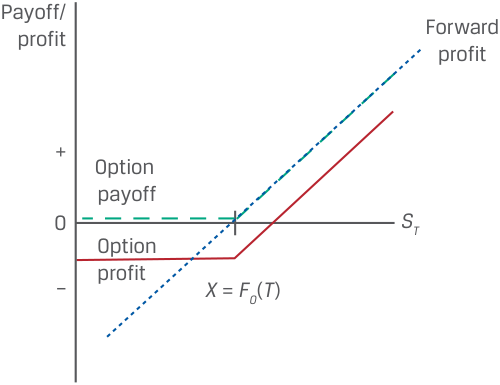

<!-- Picture Text: Payoff/ Forward profit profit + Option payoff 0 ST Option – profit X  =  F0 ( T )  -->

> **Chú thích hình ảnh:**
> - Khi $X = F_0(T)$:
>   - Đường **Lợi nhuận kỳ hạn (*Forward profit*)** là đường thẳng tuyến tính đi qua điểm $X = F_0(T)$ trên trục hoành.
>   - Đường **Giá trị nhận được của quyền chọn (*Option payoff*)** bằng $0$ khi $S_T \le X$ và trùng với đường lợi nhuận kỳ hạn khi $S_T > X$.
>   - Đường **Lợi nhuận của quyền chọn (*Option profit*)** nằm ngang ở mức $-c_0$ khi $S_T \le X$ và song song (thấp hơn một đoạn $c_0$) so với đường lợi nhuận kỳ hạn khi $S_T > X$.

Như đã trình bày trước đó, cả giá trị nhận được của vị thế mua kỳ hạn lẫn quyền chọn mua đều tăng lên khi $S_T$ tăng. Trong trường hợp của hợp đồng kỳ hạn, mối quan hệ tuyến tính này bằng $[S_T - F_0(T)]$, với giá trị nhận được bằng đúng lợi nhuận vì không có khoản tiền mặt nào được trao đổi khi khởi tạo. Đối với người mua một quyền chọn mua có giá thực hiện là $F_0(T)$, Phương trình 2 chuyển thành:

$$\Pi = \max[0, S_T - F_0(T)] - c_0$$

Cho giá trị nhận được/lợi nhuận của hợp đồng kỳ hạn $[S_T - F_0(T)]$ bằng với lợi nhuận của quyền chọn mua, $\Pi$, chúng ta có được cấu trúc lợi nhuận tương đối giữa hợp đồng kỳ hạn và quyền chọn như sau:

- $S_T - F_0(T) > -c_0 \implies$ Lợi nhuận hợp đồng kỳ hạn vượt quá lợi nhuận quyền chọn (*Forward profit exceeds option profit*)

- $S_T - F_0(T) = -c_0 \implies$ Lợi nhuận hợp đồng kỳ hạn bằng lợi nhuận quyền chọn mua (*Forward profit equals call option profit*)

- $S_T - F_0(T) < -c_0 \implies$ Lợi nhuận quyền chọn vượt quá lợi nhuận hợp đồng kỳ hạn (*Option profit exceeds forward profit*)

Sự so sánh song song trong Bảng minh họa 12 giữa đồ thị lợi nhuận của hợp đồng kỳ hạn và quyền chọn mua cho thấy sự tương đồng của vị thế mua quyền chọn mua với một vị thế mua (*long position*) tài sản cơ sở nhưng có sự bảo vệ khi giá giảm (*downside protection*) để đổi lấy việc phải trả một khoản phí quyền chọn.

Một quyền đòi hỏi có điều kiện khác cũng hưởng lợi từ sự gia tăng trong giá của tài sản cơ sở là quyền chọn bán đã bán (*sold put option* / *short put*). Trong khi giá trị nhận được của vị thế mua quyền chọn mua và vị thế mua kỳ hạn đều tăng lên khi giá tài sản cơ sở vượt lên trên giá thực hiện, lợi nhuận của người bán quyền chọn bán lại bị giới hạn ở khoản phí quyền chọn trả trước. Bảng minh họa 13 đối chiếu giá trị nhận được và lợi nhuận của vị thế bán quyền chọn bán với vị thế mua kỳ hạn nếu giá thực hiện, $X$, bằng $F_0(T)$.

<!-- PDF Page 56 -->

###### **Bảng minh họa 13: Cấu trúc Giá trị nhận được của Vị thế Mua Kỳ hạn và Vị thế Bán Quyền chọn Bán (*Exhibit 13: Long Forward and Short Put Option Payoff Profile*)** 

<!-- Picture Text: Payoff/ Profit Forward profit + Option profit 0 ST Option payoff – X  =  F0 ( T )  -->

> **Chú thích hình ảnh:**
> - Khi $X = F_0(T)$:
>   - Đường **Lợi nhuận kỳ hạn (*Forward profit*)** tăng tuyến tính theo $S_T$ và cắt trục hoành tại $X = F_0(T)$.
>   - Đường **Giá trị nhận được của quyền chọn (*Option payoff*)** trùng với đường lợi nhuận kỳ hạn ở miền âm khi $S_T \le X$ và nằm ngang ở mức $0$ khi $S_T > X$.
>   - Đường **Lợi nhuận của quyền chọn (*Option profit*)** song song và cao hơn đường lợi nhuận kỳ hạn một đoạn $+p_0$ khi $S_T \le X$, và nằm ngang ở mức lợi nhuận tối đa $+p_0$ khi $S_T > X$.

Chúng ta có thể so sánh giá trị nhận được/lợi nhuận của vị thế mua kỳ hạn là $[S_T - F_0(T)]$ với một phiên bản điều chỉnh của Phương trình 6:

$$\Pi = -\max[0, F_0(T) - S_T] + p_0$$

Cho lợi nhuận của hợp đồng kỳ hạn $[S_T - F_0(T)]$ bằng với lợi nhuận của quyền chọn bán, $\Pi$, chúng ta có được cấu trúc lợi nhuận tương đối giữa hợp đồng kỳ hạn và quyền chọn như sau:

- $S_T - F_0(T) > p_0 \implies$ Lợi nhuận hợp đồng kỳ hạn vượt quá lợi nhuận quyền chọn (*Forward profit exceeds option profit*)

- $S_T - F_0(T) = p_0 \implies$ Lợi nhuận hợp đồng kỳ hạn bằng lợi nhuận quyền chọn (*Forward profit equals option profit*)

- $S_T - F_0(T) < p_0 \implies$ Lợi nhuận quyền chọn vượt quá lợi nhuận hợp đồng kỳ hạn (*Option profit exceeds forward profit*)

Sự so sánh song song trong Bảng minh họa 13 giữa đồ thị lợi nhuận của hợp đồng kỳ hạn và quyền chọn bán đã bán cho thấy sự tương đồng của vị thế bán quyền chọn bán với một vị thế mua tài sản cơ sở, trong đó phần lợi nhuận từ sự tăng giá bị từ bỏ để đổi lấy việc nhận được một khoản phí quyền chọn. Tính đối xứng rõ nét giữa các vị thế mua quyền chọn mua (*long call*) và bán quyền chọn bán (*short put*) với vị thế mua kỳ hạn (*long forward*) sẽ được xem xét chi tiết hơn trong một bài học sau.

###### **BỘ CÂU HỎI (*QUESTION SET*)** 

##### **Cam kết Chắc chắn và Quyền đòi hỏi Có điều kiện (*Firm Commitments and Contingent Claims*)** 

1. Xác định các câu trả lời đúng để điền vào chỗ trống: Một vị thế _____ hợp đồng kỳ hạn, một vị thế _____ quyền chọn mua, và một vị thế _____ quyền chọn bán sẽ hưởng lợi từ sự sụt giảm trong giá của tài sản cơ sở.

###### **Lời giải:** 

Một vị thế _bán (short)_ hợp đồng kỳ hạn, một vị thế _bán (short)_ quyền chọn mua, và một vị thế _mua (long)_ quyền chọn bán sẽ hưởng lợi từ sự sụt giảm trong giá của tài sản cơ sở.

<!-- PDF Page 57 -->

2. Xác định các vị thế phái sinh tương ứng với các cấu trúc lợi nhuận khi đáo hạn sau đây với giả định rằng giá thực hiện ($X$) bằng $F_0(T)$:

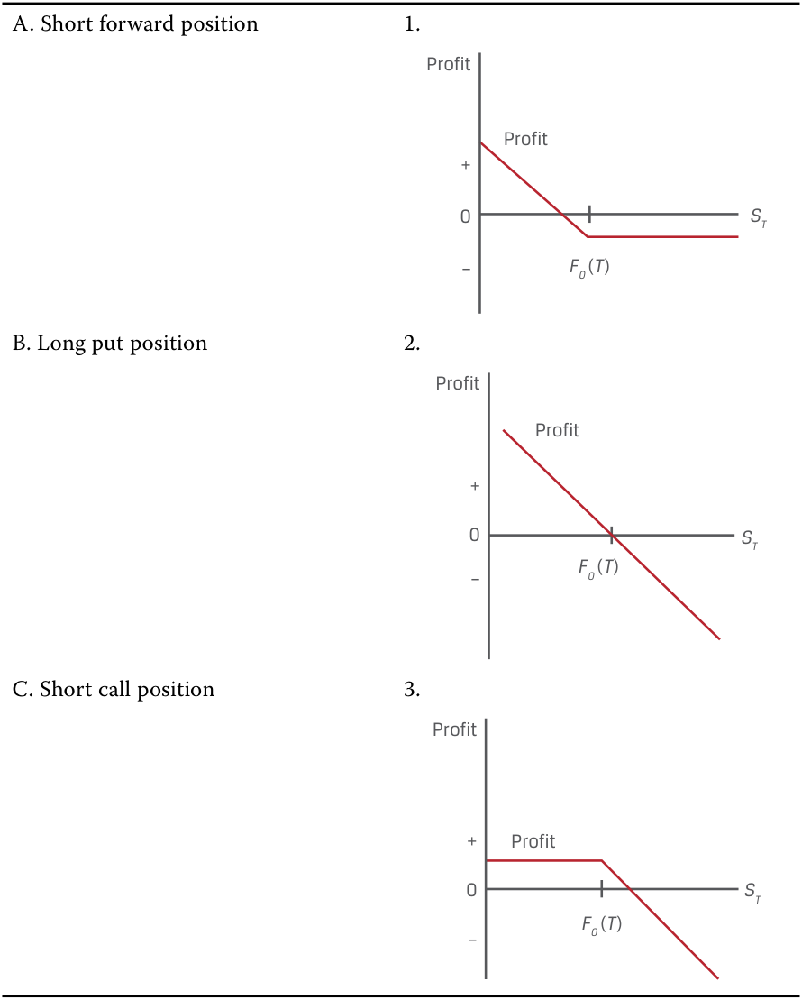

<!-- Picture Text: A. Short forward position 1. Profit Profit + 0 ST – F0 ( T ) B. Long put position 2. Profit Profit + 0 ST – F0 ( T ) C. Short call position 3. Profit + Profit 0 ST – F0 ( T )  -->

> **Chú thích hình ảnh:**
> - **A. Vị thế bán kỳ hạn (*Short forward position*)** | **Đồ thị 1:** Lợi nhuận dương khi $S_T$ thấp, giảm tuyến tính qua trục hoành trước $F_0(T)$, và nằm ngang ở mức lỗ cố định $-p_0$ khi $S_T \ge F_0(T)$.
> - **B. Vị thế mua quyền chọn bán (*Long put position*)** | **Đồ thị 2:** Đường thẳng tuyến tính dốc xuống từ miền dương qua điểm $F_0(T)$ trên trục hoành xuống miền âm.
> - **C. Vị thế bán quyền chọn mua (*Short call position*)** | **Đồ thị 3:** Lợi nhuận nằm ngang ở mức dương $+c_0$ khi $S_T \le F_0(T)$ và dốc xuống tuyến tính vào miền âm khi $S_T > F_0(T)$.

###### **Lời giải:** 

   1. Đáp án đúng là B (Vị thế mua quyền chọn bán – *Long put position*).

   2. Đáp án đúng là A (Vị thế bán kỳ hạn – *Short forward position*).

   3. Đáp án đúng là C (Vị thế bán quyền chọn mua – *Short call position*).

3. Mô tả điểm mà tại đó một vị thế bán kỳ hạn (*short forward*) và một vị thế mua quyền chọn bán (*long put*) có giá thực hiện ($X$) bằng với giá kỳ hạn, $F_0(T)$, có cùng mức lợi nhuận.

###### **Lời giải:** 

Vị thế bán kỳ hạn và vị thế mua quyền chọn bán sẽ có cùng mức lợi nhuận khi $F_0(T) - S_T = -p_0$ (tức là $S_T - F_0(T) = p_0$). Vị thế bán kỳ hạn hưởng lợi từ sự sụt giảm của giá tài sản cơ sở với giá trị nhận được/lợi nhuận là $[F_0(T) - S_T]$, và vị thế mua quyền chọn bán có lợi nhuận là $\Pi = \max[0, F_0(T) - S_T] - p_0$, theo Phương trình 4, với giá thực hiện bằng giá kỳ hạn, $X = F_0(T)$.

<!-- PDF Page 58 -->

## **BÀI TẬP THỰC HÀNH (*PRACTICE PROBLEMS*)** 

### **Thông tin sau đây liên quan đến các câu hỏi từ 1 đến 4** 

Biomian Limited là một công ty công nghệ sinh học có trụ sở tại Mumbai với cổ phiếu phổ thông cùng các hợp đồng tương lai và quyền chọn được niêm yết trên Sở Giao dịch Chứng khoán Quốc gia (*National Stock Exchange* – NSE). Văn phòng Quản lý Gia sản Viswan (*Viswan Family Office* – VFO) hiện đang sở hữu 10.000 cổ phiếu phổ thông của Biomian. VFO muốn giảm vị thế mua đối với Biomian và đa dạng hóa mức độ tiếp xúc rủi ro trên thị trường cổ phiếu của mình nhưng sẽ trì hoãn việc bán cổ phiếu thu tiền mặt trong sáu tháng vì các lý do về thuế.

**1.** Hợp đồng phái sinh nào sau đây sẵn có cho giám đốc đầu tư (*CIO*) của VFO là phù hợp nhất để giảm mức độ tiếp xúc rủi ro trước sự sụt giảm giá cổ phiếu của Biomian trong sáu tháng tới?

   - **A.** Một vị thế bán quyền chọn bán (*short put position*) trên cổ phiếu Biomian đáo hạn sau sáu tháng

   - **B.** Một vị thế mua quyền chọn mua (*long call position*) trên cổ phiếu Biomian đáo hạn sau sáu tháng

   - **C.** Một vị thế bán hợp đồng tương lai (*short futures position*) trên cổ phiếu Biomian thanh toán sau sáu tháng

**2.** Chiến lược gia thị trường của VFO tin rằng giá cổ phiếu của Biomian sẽ tăng trong sáu tháng tới nhưng muốn bảo vệ trước khả năng sụt giảm giá cổ phiếu của Biomian trong giai đoạn này. Vị thế nào sau đây là phù hợp nhất để VFO quản lý mức độ tiếp xúc rủi ro hiện có đối với Biomian dựa trên quan điểm này?

   - **A.** Một vị thế mua quyền chọn bán (*long put position*) trên cổ phiếu Biomian đáo hạn sau sáu tháng

   - **B.** Một vị thế bán quyền chọn mua (*short call position*) trên cổ phiếu Biomian đáo hạn sau sáu tháng

   - **C.** Một vị thế mua hợp đồng tương lai (*long futures position*) trên cổ phiếu Biomian thanh toán sau sáu tháng

**3.** Giả sử rằng cổ phiếu Biomian tăng giá trong sáu tháng tới. Phát biểu nào sau đây về các chiến lược phái sinh của VFO theo kịch bản này là chính xác nhất?

   - **A.** Một giao dịch bán kỳ hạn cổ phiếu Biomian sau sáu tháng sẽ mang lại lợi nhuận cao hơn so với việc mua quyền bán cổ phiếu Biomian sau sáu tháng.

   - **B.** Việc mua quyền bán cổ phiếu Biomian sau sáu tháng sẽ mang lại lợi nhuận cao hơn so với một giao dịch bán kỳ hạn cổ phiếu Biomian sau sáu tháng.

   - **C.** Chúng ta không có đủ thông tin để xác định liệu một giao dịch bán kỳ hạn hay việc mua quyền bán cổ phiếu Biomian sẽ mang lại lợi nhuận cao hơn sau sáu tháng.

**4.** Chiến lược gia thị trường của VFO đang cân nhắc một chiến lược quyền chọn mua kỳ hạn sáu tháng trên chỉ số chứng khoán chuẩn NIFTY 50 của Ấn Độ nhằm làm tăng mức độ tiếp xúc với thị trường cổ phiếu rộng lớn. Giá của chỉ số NIFTY 50 hôm nay là 15.200 INR, và chiến lược gia quan sát thấy rằng một quyền chọn mua có giá thực hiện ($X$) là 16.000 INR đang được giao dịch với mức phí quyền chọn là 1.500 INR. Đâu là giá trị nhận được (*payoff*) và lợi nhuận (*profit*) của chiến lược này ngay trước khi đáo hạn nếu chỉ số NIFTY 50 đang giao dịch ở mức 16.500 INR?

   - **A.** Giá trị nhận được là 500 INR; lợi nhuận là $-1.000\text{ INR}$.

   - **B.** Giá trị nhận được là 1.300 INR; lợi nhuận là 800 INR.

<!-- PDF Page 59 -->

   - **C.** Giá trị nhận được là 1.300 INR; lợi nhuận là 500 INR.

<!-- PDF Page 60 -->

## **LỜI GIẢI (*SOLUTIONS*)** 

1. C là đáp án đúng. VFO có thể cân nhắc một vị thế bán hợp đồng tương lai (hoặc một giao dịch bán kỳ hạn) đối với cổ phiếu Biomian sau sáu tháng để đạt được mục tiêu của mình. Cam kết chắc chắn này cho phép VFO bù đắp vị thế mua cơ sở của mình bằng một vị thế bán sau sáu tháng tại một mức giá đã thỏa thuận trước. Hợp đồng tương lai là một công cụ phái sinh giao dịch trên sở giao dịch với các điều khoản được tiêu chuẩn hóa do sở giao dịch quy định và yêu cầu phải có ký quỹ ban đầu cùng việc thanh toán hàng ngày. Các đáp án A và B là những quyền đòi hỏi có điều kiện mà cả hai đều có khả năng làm tăng, chứ không phải làm giảm, mức độ tiếp xúc rủi ro của VFO đối với cổ phiếu Biomian sau sáu tháng.

2. A là đáp án đúng. VFO nên mua một quyền chọn bán kỳ hạn sáu tháng trên cổ phiếu Biomian để quản lý mức độ tiếp xúc rủi ro của mình dựa trên quan điểm của chiến lược gia thị trường. Quyền đòi hỏi có điều kiện này cấp cho VFO quyền nhưng không phải nghĩa vụ được bán cổ phiếu Biomian tại một mức giá thực hiện thỏa thuận trước để đổi lấy một khoản phí quyền chọn. Người mua quyền chọn bán thực hiện quyền chọn khi đáo hạn khi giá tài sản cơ sở thấp hơn giá thực hiện. Điều này cho phép VFO tiếp tục hưởng lợi từ sự gia tăng trong giá cổ phiếu của Biomian trong sáu tháng tới với mức rủi ro khi giá giảm được giới hạn. Cả B lẫn C đều không cung cấp cho VFO sự bảo vệ khi giá giảm nếu cổ phiếu Biomian sụt giảm sau sáu tháng.

3. C là đáp án đúng. Theo một giao dịch bán kỳ hạn cổ phiếu Biomian, lợi nhuận là $[F_0(T) - S_T]$. Nếu cổ phiếu tăng giá mạnh trong sáu tháng tới — nghĩa là $S_T > F_0(T)$ — thì khoản lỗ của VFO trên công cụ phái sinh là phần chênh lệch giữa giá kỳ hạn của Biomian, $F_0(T)$, và giá giao ngay, $S_T$. Theo vị thế mua quyền chọn bán trên cổ phiếu Biomian, lợi nhuận của VFO là $\max(0, X - S_T) - p_0$. Nếu cổ phiếu Biomian tăng giá mạnh trong sáu tháng tới (tức là $S_T > X$), thì quyền chọn sẽ hết hạn mà không có giá trị và khoản lỗ của VFO được giới hạn ở mức phí quyền chọn bán đã trả, $p_0$. Chỉ khi biết mức độ tăng cụ thể (ví dụ, nếu $[F_0(T) - S_T] < -p_0$, tức là $S_T - F_0(T) > p_0$), chúng ta mới biết được khoản lỗ của VFO theo cam kết chắc chắn có lớn hơn so với theo quyền đòi hỏi có điều kiện hay không.

4. A là đáp án đúng. Lợi nhuận bằng $\Pi = \max(0, S_T - X) - c_0$, và giá trị nhận được khi đáo hạn bằng $\max(0, S_T - X)$. Giá thực hiện là 16.000 INR, và giá giao ngay ngay trước khi đáo hạn là 16.500 INR, do đó $\Pi = -1.000\text{ INR}$ $[= (16.500 - 16.000) - 1.500]$, và giá trị nhận được bằng $500\text{ INR}$ $[= (16.500 - 16.000)]$.
