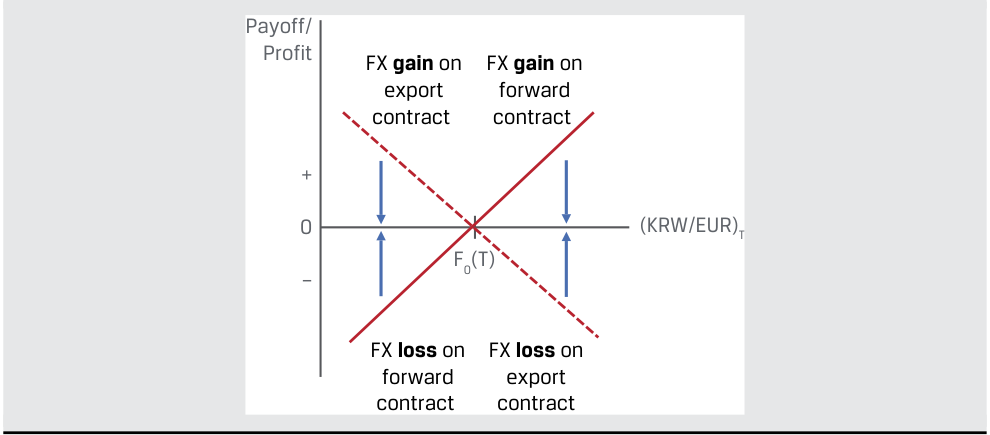
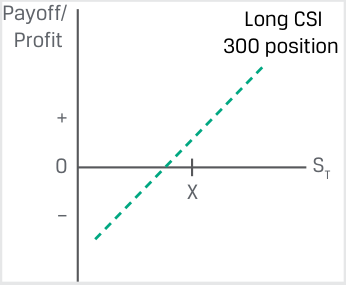
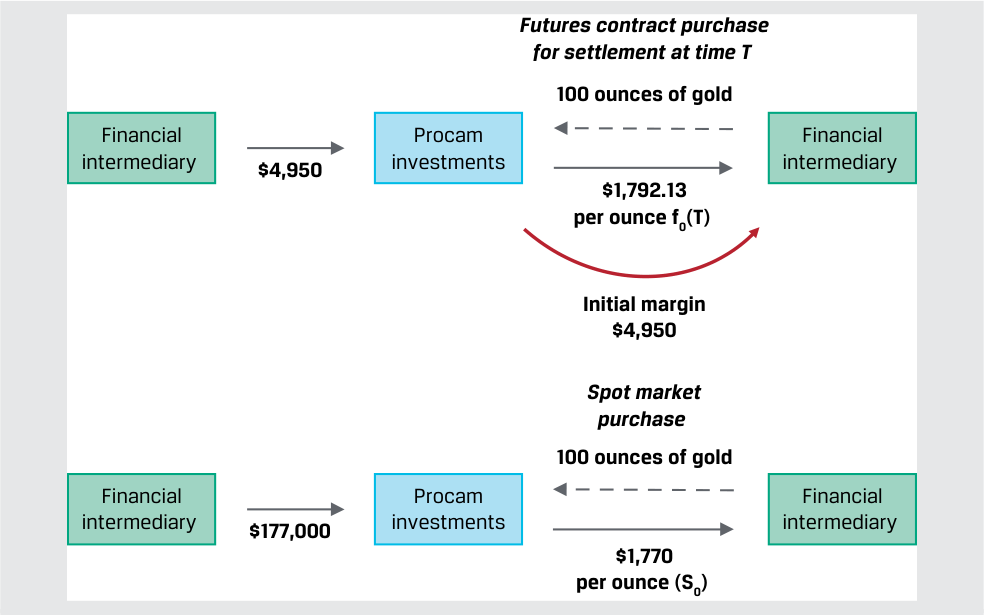
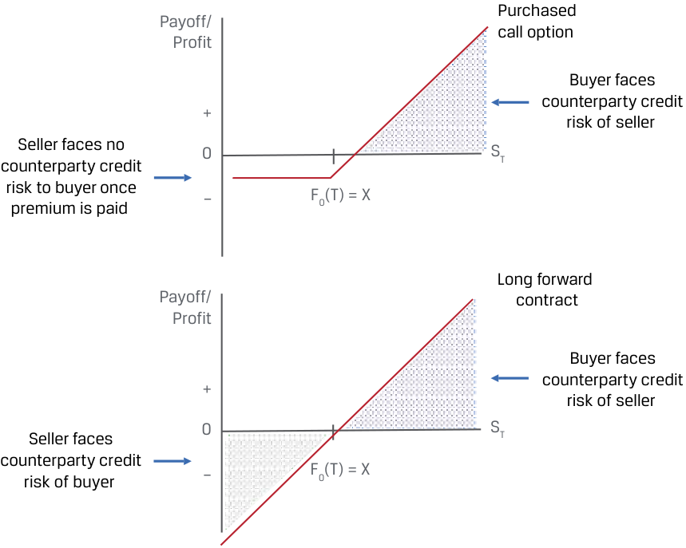

# Tập 7: Công cụ Phái sinh (*Derivatives*)
## Học phần 3: Lợi ích, Rủi ro của Công cụ Phái sinh và Mục đích Sử dụng của Tổ chức Phát hành và Nhà đầu tư (*Derivative Benefits, Risks, and Issuer and Investor Uses*)
### Phần 1/2: Giới thiệu (Trang PDF 61–74)

---

<!-- PDF Page 61 -->

# H Ọ C P H Ầ N **<mark>3</mark>** 

### **Lợi ích, Rủi ro của Công cụ Phái sinh và Mục đích Sử dụng của Tổ chức Phát hành và Nhà đầu tư (*Derivative Benefits, Risks, and Issuer and Investor Uses*)** 

##### **<mark>MỤC TIÊU HỌC TẬP (*LEARNING OUTCOMES*)</mark>** 

|**_Mức độ thành thạo_**|**_Ứng viên cần có khả năng:_**|
|---|---|
||mô tả các lợi ích và rủi ro của công cụ phái sinh (*derivative instruments*)|
||so sánh việc sử dụng công cụ phái sinh giữa các tổ chức phát hành (*issuers*) và các nhà đầu tư (*investors*)|

#### **GIỚI THIỆU (*INTRODUCTION*)** 

## **<mark>1</mark>** 

Các bài học trước đã mô tả cách thức công cụ phái sinh mở rộng tập hợp các cơ hội sẵn có cho những người tham gia thị trường để tạo lập hoặc điều chỉnh mức độ tiếp xúc rủi ro hoặc để phòng vệ giá của một tài sản cơ sở. Học phần này mô tả các lợi ích và rủi ro của việc sử dụng công cụ phái sinh và so sánh việc sử dụng chúng giữa các tổ chức phát hành và các nhà đầu tư.

###### **TỔNG QUAN HỌC PHẦN (*LEARNING MODULE OVERVIEW*)** 

- Các công cụ phái sinh cho phép những người tham gia thị trường phân bổ, quản lý, hoặc giao dịch mức độ tiếp xúc rủi ro mà không cần trao đổi một tài sản cơ sở trên thị trường giao ngay (*cash market*).

- Các công cụ phái sinh cũng mang lại hiệu quả vận hành và hiệu quả thị trường (*operational and market efficiency*) cao hơn so với thị trường giao ngay và cho phép người sử dụng tạo ra các mức độ tiếp xúc rủi ro không có sẵn trên thị trường giao ngay.

- Các công cụ phái sinh có thể liên quan đến những rủi ro như mức độ đòn bẩy ngầm định (*implicit leverage*) cao và trong một số trường hợp có tính minh bạch thấp hơn so với các công cụ giao ngay, cũng như rủi ro cơ sở (*basis risk*), rủi ro thanh khoản (*liquidity risk*), và rủi ro tín dụng đối tác (*counterparty credit risk*). Việc chấp nhận rủi ro quá mức trong quá khứ của những người tham gia thị trường thông qua việc sử dụng các công cụ phái sinh đã góp phần gây ra sự mất ổn định thị trường và rủi ro hệ thống (*systemic risk*).

- Các tổ chức phát hành thường sử dụng công cụ phái sinh để bù đắp hoặc phòng vệ các mức độ tiếp xúc rủi ro cơ sở theo thị trường có tác động đến tài sản, nợ phải trả, và lợi nhuận của họ.

<!-- PDF Page 62 -->

- Các tổ chức phát hành thường tìm kiếm phương pháp kế toán phòng vệ (*hedge accounting treatment*) cho các công cụ phái sinh nhằm giảm thiểu sự biến động của báo cáo kết quả hoạt động kinh doanh và dòng tiền.

- Các nhà đầu tư sử dụng công cụ phái sinh để điều chỉnh các dòng tiền của danh mục đầu tư, mô phỏng (*replicate*) tỷ suất sinh lợi của chiến lược đầu tư trên thị trường giao ngay, và/hoặc tạo ra các mức độ tiếp xúc rủi ro không có sẵn đối với những người tham gia trên thị trường giao ngay.

###### **TỰ ĐÁNH GIÁ HỌC PHẦN (*LEARNING MODULE SELF-ASSESSMENT*)** 

Những câu hỏi ban đầu này nhằm giúp bạn đánh giá mức độ hiểu biết hiện tại của mình về học phần này.

1. Phát biểu nào sau đây **không** mô tả một lợi thế vận hành có khả năng xảy ra của một giao dịch trên thị trường hợp đồng tương lai so với một giao dịch trên thị trường giao ngay?

   - **A.** Việc thiết lập một vị thế bán (*short position*) trên thị trường hợp đồng tương lai dễ dàng hơn so với trên thị trường giao ngay.

   - **B.** Thị trường hợp đồng tương lai có tính thanh khoản cao hơn so với thị trường giao ngay.

   - **C.** Yêu cầu về tiền mặt để mua trên thị trường giao ngay thấp hơn so với yêu cầu ký quỹ để mua trên thị trường hợp đồng tương lai.

###### **Lời giải:** 

C là đáp án đúng. Điều ngược lại mới đúng: Yêu cầu ký quỹ (*margin requirements*) của một hợp đồng tương lai thường chỉ chiếm một tỷ lệ phần trăm nhỏ so với yêu cầu về tiền mặt để mua cùng một lượng tài sản cơ sở trên thị trường giao ngay. Cả A và B đều không phải đáp án cần chọn vì cả hai phát biểu này đều mô tả đúng các lợi thế vận hành của thị trường hợp đồng tương lai so với thị trường giao ngay.

2. Xác định rủi ro phái sinh nào phù hợp với từng phát biểu sau đây:

|**Loại rủi ro**|**Đặc điểm mô tả**|
|---|---|
|A. Rủi ro cơ sở (*Basis risk*)|1. Khả năng xảy ra sự phân kỳ giữa thời điểm dòng tiền (*cash flow timing*) của một công cụ phái sinh so với một tài sản cơ sở hoặc giao dịch được phòng vệ|
|B. Rủi ro thanh khoản (*Liquidity risk*)|2. Khả năng xảy ra sự phân kỳ giữa giá trị kỳ vọng (*expected value*) của một công cụ phái sinh so với một tài sản cơ sở hoặc giao dịch được phòng vệ|
|C. Rủi ro tín dụng đối tác (*Counterparty credit risk*)|3. Khả năng một bên tham gia hợp đồng phái sinh không thực hiện được các nghĩa vụ của mình theo thỏa thuận|

###### **Lời giải:** 

**1.** B là đáp án đúng. Rủi ro thanh khoản (*liquidity risk*) là khả năng xảy ra sự phân kỳ giữa thời điểm dòng tiền của một công cụ phái sinh so với một tài sản cơ sở hoặc giao dịch được phòng vệ.

**2.** A là đáp án đúng. Rủi ro cơ sở (*basis risk*) là khả năng xảy ra sự phân kỳ giữa giá trị kỳ vọng của một công cụ phái sinh so với một tài sản cơ sở hoặc giao dịch được phòng vệ.

**3.** C là đáp án đúng. Rủi ro tín dụng đối tác (*counterparty credit risk*) là khả năng một bên tham gia hợp đồng phái sinh không thực hiện được các nghĩa vụ của mình theo một thỏa thuận.

<!-- PDF Page 63 -->

3. Xác định lợi ích nào của việc sử dụng công cụ phái sinh phù hợp với từng ví dụ sau đây:

|**Lợi ích của công cụ phái sinh**|**Ví dụ minh họa**|
|---|---|
|A. Chức năng khám phá giá (*Price discovery function*)|1. Những người tham gia thị trường cổ phiếu theo dõi hợp đồng tương lai chỉ số trước khi thị trường mở cửa để tìm dấu hiệu chỉ báo về xu hướng giá trên thị trường giao ngay trong đầu phiên giao dịch.|
|B. Các lợi thế vận hành (*Operational advantages*)|2. Một tổ chức phát hành có thể muốn khóa chặt chi phí nợ trong tương lai của mình trước thời điểm đáo hạn của một đợt phát hành nợ đang lưu hành.|
|C. Khả năng phân bổ, chuyển giao, và quản lý rủi ro (*Ability to allocate, transfer, and manage risk*)|3. Các hợp đồng tương lai đối với hàng hóa vật chất loại bỏ nhu cầu phải trực tiếp vận chuyển, mua bảo hiểm, và lưu kho một tài sản vật chất để có thể nắm giữ vị thế đối với giá tài sản cơ sở đó.|

###### **Lời giải:** 

   **1.** A là đáp án đúng. Việc những người tham gia thị trường cổ phiếu theo dõi hợp đồng tương lai chỉ số trước khi thị trường mở cửa để tìm dấu hiệu chỉ báo về xu hướng giá trên thị trường giao ngay trong đầu phiên giao dịch là một ví dụ về chức năng khám phá giá (*price discovery function*) của công cụ phái sinh.

   **2.** C là đáp án đúng. Việc một tổ chức phát hành khóa chặt chi phí nợ trong tương lai của mình trước thời điểm đáo hạn của một đợt phát hành nợ đang lưu hành là một ví dụ về khả năng phân bổ, chuyển giao, và quản lý rủi ro.

   **3.** B là đáp án đúng. Việc các hợp đồng tương lai đối với hàng hóa vật chất loại bỏ nhu cầu phải trực tiếp vận chuyển, mua bảo hiểm, và lưu kho một tài sản vật chất để có thể nắm giữ vị thế đối với giá tài sản cơ sở đó là một ví dụ về các lợi thế vận hành (*operational advantages*) của một công cụ phái sinh.

4. Cách phân loại kế toán phòng vệ (*hedge accounting designation*) nào sau đây là phù hợp để phân loại việc một tổ chức phát hành doanh nghiệp sử dụng hợp đồng hoán đổi lãi suất nhằm chuyển đổi một khoản nợ lãi suất thả nổi thành một khoản nợ lãi suất cố định?

   - **A.** Phòng vệ giá trị hợp lý (*Fair value hedge*)

   - **B.** Phòng vệ dòng tiền (*Cash flow hedge*)

   - **C.** Phòng vệ khoản đầu tư ròng (*Net investment hedge*)

###### **Lời giải:** 

B là đáp án đúng. Phương pháp kế toán phòng vệ dòng tiền (*cash flow hedge*) là phù hợp cho các trường hợp trong đó một dòng tiền biến đổi được chuyển đổi thành một dòng tiền cố định thông qua việc sử dụng một công cụ phái sinh. A không đúng vì phòng vệ giá trị hợp lý (*fair value hedge*) là phương pháp kế toán phù hợp cho các hợp đồng phái sinh giúp bù đắp những biến động trong giá trị hợp lý của tài sản hoặc nợ phải trả cơ sở. C không đúng vì phòng vệ khoản đầu tư ròng (*net investment hedge*) bù đắp rủi ro ngoại tệ đối với giá trị của một công ty con ở nước ngoài.

#### **CÁC LỢI ÍCH CỦA CÔNG CỤ PHÁI SINH (*DERIVATIVE BENEFITS*)** 

## **<mark>2</mark>**

mô tả các lợi ích và rủi ro của công cụ phái sinh

<!-- PDF Page 64 -->

Các bài học trước đã minh họa cách thức những người tham gia thị trường sử dụng các công cụ phái sinh như một giải pháp thay thế cho thị trường giao ngay nhằm phòng vệ hoặc bù đắp rủi ro thương mại cũng như tạo lập hoặc điều chỉnh mức độ tiếp xúc đối với giá của một tài sản cơ sở. Bây giờ chúng ta sẽ xem xét chi tiết hơn những lợi ích này cùng các lợi ích khác của việc sử dụng công cụ phái sinh, đồng thời cân nhắc một số rủi ro đặc thù của các công cụ phái sinh.

Các công cụ phái sinh mang lại cho người sử dụng cơ hội để phân bổ, chuyển giao, và/hoặc quản lý rủi ro mà không cần giao dịch một tài sản cơ sở. Giá trên thị trường tiền mặt hoặc giao ngay đối với các công cụ tài chính cũng như hàng hóa và dịch vụ thương mại là một nguồn thông tin quan trọng cho quyết định mua hoặc bán. Tuy nhiên, trong nhiều trường hợp, các tổ chức phát hành và các nhà đầu tư phải đối mặt với sự chênh lệch về thời gian (*timing difference*) giữa một quyết định kinh tế và khả năng thực hiện giao dịch trên thị trường giao ngay.

Ví dụ, các tổ chức phát hành phải đối mặt với những chênh lệch về thời gian sau đây khi đưa ra các quyết định vận hành và tài trợ:

- Một nhà sản xuất có thể cần đặt mua nguyên vật liệu hàng hóa đầu vào cho quy trình sản xuất của mình trước khi nhận được các đơn đặt hàng thành phẩm.

- Một nhà bán lẻ có thể phải chờ một lô hàng được định giá bằng ngoại tệ trước khi bán nội tệ để thực hiện thanh toán.

- Một tổ chức phát hành có thể muốn khóa chặt chi phí nợ trong tương lai của mình trước thời điểm đáo hạn của một đợt phát hành nợ đang lưu hành.

Các nhà đầu tư có thể đối mặt với những vấn đề về thời gian tương tự khi đưa ra các quyết định danh mục đầu tư tách biệt khỏi các giao dịch trên thị trường giao ngay, như trong các trường hợp sau:

- Một nhà đầu tư có thể tìm cách tận dụng một quan điểm thị trường (*market view*) nhưng lại thiếu lượng tiền mặt sẵn có cần thiết để giao dịch trên thị trường giao ngay.

- Với dự kiến sẽ nhận được một khoản cổ tức cổ phiếu, lãi coupon trái phiếu, hoặc khoản hoàn trả vốn gốc trong tương lai, nhà đầu tư có thể quyết định ngay hôm nay về cách thức tái đầu tư số tiền thu được đó trong tương lai.

Khả năng mua hoặc bán một công cụ phái sinh ngay hôm nay tại một mức giá đã thỏa thuận trước vào một ngày trong tương lai có thể thu hẹp khoảng cách thời gian giữa một quyết định kinh tế và khả năng giao dịch rủi ro giá tài sản cơ sở trong các kịch bản này. Việc sử dụng các cam kết kỳ hạn hoặc các quyền đòi hỏi có điều kiện để phân bổ hoặc chuyển giao rủi ro qua thời gian và giữa những người tham gia thị trường có khả năng và sẵn sàng chấp nhận các mức độ tiếp xúc rủi ro đó là một chủ đề xuyên suốt trên các thị trường phái sinh. Ví dụ 1 phát triển tiếp một minh họa trước đây về cách thức một tổ chức phát hành có thể hưởng lợi từ việc sử dụng một công cụ phái sinh gắn liền với một hợp đồng thương mại.

###### **VÍ DỤ 1 (*EXAMPLE 1*)** 

##### **Chuyển giao Rủi ro Ngoại hối của một Hợp đồng Xuất khẩu (*Foreign Exchange Risk Transfer of an Export Contract*)** 

Hãy nhớ lại Montau AG, nhà sản xuất tư liệu sản xuất của Đức đã được giới thiệu trước đó, công ty đã ký một hợp đồng thương mại với Jeon, Inc., một nhà sản xuất Hàn Quốc, để giao một máy cắt laser với mức giá 650.000.000 KRW sau 75 ngày. Montau có các chi phí cố định tính bằng đồng nội tệ (EUR) và do đó phải đối mặt với sự lệch pha về thời gian (*timing mismatch*) giữa các chi phí phát sinh bằng EUR và doanh thu bằng EUR thực hiện được khi giao máy và bán số KRW nhận được để đổi lấy EUR trên thị trường ngoại hối (FX) giao ngay.

Hãy mô tả mức độ tiếp xúc rủi ro tiền tệ của Montau và cách thức một hợp đồng kỳ hạn ngoại hối (*FX forward contract*) có thể được sử dụng để giảm thiểu rủi ro tỷ giá FX của công ty.

Montau sẽ nhận được KRW sau 75 ngày, và công ty phải bán số KRW này đi để trang trải các chi phí bằng EUR của mình. Điều này khiến công ty tiếp xúc với những biến động của tỷ giá hối đoái KRW/EUR trong suốt 75 ngày. Cụ thể, nếu đồng KRW mất giá so với đồng EUR (tức là tỷ giá KRW/EUR tăng lên — cần nhiều KRW hơn để đổi lấy 1 EUR), Montau sẽ

<!-- PDF Page 65 -->

mua được ít EUR hơn so với dự kiến bằng số tiền thu về bằng KRW, dẫn đến một khoản lỗ do sự lệch pha thời gian ngoại hối. Cấu trúc tiếp xúc rủi ro của Montau do sự lệch pha này như sau:

<!-- Picture Text: Payoff/ Profit Export contract exposure + 0 (KRW/EUR)T –  -->

> **Chú thích hình ảnh:**
> - **Mức độ tiếp xúc rủi ro của hợp đồng xuất khẩu (*Export contract exposure*):** Khi tỷ giá $(\text{KRW/EUR})_T$ tăng lên (đồng KRW yếu đi so với EUR), giá trị nhận được / lợi nhuận tính bằng EUR của Montau giảm tuyến tính từ miền dương ($+$) xuống miền âm ($-$).

Để giảm thiểu mức độ tiếp xúc rủi ro từ hợp đồng xuất khẩu của mình, Montau tham gia vào một hợp đồng kỳ hạn ngoại hối (*FX forward*) để bán KRW và mua EUR tại một mức giá cố định $[F_0(T)]$ sau 75 ngày nhằm loại bỏ sự lệch pha tỷ giá hối đoái KRW/EUR phát sinh từ hợp đồng xuất khẩu. Cấu trúc giá trị nhận được và lợi nhuận của hợp đồng kỳ hạn FX như sau:

<!-- Picture Text: Payoff/ Profit FX forward profit + 0 (KRW/EUR)T – F0(T)  -->

> **Chú thích hình ảnh:**
> - **Lợi nhuận hợp đồng kỳ hạn FX (*FX forward profit*):** Đường thẳng dốc lên từ miền âm qua điểm $F_0(T)$ trên trục hoành $(\text{KRW/EUR})_T$ lên miền dương (khi đồng KRW mất giá so với EUR, tức $(\text{KRW/EUR})_T > F_0(T)$, hợp đồng bán kỳ hạn KRW có lãi).

Cấu trúc giá trị nhận được và lợi nhuận của hợp đồng kỳ hạn FX bù đắp cho mức độ tiếp xúc rủi ro từ hợp đồng xuất khẩu của Montau như một công cụ phòng vệ (*hedge*), như được thể hiện trong sơ đồ kết hợp sau đây:

<!-- Picture Text: Payoff/ Profit FX  gain  on FX  gain  on export forward contract  contract + 0 (KRW/EUR)T – F0(T) FX  loss  on FX  loss  on forward export contract  contract  -->

> **Chú thích hình ảnh:**
> - Khi $(\text{KRW/EUR})_T < F_0(T)$: **Khoản lãi FX trên hợp đồng xuất khẩu (*FX gain on export contract*)** được bù trừ bởi **Khoản lỗ FX trên hợp đồng kỳ hạn (*FX loss on forward contract*)**.
> - Khi $(\text{KRW/EUR})_T > F_0(T)$: **Khoản lãi FX trên hợp đồng kỳ hạn (*FX gain on forward contract*)** bù đắp cho **Khoản lỗ FX trên hợp đồng xuất khẩu (*FX loss on export contract*)**.

Khả năng giao dịch và/hoặc quản lý rủi ro bằng cách sử dụng các công cụ phái sinh còn mở rộng sang việc tạo ra các cấu trúc tiếp xúc rủi ro (*exposure profiles*) vốn không có sẵn trên các thị trường giao ngay. Ví dụ sau đây kết hợp một vị thế mua giao ngay (*long cash position*) với một công cụ phái sinh đã bán (*sold derivative*) nhằm làm tăng tỷ suất sinh lợi kỳ vọng của nhà đầu tư dựa trên một quan điểm thị trường cụ thể.

###### **VÍ DỤ 2 (*EXAMPLE 2*)** 

##### **Chiến lược Quyền chọn Mua có Bảo đảm (*Covered Call Option Strategy*)** 

South China Sprintwyck Investments (SCSI) có một danh mục đầu tư cổ phiếu Trung Quốc đạt hiệu quả vượt trội trong nửa đầu năm nhờ vị thế tỷ trọng cao (*overweight position*) đối với các cổ phiếu ngành chăm sóc sức khỏe. SCSI nắm giữ một vị thế mua trong Chỉ số Chăm sóc Sức khỏe CSI 300 của Chứng khoán Trung Quốc Thâm Quyến (*Shenzhen China Securities Index 300 Health Care Index* – CSI 300) được giao dịch trên Sở Giao dịch Hợp đồng Tương lai Tài chính Trung Quốc (*China Financial Futures Exchange* – CFFEX). Giám đốc đầu tư (CIO) của SCSI kỳ vọng độ biến động của chỉ số CSI

<!-- PDF Page 66 -->

300 sẽ giảm xuống và mức giá CSI 300 vào cuối năm sẽ ở mức bằng hoặc cao hơn đôi chút so với mức giá giao ngay hiện hành. Thay vì bán vị thế CSI 300 ngay hôm nay trên thị trường giao ngay, bà quyết định bán một quyền chọn mua CSI 300 tại mức giá thực hiện cao hơn 5% so với giá thị trường giao ngay hiện hành cho sáu tháng còn lại của năm.

Hãy mô tả _sự khác biệt_ trong cấu trúc giá trị nhận được đối với CSI 300 của SCSI giữa 1.) vị thế mua giao ngay (*long cash position*) và 2.) quyền chọn mua đã bán cộng với vị thế mua giao ngay (được gọi là chiến lược **quyền chọn mua có bảo đảm – *covered call***) vào cuối năm.

**1.** Vị thế mua giao ngay của SCSI sẽ tăng hoặc giảm giá trị khi giá giao ngay của CSI 300 thay đổi cho đến cuối năm.

<!-- Picture Text: Payoff/ Long CSI Profit  300 position + 0 ST X –  -->

> **Chú thích hình ảnh:**
> - **Vị thế mua chỉ số CSI 300 (*Long CSI 300 position*):** Đường thẳng tuyến tính dốc lên theo giá giao ngay $S_T$.

_Sự khác biệt_ giữa 1.) và 2.) là việc bán một quyền chọn mua CSI 300. SCSI bán quyền chọn mua và nhận được một khoản phí quyền chọn trả trước. SCSI gánh chịu rủi ro thua lỗ không giới hạn trên quyền chọn khi mức giá CSI 300 tăng vượt quá giá thực hiện:

<!-- Picture Text: Payoff/ Profit Sold CSI 300 Profit call option c0 Payoff 0 ST X X + c0  -->

> **Chú thích hình ảnh:**
> - **Quyền chọn mua CSI 300 đã bán (*Sold CSI 300 call option*):** Đường giá trị nhận được (*Payoff*) bằng $0$ khi $S_T \le X$ và dốc xuống âm khi $S_T > X$; đường lợi nhuận (*Profit*) ở mức $+c_0$ khi $S_T \le X$, cắt trục hoành tại $X + c_0$ và giảm tuyến tính khi $S_T > X$.

**2.** Sự kết hợp giữa vị thế mua giao ngay CSI 300 và vị thế bán quyền chọn mua CSI 300 mang lại cấu trúc lợi nhuận được biểu diễn bằng đường nét liền dưới đây:

<!-- Picture Text: Payoff/ Profit Long CSI 300 position + + Sold CSI 300 call option (covered call) 0 ST X –  -->

> **Chú thích hình ảnh:**
> - **Vị thế mua CSI 300 + Quyền chọn mua CSI 300 đã bán (chiến lược *covered call*):** Đường nét liền tăng tuyến tính theo $S_T$ (cao hơn vị thế mua giao ngay một đoạn bằng phí quyền chọn $c_0$) cho đến điểm $X$, sau đó nằm ngang (bị giới hạn mức lãi tối đa) khi $S_T > X$.

Giá trị nhận được của chiến lược quyền chọn mua có bảo đảm (*covered call*) có thể được mô tả như sau:

- **Chỉ số CSI 300 tăng giá dưới 5% ($S_T \le X$):** Quyền chọn mua hết hạn mà không được thực hiện. Lợi nhuận của SCSI bằng lợi nhuận của vị thế mua CSI 300 cộng với khoản phí quyền chọn mua nhận được.

- **Chỉ số CSI 300 tăng giá trên 5% ($S_T > X$):** Quyền chọn mua được thực hiện. SCSI phải trả cho người mua quyền chọn một khoản tiền bằng đúng phần lãi trên vị thế mua CSI 300 của mình tính từ mức giá thực hiện trở lên. Giá trị thanh toán của quyền chọn được gọi là đã được “bảo đảm” (*covered*) bởi vị thế mua giao ngay. SCSI vẫn giữ lại khoản phí quyền chọn mua.

<!-- PDF Page 67 -->

Giá của các công cụ phái sinh phục vụ chức năng khám phá giá (*price discovery function*) vượt ra ngoài thị trường tiền mặt hoặc giao ngay của tài sản cơ sở. Ví dụ, giá hợp đồng tương lai thường được coi là tiết lộ thông tin về xu hướng của các thị trường giao ngay trong tương lai, mặc dù về mặt chặt chẽ chúng không thể được coi là một dự báo không chệch (*unbiased forecast*) về giá giao ngay trong tương lai.

Những người tham gia thị trường thường sử dụng giá hợp đồng tương lai để đánh giá xu hướng của thị trường giao ngay trong tương lai theo những cách sau:

- Những người tham gia thị trường cổ phiếu thường xuyên theo dõi giá hợp đồng tương lai chỉ số cổ phiếu trước khi thị trường chứng khoán mở cửa để tìm dấu hiệu chỉ báo về xu hướng giá trên thị trường giao ngay trong đầu phiên giao dịch.

- Các chuyên viên phân tích thường sử dụng thị trường hợp đồng tương lai lãi suất để trích xuất kỳ vọng của nhà đầu tư về việc ngân hàng trung ương sẽ tăng hay giảm lãi suất chuẩn tại một cuộc họp trong tương lai.

- Giá hợp đồng tương lai hàng hóa là một thước đo về động thái cung và cầu giữa các nhà sản xuất, người tiêu dùng, và các nhà đầu tư qua các kỳ hạn khác nhau.

Ví dụ 3 cung cấp một tình huống thực tế về tác động của cung và cầu lên giá hợp đồng tương lai.

###### **VÍ DỤ 3 (*EXAMPLE 3*)** 

##### **Giá Hợp đồng Tương lai Dầu mỏ Âm vào Năm 2020 (*Negative Oil Futures Prices in 2020*)** 

Vào tháng 4 năm 2020, giá hợp đồng tương lai dầu thô ngọt nhẹ West Texas Intermediate (WTI) đã giảm xuống dưới mức không ($0$) lần đầu tiên trong lịch sử. Hợp đồng tương lai dầu thô WTI trên Sở Giao dịch Hàng hóa New York (*New York Mercantile Exchange* – NYMEX) có tài sản cơ sở là 1.000 thùng dầu thô được giao vật chất tới Cushing, Oklahoma, nơi các công ty năng lượng lưu trữ gần 80 triệu thùng dầu. Các lệnh phong tỏa trên diện rộng sau đại dịch COVID-19 đã khiến nhu cầu sụt giảm nghiêm trọng, trong khi các nhà sản xuất không thể cắt giảm sản lượng dầu đủ nhanh trước sự sụt giảm đột ngột đó. Hệ quả là lượng dầu tồn kho tại Cushing tăng vọt.

###### **Giá Hợp đồng Tương lai Dầu mỏ NYMEX (USD mỗi thùng trong hợp đồng), Tháng 1 – Tháng 6 năm 2020 (*NYMEX Oil Futures Price (USD per contract), January–June 2020*)** 

<!-- Picture Text: NYMEX Oil futures price (US$ per contract), January—June 2020 80 60 40 20 0 –20 –40 1/1/2020 2/1/2020 3/1/2020 4/1/2020 5/1/2020 6/1/2020  -->

> **Chú thích hình ảnh:**
> - Biểu đồ giá hợp đồng tương lai dầu NYMEX từ ngày 1/1/2020 đến 1/6/2020, dao động quanh mức $\$50–\$60$ vào tháng 1/2020 trước khi lao dốc xuống mức âm gần $-\$40$ vào ngày 20/4/2020 và phục hồi về mức dương trong tháng 5–6/2020.

_Nguồn:_ Bloomberg.

Khi hợp đồng tương lai tháng 5 tiến gần đến ngày đáo hạn vào cuối tháng 4 năm 2020, các nhà đầu tư nắm giữ rủi ro tài chính của giá dầu đã bị bất ngờ khi các nhà máy lọc dầu né tránh việc nhận giao dầu vật chất khi thanh toán hợp đồng do chi phí lưu kho tăng vọt. Điều này đã đẩy giá hợp đồng tương lai tháng 5 lao dốc mạnh xuống mức giá đóng cửa là $-37,63\text{ USD}$ vào ngày 20 tháng 4 năm 2020. Các nhà sản xuất dầu mỏ và các nhà máy lọc dầu đã sử dụng thông tin định giá hợp đồng tương lai này để điều chỉnh nguồn cung nhanh chóng hơn và giảm bớt áp lực lên các cơ sở lưu trữ.

<!-- PDF Page 68 -->

Chức năng khám phá giá của các công cụ phái sinh còn mở rộng sang các quyền đòi hỏi có điều kiện (*contingent claims*). Như chúng ta sẽ thấy trong một bài học sau, giá quyền chọn phản ánh một số đặc điểm của tài sản cơ sở, bao gồm rủi ro giá kỳ vọng của tài sản cơ sở, được gọi là **độ biến động hàm ý (*implied volatility*)**. Độ biến động hàm ý của một quyền chọn có thể được suy ra từ mức giá hiện tại và các đặc điểm khác của quyền chọn đó, đồng thời cung cấp một thước đo về mức độ bất định chung trong giá của tài sản cơ sở.

Các giao dịch phái sinh mang lại một số lợi thế vận hành (*operational advantages*) so với các thị trường tiền mặt hoặc giao ngay trong nhiều trường hợp.

**1. Chi phí giao dịch (*Transaction Costs*):** Các công cụ phái sinh hàng hóa loại bỏ nhu cầu phải vận chuyển, mua bảo hiểm, và lưu kho một tài sản vật chất để có thể nắm giữ một vị thế đối với giá tài sản cơ sở đó.

**2. Tính thanh khoản cao hơn (*Increased Liquidity*):** Các thị trường phái sinh thường có tính thanh khoản cao hơn nhờ lượng vốn yêu cầu ít hơn để giao dịch các công cụ phái sinh so với một vị thế tiền mặt tương đương đối với tài sản cơ sở.

**3. Yêu cầu về tiền mặt trả trước (*Upfront Cash Requirements*):** Các yêu cầu ký quỹ ban đầu đối với hợp đồng tương lai và các khoản phí quyền chọn đều thấp hơn nhiều so với chi phí mua trên thị trường giao ngay.

**4. Các vị thế bán (*Short Positions*):** Trong trường hợp không có một thị trường phái sinh thanh khoản, việc thiết lập một vị thế bán khống đòi hỏi quy trình tốn kém nhằm tìm kiếm một chủ sở hữu tài sản giao ngay sẵn sàng cho vay tài sản cơ sở trong một khoảng thời gian đủ dài để thực hiện giao dịch bán khống.

Ví dụ 4 đối chiếu khoản chi tiền mặt của một giao dịch giao ngay với một hợp đồng tương lai dựa trên các chi tiết giao dịch quen thuộc từ một bài học trước.

###### **VÍ DỤ 4 (*EXAMPLE 4*)** 

##### **Giao dịch Mua Vàng Giao ngay so với Hợp đồng Tương lai Vàng (*Purchase of Spot Gold versus a Gold Futures Contract*)** 

Trong một ví dụ trước đây, Procam Investments tham gia vào một hợp đồng tương lai để mua 100 ounce vàng tại mức giá tương lai $[f_0(T)]$ là $1.792,13\text{ USD}$ mỗi ounce đáo hạn sau ba tháng và phải nộp $4.950\text{ USD}$ tiền ký quỹ ban đầu theo yêu cầu của sở giao dịch. Giá vàng giao ngay ($S_0$) tại thời điểm Procam tham gia hợp đồng tương lai là $1.770\text{ USD}$ mỗi ounce. Giả sử rằng Procam có thể vay tiền từ một định chế tài chính trung gian với mức lãi suất 5% mỗi năm. Hãy đối chiếu chi phí cơ hội kỳ vọng của khoản ký quỹ ban đầu cho hợp đồng tương lai kỳ hạn ba tháng với một giao dịch mua bằng tiền mặt đối với 100 ounce vàng trong cùng khoảng thời gian ba tháng đó.

<!-- PDF Page 69 -->

<!-- Picture Text: Futures contract purchase for settlement at time T 100 ounces of gold Financial Procam Financial intermediary  $4,950 investments intermediary $1,792.13 per ounce f0(T) Initial margin $4,950 Spot market purchase 100 ounces of gold Financial Procam Financial intermediary  $177,000 investments intermediary $1,770 per ounce (S0)  -->

> **Chú thích hình ảnh:**
> - **Mua hợp đồng tương lai để thanh toán tại thời điểm $T$ (*Futures contract purchase for settlement at time T*):** **Procam Investments** vay $\$4.950$ từ **Định chế tài chính trung gian** (bên trái) để nộp **Ký quỹ ban đầu (*Initial margin*)** $\$4.950$ cho hợp đồng 100 ounce vàng tại giá tương lai $f_0(T) = \$1.792,13/\text{ounce}$ với **Định chế tài chính trung gian** (bên phải).
> - **Mua trên thị trường giao ngay (*Spot market purchase*):** **Procam Investments** phải vay $\$177.000$ từ **Định chế tài chính trung gian** (bên trái) để mua giao ngay 100 ounce vàng tại giá $S_0 = \$1.770/\text{ounce}$ từ **Định chế tài chính trung gian** (bên phải).

**1.** Procam vay số tiền ký quỹ ban đầu $4.950\text{ USD}$ từ một định chế tài chính trung gian với lãi suất 5%/năm trong ba tháng.

Chi phí cơ hội (chi phí lãi vay) của khoản ký quỹ ban đầu:

$$= \frac{4.950\text{ USD} \times 0,05}{4} = 61,88\text{ USD}$$

**2.** Procam vay $177.000\text{ USD}$ ($1.770\text{ USD} \times 100\text{ ounce}$) để mua vàng giao ngay từ một định chế tài chính trung gian với lãi suất 5%/năm trong ba tháng.

Chi phí cơ hội (chi phí lãi vay) của khoản tiền mua vàng giao ngay:

$$= \frac{177.000\text{ USD} \times 0,05}{4} = 2.212,50\text{ USD}$$

Procam đạt được mức độ tiếp xúc với giá cơ sở của 100 ounce vàng trên thị trường hợp đồng tương lai chỉ với một phần rất nhỏ chi phí so với thị trường giao ngay. Phép so sánh này bỏ qua ba điểm về hợp đồng tương lai và giao dịch vàng giao ngay:

**1.** Yêu cầu ký quỹ của Procam thay đổi khi giá hợp đồng tương lai biến động giữa thời điểm $t = 0$ và $t = T$. Cụ thể, Procam sẽ phải đối mặt với các lệnh gọi ký quỹ (*margin calls*) nếu mức giá hợp đồng tương lai thấp hơn làm cho số dư tài khoản ký quỹ của công ty giảm xuống dưới mức ký quỹ duy trì. Tuy nhiên, vì giá tài sản cơ sở thường bị chặn dưới bởi mức không ($0$), nên rất khó có khả năng chi phí đi vay để nộp ký quỹ của Procam sẽ vượt quá chi phí đi vay để mua giao ngay bằng tiền mặt.

**2.** Giao dịch mua vàng giao ngay của Procam liên quan đến vàng vật chất. Do đó, công ty phải trang trải thêm chi phí giao nhận, lưu kho, và bảo hiểm trong ba tháng.

**3.** Giao dịch mua vàng giao ngay diễn ra tại mức giá $S_0 = 1.770\text{ USD}$ mỗi ounce, trong khi mức giá hợp đồng tương lai thỏa thuận trước $[f_0(T)] = 1.792,13\text{ USD}$ mỗi ounce. Tại thời điểm $T$ sau ba tháng, cả hợp đồng tương lai và giao dịch mua giao ngay đều mang lại một vị thế mua cho Procam được định giá theo mức giá $S_T$. Do đó, chi phí và tỷ suất sinh lợi kỳ vọng cho hai giao dịch này phải bằng nhau, nhưng các mức giá được thỏa thuận tại $t = 0$ lại không bằng nhau. Trong một bài học sau, chúng ta sẽ khám phá mối quan hệ giữa giá vàng giao ngay ($S_0$) và giá hợp đồng tương lai vàng $[f_0(T)]$ cùng tác động của cả chi phí đi vay lẫn chi phí lưu kho.

Hiệu quả vận hành (*operational efficiency*) của các thị trường phái sinh cũng dẫn đến hiệu quả thị trường (*market efficiency*) cao hơn. Khi giá cả chệch khỏi các giá trị cơ bản (*fundamental values*), thị trường phái sinh cung cấp những cách thức ít tốn kém hơn để khai thác sự định giá sai (*mispricing*) đó. Như đã lưu ý trước đó, lượng vốn yêu cầu ít hơn,

<!-- PDF Page 70 -->

chi phí giao dịch thấp hơn, và việc bán khống dễ dàng hơn. Nhờ những đặc điểm thị trường này, giá trị cơ bản thường được phản ánh trên các thị trường phái sinh trước khi nó được khôi phục lại trên thị trường giao ngay của tài sản cơ sở. Do đó, sự tồn tại của các thị trường phái sinh thường giúp các thị trường tài chính nói chung vận hành hiệu quả hơn. Bảng minh họa 1 tóm tắt các lợi ích của thị trường phái sinh đối với những người tham gia thị trường.

**Bảng minh họa 1: Các Lợi ích của Công cụ Phái sinh (*Exhibit 1: Benefits of Derivative Instruments*)** 

|**Mục đích (*Purpose*)**|**Mô tả (*Description*)**|
|---|---|
|Phân bổ, Chuyển giao, và Quản lý Rủi ro (*Risk Allocation, Transfer, and Management*)|Phân bổ, giao dịch, và/hoặc quản lý mức độ tiếp xúc rủi ro cơ sở mà không cần giao dịch tài sản cơ sở Tạo ra các mức độ tiếp xúc rủi ro không có sẵn trên các thị trường giao ngay|
|Khám phá Thông tin (*Information Discovery*)|Cung cấp thông tin liên quan đến mức giá kỳ vọng trong tương lai và thông tin liên quan đến rủi ro kỳ vọng của tài sản cơ sở|
|Lợi thế Vận hành (*Operational Advantages*)|Giảm khoản chi tiền mặt ban đầu, chi phí giao dịch thấp hơn so với tài sản cơ sở, tăng tính thanh khoản và khả năng thiết lập vị thế “bán khống” (*short*)|
|Hiệu quả Thị trường (*Market Efficiency*)|Ít tốn kém hơn khi khai thác các cơ hội kinh doanh chênh lệch giá (*arbitrage*) hoặc sự định giá sai (*mispricing*)|

###### **BỘ CÂU HỎI (*QUESTION SET*)** 

##### **Các Lợi ích của Công cụ Phái sinh (*Derivative Benefits*)** 

1. Mô tả một kịch bản trong đó một tổ chức phát hành phải đối mặt với sự chênh lệch về thời gian giữa một quyết định kinh tế và khả năng thực hiện giao dịch trên thị trường giao ngay để quản lý rủi ro giá.

###### **Lời giải:** 

Một tổ chức phát hành có thể cần: 1.) đặt mua nguyên vật liệu hàng hóa đầu vào cho quy trình sản xuất của mình trước khi nhận được các đơn đặt hàng thành phẩm, 2.) chờ một lô hàng tính bằng ngoại tệ trước khi bán nội tệ để thực hiện thanh toán, hoặc 3.) khóa chặt chi phí nợ trong tương lai của mình trước thời điểm đáo hạn của một đợt phát hành nợ đang lưu hành.

2. Xác định các câu trả lời đúng để điền vào chỗ trống: Các thị trường phái sinh thường có _________ cao hơn so với các thị trường giao ngay của tài sản cơ sở, đây là kết quả của việc giảm lượng _______ cần thiết để giao dịch các công cụ phái sinh so với một vị thế tiền mặt tương đương đối với một tài sản cơ sở.

###### **Lời giải:** 

Các thị trường phái sinh thường có _tính thanh khoản (liquidity)_ cao hơn so với các thị trường giao ngay của tài sản cơ sở, đây là kết quả của việc giảm lượng _vốn (capital)_ cần thiết để giao dịch các công cụ phái sinh so với một vị thế tiền mặt tương đương đối với một tài sản cơ sở.

<!-- PDF Page 71 -->

3. Xác định các lợi ích phù hợp của thị trường phái sinh tương ứng với các phát biểu sau đây:

|**Lợi ích của thị trường phái sinh**|**Đặc điểm mô tả**|
|---|---|
|A. Chức năng khám phá giá (*Price discovery function*)|1. Các yêu cầu ký quỹ hợp đồng tương lai khá thấp so với chi phí của một giao dịch mua trên thị trường giao ngay.|
|B. Các lợi thế vận hành (*Operational advantages*)|2. Khả năng mua hoặc bán một công cụ phái sinh ngay hôm nay giúp loại bỏ sự lệch pha về thời gian giữa một quyết định kinh tế và khả năng thực hiện giao dịch.|
|C. Chuyển giao rủi ro (*Risk transfer*)|3. Các nhà đầu tư theo dõi giá hợp đồng tương lai chỉ số cổ phiếu để đánh giá tâm lý thị trường trước khi thị trường mở cửa.|

###### **Lời giải:** 

**1.** Đáp án đúng là B. Mức yêu cầu ký quỹ hợp đồng tương lai thấp so với chi phí của một giao dịch mua trên thị trường giao ngay là một ví dụ về lợi thế vận hành (*operational advantage*) của việc sử dụng công cụ phái sinh.

**2.** Đáp án đúng là C. Khả năng mua hoặc bán một hợp đồng phái sinh ngay hôm nay giúp loại bỏ sự lệch pha về thời gian giữa một quyết định kinh tế và khả năng thực hiện giao dịch, đây là một ví dụ về chức năng chuyển giao rủi ro (*risk transfer function*) của công cụ phái sinh.

**3.** Đáp án đúng là A. Các nhà đầu tư sử dụng công cụ phái sinh trong chức năng khám phá giá (*price discovery function*) khi theo dõi giá hợp đồng tương lai chỉ số cổ phiếu để đánh giá tâm lý thị trường trước khi thị trường mở cửa.

#### **CÁC RỦI RO CỦA CÔNG CỤ PHÁI SINH (*DERIVATIVE RISKS*)** 

## **<mark>3</mark>** 

mô tả các lợi ích và rủi ro của công cụ phái sinh

Mặc dù các công cụ phái sinh mang lại những lợi ích như khả năng phòng vệ, phân bổ, và/hoặc chuyển giao rủi ro một cách hiệu quả cũng như hiệu quả vận hành và hiệu quả thị trường cao hơn, sự phức tạp cao hơn của các công cụ và vị thế phái sinh cũng làm phát sinh những rủi ro tiềm ẩn lớn hơn gắn liền với việc sử dụng chúng.

Hiệu quả vận hành cao hơn của các chiến lược phái sinh giúp giới hạn khoản chi tiền mặt ban đầu của nhà đầu tư cũng đồng nghĩa với một mức độ đòn bẩy ngầm định (*implicit leverage*) rất cao so với một vị thế tương tự trên thị trường giao ngay. Để minh họa cho hiệu ứng này, chúng ta quay lại một ví dụ trước đây nhằm đo lường và so sánh đòn bẩy giữa một hợp đồng tương lai và một giao dịch mua trên thị trường giao ngay trong hai trường hợp có và không có sử dụng vốn vay.

###### **VÍ DỤ 5 (*EXAMPLE 5*)** 

##### **Đòn bẩy Ngầm định của Giao dịch Mua Giao ngay so với Mua Hợp đồng Tương lai (*Implicit Leverage of Spot versus Futures Purchases*)** 

Trong Ví dụ 4, chúng ta đã so sánh một giao dịch mua giao ngay và một giao dịch mua hợp đồng tương lai kỳ hạn ba tháng đối với 100 ounce vàng của Procam Investments.

- Giao dịch mua trên thị trường giao ngay của Procam tại mức giá $S_0 = 1.770\text{ USD}$ mỗi ounce dẫn đến tổng giá mua là $177.000\text{ USD}$ ($1.770\text{ USD} \times 100$) được thanh toán bằng tiền mặt.

<!-- PDF Page 72 -->

- Giao dịch mua hợp đồng tương lai kỳ hạn ba tháng của Procam tại mức giá $f_0(T) = 1.792,13\text{ USD}$ mỗi ounce dẫn đến tổng giá mua là $179.213\text{ USD}$ ($1.792,13\text{ USD} \times 100$). Giao dịch mua này yêu cầu một khoản tiền ký quỹ ban đầu là $4.950\text{ USD}$ nộp tại sở giao dịch.

Sau ba tháng, giá vàng giao ngay ($S_T$) là $1.780,50\text{ USD}$ mỗi ounce, và cả vị thế mua giao ngay lẫn vị thế mua hợp đồng tương lai đều được định giá ở mức $178.050\text{ USD}$ ($1.780,50\text{ USD} \times 100$). Chúng ta chia mức thay đổi giá trị cho khoản chi tiền mặt ban đầu của mỗi giao dịch để so sánh mức đòn bẩy ngầm định:

- Thay đổi giá trị giao ngay (*Spot value change*): Lãi $0,593\%$ $[(178.050\text{ USD} - 177.000\text{ USD}) / 177.000\text{ USD}]$.

- Thay đổi giá trị hợp đồng tương lai (*Futures value change*): Lỗ $23,5\%$ $[(178.050\text{ USD} - 179.213\text{ USD}) / 4.950\text{ USD}]$.

Hãy lưu ý sự khác biệt lớn về quy mô tỷ lệ giữa giao dịch tiền mặt và giao dịch hợp đồng tương lai. Như đã đề cập trước đó, chúng ta sẽ khám phá mối quan hệ giữa chi phí đi vay, chi phí lưu kho vàng (được bỏ qua trong ví dụ này), giá vàng giao ngay ($S_0$), và giá hợp đồng tương lai vàng $[f_0(T)]$ trong một bài học sau.

Đòn bẩy ngầm định còn được khuếch đại hơn nữa trong một trường hợp cực đoan khi chỉ sử dụng toàn bộ vốn vay để tham gia vào các giao dịch tiền mặt và hợp đồng tương lai, như trong Ví dụ 4:

- Thay đổi giá trị giao ngay so với chi phí đi vay: Lãi $47,5\%$ $[(178.050\text{ USD} - 177.000\text{ USD}) / 2.212,50\text{ USD}]$.

- Thay đổi giá trị hợp đồng tương lai so với chi phí đi vay: Lỗ $1.879\%$ $[(178.050\text{ USD} - 179.213\text{ USD}) / 61,88\text{ USD}]$.

Ví dụ này nhấn mạnh một điểm rất quan trọng về các công cụ phái sinh: đòn bẩy vốn có (*inherent leverage*) của chúng làm khuếch đại tỷ suất sinh lợi và rủi ro thực tế, đồng thời góp phần làm trầm trọng thêm mức độ nghiêm trọng của các khoản thua lỗ liên quan đến phái sinh.

Procam có được mức độ tiếp xúc rủi ro với $177.000\text{ USD}$ giá vàng cơ sở chỉ với $61,88\text{ USD}$, hàm ý một tỷ số đòn bẩy (*leverage ratio*) lên tới $2.860$ lần. Procam hưởng lợi từ mức đòn bẩy cao này khi giá vàng tăng lên, nhưng các khoản lỗ của công ty sẽ bị khuếch đại nhanh chóng khi giá vàng sụt giảm. Ví dụ, khi giá hợp đồng tương lai giảm từ $179.213\text{ USD}$ xuống $178.050\text{ USD}$, mức thay đổi giá vàng khiêm tốn $-0,649\%$ đã chuyển thành khoản lỗ $1.163\text{ USD}$. Khoản lỗ thực tế của Procam trên giao dịch này bao gồm cả khoản thanh toán lãi vay ($61,88\text{ USD}$) và khoản lỗ trên giao dịch ($1.163\text{ USD}$), dẫn đến tổng mức lỗ là $1.224,88\text{ USD}$, gấp gần 20 lần ($1.224,88\text{ USD} / 61,88\text{ USD}$) chi phí tài trợ.

Nguyên lý tương tự cũng đúng đối với các công cụ phái sinh phi tuyến tính như các quyền chọn đã bán (*sold options*), nơi người bán quyền chọn có thể phải đối mặt với rủi ro thua lỗ không giới hạn khi những biến động giá tài sản cơ sở khiến việc thực hiện quyền của người mua quyền chọn trở nên có lợi hơn nhiều với mức lãi vượt xa khoản phí quyền chọn đã trả.

Đòn bẩy trong các công cụ phái sinh tạo ra các mức độ tiếp xúc rủi ro đáng kể cho các đối tác liên quan. Những rủi ro này được giảm thiểu thông qua sự kết hợp giữa quản lý rủi ro giao dịch và mức độ tiếp xúc rủi ro, định giá theo thị trường hàng ngày, sử dụng các thỏa thuận tài sản thế chấp, thiết lập hạn mức giao dịch và hạn mức tiếp xúc rủi ro, cùng các đối tác bù trừ tập trung.

Các công cụ phái sinh mang lại sự linh hoạt để tạo ra các mức độ tiếp xúc rủi ro vượt ra ngoài thị trường giao ngay, điều này có thể làm tăng thêm độ phức tạp đáng kể cho danh mục đầu tư và liên quan đến những rủi ro mà các bên liên quan (*stakeholders*) chưa hiểu rõ. Rủi ro này càng tăng lên khi có sự kết hợp của nhiều công cụ phái sinh và/hoặc các công cụ phái sinh đi kèm (*embedded derivatives*). Ví dụ, **trái phiếu cấu trúc (*structured notes*)** là một nhóm rộng gồm các chứng khoán kết hợp các đặc điểm của công cụ nợ với một hoặc nhiều công cụ phái sinh đi kèm được thiết kế nhằm đạt được một mục tiêu cụ thể của tổ chức phát hành hoặc nhà đầu tư. Chẳng hạn,

<!-- PDF Page 73 -->

các trái phiếu cấu trúc được thiết kế nhằm tạo ra một cấu trúc giá trị nhận được dựa trên phái sinh cho các nhà đầu tư cá nhân có thể liên quan đến chi phí cao hơn, tính thanh khoản thấp hơn, và mức độ minh bạch kém hơn so với một công cụ phái sinh độc lập tương đương.

Những người sử dụng công cụ phái sinh để phòng vệ mức độ tiếp xúc rủi ro thương mại hoặc tài chính thường giả định rằng một công cụ phái sinh sẽ có hiệu quả cao trong việc bù đắp rủi ro giá của một tài sản cơ sở. Tuy nhiên, trong một số trường hợp, giá trị kỳ vọng của một công cụ phái sinh lại khác biệt ngoài dự kiến so với giá trị của tài sản cơ sở, tạo nên hiện tượng được gọi là **rủi ro cơ sở (*basis risk*)**. Rủi ro cơ sở có thể phát sinh nếu một công cụ phái sinh tham chiếu đến một mức giá hoặc chỉ số tương tự nhưng không khớp chính xác hoàn toàn với mức độ tiếp xúc rủi ro cơ sở, chẳng hạn như sử dụng một lãi suất tham chiếu thị trường khác hoặc mức chênh lệch CDS của tổ chức phát hành so với chênh lệch tín dụng của một trái phiếu thực tế. Rủi ro cơ sở chịu ảnh hưởng bởi các động thái cung và cầu trên thị trường phái sinh, cùng nhiều yếu tố khác.

Một rủi ro có liên quan có thể phát sinh đối với cả những người phòng vệ giá (*hedgers*) và những người chấp nhận rủi ro (*risk takers*) là **rủi ro thanh khoản (*liquidity risk*)**, hay sự phân kỳ về thời điểm dòng tiền (*cash flow timing*) của một công cụ phái sinh so với thời điểm dòng tiền của một giao dịch cơ sở. Việc thanh toán lãi và lỗ hàng ngày trên thị trường hợp đồng tương lai có thể làm phát sinh rủi ro thanh khoản. Nếu một nhà đầu tư hoặc tổ chức phát hành sử dụng hợp đồng tương lai để phòng vệ cho một giao dịch cơ sở nhưng không thể đáp ứng lệnh gọi ký quỹ (*margin call*) do thiếu tiền mặt, vị thế của đối tác đó sẽ bị đóng lại và nhà đầu tư hoặc tổ chức phát hành phải gánh chịu mọi khoản lỗ trên giao dịch phái sinh đó.

Rủi ro tín dụng đối tác (*counterparty credit risk*) có tầm quan trọng sống còn đối với những người tham gia thị trường phái sinh. Không giống như thị trường cho vay và trái phiếu — nơi mức độ tiếp xúc rủi ro tín dụng có thể dự đoán được dựa trên dư nợ gốc cộng với lãi tích lũy — những biến động hàng ngày trong giá của tài sản cơ sở, cùng các yếu tố khác tác động đến giá phái sinh, đòi hỏi việc theo dõi và quản lý mức độ tiếp xúc rủi ro phải diễn ra thường xuyên hơn. Mức độ tiếp xúc rủi ro tín dụng đối tác thay đổi tùy theo loại công cụ phái sinh và thị trường nơi công cụ phái sinh được giao dịch. Bảng minh họa 2 đối chiếu rủi ro tín dụng đối tác của một quyền đòi hỏi có điều kiện với rủi ro tín dụng đối tác của một cam kết kỳ hạn, sử dụng ví dụ về một quyền chọn mua đã mua (*purchased call option*) và một vị thế mua kỳ hạn (*long forward position*).

###### **Bảng minh họa 2: Rủi ro Tín dụng Đối tác của Quyền chọn so với Hợp đồng Kỳ hạn (*Exhibit 2: Counterparty Credit Risk of an Option versus a Forward*)** 

<!-- Picture Text: Purchased Payoff/ call option Profit Buyer faces counterparty credit + risk of seller Seller faces no 0 ST counterparty credit risk to buyer once – F0(T) = X premium is paid Long forward Payoff/ contract Profit Buyer faces + counterparty credit risk of seller Seller faces 0 ST counterparty credit – F0(T) = X risk of buyer  -->

> **Chú thích hình ảnh:**
> - **Quyền chọn mua đã mua (*Purchased call option*):**
>   - Khi $S_T \le X$: Người bán không phải chịu bất kỳ rủi ro tín dụng đối tác nào từ phía người mua một khi phí quyền chọn đã được thanh toán (*Seller faces no counterparty credit risk to buyer once premium is paid*).
>   - Khi $S_T > X$: Người mua phải đối mặt với rủi ro tín dụng đối tác từ phía người bán (*Buyer faces counterparty credit risk of seller*).
> - **Hợp đồng kỳ hạn vị thế mua (*Long forward contract*):**
>   - Khi $S_T < F_0(T)$: Người bán phải đối mặt với rủi ro tín dụng đối tác từ phía người mua (*Seller faces counterparty credit risk of buyer*).
>   - Khi $S_T > F_0(T)$: Người mua phải đối mặt với rủi ro tín dụng đối tác từ phía người bán (*Buyer faces counterparty credit risk of seller*).

Xét về loại hình thị trường, việc thanh toán hàng ngày đối với các khoản lãi và lỗ định giá theo thị trường (MTM) — đặc trưng của các công cụ phái sinh giao dịch trên sở giao dịch (ETD) — làm giảm đáng kể rủi ro tín dụng đối tác. Các sở giao dịch bảo lưu quyền tăng yêu cầu ký quỹ hoặc yêu cầu ký quỹ bổ sung ngay trong ngày (*intraday margining*) đối với các vị thế có độ biến động cao hoặc tập trung lớn. Trên các thị trường phi tập trung (OTC),

<!-- PDF Page 74 -->

các điều khoản tín dụng được thỏa thuận riêng tư giữa các đối tác rất đa dạng, từ mức độ tiếp xúc rủi ro không có tài sản thế chấp (*uncollateralized exposure*) cho đến các điều khoản tương tự như cơ chế ký quỹ hợp đồng tương lai cho một hoặc cả hai đối tác có sử dụng tài sản thế chấp.

Việc sử dụng công cụ phái sinh rộng rãi hơn giữa những người tham gia thị trường đã làm tăng sự chú trọng của các cơ quan giám sát thị trường tài chính đối với tác động tiềm tàng trên toàn thị trường, hay **rủi ro hệ thống (*systemic risk*)**, gắn liền với các công cụ này. Các cơ quan quản lý tiếp tục tập trung cụ thể vào tác động của đổi mới tài chính và các điều kiện tài chính nhằm đảm bảo sự ổn định tài chính khi họ giám sát hoạt động chấp nhận rủi ro và mức độ đòn bẩy giữa những người tham gia thị trường phái sinh. Các cuộc cải cách thị trường chẳng hạn như quy định bắt buộc bù trừ tập trung đối với các hợp đồng hoán đổi giữa các định chế tài chính trung gian và một đối tác trung tâm (CCP), như đã nêu ở phần trước, bao gồm các điều khoản ký quỹ tương tự như hợp đồng tương lai nhằm tiêu chuẩn hóa và giảm thiểu rủi ro tín dụng đối tác.

Bảng minh họa 3 tóm tắt các rủi ro chính gắn liền với các công cụ và thị trường phái sinh.

**Bảng minh họa 3: Các Rủi ro của Công cụ Phái sinh (*Exhibit 3: Risks of Derivative Instruments*)** 

|**Rủi ro (*Risk*)**|**Mô tả (*Description*)**|
|---|---|
|Khả năng Sử dụng cho Mục đích Đầu cơ Cao hơn (*Greater Potential for Speculative Use*)|Mức độ đòn bẩy ngầm định cao đối với một số chiến lược phái sinh có thể làm tăng khả năng xảy ra kiệt quệ tài chính (*financial distress*).|
|Thiếu tính Minh bạch (*Lack of Transparency*)|Các công cụ phái sinh làm tăng độ phức tạp của danh mục đầu tư và có thể tạo ra một cấu trúc tiếp xúc rủi ro mà các bên liên quan không hiểu rõ.|
|Rủi ro Cơ sở (*Basis Risk*)|Khả năng xảy ra sự phân kỳ giữa **giá trị kỳ vọng** của một công cụ phái sinh so với một tài sản cơ sở hoặc một giao dịch được phòng vệ.|
|Rủi ro Thanh khoản (*Liquidity Risk*)|Khả năng xảy ra sự phân kỳ giữa **thời điểm dòng tiền** của một công cụ phái sinh so với một tài sản cơ sở hoặc một giao dịch được phòng vệ.|
|Rủi ro Tín dụng Đối tác (*Counterparty Credit Risk*)|Các công cụ phái sinh thường làm phát sinh **mức độ tiếp xúc rủi ro tín dụng đối tác**, bắt nguồn từ những chênh lệch giữa mức giá hiện hành so với mức giá thanh toán kỳ vọng trong tương lai.|
|Sự mất Ổn định và Rủi ro Hệ thống (*Destabilization and Systemic Risk*)|Việc chấp nhận rủi ro quá mức và sử dụng đòn bẩy trên các thị trường phái sinh có thể góp phần gây ra căng thẳng thị trường, giống như trong cuộc khủng hoảng tài chính năm 2008.|

###### **BỘ CÂU HỎI (*QUESTION SET*)** 

##### **Các Rủi ro của Công cụ Phái sinh (*Derivative Risks*)** 

1. Xác định các câu trả lời đúng để điền vào chỗ trống: Hiệu quả vận hành _______ của các chiến lược phái sinh giúp giới hạn khoản chi tiền mặt ban đầu của nhà đầu tư đồng nghĩa với một mức độ đòn bẩy ngầm định ____ so với một vị thế tương tự trên thị trường giao ngay.

###### **Lời giải:** 

Hiệu quả vận hành _cao hơn (greater)_ của các chiến lược phái sinh giúp giới hạn khoản chi tiền mặt ban đầu của nhà đầu tư đồng nghĩa với một mức độ đòn bẩy ngầm định _cao (high)_ so với một vị thế tương tự trên thị trường giao ngay.
