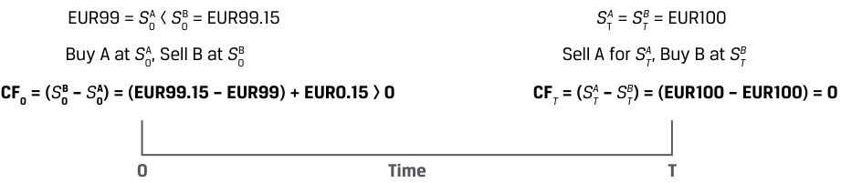
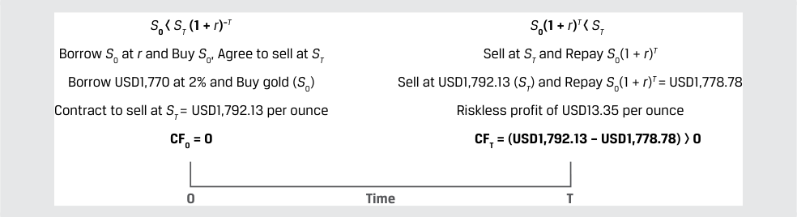
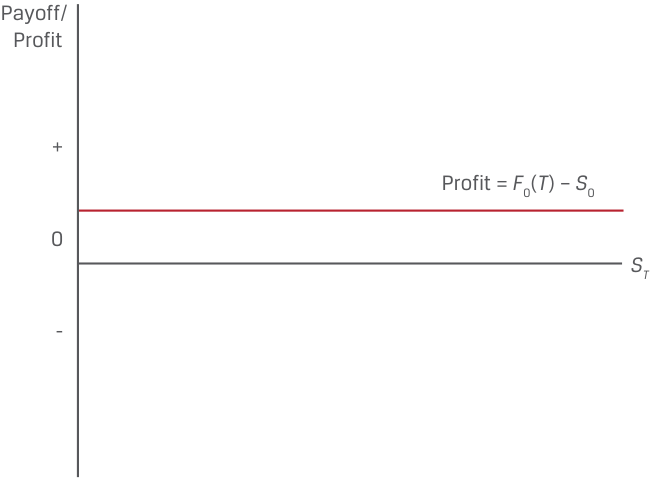

# Tập 7: Công cụ Phái sinh (*Derivatives*)
## Học phần 4: Kinh doanh Chênh lệch giá, Mô phỏng và Chi phí Lưu giữ trong Định giá Công cụ Phái sinh (*Arbitrage, Replication, and the Cost of Carry in Pricing Derivatives*)
### Phần 1/2: Giới thiệu (*Introduction*) (Trang PDF 85–95)

---

<!-- PDF Page 85 -->

#### H Ọ C P H Ầ N

# **<mark>4</mark>**

### **Kinh doanh Chênh lệch giá, Mô phỏng và Chi phí Lưu giữ trong Định giá Công cụ Phái sinh (*Arbitrage, Replication, and the Cost of Carry in Pricing Derivatives*)**

###### **<mark>MỤC TIÊU HỌC TẬP (*LEARNING OUTCOMES*)</mark>**

|**_Mức độ Thành thạo (*Mastery*)_** **_Ứng viên cần có khả năng:_**|
|---|
|Giải thích cách thức các khái niệm kinh doanh chênh lệch giá (*arbitrage*) và mô phỏng (*replication*) được sử dụng trong định giá các công cụ phái sinh (*pricing derivatives*).|
|Giải thích sự khác biệt giữa giá giao ngay (*spot price*) và giá kỳ vọng trong tương lai (*expected future price*) của một tài sản cơ sở cùng với chi phí lưu giữ (*cost of carry*) gắn liền với việc nắm giữ tài sản cơ sở đó.|

##### **GIỚI THIỆU (*INTRODUCTION*)**

## **<mark>1</mark>**

Các bài học về công cụ phái sinh trước đó đã thiết lập những đặc điểm của các công cụ và thị trường phái sinh, đồng thời đề cập đến cả những lợi ích lẫn rủi ro gắn liền với việc sử dụng chúng. Cam kết kỳ hạn (*forward commitments*) và quyền yêu cầu dự phòng (*contingent claims*) được phân biệt bởi cấu trúc lợi nhuận khi đáo hạn (*payoff profiles*) và các đặc điểm khác nhau của chúng. Giờ đây, chúng ta chuyển sự chú ý sang việc định giá (*pricing*) và xác định giá trị (*valuation*) của các công cụ này. Như một bước đầu tiên, chúng ta khám phá cách thức mức giá của một cam kết kỳ hạn liên hệ với giá giao ngay của một tài sản cơ sở theo cách không cho phép tồn tại các cơ hội kinh doanh chênh lệch giá (*arbitrage opportunities*). Cụ thể, chiến lược mô phỏng (*replication*) cho thấy rằng các khoản thanh toán (*payoffs*) hoàn toàn giống hệt với một cam kết kỳ hạn có thể đạt được từ các giao dịch trên thị trường giao ngay kết hợp với việc đi vay hoặc cho vay ở mức lãi suất phi rủi ro (*risk-free rate*). Cuối cùng, bài học thứ hai minh họa cách thức các chi phí hoặc lợi ích gắn liền với việc sở hữu một tài sản cơ sở tác động đến mức giá của cam kết kỳ hạn.

###### **TỔNG QUAN HỌC PHẦN (*LEARNING MODULE OVERVIEW*)**

- Cam kết kỳ hạn (*forward commitments*) là một phương thức thay thế để thiết lập vị thế mua (*long position*) hoặc vị thế bán (*short position*) đối với một tài sản cơ sở. Mối liên kết giữa giá kỳ hạn (*forward prices*) và giá giao ngay (*spot prices*) tồn tại nhằm ngăn chặn các nhà đầu tư tận dụng những cơ hội kinh doanh chênh lệch giá (*arbitrage opportunities*) giữa các công cụ trên thị trường tiền mặt (*cash instruments*) và công cụ phái sinh (*derivative instruments*).

Viện CFA (CFA Institute) xin gửi lời cảm ơn tới Tiến sĩ Don Chance, CFA, vì những đóng góp của ông cho phần này, trong đó bao gồm nội dung được trích xuất từ tài liệu xuất hiện trong phần *Thị trường và Công cụ Phái sinh* (*Derivative Markets and Instruments*), nằm trong chương trình giảng dạy CFA® Program năm 2022.

<!-- PDF Page 86 -->

- Một cam kết kỳ hạn có thể được mô phỏng (*replicated*) bằng một vị thế giao ngay mua hoặc bán đối với tài sản cơ sở kết hợp với việc đi vay hoặc cho vay ở mức lãi suất phi rủi ro. Các nhà đầu tư có thể tái tạo nhiều vị thế khác nhau bằng cách sử dụng các sự kết hợp phù hợp giữa vị thế giao ngay (*spot*), vị thế kỳ hạn (*forward*) và vị thế phi rủi ro (*risk-free positions*).

- Lãi suất phi rủi ro (*risk-free rate*) cung cấp mối liên kết nền tảng giữa giá giao ngay và giá kỳ hạn đối với các tài sản cơ sở không phát sinh thêm chi phí hay lợi ích nào từ quyền sở hữu.

- Chi phí lưu giữ (*cost of carry*) là giá trị ròng của các chi phí và lợi ích liên quan đến việc sở hữu một tài sản cơ sở trong một khoảng thời gian cụ thể và phải được tính đến trong khoản chênh lệch giữa giá giao ngay và giá kỳ hạn của một tài sản cơ sở cụ thể.

- Chi phí lưu giữ có thể bao gồm các khoản chi phí, chẳng hạn như chi phí lưu kho (*storage*) và bảo hiểm (*insurance*) đối với hàng hóa vật chất (*physical commodities*), hoặc các lợi ích của quyền sở hữu, chẳng hạn như cổ tức (*dividends*) đối với cổ phiếu và tiền lãi (*interest*) đối với trái phiếu. Ngoại hối (*foreign exchange*) đại diện cho một trường hợp đặc biệt trong đó chi phí lưu giữ là mức chênh lệch lãi suất (*interest rate differential*) giữa hai đồng tiền.

- Giá kỳ hạn có thể lớn hơn hoặc nhỏ hơn giá giao ngay của tài sản cơ sở, tùy thuộc vào chi phí lưu giữ cụ thể gắn liền với việc sở hữu tài sản cơ sở đó.

###### **TỰ ĐÁNH GIÁ HỌC PHẦN (*LEARNING MODULE SELF-ASSESSMENT*)**

Các câu hỏi ban đầu này nhằm mục đích giúp bạn tự đánh giá mức độ hiểu biết hiện tại của mình về học phần này.

1. Phát biểu nào sau đây mô tả đúng cách thức mô phỏng một vị thế mua kỳ hạn (*long forward position*)?

   - **A.** Bán một trái phiếu phi rủi ro, và mua một vị thế trên thị trường tiền mặt đối với tài sản cơ sở.

   - **B.** Mua một trái phiếu phi rủi ro, và mua một vị thế trên thị trường tiền mặt đối với tài sản cơ sở.

   - **C.** Mua một trái phiếu phi rủi ro, và bán một vị thế trên thị trường tiền mặt đối với tài sản cơ sở.

   - **Lời giải:**

A là đáp án đúng. Việc bán một trái phiếu phi rủi ro (*selling a risk-free bond* — tức là đi vay phi rủi ro) cung cấp lượng tiền mặt cần thiết để mua tài sản cơ sở trên thị trường tiền mặt (*cash market*). Khi trái phiếu đáo hạn, tài sản cơ sở được bán đi tại mức giá giao ngay trong tương lai, và số tiền thu được sẽ dùng để thanh toán dứt điểm trái phiếu đó. Lợi nhuận từ giao dịch này phụ thuộc vào mức giá giao ngay trong tương lai của tài sản cơ sở so với mức giá trên thị trường tiền mặt của tài sản cơ sở nhân với một cộng lãi suất phi rủi ro, và vị thế lợi nhuận này hoàn toàn giống hệt với vị thế mua kỳ hạn (*long forward position*) đối với tài sản cơ sở. B không đúng vì việc mua trái phiếu phi rủi ro làm phát sinh nhu cầu cần thêm tiền mặt bên cạnh việc mua tài sản cơ sở trên thị trường tiền mặt. C không đúng vì sự kết hợp này sẽ mô phỏng một vị thế bán kỳ hạn (*short forward position*).

2. Giá trị nào sau đây gần nhất với mức lợi nhuận kinh doanh chênh lệch giá (*arbitrage profit*) dành cho một nhà đầu tư có khả năng mua một tài sản với giá giao ngay là $\text{GBP}50$ tại thời điểm $t = 0$ và đồng thời bán một cam kết kỳ hạn sáu tháng trên cùng tài sản đó với mức giá kỳ hạn là $\text{GBP}52.50$? Lãi suất phi rủi ro là $4\%$, và tài sản này không có thêm chi phí hay lợi ích nào khác.

   - **A.** $\text{GBP}0.99$

   - **B.** $\text{GBP}0.48$

<!-- PDF Page 87 -->

   - **C.** $\text{GBP}1.51$

   - **Lời giải:** C là đáp án đúng. Nhà đầu tư đi vay với lãi suất $4\%$ trong sáu tháng để mua tài sản ngày hôm nay với giá $\text{GBP}50$. Sau sáu tháng, nhà đầu tư trả cho bên cho vay khoản tiền gốc và lãi là $S_0(1 + r)^T$, tương đương $\text{GBP}50.99$ [$= \text{GBP}50(1.04)^{0.5}$], đồng thời chuyển giao tài sản để thực hiện cam kết kỳ hạn bán ở mức giá $\text{GBP}52.50$. Lợi nhuận kinh doanh chênh lệch giá của nhà đầu tư là $\text{GBP}1.51$ ($= \text{GBP}52.50 - \text{GBP}50.99$). A không đúng vì đáp án này phản ánh phần chênh lệch giữa mức giá kỳ hạn không có kinh doanh chênh lệch giá (*no-arbitrage forward price*) và giá giao ngay hiện tại. B không đúng vì đáp án này phản ánh phần chênh lệch giữa giá kỳ hạn được chiết khấu ngược về một năm (thay vì sáu tháng) và giá giao ngay hiện tại.

3. Phát biểu nào sau đây mô tả đúng mối quan hệ giữa giá của một cam kết kỳ hạn so với giá giao ngay của tài sản cơ sở khi lợi ích của việc sở hữu tài sản cơ sở lớn hơn chi phí của việc sở hữu tài sản cơ sở đó (bao gồm cả chi phí lãi vay cơ hội)?
   - **A.** Giá cam kết kỳ hạn $>$ giá giao ngay.
   - **B.** Giá cam kết kỳ hạn $<$ giá giao ngay.
   - **C.** Giá cam kết kỳ hạn $=$ giá giao ngay.

   - **Lời giải:** B là đáp án đúng. Lợi ích lớn hơn gắn liền với tài sản cơ sở sẽ dẫn đến mức giá giao ngay cao hơn tương đối so với giá cam kết kỳ hạn, và nếu những lợi ích này lớn hơn các chi phí của việc sở hữu tài sản cơ sở, thì giá giao ngay sẽ lớn hơn giá cam kết kỳ hạn. A không đúng vì bất đẳng thức này sẽ đúng trong trường hợp chi phí vượt quá lợi ích. C không đúng vì sự ngang bằng giữa hai mức giá mô tả trường hợp hiếm gặp khi chi phí và lợi ích bằng nhau một cách chính xác.

4. Phát biểu nào sau đây định nghĩa đúng nhất về lợi suất tiện ích (*convenience yield*)?
   - **A.** Lợi suất tiện ích phản ánh sự ưu tiên mà những người tham gia thị trường thể hiện đối với việc mua các hợp đồng kỳ hạn nhằm tránh phải trả tiền mặt ngay từ đầu.

   - **B.** Lợi suất tiện ích phản ánh sự ưu tiên mà những người tham gia thị trường thể hiện đối với việc mua trên thị trường giao ngay nhằm tránh phải trả chi phí lưu kho.

   - **C.** Lợi suất tiện ích phản ánh sự ưu tiên mà những người tham gia thị trường thể hiện đối với việc mua trên thị trường giao ngay vì các lý do phi tiền mặt, bao gồm cả tình trạng hàng tồn kho thấp trên thị trường tiền mặt của tài sản cơ sở.

###### **Lời giải:**

C là đáp án đúng. Lợi suất tiện ích (*convenience yield*) là một lợi ích phi tiền mặt (*non-cash benefit*) gắn liền với việc sở hữu một hàng hóa vật chất cơ sở, phát sinh trong những điều kiện kinh tế nhất định, bao gồm cả tình trạng hàng tồn kho của tài sản cơ sở ở mức thấp. A không đúng vì phát biểu này ngụ ý rằng lợi suất tiện ích là một khoản chi phí của việc sở hữu tài sản cơ sở. B không đúng vì phát biểu này tự mâu thuẫn ở chỗ nó nêu rằng lợi suất tiện ích khiến những người tham gia thị trường ưu tiên thị trường giao ngay nhưng lại quy điều này một cách sai lầm cho một khoản chi phí của việc sở hữu tài sản cơ sở (mua trên thị trường giao ngay thực tế làm phát sinh chi phí lưu kho chứ không phải tránh được nó).

<!-- PDF Page 88 -->

## **<mark>2</mark>**

##### **KINH DOANH CHÊNH LỆCH GIÁ (*ARBITRAGE*)**

*Giải thích cách thức các khái niệm kinh doanh chênh lệch giá (arbitrage) và mô phỏng (replication) được sử dụng trong định giá các công cụ phái sinh.*

Một bài học trước đây về tính hiệu quả của thị trường (*market efficiency*) đã xác lập rằng giá cả thị trường không nên cho phép tồn tại khả năng thu lợi nhuận phi rủi ro (*riskless profit*) hay kinh doanh chênh lệch giá (*arbitrage*) khi không có chi phí giao dịch. Ở dạng đơn giản nhất, một cơ hội kinh doanh chênh lệch giá phát sinh nếu “quy luật một giá” (*law of one price*) không được đảm bảo, hoặc một tài sản giống hệt nhau được giao dịch cùng một lúc ở các mức giá khác nhau tại các địa điểm khác nhau.

Trong trường hợp của một hợp đồng phái sinh mà giá trị của nó bắt nguồn từ các dòng tiền trong tương lai gắn liền với giá của một tài sản cơ sở, cơ hội kinh doanh chênh lệch giá sẽ phát sinh hoặc khi hai tài sản có *dòng tiền tương lai* giống hệt nhau được giao dịch ở các mức giá khác nhau, hoặc khi một tài sản có mức giá tương lai đã biết không được giao dịch tại mức *giá trị hiện tại* (*present value*) của giá tương lai đó khi được xác định bằng một lãi suất chiết khấu phù hợp.

Trường hợp đầu tiên về các tài sản có dòng tiền tương lai giống hệt nhau nhưng giao dịch ở các mức giá khác nhau được minh họa trong Bảng minh họa 1 (*Exhibit 1*).

**Bảng minh họa 1: Các Tài sản có Dòng tiền Tương lai Giống hệt nhau Giao dịch ở các Mức giá Khác nhau (*Assets with Identical Future Cash Flows Trade at Different Prices*)**

> **Chú thích hình ảnh:**
> - Tại thời điểm $0$: $\text{EUR}99 = S_0^A < S_0^B = \text{EUR}99.15$ $\rightarrow$ Mua A tại mức giá $S_0^A$, Bán B tại mức giá $S_0^B$ $\rightarrow$ Dòng tiền tại thời điểm $0$: $CF_0 = (S_0^B - S_0^A) = (\text{EUR}99.15 - \text{EUR}99) = +\text{EUR}0.15 > 0$.
> - Tại thời điểm $T$: $S_T^A = S_T^B = \text{EUR}100$ $\rightarrow$ Bán A với giá $S_T^A$, Mua B tại giá $S_T^B$ $\rightarrow$ Dòng tiền tại thời điểm $T$: $CF_T = (S_T^A - S_T^B) = (\text{EUR}100 - \text{EUR}100) = 0$.

Ví dụ, giả sử hai tài sản này là các trái phiếu không trả lãi định kỳ (*zero-coupon bonds*) có các đặc điểm giống hệt nhau và cùng một tổ chức phát hành. Cả hai trái phiếu đều đáo hạn vào cùng một ngày trong tương lai với khoản thanh toán bằng mệnh giá (*par*) và có cùng mức rủi ro vỡ nợ từ nay cho đến ngày đáo hạn.

**1.** Trái phiếu A có giá là $\text{EUR}99$ tại thời điểm $t = 0$ ($S_0^A = \text{EUR}99$).

**2.** Trái phiếu B có giá là $\text{EUR}99.15$ tại thời điểm $t = 0$ ($S_0^B = \text{EUR}99.15$).

**3.** Cả hai trái phiếu đều có mức giá kỳ vọng trong tương lai là $\text{EUR}100$ ($S_T^A = S_T^B = \text{EUR}100$). Kịch bản này đại diện cho một cơ hội kinh doanh chênh lệch giá đối với nhà đầu tư.

- Tại thời điểm $t = 0$, nhà đầu tư có thể:

   - Bán khống (*sell short*) Trái phiếu B để nhận số tiền thu về là $\text{EUR}99.15$ và mua Trái phiếu A với giá $\text{EUR}99$;

   - Hiện thực hóa một dòng tiền vào ròng (*net cash inflow*) tại thời điểm $t = 0$ là $\text{EUR}0.15$.

- Tại thời điểm $t = T$, khi cả hai trái phiếu đáo hạn, nhà đầu tư:

   - Nhận được $\text{EUR}100$ từ Trái phiếu A và sử dụng số tiền này để mua Trái phiếu B với giá $\text{EUR}100$ nhằm đóng vị thế bán khống (*cover the short position*).

   - Các dòng tiền bù trừ cho nhau tại thời điểm $T$ giúp nhà đầu tư thu được một khoản lợi nhuận phi rủi ro bằng đúng khoản chênh lệch giá $\text{EUR}0.15$ giữa Trái phiếu A và B tại thời điểm $0$.

<!-- PDF Page 89 -->

Những nhà đầu tư khác khi nhận thấy sự bất hợp lý này cũng sẽ tìm cách kiếm lợi nhuận phi rủi ro tại thời điểm $t = 0$ bằng cách bán Trái phiếu B, đẩy giá của nó giảm xuống, và mua Trái phiếu A, đẩy giá của nó tăng lên, cho đến khi hai mức giá hội tụ. Cơ hội kinh doanh chênh lệch giá sẽ biến mất một khi hai trái phiếu có cùng mức giá ($S_0^A = S_0^B$).

Loại cơ hội kinh doanh chênh lệch giá thứ hai liên quan đến công cụ phái sinh phát sinh khi một tài sản có mức giá tương lai đã biết không được giao dịch ở mức giá trị hiện tại ($\text{PV}$) của giá tương lai đó. Một bài học trước đây về giá trị thời gian của tiền tệ đã phân biệt giữa ghép lãi rời rạc (*discrete compounding*) và ghép lãi liên tục (*continuous compounding*) khi tính toán giá trị hiện tại so với giá trị tương lai. Giá trị tương lai của một dòng tiền đơn lẻ dựa trên một số lượng *rời rạc* các kỳ đồng nhất tuân theo công thức tổng quát trong Phương trình 1:

$$\text{FV}_N = \text{PV}(1 + r)^N \tag{1}$$

trong đó $r$ là lãi suất công bố trên mỗi *kỳ* và $N$ là số kỳ ghép lãi. *Ghép lãi liên tục* (*continuous compounding*) là trường hợp trong đó độ dài của các kỳ đồng nhất tiến dần về $0$, do đó số kỳ trong một năm tiến tới vô cùng và được tính toán bằng cách sử dụng cơ số logarit tự nhiên, như được thể hiện trong Phương trình 2:

$$\text{FV}_T = \text{PV}e^{rT} \tag{2}$$

Mặc dù các công cụ phái sinh có thể được định giá bằng một trong hai phương pháp, nhưng phục vụ cho mục đích của bài học này và các bài học sau, chúng ta sẽ sử dụng phương pháp ghép lãi rời rạc cho từng tài sản cơ sở riêng lẻ. Tuy nhiên, đối với các tài sản cơ sở đại diện cho một danh mục đầu tư, chẳng hạn như chỉ số cổ phiếu, thu nhập cố định, hàng hóa hoặc tín dụng, hoặc khi tài sản cơ sở liên quan đến ngoại hối nơi lãi suất được định danh bằng hai đồng tiền khác nhau, ghép lãi liên tục sẽ là phương pháp được ưu tiên sử dụng. Nếu bỏ qua các chi phí hoặc lợi ích bổ sung gắn liền với quyền sở hữu tài sản, mức lãi suất chiết khấu phù hợp, $r$, chính là lãi suất phi rủi ro, như được minh họa trong Ví dụ 1.

###### **VÍ DỤ 1 (*EXAMPLE 1*)**

###### **Giá Vàng Giao ngay so với Giá Tương lai Đã biết Được Chiết khấu (*Spot vs. Discounted Known Future Price of Gold*)**

Trong một bài học trước, Procam Investments đã tham gia vào một hợp đồng mua $100\text{ ounce}$ vàng tại mức giá thỏa thuận trước là $\text{USD}1,792.13$ mỗi ounce sau ba tháng. Trong ví dụ này, Procam thực hiện giao dịch ngược lại, khi nhận thấy có sự chênh lệch giữa giá vàng giao ngay và giá vàng tương lai đã biết sau khi chiết khấu. Giả sử giá vàng giao ngay ngày hôm nay ($S_0$) là $\text{USD}1,770$ mỗi ounce, và lãi suất phi rủi ro chuẩn hóa theo năm ($r$) là $2\%$. Phục vụ cho mục đích của ví dụ này, chúng ta giả định rằng Procam có thể đi vay ở mức lãi suất phi rủi ro và vàng có thể được lưu kho mà không tốn chi phí. Dưới các điều kiện này, chúng ta minh họa cách thức Procam có thể tạo ra một khoản lợi nhuận phi rủi ro:

- Tại thời điểm $t = 0$:

  - Procam vay $\text{USD}177,000$ với lãi suất $2.0\%$ trong ba tháng và mua $100\text{ ounce}$ vàng tại mức giá giao ngay ngày hôm nay.

  - Procam tham gia vào một hợp đồng kỳ hạn ngày hôm nay để bán $100\text{ ounce}$ vàng tại mức giá $\text{USD}1,792.13$ mỗi ounce sau ba tháng.

> **Chú thích hình ảnh:**
> - **Tại thời điểm $0$ ($S_0 < S_T(1 + r)^{-T}$):** Vay $S_0$ tại lãi suất $r$ và Mua $S_0$, đồng thời Thỏa thuận bán tại giá $S_T$. Cụ thể: Vay $\text{USD}1,770$ tại mức lãi suất $2\%$ và Mua vàng ($S_0$); Ký hợp đồng bán tại $S_T = \text{USD}1,792.13$ mỗi ounce. Dòng tiền $CF_0 = 0$.
> - **Tại thời điểm $T$ ($S_0(1 + r)^T < S_T$):** Bán tại giá $S_T$ và Hoàn trả khoản vay $S_0(1 + r)^T$. Cụ thể: Bán ở mức giá $\text{USD}1,792.13$ ($S_T$) và Hoàn trả $S_0(1 + r)^T = \text{USD}1,778.78$; Thu lợi nhuận phi rủi ro là $\text{USD}13.35$ mỗi ounce. Dòng tiền $CF_T = (\text{USD}1,792.13 - \text{USD}1,778.78) > 0$.

- Tại thời điểm $t = T$ (sau ba tháng):

<!-- PDF Page 90 -->

  - Procam chuyển giao $100\text{ ounce}$ vàng theo hợp đồng kỳ hạn và nhận về $\text{USD}179,213$ ($= 100 \times \text{USD}1,792.13$).

  - Procam hoàn trả nợ gốc cùng với tiền lãi:

$$\text{USD}177,878.44 = \text{USD}177,000(1.02)^{0.25}$$

  - Lợi nhuận phi rủi ro của Procam tại thời điểm $T$ bằng phần chênh lệch giữa số tiền thu được từ việc bán kỳ hạn và khoản nợ gốc cộng lãi vay: $\text{USD}1,334.56 = \text{USD}179,213 - \text{USD}177,878.44$.

Trong Ví dụ 1, giá vàng giao ngay, $S_0$, thấp hơn giá trị hiện tại của mức giá vàng tương lai đã biết sau thời gian ba tháng ($S_0 < S_T(1 + r)^{-T}$, vì $\text{USD}1,770 < \text{USD}1,783.28$). Procam kiếm được một khoản lợi nhuận phi rủi ro là $\text{USD}13.35$ mỗi ounce bằng cách đi vay và mua vàng trên thị trường tiền mặt, đồng thời bán vàng trên thị trường kỳ hạn tại mức giá đã thỏa thuận trước. Chúng ta kỳ vọng rằng khi các nhà đầu tư khác nhận ra và theo đuổi cơ hội này, giá giao ngay sẽ tăng lên (và giá kỳ hạn sẽ giảm xuống) cho đến khi giá giao ngay bằng với giá trị chiết khấu của mức giá tương lai đã biết ($S_0 = S_T(1 + r)^{-T}$) nhằm triệt tiêu cơ hội kinh doanh chênh lệch giá này.

Hai khái niệm kinh doanh chênh lệch giá cốt lõi được sử dụng để định giá công cụ phái sinh đối với một tài sản cơ sở không có dòng tiền bổ sung có thể được tóm tắt như sau:

- Các tài sản giống hệt nhau hoặc các tài sản có dòng tiền giống hệt nhau được giao dịch tại cùng một thời điểm phải có cùng một mức giá ($S_0^A = S_0^B$).

- Các tài sản có mức giá tương lai đã biết phải có giá giao ngay bằng với mức giá tương lai đó được chiết khấu theo lãi suất phi rủi ro ($S_0 = S_T(1 + r)^{-T}$).

Các điều kiện kinh doanh chênh lệch giá này thiết lập mối quan hệ giữa giá giao ngay, giá cam kết kỳ hạn và lãi suất phi rủi ro như được thể hiện trong Bảng minh họa 2.

**Bảng minh họa 2: Giá Giao ngay, Giá Cam kết Kỳ hạn và Lãi suất Phi rủi ro (*Spot Prices, Forward Commitment Prices, and the Risk-Free Rate*)**

> **Chú thích hình ảnh:**
> Đồ thị biểu diễn mối quan hệ tăng dần từ Giá giao ngay $S_0$ tại thời điểm $0$ lên Giá kỳ hạn $F_0(T)$ tại thời điểm $T$ với độ dốc phụ thuộc vào lãi suất phi rủi ro $r$.

Bảng minh họa 2 thể hiện trường hợp $r > 0$ đối với một tài sản không có thu nhập hay chi phí bổ sung theo phương pháp ghép lãi rời rạc. Lưu ý rằng đối với một thời điểm $T$ nhất định, giá kỳ hạn sẽ cao hơn tương đối so với giá giao ngay khi lãi suất phi rủi ro $r$ cao hơn. Ngoài ra, đối với một mức lãi suất phi rủi ro $r$ nhất định, khi $T$ tăng lên, giá kỳ hạn sẽ tăng lên tương đối so với giá giao ngay. Điều quan trọng cần lưu ý là mức lãi suất phi rủi ro phù hợp đối với hầu hết những người tham gia thị trường chính là lãi suất mua lại (*repo rate*), đã được giới thiệu trong một bài học trước, nơi các khoản vốn vay được thế chấp bằng những chứng khoán có tính thanh khoản cao.

Hãy nhớ lại từ bài học trước rằng một cam kết kỳ hạn có cấu trúc lợi nhuận đối xứng (*symmetric payoff profile*). Nghĩa là, tại thời điểm $T$, giao dịch được thanh toán dựa trên cơ sở phần chênh lệch giữa giá kỳ hạn $F_0(T)$ và giá tài sản cơ sở $S_T$, hay $F_0(T) - S_T$ xét dưới góc độ của bên bán, như trong Bảng minh họa 3.

<!-- PDF Page 91 -->

###### **Bảng minh họa 3: Cấu trúc Lợi nhuận của Bên Bán Cam kết Kỳ hạn (*Forward Commitment Seller Payoff Profile*)**

> **Chú thích hình ảnh:**
> Trục tung biểu diễn Khoản thanh toán/Lợi nhuận (*Payoff/Profit*) từ $-$ đến $+$; trục hoành biểu diễn Giá tài sản cơ sở tại ngày đáo hạn $S_T$. Đường lợi nhuận của bên bán kỳ hạn dốc xuống, cắt trục hoành tại $F_0(T)$ (khi $S_T < F_0(T)$ thì có lãi dương, khi $S_T > F_0(T)$ thì chịu lỗ âm).

Bên bán kỳ hạn hiện thực hóa một khoản lãi nếu họ có khả năng chuyển giao tài sản cơ sở tại mức giá trị thị trường ($S_T$) thấp hơn mức giá đã thỏa thuận trước, $F_0(T)$. Trong Ví dụ 1, Procam đi vay để mua tài sản cơ sở tại mức giá giao ngay thấp hơn giá trị hiện tại của $S_T$ nhằm khóa chặt một khoản lãi phi rủi ro. Cho đến nay, chúng ta vẫn coi mức giá kỳ hạn, $F_0(T)$, là cho trước. Trong phần tiếp theo, chúng ta sẽ minh họa cách thức các điều kiện không có kinh doanh chênh lệch giá (*no-arbitrage conditions*) có thể được sử dụng để thiết lập mối quan hệ giữa giá giao ngay và giá kỳ hạn thông qua việc mô phỏng (*replicating*) hoặc tái tạo một vị thế bù trừ chính xác cho một cam kết kỳ hạn.

##### **MÔ PHỎNG (*REPLICATION*)**

## **<mark>3</mark>**

*Giải thích cách thức các khái niệm kinh doanh chênh lệch giá (arbitrage) và mô phỏng (replication) được sử dụng trong định giá các công cụ phái sinh.*

**Mô phỏng (*Replication*)** là một chiến lược trong đó chuỗi dòng tiền của một công cụ phái sinh có thể được tái tạo bằng cách sử dụng sự kết hợp giữa các vị thế mua (*long*) hoặc bán (*short*) đối với một tài sản cơ sở cùng với việc đi vay hoặc cho vay tiền mặt. Trái ngược với các ví dụ kinh doanh chênh lệch giá trước đó, mô phỏng thường được sử dụng để phản chiếu (*mirror*) hoặc bù trừ (*offset*) một vị thế phái sinh khi quy luật một giá được đảm bảo và không tồn tại các cơ hội kiếm lợi nhuận kinh doanh chênh lệch giá phi rủi ro. Ví dụ, Bảng minh họa 4 so sánh một cam kết mua kỳ hạn (*long forward commitment*) với phương án thay thế là đi vay vốn ở mức lãi suất phi rủi ro, $r$, để mua tài sản cơ sở tại mức giá giao ngay ngày hôm nay, $S_0$.

<!-- PDF Page 92 -->

###### **Bảng minh họa 4: Mô phỏng Cam kết Kỳ hạn (*Forward Commitment Replication*)**

> **Chú thích hình ảnh:**
> - **Chiến lược Đi vay $S_0$ và mua giao ngay ($S_0$) $\rightarrow$ Hoàn trả khoản vay ($S_0(1+r)^T$) và bán giao ngay ($S_T$):**
>   - Tại $t = 0$: Vay $\text{USD}1,783.28$ ($S_0$) ngày hôm nay tại $t = 0$; Mua tại $S_0 = \text{USD}1,783.28$ $\rightarrow$ $CF_0 = (\text{USD}1,783.28 - \text{USD}1,783.28) = 0$.
>   - Tại $t = T$: Hoàn trả $\text{USD}1,792.13$ ($S_0(1+r)^T$) tại $t = T$; Bán tại giá giao ngay ($S_T$) $\rightarrow$ $CF_T = (S_T - \text{\$1,792.13})$.
> - **Chiến lược Tham gia hợp đồng mua kỳ hạn ($F_0(T)$) $\rightarrow$ Tất toán hợp đồng mua kỳ hạn ($S_T - F_0(T)$):**
>   - Tại $t = 0$: Thỏa thuận mua ở mức giá $\text{USD}1,792.13$ ($F_0(T)$) vào thời điểm $t = T$ $\rightarrow$ $CF_0 = 0$.
>   - Tại $t = T$: Tất toán hợp đồng ($S_T - F_0(T)$) tại $t = T$ $\rightarrow$ $CF_T = (S_T - \text{\$1,792.13})$.

###### **VÍ DỤ 2 (*EXAMPLE 2*)**

###### **Mô phỏng một Cam kết Kỳ hạn (*Replication of a Forward Commitment*)**

Trong Ví dụ 1, chúng ta đã giới thiệu lại Procam Investments, công ty đã đi vay và mua vàng trên thị trường giao ngay đồng thời bán vàng trên thị trường kỳ hạn để kiếm một khoản lợi nhuận phi rủi ro. Ở đây, chúng ta thay đổi giả định về giá vàng giao ngay ngày hôm nay ($S_0$). Cụ thể, giá vàng giao ngay đã tăng lên mức $\text{USD}1,783.28$ ($= \text{USD}1,792.13(1.02)^{-0.25}$) để triệt tiêu cơ hội kinh doanh chênh lệch giá trước đó khi giá giao ngay ở mức $\text{USD}1,770$. Giả sử một lần nữa rằng lãi suất phi rủi ro ($r$) là $2\%$ và vàng có thể được lưu kho mà không tốn chi phí.

**1.** Cam kết mua kỳ hạn (thỏa thuận mua tại giá $F_0(T)$ vào thời điểm $t = T$):

   - Procam tham gia một cam kết kỳ hạn để mua $100\text{ ounce}$ vàng sau ba tháng tại mức giá kỳ hạn, $F_0(T)$, là $\text{USD}1,792.13$ mỗi ounce.

   - Nếu $S_T = \text{USD}1,900$ mỗi ounce:
     - Lợi nhuận $= \text{USD}10,787 = 100 \times (\text{USD}1,900 - \text{USD}1,792.13)$.

   - Nếu $S_T = \text{USD}1,700$ mỗi ounce:
     - Lợi nhuận $= -\text{USD}9,213 = 100 \times (\text{USD}1,700 - \text{USD}1,792.13)$.

**2.** Đi vay và mua tài sản (vay $S_0$ và mua tài sản tại giá $S_0$ vào thời điểm $t = 0$):

   - Procam vay $\text{USD}178,328$ với lãi suất $2\%$ và mua $100\text{ ounce}$ vàng tại mức giá giao ngay ngày hôm nay, $S_0$.

   - Procam bán số vàng đó sau ba tháng tại mức giá giao ngay $S_T$.

   - Procam hoàn trả nợ gốc và lãi vay: $\text{USD}179,213 = \text{USD}178,328(1.02)^{0.25}$.

   - Nếu $S_T = \text{USD}1,900$:
     - Lợi nhuận $= \text{USD}10,787 = 100 \times (\text{USD}1,900 - \text{USD}1,792.13)$.

   - Nếu $S_T = \text{USD}1,700$:
     - Lợi nhuận $= -\text{USD}9,213 = 100 \times (\text{USD}1,700 - \text{USD}1,792.13)$.

<!-- PDF Page 93 -->

Lưu ý rằng các mức lợi nhuận hoàn toàn giống nhau được quan sát thấy dưới cả Kịch bản 1 và Kịch bản 2, đều bằng $S_T - F_0(T)$. Nếu chúng ta đặt mức giá kỳ hạn, $F_0(T)$, bằng với giá trị tương lai của giá giao ngay tính theo lãi suất phi rủi ro ($F_0(T) = S_0(1 + r)^T$), điều kiện không có kinh doanh chênh lệch giá chứng minh rằng Procam tạo ra cùng một dòng tiền tại thời điểm $T$ bất kể chiều hướng biến động của giá vàng, cho dù công ty:

**1.** tham gia vào một cam kết mua kỳ hạn được tất toán tại thời điểm $T$, hay

**2.** đi vay ở mức lãi suất phi rủi ro, mua tài sản cơ sở và nắm giữ nó cho đến thời điểm $T$.

Một hình thức mô phỏng riêng biệt nhưng có liên quan, kết hợp một vị thế mua tài sản (*long asset*) với một vị thế bán kỳ hạn (*short forward*), được thể hiện trong Bảng minh họa 5. Nửa trên thể hiện cấu trúc lãi/lỗ của vị thế mua tài sản, và nửa dưới thể hiện cấu trúc lãi/lỗ của vị thế bán kỳ hạn. Vị thế mua tài sản tạo ra một khoản lãi (lỗ) khi $S_T > S_0$ ($S_T < S_0$). Vị thế bán kỳ hạn tạo ra một khoản lãi (lỗ) khi $S_T < F_0$ ($S_T > F_0$).

**Bảng minh họa 5: Khoản thanh toán cho Vị thế Mua Tài sản và Vị thế Bán Kỳ hạn (*Payoffs for Long Asset and Short Forward Positions*)**

> **Chú thích hình ảnh:**
> - **Đồ thị trên (Vị thế mua trên thị trường tiền mặt - *Long cash position*):** Đường lợi nhuận (*Payoff/Profit*) dốc lên, cắt trục hoành $S_T$ tại $S_0$.
> - **Đồ thị dưới (Vị thế bán kỳ hạn - *Short forward position*):** Đường lợi nhuận (*Payoff/Profit*) dốc xuống, cắt trục hoành $S_T$ tại $F_0(T)$.

Trái ngược với Ví dụ 2, các vị thế này dường như bù trừ lẫn nhau. Ví dụ sau đây đánh giá tỷ suất sinh lợi được tạo ra bởi sự kết hợp của các vị thế này.

<!-- PDF Page 94 -->

###### **VÍ DỤ 3 (*EXAMPLE 3*)**

###### **Mô phỏng Giao dịch Phi Rủi ro: Mua Tài sản, Bán Kỳ hạn (*Risk-Free Trade Replication: Long Asset, Short Forward*)**

Procam Investments mua $100\text{ ounce}$ vàng tại mức giá giao ngay ngày hôm nay ($S_0$) là $\text{USD}1,783.28$ và đồng thời tham gia một cam kết kỳ hạn để bán vàng tại mức giá kỳ hạn, $F_0(T)$, là $\text{USD}1,792.13$. Một lần nữa, chúng ta giả định rằng vàng có thể được lưu kho mà không tốn chi phí, và ở đây chúng ta giải tìm tỷ suất sinh lợi của Procam.

- Tại thời điểm $t = 0$, dòng tiền của Procam là $-S_0 = -\text{USD}178,328$.

- Tại thời điểm $t = T$, dòng tiền của Procam là $F_0(T) = \text{USD}179,213$.

- Giải tìm tỷ suất sinh lợi đối với chiến lược của Procam như sau:

  - $\text{USD}179,213 = \text{USD}178,328(1 + r)^{0.25}$.

  - $r = 2.0\%$, bằng đúng mức lãi suất phi rủi ro.

Ví dụ này chứng minh rằng Procam có thể phòng ngừa rủi ro (*hedge*) cho vị thế mua vàng trên thị trường tiền mặt của mình bằng một vị thế bán công cụ phái sinh (tức là bán hợp đồng kỳ hạn) và kiếm được tỷ suất sinh lợi phi rủi ro miễn là điều kiện không có kinh doanh chênh lệch giá ($F_0(T) = S_0(1 + r)^T$) được đảm bảo. Lợi nhuận kết hợp được thể hiện trong Bảng minh họa 6. Lưu ý rằng nếu Procam đi vay ở mức lãi suất phi rủi ro để mua tài sản cơ sở tại giá $S_0$, công ty sẽ kiếm được lợi nhuận bằng không.

**Bảng minh họa 6: Lợi nhuận Kết hợp của Vị thế Mua Tài sản và Bán Kỳ hạn (*Combined Long Asset and Short Forward Profit*)**

> **Chú thích hình ảnh:**
> Trục tung biểu diễn Khoản thanh toán/Lợi nhuận (*Payoff/Profit*), trục hoành biểu diễn $S_T$. Đường lợi nhuận là một đường thẳng nằm ngang ở phần dương: $\text{Profit} = F_0(T) - S_0$ không đổi bất kể giá trị của $S_T$.

Bởi vì giá kỳ hạn được giả định là lớn hơn giá giao ngay trong ví dụ này và $r$ mang giá trị dương, nên khoản lợi nhuận phi rủi ro là một số tiền dương và giữ nguyên không đổi (tức là phi rủi ro) bất kể mức giá của tài sản cơ sở ($S_T$) là bao nhiêu. Như chúng ta sẽ thấy trong bài học tiếp theo, có thể tồn tại những lợi ích hoặc chi phí gắn liền với việc sở hữu một tài sản cơ sở khiến cho mức sinh lợi phi rủi ro trong Bảng minh họa 6 khác biệt so với $F_0(T) - S_0$ và thậm chí có khả năng mang giá trị âm.

<!-- PDF Page 95 -->

##### **BỘ CÂU HỎI (*QUESTION SET*): Kinh doanh Chênh lệch giá và Mô phỏng (*Arbitrage and Replication*)**

1. Xác định các từ đúng để điền vào chỗ trống: Nếu quy luật một giá không được đảm bảo, một tài sản \_\_\_\_\_\_\_\_\_ được giao dịch cùng một lúc ở các mức giá \_\_\_\_\_\_\_\_\_ tại các địa điểm khác nhau.

   **Lời giải:**
   Nếu quy luật một giá không được đảm bảo, một tài sản *giống hệt nhau* (*identical*) được giao dịch cùng một lúc ở các mức giá *khác nhau* (*different*) tại các địa điểm khác nhau.

2. Một nhà đầu tư quan sát thấy rằng giá giao ngay, $S_0$, của một tài sản cơ sở không có chi phí hay lợi ích bổ sung vượt quá mức giá tương lai đã biết của nó sau khi được chiết khấu theo lãi suất phi rủi ro, $S_T(1 + r)^{-T}$. Hãy mô tả và giải thích một chiến lược kinh doanh chênh lệch giá giúp tạo ra lợi nhuận phi rủi ro cho nhà đầu tư.

   **Lời giải:**
   Vì giá giao ngay của tài sản cơ sở vượt quá mức giá tương lai đã biết được chiết khấu theo lãi suất phi rủi ro ($S_0 > F_0(T)(1 + r)^{-T}$), nên tại thời điểm $t = 0$, nhà đầu tư:
   - Bán khống tài sản cơ sở trên thị trường giao ngay tại mức giá $S_0$
   - Đồng thời tham gia một hợp đồng mua kỳ hạn (*long forward contract*) tại mức giá $F_0(T)$
   - Cho vay khoản tiền $S_0$ ở mức lãi suất phi rủi ro $r$ để nhận về $S_0(1 + r)^T$ tại thời điểm $T$.

   Tại thời điểm $t = T$, nhà đầu tư:
   - Tất toán vị thế mua kỳ hạn và nhận được $S_T - F_0(T)$
   - Đóng vị thế bán khống tài sản cơ sở tại mức giá $S_T$, và
   - Giữ lại khoản $S_0(1 + r)^T - F_0(T)$ như một khoản lợi nhuận phi rủi ro bất kể giá giao ngay của tài sản cơ sở tại thời điểm $T$ là bao nhiêu.

3. Hãy thiết lập một chiến lược mô phỏng (*replication strategy*) cho một cam kết bán kỳ hạn (*short forward commitment*) kỳ hạn ba tháng đối với $1,000$ cổ phiếu của một mã cổ phiếu không trả cổ tức.

   **Lời giải:**
   Chiến lược mô phỏng cho một cam kết bán kỳ hạn ba tháng đối với một cổ phiếu không trả cổ tức bao gồm việc bán khống $1,000$ cổ phiếu tại thời điểm $t = 0$ và đầu tư số tiền thu được ở mức lãi suất phi rủi ro, $r$. Tại thời điểm $t = T$, giao dịch bán khống được đóng lại (*covered*) tại mức giá $S_T$, và dưới điều kiện không có kinh doanh chênh lệch giá $F_0(T) = S_0(1 + r)^T$, mức sinh lợi sẽ bằng $F_0(T) - S_T$ đối với cả vị thế bán kỳ hạn lẫn chiến lược mô phỏng.

4. Tính toán lợi nhuận kinh doanh chênh lệch giá nếu một tài sản giao ngay không có chi phí hay lợi ích bổ sung được giao dịch tại mức giá giao ngay là $100$, giá kỳ hạn ba tháng của tài sản cơ sở đó là $102$, và lãi suất phi rủi ro là $5\%$.

   **Lời giải:**
   Mức giá kỳ hạn, $F_0(T) = S_0(1 + r)^T$, tại đó không tồn tại cơ hội kinh doanh chênh lệch giá là $101.23$ ($= 100(1.05)^{0.25}$). Với mức giá kỳ hạn quan sát được trên thị trường là $102$, cơ hội kinh doanh chênh lệch giá sẽ là bán hợp đồng kỳ hạn và mua tài sản cơ sở, đồng thời đi vay ở mức lãi suất phi rủi ro để tài trợ cho giao dịch mua đó. Lợi nhuận kinh doanh chênh lệch giá tại thời điểm đáo hạn là phần chênh lệch giữa giá kỳ hạn quan sát được và giá kỳ hạn không có kinh doanh chênh lệch giá, bằng $0.77$ ($= 102 - 101.23$).
