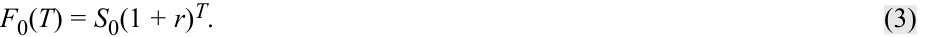
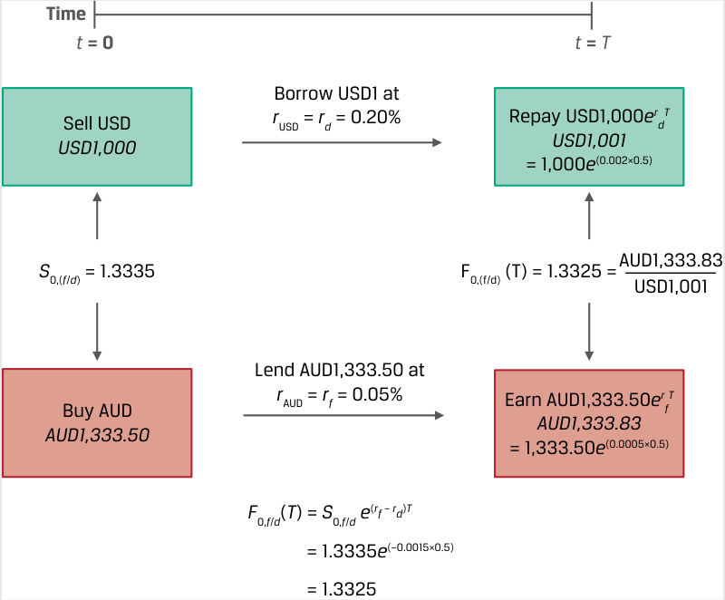

# Tập 7: Công cụ Phái sinh (*Derivatives*)
## Học phần 4: Kinh doanh Chênh lệch giá, Mô phỏng và Chi phí Lưu giữ trong Định giá Công cụ Phái sinh (*Arbitrage, Replication, and the Cost of Carry in Pricing Derivatives*)
### Phần 2/2: Chi phí và Lợi ích Gắn liền với Việc Sở hữu Tài sản Cơ sở (*Costs and Benefits Associated with Owning the Underlying*) (Trang PDF 96–106)

---

<!-- PDF Page 96 -->

5. Hãy mô tả mối quan hệ giữa giá giao ngay và giá kỳ hạn đối với một tài sản cơ sở nếu lãi suất phi rủi ro mang giá trị âm.

   - **Lời giải:**

Mối quan hệ giữa giá giao ngay và giá kỳ hạn đối với một tài sản không có thêm chi phí hay lợi ích nào từ quyền sở hữu ngoài chi phí cơ hội (lãi suất phi rủi ro) được xác định bởi công thức $F_0(T) = S_0(1 + r)^T$. Trong trường hợp $r < 0$, ta có $(1 + r)^T < 1$ và do đó giá kỳ hạn, $F_0(T)$, sẽ thấp hơn giá giao ngay, $S_0$, nếu lãi suất phi rủi ro là số âm.

# **<mark>4</mark>**

## **CHI PHÍ VÀ LỢI ÍCH GẮN LIỀN VỚI VIỆC SỞ HỮU TÀI SẢN CƠ SỞ (*COSTS AND BENEFITS ASSOCIATED WITH OWNING THE UNDERLYING*)**

*Giải thích sự khác biệt giữa giá giao ngay và giá kỳ vọng trong tương lai của một tài sản cơ sở cùng với chi phí lưu giữ gắn liền với việc nắm giữ tài sản cơ sở đó.*

Trong bài học trước, phương pháp mô phỏng (*replication*) đã được sử dụng để minh họa mối quan hệ cơ bản giữa việc tham gia vào một giao dịch giao ngay so với một cam kết kỳ hạn. Mối liên kết giữa giá giao ngay của một tài sản không có các dòng tiền đi kèm và một cam kết kỳ hạn trên cùng tài sản đó đã được chứng minh chính là lãi suất phi rủi ro, $r$. Trong bài học này, chúng ta thảo luận về **chi phí lưu giữ (*cost of carry*)** với tư cách là giá trị ròng của các chi phí và lợi ích liên quan đến việc sở hữu một tài sản cơ sở trong một khoảng thời gian cụ thể.

Trong ví dụ về cam kết kỳ hạn từ bài học trước, nơi không có chi phí hay lợi ích nào gắn liền với tài sản cơ sở, mối quan hệ sau đây giữa giá giao ngay và giá kỳ hạn đã được thiết lập:

$$F_0(T) = S_0(1 + r)^T \tag{3}$$

Mối quan hệ này được biểu diễn dưới dạng ghép lãi liên tục trong Phương trình 4:

$$F_0(T) = S_0 e^{rT} \tag{4}$$

Lãi suất phi rủi ro, $r$, biểu thị **chi phí cơ hội (*opportunity cost*)** của việc nắm giữ (“**lưu giữ**” – *carrying*) tài sản, bất kể nhà đầu tư nắm giữ vị thế mua có đi vay để tài trợ cho việc mua tài sản đó hay không. Chi phí cơ hội này hiện diện đối với tất cả các loại tài sản được thảo luận dưới đây.

Phương trình 3 và 4 đại diện cho trường hợp đặc biệt của một tài sản cơ sở không có thêm các dòng tiền đi kèm. Tuy nhiên, nhiều tài sản có thêm các chi phí hoặc lợi ích từ quyền sở hữu mà bắt buộc phải được phản ánh vào mức giá cam kết kỳ hạn nhằm ngăn chặn các cơ hội kinh doanh chênh lệch giá phi rủi ro phát sinh giữa giá giao ngay của tài sản cơ sở và giá công cụ phái sinh. Bảng minh họa 7 minh họa tác động của các chi phí và lợi ích (thường là thu nhập cổ tức hoặc tiền lãi) lên mối quan hệ giữa giá giao ngay, giá cam kết kỳ hạn và lãi suất phi rủi ro.

<!-- PDF Page 97 -->

#### **Bảng minh họa 7: Giá Giao ngay, Giá Cam kết Kỳ hạn và Lãi suất Phi rủi ro khi Tài sản Cơ sở có Chi phí và Lợi ích (*Spot Prices, Forward Commitment Prices, and the Risk-Free Rate with Underlying Asset Costs and Benefits*)**

> **Chú thích hình ảnh:**
> Xuất phát từ mức giá giao ngay $S_0$ tại thời điểm $0$ đến thời điểm $T$:
> - Đường cơ sở (chỉ có lãi suất phi rủi ro $r$): tiến tới $F_0(T)$.
> - Khi Chi phí $>$ Lợi ích (*Cost > Benefit*): đường giá kỳ hạn dịch chuyển lên cao hơn tới mức $F_0^+(T)$.
> - Khi Lợi ích $>$ Chi phí (*Benefit > Cost*): đường giá kỳ hạn dịch chuyển xuống thấp hơn tới mức $F_0^-(T)$.

Nếu người sở hữu tài sản cơ sở phải chịu thêm các khoản chi phí ngoài chi phí cơ hội, người đó sẽ kỳ vọng được đền bù cho những chi phí tăng thêm này thông qua một mức giá kỳ hạn cao hơn, $F_0^+(T)$. Thu nhập hoặc các lợi ích khác thuộc về người sở hữu tài sản cơ sở và do đó sẽ làm giảm mức giá kỳ hạn xuống còn $F_0^-(T)$.

Đối với các tài sản cơ sở có lợi ích hoặc thu nhập từ quyền sở hữu ($I$) hoặc chi phí ($C$) được biểu thị dưới dạng một *số tiền đã biết tính theo giá trị hiện tại tại thời điểm $t = 0$* — ký hiệu là $\text{PV}_0()$ — mối quan hệ giữa giá giao ngay và giá kỳ hạn theo phương pháp ghép lãi rời rạc có thể được biểu diễn như sau:

$$F_0(T) = [S_0 - \text{PV}_0(I) + \text{PV}_0(C)](1 + r)^T \tag{5}$$

Trong các trường hợp khác, những chi phí hoặc lợi ích bổ sung được biểu thị dưới dạng một *tỷ suất sinh lợi* (*rate of return*) trong suốt vòng đời của hợp đồng. Đối với tỷ suất thu nhập ($i$) và tỷ suất chi phí ($c$) được biểu thị dưới dạng tỷ lệ phần trăm, mối quan hệ giữa giá giao ngay và giá kỳ hạn theo phương pháp ghép lãi liên tục là:

$$F_0(T) = S_0 e^{(r + c - i)T} \tag{6}$$

Cho dù được biểu thị dưới dạng một số tiền đã biết tính theo giá trị hiện tại hay dưới dạng một tỷ suất sinh lợi, giá kỳ hạn bắt buộc phải kết hợp tác động ròng của tất cả các chi phí và lợi ích gắn liền với việc sở hữu tài sản cơ sở, bao gồm những yếu tố sau đây:

- **Chi phí cơ hội (lãi suất phi rủi ro, $r$):** Một mức lãi suất phi rủi ro dương làm cho giá kỳ hạn lớn hơn giá giao ngay của tài sản cơ sở, khi các yếu tố khác không đổi (*all else equal*), và lãi suất phi rủi ro càng cao thì khoản chênh lệch dương giữa hai mức giá càng lớn. Chi phí cơ hội này áp dụng cho bất kỳ tài sản nào.

- **Các chi phí sở hữu khác ($C$, $c$):** Người sở hữu một số tài sản cơ sở, chẳng hạn như hàng hóa vật chất, phải gánh chịu các chi phí lưu kho (*storage*), vận chuyển (*transportation*), bảo hiểm (*insurance*), và/hoặc hư hỏng (*spoilage*). Một người sở hữu tham gia vào hợp đồng giao hàng trong tương lai sẽ kỳ vọng được đền bù cho những chi phí này, dẫn đến một mức giá kỳ hạn lớn hơn giá giao ngay của tài sản cơ sở, khi các yếu tố khác không đổi.

- **Lợi ích của quyền sở hữu ($I$, $i$):** Ngược lại, người sở hữu một số tài sản cơ sở được hưởng dòng tiền hoặc các lợi ích khác gắn liền với việc trực tiếp sở hữu tài sản cơ sở đó so với việc nắm giữ một công cụ phái sinh trên tài sản đó. Một đối tác tham gia vào hợp đồng phái sinh để nhận giao hàng tài sản cơ sở trong tương lai sẽ từ bỏ những lợi ích này và do đó sẽ giảm mức giá kỳ hạn đi một lượng tương ứng. Cổ tức cổ phiếu (*stock dividends*) hoặc lãi trái phiếu định kỳ (*bond coupons*) là những ví dụ về lợi ích dòng tiền.

Bảng minh họa 8 minh họa mối quan hệ giữa giá kỳ hạn và giá giao ngay khi có sự hiện diện của các chi phí và lợi ích. Ví dụ, khi chi phí cơ hội và các chi phí sở hữu khác vượt quá lợi ích, giá kỳ hạn sẽ nằm trên mức giá giao ngay của tài sản cơ sở.

<!-- PDF Page 98 -->

**Bảng minh họa 8: Giá Kỳ hạn so với Giá Giao ngay (*Forward vs. Spot Price*)**

|**Chi phí so với Lợi ích (*Cost vs. Benefit*)**|**Giá Kỳ hạn so với Giá Giao ngay (*Forward vs. Spot Price*)**|
|---|---|
|Chi phí Cơ hội và Chi phí Khác $>$ Lợi ích|$F_0(T) > S_0$|
|Chi phí Cơ hội và Chi phí Khác $<$ Lợi ích|$F_0(T) < S_0$|
|Chi phí Cơ hội và Chi phí Khác $=$ Lợi ích|$F_0(T) = S_0$|

Mỗi loại tài sản cơ sở có những chi phí và lợi ích khác nhau, có thể thay đổi theo thời gian và giữa các thị trường. Ví dụ, người sở hữu một số chứng khoán vốn cổ phần riêng lẻ nhận được lợi ích từ cổ tức cổ phiếu định kỳ, như trong Ví dụ 4, trong khi những cổ phiếu khác thì không. Đối với các chỉ số cổ phiếu (*equity indexes*), lợi ích thường được biểu thị dưới dạng một tỷ suất sinh lợi (tỷ suất cổ tức), như được thể hiện trong Ví dụ 5.

#### **VÍ DỤ 4 (*EXAMPLE 4*)**

### **Hợp đồng Kỳ hạn Cổ phiếu có Cổ tức của Hightest (*Hightest Equity Forward with Dividend*)**

Giả sử Hightest Capital đồng ý chuyển giao $1,000$ cổ phiếu Unilever (UL) tại một mức giá thỏa thuận trước cho một định chế tài chính trung gian sau sáu tháng theo một hợp đồng kỳ hạn. Giả sử UL có giá giao ngay ($S_0$) là $\text{EUR}50$ và không trả cổ tức ($I = 0$), đồng thời giả sử lãi suất phi rủi ro ($r$) là $5\%$. Chúng ta có thể sử dụng Phương trình 3 để giải tìm giá kỳ hạn, $F_0(T)$, sau sáu tháng:

$$F_0(T) = S_0(1 + r)^T$$

$$\text{EUR}51.23 = \text{EUR}50(1.05)^{0.5}$$

Bây giờ, giả sử thay vào đó Unilever trả cổ tức hàng quý là $\text{EUR}0.30$, diễn ra sau đúng ba tháng nữa và một lần nữa tại thời điểm $T$, với các thông tin chi tiết khác giữ nguyên không đổi. Sử dụng Phương trình 5 với $\text{PV}_0(C) = 0$ để giải tìm $F_0(T)$ sau sáu tháng:

$$F_0(T) = [S_0 - \text{PV}_0(I)](1 + r)^T$$

Trước tiên, giải tìm giá trị hiện tại của cổ tức trên mỗi cổ phiếu, $\text{PV}_0(I)$, như sau:

$$\text{PV}_0(I) = \text{EUR}0.30(1.05)^{-0.25} + \text{EUR}0.30(1.05)^{-0.5}$$

$$\text{EUR}0.5892 = 0.2964 + 0.2928$$

Thay $\text{PV}_0(I) = \text{EUR}0.5892$ vào Phương trình 5 để giải tìm $F_0(T)$:

$$F_0(T) = (\text{EUR}50 - \text{EUR}0.5892)(1.05)^{0.5}$$

$$= \text{EUR}50.6310$$

Do đó, hợp đồng kỳ hạn của Hightest đối với $1,000$ cổ phiếu UL sẽ được định giá ở mức $\text{EUR}50,631.00$ ($= 1,000 \times \text{EUR}50.6310$). Chi phí cơ hội của việc đi vay ở mức lãi suất phi rủi ro là $\text{EUR}1.23$ trên mỗi cổ phiếu trong sáu tháng và bằng $F_0(T) - S_0$ khi Unilever không trả cổ tức. Khoản cổ tức hàng quý $\text{EUR}0.30$ làm giảm mức chênh lệch giữa giá kỳ hạn và giá giao ngay xuống còn xấp xỉ $\text{EUR}0.63$.

<!-- PDF Page 99 -->

#### **VÍ DỤ 5 (*EXAMPLE 5*)**

### **Hợp đồng Tương lai Chỉ số Cổ phiếu có Tỷ suất Cổ tức (*Stock Index Futures with Dividend Yield*)**

Văn phòng Quản lý Tài sản Gia đình Viswan (VFO) muốn tham gia vào một hợp đồng cam kết kỳ hạn ba tháng để mua chỉ số thị trường chứng khoán Ấn Độ chuẩn NIFTY 50 được giao dịch trên Sở Giao dịch Chứng khoán Quốc gia (*National Stock Exchange*). Mức giá giao ngay của chỉ số NIFTY 50 là $\text{INR}15,200$, tỷ suất cổ tức của chỉ số (*index dividend yield*) là $2.2\%$, và lãi suất phi rủi ro của đồng rupee Ấn Độ là $4\%$. Sử dụng Phương trình 6 (với $c = 0$) để giải tìm mức giá kỳ hạn:

$$F_0(T) = S_0 e^{(r + c - i)T} = 15,200 e^{(0.04 - 0.022) \times 0.25} = \text{INR}15,268.55$$

Ngoại hối (*foreign exchange* – FX) đòi hỏi một số điều chỉnh để thiết lập điều kiện không có kinh doanh chênh lệch giá giữa giá giao ngay và giá kỳ hạn, như đã trình bày trong bài học trước. Trước hết, điều quan trọng là phải phân biệt “mức giá” của tài sản cơ sở: đối với cổ phiếu, thu nhập cố định hoặc hàng hóa, giá đề cập đến số đơn vị tiền tệ cho mỗi tài sản — ví dụ, một cổ phiếu hoặc số tiền gốc của một trái phiếu. Ngược lại, tỷ giá hối đoái được biểu thị dưới dạng một tỷ giá giao ngay ($S_{0,f/d}$) quy định số đơn vị của *đồng tiền định giá* (*price currency* — ở đây ký hiệu là $f$ hay đồng ngoại tệ) ở tử số trên *một* đơn vị của *đồng tiền yết giá / đồng tiền cơ sở* (*base currency* — ở đây ký hiệu là $d$ hay đồng nội tệ) ở mẫu số. Ví dụ, đối với tỷ giá giao ngay USD/EUR ($S_{0,f/d}$) là $1.20$, đồng đô la Mỹ là đồng tiền định giá ($f$), và đồng euro là đồng tiền cơ sở ($d$), với $\text{USD}1.20$ đổi được $\text{EUR}1$.

Một hợp đồng kỳ hạn ngoại hối (*FX forward contract*) bao gồm việc bán một đồng tiền này và mua một đồng tiền khác vào một ngày trong tương lai tại mức giá kỳ hạn ($F_{0,f/d}$) được thỏa thuận ngay từ khi khởi tạo. Một vị thế *mua* kỳ hạn ngoại hối (*long FX forward position*) bao gồm việc *mua* đồng tiền cơ sở (*base currency*) và *bán* đồng tiền định giá (*price currency*). Ví dụ, một vị thế mua kỳ hạn ngoại hối USD/EUR là việc bán đô la Mỹ và mua đồng euro tại một mức tỷ giá kỳ hạn.

Trong ví dụ mô phỏng trước đó, chuỗi dòng tiền của công cụ phái sinh được tái tạo bằng cách kết hợp một vị thế mua hoặc bán đối với một tài sản cơ sở cùng với việc đi vay hoặc cho vay tiền mặt. Ở đây, *mỗi* đồng ngoại tệ và đồng nội tệ đều có một chi phí cơ hội riêng — cụ thể là lãi suất phi rủi ro của đồng ngoại tệ ($r_f$) và lãi suất phi rủi ro của đồng nội tệ ($r_d$) tương ứng.

#### **VÍ DỤ 6 (*EXAMPLE 6*)**

### **Mô phỏng Hợp đồng Kỳ hạn Ngoại hối AUD/USD (*AUD/USD Foreign Exchange Forward Replication*)**

Để mô phỏng mức sinh lợi của một đồng tiền tính theo đồng tiền kia đối với một mức giá giao ngay cho trước ngày hôm nay là $S_{0,f/d}$, chúng ta có thể giải tìm tỷ giá kỳ hạn $F_{0,f/d}(T)$ bằng cách sử dụng khái niệm kinh doanh chênh lệch giá trước đó rằng các tài sản có mức giá tương lai đã biết phải có giá giao ngay ($S_{0,f/d}$) bằng với mức giá tương lai được chiết khấu theo lãi suất phi rủi ro.

Giả sử tỷ giá giao ngay AUD/USD hiện tại là $1.3335$. Đồng đô la Úc (AUD) là đồng tiền định giá hay ngoại tệ ($f$), và đồng đô la Mỹ (USD) là đồng tiền cơ sở hay nội tệ ($d$) ($\text{AUD}1.3335 = \text{USD}1$). Lãi suất phi rủi ro sáu tháng của đồng đô la Úc là $0.05\%$, và lãi suất phi rủi ro sáu tháng của đồng đô la Mỹ là $0.20\%$.

- Tại thời điểm $t = 0$:

   **1.** Vay $\text{USD}1,000$ tại mức lãi suất phi rủi ro của đồng đô la Mỹ là $0.20\%$ trong sáu tháng.

   **2.** Mua $\text{AUD}1,333.50$ tại mức tỷ giá giao ngay AUD/USD ($S_{0,f/d} = 1.3335$).

   **3.** Cho vay số tiền $\text{AUD}1,333.50$ nhận được tại mức lãi suất phi rủi ro của đồng đô la Úc là $0.05\%$ trong sáu tháng.

<!-- PDF Page 100 -->

- Tại thời điểm $t = T$ sau sáu tháng:

   **4.** Nhận số tiền thu hồi từ khoản cho vay bằng đô la Úc là $1,333.83$ ($= 1,333.50 e^{(0.0005 \times 0.5)}$).

   **5.** Đổi số tiền đô la Úc thu được sang đô la Mỹ tại mức tỷ giá $S_{T,f/d}$ để hoàn trả khoản vay đô la Mỹ.

   **6.** Hoàn trả khoản vay đô la Mỹ (kèm tiền lãi) là $1,001$ ($= 1,000 e^{(0.002 \times 0.5)}$).

Nếu giao dịch chuyển đổi ở Bước 5 tại thời điểm $T$ diễn ra ở một mức giá giao ngay, $S_{T,f/d}$, mà tại đó số tiền thu được từ khoản cho vay đô la Úc (Bước 4) bù trừ chính xác cho khoản vay đô la Mỹ (Bước 6), thì sẽ không tồn tại cơ hội kinh doanh chênh lệch giá phi rủi ro. Giải tìm $S_{T,f/d}$ bằng cách lấy số đô la Úc ở Bước 4 chia cho số đô la Mỹ ở Bước 6:

$$S_{T,f/d} = 1.3325 \quad (= \text{AUD}1,333.83 / \text{USD}1,001)$$

Sơ đồ dưới đây tóm tắt các dòng tiền tại thời điểm $t = 0$ và thời điểm $T$:

> **Chú thích hình ảnh:**
> - **Thời điểm $t = 0$:**
>   - Bán USD ($\text{USD}1,000$): Đi vay theo lãi suất $r_{\text{USD}} = r_d = 0.20\%$.
>   - Tỷ giá giao ngay $S_{0,(f/d)} = 1.3335$.
>   - Mua AUD ($\text{AUD}1,333.50$): Cho vay $\text{AUD}1,333.50$ theo lãi suất $r_{\text{AUD}} = r_f = 0.05\%$.
> - **Thời điểm $t = T$:**
>   - Hoàn trả khoản vay USD: $\text{USD}1,000 e^{r_d T} = 1,000 e^{(0.002 \times 0.5)} = \text{USD}1,001$.
>   - Thu về khoản cho vay AUD: $\text{AUD}1,333.50 e^{r_f T} = 1,333.50 e^{(0.0005 \times 0.5)} = \text{AUD}1,333.83$.
>   - Tỷ giá kỳ hạn: $F_{0,(f/d)}(T) = 1.3325 = \frac{\text{AUD}1,333.83}{\text{USD}1,001}$, tức là $F_{0,f/d}(T) = S_{0,f/d} e^{(r_f - r_d)T} = 1.3335 e^{(-0.0015 \times 0.5)} = 1.3325$.

Để điều kiện không có kinh doanh chênh lệch giá được đảm bảo giữa giá giao ngay và giá kỳ hạn ngoại hối, số lượng đô la Úc cần thiết để mua $\text{USD}1$ tại thời điểm $T$ ($F_{0,f/d}(T)$) phải có mức giá giao ngay ($S_{0,f/d}$) bằng với mức giá tương lai đã chiết khấu. Lãi suất chiết khấu phù hợp ở đây liên quan đến *mức chênh lệch* giữa lãi suất phi rủi ro của đồng ngoại tệ và đồng nội tệ, như được thể hiện trong phiên bản điều chỉnh sau đây của Phương trình 4:

$$F_{0,f/d}(T) = S_{0,f/d} e^{(r_f - r_d)T} \tag{7}$$

Giải tìm $F_{0,\text{AUD/USD}}(T)$ trong Ví dụ 6 như sau: $F_{0,f/d}(T) = 1.3325$ ($= 1.3335 e^{(-0.0015 \times 0.5)}$).

Từ Phương trình 7, chúng ta thấy rằng chính *mức chênh lệch* lãi suất phi rủi ro ($r_f - r_d$), chứ không phải mức lãi suất tuyệt đối, mới là yếu tố quyết định mối quan hệ giữa giá ngoại hối giao ngay và kỳ hạn. Ví dụ, trong Ví dụ 6, lãi suất phi rủi ro của đồng đô la Úc thấp hơn $0.15\%$ so với lãi suất của đồng đô la Mỹ ($r_f - r_d < 0$). Việc đi vay ở mức lãi suất đô la Mỹ cao hơn và cho vay ở mức lãi suất đô la Úc thấp hơn dẫn đến một mức giá kỳ hạn không có kinh doanh chênh lệch giá mà tại đó cần *ít* đô la Úc hơn để mua $\text{USD}1$ trong tương lai, vì vậy đồng đô la Úc được gọi là giao dịch ở mức *gia tăng* (*at a premium* — thặng dư/cao giá kỳ hạn) trên thị trường kỳ hạn so với đồng đô la Mỹ. Bảng minh họa 9 tóm tắt mối quan hệ giữa giá ngoại hối kỳ hạn và giao ngay.

<!-- PDF Page 101 -->

**Bảng minh họa 9: Mối quan hệ giữa Giá Kỳ hạn và Giá Giao ngay Ngoại hối (*FX Forward vs. Spot Price Relationship*)**

|**Chênh lệch Lãi suất (*Interest Rate Differential*)**|**Giá Kỳ hạn so với Giá Giao ngay (*Forward vs. Spot Price*)**|**Kỳ hạn Đồng Ngoại tệ / Đồng Định giá (*Foreign Currency Forward*)**|**Phần bù / Chiết khấu Kỳ hạn FX (của Đồng Cơ sở) (*FX Forward Premium/Discount*)**|
|---|---|---|---|
|$(r_f - r_d) > 0$|$F_{0,f/d}(T) > S_{0,f/d}$|Chiết khấu (*Discount*)|Phần bù / Gia tăng (*Premium*)|
|$(r_f - r_d) < 0$|$F_{0,f/d}(T) < S_{0,f/d}$|Phần bù / Gia tăng (*Premium*)|Chiết khấu (*Discount*)|
|$(r_f - r_d) = 0$|$F_{0,f/d}(T) = S_{0,f/d}$|Không gia tăng cũng không chiết khấu (*Neither a premium nor a discount*)|Không gia tăng cũng không chiết khấu (*Neither a premium nor a discount*)|

Bây giờ chúng ta xem xét mối quan hệ giữa giá giao ngay và giá kỳ hạn ngoại hối này trong trường hợp ví dụ về công ty Montau AG từ bài học trước.

#### **VÍ DỤ 7 (*EXAMPLE 7*)**

### **Tỷ giá Kỳ hạn Ngoại hối của Montau AG (*Montau AG’s FX Forward Rate*)**

Một bài học trước đã giới thiệu Montau AG, một nhà sản xuất tư liệu sản xuất của Đức. Montau ký một hợp đồng thương mại với Jeon, Inc., một nhà sản xuất Hàn Quốc, để giao một máy cắt laser với mức giá $\text{KRW}650\text{ triệu}$ sau $75\text{ ngày}$. Montau phải đối mặt với sự lệch pha về mặt thời gian giữa các chi phí phát sinh bằng đồng nội tệ euro và doanh thu bằng đồng euro được hiện thực hóa khi bàn giao máy và bán số đồng won Hàn Quốc nhận được để đổi lấy đồng euro trên thị trường ngoại hối giao ngay. Montau tham gia vào một hợp đồng mua kỳ hạn ngoại hối KRW/EUR (*long KRW/EUR FX forward contract*). Nghĩa là, Montau đồng ý bán đồng won Hàn Quốc và mua đồng euro tại một mức giá cố định, $F_0(T)$, sau $75\text{ ngày}$ nhằm loại bỏ sự lệch pha tỷ giá hối đoái KRW/EUR phát sinh từ hợp đồng xuất khẩu.

Trong phiên bản này của ví dụ về Montau AG, chúng ta sử dụng tỷ giá hối đoái giao ngay ngày hôm nay cùng với lãi suất phi rủi ro của đồng nội tệ ($r_d$) và đồng ngoại tệ ($r_f$) để giải tìm tỷ giá kỳ hạn KRW/EUR. Như đã thấy trong Phương trình 7, sự khác biệt giữa tỷ giá ngoại hối giao ngay và kỳ hạn liên quan đến *mức chênh lệch* trong lãi suất phi rủi ro. Trong trường hợp KRW/EUR, đồng won Hàn Quốc là đồng tiền định giá hay ngoại tệ và do đó $r_f$ là lãi suất đồng won Hàn Quốc. Đồng euro là đồng tiền cơ sở hay nội tệ. Do đó, chúng ta có thể viết lại Phương trình 7 như sau:

$$F_{0,\text{KRW/EUR}}(T) = S_{0,\text{KRW/EUR}} e^{(r_{\text{KRW}} - r_{\text{EUR}})T}$$

Giả sử tỷ giá giao ngay KRW/EUR ($S_0$) là $1,300$ (tức là $\text{KRW}1,300 = \text{EUR}1$), lãi suất phi rủi ro của đồng won Hàn Quốc là $0.75\%$, và lãi suất phi rủi ro của đồng euro là $-0.25\%$ ($r_d$). Hãy tính tỷ giá kỳ hạn KRW/EUR sau $75\text{ ngày}$ nhất quán với điều kiện không có kinh doanh chênh lệch giá.

$$F_{0,\text{KRW/EUR}}(T) = 1,300 \times e^{(0.0075 - (-0.0025)) \times (75/365)} = 1,300 \times e^{(0.0075 + 0.0025) \times (75/365)}$$

Giải tìm tỷ giá kỳ hạn KRW/EUR cho chúng ta kết quả $F_0(T) = 1,302.67$. Hãy chú ý rằng mức chênh lệch $1\%$ giữa lãi suất đồng won Hàn Quốc và đồng euro dẫn đến một mức giá kỳ hạn cao hơn giá giao ngay ($F_{0,f/d}(T) > S_{0,f/d}$). Nghĩa là, trong thời gian tới, sẽ cần nhiều đồng won Hàn Quốc hơn để mua một đồng euro, và đồng won Hàn Quốc được gọi là giao dịch ở mức chiết khấu kỳ hạn (*forward discount*) so với đồng euro.

Để chứng minh điều kiện không có kinh doanh chênh lệch giá giữa tỷ giá kỳ hạn và tỷ giá giao ngay, giả sử rằng Montau chuyển đổi $\text{KRW}650\text{ triệu}$ sang đồng euro tại mức tỷ giá giao ngay KRW/EUR là $1,300$ để nhận về $\text{EUR}500,000$ ($= \text{KRW}650,000,000 / 1,300$) và đầu tư số tiền này trong $75\text{ ngày}$ ở mức lãi suất ghép lãi liên tục $r_{\text{EUR}} = -0.25\%$:

$$\text{EUR}499,743.22 = \text{EUR}500,000 \times e^{[-0.0025 \times (75/365)]}$$

Giả sử rằng Jeon Inc. đầu tư $\text{KRW}650\text{ triệu}$ ở mức lãi suất phi rủi ro của đồng won Hàn Quốc ($r_{\text{KRW}} = 0.75\%$) trong $75\text{ ngày}$ để nhận về:

$$\text{KRW}651,002,484.59 = \text{KRW}650,000,000 \times e^{[0.0075 \times (75/365)]}$$

<!-- PDF Page 102 -->

Do đó, một mức giá cam kết kỳ hạn không có kinh doanh chênh lệch giá phải cho phép Montau chuyển đổi $\text{KRW}651,002,484.59$ thành $\text{EUR}499,743.22$ sau $75\text{ ngày}$:

$$F_0(T) = 651,002,484.59 / 499,743.22 = 1,302.67$$

Điều này xác nhận rằng hai mức giá (tỷ giá hối đoái giao ngay và kỳ hạn) hoàn toàn nhất quán với mức chênh lệch lãi suất phi rủi ro giữa hai đồng tiền khác nhau.

Trái ngược với chứng khoán hoặc tiền mặt được lưu trữ dưới dạng điện tử, hàng hóa (*commodities*) thường liên quan đến các khoản chi phí đã biết gắn liền với việc lưu kho (*storage*), bảo hiểm (*insurance*), vận chuyển (*transportation*), và khả năng hư hỏng (*spoilage* — trong trường hợp hàng hóa nông sản/mềm (*soft commodities*)) của những tài sản vật chất này. Một lợi ích phi tiền mặt của việc nắm giữ một hàng hóa vật chất so với một công cụ phái sinh được gọi là **lợi suất tiện ích (*convenience yield*)**. Trên các thị trường hàng hóa vật chất, những điều kiện kinh tế có thể phát sinh khiến cho những người tham gia thị trường ưu tiên việc trực tiếp sở hữu hàng hóa vật chất hơn. Lấy một ví dụ đơn giản, nếu lượng tồn kho dầu thô ở mức rất thấp, các nhà máy lọc dầu có thể trả giá đẩy giá dầu giao ngay lên cao đến mức giá kỳ hạn không còn phản ánh đầy đủ chi phí lưu kho và lãi suất. Ví dụ sau đây minh họa tác động của những chi phí lưu giữ này lên mối quan hệ giữa giá giao ngay và giá cam kết kỳ hạn đối với một hàng hóa, cũng như khả năng xuất hiện của lợi suất tiện ích.

#### **VÍ DỤ 8 (*EXAMPLE 8*)**

### **Hợp đồng Kỳ hạn Vàng của Procam khi có Chi phí Lưu kho (*Procam’s Gold Forward Contract with Storage Costs*)**

Hãy nhớ lại từ các ví dụ trước rằng Procam đã đi vay và mua vàng trên thị trường giao ngay đồng thời bán vàng trên thị trường kỳ hạn ba tháng để kiếm một khoản lợi nhuận phi rủi ro. Dưới giả định lãi suất phi rủi ro là $2\%$, chúng ta đã chứng minh rằng giá vàng giao ngay ($S_0$) sẽ cần phải tăng lên mức $\text{USD}1,783.28$ ($= \text{USD}1,792.13(1.02)^{-0.25}$) để triệt tiêu cơ hội kinh doanh chênh lệch giá trước đó đối với một mức giá kỳ hạn cho trước là $\text{USD}1,792.13$ khi vàng có thể được lưu kho mà không tốn chi phí.

Với mức giá giao ngay là $\text{USD}1,783.28$, giá vàng kỳ hạn sẽ thay đổi như thế nào để thỏa mãn điều kiện không có kinh doanh chênh lệch giá nếu chúng ta đưa thêm vào khoản chi phí lưu kho và bảo hiểm vàng là $\text{USD}2$ mỗi ounce, thanh toán vào thời điểm kết thúc hợp đồng?

Mức giá cam kết kỳ hạn đối với một hàng hóa có số tiền chi phí lưu kho đã biết có thể được xác định bằng cách sử dụng Phương trình 5, trong đó $\text{PV}_0(I) = 0$:

$$F_0(T) = [S_0 + \text{PV}_0(C)](1 + r)^T$$

Trước tiên, giải tìm giá trị hiện tại của chi phí lưu kho trên mỗi ounce $\text{PV}_0(C)$ như sau:

$$\text{PV}_0(C) = \text{USD}2(1.02)^{-0.25} = \text{USD}1.99$$

Thay $\text{PV}_0(C) = \text{USD}1.99$ vào Phương trình 5 để giải tìm $F_0(T)$:

$$F_0(T) = (\text{USD}1,783.28 + \text{USD}1.99)(1.02)^{0.25} = \text{USD}1,794.13$$

Lưu ý rằng việc bổ sung thêm chi phí lưu kho và bảo hiểm làm gia tăng khoản chênh lệch giữa giá giao ngay và giá kỳ hạn. Cuối cùng, lưu ý rằng một mức giá kỳ hạn, $F_0(T)$, thấp hơn đáng kể so với mức giá không có kinh doanh chênh lệch giá có thể là dấu hiệu cho thấy sự hiện diện của lợi suất tiện ích (*convenience yield*).

Các chi phí và lợi ích bổ sung của việc sở hữu tài sản cơ sở được tóm tắt trong Bảng minh họa 10.

<!-- PDF Page 103 -->

**Bảng minh họa 10: Chi phí Lưu giữ đối với các Tài sản Cơ sở (*Cost of Carry for Underlying Assets*)**

|**Loại Tài sản (*Asset Class*)**|**Ví dụ (*Examples*)**|**Lợi ích (*Benefits* – $i$)**|**Chi phí (*Costs* – $r, c$)**|
|---|---|---|---|
|Tài sản không có Dòng tiền (*Asset without Cash Flows*)|Cổ phiếu không trả cổ tức (*Non-dividend-paying stock*)|Không có (*None*)|Lãi suất phi rủi ro (*Risk-free rate*)|
|Cổ phiếu (*Equities*)|Cổ phiếu có trả cổ tức (*Dividend-paying stocks*) Chỉ số cổ phiếu (*Equity indexes*)|Cổ tức (*Dividend*) Tỷ suất cổ tức (*Dividend yield*)|Lãi suất phi rủi ro (*Risk-free rate*)|
|Ngoại hối (*Foreign Exchange*)|Trái phiếu chính phủ nước ngoài (*Sovereign bonds - foreign*) Tỷ giá hối đoái thị trường (*Market exchange rates*)|Không có (*None*)|Chênh lệch giữa lãi suất phi rủi ro ngoại tệ và nội tệ ($r_f - r_d$)|
|Hàng hóa (*Commodities*)|Hàng hóa mềm và cứng (*Soft and hard commodities*) Chỉ số hàng hóa (*Commodity indexes*)|Lợi suất tiện ích (*Convenience yield*)|Lãi suất phi rủi ro (*Risk-free rate*) Chi phí lưu kho (*Storage cost*)|
|Lãi suất (*Interest Rates*)|Trái phiếu chính phủ trong nước (*Sovereign bonds - domestic*) Lãi suất tham chiếu thị trường (*Market reference rates*)|Thu nhập tiền lãi (*Interest income*)|Lãi suất phi rủi ro (*Risk-free rate*)|
|Tín dụng (*Credit*)|Thực thể tham chiếu đơn lẻ (*Single reference entity*) Chỉ số tín dụng (*Credit indexes*)|Chênh lệch tín dụng (*Credit spread*)|Lãi suất phi rủi ro (*Risk-free rate*)|

Lãi suất và tín dụng có cấu trúc kỳ hạn (*term structure*) — nghĩa là các mức giá hoặc lãi suất khác nhau cho các kỳ hạn khác nhau. Những hợp đồng kỳ hạn này sẽ được đề cập trong một bài học sau.

#### **BỘ CÂU HỎI (*QUESTION SET*)**

### **Chi phí Lưu giữ (*Cost of Carry*)**

1. Hãy mô tả mối quan hệ giữa giá giao ngay và giá kỳ hạn đối với một tài sản cơ sở mà lợi ích của nó vượt quá chi phí cơ hội và các chi phí sở hữu khác.

#### **Lời giải:**

Nếu những lợi ích dành cho người sở hữu một tài sản cơ sở vượt quá chi phí cơ hội và các chi phí khác của việc sở hữu tài sản cơ sở đó, thì giá giao ngay sẽ lớn hơn giá kỳ hạn ($S_0 > F_0(T)$).

2. Hãy xác định ví dụ nào tương ứng với từng mối quan hệ sau đây giữa giá giao ngay và giá kỳ hạn:

|Mối quan hệ|Ví dụ|
|---|---|
|1. $F_0(T) > S_0$|A. Một trái phiếu trả lãi cố định được định giá ngang mệnh giá (*at par*) có lãi suất coupon cao hơn lãi suất phi rủi ro|
|2. $F_0(T) < S_0$|B. Một hợp đồng kỳ hạn ngoại tệ nơi lãi suất phi rủi ro của đồng ngoại tệ lớn hơn lãi suất phi rủi ro của đồng nội tệ|
|3. Không đủ thông tin để xác định mối quan hệ giữa $F_0(T)$ và $S_0$|C. Một hàng hóa có lợi suất tiện ích cũng như các chi phí lưu kho và bảo hiểm|

#### **Lời giải:**

1. B là đáp án đúng. Tỷ giá kỳ hạn ngoại hối lớn hơn tỷ giá giao ngay nếu lãi suất phi rủi ro của đồng ngoại tệ lớn hơn lãi suất phi rủi ro của đồng nội tệ ($r_f > r_d \Rightarrow F_{0,f/d}(T) > S_{0,f/d}$).

<!-- PDF Page 104 -->

2. A là đáp án đúng. Một trái phiếu trả lãi cố định được định giá ngang mệnh giá có khoản thu nhập vượt quá chi phí cơ hội của lãi suất phi rủi ro, vì vậy $F_0(T) < S_0$.

3. C là đáp án đúng. Chúng ta không có đủ thông tin để đánh giá đầy đủ phần lợi ích (lợi suất tiện ích) so với phần chi phí (lãi suất phi rủi ro, chi phí lưu kho và bảo hiểm) của việc nắm giữ tài sản hàng hóa vật chất trong ví dụ này.

3. Xác định các từ đúng để điền vào chỗ trống: Một mức lãi suất phi rủi ro dương khiến cho giá kỳ hạn \_\_\_\_\_\_\_ hơn giá giao ngay của tài sản cơ sở, khi các yếu tố khác không đổi, và lãi suất phi rủi ro càng cao thì mức chênh lệch giữa hai mức giá càng \_\_\_\_\_\_\_.

#### **Lời giải:**

Một mức lãi suất phi rủi ro dương khiến cho giá kỳ hạn *lớn* (*greater*) hơn giá giao ngay của tài sản cơ sở, khi các yếu tố khác không đổi, và lãi suất phi rủi ro càng cao thì mức chênh lệch giữa hai mức giá càng *lớn* (*greater*).

4. Một nhà phân tích quan sát thấy tỷ giá hối đoái giao ngay MXN/USD hiện tại là $19.50$, lãi suất phi rủi ro sáu tháng của đồng peso Mexico (MXN) là $4\%$, và lãi suất phi rủi ro sáu tháng của đồng đô la Mỹ (USD) là $0.25\%$. Hãy mô tả mối quan hệ giữa tỷ giá giao ngay và tỷ giá kỳ hạn sáu tháng của cặp MXN/USD, đồng thời giải thích câu trả lời của bạn.

#### **Lời giải:**

Mối quan hệ giữa giá giao ngay và giá kỳ hạn ngoại hối MXN/USD phụ thuộc vào mức chênh lệch lãi suất phi rủi ro giữa đồng peso Mexico và đồng đô la Mỹ ($r_f - r_d > 0$, vì $3.75\% = 4.0\% - 0.25\%$). Vì lãi suất đồng peso Mexico cao hơn $3.75\%$ so với lãi suất đồng đô la Mỹ, chúng ta kỳ vọng rằng việc đi vay ở mức lãi suất đồng peso Mexico cao hơn và cho vay ở mức lãi suất đồng đô la Mỹ thấp hơn sẽ dẫn đến một mức giá kỳ hạn không có kinh doanh chênh lệch giá mà tại đó cần nhiều đồng peso Mexico hơn để mua $\text{USD}1$ trong tương lai, vì vậy đồng peso Mexico được gọi là giao dịch ở mức chiết khấu (*at a discount*) trên thị trường kỳ hạn so với đồng đô la Mỹ ($F_{0,\text{MXN/USD}}(T) > S_{0,\text{MXN/USD}}$).

Chúng ta có thể chứng minh điều này bằng cách sử dụng Phương trình 7 cho trường hợp MXN/USD như sau:

$$F_{0,\text{MXN/USD}}(T) = S_{0,\text{MXN/USD}} e^{(r_{\text{MXN}} - r_{\text{USD}})T}$$

Dựa trên mức tỷ giá hiện tại $S_{0,f/d}$ là $19.50$, $r_f = 4\%$, $r_d = 0.25\%$, và $T = 0.5$, chúng ta có thể giải tìm mức giá kỳ hạn không có kinh doanh chênh lệch giá, $F_{0,f/d}$, như sau:

$$F_{0,\text{MXN/USD}}(T) = 19.50 e^{[(0.04 - 0.0025) \times 0.5]} = 19.8691$$

5. Giả sử các quy định môi trường mới, nghiêm ngặt hơn gắn liền với việc lưu kho và bảo hiểm dầu mỏ khiến cho chi phí của các dịch vụ này tăng vọt. Hãy mô tả tác động dự kiến của những chi phí gia tăng này lên mối quan hệ giữa giá dầu giao ngay và giá cam kết kỳ hạn.

#### **Lời giải:**

Những người sở hữu hàng hóa vật chất phải gánh chịu chi phí lưu kho và bảo hiểm theo thời gian luôn kỳ vọng sẽ được đền bù bằng mức giá cam kết kỳ hạn cao hơn cho việc giao hàng tài sản cơ sở trong tương lai. Giả sử các yếu tố khác không đổi, chi phí lưu kho và bảo hiểm cao hơn do đó sẽ dẫn đến mức giá cam kết kỳ hạn cao hơn và làm tăng khoản chênh lệch giữa giá giao ngay và giá kỳ hạn. Như được thể hiện trong Phương trình 5, sự gia tăng trong $C$ sẽ làm tăng $F_0(T)$ đối với một mức giá $S_0$ cho trước:

<!-- PDF Page 105 -->

$$F_0(T) = [S_0 - \text{PV}_0(I) + \text{PV}_0(C)](1 + r)^T \tag{8}$$

<!-- PDF Page 106 -->
